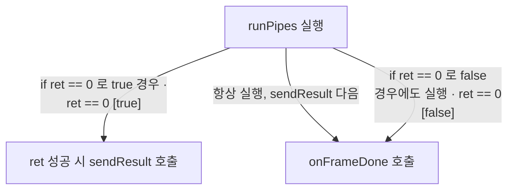

# 공개 mini HAL의 완료 분기

**파이프 반환 조건과 완료 정리를 소스와 함께 확인하세요.**


## 결과 전송과 프레임 정리

RequestManager::onFrame 가 runPipes 를 호출해 반환값 ret 을 읽으면, ret==0 이면 sendResult(frame)를 호출하고, 그 이후 if 블록 밖에서 무조건 onFrameDone(frame)가 실행됩니다. 반환값이 0이 아니면 sendResult는 호출되지 않습니다. `src/device/RequestManager.cpp:37`

<!-- sdd:visual:completion-branches -->
### 파이프 결과와 완료 처리의 분기

RequestManager::onFrame에서 runPipes, sendResult, onFrameDone의 연결을 그리세요. 결과 전송 조건의 condition_ref를 원문 조건 ID의 참·거짓으로 선택하고 성공·실패 경로를 구분하세요. onFrameDone이 성공·실패 양쪽에서 호출되는 것을 보존하세요. 기기 동작이나 스레드 보장은 추정하지 마세요. 세 호출을 각각 한 노드로 표현하며 진입점·변수·성공실패별 가상 상태 노드는 추가하지 마세요. label과 label_en에는 함수의 역할만 적으세요. 비교식·숫자·성공실패 판정은 레이블에 쓰지 말고 분기는 현재 원문 조건의 condition_ref로만 지정하세요.

LLM 그림 초안 · 사람 검토 전

작성 모델: `cli/hermes/qwen3.5:9b`



[Mermaid 원문](completion.completion-branches.mmd)

??? note "그림 근거와 확인 범위"
    소스에 연결한 설계 해석입니다. 자동 연결 검사는 의미 승인이나 기기 실행 검증이 아닙니다.
    
    | 요소·전이 | 소스 근거 |
    |---|---|
    | runPipes 실행 | [src/device/RequestManager.cpp:37](#source-dd453c8ea35782d1) |
    | ret 성공 시 sendResult 호출 | [src/device/RequestManager.cpp:37](#source-dd453c8ea35782d1) |
    | onFrameDone 호출 | [src/device/RequestManager.cpp:37](#source-dd453c8ea35782d1) |
    | if ret == 0 로 true 경우 · ret == 0 [true] | [src/device/RequestManager.cpp:37](#source-dd453c8ea35782d1) |
    | 항상 실행, sendResult 다음 | [src/device/RequestManager.cpp:37](#source-dd453c8ea35782d1) |
    | if ret == 0 로 false 경우에도 실행 · ret == 0 [false] | [src/device/RequestManager.cpp:37](#source-dd453c8ea35782d1) |
<!-- /sdd:visual:completion-branches -->

근거 원문: [src/device/RequestManager.cpp:37](#source-dd453c8ea35782d1)

??? note "설계 질문과 검증 범위"
    질문별 답변과 근거 연결을 검사했습니다. 의미와 실행 결과는 사람 검토가 필요합니다.
    
    | 설계 질문 | 설명 위치 | 확인 범위 |
    |---|---|---|
    | RequestManager::onFrame에서 runPipes 반환값에 따른 sendResult 조건과 onFrameDone 호출을 설명하세요. if 블록 안팎을 구분하고 실패 시 정리도 설명하세요. 실행 스레드나 성공 보장을 추정하지 마세요. | [결과 전송과 프레임 정리](#결과-전송과-프레임-정리) | 코드 근거와 설명 연결 |

## 소스 근거

같은 발췌는 한 번만 싣습니다. 필요한 원문을 펼쳐 설명과 대조하세요.

<a id="source-dd453c8ea35782d1"></a>

??? note "소스 근거: src/device/RequestManager.cpp:37"
    `src/device/RequestManager.cpp:37`에서 시작하는 발췌입니다. 종료 줄은 47이며, 아래 원문을 설명과 대조할 수 있습니다.
    
    SHA-256: `207bd08eabba156d28fafe463a18834d905b775ae2d0ac5c529857c7dcb7027b`
    
    ```text
    void RequestManager::onFrame(Frame &frame) {
        FrameFactory &factory = frame.isPreview ? static_cast<FrameFactory &>(previewFactory_)
                                                : static_cast<FrameFactory &>(captureFactory_);
        int ret = factory.runPipes(frame);
        if (ret == 0) {
            sendResult(frame);
        }
        onFrameDone(frame);
    }
    
    void RequestManager::sendResult
    ```

??? note "근거와 검토 정보"
    - 생성 방식: 추출 사실과 LLM 설명
    - 검증 범위: 표·그림은 facts로 만들고 설명은 LLM이 작성합니다. 인용·문장 및 설정된 구조 검사를 적용합니다.
    - 근거 파일: `src/device/RequestManager.cpp`
    - 근거 수준: 코드 확인 (정적 분석, public-excerpt-fixture 구성, commit `ad51b4f126`)
    - 자동 검사 (인용·문장 및 설정된 구조 검사): 통과
    - 검토 상태 기록일: 2026-10-26 · 사람 검토 전

다음 단계: [완료 분기](completion.md)
