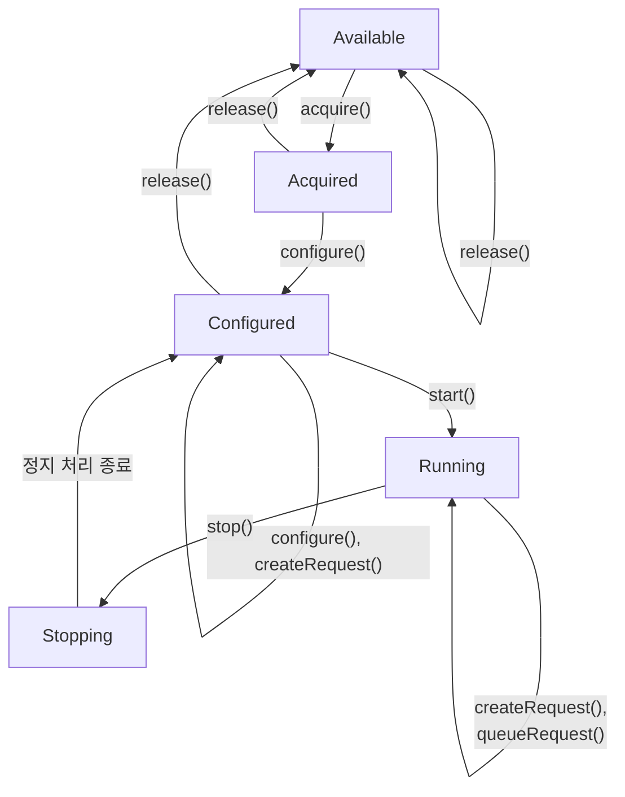
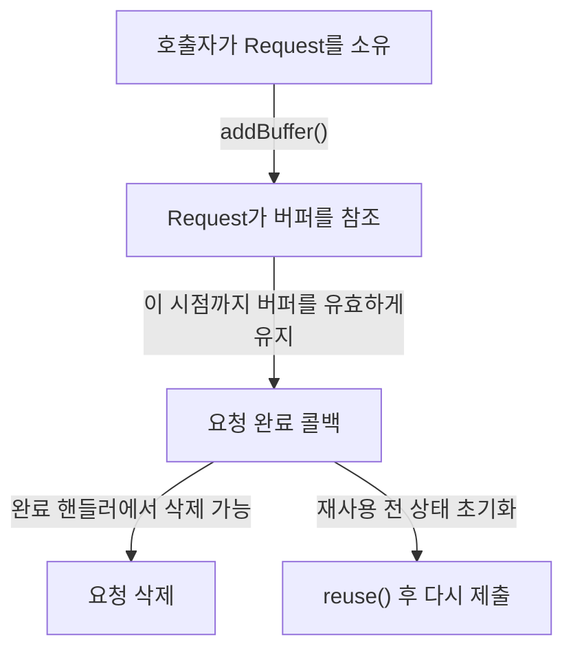
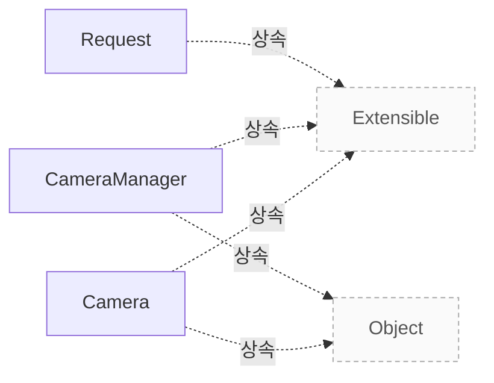

# 카메라와 요청 모델

**클래스의 책임, 요청과 버퍼의 수명, 상태 전이와 종료·동기화 계약을 코드 근거로 확인하세요.**

| 지금 확인할 내용 | 이동할 절 |
|---|---|
| 클래스별 책임 절을 확인합니다. | [클래스별 책임](#클래스별-책임) |
| 상태와 허용 호출 절을 확인합니다. | [상태와 허용 호출](#상태와-허용-호출) |
| 요청 생성과 완료 절을 확인합니다. | [요청 생성과 완료](#요청-생성과-완료) |
| 소유권과 재사용 절을 확인합니다. | [소유권과 재사용](#소유권과-재사용) |
| 오류와 종료 절을 확인합니다. | [오류와 종료](#오류와-종료) |
| 동시성과 실행 확인 절을 확인합니다. | [동시성과 실행 확인](#동시성과-실행-확인) |

## 클래스별 책임

시스템 내 모든 카메라 장치를 열거하고 관리하는 주체는 `CameraManager`이며, 이 클래스는 생성된 모든 `Camera` 객체의 소유권을 가지며 핫플러그와 핫언플러그를 처리합니다. `src/libcamera/camera_manager.cpp:280`

`CameraManager`는 시작될 때 정지 상태에 있으며, `start()` 함수를 호출해야 시스템에 존재하는 모든 카메라가 열거됩니다. `src/libcamera/camera_manager.cpp:280`

`Camera` 객체는 `std::shared_ptr<>`를 통해 공유되며, 애플리케이션이 마지막 참조를 해제할 때까지 카메라가 유효하게 유지됩니다. `src/libcamera/camera_manager.cpp:280`

`Camera` 인스턴스는 `create()` 함수를 통해 생성되어야 하며, 이는 공유 포인터를 반환하고 수명을 관리합니다. `src/libcamera/camera.cpp:758`

`Camera` 클래스의 생성자와 소멸자는 비공개로 정의되어 있어 수동으로 인스턴스를 생성하거나 파괴하는 것을 방지합니다. `src/libcamera/camera.cpp:758`

`Request` 객체는 프레임 기반의 버퍼와 컨트롤을 카메라 장치에 대기열로 넣기 위해 애플리케이션이 할당합니다. `src/libcamera/request.cpp:343`

`Request`의 생성자는 `Camera` 포인터와 애플리케이션용 불투명한 쿠키를 인자로 받아 요청을 생성합니다. `src/libcamera/request.cpp:343`

`CameraManager`는 애플리케이션이 카메라에 대한 모든 참조를 해제한 후 `stop()` 함수를 호출하여 관리자를 정지할 수 있습니다. `src/libcamera/camera_manager.cpp:280`

근거 원문: [src/libcamera/camera_manager.cpp:280](#source-fbcf3effd2584b79) · [src/libcamera/camera.cpp:758](#source-6c066281dcce33d6) · [src/libcamera/request.cpp:343](#source-abce7dd469896527)

## 상태와 허용 호출

acquire() 함수가 성공적으로 호출되면 카메라는 Acquired 상태로 전환됩니다. `src/libcamera/camera.cpp:769`

<!-- sdd:visual:camera-states -->
### 카메라 상태와 허용 호출

성공한 상태 전이와 상태를 유지하는 호출을 구분하세요. 상태 변경 함수의 동기화는 호출자가 책임집니다.



[Mermaid 원문](camera-model.camera-states.mmd)

??? note "그림 근거와 확인 범위"
    소스에 연결한 설계 해석입니다. 자동 연결 검사는 의미 승인이나 기기 실행 검증이 아닙니다.
    
    | 요소·전이 | 소스 근거 |
    |---|---|
    | Available | [src/libcamera/camera.cpp:769](#source-4b17a07667f3a55d) |
    | Acquired | [src/libcamera/camera.cpp:769](#source-4b17a07667f3a55d) |
    | Configured | [src/libcamera/camera.cpp:769](#source-4b17a07667f3a55d) |
    | Running | [src/libcamera/camera.cpp:769](#source-4b17a07667f3a55d) |
    | Stopping | [src/libcamera/camera.cpp:769](#source-4b17a07667f3a55d) |
    | release() | [src/libcamera/camera.cpp:769](#source-4b17a07667f3a55d) |
    | acquire() | [src/libcamera/camera.cpp:769](#source-4b17a07667f3a55d) |
    | release() | [src/libcamera/camera.cpp:769](#source-4b17a07667f3a55d) |
    | configure() | [src/libcamera/camera.cpp:769](#source-4b17a07667f3a55d) |
    | release() | [src/libcamera/camera.cpp:769](#source-4b17a07667f3a55d) |
    | configure(), createRequest() | [src/libcamera/camera.cpp:769](#source-4b17a07667f3a55d) |
    | start() | [src/libcamera/camera.cpp:769](#source-4b17a07667f3a55d) |
    | stop() | [src/libcamera/camera.cpp:769](#source-4b17a07667f3a55d) |
    | 정지 처리 종료 | [src/libcamera/camera.cpp:769](#source-4b17a07667f3a55d) |
    | createRequest(), queueRequest() | [src/libcamera/camera.cpp:769](#source-4b17a07667f3a55d) |
<!-- /sdd:visual:camera-states -->

`configure()` 함수가 성공적으로 호출되면 카메라는 `Configured` 상태가 됩니다. `src/libcamera/camera.cpp:769`

`start()` 함수가 성공적으로 호출되면 카메라의 상태는 `Running`으로 변경됩니다. `src/libcamera/camera.cpp:769`

`stop()` 함수를 호출하여 `Running` 상태에서 카메라를 정지시킬 때, 카메라는 즉시 `Stopping` 상태로 진입합니다. `src/libcamera/camera.cpp:769`

카메라를 정지 (stop) 처리가 끝난 뒤 카메라는 설정된 상태 (Configured) 로 돌아갑니다. `src/libcamera/camera.cpp:769`

카메라를 해제하면 `release()` 함수가 호출되어 카메라 상태가 `Available`로 돌아갑니다. `src/libcamera/camera.cpp:769`

`Camera::createRequest` 함수는 카메라가 `Configured` 상태이거나 `Running` 상태일 때만 호출할 수 있습니다. `src/libcamera/camera.cpp:1258`

`Camera::queueRequest` 함수는 카메라가 `Running` 상태일 때만 호출할 수 있습니다. `src/libcamera/camera.cpp:1320`

`start` 함수는 카메라가 `Configured` 상태일 때만 호출할 수 있습니다. `src/libcamera/camera.cpp:1383`

카메라 상태를 변경하는 함수들은 서로 자동으로 동기화되지 않으며, 호출자가 필요에 따라 동기화를 보장해야 합니다. `src/libcamera/camera.cpp:780`

근거 원문: [src/libcamera/camera.cpp:769](#source-4b17a07667f3a55d) · [src/libcamera/camera.cpp:1383](#source-617d53c4c7de2c0c) · [src/libcamera/camera.cpp:1258](#source-8f791427a31c3313) · [src/libcamera/camera.cpp:1320](#source-e0caa8c16f728202) · [src/libcamera/camera.cpp:780](#source-cc6c66b57cf028e6)

## 요청 생성과 완료

`Camera::createRequest` 함수는 애플리케이션이 버퍼와 매개변수로 채우고 촬영을 대기할 수 있는 빈 요청 객체를 생성하여 호출자에게 반환합니다. `src/libcamera/camera.cpp:1243`

요청에 버퍼를 추가할 때 호출자는 각 스트림당 최대 한 개의 버퍼만 연결해야 합니다. `src/libcamera/request.cpp:442`

`Request::addBuffer` 함수에 전달하는 버퍼는 요청 완료 콜백이 호출될 때까지 유효해야 합니다. `src/libcamera/request.cpp:442`

`queueRequest` 함수를 호출하기 전에 호출자는 요청에 최소 하나의 캡처 버퍼를 채워야 합니다. `src/libcamera/camera.cpp:1308`

`queueRequest` 함수는 요청이 현재 카메라 객체에서 생성되었는지 확인하기 위해 `request->_d()->camera()`로 가져온 소유자 카메라와 `this` 가 지칭하는 현재 카메라를 비교합니다. `src/libcamera/camera.cpp:1339`

`queueRequest` 함수에서 요청이 이 카메라 객체 (`this`) 가 아닌 다른 카메라에 의해 생성된 것으로 확인되면, 해당 요청을 처리할 수 없으므로 `-EXDEV` 오류 코드를 반환합니다. `src/libcamera/camera.cpp:1339`

`Camera::queueRequest` 함수는 요청의 상태가 `RequestPending`이 아닌 경우 오류 로그를 출력한 뒤 `-EINVAL`를 반환합니다. `src/libcamera/camera.cpp:1330`

`Request::controls().infoMap()`과 `Camera::controls()`의 주소를 비교하는 조건은 요청 객체의 제어 정보 매핑이 카메라의 현재 제어 정보와 동일한지 확인하기 위해 사용됩니다. `src/libcamera/camera.cpp:1350`

`queueRequest` 함수에서 요청의 제어 정보 맵이 현재 카메라의 제어 정보 맵과 동일한 주소를 가리키지 않으면, 해당 요청을 처리할 수 없으므로 `-EINVAL` 오류 코드를 반환합니다. `src/libcamera/camera.cpp:1350`

`queueRequest` 함수는 요청 객체의 `buffers()` 메서드로부터 얻은 버퍼 목록이 비어 있는지 여부를 검사합니다. `src/libcamera/camera.cpp:1361`

`queueRequest` 함수가 요청의 버퍼 목록이 비어 있는지 확인하면, 해당 조건이 참일 때 `-EINVAL` 오류 코드를 반환합니다. `src/libcamera/camera.cpp:1361`

`queueRequest` 함수는 요청을 처리하기 전에 `d->activeStreams_` 맵에 해당 스트림이 포함되어 있는지 확인합니다. `src/libcamera/camera.cpp:1367`

`queueRequest` 함수에서 유효하지 않은 스트림을 찾으면 `-EINVAL` 오류 코드를 반환합니다. `src/libcamera/camera.cpp:1367`

`Camera::queueRequest()` 함수가 성공적으로 요청을 큐에 넣었다고 반환하는 것은, 해당 요청이 곧바로 `requestCompleted` 신호로 완료된 것을 의미하지 않습니다. 이 함수는 요청을 카메라 내부 처리 로직으로 넘기고 즉시 0 을 반환하며, 실제 촬영 완료는 별도의 알림 메커니즘을 통해 나중에 확인해야 합니다. `src/libcamera/camera.cpp:1308`

근거 원문: [src/libcamera/camera.cpp:1243](#source-0ae00d77839f61cb) · [src/libcamera/camera.cpp:1308](#source-28d007de6ad1a8a5) · [src/libcamera/request.cpp:442](#source-95ae69eeb085e3b1) · [src/libcamera/camera.cpp:1330](#source-a6565762f1627660) · [src/libcamera/camera.cpp:1339](#source-a03c9ac514bfd95e) · [src/libcamera/camera.cpp:1350](#source-980d3a2f94252f0c) · [src/libcamera/camera.cpp:1361](#source-d572e3b4aa0a295b) · [src/libcamera/camera.cpp:1367](#source-589094bc9fe6e38d)

## 소유권과 재사용

`Camera::createRequest` 함수는 요청 객체를 생성하여 호출자에게 반환하며, 이 반환된 요청의 소유권은 호출자에게 전달됩니다. `src/libcamera/camera.cpp:1243`

<!-- sdd:visual:request-ownership -->
### 요청과 버퍼를 유지할 기간

요청의 소유권은 호출자에게 있습니다. 버퍼 참조를 연결해도 호출자의 버퍼 유지 책임은 계속됩니다.



[Mermaid 원문](camera-model.request-ownership.mmd)

??? note "그림 근거와 확인 범위"
    소스에 연결한 설계 해석입니다. 자동 연결 검사는 의미 승인이나 기기 실행 검증이 아닙니다.
    
    | 요소·전이 | 소스 근거 |
    |---|---|
    | 호출자가 Request를 소유 | [src/libcamera/camera.cpp:1243](#source-0ae00d77839f61cb) |
    | Request가 버퍼를 참조 | [src/libcamera/request.cpp:442](#source-95ae69eeb085e3b1) |
    | 요청 완료 콜백 | [src/libcamera/request.cpp:442](#source-95ae69eeb085e3b1) |
    | 요청 삭제 | [src/libcamera/camera.cpp:1243](#source-0ae00d77839f61cb) |
    | reuse() 후 다시 제출 | [src/libcamera/request.cpp:376](#source-38494771cb29cc8c) |
    | addBuffer() | [src/libcamera/request.cpp:442](#source-95ae69eeb085e3b1) |
    | 이 시점까지 버퍼를 유효하게 유지 | [src/libcamera/request.cpp:442](#source-95ae69eeb085e3b1) |
    | 완료 핸들러에서 삭제 가능 | [src/libcamera/camera.cpp:1243](#source-0ae00d77839f61cb) |
    | 재사용 전 상태 초기화 | [src/libcamera/request.cpp:376](#source-38494771cb29cc8c) |
<!-- /sdd:visual:request-ownership -->

`Request::addBuffer` 함수는 요청에 스트림과 연결된 `FrameBuffer` 참조를 저장하며, 호출자는 해당 버퍼가 요청 완료 콜백이 호출될 때까지 유효하도록 유지해야 합니다. `src/libcamera/request.cpp:442`

`Request::addBuffer` 함수가 성공적으로 호출되면, 유효한 펜스 (fence) 의 소유권은 해당 버퍼 (`FrameBuffer`) 로 이동합니다. `src/libcamera/request.cpp:456`

`addBuffer` 함수가 실패할 경우, 전달받은 `fence` 는 수정되지 않고 원래 상태로 유지됩니다. `src/libcamera/request.cpp:456`

`Request::addBuffer` 함수는 버퍼와 연결된 펜스가 신호를 보내지 않으면 요청이 타임아웃되어 실패합니다. `src/libcamera/request.cpp:462`

타임아웃으로 인해 요청이 실패한 경우, 버퍼에 포함된 펜스를 회수하기 위해 호출자가 반드시 `FrameBuffer::releaseFence()` 함수를 호출해야 합니다. `src/libcamera/request.cpp:462`

`Request::reuse` 함수 내부의 `ReuseBuffers` 분기에서 버퍼는 `_d()` 메서드를 통해 접근한 후 `setRequest(this)` 호출로 현재 요청에 연결됩니다. `src/libcamera/request.cpp:393`

`Request::reuse` 함수에서 `ReuseBuffers` 플래그가 설정된 경우, 각 스트림의 버퍼에 대해 `_d()->setRequest(this)`를 호출하여 해당 버퍼의 요청 참조를 현재 요청으로 설정한 뒤, 그 버퍼를 `_d()->pending_` 집합에 추가합니다. `src/libcamera/request.cpp:391`

`Request::reuse()` 함수의 `ReuseBuffers` 플래그가 없는 else 분기에서는 `bufferMap_`를 비웁니다. `src/libcamera/request.cpp:391`

`Request::reuse` 함수 내부에서 `status_` 멤버 변수에 저장되는 값은 `RequestPending` 상태입니다. `src/libcamera/request.cpp:400`

`Request::reuse` 함수 내부에서 `controls_` 멤버 변수에 대한 호출은 해당 벡터를 비우는 초기화 작업을 수행합니다. `src/libcamera/request.cpp:402`

`Request::reuse` 함수 내부에서 `_d()->metadata_.clear()` 호출은 `metadata_` 멤버 변수에 저장된 모든 메타데이터 항목을 제거하여 초기화 상태를 만듭니다. `src/libcamera/request.cpp:403`

`Request::ReuseBuffers` 플래그는 이전에 `addBuffer()` 메서드를 통해 추가된 버퍼들을 재사용하도록 요청합니다. `src/libcamera/request.cpp:326`

`Request::ReuseBuffers` 플래그로 버퍼를 재사용할 때 연결된 펜스도 함께 재사용되지는 않습니다. `src/libcamera/request.cpp:326`

`Request::ReuseFlag` 플래그를 사용할 때 펜스 (fence) 를 함께 사용하는 것은 권장하지 않습니다. `src/libcamera/request.cpp:334`

근거 원문: [src/libcamera/camera.cpp:1243](#source-0ae00d77839f61cb) · [src/libcamera/request.cpp:376](#source-38494771cb29cc8c) · [src/libcamera/request.cpp:442](#source-95ae69eeb085e3b1) · [src/libcamera/request.cpp:326](#source-447804db33308244) · [src/libcamera/request.cpp:456](#source-86a8d784a8348122) · [src/libcamera/request.cpp:462](#source-d8cf34a75a4333a7) · [src/libcamera/request.cpp:400](#source-a98823fa5ec440a2) · [src/libcamera/request.cpp:402](#source-c8638489aa83cfd1) · [src/libcamera/request.cpp:403](#source-47569737e131b31a) · [src/libcamera/request.cpp:391](#source-e41b7fa688c1de2e) · [src/libcamera/request.cpp:393](#source-bf1ee390b8473e16) · [src/libcamera/request.cpp:334](#source-d9944a69f2dd6758)

## 오류와 종료

`Camera::queueRequest()` 함수는 요청을 카메라 대기열에 추가하기 전에 여러 가지 오류를 반환합니다. `src/libcamera/camera.cpp:1308`

`Camera::queueRequest()` 함수는 카메라가 실행 중이 아니면 `-EACCES` 오류를 반환하며, 이는 `d->isAccessAllowed(Private::CameraRunning)` 호출 결과로 결정됩니다. `src/libcamera/camera.cpp:1308`

`Camera::queueRequest()` 함수는 요청이 이 카메라에서 생성되지 않았으면 `-EXDEV` 오류를 반환합니다. `src/libcamera/camera.cpp:1308`

`Camera::queueRequest()` 함수는 요청의 상태가 `RequestPending`이 아니면 `-EINVAL` 오류를 반환합니다. `src/libcamera/camera.cpp:1308`

`Camera::queueRequest()` 함수는 요청의 제어 목록 정보가 카메라의 현재 제어 목록과 일치하지 않으면 `-EINVAL` 오류를 반환합니다. `src/libcamera/camera.cpp:1308`

`Camera::queueRequest()` 함수는 요청에 포함된 버퍼가 비어 있으면 `-EINVAL` 오류를 반환합니다. `src/libcamera/camera.cpp:1308`

`Camera::queueRequest()` 함수는 요청의 각 스트림이 활성 스트림 목록에 존재하지 않으면 `-EINVAL` 오류를 반환합니다. `src/libcamera/camera.cpp:1308`

`Camera::stop()` 함수는 카메라가 실행 중이 아닌 경우 즉시 `0`을 반환하며, 이는 실제 동작을 수행하지 않는 무작업(no-op) 상태입니다. `src/libcamera/camera.cpp:1431`

근거 원문: [src/libcamera/camera.cpp:1308](#source-28d007de6ad1a8a5) · [src/libcamera/camera.cpp:1431](#source-e09324743def3f09)

## 동시성과 실행 확인

`Camera::createRequest()` 함수는 카메라가 `Configured` 또는 `Running` 상태일 때 호출할 수 있으며, 이 함수는 스레드 안전합니다. 반환된 요청 객체의 소유권은 호출자에게 넘어가므로, 호출자는 해당 요청을 삭제하거나 상태를 초기화한 후 재사용해야 합니다. `src/libcamera/camera.cpp:1243`

`Camera::queueRequest()` 함수는 카메라가 `Running` 상태일 때만 호출할 수 있으며, 이 함수도 스레드 안전합니다. 요청에 최소 하나의 캡처 버퍼가 포함되어 있어야 하며, 버퍼가 없거나 요청이 유효하지 않으면 큐잉이 거부됩니다. `src/libcamera/camera.cpp:1308`

`Camera::start()` 함수는 카메라가 `Configured` 상태일 때 호출되며, 다른 상태 변경 함수와 동기화되어야 합니다. 성공 시 0을 반환하고 실패 시 음수 오류 코드를 반환합니다. `src/libcamera/camera.cpp:1383`

`Camera::stop()` 함수는 카메라의 어떤 상태에서도 호출할 수 있으며, 실행 중이 아닌 경우 무작동입니다. 이 함수도 다른 상태 변경 함수와 동기화되어야 하며, 성공 시 0을 반환합니다. `src/libcamera/camera.cpp:1431`

`PipelineHandler::completeBuffer()` 함수는 `CameraManager` 스레드에서 호출되어야 하며, 버퍼 완료를 애플리케이션에 알리고 요청의 내부 버퍼 추적을 업데이트합니다. `src/libcamera/pipeline_handler.cpp:547`

`PipelineHandler::completeRequest()` 함수는 `CameraManager` 스레드에서 호출되어야 하며, 요청이 완료되었음을 카메라에 알립니다. 이 함수를 호출한 후 파이프라인 핸들러는 더 이상 해당 요청을 관리하지 않습니다. `src/libcamera/pipeline_handler.cpp:547`

`PipelineHandler::cancelRequest()` 함수는 요청을 취소하고 완료하며, `completeRequest()` 함수의 규칙이 동일하게 적용됩니다. `src/libcamera/pipeline_handler.cpp:547`

근거 원문: [src/libcamera/camera.cpp:1243](#source-0ae00d77839f61cb) · [src/libcamera/camera.cpp:1308](#source-28d007de6ad1a8a5) · [src/libcamera/camera.cpp:1383](#source-617d53c4c7de2c0c) · [src/libcamera/camera.cpp:1431](#source-e09324743def3f09) · [src/libcamera/pipeline_handler.cpp:547](#source-01ad7c6605c3296a)

## 연결 해제와 대기 요청

`Camera::disconnect()` 함수는 하드웨어가 뽑혀나간 경우 카메라 인스턴스가 #disconnected 신호를 방출하고, 이후 모든 공개 API 호출이 즉시 오류를 반환하도록 보장합니다. `src/libcamera/camera.cpp:944`

이 함수는 내부적으로 `_d()`->disconnect() 를 호출하여 상태 전환을 수행한 뒤 disconnected 신호를 방출하며, 연결 해제 시 대기 중인 요청 처리에 대해서는 TODO 항목으로 남아 있습니다. `src/libcamera/camera.cpp:944`

하드웨어가 제거되어 연결이 끊어졌을 때 카메라가 실행 중이라면 상태는 CameraRunning 에서 CameraConfigured 로 강제로 전환됩니다. `src/libcamera/camera.cpp:690`

isAccessAllowed() 함수는 allowDisconnected 가 false 이고 `disconnected_` 가 true 라면 -ENODEV 오류를 반환합니다. `src/libcamera/camera.cpp:690`

연결이 끊어졌을 때 allowDisconnected 가 true 라면 현재 상태가 요청한 상태와 일치하면 0 을 반환합니다. `src/libcamera/camera.cpp:690`

isAccessAllowed() 는 현재 상태가 요청한 상태 범위 내에 있지 않으면 -EACCES 오류를 반환합니다. `src/libcamera/camera.cpp:690`

실행 확인 항목: 연결 해제 시 대기 중인 요청 처리는 TODO 항목으로 남아 있으며, 이를 stop() 의 취소·완료 보장으로 바꾸지 않습니다. `src/libcamera/camera.cpp:944`

근거 원문: [src/libcamera/camera.cpp:690](#source-ac8ee83f828fe269) · [src/libcamera/camera.cpp:944](#source-2758e9ddd31ad41d)

??? note "설계 질문과 검증 범위"
    질문별 답변과 근거 연결을 검사했습니다. 의미와 실행 결과는 사람 검토가 필요합니다.
    
    | 설계 질문 | 설명 위치 | 확인 범위 |
    |---|---|---|
    | CameraManager, Camera, Request의 책임과 객체 수명은 어떻게 나뉩니까? | [클래스별 책임](#클래스별-책임) | 코드 근거와 설명 연결 |
    | 상태별 허용 호출과 동기화 책임은 어떻게 나뉩니까? | [상태와 허용 호출](#상태와-허용-호출) | 코드 근거와 설명 연결 |
    | 요청 생성부터 완료 통지까지 객체 수명과 호출 순서는 무엇입니까? | [요청 생성과 완료](#요청-생성과-완료) | 코드 근거와 설명 연결 |
    | 요청이 진행 중일 때와 완료된 뒤의 소유권, ReuseBuffers와 fence 규칙은 무엇입니까? | [소유권과 재사용](#소유권과-재사용) | 코드 근거와 설명 연결 |
    | queueRequest의 실패 조건과 stop의 취소·완료·반환 상태는 무엇입니까? | [오류와 종료](#오류와-종료) | 코드 근거와 설명 연결 |
    | threadsafe 보장, 호출자의 동기화 책임과 파이프라인의 완료 통지 계약을 구분하세요. 애플리케이션 콜백 전달 방식과 실기기 검증은 별도로 확인하세요. | [동시성과 실행 확인](#동시성과-실행-확인) | 코드 근거와 설명 연결 |
    | 카메라 연결이 끊어지면 상태·API 접근·대기 요청에 어떤 변화와 확인 한계가 있습니까? | [연결 해제와 대기 요청](#연결-해제와-대기-요청) | 코드 근거와 설명 연결 · 실행 확인 항목 별도 |

## 소스 근거

같은 발췌는 한 번만 싣습니다. 필요한 원문을 펼쳐 설명과 대조하세요.

<a id="source-fbcf3effd2584b79"></a>

??? note "소스 근거: src/libcamera/camera_manager.cpp:280"
    `src/libcamera/camera_manager.cpp:280`에서 시작하는 발췌입니다. 종료 줄은 304이며, 아래 원문을 설명과 대조할 수 있습니다.
    
    SHA-256: `adcd6d49b0c989ec78a81cacece7f6c871a8e0ddf3aa52e42648fae2760a6e84`
    
    ```text
    \class CameraManager
     * \brief Provide access and manage all cameras in the system
     *
     * The camera manager is the entry point to libcamera. It enumerates devices,
     * associates them with pipeline managers, and provides access to the cameras
     * in the system to applications. The manager owns all Camera objects and
     * handles hot-plugging and hot-unplugging to manage the lifetime of cameras.
     *
     * To interact with libcamera, an application starts by creating a camera
     * manager instance. Only a single instance of the camera manager may exist at
     * a time. Attempting to create a second instance without first deleting the
     * existing instance results in undefined behaviour.
     *
     * The manager is initially stopped, and shall be started with start(). This
     * will enumerate all the cameras present in the system, which can then be
     * listed with list() and retrieved with get().
     *
     * Cameras are shared through std::shared_ptr<>, ensuring that a camera will
     * stay valid until the last reference is released without requiring any special
     * action from the application. Once the application has released all the
     * references it held to cameras, the camera manager can be stopped with
     * stop().
     */
    
    CameraManager *CameraManager::self_
    ```

<a id="source-6c066281dcce33d6"></a>

??? note "소스 근거: src/libcamera/camera.cpp:758"
    `src/libcamera/camera.cpp:758`에서 시작하는 발췌입니다. 종료 줄은 769이며, 아래 원문을 설명과 대조할 수 있습니다.
    
    SHA-256: `e77cee469b7c57430e4bd4b0f08493289c46b57549873521c476df388d591dc2`
    
    ```text
    The Camera class models a camera capable of producing one or more image
     * streams from a single image source. It provides the main interface to
     * configuring and controlling the device, and capturing image streams. It is
     * the central object exposed by libcamera.
     *
     * To support the central nature of Camera objects, libcamera manages the
     * lifetime of camera instances with std::shared_ptr<>. Instances shall be
     * created with the create() function which returns a shared pointer. The
     * Camera constructors and destructor are private, to prevent instances from
     * being constructed and destroyed manually.
     *
     * \section camera_operation
    ```

<a id="source-abce7dd469896527"></a>

??? note "소스 근거: src/libcamera/request.cpp:343"
    `src/libcamera/request.cpp:343`에서 시작하는 발췌입니다. 종료 줄은 360이며, 아래 원문을 설명과 대조할 수 있습니다.
    
    SHA-256: `948968e35cb0d98957bc63aa2d6b613d2a8203e66855db23974f035e9d679764`
    
    ```text
    \class Request
     * \brief A frame capture request
     *
     * A Request allows an application to associate buffers and controls on a
     * per-frame basis to be queued to the camera device for processing.
     */
    
    /**
     * \brief Create a capture request for a camera
     * \param[in] camera The camera that creates the request
     * \param[in] cookie Opaque cookie for application use
     *
     * The \a cookie is stored in the request and is accessible through the
     * cookie() function at any time. It is typically used by applications to map
     * the request to an external resource in the request completion handler, and is
     * completely opaque to libcamera.
     */
    Request::Request(Camera *camera, uint64_t cookie)
    ```

<a id="source-4b17a07667f3a55d"></a>

??? note "소스 근거: src/libcamera/camera.cpp:769"
    `src/libcamera/camera.cpp:769`에서 시작하는 발췌입니다. 종료 줄은 814이며, 아래 원문을 설명과 대조할 수 있습니다.
    
    SHA-256: `e85796df194551ecbd587ba1a7bb356a1409fa1d606762865e7eb989c92d2f72`
    
    ```text
    \section camera_operation Operating the Camera
     *
     * An application needs to perform a sequence of operations on a camera before
     * it is ready to process requests. The camera needs to be acquired and
     * configured to prepare the camera for capture. Once started the camera can
     * process requests until it is stopped. When an application is done with a
     * camera, the camera needs to be released.
     *
     * An application may start and stop a camera multiple times as long as it is
     * not released. The camera may also be reconfigured.
     *
     * Functions that affect the camera state as defined below are generally not
     * synchronized with each other by the Camera class. The caller is responsible
     * for ensuring their synchronization if necessary.
     *
     * \subsection Camera States
     *
     * To help manage the sequence of operations needed to control the camera a set
     * of states are defined. Each state describes which operations may be performed
     * on the camera. Performing an operation not allowed in the camera state
     * results in undefined behaviour. Operations not listed at all in the state
     * diagram are allowed in all states.
     *
     * \dot
     * digraph camera_state_machine {
     *   node [shape = doublecircle ]; Available;
     *   node [shape = circle ]; Acquired;
     *   node [shape = circle ]; Configured;
     *   node [shape = circle ]; Stopping;
     *   node [shape = circle ]; Running;
     *
     *   Available -> Available [label = "release()"];
     *   Available -> Acquired [label = "acquire()"];
     *
     *   Acquired -> Available [label = "release()"];
     *   Acquired -> Configured [label = "configure()"];
     *
     *   Configured -> Available [label = "release()"];
     *   Configured -> Configured [label = "configure(), createRequest()"];
     *   Configured -> Running [label = "start()"];
     *
     *   Running -> Stopping [label = "stop()"];
     *   Stopping -> Configured;
     *   Running -> Running [label = "createRequest(), queueRequest()"];
     * }
     * \enddot
    ```

<a id="source-617d53c4c7de2c0c"></a>

??? note "소스 근거: src/libcamera/camera.cpp:1383"
    `src/libcamera/camera.cpp:1383`에서 시작하는 발췌입니다. 종료 줄은 1400이며, 아래 원문을 설명과 대조할 수 있습니다.
    
    SHA-256: `e0abda64dc6b1bdd78d1326c8dd8651e842c03181dcf28e3b8b7eac1a4c70fcf`
    
    ```text
    \brief Start capture from camera
     * \param[in] controls Controls to be applied before starting the Camera
     *
     * Start the camera capture session, optionally providing a list of controls to
     * apply before starting. Once the camera is started the application can queue
     * requests to the camera to process and return to the application until the
     * capture session is terminated with \a stop().
     *
     * \context This function may only be called when the camera is in the
     * Configured state as defined in \ref camera_operation, and shall be
     * synchronized by the caller with other functions that affect the camera
     * state.
     *
     * \return 0 on success or a negative error code otherwise
     * \retval -ENODEV The camera has been disconnected from the system
     * \retval -EACCES The camera is not in a state where it can be started
     */
    int Camera::start(const ControlList *controls)
    ```

<a id="source-8f791427a31c3313"></a>

??? note "소스 근거: src/libcamera/camera.cpp:1258"
    `src/libcamera/camera.cpp:1258`에서 시작하는 발췌입니다. 종료 줄은 1263이며, 아래 원문을 설명과 대조할 수 있습니다.
    
    SHA-256: `fd7dc6ea02f64424f17322fff027c34131ac5a3fb64d69d83aa6fa55ca9f826a`
    
    ```text
    \context This function is \threadsafe. It may only be called when the camera
     * is in the Configured or Running state as defined in \ref camera_operation.
     *
     * \return A pointer to the newly created request, or nullptr on error
     */
    std::unique_ptr<Request> Camera::createRequest(uint64_t cookie)
    ```

<a id="source-e0caa8c16f728202"></a>

??? note "소스 근거: src/libcamera/camera.cpp:1320"
    `src/libcamera/camera.cpp:1320`에서 시작하는 발췌입니다. 종료 줄은 1330이며, 아래 원문을 설명과 대조할 수 있습니다.
    
    SHA-256: `b9de90acc07617b489b367e116e41ecc8bc712180c6f445763b58658ff1bc649`
    
    ```text
    \context This function is \threadsafe. It may only be called when the camera
     * is in the Running state as defined in \ref camera_operation.
     *
     * \return 0 on success or a negative error code otherwise
     * \retval -ENODEV The camera has been disconnected from the system
     * \retval -EACCES The camera is not running so requests can't be queued
     * \retval -EXDEV The request does not belong to this camera
     * \retval -EINVAL The request is invalid
     * \retval -ENOMEM No buffer memory was available to handle the request
     */
    int Camera::queueRequest(Request *request)
    ```

<a id="source-cc6c66b57cf028e6"></a>

??? note "소스 근거: src/libcamera/camera.cpp:780"
    `src/libcamera/camera.cpp:780`에서 시작하는 발췌입니다. 종료 줄은 782이며, 아래 원문을 설명과 대조할 수 있습니다.
    
    SHA-256: `de3ba7a26c3bbaf6bbb33d1749b99829fdc58e13718068d149c849d0b2c43388`
    
    ```text
    Functions that affect the camera state as defined below are generally not
     * synchronized with each other by the Camera class. The caller is responsible
     * for ensuring their synchronization if necessary.
    ```

<a id="source-0ae00d77839f61cb"></a>

??? note "소스 근거: src/libcamera/camera.cpp:1243"
    `src/libcamera/camera.cpp:1243`에서 시작하는 발췌입니다. 종료 줄은 1263이며, 아래 원문을 설명과 대조할 수 있습니다.
    
    SHA-256: `9f251ecf5ba569606e9753d3619b88e1aef5a4ce15f816ae97efd283e34b823b`
    
    ```text
    \brief Create a request object for the camera
     * \param[in] cookie Opaque cookie for application use
     *
     * This function creates an empty request for the application to fill with
     * buffers and parameters, and queue for capture.
     *
     * The \a cookie is stored in the request and is accessible through the
     * Request::cookie() function at any time. It is typically used by applications
     * to map the request to an external resource in the request completion
     * handler, and is completely opaque to libcamera.
     *
     * The ownership of the returned request is passed to the caller, which is
     * responsible for deleting it. The request may be deleted in the completion
     * handler, or reused after resetting its state with Request::reuse().
     *
     * \context This function is \threadsafe. It may only be called when the camera
     * is in the Configured or Running state as defined in \ref camera_operation.
     *
     * \return A pointer to the newly created request, or nullptr on error
     */
    std::unique_ptr<Request> Camera::createRequest(uint64_t cookie)
    ```

<a id="source-28d007de6ad1a8a5"></a>

??? note "소스 근거: src/libcamera/camera.cpp:1308"
    `src/libcamera/camera.cpp:1308`에서 시작하는 발췌입니다. 종료 줄은 1383이며, 아래 원문을 설명과 대조할 수 있습니다.
    
    SHA-256: `96db61baeb32065c966b20942f97518ddbd3a43b36b64e8083eb29a90ecb7f4b`
    
    ```text
    \brief Queue a request to the camera
     * \param[in] request The request to queue to the camera
     *
     * This function queues a \a request to the camera for capture.
     *
     * After allocating the request with createRequest(), the application shall
     * fill it with at least one capture buffer before queuing it. Requests that
     * contain no buffers are invalid and are rejected without being queued.
     *
     * Once the request has been queued, the camera will notify its completion
     * through the \ref requestCompleted signal.
     *
     * \context This function is \threadsafe. It may only be called when the camera
     * is in the Running state as defined in \ref camera_operation.
     *
     * \return 0 on success or a negative error code otherwise
     * \retval -ENODEV The camera has been disconnected from the system
     * \retval -EACCES The camera is not running so requests can't be queued
     * \retval -EXDEV The request does not belong to this camera
     * \retval -EINVAL The request is invalid
     * \retval -ENOMEM No buffer memory was available to handle the request
     */
    int Camera::queueRequest(Request *request)
    {
    	Private *const d = _d();
    
    	int ret = d->isAccessAllowed(Private::CameraRunning);
    	if (ret < 0)
    		return ret;
    
    	/* Requests can only be queued to the camera that created them. */
    	if (request->_d()->camera() != this) {
    		LOG(Camera, Error) << "Request was not created by this camera";
    		return -EXDEV;
    	}
    
    	if (request->status() != Request::RequestPending) {
    		LOG(Camera, Error) << request->toString() << " is not valid";
    		return -EINVAL;
    	}
    
    	/* Make sure the Request has a valid control list. */
    	if (request->controls().infoMap() != &controls()) {
    		LOG(Camera, Error) << "Overwriting Request::controls() is not allowed";
    		return -EINVAL;
    	}
    
    	/*
    	 * The camera state may change until the end of the function. No locking
    	 * is however needed as PipelineHandler::queueRequest() will handle
    	 * this.
    	 */
    
    	if (request->buffers().empty()) {
    		LOG(Camera, Error) << "Request contains no buffers";
    		return -EINVAL;
    	}
    
    	for (const auto &[stream, buffer] : request->buffers()) {
    		if (d->activeStreams_.find(stream) == d->activeStreams_.end()) {
    			LOG(Camera, Error) << "Invalid request";
    			return -EINVAL;
    		}
    	}
    
    	/* Pre-process AeEnable. */
    	patchControlList(request->controls());
    
    	d->pipe_->invokeMethod(&PipelineHandler::queueRequest,
    			       ConnectionTypeQueued, request);
    
    	return 0;
    }
    
    /**
     * \brief Start capture from camera
    ```

<a id="source-95ae69eeb085e3b1"></a>

??? note "소스 근거: src/libcamera/request.cpp:442"
    `src/libcamera/request.cpp:442`에서 시작하는 발췌입니다. 종료 줄은 475이며, 아래 원문을 설명과 대조할 수 있습니다.
    
    SHA-256: `65cd8b0501b7f6545dd10eaaec4a4fe46c52a096a3bbd94ea6b4813e4a670876`
    
    ```text
    \brief Add a FrameBuffer with its associated Stream to the Request
     * \param[in] stream The stream the buffer belongs to
     * \param[in] buffer The FrameBuffer to add to the request
     * \param[in] fence The optional fence
     *
     * A reference to the buffer is stored in the request. The caller is responsible
     * for ensuring that the buffer will remain valid until the request complete
     * callback is called.
     *
     * A request can only contain one buffer per stream. If a buffer has already
     * been added to the request for the same stream, this function returns -EEXIST.
     *
     * A Fence can be optionally associated with the \a buffer.
     *
     * When a valid Fence is provided to this function, \a fence is moved to \a
     * buffer and this Request will only be queued to the device once the
     * fences of all its buffers have been correctly signalled. Ownership of the
     * fence will only be taken in case of success, otherwise the fence will
     * be left unmodified.
     *
     * If the \a fence associated with \a buffer isn't signalled, the request will
     * fail after a timeout. The buffer will still contain the fence, which
     * applications must retrieve with FrameBuffer::releaseFence() before the buffer
     * can be reused in another request. Attempting to add a buffer that still
     * contains a fence to a request will result in this function returning -EEXIST.
     *
     * \sa FrameBuffer::releaseFence()
     *
     * \return 0 on success or a negative error code otherwise
     * \retval -EEXIST The request already contains a buffer for the stream
     *  or the buffer still references a fence
     * \retval -EINVAL The buffer does not reference a valid Stream
     */
    int Request::addBuffer(const Stream *stream, FrameBuffer *buffer,
    ```

<a id="source-a6565762f1627660"></a>

??? note "소스 근거: src/libcamera/camera.cpp:1330"
    `src/libcamera/camera.cpp:1330`에서 시작하는 발췌입니다. 종료 줄은 1383이며, 아래 원문을 설명과 대조할 수 있습니다.
    
    SHA-256: `b375a7828af46db11a4e6308cc634ebb265619e76e9f173907d16d9009fe2c51`
    
    ```text
    int Camera::queueRequest(Request *request)
    {
    	Private *const d = _d();
    
    	int ret = d->isAccessAllowed(Private::CameraRunning);
    	if (ret < 0)
    		return ret;
    
    	/* Requests can only be queued to the camera that created them. */
    	if (request->_d()->camera() != this) {
    		LOG(Camera, Error) << "Request was not created by this camera";
    		return -EXDEV;
    	}
    
    	if (request->status() != Request::RequestPending) {
    		LOG(Camera, Error) << request->toString() << " is not valid";
    		return -EINVAL;
    	}
    
    	/* Make sure the Request has a valid control list. */
    	if (request->controls().infoMap() != &controls()) {
    		LOG(Camera, Error) << "Overwriting Request::controls() is not allowed";
    		return -EINVAL;
    	}
    
    	/*
    	 * The camera state may change until the end of the function. No locking
    	 * is however needed as PipelineHandler::queueRequest() will handle
    	 * this.
    	 */
    
    	if (request->buffers().empty()) {
    		LOG(Camera, Error) << "Request contains no buffers";
    		return -EINVAL;
    	}
    
    	for (const auto &[stream, buffer] : request->buffers()) {
    		if (d->activeStreams_.find(stream) == d->activeStreams_.end()) {
    			LOG(Camera, Error) << "Invalid request";
    			return -EINVAL;
    		}
    	}
    
    	/* Pre-process AeEnable. */
    	patchControlList(request->controls());
    
    	d->pipe_->invokeMethod(&PipelineHandler::queueRequest,
    			       ConnectionTypeQueued, request);
    
    	return 0;
    }
    
    /**
     * \brief Start capture from camera
    ```

<a id="source-a03c9ac514bfd95e"></a>

??? note "소스 근거: src/libcamera/camera.cpp:1339"
    `src/libcamera/camera.cpp:1339`에서 시작하는 발췌입니다. 종료 줄은 1341이며, 아래 원문을 설명과 대조할 수 있습니다.
    
    SHA-256: `51b2d34ec47a0b6ce4959a45e21a5ab5f667d3c996c6a152fdd85fd6e1e967b4`
    
    ```text
    if (request->_d()->camera() != this) {
    		LOG(Camera, Error) << "Request was not created by this camera";
    		return -EXDEV;
    ```

<a id="source-980d3a2f94252f0c"></a>

??? note "소스 근거: src/libcamera/camera.cpp:1350"
    `src/libcamera/camera.cpp:1350`에서 시작하는 발췌입니다. 종료 줄은 1352이며, 아래 원문을 설명과 대조할 수 있습니다.
    
    SHA-256: `21331d8e4da77f65f47cb7839303a4d0b612d033f9ac661fc4c954b506495ee5`
    
    ```text
    if (request->controls().infoMap() != &controls()) {
    		LOG(Camera, Error) << "Overwriting Request::controls() is not allowed";
    		return -EINVAL;
    ```

<a id="source-d572e3b4aa0a295b"></a>

??? note "소스 근거: src/libcamera/camera.cpp:1361"
    `src/libcamera/camera.cpp:1361`에서 시작하는 발췌입니다. 종료 줄은 1363이며, 아래 원문을 설명과 대조할 수 있습니다.
    
    SHA-256: `76a3abbddd8350d57239dd636efe9210ec70ee57eb0b688796169fd3c0fab9a4`
    
    ```text
    if (request->buffers().empty()) {
    		LOG(Camera, Error) << "Request contains no buffers";
    		return -EINVAL;
    ```

<a id="source-589094bc9fe6e38d"></a>

??? note "소스 근거: src/libcamera/camera.cpp:1367"
    `src/libcamera/camera.cpp:1367`에서 시작하는 발췌입니다. 종료 줄은 1369이며, 아래 원문을 설명과 대조할 수 있습니다.
    
    SHA-256: `f6125338e1ec0b5e371a073942e4e5a3912505ca3b455e2fbae553e891cb8c7b`
    
    ```text
    if (d->activeStreams_.find(stream) == d->activeStreams_.end()) {
    			LOG(Camera, Error) << "Invalid request";
    			return -EINVAL;
    ```

<a id="source-38494771cb29cc8c"></a>

??? note "소스 근거: src/libcamera/request.cpp:376"
    `src/libcamera/request.cpp:376`에서 시작하는 발췌입니다. 종료 줄은 407이며, 아래 원문을 설명과 대조할 수 있습니다.
    
    SHA-256: `22294a6809bd4c6655824af9603fb3879603cec256c6845e00d3d2a0e6bf7679`
    
    ```text
    \brief Reset the request for reuse
     * \param[in] flags Indicate whether or not to reuse the buffers
     *
     * Reset the status and controls associated with the request, to allow it to
     * be reused and requeued without destruction. This function shall be called
     * prior to queueing the request to the camera, in lieu of constructing a new
     * request. The application can reuse the buffers that were previously added
     * to the request via addBuffer() by setting \a flags to ReuseBuffers.
     */
    void Request::reuse(ReuseFlag flags)
    {
    	LIBCAMERA_TRACEPOINT(request_reuse, this);
    
    	_d()->reset();
    
    	if (flags & ReuseBuffers) {
    		for (const auto &[stream, buffer] : bufferMap_) {
    			buffer->_d()->setRequest(this);
    			_d()->pending_.insert(buffer);
    		}
    	} else {
    		bufferMap_.clear();
    	}
    
    	status_ = RequestPending;
    
    	controls_.clear();
    	_d()->metadata_.clear();
    }
    
    /**
     * \fn Request::controls()
    ```

<a id="source-447804db33308244"></a>

??? note "소스 근거: src/libcamera/request.cpp:326"
    `src/libcamera/request.cpp:326`에서 시작하는 발췌입니다. 종료 줄은 338이며, 아래 원문을 설명과 대조할 수 있습니다.
    
    SHA-256: `9e55d8335a38080c0af78cf267bac78c573636447425e25d394e5b206217e7fe`
    
    ```text
    \enum Request::ReuseFlag
     * Flags to control the behavior of Request::reuse()
     * \var Request::Default
     * Don't reuse buffers
     * \var Request::ReuseBuffers
     * Reuse the buffers that were previously added by addBuffer()
     *
     * \note Fences associated with the buffers are not reused.
     *  This flag should not be used if fences are used.
     */
    
    /**
     * \typedef Request::BufferMap
    ```

<a id="source-86a8d784a8348122"></a>

??? note "소스 근거: src/libcamera/request.cpp:456"
    `src/libcamera/request.cpp:456`에서 시작하는 발췌입니다. 종료 줄은 460이며, 아래 원문을 설명과 대조할 수 있습니다.
    
    SHA-256: `e7cc6e59b5401c6d2ef2bef1cceef1090d9bdd058ea8ce00a74bc573f5e4fdc2`
    
    ```text
    When a valid Fence is provided to this function, \a fence is moved to \a
     * buffer and this Request will only be queued to the device once the
     * fences of all its buffers have been correctly signalled. Ownership of the
     * fence will only be taken in case of success, otherwise the fence will
     * be left unmodified.
    ```

<a id="source-d8cf34a75a4333a7"></a>

??? note "소스 근거: src/libcamera/request.cpp:462"
    `src/libcamera/request.cpp:462`에서 시작하는 발췌입니다. 종료 줄은 465이며, 아래 원문을 설명과 대조할 수 있습니다.
    
    SHA-256: `ebb24de716cdebb7c0c82cfddf05e91d7d2fb938eda24fe5027d3e9efcf62104`
    
    ```text
    If the \a fence associated with \a buffer isn't signalled, the request will
     * fail after a timeout. The buffer will still contain the fence, which
     * applications must retrieve with FrameBuffer::releaseFence() before the buffer
     * can be reused in another request.
    ```

<a id="source-a98823fa5ec440a2"></a>

??? note "소스 근거: src/libcamera/request.cpp:400"
    `src/libcamera/request.cpp:400`에서 시작하는 발췌입니다. 종료 줄은 400이며, 아래 원문을 설명과 대조할 수 있습니다.
    
    SHA-256: `aaf5bc87fb8a4ce9c7fbee2875c9cd6f20a8eb982ace6a531236dbd558cc8fc4`
    
    ```text
    status_ = RequestPending;
    ```

<a id="source-c8638489aa83cfd1"></a>

??? note "소스 근거: src/libcamera/request.cpp:402"
    `src/libcamera/request.cpp:402`에서 시작하는 발췌입니다. 종료 줄은 402이며, 아래 원문을 설명과 대조할 수 있습니다.
    
    SHA-256: `e0203f8fd7483c79c6b1a03e35cf952e3839dce41ea145adaa678eceb1382491`
    
    ```text
    controls_.clear();
    ```

<a id="source-47569737e131b31a"></a>

??? note "소스 근거: src/libcamera/request.cpp:403"
    `src/libcamera/request.cpp:403`에서 시작하는 발췌입니다. 종료 줄은 403이며, 아래 원문을 설명과 대조할 수 있습니다.
    
    SHA-256: `794ec4bc82f6076eb388d21eab25bd1409e880c0160e00c1fee50d822c8fa82d`
    
    ```text
    _d()->metadata_.clear();
    ```

<a id="source-e41b7fa688c1de2e"></a>

??? note "소스 근거: src/libcamera/request.cpp:391"
    `src/libcamera/request.cpp:391`에서 시작하는 발췌입니다. 종료 줄은 400이며, 아래 원문을 설명과 대조할 수 있습니다.
    
    SHA-256: `2b47b341a1707d21d16d2589f40203968308f0b9b7c9b0ac59d62b3ed792e533`
    
    ```text
    if (flags & ReuseBuffers) {
    		for (const auto &[stream, buffer] : bufferMap_) {
    			buffer->_d()->setRequest(this);
    			_d()->pending_.insert(buffer);
    		}
    	} else {
    		bufferMap_.clear();
    	}
    
    	status_ = RequestPending;
    ```

<a id="source-bf1ee390b8473e16"></a>

??? note "소스 근거: src/libcamera/request.cpp:393"
    `src/libcamera/request.cpp:393`에서 시작하는 발췌입니다. 종료 줄은 393이며, 아래 원문을 설명과 대조할 수 있습니다.
    
    SHA-256: `ede3bfeddecbdb89f3d76930ab26a1c4c232bab0eb12712ce122ad99e600af8c`
    
    ```text
    buffer->_d()->setRequest(this);
    ```

<a id="source-d9944a69f2dd6758"></a>

??? note "소스 근거: src/libcamera/request.cpp:334"
    `src/libcamera/request.cpp:334`에서 시작하는 발췌입니다. 종료 줄은 334이며, 아래 원문을 설명과 대조할 수 있습니다.
    
    SHA-256: `7b740fbb97fdbfb9b7d270aa48ba5e7902f04d691349b58981ea011f324282d5`
    
    ```text
    This flag should not be used if fences are used.
    ```

<a id="source-e09324743def3f09"></a>

??? note "소스 근거: src/libcamera/camera.cpp:1431"
    `src/libcamera/camera.cpp:1431`에서 시작하는 발췌입니다. 종료 줄은 1475이며, 아래 원문을 설명과 대조할 수 있습니다.
    
    SHA-256: `0009c665993b995489738e48affc81643a7159d82b5326e5f182e30fe11e4901`
    
    ```text
    \brief Stop capture from camera
     *
     * This function stops capturing and processing requests immediately. All
     * pending requests are cancelled and complete synchronously in an error state.
     *
     * \context This function may be called in any camera state as defined in \ref
     * camera_operation, and shall be synchronized by the caller with other
     * functions that affect the camera state. If called when the camera isn't
     * running, it is a no-op.
     *
     * \return 0 on success or a negative error code otherwise
     * \retval -ENODEV The camera has been disconnected from the system
     * \retval -EACCES The camera is not running so can't be stopped
     */
    int Camera::stop()
    {
    	Private *const d = _d();
    
    	/*
    	 * \todo Make calling stop() when not in 'Running' part of the state
    	 * machine rather than take this shortcut
    	 */
    	if (!d->isRunning())
    		return 0;
    
    	int ret = d->isAccessAllowed(Private::CameraRunning);
    	if (ret < 0)
    		return ret;
    
    	LOG(Camera, Debug) << "Stopping capture";
    
    	d->setState(Private::CameraStopping);
    
    	d->pipe_->invokeMethod(&PipelineHandler::stop, ConnectionTypeBlocking,
    			       this);
    
    	ASSERT(!d->pipe_->hasPendingRequests(this));
    
    	d->setState(Private::CameraConfigured);
    
    	return 0;
    }
    
    /**
     * \brief Handle request completion and notify application
    ```

<a id="source-01ad7c6605c3296a"></a>

??? note "소스 근거: src/libcamera/pipeline_handler.cpp:547"
    `src/libcamera/pipeline_handler.cpp:547`에서 시작하는 발췌입니다. 종료 줄은 620이며, 아래 원문을 설명과 대조할 수 있습니다.
    
    SHA-256: `514288cc958de9ff5fd19d46393cec3bb3088f4f08486528d4559071138638c9`
    
    ```text
    \brief Complete a buffer for a request
     * \param[in] request The request the buffer belongs to
     * \param[in] buffer The buffer that has completed
     *
     * This function shall be called by pipeline handlers to signal completion of
     * the \a buffer part of the \a request. It notifies applications of buffer
     * completion and updates the request's internal buffer tracking. The request
     * is not completed automatically when the last buffer completes to give
     * pipeline handlers a chance to perform any operation that may still be
     * needed. They shall complete requests explicitly with completeRequest().
     *
     * \context This function shall be called from the CameraManager thread.
     *
     * \return True if all buffers contained in the request have completed, false
     * otherwise
     */
    bool PipelineHandler::completeBuffer(Request *request, FrameBuffer *buffer)
    {
    	Camera *camera = request->_d()->camera();
    	camera->bufferCompleted.emit(request, buffer);
    	return request->_d()->completeBuffer(buffer);
    }
    
    /**
     * \brief Signal request completion
     * \param[in] request The request that has completed
     *
     * The pipeline handler shall call this function to notify the \a camera that
     * the request has completed. The request is no longer managed by the pipeline
     * handler and shall not be accessed once this function returns.
     *
     * This function ensures that requests will be returned to the application in
     * submission order, the pipeline handler may call it on any complete request
     * without any ordering constraint.
     *
     * \context This function shall be called from the CameraManager thread.
     */
    void PipelineHandler::completeRequest(Request *request)
    {
    	Camera *camera = request->_d()->camera();
    
    	request->_d()->complete();
    
    	Camera::Private *data = camera->_d();
    
    	while (!data->queuedRequests_.empty()) {
    		Request *req = data->queuedRequests_.front();
    		if (req->status() == Request::RequestPending)
    			break;
    
    		ASSERT(!req->hasPendingBuffers());
    		data->queuedRequests_.pop_front();
    		camera->requestComplete(req);
    	}
    
    	/* Allow any waiting requests to be queued to the pipeline. */
    	doQueueRequests(camera);
    }
    
    /**
     * \brief Cancel request and signal its completion
     * \param[in] request The request to cancel
     *
     * This function cancels and completes the request. The same rules as for
     * completeRequest() apply.
     */
    void PipelineHandler::cancelRequest(Request *request)
    {
    	request->_d()->cancel();
    	completeRequest(request);
    }
    
    /**
     * \brief Retrieve the absolute path to a platform configuration file
    ```

<a id="source-ac8ee83f828fe269"></a>

??? note "소스 근거: src/libcamera/camera.cpp:690"
    `src/libcamera/camera.cpp:690`에서 시작하는 발췌입니다. 종료 줄은 745이며, 아래 원문을 설명과 대조할 수 있습니다.
    
    SHA-256: `1e0ac0e45422136580c0722ca5a356f17a7c0b8ae18dbb64090f7734afdbfaae`
    
    ```text
    int Camera::Private::isAccessAllowed(State state, bool allowDisconnected,
    				     const char *from) const
    {
    	if (!allowDisconnected && disconnected_)
    		return -ENODEV;
    
    	State currentState = state_.load(std::memory_order_acquire);
    	if (currentState == state)
    		return 0;
    
    	ASSERT(static_cast<unsigned int>(state) < std::size(camera_state_names));
    
    	LOG(Camera, Error) << "Camera in " << camera_state_names[currentState]
    			   << " state trying " << from << "() requiring state "
    			   << camera_state_names[state];
    
    	return -EACCES;
    }
    
    int Camera::Private::isAccessAllowed(State low, State high,
    				     bool allowDisconnected,
    				     const char *from) const
    {
    	if (!allowDisconnected && disconnected_)
    		return -ENODEV;
    
    	State currentState = state_.load(std::memory_order_acquire);
    	if (currentState >= low && currentState <= high)
    		return 0;
    
    	ASSERT(static_cast<unsigned int>(low) < std::size(camera_state_names) &&
    	       static_cast<unsigned int>(high) < std::size(camera_state_names));
    
    	LOG(Camera, Error) << "Camera in " << camera_state_names[currentState]
    			   << " state trying " << from
    			   << "() requiring state between "
    			   << camera_state_names[low] << " and "
    			   << camera_state_names[high];
    
    	return -EACCES;
    }
    
    void Camera::Private::disconnect()
    {
    	/*
    	 * If the camera was running when the hardware was removed force the
    	 * state to Configured state to allow applications to free resources
    	 * and call release() before deleting the camera.
    	 */
    	if (state_.load(std::memory_order_acquire) == Private::CameraRunning)
    		state_.store(Private::CameraConfigured, std::memory_order_release);
    
    	disconnected_ = true;
    }
    
    void Camera::Private::setState(State state)
    ```

<a id="source-2758e9ddd31ad41d"></a>

??? note "소스 근거: src/libcamera/camera.cpp:944"
    `src/libcamera/camera.cpp:944`에서 시작하는 발췌입니다. 종료 줄은 963이며, 아래 원문을 설명과 대조할 수 있습니다.
    
    SHA-256: `cbc12aaba21898e519c8599faec5e998b408162912a507880b162ee6787cf8b0`
    
    ```text
    \brief Notify camera disconnection
     *
     * This function is used to notify the camera instance that the underlying
     * hardware has been unplugged. In response to the disconnection the camera
     * instance notifies the application by emitting the #disconnected signal, and
     * ensures that all new calls to the application-facing Camera API return an
     * error immediately.
     *
     * \todo Deal with pending requests if the camera is disconnected in a
     * running state.
     */
    void Camera::disconnect()
    {
    	LOG(Camera, Debug) << "Disconnecting camera " << id();
    
    	_d()->disconnect();
    	disconnected.emit();
    }
    
    int Camera::exportFrameBuffers(Stream *stream,
    ```


<!-- sdd:class-diagram -->
## 클래스 관계

화살표의 글자는 추출한 관계를 나타내며, 점선은 상속입니다. 화살표는 참조 대상 또는 기반 클래스를 향합니다. 호출 순서를 뜻하지 않습니다.


<!-- /sdd:class-diagram -->


## 관련 클래스

| 클래스 | 선언 위치 | 상속 | 책임 (주석) |
|---|---|---|---|
| `libcamera::Camera` | `include/libcamera/camera.h:114` | `libcamera::Object`, `libcamera::Extensible` | Camera device |
| `libcamera::CameraManager` | `include/libcamera/camera_manager.h:24` | `libcamera::Object`, `libcamera::Extensible` | Provide access and manage all cameras in the system |
| `libcamera::Request` | `include/libcamera/request.h:29` | `libcamera::Extensible` | A frame capture request |

??? note "근거와 검토 정보"
    - 생성 방식: 추출 사실과 LLM 설명
    - 검증 범위: 표·그림은 facts로 만들고 설명은 LLM이 작성합니다. 인용·문장 및 설정된 구조 검사를 적용합니다.
    - 근거 파일: `include/libcamera/camera.h`, `include/libcamera/camera_manager.h`, `include/libcamera/request.h`, `src/libcamera/camera.cpp`, `src/libcamera/camera_manager.cpp`, `src/libcamera/pipeline_handler.cpp`, `src/libcamera/request.cpp`
    - 근거 수준: 코드 확인 (정적 분석, simple_compdb 구성, commit `2c4b67c079`)
    - 자동 검사 (인용·문장 및 설정된 구조 검사): 통과
    - 검토 상태 기록일: 2026-10-26 · 사람 검토 전

다음 단계: [Pipeline Handler](pipeline-handler.md)
