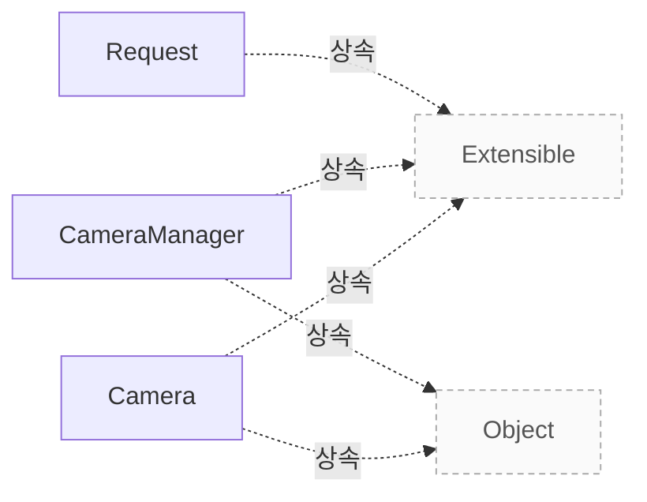

# 카메라와 요청 모델

**클래스의 책임, 요청과 버퍼의 수명, 상태 전이와 종료·동기화 계약을 코드 근거로 확인하세요.**

| 지금 확인할 내용 | 이동할 절 |
|---|---|
| 클래스별 책임 절을 확인합니다. | [클래스별 책임](#클래스별-책임) |
| 상태와 허용 호출 절을 확인합니다. | [상태와 허용 호출](#상태와-허용-호출) |
| 요청 생성과 완료 절을 확인합니다. | [요청 생성과 완료](#요청-생성과-완료) |
| 소유권과 재사용 절을 확인합니다. | [소유권과 재사용](#소유권과-재사용) |
| 오류와 종료 절을 확인합니다. | [오류와 종료](#오류와-종료) |
| 동시성과 실행 확인 절을 확인합니다. | [동시성과 실행 확인](#동시성과-실행-확인) |

## 클래스별 책임

`CameraManager`는 libcamera의 진입점으로, 장치를 열거하고 파이프라인과 연결하며 애플리케이션이 카메라에 접근하도록 합니다. 동시에 존재할 수 있는 인스턴스는 하나입니다. 관리자를 시작해 카메라를 찾고, 애플리케이션이 가진 카메라 참조를 모두 놓은 뒤 관리자를 정지하는 순서를 따릅니다. `src/libcamera/camera_manager.cpp:280`

`Camera`는 하나의 영상 소스에서 나오는 스트림을 구성하고 캡처를 제어하는 객체입니다. 객체 수명은 `std::shared_ptr`로 관리합니다. 생성 경로는 `create()`이며 생성자와 소멸자는 private이므로 객체를 직접 만들거나 파괴하는 방식으로 사용하지 않습니다. `src/libcamera/camera.cpp:758`

`Request`는 한 프레임에 사용할 버퍼와 제어 값을 묶습니다. 애플리케이션이 지정한 `cookie`는 완료 처리에서 외부 자원과 요청을 연결하는 데 사용할 수 있으며, libcamera는 그 값의 의미를 해석하지 않습니다. `src/libcamera/request.cpp:343`

근거 원문: [src/libcamera/camera_manager.cpp:280](#source-fbcf3effd2584b79) · [src/libcamera/camera.cpp:758](#source-6c066281dcce33d6) · [src/libcamera/request.cpp:343](#source-abce7dd469896527)

## 상태와 허용 호출

카메라는 `Available`에서 `acquire()`로 `Acquired`가 되고, `configure()`로 `Configured`가 됩니다. `Configured`에서는 재구성과 요청 생성이 가능하며, `start()`로 `Running`에 들어가야 요청을 제출할 수 있습니다. `src/libcamera/camera.cpp:769`

`createRequest()`는 `Configured`와 `Running`에서 허용되지만 `queueRequest()`는 `Running`에서만 허용됩니다. `stop()`의 실행 경로는 `Running`에서 `Stopping`을 거쳐 `Configured`로 돌아옵니다. `release()`는 `Acquired`나 `Configured`를 `Available`로 돌리고, 이미 `Available`인 상태도 유지할 수 있습니다. `src/libcamera/camera.cpp:769`

카메라를 해제하지 않았다면 시작과 정지를 반복하거나 다시 구성할 수 있습니다. 상태를 바꾸는 함수들은 일반적으로 `Camera` 내부에서 서로 동기화되지 않으므로, 필요한 동기화는 호출자가 책임집니다. `src/libcamera/camera.cpp:769`

근거 원문: [src/libcamera/camera.cpp:769](#source-4b17a07667f3a55d) · [src/libcamera/camera.cpp:1383](#source-617d53c4c7de2c0c)

## 요청 생성과 완료

`createRequest()`는 애플리케이션이 버퍼와 파라미터를 채울 빈 요청을 만듭니다. 호출은 `Configured` 또는 `Running`에서 가능하며, 실패하면 null 포인터를 반환합니다. 반환된 요청의 소유권은 호출자에게 넘어갑니다. `src/libcamera/camera.cpp:1243`

요청에는 스트림마다 버퍼 하나만 연결할 수 있습니다. 같은 스트림의 버퍼를 중복 추가하면 `addBuffer()`가 `-EEXIST`를 반환합니다. 요청은 버퍼 참조를 보관하므로 호출자는 요청 완료 콜백까지 버퍼를 유효하게 유지해야 합니다. `src/libcamera/request.cpp:442`

애플리케이션은 버퍼를 하나 이상 채운 요청을 실행 중인 카메라의 `queueRequest()`에 제출합니다. 버퍼가 없으면 제출을 거절하며, 다른 카메라에서 만든 요청도 사용할 수 없습니다. 제출한 요청의 완료는 별도의 `requestCompleted` 신호로 받습니다. `src/libcamera/camera.cpp:1308`

근거 원문: [src/libcamera/camera.cpp:1243](#source-0ae00d77839f61cb) · [src/libcamera/camera.cpp:1308](#source-28d007de6ad1a8a5) · [src/libcamera/request.cpp:442](#source-95ae69eeb085e3b1)

## 소유권과 재사용

`createRequest()`가 반환한 요청은 호출자가 소유하고 정리합니다. 완료 핸들러에서 요청을 삭제하거나 `reuse()`로 상태를 초기화한 뒤 다시 사용할 수 있습니다. 완료 전에 객체를 파괴해도 된다는 의미는 아닙니다. `src/libcamera/camera.cpp:1243`

`Request::reuse()`는 내부 상태를 재설정하고 요청 상태를 `RequestPending`으로 바꾸며 controls와 metadata를 비웁니다. `ReuseBuffers`를 지정하면 기존 버퍼를 다시 요청과 연결하고 미완료 버퍼 집합에 넣습니다. 지정하지 않으면 버퍼 맵을 비우므로 다음 제출에 필요한 버퍼를 다시 추가해야 합니다. `src/libcamera/request.cpp:376`

`addBuffer()`는 버퍼의 소유권 대신 참조를 저장하므로 버퍼는 요청 완료 콜백까지 살아 있어야 합니다. 유효한 fence를 전달하면 성공한 경우에만 그 소유권이 버퍼로 이동합니다. 모든 버퍼의 fence가 올바르게 신호를 보내기 전에는 요청을 장치에 제출하지 않습니다. `src/libcamera/request.cpp:442`

fence가 신호를 보내지 않아 요청이 타임아웃되면 버퍼에 fence가 남습니다. 애플리케이션은 다른 요청에서 버퍼를 쓰기 전에 `FrameBuffer::releaseFence()`로 이를 회수해야 합니다. fence가 남은 버퍼를 추가하면 `-EEXIST`가 발생합니다. `src/libcamera/request.cpp:442`

`ReuseBuffers`는 기존 버퍼를 재사용하는 플래그이지만 연결된 fence까지 재사용하지는 않습니다. 소스의 계약은 fence를 사용하는 경우 이 플래그를 사용하지 말라고 명시합니다. `src/libcamera/request.cpp:326`

근거 원문: [src/libcamera/camera.cpp:1243](#source-0ae00d77839f61cb) · [src/libcamera/request.cpp:376](#source-38494771cb29cc8c) · [src/libcamera/request.cpp:442](#source-95ae69eeb085e3b1) · [src/libcamera/request.cpp:326](#source-447804db33308244)

## 오류와 종료

`queueRequest()`는 실행 상태 검사 뒤 요청을 만든 카메라가 현재 카메라인지 확인하며, 다르면 `-EXDEV`를 반환합니다. 요청이 `RequestPending`이 아니거나 controls 정보 맵이 카메라의 맵과 다르면 `-EINVAL`을 반환합니다. `src/libcamera/camera.cpp:1308`

`queueRequest()`는 빈 버퍼 목록과 활성 스트림에 속하지 않는 버퍼도 `-EINVAL`로 거절합니다. 검사를 통과하면 `ConnectionTypeQueued`로 파이프라인 호출을 예약하고 0을 반환합니다. 이 성공 반환은 촬영 완료 통지가 아닙니다. `src/libcamera/camera.cpp:1308`

`Camera::stop()`의 실제 구현은 카메라가 실행 중이 아니면 접근 검사 전에 0을 반환합니다. 따라서 주석의 오류 목록만 보고 미실행 상태에서 항상 `-EACCES`가 난다고 해석하면 안 됩니다. `src/libcamera/camera.cpp:1431`

실행 중인 `stop()`은 접근 검사를 통과한 뒤 `Stopping`으로 바꾸고, `ConnectionTypeBlocking`으로 `PipelineHandler::stop()`을 호출합니다. 미완료 요청이 없는지 assertion으로 확인한 다음 `Configured`로 돌아갑니다. API 계약은 대기 요청이 오류 상태로 동기 취소·완료된다고 명시하며, 호출자는 다른 상태 변경 함수와 동기화해야 합니다. `src/libcamera/camera.cpp:1431`

근거 원문: [src/libcamera/camera.cpp:1308](#source-28d007de6ad1a8a5) · [src/libcamera/camera.cpp:1431](#source-e09324743def3f09)

## 동시성과 실행 확인

`createRequest()`는 스레드 안전한 함수이지만 호출 가능한 상태는 `Configured`와 `Running`으로 제한됩니다. 스레드 안전성과 호출 가능한 카메라 상태는 별개의 조건입니다. `src/libcamera/camera.cpp:1243`

`queueRequest()`도 스레드 안전성을 명시하지만 `Running`에서만 호출할 수 있습니다. 이 조건을 만족하지 않은 상태의 제출까지 허용하는 보장은 아닙니다. `src/libcamera/camera.cpp:1308`

`start()`는 `Configured`에서 호출하며, 호출자가 다른 상태 변경 함수와 동기화해야 합니다. `stop()`도 같은 호출자 동기화 책임을 명시하고 파이프라인 정지는 blocking 호출로 수행합니다. `src/libcamera/camera.cpp:1383`

파이프라인의 `completeBuffer()`와 `completeRequest()`는 `CameraManager` 스레드에서 호출하는 계약입니다. 버퍼가 모두 끝나도 요청을 명시적으로 완료해야 하며, `completeRequest()`가 반환한 뒤에는 핸들러가 그 요청에 접근하면 안 됩니다. `src/libcamera/pipeline_handler.cpp:547`

실행 확인 항목: 완료 함수의 호출 스레드 계약만으로 애플리케이션 콜백이 어느 스레드에서 실행되는지까지 확정할 수는 없습니다. 콜백 연결 방식과 실제 장치에서의 동시성 동작은 별도로 확인해야 합니다. `src/libcamera/pipeline_handler.cpp:547`

근거 원문: [src/libcamera/camera.cpp:1243](#source-0ae00d77839f61cb) · [src/libcamera/camera.cpp:1308](#source-28d007de6ad1a8a5) · [src/libcamera/camera.cpp:1383](#source-617d53c4c7de2c0c) · [src/libcamera/camera.cpp:1431](#source-e09324743def3f09) · [src/libcamera/pipeline_handler.cpp:547](#source-01ad7c6605c3296a)

## 연결 해제와 대기 요청

`Camera::Private::disconnect()`는 실행 중이던 카메라를 `Configured`로 바꾸고 연결 해제 플래그를 설정합니다. 주석은 애플리케이션이 자원을 정리하고 카메라를 삭제하기 전에 `release()`를 호출할 수 있도록 하는 전이라고 설명합니다. `src/libcamera/camera.cpp:690`

`Camera::disconnect()`는 내부 연결 해제 처리를 수행한 뒤 `disconnected` 신호를 냅니다. 주석에는 실행 중 연결이 끊겼을 때 대기 요청을 처리하는 일이 TODO로 남아 있으므로, 이를 `stop()`과 같은 동기 취소·완료 보장으로 읽으면 안 됩니다. `src/libcamera/camera.cpp:944`

`isAccessAllowed()`는 `allowDisconnected`가 `false`이고 연결 해제된 경우 `-ENODEV`를 반환합니다. 이 조건을 통과하면 요구 상태 또는 상태 범위를 확인하며, 맞지 않으면 `-EACCES`를 반환합니다. 연결 해제 후 모든 API가 예외 없이 같은 방식으로 거절된다고 일반화하지 않고 각 호출의 허용 조건을 구분해야 합니다. `src/libcamera/camera.cpp:690`

근거 원문: [src/libcamera/camera.cpp:690](#source-ac8ee83f828fe269) · [src/libcamera/camera.cpp:944](#source-2758e9ddd31ad41d)

??? note "설계 질문과 검증 범위"
    질문별 답변과 근거 연결을 검사했습니다. 의미와 실행 결과는 사람 검토가 필요합니다.
    
    | 설계 질문 | 설명 위치 | 확인 범위 |
    |---|---|---|
    | CameraManager, Camera, Request의 책임과 객체 수명은 어떻게 나뉩니까? | [클래스별 책임](#클래스별-책임) | 코드 근거와 설명 연결 |
    | 상태별 허용 호출과 동기화 책임은 어떻게 나뉩니까? | [상태와 허용 호출](#상태와-허용-호출) | 코드 근거와 설명 연결 |
    | 요청 생성부터 완료 통지까지 객체 수명과 호출 순서는 무엇입니까? | [요청 생성과 완료](#요청-생성과-완료) | 코드 근거와 설명 연결 |
    | 요청이 진행 중일 때와 완료된 뒤의 소유권, ReuseBuffers와 fence 규칙은 무엇입니까? | [소유권과 재사용](#소유권과-재사용) | 코드 근거와 설명 연결 |
    | queueRequest의 실패 조건과 stop의 취소·완료·반환 상태는 무엇입니까? | [오류와 종료](#오류와-종료) | 코드 근거와 설명 연결 |
    | threadsafe 보장, 호출자의 동기화 책임과 파이프라인의 완료 통지 계약을 구분하세요. 애플리케이션 콜백 전달 방식과 실기기 검증은 별도로 확인하세요. | [동시성과 실행 확인](#동시성과-실행-확인) | 코드 근거와 설명 연결 · 실행 확인 항목 별도 |
    | 카메라 연결이 끊어지면 상태·API 접근·대기 요청에 어떤 변화와 확인 한계가 있습니까? | [연결 해제와 대기 요청](#연결-해제와-대기-요청) | 코드 근거와 설명 연결 |

## 소스 근거

같은 발췌는 한 번만 싣습니다. 필요한 원문을 펼쳐 설명과 대조하세요.

<a id="source-fbcf3effd2584b79"></a>

??? note "소스 근거: src/libcamera/camera_manager.cpp:280"
    `src/libcamera/camera_manager.cpp:280`에서 시작하는 발췌입니다. 종료 줄은 304이며, 아래 원문을 설명과 대조할 수 있습니다.
    
    SHA-256: `adcd6d49b0c989ec78a81cacece7f6c871a8e0ddf3aa52e42648fae2760a6e84`
    
    ```text
    \class CameraManager
     * \brief Provide access and manage all cameras in the system
     *
     * The camera manager is the entry point to libcamera. It enumerates devices,
     * associates them with pipeline managers, and provides access to the cameras
     * in the system to applications. The manager owns all Camera objects and
     * handles hot-plugging and hot-unplugging to manage the lifetime of cameras.
     *
     * To interact with libcamera, an application starts by creating a camera
     * manager instance. Only a single instance of the camera manager may exist at
     * a time. Attempting to create a second instance without first deleting the
     * existing instance results in undefined behaviour.
     *
     * The manager is initially stopped, and shall be started with start(). This
     * will enumerate all the cameras present in the system, which can then be
     * listed with list() and retrieved with get().
     *
     * Cameras are shared through std::shared_ptr<>, ensuring that a camera will
     * stay valid until the last reference is released without requiring any special
     * action from the application. Once the application has released all the
     * references it held to cameras, the camera manager can be stopped with
     * stop().
     */
    
    CameraManager *CameraManager::self_
    ```

<a id="source-6c066281dcce33d6"></a>

??? note "소스 근거: src/libcamera/camera.cpp:758"
    `src/libcamera/camera.cpp:758`에서 시작하는 발췌입니다. 종료 줄은 769이며, 아래 원문을 설명과 대조할 수 있습니다.
    
    SHA-256: `e77cee469b7c57430e4bd4b0f08493289c46b57549873521c476df388d591dc2`
    
    ```text
    The Camera class models a camera capable of producing one or more image
     * streams from a single image source. It provides the main interface to
     * configuring and controlling the device, and capturing image streams. It is
     * the central object exposed by libcamera.
     *
     * To support the central nature of Camera objects, libcamera manages the
     * lifetime of camera instances with std::shared_ptr<>. Instances shall be
     * created with the create() function which returns a shared pointer. The
     * Camera constructors and destructor are private, to prevent instances from
     * being constructed and destroyed manually.
     *
     * \section camera_operation
    ```

<a id="source-abce7dd469896527"></a>

??? note "소스 근거: src/libcamera/request.cpp:343"
    `src/libcamera/request.cpp:343`에서 시작하는 발췌입니다. 종료 줄은 360이며, 아래 원문을 설명과 대조할 수 있습니다.
    
    SHA-256: `948968e35cb0d98957bc63aa2d6b613d2a8203e66855db23974f035e9d679764`
    
    ```text
    \class Request
     * \brief A frame capture request
     *
     * A Request allows an application to associate buffers and controls on a
     * per-frame basis to be queued to the camera device for processing.
     */
    
    /**
     * \brief Create a capture request for a camera
     * \param[in] camera The camera that creates the request
     * \param[in] cookie Opaque cookie for application use
     *
     * The \a cookie is stored in the request and is accessible through the
     * cookie() function at any time. It is typically used by applications to map
     * the request to an external resource in the request completion handler, and is
     * completely opaque to libcamera.
     */
    Request::Request(Camera *camera, uint64_t cookie)
    ```

<a id="source-4b17a07667f3a55d"></a>

??? note "소스 근거: src/libcamera/camera.cpp:769"
    `src/libcamera/camera.cpp:769`에서 시작하는 발췌입니다. 종료 줄은 814이며, 아래 원문을 설명과 대조할 수 있습니다.
    
    SHA-256: `e85796df194551ecbd587ba1a7bb356a1409fa1d606762865e7eb989c92d2f72`
    
    ```text
    \section camera_operation Operating the Camera
     *
     * An application needs to perform a sequence of operations on a camera before
     * it is ready to process requests. The camera needs to be acquired and
     * configured to prepare the camera for capture. Once started the camera can
     * process requests until it is stopped. When an application is done with a
     * camera, the camera needs to be released.
     *
     * An application may start and stop a camera multiple times as long as it is
     * not released. The camera may also be reconfigured.
     *
     * Functions that affect the camera state as defined below are generally not
     * synchronized with each other by the Camera class. The caller is responsible
     * for ensuring their synchronization if necessary.
     *
     * \subsection Camera States
     *
     * To help manage the sequence of operations needed to control the camera a set
     * of states are defined. Each state describes which operations may be performed
     * on the camera. Performing an operation not allowed in the camera state
     * results in undefined behaviour. Operations not listed at all in the state
     * diagram are allowed in all states.
     *
     * \dot
     * digraph camera_state_machine {
     *   node [shape = doublecircle ]; Available;
     *   node [shape = circle ]; Acquired;
     *   node [shape = circle ]; Configured;
     *   node [shape = circle ]; Stopping;
     *   node [shape = circle ]; Running;
     *
     *   Available -> Available [label = "release()"];
     *   Available -> Acquired [label = "acquire()"];
     *
     *   Acquired -> Available [label = "release()"];
     *   Acquired -> Configured [label = "configure()"];
     *
     *   Configured -> Available [label = "release()"];
     *   Configured -> Configured [label = "configure(), createRequest()"];
     *   Configured -> Running [label = "start()"];
     *
     *   Running -> Stopping [label = "stop()"];
     *   Stopping -> Configured;
     *   Running -> Running [label = "createRequest(), queueRequest()"];
     * }
     * \enddot
    ```

<a id="source-617d53c4c7de2c0c"></a>

??? note "소스 근거: src/libcamera/camera.cpp:1383"
    `src/libcamera/camera.cpp:1383`에서 시작하는 발췌입니다. 종료 줄은 1400이며, 아래 원문을 설명과 대조할 수 있습니다.
    
    SHA-256: `e0abda64dc6b1bdd78d1326c8dd8651e842c03181dcf28e3b8b7eac1a4c70fcf`
    
    ```text
    \brief Start capture from camera
     * \param[in] controls Controls to be applied before starting the Camera
     *
     * Start the camera capture session, optionally providing a list of controls to
     * apply before starting. Once the camera is started the application can queue
     * requests to the camera to process and return to the application until the
     * capture session is terminated with \a stop().
     *
     * \context This function may only be called when the camera is in the
     * Configured state as defined in \ref camera_operation, and shall be
     * synchronized by the caller with other functions that affect the camera
     * state.
     *
     * \return 0 on success or a negative error code otherwise
     * \retval -ENODEV The camera has been disconnected from the system
     * \retval -EACCES The camera is not in a state where it can be started
     */
    int Camera::start(const ControlList *controls)
    ```

<a id="source-0ae00d77839f61cb"></a>

??? note "소스 근거: src/libcamera/camera.cpp:1243"
    `src/libcamera/camera.cpp:1243`에서 시작하는 발췌입니다. 종료 줄은 1263이며, 아래 원문을 설명과 대조할 수 있습니다.
    
    SHA-256: `9f251ecf5ba569606e9753d3619b88e1aef5a4ce15f816ae97efd283e34b823b`
    
    ```text
    \brief Create a request object for the camera
     * \param[in] cookie Opaque cookie for application use
     *
     * This function creates an empty request for the application to fill with
     * buffers and parameters, and queue for capture.
     *
     * The \a cookie is stored in the request and is accessible through the
     * Request::cookie() function at any time. It is typically used by applications
     * to map the request to an external resource in the request completion
     * handler, and is completely opaque to libcamera.
     *
     * The ownership of the returned request is passed to the caller, which is
     * responsible for deleting it. The request may be deleted in the completion
     * handler, or reused after resetting its state with Request::reuse().
     *
     * \context This function is \threadsafe. It may only be called when the camera
     * is in the Configured or Running state as defined in \ref camera_operation.
     *
     * \return A pointer to the newly created request, or nullptr on error
     */
    std::unique_ptr<Request> Camera::createRequest(uint64_t cookie)
    ```

<a id="source-28d007de6ad1a8a5"></a>

??? note "소스 근거: src/libcamera/camera.cpp:1308"
    `src/libcamera/camera.cpp:1308`에서 시작하는 발췌입니다. 종료 줄은 1383이며, 아래 원문을 설명과 대조할 수 있습니다.
    
    SHA-256: `96db61baeb32065c966b20942f97518ddbd3a43b36b64e8083eb29a90ecb7f4b`
    
    ```text
    \brief Queue a request to the camera
     * \param[in] request The request to queue to the camera
     *
     * This function queues a \a request to the camera for capture.
     *
     * After allocating the request with createRequest(), the application shall
     * fill it with at least one capture buffer before queuing it. Requests that
     * contain no buffers are invalid and are rejected without being queued.
     *
     * Once the request has been queued, the camera will notify its completion
     * through the \ref requestCompleted signal.
     *
     * \context This function is \threadsafe. It may only be called when the camera
     * is in the Running state as defined in \ref camera_operation.
     *
     * \return 0 on success or a negative error code otherwise
     * \retval -ENODEV The camera has been disconnected from the system
     * \retval -EACCES The camera is not running so requests can't be queued
     * \retval -EXDEV The request does not belong to this camera
     * \retval -EINVAL The request is invalid
     * \retval -ENOMEM No buffer memory was available to handle the request
     */
    int Camera::queueRequest(Request *request)
    {
    	Private *const d = _d();
    
    	int ret = d->isAccessAllowed(Private::CameraRunning);
    	if (ret < 0)
    		return ret;
    
    	/* Requests can only be queued to the camera that created them. */
    	if (request->_d()->camera() != this) {
    		LOG(Camera, Error) << "Request was not created by this camera";
    		return -EXDEV;
    	}
    
    	if (request->status() != Request::RequestPending) {
    		LOG(Camera, Error) << request->toString() << " is not valid";
    		return -EINVAL;
    	}
    
    	/* Make sure the Request has a valid control list. */
    	if (request->controls().infoMap() != &controls()) {
    		LOG(Camera, Error) << "Overwriting Request::controls() is not allowed";
    		return -EINVAL;
    	}
    
    	/*
    	 * The camera state may change until the end of the function. No locking
    	 * is however needed as PipelineHandler::queueRequest() will handle
    	 * this.
    	 */
    
    	if (request->buffers().empty()) {
    		LOG(Camera, Error) << "Request contains no buffers";
    		return -EINVAL;
    	}
    
    	for (const auto &[stream, buffer] : request->buffers()) {
    		if (d->activeStreams_.find(stream) == d->activeStreams_.end()) {
    			LOG(Camera, Error) << "Invalid request";
    			return -EINVAL;
    		}
    	}
    
    	/* Pre-process AeEnable. */
    	patchControlList(request->controls());
    
    	d->pipe_->invokeMethod(&PipelineHandler::queueRequest,
    			       ConnectionTypeQueued, request);
    
    	return 0;
    }
    
    /**
     * \brief Start capture from camera
    ```

<a id="source-95ae69eeb085e3b1"></a>

??? note "소스 근거: src/libcamera/request.cpp:442"
    `src/libcamera/request.cpp:442`에서 시작하는 발췌입니다. 종료 줄은 475이며, 아래 원문을 설명과 대조할 수 있습니다.
    
    SHA-256: `65cd8b0501b7f6545dd10eaaec4a4fe46c52a096a3bbd94ea6b4813e4a670876`
    
    ```text
    \brief Add a FrameBuffer with its associated Stream to the Request
     * \param[in] stream The stream the buffer belongs to
     * \param[in] buffer The FrameBuffer to add to the request
     * \param[in] fence The optional fence
     *
     * A reference to the buffer is stored in the request. The caller is responsible
     * for ensuring that the buffer will remain valid until the request complete
     * callback is called.
     *
     * A request can only contain one buffer per stream. If a buffer has already
     * been added to the request for the same stream, this function returns -EEXIST.
     *
     * A Fence can be optionally associated with the \a buffer.
     *
     * When a valid Fence is provided to this function, \a fence is moved to \a
     * buffer and this Request will only be queued to the device once the
     * fences of all its buffers have been correctly signalled. Ownership of the
     * fence will only be taken in case of success, otherwise the fence will
     * be left unmodified.
     *
     * If the \a fence associated with \a buffer isn't signalled, the request will
     * fail after a timeout. The buffer will still contain the fence, which
     * applications must retrieve with FrameBuffer::releaseFence() before the buffer
     * can be reused in another request. Attempting to add a buffer that still
     * contains a fence to a request will result in this function returning -EEXIST.
     *
     * \sa FrameBuffer::releaseFence()
     *
     * \return 0 on success or a negative error code otherwise
     * \retval -EEXIST The request already contains a buffer for the stream
     *  or the buffer still references a fence
     * \retval -EINVAL The buffer does not reference a valid Stream
     */
    int Request::addBuffer(const Stream *stream, FrameBuffer *buffer,
    ```

<a id="source-38494771cb29cc8c"></a>

??? note "소스 근거: src/libcamera/request.cpp:376"
    `src/libcamera/request.cpp:376`에서 시작하는 발췌입니다. 종료 줄은 407이며, 아래 원문을 설명과 대조할 수 있습니다.
    
    SHA-256: `22294a6809bd4c6655824af9603fb3879603cec256c6845e00d3d2a0e6bf7679`
    
    ```text
    \brief Reset the request for reuse
     * \param[in] flags Indicate whether or not to reuse the buffers
     *
     * Reset the status and controls associated with the request, to allow it to
     * be reused and requeued without destruction. This function shall be called
     * prior to queueing the request to the camera, in lieu of constructing a new
     * request. The application can reuse the buffers that were previously added
     * to the request via addBuffer() by setting \a flags to ReuseBuffers.
     */
    void Request::reuse(ReuseFlag flags)
    {
    	LIBCAMERA_TRACEPOINT(request_reuse, this);
    
    	_d()->reset();
    
    	if (flags & ReuseBuffers) {
    		for (const auto &[stream, buffer] : bufferMap_) {
    			buffer->_d()->setRequest(this);
    			_d()->pending_.insert(buffer);
    		}
    	} else {
    		bufferMap_.clear();
    	}
    
    	status_ = RequestPending;
    
    	controls_.clear();
    	_d()->metadata_.clear();
    }
    
    /**
     * \fn Request::controls()
    ```

<a id="source-447804db33308244"></a>

??? note "소스 근거: src/libcamera/request.cpp:326"
    `src/libcamera/request.cpp:326`에서 시작하는 발췌입니다. 종료 줄은 338이며, 아래 원문을 설명과 대조할 수 있습니다.
    
    SHA-256: `9e55d8335a38080c0af78cf267bac78c573636447425e25d394e5b206217e7fe`
    
    ```text
    \enum Request::ReuseFlag
     * Flags to control the behavior of Request::reuse()
     * \var Request::Default
     * Don't reuse buffers
     * \var Request::ReuseBuffers
     * Reuse the buffers that were previously added by addBuffer()
     *
     * \note Fences associated with the buffers are not reused.
     *  This flag should not be used if fences are used.
     */
    
    /**
     * \typedef Request::BufferMap
    ```

<a id="source-e09324743def3f09"></a>

??? note "소스 근거: src/libcamera/camera.cpp:1431"
    `src/libcamera/camera.cpp:1431`에서 시작하는 발췌입니다. 종료 줄은 1475이며, 아래 원문을 설명과 대조할 수 있습니다.
    
    SHA-256: `0009c665993b995489738e48affc81643a7159d82b5326e5f182e30fe11e4901`
    
    ```text
    \brief Stop capture from camera
     *
     * This function stops capturing and processing requests immediately. All
     * pending requests are cancelled and complete synchronously in an error state.
     *
     * \context This function may be called in any camera state as defined in \ref
     * camera_operation, and shall be synchronized by the caller with other
     * functions that affect the camera state. If called when the camera isn't
     * running, it is a no-op.
     *
     * \return 0 on success or a negative error code otherwise
     * \retval -ENODEV The camera has been disconnected from the system
     * \retval -EACCES The camera is not running so can't be stopped
     */
    int Camera::stop()
    {
    	Private *const d = _d();
    
    	/*
    	 * \todo Make calling stop() when not in 'Running' part of the state
    	 * machine rather than take this shortcut
    	 */
    	if (!d->isRunning())
    		return 0;
    
    	int ret = d->isAccessAllowed(Private::CameraRunning);
    	if (ret < 0)
    		return ret;
    
    	LOG(Camera, Debug) << "Stopping capture";
    
    	d->setState(Private::CameraStopping);
    
    	d->pipe_->invokeMethod(&PipelineHandler::stop, ConnectionTypeBlocking,
    			       this);
    
    	ASSERT(!d->pipe_->hasPendingRequests(this));
    
    	d->setState(Private::CameraConfigured);
    
    	return 0;
    }
    
    /**
     * \brief Handle request completion and notify application
    ```

<a id="source-01ad7c6605c3296a"></a>

??? note "소스 근거: src/libcamera/pipeline_handler.cpp:547"
    `src/libcamera/pipeline_handler.cpp:547`에서 시작하는 발췌입니다. 종료 줄은 620이며, 아래 원문을 설명과 대조할 수 있습니다.
    
    SHA-256: `514288cc958de9ff5fd19d46393cec3bb3088f4f08486528d4559071138638c9`
    
    ```text
    \brief Complete a buffer for a request
     * \param[in] request The request the buffer belongs to
     * \param[in] buffer The buffer that has completed
     *
     * This function shall be called by pipeline handlers to signal completion of
     * the \a buffer part of the \a request. It notifies applications of buffer
     * completion and updates the request's internal buffer tracking. The request
     * is not completed automatically when the last buffer completes to give
     * pipeline handlers a chance to perform any operation that may still be
     * needed. They shall complete requests explicitly with completeRequest().
     *
     * \context This function shall be called from the CameraManager thread.
     *
     * \return True if all buffers contained in the request have completed, false
     * otherwise
     */
    bool PipelineHandler::completeBuffer(Request *request, FrameBuffer *buffer)
    {
    	Camera *camera = request->_d()->camera();
    	camera->bufferCompleted.emit(request, buffer);
    	return request->_d()->completeBuffer(buffer);
    }
    
    /**
     * \brief Signal request completion
     * \param[in] request The request that has completed
     *
     * The pipeline handler shall call this function to notify the \a camera that
     * the request has completed. The request is no longer managed by the pipeline
     * handler and shall not be accessed once this function returns.
     *
     * This function ensures that requests will be returned to the application in
     * submission order, the pipeline handler may call it on any complete request
     * without any ordering constraint.
     *
     * \context This function shall be called from the CameraManager thread.
     */
    void PipelineHandler::completeRequest(Request *request)
    {
    	Camera *camera = request->_d()->camera();
    
    	request->_d()->complete();
    
    	Camera::Private *data = camera->_d();
    
    	while (!data->queuedRequests_.empty()) {
    		Request *req = data->queuedRequests_.front();
    		if (req->status() == Request::RequestPending)
    			break;
    
    		ASSERT(!req->hasPendingBuffers());
    		data->queuedRequests_.pop_front();
    		camera->requestComplete(req);
    	}
    
    	/* Allow any waiting requests to be queued to the pipeline. */
    	doQueueRequests(camera);
    }
    
    /**
     * \brief Cancel request and signal its completion
     * \param[in] request The request to cancel
     *
     * This function cancels and completes the request. The same rules as for
     * completeRequest() apply.
     */
    void PipelineHandler::cancelRequest(Request *request)
    {
    	request->_d()->cancel();
    	completeRequest(request);
    }
    
    /**
     * \brief Retrieve the absolute path to a platform configuration file
    ```

<a id="source-ac8ee83f828fe269"></a>

??? note "소스 근거: src/libcamera/camera.cpp:690"
    `src/libcamera/camera.cpp:690`에서 시작하는 발췌입니다. 종료 줄은 745이며, 아래 원문을 설명과 대조할 수 있습니다.
    
    SHA-256: `1e0ac0e45422136580c0722ca5a356f17a7c0b8ae18dbb64090f7734afdbfaae`
    
    ```text
    int Camera::Private::isAccessAllowed(State state, bool allowDisconnected,
    				     const char *from) const
    {
    	if (!allowDisconnected && disconnected_)
    		return -ENODEV;
    
    	State currentState = state_.load(std::memory_order_acquire);
    	if (currentState == state)
    		return 0;
    
    	ASSERT(static_cast<unsigned int>(state) < std::size(camera_state_names));
    
    	LOG(Camera, Error) << "Camera in " << camera_state_names[currentState]
    			   << " state trying " << from << "() requiring state "
    			   << camera_state_names[state];
    
    	return -EACCES;
    }
    
    int Camera::Private::isAccessAllowed(State low, State high,
    				     bool allowDisconnected,
    				     const char *from) const
    {
    	if (!allowDisconnected && disconnected_)
    		return -ENODEV;
    
    	State currentState = state_.load(std::memory_order_acquire);
    	if (currentState >= low && currentState <= high)
    		return 0;
    
    	ASSERT(static_cast<unsigned int>(low) < std::size(camera_state_names) &&
    	       static_cast<unsigned int>(high) < std::size(camera_state_names));
    
    	LOG(Camera, Error) << "Camera in " << camera_state_names[currentState]
    			   << " state trying " << from
    			   << "() requiring state between "
    			   << camera_state_names[low] << " and "
    			   << camera_state_names[high];
    
    	return -EACCES;
    }
    
    void Camera::Private::disconnect()
    {
    	/*
    	 * If the camera was running when the hardware was removed force the
    	 * state to Configured state to allow applications to free resources
    	 * and call release() before deleting the camera.
    	 */
    	if (state_.load(std::memory_order_acquire) == Private::CameraRunning)
    		state_.store(Private::CameraConfigured, std::memory_order_release);
    
    	disconnected_ = true;
    }
    
    void Camera::Private::setState(State state)
    ```

<a id="source-2758e9ddd31ad41d"></a>

??? note "소스 근거: src/libcamera/camera.cpp:944"
    `src/libcamera/camera.cpp:944`에서 시작하는 발췌입니다. 종료 줄은 963이며, 아래 원문을 설명과 대조할 수 있습니다.
    
    SHA-256: `cbc12aaba21898e519c8599faec5e998b408162912a507880b162ee6787cf8b0`
    
    ```text
    \brief Notify camera disconnection
     *
     * This function is used to notify the camera instance that the underlying
     * hardware has been unplugged. In response to the disconnection the camera
     * instance notifies the application by emitting the #disconnected signal, and
     * ensures that all new calls to the application-facing Camera API return an
     * error immediately.
     *
     * \todo Deal with pending requests if the camera is disconnected in a
     * running state.
     */
    void Camera::disconnect()
    {
    	LOG(Camera, Debug) << "Disconnecting camera " << id();
    
    	_d()->disconnect();
    	disconnected.emit();
    }
    
    int Camera::exportFrameBuffers(Stream *stream,
    ```


<!-- sdd:class-diagram -->
## 클래스 관계

화살표의 글자는 추출한 관계를 나타내며, 점선은 상속입니다. 화살표는 참조 대상 또는 기반 클래스를 향합니다. 호출 순서를 뜻하지 않습니다.


<!-- /sdd:class-diagram -->


## 관련 클래스

| 클래스 | 선언 위치 | 상속 | 책임 (주석) |
|---|---|---|---|
| `libcamera::Camera` | `include/libcamera/camera.h:114` | `libcamera::Object`, `libcamera::Extensible` | Camera device |
| `libcamera::CameraManager` | `include/libcamera/camera_manager.h:24` | `libcamera::Object`, `libcamera::Extensible` | Provide access and manage all cameras in the system |
| `libcamera::Request` | `include/libcamera/request.h:29` | `libcamera::Extensible` | A frame capture request |

??? note "근거와 검토 정보"
    - 생성 방식: 추출 사실과 LLM 설명
    - 검증 범위: 표·그림은 facts로 만들고 설명은 LLM이 작성합니다. 인용·문장 및 설정된 구조 검사를 적용합니다.
    - 근거 파일: `include/libcamera/camera.h`, `include/libcamera/camera_manager.h`, `include/libcamera/request.h`, `src/libcamera/camera.cpp`, `src/libcamera/camera_manager.cpp`, `src/libcamera/pipeline_handler.cpp`, `src/libcamera/request.cpp`
    - 근거 수준: 코드 확인 (정적 분석, simple_compdb 구성, commit `2c4b67c079`)
    - 자동 검사 (인용·문장 및 설정된 구조 검사): 통과
    - 검토 상태 기록일: 2026-10-24 · 사람 검토 전

다음 단계: [Pipeline Handler](pipeline-handler.md)
