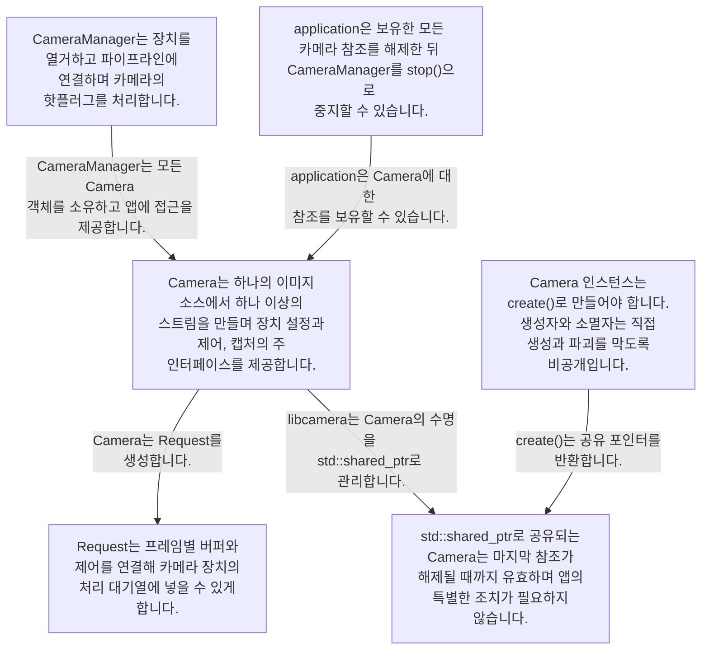
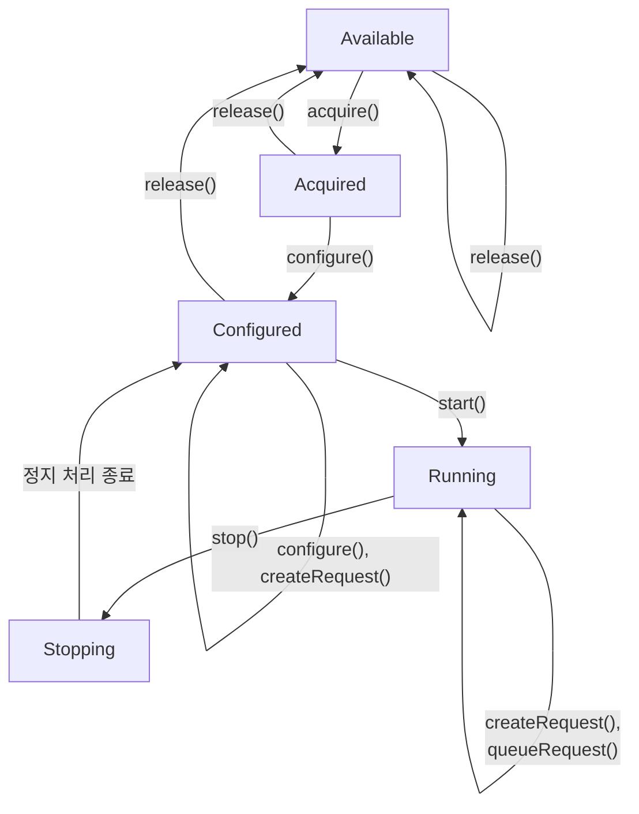
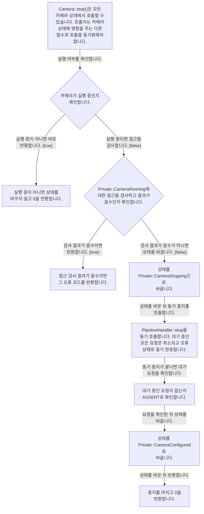
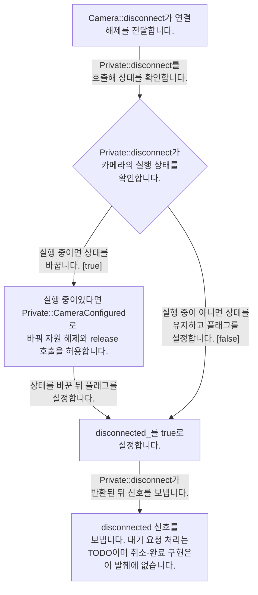
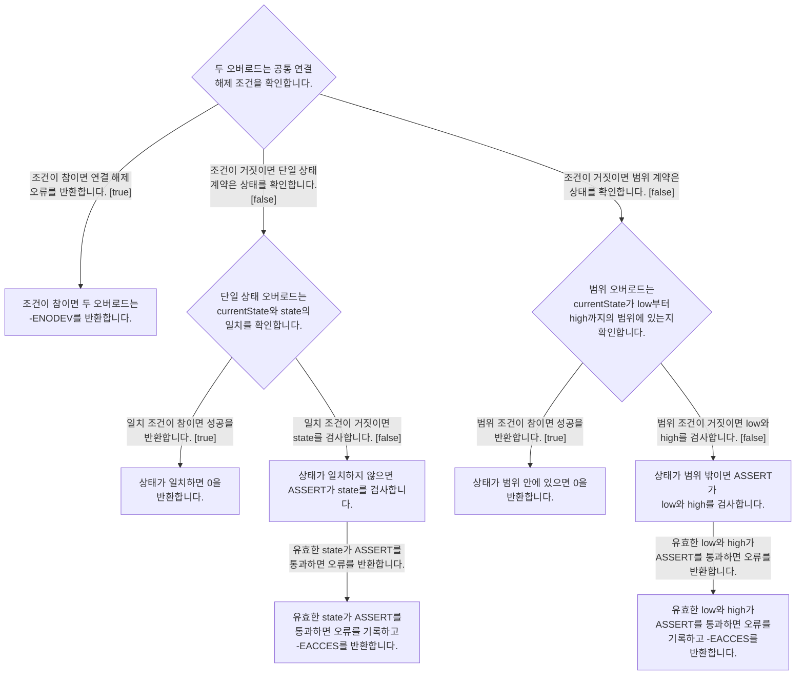
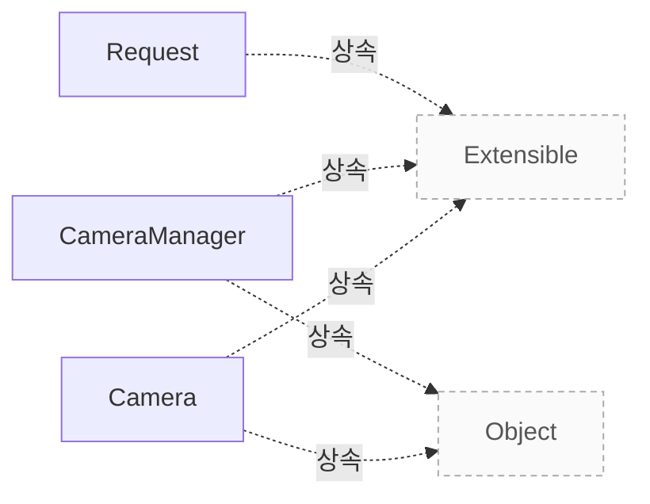

# 카메라와 요청 모델

**클래스의 책임, 요청과 버퍼의 수명, 상태 전이와 종료·동기화 계약을 코드 근거로 확인하세요.**

| 지금 확인할 내용 | 이동할 절 |
|---|---|
| <a id="요청-생성과-완료"></a>요청 생성과 완료의 조건과 근거를 대조하세요. | [요청 객체와 버퍼 수명](camera-requests.md#요청-생성과-완료) |
| <a id="소유권과-재사용"></a>소유권과 재사용의 조건과 근거를 대조하세요. | [요청 객체와 버퍼 수명](camera-requests.md#소유권과-재사용) |
| <a id="요청과-버퍼를-유지할-기간"></a>“요청과 버퍼를 유지할 기간” 그림을 확인하세요. | [요청 객체와 버퍼 수명](camera-requests.md#요청과-버퍼를-유지할-기간) |

## 클래스별 책임

`CameraManager`는 장치를 열거하고 파이프라인 관리자와 연결하며, 애플리케이션에 카메라 접근을 제공하고 카메라 객체를 소유하면서 핫플러그와 핫언플러그에 따른 수명을 관리하는 libcamera의 진입점입니다. `CameraManager` 인스턴스는 한 번에 하나만 존재할 수 있으며, 기존 인스턴스를 삭제하기 전에 추가 인스턴스를 만들면 동작이 정의되지 않습니다. `src/libcamera/camera_manager.cpp:280`

<!-- sdd:visual:item-responsibility -->
### 클래스별 책임의 관계와 경계



[Mermaid 원문](camera-model.item-responsibility.mmd)

??? note "그림 근거와 확인 범위"
    CameraManager, Camera, Request의 책임과 Camera의 공유 수명은 어떻게 나뉘는가?
    
    소스에 연결한 설계 해석입니다. 자동 연결 검사는 의미 승인이나 기기 실행 검증이 아닙니다.
    
    LLM 그림 초안 · 사람 검토 전
    
    작성 모델: `cli/codex/gpt-6.1-terra`
    
    | 요소·전이 | 소스 근거 |
    |---|---|
    | <span data-sdd-label-en="CameraManager enumerates devices, links pipelines, and handles camera hot-plugging.">CameraManager는 장치를 열거하고 파이프라인에 연결하며 카메라의 핫플러그를 처리합니다.</span> | [src/libcamera/camera_manager.cpp:280](#source-fbcf3effd2584b79) |
    | <span data-sdd-label-en="Camera models a single-source device and provides the main interface to control and capture.">Camera는 하나의 이미지 소스에서 하나 이상의 스트림을 만들며 장치 설정과 제어, 캡처의 주 인터페이스를 제공합니다.</span> | [src/libcamera/camera.cpp:758](#source-6c066281dcce33d6) |
    | <span data-sdd-label-en="Request associates per-frame buffers and controls for queuing to the camera device.">Request는 프레임별 버퍼와 제어를 연결해 카메라 장치의 처리 대기열에 넣을 수 있게 합니다.</span> | [src/libcamera/request.cpp:343](#source-abce7dd469896527) |
    | <span data-sdd-label-en="A Camera shared by std::shared_ptr stays valid until its last reference is released.">std::shared&#95;ptr로 공유되는 Camera는 마지막 참조가 해제될 때까지 유효하며 앱의 특별한 조치가 필요하지 않습니다.</span> | [src/libcamera/camera_manager.cpp:280](#source-fbcf3effd2584b79) · [src/libcamera/camera.cpp:758](#source-6c066281dcce33d6) |
    | <span data-sdd-label-en="Camera instances must use create(); private constructors and destructor prevent manual use.">Camera 인스턴스는 create&#40;&#41;로 만들어야 합니다. 생성자와 소멸자는 직접 생성과 파괴를 막도록 비공개입니다.</span> | [src/libcamera/camera.cpp:758](#source-6c066281dcce33d6) |
    | <span data-sdd-label-en="The application can stop CameraManager after releasing all camera references it held.">application은 보유한 모든 카메라 참조를 해제한 뒤 CameraManager를 stop&#40;&#41;으로 중지할 수 있습니다.</span> | [src/libcamera/camera_manager.cpp:280](#source-fbcf3effd2584b79) |
    | <span data-sdd-label-en="CameraManager owns all Camera objects and provides access to them.">CameraManager는 모든 Camera 객체를 소유하고 앱에 접근을 제공합니다.</span> | [src/libcamera/camera_manager.cpp:280](#source-fbcf3effd2584b79) |
    | <span data-sdd-label-en="Camera creates a Request.">Camera는 Request를 생성합니다.</span> | [src/libcamera/request.cpp:343](#source-abce7dd469896527) |
    | <span data-sdd-label-en="libcamera manages Camera lifetime with std::shared_ptr.">libcamera는 Camera의 수명을 std::shared&#95;ptr로 관리합니다.</span> | [src/libcamera/camera.cpp:758](#source-6c066281dcce33d6) |
    | <span data-sdd-label-en="create() returns a shared pointer.">create&#40;&#41;는 공유 포인터를 반환합니다.</span> | [src/libcamera/camera.cpp:758](#source-6c066281dcce33d6) |
    | <span data-sdd-label-en="An application may hold references to Camera objects.">application은 Camera에 대한 참조를 보유할 수 있습니다.</span> | [src/libcamera/camera_manager.cpp:280](#source-fbcf3effd2584b79) |
<!-- /sdd:visual:item-responsibility -->

`Camera`는 단일 이미지 소스에서 하나 이상의 이미지 스트림을 생성할 수 있는 카메라를 모델링하며, 장치의 설정과 제어 및 이미지 스트림 캡처를 위한 주요 인터페이스입니다. libcamera는 `std::shared_ptr`로 카메라 인스턴스의 수명을 관리하며, 인스턴스는 공유 포인터를 반환하는 `create()`로 생성해야 합니다. `Camera`의 생성자와 소멸자는 수동 생성과 파괴를 막기 위해 비공개입니다. `Request`는 애플리케이션이 프레임마다 버퍼와 컨트롤을 연결하고 카메라 장치의 처리를 위해 큐에 넣을 수 있게 하는 객체입니다. `src/libcamera/camera.cpp:758`, `src/libcamera/request.cpp:343`

`Request` 생성자에 전달한 `cookie`는 요청에 저장되는 애플리케이션용 불투명 값이며, 언제든지 `cookie()`로 읽을 수 있습니다. `src/libcamera/request.cpp:343`

근거 원문: [src/libcamera/camera_manager.cpp:280](#source-fbcf3effd2584b79) · [src/libcamera/camera.cpp:758](#source-6c066281dcce33d6) · [src/libcamera/request.cpp:343](#source-abce7dd469896527)

## 상태와 허용 호출

카메라가 `Available` 상태에서 `acquire()`에 성공하면 `Acquired` 상태가 됩니다. `src/libcamera/camera.cpp:769`

<!-- sdd:visual:camera-states -->
### 카메라 상태와 허용 호출



[Mermaid 원문](camera-model.camera-states.mmd)

??? note "그림 근거와 확인 범위"
    성공한 상태 전이와 상태를 유지하는 호출을 구분하세요. 상태 변경 함수의 동기화는 호출자가 책임집니다.
    
    소스에 연결한 설계 해석입니다. 자동 연결 검사는 의미 승인이나 기기 실행 검증이 아닙니다.
    
    | 요소·전이 | 소스 근거 |
    |---|---|
    | <span data-sdd-label-en="Available">Available</span> | [src/libcamera/camera.cpp:769](#source-4b17a07667f3a55d) |
    | <span data-sdd-label-en="Acquired">Acquired</span> | [src/libcamera/camera.cpp:769](#source-4b17a07667f3a55d) |
    | <span data-sdd-label-en="Configured">Configured</span> | [src/libcamera/camera.cpp:769](#source-4b17a07667f3a55d) |
    | <span data-sdd-label-en="Running">Running</span> | [src/libcamera/camera.cpp:769](#source-4b17a07667f3a55d) |
    | <span data-sdd-label-en="Stopping">Stopping</span> | [src/libcamera/camera.cpp:769](#source-4b17a07667f3a55d) |
    | <span data-sdd-label-en="release()">release&#40;&#41;</span> | [src/libcamera/camera.cpp:769](#source-4b17a07667f3a55d) |
    | <span data-sdd-label-en="acquire()">acquire&#40;&#41;</span> | [src/libcamera/camera.cpp:769](#source-4b17a07667f3a55d) |
    | <span data-sdd-label-en="release()">release&#40;&#41;</span> | [src/libcamera/camera.cpp:769](#source-4b17a07667f3a55d) |
    | <span data-sdd-label-en="configure()">configure&#40;&#41;</span> | [src/libcamera/camera.cpp:769](#source-4b17a07667f3a55d) |
    | <span data-sdd-label-en="release()">release&#40;&#41;</span> | [src/libcamera/camera.cpp:769](#source-4b17a07667f3a55d) |
    | <span data-sdd-label-en="configure(), createRequest()">configure&#40;&#41;, createRequest&#40;&#41;</span> | [src/libcamera/camera.cpp:769](#source-4b17a07667f3a55d) |
    | <span data-sdd-label-en="start()">start&#40;&#41;</span> | [src/libcamera/camera.cpp:769](#source-4b17a07667f3a55d) |
    | <span data-sdd-label-en="stop()">stop&#40;&#41;</span> | [src/libcamera/camera.cpp:769](#source-4b17a07667f3a55d) |
    | <span data-sdd-label-en="stop finished">정지 처리 종료</span> | [src/libcamera/camera.cpp:769](#source-4b17a07667f3a55d) |
    | <span data-sdd-label-en="createRequest(), queueRequest()">createRequest&#40;&#41;, queueRequest&#40;&#41;</span> | [src/libcamera/camera.cpp:769](#source-4b17a07667f3a55d) |
<!-- /sdd:visual:camera-states -->

`Camera::configure()`는 `CameraAcquired`부터 `CameraConfigured`까지의 접근을 검사해 결과가 음수이면 그 값을 반환하고, 각 설정의 스트림을 `nullptr`로 설정한 뒤 `validate()`가 `CameraConfiguration::Valid`가 아니면 `-EINVAL`을 반환합니다. 이후 `PipelineHandler::configure`의 반환값이 0이 아니면 그 값을 반환하고, 성공하면 활성 스트림을 비운 뒤 각 설정의 `cfg.stream()`을 확인합니다. 스트림이 null이면 `LOG`로 `Fatal` 메시지를 출력하고 그 뒤 활성 스트림을 비우고 `-EINVAL`을 반환하는 구문이 있지만, `Fatal` 로그는 메시지 출력 직후 프로그램을 종료하며, 모든 스트림 처리를 마치면 상태를 `Configured`로 설정하고 0을 반환합니다. `src/libcamera/camera.cpp:1237`, `src/libcamera/base/log.cpp:1022`

`Configured` 상태에서 `start()`가 성공하면 카메라는 `Running` 상태가 됩니다. 카메라는 `Running` 상태에서 `stop()`을 호출하면 `Stopping` 상태로 진입합니다. 카메라는 `Stopping` 상태에서 정지 처리가 끝나면 `Configured` 상태로 돌아갑니다. `release()`는 `Available` 상태에서는 상태를 유지하고, `Acquired` 또는 `Configured` 상태에서는 `Available`로 바꿉니다. `src/libcamera/camera.cpp:769`

호출자는 카메라가 `Configured` 또는 `Running` 상태일 때만 `Camera::createRequest()`를 호출할 수 있습니다. 호출자는 카메라가 `Running` 상태일 때만 `Camera::queueRequest`를 호출할 수 있습니다. 카메라가 실행 중이 아니어서 요청을 큐에 넣을 수 없으면 `-EACCES`를 반환합니다. `Camera::start()`는 카메라가 `Configured` 상태일 때만 호출할 수 있습니다. `src/libcamera/camera.cpp:1258`, `src/libcamera/camera.cpp:1320`, `src/libcamera/camera.cpp:1383`

`Camera` 클래스는 카메라 상태에 영향을 주는 함수들을 일반적으로 서로 동기화하지 않습니다. 호출자는 필요한 경우 이 함수들이 동기화되도록 해야 합니다. `src/libcamera/camera.cpp:780`

근거 원문: [src/libcamera/camera.cpp:769](#source-4b17a07667f3a55d) · [src/libcamera/camera.cpp:1383](#source-617d53c4c7de2c0c) · [src/libcamera/camera.cpp:1258](#source-8f791427a31c3313) · [src/libcamera/camera.cpp:1320](#source-e0caa8c16f728202) · [src/libcamera/camera.cpp:780](#source-cc6c66b57cf028e6) · [src/libcamera/camera.cpp:1237](#source-077fcae46087aee0) · [src/libcamera/base/log.cpp:1022](#source-47a6ef3943a7b53c)

## 오류와 종료

`Camera::queueRequest()`는 캡처 요청을 큐에 넣는 데 성공하면 `0`을 반환하고, 실패하면 음수 오류 코드를 반환합니다. 카메라가 시스템에서 분리되면 `-ENODEV`, 카메라가 실행 중이 아니면 `-EACCES`, 요청을 처리할 버퍼 메모리가 없으면 `-ENOMEM`을 반환합니다. 실행 상태를 확인하는 `isAccessAllowed(Private::CameraRunning)`의 결과가 음수이면 그 값을 그대로 반환합니다. `src/libcamera/camera.cpp:1308`

<!-- sdd:visual:stop-running-and-noop -->
### stop의 즉시 반환과 실행 중 정리



[Mermaid 원문](camera-model.stop-running-and-noop.mmd)

??? note "그림 근거와 확인 범위"
    Camera::stop()은 실행 중이 아닐 때 무엇을 유지하고, 실행 중일 때 접근 검사·정지·대기 요청·상태 변경을 어떤 순서로 처리합니까?
    
    소스에 연결한 설계 해석입니다. 자동 연결 검사는 의미 승인이나 기기 실행 검증이 아닙니다.
    
    LLM 그림 초안 · 사람 검토 전
    
    작성 모델: `cli/codex/gpt-6.1-terra`
    
    | 요소·전이 | 소스 근거 |
    |---|---|
    | <span data-sdd-label-en="Camera::stop() may be called in any camera state. The caller must synchronize it with other functions that affect the camera state.">Camera::stop&#40;&#41;은 모든 카메라 상태에서 호출할 수 있습니다. 호출자는 카메라 상태에 영향을 주는 다른 함수와 호출을 동기화해야 합니다.</span> | [src/libcamera/camera.cpp:1431](#source-e09324743def3f09) |
    | <span data-sdd-label-en="Check whether the camera is running.">카메라가 실행 중인지 확인합니다.</span> | [src/libcamera/camera.cpp:1431](#source-e09324743def3f09) |
    | <span data-sdd-label-en="If the camera is not running, return 0 without changing its state.">실행 중이 아니면 상태를 바꾸지 않고 0을 반환합니다.</span> | [src/libcamera/camera.cpp:1431](#source-e09324743def3f09) |
    | <span data-sdd-label-en="Check access for Private::CameraRunning and whether the result is negative.">Private::CameraRunning에 대한 접근을 검사하고 결과가 음수인지 확인합니다.</span> | [src/libcamera/camera.cpp:1431](#source-e09324743def3f09) |
    | <span data-sdd-label-en="If the access check result is negative, return that error code.">접근 검사 결과가 음수이면 그 오류 코드를 반환합니다.</span> | [src/libcamera/camera.cpp:1431](#source-e09324743def3f09) |
    | <span data-sdd-label-en="Set the state to Private::CameraStopping.">상태를 Private::CameraStopping으로 바꿉니다.</span> | [src/libcamera/camera.cpp:1431](#source-e09324743def3f09) |
    | <span data-sdd-label-en="Call PipelineHandler::stop synchronously. All pending requests are canceled and complete synchronously in an error state.">PipelineHandler::stop을 동기 호출합니다. 대기 중인 모든 요청은 취소되고 오류 상태로 동기 완료됩니다.</span> | [src/libcamera/camera.cpp:1431](#source-e09324743def3f09) |
    | <span data-sdd-label-en="ASSERT checks that no requests are pending.">대기 중인 요청이 없는지 ASSERT로 확인합니다.</span> | [src/libcamera/camera.cpp:1431](#source-e09324743def3f09) |
    | <span data-sdd-label-en="Set the state to Private::CameraConfigured.">상태를 Private::CameraConfigured로 바꿉니다.</span> | [src/libcamera/camera.cpp:1431](#source-e09324743def3f09) |
    | <span data-sdd-label-en="Return 0 after stopping.">중지를 마치고 0을 반환합니다.</span> | [src/libcamera/camera.cpp:1431](#source-e09324743def3f09) |
    | <span data-sdd-label-en="Check whether the camera is running.">실행 여부를 확인합니다.</span> | [src/libcamera/camera.cpp:1431](#source-e09324743def3f09) |
    | <span data-sdd-label-en="Return immediately if the camera is not running. · !d-&gt;isRunning() [true]">실행 중이 아니면 바로 반환합니다. · &#33;d-&gt;isRunning&#40;&#41; &#91;true&#93;</span> | [src/libcamera/camera.cpp:1431](#source-e09324743def3f09) |
    | <span data-sdd-label-en="Check access if the camera is running. · !d-&gt;isRunning() [false]">실행 중이면 접근을 검사합니다. · &#33;d-&gt;isRunning&#40;&#41; &#91;false&#93;</span> | [src/libcamera/camera.cpp:1431](#source-e09324743def3f09) |
    | <span data-sdd-label-en="Return if the check result is negative. · ret &lt; 0 [true]">검사 결과가 음수이면 반환합니다. · ret &lt; 0 &#91;true&#93;</span> | [src/libcamera/camera.cpp:1431](#source-e09324743def3f09) |
    | <span data-sdd-label-en="Change the state if the check result is not negative. · ret &lt; 0 [false]">검사 결과가 음수가 아니면 상태를 바꿉니다. · ret &lt; 0 &#91;false&#93;</span> | [src/libcamera/camera.cpp:1431](#source-e09324743def3f09) |
    | <span data-sdd-label-en="Call the synchronous stop after changing the state.">상태를 바꾼 뒤 동기 중지를 호출합니다.</span> | [src/libcamera/camera.cpp:1431](#source-e09324743def3f09) |
    | <span data-sdd-label-en="Check pending requests after the synchronous stop completes.">동기 중지가 끝나면 대기 요청을 확인합니다.</span> | [src/libcamera/camera.cpp:1431](#source-e09324743def3f09) |
    | <span data-sdd-label-en="Change the state after checking the requests.">요청을 확인한 뒤 상태를 바꿉니다.</span> | [src/libcamera/camera.cpp:1431](#source-e09324743def3f09) |
    | <span data-sdd-label-en="Return after changing the state.">상태를 바꾼 뒤 반환합니다.</span> | [src/libcamera/camera.cpp:1431](#source-e09324743def3f09) |
<!-- /sdd:visual:stop-running-and-noop -->

<!-- sdd:visual:queue-validation-order -->
### queueRequest의 검사와 접수 경계

```mermaid
flowchart TB
%% sdd:translations {"PipelineHandler::<br/>queueRequest를 <br/>ConnectionTypeQueued로 <br/>호출하고 0을 반환합니다. <br/>완료는 requestCompleted로 <br/>알립니다.": "Invoke <br/>PipelineHandler::<br/>queueRequest with <br/>ConnectionTypeQueued and <br/>return 0.", "buffers가 비어 있는지 <br/>검사합니다. 호출자는 접수 <br/>전에 캡처 버퍼를 하나 이상 <br/>채워야 합니다.": "Check buffers. The caller <br/>must add at least one <br/>capture buffer before <br/>queuing.", "infoMap이 카메라의 <br/>controls와 같으면 버퍼를 <br/>검사합니다. #91;false#93;": "Check buffers if infoMap <br/>matches the camera <br/>controls. #91;false#93;", "infoMap이 카메라의 <br/>controls와 다르면 <br/>반환합니다. #91;true#93;": "Return if infoMap differs <br/>from the camera controls. <br/>#91;true#93;", "isAccessAllowed로 접근을 <br/>검사합니다. 호출은 카메라가 <br/>Running 상태일 때만 <br/>허용됩니다.": "Check access with <br/>isAccessAllowed. Call only <br/>while the camera is Running.", "request가 이 카메라에 <br/>속하면 상태를 검사합니다. <br/>#91;false#93;": "Check status if request <br/>belongs to this camera. <br/>#91;false#93;", "request가 이 카메라에 <br/>속하지 않으면 반환합니다. <br/>#91;true#93;": "Return if request does not <br/>belong to this camera. <br/>#91;true#93;", "request가 이 카메라에서 <br/>만들어졌는지 검사합니다.": "Check whether this camera <br/>created request.", "request의 status가 <br/>Request::RequestPending인지 <br/>검사합니다.": "Check whether the status of <br/>request is <br/>Request::RequestPending.", "request의 제어 목록이 <br/>유효한지 infoMap을 <br/>검사합니다.": "Check infoMap to validate <br/>the control list of request.", "stream이 activeStreams#95;에 <br/>없으면 반환합니다. #91;true#93;": "Return if stream is absent <br/>from activeStreams#95;. #91;true#93;", "stream이 활성 상태이고 다음 <br/>버퍼가 있으면 다음 스트림을 <br/>검사합니다. #91;false#93;": "Check the next stream if <br/>this one is active and a <br/>buffer remains. #91;false#93;", "각 버퍼의 stream이 <br/>activeStreams#95;에 있는지 <br/>검사합니다.": "Check whether each buffer#39;s <br/>stream is in activeStreams#95;.", "검사에 실패하면 -EINVAL을 <br/>즉시 반환하고 request를 <br/>접수하지 않습니다.": "On a failed check, return <br/>-EINVAL immediately without <br/>queuing request.", "다른 카메라의 request이면 <br/>-EXDEV를 즉시 반환합니다.": "Return -EXDEV immediately <br/>if request belongs to <br/>another camera.", "마지막 stream이 활성 <br/>상태이면 반복을 끝내고 <br/>전처리합니다. #91;false#93;": "End the loop and preprocess <br/>if the last stream is <br/>active. #91;false#93;", "모든 스트림 검사가 끝나면 <br/>patchControlList로 <br/>AeEnable을 전처리합니다.": "After all stream checks, <br/>patchControlList <br/>preprocesses AeEnable.", "버퍼가 없으면 반환합니다. <br/>#91;true#93;": "Return if there are no <br/>buffers. #91;true#93;", "버퍼가 있으면 각 스트림을 <br/>검사합니다. #91;false#93;": "Check each stream if <br/>buffers are present. #91;false#93;", "상태가 <br/>Request::RequestPending이 <br/>아니면 반환합니다. #91;true#93;": "Return if status is not <br/>Request::RequestPending. <br/>#91;true#93;", "상태가 <br/>Request::RequestPending이면 <br/>제어 목록을 검사합니다. <br/>#91;false#93;": "Check controls if status is <br/>Request::RequestPending. <br/>#91;false#93;", "전처리한 뒤 queued 호출을 <br/>하고 0을 반환합니다.": "After preprocessing, make <br/>the queued call and return <br/>0.", "접근 검사 결과가 음수가 <br/>아니면 카메라를 검사합니다. <br/>#91;false#93;": "Check the camera if the <br/>access result is not <br/>negative. #91;false#93;", "접근 검사 결과가 음수이면 <br/>ret을 즉시 반환합니다. <br/>문서에는 연결 해제 시 <br/>-ENODEV, 실행 중이 아닐 때 <br/>-EACCES가 명시됩니다.": "Return a negative ret <br/>immediately. The documented <br/>errors include -ENODEV and <br/>-EACCES.", "접근 검사 결과가 음수이면 <br/>즉시 반환합니다. #91;true#93;": "Return immediately if the <br/>access result is negative. <br/>#91;true#93;"}
  v_access{"isAccessAllowed로 접근을 <br/>검사합니다. 호출은 카메라가 <br/>Running 상태일 때만 <br/>허용됩니다."}
  v_access_error["접근 검사 결과가 음수이면 <br/>ret을 즉시 반환합니다. <br/>문서에는 연결 해제 시 <br/>-ENODEV, 실행 중이 아닐 때 <br/>-EACCES가 명시됩니다."]
  v_camera{"request가 이 카메라에서 <br/>만들어졌는지 검사합니다."}
  v_wrong_camera["다른 카메라의 request이면 <br/>-EXDEV를 즉시 반환합니다."]
  v_status{"request의 status가 <br/>Request::RequestPending인지 <br/>검사합니다."}
  v_controls{"request의 제어 목록이 <br/>유효한지 infoMap을 <br/>검사합니다."}
  v_buffers{"buffers가 비어 있는지 <br/>검사합니다. 호출자는 접수 <br/>전에 캡처 버퍼를 하나 이상 <br/>채워야 합니다."}
  v_stream{"각 버퍼의 stream이 <br/>activeStreams#95;에 있는지 <br/>검사합니다."}
  v_invalid["검사에 실패하면 -EINVAL을 <br/>즉시 반환하고 request를 <br/>접수하지 않습니다."]
  v_patch["모든 스트림 검사가 끝나면 <br/>patchControlList로 <br/>AeEnable을 전처리합니다."]
  v_queued["PipelineHandler::<br/>queueRequest를 <br/>ConnectionTypeQueued로 <br/>호출하고 0을 반환합니다. <br/>완료는 requestCompleted로 <br/>알립니다."]
  v_access -->|"접근 검사 결과가 음수이면 <br/>즉시 반환합니다. #91;true#93;"| v_access_error
  v_access -->|"접근 검사 결과가 음수가 <br/>아니면 카메라를 검사합니다. <br/>#91;false#93;"| v_camera
  v_camera -->|"request가 이 카메라에 <br/>속하지 않으면 반환합니다. <br/>#91;true#93;"| v_wrong_camera
  v_camera -->|"request가 이 카메라에 <br/>속하면 상태를 검사합니다. <br/>#91;false#93;"| v_status
  v_status -->|"상태가 <br/>Request::RequestPending이 <br/>아니면 반환합니다. #91;true#93;"| v_invalid
  v_status -->|"상태가 <br/>Request::RequestPending이면 <br/>제어 목록을 검사합니다. <br/>#91;false#93;"| v_controls
  v_controls -->|"infoMap이 카메라의 <br/>controls와 다르면 <br/>반환합니다. #91;true#93;"| v_invalid
  v_controls -->|"infoMap이 카메라의 <br/>controls와 같으면 버퍼를 <br/>검사합니다. #91;false#93;"| v_buffers
  v_buffers -->|"버퍼가 없으면 반환합니다. <br/>#91;true#93;"| v_invalid
  v_buffers -->|"버퍼가 있으면 각 스트림을 <br/>검사합니다. #91;false#93;"| v_stream
  v_stream -->|"stream이 activeStreams#95;에 <br/>없으면 반환합니다. #91;true#93;"| v_invalid
  v_stream -->|"stream이 활성 상태이고 다음 <br/>버퍼가 있으면 다음 스트림을 <br/>검사합니다. #91;false#93;"| v_stream
  v_stream -->|"마지막 stream이 활성 <br/>상태이면 반복을 끝내고 <br/>전처리합니다. #91;false#93;"| v_patch
  v_patch -->|"전처리한 뒤 queued 호출을 <br/>하고 0을 반환합니다."| v_queued
```



[Mermaid 원문](camera-model.queue-validation-order.mmd)

??? note "그림 근거와 확인 범위"
    Camera::queueRequest()의 접근·카메라·상태·제어·버퍼·스트림 검사 순서와 각 오류 반환 및 접수 경계는 무엇입니까?
    
    소스에 연결한 설계 해석입니다. 자동 연결 검사는 의미 승인이나 기기 실행 검증이 아닙니다.
    
    LLM 그림 초안 · 사람 검토 전
    
    작성 모델: `cli/codex/gpt-6.1-terra`
    
    | 요소·전이 | 소스 근거 |
    |---|---|
    | <span data-sdd-label-en="Check access with isAccessAllowed. Call only while the camera is Running.">isAccessAllowed로 접근을 검사합니다. 호출은 카메라가 Running 상태일 때만 허용됩니다.</span> | [src/libcamera/camera.cpp:1308](#source-28d007de6ad1a8a5) |
    | <span data-sdd-label-en="Return a negative ret immediately. The documented errors include -ENODEV and -EACCES.">접근 검사 결과가 음수이면 ret을 즉시 반환합니다. 문서에는 연결 해제 시 -ENODEV, 실행 중이 아닐 때 -EACCES가 명시됩니다.</span> | [src/libcamera/camera.cpp:1308](#source-28d007de6ad1a8a5) |
    | <span data-sdd-label-en="Check whether this camera created request.">request가 이 카메라에서 만들어졌는지 검사합니다.</span> | [src/libcamera/camera.cpp:1308](#source-28d007de6ad1a8a5) |
    | <span data-sdd-label-en="Return -EXDEV immediately if request belongs to another camera.">다른 카메라의 request이면 -EXDEV를 즉시 반환합니다.</span> | [src/libcamera/camera.cpp:1308](#source-28d007de6ad1a8a5) |
    | <span data-sdd-label-en="Check whether the status of request is Request::RequestPending.">request의 status가 Request::RequestPending인지 검사합니다.</span> | [src/libcamera/camera.cpp:1308](#source-28d007de6ad1a8a5) |
    | <span data-sdd-label-en="Check infoMap to validate the control list of request.">request의 제어 목록이 유효한지 infoMap을 검사합니다.</span> | [src/libcamera/camera.cpp:1308](#source-28d007de6ad1a8a5) |
    | <span data-sdd-label-en="Check buffers. The caller must add at least one capture buffer before queuing.">buffers가 비어 있는지 검사합니다. 호출자는 접수 전에 캡처 버퍼를 하나 이상 채워야 합니다.</span> | [src/libcamera/camera.cpp:1308](#source-28d007de6ad1a8a5) |
    | <span data-sdd-label-en="Check whether each buffer&#x27;s stream is in activeStreams_.">각 버퍼의 stream이 activeStreams&#95;에 있는지 검사합니다.</span> | [src/libcamera/camera.cpp:1308](#source-28d007de6ad1a8a5) |
    | <span data-sdd-label-en="On a failed check, return -EINVAL immediately without queuing request.">검사에 실패하면 -EINVAL을 즉시 반환하고 request를 접수하지 않습니다.</span> | [src/libcamera/camera.cpp:1308](#source-28d007de6ad1a8a5) |
    | <span data-sdd-label-en="After all stream checks, patchControlList preprocesses AeEnable.">모든 스트림 검사가 끝나면 patchControlList로 AeEnable을 전처리합니다.</span> | [src/libcamera/camera.cpp:1308](#source-28d007de6ad1a8a5) |
    | <span data-sdd-label-en="Invoke PipelineHandler::queueRequest with ConnectionTypeQueued and return 0.">PipelineHandler::queueRequest를 ConnectionTypeQueued로 호출하고 0을 반환합니다. 완료는 requestCompleted로 알립니다.</span> | [src/libcamera/camera.cpp:1308](#source-28d007de6ad1a8a5) |
    | <span data-sdd-label-en="Return immediately if the access result is negative. · ret &lt; 0 [true]">접근 검사 결과가 음수이면 즉시 반환합니다. · ret &lt; 0 &#91;true&#93;</span> | [src/libcamera/camera.cpp:1308](#source-28d007de6ad1a8a5) |
    | <span data-sdd-label-en="Check the camera if the access result is not negative. · ret &lt; 0 [false]">접근 검사 결과가 음수가 아니면 카메라를 검사합니다. · ret &lt; 0 &#91;false&#93;</span> | [src/libcamera/camera.cpp:1308](#source-28d007de6ad1a8a5) |
    | <span data-sdd-label-en="Return if request does not belong to this camera. · request-&gt;_d()-&gt;camera() != this [true]">request가 이 카메라에 속하지 않으면 반환합니다. · request-&gt;&#95;d&#40;&#41;-&gt;camera&#40;&#41; &#33;= this &#91;true&#93;</span> | [src/libcamera/camera.cpp:1308](#source-28d007de6ad1a8a5) |
    | <span data-sdd-label-en="Check status if request belongs to this camera. · request-&gt;_d()-&gt;camera() != this [false]">request가 이 카메라에 속하면 상태를 검사합니다. · request-&gt;&#95;d&#40;&#41;-&gt;camera&#40;&#41; &#33;= this &#91;false&#93;</span> | [src/libcamera/camera.cpp:1308](#source-28d007de6ad1a8a5) |
    | <span data-sdd-label-en="Return if status is not Request::RequestPending. · request-&gt;status() != Request::RequestPending [true]">상태가 Request::RequestPending이 아니면 반환합니다. · request-&gt;status&#40;&#41; &#33;= Request::RequestPending &#91;true&#93;</span> | [src/libcamera/camera.cpp:1308](#source-28d007de6ad1a8a5) |
    | <span data-sdd-label-en="Check controls if status is Request::RequestPending. · request-&gt;status() != Request::RequestPending [false]">상태가 Request::RequestPending이면 제어 목록을 검사합니다. · request-&gt;status&#40;&#41; &#33;= Request::RequestPending &#91;false&#93;</span> | [src/libcamera/camera.cpp:1308](#source-28d007de6ad1a8a5) |
    | <span data-sdd-label-en="Return if infoMap differs from the camera controls. · request-&gt;controls().infoMap() != &amp;controls() [true]">infoMap이 카메라의 controls와 다르면 반환합니다. · request-&gt;controls&#40;&#41;.infoMap&#40;&#41; &#33;= &amp;controls&#40;&#41; &#91;true&#93;</span> | [src/libcamera/camera.cpp:1308](#source-28d007de6ad1a8a5) |
    | <span data-sdd-label-en="Check buffers if infoMap matches the camera controls. · request-&gt;controls().infoMap() != &amp;controls() [false]">infoMap이 카메라의 controls와 같으면 버퍼를 검사합니다. · request-&gt;controls&#40;&#41;.infoMap&#40;&#41; &#33;= &amp;controls&#40;&#41; &#91;false&#93;</span> | [src/libcamera/camera.cpp:1308](#source-28d007de6ad1a8a5) |
    | <span data-sdd-label-en="Return if there are no buffers. · request-&gt;buffers().empty() [true]">버퍼가 없으면 반환합니다. · request-&gt;buffers&#40;&#41;.empty&#40;&#41; &#91;true&#93;</span> | [src/libcamera/camera.cpp:1308](#source-28d007de6ad1a8a5) |
    | <span data-sdd-label-en="Check each stream if buffers are present. · request-&gt;buffers().empty() [false]">버퍼가 있으면 각 스트림을 검사합니다. · request-&gt;buffers&#40;&#41;.empty&#40;&#41; &#91;false&#93;</span> | [src/libcamera/camera.cpp:1308](#source-28d007de6ad1a8a5) |
    | <span data-sdd-label-en="Return if stream is absent from activeStreams_. · d-&gt;activeStreams_.find(stream) == d-&gt;activeStreams_.end() [true]">stream이 activeStreams&#95;에 없으면 반환합니다. · d-&gt;activeStreams&#95;.find&#40;stream&#41; == d-&gt;activeStreams&#95;.end&#40;&#41; &#91;true&#93;</span> | [src/libcamera/camera.cpp:1308](#source-28d007de6ad1a8a5) |
    | <span data-sdd-label-en="Check the next stream if this one is active and a buffer remains. · d-&gt;activeStreams_.find(stream) == d-&gt;activeStreams_.end() [false]">stream이 활성 상태이고 다음 버퍼가 있으면 다음 스트림을 검사합니다. · d-&gt;activeStreams&#95;.find&#40;stream&#41; == d-&gt;activeStreams&#95;.end&#40;&#41; &#91;false&#93;</span> | [src/libcamera/camera.cpp:1308](#source-28d007de6ad1a8a5) |
    | <span data-sdd-label-en="End the loop and preprocess if the last stream is active. · d-&gt;activeStreams_.find(stream) == d-&gt;activeStreams_.end() [false]">마지막 stream이 활성 상태이면 반복을 끝내고 전처리합니다. · d-&gt;activeStreams&#95;.find&#40;stream&#41; == d-&gt;activeStreams&#95;.end&#40;&#41; &#91;false&#93;</span> | [src/libcamera/camera.cpp:1308](#source-28d007de6ad1a8a5) |
    | <span data-sdd-label-en="After preprocessing, make the queued call and return 0.">전처리한 뒤 queued 호출을 하고 0을 반환합니다.</span> | [src/libcamera/camera.cpp:1308](#source-28d007de6ad1a8a5) |
<!-- /sdd:visual:queue-validation-order -->

`Camera::queueRequest()`는 요청이 이 카메라에서 생성되지 않았으면 `-EXDEV`를 반환합니다. 요청의 상태가 `Request::RequestPending`이 아니거나 `request->controls().infoMap()`이 `&controls()`와 다르면 `-EINVAL`을 반환합니다. `src/libcamera/camera.cpp:1308`

애플리케이션은 `createRequest()`로 요청을 할당한 뒤 큐에 넣기 전에 캡처 버퍼를 적어도 하나 채워야 합니다. `Camera::queueRequest()`는 카메라 상태·소유 카메라·요청 상태·제어 정보 검사 뒤에 버퍼 존재와 활성 스트림을 검사하며, 버퍼가 없거나 버퍼의 스트림이 활성 상태가 아니면 `-EINVAL`을 반환합니다. 큐에 넣은 요청의 완료는 `requestCompleted` 신호로 알립니다. `src/libcamera/camera.cpp:1308`

`Camera::stop()`은 카메라가 실행 중이 아니면 실제 구현에서 `0`을 반환합니다. 실행 중이면 `isAccessAllowed(Private::CameraRunning)`을 검사하고 결과가 음수일 때 그 값을 그대로 반환합니다. 검사를 통과하면 상태를 `CameraStopping`으로 바꾸고 `ConnectionTypeBlocking`으로 `PipelineHandler::stop`을 호출한 뒤, 대기 중인 요청이 없다는 단언을 거쳐 상태를 `CameraConfigured`로 바꾸고 `0`을 반환합니다. `src/libcamera/camera.cpp:1431`

`Camera::stop()`의 API 계약은 캡처와 요청 처리를 즉시 중지하고, 대기 중인 모든 요청을 취소하여 오류 상태로 동기적으로 완료한다고 설명합니다. 반환값은 성공 시 `0`, 그 밖에는 음수 오류 코드이며, 카메라가 시스템에서 분리된 경우 `-ENODEV`를 명시합니다. `src/libcamera/camera.cpp:1431`

근거 원문: [src/libcamera/camera.cpp:1308](#source-28d007de6ad1a8a5) · [src/libcamera/camera.cpp:1431](#source-e09324743def3f09)

## 동시성과 실행 확인

`Camera::createRequest()`는 스레드 안전 함수입니다. `Camera::queueRequest()`는 스레드 안전 함수입니다. 호출자는 `Camera::start`와 `Camera::stop`을 각각 카메라 상태에 영향을 주는 다른 함수들과 동기화해야 합니다. `src/libcamera/camera.cpp:1243`, `src/libcamera/camera.cpp:1308`, `src/libcamera/camera.cpp:1383`, `src/libcamera/camera.cpp:1431`

<!-- sdd:visual:item-concurrency -->
### API 호출 계약: 동기화와 완료 함수의 스레드

```mermaid
flowchart TB
%% sdd:translations {"Camera::queueRequest#40;#41;는 <br/>threadsafe이며 Running <br/>상태에서만 호출할 수 <br/>있습니다.": "Camera::queueRequest#40;#41; is <br/>threadsafe and may be <br/>called only in the Running <br/>state.", "Camera::start#40;#41;는 <br/>Configured 상태에서만 <br/>호출할 수 있습니다.": "Camera::start#40;#41; may be <br/>called only in the <br/>Configured state.", "Camera::stop#40;#41;은 어느 <br/>상태에서나 호출할 수 <br/>있으며, 카메라가 실행 중이 <br/>아니면 아무 작업도 하지 <br/>않습니다.": "Camera::stop#40;#41; may be <br/>called in any state and <br/>does nothing if the camera <br/>is not running.", "CameraManager 스레드는 <br/>파이프라인 완료 함수의 호출 <br/>문맥입니다.": "The CameraManager thread is <br/>the required calling <br/>context for the pipeline <br/>completion functions.", "PipelineHandler::<br/>cancelRequest#40;#41;는 요청을 <br/>취소하고 완료하며, <br/>completeRequest#40;#41;와 같은 <br/>규칙을 따릅니다.": "PipelineHandler::<br/>cancelRequest#40;#41; cancels and <br/>completes the request and <br/>follows the same rules as <br/>completeRequest#40;#41;.", "PipelineHandler::<br/>cancelRequest#40;#41;에는 <br/>completeRequest#40;#41;와 같은 <br/>규칙이 적용됩니다.": "PipelineHandler::<br/>cancelRequest#40;#41; follows the <br/>same rules as <br/>completeRequest#40;#41;.", "PipelineHandler::<br/>completeBuffer#40;#41;는 <br/>CameraManager 스레드에서 <br/>호출해야 합니다.": "PipelineHandler::<br/>completeBuffer#40;#41; must be <br/>called from the <br/>CameraManager thread.", "caller는 Camera::start#40;#41;를 <br/>다른 상태 영향 함수와 <br/>동기화해야 합니다.": "The caller must synchronize <br/>Camera::start#40;#41; with other <br/>state-affecting functions.", "caller는 Camera::stop#40;#41;을 <br/>다른 상태 영향 함수와 <br/>동기화해야 합니다.": "The caller must synchronize <br/>Camera::stop#40;#41; with other <br/>state-affecting functions.", "caller는 시작과 중지를 <br/>카메라 상태에 영향을 주는 <br/>다른 함수와 동기화해야 <br/>합니다.": "The caller must synchronize <br/>start and stop with other <br/>functions that affect the <br/>camera state.", "completeRequest#40;#41;는 <br/>CameraManager 스레드에서 <br/>호출해야 합니다.": "completeRequest#40;#41; must be <br/>called from the <br/>CameraManager thread.", "completeRequest#40;#41;에는 <br/>완료된 요청을 순서 제약 <br/>없이 전달할 수 있지만, <br/>요청은 애플리케이션에 제출 <br/>순서로 반환됩니다.": "completeRequest#40;#41; may be <br/>called on completed <br/>requests without ordering <br/>constraints, but requests <br/>are returned to the <br/>application in submission <br/>order.", "createRequest#40;#41;는 <br/>threadsafe이며 Configured <br/>또는 Running 상태에서만 <br/>호출할 수 있습니다.": "createRequest#40;#41; is <br/>threadsafe and may be <br/>called only in the <br/>Configured or Running state.", "마지막 버퍼가 완료되어도 <br/>요청은 자동 완료되지 <br/>않으며, 핸들러가 <br/>completeRequest#40;#41;로 <br/>명시적으로 완료해야 합니다.": "When the last buffer <br/>completes, it does not <br/>automatically complete the <br/>request; the handler must <br/>explicitly complete it with <br/>completeRequest#40;#41;.", "애플리케이션은 생성한 <br/>요청에 캡처 버퍼를 하나 <br/>이상 채운 뒤 큐에 넣어야 <br/>합니다.": "The application must add at <br/>least one capture buffer <br/>before queuing the created <br/>request.", "핸들러는 요청을 <br/>completeRequest#40;#41;로 <br/>명시적으로 완료해야 합니다.": "The handler must explicitly <br/>complete the request with <br/>completeRequest#40;#41;."}
  v_create["createRequest#40;#41;는 <br/>threadsafe이며 Configured <br/>또는 Running 상태에서만 <br/>호출할 수 있습니다."]
  v_queue["Camera::queueRequest#40;#41;는 <br/>threadsafe이며 Running <br/>상태에서만 호출할 수 <br/>있습니다."]
  v_start["Camera::start#40;#41;는 <br/>Configured 상태에서만 <br/>호출할 수 있습니다."]
  v_stop["Camera::stop#40;#41;은 어느 <br/>상태에서나 호출할 수 <br/>있으며, 카메라가 실행 중이 <br/>아니면 아무 작업도 하지 <br/>않습니다."]
  v_caller["caller는 시작과 중지를 <br/>카메라 상태에 영향을 주는 <br/>다른 함수와 동기화해야 <br/>합니다."]
  v_buffer["마지막 버퍼가 완료되어도 <br/>요청은 자동 완료되지 <br/>않으며, 핸들러가 <br/>completeRequest#40;#41;로 <br/>명시적으로 완료해야 합니다."]
  v_complete["completeRequest#40;#41;에는 <br/>완료된 요청을 순서 제약 <br/>없이 전달할 수 있지만, <br/>요청은 애플리케이션에 제출 <br/>순서로 반환됩니다."]
  v_manager["CameraManager 스레드는 <br/>파이프라인 완료 함수의 호출 <br/>문맥입니다."]
  v_cancel["PipelineHandler::<br/>cancelRequest#40;#41;는 요청을 <br/>취소하고 완료하며, <br/>completeRequest#40;#41;와 같은 <br/>규칙을 따릅니다."]
  v_create -->|"애플리케이션은 생성한 <br/>요청에 캡처 버퍼를 하나 <br/>이상 채운 뒤 큐에 넣어야 <br/>합니다."| v_queue
  v_caller -->|"caller는 Camera::start#40;#41;를 <br/>다른 상태 영향 함수와 <br/>동기화해야 합니다."| v_start
  v_caller -->|"caller는 Camera::stop#40;#41;을 <br/>다른 상태 영향 함수와 <br/>동기화해야 합니다."| v_stop
  v_buffer -->|"핸들러는 요청을 <br/>completeRequest#40;#41;로 <br/>명시적으로 완료해야 합니다."| v_complete
  v_buffer -->|"PipelineHandler::<br/>completeBuffer#40;#41;는 <br/>CameraManager 스레드에서 <br/>호출해야 합니다."| v_manager
  v_complete -->|"completeRequest#40;#41;는 <br/>CameraManager 스레드에서 <br/>호출해야 합니다."| v_manager
  v_cancel -->|"PipelineHandler::<br/>cancelRequest#40;#41;에는 <br/>completeRequest#40;#41;와 같은 <br/>규칙이 적용됩니다."| v_complete
```



[Mermaid 원문](camera-model.item-concurrency.mmd)

??? note "그림 근거와 확인 범위"
    어떤 API 호출에 threadsafe·상태 조건과 호출자 동기화 의무가 있고, 어떤 완료 함수를 CameraManager 스레드에서 호출해야 합니까? 앱 콜백 전달 방식은 이 그림 범위 밖입니다.
    
    소스에 연결한 설계 해석입니다. 자동 연결 검사는 의미 승인이나 기기 실행 검증이 아닙니다.
    
    LLM 그림 초안 · 사람 검토 전
    
    작성 모델: `cli/codex/gpt-6.1-terra`
    
    | 요소·전이 | 소스 근거 |
    |---|---|
    | <span data-sdd-label-en="createRequest() is threadsafe and may be called only in the Configured or Running state.">createRequest&#40;&#41;는 threadsafe이며 Configured 또는 Running 상태에서만 호출할 수 있습니다.</span> | [src/libcamera/camera.cpp:1243](#source-0ae00d77839f61cb) |
    | <span data-sdd-label-en="Camera::queueRequest() is threadsafe and may be called only in the Running state.">Camera::queueRequest&#40;&#41;는 threadsafe이며 Running 상태에서만 호출할 수 있습니다.</span> | [src/libcamera/camera.cpp:1308](#source-28d007de6ad1a8a5) |
    | <span data-sdd-label-en="Camera::start() may be called only in the Configured state.">Camera::start&#40;&#41;는 Configured 상태에서만 호출할 수 있습니다.</span> | [src/libcamera/camera.cpp:1383](#source-617d53c4c7de2c0c) |
    | <span data-sdd-label-en="Camera::stop() may be called in any state and does nothing if the camera is not running.">Camera::stop&#40;&#41;은 어느 상태에서나 호출할 수 있으며, 카메라가 실행 중이 아니면 아무 작업도 하지 않습니다.</span> | [src/libcamera/camera.cpp:1431](#source-e09324743def3f09) |
    | <span data-sdd-label-en="The caller must synchronize start and stop with other functions that affect the camera state.">caller는 시작과 중지를 카메라 상태에 영향을 주는 다른 함수와 동기화해야 합니다.</span> | [src/libcamera/camera.cpp:1383](#source-617d53c4c7de2c0c) · [src/libcamera/camera.cpp:1431](#source-e09324743def3f09) |
    | <span data-sdd-label-en="When the last buffer completes, it does not automatically complete the request; the handler must explicitly complete it with completeRequest().">마지막 버퍼가 완료되어도 요청은 자동 완료되지 않으며, 핸들러가 completeRequest&#40;&#41;로 명시적으로 완료해야 합니다.</span> | [src/libcamera/pipeline_handler.cpp:547](#source-01ad7c6605c3296a) |
    | <span data-sdd-label-en="completeRequest() may be called on completed requests without ordering constraints, but requests are returned to the application in submission order.">completeRequest&#40;&#41;에는 완료된 요청을 순서 제약 없이 전달할 수 있지만, 요청은 애플리케이션에 제출 순서로 반환됩니다.</span> | [src/libcamera/pipeline_handler.cpp:547](#source-01ad7c6605c3296a) |
    | <span data-sdd-label-en="The CameraManager thread is the required calling context for the pipeline completion functions.">CameraManager 스레드는 파이프라인 완료 함수의 호출 문맥입니다.</span> | [src/libcamera/pipeline_handler.cpp:547](#source-01ad7c6605c3296a) |
    | <span data-sdd-label-en="PipelineHandler::cancelRequest() cancels and completes the request and follows the same rules as completeRequest().">PipelineHandler::cancelRequest&#40;&#41;는 요청을 취소하고 완료하며, completeRequest&#40;&#41;와 같은 규칙을 따릅니다.</span> | [src/libcamera/pipeline_handler.cpp:547](#source-01ad7c6605c3296a) |
    | <span data-sdd-label-en="The application must add at least one capture buffer before queuing the created request.">애플리케이션은 생성한 요청에 캡처 버퍼를 하나 이상 채운 뒤 큐에 넣어야 합니다.</span> | [src/libcamera/camera.cpp:1308](#source-28d007de6ad1a8a5) |
    | <span data-sdd-label-en="The caller must synchronize Camera::start() with other state-affecting functions.">caller는 Camera::start&#40;&#41;를 다른 상태 영향 함수와 동기화해야 합니다.</span> | [src/libcamera/camera.cpp:1383](#source-617d53c4c7de2c0c) |
    | <span data-sdd-label-en="The caller must synchronize Camera::stop() with other state-affecting functions.">caller는 Camera::stop&#40;&#41;을 다른 상태 영향 함수와 동기화해야 합니다.</span> | [src/libcamera/camera.cpp:1431](#source-e09324743def3f09) |
    | <span data-sdd-label-en="The handler must explicitly complete the request with completeRequest().">핸들러는 요청을 completeRequest&#40;&#41;로 명시적으로 완료해야 합니다.</span> | [src/libcamera/pipeline_handler.cpp:547](#source-01ad7c6605c3296a) |
    | <span data-sdd-label-en="PipelineHandler::completeBuffer() must be called from the CameraManager thread.">PipelineHandler::completeBuffer&#40;&#41;는 CameraManager 스레드에서 호출해야 합니다.</span> | [src/libcamera/pipeline_handler.cpp:547](#source-01ad7c6605c3296a) |
    | <span data-sdd-label-en="completeRequest() must be called from the CameraManager thread.">completeRequest&#40;&#41;는 CameraManager 스레드에서 호출해야 합니다.</span> | [src/libcamera/pipeline_handler.cpp:547](#source-01ad7c6605c3296a) |
    | <span data-sdd-label-en="PipelineHandler::cancelRequest() follows the same rules as completeRequest().">PipelineHandler::cancelRequest&#40;&#41;에는 completeRequest&#40;&#41;와 같은 규칙이 적용됩니다.</span> | [src/libcamera/pipeline_handler.cpp:547](#source-01ad7c6605c3296a) |
<!-- /sdd:visual:item-concurrency -->

파이프라인 핸들러는 `completeBuffer()`와 `completeRequest()`를 `CameraManager` 스레드에서 호출해야 합니다. `cancelRequest()`에는 `completeRequest()`와 같은 규칙이 적용되므로 `CameraManager` 스레드에서 호출해야 합니다. `Camera::requestComplete()`는 요청 완료를 알리는 경로에서 `requestCompleted.emit(request)`를 호출해 `requestCompleted` 신호를 발행합니다. `src/libcamera/pipeline_handler.cpp:547`, `src/libcamera/camera.cpp:1475`

근거 원문: [src/libcamera/camera.cpp:1243](#source-0ae00d77839f61cb) · [src/libcamera/camera.cpp:1308](#source-28d007de6ad1a8a5) · [src/libcamera/camera.cpp:1383](#source-617d53c4c7de2c0c) · [src/libcamera/camera.cpp:1431](#source-e09324743def3f09) · [src/libcamera/pipeline_handler.cpp:547](#source-01ad7c6605c3296a) · [src/libcamera/camera.cpp:1475](#source-8e6389a7d7864907)

## 연결 해제와 대기 요청

`Camera::Private::disconnect()`는 현재 상태가 `CameraRunning`일 때만 `CameraConfigured`를 저장하며, 다른 상태에서는 이 저장을 생략합니다. 이후 상태와 관계없이 `disconnected_`를 `true`로 설정합니다. 주석에 따르면 상태 변경의 목적은 하드웨어가 제거될 때 카메라가 실행 중이었다면 애플리케이션이 카메라를 삭제하기 전에 자원을 해제하고 `release()`를 호출할 수 있도록 하는 것입니다. `src/libcamera/camera.cpp:690`

<!-- sdd:visual:disconnection-state-notification -->
### 연결 해제 알림과 상태 정리



[Mermaid 원문](camera-model.disconnection-state-notification.mmd)

??? note "그림 근거와 확인 범위"
    Camera의 연결 해제 알림은 실행 상태 변경과 플래그 설정 뒤 어떤 순서로 전달되며 대기 요청 처리는 어디까지 구현되었습니까?
    
    소스에 연결한 설계 해석입니다. 자동 연결 검사는 의미 승인이나 기기 실행 검증이 아닙니다.
    
    LLM 그림 초안 · 사람 검토 전
    
    작성 모델: `cli/codex/gpt-6.1-terra`
    
    | 요소·전이 | 소스 근거 |
    |---|---|
    | <span data-sdd-label-en="Camera::disconnect handles the disconnection notification.">Camera::disconnect가 연결 해제를 전달합니다.</span> | [src/libcamera/camera.cpp:944](#source-2758e9ddd31ad41d) |
    | <span data-sdd-label-en="Private::disconnect checks whether the camera is running.">Private::disconnect가 카메라의 실행 상태를 확인합니다.</span> | [src/libcamera/camera.cpp:690](#source-ac8ee83f828fe269) |
    | <span data-sdd-label-en="If running, it changes to Private::CameraConfigured to allow freeing resources and calling release.">실행 중이었다면 Private::CameraConfigured로 바꿔 자원 해제와 release 호출을 허용합니다.</span> | [src/libcamera/camera.cpp:690](#source-ac8ee83f828fe269) |
    | <span data-sdd-label-en="It sets disconnected_ to true.">disconnected&#95;를 true로 설정합니다.</span> | [src/libcamera/camera.cpp:690](#source-ac8ee83f828fe269) |
    | <span data-sdd-label-en="It emits disconnected. Pending requests are a TODO; no cancellation or completion is shown here.">disconnected 신호를 보냅니다. 대기 요청 처리는 TODO이며 취소·완료 구현은 이 발췌에 없습니다.</span> | [src/libcamera/camera.cpp:944](#source-2758e9ddd31ad41d) |
    | <span data-sdd-label-en="It calls Private::disconnect, which checks the state.">Private::disconnect를 호출해 상태를 확인합니다.</span> | [src/libcamera/camera.cpp:944](#source-2758e9ddd31ad41d) · [src/libcamera/camera.cpp:690](#source-ac8ee83f828fe269) |
    | <span data-sdd-label-en="If running, it changes the state. · state_.load(std::memory_order_acquire) == Private::CameraRunning [true]">실행 중이면 상태를 바꿉니다. · state&#95;.load&#40;std::memory&#95;order&#95;acquire&#41; == Private::CameraRunning &#91;true&#93;</span> | [src/libcamera/camera.cpp:690](#source-ac8ee83f828fe269) |
    | <span data-sdd-label-en="After changing the state, it sets the flag.">상태를 바꾼 뒤 플래그를 설정합니다.</span> | [src/libcamera/camera.cpp:690](#source-ac8ee83f828fe269) |
    | <span data-sdd-label-en="Otherwise, it keeps the state and sets the flag. · state_.load(std::memory_order_acquire) == Private::CameraRunning [false]">실행 중이 아니면 상태를 유지하고 플래그를 설정합니다. · state&#95;.load&#40;std::memory&#95;order&#95;acquire&#41; == Private::CameraRunning &#91;false&#93;</span> | [src/libcamera/camera.cpp:690](#source-ac8ee83f828fe269) |
    | <span data-sdd-label-en="After Private::disconnect returns, it emits the signal.">Private::disconnect가 반환된 뒤 신호를 보냅니다.</span> | [src/libcamera/camera.cpp:690](#source-ac8ee83f828fe269) · [src/libcamera/camera.cpp:944](#source-2758e9ddd31ad41d) |
<!-- /sdd:visual:disconnection-state-notification -->

<!-- sdd:visual:disconnection-access-results -->
### 해제 상태와 API 접근 결과



[Mermaid 원문](camera-model.disconnection-access-results.mmd)

??? note "그림 근거와 확인 범위"
    유효한 상태 인자로 호출한 두 isAccessAllowed 오버로드에서 연결 해제 예외와 단일·범위 상태 조건은 반환 결과를 어떻게 결정합니까?
    
    소스에 연결한 설계 해석입니다. 자동 연결 검사는 의미 승인이나 기기 실행 검증이 아닙니다.
    
    LLM 그림 초안 · 사람 검토 전
    
    작성 모델: `cli/codex/gpt-6.1-terra`
    
    | 요소·전이 | 소스 근거 |
    |---|---|
    | <span data-sdd-label-en="Both overloads check the common disconnection condition.">두 오버로드는 공통 연결 해제 조건을 확인합니다.</span> | [src/libcamera/camera.cpp:690](#source-43bf991ac670b1aa) · [src/libcamera/camera.cpp:709](#source-0840d2509c9e395b) |
    | <span data-sdd-label-en="If the condition is true, both overloads return -ENODEV.">조건이 참이면 두 오버로드는 -ENODEV를 반환합니다.</span> | [src/libcamera/camera.cpp:690](#source-43bf991ac670b1aa) · [src/libcamera/camera.cpp:709](#source-0840d2509c9e395b) |
    | <span data-sdd-label-en="The single-state overload checks whether currentState matches state.">단일 상태 오버로드는 currentState와 state의 일치를 확인합니다.</span> | [src/libcamera/camera.cpp:690](#source-43bf991ac670b1aa) |
    | <span data-sdd-label-en="The range overload checks whether currentState is between low and high, inclusive.">범위 오버로드는 currentState가 low부터 high까지의 범위에 있는지 확인합니다.</span> | [src/libcamera/camera.cpp:709](#source-0840d2509c9e395b) |
    | <span data-sdd-label-en="If the states match, it returns 0.">상태가 일치하면 0을 반환합니다.</span> | [src/libcamera/camera.cpp:690](#source-43bf991ac670b1aa) |
    | <span data-sdd-label-en="If the state is within the range, it returns 0.">상태가 범위 안에 있으면 0을 반환합니다.</span> | [src/libcamera/camera.cpp:709](#source-0840d2509c9e395b) |
    | <span data-sdd-label-en="If the states do not match, ASSERT checks state.">상태가 일치하지 않으면 ASSERT가 state를 검사합니다.</span> | [src/libcamera/camera.cpp:690](#source-43bf991ac670b1aa) |
    | <span data-sdd-label-en="If the state is outside the range, ASSERT checks low and high.">상태가 범위 밖이면 ASSERT가 low와 high를 검사합니다.</span> | [src/libcamera/camera.cpp:709](#source-0840d2509c9e395b) |
    | <span data-sdd-label-en="If valid state passes ASSERT, it logs an error and returns -EACCES.">유효한 state가 ASSERT를 통과하면 오류를 기록하고 -EACCES를 반환합니다.</span> | [src/libcamera/camera.cpp:690](#source-43bf991ac670b1aa) |
    | <span data-sdd-label-en="If valid low and high pass ASSERT, it logs an error and returns -EACCES.">유효한 low와 high가 ASSERT를 통과하면 오류를 기록하고 -EACCES를 반환합니다.</span> | [src/libcamera/camera.cpp:709](#source-0840d2509c9e395b) |
    | <span data-sdd-label-en="If true, it returns the disconnection error. · !allowDisconnected &amp;&amp; disconnected_ [true]">조건이 참이면 연결 해제 오류를 반환합니다. · &#33;allowDisconnected &amp;&amp; disconnected&#95; &#91;true&#93;</span> | [src/libcamera/camera.cpp:690](#source-43bf991ac670b1aa) · [src/libcamera/camera.cpp:709](#source-0840d2509c9e395b) |
    | <span data-sdd-label-en="If false, the single-state contract checks the state. · !allowDisconnected &amp;&amp; disconnected_ [false]">조건이 거짓이면 단일 상태 계약은 상태를 확인합니다. · &#33;allowDisconnected &amp;&amp; disconnected&#95; &#91;false&#93;</span> | [src/libcamera/camera.cpp:690](#source-43bf991ac670b1aa) |
    | <span data-sdd-label-en="If false, the range contract checks the state. · !allowDisconnected &amp;&amp; disconnected_ [false]">조건이 거짓이면 범위 계약은 상태를 확인합니다. · &#33;allowDisconnected &amp;&amp; disconnected&#95; &#91;false&#93;</span> | [src/libcamera/camera.cpp:709](#source-0840d2509c9e395b) |
    | <span data-sdd-label-en="If the match condition is true, it returns success. · currentState == state [true]">일치 조건이 참이면 성공을 반환합니다. · currentState == state &#91;true&#93;</span> | [src/libcamera/camera.cpp:690](#source-43bf991ac670b1aa) |
    | <span data-sdd-label-en="If the match condition is false, it checks state. · currentState == state [false]">일치 조건이 거짓이면 state를 검사합니다. · currentState == state &#91;false&#93;</span> | [src/libcamera/camera.cpp:690](#source-43bf991ac670b1aa) |
    | <span data-sdd-label-en="If the range condition is true, it returns success. · currentState &gt;= low &amp;&amp; currentState &lt;= high [true]">범위 조건이 참이면 성공을 반환합니다. · currentState &gt;= low &amp;&amp; currentState &lt;= high &#91;true&#93;</span> | [src/libcamera/camera.cpp:709](#source-0840d2509c9e395b) |
    | <span data-sdd-label-en="If the range condition is false, it checks low and high. · currentState &gt;= low &amp;&amp; currentState &lt;= high [false]">범위 조건이 거짓이면 low와 high를 검사합니다. · currentState &gt;= low &amp;&amp; currentState &lt;= high &#91;false&#93;</span> | [src/libcamera/camera.cpp:709](#source-0840d2509c9e395b) |
    | <span data-sdd-label-en="If valid state passes ASSERT, it returns an error.">유효한 state가 ASSERT를 통과하면 오류를 반환합니다.</span> | [src/libcamera/camera.cpp:690](#source-43bf991ac670b1aa) |
    | <span data-sdd-label-en="If valid low and high pass ASSERT, it returns an error.">유효한 low와 high가 ASSERT를 통과하면 오류를 반환합니다.</span> | [src/libcamera/camera.cpp:709](#source-0840d2509c9e395b) |
<!-- /sdd:visual:disconnection-access-results -->

`Camera::Private::isAccessAllowed`의 두 오버로드는 `!allowDisconnected`와 `disconnected_`가 모두 참이면 상태 검사 전에 `-ENODEV`를 반환합니다. 단일 상태 오버로드는 현재 상태가 `state`와 같으면, 범위 오버로드는 현재 상태가 `low` 이상 `high` 이하이면 `0`을 반환합니다. 상태가 맞지 않으면 먼저 `state` 또는 `low`와 `high`가 상태 이름 배열의 유효 범위에 있는지 `ASSERT`로 검사하며, 이 검사를 통과한 경로에서 오류 로그를 기록하고 `-EACCES`를 반환합니다. 오류 로그는 `from` 뒤에 `()`를 붙여 출력하며, 상태 이름은 `currentState`와 `state` 또는 `low`와 `high`를 사용해 가져옵니다. `src/libcamera/camera.cpp:690`

`Camera::disconnect()`는 `_d()->disconnect()`를 호출한 뒤 `disconnected.emit()`을 호출합니다. `src/libcamera/camera.cpp:944`

실행 확인 항목: `Camera::disconnect()`의 TODO는 카메라가 실행 중 연결 해제될 때 대기 중인 요청을 처리하는 일을 남겨 둡니다. 발췌된 본문은 `_d()->disconnect()`를 호출한 다음 `disconnected.emit()`을 호출하며, 개별 요청을 취소하거나 완료하는 코드는 포함하지 않습니다. `src/libcamera/camera.cpp:944`

근거 원문: [src/libcamera/camera.cpp:690](#source-ac8ee83f828fe269) · [src/libcamera/camera.cpp:944](#source-2758e9ddd31ad41d) · [src/libcamera/camera.cpp:690](#source-43bf991ac670b1aa) · [src/libcamera/camera.cpp:709](#source-0840d2509c9e395b)

??? note "설계 질문과 검증 범위"
    질문별 답변과 근거 연결을 검사했습니다. 의미와 실행 결과는 사람 검토가 필요합니다.
    
    | 설계 질문 | 설명 위치 | 확인 범위 |
    |---|---|---|
    | CameraManager, Camera, Request의 책임과 객체 수명은 어떻게 나뉩니까? | [클래스별 책임](#클래스별-책임) | 코드 근거와 설명 연결 |
    | 상태별 허용 호출과 동기화 책임은 어떻게 나뉩니까? | [상태와 허용 호출](#상태와-허용-호출) | 코드 근거와 설명 연결 |
    | queueRequest의 실패 조건과 stop의 취소·완료·반환 상태는 무엇입니까? | [오류와 종료](#오류와-종료) | 코드 근거와 설명 연결 |
    | threadsafe 보장, 호출자의 동기화 책임과 파이프라인의 완료 통지 계약을 구분하세요. 애플리케이션 콜백 전달 방식과 실기기 검증은 별도로 확인하세요. | [동시성과 실행 확인](#동시성과-실행-확인) | 코드 근거와 설명 연결 |
    | 카메라 연결이 끊어지면 상태·API 접근·대기 요청에 어떤 변화와 확인 한계가 있습니까? | [연결 해제와 대기 요청](#연결-해제와-대기-요청) | 코드 근거와 설명 연결 · 실행 확인 항목 별도 |

## 소스 근거

같은 발췌는 한 번만 싣습니다. 필요한 원문을 펼쳐 설명과 대조하세요.

<a id="source-fbcf3effd2584b79"></a>

??? note "소스 근거: src/libcamera/camera_manager.cpp:280"
    `src/libcamera/camera_manager.cpp:280`에서 시작하는 발췌입니다. 종료 줄은 304이며, 아래 원문을 설명과 대조할 수 있습니다.
    
    SHA-256: `adcd6d49b0c989ec78a81cacece7f6c871a8e0ddf3aa52e42648fae2760a6e84`
    
    ```text
    \class CameraManager
     * \brief Provide access and manage all cameras in the system
     *
     * The camera manager is the entry point to libcamera. It enumerates devices,
     * associates them with pipeline managers, and provides access to the cameras
     * in the system to applications. The manager owns all Camera objects and
     * handles hot-plugging and hot-unplugging to manage the lifetime of cameras.
     *
     * To interact with libcamera, an application starts by creating a camera
     * manager instance. Only a single instance of the camera manager may exist at
     * a time. Attempting to create a second instance without first deleting the
     * existing instance results in undefined behaviour.
     *
     * The manager is initially stopped, and shall be started with start(). This
     * will enumerate all the cameras present in the system, which can then be
     * listed with list() and retrieved with get().
     *
     * Cameras are shared through std::shared_ptr<>, ensuring that a camera will
     * stay valid until the last reference is released without requiring any special
     * action from the application. Once the application has released all the
     * references it held to cameras, the camera manager can be stopped with
     * stop().
     */
    
    CameraManager *CameraManager::self_
    ```

<a id="source-6c066281dcce33d6"></a>

??? note "소스 근거: src/libcamera/camera.cpp:758"
    `src/libcamera/camera.cpp:758`에서 시작하는 발췌입니다. 종료 줄은 769이며, 아래 원문을 설명과 대조할 수 있습니다.
    
    SHA-256: `e77cee469b7c57430e4bd4b0f08493289c46b57549873521c476df388d591dc2`
    
    ```text
    The Camera class models a camera capable of producing one or more image
     * streams from a single image source. It provides the main interface to
     * configuring and controlling the device, and capturing image streams. It is
     * the central object exposed by libcamera.
     *
     * To support the central nature of Camera objects, libcamera manages the
     * lifetime of camera instances with std::shared_ptr<>. Instances shall be
     * created with the create() function which returns a shared pointer. The
     * Camera constructors and destructor are private, to prevent instances from
     * being constructed and destroyed manually.
     *
     * \section camera_operation
    ```

<a id="source-abce7dd469896527"></a>

??? note "소스 근거: src/libcamera/request.cpp:343"
    `src/libcamera/request.cpp:343`에서 시작하는 발췌입니다. 종료 줄은 360이며, 아래 원문을 설명과 대조할 수 있습니다.
    
    SHA-256: `948968e35cb0d98957bc63aa2d6b613d2a8203e66855db23974f035e9d679764`
    
    ```text
    \class Request
     * \brief A frame capture request
     *
     * A Request allows an application to associate buffers and controls on a
     * per-frame basis to be queued to the camera device for processing.
     */
    
    /**
     * \brief Create a capture request for a camera
     * \param[in] camera The camera that creates the request
     * \param[in] cookie Opaque cookie for application use
     *
     * The \a cookie is stored in the request and is accessible through the
     * cookie() function at any time. It is typically used by applications to map
     * the request to an external resource in the request completion handler, and is
     * completely opaque to libcamera.
     */
    Request::Request(Camera *camera, uint64_t cookie)
    ```

<a id="source-4b17a07667f3a55d"></a>

??? note "소스 근거: src/libcamera/camera.cpp:769"
    `src/libcamera/camera.cpp:769`에서 시작하는 발췌입니다. 종료 줄은 814이며, 아래 원문을 설명과 대조할 수 있습니다.
    
    SHA-256: `e85796df194551ecbd587ba1a7bb356a1409fa1d606762865e7eb989c92d2f72`
    
    ```text
    \section camera_operation Operating the Camera
     *
     * An application needs to perform a sequence of operations on a camera before
     * it is ready to process requests. The camera needs to be acquired and
     * configured to prepare the camera for capture. Once started the camera can
     * process requests until it is stopped. When an application is done with a
     * camera, the camera needs to be released.
     *
     * An application may start and stop a camera multiple times as long as it is
     * not released. The camera may also be reconfigured.
     *
     * Functions that affect the camera state as defined below are generally not
     * synchronized with each other by the Camera class. The caller is responsible
     * for ensuring their synchronization if necessary.
     *
     * \subsection Camera States
     *
     * To help manage the sequence of operations needed to control the camera a set
     * of states are defined. Each state describes which operations may be performed
     * on the camera. Performing an operation not allowed in the camera state
     * results in undefined behaviour. Operations not listed at all in the state
     * diagram are allowed in all states.
     *
     * \dot
     * digraph camera_state_machine {
     *   node [shape = doublecircle ]; Available;
     *   node [shape = circle ]; Acquired;
     *   node [shape = circle ]; Configured;
     *   node [shape = circle ]; Stopping;
     *   node [shape = circle ]; Running;
     *
     *   Available -> Available [label = "release()"];
     *   Available -> Acquired [label = "acquire()"];
     *
     *   Acquired -> Available [label = "release()"];
     *   Acquired -> Configured [label = "configure()"];
     *
     *   Configured -> Available [label = "release()"];
     *   Configured -> Configured [label = "configure(), createRequest()"];
     *   Configured -> Running [label = "start()"];
     *
     *   Running -> Stopping [label = "stop()"];
     *   Stopping -> Configured;
     *   Running -> Running [label = "createRequest(), queueRequest()"];
     * }
     * \enddot
    ```

<a id="source-617d53c4c7de2c0c"></a>

??? note "소스 근거: src/libcamera/camera.cpp:1383"
    `src/libcamera/camera.cpp:1383`에서 시작하는 발췌입니다. 종료 줄은 1400이며, 아래 원문을 설명과 대조할 수 있습니다.
    
    SHA-256: `e0abda64dc6b1bdd78d1326c8dd8651e842c03181dcf28e3b8b7eac1a4c70fcf`
    
    ```text
    \brief Start capture from camera
     * \param[in] controls Controls to be applied before starting the Camera
     *
     * Start the camera capture session, optionally providing a list of controls to
     * apply before starting. Once the camera is started the application can queue
     * requests to the camera to process and return to the application until the
     * capture session is terminated with \a stop().
     *
     * \context This function may only be called when the camera is in the
     * Configured state as defined in \ref camera_operation, and shall be
     * synchronized by the caller with other functions that affect the camera
     * state.
     *
     * \return 0 on success or a negative error code otherwise
     * \retval -ENODEV The camera has been disconnected from the system
     * \retval -EACCES The camera is not in a state where it can be started
     */
    int Camera::start(const ControlList *controls)
    ```

<a id="source-8f791427a31c3313"></a>

??? note "소스 근거: src/libcamera/camera.cpp:1258"
    `src/libcamera/camera.cpp:1258`에서 시작하는 발췌입니다. 종료 줄은 1263이며, 아래 원문을 설명과 대조할 수 있습니다.
    
    SHA-256: `fd7dc6ea02f64424f17322fff027c34131ac5a3fb64d69d83aa6fa55ca9f826a`
    
    ```text
    \context This function is \threadsafe. It may only be called when the camera
     * is in the Configured or Running state as defined in \ref camera_operation.
     *
     * \return A pointer to the newly created request, or nullptr on error
     */
    std::unique_ptr<Request> Camera::createRequest(uint64_t cookie)
    ```

<a id="source-e0caa8c16f728202"></a>

??? note "소스 근거: src/libcamera/camera.cpp:1320"
    `src/libcamera/camera.cpp:1320`에서 시작하는 발췌입니다. 종료 줄은 1330이며, 아래 원문을 설명과 대조할 수 있습니다.
    
    SHA-256: `b9de90acc07617b489b367e116e41ecc8bc712180c6f445763b58658ff1bc649`
    
    ```text
    \context This function is \threadsafe. It may only be called when the camera
     * is in the Running state as defined in \ref camera_operation.
     *
     * \return 0 on success or a negative error code otherwise
     * \retval -ENODEV The camera has been disconnected from the system
     * \retval -EACCES The camera is not running so requests can't be queued
     * \retval -EXDEV The request does not belong to this camera
     * \retval -EINVAL The request is invalid
     * \retval -ENOMEM No buffer memory was available to handle the request
     */
    int Camera::queueRequest(Request *request)
    ```

<a id="source-cc6c66b57cf028e6"></a>

??? note "소스 근거: src/libcamera/camera.cpp:780"
    `src/libcamera/camera.cpp:780`에서 시작하는 발췌입니다. 종료 줄은 782이며, 아래 원문을 설명과 대조할 수 있습니다.
    
    SHA-256: `de3ba7a26c3bbaf6bbb33d1749b99829fdc58e13718068d149c849d0b2c43388`
    
    ```text
    Functions that affect the camera state as defined below are generally not
     * synchronized with each other by the Camera class. The caller is responsible
     * for ensuring their synchronization if necessary.
    ```

<a id="source-077fcae46087aee0"></a>

??? note "소스 근거: src/libcamera/camera.cpp:1237"
    `src/libcamera/camera.cpp:1237`에서 시작하는 발췌입니다. 종료 줄은 1239이며, 아래 원문을 설명과 대조할 수 있습니다.
    
    SHA-256: `c286717b62d3b69c9dd97f324bb16930edb27f32da54c40916bef758fbca20da`
    
    ```text
    d->setState(Private::CameraConfigured);
    
    	return 0;
    ```

<a id="source-47a6ef3943a7b53c"></a>

??? note "소스 근거: src/libcamera/base/log.cpp:1022"
    `src/libcamera/base/log.cpp:1022`에서 시작하는 발췌입니다. 종료 줄은 1060이며, 아래 원문을 설명과 대조할 수 있습니다.
    
    SHA-256: `52e64d292f59786541e66fe48f5bae65256bdced60c803aa76bf3637083b47b0`
    
    ```text
    \def LOG(category, severity)
     * \hideinitializer
     * \brief Log a message
     * \param[in] category Category (optional)
     * \param[in] severity Severity
     *
     * Return an std::ostream reference to which a message can be logged using the
     * iostream API. The \a category, if specified, sets the message category. When
     * absent the default category is used. The  \a severity controls whether the
     * message is printed or discarded, depending on the log level for the category.
     *
     * If the severity is set to Fatal, execution is aborted and the program
     * terminates immediately after printing the message.
     *
     * \warning Logging from the destructor of a global object, either directly or
     * indirectly, results in undefined behaviour.
     *
     * \todo Allow logging from destructors of global objects to the largest
     * possible extent
     */
    
    /**
     * \def ASSERT(condition)
     * \hideinitializer
     * \brief Abort program execution if assertion fails
     *
     * If \a condition is false, ASSERT() logs an error message with the Fatal log
     * level and aborts program execution.
     *
     * If the macro NDEBUG is defined before including log.h, ASSERT() generates no
     * code.
     *
     * Using conditions that have side effects with ASSERT() is not recommended, as
     * these effects would depend on whether NDEBUG is defined or not. Similarly,
     * ASSERT() should not be used to check for errors that can occur under normal
     * conditions as those checks would then be removed when compiling with NDEBUG.
     */
    
    } /* namespace libcamera */
    ```

<a id="source-28d007de6ad1a8a5"></a>

??? note "소스 근거: src/libcamera/camera.cpp:1308"
    `src/libcamera/camera.cpp:1308`에서 시작하는 발췌입니다. 종료 줄은 1383이며, 아래 원문을 설명과 대조할 수 있습니다.
    
    SHA-256: `96db61baeb32065c966b20942f97518ddbd3a43b36b64e8083eb29a90ecb7f4b`
    
    ```text
    \brief Queue a request to the camera
     * \param[in] request The request to queue to the camera
     *
     * This function queues a \a request to the camera for capture.
     *
     * After allocating the request with createRequest(), the application shall
     * fill it with at least one capture buffer before queuing it. Requests that
     * contain no buffers are invalid and are rejected without being queued.
     *
     * Once the request has been queued, the camera will notify its completion
     * through the \ref requestCompleted signal.
     *
     * \context This function is \threadsafe. It may only be called when the camera
     * is in the Running state as defined in \ref camera_operation.
     *
     * \return 0 on success or a negative error code otherwise
     * \retval -ENODEV The camera has been disconnected from the system
     * \retval -EACCES The camera is not running so requests can't be queued
     * \retval -EXDEV The request does not belong to this camera
     * \retval -EINVAL The request is invalid
     * \retval -ENOMEM No buffer memory was available to handle the request
     */
    int Camera::queueRequest(Request *request)
    {
    	Private *const d = _d();
    
    	int ret = d->isAccessAllowed(Private::CameraRunning);
    	if (ret < 0)
    		return ret;
    
    	/* Requests can only be queued to the camera that created them. */
    	if (request->_d()->camera() != this) {
    		LOG(Camera, Error) << "Request was not created by this camera";
    		return -EXDEV;
    	}
    
    	if (request->status() != Request::RequestPending) {
    		LOG(Camera, Error) << request->toString() << " is not valid";
    		return -EINVAL;
    	}
    
    	/* Make sure the Request has a valid control list. */
    	if (request->controls().infoMap() != &controls()) {
    		LOG(Camera, Error) << "Overwriting Request::controls() is not allowed";
    		return -EINVAL;
    	}
    
    	/*
    	 * The camera state may change until the end of the function. No locking
    	 * is however needed as PipelineHandler::queueRequest() will handle
    	 * this.
    	 */
    
    	if (request->buffers().empty()) {
    		LOG(Camera, Error) << "Request contains no buffers";
    		return -EINVAL;
    	}
    
    	for (const auto &[stream, buffer] : request->buffers()) {
    		if (d->activeStreams_.find(stream) == d->activeStreams_.end()) {
    			LOG(Camera, Error) << "Invalid request";
    			return -EINVAL;
    		}
    	}
    
    	/* Pre-process AeEnable. */
    	patchControlList(request->controls());
    
    	d->pipe_->invokeMethod(&PipelineHandler::queueRequest,
    			       ConnectionTypeQueued, request);
    
    	return 0;
    }
    
    /**
     * \brief Start capture from camera
    ```

<a id="source-e09324743def3f09"></a>

??? note "소스 근거: src/libcamera/camera.cpp:1431"
    `src/libcamera/camera.cpp:1431`에서 시작하는 발췌입니다. 종료 줄은 1475이며, 아래 원문을 설명과 대조할 수 있습니다.
    
    SHA-256: `0009c665993b995489738e48affc81643a7159d82b5326e5f182e30fe11e4901`
    
    ```text
    \brief Stop capture from camera
     *
     * This function stops capturing and processing requests immediately. All
     * pending requests are cancelled and complete synchronously in an error state.
     *
     * \context This function may be called in any camera state as defined in \ref
     * camera_operation, and shall be synchronized by the caller with other
     * functions that affect the camera state. If called when the camera isn't
     * running, it is a no-op.
     *
     * \return 0 on success or a negative error code otherwise
     * \retval -ENODEV The camera has been disconnected from the system
     * \retval -EACCES The camera is not running so can't be stopped
     */
    int Camera::stop()
    {
    	Private *const d = _d();
    
    	/*
    	 * \todo Make calling stop() when not in 'Running' part of the state
    	 * machine rather than take this shortcut
    	 */
    	if (!d->isRunning())
    		return 0;
    
    	int ret = d->isAccessAllowed(Private::CameraRunning);
    	if (ret < 0)
    		return ret;
    
    	LOG(Camera, Debug) << "Stopping capture";
    
    	d->setState(Private::CameraStopping);
    
    	d->pipe_->invokeMethod(&PipelineHandler::stop, ConnectionTypeBlocking,
    			       this);
    
    	ASSERT(!d->pipe_->hasPendingRequests(this));
    
    	d->setState(Private::CameraConfigured);
    
    	return 0;
    }
    
    /**
     * \brief Handle request completion and notify application
    ```

<a id="source-0ae00d77839f61cb"></a>

??? note "소스 근거: src/libcamera/camera.cpp:1243"
    `src/libcamera/camera.cpp:1243`에서 시작하는 발췌입니다. 종료 줄은 1263이며, 아래 원문을 설명과 대조할 수 있습니다.
    
    SHA-256: `9f251ecf5ba569606e9753d3619b88e1aef5a4ce15f816ae97efd283e34b823b`
    
    ```text
    \brief Create a request object for the camera
     * \param[in] cookie Opaque cookie for application use
     *
     * This function creates an empty request for the application to fill with
     * buffers and parameters, and queue for capture.
     *
     * The \a cookie is stored in the request and is accessible through the
     * Request::cookie() function at any time. It is typically used by applications
     * to map the request to an external resource in the request completion
     * handler, and is completely opaque to libcamera.
     *
     * The ownership of the returned request is passed to the caller, which is
     * responsible for deleting it. The request may be deleted in the completion
     * handler, or reused after resetting its state with Request::reuse().
     *
     * \context This function is \threadsafe. It may only be called when the camera
     * is in the Configured or Running state as defined in \ref camera_operation.
     *
     * \return A pointer to the newly created request, or nullptr on error
     */
    std::unique_ptr<Request> Camera::createRequest(uint64_t cookie)
    ```

<a id="source-01ad7c6605c3296a"></a>

??? note "소스 근거: src/libcamera/pipeline_handler.cpp:547"
    `src/libcamera/pipeline_handler.cpp:547`에서 시작하는 발췌입니다. 종료 줄은 620이며, 아래 원문을 설명과 대조할 수 있습니다.
    
    SHA-256: `514288cc958de9ff5fd19d46393cec3bb3088f4f08486528d4559071138638c9`
    
    ```text
    \brief Complete a buffer for a request
     * \param[in] request The request the buffer belongs to
     * \param[in] buffer The buffer that has completed
     *
     * This function shall be called by pipeline handlers to signal completion of
     * the \a buffer part of the \a request. It notifies applications of buffer
     * completion and updates the request's internal buffer tracking. The request
     * is not completed automatically when the last buffer completes to give
     * pipeline handlers a chance to perform any operation that may still be
     * needed. They shall complete requests explicitly with completeRequest().
     *
     * \context This function shall be called from the CameraManager thread.
     *
     * \return True if all buffers contained in the request have completed, false
     * otherwise
     */
    bool PipelineHandler::completeBuffer(Request *request, FrameBuffer *buffer)
    {
    	Camera *camera = request->_d()->camera();
    	camera->bufferCompleted.emit(request, buffer);
    	return request->_d()->completeBuffer(buffer);
    }
    
    /**
     * \brief Signal request completion
     * \param[in] request The request that has completed
     *
     * The pipeline handler shall call this function to notify the \a camera that
     * the request has completed. The request is no longer managed by the pipeline
     * handler and shall not be accessed once this function returns.
     *
     * This function ensures that requests will be returned to the application in
     * submission order, the pipeline handler may call it on any complete request
     * without any ordering constraint.
     *
     * \context This function shall be called from the CameraManager thread.
     */
    void PipelineHandler::completeRequest(Request *request)
    {
    	Camera *camera = request->_d()->camera();
    
    	request->_d()->complete();
    
    	Camera::Private *data = camera->_d();
    
    	while (!data->queuedRequests_.empty()) {
    		Request *req = data->queuedRequests_.front();
    		if (req->status() == Request::RequestPending)
    			break;
    
    		ASSERT(!req->hasPendingBuffers());
    		data->queuedRequests_.pop_front();
    		camera->requestComplete(req);
    	}
    
    	/* Allow any waiting requests to be queued to the pipeline. */
    	doQueueRequests(camera);
    }
    
    /**
     * \brief Cancel request and signal its completion
     * \param[in] request The request to cancel
     *
     * This function cancels and completes the request. The same rules as for
     * completeRequest() apply.
     */
    void PipelineHandler::cancelRequest(Request *request)
    {
    	request->_d()->cancel();
    	completeRequest(request);
    }
    
    /**
     * \brief Retrieve the absolute path to a platform configuration file
    ```

<a id="source-8e6389a7d7864907"></a>

??? note "소스 근거: src/libcamera/camera.cpp:1475"
    `src/libcamera/camera.cpp:1475`에서 시작하는 발췌입니다. 종료 줄은 1490이며, 아래 원문을 설명과 대조할 수 있습니다.
    
    SHA-256: `69fcc9cae7f7590799771bd304b13feeca21ebe9eed7032ea7562d3ab737db6e`
    
    ```text
    \brief Handle request completion and notify application
     * \param[in] request The request that has completed
     *
     * This function is called by the pipeline handler to notify the camera that
     * the request has completed. It emits the requestCompleted signal.
     */
    void Camera::requestComplete(Request *request)
    {
    	/* Disconnected cameras are still able to complete requests. */
    	if (_d()->isAccessAllowed(Private::CameraStopping, Private::CameraRunning,
    				  true))
    		LOG(Camera, Fatal) << "Trying to complete a request when stopped";
    
    	requestCompleted.emit(request);
    }
    
    ```

<a id="source-ac8ee83f828fe269"></a>

??? note "소스 근거: src/libcamera/camera.cpp:690"
    `src/libcamera/camera.cpp:690`에서 시작하는 발췌입니다. 종료 줄은 745이며, 아래 원문을 설명과 대조할 수 있습니다.
    
    SHA-256: `1e0ac0e45422136580c0722ca5a356f17a7c0b8ae18dbb64090f7734afdbfaae`
    
    ```text
    int Camera::Private::isAccessAllowed(State state, bool allowDisconnected,
    				     const char *from) const
    {
    	if (!allowDisconnected && disconnected_)
    		return -ENODEV;
    
    	State currentState = state_.load(std::memory_order_acquire);
    	if (currentState == state)
    		return 0;
    
    	ASSERT(static_cast<unsigned int>(state) < std::size(camera_state_names));
    
    	LOG(Camera, Error) << "Camera in " << camera_state_names[currentState]
    			   << " state trying " << from << "() requiring state "
    			   << camera_state_names[state];
    
    	return -EACCES;
    }
    
    int Camera::Private::isAccessAllowed(State low, State high,
    				     bool allowDisconnected,
    				     const char *from) const
    {
    	if (!allowDisconnected && disconnected_)
    		return -ENODEV;
    
    	State currentState = state_.load(std::memory_order_acquire);
    	if (currentState >= low && currentState <= high)
    		return 0;
    
    	ASSERT(static_cast<unsigned int>(low) < std::size(camera_state_names) &&
    	       static_cast<unsigned int>(high) < std::size(camera_state_names));
    
    	LOG(Camera, Error) << "Camera in " << camera_state_names[currentState]
    			   << " state trying " << from
    			   << "() requiring state between "
    			   << camera_state_names[low] << " and "
    			   << camera_state_names[high];
    
    	return -EACCES;
    }
    
    void Camera::Private::disconnect()
    {
    	/*
    	 * If the camera was running when the hardware was removed force the
    	 * state to Configured state to allow applications to free resources
    	 * and call release() before deleting the camera.
    	 */
    	if (state_.load(std::memory_order_acquire) == Private::CameraRunning)
    		state_.store(Private::CameraConfigured, std::memory_order_release);
    
    	disconnected_ = true;
    }
    
    void Camera::Private::setState(State state)
    ```

<a id="source-2758e9ddd31ad41d"></a>

??? note "소스 근거: src/libcamera/camera.cpp:944"
    `src/libcamera/camera.cpp:944`에서 시작하는 발췌입니다. 종료 줄은 963이며, 아래 원문을 설명과 대조할 수 있습니다.
    
    SHA-256: `cbc12aaba21898e519c8599faec5e998b408162912a507880b162ee6787cf8b0`
    
    ```text
    \brief Notify camera disconnection
     *
     * This function is used to notify the camera instance that the underlying
     * hardware has been unplugged. In response to the disconnection the camera
     * instance notifies the application by emitting the #disconnected signal, and
     * ensures that all new calls to the application-facing Camera API return an
     * error immediately.
     *
     * \todo Deal with pending requests if the camera is disconnected in a
     * running state.
     */
    void Camera::disconnect()
    {
    	LOG(Camera, Debug) << "Disconnecting camera " << id();
    
    	_d()->disconnect();
    	disconnected.emit();
    }
    
    int Camera::exportFrameBuffers(Stream *stream,
    ```

<a id="source-43bf991ac670b1aa"></a>

??? note "소스 근거: src/libcamera/camera.cpp:690"
    `src/libcamera/camera.cpp:690`에서 시작하는 발췌입니다. 종료 줄은 707이며, 아래 원문을 설명과 대조할 수 있습니다.
    
    SHA-256: `eda58d39ca207e5943afd21f4d2439316a5afdb0d3d19c7a40800658db295899`
    
    ```text
    int Camera::Private::isAccessAllowed(State state, bool allowDisconnected,
    				     const char *from) const
    {
    	if (!allowDisconnected && disconnected_)
    		return -ENODEV;
    
    	State currentState = state_.load(std::memory_order_acquire);
    	if (currentState == state)
    		return 0;
    
    	ASSERT(static_cast<unsigned int>(state) < std::size(camera_state_names));
    
    	LOG(Camera, Error) << "Camera in " << camera_state_names[currentState]
    			   << " state trying " << from << "() requiring state "
    			   << camera_state_names[state];
    
    	return -EACCES;
    }
    ```

<a id="source-0840d2509c9e395b"></a>

??? note "소스 근거: src/libcamera/camera.cpp:709"
    `src/libcamera/camera.cpp:709`에서 시작하는 발췌입니다. 종료 줄은 730이며, 아래 원문을 설명과 대조할 수 있습니다.
    
    SHA-256: `d04dbcf64bf95e8e89669e5c85602d590cd8d6530e44cd275cee39348d644b8f`
    
    ```text
    int Camera::Private::isAccessAllowed(State low, State high,
    				     bool allowDisconnected,
    				     const char *from) const
    {
    	if (!allowDisconnected && disconnected_)
    		return -ENODEV;
    
    	State currentState = state_.load(std::memory_order_acquire);
    	if (currentState >= low && currentState <= high)
    		return 0;
    
    	ASSERT(static_cast<unsigned int>(low) < std::size(camera_state_names) &&
    	       static_cast<unsigned int>(high) < std::size(camera_state_names));
    
    	LOG(Camera, Error) << "Camera in " << camera_state_names[currentState]
    			   << " state trying " << from
    			   << "() requiring state between "
    			   << camera_state_names[low] << " and "
    			   << camera_state_names[high];
    
    	return -EACCES;
    }
    ```


<!-- sdd:class-diagram -->
## 클래스 관계

화살표의 글자는 추출한 관계를 나타내며, 점선은 상속입니다. 화살표는 참조 대상 또는 기반 클래스를 향합니다. 호출 순서를 뜻하지 않습니다.


<!-- /sdd:class-diagram -->


## 관련 클래스

| 클래스 | 선언 위치 | 상속 | 책임 (주석) |
|---|---|---|---|
| `libcamera::Camera` | `include/libcamera/camera.h:114` | `libcamera::Object`, `libcamera::Extensible` | Camera device |
| `libcamera::CameraManager` | `include/libcamera/camera_manager.h:24` | `libcamera::Object`, `libcamera::Extensible` | Provide access and manage all cameras in the system |
| `libcamera::Request` | `include/libcamera/request.h:29` | `libcamera::Extensible` | A frame capture request |

??? note "근거와 검토 정보"
    - 생성 방식: 추출 사실과 LLM 설명
    - 검증 범위: 표·그림은 facts로 만들고 설명은 LLM이 작성합니다. 인용·문장 및 설정된 구조 검사를 적용합니다.
    - 근거 파일: `include/libcamera/camera.h`, `include/libcamera/camera_manager.h`, `include/libcamera/request.h`, `src/libcamera/base/log.cpp`, `src/libcamera/camera.cpp`, `src/libcamera/camera_manager.cpp`, `src/libcamera/pipeline_handler.cpp`, `src/libcamera/request.cpp`
    - 근거 수준: 코드 확인 (정적 분석, simple_compdb 구성, commit `c19d05128f`)
    - 자동 검사 (인용·문장 및 설정된 구조 검사): 통과
    - 검토 상태 기록일: 2026-11-12 · 사람 검토 전

다음 단계: [요청 객체와 버퍼 수명](camera-requests.md)
