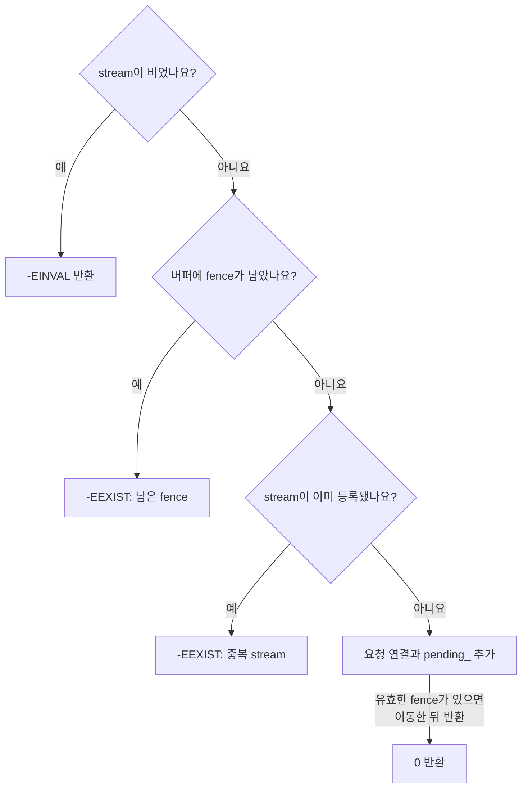
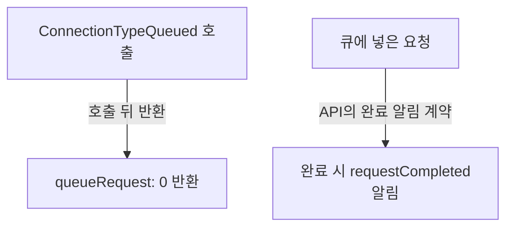
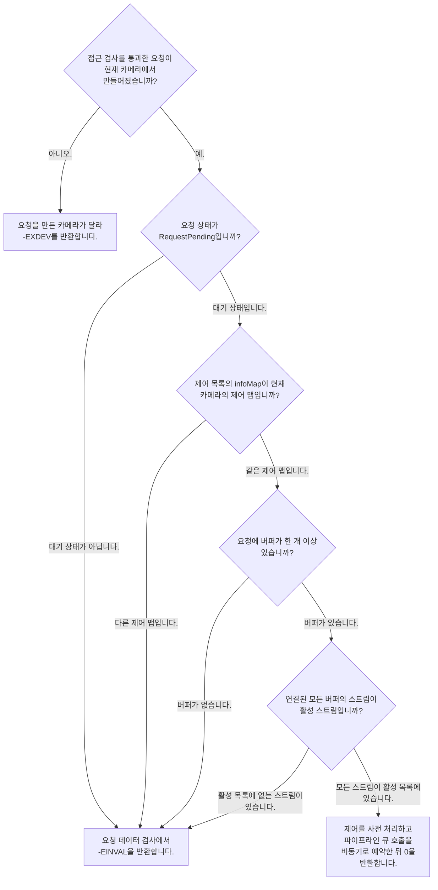
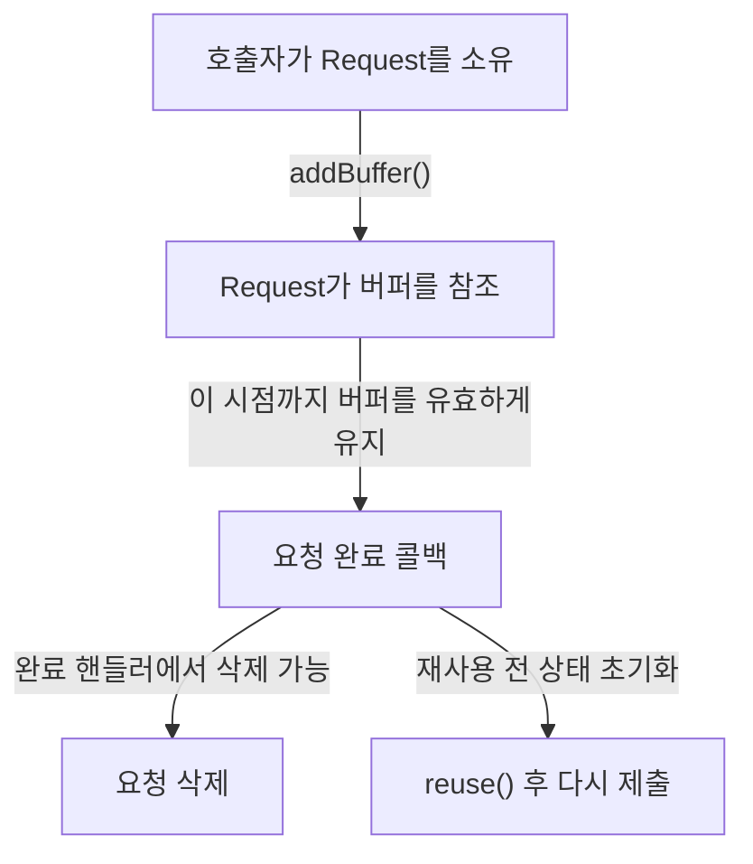
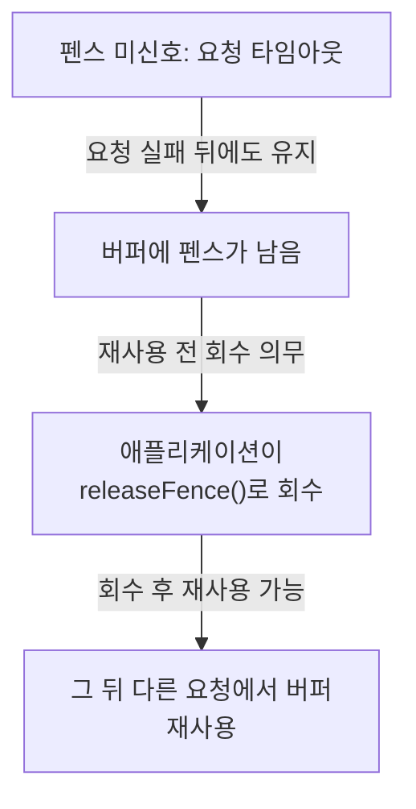
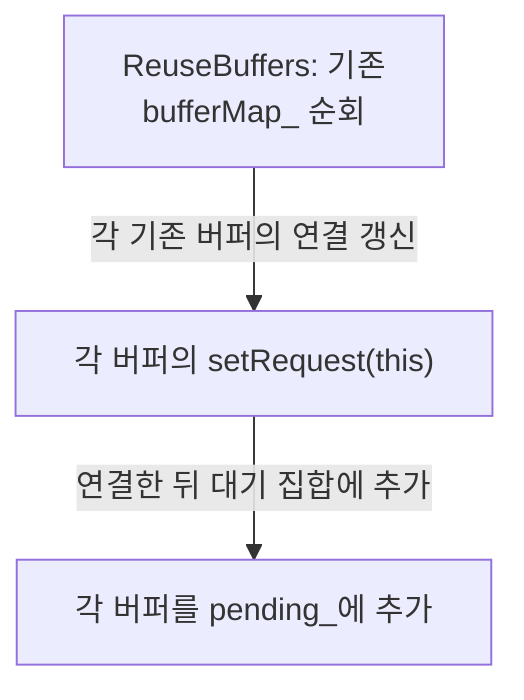
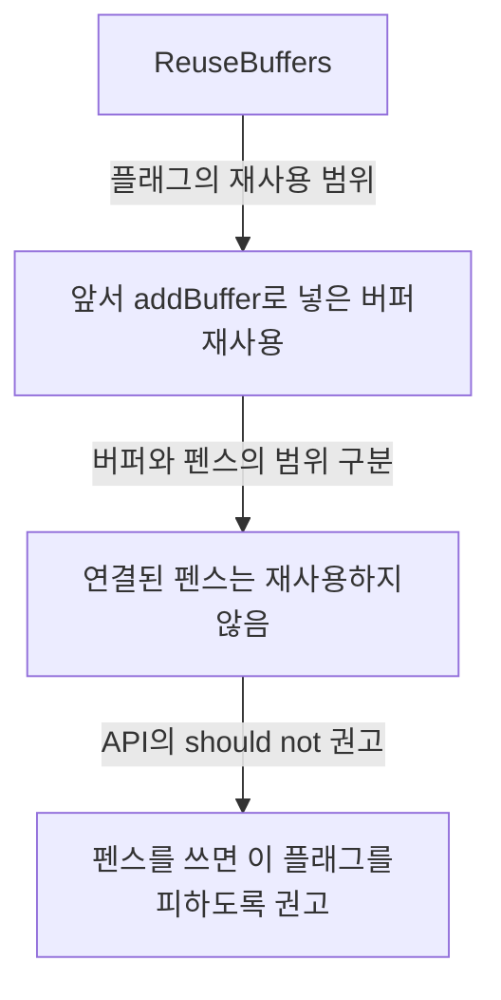
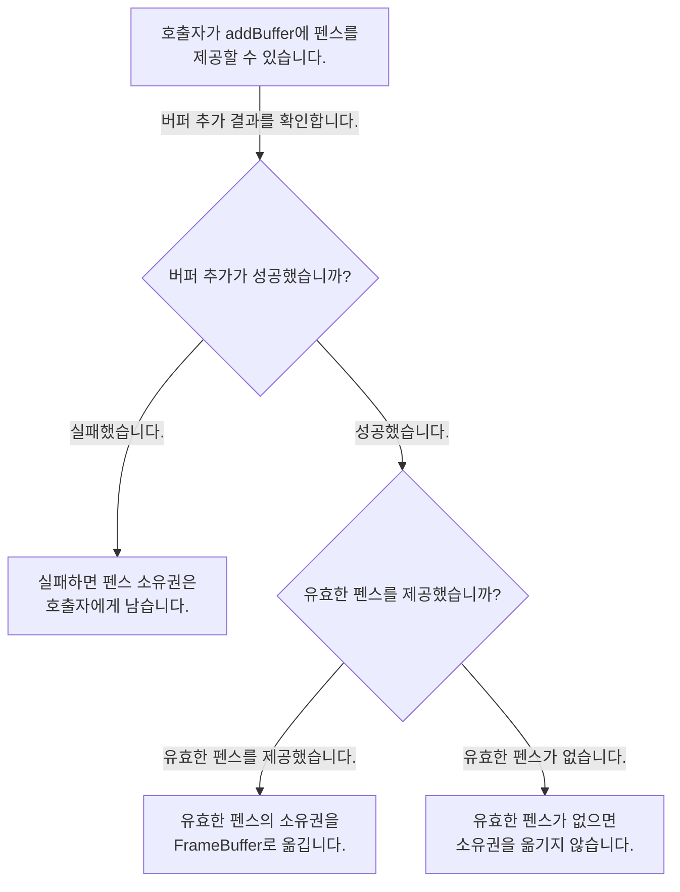
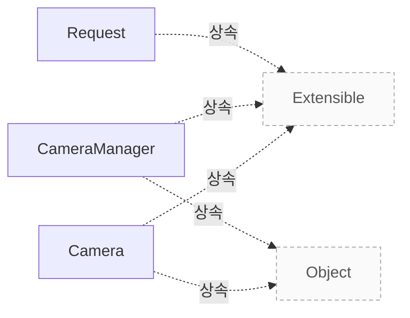

# 요청 객체와 버퍼 수명

**요청 생성과 제출, 버퍼·펜스의 유지와 재사용 조건을 코드와 대조하세요.**

| 지금 확인할 내용 | 이동할 절 |
|---|---|
| 클래스의 책임, 요청과 버퍼의 수명, 상태 전이와 종료·동기화 계약을 코드 근거로 확인하세요. | [카메라와 요청 모델](camera-model.md) |

## 요청 생성과 완료

`createRequest`는 새로 만든 빈 `Request` 객체를 `std::unique_ptr<Request>`로 반환하며, 오류가 나면 `nullptr`을 반환합니다. 반환된 객체의 소유권은 호출자에게 넘어가며, 호출자가 이를 삭제할 책임을 가집니다. 요청은 완료 핸들러에서 삭제되거나, `Request::reuse()`로 상태를 초기화한 뒤 재사용될 수 있습니다. 호출자는 `Request::addBuffer`로 한 요청에 같은 스트림의 버퍼를 둘 이상 연결해서는 안 되며, 한 요청은 스트림당 버퍼를 하나만 포함할 수 있습니다. `src/libcamera/camera.cpp:1243`, `src/libcamera/request.cpp:442`

<!-- sdd:visual:add-buffer-rejections -->
### 버퍼 연결 실패를 구분하는 순서



[Mermaid 원문](camera-requests.add-buffer-rejections.mmd)

??? note "그림 근거와 확인 범위"
    같은 -EEXIST라도 남은 fence와 중복 stream을 구분하고, 실패 검사 뒤의 요청 연결 경계를 확인합니다.
    
    소스에 연결한 설계 해석입니다. 자동 연결 검사는 의미 승인이나 기기 실행 검증이 아닙니다.
    
    | 요소·전이 | 소스 근거 |
    |---|---|
    | <span data-sdd-label-en="Is stream null?">stream이 비었나요?</span> | [src/libcamera/request.cpp:475](#source-605100b059a6864d) |
    | <span data-sdd-label-en="Return -EINVAL">-EINVAL 반환</span> | [src/libcamera/request.cpp:475](#source-605100b059a6864d) |
    | <span data-sdd-label-en="Does the buffer retain a fence?">버퍼에 fence가 남았나요?</span> | [src/libcamera/request.cpp:475](#source-605100b059a6864d) |
    | <span data-sdd-label-en="-EEXIST: retained fence">-EEXIST: 남은 fence</span> | [src/libcamera/request.cpp:475](#source-605100b059a6864d) |
    | <span data-sdd-label-en="Is the stream already registered?">stream이 이미 등록됐나요?</span> | [src/libcamera/request.cpp:475](#source-605100b059a6864d) |
    | <span data-sdd-label-en="-EEXIST: duplicate stream">-EEXIST: 중복 stream</span> | [src/libcamera/request.cpp:475](#source-605100b059a6864d) |
    | <span data-sdd-label-en="Attach request and add pending_">요청 연결과 pending&#95; 추가</span> | [src/libcamera/request.cpp:475](#source-605100b059a6864d) |
    | <span data-sdd-label-en="Return 0">0 반환</span> | [src/libcamera/request.cpp:475](#source-605100b059a6864d) |
    | <span data-sdd-label-en="Yes">예</span> | [src/libcamera/request.cpp:475](#source-605100b059a6864d) |
    | <span data-sdd-label-en="No">아니요</span> | [src/libcamera/request.cpp:475](#source-605100b059a6864d) |
    | <span data-sdd-label-en="Yes">예</span> | [src/libcamera/request.cpp:475](#source-605100b059a6864d) |
    | <span data-sdd-label-en="No">아니요</span> | [src/libcamera/request.cpp:475](#source-605100b059a6864d) |
    | <span data-sdd-label-en="Yes">예</span> | [src/libcamera/request.cpp:475](#source-605100b059a6864d) |
    | <span data-sdd-label-en="No">아니요</span> | [src/libcamera/request.cpp:475](#source-605100b059a6864d) |
    | <span data-sdd-label-en="Move a valid supplied fence if present, then return">유효한 fence가 있으면 이동한 뒤 반환</span> | [src/libcamera/request.cpp:475](#source-605100b059a6864d) |
<!-- /sdd:visual:add-buffer-rejections -->

<!-- sdd:visual:queue-return-completion -->
### 접수 반환과 완료 알림



[Mermaid 원문](camera-requests.queue-return-completion.mmd)

??? note "그림 근거와 확인 범위"
    queueRequest의 0 반환과 requestCompleted 알림은 각각 무엇을 뜻합니까?
    
    소스에 연결한 설계 해석입니다. 자동 연결 검사는 의미 승인이나 기기 실행 검증이 아닙니다.
    
    | 요소·전이 | 소스 근거 |
    |---|---|
    | <span data-sdd-label-en="Invoke with ConnectionTypeQueued">ConnectionTypeQueued 호출</span> | [src/libcamera/camera.cpp:1330](#source-a6565762f1627660) |
    | <span data-sdd-label-en="queueRequest returns 0">queueRequest: 0 반환</span> | [src/libcamera/camera.cpp:1330](#source-a6565762f1627660) |
    | <span data-sdd-label-en="Queued request">큐에 넣은 요청</span> | [src/libcamera/camera.cpp:1308](#source-28d007de6ad1a8a5) |
    | <span data-sdd-label-en="Notify completion through requestCompleted">완료 시 requestCompleted 알림</span> | [src/libcamera/camera.cpp:1308](#source-28d007de6ad1a8a5) |
    | <span data-sdd-label-en="Return after invoking">호출 뒤 반환</span> | [src/libcamera/camera.cpp:1330](#source-a6565762f1627660) |
    | <span data-sdd-label-en="API completion-notification contract">API의 완료 알림 계약</span> | [src/libcamera/camera.cpp:1308](#source-28d007de6ad1a8a5) |
<!-- /sdd:visual:queue-return-completion -->

<!-- sdd:visual:queued-request-data-checks -->
### 요청 데이터의 거절 조건



[Mermaid 원문](camera-requests.queued-request-data-checks.mmd)

??? note "그림 근거와 확인 범위"
    접근 검사를 통과한 뒤 큐에 제출하는 요청의 소속·상태·제어·버퍼에서 어떤 값이 거절됩니까?
    
    소스에 연결한 설계 해석입니다. 자동 연결 검사는 의미 승인이나 기기 실행 검증이 아닙니다.
    
    | 요소·전이 | 소스 근거 |
    |---|---|
    | <span data-sdd-label-en="After the access check passes, did this camera create the request?">접근 검사를 통과한 요청이 현재 카메라에서 만들어졌습니까?</span> | [src/libcamera/camera.cpp:1330](#source-a6565762f1627660) |
    | <span data-sdd-label-en="Return -EXDEV because a different camera created the request.">요청을 만든 카메라가 달라 -EXDEV를 반환합니다.</span> | [src/libcamera/camera.cpp:1330](#source-a6565762f1627660) |
    | <span data-sdd-label-en="Is the request still RequestPending?">요청 상태가 RequestPending입니까?</span> | [src/libcamera/camera.cpp:1330](#source-a6565762f1627660) |
    | <span data-sdd-label-en="Does the control list use this camera’s control info map?">제어 목록의 infoMap이 현재 카메라의 제어 맵입니까?</span> | [src/libcamera/camera.cpp:1330](#source-a6565762f1627660) |
    | <span data-sdd-label-en="Does the request contain at least one buffer?">요청에 버퍼가 한 개 이상 있습니까?</span> | [src/libcamera/camera.cpp:1330](#source-a6565762f1627660) |
    | <span data-sdd-label-en="Does every attached buffer belong to an active stream?">연결된 모든 버퍼의 스트림이 활성 스트림입니까?</span> | [src/libcamera/camera.cpp:1330](#source-a6565762f1627660) |
    | <span data-sdd-label-en="Return -EINVAL from the failed request-data check.">요청 데이터 검사에서 -EINVAL을 반환합니다.</span> | [src/libcamera/camera.cpp:1330](#source-a6565762f1627660) · [src/libcamera/camera.cpp:1350](#source-980d3a2f94252f0c) · [src/libcamera/camera.cpp:1361](#source-d572e3b4aa0a295b) · [src/libcamera/camera.cpp:1367](#source-589094bc9fe6e38d) |
    | <span data-sdd-label-en="Preprocess controls, queue the asynchronous pipeline call, and return 0.">제어를 사전 처리하고 파이프라인 큐 호출을 비동기로 예약한 뒤 0을 반환합니다.</span> | [src/libcamera/camera.cpp:1330](#source-a6565762f1627660) |
    | <span data-sdd-label-en="No.">아니오.</span> | [src/libcamera/camera.cpp:1330](#source-a6565762f1627660) |
    | <span data-sdd-label-en="Yes.">예.</span> | [src/libcamera/camera.cpp:1330](#source-a6565762f1627660) |
    | <span data-sdd-label-en="The request is not pending.">대기 상태가 아닙니다.</span> | [src/libcamera/camera.cpp:1330](#source-a6565762f1627660) · [src/libcamera/camera.cpp:1350](#source-980d3a2f94252f0c) · [src/libcamera/camera.cpp:1361](#source-d572e3b4aa0a295b) · [src/libcamera/camera.cpp:1367](#source-589094bc9fe6e38d) |
    | <span data-sdd-label-en="The request is pending.">대기 상태입니다.</span> | [src/libcamera/camera.cpp:1330](#source-a6565762f1627660) |
    | <span data-sdd-label-en="The control info map differs.">다른 제어 맵입니다.</span> | [src/libcamera/camera.cpp:1330](#source-a6565762f1627660) · [src/libcamera/camera.cpp:1350](#source-980d3a2f94252f0c) · [src/libcamera/camera.cpp:1361](#source-d572e3b4aa0a295b) · [src/libcamera/camera.cpp:1367](#source-589094bc9fe6e38d) |
    | <span data-sdd-label-en="The control info map matches.">같은 제어 맵입니다.</span> | [src/libcamera/camera.cpp:1330](#source-a6565762f1627660) |
    | <span data-sdd-label-en="There are no buffers.">버퍼가 없습니다.</span> | [src/libcamera/camera.cpp:1330](#source-a6565762f1627660) · [src/libcamera/camera.cpp:1350](#source-980d3a2f94252f0c) · [src/libcamera/camera.cpp:1361](#source-d572e3b4aa0a295b) · [src/libcamera/camera.cpp:1367](#source-589094bc9fe6e38d) |
    | <span data-sdd-label-en="There are buffers.">버퍼가 있습니다.</span> | [src/libcamera/camera.cpp:1330](#source-a6565762f1627660) |
    | <span data-sdd-label-en="A stream is absent from the active set.">활성 목록에 없는 스트림이 있습니다.</span> | [src/libcamera/camera.cpp:1330](#source-a6565762f1627660) · [src/libcamera/camera.cpp:1350](#source-980d3a2f94252f0c) · [src/libcamera/camera.cpp:1361](#source-d572e3b4aa0a295b) · [src/libcamera/camera.cpp:1367](#source-589094bc9fe6e38d) |
    | <span data-sdd-label-en="Every stream is in the active set.">모든 스트림이 활성 목록에 있습니다.</span> | [src/libcamera/camera.cpp:1330](#source-a6565762f1627660) |
<!-- /sdd:visual:queued-request-data-checks -->

`Request::addBuffer()`는 먼저 `!stream` 조건을 확인하고, 참이면 "Invalid stream reference" 오류 로그를 남긴 뒤 `-EINVAL`을 반환합니다. 다음으로 `buffer->_d()->fence()`가 남아 있으면 `-EEXIST`를 반환하므로, fence가 남아 있는 버퍼는 이 단계에서 등록되지 않습니다. 마지막으로 `bufferMap_.try_emplace(stream, buffer)`의 `inserted`가 false이면, 로그 "`FrameBuffer` already set for stream"과 함께 `-EEXIST`를 반환합니다. `src/libcamera/request.cpp:475`

`!stream` 검사, fence 검사, `inserted` 검사를 모두 통과하고 `bufferMap_.try_emplace`가 `inserted`가 true인 경우에만 `buffer->_d()->setRequest(this)`와 `_d()->pending_.insert(buffer)`가 이 순서대로 실행됩니다. 이 두 줄 뒤에는 fence 설정 분기가 이어지고, 함수는 `return 0;`으로 끝납니다. 애플리케이션은 `createRequest()`로 요청을 만든 뒤 `queueRequest`를 호출하기 전에 그 요청에 캡처 버퍼를 하나 이상 채워야 하며, 버퍼가 없는 요청은 큐에 넣지 않고 거부됩니다. `Camera::queueRequest`는 접근 검사에서 반환하지 않고 생성 카메라 검사에 도달한 경우, 요청을 생성한 카메라가 현재 카메라와 다르면 `-EXDEV`를 반환합니다. `src/libcamera/request.cpp:475`, `src/libcamera/camera.cpp:1308`, `src/libcamera/camera.cpp:1339`

`Camera::queueRequest`는 접근 검사와 요청을 생성한 카메라 검사를 통과해 상태 검사에 도달한 경우, `request->status()`가 `Request::RequestPending`과 일치하지 않으면 `-EINVAL`을 반환합니다. `Camera::queueRequest()`는 접근, 요청을 생성한 카메라, 요청 상태 검사에서 반환하지 않고 controls 검사에 도달한 경우, `request->controls().infoMap()`이 `Camera::controls()`의 주소와 다르면 `-EINVAL`을 반환합니다. `src/libcamera/camera.cpp:1330`, `src/libcamera/camera.cpp:1350`

`Camera::queueRequest`가 앞선 접근·요청 생성 카메라·요청 상태·`controls` 검사를 통과해 이 검사에 도달하면, `buffers` 목록이 비어 있는 경우 `-EINVAL`을 반환합니다. 앞선 검사에서는 접근 검사 결과가 음수이면 그 값을 반환하고, 요청을 만든 카메라가 다르면 `-EXDEV`를, 요청 상태나 `controls` 검사가 실패하면 `-EINVAL`을 반환합니다. `Camera::queueRequest`가 앞선 검사와 빈 버퍼 검사를 통과해 스트림 순회에 도달한 경우, 요청의 각 스트림이 `activeStreams_`에 포함되어 있는지 검사하고 포함되지 않은 스트림이 있으면 `-EINVAL`을 반환합니다. `src/libcamera/camera.cpp:1361`, `src/libcamera/camera.cpp:1330`, `src/libcamera/camera.cpp:1367`

`Camera::queueRequest()`는 요청 검사를 마친 뒤 `ConnectionTypeQueued`를 지정해 `invokeMethod`로 `PipelineHandler::queueRequest`를 호출하고, 그 호출 뒤에 `0`을 반환합니다. 이 `0`은 `invokeMethod` 호출 뒤의 반환값이며, 요청 완료는 카메라가 `requestCompleted` 신호로 별도로 알립니다. `src/libcamera/camera.cpp:1330`, `src/libcamera/camera.cpp:1308`

근거 원문: [src/libcamera/camera.cpp:1243](#source-0ae00d77839f61cb) · [src/libcamera/camera.cpp:1308](#source-28d007de6ad1a8a5) · [src/libcamera/request.cpp:442](#source-95ae69eeb085e3b1) · [src/libcamera/camera.cpp:1330](#source-a6565762f1627660) · [src/libcamera/camera.cpp:1339](#source-a03c9ac514bfd95e) · [src/libcamera/camera.cpp:1350](#source-980d3a2f94252f0c) · [src/libcamera/camera.cpp:1361](#source-d572e3b4aa0a295b) · [src/libcamera/camera.cpp:1367](#source-589094bc9fe6e38d) · [src/libcamera/request.cpp:475](#source-605100b059a6864d)

## 소유권과 재사용

`Request::addBuffer`는 버퍼에 대한 참조를 요청에 저장합니다. 호출자는 요청 완료 콜백이 호출될 때까지 해당 버퍼가 유효하게 남아 있도록 보장해야 합니다. `Request::addBuffer`가 성공하면 유효한 `Fence`의 소유권은 `buffer`(`FrameBuffer`)로 이동합니다. 이때 `fence`는 `buffer`로 옮겨집니다. `src/libcamera/request.cpp:442`, `src/libcamera/request.cpp:456`

<!-- sdd:visual:request-ownership -->
### 요청과 버퍼를 유지할 기간



[Mermaid 원문](camera-requests.request-ownership.mmd)

??? note "그림 근거와 확인 범위"
    요청의 소유권은 호출자에게 있습니다. 버퍼 참조를 연결해도 호출자의 버퍼 유지 책임은 계속됩니다.
    
    소스에 연결한 설계 해석입니다. 자동 연결 검사는 의미 승인이나 기기 실행 검증이 아닙니다.
    
    | 요소·전이 | 소스 근거 |
    |---|---|
    | <span data-sdd-label-en="Caller owns Request">호출자가 Request를 소유</span> | [src/libcamera/camera.cpp:1243](#source-0ae00d77839f61cb) |
    | <span data-sdd-label-en="Request references buffer">Request가 버퍼를 참조</span> | [src/libcamera/request.cpp:442](#source-95ae69eeb085e3b1) |
    | <span data-sdd-label-en="Request completion callback">요청 완료 콜백</span> | [src/libcamera/request.cpp:442](#source-95ae69eeb085e3b1) |
    | <span data-sdd-label-en="Delete request">요청 삭제</span> | [src/libcamera/camera.cpp:1243](#source-0ae00d77839f61cb) |
    | <span data-sdd-label-en="Reset before requeue">reuse&#40;&#41; 후 다시 제출</span> | [src/libcamera/request.cpp:376](#source-38494771cb29cc8c) |
    | <span data-sdd-label-en="addBuffer()">addBuffer&#40;&#41;</span> | [src/libcamera/request.cpp:442](#source-95ae69eeb085e3b1) |
    | <span data-sdd-label-en="Keep buffer valid until this point">이 시점까지 버퍼를 유효하게 유지</span> | [src/libcamera/request.cpp:442](#source-95ae69eeb085e3b1) |
    | <span data-sdd-label-en="May delete in completion handler">완료 핸들러에서 삭제 가능</span> | [src/libcamera/camera.cpp:1243](#source-0ae00d77839f61cb) |
    | <span data-sdd-label-en="Reset state before reuse">재사용 전 상태 초기화</span> | [src/libcamera/request.cpp:376](#source-38494771cb29cc8c) |
<!-- /sdd:visual:request-ownership -->

<!-- sdd:visual:timeout-fence-recovery -->
### 타임아웃 뒤 펜스 회수



[Mermaid 원문](camera-requests.timeout-fence-recovery.mmd)

??? note "그림 근거와 확인 범위"
    신호되지 않은 펜스로 타임아웃이 나면 다른 요청에 재사용하기 전에 무엇을 해야 합니까?
    
    소스에 연결한 설계 해석입니다. 자동 연결 검사는 의미 승인이나 기기 실행 검증이 아닙니다.
    
    | 요소·전이 | 소스 근거 |
    |---|---|
    | <span data-sdd-label-en="Unsignalled fence: request times out">펜스 미신호: 요청 타임아웃</span> | [src/libcamera/request.cpp:462](#source-d8cf34a75a4333a7) |
    | <span data-sdd-label-en="Buffer still contains its fence">버퍼에 펜스가 남음</span> | [src/libcamera/request.cpp:462](#source-d8cf34a75a4333a7) |
    | <span data-sdd-label-en="Application retrieves with releaseFence()">애플리케이션이 releaseFence&#40;&#41;로 회수</span> | [src/libcamera/request.cpp:462](#source-d8cf34a75a4333a7) |
    | <span data-sdd-label-en="Then reuse the buffer in another request">그 뒤 다른 요청에서 버퍼 재사용</span> | [src/libcamera/request.cpp:462](#source-d8cf34a75a4333a7) |
    | <span data-sdd-label-en="Remains after request failure">요청 실패 뒤에도 유지</span> | [src/libcamera/request.cpp:462](#source-d8cf34a75a4333a7) |
    | <span data-sdd-label-en="Must retrieve before reuse">재사용 전 회수 의무</span> | [src/libcamera/request.cpp:462](#source-d8cf34a75a4333a7) |
    | <span data-sdd-label-en="Reuse after retrieval">회수 후 재사용 가능</span> | [src/libcamera/request.cpp:462](#source-d8cf34a75a4333a7) |
<!-- /sdd:visual:timeout-fence-recovery -->

<!-- sdd:visual:reuse-buffer-relink -->
### 재사용 버퍼의 요청 연결



[Mermaid 원문](camera-requests.reuse-buffer-relink.mmd)

??? note "그림 근거와 확인 범위"
    ReuseBuffers 경로에서 각 버퍼는 어떤 순서로 다시 요청에 연결됩니까?
    
    소스에 연결한 설계 해석입니다. 자동 연결 검사는 의미 승인이나 기기 실행 검증이 아닙니다.
    
    | 요소·전이 | 소스 근거 |
    |---|---|
    | <span data-sdd-label-en="ReuseBuffers: iterate existing bufferMap_">ReuseBuffers: 기존 bufferMap&#95; 순회</span> | [src/libcamera/request.cpp:391](#source-e41b7fa688c1de2e) |
    | <span data-sdd-label-en="setRequest(this) on each buffer">각 버퍼의 setRequest&#40;this&#41;</span> | [src/libcamera/request.cpp:391](#source-e41b7fa688c1de2e) |
    | <span data-sdd-label-en="Insert each buffer into pending_">각 버퍼를 pending&#95;에 추가</span> | [src/libcamera/request.cpp:391](#source-e41b7fa688c1de2e) |
    | <span data-sdd-label-en="Update each retained buffer link">각 기존 버퍼의 연결 갱신</span> | [src/libcamera/request.cpp:391](#source-e41b7fa688c1de2e) |
    | <span data-sdd-label-en="Insert into pending after relinking">연결한 뒤 대기 집합에 추가</span> | [src/libcamera/request.cpp:391](#source-e41b7fa688c1de2e) |
<!-- /sdd:visual:reuse-buffer-relink -->

<!-- sdd:visual:reuse-buffer-fence-distinction -->
### 버퍼 재사용과 펜스 권고



[Mermaid 원문](camera-requests.reuse-buffer-fence-distinction.mmd)

??? note "그림 근거와 확인 범위"
    ReuseBuffers가 재사용하는 대상과 펜스 사용 시 권고는 무엇입니까?
    
    소스에 연결한 설계 해석입니다. 자동 연결 검사는 의미 승인이나 기기 실행 검증이 아닙니다.
    
    | 요소·전이 | 소스 근거 |
    |---|---|
    | <span data-sdd-label-en="ReuseBuffers">ReuseBuffers</span> | [src/libcamera/request.cpp:326](#source-447804db33308244) |
    | <span data-sdd-label-en="Reuse buffers previously added by addBuffer">앞서 addBuffer로 넣은 버퍼 재사용</span> | [src/libcamera/request.cpp:326](#source-447804db33308244) |
    | <span data-sdd-label-en="Associated fences are not reused">연결된 펜스는 재사용하지 않음</span> | [src/libcamera/request.cpp:326](#source-447804db33308244) |
    | <span data-sdd-label-en="Should not use this flag with fences">펜스를 쓰면 이 플래그를 피하도록 권고</span> | [src/libcamera/request.cpp:326](#source-447804db33308244) |
    | <span data-sdd-label-en="Flag reuse scope">플래그의 재사용 범위</span> | [src/libcamera/request.cpp:326](#source-447804db33308244) |
    | <span data-sdd-label-en="Distinguish buffer and fence reuse">버퍼와 펜스의 범위 구분</span> | [src/libcamera/request.cpp:326](#source-447804db33308244) |
    | <span data-sdd-label-en="API should-not recommendation">API의 should not 권고</span> | [src/libcamera/request.cpp:326](#source-447804db33308244) |
<!-- /sdd:visual:reuse-buffer-fence-distinction -->

<!-- sdd:visual:add-buffer-fence-transfer -->
### addBuffer의 펜스 소유권



[Mermaid 원문](camera-requests.add-buffer-fence-transfer.mmd)

??? note "그림 근거와 확인 범위"
    addBuffer의 성공과 실패에 따라 호출자가 제공한 유효한 펜스를 누가 소유합니까?
    
    소스에 연결한 설계 해석입니다. 자동 연결 검사는 의미 승인이나 기기 실행 검증이 아닙니다.
    
    | 요소·전이 | 소스 근거 |
    |---|---|
    | <span data-sdd-label-en="The caller can supply a fence to addBuffer.">호출자가 addBuffer에 펜스를 제공할 수 있습니다.</span> | [src/libcamera/request.cpp:475](#source-605100b059a6864d) |
    | <span data-sdd-label-en="Did adding the buffer succeed?">버퍼 추가가 성공했습니까?</span> | [src/libcamera/request.cpp:456](#source-86a8d784a8348122) |
    | <span data-sdd-label-en="On failure, the caller retains fence ownership.">실패하면 펜스 소유권은 호출자에게 남습니다.</span> | [src/libcamera/request.cpp:442](#source-95ae69eeb085e3b1) |
    | <span data-sdd-label-en="Was a valid fence supplied?">유효한 펜스를 제공했습니까?</span> | [src/libcamera/request.cpp:475](#source-605100b059a6864d) |
    | <span data-sdd-label-en="Move ownership of the valid fence to the FrameBuffer.">유효한 펜스의 소유권을 FrameBuffer로 옮깁니다.</span> | [src/libcamera/request.cpp:475](#source-605100b059a6864d) |
    | <span data-sdd-label-en="Without a valid fence, there is no fence ownership transfer.">유효한 펜스가 없으면 소유권을 옮기지 않습니다.</span> | [src/libcamera/request.cpp:475](#source-605100b059a6864d) |
    | <span data-sdd-label-en="Check the result of adding the buffer.">버퍼 추가 결과를 확인합니다.</span> | [src/libcamera/request.cpp:475](#source-605100b059a6864d) · [src/libcamera/request.cpp:456](#source-86a8d784a8348122) |
    | <span data-sdd-label-en="Adding the buffer failed.">실패했습니다.</span> | [src/libcamera/request.cpp:456](#source-86a8d784a8348122) · [src/libcamera/request.cpp:442](#source-95ae69eeb085e3b1) |
    | <span data-sdd-label-en="Adding the buffer succeeded.">성공했습니다.</span> | [src/libcamera/request.cpp:456](#source-86a8d784a8348122) · [src/libcamera/request.cpp:475](#source-605100b059a6864d) |
    | <span data-sdd-label-en="A valid fence was supplied.">유효한 펜스를 제공했습니다.</span> | [src/libcamera/request.cpp:475](#source-605100b059a6864d) |
    | <span data-sdd-label-en="No valid fence was supplied.">유효한 펜스가 없습니다.</span> | [src/libcamera/request.cpp:475](#source-605100b059a6864d) |
<!-- /sdd:visual:add-buffer-fence-transfer -->

`addBuffer`가 실패하면 `fence`의 소유권은 가져가지 않으며, 전달받은 `fence`는 변경되지 않고 그대로 유지됩니다. 펜스가 신호되지 않으면 요청은 타임아웃 후 실패합니다. 이때 버퍼에는 펜스가 그대로 남아 있으며, 애플리케이션은 다른 요청에 버퍼를 재사용하기 전에 `FrameBuffer::releaseFence()`로 이 펜스를 회수해야 합니다. `Request::reuse`는 `flags`에 `ReuseBuffers`가 설정된 경우 `bufferMap_`의 각 버퍼마다 `buffer->_d()->setRequest(this)`를 호출해 그 버퍼를 현재 요청에 연결한 뒤, `_d()->pending_`에 그 버퍼를 추가합니다. `src/libcamera/request.cpp:456`, `src/libcamera/request.cpp:462`, `src/libcamera/request.cpp:391`, `src/libcamera/request.cpp:393`

`Request::reuse()`에서 `flags & ReuseBuffers`가 거짓이면 else 분기가 실행되며, 이때 `bufferMap_.clear()`를 호출해 `bufferMap_`의 모든 항목을 비웁니다. `Request::reuse`는 `status_`를 `RequestPending`으로 설정한 뒤, `controls_`와 `_d()->metadata_`를 각각 `clear()`합니다. `Request::ReuseBuffers` 플래그는 `Request::reuse()` 호출 시 `addBuffer()`로 이전에 추가한 버퍼를 다시 사용하여 기존 버퍼를 유지합니다. 다만 버퍼에 연결된 펜스는 재사용되지 않으며, 소스 주석은 펜스를 사용하는 경우 이 플래그를 피하도록 권고합니다. `src/libcamera/request.cpp:376`, `src/libcamera/request.cpp:391`, `src/libcamera/request.cpp:400`, `src/libcamera/request.cpp:402`, `src/libcamera/request.cpp:403`, `src/libcamera/request.cpp:326`, `src/libcamera/request.cpp:334`

근거 원문: [src/libcamera/request.cpp:376](#source-38494771cb29cc8c) · [src/libcamera/request.cpp:442](#source-95ae69eeb085e3b1) · [src/libcamera/request.cpp:326](#source-447804db33308244) · [src/libcamera/request.cpp:456](#source-86a8d784a8348122) · [src/libcamera/request.cpp:462](#source-d8cf34a75a4333a7) · [src/libcamera/request.cpp:400](#source-a98823fa5ec440a2) · [src/libcamera/request.cpp:402](#source-c8638489aa83cfd1) · [src/libcamera/request.cpp:403](#source-47569737e131b31a) · [src/libcamera/request.cpp:391](#source-e41b7fa688c1de2e) · [src/libcamera/request.cpp:393](#source-bf1ee390b8473e16) · [src/libcamera/request.cpp:334](#source-d9944a69f2dd6758)

??? note "설계 질문과 검증 범위"
    질문별 답변과 근거 연결을 검사했습니다. 의미와 실행 결과는 사람 검토가 필요합니다.
    
    | 설계 질문 | 설명 위치 | 확인 범위 |
    |---|---|---|
    | 요청 생성부터 완료 통지까지 객체 수명과 호출 순서는 무엇입니까? | [요청 생성과 완료](#요청-생성과-완료) | 코드 근거와 설명 연결 |
    | 요청이 진행 중일 때와 완료된 뒤의 소유권, ReuseBuffers와 fence 규칙은 무엇입니까? | [소유권과 재사용](#소유권과-재사용) | 코드 근거와 설명 연결 |

## 소스 근거

같은 발췌는 한 번만 싣습니다. 필요한 원문을 펼쳐 설명과 대조하세요.

<a id="source-0ae00d77839f61cb"></a>

??? note "소스 근거: src/libcamera/camera.cpp:1243"
    `src/libcamera/camera.cpp:1243`에서 시작하는 발췌입니다. 종료 줄은 1263이며, 아래 원문을 설명과 대조할 수 있습니다.
    
    SHA-256: `9f251ecf5ba569606e9753d3619b88e1aef5a4ce15f816ae97efd283e34b823b`
    
    ```text
    \brief Create a request object for the camera
     * \param[in] cookie Opaque cookie for application use
     *
     * This function creates an empty request for the application to fill with
     * buffers and parameters, and queue for capture.
     *
     * The \a cookie is stored in the request and is accessible through the
     * Request::cookie() function at any time. It is typically used by applications
     * to map the request to an external resource in the request completion
     * handler, and is completely opaque to libcamera.
     *
     * The ownership of the returned request is passed to the caller, which is
     * responsible for deleting it. The request may be deleted in the completion
     * handler, or reused after resetting its state with Request::reuse().
     *
     * \context This function is \threadsafe. It may only be called when the camera
     * is in the Configured or Running state as defined in \ref camera_operation.
     *
     * \return A pointer to the newly created request, or nullptr on error
     */
    std::unique_ptr<Request> Camera::createRequest(uint64_t cookie)
    ```

<a id="source-28d007de6ad1a8a5"></a>

??? note "소스 근거: src/libcamera/camera.cpp:1308"
    `src/libcamera/camera.cpp:1308`에서 시작하는 발췌입니다. 종료 줄은 1383이며, 아래 원문을 설명과 대조할 수 있습니다.
    
    SHA-256: `96db61baeb32065c966b20942f97518ddbd3a43b36b64e8083eb29a90ecb7f4b`
    
    ```text
    \brief Queue a request to the camera
     * \param[in] request The request to queue to the camera
     *
     * This function queues a \a request to the camera for capture.
     *
     * After allocating the request with createRequest(), the application shall
     * fill it with at least one capture buffer before queuing it. Requests that
     * contain no buffers are invalid and are rejected without being queued.
     *
     * Once the request has been queued, the camera will notify its completion
     * through the \ref requestCompleted signal.
     *
     * \context This function is \threadsafe. It may only be called when the camera
     * is in the Running state as defined in \ref camera_operation.
     *
     * \return 0 on success or a negative error code otherwise
     * \retval -ENODEV The camera has been disconnected from the system
     * \retval -EACCES The camera is not running so requests can't be queued
     * \retval -EXDEV The request does not belong to this camera
     * \retval -EINVAL The request is invalid
     * \retval -ENOMEM No buffer memory was available to handle the request
     */
    int Camera::queueRequest(Request *request)
    {
    	Private *const d = _d();
    
    	int ret = d->isAccessAllowed(Private::CameraRunning);
    	if (ret < 0)
    		return ret;
    
    	/* Requests can only be queued to the camera that created them. */
    	if (request->_d()->camera() != this) {
    		LOG(Camera, Error) << "Request was not created by this camera";
    		return -EXDEV;
    	}
    
    	if (request->status() != Request::RequestPending) {
    		LOG(Camera, Error) << request->toString() << " is not valid";
    		return -EINVAL;
    	}
    
    	/* Make sure the Request has a valid control list. */
    	if (request->controls().infoMap() != &controls()) {
    		LOG(Camera, Error) << "Overwriting Request::controls() is not allowed";
    		return -EINVAL;
    	}
    
    	/*
    	 * The camera state may change until the end of the function. No locking
    	 * is however needed as PipelineHandler::queueRequest() will handle
    	 * this.
    	 */
    
    	if (request->buffers().empty()) {
    		LOG(Camera, Error) << "Request contains no buffers";
    		return -EINVAL;
    	}
    
    	for (const auto &[stream, buffer] : request->buffers()) {
    		if (d->activeStreams_.find(stream) == d->activeStreams_.end()) {
    			LOG(Camera, Error) << "Invalid request";
    			return -EINVAL;
    		}
    	}
    
    	/* Pre-process AeEnable. */
    	patchControlList(request->controls());
    
    	d->pipe_->invokeMethod(&PipelineHandler::queueRequest,
    			       ConnectionTypeQueued, request);
    
    	return 0;
    }
    
    /**
     * \brief Start capture from camera
    ```

<a id="source-95ae69eeb085e3b1"></a>

??? note "소스 근거: src/libcamera/request.cpp:442"
    `src/libcamera/request.cpp:442`에서 시작하는 발췌입니다. 종료 줄은 475이며, 아래 원문을 설명과 대조할 수 있습니다.
    
    SHA-256: `65cd8b0501b7f6545dd10eaaec4a4fe46c52a096a3bbd94ea6b4813e4a670876`
    
    ```text
    \brief Add a FrameBuffer with its associated Stream to the Request
     * \param[in] stream The stream the buffer belongs to
     * \param[in] buffer The FrameBuffer to add to the request
     * \param[in] fence The optional fence
     *
     * A reference to the buffer is stored in the request. The caller is responsible
     * for ensuring that the buffer will remain valid until the request complete
     * callback is called.
     *
     * A request can only contain one buffer per stream. If a buffer has already
     * been added to the request for the same stream, this function returns -EEXIST.
     *
     * A Fence can be optionally associated with the \a buffer.
     *
     * When a valid Fence is provided to this function, \a fence is moved to \a
     * buffer and this Request will only be queued to the device once the
     * fences of all its buffers have been correctly signalled. Ownership of the
     * fence will only be taken in case of success, otherwise the fence will
     * be left unmodified.
     *
     * If the \a fence associated with \a buffer isn't signalled, the request will
     * fail after a timeout. The buffer will still contain the fence, which
     * applications must retrieve with FrameBuffer::releaseFence() before the buffer
     * can be reused in another request. Attempting to add a buffer that still
     * contains a fence to a request will result in this function returning -EEXIST.
     *
     * \sa FrameBuffer::releaseFence()
     *
     * \return 0 on success or a negative error code otherwise
     * \retval -EEXIST The request already contains a buffer for the stream
     *  or the buffer still references a fence
     * \retval -EINVAL The buffer does not reference a valid Stream
     */
    int Request::addBuffer(const Stream *stream, FrameBuffer *buffer,
    ```

<a id="source-a6565762f1627660"></a>

??? note "소스 근거: src/libcamera/camera.cpp:1330"
    `src/libcamera/camera.cpp:1330`에서 시작하는 발췌입니다. 종료 줄은 1383이며, 아래 원문을 설명과 대조할 수 있습니다.
    
    SHA-256: `b375a7828af46db11a4e6308cc634ebb265619e76e9f173907d16d9009fe2c51`
    
    ```text
    int Camera::queueRequest(Request *request)
    {
    	Private *const d = _d();
    
    	int ret = d->isAccessAllowed(Private::CameraRunning);
    	if (ret < 0)
    		return ret;
    
    	/* Requests can only be queued to the camera that created them. */
    	if (request->_d()->camera() != this) {
    		LOG(Camera, Error) << "Request was not created by this camera";
    		return -EXDEV;
    	}
    
    	if (request->status() != Request::RequestPending) {
    		LOG(Camera, Error) << request->toString() << " is not valid";
    		return -EINVAL;
    	}
    
    	/* Make sure the Request has a valid control list. */
    	if (request->controls().infoMap() != &controls()) {
    		LOG(Camera, Error) << "Overwriting Request::controls() is not allowed";
    		return -EINVAL;
    	}
    
    	/*
    	 * The camera state may change until the end of the function. No locking
    	 * is however needed as PipelineHandler::queueRequest() will handle
    	 * this.
    	 */
    
    	if (request->buffers().empty()) {
    		LOG(Camera, Error) << "Request contains no buffers";
    		return -EINVAL;
    	}
    
    	for (const auto &[stream, buffer] : request->buffers()) {
    		if (d->activeStreams_.find(stream) == d->activeStreams_.end()) {
    			LOG(Camera, Error) << "Invalid request";
    			return -EINVAL;
    		}
    	}
    
    	/* Pre-process AeEnable. */
    	patchControlList(request->controls());
    
    	d->pipe_->invokeMethod(&PipelineHandler::queueRequest,
    			       ConnectionTypeQueued, request);
    
    	return 0;
    }
    
    /**
     * \brief Start capture from camera
    ```

<a id="source-a03c9ac514bfd95e"></a>

??? note "소스 근거: src/libcamera/camera.cpp:1339"
    `src/libcamera/camera.cpp:1339`에서 시작하는 발췌입니다. 종료 줄은 1341이며, 아래 원문을 설명과 대조할 수 있습니다.
    
    SHA-256: `51b2d34ec47a0b6ce4959a45e21a5ab5f667d3c996c6a152fdd85fd6e1e967b4`
    
    ```text
    if (request->_d()->camera() != this) {
    		LOG(Camera, Error) << "Request was not created by this camera";
    		return -EXDEV;
    ```

<a id="source-980d3a2f94252f0c"></a>

??? note "소스 근거: src/libcamera/camera.cpp:1350"
    `src/libcamera/camera.cpp:1350`에서 시작하는 발췌입니다. 종료 줄은 1352이며, 아래 원문을 설명과 대조할 수 있습니다.
    
    SHA-256: `21331d8e4da77f65f47cb7839303a4d0b612d033f9ac661fc4c954b506495ee5`
    
    ```text
    if (request->controls().infoMap() != &controls()) {
    		LOG(Camera, Error) << "Overwriting Request::controls() is not allowed";
    		return -EINVAL;
    ```

<a id="source-d572e3b4aa0a295b"></a>

??? note "소스 근거: src/libcamera/camera.cpp:1361"
    `src/libcamera/camera.cpp:1361`에서 시작하는 발췌입니다. 종료 줄은 1363이며, 아래 원문을 설명과 대조할 수 있습니다.
    
    SHA-256: `76a3abbddd8350d57239dd636efe9210ec70ee57eb0b688796169fd3c0fab9a4`
    
    ```text
    if (request->buffers().empty()) {
    		LOG(Camera, Error) << "Request contains no buffers";
    		return -EINVAL;
    ```

<a id="source-589094bc9fe6e38d"></a>

??? note "소스 근거: src/libcamera/camera.cpp:1367"
    `src/libcamera/camera.cpp:1367`에서 시작하는 발췌입니다. 종료 줄은 1369이며, 아래 원문을 설명과 대조할 수 있습니다.
    
    SHA-256: `f6125338e1ec0b5e371a073942e4e5a3912505ca3b455e2fbae553e891cb8c7b`
    
    ```text
    if (d->activeStreams_.find(stream) == d->activeStreams_.end()) {
    			LOG(Camera, Error) << "Invalid request";
    			return -EINVAL;
    ```

<a id="source-605100b059a6864d"></a>

??? note "소스 근거: src/libcamera/request.cpp:475"
    `src/libcamera/request.cpp:475`에서 시작하는 발췌입니다. 종료 줄은 505이며, 아래 원문을 설명과 대조할 수 있습니다.
    
    SHA-256: `c1c0b55f2925856df843fa155a14bb07eb616f52b6bde75cd3b0b5a4ab03b64a`
    
    ```text
    int Request::addBuffer(const Stream *stream, FrameBuffer *buffer,
    		       std::unique_ptr<Fence> &&fence)
    {
    	if (!stream) {
    		LOG(Request, Error) << "Invalid stream reference";
    		return -EINVAL;
    	}
    
    	/*
    	 * Make sure the fence has been extracted from the buffer
    	 * to avoid waiting on a stale fence.
    	 */
    	if (buffer->_d()->fence()) {
    		LOG(Request, Error) << "Can't add buffer that still references a fence";
    		return -EEXIST;
    	}
    
    	auto [it, inserted] = bufferMap_.try_emplace(stream, buffer);
    	if (!inserted) {
    		LOG(Request, Error) << "FrameBuffer already set for stream";
    		return -EEXIST;
    	}
    
    	buffer->_d()->setRequest(this);
    	_d()->pending_.insert(buffer);
    
    	if (fence && fence->isValid())
    		buffer->_d()->setFence(std::move(fence));
    
    	return 0;
    }
    ```

<a id="source-38494771cb29cc8c"></a>

??? note "소스 근거: src/libcamera/request.cpp:376"
    `src/libcamera/request.cpp:376`에서 시작하는 발췌입니다. 종료 줄은 407이며, 아래 원문을 설명과 대조할 수 있습니다.
    
    SHA-256: `22294a6809bd4c6655824af9603fb3879603cec256c6845e00d3d2a0e6bf7679`
    
    ```text
    \brief Reset the request for reuse
     * \param[in] flags Indicate whether or not to reuse the buffers
     *
     * Reset the status and controls associated with the request, to allow it to
     * be reused and requeued without destruction. This function shall be called
     * prior to queueing the request to the camera, in lieu of constructing a new
     * request. The application can reuse the buffers that were previously added
     * to the request via addBuffer() by setting \a flags to ReuseBuffers.
     */
    void Request::reuse(ReuseFlag flags)
    {
    	LIBCAMERA_TRACEPOINT(request_reuse, this);
    
    	_d()->reset();
    
    	if (flags & ReuseBuffers) {
    		for (const auto &[stream, buffer] : bufferMap_) {
    			buffer->_d()->setRequest(this);
    			_d()->pending_.insert(buffer);
    		}
    	} else {
    		bufferMap_.clear();
    	}
    
    	status_ = RequestPending;
    
    	controls_.clear();
    	_d()->metadata_.clear();
    }
    
    /**
     * \fn Request::controls()
    ```

<a id="source-447804db33308244"></a>

??? note "소스 근거: src/libcamera/request.cpp:326"
    `src/libcamera/request.cpp:326`에서 시작하는 발췌입니다. 종료 줄은 338이며, 아래 원문을 설명과 대조할 수 있습니다.
    
    SHA-256: `9e55d8335a38080c0af78cf267bac78c573636447425e25d394e5b206217e7fe`
    
    ```text
    \enum Request::ReuseFlag
     * Flags to control the behavior of Request::reuse()
     * \var Request::Default
     * Don't reuse buffers
     * \var Request::ReuseBuffers
     * Reuse the buffers that were previously added by addBuffer()
     *
     * \note Fences associated with the buffers are not reused.
     *  This flag should not be used if fences are used.
     */
    
    /**
     * \typedef Request::BufferMap
    ```

<a id="source-86a8d784a8348122"></a>

??? note "소스 근거: src/libcamera/request.cpp:456"
    `src/libcamera/request.cpp:456`에서 시작하는 발췌입니다. 종료 줄은 460이며, 아래 원문을 설명과 대조할 수 있습니다.
    
    SHA-256: `e7cc6e59b5401c6d2ef2bef1cceef1090d9bdd058ea8ce00a74bc573f5e4fdc2`
    
    ```text
    When a valid Fence is provided to this function, \a fence is moved to \a
     * buffer and this Request will only be queued to the device once the
     * fences of all its buffers have been correctly signalled. Ownership of the
     * fence will only be taken in case of success, otherwise the fence will
     * be left unmodified.
    ```

<a id="source-d8cf34a75a4333a7"></a>

??? note "소스 근거: src/libcamera/request.cpp:462"
    `src/libcamera/request.cpp:462`에서 시작하는 발췌입니다. 종료 줄은 465이며, 아래 원문을 설명과 대조할 수 있습니다.
    
    SHA-256: `ebb24de716cdebb7c0c82cfddf05e91d7d2fb938eda24fe5027d3e9efcf62104`
    
    ```text
    If the \a fence associated with \a buffer isn't signalled, the request will
     * fail after a timeout. The buffer will still contain the fence, which
     * applications must retrieve with FrameBuffer::releaseFence() before the buffer
     * can be reused in another request.
    ```

<a id="source-a98823fa5ec440a2"></a>

??? note "소스 근거: src/libcamera/request.cpp:400"
    `src/libcamera/request.cpp:400`에서 시작하는 발췌입니다. 종료 줄은 400이며, 아래 원문을 설명과 대조할 수 있습니다.
    
    SHA-256: `aaf5bc87fb8a4ce9c7fbee2875c9cd6f20a8eb982ace6a531236dbd558cc8fc4`
    
    ```text
    status_ = RequestPending;
    ```

<a id="source-c8638489aa83cfd1"></a>

??? note "소스 근거: src/libcamera/request.cpp:402"
    `src/libcamera/request.cpp:402`에서 시작하는 발췌입니다. 종료 줄은 402이며, 아래 원문을 설명과 대조할 수 있습니다.
    
    SHA-256: `e0203f8fd7483c79c6b1a03e35cf952e3839dce41ea145adaa678eceb1382491`
    
    ```text
    controls_.clear();
    ```

<a id="source-47569737e131b31a"></a>

??? note "소스 근거: src/libcamera/request.cpp:403"
    `src/libcamera/request.cpp:403`에서 시작하는 발췌입니다. 종료 줄은 403이며, 아래 원문을 설명과 대조할 수 있습니다.
    
    SHA-256: `794ec4bc82f6076eb388d21eab25bd1409e880c0160e00c1fee50d822c8fa82d`
    
    ```text
    _d()->metadata_.clear();
    ```

<a id="source-e41b7fa688c1de2e"></a>

??? note "소스 근거: src/libcamera/request.cpp:391"
    `src/libcamera/request.cpp:391`에서 시작하는 발췌입니다. 종료 줄은 400이며, 아래 원문을 설명과 대조할 수 있습니다.
    
    SHA-256: `2b47b341a1707d21d16d2589f40203968308f0b9b7c9b0ac59d62b3ed792e533`
    
    ```text
    if (flags & ReuseBuffers) {
    		for (const auto &[stream, buffer] : bufferMap_) {
    			buffer->_d()->setRequest(this);
    			_d()->pending_.insert(buffer);
    		}
    	} else {
    		bufferMap_.clear();
    	}
    
    	status_ = RequestPending;
    ```

<a id="source-bf1ee390b8473e16"></a>

??? note "소스 근거: src/libcamera/request.cpp:393"
    `src/libcamera/request.cpp:393`에서 시작하는 발췌입니다. 종료 줄은 393이며, 아래 원문을 설명과 대조할 수 있습니다.
    
    SHA-256: `ede3bfeddecbdb89f3d76930ab26a1c4c232bab0eb12712ce122ad99e600af8c`
    
    ```text
    buffer->_d()->setRequest(this);
    ```

<a id="source-d9944a69f2dd6758"></a>

??? note "소스 근거: src/libcamera/request.cpp:334"
    `src/libcamera/request.cpp:334`에서 시작하는 발췌입니다. 종료 줄은 334이며, 아래 원문을 설명과 대조할 수 있습니다.
    
    SHA-256: `7b740fbb97fdbfb9b7d270aa48ba5e7902f04d691349b58981ea011f324282d5`
    
    ```text
    This flag should not be used if fences are used.
    ```


<!-- sdd:class-diagram -->
## 클래스 관계

화살표의 글자는 추출한 관계를 나타내며, 점선은 상속입니다. 화살표는 참조 대상 또는 기반 클래스를 향합니다. 호출 순서를 뜻하지 않습니다.


<!-- /sdd:class-diagram -->


## 관련 클래스

| 클래스 | 선언 위치 | 상속 | 책임 (주석) |
|---|---|---|---|
| `libcamera::Camera` | `include/libcamera/camera.h:114` | `libcamera::Object`, `libcamera::Extensible` | Camera device |
| `libcamera::CameraManager` | `include/libcamera/camera_manager.h:24` | `libcamera::Object`, `libcamera::Extensible` | Provide access and manage all cameras in the system |
| `libcamera::Request` | `include/libcamera/request.h:29` | `libcamera::Extensible` | A frame capture request |

??? note "근거와 검토 정보"
    - 생성 방식: 추출 사실과 LLM 설명
    - 검증 범위: 표·그림은 facts로 만들고 설명은 LLM이 작성합니다. 인용·문장 및 설정된 구조 검사를 적용합니다.
    - 근거 파일: `include/libcamera/camera.h`, `include/libcamera/camera_manager.h`, `include/libcamera/request.h`, `src/libcamera/camera.cpp`, `src/libcamera/camera_manager.cpp`, `src/libcamera/request.cpp`
    - 근거 수준: 코드 확인 (정적 분석, simple_compdb 구성, commit `be7e83e913`)
    - 자동 검사 (인용·문장 및 설정된 구조 검사): 통과
    - 검토 상태 기록일: 2026-11-12 · 사람 검토 전

다음 단계: [Pipeline Handler](pipeline-handler.md)
