# libcamera 설계 문서 · 전체 문서

10편

- **분석 기준 커밋**: `adfa719f8ed67d18fd8a0739fc088a1f8b9e7252`
- **원본 사이트**: [https://ttolsun.github.io/libcamera-sdd/](https://ttolsun.github.io/libcamera-sdd/)

이 파일은 사이트의 모든 문서를 하나로 묶은 사본입니다. 만든 뒤에 바뀐 코드와 문서는 반영되지 않으므로 분석 기준 커밋을 함께 확인하세요. 인용 검사 같은 자동 검사 결과는 사람 검토 승인이 아닙니다. 문서별 검토 상태는 각 문서 끝의 문서 생성·검토 정보에 있습니다.

## 목차

1. 시작하기

   1. [시작하기](#doc-1)
   2. [Architecture](#doc-2)
   3. [용어집](#doc-3)
2. ForVendor

   1. [ForVendor](#doc-4)
   2. [기능·지원 범위](#doc-5)
   3. [장치 연동과 검증](#doc-6)
3. ForDeveloper

   1. [ForDeveloper](#doc-7)
   2. [요청 흐름과 핵심 개념](#doc-8)
   3. [구현·확장 지점](#doc-9)
   4. [주의점과 문제 진단](#doc-10)

<a id="doc-1"></a>

시작하기

# 시작하기

장치를 처음 연동한다면 ForVendor에서 첫 촬영과 정지를 어떻게 시험할지 살펴보세요. 촬영을 멈춘 뒤에도 완료 알림이 온다면 ForDeveloper에서 요청의 취소 상태를 확인하는 코드를 따라가세요.

[ForVendor](#doc-4)

[ForDeveloper](#doc-7)

## 하는 일

libcamera는 Linux, Android, ChromeOS를 위한 오픈 소스 복합 카메라 지원 라이브러리입니다. Linux 커널 장치 드라이버와 연결하고 개발자에게 직관적인 API를 제공하여 Linux 시스템에서 복합 카메라로 이미지를 캡처하는 과정의 복잡성을 줄입니다. 드라이버를 사용하여 동작하는 카메라 스택을 제공할 책임은 사용자 공간에 있으며, 벤더가 보통 이를 각각 구현합니다. 이러한 구현에는 응용 프로그램 개발자를 위한 공통 아키텍처나 API가 없으며, 하드웨어 파이프라인과 커널 API에서의 표현 방식이 서로 다르기 때문에 맞춤 처리가 필요한 경우가 많습니다.

### 카메라 스택의 네 계층

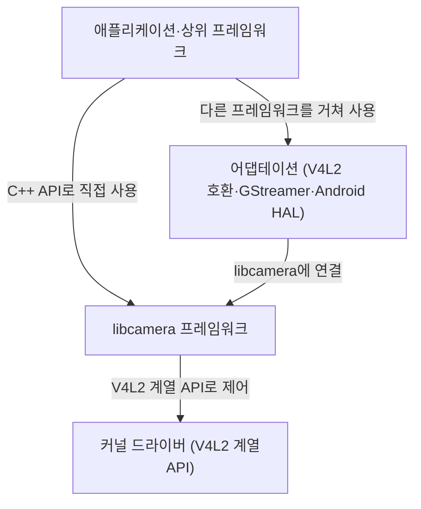

[Mermaid 원문](https://ttolsun.github.io/libcamera-sdd/team-overview.camera-stack.mmd)

<details open>
<summary>그림 근거와 확인 범위</summary>

애플리케이션에서 카메라 하드웨어까지 어떤 계층을 지납니까? 지원 기종이나 성능을 보장하는 그림은 아닙니다.

소스 연결 해석 · 자동 연결 검사만 통과 · 의미와 기기 실행은 검증 전

| 요소·전이 | 소스 근거 |
| --- | --- |
| 애플리케이션·상위 프레임워크 | [Documentation/introduction.rst:137](https://ttolsun.github.io/libcamera-sdd/reader-archive/team-overview.html#source-e3b563f549a8c46d) |
| 어댑테이션 (V4L2 호환·GStreamer·Android HAL) | [Documentation/introduction.rst:137](https://ttolsun.github.io/libcamera-sdd/reader-archive/team-overview.html#source-e3b563f549a8c46d) |
| libcamera 프레임워크 | [Documentation/introduction.rst:137](https://ttolsun.github.io/libcamera-sdd/reader-archive/team-overview.html#source-e3b563f549a8c46d) |
| 커널 드라이버 (V4L2 계열 API) | [Documentation/introduction.rst:137](https://ttolsun.github.io/libcamera-sdd/reader-archive/team-overview.html#source-e3b563f549a8c46d) |
| C++ API로 직접 사용 | [Documentation/introduction.rst:137](https://ttolsun.github.io/libcamera-sdd/reader-archive/team-overview.html#source-e3b563f549a8c46d) |
| 다른 프레임워크를 거쳐 사용 | [Documentation/introduction.rst:137](https://ttolsun.github.io/libcamera-sdd/reader-archive/team-overview.html#source-e3b563f549a8c46d) |
| libcamera에 연결 | [Documentation/introduction.rst:137](https://ttolsun.github.io/libcamera-sdd/reader-archive/team-overview.html#source-e3b563f549a8c46d) |
| V4L2 계열 API로 제어 | [Documentation/introduction.rst:137](https://ttolsun.github.io/libcamera-sdd/reader-archive/team-overview.html#source-e3b563f549a8c46d) |

</details>

libcamera는 Linux 기반 시스템에 카메라 스택을 제공하여, 카메라에서 원하는 결과를 얻는 데 필요한 하드웨어 설정과 이미지 제어 알고리즘을 커널 API를 통해 처리하는 작업을 추상화합니다. 이를 통해 개발자는 해당 작업을 간단하고 일관된 방식으로 수행할 수 있습니다. 카메라 스택은 아래에서 위로 커널 드라이버, libcamera 프레임워크, libcamera 적응 계층, 애플리케이션·상위 프레임워크의 네 계층으로 구성됩니다.

<details open>
<summary>절 전체 근거 4개</summary>

- `Documentation/introduction.rst`[`L10` 발췌](https://ttolsun.github.io/libcamera-sdd/reader-archive/team-overview.html#source-34fda84500757231) · [전체 소스 `L10`](https://github.com/TTolsun/libcamera-sdd/blob/adfa719f8ed67d18fd8a0739fc088a1f8b9e7252/Documentation/introduction.rst#L10) · [`L35` 발췌](https://ttolsun.github.io/libcamera-sdd/reader-archive/team-overview.html#source-de476c940b030e4a) · [전체 소스 `L35`](https://github.com/TTolsun/libcamera-sdd/blob/adfa719f8ed67d18fd8a0739fc088a1f8b9e7252/Documentation/introduction.rst#L35) · [`L45` 발췌](https://ttolsun.github.io/libcamera-sdd/reader-archive/team-overview.html#source-f350cabac0db8343) · [전체 소스 `L45`](https://github.com/TTolsun/libcamera-sdd/blob/adfa719f8ed67d18fd8a0739fc088a1f8b9e7252/Documentation/introduction.rst#L45) · [`L137` 발췌](https://ttolsun.github.io/libcamera-sdd/reader-archive/team-overview.html#source-e3b563f549a8c46d) · [전체 소스 `L137`](https://github.com/TTolsun/libcamera-sdd/blob/adfa719f8ed67d18fd8a0739fc088a1f8b9e7252/Documentation/introduction.rst#L137)

</details>

## 문서를 읽는 방법

절 전체 근거에서 **발췌**를 누르면 문서 안에서 원문이 펼쳐집니다. **전체 소스**를 누르면 분석한 커밋의 파일과 줄로 이동합니다. 용어는 [용어집](#doc-3)에서 확인하세요.

그림을 누르면 확대와 요소 검색을 사용할 수 있습니다. 관계 그림과 정적 호출 추적은 실제 실행 순서를 보장하지 않습니다. 전체 클래스는 [구성 요소 색인](#doc-9), 주요 호출과 추적 경계는 [핵심 시나리오](#doc-2)에 있습니다.

<details open>
<summary>검증 범위와 문서 상태</summary>

"자동 검사 통과"는 인용한 코드 위치와 문장 형식을 기계로 확인했다는 뜻이며, 사람의 내용 승인이 아닙니다. 문서 상단에 검토 상태를, 아래 생성 근거에 분석 커밋과 자동 검사 결과를 표시합니다. 코드 발췌와 대조한 설명도 내용이 맞는지 사람이 검토해야 합니다.

이 사이트는 공개 libcamera의 정적 분석 결과입니다. 실제 기기의 촬영·성능·오류 복구와 사내 HAL은 검증하지 않았습니다. 설계 선택의 이유와 성능 예산은 코드에 근거가 있을 때만 설명할 수 있습니다.

[모델 비교 기록](https://github.com/TTolsun/camera-hal-sdd-generator/blob/main/docs/libcamera/records/model-comparison.md)의 4B·9B 초안은 내용 오류가 남아 채택하지 않았습니다.

</details>

<details open>
<summary>생성과 배포</summary>

[생성기](https://github.com/TTolsun/camera-hal-sdd-generator)가 추출·검증·화면 구성을 담당하고, [공개 문서 저장소](https://github.com/TTolsun/libcamera-sdd)가 공개 입력의 이력과 산출물을 보관합니다. 공개 환경에는 정기 예약을 설치하지 않습니다.

원래 라이브러리 사용법은 [libcamera 공식 문서](https://docs.libcamera.org/master/)에서 확인하세요.

</details>

## 원고와 검토 기록

<details open>
<summary>이 프로젝트가 하는 일</summary>

- **생성 방식**: 추출 사실과 LLM 설명
- **검증 범위**: 표·그림은 facts로 만들고 설명은 LLM이 작성합니다. 인용·문장 및 설정된 구조 검사를 적용합니다.
- **자동 검사**: 통과 (`ok`). 검사한 항목은 검증 범위에 적혀 있습니다. 설명 내용이 맞는지는 사람이 확인합니다.
- **사람 검토**: 사람 검토 전
- **분석 기준 커밋**: `adfa719f8ed67d18fd8a0739fc088a1f8b9e7252`
- **문서 생성 시각**: `2026-11-11 20:35:47+00:00`
- **문장 생성 모델**: `cli/codex/gpt-6.1-terra`
- **문서 간 계약**: [자동 대조 보고서](https://ttolsun.github.io/libcamera-sdd/contract-consistency.json) · 사람 검토 전
- **독자 범위**: [과업별 답변과 미검토 범위](https://ttolsun.github.io/libcamera-sdd/reader-scope.json)

<details open>
<summary>원고 작성 당시 기록</summary>

원고에 저장된 당시 기록입니다. 현재 문서의 기준과 다를 수 있습니다.

- 근거 파일: `Documentation/introduction.rst`, `Documentation/libcamera_architecture.rst`, `include/libcamera/camera.h`, `include/libcamera/camera_manager.h`, `include/libcamera/internal/pipeline_handler.h`, `src/libcamera/camera.cpp`, `src/libcamera/camera_manager.cpp`, `src/libcamera/pipeline_handler.cpp`
- 근거 수준: 코드 확인 (정적 분석, simple_compdb 구성, commit `c19d05128f`)
- 자동 검사 (인용·문장 및 설정된 구조 검사): 통과
- 검토 상태 기록일: 2026-11-12 · 사람 검토 전

</details>

[Markdown 원문 ↗](https://ttolsun.github.io/libcamera-sdd/team-overview.md)

[이전 주소의 상세 내용 열기](https://ttolsun.github.io/libcamera-sdd/reader-archive/team-overview.html#page-evidence)

</details>

<details open>
<summary>libcamera 설계 문서</summary>

- **문서 간 계약**: [자동 대조 보고서](https://ttolsun.github.io/libcamera-sdd/contract-consistency.json) · 사람 검토 전

[이전 주소의 상세 내용 열기](https://ttolsun.github.io/libcamera-sdd/reader-archive/index.html#page-evidence)

</details>

[이 페이지 Markdown 받기](https://ttolsun.github.io/libcamera-sdd/index.md) · [독자용 문서의 원본 위치](https://ttolsun.github.io/libcamera-sdd/reader-edition.json)

<a id="doc-2"></a>

시작하기

# Architecture

카메라 스택의 계층과 각 구성 요소의 역할, 카메라 탐색 과정과 구성 요소 사이의 경계를 살펴보세요.

## 카메라 스택의 네 계층

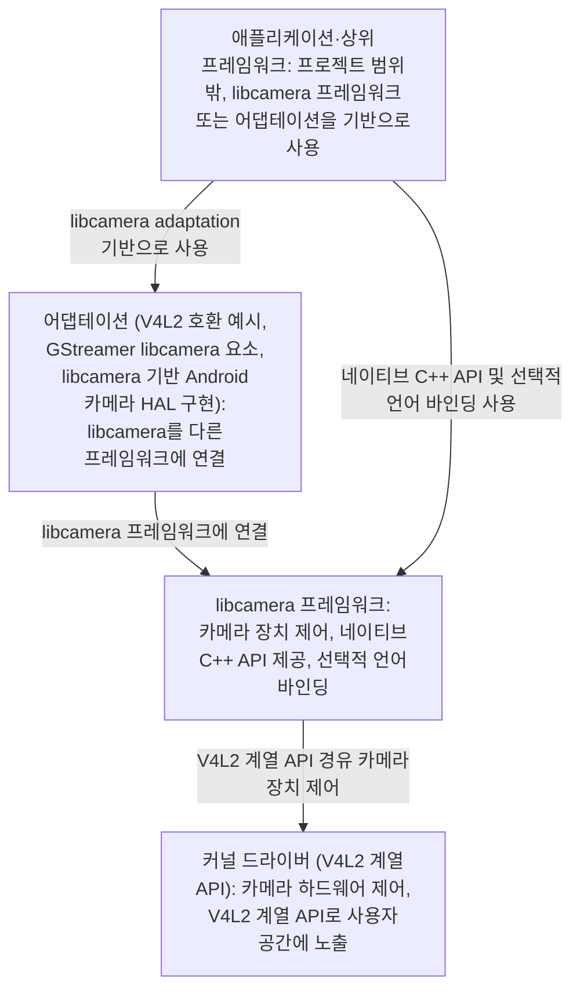

[Mermaid 원문](https://ttolsun.github.io/libcamera-sdd/index.camera-stack.mmd)

<details open>
<summary>그림 근거와 확인 범위</summary>

애플리케이션부터 커널 드라이버까지 네 소프트웨어 계층은 각각 어떤 역할을 맡습니까? 카메라 하드웨어 자체, 지원 기종, 성능은 이 그림의 범위가 아닙니다.

소스 연결 해석 · 자동 연결 검사만 통과 · 의미와 기기 실행은 검증 전

| 요소·전이 | 소스 근거 |
| --- | --- |
| 애플리케이션·상위 프레임워크: 프로젝트 범위 밖, libcamera 프레임워크 또는 어댑테이션을 기반으로 사용 | [Documentation/introduction.rst:137](https://ttolsun.github.io/libcamera-sdd/reader-archive/vendor-overview.html#source-e3b563f549a8c46d) |
| 어댑테이션 (V4L2 호환 예시, GStreamer libcamera 요소, libcamera 기반 Android 카메라 HAL 구현): libcamera를 다른 프레임워크에 연결 | [Documentation/introduction.rst:137](https://ttolsun.github.io/libcamera-sdd/reader-archive/vendor-overview.html#source-e3b563f549a8c46d) |
| libcamera 프레임워크: 카메라 장치 제어, 네이티브 C++ API 제공, 선택적 언어 바인딩 | [Documentation/introduction.rst:137](https://ttolsun.github.io/libcamera-sdd/reader-archive/vendor-overview.html#source-e3b563f549a8c46d) |
| 커널 드라이버 (V4L2 계열 API): 카메라 하드웨어 제어, V4L2 계열 API로 사용자 공간에 노출 | [Documentation/introduction.rst:137](https://ttolsun.github.io/libcamera-sdd/reader-archive/vendor-overview.html#source-e3b563f549a8c46d) |
| libcamera adaptation 기반으로 사용 | [Documentation/introduction.rst:137](https://ttolsun.github.io/libcamera-sdd/reader-archive/vendor-overview.html#source-e3b563f549a8c46d) |
| libcamera 프레임워크에 연결 | [Documentation/introduction.rst:137](https://ttolsun.github.io/libcamera-sdd/reader-archive/vendor-overview.html#source-e3b563f549a8c46d) |
| V4L2 계열 API 경유 카메라 장치 제어 | [Documentation/introduction.rst:137](https://ttolsun.github.io/libcamera-sdd/reader-archive/vendor-overview.html#source-e3b563f549a8c46d) |
| 네이티브 C++ API 및 선택적 언어 바인딩 사용 | [Documentation/introduction.rst:137](https://ttolsun.github.io/libcamera-sdd/reader-archive/vendor-overview.html#source-e3b563f549a8c46d) |

</details>

## 컴포넌트별 책임

`Camera`는 하나의 이미지 소스에서 하나 이상의 이미지 스트림을 생성할 수 있는 카메라를 모델링하며, 장치 설정과 제어 및 이미지 스트림 캡처를 위한 주 인터페이스를 제공하는 libcamera의 중심 객체입니다. libcamera는 카메라 인스턴스의 수명을 `std::shared_ptr<>`로 관리하며, 인스턴스는 공유 포인터를 반환하는 `create()` 함수로 생성해야 합니다. `Camera`의 생성자와 소멸자는 비공개이므로 인스턴스를 수동으로 생성하거나 파괴할 수 없습니다.

<details open>
<summary>절 전체 근거 1개</summary>

- `src/libcamera/camera.cpp`[`L758` 발췌](https://ttolsun.github.io/libcamera-sdd/reader-archive/overview.html#source-6c066281dcce33d6) · [전체 소스 `L758`](https://github.com/TTolsun/libcamera-sdd/blob/adfa719f8ed67d18fd8a0739fc088a1f8b9e7252/src/libcamera/camera.cpp#L758)

</details>

## <a id="d2-discovery"></a>탐색과 파이프라인 선택

`CameraManager`는 libcamera의 진입점으로, 장치를 열거하고 파이프라인과 연결하며 애플리케이션이 시스템의 카메라에 접근할 수 있게 합니다. `CameraManager::Private::pipelineFactoryMatch`는 팩토리에서 `PipelineHandler`를 반복해서 생성하고 `enumerator_`로 일치를 확인하며, 일치하지 않으면 반복을 끝냅니다. `CameraManager` 인스턴스는 동시에 하나만 존재할 수 있습니다. 기존 인스턴스를 삭제하지 않고 두 번째 인스턴스를 생성하려고 하면 동작이 정의되지 않습니다.

### 장치 탐색에서 Camera 접근까지

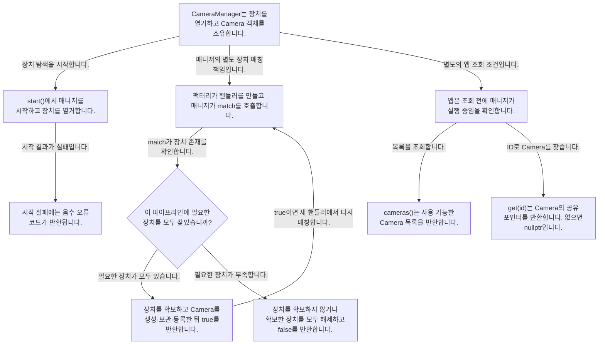

[Mermaid 원문](https://ttolsun.github.io/libcamera-sdd/overview.discovery-map.mmd)

<details open>
<summary>그림 근거와 확인 범위</summary>

CameraManager는 어떻게 장치를 매칭하고 카메라를 등록하며, 앱은 어떤 조건에서 카메라를 조회할 수 있습니까?

소스 연결 해석 · 자동 연결 검사만 통과 · 의미와 기기 실행은 검증 전

| 요소·전이 | 소스 근거 |
| --- | --- |
| CameraManager는 장치를 열거하고 Camera 객체를 소유합니다. | [src/libcamera/camera_manager.cpp:283](https://ttolsun.github.io/libcamera-sdd/reader-archive/overview.html#source-f75d22cf73f3402d) |
| start()에서 매니저를 시작하고 장치를 열거합니다. | [src/libcamera/camera_manager.cpp:329](https://ttolsun.github.io/libcamera-sdd/reader-archive/overview.html#source-f58d94d893e03971) |
| 시작 실패에는 음수 오류 코드가 반환됩니다. | [src/libcamera/camera_manager.cpp:329](https://ttolsun.github.io/libcamera-sdd/reader-archive/overview.html#source-f58d94d893e03971) |
| 팩터리가 핸들러를 만들고 매니저가 match를 호출합니다. | [src/libcamera/camera_manager.cpp:154](https://ttolsun.github.io/libcamera-sdd/reader-archive/overview.html#source-0c01857bf49370e2) |
| 이 파이프라인에 필요한 장치를 모두 찾았습니까? | [src/libcamera/pipeline_handler.cpp:86](https://ttolsun.github.io/libcamera-sdd/reader-archive/overview.html#source-5bbd41c1e725138c) |
| 장치를 확보하고 Camera를 생성·보관·등록한 뒤 true를 반환합니다. | [src/libcamera/pipeline_handler.cpp:86](https://ttolsun.github.io/libcamera-sdd/reader-archive/overview.html#source-5bbd41c1e725138c) |
| 장치를 확보하지 않거나 확보한 장치를 모두 해제하고 false를 반환합니다. | [src/libcamera/pipeline_handler.cpp:86](https://ttolsun.github.io/libcamera-sdd/reader-archive/overview.html#source-5bbd41c1e725138c) |
| 앱은 조회 전에 매니저가 실행 중임을 확인합니다. | [src/libcamera/camera_manager.cpp:329](https://ttolsun.github.io/libcamera-sdd/reader-archive/overview.html#source-f58d94d893e03971) · [src/libcamera/camera_manager.cpp:368](https://ttolsun.github.io/libcamera-sdd/reader-archive/overview.html#source-0c733673790ad84f) |
| cameras()는 사용 가능한 Camera 목록을 반환합니다. | [src/libcamera/camera_manager.cpp:368](https://ttolsun.github.io/libcamera-sdd/reader-archive/overview.html#source-0c733673790ad84f) |
| get(id)는 Camera의 공유 포인터를 반환합니다. 없으면 nullptr입니다. | [src/libcamera/camera_manager.cpp:368](https://ttolsun.github.io/libcamera-sdd/reader-archive/overview.html#source-0c733673790ad84f) |
| 장치 탐색을 시작합니다. | [src/libcamera/camera_manager.cpp:283](https://ttolsun.github.io/libcamera-sdd/reader-archive/overview.html#source-f75d22cf73f3402d) · [src/libcamera/camera_manager.cpp:329](https://ttolsun.github.io/libcamera-sdd/reader-archive/overview.html#source-f58d94d893e03971) |
| 매니저의 별도 장치 매칭 책임입니다. | [src/libcamera/camera_manager.cpp:283](https://ttolsun.github.io/libcamera-sdd/reader-archive/overview.html#source-f75d22cf73f3402d) · [src/libcamera/camera_manager.cpp:154](https://ttolsun.github.io/libcamera-sdd/reader-archive/overview.html#source-0c01857bf49370e2) |
| 시작 결과가 실패입니다. | [src/libcamera/camera_manager.cpp:329](https://ttolsun.github.io/libcamera-sdd/reader-archive/overview.html#source-f58d94d893e03971) |
| match가 장치 존재를 확인합니다. | [src/libcamera/camera_manager.cpp:154](https://ttolsun.github.io/libcamera-sdd/reader-archive/overview.html#source-0c01857bf49370e2) · [src/libcamera/pipeline_handler.cpp:86](https://ttolsun.github.io/libcamera-sdd/reader-archive/overview.html#source-5bbd41c1e725138c) |
| 필요한 장치가 모두 있습니다. | [src/libcamera/pipeline_handler.cpp:86](https://ttolsun.github.io/libcamera-sdd/reader-archive/overview.html#source-5bbd41c1e725138c) |
| 필요한 장치가 부족합니다. | [src/libcamera/pipeline_handler.cpp:86](https://ttolsun.github.io/libcamera-sdd/reader-archive/overview.html#source-5bbd41c1e725138c) |
| true이면 새 핸들러에서 다시 매칭합니다. | [src/libcamera/pipeline_handler.cpp:86](https://ttolsun.github.io/libcamera-sdd/reader-archive/overview.html#source-5bbd41c1e725138c) · [src/libcamera/camera_manager.cpp:154](https://ttolsun.github.io/libcamera-sdd/reader-archive/overview.html#source-0c01857bf49370e2) |
| 별도의 앱 조회 조건입니다. | [src/libcamera/camera_manager.cpp:283](https://ttolsun.github.io/libcamera-sdd/reader-archive/overview.html#source-f75d22cf73f3402d) · [src/libcamera/camera_manager.cpp:329](https://ttolsun.github.io/libcamera-sdd/reader-archive/overview.html#source-f58d94d893e03971) · [src/libcamera/camera_manager.cpp:368](https://ttolsun.github.io/libcamera-sdd/reader-archive/overview.html#source-0c733673790ad84f) |
| 목록을 조회합니다. | [src/libcamera/camera_manager.cpp:329](https://ttolsun.github.io/libcamera-sdd/reader-archive/overview.html#source-f58d94d893e03971) · [src/libcamera/camera_manager.cpp:368](https://ttolsun.github.io/libcamera-sdd/reader-archive/overview.html#source-0c733673790ad84f) |
| ID로 Camera를 찾습니다. | [src/libcamera/camera_manager.cpp:329](https://ttolsun.github.io/libcamera-sdd/reader-archive/overview.html#source-f58d94d893e03971) · [src/libcamera/camera_manager.cpp:368](https://ttolsun.github.io/libcamera-sdd/reader-archive/overview.html#source-0c733673790ad84f) |

</details>

애플리케이션은 `CameraManager::start()`의 시작이 확인된 뒤부터 카메라 관리자가 중지되거나 해당 카메라가 시스템에서 분리될 때까지 카메라를 나열하고 사용할 수 있습니다. 호출자는 `CameraManager::cameras()`와 `CameraManager::get()`을 호출하기 전에 카메라 매니저가 실행 중인지 확인해야 합니다. `PipelineHandler::match()` 구현자는 필요한 미디어 장치를 모두 찾으면 각 장치를 `MediaDevice::acquire()`로 획득하고, 해당 `Camera` 인스턴스를 생성해 내부에 저장하고 카메라 관리자에 등록한 뒤 `true`를 반환해야 합니다. 필요한 장치를 모두 찾지 못하면 `match()` 구현자는 어떤 미디어 장치도 획득하지 않거나 이미 획득한 장치를 `MediaDevice::release()`로 모두 해제하고 `false`를 반환해야 합니다.

<details open>
<summary>절 전체 근거 5개</summary>

- `src/libcamera/camera_manager.cpp`[`L283` 발췌](https://ttolsun.github.io/libcamera-sdd/reader-archive/overview.html#source-f75d22cf73f3402d) · [전체 소스 `L283`](https://github.com/TTolsun/libcamera-sdd/blob/adfa719f8ed67d18fd8a0739fc088a1f8b9e7252/src/libcamera/camera_manager.cpp#L283) · [`L154` 발췌](https://ttolsun.github.io/libcamera-sdd/reader-archive/overview.html#source-0c01857bf49370e2) · [전체 소스 `L154`](https://github.com/TTolsun/libcamera-sdd/blob/adfa719f8ed67d18fd8a0739fc088a1f8b9e7252/src/libcamera/camera_manager.cpp#L154) · [`L329` 발췌](https://ttolsun.github.io/libcamera-sdd/reader-archive/overview.html#source-f58d94d893e03971) · [전체 소스 `L329`](https://github.com/TTolsun/libcamera-sdd/blob/adfa719f8ed67d18fd8a0739fc088a1f8b9e7252/src/libcamera/camera_manager.cpp#L329) · [`L368` 발췌](https://ttolsun.github.io/libcamera-sdd/reader-archive/overview.html#source-0c733673790ad84f) · [전체 소스 `L368`](https://github.com/TTolsun/libcamera-sdd/blob/adfa719f8ed67d18fd8a0739fc088a1f8b9e7252/src/libcamera/camera_manager.cpp#L368)
- `src/libcamera/pipeline_handler.cpp`[`L86` 발췌](https://ttolsun.github.io/libcamera-sdd/reader-archive/overview.html#source-5bbd41c1e725138c) · [전체 소스 `L86`](https://github.com/TTolsun/libcamera-sdd/blob/adfa719f8ed67d18fd8a0739fc088a1f8b9e7252/src/libcamera/pipeline_handler.cpp#L86)

</details>

## 다른 팀·계층과의 경계

libcamera 프레임워크(소프트웨어 개발의 기반 구조) 또는 libcamera를 맞춰 적용한 것을 기반으로 하는 애플리케이션(응용 프로그램)과 상위 수준 프레임워크는 libcamera 프로젝트의 범위 밖에 있습니다.

### 다른 팀·계층과의 경계의 관계와 경계

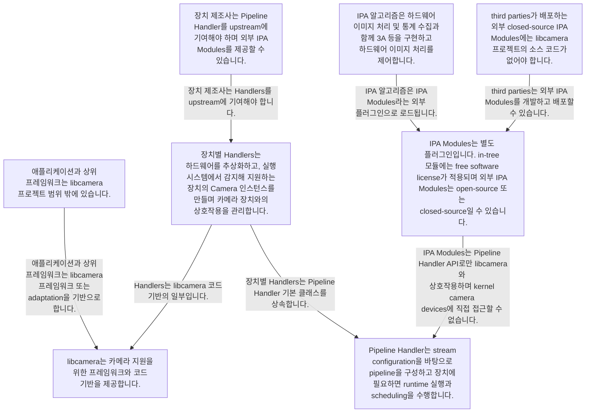

[Mermaid 원문](https://ttolsun.github.io/libcamera-sdd/team-overview.item-boundaries.mmd)

<details open>
<summary>그림 근거와 확인 범위</summary>

애플리케이션, libcamera, 장치 제조사, Pipeline Handler와 IPA Module 사이에서 프로젝트 범위와 책임은 어떻게 나뉩니까?

소스 연결 해석 · 자동 연결 검사만 통과 · 의미와 기기 실행은 검증 전

| 요소·전이 | 소스 근거 |
| --- | --- |
| 애플리케이션과 상위 프레임워크는 libcamera 프로젝트 범위 밖에 있습니다. | [Documentation/introduction.rst:163](https://ttolsun.github.io/libcamera-sdd/reader-archive/team-overview.html#source-9e653b8ff755db78) |
| libcamera는 카메라 지원을 위한 프레임워크와 코드 기반을 제공합니다. | [Documentation/introduction.rst:163](https://ttolsun.github.io/libcamera-sdd/reader-archive/team-overview.html#source-9e653b8ff755db78) · [Documentation/introduction.rst:200](https://ttolsun.github.io/libcamera-sdd/reader-archive/team-overview.html#source-341442e08591ef50) |
| 장치 제조사는 Pipeline Handler를 upstream에 기여해야 하며 외부 IPA Modules를 제공할 수 있습니다. | [Documentation/introduction.rst:200](https://ttolsun.github.io/libcamera-sdd/reader-archive/team-overview.html#source-341442e08591ef50) · [Documentation/libcamera_architecture.rst:109](https://ttolsun.github.io/libcamera-sdd/reader-archive/team-overview.html#source-1f130cc8640ef810) |
| 장치별 Handlers는 하드웨어를 추상화하고, 실행 시스템에서 감지해 지원하는 장치의 Camera 인스턴스를 만들며 카메라 장치와의 상호작용을 관리합니다. | [Documentation/libcamera_architecture.rst:87](https://ttolsun.github.io/libcamera-sdd/reader-archive/team-overview.html#source-8bd888bd0473995e) |
| Pipeline Handler는 stream configuration을 바탕으로 pipeline을 구성하고 장치에 필요하면 runtime 실행과 scheduling을 수행합니다. | [Documentation/libcamera_architecture.rst:87](https://ttolsun.github.io/libcamera-sdd/reader-archive/team-overview.html#source-8bd888bd0473995e) |
| IPA 알고리즘은 하드웨어 이미지 처리 및 통계 수집과 함께 3A 등을 구현하고 하드웨어 이미지 처리를 제어합니다. | [Documentation/libcamera_architecture.rst:109](https://ttolsun.github.io/libcamera-sdd/reader-archive/team-overview.html#source-1f130cc8640ef810) |
| IPA Modules는 별도 플러그인입니다. in-tree 모듈에는 free software license가 적용되며 외부 IPA Modules는 open-source 또는 closed-source일 수 있습니다. | [Documentation/libcamera_architecture.rst:109](https://ttolsun.github.io/libcamera-sdd/reader-archive/team-overview.html#source-1f130cc8640ef810) · [Documentation/introduction.rst:200](https://ttolsun.github.io/libcamera-sdd/reader-archive/team-overview.html#source-341442e08591ef50) |
| third parties가 배포하는 외부 closed-source IPA Modules에는 libcamera 프로젝트의 소스 코드가 없어야 합니다. | [Documentation/introduction.rst:200](https://ttolsun.github.io/libcamera-sdd/reader-archive/team-overview.html#source-341442e08591ef50) |
| 애플리케이션과 상위 프레임워크는 libcamera 프레임워크 또는 adaptation을 기반으로 합니다. | [Documentation/introduction.rst:163](https://ttolsun.github.io/libcamera-sdd/reader-archive/team-overview.html#source-9e653b8ff755db78) |
| Handlers는 libcamera 코드 기반의 일부입니다. | [Documentation/introduction.rst:200](https://ttolsun.github.io/libcamera-sdd/reader-archive/team-overview.html#source-341442e08591ef50) |
| 장치 제조사는 Handlers를 upstream에 기여해야 합니다. | [Documentation/introduction.rst:200](https://ttolsun.github.io/libcamera-sdd/reader-archive/team-overview.html#source-341442e08591ef50) |
| 장치별 Handlers는 Pipeline Handler 기본 클래스를 상속합니다. | [Documentation/libcamera_architecture.rst:87](https://ttolsun.github.io/libcamera-sdd/reader-archive/team-overview.html#source-8bd888bd0473995e) |
| IPA 알고리즘은 IPA Modules라는 외부 플러그인으로 로드됩니다. | [Documentation/libcamera_architecture.rst:109](https://ttolsun.github.io/libcamera-sdd/reader-archive/team-overview.html#source-1f130cc8640ef810) |
| third parties는 외부 IPA Modules를 개발하고 배포할 수 있습니다. | [Documentation/introduction.rst:200](https://ttolsun.github.io/libcamera-sdd/reader-archive/team-overview.html#source-341442e08591ef50) |
| IPA Modules는 Pipeline Handler API로만 libcamera와 상호작용하며 kernel camera devices에 직접 접근할 수 없습니다. | [Documentation/libcamera_architecture.rst:120](https://ttolsun.github.io/libcamera-sdd/reader-archive/team-overview.html#source-6c10d5aeb8fc7ca9) · [Documentation/libcamera_architecture.rst:109](https://ttolsun.github.io/libcamera-sdd/reader-archive/team-overview.html#source-1f130cc8640ef810) |

</details>

Pipeline Handler(파이프라인 처리기)는 장치별 파이프라인을 관리하며, 장치 제조사는 이를 libcamera에 기여해야 합니다. 이미지 처리 알고리즘(`Image` Processing Algorithms, IPA)은 상위 계층의 매개변수를 바탕으로 하드웨어 이미지 처리를 제어하며, IPA `Module`(IPA 모듈)은 외부에서 별도로 제공할 수 있습니다. libcamera에 포함된 IPA `Module`에는 자유 소프트웨어 라이선스가 적용되며, 외부 모듈은 libcamera 프로젝트의 소스 코드를 포함하지 않는 조건으로 비공개 소스 라이선스로 배포할 수 있습니다. IPA `Module`은 libcamera와 Pipeline Handler가 제공하는 API(응용 프로그램 인터페이스)로만 상호작용하며 kernel camera devices(커널 카메라 장치)에 직접 접근할 수 없습니다.

<details open>
<summary>절 전체 근거 5개</summary>

- `Documentation/introduction.rst`[`L163` 발췌](https://ttolsun.github.io/libcamera-sdd/reader-archive/team-overview.html#source-9e653b8ff755db78) · [전체 소스 `L163`](https://github.com/TTolsun/libcamera-sdd/blob/adfa719f8ed67d18fd8a0739fc088a1f8b9e7252/Documentation/introduction.rst#L163) · [`L200` 발췌](https://ttolsun.github.io/libcamera-sdd/reader-archive/team-overview.html#source-341442e08591ef50) · [전체 소스 `L200`](https://github.com/TTolsun/libcamera-sdd/blob/adfa719f8ed67d18fd8a0739fc088a1f8b9e7252/Documentation/introduction.rst#L200)
- `Documentation/libcamera_architecture.rst`[`L87` 발췌](https://ttolsun.github.io/libcamera-sdd/reader-archive/team-overview.html#source-8bd888bd0473995e) · [전체 소스 `L87`](https://github.com/TTolsun/libcamera-sdd/blob/adfa719f8ed67d18fd8a0739fc088a1f8b9e7252/Documentation/libcamera_architecture.rst#L87) · [`L109` 발췌](https://ttolsun.github.io/libcamera-sdd/reader-archive/team-overview.html#source-1f130cc8640ef810) · [전체 소스 `L109`](https://github.com/TTolsun/libcamera-sdd/blob/adfa719f8ed67d18fd8a0739fc088a1f8b9e7252/Documentation/libcamera_architecture.rst#L109) · [`L120` 발췌](https://ttolsun.github.io/libcamera-sdd/reader-archive/team-overview.html#source-6c10d5aeb8fc7ca9) · [전체 소스 `L120`](https://github.com/TTolsun/libcamera-sdd/blob/adfa719f8ed67d18fd8a0739fc088a1f8b9e7252/Documentation/libcamera_architecture.rst#L120)

</details>

## 선택한 시나리오의 코드 읽기 순서

1. 진입점 `Camera::queueRequest(Request *)`의 입력 검사와 반환 조건을 확인합니다.
2. [요청 제출 (Camera::queueRequest)](#doc-8)에서 주요 호출과 추적 경계를 확인합니다.
3. 예약된 호출과 완료 통지를 구분하고, 실행 스레드는 연결 코드와 대조합니다.

## 원고와 검토 기록

<details open>
<summary>libcamera 설계 문서</summary>

- **문서 간 계약**: [자동 대조 보고서](https://ttolsun.github.io/libcamera-sdd/contract-consistency.json) · 사람 검토 전

[이전 주소의 상세 내용 열기](https://ttolsun.github.io/libcamera-sdd/reader-archive/index.html#page-evidence)

</details>

<details open>
<summary>시스템 개요</summary>

- **생성 방식**: 추출 사실과 LLM 설명
- **검증 범위**: 표·그림은 facts로 만들고 설명은 LLM이 작성합니다. 인용·문장 및 설정된 구조 검사를 적용합니다.
- **자동 검사**: 통과 (`ok`). 검사한 항목은 검증 범위에 적혀 있습니다. 설명 내용이 맞는지는 사람이 확인합니다.
- **사람 검토**: 사람 검토 전
- **분석 기준 커밋**: `adfa719f8ed67d18fd8a0739fc088a1f8b9e7252`
- **문서 생성 시각**: `2026-11-20 17:39:13+00:00`
- **문장 생성 모델**: `cli/codex/gpt-6.1-terra`
- **문서 간 계약**: [자동 대조 보고서](https://ttolsun.github.io/libcamera-sdd/contract-consistency.json) · 사람 검토 전
- **독자 범위**: [과업별 답변과 미검토 범위](https://ttolsun.github.io/libcamera-sdd/reader-scope.json)

<details open>
<summary>원고 작성 당시 기록</summary>

원고에 저장된 당시 기록입니다. 현재 문서의 기준과 다를 수 있습니다.

- 근거 파일: `include/libcamera/camera.h`, `include/libcamera/camera_manager.h`, `include/libcamera/internal/ipa_manager.h`, `include/libcamera/internal/pipeline_handler.h`, `include/libcamera/request.h`, `src/libcamera/base/log.cpp`, `src/libcamera/camera.cpp`, `src/libcamera/camera_manager.cpp`, `src/libcamera/controls.cpp`, `src/libcamera/ipa_manager.cpp`, `src/libcamera/pipeline_handler.cpp`, `src/libcamera/request.cpp`
- 근거 수준: 코드 확인 (정적 분석, simple_compdb 구성, commit `adfa719f8e`)
- 자동 검사 (인용·문장 및 설정된 구조 검사): 통과
- 검토 상태 기록일: 2026-11-21 · 사람 검토 전

</details>

[Markdown 원문 ↗](https://ttolsun.github.io/libcamera-sdd/overview.md) [Mermaid 원문 ↗](https://ttolsun.github.io/libcamera-sdd/overview.mmd)

[이전 주소의 상세 내용 열기](https://ttolsun.github.io/libcamera-sdd/reader-archive/overview.html#page-evidence)

</details>

<details open>
<summary>이 프로젝트가 하는 일</summary>

- **생성 방식**: 추출 사실과 LLM 설명
- **검증 범위**: 표·그림은 facts로 만들고 설명은 LLM이 작성합니다. 인용·문장 및 설정된 구조 검사를 적용합니다.
- **자동 검사**: 통과 (`ok`). 검사한 항목은 검증 범위에 적혀 있습니다. 설명 내용이 맞는지는 사람이 확인합니다.
- **사람 검토**: 사람 검토 전
- **분석 기준 커밋**: `adfa719f8ed67d18fd8a0739fc088a1f8b9e7252`
- **문서 생성 시각**: `2026-11-11 20:35:47+00:00`
- **문장 생성 모델**: `cli/codex/gpt-6.1-terra`
- **문서 간 계약**: [자동 대조 보고서](https://ttolsun.github.io/libcamera-sdd/contract-consistency.json) · 사람 검토 전
- **독자 범위**: [과업별 답변과 미검토 범위](https://ttolsun.github.io/libcamera-sdd/reader-scope.json)

<details open>
<summary>원고 작성 당시 기록</summary>

원고에 저장된 당시 기록입니다. 현재 문서의 기준과 다를 수 있습니다.

- 근거 파일: `Documentation/introduction.rst`, `Documentation/libcamera_architecture.rst`, `include/libcamera/camera.h`, `include/libcamera/camera_manager.h`, `include/libcamera/internal/pipeline_handler.h`, `src/libcamera/camera.cpp`, `src/libcamera/camera_manager.cpp`, `src/libcamera/pipeline_handler.cpp`
- 근거 수준: 코드 확인 (정적 분석, simple_compdb 구성, commit `c19d05128f`)
- 자동 검사 (인용·문장 및 설정된 구조 검사): 통과
- 검토 상태 기록일: 2026-11-12 · 사람 검토 전

</details>

[Markdown 원문 ↗](https://ttolsun.github.io/libcamera-sdd/team-overview.md)

[이전 주소의 상세 내용 열기](https://ttolsun.github.io/libcamera-sdd/reader-archive/team-overview.html#page-evidence)

</details>

[이 페이지 Markdown 받기](https://ttolsun.github.io/libcamera-sdd/architecture.md) · [독자용 문서의 원본 위치](https://ttolsun.github.io/libcamera-sdd/reader-edition.json)

<a id="doc-3"></a>

시작하기

# 용어집

**문서에 나오는 약어와 분야 용어의 뜻을 모았습니다.**

본문에서 밑줄이 그어진 용어를 누르면 그 자리에서 뜻을 볼 수 있습니다. 문서 찾기에서 용어 이름으로 검색할 수도 있습니다.

바로가기: [0–9](#d3-term-3a) · [A](#d3-term-af) · [B](#d3-term-bayer) · [C](#d3-term-ccm) · [D](#d3-term-debug) · [E](#d3-term-ebusy) · [F](#d3-term-fbo) · [G](#d3-term-gb) · [H](#d3-term-hal) · [I](#d3-term-ipa) · [L](#d3-term-log) · [M](#d3-term-mali-c55) · [N](#d3-term-nv12) · [O](#d3-term-omm) · [P](#d3-term-pending) · [Q](#d3-term-qbuf) · [R](#d3-term-raw) · [S](#d3-term-streamoff) · [T](#d3-term-tid) · [U](#d3-term-udmabuf) · [V](#d3-term-v4l2) · [W](#d3-term-wsl) · [ㄷ](#d3-term-%EB%94%94%EB%B2%A0%EC%9D%B4%EC%96%B4) · [ㅁ](#d3-term-%EB%A9%94%ED%83%80%EB%8D%B0%EC%9D%B4%ED%84%B0) · [ㅂ](#d3-term-%EB%B8%94%EB%9E%99-%EB%A0%88%EB%B2%A8) · [ㅅ](#d3-term-%EC%85%B0%EC%9D%B4%EB%8D%94) · [ㅇ](#d3-term-%EC%99%9C%EA%B3%A1-%EB%B3%B4%EC%A0%95) · [ㅋ](#d3-term-%EC%BB%A8%ED%8A%B8%EB%A1%A4-%EC%A0%95%EB%B3%B4-%EB%A7%B5) · [ㅌ](#d3-term-%ED%8A%9C%EB%8B%9D-%ED%8C%8C%EC%9D%BC) · [ㅍ](#d3-term-%ED%94%84%EB%A0%88%EC%9E%84-%EB%B2%84%ED%8D%BC) · [ㅎ](#d3-term-%ED%99%9C%EC%84%B1-%EC%8A%A4%ED%8A%B8%EB%A6%BC)

- <a id="d3-term-3a"></a>**3A**: 자동 노출(AE·AGC), 자동 화이트 밸런스(AWB), 자동 초점(AF)을 함께 부르는 말입니다. IPA가 계산하는 대표 알고리즘입니다.
- <a id="d3-term-af"></a>**AF** (Auto Focus): 렌즈 위치를 움직여 초점을 맞추는 알고리즘입니다.
- **AGC** (Automatic Gain Control): 장면 밝기에 맞춰 노출 시간과 센서 게인을 정하는 자동 노출 알고리즘입니다.
- **ASSERT**: libcamera의 디버그 검사 매크로입니다. 디버그 빌드에서 조건이 거짓이면 치명적 로그를 남기고 실행을 중단합니다.
- **AWB** (Auto White Balance): 조명의 색온도를 추정하고, 흰색이 흰색으로 보이도록 R·G·B 채널별 게인을 정하는 알고리즘입니다.
- <a id="d3-term-bayer"></a>**bayer**: 센서의 화소마다 R·G·B 중 한 색만 기록하는 색 필터 배열입니다. 이 형식의 원시 데이터는 디베이어를 거쳐야 화소마다 RGB 값을 가집니다.
- <a id="d3-term-ccm"></a>**CCM**: IPU3 컬러 교정 행렬 알고리즘을 의미합니다.
- <a id="d3-term-debug"></a>**DEBUG**: 로그의 심각도 수준 중 가장 자세한 진단 정보를 뜻하는 이름입니다. 로그 수준 환경 변수에 \`DEBUG\`를 지정하면 상세한 로그를 얻습니다.
- **DMA** (Direct Memory Access): DMA(Direct Memory Access)는 I/O 장치가 시스템 메모리를 직접 읽거나 쓰는 방식을 뜻하는 용어입니다.
- **DQBUF**: DQBUF는 V4L2 장치에서 다음 사용 가능한 버퍼를 꺼내도록 요청하는 ioctl 명령입니다.
- **DRM** (Direct Rendering Manager): Linux 그래픽 장치를 관리하는 커널 하위 시스템입니다. DRM 픽셀 형식은 버퍼 안의 채널 배치를 식별합니다.
- **DW100**: 좌표 표에 따라 영상을 다시 배치해 왜곡을 보정하는 별도 하드웨어 장치입니다. NXP i.MX8MP 등에 들어 있습니다.
- <a id="d3-term-ebusy"></a>**EBUSY**: 이미 버퍼가 할당된 스트림에 대해 FrameBufferAllocator::allocate()를 다시 호출하면 -EBUSY를 반환합니다.
- **EEXIST**: 버퍼에 아직 해제되지 않은 펜스가 남아있거나 동일한 스트림에 이미 버퍼가 등록되어 있을 때 -EEXIST 오류를 반환합니다.
- **EGL**: 그래픽 API와 운영 환경의 디스플레이·이미지·버퍼를 연결하는 인터페이스입니다. 이 문서에서는 공유 버퍼를 그래픽 이미지로 가져오는 경계를 다룹니다.
- **errno**: Linux 함수가 실패 원인을 알리는 표준 오류 번호입니다. libcamera 함수는 이 값을 음수로 돌려줍니다. 예를 들어 -ENODEV는 장치 없음, -EACCES는 접근 거부, -EINVAL은 잘못된 인자, -ENOMEM은 메모리 부족, -EXDEV는 다른 객체에 속한 자원을 뜻합니다.
- **ETIMEDOUT**: IPC 응답 대기 타이머가 만료됐음을 나타내는 오류 코드입니다. 이 문서의 타이머 설정값은 2000ms입니다.
- <a id="d3-term-fbo"></a>**FBO**: 텍처를 부착할 프레임 버퍼 객체를 의미합니다.
- **fence**: 버퍼를 사용해도 되는 시점을 알리는 동기화 신호입니다. 요청에 유효한 fence가 연결돼 있으면 준비 단계에서 신호를 기다립니다. 요청 완료 신호와는 다릅니다.
- **FPS**: 초당 프레임 수입니다.
- <a id="d3-term-gb"></a>**GB**: 렌즈 음영 보정 표의 녹색 B 음영 계수를 의미합니다.
- **GCC** (GNU Compiler Collection): C, C++ 등의 프론트엔드를 포함하는 GNU 컴파일러 모음입니다.
- **GDB** (GNU Project Debugger): 지정한 조건에서 프로그램을 멈추게 하고, 멈춘 뒤 실행 상태를 살펴볼 수 있는 GNU 디버거입니다.
- **GL**: OpenGL 계열 그래픽 API의 식별자에 쓰이는 접두사입니다. 이 문서의 GL 형식은 텍스처의 채널 구성을 나타냅니다.
- **GNU** (GNU's Not Unix): GNU는 자유 소프트웨어로 이루어진 운영체제입니다. 이름은 재귀적 약어로, GNU's Not Unix를 뜻합니다.
- **GR**: 렌즈 음영 보정 표의 녹색 R 음영 계수를 의미합니다.
- <a id="d3-term-hal"></a>**HAL** (Hardware Abstraction Layer): 운영체제가 제조사마다 다른 하드웨어를 같은 인터페이스로 다루게 하는 계층입니다. 이 프로젝트의 최종 적용 대상은 사내 Android Camera HAL입니다.
- <a id="d3-term-ipa"></a>**IPA** (Image Processing Algorithms): 화질 알고리즘을 담은 별도 모듈(.so)입니다. ISP가 보낸 통계를 보고 다음 프레임에 쓸 ISP 설정값을 계산합니다. 제조사가 소스를 공개하지 않고 제공할 수 있도록 libcamera 본체와 분리되어 있습니다.
- **IPC** (Inter-Process Communication): 서로 다른 프로세스가 메시지를 주고받는 방식입니다. 서명이 없는 IPA 모듈은 별도 프로세스에서 실행되므로 libcamera가 IPC로 호출합니다.
- **IPU** (Image Processing Unit): Intel의 이미지 처리 장치 계열 이름입니다. IPU3와 IPU6처럼 세대 번호가 붙습니다.
- **IPU3** (Intel Image Processing Unit 3): 일부 Intel 노트북 프로세서에 들어 있는 카메라 ISP입니다. libcamera에는 이 장치용 Pipeline Handler와 IPA가 있습니다.
- **IPU6**: Intel 이미지 처리 장치(IPU)의 한 세대입니다. 공식 문서에는 전용 핸들러 대신 simple 파이프라인의 지원 대상으로 나옵니다.
- **ISP** (Image Signal Processor): 센서가 출력한 원시(bayer) 데이터를 화면에 쓸 수 있는 영상으로 바꾸는 처리 장치입니다. 블랙 레벨 보정, 렌즈 음영 보정, 화이트 밸런스, 디베이어 등을 수행합니다.
- <a id="d3-term-log"></a>**LOG**: 호출자가 지정하는 카테고리와 심각도 수준을 사용합니다.
- **LSC** (Lens Shading Correction): 렌즈 특성 때문에 영상 가장자리가 중앙보다 어둡거나 색이 틀어지는 현상(렌즈 음영)을 보정하는 처리입니다. 화면을 격자로 나눈 보정 표를 곱해서 적용합니다.
- **LUT** (Look-Up Table): 계산 결과를 미리 표로 만들어 두고 입력값으로 바로 찾는 방식입니다. LSC 보정 표가 여기에 해당합니다.
- <a id="d3-term-mali-c55"></a>**mali-c55**: Arm Mali-C55 카메라 ISP입니다. libcamera에는 이 장치용 Pipeline Handler와 IPA가 있습니다.
- **mojom**: IPA 인터페이스의 함수와 자료형을 정의하는 파일 형식입니다. 빌드할 때 이 정의로 프록시 코드를 만듭니다.
- <a id="d3-term-nv12"></a>**NV12** (NV12): 성분당 8비트를 쓰는 4:2:0 포맷입니다. 첫 번째 평면은 휘도(Y)이고, 두 번째 평면에는 Cb와 Cr 값이 한 개씩 번갈아 저장되는 교차 색차 데이터가 들어 있으며, 전체가 선형으로 연속된 메모리에 놓입니다.
- <a id="d3-term-omm"></a>**OMM**: 이 사이트의 읽기 화면 배치와 그림 확대·검색 규칙이 참고한 외부 문서 도구입니다. 실행기를 쓰지 않고 규칙만 적용했습니다.
- <a id="d3-term-pending"></a>**Pending**: 아직 완료 또는 취소로 바뀌지 않은 요청 상태입니다. 장치 처리가 시작됐다는 뜻은 아니며, 앞 요청이 이 상태이면 뒤 요청의 반환도 대기할 수 있습니다.
- **Pipeline Handler**: 특정 하드웨어 플랫폼(IPU3, RKISP1 등)의 미디어 장치를 찾아 카메라를 만들고, 요청을 장치에 넣고 완료를 돌려주는 libcamera 구성 요소입니다. 플랫폼마다 하나씩 있습니다.
- **PR** (Pull Request): 코드 변경 사항을 프로젝트에 병합해 달라고 제안하는 요청입니다.
- <a id="d3-term-qbuf"></a>**QBUF**: V4L2 장치의 큐에 버퍼를 추가하도록 요청하는 ioctl입니다.
- <a id="d3-term-raw"></a>**RAW**: RAW는 픽셀의 색상 인코딩 분류이며, 센서의 원시 프레임을 캡처하기 위한 별도의 스트림 역할인 StreamRole::Raw와 구분됩니다.
- **RK3399**: Rockchip의 시스템 반도체(SoC)입니다. 공식 문서에는 rkisp1 파이프라인 핸들러의 지원 대상으로 나옵니다.
- **RKISP1** (Rockchip Image Signal Processor 1): Rockchip SoC와 NXP i.MX8MP 등에 들어 있는 카메라 ISP입니다. libcamera에는 이 장치용 Pipeline Handler와 IPA가 있습니다.
- **ROI** (Return on Investment): ROI(투자 수익률)는 수익을 투자 비용과 비교하는 개념이며, 이 공개 libcamera 문서의 예시에서는 측정하지 않습니다.
- <a id="d3-term-streamoff"></a>**STREAMOFF**: V4L2 장치의 지정된 버퍼 유형에 대한 스트리밍을 중지하도록 요청하는 ioctl입니다.
- <a id="d3-term-tid"></a>**TID** (Linux thread ID): TID는 gettid 시스템 호출이 반환하는 Linux 스레드 ID입니다.
- <a id="d3-term-udmabuf"></a>**UDMABUF** (userspace dmabuf misc driver): Linux 커널의 드라이버 이름으로, 사용자 공간의 memfd 영역을 dma-buf로 바꿔 주는 드라이버입니다.
- **UQ**: 부호 없는 고정소수점 형식입니다. UQ\<m, n\>은 정수부 m비트와 소수부 n비트로 값을 나타냅니다.
- **UVC** (USB Video Class): USB 웹캠이 따르는 표준입니다. libcamera는 이 장치를 uvcvideo Pipeline Handler로 다룹니다.
- <a id="d3-term-v4l2"></a>**V4L2** (Video4Linux2): Linux 커널이 카메라와 영상 장치를 다루는 API입니다. libcamera는 이 API로 센서와 ISP 장치를 제어합니다.
- **VM** (Virtual Machine (가상 머신)): 가상 머신은 물리 컴퓨터의 자원을 가상화하여 소프트웨어로 구현한 컴퓨터이며, 자체 운영체제와 응용 프로그램을 실행합니다. 클라우드 서버에만 해당하지 않으며 개인용 물리 컴퓨터에서도 만들 수 있습니다.
- <a id="d3-term-wsl"></a>**WSL** (Windows Subsystem for Linux): Windows의 기능으로, Windows 컴퓨터에서 Linux 환경을 실행할 수 있게 해 줍니다.
- **WSL2** (Windows Subsystem for Linux 2): Windows에서 Linux를 실행하는 환경입니다. 이 사이트는 libcamera를 WSL2에서 빌드하고 추출한 결과로 만듭니다.
- <a id="d3-term-디베이어"></a>**디베이어**: bayer 원시 데이터에서 화소마다 빠진 색을 주변 화소로 보간해 RGB 영상을 만드는 처리입니다. 디모자이크라고도 합니다.
- <a id="d3-term-메타데이터"></a>**메타데이터**: 영상 픽셀과 함께 확인하는 촬영 정보입니다. Request의 메타데이터는 ControlList로 제공되며, FrameBuffer의 FrameMetadata는 촬영 상태·타임스탬프·사용한 바이트 수 등을 담습니다. FrameMetadata의 다른 필드가 유효한지는 촬영 상태에 따라 달라집니다.
- <a id="d3-term-블랙-레벨"></a>**블랙 레벨**: 빛이 전혀 없을 때도 센서가 내는 기준값입니다. ISP 처리의 첫 단계에서 이 값을 뺍니다.
- <a id="d3-term-셰이더"></a>**셰이더**: GPU에서 실행되는 작은 프로그램입니다. 소프트웨어 ISP는 디베이어와 색 보정을 GPU 셰이더로 수행할 수 있습니다.
- **소프트웨어 ISP**: 하드웨어 ISP가 없는 장치에서 CPU나 GPU로 ISP 처리를 대신하는 libcamera 구성 요소입니다. 소스에서는 software_isp, softisp라는 이름을 씁니다.
- <a id="d3-term-왜곡-보정"></a>**왜곡 보정**: 렌즈 때문에 휘어진 영상을 곧게 펴는 처리입니다. RKISP1 파이프라인은 DW100 장치에 좌표 표(vertex map)를 넣어 수행합니다.
- <a id="d3-term-컨트롤-정보-맵"></a>**컨트롤 정보 맵**: 카메라에서 사용할 제어 항목과 범위를 나타내는 정보입니다. 요청의 컨트롤 목록은 해당 카메라의 정보 맵을 참조해야 합니다.
- <a id="d3-term-튜닝-파일"></a>**튜닝 파일**: 센서와 플랫폼별 알고리즘 매개변수(보정 표, 색 행렬 등)를 담은 YAML 파일입니다. IPA가 시작할 때 읽습니다.
- <a id="d3-term-프레임-버퍼"></a>**프레임 버퍼**: 영상 데이터를 저장할 메모리 영역을 나타내는 FrameBuffer 객체입니다. 각 메모리 평면의 파일 기술자·오프셋·길이와 프레임별 메타데이터를 제공합니다. 촬영 성공·오류·취소에 따라 데이터와 메타데이터의 유효 범위가 달라집니다.
- **프록시**: IPA 모듈을 직접 부르지 않고, 같은 인터페이스로 호출을 받아 IPA 스레드나 별도 프로세스로 전달하는 대리 객체입니다. 빌드할 때 mojom 정의에서 자동 생성됩니다.
- <a id="d3-term-활성-스트림"></a>**활성 스트림**: 현재 카메라 구성에 연결된 Stream입니다. 요청 버퍼가 다른 구성의 스트림을 가리키면 제출 검사에서 거절됩니다.

## 원고와 검토 기록

<details open>
<summary>용어집</summary>

- **문서 간 계약**: [자동 대조 보고서](https://ttolsun.github.io/libcamera-sdd/contract-consistency.json) · 사람 검토 전

[이전 주소의 상세 내용 열기](https://ttolsun.github.io/libcamera-sdd/reader-archive/glossary.html#page-evidence)

</details>

[이 페이지 Markdown 받기](https://ttolsun.github.io/libcamera-sdd/glossary.md) · [독자용 문서의 원본 위치](https://ttolsun.github.io/libcamera-sdd/reader-edition.json)

<a id="doc-4"></a>

ForVendor

# ForVendor

애플리케이션은 공통 Camera API로 장치를 구성하고 이미지를 촬영합니다. 장치별 PipelineHandler 구현은 필요한 미디어 장치를 시스템의 장치와 대응시키고 스트림 구성에 따라 하드웨어 파이프라인을 구성합니다. 도입을 검토할 때는 하드웨어와 빌드 조건을 확인하고 대상 보드에서 첫 촬영과 정지를 시험하세요.

- [플랫폼과 빌드 조건 확인](#doc-5)
- [첫 촬영과 정지 시험 준비](#doc-6)

## 장치에서 확인할 항목

대상 장치에서 정상 촬영과 미완료 요청이 있는 상태에서의 정지를 각각 시험하세요. 제출 회차별로 완료 콜백 횟수, 요청 상태, 각 버퍼의 상태를 기록하세요. 요청이 취소됐는지와 각 프레임의 촬영이 성공했는지를 따로 판정하세요. [정지 뒤 완료 알림의 계약과 근거](#d8-stop-and-disconnect)를 확인하세요.

[공통 API의 도입 이점](https://ttolsun.github.io/libcamera-sdd/reader-archive/vendor-overview.html#%EC%9E%A5%EC%B9%98-%EA%B5%AC%ED%98%84%EC%9E%90%EA%B0%80-%EA%B3%B5%ED%86%B5-%EA%B3%84%EC%B8%B5%EC%97%90%EC%84%9C-%EC%96%BB%EB%8A%94-%EA%B2%83)과 [하드웨어·빌드 조건](#d5-platform-support)을 대조한 뒤 [연동 가이드](#doc-6)에서 장치별 구현 책임을 확인하세요. [지원 범위와 검증](#doc-5)은 고객 보드의 첫 촬영, 구성 제약과 성능 근거를 다룹니다.

### 대상 보드에서 첫 캡처와 정지 시험

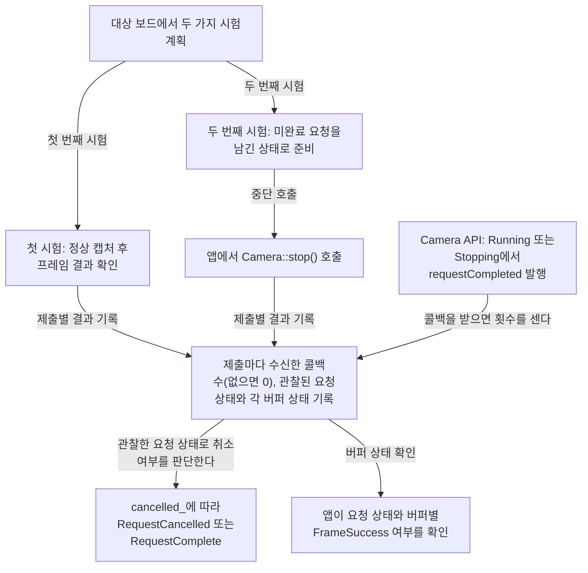

[Mermaid 원문](https://ttolsun.github.io/libcamera-sdd/request-lifecycle.stop-notification-boundary-vendor.mmd)

<details open>
<summary>그림 근거와 확인 범위</summary>

대상 보드에서 정상 캡처와 미완료 요청의 중단을 어떻게 확인할까?

소스 연결 해석 · 자동 연결 검사만 통과 · 의미와 기기 실행은 검증 전

| 요소·전이 | 소스 근거 |
| --- | --- |
| 앱에서 Camera::stop() 호출 | [src/libcamera/camera.cpp:1431](https://ttolsun.github.io/libcamera-sdd/reader-archive/request-lifecycle.html#source-e09324743def3f09) |
| cancelled\_에 따라 RequestCancelled 또는 RequestComplete | [src/libcamera/request.cpp:103](https://ttolsun.github.io/libcamera-sdd/reader-archive/request-lifecycle.html#source-db7f21585c4c2708) |
| Camera API: Running 또는 Stopping에서 requestCompleted 발행 | [src/libcamera/camera.cpp:1481](https://ttolsun.github.io/libcamera-sdd/reader-archive/request-lifecycle.html#source-d53c87090347ce81) |
| 앱이 요청 상태와 버퍼별 FrameSuccess 여부를 확인 | [src/libcamera/camera.cpp:1481](https://ttolsun.github.io/libcamera-sdd/reader-archive/request-lifecycle.html#source-d53c87090347ce81) · [src/libcamera/request.cpp:103](https://ttolsun.github.io/libcamera-sdd/reader-archive/request-lifecycle.html#source-db7f21585c4c2708) · [src/libcamera/framebuffer.cpp:40](https://ttolsun.github.io/libcamera-sdd/reader-archive/request-lifecycle.html#source-50aa8a55cc04062e) |
| 대상 보드에서 두 가지 시험 계획 | [src/libcamera/camera.cpp:1431](https://ttolsun.github.io/libcamera-sdd/reader-archive/request-lifecycle.html#source-e09324743def3f09) · [src/libcamera/framebuffer.cpp:40](https://ttolsun.github.io/libcamera-sdd/reader-archive/request-lifecycle.html#source-50aa8a55cc04062e) |
| 첫 시험: 정상 캡처 후 프레임 결과 확인 | [src/libcamera/framebuffer.cpp:40](https://ttolsun.github.io/libcamera-sdd/reader-archive/request-lifecycle.html#source-50aa8a55cc04062e) · [src/libcamera/camera.cpp:1481](https://ttolsun.github.io/libcamera-sdd/reader-archive/request-lifecycle.html#source-d53c87090347ce81) |
| 두 번째 시험: 미완료 요청을 남긴 상태로 준비 | [src/libcamera/camera.cpp:1431](https://ttolsun.github.io/libcamera-sdd/reader-archive/request-lifecycle.html#source-e09324743def3f09) · [src/libcamera/pipeline_handler.cpp:359](https://ttolsun.github.io/libcamera-sdd/reader-archive/request-lifecycle.html#source-eefd1bbecb1aad0a) |
| 제출마다 수신한 콜백 수(없으면 0), 관찰된 요청 상태와 각 버퍼 상태 기록 | [src/libcamera/camera.cpp:1481](https://ttolsun.github.io/libcamera-sdd/reader-archive/request-lifecycle.html#source-d53c87090347ce81) · [src/libcamera/request.cpp:103](https://ttolsun.github.io/libcamera-sdd/reader-archive/request-lifecycle.html#source-db7f21585c4c2708) · [src/libcamera/framebuffer.cpp:40](https://ttolsun.github.io/libcamera-sdd/reader-archive/request-lifecycle.html#source-50aa8a55cc04062e) |
| 첫 번째 시험 | [src/libcamera/framebuffer.cpp:40](https://ttolsun.github.io/libcamera-sdd/reader-archive/request-lifecycle.html#source-50aa8a55cc04062e) |
| 두 번째 시험 | [src/libcamera/camera.cpp:1431](https://ttolsun.github.io/libcamera-sdd/reader-archive/request-lifecycle.html#source-e09324743def3f09) · [src/libcamera/pipeline_handler.cpp:359](https://ttolsun.github.io/libcamera-sdd/reader-archive/request-lifecycle.html#source-eefd1bbecb1aad0a) |
| 제출별 결과 기록 | [src/libcamera/camera.cpp:1481](https://ttolsun.github.io/libcamera-sdd/reader-archive/request-lifecycle.html#source-d53c87090347ce81) · [src/libcamera/framebuffer.cpp:40](https://ttolsun.github.io/libcamera-sdd/reader-archive/request-lifecycle.html#source-50aa8a55cc04062e) |
| 중단 호출 | [src/libcamera/camera.cpp:1431](https://ttolsun.github.io/libcamera-sdd/reader-archive/request-lifecycle.html#source-e09324743def3f09) |
| 제출별 결과 기록 | [src/libcamera/camera.cpp:1431](https://ttolsun.github.io/libcamera-sdd/reader-archive/request-lifecycle.html#source-e09324743def3f09) · [src/libcamera/camera.cpp:1481](https://ttolsun.github.io/libcamera-sdd/reader-archive/request-lifecycle.html#source-d53c87090347ce81) |
| 콜백을 받으면 횟수를 센다 | [src/libcamera/camera.cpp:1481](https://ttolsun.github.io/libcamera-sdd/reader-archive/request-lifecycle.html#source-d53c87090347ce81) |
| 관찰한 요청 상태로 취소 여부를 판단한다 | [src/libcamera/request.cpp:103](https://ttolsun.github.io/libcamera-sdd/reader-archive/request-lifecycle.html#source-db7f21585c4c2708) |
| 버퍼 상태 확인 | [src/libcamera/request.cpp:103](https://ttolsun.github.io/libcamera-sdd/reader-archive/request-lifecycle.html#source-db7f21585c4c2708) · [src/libcamera/framebuffer.cpp:40](https://ttolsun.github.io/libcamera-sdd/reader-archive/request-lifecycle.html#source-50aa8a55cc04062e) |

</details>

## 하드웨어와 공통 계층의 경계

`PipelineHandler::match()` 구현자는 단일 파이프라인에 필요한 미디어 장치를 모두 찾으면 각 장치에 대해 `MediaDevice::acquire()`를 호출해 확보한 다음, 해당 `Camera` 인스턴스를 하나 이상 생성하고 내부에 저장하며 카메라 매니저에 등록한 뒤 `true`를 반환해야 합니다. `PipelineHandler::match()` 구현자는 필요한 미디어 장치를 모두 찾지 못했을 때 아직 장치를 확보하지 않았다면 어떤 장치도 확보해서는 안 되며, 이미 일부를 확보했다면 `MediaDevice::release()`를 호출해 확보한 장치를 모두 해제하고 `false`를 반환해야 합니다. `PipelineHandler::match()`는 `CameraManager` 스레드에서 호출되며, `true`를 반환하면 새로운 `PipelineHandler` 인스턴스가 생성되고 그 인스턴스의 `match()`가 호출됩니다.

### 장치 매칭의 확보·등록과 실패 정리

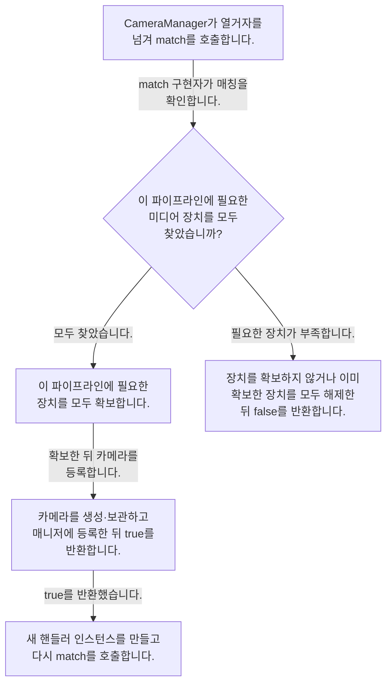

[Mermaid 원문](https://ttolsun.github.io/libcamera-sdd/vendor-integration.item-boundary.mmd)

<details open>
<summary>그림 근거와 확인 범위</summary>

누가 장치를 매칭하고 카메라를 등록하며, 매칭 결과에 따라 확보한 장치는 어떻게 처리됩니까?

소스 연결 해석 · 자동 연결 검사만 통과 · 의미와 기기 실행은 검증 전

| 요소·전이 | 소스 근거 |
| --- | --- |
| CameraManager가 열거자를 넘겨 match를 호출합니다. | [src/libcamera/pipeline_handler.cpp:91](https://ttolsun.github.io/libcamera-sdd/reader-archive/vendor-integration.html#source-5109302527925a6a) |
| 이 파이프라인에 필요한 미디어 장치를 모두 찾았습니까? | [src/libcamera/pipeline_handler.cpp:91](https://ttolsun.github.io/libcamera-sdd/reader-archive/vendor-integration.html#source-5109302527925a6a) |
| 이 파이프라인에 필요한 장치를 모두 확보합니다. | [src/libcamera/pipeline_handler.cpp:91](https://ttolsun.github.io/libcamera-sdd/reader-archive/vendor-integration.html#source-5109302527925a6a) |
| 카메라를 생성·보관하고 매니저에 등록한 뒤 true를 반환합니다. | [src/libcamera/pipeline_handler.cpp:91](https://ttolsun.github.io/libcamera-sdd/reader-archive/vendor-integration.html#source-5109302527925a6a) |
| 새 핸들러 인스턴스를 만들고 다시 match를 호출합니다. | [src/libcamera/pipeline_handler.cpp:109](https://ttolsun.github.io/libcamera-sdd/reader-archive/vendor-integration.html#source-1afff120b5d66b3c) |
| 장치를 확보하지 않거나 이미 확보한 장치를 모두 해제한 뒤 false를 반환합니다. | [src/libcamera/pipeline_handler.cpp:97](https://ttolsun.github.io/libcamera-sdd/reader-archive/vendor-integration.html#source-293bf5d4775550d0) |
| match 구현자가 매칭을 확인합니다. | [src/libcamera/pipeline_handler.cpp:91](https://ttolsun.github.io/libcamera-sdd/reader-archive/vendor-integration.html#source-5109302527925a6a) |
| 모두 찾았습니다. | [src/libcamera/pipeline_handler.cpp:91](https://ttolsun.github.io/libcamera-sdd/reader-archive/vendor-integration.html#source-5109302527925a6a) |
| 필요한 장치가 부족합니다. | [src/libcamera/pipeline_handler.cpp:91](https://ttolsun.github.io/libcamera-sdd/reader-archive/vendor-integration.html#source-5109302527925a6a) · [src/libcamera/pipeline_handler.cpp:97](https://ttolsun.github.io/libcamera-sdd/reader-archive/vendor-integration.html#source-293bf5d4775550d0) |
| 확보한 뒤 카메라를 등록합니다. | [src/libcamera/pipeline_handler.cpp:91](https://ttolsun.github.io/libcamera-sdd/reader-archive/vendor-integration.html#source-5109302527925a6a) |
| true를 반환했습니다. | [src/libcamera/pipeline_handler.cpp:91](https://ttolsun.github.io/libcamera-sdd/reader-archive/vendor-integration.html#source-5109302527925a6a) · [src/libcamera/pipeline_handler.cpp:109](https://ttolsun.github.io/libcamera-sdd/reader-archive/vendor-integration.html#source-1afff120b5d66b3c) |

</details>

<details open>
<summary>절 전체 근거 3개</summary>

- `src/libcamera/pipeline_handler.cpp`[`L91` 발췌](https://ttolsun.github.io/libcamera-sdd/reader-archive/vendor-integration.html#source-5109302527925a6a) · [전체 소스 `L91`](https://github.com/TTolsun/libcamera-sdd/blob/adfa719f8ed67d18fd8a0739fc088a1f8b9e7252/src/libcamera/pipeline_handler.cpp#L91) · [`L97` 발췌](https://ttolsun.github.io/libcamera-sdd/reader-archive/vendor-integration.html#source-293bf5d4775550d0) · [전체 소스 `L97`](https://github.com/TTolsun/libcamera-sdd/blob/adfa719f8ed67d18fd8a0739fc088a1f8b9e7252/src/libcamera/pipeline_handler.cpp#L97) · [`L109` 발췌](https://ttolsun.github.io/libcamera-sdd/reader-archive/vendor-integration.html#source-1afff120b5d66b3c) · [전체 소스 `L109`](https://github.com/TTolsun/libcamera-sdd/blob/adfa719f8ed67d18fd8a0739fc088a1f8b9e7252/src/libcamera/pipeline_handler.cpp#L109)

</details>

## 원고와 검토 기록

<details open>
<summary>libcamera 설계 문서</summary>

- **문서 간 계약**: [자동 대조 보고서](https://ttolsun.github.io/libcamera-sdd/contract-consistency.json) · 사람 검토 전

[이전 주소의 상세 내용 열기](https://ttolsun.github.io/libcamera-sdd/reader-archive/index.html#page-evidence)

</details>

<details open>
<summary>연동 가이드</summary>

- **생성 방식**: 추출 사실과 LLM 설명
- **검증 범위**: 표·그림은 facts로 만들고 설명은 LLM이 작성합니다. 인용·문장 및 설정된 구조 검사를 적용합니다.
- **자동 검사**: 통과 (`ok`). 검사한 항목은 검증 범위에 적혀 있습니다. 설명 내용이 맞는지는 사람이 확인합니다.
- **사람 검토**: 사람 검토 전
- **분석 기준 커밋**: `adfa719f8ed67d18fd8a0739fc088a1f8b9e7252`
- **문서 생성 시각**: `2026-11-20 16:39:26+00:00`
- **문장 생성 모델**: `cli/codex/gpt-6.1-terra`
- **문서 간 계약**: [자동 대조 보고서](https://ttolsun.github.io/libcamera-sdd/contract-consistency.json) · 사람 검토 전

<details open>
<summary>원고 작성 당시 기록</summary>

원고에 저장된 당시 기록입니다. 현재 문서의 기준과 다를 수 있습니다.

- 근거 파일: `include/libcamera/camera.h`, `include/libcamera/internal/ipa_manager.h`, `include/libcamera/internal/pipeline_handler.h`, `src/libcamera/camera.cpp`, `src/libcamera/ipa_manager.cpp`, `src/libcamera/pipeline/ipu3/ipu3.cpp`, `src/libcamera/pipeline/rkisp1/rkisp1.cpp`, `src/libcamera/pipeline_handler.cpp`
- 근거 수준: 코드 확인 (정적 분석, simple_compdb 구성, commit `adfa719f8e`)
- 자동 검사 (인용·문장 및 설정된 구조 검사): 통과
- 검토 상태 기록일: 2026-11-21 · 사람 검토 전

</details>

[Markdown 원문 ↗](https://ttolsun.github.io/libcamera-sdd/vendor-integration.md) [Mermaid 원문 ↗](https://ttolsun.github.io/libcamera-sdd/vendor-integration.mmd)

[이전 주소의 상세 내용 열기](https://ttolsun.github.io/libcamera-sdd/reader-archive/vendor-integration.html#page-evidence)

</details>

[이 페이지 Markdown 받기](https://ttolsun.github.io/libcamera-sdd/for-vendor.md) · [독자용 문서의 원본 위치](https://ttolsun.github.io/libcamera-sdd/reader-edition.json)

<a id="doc-5"></a>

ForVendor

# 기능·지원 범위

아래 대표 예시에서 대상 하드웨어와 관련된 핸들러를 확인하세요. 더 많은 장치가 포함된 플랫폼 목록을 살펴보고 빌드 선택과 구성 결과도 따로 점검하세요.

- [전체 플랫폼과 빌드 선택 근거](#d5-platform-support)
- [대상 보드 검증 절차](#doc-6)

| 지원 범주 | 대표 하드웨어 또는 용도 | 확인할 핸들러 |
| --- | --- | --- |
| 전용 | Intel IPU3 | ipu3 |
| 전용 | NXP i.MX8MP | imx8-isi 및 rkisp1 |
| 전용 | Rockchip RK3399 | rkisp1 |
| 범용 | USB 비디오 장치 클래스 카메라 | uvcvideo |
| 범용 | iMX7·IPU6·Allwinner Sun6i | simple |
| 테스트 | 가상 미디어 컨트롤러 | vimc |

## <a id="d5-platform-support"></a>지원하는 하드웨어와 빌드 선택

문서에는 라이브러리가 현재 전용 파이프라인 핸들러로 지원하는 하드웨어 플랫폼으로 Arm Mali-C55, Intel IPU3 (`ipu3`), NXP i.MX8MP (`imx8-isi` 및 `rkisp1`), RaspberryPi 3, 4 및 zero (`rpi/vc4`), Rockchip RK3399 (`rkisp1`)가 나열되어 있습니다. libcamera가 범용으로 지원한다고 문서에 명시한 대상은 USB 비디오 장치 클래스 카메라(`uvcvideo`), iMX7, IPU6, Allwinner Sun6i(`simple`), 테스트 용도의 가상 미디어 컨트롤러 드라이버(`vimc`)입니다.

빌드할 파이프라인 핸들러는 배열 옵션인 `pipelines`에서 선택하며, 기본값은 `auto`입니다. `auto`를 선택하면 대상 아키텍처에 적용되는 모든 파이프라인을 빌드하고, `all`을 선택하면 모든 파이프라인을 빌드합니다. 두 값을 함께 선택하면 `all`이 우선합니다. 개별 선택지는 `imx8-isi`, `ipu3`, `mali-c55`, `rkisp1`, `rpi/pisp`, `rpi/vc4`, `simple`, `uvcvideo`, `vimc`, `virtual`입니다.

### Raspberry Pi 센서의 연동 조건

`CamHelperStarvis2`의 프레임 길이와 적분 시간 사이 최소 여유는 기본 4라인입니다. `imx585`와 `imx676`은 8라인을 전달하는 `create585`로 등록되며, 헬퍼 코드 주석은 두 센서의 매뉴얼이 `SHR0`의 최솟값을 8라인으로 명시한다고 설명합니다. 노출 제한 계산은 이 여유를 프레임 길이에 반영하고, 프레임 길이에서 여유를 뺀 값과 요청 노출의 라인 수 중 작은 값으로 노출 라인 수를 제한합니다.

#### Starvis2 노출 제한

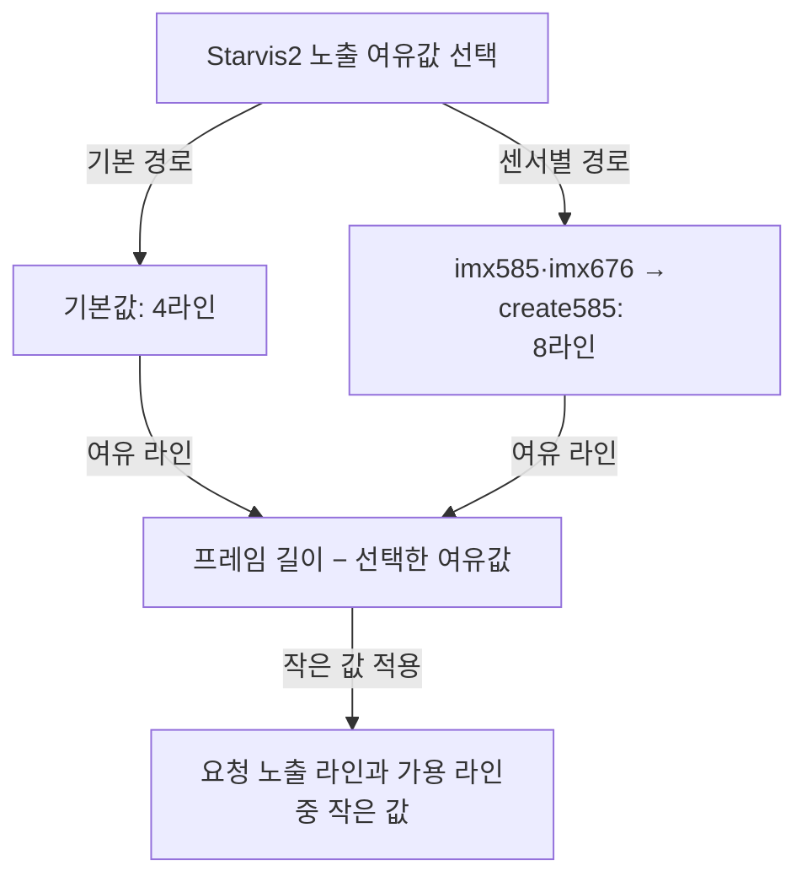

[Mermaid 원문](https://ttolsun.github.io/libcamera-sdd/vendor-overview.starvis2-exposure-limit.mmd)

<details open>
<summary>그림 근거와 확인 범위</summary>

노출 여유값으로 요청 노출을 어떻게 제한할까?

소스 연결 해석 · 자동 연결 검사만 통과 · 의미와 기기 실행은 검증 전

| 요소·전이 | 소스 근거 |
| --- | --- |
| Starvis2 노출 여유값 선택 | [src/ipa/rpi/cam_helper/cam_helper_starvis2.cpp:17](https://ttolsun.github.io/libcamera-sdd/reader-archive/vendor-overview.html#source-a24a98731281b4ed) |
| 기본값: 4라인 | [src/ipa/rpi/cam_helper/cam_helper_starvis2.cpp:17](https://ttolsun.github.io/libcamera-sdd/reader-archive/vendor-overview.html#source-a24a98731281b4ed) |
| imx585·imx676 → create585: 8라인 | [src/ipa/rpi/cam_helper/cam_helper_starvis2.cpp:17](https://ttolsun.github.io/libcamera-sdd/reader-archive/vendor-overview.html#source-a24a98731281b4ed) |
| 프레임 길이 − 선택한 여유값 | [src/ipa/rpi/cam_helper/cam_helper.cpp:105](https://ttolsun.github.io/libcamera-sdd/reader-archive/vendor-overview.html#source-74499d75cde7fa55) |
| 요청 노출 라인과 가용 라인 중 작은 값 | [src/ipa/rpi/cam_helper/cam_helper.cpp:105](https://ttolsun.github.io/libcamera-sdd/reader-archive/vendor-overview.html#source-74499d75cde7fa55) |
| 기본 경로 | [src/ipa/rpi/cam_helper/cam_helper_starvis2.cpp:17](https://ttolsun.github.io/libcamera-sdd/reader-archive/vendor-overview.html#source-a24a98731281b4ed) |
| 센서별 경로 | [src/ipa/rpi/cam_helper/cam_helper_starvis2.cpp:17](https://ttolsun.github.io/libcamera-sdd/reader-archive/vendor-overview.html#source-a24a98731281b4ed) |
| 여유 라인 | [src/ipa/rpi/cam_helper/cam_helper.cpp:105](https://ttolsun.github.io/libcamera-sdd/reader-archive/vendor-overview.html#source-74499d75cde7fa55) |
| 여유 라인 | [src/ipa/rpi/cam_helper/cam_helper.cpp:105](https://ttolsun.github.io/libcamera-sdd/reader-archive/vendor-overview.html#source-74499d75cde7fa55) |
| 작은 값 적용 | [src/ipa/rpi/cam_helper/cam_helper.cpp:105](https://ttolsun.github.io/libcamera-sdd/reader-archive/vendor-overview.html#source-74499d75cde7fa55) |

</details>

실행 확인 항목: `RegisterCamHelper`에 센서 이름과 헬퍼 생성 함수가 등록되어 있고 프레임 및 노출 제한 코드가 있지만, 대상 보드에서 실제 촬영과 노출이 동작하는지는 대상 파이프라인과 커널 드라이버의 센서 모드에서 해당 제약을 확인해야 합니다.

<details open>
<summary>절 전체 근거 4개</summary>

- `Documentation/platform_support.rst`[`L6` 발췌](https://ttolsun.github.io/libcamera-sdd/reader-archive/vendor-overview.html#source-9d6502e234c4647d) · [전체 소스 `L6`](https://github.com/TTolsun/libcamera-sdd/blob/adfa719f8ed67d18fd8a0739fc088a1f8b9e7252/Documentation/platform_support.rst#L6)
- `meson_options.txt`[`L75` 발췌](https://ttolsun.github.io/libcamera-sdd/reader-archive/vendor-overview.html#source-691389506fe87b32) · [전체 소스 `L75`](https://github.com/TTolsun/libcamera-sdd/blob/adfa719f8ed67d18fd8a0739fc088a1f8b9e7252/meson_options.txt#L75)
- `src/ipa/rpi/cam_helper/cam_helper_starvis2.cpp`[`L17` 발췌](https://ttolsun.github.io/libcamera-sdd/reader-archive/vendor-overview.html#source-a24a98731281b4ed) · [전체 소스 `L17`](https://github.com/TTolsun/libcamera-sdd/blob/adfa719f8ed67d18fd8a0739fc088a1f8b9e7252/src/ipa/rpi/cam_helper/cam_helper_starvis2.cpp#L17)
- `src/ipa/rpi/cam_helper/cam_helper.cpp`[`L105` 발췌](https://ttolsun.github.io/libcamera-sdd/reader-archive/vendor-overview.html#source-74499d75cde7fa55) · [전체 소스 `L105`](https://github.com/TTolsun/libcamera-sdd/blob/adfa719f8ed67d18fd8a0739fc088a1f8b9e7252/src/ipa/rpi/cam_helper/cam_helper.cpp#L105)

</details>

## 제공 기능과 지원 범위

`Camera`는 하나의 이미지 소스에서 하나 이상의 이미지 스트림을 생성할 수 있는 카메라를 모델링합니다. 기기를 구성하고 제어하며 이미지 스트림을 캡처하는 주요 인터페이스를 제공하는 libcamera의 중심 객체입니다. 장치별 `PipelineHandler`는 스트림 구성에 따라 하드웨어 파이프라인을 구성합니다. `PipelineHandler` 구현은 필요한 미디어 장치를 시스템의 장치와 대응시키고 모두 확보할 수 있게 되면 해당 `Camera` 인스턴스를 생성해야 하며, 모든 `PipelineHandler` 하위 클래스는 `REGISTER_PIPELINE_HANDLER()` 매크로로 libcamera에 등록해야 합니다.

### 공통 Camera와 장치별 구현의 경계

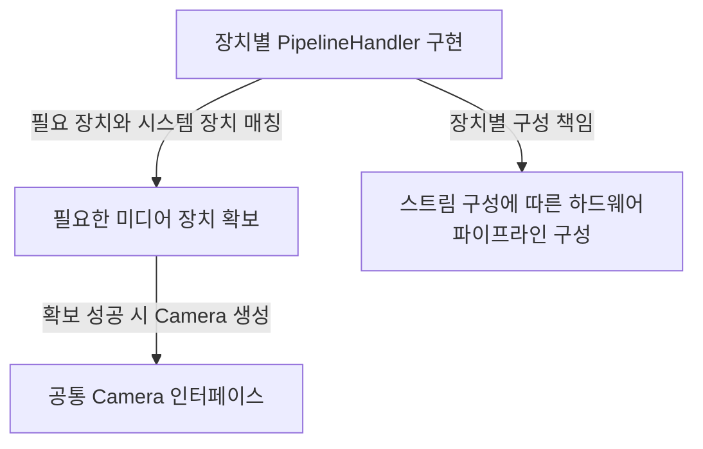

[Mermaid 원문](https://ttolsun.github.io/libcamera-sdd/vendor-overview.hardware-boundary.mmd)

<details open>
<summary>그림 근거와 확인 범위</summary>

공통 Camera와 장치별 PipelineHandler의 책임 연결입니다. 스트림 구성에 따른 하드웨어 구성과 장치 매칭·Camera 생성 책임을 구분하며 전체 실행 순서·지원 기종·성능을 보장하지 않습니다.

소스 연결 해석 · 자동 연결 검사만 통과 · 의미와 기기 실행은 검증 전

| 요소·전이 | 소스 근거 |
| --- | --- |
| 장치별 PipelineHandler 구현 | [src/libcamera/pipeline_handler.cpp:30](https://ttolsun.github.io/libcamera-sdd/reader-archive/vendor-overview.html#source-05721740b01bcd0e) |
| 필요한 미디어 장치 확보 | [src/libcamera/pipeline_handler.cpp:30](https://ttolsun.github.io/libcamera-sdd/reader-archive/vendor-overview.html#source-05721740b01bcd0e) |
| 공통 Camera 인터페이스 | [src/libcamera/camera.cpp:752](https://ttolsun.github.io/libcamera-sdd/reader-archive/vendor-overview.html#source-8264067114dccdee) |
| 스트림 구성에 따른 하드웨어 파이프라인 구성 | [Documentation/libcamera_architecture.rst:86](https://ttolsun.github.io/libcamera-sdd/reader-archive/vendor-overview.html#source-94ac8aab4dea2a65) |
| 장치별 구성 책임 | [Documentation/libcamera_architecture.rst:86](https://ttolsun.github.io/libcamera-sdd/reader-archive/vendor-overview.html#source-94ac8aab4dea2a65) |
| 필요 장치와 시스템 장치 매칭 | [src/libcamera/pipeline_handler.cpp:30](https://ttolsun.github.io/libcamera-sdd/reader-archive/vendor-overview.html#source-05721740b01bcd0e) |
| 확보 성공 시 Camera 생성 | [src/libcamera/pipeline_handler.cpp:30](https://ttolsun.github.io/libcamera-sdd/reader-archive/vendor-overview.html#source-05721740b01bcd0e) |

</details>

<details open>
<summary>절 전체 근거 3개</summary>

- `src/libcamera/camera.cpp`[`L752` 발췌](https://ttolsun.github.io/libcamera-sdd/reader-archive/vendor-overview.html#source-8264067114dccdee) · [전체 소스 `L752`](https://github.com/TTolsun/libcamera-sdd/blob/adfa719f8ed67d18fd8a0739fc088a1f8b9e7252/src/libcamera/camera.cpp#L752)
- `src/libcamera/pipeline_handler.cpp`[`L30` 발췌](https://ttolsun.github.io/libcamera-sdd/reader-archive/vendor-overview.html#source-05721740b01bcd0e) · [전체 소스 `L30`](https://github.com/TTolsun/libcamera-sdd/blob/adfa719f8ed67d18fd8a0739fc088a1f8b9e7252/src/libcamera/pipeline_handler.cpp#L30)
- `Documentation/libcamera_architecture.rst`[`L86` 발췌](https://ttolsun.github.io/libcamera-sdd/reader-archive/vendor-overview.html#source-94ac8aab4dea2a65) · [전체 소스 `L86`](https://github.com/TTolsun/libcamera-sdd/blob/adfa719f8ed67d18fd8a0739fc088a1f8b9e7252/Documentation/libcamera_architecture.rst#L86)

</details>

## 지원 조건과 제약

`CameraConfiguration::Invalid`는 구성이 유효하지 않고 조정할 수 없음을 뜻하며, 구성이 비어 있는 경우와 같은 극단적인 경우에만 발생할 수 있습니다. `CameraConfiguration::Adjusted`는 구성이 조정되었으며 조정 후 유효함을 나타냅니다. `CameraConfiguration::validate()`가 `Adjusted`를 반환하면 어느 스트림이든 파라미터가 바뀌었을 수 있고 일부 스트림만 바뀌었을 수도 있으며, 스트림 구성이 삭제되었을 수도 있습니다. `CameraConfiguration::Adjusted`일 때 호출자는 구성을 주의 깊게 확인해야 합니다.

### validate() 결과별 호출자의 책임

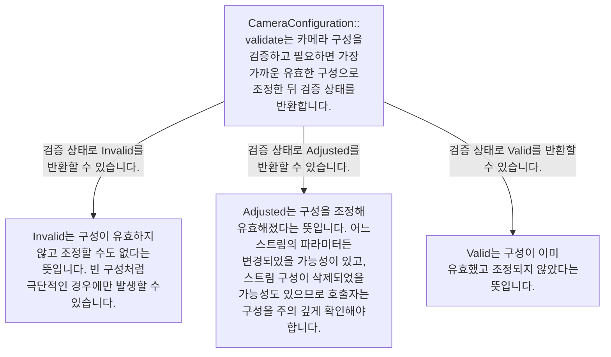

[Mermaid 원문](https://ttolsun.github.io/libcamera-sdd/vendor-assurance.validation-results.mmd)

<details open>
<summary>그림 근거와 확인 범위</summary>

validate()의 Invalid·Adjusted·Valid는 무엇을 뜻하며, Adjusted이면 호출자는 무엇을 다시 확인해야 합니까?

소스 연결 해석 · 자동 연결 검사만 통과 · 의미와 기기 실행은 검증 전

LLM 그림 초안 · 사람 검토 전

작성 모델: `cli/codex/gpt-6.1-terra`

| 요소·전이 | 소스 근거 |
| --- | --- |
| CameraConfiguration::validate는 카메라 구성을 검증하고 필요하면 가장 가까운 유효한 구성으로 조정한 뒤 검증 상태를 반환합니다. | [src/libcamera/camera.cpp:323](https://ttolsun.github.io/libcamera-sdd/reader-archive/vendor-assurance.html#source-2b31e92e3fb3f083) |
| Invalid는 구성이 유효하지 않고 조정할 수도 없다는 뜻입니다. 빈 구성처럼 극단적인 경우에만 발생할 수 있습니다. | [src/libcamera/camera.cpp:323](https://ttolsun.github.io/libcamera-sdd/reader-archive/vendor-assurance.html#source-2b31e92e3fb3f083) |
| Adjusted는 구성을 조정해 유효해졌다는 뜻입니다. 어느 스트림의 파라미터든 변경되었을 가능성이 있고, 스트림 구성이 삭제되었을 가능성도 있으므로 호출자는 구성을 주의 깊게 확인해야 합니다. | [src/libcamera/camera.cpp:323](https://ttolsun.github.io/libcamera-sdd/reader-archive/vendor-assurance.html#source-2b31e92e3fb3f083) |
| Valid는 구성이 이미 유효했고 조정되지 않았다는 뜻입니다. | [src/libcamera/camera.cpp:323](https://ttolsun.github.io/libcamera-sdd/reader-archive/vendor-assurance.html#source-2b31e92e3fb3f083) |
| 검증 상태로 Invalid를 반환할 수 있습니다. | [src/libcamera/camera.cpp:323](https://ttolsun.github.io/libcamera-sdd/reader-archive/vendor-assurance.html#source-2b31e92e3fb3f083) |
| 검증 상태로 Adjusted를 반환할 수 있습니다. | [src/libcamera/camera.cpp:323](https://ttolsun.github.io/libcamera-sdd/reader-archive/vendor-assurance.html#source-2b31e92e3fb3f083) |
| 검증 상태로 Valid를 반환할 수 있습니다. | [src/libcamera/camera.cpp:323](https://ttolsun.github.io/libcamera-sdd/reader-archive/vendor-assurance.html#source-2b31e92e3fb3f083) |

</details>

## 구현할 설정 인터페이스

`generateConfiguration`의 호출자는 기본 구성을 가져오려는 사용 사례를 `roles`에 채워야 합니다. `generateConfiguration()`이 반환하는 구성은 선택된 스트림과 그 스트림의 기본 파라미터를 호출자가 확인할 수 있는 정보를 포함합니다. `PipelineHandler::generateConfiguration()`은 요청된 `roles`를 충족할 수 있으면 유효한 `CameraConfiguration`을 반환하고, 그렇지 않으면 `null` 포인터를 반환해야 합니다. `PipelineHandler::generateConfiguration()` 구현은 어떤 스레드에서든 호출될 수 있으므로 스레드 안전성을 갖춰야 합니다.

### 설정 인터페이스별 입력과 결과

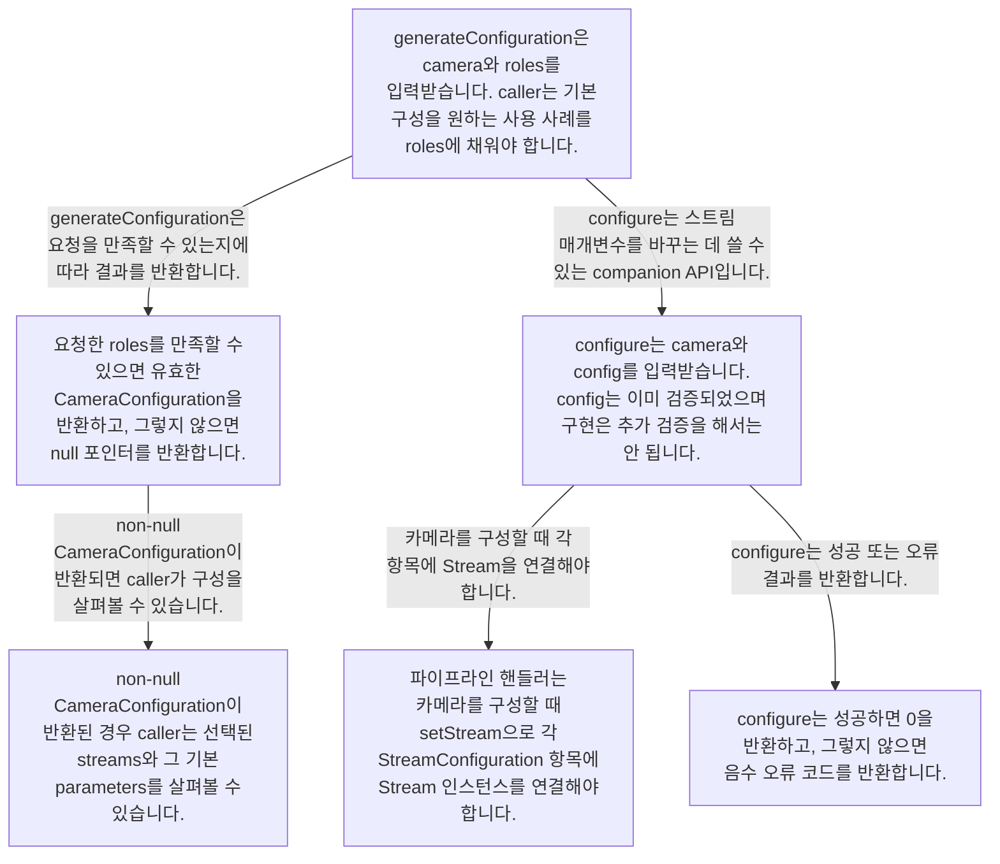

[Mermaid 원문](https://ttolsun.github.io/libcamera-sdd/vendor-integration.handler-configuration-contracts.mmd)

<details open>
<summary>그림 근거와 확인 범위</summary>

generateConfiguration과 configure의 입력·반환 및 성공 시 Stream 연결 의무는 무엇입니까?

소스 연결 해석 · 자동 연결 검사만 통과 · 의미와 기기 실행은 검증 전

LLM 그림 초안 · 사람 검토 전

작성 모델: `cli/codex/gpt-6.1-terra`

| 요소·전이 | 소스 근거 |
| --- | --- |
| generateConfiguration은 camera와 roles를 입력받습니다. caller는 기본 구성을 원하는 사용 사례를 roles에 채워야 합니다. | [src/libcamera/pipeline_handler.cpp:271](https://ttolsun.github.io/libcamera-sdd/reader-archive/vendor-integration.html#source-23ff032cd1152d56) |
| 요청한 roles를 만족할 수 있으면 유효한 CameraConfiguration을 반환하고, 그렇지 않으면 null 포인터를 반환합니다. | [src/libcamera/pipeline_handler.cpp:271](https://ttolsun.github.io/libcamera-sdd/reader-archive/vendor-integration.html#source-23ff032cd1152d56) |
| non-null CameraConfiguration이 반환된 경우 caller는 선택된 streams와 그 기본 parameters를 살펴볼 수 있습니다. | [src/libcamera/pipeline_handler.cpp:271](https://ttolsun.github.io/libcamera-sdd/reader-archive/vendor-integration.html#source-23ff032cd1152d56) |
| configure는 camera와 config를 입력받습니다. config는 이미 검증되었으며 구현은 추가 검증을 해서는 안 됩니다. | [src/libcamera/pipeline_handler.cpp:294](https://ttolsun.github.io/libcamera-sdd/reader-archive/vendor-integration.html#source-4255f8449e37ebb8) |
| configure는 성공하면 0을 반환하고, 그렇지 않으면 음수 오류 코드를 반환합니다. | [src/libcamera/pipeline_handler.cpp:294](https://ttolsun.github.io/libcamera-sdd/reader-archive/vendor-integration.html#source-4255f8449e37ebb8) |
| 파이프라인 핸들러는 카메라를 구성할 때 setStream으로 각 StreamConfiguration 항목에 Stream 인스턴스를 연결해야 합니다. | [src/libcamera/pipeline_handler.cpp:294](https://ttolsun.github.io/libcamera-sdd/reader-archive/vendor-integration.html#source-4255f8449e37ebb8) |
| generateConfiguration은 요청을 만족할 수 있는지에 따라 결과를 반환합니다. | [src/libcamera/pipeline_handler.cpp:271](https://ttolsun.github.io/libcamera-sdd/reader-archive/vendor-integration.html#source-23ff032cd1152d56) |
| non-null CameraConfiguration이 반환되면 caller가 구성을 살펴볼 수 있습니다. | [src/libcamera/pipeline_handler.cpp:271](https://ttolsun.github.io/libcamera-sdd/reader-archive/vendor-integration.html#source-23ff032cd1152d56) |
| configure는 스트림 매개변수를 바꾸는 데 쓸 수 있는 companion API입니다. | [src/libcamera/pipeline_handler.cpp:271](https://ttolsun.github.io/libcamera-sdd/reader-archive/vendor-integration.html#source-23ff032cd1152d56) |
| 카메라를 구성할 때 각 항목에 Stream을 연결해야 합니다. | [src/libcamera/pipeline_handler.cpp:294](https://ttolsun.github.io/libcamera-sdd/reader-archive/vendor-integration.html#source-4255f8449e37ebb8) |
| configure는 성공 또는 오류 결과를 반환합니다. | [src/libcamera/pipeline_handler.cpp:294](https://ttolsun.github.io/libcamera-sdd/reader-archive/vendor-integration.html#source-4255f8449e37ebb8) |

</details>

`PipelineHandler::generateConfiguration()` 구현자는 파이프라인 핸들러 내에서 `camera`의 상태를 변경해서는 안 됩니다. `PipelineHandler::configure()`에 전달되는 설정은 `CameraConfiguration::validate()`로 검증되었음이 보장되므로, 파이프라인 핸들러 구현은 추가 검증을 해서는 안 됩니다. `PipelineHandler::configure()` 구현은 자체 `CameraConfiguration` 파생 클래스에 저장된 모든 사용자 정의 필드에 의존할 수 있습니다. `PipelineHandler::configure()` 구현자는 카메라를 구성할 때 `StreamConfiguration::setStream()`을 사용해 `CameraConfiguration`의 각 `StreamConfiguration` 항목에 `Stream` 인스턴스를 연결해야 합니다.

`PipelineHandler::configure()`는 `CameraManager` 스레드에서 호출되며, 구현은 성공 시 `0`을, 실패 시 음수 오류 코드를 반환해야 합니다.

<details open>
<summary>절 전체 근거 11개</summary>

- `src/libcamera/pipeline_handler.cpp`[`L276` 발췌](https://ttolsun.github.io/libcamera-sdd/reader-archive/vendor-integration.html#source-924d43ea4bcaf94b) · [전체 소스 `L276`](https://github.com/TTolsun/libcamera-sdd/blob/adfa719f8ed67d18fd8a0739fc088a1f8b9e7252/src/libcamera/pipeline_handler.cpp#L276) · [`L289` 발췌](https://ttolsun.github.io/libcamera-sdd/reader-archive/vendor-integration.html#source-4abbe39594a1bd27) · [전체 소스 `L289`](https://github.com/TTolsun/libcamera-sdd/blob/adfa719f8ed67d18fd8a0739fc088a1f8b9e7252/src/libcamera/pipeline_handler.cpp#L289) · [`L285` 발췌](https://ttolsun.github.io/libcamera-sdd/reader-archive/vendor-integration.html#source-2eae247c4c37371c) · [전체 소스 `L285`](https://github.com/TTolsun/libcamera-sdd/blob/adfa719f8ed67d18fd8a0739fc088a1f8b9e7252/src/libcamera/pipeline_handler.cpp#L285) · [`L286` 발췌](https://ttolsun.github.io/libcamera-sdd/reader-archive/vendor-integration.html#source-25fb9495d4ab94a1) · [전체 소스 `L286`](https://github.com/TTolsun/libcamera-sdd/blob/adfa719f8ed67d18fd8a0739fc088a1f8b9e7252/src/libcamera/pipeline_handler.cpp#L286) · [`L304` 발췌](https://ttolsun.github.io/libcamera-sdd/reader-archive/vendor-integration.html#source-31c5407347b4d0d8) · [전체 소스 `L304`](https://github.com/TTolsun/libcamera-sdd/blob/adfa719f8ed67d18fd8a0739fc088a1f8b9e7252/src/libcamera/pipeline_handler.cpp#L304) · [`L306` 발췌](https://ttolsun.github.io/libcamera-sdd/reader-archive/vendor-integration.html#source-71079779113f431c) · [전체 소스 `L306`](https://github.com/TTolsun/libcamera-sdd/blob/adfa719f8ed67d18fd8a0739fc088a1f8b9e7252/src/libcamera/pipeline_handler.cpp#L306) · [`L309` 발췌](https://ttolsun.github.io/libcamera-sdd/reader-archive/vendor-integration.html#source-f3cf94b1dc7b9457) · [전체 소스 `L309`](https://github.com/TTolsun/libcamera-sdd/blob/adfa719f8ed67d18fd8a0739fc088a1f8b9e7252/src/libcamera/pipeline_handler.cpp#L309) · [`L313` 발췌](https://ttolsun.github.io/libcamera-sdd/reader-archive/vendor-integration.html#source-f87ceb096b9f931d) · [전체 소스 `L313`](https://github.com/TTolsun/libcamera-sdd/blob/adfa719f8ed67d18fd8a0739fc088a1f8b9e7252/src/libcamera/pipeline_handler.cpp#L313) · [`L271`](https://ttolsun.github.io/libcamera-sdd/reader-archive/vendor-integration.html#source-23ff032cd1152d56) · [`L294`](https://ttolsun.github.io/libcamera-sdd/reader-archive/vendor-integration.html#source-4255f8449e37ebb8)
- `src/libcamera/camera.cpp`[`L1191`](https://ttolsun.github.io/libcamera-sdd/reader-archive/vendor-integration.html#source-603af0dd7fa357d0)

</details>

## 성능 근거를 읽는 기준

`DebayerCpu`의 내장 벤치마크는 통계를 수집하고 디베이어링하는 처리에 걸린 시간만 측정합니다. 프레임을 캡처하거나 출력하는 데 걸린 시간은 포함하지 않습니다. Software ISP를 사용하는 파이프라인에서 `cam` 또는 `qcam`을 실행하면 내장 벤치마크를 사용할 수 있습니다.

<details open>
<summary>절 전체 근거 1개</summary>

- `Documentation/software-isp-benchmarking.rst`[`L15` 발췌](https://ttolsun.github.io/libcamera-sdd/reader-archive/vendor-assurance.html#source-551d2b5944a36d19) · [전체 소스 `L15`](https://github.com/TTolsun/libcamera-sdd/blob/adfa719f8ed67d18fd8a0739fc088a1f8b9e7252/Documentation/software-isp-benchmarking.rst#L15)

</details>

## 원고와 검토 기록

<details open>
<summary>libcamera 제품 개요</summary>

- **생성 방식**: 추출 사실과 LLM 설명
- **검증 범위**: 표·그림은 facts로 만들고 설명은 LLM이 작성합니다. 인용·문장 및 설정된 구조 검사를 적용합니다.
- **자동 검사**: 통과 (`ok`). 검사한 항목은 검증 범위에 적혀 있습니다. 설명 내용이 맞는지는 사람이 확인합니다.
- **사람 검토**: 사람 검토 전
- **분석 기준 커밋**: `adfa719f8ed67d18fd8a0739fc088a1f8b9e7252`
- **문서 생성 시각**: `2026-11-21 20:16:03+00:00`
- **문장 생성 모델**: `cli/codex/gpt-6.1-terra`
- **문서 간 계약**: [자동 대조 보고서](https://ttolsun.github.io/libcamera-sdd/contract-consistency.json) · 사람 검토 전
- **독자 범위**: [과업별 답변과 미검토 범위](https://ttolsun.github.io/libcamera-sdd/reader-scope.json)
- **제품 설명 입력**: [적용 범위·조건·자료](https://ttolsun.github.io/libcamera-sdd/product-context.json)

<details open>
<summary>원고 작성 당시 기록</summary>

원고에 저장된 당시 기록입니다. 현재 문서의 기준과 다를 수 있습니다.

- 근거 파일: `Documentation/introduction.rst`, `Documentation/libcamera_architecture.rst`, `Documentation/platform_support.rst`, `include/libcamera/camera.h`, `include/libcamera/internal/ipa_manager.h`, `include/libcamera/internal/pipeline_handler.h`, `meson_options.txt`, `product-evidence/libcamera/official-stack.txt`, `src/ipa/rpi/cam_helper/cam_helper.cpp`, `src/ipa/rpi/cam_helper/cam_helper_starvis2.cpp`, `src/libcamera/camera.cpp`, `src/libcamera/ipa_manager.cpp`, `src/libcamera/pipeline/ipu3/ipu3.cpp`, `src/libcamera/pipeline/rkisp1/rkisp1.cpp`, `src/libcamera/pipeline_handler.cpp`
- 근거 수준: 코드 확인 (정적 분석, simple_compdb 구성, commit `adfa719f8e`)
- 자동 검사 (인용·문장 및 설정된 구조 검사): 통과
- 검토 상태 기록일: 2026-11-22 · 사람 검토 전

</details>

[Markdown 원문 ↗](https://ttolsun.github.io/libcamera-sdd/vendor-overview.md) [Mermaid 원문 ↗](https://ttolsun.github.io/libcamera-sdd/vendor-overview.mmd)

[이전 주소의 상세 내용 열기](https://ttolsun.github.io/libcamera-sdd/reader-archive/vendor-overview.html#page-evidence)

</details>

<details open>
<summary>지원 범위와 검증</summary>

- **생성 방식**: 추출 사실과 LLM 설명
- **검증 범위**: 표·그림은 facts로 만들고 설명은 LLM이 작성합니다. 인용·문장 및 설정된 구조 검사를 적용합니다.
- **자동 검사**: 통과 (`ok`). 검사한 항목은 검증 범위에 적혀 있습니다. 설명 내용이 맞는지는 사람이 확인합니다.
- **사람 검토**: 사람 검토 전
- **분석 기준 커밋**: `adfa719f8ed67d18fd8a0739fc088a1f8b9e7252`
- **문서 생성 시각**: `2026-11-20 16:39:19+00:00`
- **문장 생성 모델**: `cli/codex/gpt-6.1-terra`
- **문서 간 계약**: [자동 대조 보고서](https://ttolsun.github.io/libcamera-sdd/contract-consistency.json) · 사람 검토 전
- **제품 설명 입력**: [적용 범위·조건·자료](https://ttolsun.github.io/libcamera-sdd/product-context.json)

<details open>
<summary>원고 작성 당시 기록</summary>

원고에 저장된 당시 기록입니다. 현재 문서의 기준과 다를 수 있습니다.

- 근거 파일: `Documentation/software-isp-benchmarking.rst`, `README.rst`, `include/libcamera/camera.h`, `include/libcamera/framebuffer.h`, `include/libcamera/internal/ipa_manager.h`, `include/libcamera/internal/pipeline_handler.h`, `include/libcamera/request.h`, `product-evidence/libcamera-first-capture-trial/virtual-first-capture-run.txt`, `src/libcamera/camera.cpp`, `src/libcamera/ipa_manager.cpp`, `src/libcamera/pipeline/ipu3/ipu3.cpp`, `src/libcamera/pipeline/rkisp1/rkisp1.cpp`, `src/libcamera/pipeline/virtual/README.md`, `src/libcamera/pipeline/virtual/data/virtual.yaml`, `src/libcamera/pipeline_handler.cpp`
- 근거 수준: 코드 확인 (정적 분석, simple_compdb 구성, commit `adfa719f8e`)
- 자동 검사 (인용·문장 및 설정된 구조 검사): 통과
- 검토 상태 기록일: 2026-11-21 · 사람 검토 전

</details>

[Markdown 원문 ↗](https://ttolsun.github.io/libcamera-sdd/vendor-assurance.md) [Mermaid 원문 ↗](https://ttolsun.github.io/libcamera-sdd/vendor-assurance.mmd)

[이전 주소의 상세 내용 열기](https://ttolsun.github.io/libcamera-sdd/reader-archive/vendor-assurance.html#page-evidence)

</details>

<details open>
<summary>연동 가이드</summary>

- **생성 방식**: 추출 사실과 LLM 설명
- **검증 범위**: 표·그림은 facts로 만들고 설명은 LLM이 작성합니다. 인용·문장 및 설정된 구조 검사를 적용합니다.
- **자동 검사**: 통과 (`ok`). 검사한 항목은 검증 범위에 적혀 있습니다. 설명 내용이 맞는지는 사람이 확인합니다.
- **사람 검토**: 사람 검토 전
- **분석 기준 커밋**: `adfa719f8ed67d18fd8a0739fc088a1f8b9e7252`
- **문서 생성 시각**: `2026-11-20 16:39:26+00:00`
- **문장 생성 모델**: `cli/codex/gpt-6.1-terra`
- **문서 간 계약**: [자동 대조 보고서](https://ttolsun.github.io/libcamera-sdd/contract-consistency.json) · 사람 검토 전

<details open>
<summary>원고 작성 당시 기록</summary>

원고에 저장된 당시 기록입니다. 현재 문서의 기준과 다를 수 있습니다.

- 근거 파일: `include/libcamera/camera.h`, `include/libcamera/internal/ipa_manager.h`, `include/libcamera/internal/pipeline_handler.h`, `src/libcamera/camera.cpp`, `src/libcamera/ipa_manager.cpp`, `src/libcamera/pipeline/ipu3/ipu3.cpp`, `src/libcamera/pipeline/rkisp1/rkisp1.cpp`, `src/libcamera/pipeline_handler.cpp`
- 근거 수준: 코드 확인 (정적 분석, simple_compdb 구성, commit `adfa719f8e`)
- 자동 검사 (인용·문장 및 설정된 구조 검사): 통과
- 검토 상태 기록일: 2026-11-21 · 사람 검토 전

</details>

[Markdown 원문 ↗](https://ttolsun.github.io/libcamera-sdd/vendor-integration.md) [Mermaid 원문 ↗](https://ttolsun.github.io/libcamera-sdd/vendor-integration.mmd)

[이전 주소의 상세 내용 열기](https://ttolsun.github.io/libcamera-sdd/reader-archive/vendor-integration.html#page-evidence)

</details>

[이 페이지 Markdown 받기](https://ttolsun.github.io/libcamera-sdd/features-and-support.md) · [독자용 문서의 원본 위치](https://ttolsun.github.io/libcamera-sdd/reader-edition.json)

<a id="doc-6"></a>

ForVendor

# 장치 연동과 검증

장치를 연동한 뒤 첫 촬영과 미완료 요청이 있는 상태에서의 정지를 각각 시험하세요. 공개 가상 카메라에서 관찰한 결과와 대상 보드에서 확인할 항목을 구분해 기록하세요.

- [정지 뒤 완료 알림과 상태 판정](#d8-stop-and-disconnect)

## 연동 순서와 책임

애플리케이션은 촬영을 준비하려면 카메라를 확보하고 구성해야 하며, 카메라를 시작하면 정지할 때까지 요청을 처리할 수 있고, 사용을 마치면 카메라를 해제해야 합니다. 애플리케이션은 카메라를 해제하지 않은 동안 여러 번 시작하고 정지할 수 있으며, 카메라를 재구성할 수도 있습니다. `Camera` 클래스는 카메라 상태에 영향을 주는 함수들을 일반적으로 서로 동기화하지 않으므로, 필요한 경우 호출자가 동기화해야 합니다.

### 획득부터 해제까지의 연동 순서

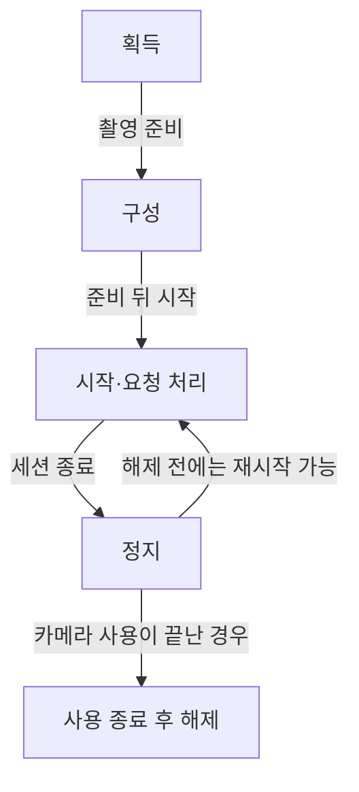

[Mermaid 원문](https://ttolsun.github.io/libcamera-sdd/vendor-integration.integration-stages.mmd)

<details open>
<summary>그림 근거와 확인 범위</summary>

애플리케이션의 세션 준비와 종료 순서입니다. 시작·정지는 해제 전까지 반복할 수 있습니다.

소스 연결 해석 · 자동 연결 검사만 통과 · 의미와 기기 실행은 검증 전

| 요소·전이 | 소스 근거 |
| --- | --- |
| 획득 | [src/libcamera/camera.cpp:771](https://ttolsun.github.io/libcamera-sdd/reader-archive/vendor-integration.html#source-2683b4a5a1dbfee9) |
| 구성 | [src/libcamera/camera.cpp:771](https://ttolsun.github.io/libcamera-sdd/reader-archive/vendor-integration.html#source-2683b4a5a1dbfee9) |
| 시작·요청 처리 | [src/libcamera/camera.cpp:771](https://ttolsun.github.io/libcamera-sdd/reader-archive/vendor-integration.html#source-2683b4a5a1dbfee9) |
| 정지 | [src/libcamera/camera.cpp:771](https://ttolsun.github.io/libcamera-sdd/reader-archive/vendor-integration.html#source-2683b4a5a1dbfee9) |
| 사용 종료 후 해제 | [src/libcamera/camera.cpp:771](https://ttolsun.github.io/libcamera-sdd/reader-archive/vendor-integration.html#source-2683b4a5a1dbfee9) |
| 촬영 준비 | [src/libcamera/camera.cpp:771](https://ttolsun.github.io/libcamera-sdd/reader-archive/vendor-integration.html#source-2683b4a5a1dbfee9) |
| 준비 뒤 시작 | [src/libcamera/camera.cpp:771](https://ttolsun.github.io/libcamera-sdd/reader-archive/vendor-integration.html#source-2683b4a5a1dbfee9) |
| 세션 종료 | [src/libcamera/camera.cpp:771](https://ttolsun.github.io/libcamera-sdd/reader-archive/vendor-integration.html#source-2683b4a5a1dbfee9) |
| 카메라 사용이 끝난 경우 | [src/libcamera/camera.cpp:771](https://ttolsun.github.io/libcamera-sdd/reader-archive/vendor-integration.html#source-2683b4a5a1dbfee9) |
| 해제 전에는 재시작 가능 | [src/libcamera/camera.cpp:777](https://ttolsun.github.io/libcamera-sdd/reader-archive/vendor-integration.html#source-948bd80fa1136291) |

</details>

<details open>
<summary>절 전체 근거 4개</summary>

- `src/libcamera/camera.cpp`[`L771` 발췌](https://ttolsun.github.io/libcamera-sdd/reader-archive/vendor-integration.html#source-2683b4a5a1dbfee9) · [전체 소스 `L771`](https://github.com/TTolsun/libcamera-sdd/blob/adfa719f8ed67d18fd8a0739fc088a1f8b9e7252/src/libcamera/camera.cpp#L771) · [`L777` 발췌](https://ttolsun.github.io/libcamera-sdd/reader-archive/vendor-integration.html#source-948bd80fa1136291) · [전체 소스 `L777`](https://github.com/TTolsun/libcamera-sdd/blob/adfa719f8ed67d18fd8a0739fc088a1f8b9e7252/src/libcamera/camera.cpp#L777) · [`L780` 발췌](https://ttolsun.github.io/libcamera-sdd/reader-archive/vendor-integration.html#source-cc6c66b57cf028e6) · [전체 소스 `L780`](https://github.com/TTolsun/libcamera-sdd/blob/adfa719f8ed67d18fd8a0739fc088a1f8b9e7252/src/libcamera/camera.cpp#L780) · [`L1032`](https://ttolsun.github.io/libcamera-sdd/reader-archive/vendor-integration.html#source-492118d913b10361)

</details>

## 고객 보드의 첫 촬영을 검증했습니까?

이 기록으로 고객 보드의 첫 촬영을 검증했다고 보고할 수 없습니다. WSL2 시험 구성에서 물리 센서 대신 가상 카메라 Virtual2를 사용했으며, 고객 보드의 물리 센서로 촬영한 기록은 없습니다.

### 가상 캡처 관측과 고객 보드 시험

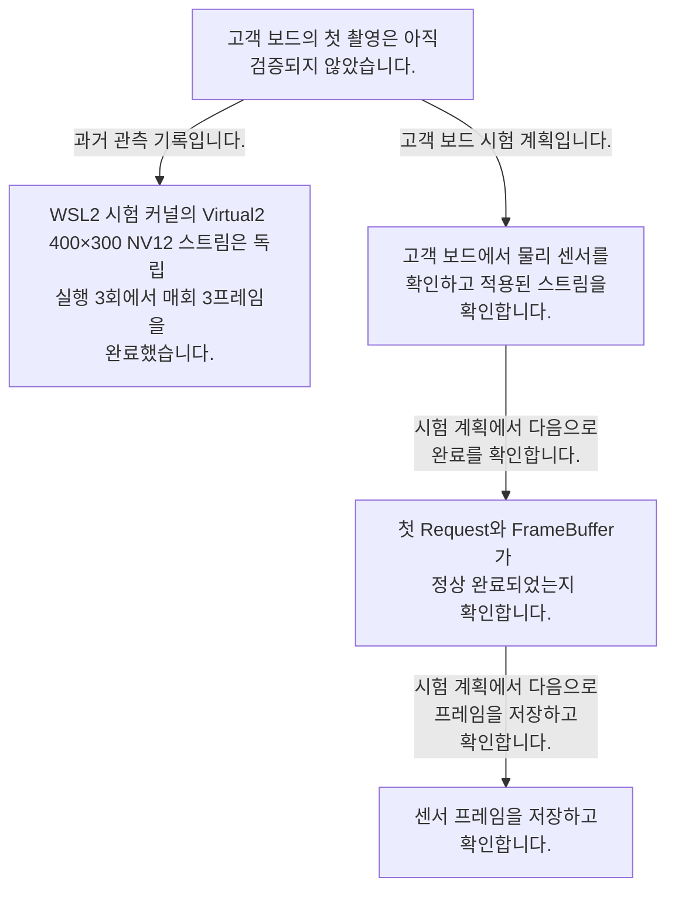

[Mermaid 원문](https://ttolsun.github.io/libcamera-sdd/vendor-assurance.first-capture-boundary.mmd)

<details open>
<summary>그림 근거와 확인 범위</summary>

WSL2에서 확인한 범위는 어디까지이며 고객 보드에서는 어떤 순서로 첫 촬영을 확인합니까?

소스 연결 해석 · 자동 연결 검사만 통과 · 의미와 기기 실행은 검증 전

LLM 그림 초안 · 사람 검토 전

작성 모델: `cli/codex/gpt-6.1-terra`

| 요소·전이 | 소스 근거 |
| --- | --- |
| 고객 보드의 첫 촬영은 아직 검증되지 않았습니다. | [product-evidence/libcamera-first-capture-trial/virtual-first-capture-run.txt:1](https://ttolsun.github.io/libcamera-sdd/reader-archive/vendor-assurance.html#source-3c4ba1aba4901083) |
| WSL2 시험 커널의 Virtual2 400×300 NV12 스트림은 독립 실행 3회에서 매회 3프레임을 완료했습니다. | [product-evidence/libcamera-first-capture-trial/virtual-first-capture-run.txt:1](https://ttolsun.github.io/libcamera-sdd/reader-archive/vendor-assurance.html#source-3c4ba1aba4901083) |
| 고객 보드에서 물리 센서를 확인하고 적용된 스트림을 확인합니다. | [product-evidence/libcamera-first-capture-trial/virtual-first-capture-run.txt:1](https://ttolsun.github.io/libcamera-sdd/reader-archive/vendor-assurance.html#source-3c4ba1aba4901083) · [README.rst:107](https://ttolsun.github.io/libcamera-sdd/reader-archive/vendor-assurance.html#source-ce71f2f0de50caf3) · [include/libcamera/camera.h:126](https://ttolsun.github.io/libcamera-sdd/reader-archive/vendor-assurance.html#source-aba605be681da98e) |
| 첫 Request와 FrameBuffer가 정상 완료되었는지 확인합니다. | [include/libcamera/camera.h:126](https://ttolsun.github.io/libcamera-sdd/reader-archive/vendor-assurance.html#source-aba605be681da98e) · [include/libcamera/request.h:34](https://ttolsun.github.io/libcamera-sdd/reader-archive/vendor-assurance.html#source-cb2be6f3ec7f91fc) · [include/libcamera/framebuffer.h:25](https://ttolsun.github.io/libcamera-sdd/reader-archive/vendor-assurance.html#source-094e6fd7ddda824a) |
| 센서 프레임을 저장하고 확인합니다. | [include/libcamera/camera.h:126](https://ttolsun.github.io/libcamera-sdd/reader-archive/vendor-assurance.html#source-aba605be681da98e) · [README.rst:107](https://ttolsun.github.io/libcamera-sdd/reader-archive/vendor-assurance.html#source-ce71f2f0de50caf3) |
| 과거 관측 기록입니다. | [product-evidence/libcamera-first-capture-trial/virtual-first-capture-run.txt:1](https://ttolsun.github.io/libcamera-sdd/reader-archive/vendor-assurance.html#source-3c4ba1aba4901083) |
| 고객 보드 시험 계획입니다. | [product-evidence/libcamera-first-capture-trial/virtual-first-capture-run.txt:1](https://ttolsun.github.io/libcamera-sdd/reader-archive/vendor-assurance.html#source-3c4ba1aba4901083) · [README.rst:107](https://ttolsun.github.io/libcamera-sdd/reader-archive/vendor-assurance.html#source-ce71f2f0de50caf3) |
| 시험 계획에서 다음으로 완료를 확인합니다. | [include/libcamera/camera.h:126](https://ttolsun.github.io/libcamera-sdd/reader-archive/vendor-assurance.html#source-aba605be681da98e) · [README.rst:107](https://ttolsun.github.io/libcamera-sdd/reader-archive/vendor-assurance.html#source-ce71f2f0de50caf3) |
| 시험 계획에서 다음으로 프레임을 저장하고 확인합니다. | [include/libcamera/camera.h:126](https://ttolsun.github.io/libcamera-sdd/reader-archive/vendor-assurance.html#source-aba605be681da98e) · [README.rst:107](https://ttolsun.github.io/libcamera-sdd/reader-archive/vendor-assurance.html#source-ce71f2f0de50caf3) |

</details>

libcamera 공식 프로젝트 문서에서 확인할 수 있는 범위에서, Virtual Pipeline Handler는 테스트용 가상 외부 카메라를 모사합니다. 예제 YAML은 Virtual2에 400×300 크기와 `lines` 테스트 패턴을 지정합니다.

2026년 10월 31일의 가상 캡처 시험에서는 소스 커밋 293d751a814e0d4c34e85ad457ccd9d5eefd1a61과 내장 udmabuf를 갖춘 WSL2 시험 커널 6.18.33.2-microsoft-standard-WSL2-issue211을 사용했습니다. Virtual2에서 400×300 NV12로 별도 프로세스마다 실행한 3회 모두 각각 3프레임을 완료했습니다. 이 관측은 물리 카메라나 보드 DMA의 검증을 의미하지 않습니다.

고객 보드의 첫 촬영 시험에서는 보드와 물리 센서, 커널·드라이버, libcamera 빌드 및 대상 애플리케이션을 기록하고 실제 센서를 열어 적용된 스트림 형식과 크기를 확인합니다. 첫 요청의 RequestComplete와 버퍼의 FrameSuccess를 확인하고 센서에서 들어온 프레임을 저장해 확인하며, 기본 시험 도구의 저장 기능 예시로 cam을 사용할 수 있습니다. 기존 기록은 WSL2 시험 커널의 udmabuf와 Virtual2를 사용한 시험 구성에 한정되며 물리 카메라, 물리 DMA 및 제품 애플리케이션은 검증되지 않았습니다.

<details open>
<summary>절 전체 근거 7개</summary>

- `product-evidence/libcamera-first-capture-trial/virtual-first-capture-run.txt`[`L1`](https://ttolsun.github.io/libcamera-sdd/reader-archive/vendor-assurance.html#source-3c4ba1aba4901083)
- `src/libcamera/pipeline/virtual/README.md`[`L3` 발췌](https://ttolsun.github.io/libcamera-sdd/reader-archive/vendor-assurance.html#source-eb7d1ae4ac9df3f9) · [전체 소스 `L3`](https://github.com/TTolsun/libcamera-sdd/blob/adfa719f8ed67d18fd8a0739fc088a1f8b9e7252/src/libcamera/pipeline/virtual/README.md#L3)
- `src/libcamera/pipeline/virtual/data/virtual.yaml`[`L28` 발췌](https://ttolsun.github.io/libcamera-sdd/reader-archive/vendor-assurance.html#source-fb6397b1c5827be7) · [전체 소스 `L28`](https://github.com/TTolsun/libcamera-sdd/blob/adfa719f8ed67d18fd8a0739fc088a1f8b9e7252/src/libcamera/pipeline/virtual/data/virtual.yaml#L28)
- `include/libcamera/request.h`[`L34` 발췌](https://ttolsun.github.io/libcamera-sdd/reader-archive/vendor-assurance.html#source-cb2be6f3ec7f91fc) · [전체 소스 `L34`](https://github.com/TTolsun/libcamera-sdd/blob/adfa719f8ed67d18fd8a0739fc088a1f8b9e7252/include/libcamera/request.h#L34)
- `include/libcamera/framebuffer.h`[`L25` 발췌](https://ttolsun.github.io/libcamera-sdd/reader-archive/vendor-assurance.html#source-094e6fd7ddda824a) · [전체 소스 `L25`](https://github.com/TTolsun/libcamera-sdd/blob/adfa719f8ed67d18fd8a0739fc088a1f8b9e7252/include/libcamera/framebuffer.h#L25)
- `README.rst`[`L107` 발췌](https://ttolsun.github.io/libcamera-sdd/reader-archive/vendor-assurance.html#source-ce71f2f0de50caf3) · [전체 소스 `L107`](https://github.com/TTolsun/libcamera-sdd/blob/adfa719f8ed67d18fd8a0739fc088a1f8b9e7252/README.rst#L107)
- `include/libcamera/camera.h`[`L126` 발췌](https://ttolsun.github.io/libcamera-sdd/reader-archive/vendor-assurance.html#source-aba605be681da98e) · [전체 소스 `L126`](https://github.com/TTolsun/libcamera-sdd/blob/adfa719f8ed67d18fd8a0739fc088a1f8b9e7252/include/libcamera/camera.h#L126)

</details>

## <a id="d6-virtual-reproduction"></a>공개 WSL 가상 카메라 첫 촬영 시험 재현

1. **준비 (1–3)** 호스트 상태를 바꾸지 않고 사용할 커널의 Kconfig와 의존 조건을 조사하세요.
2. **DMA-BUF 할당기 선택:** 선택한 커널의 Kconfig, 의존성, 실제 사용 가능한 모듈과 할당기 후보를 조사하고 결과에 맞는 할당기 하나를 선택하세요. 이 기록과 같은 조건으로 재현하려면 udmabuf를 사용하세요.
3. 선택한 커널과 할당기에 필요한 모듈만 설치 여부와 커널 버전 일치를 조사하세요. 기록된 udmabuf 시험에서는 드라이버가 내장되어 있었고 별도 모듈을 설치하지 않았습니다.
4. **호스트 변경 (4–5)** 변경안, 부팅할 커널과 이미지 SHA-256, 영향, 정확한 백업 경로, 부팅 및 복구 절차가 포함된 호스트 변경 계획에 대해 실행 직전에 별도 승인을 받으세요.
5. 승인된 계획에 따라 시험 커널을 설치하고 부팅하세요.
6. **실행 전 검사 (6–11)** 실행 중인 커널 버전이 `6.18.33.2-microsoft-standard-WSL2-issue211`인지 확인하세요.
7. WSL root 자식 컨텍스트에서 `/dev/udmabuf`을 열 수 있는 권한을 확인하세요.
8. 사용할 Virtual2 YAML에서 크기 400x300과 패턴 값 lines를 하나의 구성 조합으로 대조하세요.
9. 사용할 cam 명령의 카메라 선택 인자가 `Virtual2`인지 확인하세요.
10. 사용할 cam 스트림 인자가 400x300 NV12를 요청하는지 확인하세요.
11. 실행할 공식 cam 명령에 3프레임을 요청하는 `--capture=3` 인자가 지정되어 있는지 확인합니다.
12. **실행·검증 (12–13)** 연결된 실행 절차에 따라 수정하지 않은 공식 cam을 세 독립 프로세스로 실행합니다.
13. 새 실행의 증거를 카메라 Virtual2, 실제 적용 스트림 400x300 NV12, 각 독립 실행의 정상 3프레임 처리와 종료 코드 0이라는 기대 결과 조합과 대조하세요.

### 환경 확인에서 재현 실행까지

```mermaid
flowchart TB
%% sdd:translations {"YAML은 400×300 lines. cam <br/>인자를 확인합니다. --camera <br/>Virtual2 --capture#61;3 <br/>--stream <br/>role#61;video,width#61;400,height#61;<br/>300,pixelformat#61;NV12": "YAML uses 400×300 lines. <br/>Check cam arguments: <br/>--camera Virtual2 <br/>--capture#61;3 --stream <br/>role#61;video,width#61;400,height#61;<br/>300,pixelformat#61;NV12", "각 실행의 실제 적용값 대조: <br/>Virtual2, 400×300 <br/>NV12/SMPTE170M. 시퀀스 0–2, <br/>요청 상태 1, 버퍼 상태 0, <br/>종료 코드 0": "Compare each run with <br/>expected Virtual2 and <br/>400×300 NV12/SMPTE170M. <br/>Check sequences 0–2, <br/>request status 1, buffer <br/>status 0, and exit code 0.", "격리된 환경에서 호스트 변경 <br/>없이 조사합니다. Kconfig, <br/>의존성, 사용 가능한 모듈을 <br/>확인하고 DMA-BUF 할당기 <br/>하나를 선택합니다.": "Start read-only in an <br/>isolated test environment. <br/>Check Kconfig support, <br/>dependencies, and available <br/>modules. Choose one DMA-BUF <br/>allocator.", "계획에 Docker 중지가 있는가?": "Does the plan require <br/>stopping Docker?", "고정 소스와 빌드 확인 뒤 <br/>실행": "Run after checking the <br/>pinned source and build", "공식 cam을 세 독립 <br/>프로세스로 실행": "Run official cam in three <br/>independent processes", "그 다음 부팅": "Then boot", "두 조건이 일치": "Both checks pass", "변경 불필요": "No host change needed", "부팅 뒤 실제 환경 확인": "Check the running <br/>environment", "새 경로에서 실행별 기록 확인": "Check each run in the new <br/>evidence directory", "생략": "Skip", "수정하지 않은 293d751a, <br/>디버그 Meson 빌드, GDB 도구 <br/>경로, 컴파일된 DMA-BUF <br/>프로브 확인": "Check unmodified 293d751a, <br/>its debug Meson build, the <br/>GDB tools prefix, and the <br/>compiled DMA-BUF probe", "승인을 받은 뒤 Docker 중지": "Stop Docker after approval", "승인한 계획 확인": "Check the approved plan", "승인한 시험 커널로 부팅": "Boot the approved test <br/>kernel", "시험 소스와 빌드도 확인": "Also check the test source <br/>and build", "시험 환경 선택": "Choose the test environment", "실행 중인 커널이 <br/>6.18.33.2-microsoft-standard<br/>-WSL2-issue211이고 root가 <br/>/dev/udmabuf을 열 수 있는가?": "Is the running kernel <br/>6.18.33.2-microsoft-standard<br/>-WSL2-issue211 and can root <br/>open /dev/udmabuf?", "영향·백업 경로·커널 <br/>이미지와 SHA-256·부팅·복구 <br/>절차를 기록하고 별도 승인": "Document impact, backup <br/>path, kernel image and <br/>SHA-256, boot and recovery. <br/>Get separate approval", "캡처 중단": "Stop before capture", "필요": "Required", "하나라도 다름": "Either check fails", "호스트 변경이 필요한가?": "Does the test require host <br/>changes?"}
  v_survey["격리된 환경에서 호스트 변경 <br/>없이 조사합니다. Kconfig, <br/>의존성, 사용 가능한 모듈을 <br/>확인하고 DMA-BUF 할당기 <br/>하나를 선택합니다."]
  v_host{"호스트 변경이 필요한가?"}
  v_approval["영향·백업 경로·커널 <br/>이미지와 SHA-256·부팅·복구 <br/>절차를 기록하고 별도 승인"]
  v_docker{"계획에 Docker 중지가 있는가?"}
  v_stop_docker["승인을 받은 뒤 Docker 중지"]
  v_boot["승인한 시험 커널로 부팅"]
  v_device{"실행 중인 커널이 <br/>6.18.33.2-microsoft-standard<br/>-WSL2-issue211이고 root가 <br/>/dev/udmabuf을 열 수 있는가?"}
  v_stop["캡처 중단"]
  v_run["공식 cam을 세 독립 <br/>프로세스로 실행"]
  v_confirm["각 실행의 실제 적용값 대조: <br/>Virtual2, 400×300 <br/>NV12/SMPTE170M. 시퀀스 0–2, <br/>요청 상태 1, 버퍼 상태 0, <br/>종료 코드 0"]
  v_options["YAML은 400×300 lines. cam <br/>인자를 확인합니다. --camera <br/>Virtual2 --capture#61;3 <br/>--stream <br/>role#61;video,width#61;400,height#61;<br/>300,pixelformat#61;NV12"]
  v_build["수정하지 않은 293d751a, <br/>디버그 Meson 빌드, GDB 도구 <br/>경로, 컴파일된 DMA-BUF <br/>프로브 확인"]
  v_survey -->|"시험 환경 선택"| v_host
  v_host -->|"필요"| v_approval
  v_host -->|"변경 불필요"| v_device
  v_approval -->|"승인한 계획 확인"| v_docker
  v_docker -->|"필요"| v_stop_docker
  v_docker -->|"생략"| v_boot
  v_stop_docker -->|"그 다음 부팅"| v_boot
  v_boot -->|"부팅 뒤 실제 환경 확인"| v_device
  v_device -->|"하나라도 다름"| v_stop
  v_device -->|"두 조건이 일치"| v_options
  v_run -->|"새 경로에서 실행별 기록 확인"| v_confirm
  v_options -->|"시험 소스와 빌드도 확인"| v_build
  v_build -->|"고정 소스와 빌드 확인 뒤 <br/>실행"| v_run
```

[Mermaid 원문](https://ttolsun.github.io/libcamera-sdd/official-cam-validation.reproduction-flow.mmd)

<details open>
<summary>그림 근거와 확인 범위</summary>

기존 WSL에 기록된 시험 커널을 설치하는 호스트 변경이 필요한 경우, 승인과 실행 전 검사를 거쳐 어떤 조건에서 재현을 진행합니까?

소스 연결 해석 · 자동 연결 검사만 통과 · 의미와 기기 실행은 검증 전

| 요소·전이 | 소스 근거 |
| --- | --- |
| 격리된 환경에서 호스트 변경 없이 조사합니다. Kconfig, 의존성, 사용 가능한 모듈을 확인하고 DMA-BUF 할당기 하나를 선택합니다. | [product-evidence/libcamera-official-cam-trial/invocation-reproduction-procedure.txt:1](https://ttolsun.github.io/libcamera-sdd/reader-archive/official-cam-validation.html#source-5a006a90fe9f46ad) |
| 호스트 변경이 필요한가? | [product-evidence/libcamera-official-cam-trial/invocation-reproduction-procedure.txt:1](https://ttolsun.github.io/libcamera-sdd/reader-archive/official-cam-validation.html#source-5a006a90fe9f46ad) |
| 영향·백업 경로·커널 이미지와 SHA-256·부팅·복구 절차를 기록하고 별도 승인 | [product-evidence/libcamera-official-cam-trial/invocation-reproduction-procedure.txt:1](https://ttolsun.github.io/libcamera-sdd/reader-archive/official-cam-validation.html#source-5a006a90fe9f46ad) |
| 계획에 Docker 중지가 있는가? | [product-evidence/libcamera-official-cam-trial/invocation-reproduction-procedure.txt:1](https://ttolsun.github.io/libcamera-sdd/reader-archive/official-cam-validation.html#source-5a006a90fe9f46ad) |
| 승인을 받은 뒤 Docker 중지 | [product-evidence/libcamera-official-cam-trial/invocation-reproduction-procedure.txt:1](https://ttolsun.github.io/libcamera-sdd/reader-archive/official-cam-validation.html#source-5a006a90fe9f46ad) |
| 승인한 시험 커널로 부팅 | [product-evidence/libcamera-official-cam-trial/invocation-reproduction-procedure.txt:1](https://ttolsun.github.io/libcamera-sdd/reader-archive/official-cam-validation.html#source-5a006a90fe9f46ad) |
| 실행 중인 커널이 6.18.33.2-microsoft-standard-WSL2-issue211이고 root가 /dev/udmabuf을 열 수 있는가? | [product-evidence/libcamera-official-cam-trial/invocation-reproduction-procedure.txt:1](https://ttolsun.github.io/libcamera-sdd/reader-archive/official-cam-validation.html#source-5a006a90fe9f46ad) |
| 캡처 중단 | [product-evidence/libcamera-official-cam-trial/invocation-reproduction-procedure.txt:1](https://ttolsun.github.io/libcamera-sdd/reader-archive/official-cam-validation.html#source-5a006a90fe9f46ad) |
| 공식 cam을 세 독립 프로세스로 실행 | [product-evidence/libcamera-official-cam-trial/invocation-reproduction-procedure.txt:1](https://ttolsun.github.io/libcamera-sdd/reader-archive/official-cam-validation.html#source-5a006a90fe9f46ad) |
| 각 실행의 실제 적용값 대조: Virtual2, 400×300 NV12/SMPTE170M. 시퀀스 0–2, 요청 상태 1, 버퍼 상태 0, 종료 코드 0 | [product-evidence/libcamera-official-cam-trial/invocation-reproduction-procedure.txt:1](https://ttolsun.github.io/libcamera-sdd/reader-archive/official-cam-validation.html#source-5a006a90fe9f46ad) · [product-evidence/libcamera-official-cam-trial/invocation-official-cam-reader.txt:1](https://ttolsun.github.io/libcamera-sdd/reader-archive/official-cam-validation.html#source-e326d2b05d8f4ef8) · [product-evidence/libcamera-official-cam-trial/invocation-options.txt:1](https://ttolsun.github.io/libcamera-sdd/reader-archive/official-cam-validation.html#source-077dc6a73bad3108) |
| YAML은 400×300 lines. cam 인자를 확인합니다. --camera Virtual2 --capture=3 --stream role=video,width=400,height=300,pixelformat=NV12 | [src/libcamera/pipeline/virtual/data/virtual.yaml:28](https://ttolsun.github.io/libcamera-sdd/reader-archive/official-cam-validation.html#source-9858e22e2225cc10) · [product-evidence/libcamera-official-cam-trial/invocation-options.txt:1](https://ttolsun.github.io/libcamera-sdd/reader-archive/official-cam-validation.html#source-077dc6a73bad3108) |
| 수정하지 않은 293d751a, 디버그 Meson 빌드, GDB 도구 경로, 컴파일된 DMA-BUF 프로브 확인 | [product-evidence/libcamera-official-cam-trial/invocation-reproduction-procedure.txt:1](https://ttolsun.github.io/libcamera-sdd/reader-archive/official-cam-validation.html#source-5a006a90fe9f46ad) |
| 시험 환경 선택 | [product-evidence/libcamera-official-cam-trial/invocation-reproduction-procedure.txt:1](https://ttolsun.github.io/libcamera-sdd/reader-archive/official-cam-validation.html#source-5a006a90fe9f46ad) |
| 필요 | [product-evidence/libcamera-official-cam-trial/invocation-reproduction-procedure.txt:1](https://ttolsun.github.io/libcamera-sdd/reader-archive/official-cam-validation.html#source-5a006a90fe9f46ad) |
| 변경 불필요 | [product-evidence/libcamera-official-cam-trial/invocation-reproduction-procedure.txt:1](https://ttolsun.github.io/libcamera-sdd/reader-archive/official-cam-validation.html#source-5a006a90fe9f46ad) |
| 승인한 계획 확인 | [product-evidence/libcamera-official-cam-trial/invocation-reproduction-procedure.txt:1](https://ttolsun.github.io/libcamera-sdd/reader-archive/official-cam-validation.html#source-5a006a90fe9f46ad) |
| 필요 | [product-evidence/libcamera-official-cam-trial/invocation-reproduction-procedure.txt:1](https://ttolsun.github.io/libcamera-sdd/reader-archive/official-cam-validation.html#source-5a006a90fe9f46ad) |
| 생략 | [product-evidence/libcamera-official-cam-trial/invocation-reproduction-procedure.txt:1](https://ttolsun.github.io/libcamera-sdd/reader-archive/official-cam-validation.html#source-5a006a90fe9f46ad) |
| 그 다음 부팅 | [product-evidence/libcamera-official-cam-trial/invocation-reproduction-procedure.txt:1](https://ttolsun.github.io/libcamera-sdd/reader-archive/official-cam-validation.html#source-5a006a90fe9f46ad) |
| 부팅 뒤 실제 환경 확인 | [product-evidence/libcamera-official-cam-trial/invocation-reproduction-procedure.txt:1](https://ttolsun.github.io/libcamera-sdd/reader-archive/official-cam-validation.html#source-5a006a90fe9f46ad) |
| 하나라도 다름 | [product-evidence/libcamera-official-cam-trial/invocation-reproduction-procedure.txt:1](https://ttolsun.github.io/libcamera-sdd/reader-archive/official-cam-validation.html#source-5a006a90fe9f46ad) |
| 두 조건이 일치 | [product-evidence/libcamera-official-cam-trial/invocation-reproduction-procedure.txt:1](https://ttolsun.github.io/libcamera-sdd/reader-archive/official-cam-validation.html#source-5a006a90fe9f46ad) · [src/libcamera/pipeline/virtual/data/virtual.yaml:28](https://ttolsun.github.io/libcamera-sdd/reader-archive/official-cam-validation.html#source-9858e22e2225cc10) · [product-evidence/libcamera-official-cam-trial/invocation-options.txt:1](https://ttolsun.github.io/libcamera-sdd/reader-archive/official-cam-validation.html#source-077dc6a73bad3108) |
| 새 경로에서 실행별 기록 확인 | [product-evidence/libcamera-official-cam-trial/invocation-reproduction-procedure.txt:1](https://ttolsun.github.io/libcamera-sdd/reader-archive/official-cam-validation.html#source-5a006a90fe9f46ad) |
| 시험 소스와 빌드도 확인 | [src/libcamera/pipeline/virtual/data/virtual.yaml:28](https://ttolsun.github.io/libcamera-sdd/reader-archive/official-cam-validation.html#source-9858e22e2225cc10) · [product-evidence/libcamera-official-cam-trial/invocation-options.txt:1](https://ttolsun.github.io/libcamera-sdd/reader-archive/official-cam-validation.html#source-077dc6a73bad3108) · [product-evidence/libcamera-official-cam-trial/invocation-reproduction-procedure.txt:1](https://ttolsun.github.io/libcamera-sdd/reader-archive/official-cam-validation.html#source-5a006a90fe9f46ad) |
| 고정 소스와 빌드 확인 뒤 실행 | [product-evidence/libcamera-official-cam-trial/invocation-reproduction-procedure.txt:1](https://ttolsun.github.io/libcamera-sdd/reader-archive/official-cam-validation.html#source-5a006a90fe9f46ad) |

</details>

실행 확인 항목: 이 결과는 WSL 가상 카메라의 시뮬레이션 구성에만 해당하며, 물리 DMA·카메라·제품 앱·사내 HAL은 검증하지 않았습니다. GDB는 타이밍에 영향을 주므로 콜백 반환 명령과 성능은 검증하지 않았습니다.

<details open>
<summary>절 전체 근거 5개</summary>

- `product-evidence/libcamera-official-cam-trial/invocation-reproduction-procedure.txt`[`L1`](https://ttolsun.github.io/libcamera-sdd/reader-archive/official-cam-validation.html#source-5a006a90fe9f46ad)
- `product-evidence/libcamera-official-cam-trial/invocation-execution-contract.txt`[`L1`](https://ttolsun.github.io/libcamera-sdd/reader-archive/official-cam-validation.html#source-67134777ea4213e0)
- `product-evidence/libcamera-official-cam-trial/invocation-official-cam-reader.txt`[`L1`](https://ttolsun.github.io/libcamera-sdd/reader-archive/official-cam-validation.html#source-e326d2b05d8f4ef8)
- `src/libcamera/pipeline/virtual/data/virtual.yaml`[`L28` 발췌](https://ttolsun.github.io/libcamera-sdd/reader-archive/official-cam-validation.html#source-9858e22e2225cc10) · [전체 소스 `L28`](https://github.com/TTolsun/libcamera-sdd/blob/adfa719f8ed67d18fd8a0739fc088a1f8b9e7252/src/libcamera/pipeline/virtual/data/virtual.yaml#L28)
- `product-evidence/libcamera-official-cam-trial/invocation-options.txt`[`L1`](https://ttolsun.github.io/libcamera-sdd/reader-archive/official-cam-validation.html#source-077dc6a73bad3108)

</details>

<details open>
<summary>가상 시험의 검증 범위</summary>

**가상 시험 구성입니다. 실제 제품의 지원·성능 주장으로 사용하지 마세요.**

- [할당기를 준비하자 공식 cam 캡처가 완료됐습니다](https://ttolsun.github.io/libcamera-sdd/reader-archive/official-cam-validation.html#할당기를-준비하자-공식-cam-캡처가-완료됐습니다)
- [여러 초기 요청을 단일 스트림에 맞춰 준비합니다](https://ttolsun.github.io/libcamera-sdd/reader-archive/official-cam-validation.html#여러-초기-요청을-단일-스트림에-맞춰-준비합니다)
- [준비된 초기 요청을 한도 안에서 제출합니다](https://ttolsun.github.io/libcamera-sdd/reader-archive/official-cam-validation.html#준비된-초기-요청을-한도-안에서-제출합니다)
- [cam이 완료 알림을 받아 이벤트 루프에서 프레임을 처리합니다.](https://ttolsun.github.io/libcamera-sdd/reader-archive/official-cam-validation.html#cam이-완료-알림을-받아-이벤트-루프에서-프레임을-처리합니다)
- [지원 커널과 장치 접근을 확인한 뒤 재현합니다](#d6-virtual-reproduction)

</details>

## 정지와 오류 처리의 책임

`PipelineHandler::stop()`은 먼저 `waitingRequests.swap(data->waitingRequests_)`를 실행한 다음 `stopDevice(camera)`를 호출합니다. `PipelineHandler::stop()`은 `stopDevice()` 내부에서 `completeRequest()`가 호출될 때 대기 중인 요청이 다시 큐에 들어가지 않도록 이 요청들을 따로 옮깁니다. `stopDevice()` 구현자는 실행 중인 모든 스트림의 캡처와 요청 처리를 즉시 중단하고, 해당 장치의 미완료 요청을 모두 취소해 즉시 오류 상태로 완료해야 합니다.

### 장치 정지와 대기 요청의 반환 순서

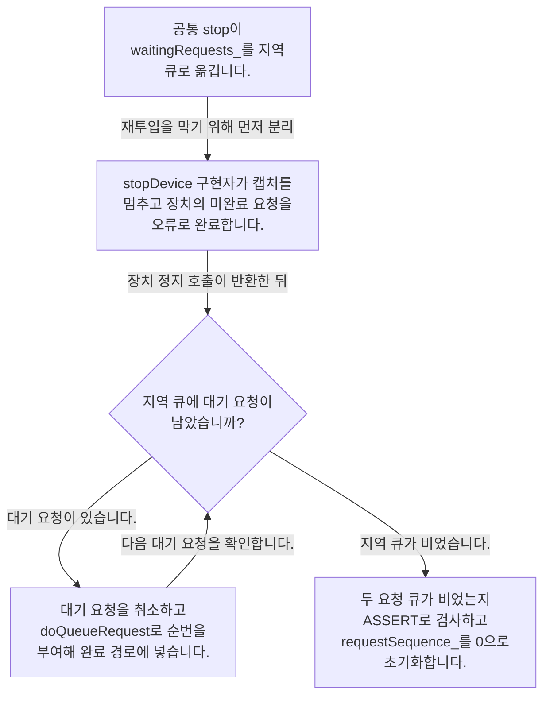

[Mermaid 원문](https://ttolsun.github.io/libcamera-sdd/vendor-integration.shutdown-device-and-waiting-requests.mmd)

<details open>
<summary>그림 근거와 확인 범위</summary>

공통 stop과 stopDevice 구현자가 각각 어떤 요청을 언제 처리합니까?

소스 연결 해석 · 자동 연결 검사만 통과 · 의미와 기기 실행은 검증 전

| 요소·전이 | 소스 근거 |
| --- | --- |
| 공통 stop이 waitingRequests\_를 지역 큐로 옮깁니다. | [src/libcamera/pipeline_handler.cpp:367](https://ttolsun.github.io/libcamera-sdd/reader-archive/vendor-integration.html#source-1cc522721d2c5142) · [src/libcamera/pipeline_handler.cpp:370](https://ttolsun.github.io/libcamera-sdd/reader-archive/vendor-integration.html#source-486f3f81acba3c1f) |
| stopDevice 구현자가 캡처를 멈추고 장치의 미완료 요청을 오류로 완료합니다. | [src/libcamera/pipeline_handler.cpp:367](https://ttolsun.github.io/libcamera-sdd/reader-archive/vendor-integration.html#source-7097caa35d0e97c8) · [src/libcamera/pipeline_handler.cpp:405](https://ttolsun.github.io/libcamera-sdd/reader-archive/vendor-integration.html#source-a1eeb263fc114d2f) |
| 지역 큐에 대기 요청이 남았습니까? | [src/libcamera/pipeline_handler.cpp:367](https://ttolsun.github.io/libcamera-sdd/reader-archive/vendor-integration.html#source-1cc522721d2c5142) |
| 대기 요청을 취소하고 doQueueRequest로 순번을 부여해 완료 경로에 넣습니다. | [src/libcamera/pipeline_handler.cpp:367](https://ttolsun.github.io/libcamera-sdd/reader-archive/vendor-integration.html#source-1cc522721d2c5142) |
| 두 요청 큐가 비었는지 ASSERT로 검사하고 requestSequence\_를 0으로 초기화합니다. | [src/libcamera/pipeline_handler.cpp:367](https://ttolsun.github.io/libcamera-sdd/reader-archive/vendor-integration.html#source-1cc522721d2c5142) |
| 재투입을 막기 위해 먼저 분리 | [src/libcamera/pipeline_handler.cpp:370](https://ttolsun.github.io/libcamera-sdd/reader-archive/vendor-integration.html#source-486f3f81acba3c1f) · [src/libcamera/pipeline_handler.cpp:367](https://ttolsun.github.io/libcamera-sdd/reader-archive/vendor-integration.html#source-1cc522721d2c5142) · [src/libcamera/pipeline_handler.cpp:367](https://ttolsun.github.io/libcamera-sdd/reader-archive/vendor-integration.html#source-7097caa35d0e97c8) |
| 장치 정지 호출이 반환한 뒤 | [src/libcamera/pipeline_handler.cpp:367](https://ttolsun.github.io/libcamera-sdd/reader-archive/vendor-integration.html#source-7097caa35d0e97c8) · [src/libcamera/pipeline_handler.cpp:367](https://ttolsun.github.io/libcamera-sdd/reader-archive/vendor-integration.html#source-1cc522721d2c5142) |
| 대기 요청이 있습니다. | [src/libcamera/pipeline_handler.cpp:367](https://ttolsun.github.io/libcamera-sdd/reader-archive/vendor-integration.html#source-1cc522721d2c5142) |
| 다음 대기 요청을 확인합니다. | [src/libcamera/pipeline_handler.cpp:367](https://ttolsun.github.io/libcamera-sdd/reader-archive/vendor-integration.html#source-1cc522721d2c5142) |
| 지역 큐가 비었습니다. | [src/libcamera/pipeline_handler.cpp:367](https://ttolsun.github.io/libcamera-sdd/reader-archive/vendor-integration.html#source-1cc522721d2c5142) |

</details>

`PipelineHandler::stop()`은 대기 요청을 따로 꺼낸 뒤 `stopDevice()`를 호출하고, 각 대기 요청을 취소한 후 `doQueueRequest()`로 전달하여 순번을 부여하고 `queuedRequests_`에 임시로 추가해 `completeRequest()`에서 완료할 수 있게 합니다. `PipelineHandler::stop()`은 대기 요청을 처리한 뒤 두 `ASSERT`로 `queuedRequests_`와 `waitingRequests_`가 비어 있는지 확인하고, `requestSequence_`에 `0`을 저장합니다.

<details open>
<summary>절 전체 근거 3개</summary>

- `src/libcamera/pipeline_handler.cpp`[`L367`](https://github.com/TTolsun/libcamera-sdd/blob/adfa719f8ed67d18fd8a0739fc088a1f8b9e7252/src/libcamera/pipeline_handler.cpp#L367) · [`L370` 발췌](https://ttolsun.github.io/libcamera-sdd/reader-archive/vendor-integration.html#source-486f3f81acba3c1f) · [전체 소스 `L370`](https://github.com/TTolsun/libcamera-sdd/blob/adfa719f8ed67d18fd8a0739fc088a1f8b9e7252/src/libcamera/pipeline_handler.cpp#L370) · [`L405` 발췌](https://ttolsun.github.io/libcamera-sdd/reader-archive/vendor-integration.html#source-a1eeb263fc114d2f) · [전체 소스 `L405`](https://github.com/TTolsun/libcamera-sdd/blob/adfa719f8ed67d18fd8a0739fc088a1f8b9e7252/src/libcamera/pipeline_handler.cpp#L405) · [`L367`](https://ttolsun.github.io/libcamera-sdd/reader-archive/vendor-integration.html#source-1cc522721d2c5142) · [`L367`](https://ttolsun.github.io/libcamera-sdd/reader-archive/vendor-integration.html#source-7097caa35d0e97c8)

</details>

## 버퍼 완료와 요청 반환

함께 확인: [마지막 버퍼가 끝났는데 요청 완료 통지가 오지 않을 때](#d10-failure-location)

파이프라인 핸들러는 일반 버퍼 완료 경로에서 요청의 버퍼 완료를 알리기 위해 completeBuffer를 호출해야 합니다. 이 함수는 애플리케이션에 버퍼 완료를 알리고 요청의 내부 버퍼 추적 정보를 갱신합니다. 마지막 버퍼가 완료되어도 요청은 자동으로 완료되지 않으므로 파이프라인 핸들러가 completeRequest()로 명시적으로 완료해야 합니다. 일반 완료 경로에서 마지막 버퍼 처리가 끝나도 요청은 자동으로 완료되지 않으므로, 구현자는 completeRequest()를 명시적으로 호출하여 요청을 완료해야 합니다.

### 일반적인 버퍼 완료에서 요청 반환까지

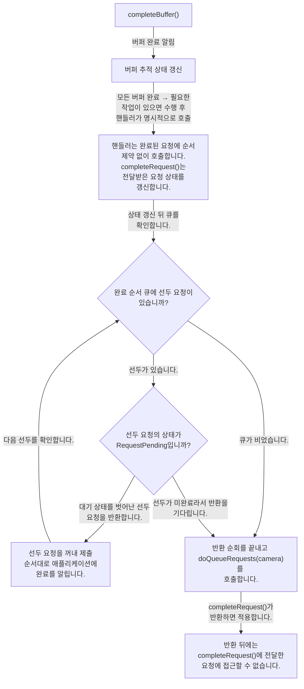

[Mermaid 원문](https://ttolsun.github.io/libcamera-sdd/pipeline-requests.buffer-request-completion.mmd)

<details open>
<summary>그림 근거와 확인 범위</summary>

버퍼가 완료된 뒤 요청은 어떤 순서로 반환되며, 파이프라인 핸들러의 요청 접근은 언제 끝납니까?

소스 연결 해석 · 자동 연결 검사만 통과 · 의미와 기기 실행은 검증 전

| 요소·전이 | 소스 근거 |
| --- | --- |
| completeBuffer() | [src/libcamera/pipeline_handler.cpp:547](https://ttolsun.github.io/libcamera-sdd/reader-archive/pipeline-requests.html#source-01ad7c6605c3296a) |
| 버퍼 추적 상태 갱신 | [src/libcamera/pipeline_handler.cpp:547](https://ttolsun.github.io/libcamera-sdd/reader-archive/pipeline-requests.html#source-01ad7c6605c3296a) |
| 핸들러는 완료된 요청에 순서 제약 없이 호출합니다. completeRequest()는 전달받은 요청 상태를 갱신합니다. | [src/libcamera/pipeline_handler.cpp:571](https://ttolsun.github.io/libcamera-sdd/reader-archive/pipeline-requests.html#source-236c920e906cb6fd) |
| 선두 요청을 꺼내 제출 순서대로 애플리케이션에 완료를 알립니다. | [src/libcamera/pipeline_handler.cpp:571](https://ttolsun.github.io/libcamera-sdd/reader-archive/pipeline-requests.html#source-236c920e906cb6fd) |
| 반환 뒤에는 completeRequest()에 전달한 요청에 접근할 수 없습니다. | [src/libcamera/pipeline_handler.cpp:571](https://ttolsun.github.io/libcamera-sdd/reader-archive/pipeline-requests.html#source-236c920e906cb6fd) |
| 완료 순서 큐에 선두 요청이 있습니까? | [src/libcamera/pipeline_handler.cpp:571](https://ttolsun.github.io/libcamera-sdd/reader-archive/pipeline-requests.html#source-236c920e906cb6fd) |
| 선두 요청의 상태가 RequestPending입니까? | [src/libcamera/pipeline_handler.cpp:571](https://ttolsun.github.io/libcamera-sdd/reader-archive/pipeline-requests.html#source-236c920e906cb6fd) |
| 반환 순회를 끝내고 doQueueRequests(camera)를 호출합니다. | [src/libcamera/pipeline_handler.cpp:571](https://ttolsun.github.io/libcamera-sdd/reader-archive/pipeline-requests.html#source-236c920e906cb6fd) |
| 버퍼 완료 알림 | [src/libcamera/pipeline_handler.cpp:547](https://ttolsun.github.io/libcamera-sdd/reader-archive/pipeline-requests.html#source-01ad7c6605c3296a) |
| 모든 버퍼 완료 → 필요한 작업이 있으면 수행 후 핸들러가 명시적으로 호출 | [src/libcamera/pipeline_handler.cpp:547](https://ttolsun.github.io/libcamera-sdd/reader-archive/pipeline-requests.html#source-01ad7c6605c3296a) |
| 상태 갱신 뒤 큐를 확인합니다. | [src/libcamera/pipeline_handler.cpp:571](https://ttolsun.github.io/libcamera-sdd/reader-archive/pipeline-requests.html#source-236c920e906cb6fd) |
| 선두가 있습니다. | [src/libcamera/pipeline_handler.cpp:571](https://ttolsun.github.io/libcamera-sdd/reader-archive/pipeline-requests.html#source-236c920e906cb6fd) |
| 큐가 비었습니다. | [src/libcamera/pipeline_handler.cpp:571](https://ttolsun.github.io/libcamera-sdd/reader-archive/pipeline-requests.html#source-236c920e906cb6fd) |
| 선두가 미완료라서 반환을 기다립니다. | [src/libcamera/pipeline_handler.cpp:571](https://ttolsun.github.io/libcamera-sdd/reader-archive/pipeline-requests.html#source-236c920e906cb6fd) |
| 대기 상태를 벗어난 선두 요청을 반환합니다. | [src/libcamera/pipeline_handler.cpp:571](https://ttolsun.github.io/libcamera-sdd/reader-archive/pipeline-requests.html#source-236c920e906cb6fd) |
| 다음 선두를 확인합니다. | [src/libcamera/pipeline_handler.cpp:571](https://ttolsun.github.io/libcamera-sdd/reader-archive/pipeline-requests.html#source-236c920e906cb6fd) |
| completeRequest()가 반환하면 적용합니다. | [src/libcamera/pipeline_handler.cpp:571](https://ttolsun.github.io/libcamera-sdd/reader-archive/pipeline-requests.html#source-236c920e906cb6fd) |

</details>

completeRequest가 반환된 뒤에는 파이프라인 핸들러가 해당 요청에 접근해서는 안 됩니다. completeRequest는 요청이 애플리케이션에 제출 순서대로 반환되도록 보장합니다. 파이프라인 핸들러는 완료된 요청에 대해 순서 제약 없이 completeRequest를 호출할 수 있습니다. while 루프는 맨 앞 요청이 RequestPending 상태이면 break를 실행하여 반복을 중단합니다.

completeRequest는 대기 중인 요청을 파이프라인에 큐잉할 수 있도록 마지막에 doQueueRequests(camera)를 호출합니다. completeBuffer와 completeRequest는 모두 `CameraManager` 스레드에서 호출해야 합니다.

cancelRequest는 내부 취소를 호출하여 각 대기 버퍼를 취소하고 해당 버퍼마다 bufferCompleted 신호를 발생시킵니다. 내부 취소는 모든 대기 버퍼를 처리한 뒤 `cancelled_`를 true로 설정하고 대기 버퍼 목록을 비웁니다. 이후 cancelRequest가 completeRequest를 호출하면 `Request::Private::complete()`는 `cancelled_` 값에 따라 요청 상태에 RequestCancelled를 대입합니다.

<details open>
<summary>절 전체 근거 8개</summary>

- `src/libcamera/pipeline_handler.cpp`[`L547`](https://github.com/TTolsun/libcamera-sdd/blob/adfa719f8ed67d18fd8a0739fc088a1f8b9e7252/src/libcamera/pipeline_handler.cpp#L547) · [`L553` 발췌](https://ttolsun.github.io/libcamera-sdd/reader-archive/pipeline-requests.html#source-5b0ae08604dff588) · [전체 소스 `L553`](https://github.com/TTolsun/libcamera-sdd/blob/adfa719f8ed67d18fd8a0739fc088a1f8b9e7252/src/libcamera/pipeline_handler.cpp#L553) · [`L571` 발췌](https://ttolsun.github.io/libcamera-sdd/reader-archive/pipeline-requests.html#source-236c920e906cb6fd) · [전체 소스 `L571`](https://github.com/TTolsun/libcamera-sdd/blob/adfa719f8ed67d18fd8a0739fc088a1f8b9e7252/src/libcamera/pipeline_handler.cpp#L571) · [`L578` 발췌](https://ttolsun.github.io/libcamera-sdd/reader-archive/pipeline-requests.html#source-16187edaf24c09f5) · [전체 소스 `L578`](https://github.com/TTolsun/libcamera-sdd/blob/adfa719f8ed67d18fd8a0739fc088a1f8b9e7252/src/libcamera/pipeline_handler.cpp#L578) · [`L584` 발췌](https://ttolsun.github.io/libcamera-sdd/reader-archive/pipeline-requests.html#source-b6dd86e931d905ed) · [전체 소스 `L584`](https://github.com/TTolsun/libcamera-sdd/blob/adfa719f8ed67d18fd8a0739fc088a1f8b9e7252/src/libcamera/pipeline_handler.cpp#L584) · [`L607` 발췌](https://ttolsun.github.io/libcamera-sdd/reader-archive/pipeline-requests.html#source-27cb6869fd89d13d) · [전체 소스 `L607`](https://github.com/TTolsun/libcamera-sdd/blob/adfa719f8ed67d18fd8a0739fc088a1f8b9e7252/src/libcamera/pipeline_handler.cpp#L607) · [`L547`](https://ttolsun.github.io/libcamera-sdd/reader-archive/pipeline-requests.html#source-01ad7c6605c3296a) · [`L547`](https://ttolsun.github.io/libcamera-sdd/reader-archive/pipeline-requests.html#source-f389c6ca68ade3da)
- `src/libcamera/request.cpp`[`L139`](https://github.com/TTolsun/libcamera-sdd/blob/adfa719f8ed67d18fd8a0739fc088a1f8b9e7252/src/libcamera/request.cpp#L139) · [`L125` 발췌](https://ttolsun.github.io/libcamera-sdd/reader-archive/pipeline-requests.html#source-0626196def047e5c) · [전체 소스 `L125`](https://github.com/TTolsun/libcamera-sdd/blob/adfa719f8ed67d18fd8a0739fc088a1f8b9e7252/src/libcamera/request.cpp#L125) · [`L139`](https://ttolsun.github.io/libcamera-sdd/reader-archive/pipeline-requests.html#source-906fe48d2b97450b)

</details>

## 원고와 검토 기록

<details open>
<summary>연동 가이드</summary>

- **생성 방식**: 추출 사실과 LLM 설명
- **검증 범위**: 표·그림은 facts로 만들고 설명은 LLM이 작성합니다. 인용·문장 및 설정된 구조 검사를 적용합니다.
- **자동 검사**: 통과 (`ok`). 검사한 항목은 검증 범위에 적혀 있습니다. 설명 내용이 맞는지는 사람이 확인합니다.
- **사람 검토**: 사람 검토 전
- **분석 기준 커밋**: `adfa719f8ed67d18fd8a0739fc088a1f8b9e7252`
- **문서 생성 시각**: `2026-11-20 16:39:26+00:00`
- **문장 생성 모델**: `cli/codex/gpt-6.1-terra`
- **문서 간 계약**: [자동 대조 보고서](https://ttolsun.github.io/libcamera-sdd/contract-consistency.json) · 사람 검토 전

<details open>
<summary>원고 작성 당시 기록</summary>

원고에 저장된 당시 기록입니다. 현재 문서의 기준과 다를 수 있습니다.

- 근거 파일: `include/libcamera/camera.h`, `include/libcamera/internal/ipa_manager.h`, `include/libcamera/internal/pipeline_handler.h`, `src/libcamera/camera.cpp`, `src/libcamera/ipa_manager.cpp`, `src/libcamera/pipeline/ipu3/ipu3.cpp`, `src/libcamera/pipeline/rkisp1/rkisp1.cpp`, `src/libcamera/pipeline_handler.cpp`
- 근거 수준: 코드 확인 (정적 분석, simple_compdb 구성, commit `adfa719f8e`)
- 자동 검사 (인용·문장 및 설정된 구조 검사): 통과
- 검토 상태 기록일: 2026-11-21 · 사람 검토 전

</details>

[Markdown 원문 ↗](https://ttolsun.github.io/libcamera-sdd/vendor-integration.md) [Mermaid 원문 ↗](https://ttolsun.github.io/libcamera-sdd/vendor-integration.mmd)

[이전 주소의 상세 내용 열기](https://ttolsun.github.io/libcamera-sdd/reader-archive/vendor-integration.html#page-evidence)

</details>

<details open>
<summary>지원 범위와 검증</summary>

- **생성 방식**: 추출 사실과 LLM 설명
- **검증 범위**: 표·그림은 facts로 만들고 설명은 LLM이 작성합니다. 인용·문장 및 설정된 구조 검사를 적용합니다.
- **자동 검사**: 통과 (`ok`). 검사한 항목은 검증 범위에 적혀 있습니다. 설명 내용이 맞는지는 사람이 확인합니다.
- **사람 검토**: 사람 검토 전
- **분석 기준 커밋**: `adfa719f8ed67d18fd8a0739fc088a1f8b9e7252`
- **문서 생성 시각**: `2026-11-20 16:39:19+00:00`
- **문장 생성 모델**: `cli/codex/gpt-6.1-terra`
- **문서 간 계약**: [자동 대조 보고서](https://ttolsun.github.io/libcamera-sdd/contract-consistency.json) · 사람 검토 전
- **제품 설명 입력**: [적용 범위·조건·자료](https://ttolsun.github.io/libcamera-sdd/product-context.json)

<details open>
<summary>원고 작성 당시 기록</summary>

원고에 저장된 당시 기록입니다. 현재 문서의 기준과 다를 수 있습니다.

- 근거 파일: `Documentation/software-isp-benchmarking.rst`, `README.rst`, `include/libcamera/camera.h`, `include/libcamera/framebuffer.h`, `include/libcamera/internal/ipa_manager.h`, `include/libcamera/internal/pipeline_handler.h`, `include/libcamera/request.h`, `product-evidence/libcamera-first-capture-trial/virtual-first-capture-run.txt`, `src/libcamera/camera.cpp`, `src/libcamera/ipa_manager.cpp`, `src/libcamera/pipeline/ipu3/ipu3.cpp`, `src/libcamera/pipeline/rkisp1/rkisp1.cpp`, `src/libcamera/pipeline/virtual/README.md`, `src/libcamera/pipeline/virtual/data/virtual.yaml`, `src/libcamera/pipeline_handler.cpp`
- 근거 수준: 코드 확인 (정적 분석, simple_compdb 구성, commit `adfa719f8e`)
- 자동 검사 (인용·문장 및 설정된 구조 검사): 통과
- 검토 상태 기록일: 2026-11-21 · 사람 검토 전

</details>

[Markdown 원문 ↗](https://ttolsun.github.io/libcamera-sdd/vendor-assurance.md) [Mermaid 원문 ↗](https://ttolsun.github.io/libcamera-sdd/vendor-assurance.mmd)

[이전 주소의 상세 내용 열기](https://ttolsun.github.io/libcamera-sdd/reader-archive/vendor-assurance.html#page-evidence)

</details>

<details open>
<summary>WSL 공식 cam 가상 캡처 확인</summary>

- **생성 방식**: 추출 사실과 LLM 설명
- **검증 범위**: 표·그림은 facts로 만들고 설명은 LLM이 작성합니다. 인용·문장 및 설정된 구조 검사를 적용합니다.
- **자동 검사**: 통과 (`ok`). 검사한 항목은 검증 범위에 적혀 있습니다. 설명 내용이 맞는지는 사람이 확인합니다.
- **사람 검토**: 사람 검토 전
- **분석 기준 커밋**: `adfa719f8ed67d18fd8a0739fc088a1f8b9e7252`
- **문서 생성 시각**: `2026-11-20 20:07:34+00:00`
- **문장 생성 모델**: `cli/codex/gpt-6.1-terra`
- **문서 간 계약**: [자동 대조 보고서](https://ttolsun.github.io/libcamera-sdd/contract-consistency.json) · 사람 검토 전
- **제품 설명 입력**: [적용 범위·조건·자료](https://ttolsun.github.io/libcamera-sdd/product-context.json)

<details open>
<summary>원고 작성 당시 기록</summary>

원고에 저장된 당시 기록입니다. 현재 문서의 기준과 다를 수 있습니다.

- 근거 파일: `product-evidence/libcamera-official-cam-trial/execution-contract.txt`, `product-evidence/libcamera-official-cam-trial/invocation-execution-contract.txt`, `product-evidence/libcamera-official-cam-trial/invocation-official-cam-reader.txt`, `product-evidence/libcamera-official-cam-trial/invocation-options.txt`, `product-evidence/libcamera-official-cam-trial/invocation-reproduction-procedure.txt`, `product-evidence/libcamera-official-cam-trial/official-cam-reader.txt`, `product-evidence/libcamera-official-cam-trial/reproduction-procedure.txt`, `src/apps/cam/camera_session.cpp`, `src/apps/cam/camera_session.h`, `src/libcamera/camera.cpp`, `src/libcamera/framebuffer_allocator.cpp`, `src/libcamera/pipeline/virtual/README.md`, `src/libcamera/pipeline/virtual/data/virtual.yaml`, `src/libcamera/pipeline/virtual/test_pattern_generator.cpp`, `src/libcamera/pipeline/virtual/virtual.cpp`, `src/libcamera/pipeline_handler.cpp`, `src/libcamera/request.cpp`
- 근거 수준: 코드 확인 (정적 분석, simple_compdb 구성, commit `adfa719f8e`)
- 자동 검사 (인용·문장 및 설정된 구조 검사): 통과
- 검토 상태 기록일: 2026-11-21 · 사람 검토 전

</details>

[Markdown 원문 ↗](https://ttolsun.github.io/libcamera-sdd/official-cam-validation.md)

[이전 주소의 상세 내용 열기](https://ttolsun.github.io/libcamera-sdd/reader-archive/official-cam-validation.html#page-evidence)

</details>

<details open>
<summary>Pipeline 요청 제출과 완료</summary>

- **생성 방식**: 추출 사실과 LLM 설명
- **검증 범위**: 표·그림은 facts로 만들고 설명은 LLM이 작성합니다. 인용·문장 및 설정된 구조 검사를 적용합니다.
- **자동 검사**: 통과 (`ok`). 검사한 항목은 검증 범위에 적혀 있습니다. 설명 내용이 맞는지는 사람이 확인합니다.
- **사람 검토**: 사람 검토 전
- **분석 기준 커밋**: `adfa719f8ed67d18fd8a0739fc088a1f8b9e7252`
- **문서 생성 시각**: `2026-11-20 17:39:07+00:00`
- **문장 생성 모델**: `cli/codex/gpt-6.1-terra`
- **문서 간 계약**: [자동 대조 보고서](https://ttolsun.github.io/libcamera-sdd/contract-consistency.json) · 사람 검토 전

<details open>
<summary>원고 작성 당시 기록</summary>

원고에 저장된 당시 기록입니다. 현재 문서의 기준과 다를 수 있습니다.

- 근거 파일: `include/libcamera/internal/pipeline_handler.h`, `src/libcamera/pipeline/imx8-isi/imx8-isi.cpp`, `src/libcamera/pipeline/ipu3/ipu3.cpp`, `src/libcamera/pipeline/mali-c55/mali-c55.cpp`, `src/libcamera/pipeline/rkisp1/rkisp1.cpp`, `src/libcamera/pipeline/rpi/pisp/pisp.cpp`, `src/libcamera/pipeline/rpi/vc4/vc4.cpp`, `src/libcamera/pipeline/uvcvideo/uvcvideo.cpp`, `src/libcamera/pipeline/vimc/vimc.cpp`, `src/libcamera/pipeline/virtual/virtual.cpp`, `src/libcamera/pipeline_handler.cpp`, `src/libcamera/request.cpp`
- 근거 수준: 코드 확인 (정적 분석, simple_compdb 구성, commit `adfa719f8e`)
- 자동 검사 (인용·문장 및 설정된 구조 검사): 통과
- 검토 상태 기록일: 2026-11-21 · 사람 검토 전

</details>

[Markdown 원문 ↗](https://ttolsun.github.io/libcamera-sdd/pipeline-requests.md) [Mermaid 원문 ↗](https://ttolsun.github.io/libcamera-sdd/pipeline-requests.mmd)

[이전 주소의 상세 내용 열기](https://ttolsun.github.io/libcamera-sdd/reader-archive/pipeline-requests.html#page-evidence)

</details>

[이 페이지 Markdown 받기](https://ttolsun.github.io/libcamera-sdd/device-integration.md) · [독자용 문서의 원본 위치](https://ttolsun.github.io/libcamera-sdd/reader-edition.json)

<a id="doc-7"></a>

ForDeveloper

# ForDeveloper

cam을 실행할 수 있는 환경에서 카메라 목록을 확인하세요. 카메라가 감지되면 첫 번째 카메라에서 프레임을 저장해 보세요. 이어서 탐색·구성·시작의 코드 진입점을 차례로 여세요.

- [취소 상태를 확인하는 코드](#d8-stop-and-disconnect)
- [주의점과 문제 진단](#doc-10)

## 직접 실행해 보기

시스템에서 감지된 카메라 목록은 `cam -l`로 확인하고, 첫 번째 카메라에서 10프레임을 캡처해 디스크에 저장하려면 `cam -c 1 --capture=10 --file`을 사용합니다. 문제가 발생하면 `LIBCAMERA_LOG_LEVELS=*:DEBUG cam -l`로 상세한 libcamera 디버그 로그를 얻을 수 있습니다.

<details open>
<summary>절 전체 근거 1개</summary>

- `README.rst`[`L107` 발췌](https://ttolsun.github.io/libcamera-sdd/reader-archive/onboarding.html#source-5bc9ee57c1b6daee) · [전체 소스 `L107`](https://github.com/TTolsun/libcamera-sdd/blob/adfa719f8ed67d18fd8a0739fc088a1f8b9e7252/README.rst#L107)

</details>

## 탐색을 시작하고 카메라를 사용할 시점

`CameraManager::start()`는 카메라 관리자를 시작하고 시스템의 모든 장치를 열거합니다. 시작이 확인되면 사용자는 관리자가 중지되거나 카메라가 시스템에서 분리될 때까지 시스템의 카메라 목록을 확인하고 카메라와 상호작용할 수 있습니다.

<details open>
<summary>절 전체 근거 1개</summary>

- `src/libcamera/camera_manager.cpp`[`L329` 발췌](https://ttolsun.github.io/libcamera-sdd/reader-archive/scenarios/manager_start.html#source-027ec5bea3fe0dfa) · [전체 소스 `L329`](https://github.com/TTolsun/libcamera-sdd/blob/adfa719f8ed67d18fd8a0739fc088a1f8b9e7252/src/libcamera/camera_manager.cpp#L329)

</details>

## 구성 적용과 성공 상태를 확인할 위치

`Camera::configure()`는 접근 상태 검사에서 음수 오류가 나면 그 값을 반환합니다. 검사를 통과하면 각 `StreamConfiguration`의 이전 스트림 연결을 `nullptr`로 비운 뒤 `validate()`를 검사하고, 결과가 `Valid`가 아니면 `-EINVAL`을 반환합니다. `Camera::configure()`는 유효한 설정에 대해 `PipelineHandler::configure`를 `ConnectionTypeBlocking`으로 호출하고, 반환값이 0이 아니면 그 값을 그대로 반환합니다. API 계약은 함수가 반환될 때 `config`의 각 `StreamConfiguration`이 `Stream` 인스턴스와 연결되며 `stream()`으로 이를 가져올 수 있다고 설명합니다.

### 구성 적용 전의 검사와 파이프라인 결과

```mermaid
flowchart TB
%% sdd:translations {"activeStreams#95;.clear#40;#41;와 <br/>이어지는 별도 스트림 연결 <br/>검사로 진행합니다. 이는 <br/>전체 함수의 성공 반환이 <br/>아닙니다.": "Continue to <br/>activeStreams#95;.clear#40;#41; and <br/>the separate stream <br/>connection check. This is <br/>not the function#39;s <br/>successful return.", "config-#62;validate#40;#41;가 반환한 <br/>상태가 <br/>CameraConfiguration::<br/>Valid와 다른가요?": "Did config-#62;validate#40;#41; <br/>return a status other than <br/>CameraConfiguration::Valid?", "invokeMethod로 <br/>PipelineHandler::<br/>configure를 <br/>ConnectionTypeBlocking으로 <br/>호출합니다.": "Call <br/>PipelineHandler::configure <br/>through invokeMethod with <br/>ConnectionTypeBlocking.", "isAccessAllowed#40;Private::<br/>CameraAcquired, <br/>Private::<br/>CameraConfigured#41;를 <br/>호출합니다. 접근 결과가 <br/>음수인가요?": "Call <br/>isAccessAllowed#40;Private::<br/>CameraAcquired, <br/>Private::CameraConfigured#41;. <br/>Is the access result <br/>negative?", "ret이 거짓이면 다음 검사로 <br/>진행합니다. #91;false#93;": "If ret is false, continue <br/>to the next check. #91;false#93;", "ret이 참이면 ret을 <br/>반환합니다. #91;true#93;": "If ret is true, return ret. <br/>#91;true#93;", "validate#40;#41;의 결과가 <br/>CameraConfiguration::<br/>Valid가 아니므로 -EINVAL을 <br/>반환합니다.": "Return -EINVAL because <br/>validate#40;#41; returned a <br/>status other than <br/>CameraConfiguration::Valid.", "각 연결을 초기화한 뒤 <br/>검증합니다.": "Validate after resetting <br/>each connection.", "기존 #42;config의 각 cfg에서 <br/>cfg.setStream#40;nullptr#41;을 <br/>호출해 연결을 초기화합니다.": "Call cfg.setStream#40;nullptr#41; <br/>for each cfg in the <br/>existing #42;config to reset <br/>its connection.", "로그를 출력한 뒤 <br/>파이프라인을 호출합니다.": "Call the pipeline after <br/>outputting the log.", "반환 상태가 <br/>CameraConfiguration::<br/>Valid가 아니면 -EINVAL을 <br/>반환합니다. #91;true#93;": "If the returned status is <br/>not <br/>CameraConfiguration::Valid, <br/>return -EINVAL. #91;true#93;", "반환 상태가 <br/>CameraConfiguration::<br/>Valid이면 로그를 <br/>준비합니다. #91;false#93;": "If the returned status is <br/>CameraConfiguration::Valid, <br/>prepare the log. #91;false#93;", "스트림 구성 로그를 준비하고 <br/>출력합니다.": "Prepare and output the <br/>stream configuration log.", "접근 결과 ret을 반환합니다.": "Return the access result <br/>ret.", "접근 결과가 음수가 아니면 <br/>연결을 초기화합니다. #91;false#93;": "If the access result is not <br/>negative, reset the <br/>connections. #91;false#93;", "접근 결과가 음수이면 ret을 <br/>반환합니다. #91;true#93;": "If the access result is <br/>negative, return ret. #91;true#93;", "파이프라인 호출의 반환값 <br/>ret을 반환합니다.": "Return the pipeline call#39;s <br/>return value ret.", "파이프라인 호출의 반환값 <br/>ret이 참인가요?": "Is the pipeline call#39;s <br/>return value ret true?", "호출 결과를 검사합니다.": "Check the call result."}
  v_access{"isAccessAllowed#40;Private::<br/>CameraAcquired, <br/>Private::<br/>CameraConfigured#41;를 <br/>호출합니다. 접근 결과가 <br/>음수인가요?"}
  v_access_return["접근 결과 ret을 반환합니다."]
  v_reset["기존 #42;config의 각 cfg에서 <br/>cfg.setStream#40;nullptr#41;을 <br/>호출해 연결을 초기화합니다."]
  v_validation{"config-#62;validate#40;#41;가 반환한 <br/>상태가 <br/>CameraConfiguration::<br/>Valid와 다른가요?"}
  v_validation_return["validate#40;#41;의 결과가 <br/>CameraConfiguration::<br/>Valid가 아니므로 -EINVAL을 <br/>반환합니다."]
  v_log["스트림 구성 로그를 준비하고 <br/>출력합니다."]
  v_pipeline["invokeMethod로 <br/>PipelineHandler::<br/>configure를 <br/>ConnectionTypeBlocking으로 <br/>호출합니다."]
  v_pipeline_check{"파이프라인 호출의 반환값 <br/>ret이 참인가요?"}
  v_pipeline_return["파이프라인 호출의 반환값 <br/>ret을 반환합니다."]
  v_next["activeStreams#95;.clear#40;#41;와 <br/>이어지는 별도 스트림 연결 <br/>검사로 진행합니다. 이는 <br/>전체 함수의 성공 반환이 <br/>아닙니다."]
  v_access -->|"접근 결과가 음수이면 ret을 <br/>반환합니다. #91;true#93;"| v_access_return
  v_access -->|"접근 결과가 음수가 아니면 <br/>연결을 초기화합니다. #91;false#93;"| v_reset
  v_reset -->|"각 연결을 초기화한 뒤 <br/>검증합니다."| v_validation
  v_validation -->|"반환 상태가 <br/>CameraConfiguration::<br/>Valid가 아니면 -EINVAL을 <br/>반환합니다. #91;true#93;"| v_validation_return
  v_validation -->|"반환 상태가 <br/>CameraConfiguration::<br/>Valid이면 로그를 <br/>준비합니다. #91;false#93;"| v_log
  v_log -->|"로그를 출력한 뒤 <br/>파이프라인을 호출합니다."| v_pipeline
  v_pipeline -->|"호출 결과를 검사합니다."| v_pipeline_check
  v_pipeline_check -->|"ret이 참이면 ret을 <br/>반환합니다. #91;true#93;"| v_pipeline_return
  v_pipeline_check -->|"ret이 거짓이면 다음 검사로 <br/>진행합니다. #91;false#93;"| v_next
```

[Mermaid 원문](https://ttolsun.github.io/libcamera-sdd/scenarios/configure.configure-validation-before-pipeline.mmd)

<details open>
<summary>그림 근거와 확인 범위</summary>

Camera::configure의 접근 검사·스트림 연결 초기화·검증·파이프라인 반환 검사는 어떤 순서입니까?

소스 연결 해석 · 자동 연결 검사만 통과 · 의미와 기기 실행은 검증 전

LLM 그림 초안 · 사람 검토 전

작성 모델: `cli/codex/gpt-6.1-terra`

| 요소·전이 | 소스 근거 |
| --- | --- |
| isAccessAllowed(Private::CameraAcquired, Private::CameraConfigured)를 호출합니다. 접근 결과가 음수인가요? | [src/libcamera/camera.cpp:1191](https://ttolsun.github.io/libcamera-sdd/reader-archive/scenarios/configure.html#source-603af0dd7fa357d0) |
| 접근 결과 ret을 반환합니다. | [src/libcamera/camera.cpp:1191](https://ttolsun.github.io/libcamera-sdd/reader-archive/scenarios/configure.html#source-603af0dd7fa357d0) |
| 기존 \*config의 각 cfg에서 cfg.setStream(nullptr)을 호출해 연결을 초기화합니다. | [src/libcamera/camera.cpp:1191](https://ttolsun.github.io/libcamera-sdd/reader-archive/scenarios/configure.html#source-603af0dd7fa357d0) |
| config-\>validate()가 반환한 상태가 CameraConfiguration::Valid와 다른가요? | [src/libcamera/camera.cpp:1191](https://ttolsun.github.io/libcamera-sdd/reader-archive/scenarios/configure.html#source-603af0dd7fa357d0) |
| validate()의 결과가 CameraConfiguration::Valid가 아니므로 -EINVAL을 반환합니다. | [src/libcamera/camera.cpp:1191](https://ttolsun.github.io/libcamera-sdd/reader-archive/scenarios/configure.html#source-603af0dd7fa357d0) |
| 스트림 구성 로그를 준비하고 출력합니다. | [src/libcamera/camera.cpp:1191](https://ttolsun.github.io/libcamera-sdd/reader-archive/scenarios/configure.html#source-603af0dd7fa357d0) |
| invokeMethod로 PipelineHandler::configure를 ConnectionTypeBlocking으로 호출합니다. | [src/libcamera/camera.cpp:1191](https://ttolsun.github.io/libcamera-sdd/reader-archive/scenarios/configure.html#source-603af0dd7fa357d0) |
| 파이프라인 호출의 반환값 ret이 참인가요? | [src/libcamera/camera.cpp:1191](https://ttolsun.github.io/libcamera-sdd/reader-archive/scenarios/configure.html#source-603af0dd7fa357d0) |
| 파이프라인 호출의 반환값 ret을 반환합니다. | [src/libcamera/camera.cpp:1191](https://ttolsun.github.io/libcamera-sdd/reader-archive/scenarios/configure.html#source-603af0dd7fa357d0) |
| activeStreams\_.clear()와 이어지는 별도 스트림 연결 검사로 진행합니다. 이는 전체 함수의 성공 반환이 아닙니다. | [src/libcamera/camera.cpp:1191](https://ttolsun.github.io/libcamera-sdd/reader-archive/scenarios/configure.html#source-603af0dd7fa357d0) |
| 접근 결과가 음수이면 ret을 반환합니다. · ret \< 0 \[true\] | [src/libcamera/camera.cpp:1191](https://ttolsun.github.io/libcamera-sdd/reader-archive/scenarios/configure.html#source-603af0dd7fa357d0) |
| 접근 결과가 음수가 아니면 연결을 초기화합니다. · ret \< 0 \[false\] | [src/libcamera/camera.cpp:1191](https://ttolsun.github.io/libcamera-sdd/reader-archive/scenarios/configure.html#source-603af0dd7fa357d0) |
| 각 연결을 초기화한 뒤 검증합니다. | [src/libcamera/camera.cpp:1191](https://ttolsun.github.io/libcamera-sdd/reader-archive/scenarios/configure.html#source-603af0dd7fa357d0) |
| 반환 상태가 CameraConfiguration::Valid가 아니면 -EINVAL을 반환합니다. · config-\>validate() != CameraConfiguration::Valid \[true\] | [src/libcamera/camera.cpp:1191](https://ttolsun.github.io/libcamera-sdd/reader-archive/scenarios/configure.html#source-603af0dd7fa357d0) |
| 반환 상태가 CameraConfiguration::Valid이면 로그를 준비합니다. · config-\>validate() != CameraConfiguration::Valid \[false\] | [src/libcamera/camera.cpp:1191](https://ttolsun.github.io/libcamera-sdd/reader-archive/scenarios/configure.html#source-603af0dd7fa357d0) |
| 로그를 출력한 뒤 파이프라인을 호출합니다. | [src/libcamera/camera.cpp:1191](https://ttolsun.github.io/libcamera-sdd/reader-archive/scenarios/configure.html#source-603af0dd7fa357d0) |
| 호출 결과를 검사합니다. | [src/libcamera/camera.cpp:1191](https://ttolsun.github.io/libcamera-sdd/reader-archive/scenarios/configure.html#source-603af0dd7fa357d0) |
| ret이 참이면 ret을 반환합니다. · ret \[true\] | [src/libcamera/camera.cpp:1191](https://ttolsun.github.io/libcamera-sdd/reader-archive/scenarios/configure.html#source-603af0dd7fa357d0) |
| ret이 거짓이면 다음 검사로 진행합니다. · ret \[false\] | [src/libcamera/camera.cpp:1191](https://ttolsun.github.io/libcamera-sdd/reader-archive/scenarios/configure.html#source-603af0dd7fa357d0) |

</details>

### 스트림 목록의 일회 초기화와 성공 상태

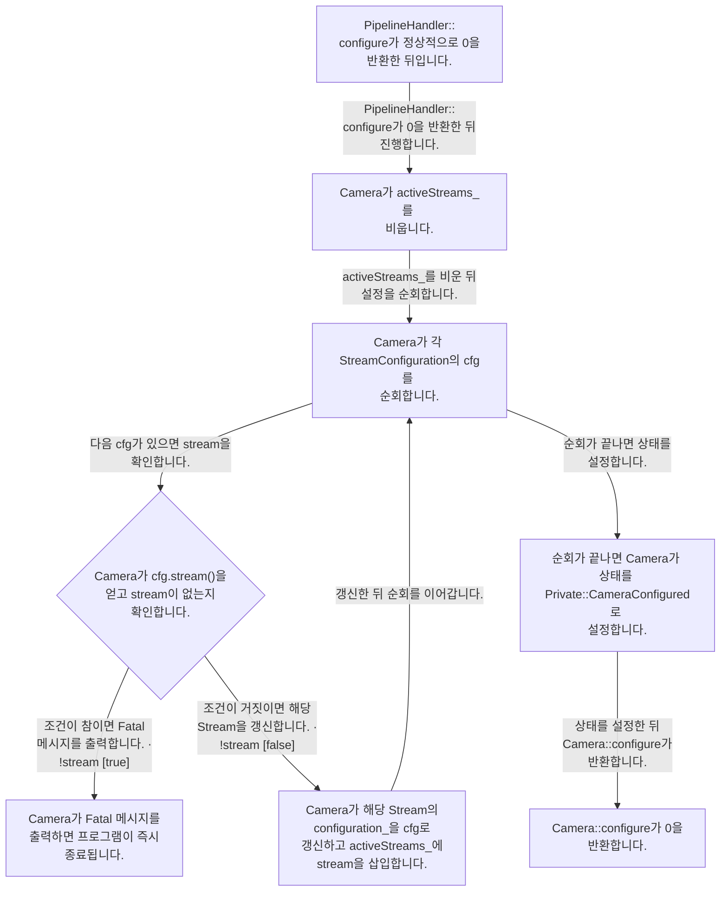

[Mermaid 원문](https://ttolsun.github.io/libcamera-sdd/scenarios/configure.configure-stream-list-once.mmd)

<details open>
<summary>그림 근거와 확인 범위</summary>

파이프라인 구성 성공 뒤 activeStreams\_ 초기화와 각 StreamConfiguration 갱신 및 성공 상태는 어떻게 이어집니까?

소스 연결 해석 · 자동 연결 검사만 통과 · 의미와 기기 실행은 검증 전

LLM 그림 초안 · 사람 검토 전

작성 모델: `cli/codex/gpt-6.1-terra`

| 요소·전이 | 소스 근거 |
| --- | --- |
| PipelineHandler::configure가 정상적으로 0을 반환한 뒤입니다. | [src/libcamera/camera.cpp:1191](https://ttolsun.github.io/libcamera-sdd/reader-archive/scenarios/configure.html#source-603af0dd7fa357d0) |
| Camera가 activeStreams\_를 비웁니다. | [src/libcamera/camera.cpp:1191](https://ttolsun.github.io/libcamera-sdd/reader-archive/scenarios/configure.html#source-603af0dd7fa357d0) |
| Camera가 각 StreamConfiguration의 cfg를 순회합니다. | [src/libcamera/camera.cpp:1191](https://ttolsun.github.io/libcamera-sdd/reader-archive/scenarios/configure.html#source-603af0dd7fa357d0) |
| Camera가 cfg.stream()을 얻고 stream이 없는지 확인합니다. | [src/libcamera/camera.cpp:1191](https://ttolsun.github.io/libcamera-sdd/reader-archive/scenarios/configure.html#source-603af0dd7fa357d0) |
| Camera가 Fatal 메시지를 출력하면 프로그램이 즉시 종료됩니다. | [src/libcamera/camera.cpp:1191](https://ttolsun.github.io/libcamera-sdd/reader-archive/scenarios/configure.html#source-603af0dd7fa357d0) · [src/libcamera/base/log.cpp:1022](https://ttolsun.github.io/libcamera-sdd/reader-archive/scenarios/configure.html#source-47a6ef3943a7b53c) |
| Camera가 해당 Stream의 configuration\_을 cfg로 갱신하고 activeStreams\_에 stream을 삽입합니다. | [src/libcamera/camera.cpp:1191](https://ttolsun.github.io/libcamera-sdd/reader-archive/scenarios/configure.html#source-603af0dd7fa357d0) |
| 순회가 끝나면 Camera가 상태를 Private::CameraConfigured로 설정합니다. | [src/libcamera/camera.cpp:1191](https://ttolsun.github.io/libcamera-sdd/reader-archive/scenarios/configure.html#source-603af0dd7fa357d0) |
| Camera::configure가 0을 반환합니다. | [src/libcamera/camera.cpp:1191](https://ttolsun.github.io/libcamera-sdd/reader-archive/scenarios/configure.html#source-603af0dd7fa357d0) |
| PipelineHandler::configure가 0을 반환한 뒤 진행합니다. | [src/libcamera/camera.cpp:1191](https://ttolsun.github.io/libcamera-sdd/reader-archive/scenarios/configure.html#source-603af0dd7fa357d0) |
| activeStreams\_를 비운 뒤 설정을 순회합니다. | [src/libcamera/camera.cpp:1191](https://ttolsun.github.io/libcamera-sdd/reader-archive/scenarios/configure.html#source-603af0dd7fa357d0) |
| 다음 cfg가 있으면 stream을 확인합니다. | [src/libcamera/camera.cpp:1191](https://ttolsun.github.io/libcamera-sdd/reader-archive/scenarios/configure.html#source-603af0dd7fa357d0) |
| 조건이 참이면 Fatal 메시지를 출력합니다. · !stream \[true\] | [src/libcamera/camera.cpp:1191](https://ttolsun.github.io/libcamera-sdd/reader-archive/scenarios/configure.html#source-603af0dd7fa357d0) |
| 조건이 거짓이면 해당 Stream을 갱신합니다. · !stream \[false\] | [src/libcamera/camera.cpp:1191](https://ttolsun.github.io/libcamera-sdd/reader-archive/scenarios/configure.html#source-603af0dd7fa357d0) |
| 갱신한 뒤 순회를 이어갑니다. | [src/libcamera/camera.cpp:1191](https://ttolsun.github.io/libcamera-sdd/reader-archive/scenarios/configure.html#source-603af0dd7fa357d0) |
| 순회가 끝나면 상태를 설정합니다. | [src/libcamera/camera.cpp:1191](https://ttolsun.github.io/libcamera-sdd/reader-archive/scenarios/configure.html#source-603af0dd7fa357d0) |
| 상태를 설정한 뒤 Camera::configure가 반환합니다. | [src/libcamera/camera.cpp:1191](https://ttolsun.github.io/libcamera-sdd/reader-archive/scenarios/configure.html#source-603af0dd7fa357d0) |

</details>

`Camera::configure()`는 파이프라인 호출이 성공하면 `activeStreams_`를 비우고 각 설정의 `cfg.stream()`을 확인합니다. 스트림이 없으면 `Fatal` 로그 경로에 들어가며, `LOG` 계약에 따라 메시지를 출력한 직후 실행이 중단되고 프로그램이 종료됩니다. 모든 설정에 스트림이 있으면 `Camera::configure()`는 각 스트림의 `configuration_`을 해당 설정으로 갱신하고 `activeStreams_`에 추가합니다. 이후 상태를 `CameraConfigured`로 설정하고 `0`을 반환합니다.

<details open>
<summary>절 전체 근거 3개</summary>

- `src/libcamera/camera.cpp`[`L1191`](https://github.com/TTolsun/libcamera-sdd/blob/adfa719f8ed67d18fd8a0739fc088a1f8b9e7252/src/libcamera/camera.cpp#L1191) · [`L1183` 발췌](https://ttolsun.github.io/libcamera-sdd/reader-archive/scenarios/configure.html#source-5296d50aed1a3be0) · [전체 소스 `L1183`](https://github.com/TTolsun/libcamera-sdd/blob/adfa719f8ed67d18fd8a0739fc088a1f8b9e7252/src/libcamera/camera.cpp#L1183) · [`L1191`](https://ttolsun.github.io/libcamera-sdd/reader-archive/scenarios/configure.html#source-603af0dd7fa357d0)
- `src/libcamera/base/log.cpp`[`L1022` 발췌](https://ttolsun.github.io/libcamera-sdd/reader-archive/scenarios/configure.html#source-47a6ef3943a7b53c) · [전체 소스 `L1022`](https://github.com/TTolsun/libcamera-sdd/blob/adfa719f8ed67d18fd8a0739fc088a1f8b9e7252/src/libcamera/base/log.cpp#L1022)

</details>

## 시작 제어값과 파이프라인 결과 반영

`Camera::start`는 `controls`가 있으면 `ControlList` 복사본을 만들고 `patchControlList`로 전처리한 뒤 그 복사본을 전달하며, 없으면 `nullptr`을 전달합니다. 두 분기 모두 `PipelineHandler::start`를 `ConnectionTypeBlocking`으로 호출하며, 이 함수는 `CameraManager` 스레드에서 호출됩니다. `Camera::start`는 호출 결과인 `ret`이 0이 아니면 `CameraRunning` 상태를 설정하지 않고 `ret`을 그대로 반환합니다. `ret`이 0이면 `CameraRunning` 상태를 설정하고 0을 반환합니다.

### 시작 제어값과 파이프라인 결과 반영의 관계와 경계

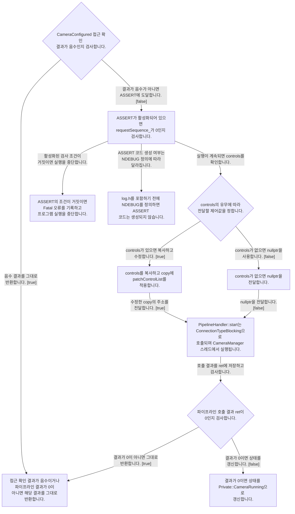

[Mermaid 원문](https://ttolsun.github.io/libcamera-sdd/scenarios/camera_start.item-activation.mmd)

<details open>
<summary>그림 근거와 확인 범위</summary>

ASSERT, 제어값 분기, blocking 파이프라인 호출과 반환값 분기는 어떻게 원래 오류 반환 또는 CameraRunning 갱신으로 이어지는가?

소스 연결 해석 · 자동 연결 검사만 통과 · 의미와 기기 실행은 검증 전

LLM 그림 초안 · 사람 검토 전

작성 모델: `cli/codex/gpt-6.1-terra`

| 요소·전이 | 소스 근거 |
| --- | --- |
| CameraConfigured 접근 확인 결과가 음수인지 검사합니다. | [src/libcamera/camera.cpp:1400](https://ttolsun.github.io/libcamera-sdd/reader-archive/scenarios/camera_start.html#source-05691b4c81e7ee1c) |
| 접근 확인 결과가 음수이거나 파이프라인 결과가 0이 아니면 해당 결과를 그대로 반환합니다. | [src/libcamera/camera.cpp:1400](https://ttolsun.github.io/libcamera-sdd/reader-archive/scenarios/camera_start.html#source-05691b4c81e7ee1c) |
| ASSERT가 활성화되어 있으면 requestSequence\_가 0인지 검사합니다. | [src/libcamera/camera.cpp:1400](https://ttolsun.github.io/libcamera-sdd/reader-archive/scenarios/camera_start.html#source-05691b4c81e7ee1c) · [src/libcamera/base/log.cpp:1022](https://ttolsun.github.io/libcamera-sdd/reader-archive/scenarios/camera_start.html#source-47a6ef3943a7b53c) |
| ASSERT의 조건이 거짓이면 Fatal 오류를 기록하고 프로그램 실행을 중단합니다. | [src/libcamera/base/log.cpp:1022](https://ttolsun.github.io/libcamera-sdd/reader-archive/scenarios/camera_start.html#source-47a6ef3943a7b53c) |
| log.h를 포함하기 전에 NDEBUG를 정의하면 ASSERT 코드는 생성되지 않습니다. | [src/libcamera/base/log.cpp:1022](https://ttolsun.github.io/libcamera-sdd/reader-archive/scenarios/camera_start.html#source-47a6ef3943a7b53c) |
| controls의 유무에 따라 전달할 제어값을 정합니다. | [src/libcamera/camera.cpp:1400](https://ttolsun.github.io/libcamera-sdd/reader-archive/scenarios/camera_start.html#source-05691b4c81e7ee1c) |
| controls를 복사하고 copy에 patchControlList를 적용합니다. | [src/libcamera/camera.cpp:1400](https://ttolsun.github.io/libcamera-sdd/reader-archive/scenarios/camera_start.html#source-05691b4c81e7ee1c) |
| controls가 없으면 nullptr을 전달합니다. | [src/libcamera/camera.cpp:1400](https://ttolsun.github.io/libcamera-sdd/reader-archive/scenarios/camera_start.html#source-05691b4c81e7ee1c) |
| PipelineHandler::start는 ConnectionTypeBlocking으로 호출되며 CameraManager 스레드에서 실행됩니다. | [src/libcamera/camera.cpp:1400](https://ttolsun.github.io/libcamera-sdd/reader-archive/scenarios/camera_start.html#source-05691b4c81e7ee1c) · [src/libcamera/pipeline_handler.cpp:343](https://ttolsun.github.io/libcamera-sdd/reader-archive/scenarios/camera_start.html#source-490ad21ef2a56108) |
| 파이프라인 호출 결과 ret이 0인지 검사합니다. | [src/libcamera/camera.cpp:1400](https://ttolsun.github.io/libcamera-sdd/reader-archive/scenarios/camera_start.html#source-05691b4c81e7ee1c) |
| 결과가 0이면 상태를 Private::CameraRunning으로 갱신합니다. | [src/libcamera/camera.cpp:1400](https://ttolsun.github.io/libcamera-sdd/reader-archive/scenarios/camera_start.html#source-05691b4c81e7ee1c) |
| 음수 결과를 그대로 반환합니다. · ret \< 0 \[true\] | [src/libcamera/camera.cpp:1400](https://ttolsun.github.io/libcamera-sdd/reader-archive/scenarios/camera_start.html#source-05691b4c81e7ee1c) |
| 결과가 음수가 아니면 ASSERT에 도달합니다. · ret \< 0 \[false\] | [src/libcamera/camera.cpp:1400](https://ttolsun.github.io/libcamera-sdd/reader-archive/scenarios/camera_start.html#source-05691b4c81e7ee1c) |
| 활성화된 검사 조건이 거짓이면 실행을 중단합니다. | [src/libcamera/base/log.cpp:1022](https://ttolsun.github.io/libcamera-sdd/reader-archive/scenarios/camera_start.html#source-47a6ef3943a7b53c) |
| ASSERT 코드 생성 여부는 NDEBUG 정의에 따라 달라집니다. | [src/libcamera/base/log.cpp:1022](https://ttolsun.github.io/libcamera-sdd/reader-archive/scenarios/camera_start.html#source-47a6ef3943a7b53c) |
| 실행이 계속되면 controls를 확인합니다. | [src/libcamera/camera.cpp:1400](https://ttolsun.github.io/libcamera-sdd/reader-archive/scenarios/camera_start.html#source-05691b4c81e7ee1c) · [src/libcamera/base/log.cpp:1022](https://ttolsun.github.io/libcamera-sdd/reader-archive/scenarios/camera_start.html#source-47a6ef3943a7b53c) |
| controls가 있으면 복사하고 수정합니다. · controls \[true\] | [src/libcamera/camera.cpp:1400](https://ttolsun.github.io/libcamera-sdd/reader-archive/scenarios/camera_start.html#source-05691b4c81e7ee1c) |
| controls가 없으면 nullptr을 사용합니다. · controls \[false\] | [src/libcamera/camera.cpp:1400](https://ttolsun.github.io/libcamera-sdd/reader-archive/scenarios/camera_start.html#source-05691b4c81e7ee1c) |
| 수정한 copy의 주소를 전달합니다. · controls \[true\] | [src/libcamera/camera.cpp:1400](https://ttolsun.github.io/libcamera-sdd/reader-archive/scenarios/camera_start.html#source-05691b4c81e7ee1c) |
| nullptr을 전달합니다. · controls \[false\] | [src/libcamera/camera.cpp:1400](https://ttolsun.github.io/libcamera-sdd/reader-archive/scenarios/camera_start.html#source-05691b4c81e7ee1c) |
| 호출 결과를 ret에 저장하고 검사합니다. | [src/libcamera/camera.cpp:1400](https://ttolsun.github.io/libcamera-sdd/reader-archive/scenarios/camera_start.html#source-05691b4c81e7ee1c) |
| 결과가 0이 아니면 그대로 반환합니다. · ret \[true\] | [src/libcamera/camera.cpp:1400](https://ttolsun.github.io/libcamera-sdd/reader-archive/scenarios/camera_start.html#source-05691b4c81e7ee1c) |
| 결과가 0이면 상태를 갱신합니다. · ret \[false\] | [src/libcamera/camera.cpp:1400](https://ttolsun.github.io/libcamera-sdd/reader-archive/scenarios/camera_start.html#source-05691b4c81e7ee1c) |

</details>

`Camera::start`는 `PipelineHandler::start`를 호출하기 전에 `ASSERT(d->requestSequence_ == 0)`을 실행합니다. 이 검사가 실패하면 `ASSERT`는 오류 메시지를 `Fatal` 로그 수준으로 기록하고 프로그램 실행을 중단하며, 일반 오류 반환과는 다르게 동작합니다. `log.h`를 포함하기 전에 `NDEBUG`가 정의되면 `ASSERT`는 코드를 생성하지 않습니다.

<details open>
<summary>절 전체 근거 3개</summary>

- `src/libcamera/camera.cpp`[`L1400` 발췌](https://ttolsun.github.io/libcamera-sdd/reader-archive/scenarios/camera_start.html#source-05691b4c81e7ee1c) · [전체 소스 `L1400`](https://github.com/TTolsun/libcamera-sdd/blob/adfa719f8ed67d18fd8a0739fc088a1f8b9e7252/src/libcamera/camera.cpp#L1400)
- `src/libcamera/pipeline_handler.cpp`[`L343` 발췌](https://ttolsun.github.io/libcamera-sdd/reader-archive/scenarios/camera_start.html#source-490ad21ef2a56108) · [전체 소스 `L343`](https://github.com/TTolsun/libcamera-sdd/blob/adfa719f8ed67d18fd8a0739fc088a1f8b9e7252/src/libcamera/pipeline_handler.cpp#L343)
- `src/libcamera/base/log.cpp`[`L1022` 발췌](https://ttolsun.github.io/libcamera-sdd/reader-archive/scenarios/camera_start.html#source-47a6ef3943a7b53c) · [전체 소스 `L1022`](https://github.com/TTolsun/libcamera-sdd/blob/adfa719f8ed67d18fd8a0739fc088a1f8b9e7252/src/libcamera/base/log.cpp#L1022)

</details>

## 취소 상태를 확인할 코드

앱에서 `Camera::requestCompleted`에 연결한 콜백을 열고 `Request::status()`를 읽어 `RequestCancelled`를 처리하는 분기를 찾으세요. 영상을 사용하기 전에 각 `FrameBuffer::metadata().status`가 `FrameSuccess`인지 확인하세요. [정지 뒤 완료 알림의 상태 판정과 코드](#d8-stop-and-disconnect)를 따라가세요.

[시스템 개요](#d2-discovery)에서 CameraManager의 탐색 진입점과 각 구성 요소의 역할을 확인할 수 있습니다. 콜백이나 요청 처리 코드를 수정하기 전에는 [요청 제출과 완료](#d8-submission), [세션 상태와 자원](https://ttolsun.github.io/libcamera-sdd/reader-archive/overview.html#%EC%BA%A1%EC%B2%98-%EC%84%B8%EC%85%98%EC%9D%98-%EC%83%81%ED%83%9C%EC%99%80-%EC%9E%90%EC%9B%90), [스레드 경계](#d8-callback-thread)를 확인하세요.

## 원고와 검토 기록

<details open>
<summary>실행해 보고 설계 이유 읽기</summary>

- **생성 방식**: 추출 사실과 LLM 설명
- **검증 범위**: 표·그림은 facts로 만들고 설명은 LLM이 작성합니다. 인용·문장 및 설정된 구조 검사를 적용합니다.
- **자동 검사**: 통과 (`ok`). 검사한 항목은 검증 범위에 적혀 있습니다. 설명 내용이 맞는지는 사람이 확인합니다.
- **사람 검토**: 사람 검토 전
- **분석 기준 커밋**: `adfa719f8ed67d18fd8a0739fc088a1f8b9e7252`
- **문서 생성 시각**: `2026-11-04 05:02:45+00:00`
- **문장 생성 모델**: `cli/codex/gpt-6.1-terra`
- **문서 간 계약**: [자동 대조 보고서](https://ttolsun.github.io/libcamera-sdd/contract-consistency.json) · 사람 검토 전

<details open>
<summary>원고 작성 당시 기록</summary>

원고에 저장된 당시 기록입니다. 현재 문서의 기준과 다를 수 있습니다.

- 근거 파일: `README.rst`, `include/libcamera/camera.h`, `include/libcamera/internal/pipeline_handler.h`, `include/libcamera/request.h`, `src/libcamera/camera.cpp`, `src/libcamera/pipeline_handler.cpp`, `src/libcamera/request.cpp`
- 근거 수준: 코드 확인 (정적 분석, simple_compdb 구성, commit `293d751a81`)
- 자동 검사 (인용·문장 및 설정된 구조 검사): 통과
- 검토 상태 기록일: 2026-11-04 · 사람 검토 전

</details>

[Markdown 원문 ↗](https://ttolsun.github.io/libcamera-sdd/onboarding.md)

[이전 주소의 상세 내용 열기](https://ttolsun.github.io/libcamera-sdd/reader-archive/onboarding.html#page-evidence)

</details>

<details open>
<summary>카메라 탐색</summary>

- **생성 방식**: 추출 사실과 LLM 설명
- **검증 범위**: 표·그림은 facts로 만들고 설명은 LLM이 작성합니다. 인용·문장 및 설정된 구조 검사를 적용합니다.
- **자동 검사**: 통과 (`ok`). 검사한 항목은 검증 범위에 적혀 있습니다. 설명 내용이 맞는지는 사람이 확인합니다.
- **사람 검토**: 사람 검토 전
- **분석 기준 커밋**: `adfa719f8ed67d18fd8a0739fc088a1f8b9e7252`
- **문서 생성 시각**: `2026-11-04 07:00:44+00:00`
- **문장 생성 모델**: `cli/codex/gpt-6.1-terra`
- **문서 간 계약**: [자동 대조 보고서](https://ttolsun.github.io/libcamera-sdd/contract-consistency.json) · 사람 검토 전

<details open>
<summary>원고 작성 당시 기록</summary>

원고에 저장된 당시 기록입니다. 현재 문서의 기준과 다를 수 있습니다.

- 근거 파일: `src/libcamera/base/event_dispatcher_poll.cpp`, `src/libcamera/base/log.cpp`, `src/libcamera/base/thread.cpp`, `src/libcamera/camera_manager.cpp`
- 근거 수준: 코드 확인 (정적 분석, simple_compdb 구성, commit `293d751a81`)
- 자동 검사 (인용·문장 및 설정된 구조 검사): 통과
- 검토 상태 기록일: 2026-11-04 · 사람 검토 전

</details>

[Markdown 원문 ↗](https://ttolsun.github.io/libcamera-sdd/scenarios/manager_start.md)

[이전 주소의 상세 내용 열기](https://ttolsun.github.io/libcamera-sdd/reader-archive/scenarios/manager_start.html#page-evidence)

</details>

<details open>
<summary>스트림 구성</summary>

- **생성 방식**: 추출 사실과 LLM 설명
- **검증 범위**: 표·그림은 facts로 만들고 설명은 LLM이 작성합니다. 인용·문장 및 설정된 구조 검사를 적용합니다.
- **자동 검사**: 통과 (`ok`). 검사한 항목은 검증 범위에 적혀 있습니다. 설명 내용이 맞는지는 사람이 확인합니다.
- **사람 검토**: 사람 검토 전
- **분석 기준 커밋**: `adfa719f8ed67d18fd8a0739fc088a1f8b9e7252`
- **문서 생성 시각**: `2026-11-20 16:39:43+00:00`
- **문장 생성 모델**: `cli/codex/gpt-6.1-terra`
- **문서 간 계약**: [자동 대조 보고서](https://ttolsun.github.io/libcamera-sdd/contract-consistency.json) · 사람 검토 전

<details open>
<summary>원고 작성 당시 기록</summary>

원고에 저장된 당시 기록입니다. 현재 문서의 기준과 다를 수 있습니다.

- 근거 파일: `include/libcamera/geometry.h`, `include/libcamera/internal/camera.h`, `include/libcamera/pixel_format.h`, `src/libcamera/base/log.cpp`, `src/libcamera/camera.cpp`, `src/libcamera/formats.cpp`, `src/libcamera/pipeline/imx8-isi/imx8-isi.cpp`, `src/libcamera/pixel_format.cpp`, `src/libcamera/sensor/camera_sensor_legacy.cpp`, `src/libcamera/sensor/camera_sensor_raw.cpp`, `src/libcamera/stream.cpp`
- 근거 수준: 코드 확인 (정적 분석, simple_compdb 구성, commit `adfa719f8e`)
- 자동 검사 (인용·문장 및 설정된 구조 검사): 통과
- 검토 상태 기록일: 2026-11-21 · 사람 검토 전

</details>

[Markdown 원문 ↗](https://ttolsun.github.io/libcamera-sdd/scenarios/configure.md)

[이전 주소의 상세 내용 열기](https://ttolsun.github.io/libcamera-sdd/reader-archive/scenarios/configure.html#page-evidence)

</details>

<details open>
<summary>캡처 시작</summary>

- **생성 방식**: 추출 사실과 LLM 설명
- **검증 범위**: 표·그림은 facts로 만들고 설명은 LLM이 작성합니다. 인용·문장 및 설정된 구조 검사를 적용합니다.
- **자동 검사**: 통과 (`ok`). 검사한 항목은 검증 범위에 적혀 있습니다. 설명 내용이 맞는지는 사람이 확인합니다.
- **사람 검토**: 사람 검토 전
- **분석 기준 커밋**: `adfa719f8ed67d18fd8a0739fc088a1f8b9e7252`
- **문서 생성 시각**: `2026-11-04 05:03:21+00:00`
- **문장 생성 모델**: `cli/codex/gpt-6.1-terra`
- **문서 간 계약**: [자동 대조 보고서](https://ttolsun.github.io/libcamera-sdd/contract-consistency.json) · 사람 검토 전

<details open>
<summary>원고 작성 당시 기록</summary>

원고에 저장된 당시 기록입니다. 현재 문서의 기준과 다를 수 있습니다.

- 근거 파일: `src/libcamera/base/log.cpp`, `src/libcamera/camera.cpp`, `src/libcamera/controls.cpp`, `src/libcamera/pipeline_handler.cpp`
- 근거 수준: 코드 확인 (정적 분석, simple_compdb 구성, commit `293d751a81`)
- 자동 검사 (인용·문장 및 설정된 구조 검사): 통과
- 검토 상태 기록일: 2026-11-04 · 사람 검토 전

</details>

[Markdown 원문 ↗](https://ttolsun.github.io/libcamera-sdd/scenarios/camera_start.md)

[이전 주소의 상세 내용 열기](https://ttolsun.github.io/libcamera-sdd/reader-archive/scenarios/camera_start.html#page-evidence)

</details>

<details open>
<summary>libcamera 설계 문서</summary>

- **문서 간 계약**: [자동 대조 보고서](https://ttolsun.github.io/libcamera-sdd/contract-consistency.json) · 사람 검토 전

[이전 주소의 상세 내용 열기](https://ttolsun.github.io/libcamera-sdd/reader-archive/index.html#page-evidence)

</details>

[이 페이지 Markdown 받기](https://ttolsun.github.io/libcamera-sdd/for-developer.md) · [독자용 문서의 원본 위치](https://ttolsun.github.io/libcamera-sdd/reader-edition.json)

<a id="doc-8"></a>

ForDeveloper

# 요청 흐름과 핵심 개념

요청을 만들고 제출하는 쪽에서 시작해 버퍼 완료, 요청 반환, 정지 뒤 취소 상태까지 따라가세요.

## 요청 생성과 소유권

`Camera::createRequest(cookie)`의 `cookie`는 애플리케이션이 사용하는 불투명한 입력입니다. 이 값은 요청에 저장되며 `Request::cookie()`로 언제든 읽을 수 있고, `libcamera` 관점에서는 완전히 불투명합니다. 애플리케이션은 보통 요청 완료 핸들러에서 요청을 외부 리소스에 연결하는 데 이 값을 사용합니다. `Camera::createRequest()`는 카메라가 `Configured` 또는 `Running` 상태일 때만 호출할 수 있으며, 오류가 발생하면 `nullptr`을 반환합니다.

### 요청 생성과 소유권의 관계와 경계

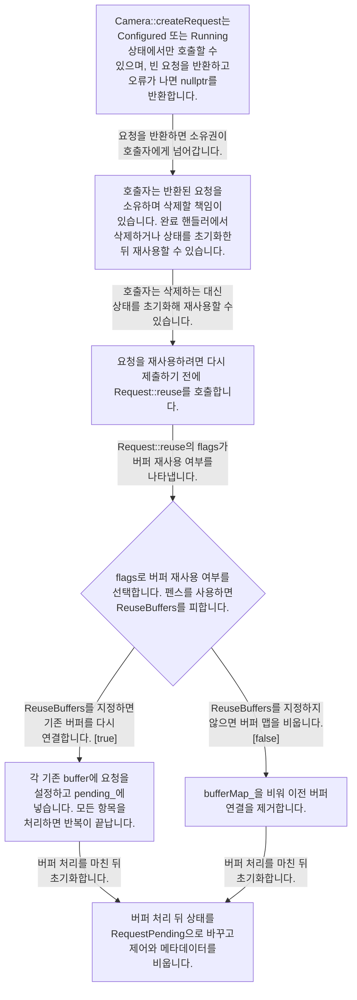

[Mermaid 원문](https://ttolsun.github.io/libcamera-sdd/overview.item-creation.mmd)

<details open>
<summary>그림 근거와 확인 범위</summary>

호출자는 요청을 어떻게 생성·소유·삭제하거나 재사용하며, ReuseBuffers 지정 여부에 따라 버퍼는 어떻게 되나요?

소스 연결 해석 · 자동 연결 검사만 통과 · 의미와 기기 실행은 검증 전

| 요소·전이 | 소스 근거 |
| --- | --- |
| Camera::createRequest는 Configured 또는 Running 상태에서만 호출할 수 있으며, 빈 요청을 반환하고 오류가 나면 nullptr를 반환합니다. | [src/libcamera/camera.cpp:1243](https://ttolsun.github.io/libcamera-sdd/reader-archive/overview.html#source-d61960ed2545ba78) |
| 호출자는 반환된 요청을 소유하며 삭제할 책임이 있습니다. 완료 핸들러에서 삭제하거나 상태를 초기화한 뒤 재사용할 수 있습니다. | [src/libcamera/camera.cpp:1243](https://ttolsun.github.io/libcamera-sdd/reader-archive/overview.html#source-d61960ed2545ba78) |
| 요청을 재사용하려면 다시 제출하기 전에 Request::reuse를 호출합니다. | [src/libcamera/request.cpp:376](https://ttolsun.github.io/libcamera-sdd/reader-archive/overview.html#source-0556d5e91908d040) |
| flags로 버퍼 재사용 여부를 선택합니다. 펜스를 사용하면 ReuseBuffers를 피합니다. | [src/libcamera/request.cpp:376](https://ttolsun.github.io/libcamera-sdd/reader-archive/overview.html#source-0556d5e91908d040) · [src/libcamera/request.cpp:326](https://ttolsun.github.io/libcamera-sdd/reader-archive/overview.html#source-99c7ceeed4e79b3a) |
| 각 기존 buffer에 요청을 설정하고 pending\_에 넣습니다. 모든 항목을 처리하면 반복이 끝납니다. | [src/libcamera/request.cpp:376](https://ttolsun.github.io/libcamera-sdd/reader-archive/overview.html#source-0556d5e91908d040) |
| bufferMap\_을 비워 이전 버퍼 연결을 제거합니다. | [src/libcamera/request.cpp:376](https://ttolsun.github.io/libcamera-sdd/reader-archive/overview.html#source-0556d5e91908d040) |
| 버퍼 처리 뒤 상태를 RequestPending으로 바꾸고 제어와 메타데이터를 비웁니다. | [src/libcamera/request.cpp:376](https://ttolsun.github.io/libcamera-sdd/reader-archive/overview.html#source-0556d5e91908d040) |
| 요청을 반환하면 소유권이 호출자에게 넘어갑니다. | [src/libcamera/camera.cpp:1243](https://ttolsun.github.io/libcamera-sdd/reader-archive/overview.html#source-d61960ed2545ba78) |
| 호출자는 삭제하는 대신 상태를 초기화해 재사용할 수 있습니다. | [src/libcamera/camera.cpp:1243](https://ttolsun.github.io/libcamera-sdd/reader-archive/overview.html#source-d61960ed2545ba78) |
| Request::reuse의 flags가 버퍼 재사용 여부를 나타냅니다. | [src/libcamera/request.cpp:376](https://ttolsun.github.io/libcamera-sdd/reader-archive/overview.html#source-0556d5e91908d040) |
| ReuseBuffers를 지정하면 기존 버퍼를 다시 연결합니다. · flags & ReuseBuffers \[true\] | [src/libcamera/request.cpp:376](https://ttolsun.github.io/libcamera-sdd/reader-archive/overview.html#source-0556d5e91908d040) |
| ReuseBuffers를 지정하지 않으면 버퍼 맵을 비웁니다. · flags & ReuseBuffers \[false\] | [src/libcamera/request.cpp:376](https://ttolsun.github.io/libcamera-sdd/reader-archive/overview.html#source-0556d5e91908d040) |
| 버퍼 처리를 마친 뒤 초기화합니다. | [src/libcamera/request.cpp:376](https://ttolsun.github.io/libcamera-sdd/reader-archive/overview.html#source-0556d5e91908d040) |
| 버퍼 처리를 마친 뒤 초기화합니다. | [src/libcamera/request.cpp:376](https://ttolsun.github.io/libcamera-sdd/reader-archive/overview.html#source-0556d5e91908d040) |

</details>

`Camera::createRequest()`가 반환한 요청의 소유권은 호출자에게 넘어가며, 호출자는 요청을 삭제할 책임이 있습니다. 호출자는 새 요청을 만들지 않고 같은 요청을 다시 큐에 넣으려면 큐에 넣기 전에 `Request::reuse()`를 호출해 요청 상태와 연결된 컨트롤을 초기화해야 합니다. `Request::reuse()`는 `ReuseBuffers`를 지정하면 `addBuffer()`로 추가한 기존 버퍼를 요청에 다시 연결해 재사용하고 지정하지 않으면 `bufferMap_`을 비우며, 버퍼에 연결된 펜스는 재사용하지 않으므로 펜스를 사용할 때는 `ReuseBuffers`를 쓰지 않도록 권고합니다.

<details open>
<summary>절 전체 근거 3개</summary>

- `src/libcamera/camera.cpp`[`L1243` 발췌](https://ttolsun.github.io/libcamera-sdd/reader-archive/overview.html#source-d61960ed2545ba78) · [전체 소스 `L1243`](https://github.com/TTolsun/libcamera-sdd/blob/adfa719f8ed67d18fd8a0739fc088a1f8b9e7252/src/libcamera/camera.cpp#L1243)
- `src/libcamera/request.cpp`[`L376` 발췌](https://ttolsun.github.io/libcamera-sdd/reader-archive/overview.html#source-0556d5e91908d040) · [전체 소스 `L376`](https://github.com/TTolsun/libcamera-sdd/blob/adfa719f8ed67d18fd8a0739fc088a1f8b9e7252/src/libcamera/request.cpp#L376) · [`L326` 발췌](https://ttolsun.github.io/libcamera-sdd/reader-archive/overview.html#source-99c7ceeed4e79b3a) · [전체 소스 `L326`](https://github.com/TTolsun/libcamera-sdd/blob/adfa719f8ed67d18fd8a0739fc088a1f8b9e7252/src/libcamera/request.cpp#L326)

</details>

## <a id="d8-submission"></a>요청 제출과 완료

함께 확인: [버퍼 완료와 요청 전체 완료 구분](#d8-completion) · [완료 호출자와 스레드 의무](#d8-callback-thread)

애플리케이션은 `Camera::queueRequest()`로 제출하기 전에 `createRequest()`가 반환한 요청 객체에 캡처 버퍼를 최소 한 개 연결해야 합니다. 카메라는 `Camera::queueRequest()`로 큐에 넣은 요청의 처리가 끝나면 `requestCompleted` 신호로 애플리케이션에 완료를 알립니다. `Camera::queueRequest()`는 카메라가 `Running` 상태일 때만 호출해야 합니다.

### 요청 접수와 버퍼 완료, 요청 완료

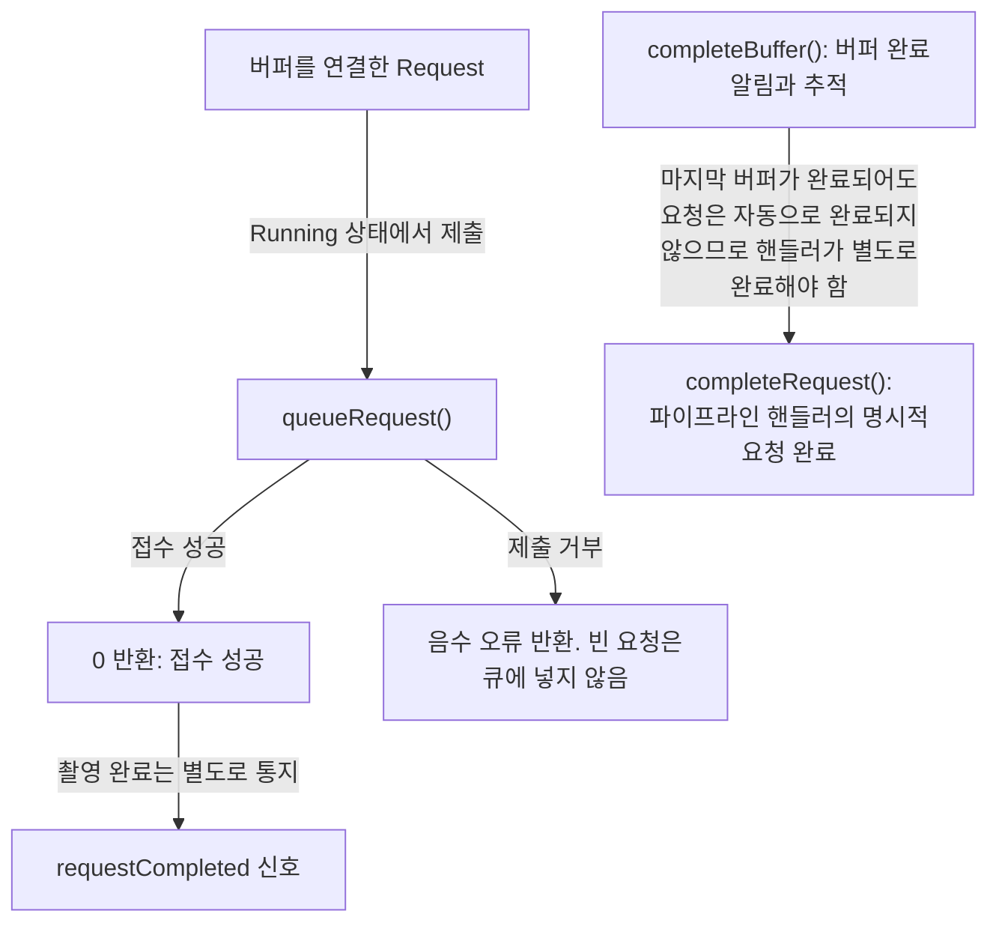

[Mermaid 원문](https://ttolsun.github.io/libcamera-sdd/overview.submission-completion.mmd)

<details open>
<summary>그림 근거와 확인 범위</summary>

queueRequest()의 반환값은 접수 결과입니다. completeBuffer()는 버퍼 완료를 알리고 추적하며, 파이프라인 핸들러는 completeRequest()로 요청을 별도로 완료해야 합니다. requestCompleted 신호는 요청 완료를 별도로 알립니다.

소스 연결 해석 · 자동 연결 검사만 통과 · 의미와 기기 실행은 검증 전

LLM 그림 초안 · 사람 검토 전

작성 모델: `cli/codex/gpt-6.1-terra`

| 요소·전이 | 소스 근거 |
| --- | --- |
| 버퍼를 연결한 Request | [src/libcamera/camera.cpp:1308](https://ttolsun.github.io/libcamera-sdd/reader-archive/overview.html#source-2f880c124115c9c4) |
| queueRequest() | [src/libcamera/camera.cpp:1308](https://ttolsun.github.io/libcamera-sdd/reader-archive/overview.html#source-2f880c124115c9c4) |
| 0 반환: 접수 성공 | [src/libcamera/camera.cpp:1308](https://ttolsun.github.io/libcamera-sdd/reader-archive/overview.html#source-2f880c124115c9c4) |
| requestCompleted 신호 | [src/libcamera/camera.cpp:1308](https://ttolsun.github.io/libcamera-sdd/reader-archive/overview.html#source-2f880c124115c9c4) |
| completeBuffer(): 버퍼 완료 알림과 추적 | [src/libcamera/pipeline_handler.cpp:547](https://ttolsun.github.io/libcamera-sdd/reader-archive/overview.html#source-ca3f659653ce3f6a) |
| completeRequest(): 파이프라인 핸들러의 명시적 요청 완료 | [src/libcamera/pipeline_handler.cpp:547](https://ttolsun.github.io/libcamera-sdd/reader-archive/overview.html#source-ca3f659653ce3f6a) |
| 음수 오류 반환. 빈 요청은 큐에 넣지 않음 | [src/libcamera/camera.cpp:1308](https://ttolsun.github.io/libcamera-sdd/reader-archive/overview.html#source-2f880c124115c9c4) |
| Running 상태에서 제출 | [src/libcamera/camera.cpp:1308](https://ttolsun.github.io/libcamera-sdd/reader-archive/overview.html#source-2f880c124115c9c4) |
| 접수 성공 | [src/libcamera/camera.cpp:1308](https://ttolsun.github.io/libcamera-sdd/reader-archive/overview.html#source-2f880c124115c9c4) |
| 촬영 완료는 별도로 통지 | [src/libcamera/camera.cpp:1308](https://ttolsun.github.io/libcamera-sdd/reader-archive/overview.html#source-2f880c124115c9c4) |
| 마지막 버퍼가 완료되어도 요청은 자동으로 완료되지 않으므로 핸들러가 별도로 완료해야 함 | [src/libcamera/pipeline_handler.cpp:547](https://ttolsun.github.io/libcamera-sdd/reader-archive/overview.html#source-ca3f659653ce3f6a) |
| 제출 거부 | [src/libcamera/camera.cpp:1308](https://ttolsun.github.io/libcamera-sdd/reader-archive/overview.html#source-2f880c124115c9c4) |

</details>

<details open>
<summary>절 전체 근거 1개</summary>

- `src/libcamera/camera.cpp`[`L1308` 발췌](https://ttolsun.github.io/libcamera-sdd/reader-archive/overview.html#source-2f880c124115c9c4) · [전체 소스 `L1308`](https://github.com/TTolsun/libcamera-sdd/blob/adfa719f8ed67d18fd8a0739fc088a1f8b9e7252/src/libcamera/camera.cpp#L1308)

</details>

## 요청·버퍼·fence의 수명

### 소유권과 두 완료 경계

`Camera::createRequest()` 호출자는 반환된 `Request`의 소유권을 받으며 삭제할 책임이 있습니다. 호출자는 완료 핸들러에서 요청을 삭제하거나 `Request::reuse()`로 상태를 초기화한 뒤 재사용할 수 있습니다. `Request::addBuffer()`는 버퍼 참조를 요청에 저장하며, 호출자는 요청 완료 콜백이 호출될 때까지 버퍼가 유효하도록 해야 합니다. 파이프라인 핸들러는 `completeRequest()` 또는 `cancelRequest()`가 반환된 뒤 해당 요청에 접근해서는 안 됩니다.

#### 요청과 버퍼를 유지할 기간

```mermaid
flowchart TB
%% sdd:translations {"Queued 수신은 비동기이며 <br/>발신자는 완료를 기다리지 <br/>않습니다. Auto는 같은 <br/>스레드에서 Direct, 다른 <br/>스레드에서 Queued를 <br/>사용합니다.": "Queued delivery is <br/>asynchronous and the sender <br/>does not wait for <br/>completion. Auto uses <br/>Direct in the same thread <br/>and Queued in different <br/>threads.", "Signal::emit으로 포인터나 <br/>참조를 전달하는 발신자는 <br/>신호 발생 후에도 대상이 <br/>유효하도록 해야 합니다.": "An emitter passing a <br/>pointer or reference <br/>through Signal::emit must <br/>ensure that its target <br/>remains valid after <br/>emission.", "addBuffer 호출자는 요청에 <br/>참조로 저장된 버퍼가 요청 <br/>완료 콜백이 호출될 때까지 <br/>유효하도록 해야 합니다.": "The addBuffer caller must <br/>ensure that the buffer <br/>referenced by the request <br/>remains valid until the <br/>request completion callback <br/>is called.", "cancelRequest는 <br/>completeRequest를 호출하며 <br/>같은 완료 규칙을 따릅니다.": "cancelRequest calls <br/>completeRequest and follows <br/>the same completion rules.", "cancelRequest는 요청을 <br/>취소하고 완료합니다. 반환 <br/>후 접근 금지를 포함해 <br/>completeRequest와 같은 <br/>규칙이 적용됩니다.": "cancelRequest cancels and <br/>completes the request. The <br/>same rules as <br/>completeRequest apply, <br/>including the prohibition <br/>on access after return.", "createRequest 호출자는 <br/>반환된 요청의 소유권과 삭제 <br/>책임을 받습니다. 오류가 <br/>나면 nullptr가 반환됩니다.": "The createRequest caller <br/>receives ownership of the <br/>returned request and is <br/>responsible for deleting <br/>it. On error, nullptr is <br/>returned.", "reuse는 요청의 상태와 제어 <br/>값을 초기화합니다. 다시 <br/>큐에 넣기 전에 호출하며 <br/>ReuseBuffers로 이전 버퍼를 <br/>재사용할 수 있습니다.": "reuse resets the request <br/>status and controls. Call <br/>it before requeuing; <br/>ReuseBuffers can be used to <br/>reuse previously added <br/>buffers.", "반환된 요청은 완료 <br/>핸들러에서 삭제할 수 <br/>있습니다.": "The returned request may be <br/>deleted in the completion <br/>handler.", "별도 Queued 수신자가 <br/>포인터를 계속 쓰면 마지막 <br/>사용까지의 수명과 관계자 간 <br/>협의를 확인하세요. 완료 <br/>콜백 하나나 stop 반환이 <br/>모든 수신을 기다린다고 <br/>가정하지 마세요.": "If a separate Queued <br/>receiver continues to use a <br/>pointer, verify its <br/>lifetime through the last <br/>use and coordination <br/>between parties. Do not <br/>assume one completion <br/>callback or stop return <br/>waits for all receivers.", "삭제 대신 요청의 상태를 <br/>초기화한 뒤 재사용할 수 <br/>있습니다.": "As an alternative to <br/>deletion, the request may <br/>be reused after its state <br/>is reset.", "완료 핸들러에서 요청을 <br/>삭제하거나 상태를 초기화한 <br/>뒤 재사용할 수 있습니다. <br/>삭제와 재사용은 <br/>선택지입니다.": "The request may be deleted <br/>in the completion handler <br/>or reused after its state <br/>is reset. Deletion and <br/>reuse are alternatives.", "요청 완료 콜백은 addBuffer <br/>호출자가 버퍼를 유효하게 <br/>유지해야 하는 기한입니다.": "The request completion <br/>callback is the point until <br/>which the addBuffer caller <br/>must keep the buffer valid.", "파이프라인 핸들러는 <br/>completeRequest가 반환된 뒤 <br/>요청에 접근하면 안 됩니다. <br/>이는 완료 핸들러의 <br/>삭제·재사용 선택과 별도 <br/>경계입니다.": "The pipeline handler must <br/>not access the request <br/>after completeRequest <br/>returns. This is a separate <br/>boundary from the <br/>completion handler#39;s <br/>deletion or reuse choice.", "호출자는 요청 완료 콜백이 <br/>호출될 때까지 버퍼가 <br/>유효하도록 해야 합니다.": "The caller must ensure that <br/>the buffer remains valid <br/>until the request <br/>completion callback is <br/>called."}
  v_create["createRequest 호출자는 <br/>반환된 요청의 소유권과 삭제 <br/>책임을 받습니다. 오류가 <br/>나면 nullptr가 반환됩니다."]
  v_add["addBuffer 호출자는 요청에 <br/>참조로 저장된 버퍼가 요청 <br/>완료 콜백이 호출될 때까지 <br/>유효하도록 해야 합니다."]
  v_handler["완료 핸들러에서 요청을 <br/>삭제하거나 상태를 초기화한 <br/>뒤 재사용할 수 있습니다. <br/>삭제와 재사용은 <br/>선택지입니다."]
  v_callback["요청 완료 콜백은 addBuffer <br/>호출자가 버퍼를 유효하게 <br/>유지해야 하는 기한입니다."]
  v_reuse["reuse는 요청의 상태와 제어 <br/>값을 초기화합니다. 다시 <br/>큐에 넣기 전에 호출하며 <br/>ReuseBuffers로 이전 버퍼를 <br/>재사용할 수 있습니다."]
  v_complete["파이프라인 핸들러는 <br/>completeRequest가 반환된 뒤 <br/>요청에 접근하면 안 됩니다. <br/>이는 완료 핸들러의 <br/>삭제·재사용 선택과 별도 <br/>경계입니다."]
  v_cancel["cancelRequest는 요청을 <br/>취소하고 완료합니다. 반환 <br/>후 접근 금지를 포함해 <br/>completeRequest와 같은 <br/>규칙이 적용됩니다."]
  v_signal["Signal::emit으로 포인터나 <br/>참조를 전달하는 발신자는 <br/>신호 발생 후에도 대상이 <br/>유효하도록 해야 합니다."]
  v_queued["별도 Queued 수신자가 <br/>포인터를 계속 쓰면 마지막 <br/>사용까지의 수명과 관계자 간 <br/>협의를 확인하세요. 완료 <br/>콜백 하나나 stop 반환이 <br/>모든 수신을 기다린다고 <br/>가정하지 마세요."]
  v_create -->|"반환된 요청은 완료 <br/>핸들러에서 삭제할 수 <br/>있습니다."| v_handler
  v_handler -->|"삭제 대신 요청의 상태를 <br/>초기화한 뒤 재사용할 수 <br/>있습니다."| v_reuse
  v_add -->|"호출자는 요청 완료 콜백이 <br/>호출될 때까지 버퍼가 <br/>유효하도록 해야 합니다."| v_callback
  v_cancel -->|"cancelRequest는 <br/>completeRequest를 호출하며 <br/>같은 완료 규칙을 따릅니다."| v_complete
  v_signal -->|"Queued 수신은 비동기이며 <br/>발신자는 완료를 기다리지 <br/>않습니다. Auto는 같은 <br/>스레드에서 Direct, 다른 <br/>스레드에서 Queued를 <br/>사용합니다."| v_queued
```

[Mermaid 원문](https://ttolsun.github.io/libcamera-sdd/request-lifecycle.request-ownership.mmd)

<details open>
<summary>그림 근거와 확인 범위</summary>

createRequest·addBuffer 호출자, 완료 핸들러의 삭제·재사용과 핸들러 접근 종료, 별도 Queued 수신자의 포인터 수명을 어떻게 구분합니까?

소스 연결 해석 · 자동 연결 검사만 통과 · 의미와 기기 실행은 검증 전

LLM 그림 초안 · 사람 검토 전

작성 모델: `cli/codex/gpt-6.1-terra`

| 요소·전이 | 소스 근거 |
| --- | --- |
| createRequest 호출자는 반환된 요청의 소유권과 삭제 책임을 받습니다. 오류가 나면 nullptr가 반환됩니다. | [src/libcamera/camera.cpp:1243](https://ttolsun.github.io/libcamera-sdd/reader-archive/request-lifecycle.html#source-0ae00d77839f61cb) |
| addBuffer 호출자는 요청에 참조로 저장된 버퍼가 요청 완료 콜백이 호출될 때까지 유효하도록 해야 합니다. | [src/libcamera/request.cpp:442](https://ttolsun.github.io/libcamera-sdd/reader-archive/request-lifecycle.html#source-95ae69eeb085e3b1) |
| 완료 핸들러에서 요청을 삭제하거나 상태를 초기화한 뒤 재사용할 수 있습니다. 삭제와 재사용은 선택지입니다. | [src/libcamera/camera.cpp:1243](https://ttolsun.github.io/libcamera-sdd/reader-archive/request-lifecycle.html#source-0ae00d77839f61cb) |
| 요청 완료 콜백은 addBuffer 호출자가 버퍼를 유효하게 유지해야 하는 기한입니다. | [src/libcamera/request.cpp:442](https://ttolsun.github.io/libcamera-sdd/reader-archive/request-lifecycle.html#source-95ae69eeb085e3b1) |
| reuse는 요청의 상태와 제어 값을 초기화합니다. 다시 큐에 넣기 전에 호출하며 ReuseBuffers로 이전 버퍼를 재사용할 수 있습니다. | [src/libcamera/request.cpp:376](https://ttolsun.github.io/libcamera-sdd/reader-archive/request-lifecycle.html#source-38494771cb29cc8c) |
| 파이프라인 핸들러는 completeRequest가 반환된 뒤 요청에 접근하면 안 됩니다. 이는 완료 핸들러의 삭제·재사용 선택과 별도 경계입니다. | [src/libcamera/pipeline_handler.cpp:547](https://ttolsun.github.io/libcamera-sdd/reader-archive/request-lifecycle.html#source-01ad7c6605c3296a) · [src/libcamera/camera.cpp:1243](https://ttolsun.github.io/libcamera-sdd/reader-archive/request-lifecycle.html#source-0ae00d77839f61cb) |
| cancelRequest는 요청을 취소하고 완료합니다. 반환 후 접근 금지를 포함해 completeRequest와 같은 규칙이 적용됩니다. | [src/libcamera/pipeline_handler.cpp:547](https://ttolsun.github.io/libcamera-sdd/reader-archive/request-lifecycle.html#source-01ad7c6605c3296a) |
| Signal::emit으로 포인터나 참조를 전달하는 발신자는 신호 발생 후에도 대상이 유효하도록 해야 합니다. | [src/libcamera/base/signal.cpp:73](https://ttolsun.github.io/libcamera-sdd/reader-archive/request-lifecycle.html#source-52064eba9532db6a) |
| 별도 Queued 수신자가 포인터를 계속 쓰면 마지막 사용까지의 수명과 관계자 간 협의를 확인하세요. 완료 콜백 하나나 stop 반환이 모든 수신을 기다린다고 가정하지 마세요. | [src/libcamera/base/signal.cpp:73](https://ttolsun.github.io/libcamera-sdd/reader-archive/request-lifecycle.html#source-52064eba9532db6a) · [src/libcamera/base/bound_method.cpp:22](https://ttolsun.github.io/libcamera-sdd/reader-archive/request-lifecycle.html#source-bfdfed92f905633d) |
| 반환된 요청은 완료 핸들러에서 삭제할 수 있습니다. | [src/libcamera/camera.cpp:1243](https://ttolsun.github.io/libcamera-sdd/reader-archive/request-lifecycle.html#source-0ae00d77839f61cb) |
| 삭제 대신 요청의 상태를 초기화한 뒤 재사용할 수 있습니다. | [src/libcamera/camera.cpp:1243](https://ttolsun.github.io/libcamera-sdd/reader-archive/request-lifecycle.html#source-0ae00d77839f61cb) |
| 호출자는 요청 완료 콜백이 호출될 때까지 버퍼가 유효하도록 해야 합니다. | [src/libcamera/request.cpp:442](https://ttolsun.github.io/libcamera-sdd/reader-archive/request-lifecycle.html#source-95ae69eeb085e3b1) |
| cancelRequest는 completeRequest를 호출하며 같은 완료 규칙을 따릅니다. | [src/libcamera/pipeline_handler.cpp:547](https://ttolsun.github.io/libcamera-sdd/reader-archive/request-lifecycle.html#source-01ad7c6605c3296a) |
| Queued 수신은 비동기이며 발신자는 완료를 기다리지 않습니다. Auto는 같은 스레드에서 Direct, 다른 스레드에서 Queued를 사용합니다. | [src/libcamera/base/bound_method.cpp:22](https://ttolsun.github.io/libcamera-sdd/reader-archive/request-lifecycle.html#source-bfdfed92f905633d) |

</details>

### 정상 완료와 다음 요청 준비

`completeBuffer`는 `bufferCompleted`를 emit한 뒤 요청 내부의 버퍼 추적을 갱신하고, 모든 버퍼가 완료되면 `true`, 남은 버퍼가 있으면 `false`를 반환합니다. 마지막 버퍼가 완료되어도 요청은 자동 완료되지 않으므로, 파이프라인 핸들러는 필요한 처리를 마친 뒤 `completeRequest`로 명시적으로 완료를 통지해야 합니다. 두 함수는 `CameraManager` 스레드에서 호출해야 하며, 실제 콜백 실행 스레드는 이 소스에서 확인되지 않습니다. `completeRequest`가 호출하는 내부 `complete`는 `cancelled_`가 `false`이면 `RequestComplete`, `true`이면 `RequestCancelled`를 선택합니다.

#### 버퍼 알림에서 요청 반환까지

```mermaid
flowchart TB
%% sdd:translations {"bufferCompleted 알림": "bufferCompleted notification", "emit 뒤 갱신": "Update after emit", "마지막 버퍼만으로 자동 <br/>완료되지 않음": "Last buffer does not <br/>automatically complete <br/>request", "명시적 completeRequest": "Explicit completeRequest", "완료된 선두부터 반환": "Return completed queue heads", "요청 내부 버퍼 추적 갱신": "Update internal buffer <br/>tracking", "제출 순서로 애플리케이션 <br/>반환": "Return to application in <br/>submission order"}
  v_notice["bufferCompleted 알림"]
  v_tracking["요청 내부 버퍼 추적 갱신"]
  v_complete["명시적 completeRequest"]
  v_return["제출 순서로 애플리케이션 <br/>반환"]
  v_notice -->|"emit 뒤 갱신"| v_tracking
  v_tracking -->|"마지막 버퍼만으로 자동 <br/>완료되지 않음"| v_complete
  v_complete -->|"완료된 선두부터 반환"| v_return
```

[Mermaid 원문](https://ttolsun.github.io/libcamera-sdd/request-lifecycle.completion-notification-order.mmd)

<details open>
<summary>그림 근거와 확인 범위</summary>

정상 경로의 호출·추적 순서입니다. 모든 버퍼와 필요한 추가 처리가 끝난 뒤 요청 완료를 통지하며, 실제 실행 시간이나 애플리케이션 콜백 스레드를 나타내지 않습니다.

소스 연결 해석 · 자동 연결 검사만 통과 · 의미와 기기 실행은 검증 전

| 요소·전이 | 소스 근거 |
| --- | --- |
| bufferCompleted 알림 | [src/libcamera/pipeline_handler.cpp:547](https://ttolsun.github.io/libcamera-sdd/reader-archive/request-lifecycle.html#source-01ad7c6605c3296a) |
| 요청 내부 버퍼 추적 갱신 | [src/libcamera/pipeline_handler.cpp:547](https://ttolsun.github.io/libcamera-sdd/reader-archive/request-lifecycle.html#source-01ad7c6605c3296a) |
| 명시적 completeRequest | [src/libcamera/pipeline_handler.cpp:547](https://ttolsun.github.io/libcamera-sdd/reader-archive/request-lifecycle.html#source-01ad7c6605c3296a) |
| 제출 순서로 애플리케이션 반환 | [src/libcamera/pipeline_handler.cpp:547](https://ttolsun.github.io/libcamera-sdd/reader-archive/request-lifecycle.html#source-01ad7c6605c3296a) |
| emit 뒤 갱신 | [src/libcamera/pipeline_handler.cpp:547](https://ttolsun.github.io/libcamera-sdd/reader-archive/request-lifecycle.html#source-01ad7c6605c3296a) |
| 마지막 버퍼만으로 자동 완료되지 않음 | [src/libcamera/pipeline_handler.cpp:547](https://ttolsun.github.io/libcamera-sdd/reader-archive/request-lifecycle.html#source-01ad7c6605c3296a) |
| 완료된 선두부터 반환 | [src/libcamera/pipeline_handler.cpp:547](https://ttolsun.github.io/libcamera-sdd/reader-archive/request-lifecycle.html#source-01ad7c6605c3296a) |

</details>

마지막 버퍼 알림은 관찰했지만 요청 완료 콜백은 아직 관찰하지 못한 경우, 그 관측만으로 내부 추적 갱신이나 `completeRequest` 호출이 아직 남았다고 단정할 수 없습니다. 이 알림은 버퍼 유효성 유지 기한이 끝났다는 근거가 아니므로, 버퍼 유효성을 깨뜨리는 해제나 다른 요청에 연결하는 작업의 안전성을 알림만으로 판정할 수 없습니다. 모든 재사용이 일괄적으로 금지되는 것은 아니며, 다른 요청에 연결할 수 있는지는 적용되는 API와 동기화 계약 및 버퍼 유효성 유지를 별도로 대조해야 합니다.

소스 기반 조사 계획으로, 조사자는 기존 `completeBuffer` 호출의 반환값을 관찰합니다. 조사자는 `completeRequest` 호출 자체도 관찰합니다. 이어서 조사자는 제출 순서 때문에 완료된 요청의 반환이 지연되는지와 요청 완료 콜백이 발생하는지를 확인합니다.

## 타임아웃 뒤 펜스 회수

```mermaid
flowchart TB
%% sdd:translations {"다른 요청의 재사용에 필요한 <br/>회수 조건": "Required retrieval <br/>condition for reuse in <br/>another request", "버퍼에 펜스가 남음": "Buffer still contains its <br/>fence", "애플리케이션이 <br/>releaseFence#40;#41;로 회수": "Application retrieves with <br/>releaseFence#40;#41;", "요청 실패 뒤에도 유지": "Remains after request <br/>failure", "재사용 전 회수 의무": "Must retrieve before reuse", "펜스 미신호: 요청 타임아웃": "Unsignalled fence: request <br/>times out", "회수는 필요한 선행 조건": "Retrieval is a necessary <br/>precondition"}
  v_timeout["펜스 미신호: 요청 타임아웃"]
  v_retained["버퍼에 펜스가 남음"]
  v_retrieve["애플리케이션이 <br/>releaseFence#40;#41;로 회수"]
  v_reuse["다른 요청의 재사용에 필요한 <br/>회수 조건"]
  v_timeout -->|"요청 실패 뒤에도 유지"| v_retained
  v_retained -->|"재사용 전 회수 의무"| v_retrieve
  v_retrieve -->|"회수는 필요한 선행 조건"| v_reuse
```

[Mermaid 원문](https://ttolsun.github.io/libcamera-sdd/request-lifecycle.lifecycle-timeout-fence-recovery.mmd)

<details open>
<summary>그림 근거와 확인 범위</summary>

신호되지 않은 펜스로 타임아웃이 나면 다른 요청에 재사용하기 전에 무엇을 해야 합니까?

소스 연결 해석 · 자동 연결 검사만 통과 · 의미와 기기 실행은 검증 전

| 요소·전이 | 소스 근거 |
| --- | --- |
| 펜스 미신호: 요청 타임아웃 | [src/libcamera/request.cpp:462](https://ttolsun.github.io/libcamera-sdd/reader-archive/request-lifecycle.html#source-d8cf34a75a4333a7) |
| 버퍼에 펜스가 남음 | [src/libcamera/request.cpp:462](https://ttolsun.github.io/libcamera-sdd/reader-archive/request-lifecycle.html#source-d8cf34a75a4333a7) |
| 애플리케이션이 releaseFence()로 회수 | [src/libcamera/request.cpp:462](https://ttolsun.github.io/libcamera-sdd/reader-archive/request-lifecycle.html#source-d8cf34a75a4333a7) |
| 다른 요청의 재사용에 필요한 회수 조건 | [src/libcamera/request.cpp:462](https://ttolsun.github.io/libcamera-sdd/reader-archive/request-lifecycle.html#source-d8cf34a75a4333a7) |
| 요청 실패 뒤에도 유지 | [src/libcamera/request.cpp:462](https://ttolsun.github.io/libcamera-sdd/reader-archive/request-lifecycle.html#source-d8cf34a75a4333a7) |
| 재사용 전 회수 의무 | [src/libcamera/request.cpp:462](https://ttolsun.github.io/libcamera-sdd/reader-archive/request-lifecycle.html#source-d8cf34a75a4333a7) |
| 회수는 필요한 선행 조건 | [src/libcamera/request.cpp:462](https://ttolsun.github.io/libcamera-sdd/reader-archive/request-lifecycle.html#source-d8cf34a75a4333a7) |

</details>

## <a id="d8-completion"></a>버퍼 완료와 요청 완료

`PipelineHandler::completeBuffer()`는 요청에 속한 버퍼의 완료를 애플리케이션에 알림으로 전달하고, 요청 내부의 버퍼 추적 정보를 갱신합니다. 파이프라인 핸들러는 마지막 버퍼가 완료된 뒤에도 `completeRequest()`를 명시적으로 호출해야 합니다.

### 버퍼 완료와 요청 완료의 관계와 경계

```mermaid
flowchart TB
%% sdd:translations {"마지막 버퍼가 끝나도 요청을 <br/>별도로 완료해야 합니다.": "Even after the last buffer, <br/>the handler must complete <br/>the request explicitly.", "마지막 버퍼가 완료돼도 <br/>요청은 자동 완료되지 <br/>않으므로 핸들러는 <br/>completeRequest#40;#41;로 <br/>명시적으로 완료해야 합니다.": "The last buffer does not <br/>automatically complete the <br/>request; handlers must call <br/>completeRequest#40;#41;.", "모든 버퍼가 완료됐다면 <br/>True를 반환합니다.": "It returns True if all <br/>buffers have completed.", "모든 버퍼가 완료되지 <br/>않았다면 false를 반환합니다.": "It returns false if not all <br/>buffers have completed.", "반환값은 요청에 포함된 <br/>버퍼가 모두 완료됐는지 <br/>나타냅니다.": "The return value indicates <br/>whether all buffers in the <br/>request have completed.", "이 함수는 전체 버퍼의 완료 <br/>여부를 반환합니다.": "The function returns <br/>whether all buffers have <br/>completed.", "파이프라인 핸들러는 <br/>CameraManager 스레드에서 <br/>PipelineHandler::<br/>completeBuffer를 호출해 <br/>개별 버퍼 완료를 알리고 <br/>요청의 버퍼 추적 정보를 <br/>갱신해야 합니다.": "The handler must call <br/>completeBuffer on the <br/>CameraManager thread to <br/>notify and track buffer <br/>completion."}
  v_buffer_completion["파이프라인 핸들러는 <br/>CameraManager 스레드에서 <br/>PipelineHandler::<br/>completeBuffer를 호출해 <br/>개별 버퍼 완료를 알리고 <br/>요청의 버퍼 추적 정보를 <br/>갱신해야 합니다."]
  v_result{"반환값은 요청에 포함된 <br/>버퍼가 모두 완료됐는지 <br/>나타냅니다."}
  v_all_complete["모든 버퍼가 완료됐다면 <br/>True를 반환합니다."]
  v_buffers_remaining["모든 버퍼가 완료되지 <br/>않았다면 false를 반환합니다."]
  v_request_completion["마지막 버퍼가 완료돼도 <br/>요청은 자동 완료되지 <br/>않으므로 핸들러는 <br/>completeRequest#40;#41;로 <br/>명시적으로 완료해야 합니다."]
  v_buffer_completion -->|"이 함수는 전체 버퍼의 완료 <br/>여부를 반환합니다."| v_result
  v_result -->|"모든 버퍼가 완료됐다면 <br/>True를 반환합니다."| v_all_complete
  v_result -->|"모든 버퍼가 완료되지 <br/>않았다면 false를 반환합니다."| v_buffers_remaining
  v_all_complete -->|"마지막 버퍼가 끝나도 요청을 <br/>별도로 완료해야 합니다."| v_request_completion
```

[Mermaid 원문](https://ttolsun.github.io/libcamera-sdd/overview.item-completion.mmd)

<details open>
<summary>그림 근거와 확인 범위</summary>

개별 버퍼 완료와 전체 버퍼 완료 여부는 명시적인 요청 완료 호출과 어떻게 구분되나요?

소스 연결 해석 · 자동 연결 검사만 통과 · 의미와 기기 실행은 검증 전

| 요소·전이 | 소스 근거 |
| --- | --- |
| 파이프라인 핸들러는 CameraManager 스레드에서 PipelineHandler::completeBuffer를 호출해 개별 버퍼 완료를 알리고 요청의 버퍼 추적 정보를 갱신해야 합니다. | [src/libcamera/pipeline_handler.cpp:547](https://ttolsun.github.io/libcamera-sdd/reader-archive/overview.html#source-ca3f659653ce3f6a) |
| 반환값은 요청에 포함된 버퍼가 모두 완료됐는지 나타냅니다. | [src/libcamera/pipeline_handler.cpp:547](https://ttolsun.github.io/libcamera-sdd/reader-archive/overview.html#source-ca3f659653ce3f6a) |
| 모든 버퍼가 완료됐다면 True를 반환합니다. | [src/libcamera/pipeline_handler.cpp:547](https://ttolsun.github.io/libcamera-sdd/reader-archive/overview.html#source-ca3f659653ce3f6a) |
| 모든 버퍼가 완료되지 않았다면 false를 반환합니다. | [src/libcamera/pipeline_handler.cpp:547](https://ttolsun.github.io/libcamera-sdd/reader-archive/overview.html#source-ca3f659653ce3f6a) |
| 마지막 버퍼가 완료돼도 요청은 자동 완료되지 않으므로 핸들러는 completeRequest()로 명시적으로 완료해야 합니다. | [src/libcamera/pipeline_handler.cpp:547](https://ttolsun.github.io/libcamera-sdd/reader-archive/overview.html#source-ca3f659653ce3f6a) |
| 이 함수는 전체 버퍼의 완료 여부를 반환합니다. | [src/libcamera/pipeline_handler.cpp:547](https://ttolsun.github.io/libcamera-sdd/reader-archive/overview.html#source-ca3f659653ce3f6a) |
| 모든 버퍼가 완료됐다면 True를 반환합니다. | [src/libcamera/pipeline_handler.cpp:547](https://ttolsun.github.io/libcamera-sdd/reader-archive/overview.html#source-ca3f659653ce3f6a) |
| 모든 버퍼가 완료되지 않았다면 false를 반환합니다. | [src/libcamera/pipeline_handler.cpp:547](https://ttolsun.github.io/libcamera-sdd/reader-archive/overview.html#source-ca3f659653ce3f6a) |
| 마지막 버퍼가 끝나도 요청을 별도로 완료해야 합니다. | [src/libcamera/pipeline_handler.cpp:547](https://ttolsun.github.io/libcamera-sdd/reader-archive/overview.html#source-ca3f659653ce3f6a) |

</details>

<details open>
<summary>절 전체 근거 1개</summary>

- `src/libcamera/pipeline_handler.cpp`[`L547` 발췌](https://ttolsun.github.io/libcamera-sdd/reader-archive/overview.html#source-ca3f659653ce3f6a) · [전체 소스 `L547`](https://github.com/TTolsun/libcamera-sdd/blob/adfa719f8ed67d18fd8a0739fc088a1f8b9e7252/src/libcamera/pipeline_handler.cpp#L547)

</details>

## <a id="d8-callback-thread"></a>스레드 경계와 동기화

호출자는 `Camera` 상태에 영향을 주는 함수를 호출할 때 필요한 경우 함수 간 동기화를 보장해야 합니다. 파이프라인 핸들러는 `PipelineHandler::completeRequest()`를 `CameraManager` 스레드에서 호출해야 합니다.

<details open>
<summary>절 전체 근거 2개</summary>

- `src/libcamera/camera.cpp`[`L780` 발췌](https://ttolsun.github.io/libcamera-sdd/reader-archive/overview.html#source-33ababe2a4780075) · [전체 소스 `L780`](https://github.com/TTolsun/libcamera-sdd/blob/adfa719f8ed67d18fd8a0739fc088a1f8b9e7252/src/libcamera/camera.cpp#L780)
- `src/libcamera/pipeline_handler.cpp`[`L571` 발췌](https://ttolsun.github.io/libcamera-sdd/reader-archive/overview.html#source-7ac40780a56ae3a9) · [전체 소스 `L571`](https://github.com/TTolsun/libcamera-sdd/blob/adfa719f8ed67d18fd8a0739fc088a1f8b9e7252/src/libcamera/pipeline_handler.cpp#L571)

</details>

## <a id="d8-stop-and-disconnect"></a>정지와 연결 해제를 구분하기

UVC의 정상 버퍼 반환과 STREAMOFF 성공 시 남은 버퍼 취소는 `imageBufferReady`에서 `completeBuffer`와 `completeRequest`를 거쳐 같은 `requestCompleted` 알림으로 이어질 수 있습니다. Developer는 이 슬롯에서 `RequestComplete`와 `RequestCancelled`를 구별하고 버퍼별 `FrameSuccess`로 영상 사용 여부를 판단해야 하며, `RequestComplete`에도 `FrameError`가 있을 수 있고 취소된 버퍼는 `FrameCancelled`입니다. Vendor의 장치 검증 계획은 첫 실행에서 정상 촬영하고 둘째 실행에서 미완료 요청을 남긴 채 `stop()`을 호출하며, 수신 루프를 처리해 제출별 알림 횟수와 미수신 여부, 요청과 버퍼 상태를 기록하는 것입니다. 다른 스레드에 큐잉된 슬롯은 `stop()` 반환 뒤에도 실행될 수 있습니다.

### 촬영을 멈췄는데 왜 완료 알림이 오는가?

```mermaid
flowchart TB
%% sdd:translations {"Camera API: Running 또는 <br/>Stopping에서 <br/>requestCompleted 발행": "Camera API: emit <br/>requestCompleted in Running <br/>or Stopping", "Camera API가 <br/>CameraStopping으로 전환": "Camera API enters <br/>CameraStopping", "Pipeline Handler가 대기열을 <br/>분리하고 장치를 정지": "Pipeline Handler detaches <br/>the waiting queue and stops <br/>the device", "UVC 정지 중 장치에 남은 <br/>버퍼를 FrameCancelled로 반환": "During UVC stop, return <br/>buffers still queued on the <br/>device as FrameCancelled", "UVC 촬영 중 회수한 버퍼: <br/>FrameSuccess 또는 FrameError": "Buffer dequeued during UVC <br/>capture: FrameSuccess or <br/>FrameError", "UVC 핸들러가 버퍼 완료 뒤 <br/>요청 완료를 명시적으로 호출": "UVC handler explicitly <br/>completes the request after <br/>completing the buffer", "UVC의 VIDIOC#95;STREAMOFF 성공": "VIDIOC#95;STREAMOFF succeeds <br/>in UVC", "UVC의 VIDIOC#95;STREAMOFF 실패": "VIDIOC#95;STREAMOFF fails in <br/>UVC", "bufferReady → <br/>imageBufferReady": "bufferReady → <br/>imageBufferReady", "cancelled#95;에 따라 <br/>RequestCancelled 또는 <br/>RequestComplete": "cancelled#95; selects <br/>RequestCancelled or <br/>RequestComplete", "같은 bufferReady 신호": "Same bufferReady signal", "공통 핸들러가 분리했던 대기 <br/>요청을 취소해 완료": "Common handler cancels and <br/>completes the detached <br/>waiting requests", "버퍼 상태를 반영한 뒤 요청 <br/>완료": "Apply the buffer status, <br/>then complete the request", "블로킹 호출": "Blocking invocation", "실행 중이고 접근 검사 통과": "Running and access check <br/>passes", "앱에서 Camera::stop#40;#41; 호출": "App calls Camera::stop#40;#41;", "앱이 요청 상태와 버퍼별 <br/>FrameSuccess 여부를 확인": "App checks request status <br/>and whether each buffer <br/>reports FrameSuccess", "장치 버퍼 반환 루프를 <br/>건너뛰고 오류 반환": "Return an error before the <br/>device-buffer return loop", "장치 정지 호출이 반환한 뒤": "After the device stop call <br/>returns", "제출 순서대로 반환, 선두가 <br/>Pending이면 대기": "Return in submission order; <br/>wait if the head is pending", "취소 표시 후 소프트웨어 <br/>큐에서 완료": "Complete in the software <br/>queue after marking <br/>cancelled", "큐에 들어간 슬롯은 stop#40;#41; <br/>반환 뒤에도 실행 가능": "A queued slot may run after <br/>stop#40;#41; returns"}
  v_app-stop["앱에서 Camera::stop#40;#41; 호출"]
  v_camera-stop["Camera API가 <br/>CameraStopping으로 전환"]
  v_pipe-stop["Pipeline Handler가 대기열을 <br/>분리하고 장치를 정지"]
  v_device-frame["UVC 촬영 중 회수한 버퍼: <br/>FrameSuccess 또는 FrameError"]
  v_streamoff-error["장치 버퍼 반환 루프를 <br/>건너뛰고 오류 반환"]
  v_device-cancel["UVC 정지 중 장치에 남은 <br/>버퍼를 FrameCancelled로 반환"]
  v_uvc-ready["UVC 핸들러가 버퍼 완료 뒤 <br/>요청 완료를 명시적으로 호출"]
  v_waiting-cancel["공통 핸들러가 분리했던 대기 <br/>요청을 취소해 완료"]
  v_request-result["cancelled#95;에 따라 <br/>RequestCancelled 또는 <br/>RequestComplete"]
  v_camera-notify["Camera API: Running 또는 <br/>Stopping에서 <br/>requestCompleted 발행"]
  v_app-result["앱이 요청 상태와 버퍼별 <br/>FrameSuccess 여부를 확인"]
  v_app-stop -->|"실행 중이고 접근 검사 통과"| v_camera-stop
  v_camera-stop -->|"블로킹 호출"| v_pipe-stop
  v_pipe-stop -->|"UVC의 VIDIOC#95;STREAMOFF 성공"| v_device-cancel
  v_pipe-stop -->|"장치 정지 호출이 반환한 뒤"| v_waiting-cancel
  v_pipe-stop -->|"UVC의 VIDIOC#95;STREAMOFF 실패"| v_streamoff-error
  v_device-frame -->|"bufferReady → <br/>imageBufferReady"| v_uvc-ready
  v_device-cancel -->|"같은 bufferReady 신호"| v_uvc-ready
  v_uvc-ready -->|"버퍼 상태를 반영한 뒤 요청 <br/>완료"| v_request-result
  v_waiting-cancel -->|"취소 표시 후 소프트웨어 <br/>큐에서 완료"| v_request-result
  v_request-result -->|"제출 순서대로 반환, 선두가 <br/>Pending이면 대기"| v_camera-notify
  v_camera-notify -->|"큐에 들어간 슬롯은 stop#40;#41; <br/>반환 뒤에도 실행 가능"| v_app-result
```

완료 시 상태 검사는 연결 해제도 허용합니다. Running과 Stopping 범위를 벗어나면 Fatal 로그 경로에 들어갑니다. [`camera.cpp:1483`](https://github.com/TTolsun/libcamera-sdd/blob/adfa719f8ed67d18fd8a0739fc088a1f8b9e7252/src/libcamera/camera.cpp#L1483) · [`camera.cpp:1486`](https://github.com/TTolsun/libcamera-sdd/blob/adfa719f8ed67d18fd8a0739fc088a1f8b9e7252/src/libcamera/camera.cpp#L1486)

[Mermaid 원문](https://ttolsun.github.io/libcamera-sdd/request-lifecycle.stop-notification-boundary.mmd)

<details open>
<summary>그림 근거와 확인 범위</summary>

정상 촬영과 정지 중 취소가 어떤 경로를 거쳐 같은 완료 신호로 앱에 전달됩니까?

소스 연결 해석 · 자동 연결 검사만 통과 · 의미와 기기 실행은 검증 전

| 요소·전이 | 소스 근거 |
| --- | --- |
| 앱에서 Camera::stop() 호출 | [src/libcamera/camera.cpp:1431](https://ttolsun.github.io/libcamera-sdd/reader-archive/request-lifecycle.html#source-e09324743def3f09) |
| Camera API가 CameraStopping으로 전환 | [src/libcamera/camera.cpp:1431](https://ttolsun.github.io/libcamera-sdd/reader-archive/request-lifecycle.html#source-e09324743def3f09) |
| Pipeline Handler가 대기열을 분리하고 장치를 정지 | [src/libcamera/pipeline_handler.cpp:359](https://ttolsun.github.io/libcamera-sdd/reader-archive/request-lifecycle.html#source-eefd1bbecb1aad0a) |
| UVC 촬영 중 회수한 버퍼: FrameSuccess 또는 FrameError | [src/libcamera/v4l2_videodevice.cpp:1814](https://ttolsun.github.io/libcamera-sdd/reader-archive/request-lifecycle.html#source-c75cbbe9c0bd5f96) |
| 장치 버퍼 반환 루프를 건너뛰고 오류 반환 | [src/libcamera/v4l2_videodevice.cpp:2023](https://ttolsun.github.io/libcamera-sdd/reader-archive/request-lifecycle.html#source-660c24600a4d45c9) |
| UVC 정지 중 장치에 남은 버퍼를 FrameCancelled로 반환 | [src/libcamera/v4l2_videodevice.cpp:2023](https://ttolsun.github.io/libcamera-sdd/reader-archive/request-lifecycle.html#source-660c24600a4d45c9) · [include/libcamera/internal/framebuffer.h:36](https://ttolsun.github.io/libcamera-sdd/reader-archive/request-lifecycle.html#source-6700ac41898c0548) |
| UVC 핸들러가 버퍼 완료 뒤 요청 완료를 명시적으로 호출 | [src/libcamera/pipeline/uvcvideo/uvcvideo.cpp:893](https://ttolsun.github.io/libcamera-sdd/reader-archive/request-lifecycle.html#source-bfa0db3a4bc7970d) |
| 공통 핸들러가 분리했던 대기 요청을 취소해 완료 | [src/libcamera/pipeline_handler.cpp:359](https://ttolsun.github.io/libcamera-sdd/reader-archive/request-lifecycle.html#source-eefd1bbecb1aad0a) · [src/libcamera/pipeline_handler.cpp:483](https://ttolsun.github.io/libcamera-sdd/reader-archive/request-lifecycle.html#source-8bf901f3faef18e5) |
| cancelled\_에 따라 RequestCancelled 또는 RequestComplete | [src/libcamera/request.cpp:103](https://ttolsun.github.io/libcamera-sdd/reader-archive/request-lifecycle.html#source-db7f21585c4c2708) |
| Camera API: Running 또는 Stopping에서 requestCompleted 발행 | [src/libcamera/camera.cpp:1481](https://ttolsun.github.io/libcamera-sdd/reader-archive/request-lifecycle.html#source-d53c87090347ce81) |
| 앱이 요청 상태와 버퍼별 FrameSuccess 여부를 확인 | [src/libcamera/camera.cpp:1481](https://ttolsun.github.io/libcamera-sdd/reader-archive/request-lifecycle.html#source-d53c87090347ce81) · [src/libcamera/request.cpp:103](https://ttolsun.github.io/libcamera-sdd/reader-archive/request-lifecycle.html#source-db7f21585c4c2708) · [src/libcamera/framebuffer.cpp:40](https://ttolsun.github.io/libcamera-sdd/reader-archive/request-lifecycle.html#source-50aa8a55cc04062e) |
| 실행 중이고 접근 검사 통과 | [src/libcamera/camera.cpp:1431](https://ttolsun.github.io/libcamera-sdd/reader-archive/request-lifecycle.html#source-e09324743def3f09) |
| 블로킹 호출 | [src/libcamera/camera.cpp:1462](https://ttolsun.github.io/libcamera-sdd/reader-archive/request-lifecycle.html#source-6191f91df6cbffa2) |
| UVC의 VIDIOC_STREAMOFF 성공 | [src/libcamera/pipeline/uvcvideo/uvcvideo.cpp:320](https://ttolsun.github.io/libcamera-sdd/reader-archive/request-lifecycle.html#source-36920038ed2e6053) · [src/libcamera/v4l2_videodevice.cpp:2023](https://ttolsun.github.io/libcamera-sdd/reader-archive/request-lifecycle.html#source-660c24600a4d45c9) |
| 장치 정지 호출이 반환한 뒤 | [src/libcamera/pipeline_handler.cpp:359](https://ttolsun.github.io/libcamera-sdd/reader-archive/request-lifecycle.html#source-eefd1bbecb1aad0a) |
| UVC의 VIDIOC_STREAMOFF 실패 | [src/libcamera/pipeline/uvcvideo/uvcvideo.cpp:320](https://ttolsun.github.io/libcamera-sdd/reader-archive/request-lifecycle.html#source-36920038ed2e6053) · [src/libcamera/v4l2_videodevice.cpp:2023](https://ttolsun.github.io/libcamera-sdd/reader-archive/request-lifecycle.html#source-660c24600a4d45c9) |
| bufferReady → imageBufferReady | [src/libcamera/pipeline/uvcvideo/uvcvideo.cpp:535](https://ttolsun.github.io/libcamera-sdd/reader-archive/request-lifecycle.html#source-f9929d36ff1c1b93) |
| 같은 bufferReady 신호 | [src/libcamera/v4l2_videodevice.cpp:2023](https://ttolsun.github.io/libcamera-sdd/reader-archive/request-lifecycle.html#source-660c24600a4d45c9) · [src/libcamera/pipeline/uvcvideo/uvcvideo.cpp:535](https://ttolsun.github.io/libcamera-sdd/reader-archive/request-lifecycle.html#source-f9929d36ff1c1b93) |
| 버퍼 상태를 반영한 뒤 요청 완료 | [src/libcamera/request.cpp:103](https://ttolsun.github.io/libcamera-sdd/reader-archive/request-lifecycle.html#source-db7f21585c4c2708) · [src/libcamera/pipeline_handler.cpp:547](https://ttolsun.github.io/libcamera-sdd/reader-archive/request-lifecycle.html#source-01ad7c6605c3296a) |
| 취소 표시 후 소프트웨어 큐에서 완료 | [src/libcamera/pipeline_handler.cpp:483](https://ttolsun.github.io/libcamera-sdd/reader-archive/request-lifecycle.html#source-8bf901f3faef18e5) |
| 제출 순서대로 반환, 선두가 Pending이면 대기 | [src/libcamera/pipeline_handler.cpp:547](https://ttolsun.github.io/libcamera-sdd/reader-archive/request-lifecycle.html#source-01ad7c6605c3296a) |
| 큐에 들어간 슬롯은 stop() 반환 뒤에도 실행 가능 | [src/libcamera/camera.cpp:1481](https://ttolsun.github.io/libcamera-sdd/reader-archive/request-lifecycle.html#source-d53c87090347ce81) · [src/libcamera/base/bound_method.cpp:68](https://ttolsun.github.io/libcamera-sdd/reader-archive/request-lifecycle.html#source-0470759dc8387e9a) · [src/libcamera/camera.cpp:1462](https://ttolsun.github.io/libcamera-sdd/reader-archive/request-lifecycle.html#source-6191f91df6cbffa2) |

</details>

### 정지 API 계약과 연결 해제 TODO

```mermaid
flowchart TB
%% sdd:translations {"Camera::disconnect 알림": "Camera::disconnect <br/>notification", "PipelineHandler::stop 계약": "PipelineHandler::stop <br/>contract", "Running 중 연결 해제 시 <br/>대기 요청 처리: TODO": "Pending requests on <br/>disconnection while <br/>Running: TODO", "계약: 모든 대기 요청 <br/>취소·즉시 오류 완료": "Contract: cancel all <br/>pending requests; <br/>immediately complete in <br/>error", "미완료 TODO를 구분": "Distinguish unfinished TODO", "선택된 핸들러 원문의 계약": "Contract in the selected <br/>handler source"}
  v_stop["PipelineHandler::stop 계약"]
  v_complete["계약: 모든 대기 요청 <br/>취소·즉시 오류 완료"]
  v_disconnect["Camera::disconnect 알림"]
  v_todo["Running 중 연결 해제 시 <br/>대기 요청 처리: TODO"]
  v_stop -->|"선택된 핸들러 원문의 계약"| v_complete
  v_disconnect -->|"미완료 TODO를 구분"| v_todo
```

[Mermaid 원문](https://ttolsun.github.io/libcamera-sdd/request-lifecycle.stop-disconnect-contract.mmd)

<details open>
<summary>그림 근거와 확인 범위</summary>

PipelineHandler::stop과 Camera::disconnect의 선택된 두 원문은 대기 요청 처리를 어떻게 다르게 명시합니까?

소스 연결 해석 · 자동 연결 검사만 통과 · 의미와 기기 실행은 검증 전

| 요소·전이 | 소스 근거 |
| --- | --- |
| PipelineHandler::stop 계약 | [src/libcamera/pipeline_handler.cpp:359](https://ttolsun.github.io/libcamera-sdd/reader-archive/request-lifecycle.html#source-eefd1bbecb1aad0a) |
| 계약: 모든 대기 요청 취소·즉시 오류 완료 | [src/libcamera/pipeline_handler.cpp:359](https://ttolsun.github.io/libcamera-sdd/reader-archive/request-lifecycle.html#source-eefd1bbecb1aad0a) |
| Camera::disconnect 알림 | [src/libcamera/camera.cpp:944](https://ttolsun.github.io/libcamera-sdd/reader-archive/request-lifecycle.html#source-839140c350119dd1) |
| Running 중 연결 해제 시 대기 요청 처리: TODO | [src/libcamera/camera.cpp:944](https://ttolsun.github.io/libcamera-sdd/reader-archive/request-lifecycle.html#source-839140c350119dd1) |
| 선택된 핸들러 원문의 계약 | [src/libcamera/pipeline_handler.cpp:359](https://ttolsun.github.io/libcamera-sdd/reader-archive/request-lifecycle.html#source-eefd1bbecb1aad0a) |
| 미완료 TODO를 구분 | [src/libcamera/camera.cpp:944](https://ttolsun.github.io/libcamera-sdd/reader-archive/request-lifecycle.html#source-839140c350119dd1) |

</details>

## 원고와 검토 기록

<details open>
<summary>시스템 개요</summary>

- **생성 방식**: 추출 사실과 LLM 설명
- **검증 범위**: 표·그림은 facts로 만들고 설명은 LLM이 작성합니다. 인용·문장 및 설정된 구조 검사를 적용합니다.
- **자동 검사**: 통과 (`ok`). 검사한 항목은 검증 범위에 적혀 있습니다. 설명 내용이 맞는지는 사람이 확인합니다.
- **사람 검토**: 사람 검토 전
- **분석 기준 커밋**: `adfa719f8ed67d18fd8a0739fc088a1f8b9e7252`
- **문서 생성 시각**: `2026-11-20 17:39:13+00:00`
- **문장 생성 모델**: `cli/codex/gpt-6.1-terra`
- **문서 간 계약**: [자동 대조 보고서](https://ttolsun.github.io/libcamera-sdd/contract-consistency.json) · 사람 검토 전
- **독자 범위**: [과업별 답변과 미검토 범위](https://ttolsun.github.io/libcamera-sdd/reader-scope.json)

<details open>
<summary>원고 작성 당시 기록</summary>

원고에 저장된 당시 기록입니다. 현재 문서의 기준과 다를 수 있습니다.

- 근거 파일: `include/libcamera/camera.h`, `include/libcamera/camera_manager.h`, `include/libcamera/internal/ipa_manager.h`, `include/libcamera/internal/pipeline_handler.h`, `include/libcamera/request.h`, `src/libcamera/base/log.cpp`, `src/libcamera/camera.cpp`, `src/libcamera/camera_manager.cpp`, `src/libcamera/controls.cpp`, `src/libcamera/ipa_manager.cpp`, `src/libcamera/pipeline_handler.cpp`, `src/libcamera/request.cpp`
- 근거 수준: 코드 확인 (정적 분석, simple_compdb 구성, commit `adfa719f8e`)
- 자동 검사 (인용·문장 및 설정된 구조 검사): 통과
- 검토 상태 기록일: 2026-11-21 · 사람 검토 전

</details>

[Markdown 원문 ↗](https://ttolsun.github.io/libcamera-sdd/overview.md) [Mermaid 원문 ↗](https://ttolsun.github.io/libcamera-sdd/overview.mmd)

[이전 주소의 상세 내용 열기](https://ttolsun.github.io/libcamera-sdd/reader-archive/overview.html#page-evidence)

</details>

<details open>
<summary>요청 처리와 문제 진단</summary>

- **생성 방식**: 추출 사실과 LLM 설명
- **검증 범위**: 표·그림은 facts로 만들고 설명은 LLM이 작성합니다. 인용·문장 및 설정된 구조 검사를 적용합니다.
- **자동 검사**: 통과 (`ok`). 검사한 항목은 검증 범위에 적혀 있습니다. 설명 내용이 맞는지는 사람이 확인합니다.
- **사람 검토**: 사람 검토 전
- **분석 기준 커밋**: `adfa719f8ed67d18fd8a0739fc088a1f8b9e7252`
- **문서 생성 시각**: `2026-11-21 13:28:40+00:00`
- **문장 생성 모델**: `cli/codex/gpt-6.1-terra`
- **문서 간 계약**: [자동 대조 보고서](https://ttolsun.github.io/libcamera-sdd/contract-consistency.json) · 사람 검토 전
- **제품 설명 입력**: [적용 범위·조건·자료](https://ttolsun.github.io/libcamera-sdd/product-context.json)

<details open>
<summary>원고 작성 당시 기록</summary>

원고에 저장된 당시 기록입니다. 현재 문서의 기준과 다를 수 있습니다.

- 근거 파일: `Documentation/thread-safety.dox`, `include/libcamera/base/bound_method.h`, `include/libcamera/base/object.h`, `include/libcamera/base/signal.h`, `include/libcamera/base/utils.h`, `include/libcamera/camera.h`, `include/libcamera/internal/camera.h`, `include/libcamera/internal/framebuffer.h`, `include/libcamera/internal/pipeline_handler.h`, `include/libcamera/internal/request.h`, `include/libcamera/request.h`, `product-evidence/libcamera-callback-probe/callback-run.txt`, `src/libcamera/base/bound_method.cpp`, `src/libcamera/base/event_dispatcher_poll.cpp`, `src/libcamera/base/message.cpp`, `src/libcamera/base/object.cpp`, `src/libcamera/base/signal.cpp`, `src/libcamera/base/thread.cpp`, `src/libcamera/base/timer.cpp`, `src/libcamera/camera.cpp`, `src/libcamera/framebuffer.cpp`, `src/libcamera/pipeline/uvcvideo/uvcvideo.cpp`, `src/libcamera/pipeline_handler.cpp`, `src/libcamera/request.cpp`, `src/libcamera/v4l2_device.cpp`, `src/libcamera/v4l2_videodevice.cpp`
- 근거 수준: 코드 확인 (정적 분석, simple_compdb 구성, commit `adfa719f8e`)
- 자동 검사 (인용·문장 및 설정된 구조 검사): 통과
- 검토 상태 기록일: 2026-11-21 · 사람 검토 전

</details>

[Markdown 원문 ↗](https://ttolsun.github.io/libcamera-sdd/request-lifecycle.md)

[이전 주소의 상세 내용 열기](https://ttolsun.github.io/libcamera-sdd/reader-archive/request-lifecycle.html#page-evidence)

</details>

[이 페이지 Markdown 받기](https://ttolsun.github.io/libcamera-sdd/request-flow.md) · [독자용 문서의 원본 위치](https://ttolsun.github.io/libcamera-sdd/reader-edition.json)

<a id="doc-9"></a>

ForDeveloper

# 구현·확장 지점

장치 매칭과 큐 계약을 확인한 뒤 변경 대상에 따라 IPA 모듈이나 장치별 보정 구현으로 이동하세요.

## 장치 매칭과 객체 수명

`PipelineHandler`는 `DeviceEnumerator`의 미디어 장치를 지원하는 파이프라인과 일치시켜 `Camera`를 생성하고 관리합니다. 인스턴스는 수동으로 생성해서는 안 되며 `PipelineHandlerFactoryBase::create()`로 생성해야 하고, `std::shared_ptr`로 참조 횟수를 관리하며 멤버 함수에서 this만 사용할 수 있을 때 새 `shared_ptr`를 만들도록 `std::enable_shared_from_this`를 구현합니다. match()는 한 파이프라인에 필요한 장치를 모두 찾으면 모두 확보하고 하나 이상의 `Camera`를 생성해 내부에 저장하고 camera manager에 등록한 뒤 true를 반환해야 합니다. 필요한 장치를 모두 찾지 못하면 장치를 확보하지 않거나 이미 확보한 장치를 모두 해제하고 false를 반환해야 하며, 성공할 때마다 새 핸들러 인스턴스의 match()를 호출해 호환 장치가 소진될 때까지 각 호출이 한 파이프라인의 장치를 확보해야 합니다.

### 핸들러 생성과 장치 획득·반납의 책임

```mermaid
flowchart TB
%% sdd:translations {"PipelineHandler 인스턴스는 <br/>std::shared#95;ptr로 참조 수를 <br/>관리합니다. 멤버 함수에서 <br/>this만 사용할 수 있는 <br/>경로에서 새 <br/>std::shared#95;ptr를 만들 수 <br/>있도록 <br/>std::<br/>enable#95;shared#95;from#95;this를 <br/>구현합니다.": "PipelineHandler instances <br/>are reference-counted <br/>through std::shared#95;ptr. <br/>They implement <br/>std::<br/>enable#95;shared#95;from#95;this to <br/>create new std::shared#95;ptr <br/>instances in <br/>member-function paths where <br/>only this is available.", "PipelineHandler 인스턴스는 <br/>수동으로 만들지 말고 항상 <br/>PipelineHandlerFactoryBase::<br/>create#40;#41;로 만들어야 합니다.": "PipelineHandler instances <br/>must always be constructed <br/>through <br/>PipelineHandlerFactoryBase::<br/>create#40;#41; and never manually.", "PipelineHandler::match <br/>구현은 한 파이프라인에 <br/>필요한 장치를 모두 찾으면 <br/>MediaDevice::acquire#40;#41;로 <br/>모두 획득하고 Camera를 하나 <br/>이상 만들어 내부에 저장하고 <br/>카메라 관리자에 등록한 뒤 <br/>true를 반환해야 합니다. <br/>그렇지 않으면 장치를 <br/>획득하지 않거나 이미 획득한 <br/>장치를 <br/>MediaDevice::release#40;#41;로 <br/>모두 해제하고 false를 <br/>반환해야 합니다.": "If all devices needed for <br/>one pipeline are found, the <br/>PipelineHandler::match <br/>implementation must acquire <br/>them all with <br/>MediaDevice::acquire#40;#41;, <br/>create one or more Camera <br/>instances, store them <br/>internally, register them <br/>with the camera manager, <br/>and return true. Otherwise, <br/>it must acquire no devices <br/>or release all devices <br/>already acquired with <br/>MediaDevice::release#40;#41;, and <br/>return false.", "PipelineHandlerFactoryBase::<br/>create#40;#41;는 <br/>PipelineHandler의 필수 생성 <br/>경로입니다.": "PipelineHandlerFactoryBase::<br/>create#40;#41; is the required <br/>construction path for <br/>PipelineHandler instances.", "PipelineHandler는 <br/>mediaDevices#95;에 장치의 공유 <br/>포인터를 보관합니다.": "PipelineHandler stores <br/>shared pointers to devices <br/>in mediaDevices#95;.", "acquireMediaDevice#40;#41;가 <br/>획득한 장치는 핸들러의 <br/>mediaDevices#95;에 보관됩니다.": "A device acquired by <br/>acquireMediaDevice#40;#41; is <br/>stored in the handler#39;s <br/>mediaDevices#95;.", "acquireMediaDevice#40;#41;는 <br/>이전에 획득된 장치를 <br/>제외하고 일치하는 사용 <br/>가능한 장치를 찾아 획득한 <br/>뒤 공유 포인터를 <br/>반환합니다. 일치하는 장치가 <br/>없거나 획득에 실패하면 <br/>nullptr을 반환합니다. <br/>호출자는 장치를 직접 <br/>해제하면 안 되며, 장치는 <br/>핸들러가 소멸할 때 자동으로 <br/>해제됩니다.": "acquireMediaDevice#40;#41; finds <br/>and acquires an available <br/>matching device, excluding <br/>devices already acquired, <br/>and returns a shared <br/>pointer. It returns nullptr <br/>if no match is found or <br/>acquisition fails. The <br/>caller must not release the <br/>device explicitly; it is <br/>released automatically when <br/>the handler is destroyed.", "acquireMediaDevice#40;#41;는 <br/>획득한 장치를 <br/>mediaDevices#95;에 보관합니다. <br/>· #33;media-#62;acquire#40;#41; #91;false#93;": "acquireMediaDevice#40;#41; stores <br/>the acquired device in <br/>mediaDevices#95;. · <br/>#33;media-#62;acquire#40;#41; #91;false#93;", "카메라 관리자는 <br/>PipelineHandler의 match#40;#41;를 <br/>호출합니다. match#40;#41;가 <br/>true를 반환하면 새 핸들러 <br/>인스턴스가 생성되고 그 <br/>인스턴스의 match#40;#41;가 <br/>호출됩니다.": "The camera manager calls <br/>the PipelineHandler#39;s <br/>match#40;#41;. If match#40;#41; returns <br/>true, a new handler <br/>instance is created and its <br/>match#40;#41; is called.", "핸들러 소멸자는 <br/>mediaDevices#95;에 보관된 각 <br/>장치를 <br/>MediaDevice::release#40;#41;로 <br/>해제합니다.": "The handler destructor <br/>releases each device stored <br/>in mediaDevices#95; using <br/>MediaDevice::release#40;#41;.", "핸들러가 소멸하면 <br/>mediaDevices#95;의 각 장치를 <br/>해제합니다.": "When the handler is <br/>destroyed, it releases each <br/>device in mediaDevices#95;."}
  v_factory["PipelineHandler 인스턴스는 <br/>수동으로 만들지 말고 항상 <br/>PipelineHandlerFactoryBase::<br/>create#40;#41;로 만들어야 합니다."]
  v_handler["PipelineHandler 인스턴스는 <br/>std::shared#95;ptr로 참조 수를 <br/>관리합니다. 멤버 함수에서 <br/>this만 사용할 수 있는 <br/>경로에서 새 <br/>std::shared#95;ptr를 만들 수 <br/>있도록 <br/>std::<br/>enable#95;shared#95;from#95;this를 <br/>구현합니다."]
  v_match["PipelineHandler::match <br/>구현은 한 파이프라인에 <br/>필요한 장치를 모두 찾으면 <br/>MediaDevice::acquire#40;#41;로 <br/>모두 획득하고 Camera를 하나 <br/>이상 만들어 내부에 저장하고 <br/>카메라 관리자에 등록한 뒤 <br/>true를 반환해야 합니다. <br/>그렇지 않으면 장치를 <br/>획득하지 않거나 이미 획득한 <br/>장치를 <br/>MediaDevice::release#40;#41;로 <br/>모두 해제하고 false를 <br/>반환해야 합니다."]
  v_search["acquireMediaDevice#40;#41;는 <br/>이전에 획득된 장치를 <br/>제외하고 일치하는 사용 <br/>가능한 장치를 찾아 획득한 <br/>뒤 공유 포인터를 <br/>반환합니다. 일치하는 장치가 <br/>없거나 획득에 실패하면 <br/>nullptr을 반환합니다. <br/>호출자는 장치를 직접 <br/>해제하면 안 되며, 장치는 <br/>핸들러가 소멸할 때 자동으로 <br/>해제됩니다."]
  v_devices["acquireMediaDevice#40;#41;가 <br/>획득한 장치는 핸들러의 <br/>mediaDevices#95;에 보관됩니다."]
  v_release["핸들러 소멸자는 <br/>mediaDevices#95;에 보관된 각 <br/>장치를 <br/>MediaDevice::release#40;#41;로 <br/>해제합니다."]
  v_factory -->|"PipelineHandlerFactoryBase::<br/>create#40;#41;는 <br/>PipelineHandler의 필수 생성 <br/>경로입니다."| v_handler
  v_handler -->|"카메라 관리자는 <br/>PipelineHandler의 match#40;#41;를 <br/>호출합니다. match#40;#41;가 <br/>true를 반환하면 새 핸들러 <br/>인스턴스가 생성되고 그 <br/>인스턴스의 match#40;#41;가 <br/>호출됩니다."| v_match
  v_handler -->|"PipelineHandler는 <br/>mediaDevices#95;에 장치의 공유 <br/>포인터를 보관합니다."| v_devices
  v_search -->|"acquireMediaDevice#40;#41;는 <br/>획득한 장치를 <br/>mediaDevices#95;에 보관합니다. <br/>· #33;media-#62;acquire#40;#41; #91;false#93;"| v_devices
  v_devices -->|"핸들러가 소멸하면 <br/>mediaDevices#95;의 각 장치를 <br/>해제합니다."| v_release
```

[Mermaid 원문](https://ttolsun.github.io/libcamera-sdd/pipeline-handler.handler-device-ownership.mmd)

<details open>
<summary>그림 근거와 확인 범위</summary>

팩토리 생성·참조 수명과 match 계약은 어떻게 이어지며, acquireMediaDevice로 확보한 장치는 어디에 보관하고 핸들러 소멸 시 어떻게 해제합니까? acquire·release의 잠금 조건은 별도 그림에서 확인하세요.

소스 연결 해석 · 자동 연결 검사만 통과 · 의미와 기기 실행은 검증 전

LLM 그림 초안 · 사람 검토 전

작성 모델: `cli/codex/gpt-6.1-terra`

| 요소·전이 | 소스 근거 |
| --- | --- |
| PipelineHandler 인스턴스는 수동으로 만들지 말고 항상 PipelineHandlerFactoryBase::create()로 만들어야 합니다. | [src/libcamera/pipeline_handler.cpp:50](https://ttolsun.github.io/libcamera-sdd/reader-archive/pipeline-handler.html#source-69bfa9568cf8b5c5) |
| PipelineHandler 인스턴스는 std::shared_ptr로 참조 수를 관리합니다. 멤버 함수에서 this만 사용할 수 있는 경로에서 새 std::shared_ptr를 만들 수 있도록 std::enable_shared_from_this를 구현합니다. | [src/libcamera/pipeline_handler.cpp:50](https://ttolsun.github.io/libcamera-sdd/reader-archive/pipeline-handler.html#source-69bfa9568cf8b5c5) |
| PipelineHandler::match 구현은 한 파이프라인에 필요한 장치를 모두 찾으면 MediaDevice::acquire()로 모두 획득하고 Camera를 하나 이상 만들어 내부에 저장하고 카메라 관리자에 등록한 뒤 true를 반환해야 합니다. 그렇지 않으면 장치를 획득하지 않거나 이미 획득한 장치를 MediaDevice::release()로 모두 해제하고 false를 반환해야 합니다. | [src/libcamera/pipeline_handler.cpp:50](https://ttolsun.github.io/libcamera-sdd/reader-archive/pipeline-handler.html#source-69bfa9568cf8b5c5) |
| acquireMediaDevice()는 이전에 획득된 장치를 제외하고 일치하는 사용 가능한 장치를 찾아 획득한 뒤 공유 포인터를 반환합니다. 일치하는 장치가 없거나 획득에 실패하면 nullptr을 반환합니다. 호출자는 장치를 직접 해제하면 안 되며, 장치는 핸들러가 소멸할 때 자동으로 해제됩니다. | [src/libcamera/pipeline_handler.cpp:119](https://ttolsun.github.io/libcamera-sdd/reader-archive/pipeline-handler.html#source-a3caf1625bc18d64) |
| acquireMediaDevice()가 획득한 장치는 핸들러의 mediaDevices\_에 보관됩니다. | [src/libcamera/pipeline_handler.cpp:119](https://ttolsun.github.io/libcamera-sdd/reader-archive/pipeline-handler.html#source-a3caf1625bc18d64) · [src/libcamera/pipeline_handler.cpp:50](https://ttolsun.github.io/libcamera-sdd/reader-archive/pipeline-handler.html#source-69bfa9568cf8b5c5) |
| 핸들러 소멸자는 mediaDevices\_에 보관된 각 장치를 MediaDevice::release()로 해제합니다. | [src/libcamera/pipeline_handler.cpp:50](https://ttolsun.github.io/libcamera-sdd/reader-archive/pipeline-handler.html#source-69bfa9568cf8b5c5) |
| PipelineHandlerFactoryBase::create()는 PipelineHandler의 필수 생성 경로입니다. | [src/libcamera/pipeline_handler.cpp:50](https://ttolsun.github.io/libcamera-sdd/reader-archive/pipeline-handler.html#source-69bfa9568cf8b5c5) |
| 카메라 관리자는 PipelineHandler의 match()를 호출합니다. match()가 true를 반환하면 새 핸들러 인스턴스가 생성되고 그 인스턴스의 match()가 호출됩니다. | [src/libcamera/pipeline_handler.cpp:50](https://ttolsun.github.io/libcamera-sdd/reader-archive/pipeline-handler.html#source-69bfa9568cf8b5c5) |
| PipelineHandler는 mediaDevices\_에 장치의 공유 포인터를 보관합니다. | [src/libcamera/pipeline_handler.cpp:50](https://ttolsun.github.io/libcamera-sdd/reader-archive/pipeline-handler.html#source-69bfa9568cf8b5c5) |
| acquireMediaDevice()는 획득한 장치를 mediaDevices\_에 보관합니다. · !media-\>acquire() \[false\] | [src/libcamera/pipeline_handler.cpp:119](https://ttolsun.github.io/libcamera-sdd/reader-archive/pipeline-handler.html#source-a3caf1625bc18d64) |
| 핸들러가 소멸하면 mediaDevices\_의 각 장치를 해제합니다. | [src/libcamera/pipeline_handler.cpp:50](https://ttolsun.github.io/libcamera-sdd/reader-archive/pipeline-handler.html#source-69bfa9568cf8b5c5) |

</details>

### 획득·반납의 잠금 조건과 해제 순서

```mermaid
flowchart TB
%% sdd:translations {"acquireDevice#40;camera#41;를 <br/>호출합니다. 실패하면 <br/>useCount#95;가 0일 때 <br/>unlockMediaDevices#40;#41;를 <br/>호출하고 false를 반환합니다.": "Call acquireDevice#40;camera#41;. <br/>On failure, call <br/>unlockMediaDevices#40;#41; if <br/>useCount#95; is 0, and return <br/>false.", "acquire는 별도 진입 <br/>경로입니다. 성공한 각 <br/>호출에는 release 호출이 <br/>대응해야 하며, <br/>PipelineHandler가 직접 <br/>호출하지 않고 Camera가 <br/>내부에서 처리합니다.": "acquire is a separate entry <br/>path. Each successful call <br/>must be matched by a <br/>release call; <br/>PipelineHandler must not <br/>call it directly because <br/>Camera handles access <br/>internally.", "mediaDevices#95; 전체를 <br/>반복하며 잠급니다. 한 <br/>장치라도 잠금에 실패하면 <br/>unlockMediaDevices#40;#41;를 <br/>호출하고 false를 반환합니다.": "Iterate over all of <br/>mediaDevices#95; and lock each <br/>device. If any lock fails, <br/>call unlockMediaDevices#40;#41; <br/>and return false.", "releaseDevice#40;camera#41;를 <br/>먼저 호출합니다.": "First call <br/>releaseDevice#40;camera#41;.", "releaseDevice#40;camera#41;를 <br/>호출합니다.": "Call releaseDevice#40;camera#41;.", "release는 별도 진입 <br/>경로입니다. 각 호출은 <br/>이전에 성공한 acquire <br/>호출에 대응해야 하며, <br/>획득하지 않은 상태에서 <br/>호출하면 동작이 정의되지 <br/>않습니다. PipelineHandler는 <br/>직접 호출하지 않고 Camera가 <br/>내부에서 처리합니다.": "release is a separate entry <br/>path. Each call must match <br/>a previous successful <br/>acquire call; calling it <br/>when the handler has not <br/>been acquired results in <br/>undefined behaviour. <br/>PipelineHandler must not <br/>call it directly because <br/>Camera handles access <br/>internally.", "unlockMediaDevices#40;#41;를 <br/>호출합니다.": "Call unlockMediaDevices#40;#41;.", "useCount#95;가 0인지 <br/>확인합니다.": "Check whether useCount#95; is <br/>0.", "useCount#95;가 1인지 <br/>확인합니다.": "Check whether useCount#95; is <br/>1.", "useCount#95;를 감소시킵니다.": "Decrement useCount#95;.", "useCount#95;를 증가시키고 <br/>true를 반환합니다.": "Increment useCount#95; and <br/>return true.", "잠금을 해제한 뒤 횟수를 <br/>감소시킵니다.": "Decrement the count after <br/>unlocking.", "장치 획득에 실패하지 않으면 <br/>횟수를 증가시킵니다. · <br/>#33;acquireDevice#40;camera#41; <br/>#91;false#93;": "If device acquisition does <br/>not fail, increment the <br/>count. · <br/>#33;acquireDevice#40;camera#41; <br/>#91;false#93;", "전체 반복이 실패 없이 <br/>완료되면 진행합니다. 빈 <br/>목록도 반복이 완료됩니다.": "Proceed when the entire <br/>loop completes without <br/>failure. An empty list also <br/>completes the loop.", "조건이 거짓이면 잠금을 <br/>건너뜁니다. · useCount#95; #61;#61; <br/>0 #91;false#93;": "If the condition is false, <br/>skip locking. · useCount#95; <br/>#61;#61; 0 #91;false#93;", "조건이 거짓이어도 횟수를 <br/>감소시킵니다. · useCount#95; <br/>#61;#61; 1 #91;false#93;": "Even if the condition is <br/>false, decrement the count. <br/>· useCount#95; #61;#61; 1 #91;false#93;", "조건이 참이면 잠금을 <br/>시도합니다. · useCount#95; #61;#61; <br/>0 #91;true#93;": "If the condition is true, <br/>attempt to lock the <br/>devices. · useCount#95; #61;#61; 0 <br/>#91;true#93;", "조건이 참이면 잠금을 <br/>해제합니다. · useCount#95; #61;#61; <br/>1 #91;true#93;": "If the condition is true, <br/>unlock the devices. · <br/>useCount#95; #61;#61; 1 #91;true#93;", "호출 후 횟수를 확인합니다.": "Check the count after the <br/>call.", "획득할 때 횟수를 확인합니다.": "Check the count when <br/>acquiring."}
  v_acquire["acquire는 별도 진입 <br/>경로입니다. 성공한 각 <br/>호출에는 release 호출이 <br/>대응해야 하며, <br/>PipelineHandler가 직접 <br/>호출하지 않고 Camera가 <br/>내부에서 처리합니다."]
  v_acquire_count{"useCount#95;가 0인지 <br/>확인합니다."}
  v_lock["mediaDevices#95; 전체를 <br/>반복하며 잠급니다. 한 <br/>장치라도 잠금에 실패하면 <br/>unlockMediaDevices#40;#41;를 <br/>호출하고 false를 반환합니다."]
  v_acquire_device{"acquireDevice#40;camera#41;를 <br/>호출합니다. 실패하면 <br/>useCount#95;가 0일 때 <br/>unlockMediaDevices#40;#41;를 <br/>호출하고 false를 반환합니다."}
  v_acquire_success["useCount#95;를 증가시키고 <br/>true를 반환합니다."]
  v_release["release는 별도 진입 <br/>경로입니다. 각 호출은 <br/>이전에 성공한 acquire <br/>호출에 대응해야 하며, <br/>획득하지 않은 상태에서 <br/>호출하면 동작이 정의되지 <br/>않습니다. PipelineHandler는 <br/>직접 호출하지 않고 Camera가 <br/>내부에서 처리합니다."]
  v_release_device["releaseDevice#40;camera#41;를 <br/>먼저 호출합니다."]
  v_release_count{"useCount#95;가 1인지 <br/>확인합니다."}
  v_unlock["unlockMediaDevices#40;#41;를 <br/>호출합니다."]
  v_decrement["useCount#95;를 감소시킵니다."]
  v_acquire -->|"획득할 때 횟수를 확인합니다."| v_acquire_count
  v_acquire_count -->|"조건이 참이면 잠금을 <br/>시도합니다. · useCount#95; #61;#61; <br/>0 #91;true#93;"| v_lock
  v_acquire_count -->|"조건이 거짓이면 잠금을 <br/>건너뜁니다. · useCount#95; #61;#61; <br/>0 #91;false#93;"| v_acquire_device
  v_lock -->|"전체 반복이 실패 없이 <br/>완료되면 진행합니다. 빈 <br/>목록도 반복이 완료됩니다."| v_acquire_device
  v_acquire_device -->|"장치 획득에 실패하지 않으면 <br/>횟수를 증가시킵니다. · <br/>#33;acquireDevice#40;camera#41; <br/>#91;false#93;"| v_acquire_success
  v_release -->|"releaseDevice#40;camera#41;를 <br/>호출합니다."| v_release_device
  v_release_device -->|"호출 후 횟수를 확인합니다."| v_release_count
  v_release_count -->|"조건이 참이면 잠금을 <br/>해제합니다. · useCount#95; #61;#61; <br/>1 #91;true#93;"| v_unlock
  v_unlock -->|"잠금을 해제한 뒤 횟수를 <br/>감소시킵니다."| v_decrement
  v_release_count -->|"조건이 거짓이어도 횟수를 <br/>감소시킵니다. · useCount#95; <br/>#61;#61; 1 #91;false#93;"| v_decrement
```

[Mermaid 원문](https://ttolsun.github.io/libcamera-sdd/pipeline-handler.acquire-release-locks.mmd)

<details open>
<summary>그림 근거와 확인 범위</summary>

acquire와 release를 별도 진입 경로로 두고 useCount\_ 조건, 실패 반환, releaseDevice·조건부 잠금 해제·감소의 순서를 구분하세요.

소스 연결 해석 · 자동 연결 검사만 통과 · 의미와 기기 실행은 검증 전

LLM 그림 초안 · 사람 검토 전

작성 모델: `cli/codex/gpt-6.1-terra`

| 요소·전이 | 소스 근거 |
| --- | --- |
| acquire는 별도 진입 경로입니다. 성공한 각 호출에는 release 호출이 대응해야 하며, PipelineHandler가 직접 호출하지 않고 Camera가 내부에서 처리합니다. | [src/libcamera/pipeline_handler.cpp:119](https://ttolsun.github.io/libcamera-sdd/reader-archive/pipeline-handler.html#source-a3caf1625bc18d64) |
| useCount\_가 0인지 확인합니다. | [src/libcamera/pipeline_handler.cpp:119](https://ttolsun.github.io/libcamera-sdd/reader-archive/pipeline-handler.html#source-a3caf1625bc18d64) |
| mediaDevices\_ 전체를 반복하며 잠급니다. 한 장치라도 잠금에 실패하면 unlockMediaDevices()를 호출하고 false를 반환합니다. | [src/libcamera/pipeline_handler.cpp:119](https://ttolsun.github.io/libcamera-sdd/reader-archive/pipeline-handler.html#source-a3caf1625bc18d64) |
| acquireDevice(camera)를 호출합니다. 실패하면 useCount\_가 0일 때 unlockMediaDevices()를 호출하고 false를 반환합니다. | [src/libcamera/pipeline_handler.cpp:119](https://ttolsun.github.io/libcamera-sdd/reader-archive/pipeline-handler.html#source-a3caf1625bc18d64) |
| useCount\_를 증가시키고 true를 반환합니다. | [src/libcamera/pipeline_handler.cpp:119](https://ttolsun.github.io/libcamera-sdd/reader-archive/pipeline-handler.html#source-a3caf1625bc18d64) |
| release는 별도 진입 경로입니다. 각 호출은 이전에 성공한 acquire 호출에 대응해야 하며, 획득하지 않은 상태에서 호출하면 동작이 정의되지 않습니다. PipelineHandler는 직접 호출하지 않고 Camera가 내부에서 처리합니다. | [src/libcamera/pipeline_handler.cpp:119](https://ttolsun.github.io/libcamera-sdd/reader-archive/pipeline-handler.html#source-a3caf1625bc18d64) |
| releaseDevice(camera)를 먼저 호출합니다. | [src/libcamera/pipeline_handler.cpp:119](https://ttolsun.github.io/libcamera-sdd/reader-archive/pipeline-handler.html#source-a3caf1625bc18d64) |
| useCount\_가 1인지 확인합니다. | [src/libcamera/pipeline_handler.cpp:119](https://ttolsun.github.io/libcamera-sdd/reader-archive/pipeline-handler.html#source-a3caf1625bc18d64) |
| unlockMediaDevices()를 호출합니다. | [src/libcamera/pipeline_handler.cpp:119](https://ttolsun.github.io/libcamera-sdd/reader-archive/pipeline-handler.html#source-a3caf1625bc18d64) |
| useCount\_를 감소시킵니다. | [src/libcamera/pipeline_handler.cpp:119](https://ttolsun.github.io/libcamera-sdd/reader-archive/pipeline-handler.html#source-a3caf1625bc18d64) |
| 획득할 때 횟수를 확인합니다. | [src/libcamera/pipeline_handler.cpp:119](https://ttolsun.github.io/libcamera-sdd/reader-archive/pipeline-handler.html#source-a3caf1625bc18d64) |
| 조건이 참이면 잠금을 시도합니다. · useCount\_ == 0 \[true\] | [src/libcamera/pipeline_handler.cpp:119](https://ttolsun.github.io/libcamera-sdd/reader-archive/pipeline-handler.html#source-a3caf1625bc18d64) |
| 조건이 거짓이면 잠금을 건너뜁니다. · useCount\_ == 0 \[false\] | [src/libcamera/pipeline_handler.cpp:119](https://ttolsun.github.io/libcamera-sdd/reader-archive/pipeline-handler.html#source-a3caf1625bc18d64) |
| 전체 반복이 실패 없이 완료되면 진행합니다. 빈 목록도 반복이 완료됩니다. | [src/libcamera/pipeline_handler.cpp:119](https://ttolsun.github.io/libcamera-sdd/reader-archive/pipeline-handler.html#source-a3caf1625bc18d64) |
| 장치 획득에 실패하지 않으면 횟수를 증가시킵니다. · !acquireDevice(camera) \[false\] | [src/libcamera/pipeline_handler.cpp:119](https://ttolsun.github.io/libcamera-sdd/reader-archive/pipeline-handler.html#source-a3caf1625bc18d64) |
| releaseDevice(camera)를 호출합니다. | [src/libcamera/pipeline_handler.cpp:119](https://ttolsun.github.io/libcamera-sdd/reader-archive/pipeline-handler.html#source-a3caf1625bc18d64) |
| 호출 후 횟수를 확인합니다. | [src/libcamera/pipeline_handler.cpp:119](https://ttolsun.github.io/libcamera-sdd/reader-archive/pipeline-handler.html#source-a3caf1625bc18d64) |
| 조건이 참이면 잠금을 해제합니다. · useCount\_ == 1 \[true\] | [src/libcamera/pipeline_handler.cpp:119](https://ttolsun.github.io/libcamera-sdd/reader-archive/pipeline-handler.html#source-a3caf1625bc18d64) |
| 잠금을 해제한 뒤 횟수를 감소시킵니다. | [src/libcamera/pipeline_handler.cpp:119](https://ttolsun.github.io/libcamera-sdd/reader-archive/pipeline-handler.html#source-a3caf1625bc18d64) |
| 조건이 거짓이어도 횟수를 감소시킵니다. · useCount\_ == 1 \[false\] | [src/libcamera/pipeline_handler.cpp:119](https://ttolsun.github.io/libcamera-sdd/reader-archive/pipeline-handler.html#source-a3caf1625bc18d64) |

</details>

acquireMediaDevice()는 이전에 확보된 장치를 제외하고 일치하는 장치를 찾아 확보하면 `mediaDevices_`에 보관하며, 호출자는 명시적으로 해제해서는 안 되고 핸들러 소멸자가 `MediaDevice::release()`를 호출합니다. acquire()는 `useCount_` == 0일 때만 미디어 장치를 잠그고, 장치 잠금이 실패하면 잠금을 해제하고 false를 반환하며 acquireDevice()가 실패하면 `useCount_` == 0인 경우 잠금을 해제하고 false를 반환합니다. 성공한 acquire()마다 release()가 짝을 이뤄야 하며, release()는 releaseDevice()를 호출한 뒤 `useCount_` == 1이면 장치 잠금을 풀고 카운트를 줄입니다. 여러 카메라가 공유하는 자원은 이전에 확보한 모든 카메라에 대해 releaseDevice()가 호출될 때까지 반납하지 않아야 합니다.

<details open>
<summary>절 전체 근거 2개</summary>

- `src/libcamera/pipeline_handler.cpp`[`L50` 발췌](https://ttolsun.github.io/libcamera-sdd/reader-archive/pipeline-handler.html#source-69bfa9568cf8b5c5) · [전체 소스 `L50`](https://github.com/TTolsun/libcamera-sdd/blob/adfa719f8ed67d18fd8a0739fc088a1f8b9e7252/src/libcamera/pipeline_handler.cpp#L50) · [`L119` 발췌](https://ttolsun.github.io/libcamera-sdd/reader-archive/pipeline-handler.html#source-a3caf1625bc18d64) · [전체 소스 `L119`](https://github.com/TTolsun/libcamera-sdd/blob/adfa719f8ed67d18fd8a0739fc088a1f8b9e7252/src/libcamera/pipeline_handler.cpp#L119)

</details>

## 장치 요청 한도와 대기 큐

`PipelineHandler` 생성자 선언에서 maxQueuedRequestsDevice의 기본값은 32입니다. `maxQueuedRequestsDevice_`는 파이프라인 핸들러가 한 시점에 하드웨어에 큐잉하는 요청 수를 제한합니다. 나머지 요청은 나중에 대기열에 추가될 때까지 내부 대기 큐에서 기다립니다.

<details open>
<summary>절 전체 근거 2개</summary>

- `include/libcamera/internal/pipeline_handler.h`[`L38` 발췌](https://ttolsun.github.io/libcamera-sdd/reader-archive/pipeline-requests.html#source-0cf3f7eced88f3df) · [전체 소스 `L38`](https://github.com/TTolsun/libcamera-sdd/blob/adfa719f8ed67d18fd8a0739fc088a1f8b9e7252/include/libcamera/internal/pipeline_handler.h#L38)
- `src/libcamera/pipeline_handler.cpp`[`L805` 발췌](https://ttolsun.github.io/libcamera-sdd/reader-archive/pipeline-requests.html#source-bf25a409490e6fa9) · [전체 소스 `L805`](https://github.com/TTolsun/libcamera-sdd/blob/adfa719f8ed67d18fd8a0739fc088a1f8b9e7252/src/libcamera/pipeline_handler.cpp#L805)

</details>

## 프레임 입력과 결과 인터페이스

`IPAIPU3Interface`는 `[async]` 메서드로 `queueRequest(frame, controls)`, `computeParams(frame, bufferId)`, `processStats(frame, frameTimestamp, bufferId, sensorControls)`를 선언합니다. `IPAIPU3EventInterface`는 `paramsComputed(frame)`, `metadataReady(frame, metadata)`, `setSensorControls(frame, sensorControls, lensControls)`를 선언합니다.

`IPARkISP1Interface`는 `[async]` 메서드로 `queueRequest(frame, reqControls)`, `computeParams(frame, bufferId)`, `processStats(frame, bufferId, sensorControls)`를 선언합니다. `IPARkISP1EventInterface`는 `paramsComputed(frame, bytesused)`, `metadataReady(frame, metadata)`, `setSensorControls(frame, sensorControls)`를 선언합니다.

<details open>
<summary>절 전체 근거 2개</summary>

- `include/libcamera/ipa/ipu3.mojom`[`L19` 발췌](https://ttolsun.github.io/libcamera-sdd/reader-archive/ipa.html#source-5a4a0da4800968a4) · [전체 소스 `L19`](https://github.com/TTolsun/libcamera-sdd/blob/adfa719f8ed67d18fd8a0739fc088a1f8b9e7252/include/libcamera/ipa/ipu3.mojom#L19)
- `include/libcamera/ipa/rkisp1.mojom`[`L17` 발췌](https://ttolsun.github.io/libcamera-sdd/reader-archive/ipa.html#source-7a01de2477d6466e) · [전체 소스 `L17`](https://github.com/TTolsun/libcamera-sdd/blob/adfa719f8ed67d18fd8a0739fc088a1f8b9e7252/include/libcamera/ipa/rkisp1.mojom#L17)

</details>

## IPA 모듈 선택과 실패 조건

`createIPA`는 `module`을 호출할 때 이름을 나타내는 `name`, 최소 버전을 나타내는 `minVersion`, 최대 버전을 나타내는 `maxVersion`을 순서대로 전달합니다. `IPAManager::module`은 모듈을 순회하며 이름과 허용 버전 범위에 대해 첫 `match`가 성립하면 해당 모듈을 반환하고 검색을 끝냅니다. 끝까지 일치하는 모듈이 없으면 `nullptr`을 반환합니다. `createIPA`는 `module`의 결과를 `m`에 받고, `!m`이면 `nullptr`을 반환합니다.

### IPA 모듈 검색과 프록시 반환 분기

```mermaid
flowchart TB
%% sdd:translations {"Isolated 프록시를 <br/>생성합니다.": "Create the Isolated proxy.", "Threaded 프록시를 <br/>생성합니다.": "Create the Threaded proxy.", "isSignatureValid가 거짓을 <br/>반환합니다.": "isSignatureValid returns <br/>false.", "isSignatureValid가 참을 <br/>반환합니다.": "isSignatureValid returns <br/>true.", "검사할 모듈이 남았습니까?": "Is there another module to <br/>check?", "검사할 모듈이 있습니다.": "There is a module to check.", "모듈 목록을 확인합니다.": "Check the module list.", "목록이 비었거나 순회를 <br/>마쳤습니다.": "The list was empty or the <br/>search was exhausted.", "생성 결과를 검사합니다.": "Check the resulting proxy.", "생성한 프록시가 유효합니까?": "Is the new proxy valid?", "유효한 프록시를 반환합니다.": "Return the valid proxy.", "이름과 버전 범위가 <br/>일치합니까?": "Does the module match the <br/>name and version range?", "이름과 허용 버전 범위를 <br/>module에 전달합니다.": "Pass the name and allowed <br/>version range to module.", "일치하지 않아 남은 항목을 <br/>확인합니다.": "A mismatch leads back to <br/>the remaining modules.", "일치한 모듈이 없어 <br/>createIPA가 즉시 nullptr을 <br/>반환합니다.": "With no matching module, <br/>createIPA immediately <br/>returns nullptr.", "첫 일치 모듈로 검색을 <br/>끝냅니다.": "The first match ends the <br/>search.", "첫 일치 모듈에 대해 <br/>isSignatureValid가 참을 <br/>반환합니까?": "Does isSignatureValid <br/>return true for the first <br/>matching module?", "프록시 오류를 기록하고 <br/>nullptr을 반환합니다.": "Log the proxy error and <br/>return nullptr.", "프록시가 유효하지 않습니다.": "The proxy is invalid.", "프록시가 유효합니다.": "The proxy is valid."}
  v_lookup["이름과 허용 버전 범위를 <br/>module에 전달합니다."]
  v_remaining{"검사할 모듈이 남았습니까?"}
  v_match{"이름과 버전 범위가 <br/>일치합니까?"}
  v_missing["일치한 모듈이 없어 <br/>createIPA가 즉시 nullptr을 <br/>반환합니다."]
  v_signature{"첫 일치 모듈에 대해 <br/>isSignatureValid가 참을 <br/>반환합니까?"}
  v_threaded["Threaded 프록시를 <br/>생성합니다."]
  v_isolated["Isolated 프록시를 <br/>생성합니다."]
  v_valid{"생성한 프록시가 유효합니까?"}
  v_invalid["프록시 오류를 기록하고 <br/>nullptr을 반환합니다."]
  v_return["유효한 프록시를 반환합니다."]
  v_lookup -->|"모듈 목록을 확인합니다."| v_remaining
  v_remaining -->|"검사할 모듈이 있습니다."| v_match
  v_remaining -->|"목록이 비었거나 순회를 <br/>마쳤습니다."| v_missing
  v_match -->|"일치하지 않아 남은 항목을 <br/>확인합니다."| v_remaining
  v_match -->|"첫 일치 모듈로 검색을 <br/>끝냅니다."| v_signature
  v_signature -->|"isSignatureValid가 참을 <br/>반환합니다."| v_threaded
  v_signature -->|"isSignatureValid가 거짓을 <br/>반환합니다."| v_isolated
  v_threaded -->|"생성 결과를 검사합니다."| v_valid
  v_isolated -->|"생성 결과를 검사합니다."| v_valid
  v_valid -->|"프록시가 유효하지 않습니다."| v_invalid
  v_valid -->|"프록시가 유효합니다."| v_return
```

[Mermaid 원문](https://ttolsun.github.io/libcamera-sdd/vendor-integration.item-algorithm.mmd)

<details open>
<summary>그림 근거와 확인 범위</summary>

createIPA는 일치하는 모듈과 프록시 종류를 어떻게 선택하며 어느 분기에서 nullptr을 반환합니까?

소스 연결 해석 · 자동 연결 검사만 통과 · 의미와 기기 실행은 검증 전

| 요소·전이 | 소스 근거 |
| --- | --- |
| 이름과 허용 버전 범위를 module에 전달합니다. | [include/libcamera/internal/ipa_manager.h:35](https://ttolsun.github.io/libcamera-sdd/reader-archive/vendor-integration.html#source-1bc92c4993a1c4dc) |
| 검사할 모듈이 남았습니까? | [src/libcamera/ipa_manager.cpp:249](https://ttolsun.github.io/libcamera-sdd/reader-archive/vendor-integration.html#source-f61e5a9ff79a97a8) |
| 이름과 버전 범위가 일치합니까? | [src/libcamera/ipa_manager.cpp:249](https://ttolsun.github.io/libcamera-sdd/reader-archive/vendor-integration.html#source-f61e5a9ff79a97a8) |
| 일치한 모듈이 없어 createIPA가 즉시 nullptr을 반환합니다. | [src/libcamera/ipa_manager.cpp:249](https://ttolsun.github.io/libcamera-sdd/reader-archive/vendor-integration.html#source-f61e5a9ff79a97a8) · [include/libcamera/internal/ipa_manager.h:35](https://ttolsun.github.io/libcamera-sdd/reader-archive/vendor-integration.html#source-1bc92c4993a1c4dc) |
| 첫 일치 모듈에 대해 isSignatureValid가 참을 반환합니까? | [src/libcamera/ipa_manager.cpp:249](https://ttolsun.github.io/libcamera-sdd/reader-archive/vendor-integration.html#source-f61e5a9ff79a97a8) · [include/libcamera/internal/ipa_manager.h:35](https://ttolsun.github.io/libcamera-sdd/reader-archive/vendor-integration.html#source-1bc92c4993a1c4dc) |
| Threaded 프록시를 생성합니다. | [include/libcamera/internal/ipa_manager.h:35](https://ttolsun.github.io/libcamera-sdd/reader-archive/vendor-integration.html#source-1bc92c4993a1c4dc) |
| Isolated 프록시를 생성합니다. | [include/libcamera/internal/ipa_manager.h:35](https://ttolsun.github.io/libcamera-sdd/reader-archive/vendor-integration.html#source-1bc92c4993a1c4dc) |
| 생성한 프록시가 유효합니까? | [include/libcamera/internal/ipa_manager.h:35](https://ttolsun.github.io/libcamera-sdd/reader-archive/vendor-integration.html#source-1bc92c4993a1c4dc) |
| 프록시 오류를 기록하고 nullptr을 반환합니다. | [include/libcamera/internal/ipa_manager.h:35](https://ttolsun.github.io/libcamera-sdd/reader-archive/vendor-integration.html#source-1bc92c4993a1c4dc) |
| 유효한 프록시를 반환합니다. | [include/libcamera/internal/ipa_manager.h:35](https://ttolsun.github.io/libcamera-sdd/reader-archive/vendor-integration.html#source-1bc92c4993a1c4dc) |
| 모듈 목록을 확인합니다. | [include/libcamera/internal/ipa_manager.h:35](https://ttolsun.github.io/libcamera-sdd/reader-archive/vendor-integration.html#source-1bc92c4993a1c4dc) · [src/libcamera/ipa_manager.cpp:249](https://ttolsun.github.io/libcamera-sdd/reader-archive/vendor-integration.html#source-f61e5a9ff79a97a8) |
| 검사할 모듈이 있습니다. | [src/libcamera/ipa_manager.cpp:249](https://ttolsun.github.io/libcamera-sdd/reader-archive/vendor-integration.html#source-f61e5a9ff79a97a8) |
| 목록이 비었거나 순회를 마쳤습니다. | [src/libcamera/ipa_manager.cpp:249](https://ttolsun.github.io/libcamera-sdd/reader-archive/vendor-integration.html#source-f61e5a9ff79a97a8) · [include/libcamera/internal/ipa_manager.h:35](https://ttolsun.github.io/libcamera-sdd/reader-archive/vendor-integration.html#source-1bc92c4993a1c4dc) |
| 일치하지 않아 남은 항목을 확인합니다. | [src/libcamera/ipa_manager.cpp:249](https://ttolsun.github.io/libcamera-sdd/reader-archive/vendor-integration.html#source-f61e5a9ff79a97a8) |
| 첫 일치 모듈로 검색을 끝냅니다. | [src/libcamera/ipa_manager.cpp:249](https://ttolsun.github.io/libcamera-sdd/reader-archive/vendor-integration.html#source-f61e5a9ff79a97a8) · [include/libcamera/internal/ipa_manager.h:35](https://ttolsun.github.io/libcamera-sdd/reader-archive/vendor-integration.html#source-1bc92c4993a1c4dc) |
| isSignatureValid가 참을 반환합니다. | [src/libcamera/ipa_manager.cpp:249](https://ttolsun.github.io/libcamera-sdd/reader-archive/vendor-integration.html#source-f61e5a9ff79a97a8) · [include/libcamera/internal/ipa_manager.h:35](https://ttolsun.github.io/libcamera-sdd/reader-archive/vendor-integration.html#source-1bc92c4993a1c4dc) |
| isSignatureValid가 거짓을 반환합니다. | [src/libcamera/ipa_manager.cpp:249](https://ttolsun.github.io/libcamera-sdd/reader-archive/vendor-integration.html#source-f61e5a9ff79a97a8) · [include/libcamera/internal/ipa_manager.h:35](https://ttolsun.github.io/libcamera-sdd/reader-archive/vendor-integration.html#source-1bc92c4993a1c4dc) |
| 생성 결과를 검사합니다. | [include/libcamera/internal/ipa_manager.h:35](https://ttolsun.github.io/libcamera-sdd/reader-archive/vendor-integration.html#source-1bc92c4993a1c4dc) |
| 생성 결과를 검사합니다. | [include/libcamera/internal/ipa_manager.h:35](https://ttolsun.github.io/libcamera-sdd/reader-archive/vendor-integration.html#source-1bc92c4993a1c4dc) |
| 프록시가 유효하지 않습니다. | [include/libcamera/internal/ipa_manager.h:35](https://ttolsun.github.io/libcamera-sdd/reader-archive/vendor-integration.html#source-1bc92c4993a1c4dc) |
| 프록시가 유효합니다. | [include/libcamera/internal/ipa_manager.h:35](https://ttolsun.github.io/libcamera-sdd/reader-archive/vendor-integration.html#source-1bc92c4993a1c4dc) |

</details>

`createIPA` 내부 람다는 `isSignatureValid(m)`이 참이면 `T::Threaded` 프록시 객체를 생성하고, 거짓이면 `T::Isolated` 프록시 객체를 생성합니다. `createIPA`는 생성한 프록시의 `isValid` 검사가 실패하면 `Failed to load proxy` 오류를 기록하고 `nullptr`을 반환합니다. `createIPA`는 생성한 프록시가 유효성 검사를 통과하면 해당 프록시를 반환합니다.

<details open>
<summary>절 전체 근거 4개</summary>

- `include/libcamera/internal/ipa_manager.h`[`L39`](https://github.com/TTolsun/libcamera-sdd/blob/adfa719f8ed67d18fd8a0739fc088a1f8b9e7252/include/libcamera/internal/ipa_manager.h#L39) · [`L43` 발췌](https://ttolsun.github.io/libcamera-sdd/reader-archive/vendor-integration.html#source-6dc4133d5797f19b) · [전체 소스 `L43`](https://github.com/TTolsun/libcamera-sdd/blob/adfa719f8ed67d18fd8a0739fc088a1f8b9e7252/include/libcamera/internal/ipa_manager.h#L43) · [`L35` 발췌](https://ttolsun.github.io/libcamera-sdd/reader-archive/vendor-integration.html#source-1bc92c4993a1c4dc) · [전체 소스 `L35`](https://github.com/TTolsun/libcamera-sdd/blob/adfa719f8ed67d18fd8a0739fc088a1f8b9e7252/include/libcamera/internal/ipa_manager.h#L35) · [`L39`](https://ttolsun.github.io/libcamera-sdd/reader-archive/vendor-integration.html#source-88cede73f337db67) · [`L39`](https://ttolsun.github.io/libcamera-sdd/reader-archive/vendor-integration.html#source-da860180dc9199e6)
- `src/libcamera/ipa_manager.cpp`[`L249` 발췌](https://ttolsun.github.io/libcamera-sdd/reader-archive/vendor-integration.html#source-f61e5a9ff79a97a8) · [전체 소스 `L249`](https://github.com/TTolsun/libcamera-sdd/blob/adfa719f8ed67d18fd8a0739fc088a1f8b9e7252/src/libcamera/ipa_manager.cpp#L249)

</details>

## 빌드와 상태 연결

Meson의 `ipu3_ipa_algorithms` 목록은 `lsc.cpp`를 빌드 입력에 포함하며, 이 파일은 `Lsc` 클래스를 IPU3 렌즈 음영 보정 알고리즘으로 소개합니다. `IPAActiveState`의 `lsc` 필드는 `ipa::lsc::ActiveState` 타입으로 선언되어 있습니다. `IPAFrameContext`는 `FrameContext`를 상속하며, `lsc` 필드를 `ipa::lsc::FrameContext` 타입으로 선언합니다. `IPAContext`의 `frameContexts` 필드 타입은 `FCQueue<IPAFrameContext>`입니다.

### LSC 빌드와 메서드 상태 입력

```mermaid
flowchart TB
%% sdd:translations {"IPAActiveState는 <br/>ipa::lsc::ActiveState <br/>타입의 공유 lsc 상태를 <br/>선언합니다.": "IPAActiveState declares the <br/>shared lsc state with type <br/>ipa::lsc::ActiveState.", "IPAContext는 IPAActiveState <br/>타입의 activeState를 <br/>선언합니다.": "IPAContext declares <br/>activeState with type <br/>IPAActiveState.", "IPAContext의 activeState는 <br/>IPAActiveState입니다.": "The activeState in <br/>IPAContext is an <br/>IPAActiveState.", "IPAFrameContext는 <br/>ipa::lsc::FrameContext <br/>타입의 프레임 lsc 상태를 <br/>선언합니다.": "IPAFrameContext declares <br/>the frame lsc state with <br/>type ipa::lsc::FrameContext.", "Lsc::queueRequest는 <br/>IPAContext를 참조로 <br/>받습니다.": "Lsc::queueRequest takes <br/>IPAContext by reference.", "Lsc::queueRequest는 <br/>IPAContext와 <br/>IPAFrameContext를 참조 <br/>인자로 받습니다.": "Lsc::queueRequest takes <br/>IPAContext and <br/>IPAFrameContext by <br/>reference.", "Lsc::queueRequest는 <br/>IPAFrameContext를 참조로 <br/>받습니다.": "Lsc::queueRequest takes <br/>IPAFrameContext by <br/>reference.", "Lsc::queueRequest는 <br/>context.activeState.lsc를 <br/>lscAlgo#95;에 전달합니다.": "Lsc::queueRequest passes <br/>context.activeState.lsc to <br/>lscAlgo#95;.", "Lsc::queueRequest는 <br/>frameContext.lsc를 <br/>lscAlgo#95;에 전달합니다.": "Lsc::queueRequest passes <br/>frameContext.lsc to <br/>lscAlgo#95;.", "Lsc는 IPU3 렌즈 셰이딩 보정 <br/>알고리즘입니다.": "Lsc is the IPU3 lens <br/>shading correction <br/>algorithm.", "Lsc는 queueRequest 메서드를 <br/>선언합니다.": "Lsc declares the <br/>queueRequest method.", "ipu3#95;ipa#95;algorithms는 <br/>lsc.cpp를 빌드 입력으로 <br/>포함하지만, 이것만으로 <br/>요청의 LSC 활성화를 <br/>증명하지는 않습니다.": "ipu3#95;ipa#95;algorithms <br/>includes lsc.cpp as a build <br/>input, but inclusion alone <br/>does not prove LSC is <br/>enabled for a request.", "ipu3#95;ipa#95;algorithms는 <br/>lsc.cpp를 빌드 입력으로 <br/>포함합니다.": "ipu3#95;ipa#95;algorithms <br/>includes lsc.cpp as a build <br/>input.", "lsc.cpp는 빌드 목록에 <br/>포함된 소스 파일입니다.": "lsc.cpp is a source file <br/>included in the build list.", "lsc.cpp에서 <br/>Lsc::queueRequest를 <br/>정의합니다.": "lsc.cpp defines <br/>Lsc::queueRequest."}
  v_build["ipu3#95;ipa#95;algorithms는 <br/>lsc.cpp를 빌드 입력으로 <br/>포함하지만, 이것만으로 <br/>요청의 LSC 활성화를 <br/>증명하지는 않습니다."]
  v_cpp["lsc.cpp는 빌드 목록에 <br/>포함된 소스 파일입니다."]
  v_lsc["Lsc는 IPU3 렌즈 셰이딩 보정 <br/>알고리즘입니다."]
  v_queue["Lsc::queueRequest는 <br/>IPAContext와 <br/>IPAFrameContext를 참조 <br/>인자로 받습니다."]
  v_context["IPAContext는 IPAActiveState <br/>타입의 activeState를 <br/>선언합니다."]
  v_active["IPAActiveState는 <br/>ipa::lsc::ActiveState <br/>타입의 공유 lsc 상태를 <br/>선언합니다."]
  v_frame["IPAFrameContext는 <br/>ipa::lsc::FrameContext <br/>타입의 프레임 lsc 상태를 <br/>선언합니다."]
  v_build -->|"ipu3#95;ipa#95;algorithms는 <br/>lsc.cpp를 빌드 입력으로 <br/>포함합니다."| v_cpp
  v_cpp -->|"lsc.cpp에서 <br/>Lsc::queueRequest를 <br/>정의합니다."| v_queue
  v_lsc -->|"Lsc는 queueRequest 메서드를 <br/>선언합니다."| v_queue
  v_queue -->|"Lsc::queueRequest는 <br/>IPAContext를 참조로 <br/>받습니다."| v_context
  v_queue -->|"Lsc::queueRequest는 <br/>IPAFrameContext를 참조로 <br/>받습니다."| v_frame
  v_context -->|"IPAContext의 activeState는 <br/>IPAActiveState입니다."| v_active
  v_queue -->|"Lsc::queueRequest는 <br/>context.activeState.lsc를 <br/>lscAlgo#95;에 전달합니다."| v_active
  v_frame -->|"Lsc::queueRequest는 <br/>frameContext.lsc를 <br/>lscAlgo#95;에 전달합니다."| v_queue
```

[Mermaid 원문](https://ttolsun.github.io/libcamera-sdd/ipu3-lsc-flow.lsc-build-state-integration.mmd)

<details open>
<summary>그림 근거와 확인 범위</summary>

빌드 목록의 lsc.cpp와 Lsc 메서드의 IPAContext·IPAFrameContext 입력, 공유 lsc 상태·프레임 lsc 상태 선언은 어떻게 연결됩니까?

소스 연결 해석 · 자동 연결 검사만 통과 · 의미와 기기 실행은 검증 전

LLM 그림 초안 · 사람 검토 전

작성 모델: `cli/codex/gpt-6.1-terra`

| 요소·전이 | 소스 근거 |
| --- | --- |
| ipu3_ipa_algorithms는 lsc.cpp를 빌드 입력으로 포함하지만, 이것만으로 요청의 LSC 활성화를 증명하지는 않습니다. | [src/ipa/ipu3/algorithms/meson.build:3](https://ttolsun.github.io/libcamera-sdd/reader-archive/ipu3-lsc-flow.html#source-914bc0dd95a64016) |
| lsc.cpp는 빌드 목록에 포함된 소스 파일입니다. | [src/ipa/ipu3/algorithms/meson.build:3](https://ttolsun.github.io/libcamera-sdd/reader-archive/ipu3-lsc-flow.html#source-914bc0dd95a64016) |
| Lsc는 IPU3 렌즈 셰이딩 보정 알고리즘입니다. | [src/ipa/ipu3/algorithms/lsc.cpp:25](https://ttolsun.github.io/libcamera-sdd/reader-archive/ipu3-lsc-flow.html#source-724bb41a4f6f5bae) |
| Lsc::queueRequest는 IPAContext와 IPAFrameContext를 참조 인자로 받습니다. | [src/ipa/ipu3/algorithms/lsc.cpp:121](https://ttolsun.github.io/libcamera-sdd/reader-archive/ipu3-lsc-flow.html#source-fb65fafe64a3b61f) |
| IPAContext는 IPAActiveState 타입의 activeState를 선언합니다. | [src/ipa/ipu3/ipa_context.h:32](https://ttolsun.github.io/libcamera-sdd/reader-archive/ipu3-lsc-flow.html#source-47a8aa55a4a846f4) |
| IPAActiveState는 ipa::lsc::ActiveState 타입의 공유 lsc 상태를 선언합니다. | [src/ipa/ipu3/ipa_context.h:32](https://ttolsun.github.io/libcamera-sdd/reader-archive/ipu3-lsc-flow.html#source-47a8aa55a4a846f4) |
| IPAFrameContext는 ipa::lsc::FrameContext 타입의 프레임 lsc 상태를 선언합니다. | [src/ipa/ipu3/ipa_context.h:32](https://ttolsun.github.io/libcamera-sdd/reader-archive/ipu3-lsc-flow.html#source-47a8aa55a4a846f4) |
| ipu3_ipa_algorithms는 lsc.cpp를 빌드 입력으로 포함합니다. | [src/ipa/ipu3/algorithms/meson.build:3](https://ttolsun.github.io/libcamera-sdd/reader-archive/ipu3-lsc-flow.html#source-914bc0dd95a64016) |
| lsc.cpp에서 Lsc::queueRequest를 정의합니다. | [src/ipa/ipu3/algorithms/meson.build:3](https://ttolsun.github.io/libcamera-sdd/reader-archive/ipu3-lsc-flow.html#source-914bc0dd95a64016) · [src/ipa/ipu3/algorithms/lsc.cpp:121](https://ttolsun.github.io/libcamera-sdd/reader-archive/ipu3-lsc-flow.html#source-fb65fafe64a3b61f) |
| Lsc는 queueRequest 메서드를 선언합니다. | [src/ipa/ipu3/algorithms/lsc.h:21](https://ttolsun.github.io/libcamera-sdd/reader-archive/ipu3-lsc-flow.html#source-1c0b8c6b923ea225) · [src/ipa/ipu3/algorithms/lsc.cpp:121](https://ttolsun.github.io/libcamera-sdd/reader-archive/ipu3-lsc-flow.html#source-fb65fafe64a3b61f) |
| Lsc::queueRequest는 IPAContext를 참조로 받습니다. | [src/ipa/ipu3/algorithms/lsc.cpp:121](https://ttolsun.github.io/libcamera-sdd/reader-archive/ipu3-lsc-flow.html#source-fb65fafe64a3b61f) |
| Lsc::queueRequest는 IPAFrameContext를 참조로 받습니다. | [src/ipa/ipu3/algorithms/lsc.cpp:121](https://ttolsun.github.io/libcamera-sdd/reader-archive/ipu3-lsc-flow.html#source-fb65fafe64a3b61f) |
| IPAContext의 activeState는 IPAActiveState입니다. | [src/ipa/ipu3/ipa_context.h:32](https://ttolsun.github.io/libcamera-sdd/reader-archive/ipu3-lsc-flow.html#source-47a8aa55a4a846f4) |
| Lsc::queueRequest는 context.activeState.lsc를 lscAlgo\_에 전달합니다. | [src/ipa/ipu3/algorithms/lsc.cpp:121](https://ttolsun.github.io/libcamera-sdd/reader-archive/ipu3-lsc-flow.html#source-fb65fafe64a3b61f) · [src/ipa/ipu3/ipa_context.h:32](https://ttolsun.github.io/libcamera-sdd/reader-archive/ipu3-lsc-flow.html#source-47a8aa55a4a846f4) |
| Lsc::queueRequest는 frameContext.lsc를 lscAlgo\_에 전달합니다. | [src/ipa/ipu3/algorithms/lsc.cpp:121](https://ttolsun.github.io/libcamera-sdd/reader-archive/ipu3-lsc-flow.html#source-fb65fafe64a3b61f) · [src/ipa/ipu3/ipa_context.h:32](https://ttolsun.github.io/libcamera-sdd/reader-archive/ipu3-lsc-flow.html#source-47a8aa55a4a846f4) |

</details>

<details open>
<summary>절 전체 근거 5개</summary>

- `src/ipa/ipu3/algorithms/meson.build`[`L3` 발췌](https://ttolsun.github.io/libcamera-sdd/reader-archive/ipu3-lsc-flow.html#source-914bc0dd95a64016) · [전체 소스 `L3`](https://github.com/TTolsun/libcamera-sdd/blob/adfa719f8ed67d18fd8a0739fc088a1f8b9e7252/src/ipa/ipu3/algorithms/meson.build#L3)
- `src/ipa/ipu3/algorithms/lsc.cpp`[`L25` 발췌](https://ttolsun.github.io/libcamera-sdd/reader-archive/ipu3-lsc-flow.html#source-724bb41a4f6f5bae) · [전체 소스 `L25`](https://github.com/TTolsun/libcamera-sdd/blob/adfa719f8ed67d18fd8a0739fc088a1f8b9e7252/src/ipa/ipu3/algorithms/lsc.cpp#L25) · [`L121`](https://ttolsun.github.io/libcamera-sdd/reader-archive/ipu3-lsc-flow.html#source-fb65fafe64a3b61f)
- `src/ipa/ipu3/ipa_context.h`[`L32` 발췌](https://ttolsun.github.io/libcamera-sdd/reader-archive/ipu3-lsc-flow.html#source-47a8aa55a4a846f4) · [전체 소스 `L32`](https://github.com/TTolsun/libcamera-sdd/blob/adfa719f8ed67d18fd8a0739fc088a1f8b9e7252/src/ipa/ipu3/ipa_context.h#L32)
- `src/ipa/ipu3/algorithms/lsc.h`[`L21`](https://ttolsun.github.io/libcamera-sdd/reader-archive/ipu3-lsc-flow.html#source-1c0b8c6b923ea225)

</details>

## 스트림 적용과 실행 확인 범위

`ConverterDW100Module::configure`는 `outputCfgs`의 각 출력 설정을 순회하면서 해당 스트림의 `vertexMap`에 `inputCfg.size`를 `setInputSize`로, `outputCfg.size`를 `setOutputSize`로, `sensorCrop_`을 `setSensorCrop`으로 전달합니다. `ConverterDW100Module::configure`는 출력 스트림을 순회하면서 `dewarpParams`에 값이 있으면 해당 스트림의 `vertexMap.setDewarpParams`를 호출하고 `*dewarpParams`를 전달합니다.

### 출력별 맵과 선택적 보정값

```mermaid
flowchart TB
%% sdd:translations {"converter#95;.configure#40;<br/>inputCfg, outputCfgs#41;의 <br/>결과를 ret에 저장합니다.": "The function stores the <br/>result of <br/>converter#95;.configure#40;<br/>inputCfg, outputCfgs#41; in <br/>ret.", "for #40;auto #38;ref : <br/>outputCfgs#41;에서 각 출력을 <br/>순회합니다.": "The function iterates over <br/>each output in for #40;auto <br/>#38;ref : outputCfgs#41;.", "if #40;dewarpParams#41;": "The function checks <br/>dewarpParams: if <br/>#40;dewarpParams#41;.", "if #40;ret#41;": "The function checks ret: if <br/>#40;ret#41;.", "info.update에 true를 <br/>저장합니다.": "The function sets <br/>info.update to true.", "inputBufferCount#95;에 <br/>inputCfg.bufferCount를, <br/>hasDewarpParams#95;에 <br/>dewarpParams.has#95;value#40;#41;를 <br/>저장합니다.": "The function stores <br/>inputCfg.bufferCount in <br/>inputBufferCount#95; and <br/>dewarpParams.has#95;value#40;#41; in <br/>hasDewarpParams#95;.", "ret을 반환합니다.": "The function returns ret.", "vertexMap.setDewarpParams#40;#42;<br/>dewarpParams#41;를 호출합니다.": "The function calls <br/>vertexMap.setDewarpParams#40;#42;<br/>dewarpParams#41;.", "vertexMaps#95;.clear#40;#41;로 기존 <br/>맵을 지웁니다.": "vertexMaps#95;.clear#40;#41; clears <br/>the existing maps.", "각 stream의 info.map에 입력 <br/>크기, 출력 크기와 <br/>sensorCrop#95;을 설정합니다.": "The function sets the input <br/>size, output size, and <br/>sensorCrop#95; on each <br/>stream#39;s info.map.", "거짓이면 보정값 설정을 <br/>건너뜁니다. · dewarpParams <br/>#91;false#93;": "If false, the function <br/>skips setting the dewarp <br/>parameters. · dewarpParams <br/>#91;false#93;", "거짓이면 입력 버퍼 수와 <br/>보정값 유무를 저장합니다. · <br/>ret #91;false#93;": "If false, the function <br/>stores the input buffer <br/>count and parameter <br/>presence. · ret #91;false#93;", "다음 출력이 있는지 <br/>확인합니다.": "The function checks for the <br/>next output.", "맵 설정 호출이 정상 <br/>복귀하면 보정값을 <br/>확인합니다.": "After the map setup calls <br/>return normally, the <br/>function checks the <br/>parameters.", "맵을 지운 뒤 기저 구성을 <br/>호출합니다.": "After clearing the maps, <br/>the function calls the base <br/>configuration.", "모든 출력을 처리하면 0을 <br/>반환합니다. 보정값이 없어도 <br/>성공할 수 있습니다.": "The function returns 0 <br/>after processing all <br/>outputs. It can succeed <br/>without dewarp parameters.", "저장한 뒤 출력을 순회합니다.": "After storing the values, <br/>the function iterates over <br/>the outputs.", "참이면 ret을 반환합니다. · <br/>ret #91;true#93;": "If true, the function <br/>returns ret. · ret #91;true#93;", "참이면 보정값을 설정합니다. <br/>· dewarpParams #91;true#93;": "If true, the function sets <br/>the dewarp parameters. · <br/>dewarpParams #91;true#93;", "처리할 출력이 있으면 해당 <br/>맵을 설정합니다.": "If an output remains, the <br/>function configures its map.", "출력이 없거나 순회가 끝나면 <br/>0을 반환합니다.": "If there are no outputs or <br/>iteration is complete, the <br/>function returns 0.", "호출이 정상 복귀하면 <br/>update를 설정합니다.": "After the call returns <br/>normally, the function sets <br/>update.", "호출이 정상 복귀하면 ret을 <br/>확인합니다.": "After the call returns <br/>normally, the function <br/>checks ret."}
  v_clear["vertexMaps#95;.clear#40;#41;로 기존 <br/>맵을 지웁니다."]
  v_configure["converter#95;.configure#40;<br/>inputCfg, outputCfgs#41;의 <br/>결과를 ret에 저장합니다."]
  v_ret_check{"if #40;ret#41;"}
  v_return_ret["ret을 반환합니다."]
  v_store["inputBufferCount#95;에 <br/>inputCfg.bufferCount를, <br/>hasDewarpParams#95;에 <br/>dewarpParams.has#95;value#40;#41;를 <br/>저장합니다."]
  v_loop{"for #40;auto #38;ref : <br/>outputCfgs#41;에서 각 출력을 <br/>순회합니다."}
  v_map["각 stream의 info.map에 입력 <br/>크기, 출력 크기와 <br/>sensorCrop#95;을 설정합니다."]
  v_params_check{"if #40;dewarpParams#41;"}
  v_set_params["vertexMap.setDewarpParams#40;#42;<br/>dewarpParams#41;를 호출합니다."]
  v_update["info.update에 true를 <br/>저장합니다."]
  v_return_zero["모든 출력을 처리하면 0을 <br/>반환합니다. 보정값이 없어도 <br/>성공할 수 있습니다."]
  v_clear -->|"맵을 지운 뒤 기저 구성을 <br/>호출합니다."| v_configure
  v_configure -->|"호출이 정상 복귀하면 ret을 <br/>확인합니다."| v_ret_check
  v_ret_check -->|"참이면 ret을 반환합니다. · <br/>ret #91;true#93;"| v_return_ret
  v_ret_check -->|"거짓이면 입력 버퍼 수와 <br/>보정값 유무를 저장합니다. · <br/>ret #91;false#93;"| v_store
  v_store -->|"저장한 뒤 출력을 순회합니다."| v_loop
  v_loop -->|"처리할 출력이 있으면 해당 <br/>맵을 설정합니다."| v_map
  v_loop -->|"출력이 없거나 순회가 끝나면 <br/>0을 반환합니다."| v_return_zero
  v_map -->|"맵 설정 호출이 정상 <br/>복귀하면 보정값을 <br/>확인합니다."| v_params_check
  v_params_check -->|"참이면 보정값을 설정합니다. <br/>· dewarpParams #91;true#93;"| v_set_params
  v_params_check -->|"거짓이면 보정값 설정을 <br/>건너뜁니다. · dewarpParams <br/>#91;false#93;"| v_update
  v_set_params -->|"호출이 정상 복귀하면 <br/>update를 설정합니다."| v_update
  v_update -->|"다음 출력이 있는지 <br/>확인합니다."| v_loop
```

[Mermaid 원문](https://ttolsun.github.io/libcamera-sdd/rkisp1-dewarp.per-output-vertex-map.mmd)

<details open>
<summary>그림 근거와 확인 범위</summary>

ConverterDW100Module::configure는 기저 구성 결과에 따라 무엇을 반환하며 각 출력의 맵을 어떻게 초기화합니까?

소스 연결 해석 · 자동 연결 검사만 통과 · 의미와 기기 실행은 검증 전

LLM 그림 초안 · 사람 검토 전

작성 모델: `cli/codex/gpt-6.1-terra`

| 요소·전이 | 소스 근거 |
| --- | --- |
| vertexMaps\_.clear()로 기존 맵을 지웁니다. | [src/libcamera/converter/converter_dw100.cpp:178](https://ttolsun.github.io/libcamera-sdd/reader-archive/rkisp1-dewarp.html#source-25d871212cbd755c) |
| converter\_.configure(inputCfg, outputCfgs)의 결과를 ret에 저장합니다. | [src/libcamera/converter/converter_dw100.cpp:178](https://ttolsun.github.io/libcamera-sdd/reader-archive/rkisp1-dewarp.html#source-25d871212cbd755c) |
| if (ret) | [src/libcamera/converter/converter_dw100.cpp:178](https://ttolsun.github.io/libcamera-sdd/reader-archive/rkisp1-dewarp.html#source-25d871212cbd755c) |
| ret을 반환합니다. | [src/libcamera/converter/converter_dw100.cpp:178](https://ttolsun.github.io/libcamera-sdd/reader-archive/rkisp1-dewarp.html#source-25d871212cbd755c) |
| inputBufferCount\_에 inputCfg.bufferCount를, hasDewarpParams\_에 dewarpParams.has_value()를 저장합니다. | [src/libcamera/converter/converter_dw100.cpp:178](https://ttolsun.github.io/libcamera-sdd/reader-archive/rkisp1-dewarp.html#source-25d871212cbd755c) |
| for (auto &ref : outputCfgs)에서 각 출력을 순회합니다. | [src/libcamera/converter/converter_dw100.cpp:178](https://ttolsun.github.io/libcamera-sdd/reader-archive/rkisp1-dewarp.html#source-25d871212cbd755c) |
| 각 stream의 info.map에 입력 크기, 출력 크기와 sensorCrop\_을 설정합니다. | [src/libcamera/converter/converter_dw100.cpp:178](https://ttolsun.github.io/libcamera-sdd/reader-archive/rkisp1-dewarp.html#source-25d871212cbd755c) |
| if (dewarpParams) | [src/libcamera/converter/converter_dw100.cpp:178](https://ttolsun.github.io/libcamera-sdd/reader-archive/rkisp1-dewarp.html#source-25d871212cbd755c) |
| vertexMap.setDewarpParams(\*dewarpParams)를 호출합니다. | [src/libcamera/converter/converter_dw100.cpp:178](https://ttolsun.github.io/libcamera-sdd/reader-archive/rkisp1-dewarp.html#source-25d871212cbd755c) |
| info.update에 true를 저장합니다. | [src/libcamera/converter/converter_dw100.cpp:178](https://ttolsun.github.io/libcamera-sdd/reader-archive/rkisp1-dewarp.html#source-25d871212cbd755c) |
| 모든 출력을 처리하면 0을 반환합니다. 보정값이 없어도 성공할 수 있습니다. | [src/libcamera/converter/converter_dw100.cpp:178](https://ttolsun.github.io/libcamera-sdd/reader-archive/rkisp1-dewarp.html#source-25d871212cbd755c) |
| 맵을 지운 뒤 기저 구성을 호출합니다. | [src/libcamera/converter/converter_dw100.cpp:178](https://ttolsun.github.io/libcamera-sdd/reader-archive/rkisp1-dewarp.html#source-25d871212cbd755c) |
| 호출이 정상 복귀하면 ret을 확인합니다. | [src/libcamera/converter/converter_dw100.cpp:178](https://ttolsun.github.io/libcamera-sdd/reader-archive/rkisp1-dewarp.html#source-25d871212cbd755c) |
| 참이면 ret을 반환합니다. · ret \[true\] | [src/libcamera/converter/converter_dw100.cpp:178](https://ttolsun.github.io/libcamera-sdd/reader-archive/rkisp1-dewarp.html#source-25d871212cbd755c) |
| 거짓이면 입력 버퍼 수와 보정값 유무를 저장합니다. · ret \[false\] | [src/libcamera/converter/converter_dw100.cpp:178](https://ttolsun.github.io/libcamera-sdd/reader-archive/rkisp1-dewarp.html#source-25d871212cbd755c) |
| 저장한 뒤 출력을 순회합니다. | [src/libcamera/converter/converter_dw100.cpp:178](https://ttolsun.github.io/libcamera-sdd/reader-archive/rkisp1-dewarp.html#source-25d871212cbd755c) |
| 처리할 출력이 있으면 해당 맵을 설정합니다. | [src/libcamera/converter/converter_dw100.cpp:178](https://ttolsun.github.io/libcamera-sdd/reader-archive/rkisp1-dewarp.html#source-25d871212cbd755c) |
| 출력이 없거나 순회가 끝나면 0을 반환합니다. | [src/libcamera/converter/converter_dw100.cpp:178](https://ttolsun.github.io/libcamera-sdd/reader-archive/rkisp1-dewarp.html#source-25d871212cbd755c) |
| 맵 설정 호출이 정상 복귀하면 보정값을 확인합니다. | [src/libcamera/converter/converter_dw100.cpp:178](https://ttolsun.github.io/libcamera-sdd/reader-archive/rkisp1-dewarp.html#source-25d871212cbd755c) |
| 참이면 보정값을 설정합니다. · dewarpParams \[true\] | [src/libcamera/converter/converter_dw100.cpp:178](https://ttolsun.github.io/libcamera-sdd/reader-archive/rkisp1-dewarp.html#source-25d871212cbd755c) |
| 거짓이면 보정값 설정을 건너뜁니다. · dewarpParams \[false\] | [src/libcamera/converter/converter_dw100.cpp:178](https://ttolsun.github.io/libcamera-sdd/reader-archive/rkisp1-dewarp.html#source-25d871212cbd755c) |
| 호출이 정상 복귀하면 update를 설정합니다. | [src/libcamera/converter/converter_dw100.cpp:178](https://ttolsun.github.io/libcamera-sdd/reader-archive/rkisp1-dewarp.html#source-25d871212cbd755c) |
| 다음 출력이 있는지 확인합니다. | [src/libcamera/converter/converter_dw100.cpp:178](https://ttolsun.github.io/libcamera-sdd/reader-archive/rkisp1-dewarp.html#source-25d871212cbd755c) |

</details>

### 보정 경로가 앱 버퍼를 취소하는 두 경우

```mermaid
flowchart TB
%% sdd:translations {"dewarper#95;-#62;queueBuffers#40;#41;가 <br/>음수를 반환하면 큐 등록이 <br/>실패합니다.": "Queueing fails if <br/>dewarper#95;-#62;queueBuffers#40;#41; <br/>returns a negative value.", "dewarper를 사용하는 <br/>경로에서 ISP 내부 버퍼가 <br/>FrameMetadata::<br/>FrameCancelled이면 <br/>dewarper에 큐 등록하지 <br/>않습니다.": "On the path using the <br/>dewarper, an ISP internal <br/>buffer marked <br/>FrameMetadata::<br/>FrameCancelled is not <br/>queued to the dewarper.", "tryCompleteRequest#40;#41;에서 <br/>요청의 완료 조건을 <br/>확인합니다. 요청 전체가 <br/>항상 이 자리에서 완료되는 <br/>것은 아닙니다.": "Check the request#39;s <br/>completion conditions with <br/>tryCompleteRequest#40;#41;. The <br/>whole request does not <br/>necessarily complete at <br/>this point.", "두 경로는 <br/>cancelDewarpRequest#40;#41;를 <br/>호출합니다.": "Both paths call <br/>cancelDewarpRequest#40;#41;.", "버퍼 처리를 마친 뒤 요청 <br/>완료를 확인합니다.": "Check request completion <br/>after processing the <br/>buffers.", "앱이 제공한 요청의 <br/>main-path 버퍼를 <br/>FrameMetadata::<br/>FrameCancelled로 표시하고 <br/>completeBuffer#40;#41;로 <br/>완료합니다. ISP 내부 버퍼는 <br/>완료하지 않습니다.": "Mark the <br/>application-supplied <br/>request#39;s main-path buffer <br/>as <br/>FrameMetadata::<br/>FrameCancelled and complete <br/>it with completeBuffer#40;#41;. <br/>Do not complete the ISP <br/>internal buffer.", "요청의 main-path 스트림에 <br/>해당하는 버퍼를 취소하고 <br/>완료합니다. · stream #61;#61; <br/>#38;data-#62;mainPathStream#95; <br/>#91;true#93;": "Cancel and complete the <br/>buffer for the request#39;s <br/>main-path stream. · stream <br/>#61;#61; #38;data-#62;mainPathStream#95; <br/>#91;true#93;", "취소된 내부 버퍼에 대해 <br/>호출합니다. · <br/>metadata.status #61;#61; <br/>FrameMetadata::<br/>FrameCancelled #91;true#93;": "Call it for the cancelled <br/>internal buffer. · <br/>metadata.status #61;#61; <br/>FrameMetadata::<br/>FrameCancelled #91;true#93;", "큐 등록이 실패하면 <br/>호출합니다. · ret #60; 0 #91;true#93;": "Call it if queueing fails. <br/>· ret #60; 0 #91;true#93;"}
  v_cancelled{"dewarper를 사용하는 <br/>경로에서 ISP 내부 버퍼가 <br/>FrameMetadata::<br/>FrameCancelled이면 <br/>dewarper에 큐 등록하지 <br/>않습니다."}
  v_queue{"dewarper#95;-#62;queueBuffers#40;#41;가 <br/>음수를 반환하면 큐 등록이 <br/>실패합니다."}
  v_cancel_request["두 경로는 <br/>cancelDewarpRequest#40;#41;를 <br/>호출합니다."]
  v_complete_buffer["앱이 제공한 요청의 <br/>main-path 버퍼를 <br/>FrameMetadata::<br/>FrameCancelled로 표시하고 <br/>completeBuffer#40;#41;로 <br/>완료합니다. ISP 내부 버퍼는 <br/>완료하지 않습니다."]
  v_complete_request["tryCompleteRequest#40;#41;에서 <br/>요청의 완료 조건을 <br/>확인합니다. 요청 전체가 <br/>항상 이 자리에서 완료되는 <br/>것은 아닙니다."]
  v_cancelled -->|"취소된 내부 버퍼에 대해 <br/>호출합니다. · <br/>metadata.status #61;#61; <br/>FrameMetadata::<br/>FrameCancelled #91;true#93;"| v_cancel_request
  v_queue -->|"큐 등록이 실패하면 <br/>호출합니다. · ret #60; 0 #91;true#93;"| v_cancel_request
  v_cancel_request -->|"요청의 main-path 스트림에 <br/>해당하는 버퍼를 취소하고 <br/>완료합니다. · stream #61;#61; <br/>#38;data-#62;mainPathStream#95; <br/>#91;true#93;"| v_complete_buffer
  v_complete_buffer -->|"버퍼 처리를 마친 뒤 요청 <br/>완료를 확인합니다."| v_complete_request
```

[Mermaid 원문](https://ttolsun.github.io/libcamera-sdd/rkisp1-dewarp.cancelled-main-path-buffer.mmd)

<details open>
<summary>그림 근거와 확인 범위</summary>

ISP가 취소한 버퍼와 dewarper 큐 등록 실패는 앱의 main-path 버퍼에 어떻게 전달됩니까?

소스 연결 해석 · 자동 연결 검사만 통과 · 의미와 기기 실행은 검증 전

LLM 그림 초안 · 사람 검토 전

작성 모델: `cli/codex/gpt-6.1-terra`

| 요소·전이 | 소스 근거 |
| --- | --- |
| dewarper를 사용하는 경로에서 ISP 내부 버퍼가 FrameMetadata::FrameCancelled이면 dewarper에 큐 등록하지 않습니다. | [src/libcamera/pipeline/rkisp1/rkisp1.cpp:1630](https://ttolsun.github.io/libcamera-sdd/reader-archive/rkisp1-dewarp.html#source-ac82e844328c94fc) · [src/libcamera/pipeline/rkisp1/rkisp1.cpp:1605](https://ttolsun.github.io/libcamera-sdd/reader-archive/rkisp1-dewarp.html#source-6f7ca94446a01328) |
| dewarper\_-\>queueBuffers()가 음수를 반환하면 큐 등록이 실패합니다. | [src/libcamera/pipeline/rkisp1/rkisp1.cpp:1630](https://ttolsun.github.io/libcamera-sdd/reader-archive/rkisp1-dewarp.html#source-ac82e844328c94fc) |
| 두 경로는 cancelDewarpRequest()를 호출합니다. | [src/libcamera/pipeline/rkisp1/rkisp1.cpp:1630](https://ttolsun.github.io/libcamera-sdd/reader-archive/rkisp1-dewarp.html#source-ac82e844328c94fc) |
| 앱이 제공한 요청의 main-path 버퍼를 FrameMetadata::FrameCancelled로 표시하고 completeBuffer()로 완료합니다. ISP 내부 버퍼는 완료하지 않습니다. | [src/libcamera/pipeline/rkisp1/rkisp1.cpp:1630](https://ttolsun.github.io/libcamera-sdd/reader-archive/rkisp1-dewarp.html#source-ac82e844328c94fc) · [src/libcamera/pipeline/rkisp1/rkisp1.cpp:1605](https://ttolsun.github.io/libcamera-sdd/reader-archive/rkisp1-dewarp.html#source-6f7ca94446a01328) · [include/libcamera/internal/framebuffer.h:36](https://ttolsun.github.io/libcamera-sdd/reader-archive/rkisp1-dewarp.html#source-f22474612903b58b) |
| tryCompleteRequest()에서 요청의 완료 조건을 확인합니다. 요청 전체가 항상 이 자리에서 완료되는 것은 아닙니다. | [src/libcamera/pipeline/rkisp1/rkisp1.cpp:1605](https://ttolsun.github.io/libcamera-sdd/reader-archive/rkisp1-dewarp.html#source-6f7ca94446a01328) |
| 취소된 내부 버퍼에 대해 호출합니다. · metadata.status == FrameMetadata::FrameCancelled \[true\] | [src/libcamera/pipeline/rkisp1/rkisp1.cpp:1630](https://ttolsun.github.io/libcamera-sdd/reader-archive/rkisp1-dewarp.html#source-ac82e844328c94fc) |
| 큐 등록이 실패하면 호출합니다. · ret \< 0 \[true\] | [src/libcamera/pipeline/rkisp1/rkisp1.cpp:1630](https://ttolsun.github.io/libcamera-sdd/reader-archive/rkisp1-dewarp.html#source-ac82e844328c94fc) |
| 요청의 main-path 스트림에 해당하는 버퍼를 취소하고 완료합니다. · stream == &data-\>mainPathStream\_ \[true\] | [src/libcamera/pipeline/rkisp1/rkisp1.cpp:1605](https://ttolsun.github.io/libcamera-sdd/reader-archive/rkisp1-dewarp.html#source-6f7ca94446a01328) |
| 버퍼 처리를 마친 뒤 요청 완료를 확인합니다. | [src/libcamera/pipeline/rkisp1/rkisp1.cpp:1605](https://ttolsun.github.io/libcamera-sdd/reader-archive/rkisp1-dewarp.html#source-6f7ca94446a01328) |

</details>

`ConverterDW100Module::updateControlInfos`는 `hasDewarpParams_`가 참이면 `controls::LensDewarpEnable`을 `controls`에 등록하고, 제어 정보의 최솟값을 `false`, 최댓값과 기본값을 `true`로 설정합니다. `setControls`는 `isConfigured(stream)`이 거짓이면 `return`으로 종료합니다. 구성된 스트림에서 `setControls`는 `info.update`와 `running_`이 참이고 `converter_.supportsRequests()`가 거짓이면 동적 제어 오류 로그를 기록합니다. `populateMetadata`는 `isConfigured(stream)` 검사에서 스트림이 설정되지 않은 것으로 확인되면 즉시 반환합니다.

`ConverterDW100Module::populateMetadata`는 구성된 스트림의 `vertexMap.effectiveScalerCrop()` 값을 `controls::ScalerCrop`에 기록합니다. 이어서 `hasDewarpParams_`가 참이면 `vertexMap.lensDewarpEnable()` 값을 `controls::LensDewarpEnable`에 기록합니다.

dewarper를 사용하는 RKISP1 보드에서 `imageBufferReady()`는 ISP 반환 버퍼가 `FrameCancelled`이거나 dewarper의 `queueBuffers()`가 실패하면 `cancelDewarpRequest()`를 호출합니다. 보드에서 이 경로를 확인할 때 `cancelDewarpRequest()`는 ISP와 dewarper 사이의 내부 버퍼 대신 요청에 연결된 앱의 `main-path` 버퍼를 `FrameCancelled`로 표시하고 `completeBuffer()`로 완료한 뒤 `tryCompleteRequest()`를 호출합니다.

<details open>
<summary>절 전체 근거 15개</summary>

- `src/libcamera/converter/converter_dw100.cpp`[`L178`](https://github.com/TTolsun/libcamera-sdd/blob/adfa719f8ed67d18fd8a0739fc088a1f8b9e7252/src/libcamera/converter/converter_dw100.cpp#L178) · [`L369`](https://github.com/TTolsun/libcamera-sdd/blob/adfa719f8ed67d18fd8a0739fc088a1f8b9e7252/src/libcamera/converter/converter_dw100.cpp#L369) · [`L402` 발췌](https://ttolsun.github.io/libcamera-sdd/reader-archive/rkisp1-dewarp.html#source-ec47236059d2723f) · [전체 소스 `L402`](https://github.com/TTolsun/libcamera-sdd/blob/adfa719f8ed67d18fd8a0739fc088a1f8b9e7252/src/libcamera/converter/converter_dw100.cpp#L402) · [`L400` 발췌](https://ttolsun.github.io/libcamera-sdd/reader-archive/rkisp1-dewarp.html#source-3b37038ea14e4a3f) · [전체 소스 `L400`](https://github.com/TTolsun/libcamera-sdd/blob/adfa719f8ed67d18fd8a0739fc088a1f8b9e7252/src/libcamera/converter/converter_dw100.cpp#L400) · [`L434`](https://github.com/TTolsun/libcamera-sdd/blob/adfa719f8ed67d18fd8a0739fc088a1f8b9e7252/src/libcamera/converter/converter_dw100.cpp#L434) · [`L443` 발췌](https://ttolsun.github.io/libcamera-sdd/reader-archive/rkisp1-dewarp.html#source-aebf4a59ba423b05) · [전체 소스 `L443`](https://github.com/TTolsun/libcamera-sdd/blob/adfa719f8ed67d18fd8a0739fc088a1f8b9e7252/src/libcamera/converter/converter_dw100.cpp#L443) · [`L441` 발췌](https://ttolsun.github.io/libcamera-sdd/reader-archive/rkisp1-dewarp.html#source-6fc7fca6e9842fbd) · [전체 소스 `L441`](https://github.com/TTolsun/libcamera-sdd/blob/adfa719f8ed67d18fd8a0739fc088a1f8b9e7252/src/libcamera/converter/converter_dw100.cpp#L441) · [`L178`](https://ttolsun.github.io/libcamera-sdd/reader-archive/rkisp1-dewarp.html#source-167e93a77fbf4931) · [`L369`](https://ttolsun.github.io/libcamera-sdd/reader-archive/rkisp1-dewarp.html#source-fc0e25ddead912f1) · [`L434`](https://ttolsun.github.io/libcamera-sdd/reader-archive/rkisp1-dewarp.html#source-3a4c4ed7cee81158) · [`L197`](https://ttolsun.github.io/libcamera-sdd/reader-archive/rkisp1-dewarp.html#source-fff6050000b728bd) · [`L198`](https://ttolsun.github.io/libcamera-sdd/reader-archive/rkisp1-dewarp.html#source-a6496a0f6db3636a) · [`L199`](https://ttolsun.github.io/libcamera-sdd/reader-archive/rkisp1-dewarp.html#source-a92725ea0f81f8d7) · [`L178`](https://ttolsun.github.io/libcamera-sdd/reader-archive/rkisp1-dewarp.html#source-25d871212cbd755c) · [`L212`](https://ttolsun.github.io/libcamera-sdd/reader-archive/rkisp1-dewarp.html#source-3c3967c227d1109c) · [`L369`](https://ttolsun.github.io/libcamera-sdd/reader-archive/rkisp1-dewarp.html#source-d069b98fadac2d0c) · [`L434`](https://ttolsun.github.io/libcamera-sdd/reader-archive/rkisp1-dewarp.html#source-91482028dd941751)
- `src/libcamera/pipeline/rkisp1/rkisp1.cpp`[`L1605` 발췌](https://ttolsun.github.io/libcamera-sdd/reader-archive/rkisp1-dewarp.html#source-6f7ca94446a01328) · [전체 소스 `L1605`](https://github.com/TTolsun/libcamera-sdd/blob/adfa719f8ed67d18fd8a0739fc088a1f8b9e7252/src/libcamera/pipeline/rkisp1/rkisp1.cpp#L1605) · [`L1630` 발췌](https://ttolsun.github.io/libcamera-sdd/reader-archive/rkisp1-dewarp.html#source-ac82e844328c94fc) · [전체 소스 `L1630`](https://github.com/TTolsun/libcamera-sdd/blob/adfa719f8ed67d18fd8a0739fc088a1f8b9e7252/src/libcamera/pipeline/rkisp1/rkisp1.cpp#L1630) · [`L914`](https://ttolsun.github.io/libcamera-sdd/reader-archive/rkisp1-dewarp.html#source-36de5a75453d86c6)
- `include/libcamera/internal/framebuffer.h`[`L36` 발췌](https://ttolsun.github.io/libcamera-sdd/reader-archive/rkisp1-dewarp.html#source-f22474612903b58b) · [전체 소스 `L36`](https://github.com/TTolsun/libcamera-sdd/blob/adfa719f8ed67d18fd8a0739fc088a1f8b9e7252/include/libcamera/internal/framebuffer.h#L36)

</details>

## 원고와 검토 기록

<details open>
<summary>Pipeline Handler</summary>

- **생성 방식**: 추출 사실과 LLM 설명
- **검증 범위**: 표·그림은 facts로 만들고 설명은 LLM이 작성합니다. 인용·문장 및 설정된 구조 검사를 적용합니다.
- **자동 검사**: 통과 (`ok`). 검사한 항목은 검증 범위에 적혀 있습니다. 설명 내용이 맞는지는 사람이 확인합니다.
- **사람 검토**: 사람 검토 전
- **분석 기준 커밋**: `adfa719f8ed67d18fd8a0739fc088a1f8b9e7252`
- **문서 생성 시각**: `2026-11-20 18:11:25+00:00`
- **문장 생성 모델**: `cli/codex/gpt-6.1-terra`
- **문서 간 계약**: [자동 대조 보고서](https://ttolsun.github.io/libcamera-sdd/contract-consistency.json) · 사람 검토 전

<details open>
<summary>원고 작성 당시 기록</summary>

원고에 저장된 당시 기록입니다. 현재 문서의 기준과 다를 수 있습니다.

- 근거 파일: `include/libcamera/internal/pipeline_handler.h`, `src/libcamera/pipeline/imx8-isi/imx8-isi.cpp`, `src/libcamera/pipeline/ipu3/imgu.cpp`, `src/libcamera/pipeline/ipu3/ipu3.cpp`, `src/libcamera/pipeline/mali-c55/mali-c55.cpp`, `src/libcamera/pipeline/rkisp1/rkisp1.cpp`, `src/libcamera/pipeline/rpi/pisp/pisp.cpp`, `src/libcamera/pipeline/rpi/vc4/vc4.cpp`, `src/libcamera/pipeline/uvcvideo/uvcvideo.cpp`, `src/libcamera/pipeline/vimc/vimc.cpp`, `src/libcamera/pipeline/virtual/virtual.cpp`, `src/libcamera/pipeline_handler.cpp`
- 근거 수준: 코드 확인 (정적 분석, simple_compdb 구성, commit `adfa719f8e`)
- 자동 검사 (인용·문장 및 설정된 구조 검사): 통과
- 검토 상태 기록일: 2026-11-21 · 사람 검토 전

</details>

[Markdown 원문 ↗](https://ttolsun.github.io/libcamera-sdd/pipeline-handler.md) [Mermaid 원문 ↗](https://ttolsun.github.io/libcamera-sdd/pipeline-handler.mmd)

[이전 주소의 상세 내용 열기](https://ttolsun.github.io/libcamera-sdd/reader-archive/pipeline-handler.html#page-evidence)

</details>

<details open>
<summary>Pipeline 요청 제출과 완료</summary>

- **생성 방식**: 추출 사실과 LLM 설명
- **검증 범위**: 표·그림은 facts로 만들고 설명은 LLM이 작성합니다. 인용·문장 및 설정된 구조 검사를 적용합니다.
- **자동 검사**: 통과 (`ok`). 검사한 항목은 검증 범위에 적혀 있습니다. 설명 내용이 맞는지는 사람이 확인합니다.
- **사람 검토**: 사람 검토 전
- **분석 기준 커밋**: `adfa719f8ed67d18fd8a0739fc088a1f8b9e7252`
- **문서 생성 시각**: `2026-11-20 17:39:07+00:00`
- **문장 생성 모델**: `cli/codex/gpt-6.1-terra`
- **문서 간 계약**: [자동 대조 보고서](https://ttolsun.github.io/libcamera-sdd/contract-consistency.json) · 사람 검토 전

<details open>
<summary>원고 작성 당시 기록</summary>

원고에 저장된 당시 기록입니다. 현재 문서의 기준과 다를 수 있습니다.

- 근거 파일: `include/libcamera/internal/pipeline_handler.h`, `src/libcamera/pipeline/imx8-isi/imx8-isi.cpp`, `src/libcamera/pipeline/ipu3/ipu3.cpp`, `src/libcamera/pipeline/mali-c55/mali-c55.cpp`, `src/libcamera/pipeline/rkisp1/rkisp1.cpp`, `src/libcamera/pipeline/rpi/pisp/pisp.cpp`, `src/libcamera/pipeline/rpi/vc4/vc4.cpp`, `src/libcamera/pipeline/uvcvideo/uvcvideo.cpp`, `src/libcamera/pipeline/vimc/vimc.cpp`, `src/libcamera/pipeline/virtual/virtual.cpp`, `src/libcamera/pipeline_handler.cpp`, `src/libcamera/request.cpp`
- 근거 수준: 코드 확인 (정적 분석, simple_compdb 구성, commit `adfa719f8e`)
- 자동 검사 (인용·문장 및 설정된 구조 검사): 통과
- 검토 상태 기록일: 2026-11-21 · 사람 검토 전

</details>

[Markdown 원문 ↗](https://ttolsun.github.io/libcamera-sdd/pipeline-requests.md) [Mermaid 원문 ↗](https://ttolsun.github.io/libcamera-sdd/pipeline-requests.mmd)

[이전 주소의 상세 내용 열기](https://ttolsun.github.io/libcamera-sdd/reader-archive/pipeline-requests.html#page-evidence)

</details>

<details open>
<summary>IPA 관리와 구현 진입점</summary>

- **생성 방식**: 추출 사실과 LLM 설명
- **검증 범위**: 표·그림은 facts로 만들고 설명은 LLM이 작성합니다. 인용·문장 및 설정된 구조 검사를 적용합니다.
- **자동 검사**: 통과 (`ok`). 검사한 항목은 검증 범위에 적혀 있습니다. 설명 내용이 맞는지는 사람이 확인합니다.
- **사람 검토**: 사람 검토 전
- **분석 기준 커밋**: `adfa719f8ed67d18fd8a0739fc088a1f8b9e7252`
- **문서 생성 시각**: `2026-11-20 19:31:13+00:00`
- **문장 생성 모델**: `cli/codex/gpt-6.1-terra`
- **문서 간 계약**: [자동 대조 보고서](https://ttolsun.github.io/libcamera-sdd/contract-consistency.json) · 사람 검토 전

<details open>
<summary>원고 작성 당시 기록</summary>

원고에 저장된 당시 기록입니다. 현재 문서의 기준과 다를 수 있습니다.

- 근거 파일: `include/libcamera/internal/ipa_manager.h`, `include/libcamera/internal/ipa_module.h`, `include/libcamera/internal/ipa_proxy.h`, `include/libcamera/ipa/ipu3.mojom`, `include/libcamera/ipa/rkisp1.mojom`, `src/ipa/ipu3/ipu3.cpp`, `src/ipa/rkisp1/rkisp1.cpp`, `src/libcamera/base/log.cpp`, `src/libcamera/ipa_manager.cpp`, `src/libcamera/ipa_module.cpp`, `src/libcamera/ipa_proxy.cpp`, `src/libcamera/ipc_pipe_unixsocket.cpp`, `utils/codegen/ipc/generators/libcamera_templates/module_ipa_proxy.cpp.tmpl`, `utils/codegen/ipc/generators/libcamera_templates/proxy_functions.tmpl`
- 근거 수준: 코드 확인 (정적 분석, simple_compdb 구성, commit `adfa719f8e`)
- 자동 검사 (인용·문장 및 설정된 구조 검사): 통과
- 검토 상태 기록일: 2026-11-21 · 사람 검토 전

</details>

[Markdown 원문 ↗](https://ttolsun.github.io/libcamera-sdd/ipa.md) [Mermaid 원문 ↗](https://ttolsun.github.io/libcamera-sdd/ipa.mmd)

[이전 주소의 상세 내용 열기](https://ttolsun.github.io/libcamera-sdd/reader-archive/ipa.html#page-evidence)

</details>

<details open>
<summary>연동 가이드</summary>

- **생성 방식**: 추출 사실과 LLM 설명
- **검증 범위**: 표·그림은 facts로 만들고 설명은 LLM이 작성합니다. 인용·문장 및 설정된 구조 검사를 적용합니다.
- **자동 검사**: 통과 (`ok`). 검사한 항목은 검증 범위에 적혀 있습니다. 설명 내용이 맞는지는 사람이 확인합니다.
- **사람 검토**: 사람 검토 전
- **분석 기준 커밋**: `adfa719f8ed67d18fd8a0739fc088a1f8b9e7252`
- **문서 생성 시각**: `2026-11-20 16:39:26+00:00`
- **문장 생성 모델**: `cli/codex/gpt-6.1-terra`
- **문서 간 계약**: [자동 대조 보고서](https://ttolsun.github.io/libcamera-sdd/contract-consistency.json) · 사람 검토 전

<details open>
<summary>원고 작성 당시 기록</summary>

원고에 저장된 당시 기록입니다. 현재 문서의 기준과 다를 수 있습니다.

- 근거 파일: `include/libcamera/camera.h`, `include/libcamera/internal/ipa_manager.h`, `include/libcamera/internal/pipeline_handler.h`, `src/libcamera/camera.cpp`, `src/libcamera/ipa_manager.cpp`, `src/libcamera/pipeline/ipu3/ipu3.cpp`, `src/libcamera/pipeline/rkisp1/rkisp1.cpp`, `src/libcamera/pipeline_handler.cpp`
- 근거 수준: 코드 확인 (정적 분석, simple_compdb 구성, commit `adfa719f8e`)
- 자동 검사 (인용·문장 및 설정된 구조 검사): 통과
- 검토 상태 기록일: 2026-11-21 · 사람 검토 전

</details>

[Markdown 원문 ↗](https://ttolsun.github.io/libcamera-sdd/vendor-integration.md) [Mermaid 원문 ↗](https://ttolsun.github.io/libcamera-sdd/vendor-integration.mmd)

[이전 주소의 상세 내용 열기](https://ttolsun.github.io/libcamera-sdd/reader-archive/vendor-integration.html#page-evidence)

</details>

<details open>
<summary>IPU3 LSC의 설정과 프레임 처리</summary>

- **생성 방식**: 추출 사실과 LLM 설명
- **검증 범위**: 표·그림은 facts로 만들고 설명은 LLM이 작성합니다. 인용·문장 및 설정된 구조 검사를 적용합니다.
- **자동 검사**: 통과 (`ok`). 검사한 항목은 검증 범위에 적혀 있습니다. 설명 내용이 맞는지는 사람이 확인합니다.
- **사람 검토**: 사람 검토 전
- **분석 기준 커밋**: `adfa719f8ed67d18fd8a0739fc088a1f8b9e7252`
- **문서 생성 시각**: `2026-11-11 20:17:55+00:00`
- **문장 생성 모델**: `cli/codex/gpt-6.1-terra`
- **문서 간 계약**: [자동 대조 보고서](https://ttolsun.github.io/libcamera-sdd/contract-consistency.json) · 사람 검토 전

<details open>
<summary>원고 작성 당시 기록</summary>

원고에 저장된 당시 기록입니다. 현재 문서의 기준과 다를 수 있습니다.

- 근거 파일: `src/ipa/ipu3/algorithms/lsc.cpp`, `src/ipa/ipu3/algorithms/lsc.h`, `src/ipa/ipu3/algorithms/meson.build`, `src/ipa/ipu3/ipa_context.h`, `src/ipa/libipa/lsc.h`
- 근거 수준: 코드 확인 (정적 분석, simple_compdb 구성, commit `c19d05128f`)
- 자동 검사 (인용·문장 및 설정된 구조 검사): 통과
- 검토 상태 기록일: 2026-11-12 · 사람 검토 전

</details>

[Markdown 원문 ↗](https://ttolsun.github.io/libcamera-sdd/ipu3-lsc-flow.md) [Mermaid 원문 ↗](https://ttolsun.github.io/libcamera-sdd/ipu3-lsc-flow.mmd)

[이전 주소의 상세 내용 열기](https://ttolsun.github.io/libcamera-sdd/reader-archive/ipu3-lsc-flow.html#page-evidence)

</details>

<details open>
<summary>RKISP1 카메라별 왜곡 보정</summary>

- **생성 방식**: 추출 사실과 LLM 설명
- **검증 범위**: 표·그림은 facts로 만들고 설명은 LLM이 작성합니다. 인용·문장 및 설정된 구조 검사를 적용합니다.
- **자동 검사**: 통과 (`ok`). 검사한 항목은 검증 범위에 적혀 있습니다. 설명 내용이 맞는지는 사람이 확인합니다.
- **사람 검토**: 사람 검토 전
- **분석 기준 커밋**: `adfa719f8ed67d18fd8a0739fc088a1f8b9e7252`
- **문서 생성 시각**: `2026-11-21 13:36:35+00:00`
- **문장 생성 모델**: `cli/codex/gpt-6.1-terra`
- **문서 간 계약**: [자동 대조 보고서](https://ttolsun.github.io/libcamera-sdd/contract-consistency.json) · 사람 검토 전

<details open>
<summary>원고 작성 당시 기록</summary>

원고에 저장된 당시 기록입니다. 현재 문서의 기준과 다를 수 있습니다.

- 근거 파일: `include/libcamera/internal/converter.h`, `include/libcamera/internal/converter/converter_dw100.h`, `include/libcamera/internal/converter/converter_dw100_vertexmap.h`, `include/libcamera/internal/framebuffer.h`, `src/libcamera/converter.cpp`, `src/libcamera/converter/converter_dw100.cpp`, `src/libcamera/converter/converter_dw100_vertexmap.cpp`, `src/libcamera/pipeline/rkisp1/rkisp1.cpp`
- 근거 수준: 코드 확인 (정적 분석, simple_compdb 구성, commit `adfa719f8e`)
- 자동 검사 (인용·문장 및 설정된 구조 검사): 통과
- 검토 상태 기록일: 2026-11-21 · 사람 검토 전

</details>

[Markdown 원문 ↗](https://ttolsun.github.io/libcamera-sdd/rkisp1-dewarp.md)

[이전 주소의 상세 내용 열기](https://ttolsun.github.io/libcamera-sdd/reader-archive/rkisp1-dewarp.html#page-evidence)

</details>

[이 페이지 Markdown 받기](https://ttolsun.github.io/libcamera-sdd/implementation.md) · [독자용 문서의 원본 위치](https://ttolsun.github.io/libcamera-sdd/reader-edition.json)

<a id="doc-10"></a>

ForDeveloper

# 주의점과 문제 진단

마지막으로 성공한 호출이나 알림부터 확인하세요. 구성, 제출, 완료, 자원 참조, 모듈 로드 가운데 어느 단계에서 기대한 결과와 달라졌는지 좁혀 보세요.

## 구성 실패를 좁히는 순서

조사할 때는 `Camera::configure` 안에서 `Private::CameraAcquired`와 `Private::CameraConfigured`를 인자로 전달하는 기존 `isAccessAllowed` 호출의 반환값 `ret`를 관찰합니다. `ret < 0`이면 `Camera::configure`가 같은 `ret`를 반환하는 실패 분기를 기록합니다. 기존 `Camera::Private::isAccessAllowed` 호출의 조사에서는 먼저 `allowDisconnected`가 거짓이고 `disconnected_`가 참일 때 `-ENODEV`를 반환하는 선행 분기를 구분합니다. 그 밖에는 `currentState`와 `low`, `high`의 범위 비교 및 범위 안의 `0` 반환을 살펴보고, 범위 밖에서는 `ASSERT`, 오류 로그, `-EACCES` 반환의 코드 위치를 순서대로 확인합니다.

### 구성 실패를 좁히는 분기

```mermaid
flowchart TB
%% sdd:translations {"-EINVAL 반환": "Return -EINVAL", "PipelineHandler::configure#40;#41;": "PipelineHandler::configure#40;#41;", "ret이 0이 아닌가?": "Is ret nonzero?", "validate#40;#41; #61;#61; Valid인가?": "Does validate#40;#41; return <br/>Valid?", "다음: 스트림 연결 검사": "Next: check stream <br/>associations", "반환값 검사": "Check return value", "비영 ret 그대로 반환": "Return nonzero ret unchanged", "상태·접근이 허용되는가?": "State and access allowed?", "아니오": "No", "아니오: Adjusted도 거절": "No: Adjusted is also <br/>rejected", "아니요: 0": "No: zero", "예": "Yes", "예: 입력 검사": "Yes: validate input", "예: 장치 구성": "Yes: configure device", "접근 오류 반환": "Return access error"}
  v_access{"상태·접근이 허용되는가?"}
  v_accesserror["접근 오류 반환"]
  v_valid{"validate#40;#41; #61;#61; Valid인가?"}
  v_invalid["-EINVAL 반환"]
  v_device["PipelineHandler::configure#40;#41;"]
  v_ret{"ret이 0이 아닌가?"}
  v_device-error["비영 ret 그대로 반환"]
  v_streams["다음: 스트림 연결 검사"]
  v_access -->|"아니오"| v_accesserror
  v_access -->|"예: 입력 검사"| v_valid
  v_valid -->|"아니오: Adjusted도 거절"| v_invalid
  v_valid -->|"예: 장치 구성"| v_device
  v_device -->|"반환값 검사"| v_ret
  v_ret -->|"예"| v_device-error
  v_ret -->|"아니요: 0"| v_streams
```

[Mermaid 원문](https://ttolsun.github.io/libcamera-sdd/request-diagnosis.configure-failures.mmd)

<details open>
<summary>그림 근거와 확인 범위</summary>

입력 검사와 장치 구현 실패를 순서대로 구분하세요. 아래 그림의 성공 경로에서도 스트림 연결 검사가 남습니다.

소스 연결 해석 · 자동 연결 검사만 통과 · 의미와 기기 실행은 검증 전

| 요소·전이 | 소스 근거 |
| --- | --- |
| 상태·접근이 허용되는가? | [src/libcamera/camera.cpp:1163](https://ttolsun.github.io/libcamera-sdd/reader-archive/request-diagnosis.html#source-4e218db5e20840dc) |
| 접근 오류 반환 | [src/libcamera/camera.cpp:1163](https://ttolsun.github.io/libcamera-sdd/reader-archive/request-diagnosis.html#source-4e218db5e20840dc) |
| validate() == Valid인가? | [src/libcamera/camera.cpp:1163](https://ttolsun.github.io/libcamera-sdd/reader-archive/request-diagnosis.html#source-4e218db5e20840dc) |
| -EINVAL 반환 | [src/libcamera/camera.cpp:1163](https://ttolsun.github.io/libcamera-sdd/reader-archive/request-diagnosis.html#source-4e218db5e20840dc) |
| PipelineHandler::configure() | [src/libcamera/camera.cpp:1163](https://ttolsun.github.io/libcamera-sdd/reader-archive/request-diagnosis.html#source-4e218db5e20840dc) |
| ret이 0이 아닌가? | [src/libcamera/camera.cpp:1191](https://ttolsun.github.io/libcamera-sdd/reader-archive/request-diagnosis.html#source-846c5a830281fa6a) |
| 비영 ret 그대로 반환 | [src/libcamera/camera.cpp:1191](https://ttolsun.github.io/libcamera-sdd/reader-archive/request-diagnosis.html#source-846c5a830281fa6a) |
| 다음: 스트림 연결 검사 | [src/libcamera/camera.cpp:1191](https://ttolsun.github.io/libcamera-sdd/reader-archive/request-diagnosis.html#source-846c5a830281fa6a) |
| 아니오 | [src/libcamera/camera.cpp:1163](https://ttolsun.github.io/libcamera-sdd/reader-archive/request-diagnosis.html#source-4e218db5e20840dc) |
| 예: 입력 검사 | [src/libcamera/camera.cpp:1163](https://ttolsun.github.io/libcamera-sdd/reader-archive/request-diagnosis.html#source-4e218db5e20840dc) |
| 아니오: Adjusted도 거절 | [src/libcamera/camera.cpp:1163](https://ttolsun.github.io/libcamera-sdd/reader-archive/request-diagnosis.html#source-4e218db5e20840dc) |
| 예: 장치 구성 | [src/libcamera/camera.cpp:1163](https://ttolsun.github.io/libcamera-sdd/reader-archive/request-diagnosis.html#source-4e218db5e20840dc) |
| 반환값 검사 | [src/libcamera/camera.cpp:1163](https://ttolsun.github.io/libcamera-sdd/reader-archive/request-diagnosis.html#source-4e218db5e20840dc) |
| 예 | [src/libcamera/camera.cpp:1191](https://ttolsun.github.io/libcamera-sdd/reader-archive/request-diagnosis.html#source-846c5a830281fa6a) |
| 아니요: 0 | [src/libcamera/camera.cpp:1191](https://ttolsun.github.io/libcamera-sdd/reader-archive/request-diagnosis.html#source-846c5a830281fa6a) |

</details>

### 구성 성공 뒤 스트림 연결을 확인하는 분기

```mermaid
flowchart TB
%% sdd:translations {"configuration#95; <br/>연결·activeStreams#95; 삽입": "Assign configuration#95; and <br/>insert active stream", "stream이 null인가?": "Is stream null?", "각 cfg.stream#40;#41; 관찰": "Observe each cfg.stream#40;#41;", "각 항목": "Each entry", "기존 결과 확인": "Check original result", "남은 스트림 반복 뒤 <br/>Configured·0": "After remaining streams: <br/>Configured and 0", "반복 후": "After loop", "선행 검사·configure 성공 뒤": "After checks and configure <br/>succeed", "아니요": "No", "예: 실패 코드 위치": "Yes: failure code locations", "코드 위치: Fatal 및 후속 <br/>clear·-EINVAL #40;실행 완료 <br/>단정 안 함#41;": "Code locations: Fatal and <br/>subsequent clear/-EINVAL <br/>#40;execution not asserted#41;"}
  v_start["선행 검사·configure 성공 뒤"]
  v_stream["각 cfg.stream#40;#41; 관찰"]
  v_null{"stream이 null인가?"}
  v_failure["코드 위치: Fatal 및 후속 <br/>clear·-EINVAL #40;실행 완료 <br/>단정 안 함#41;"]
  v_valid["configuration#95; <br/>연결·activeStreams#95; 삽입"]
  v_next["남은 스트림 반복 뒤 <br/>Configured·0"]
  v_start -->|"각 항목"| v_stream
  v_stream -->|"기존 결과 확인"| v_null
  v_null -->|"예: 실패 코드 위치"| v_failure
  v_null -->|"아니요"| v_valid
  v_valid -->|"반복 후"| v_next
```

[Mermaid 원문](https://ttolsun.github.io/libcamera-sdd/request-diagnosis.configuration-stream-link.mmd)

<details open>
<summary>그림 근거와 확인 범위</summary>

상태 검사·검증과 PipelineHandler::configure 성공 뒤 cfg.stream()이 null인 경우 어떤 코드 위치를 관찰합니까?

소스 연결 해석 · 자동 연결 검사만 통과 · 의미와 기기 실행은 검증 전

| 요소·전이 | 소스 근거 |
| --- | --- |
| 선행 검사·configure 성공 뒤 | [src/libcamera/camera.cpp:1163](https://ttolsun.github.io/libcamera-sdd/reader-archive/request-diagnosis.html#source-4e218db5e20840dc) |
| 각 cfg.stream() 관찰 | [src/libcamera/camera.cpp:1163](https://ttolsun.github.io/libcamera-sdd/reader-archive/request-diagnosis.html#source-4e218db5e20840dc) |
| stream이 null인가? | [src/libcamera/camera.cpp:1163](https://ttolsun.github.io/libcamera-sdd/reader-archive/request-diagnosis.html#source-4e218db5e20840dc) |
| 코드 위치: Fatal 및 후속 clear·-EINVAL (실행 완료 단정 안 함) | [src/libcamera/camera.cpp:1163](https://ttolsun.github.io/libcamera-sdd/reader-archive/request-diagnosis.html#source-4e218db5e20840dc) |
| configuration\_ 연결·activeStreams\_ 삽입 | [src/libcamera/camera.cpp:1163](https://ttolsun.github.io/libcamera-sdd/reader-archive/request-diagnosis.html#source-4e218db5e20840dc) |
| 남은 스트림 반복 뒤 Configured·0 | [src/libcamera/camera.cpp:1163](https://ttolsun.github.io/libcamera-sdd/reader-archive/request-diagnosis.html#source-4e218db5e20840dc) |
| 각 항목 | [src/libcamera/camera.cpp:1163](https://ttolsun.github.io/libcamera-sdd/reader-archive/request-diagnosis.html#source-4e218db5e20840dc) |
| 기존 결과 확인 | [src/libcamera/camera.cpp:1163](https://ttolsun.github.io/libcamera-sdd/reader-archive/request-diagnosis.html#source-4e218db5e20840dc) |
| 예: 실패 코드 위치 | [src/libcamera/camera.cpp:1163](https://ttolsun.github.io/libcamera-sdd/reader-archive/request-diagnosis.html#source-4e218db5e20840dc) |
| 아니요 | [src/libcamera/camera.cpp:1163](https://ttolsun.github.io/libcamera-sdd/reader-archive/request-diagnosis.html#source-4e218db5e20840dc) |
| 반복 후 | [src/libcamera/camera.cpp:1163](https://ttolsun.github.io/libcamera-sdd/reader-archive/request-diagnosis.html#source-4e218db5e20840dc) |

</details>

### 구성 접근 검사에서 관찰할 분기

```mermaid
flowchart TB
%% sdd:translations {"-ENODEV 반환": "Return -ENODEV", "0 반환": "Return 0", "ASSERT·로그·-EACCES 코드 <br/>위치": "ASSERT, log and -EACCES <br/>code locations", "low ≤ currentState ≤ <br/>high인가?": "low ≤ currentState ≤ high?", "아니요": "No", "아니요: 후속 코드 관찰": "No: observe following code", "연결 해제 금지이며 <br/>disconnected#95;인가?": "Disconnection disallowed <br/>and disconnected#95;?", "예": "Yes"}
  v_disconnected{"연결 해제 금지이며 <br/>disconnected#95;인가?"}
  v_removed["-ENODEV 반환"]
  v_range{"low ≤ currentState ≤ <br/>high인가?"}
  v_allowed["0 반환"]
  v_denied["ASSERT·로그·-EACCES 코드 <br/>위치"]
  v_disconnected -->|"예"| v_removed
  v_disconnected -->|"아니요"| v_range
  v_range -->|"예"| v_allowed
  v_range -->|"아니요: 후속 코드 관찰"| v_denied
```

[Mermaid 원문](https://ttolsun.github.io/libcamera-sdd/request-diagnosis.configuration-access-branches.mmd)

<details open>
<summary>그림 근거와 확인 범위</summary>

연결 해제를 먼저 확인한 뒤 상태 범위를 검사합니다. 단언과 로그 뒤의 코드는 실제 실행 결과로 단정하지 않습니다.

소스 연결 해석 · 자동 연결 검사만 통과 · 의미와 기기 실행은 검증 전

| 요소·전이 | 소스 근거 |
| --- | --- |
| 연결 해제 금지이며 disconnected\_인가? | [src/libcamera/camera.cpp:709](https://ttolsun.github.io/libcamera-sdd/reader-archive/request-diagnosis.html#source-1e64f4ece8808997) |
| -ENODEV 반환 | [src/libcamera/camera.cpp:709](https://ttolsun.github.io/libcamera-sdd/reader-archive/request-diagnosis.html#source-1e64f4ece8808997) |
| low ≤ currentState ≤ high인가? | [src/libcamera/camera.cpp:709](https://ttolsun.github.io/libcamera-sdd/reader-archive/request-diagnosis.html#source-1e64f4ece8808997) |
| 0 반환 | [src/libcamera/camera.cpp:709](https://ttolsun.github.io/libcamera-sdd/reader-archive/request-diagnosis.html#source-1e64f4ece8808997) |
| ASSERT·로그·-EACCES 코드 위치 | [src/libcamera/camera.cpp:709](https://ttolsun.github.io/libcamera-sdd/reader-archive/request-diagnosis.html#source-1e64f4ece8808997) |
| 예 | [src/libcamera/camera.cpp:709](https://ttolsun.github.io/libcamera-sdd/reader-archive/request-diagnosis.html#source-1e64f4ece8808997) |
| 아니요 | [src/libcamera/camera.cpp:709](https://ttolsun.github.io/libcamera-sdd/reader-archive/request-diagnosis.html#source-1e64f4ece8808997) |
| 예 | [src/libcamera/camera.cpp:709](https://ttolsun.github.io/libcamera-sdd/reader-archive/request-diagnosis.html#source-1e64f4ece8808997) |
| 아니요: 후속 코드 관찰 | [src/libcamera/camera.cpp:709](https://ttolsun.github.io/libcamera-sdd/reader-archive/request-diagnosis.html#source-1e64f4ece8808997) |

</details>

### 구성 호출의 실제 구현을 확인하는 조사 계획

```mermaid
flowchart TB
%% sdd:translations {"-EINVAL 코드 위치": "-EINVAL code location", "Valid 아님": "Not Valid", "Valid: 원래 configure <br/>호출에서 관찰": "Valid: observe original <br/>configure call", "ret 관찰: 비영이면 그대로 <br/>반환": "Observe ret: return <br/>unchanged if nonzero", "계획: config 동적 <br/>타입·validate 구현 기록": "Plan: record config type <br/>and validate implementation", "계획: 실제 configure 구현 <br/>기록": "Plan: record actual <br/>configure implementation", "기존 validate 결과와 Valid <br/>비교": "Compare existing validate <br/>result with Valid", "기존 호출 결과 관찰": "Observe existing call result", "원래 호출의 ret 기록": "Record original call ret"}
  v_validate["계획: config 동적 <br/>타입·validate 구현 기록"]
  v_result{"기존 validate 결과와 Valid <br/>비교"}
  v_invalid["-EINVAL 코드 위치"]
  v_handler["계획: 실제 configure 구현 <br/>기록"]
  v_return["ret 관찰: 비영이면 그대로 <br/>반환"]
  v_validate -->|"기존 호출 결과 관찰"| v_result
  v_result -->|"Valid 아님"| v_invalid
  v_result -->|"Valid: 원래 configure <br/>호출에서 관찰"| v_handler
  v_handler -->|"원래 호출의 ret 기록"| v_return
```

[Mermaid 원문](https://ttolsun.github.io/libcamera-sdd/request-diagnosis.configuration-implementation-observation.mmd)

<details open>
<summary>그림 근거와 확인 범위</summary>

상태 검사를 통과한 기존 호출에서 타입·구현·반환값을 관찰하는 계획입니다. 검증이나 구성을 다시 호출하지 않습니다.

소스 연결 해석 · 자동 연결 검사만 통과 · 의미와 기기 실행은 검증 전

| 요소·전이 | 소스 근거 |
| --- | --- |
| 계획: config 동적 타입·validate 구현 기록 | [src/libcamera/camera.cpp:1191](https://ttolsun.github.io/libcamera-sdd/reader-archive/request-diagnosis.html#source-846c5a830281fa6a) |
| 기존 validate 결과와 Valid 비교 | [src/libcamera/camera.cpp:1191](https://ttolsun.github.io/libcamera-sdd/reader-archive/request-diagnosis.html#source-846c5a830281fa6a) |
| -EINVAL 코드 위치 | [src/libcamera/camera.cpp:1203](https://ttolsun.github.io/libcamera-sdd/reader-archive/request-diagnosis.html#source-fcc2510602fe412b) |
| 계획: 실제 configure 구현 기록 | [src/libcamera/camera.cpp:1191](https://ttolsun.github.io/libcamera-sdd/reader-archive/request-diagnosis.html#source-846c5a830281fa6a) |
| ret 관찰: 비영이면 그대로 반환 | [src/libcamera/camera.cpp:1191](https://ttolsun.github.io/libcamera-sdd/reader-archive/request-diagnosis.html#source-846c5a830281fa6a) |
| 기존 호출 결과 관찰 | [src/libcamera/camera.cpp:1191](https://ttolsun.github.io/libcamera-sdd/reader-archive/request-diagnosis.html#source-846c5a830281fa6a) |
| Valid 아님 | [src/libcamera/camera.cpp:1203](https://ttolsun.github.io/libcamera-sdd/reader-archive/request-diagnosis.html#source-fcc2510602fe412b) |
| Valid: 원래 configure 호출에서 관찰 | [src/libcamera/camera.cpp:1191](https://ttolsun.github.io/libcamera-sdd/reader-archive/request-diagnosis.html#source-846c5a830281fa6a) |
| 원래 호출의 ret 기록 | [src/libcamera/camera.cpp:1191](https://ttolsun.github.io/libcamera-sdd/reader-archive/request-diagnosis.html#source-846c5a830281fa6a) |

</details>

`CameraConfiguration::validate()`의 `Adjusted`는 구성이 유효하도록 조정된 상태이며, 임의의 스트림에서 파라미터가 변경되거나 스트림 구성이 삭제될 수 있습니다. `Adjusted`를 받은 호출자는 구성을 주의 깊게 확인해야 합니다.

실행 확인 항목: 조사 계획에서는 `Camera::configure`의 `config->validate()` 결과를 `CameraConfiguration::Valid`와 비교하고, 결과가 다를 때 `-EINVAL`을 반환하는지 함께 기록할 수 있습니다.

기존 호출 스택에서 `config`의 실제 동적 타입과 실행되는 `validate` 구현을 기록하는 조사 계획입니다. 상태 확인과 검증을 통과한 경우 `pipe_`의 `invokeMethod`를 거쳐 호출되는 `PipelineHandler::configure`의 구체 구현과 반환값을 관찰하고, 반환값이 0이 아니면 `Camera::configure`가 그 값을 그대로 반환하는 분기를 기록합니다.

조사할 때 `Camera::configure()`에서 접근 검사와 설정 검증을 통과한 뒤 `PipelineHandler::configure`의 반환값이 0인 경우, 각 `cfg.stream()`의 결과인 `stream`과 null 검사 결과를 관찰합니다. `stream`이 null이면 Fatal 로그 `Pipeline handler failed to update stream configuration`과 `activeStreams_.clear()` 다음의 `-EINVAL` 반환 경로를 확인합니다.

<details open>
<summary>절 전체 근거 10개</summary>

- `src/libcamera/camera.cpp`[`L1195` 발췌](https://ttolsun.github.io/libcamera-sdd/reader-archive/request-diagnosis.html#source-2da795dd561f56ec) · [전체 소스 `L1195`](https://github.com/TTolsun/libcamera-sdd/blob/adfa719f8ed67d18fd8a0739fc088a1f8b9e7252/src/libcamera/camera.cpp#L1195) · [`L716` 발췌](https://ttolsun.github.io/libcamera-sdd/reader-archive/request-diagnosis.html#source-9328b9e82bc716a1) · [전체 소스 `L716`](https://github.com/TTolsun/libcamera-sdd/blob/adfa719f8ed67d18fd8a0739fc088a1f8b9e7252/src/libcamera/camera.cpp#L716) · [`L709` 발췌](https://ttolsun.github.io/libcamera-sdd/reader-archive/request-diagnosis.html#source-1e64f4ece8808997) · [전체 소스 `L709`](https://github.com/TTolsun/libcamera-sdd/blob/adfa719f8ed67d18fd8a0739fc088a1f8b9e7252/src/libcamera/camera.cpp#L709) · [`L323` 발췌](https://ttolsun.github.io/libcamera-sdd/reader-archive/request-diagnosis.html#source-cb5242e98ac1e72c) · [전체 소스 `L323`](https://github.com/TTolsun/libcamera-sdd/blob/adfa719f8ed67d18fd8a0739fc088a1f8b9e7252/src/libcamera/camera.cpp#L323) · [`L343` 발췌](https://ttolsun.github.io/libcamera-sdd/reader-archive/request-diagnosis.html#source-e5758fc43bf244cd) · [전체 소스 `L343`](https://github.com/TTolsun/libcamera-sdd/blob/adfa719f8ed67d18fd8a0739fc088a1f8b9e7252/src/libcamera/camera.cpp#L343) · [`L1203` 발췌](https://ttolsun.github.io/libcamera-sdd/reader-archive/request-diagnosis.html#source-fcc2510602fe412b) · [전체 소스 `L1203`](https://github.com/TTolsun/libcamera-sdd/blob/adfa719f8ed67d18fd8a0739fc088a1f8b9e7252/src/libcamera/camera.cpp#L1203) · [`L1191` 발췌](https://ttolsun.github.io/libcamera-sdd/reader-archive/request-diagnosis.html#source-846c5a830281fa6a) · [전체 소스 `L1191`](https://github.com/TTolsun/libcamera-sdd/blob/adfa719f8ed67d18fd8a0739fc088a1f8b9e7252/src/libcamera/camera.cpp#L1191) · [`L1225` 발췌](https://ttolsun.github.io/libcamera-sdd/reader-archive/request-diagnosis.html#source-fa2c87e2c2f4e322) · [전체 소스 `L1225`](https://github.com/TTolsun/libcamera-sdd/blob/adfa719f8ed67d18fd8a0739fc088a1f8b9e7252/src/libcamera/camera.cpp#L1225) · [`L1163`](https://ttolsun.github.io/libcamera-sdd/reader-archive/request-diagnosis.html#source-4e218db5e20840dc) · [`L342`](https://ttolsun.github.io/libcamera-sdd/reader-archive/request-diagnosis.html#source-e13fede0aa40ada1)

</details>

## <a id="d10-failure-location"></a>실패 위치별 확인 순서

함께 확인: [준비 대기와 타임아웃 확인](https://ttolsun.github.io/libcamera-sdd/reader-archive/pipeline-requests.html#%EC%9A%94%EC%B2%AD-%EC%A4%80%EB%B9%84%EC%99%80-%EC%9E%A5%EC%B9%98-%ED%81%90) · [요청 접수와 완료 통지 구분](https://ttolsun.github.io/libcamera-sdd/reader-archive/request-lifecycle.html#%EC%A0%9C%EC%B6%9C%EC%97%90%EC%84%9C-%EC%99%84%EB%A3%8C%EA%B9%8C%EC%A7%80) · [앱 콜백 연결·스레드의 관찰 계획](#d8-stop-and-disconnect)

**중단 전에 메모를 남기세요.**

아래 틀을 복사해 빈칸을 채우고, 재개할 때 원래 메모와 대조하세요.

- 제보된 증상과 조건을 적으세요: \_\_\_\_.
- 직접 관측한 값과 확인 위치를 적으세요: \_\_\_\_.
- 문서로 해석한 내용과 임시 가정을 적으세요: \_\_\_\_.
- 아직 확인하지 못한 점을 적으세요: \_\_\_\_.
- 다음 확인과 결과에 따른 분기를 적으세요: \_\_\_\_.
- 근거 문서의 URL과 절 위치를 적으세요: \_\_\_\_.

관측하지 않은 값은 미확인으로 남기고, 관측하려고 상태 변경 함수를 다시 호출하지 마세요.

재개할 때 제보·관측·해석이 서로 섞이지 않았는지 원래 메모와 대조하세요.

첫 조사 항목으로 원래 `queueRequest` 호출의 반환값과 호출 파일을 기록해, 반환값이 0이면 정상 접수로, 음수이면 제출 오류로 구분하도록 합니다. 정상 접수는 촬영 완료와 구분해 기록하도록 합니다.

### 마지막 버퍼가 끝났는데 요청 완료 통지가 오지 않을 때

```mermaid
flowchart TB
%% sdd:translations {"completeBuffer 반환": "completeBuffer return", "completeRequest 진입": "completeRequest entry", "emit과 앱 슬롯 확인": "Check emit and app slot", "false 반환·반환값 미확인": "Returned false or return <br/>unknown", "true 반환": "Returned true", "같은 제출 추적": "Track same submission", "관찰 범위 부족": "Coverage incomplete", "대상 RequestComplete, 앞선 <br/>front RequestPending, 이번 <br/>처리에서 break 관측": "Target RequestComplete, <br/>earlier front <br/>RequestPending, break <br/>observed this pass", "대상 상태와 큐 앞 확인": "Check target status and <br/>queue front", "대상의 requestComplete 관측": "Target requestComplete <br/>observed", "상태·흐름 미확인": "Status or flow unknown", "식별 완료": "Identity confirmed", "앞선 요청 대기": "Earlier request pending", "완료 경로 전체 관찰 중 진입 <br/>없음": "No entry during complete <br/>path observation", "제출 식별 불일치·미확인": "Submission identity <br/>unmatched or unconfirmed", "진입 확인": "Entry observed", "판단 보류": "Withhold judgment", "핸들러 경로 확인": "Check handler path"}
  v_check{"같은 제출 추적"}
  v_last{"completeBuffer 반환"}
  v_entry{"completeRequest 진입"}
  v_caller["핸들러 경로 확인"]
  v_head{"대상 상태와 큐 앞 확인"}
  v_held["앞선 요청 대기"]
  v_emit["emit과 앱 슬롯 확인"]
  v_unknown["판단 보류"]
  v_check -->|"식별 완료"| v_last
  v_check -->|"제출 식별 불일치·미확인"| v_unknown
  v_last -->|"true 반환"| v_entry
  v_last -->|"false 반환·반환값 미확인"| v_unknown
  v_entry -->|"완료 경로 전체 관찰 중 진입 <br/>없음"| v_caller
  v_entry -->|"진입 확인"| v_head
  v_entry -->|"관찰 범위 부족"| v_unknown
  v_head -->|"대상 RequestComplete, 앞선 <br/>front RequestPending, 이번 <br/>처리에서 break 관측"| v_held
  v_head -->|"대상의 requestComplete 관측"| v_emit
  v_head -->|"상태·흐름 미확인"| v_unknown
```

다음은 소스 기반 조사 예시입니다. 각 제출을 camera, stop/start로 구분한 run, 제출마다 새로 부여한 generation, Request\*로 추적하세요. doQueueRequest에서 sequence\_를 할당한 뒤에는 Request::sequence()도 기록하세요. sequence는 run 사이에 초기화되고 오버플로로 순환합니다. Request::reuse()로 같은 객체를 다시 제출할 수 있으므로 cookie나 주소만으로 제출을 구분하지 마세요. 예시 A: 대상 제출 42의 마지막 completeBuffer가 true를 반환했습니다. 핸들러가 의도한 완료 경로를 지연된 분기까지 빠진 기록 없이 계속 관찰했는데도 completeRequest 진입이 없었다면, 콜백 분기와 조건을 살펴보고 메타데이터 처리나 완료 작업을 미루는 경로가 있는지 확인하세요. 특정 핸들러에 그런 경로가 반드시 있다고 가정하지 마세요. bufferCompleted.emit만으로 completeBuffer의 반환값을 판단하지 마세요. 예시 B: 대상 제출 42가 completeRequest에 진입하고 complete() 후 RequestComplete가 되었지만, queuedRequests\_.front()의 앞선 제출 41은 RequestPending입니다. 관측된 break는 이번 큐 처리에서 대상이 큐에 남게 할 뿐, 영원히 남는다는 뜻은 아닙니다. 제출 41의 남은 버퍼와 완료 경로를 추적하고, 이후 큐 앞을 다시 확인하면서 대상의 Camera::requestComplete 호출을 관찰하세요. 이어 실제 requestCompleted.emit 발생과 앱 슬롯 진입을 각각 확인하세요. 대상이 이미 큐 앞에 있다면 대상의 상태와 큐 처리 흐름을 확인하세요. RequestCancelled는 별도로 구분하세요. 제출의 식별이나 필요한 관찰 범위가 불완전하면 판단을 보류하세요. 관찰을 위해 상태를 바꾸는 함수를 다시 호출하지 마세요. [`pipeline_handler.cpp:491`](https://github.com/TTolsun/libcamera-sdd/blob/adfa719f8ed67d18fd8a0739fc088a1f8b9e7252/src/libcamera/pipeline_handler.cpp#L491) · [`pipeline_handler.cpp:401`](https://github.com/TTolsun/libcamera-sdd/blob/adfa719f8ed67d18fd8a0739fc088a1f8b9e7252/src/libcamera/pipeline_handler.cpp#L401) · [`request.cpp:385`](https://github.com/TTolsun/libcamera-sdd/blob/adfa719f8ed67d18fd8a0739fc088a1f8b9e7252/src/libcamera/request.cpp#L385) · [`pipeline_handler.cpp:567`](https://github.com/TTolsun/libcamera-sdd/blob/adfa719f8ed67d18fd8a0739fc088a1f8b9e7252/src/libcamera/pipeline_handler.cpp#L567) · [`pipeline_handler.cpp:566`](https://github.com/TTolsun/libcamera-sdd/blob/adfa719f8ed67d18fd8a0739fc088a1f8b9e7252/src/libcamera/pipeline_handler.cpp#L566) · [`pipeline_handler.cpp:584`](https://github.com/TTolsun/libcamera-sdd/blob/adfa719f8ed67d18fd8a0739fc088a1f8b9e7252/src/libcamera/pipeline_handler.cpp#L584) · [`pipeline_handler.cpp:556`](https://github.com/TTolsun/libcamera-sdd/blob/adfa719f8ed67d18fd8a0739fc088a1f8b9e7252/src/libcamera/pipeline_handler.cpp#L556) · [`pipeline_handler.cpp:588`](https://github.com/TTolsun/libcamera-sdd/blob/adfa719f8ed67d18fd8a0739fc088a1f8b9e7252/src/libcamera/pipeline_handler.cpp#L588) · [`request.cpp:132`](https://github.com/TTolsun/libcamera-sdd/blob/adfa719f8ed67d18fd8a0739fc088a1f8b9e7252/src/libcamera/request.cpp#L132) · [`pipeline_handler.cpp:593`](https://github.com/TTolsun/libcamera-sdd/blob/adfa719f8ed67d18fd8a0739fc088a1f8b9e7252/src/libcamera/pipeline_handler.cpp#L593) · [`pipeline_handler.cpp:594`](https://github.com/TTolsun/libcamera-sdd/blob/adfa719f8ed67d18fd8a0739fc088a1f8b9e7252/src/libcamera/pipeline_handler.cpp#L594) · [`pipeline_handler.cpp:599`](https://github.com/TTolsun/libcamera-sdd/blob/adfa719f8ed67d18fd8a0739fc088a1f8b9e7252/src/libcamera/pipeline_handler.cpp#L599) · [`camera.cpp:1488`](https://github.com/TTolsun/libcamera-sdd/blob/adfa719f8ed67d18fd8a0739fc088a1f8b9e7252/src/libcamera/camera.cpp#L1488) · [`bound_method.cpp:40`](https://github.com/TTolsun/libcamera-sdd/blob/adfa719f8ed67d18fd8a0739fc088a1f8b9e7252/src/libcamera/base/bound_method.cpp#L40)

| 현재 확인 지점 | 관찰 결과 | 다음 확인 지점 |
| --- | --- | --- |
| 같은 제출 추적 | 식별 완료 | completeBuffer 반환 [`pipeline_handler.cpp:491`](https://github.com/TTolsun/libcamera-sdd/blob/adfa719f8ed67d18fd8a0739fc088a1f8b9e7252/src/libcamera/pipeline_handler.cpp#L491) · [`pipeline_handler.cpp:567`](https://github.com/TTolsun/libcamera-sdd/blob/adfa719f8ed67d18fd8a0739fc088a1f8b9e7252/src/libcamera/pipeline_handler.cpp#L567) · [`pipeline_handler.cpp:566`](https://github.com/TTolsun/libcamera-sdd/blob/adfa719f8ed67d18fd8a0739fc088a1f8b9e7252/src/libcamera/pipeline_handler.cpp#L566) |
| 같은 제출 추적 | 제출 식별 불일치·미확인 | 판단 보류 [`pipeline_handler.cpp:491`](https://github.com/TTolsun/libcamera-sdd/blob/adfa719f8ed67d18fd8a0739fc088a1f8b9e7252/src/libcamera/pipeline_handler.cpp#L491) · [`pipeline_handler.cpp:584`](https://github.com/TTolsun/libcamera-sdd/blob/adfa719f8ed67d18fd8a0739fc088a1f8b9e7252/src/libcamera/pipeline_handler.cpp#L584) · [`pipeline_handler.cpp:593`](https://github.com/TTolsun/libcamera-sdd/blob/adfa719f8ed67d18fd8a0739fc088a1f8b9e7252/src/libcamera/pipeline_handler.cpp#L593) |
| completeBuffer 반환 | true 반환 | completeRequest 진입 [`pipeline_handler.cpp:567`](https://github.com/TTolsun/libcamera-sdd/blob/adfa719f8ed67d18fd8a0739fc088a1f8b9e7252/src/libcamera/pipeline_handler.cpp#L567) · [`pipeline_handler.cpp:556`](https://github.com/TTolsun/libcamera-sdd/blob/adfa719f8ed67d18fd8a0739fc088a1f8b9e7252/src/libcamera/pipeline_handler.cpp#L556) · [`pipeline_handler.cpp:584`](https://github.com/TTolsun/libcamera-sdd/blob/adfa719f8ed67d18fd8a0739fc088a1f8b9e7252/src/libcamera/pipeline_handler.cpp#L584) |
| completeBuffer 반환 | false 반환·반환값 미확인 | 판단 보류 [`pipeline_handler.cpp:567`](https://github.com/TTolsun/libcamera-sdd/blob/adfa719f8ed67d18fd8a0739fc088a1f8b9e7252/src/libcamera/pipeline_handler.cpp#L567) · [`pipeline_handler.cpp:584`](https://github.com/TTolsun/libcamera-sdd/blob/adfa719f8ed67d18fd8a0739fc088a1f8b9e7252/src/libcamera/pipeline_handler.cpp#L584) · [`pipeline_handler.cpp:593`](https://github.com/TTolsun/libcamera-sdd/blob/adfa719f8ed67d18fd8a0739fc088a1f8b9e7252/src/libcamera/pipeline_handler.cpp#L593) |
| completeRequest 진입 | 완료 경로 전체 관찰 중 진입 없음 | 핸들러 경로 확인 [`pipeline_handler.cpp:584`](https://github.com/TTolsun/libcamera-sdd/blob/adfa719f8ed67d18fd8a0739fc088a1f8b9e7252/src/libcamera/pipeline_handler.cpp#L584) · [`pipeline_handler.cpp:556`](https://github.com/TTolsun/libcamera-sdd/blob/adfa719f8ed67d18fd8a0739fc088a1f8b9e7252/src/libcamera/pipeline_handler.cpp#L556) |
| completeRequest 진입 | 진입 확인 | 대상 상태와 큐 앞 확인 [`pipeline_handler.cpp:584`](https://github.com/TTolsun/libcamera-sdd/blob/adfa719f8ed67d18fd8a0739fc088a1f8b9e7252/src/libcamera/pipeline_handler.cpp#L584) · [`pipeline_handler.cpp:588`](https://github.com/TTolsun/libcamera-sdd/blob/adfa719f8ed67d18fd8a0739fc088a1f8b9e7252/src/libcamera/pipeline_handler.cpp#L588) · [`pipeline_handler.cpp:593`](https://github.com/TTolsun/libcamera-sdd/blob/adfa719f8ed67d18fd8a0739fc088a1f8b9e7252/src/libcamera/pipeline_handler.cpp#L593) |
| completeRequest 진입 | 관찰 범위 부족 | 판단 보류 [`pipeline_handler.cpp:584`](https://github.com/TTolsun/libcamera-sdd/blob/adfa719f8ed67d18fd8a0739fc088a1f8b9e7252/src/libcamera/pipeline_handler.cpp#L584) · [`pipeline_handler.cpp:593`](https://github.com/TTolsun/libcamera-sdd/blob/adfa719f8ed67d18fd8a0739fc088a1f8b9e7252/src/libcamera/pipeline_handler.cpp#L593) |
| 대상 상태와 큐 앞 확인 | 대상 RequestComplete, 앞선 front RequestPending, 이번 처리에서 break 관측 | 앞선 요청 대기 [`pipeline_handler.cpp:593`](https://github.com/TTolsun/libcamera-sdd/blob/adfa719f8ed67d18fd8a0739fc088a1f8b9e7252/src/libcamera/pipeline_handler.cpp#L593) · [`pipeline_handler.cpp:594`](https://github.com/TTolsun/libcamera-sdd/blob/adfa719f8ed67d18fd8a0739fc088a1f8b9e7252/src/libcamera/pipeline_handler.cpp#L594) |
| 대상 상태와 큐 앞 확인 | 대상의 requestComplete 관측 | emit과 앱 슬롯 확인 [`pipeline_handler.cpp:599`](https://github.com/TTolsun/libcamera-sdd/blob/adfa719f8ed67d18fd8a0739fc088a1f8b9e7252/src/libcamera/pipeline_handler.cpp#L599) |
| 대상 상태와 큐 앞 확인 | 상태·흐름 미확인 | 판단 보류 [`pipeline_handler.cpp:593`](https://github.com/TTolsun/libcamera-sdd/blob/adfa719f8ed67d18fd8a0739fc088a1f8b9e7252/src/libcamera/pipeline_handler.cpp#L593) · [`pipeline_handler.cpp:594`](https://github.com/TTolsun/libcamera-sdd/blob/adfa719f8ed67d18fd8a0739fc088a1f8b9e7252/src/libcamera/pipeline_handler.cpp#L594) · [`pipeline_handler.cpp:584`](https://github.com/TTolsun/libcamera-sdd/blob/adfa719f8ed67d18fd8a0739fc088a1f8b9e7252/src/libcamera/pipeline_handler.cpp#L584) |

[Mermaid 원문](https://ttolsun.github.io/libcamera-sdd/request-diagnosis.completion-notice-diagnosis.mmd)

<details open>
<summary>그림 근거와 확인 범위</summary>

마지막 버퍼 완료 후 어디에서 멈췄나요?

소스 연결 해석 · 자동 연결 검사만 통과 · 의미와 기기 실행은 검증 전

| 요소·전이 | 소스 근거 |
| --- | --- |
| 같은 제출 추적 | [src/libcamera/pipeline_handler.cpp:428](https://ttolsun.github.io/libcamera-sdd/reader-archive/request-diagnosis.html#source-789eafedfaa7f3c5) |
| completeBuffer 반환 | [src/libcamera/pipeline_handler.cpp:547](https://ttolsun.github.io/libcamera-sdd/reader-archive/request-diagnosis.html#source-01ad7c6605c3296a) |
| completeRequest 진입 | [src/libcamera/pipeline_handler.cpp:547](https://ttolsun.github.io/libcamera-sdd/reader-archive/request-diagnosis.html#source-01ad7c6605c3296a) |
| 핸들러 경로 확인 | [src/libcamera/pipeline_handler.cpp:547](https://ttolsun.github.io/libcamera-sdd/reader-archive/request-diagnosis.html#source-01ad7c6605c3296a) |
| 대상 상태와 큐 앞 확인 | [src/libcamera/pipeline_handler.cpp:547](https://ttolsun.github.io/libcamera-sdd/reader-archive/request-diagnosis.html#source-01ad7c6605c3296a) |
| 앞선 요청 대기 | [src/libcamera/pipeline_handler.cpp:547](https://ttolsun.github.io/libcamera-sdd/reader-archive/request-diagnosis.html#source-01ad7c6605c3296a) |
| emit과 앱 슬롯 확인 | [src/libcamera/pipeline_handler.cpp:547](https://ttolsun.github.io/libcamera-sdd/reader-archive/request-diagnosis.html#source-01ad7c6605c3296a) |
| 판단 보류 | [src/libcamera/pipeline_handler.cpp:547](https://ttolsun.github.io/libcamera-sdd/reader-archive/request-diagnosis.html#source-01ad7c6605c3296a) |
| 식별 완료 | [src/libcamera/pipeline_handler.cpp:428](https://ttolsun.github.io/libcamera-sdd/reader-archive/request-diagnosis.html#source-789eafedfaa7f3c5) |
| 제출 식별 불일치·미확인 | [src/libcamera/pipeline_handler.cpp:428](https://ttolsun.github.io/libcamera-sdd/reader-archive/request-diagnosis.html#source-789eafedfaa7f3c5) |
| true 반환 | [src/libcamera/pipeline_handler.cpp:547](https://ttolsun.github.io/libcamera-sdd/reader-archive/request-diagnosis.html#source-01ad7c6605c3296a) |
| false 반환·반환값 미확인 | [src/libcamera/pipeline_handler.cpp:547](https://ttolsun.github.io/libcamera-sdd/reader-archive/request-diagnosis.html#source-01ad7c6605c3296a) |
| 완료 경로 전체 관찰 중 진입 없음 | [src/libcamera/pipeline_handler.cpp:547](https://ttolsun.github.io/libcamera-sdd/reader-archive/request-diagnosis.html#source-01ad7c6605c3296a) |
| 진입 확인 | [src/libcamera/pipeline_handler.cpp:547](https://ttolsun.github.io/libcamera-sdd/reader-archive/request-diagnosis.html#source-01ad7c6605c3296a) |
| 관찰 범위 부족 | [src/libcamera/pipeline_handler.cpp:547](https://ttolsun.github.io/libcamera-sdd/reader-archive/request-diagnosis.html#source-01ad7c6605c3296a) |
| 대상 RequestComplete, 앞선 front RequestPending, 이번 처리에서 break 관측 | [src/libcamera/pipeline_handler.cpp:547](https://ttolsun.github.io/libcamera-sdd/reader-archive/request-diagnosis.html#source-01ad7c6605c3296a) |
| 대상의 requestComplete 관측 | [src/libcamera/pipeline_handler.cpp:547](https://ttolsun.github.io/libcamera-sdd/reader-archive/request-diagnosis.html#source-01ad7c6605c3296a) |
| 상태·흐름 미확인 | [src/libcamera/pipeline_handler.cpp:547](https://ttolsun.github.io/libcamera-sdd/reader-archive/request-diagnosis.html#source-01ad7c6605c3296a) |

</details>

## 중복 할당과 내보내기 실패를 구분하기

`FrameBufferAllocator::allocate`는 `try_emplace`의 `inserted`가 false이면 버퍼가 이미 할당되었다는 오류를 기록하고 `-EBUSY`를 반환합니다. `FrameBufferAllocator::allocate()`는 `exportFrameBuffers()`의 반환값을 `ret`에 저장하고, `ret`가 음수이면 `buffers_.erase(it)`로 해당 `buffers_` 항목을 제거합니다. `FrameBufferAllocator::allocate`는 `exportFrameBuffers`를 호출한 경우 그 결과인 `ret`를 음수 여부와 관계없이 반환합니다.

### 중복 할당과 내보내기 실패를 구분하기의 관계와 경계

```mermaid
flowchart TB
%% sdd:translations {"-EINVAL이 아니면 음수인지 <br/>확인합니다. #91;false#93;": "If ret is not -EINVAL, <br/>check whether it is <br/>negative. #91;false#93;", "-EINVAL이면 오류를 <br/>기록합니다. #91;true#93;": "If ret is -EINVAL, log the <br/>error. #91;true#93;", "ret이 -EINVAL인지 <br/>확인합니다.": "Check whether ret is <br/>-EINVAL.", "stream이 활성 구성에 속하지 <br/>않는다는 오류를 기록합니다.": "Log that stream is not part <br/>of the active configuration.", "결과가 음수가 아니면 항목을 <br/>지우지 않고 ret을 <br/>반환합니다. #91;false#93;": "If the result is not <br/>negative, keep the entry <br/>and return ret. #91;false#93;", "결과가 음수이면 항목을 <br/>지웁니다. #91;true#93;": "If the result is negative, <br/>erase the entry. #91;true#93;", "내보내기 결과 ret을 <br/>반환합니다.": "Return the export result <br/>ret.", "내보내기 결과가 음수인지 <br/>확인합니다.": "Check whether the export <br/>result is negative.", "내보내기 결과를 확인합니다.": "Check the export result.", "새 buffers#95; 항목을 지웁니다.": "Erase the new buffers#95; <br/>entry.", "새 항목에 버퍼를 내보내고 <br/>결과를 ret에 저장합니다.": "Export buffers to the new <br/>entry and save the result <br/>in ret.", "스트림 항목이 이미 있는가?": "Is the stream already <br/>present?", "오류를 기록한 뒤 음수인지 <br/>확인합니다.": "After logging, check <br/>whether ret is negative.", "이미 있으면 중복 할당으로 <br/>종료합니다. #91;true#93;": "If already present, return <br/>for duplicate allocation. <br/>#91;true#93;", "이미 있지 않으면 버퍼를 <br/>내보냅니다. #91;false#93;": "If not already present, <br/>export the buffers. #91;false#93;", "중복 할당 오류를 기록하고 <br/>-EBUSY를 반환합니다. 기존 <br/>buffers#95; 항목은 지우지 <br/>않습니다.": "Log the duplicate <br/>allocation and return <br/>-EBUSY. Keep the existing <br/>buffers#95; entry.", "항목을 지운 뒤 ret을 <br/>반환합니다.": "After erasing the entry, <br/>return ret."}
  v_insert{"스트림 항목이 이미 있는가?"}
  v_busy["중복 할당 오류를 기록하고 <br/>-EBUSY를 반환합니다. 기존 <br/>buffers#95; 항목은 지우지 <br/>않습니다."]
  v_export["새 항목에 버퍼를 내보내고 <br/>결과를 ret에 저장합니다."]
  v_invalid{"ret이 -EINVAL인지 <br/>확인합니다."}
  v_log["stream이 활성 구성에 속하지 <br/>않는다는 오류를 기록합니다."]
  v_failure{"내보내기 결과가 음수인지 <br/>확인합니다."}
  v_erase["새 buffers#95; 항목을 지웁니다."]
  v_result["내보내기 결과 ret을 <br/>반환합니다."]
  v_insert -->|"이미 있으면 중복 할당으로 <br/>종료합니다. #91;true#93;"| v_busy
  v_insert -->|"이미 있지 않으면 버퍼를 <br/>내보냅니다. #91;false#93;"| v_export
  v_export -->|"내보내기 결과를 확인합니다."| v_invalid
  v_invalid -->|"-EINVAL이면 오류를 <br/>기록합니다. #91;true#93;"| v_log
  v_invalid -->|"-EINVAL이 아니면 음수인지 <br/>확인합니다. #91;false#93;"| v_failure
  v_log -->|"오류를 기록한 뒤 음수인지 <br/>확인합니다."| v_failure
  v_failure -->|"결과가 음수이면 항목을 <br/>지웁니다. #91;true#93;"| v_erase
  v_erase -->|"항목을 지운 뒤 ret을 <br/>반환합니다."| v_result
  v_failure -->|"결과가 음수가 아니면 항목을 <br/>지우지 않고 ret을 <br/>반환합니다. #91;false#93;"| v_result
```

[Mermaid 원문](https://ttolsun.github.io/libcamera-sdd/framebuffer-allocator.item-allocation-failure.mmd)

<details open>
<summary>그림 근거와 확인 범위</summary>

중복 할당과 내보내기 실패는 처리 흐름, 반환값 및 buffers\_ 항목 처리에서 어떻게 다른가?

소스 연결 해석 · 자동 연결 검사만 통과 · 의미와 기기 실행은 검증 전

LLM 그림 초안 · 사람 검토 전

작성 모델: `cli/codex/gpt-6.1-terra`

| 요소·전이 | 소스 근거 |
| --- | --- |
| 스트림 항목이 이미 있는가? | [src/libcamera/framebuffer_allocator.cpp:86](https://ttolsun.github.io/libcamera-sdd/reader-archive/framebuffer-allocator.html#source-78a6c2f7dbdebb0f) |
| 중복 할당 오류를 기록하고 -EBUSY를 반환합니다. 기존 buffers\_ 항목은 지우지 않습니다. | [src/libcamera/framebuffer_allocator.cpp:86](https://ttolsun.github.io/libcamera-sdd/reader-archive/framebuffer-allocator.html#source-78a6c2f7dbdebb0f) |
| 새 항목에 버퍼를 내보내고 결과를 ret에 저장합니다. | [src/libcamera/framebuffer_allocator.cpp:86](https://ttolsun.github.io/libcamera-sdd/reader-archive/framebuffer-allocator.html#source-78a6c2f7dbdebb0f) |
| ret이 -EINVAL인지 확인합니다. | [src/libcamera/framebuffer_allocator.cpp:86](https://ttolsun.github.io/libcamera-sdd/reader-archive/framebuffer-allocator.html#source-78a6c2f7dbdebb0f) |
| stream이 활성 구성에 속하지 않는다는 오류를 기록합니다. | [src/libcamera/framebuffer_allocator.cpp:86](https://ttolsun.github.io/libcamera-sdd/reader-archive/framebuffer-allocator.html#source-78a6c2f7dbdebb0f) |
| 내보내기 결과가 음수인지 확인합니다. | [src/libcamera/framebuffer_allocator.cpp:86](https://ttolsun.github.io/libcamera-sdd/reader-archive/framebuffer-allocator.html#source-78a6c2f7dbdebb0f) |
| 새 buffers\_ 항목을 지웁니다. | [src/libcamera/framebuffer_allocator.cpp:86](https://ttolsun.github.io/libcamera-sdd/reader-archive/framebuffer-allocator.html#source-78a6c2f7dbdebb0f) |
| 내보내기 결과 ret을 반환합니다. | [src/libcamera/framebuffer_allocator.cpp:86](https://ttolsun.github.io/libcamera-sdd/reader-archive/framebuffer-allocator.html#source-78a6c2f7dbdebb0f) |
| 이미 있으면 중복 할당으로 종료합니다. · !inserted \[true\] | [src/libcamera/framebuffer_allocator.cpp:86](https://ttolsun.github.io/libcamera-sdd/reader-archive/framebuffer-allocator.html#source-78a6c2f7dbdebb0f) |
| 이미 있지 않으면 버퍼를 내보냅니다. · !inserted \[false\] | [src/libcamera/framebuffer_allocator.cpp:86](https://ttolsun.github.io/libcamera-sdd/reader-archive/framebuffer-allocator.html#source-78a6c2f7dbdebb0f) |
| 내보내기 결과를 확인합니다. | [src/libcamera/framebuffer_allocator.cpp:86](https://ttolsun.github.io/libcamera-sdd/reader-archive/framebuffer-allocator.html#source-78a6c2f7dbdebb0f) |
| -EINVAL이면 오류를 기록합니다. · ret == -EINVAL \[true\] | [src/libcamera/framebuffer_allocator.cpp:86](https://ttolsun.github.io/libcamera-sdd/reader-archive/framebuffer-allocator.html#source-78a6c2f7dbdebb0f) |
| -EINVAL이 아니면 음수인지 확인합니다. · ret == -EINVAL \[false\] | [src/libcamera/framebuffer_allocator.cpp:86](https://ttolsun.github.io/libcamera-sdd/reader-archive/framebuffer-allocator.html#source-78a6c2f7dbdebb0f) |
| 오류를 기록한 뒤 음수인지 확인합니다. | [src/libcamera/framebuffer_allocator.cpp:86](https://ttolsun.github.io/libcamera-sdd/reader-archive/framebuffer-allocator.html#source-78a6c2f7dbdebb0f) |
| 결과가 음수이면 항목을 지웁니다. · ret \< 0 \[true\] | [src/libcamera/framebuffer_allocator.cpp:86](https://ttolsun.github.io/libcamera-sdd/reader-archive/framebuffer-allocator.html#source-78a6c2f7dbdebb0f) |
| 항목을 지운 뒤 ret을 반환합니다. | [src/libcamera/framebuffer_allocator.cpp:86](https://ttolsun.github.io/libcamera-sdd/reader-archive/framebuffer-allocator.html#source-78a6c2f7dbdebb0f) |
| 결과가 음수가 아니면 항목을 지우지 않고 ret을 반환합니다. · ret \< 0 \[false\] | [src/libcamera/framebuffer_allocator.cpp:86](https://ttolsun.github.io/libcamera-sdd/reader-archive/framebuffer-allocator.html#source-78a6c2f7dbdebb0f) |

</details>

<details open>
<summary>절 전체 근거 2개</summary>

- `src/libcamera/framebuffer_allocator.cpp`[`L86` 발췌](https://ttolsun.github.io/libcamera-sdd/reader-archive/framebuffer-allocator.html#source-78a6c2f7dbdebb0f) · [전체 소스 `L86`](https://github.com/TTolsun/libcamera-sdd/blob/adfa719f8ed67d18fd8a0739fc088a1f8b9e7252/src/libcamera/framebuffer_allocator.cpp#L86) · [`L95` 발췌](https://ttolsun.github.io/libcamera-sdd/reader-archive/framebuffer-allocator.html#source-c091763d679ea029) · [전체 소스 `L95`](https://github.com/TTolsun/libcamera-sdd/blob/adfa719f8ed67d18fd8a0739fc088a1f8b9e7252/src/libcamera/framebuffer_allocator.cpp#L95)

</details>

## buffers 반환 참조의 유효기간

`buffers()`는 해당 스트림에 대해 `allocate()`로 버퍼를 성공적으로 할당한 후에만 호출해야 합니다. `buffers()`가 반환하는 버퍼는 같은 스트림에 대해 `free()`가 호출되거나 `FrameBufferAllocator` 인스턴스가 파괴될 때까지 유효합니다.

### buffers 반환 참조의 유효기간의 관계와 경계

```mermaid
flowchart TB
%% sdd:translations {"FrameBufferAllocator <br/>인스턴스의 파괴가 <br/>유효기간을 끝낼 수 있습니다.": "Destruction of the <br/>FrameBufferAllocator <br/>instance can end validity.", "FrameBufferAllocator <br/>인스턴스의 파괴는 <br/>유효기간을 끝내는 <br/>사건입니다.": "Destruction of the <br/>FrameBufferAllocator <br/>instance is an event that <br/>ends validity.", "allocate#40;#41;로 해당 stream의 <br/>버퍼를 성공적으로 <br/>할당합니다.": "Successfully allocate <br/>buffers for the stream with <br/>allocate#40;#41;.", "buffers#40;#41;는 해당 stream의 <br/>버퍼를 성공적으로 할당한 <br/>뒤에만 호출해야 합니다.": "Call buffers#40;#41; only after <br/>successfully allocating <br/>buffers for the stream.", "같은 stream에 대한 free#40;#41; <br/>호출은 유효기간을 끝내는 <br/>사건입니다.": "Calling free#40;#41; for the same <br/>stream is an event that <br/>ends validity.", "같은 stream에 대한 free#40;#41; <br/>호출이 유효기간을 끝낼 수 <br/>있습니다.": "Calling free#40;#41; for the same <br/>stream can end validity.", "반환된 버퍼는 아래 두 사건 <br/>중 먼저 발생하는 사건까지 <br/>유효합니다.": "Returned buffers are valid <br/>until the first of the two <br/>events below.", "성공적으로 할당한 뒤에만 <br/>buffers#40;#41;를 호출해야 합니다.": "Call buffers#40;#41; only after <br/>successful allocation."}
  v_allocate["allocate#40;#41;로 해당 stream의 <br/>버퍼를 성공적으로 <br/>할당합니다."]
  v_buffers["buffers#40;#41;는 해당 stream의 <br/>버퍼를 성공적으로 할당한 <br/>뒤에만 호출해야 합니다."]
  v_returned["반환된 버퍼는 아래 두 사건 <br/>중 먼저 발생하는 사건까지 <br/>유효합니다."]
  v_free["같은 stream에 대한 free#40;#41; <br/>호출은 유효기간을 끝내는 <br/>사건입니다."]
  v_allocator["FrameBufferAllocator <br/>인스턴스의 파괴는 <br/>유효기간을 끝내는 <br/>사건입니다."]
  v_allocate -->|"성공적으로 할당한 뒤에만 <br/>buffers#40;#41;를 호출해야 합니다."| v_buffers
  v_buffers -->|"반환된 버퍼는 아래 두 사건 <br/>중 먼저 발생하는 사건까지 <br/>유효합니다."| v_returned
  v_returned -->|"같은 stream에 대한 free#40;#41; <br/>호출이 유효기간을 끝낼 수 <br/>있습니다."| v_free
  v_returned -->|"FrameBufferAllocator <br/>인스턴스의 파괴가 <br/>유효기간을 끝낼 수 있습니다."| v_allocator
```

[Mermaid 원문](https://ttolsun.github.io/libcamera-sdd/framebuffer-allocator.item-reference-lifetime.mmd)

<details open>
<summary>그림 근거와 확인 범위</summary>

buffers()는 언제 호출할 수 있으며, 반환 버퍼의 유효기간은 어떤 사건으로 끝나는가?

소스 연결 해석 · 자동 연결 검사만 통과 · 의미와 기기 실행은 검증 전

LLM 그림 초안 · 사람 검토 전

작성 모델: `cli/codex/gpt-6.1-terra`

| 요소·전이 | 소스 근거 |
| --- | --- |
| allocate()로 해당 stream의 버퍼를 성공적으로 할당합니다. | [src/libcamera/framebuffer_allocator.cpp:141](https://ttolsun.github.io/libcamera-sdd/reader-archive/framebuffer-allocator.html#source-68023250094ce1a8) |
| buffers()는 해당 stream의 버퍼를 성공적으로 할당한 뒤에만 호출해야 합니다. | [src/libcamera/framebuffer_allocator.cpp:141](https://ttolsun.github.io/libcamera-sdd/reader-archive/framebuffer-allocator.html#source-68023250094ce1a8) |
| 반환된 버퍼는 아래 두 사건 중 먼저 발생하는 사건까지 유효합니다. | [src/libcamera/framebuffer_allocator.cpp:142](https://ttolsun.github.io/libcamera-sdd/reader-archive/framebuffer-allocator.html#source-d60c5ad57e6699de) |
| 같은 stream에 대한 free() 호출은 유효기간을 끝내는 사건입니다. | [src/libcamera/framebuffer_allocator.cpp:142](https://ttolsun.github.io/libcamera-sdd/reader-archive/framebuffer-allocator.html#source-d60c5ad57e6699de) |
| FrameBufferAllocator 인스턴스의 파괴는 유효기간을 끝내는 사건입니다. | [src/libcamera/framebuffer_allocator.cpp:142](https://ttolsun.github.io/libcamera-sdd/reader-archive/framebuffer-allocator.html#source-d60c5ad57e6699de) |
| 성공적으로 할당한 뒤에만 buffers()를 호출해야 합니다. | [src/libcamera/framebuffer_allocator.cpp:141](https://ttolsun.github.io/libcamera-sdd/reader-archive/framebuffer-allocator.html#source-68023250094ce1a8) |
| 반환된 버퍼는 아래 두 사건 중 먼저 발생하는 사건까지 유효합니다. | [src/libcamera/framebuffer_allocator.cpp:142](https://ttolsun.github.io/libcamera-sdd/reader-archive/framebuffer-allocator.html#source-d60c5ad57e6699de) |
| 같은 stream에 대한 free() 호출이 유효기간을 끝낼 수 있습니다. | [src/libcamera/framebuffer_allocator.cpp:142](https://ttolsun.github.io/libcamera-sdd/reader-archive/framebuffer-allocator.html#source-d60c5ad57e6699de) |
| FrameBufferAllocator 인스턴스의 파괴가 유효기간을 끝낼 수 있습니다. | [src/libcamera/framebuffer_allocator.cpp:142](https://ttolsun.github.io/libcamera-sdd/reader-archive/framebuffer-allocator.html#source-d60c5ad57e6699de) |

</details>

<details open>
<summary>절 전체 근거 2개</summary>

- `src/libcamera/framebuffer_allocator.cpp`[`L141` 발췌](https://ttolsun.github.io/libcamera-sdd/reader-archive/framebuffer-allocator.html#source-68023250094ce1a8) · [전체 소스 `L141`](https://github.com/TTolsun/libcamera-sdd/blob/adfa719f8ed67d18fd8a0739fc088a1f8b9e7252/src/libcamera/framebuffer_allocator.cpp#L141) · [`L142` 발췌](https://ttolsun.github.io/libcamera-sdd/reader-archive/framebuffer-allocator.html#source-d60c5ad57e6699de) · [전체 소스 `L142`](https://github.com/TTolsun/libcamera-sdd/blob/adfa719f8ed67d18fd8a0739fc088a1f8b9e7252/src/libcamera/framebuffer_allocator.cpp#L142)

</details>

## 메타데이터 오류를 구분하기

ipaModuleInfo의 크기가 sizeof(`info_`)보다 작으면 또는 moduleAPIVersion이 `IPA_MODULE_API_VERSION`과 일치하지 않으면 -EINVAL을 반환합니다.

<details open>
<summary>절 전체 근거 1개</summary>

- `src/libcamera/ipa_module.cpp`[`L268` 발췌](https://ttolsun.github.io/libcamera-sdd/reader-archive/ipa-module-validation.html#source-c87048bf1f3594a3) · [전체 소스 `L268`](https://github.com/TTolsun/libcamera-sdd/blob/adfa719f8ed67d18fd8a0739fc088a1f8b9e7252/src/libcamera/ipa_module.cpp#L268)

</details>

## 서명 파일을 열지 못한 경우

서명 파일을 열지 못하면 `loadIPAModuleInfo`는 0을 반환합니다.

<details open>
<summary>절 전체 근거 1개</summary>

- `src/libcamera/ipa_module.cpp`[`L316` 발췌](https://ttolsun.github.io/libcamera-sdd/reader-archive/ipa-module-validation.html#source-c7597f31f03901e3) · [전체 소스 `L316`](https://github.com/TTolsun/libcamera-sdd/blob/adfa719f8ed67d18fd8a0739fc088a1f8b9e7252/src/libcamera/ipa_module.cpp#L316)

</details>

## 원고와 검토 기록

<details open>
<summary>구성과 요청 오류 조사</summary>

- **생성 방식**: 추출 사실과 LLM 설명
- **검증 범위**: 표·그림은 facts로 만들고 설명은 LLM이 작성합니다. 인용·문장 및 설정된 구조 검사를 적용합니다.
- **자동 검사**: 통과 (`ok`). 검사한 항목은 검증 범위에 적혀 있습니다. 설명 내용이 맞는지는 사람이 확인합니다.
- **사람 검토**: 사람 검토 전
- **분석 기준 커밋**: `adfa719f8ed67d18fd8a0739fc088a1f8b9e7252`
- **문서 생성 시각**: `2026-11-11 17:00:45+00:00`
- **문장 생성 모델**: `cli/codex/gpt-6.1-terra`
- **문서 간 계약**: [자동 대조 보고서](https://ttolsun.github.io/libcamera-sdd/contract-consistency.json) · 사람 검토 전

<details open>
<summary>원고 작성 당시 기록</summary>

원고에 저장된 당시 기록입니다. 현재 문서의 기준과 다를 수 있습니다.

- 근거 파일: `include/libcamera/camera.h`, `include/libcamera/internal/pipeline_handler.h`, `include/libcamera/request.h`, `src/libcamera/camera.cpp`, `src/libcamera/pipeline_handler.cpp`, `src/libcamera/request.cpp`
- 근거 수준: 코드 확인 (정적 분석, simple_compdb 구성, commit `be7e83e913`)
- 자동 검사 (인용·문장 및 설정된 구조 검사): 통과
- 검토 상태 기록일: 2026-11-12 · 사람 검토 전

</details>

[Markdown 원문 ↗](https://ttolsun.github.io/libcamera-sdd/request-diagnosis.md)

[이전 주소의 상세 내용 열기](https://ttolsun.github.io/libcamera-sdd/reader-archive/request-diagnosis.html#page-evidence)

</details>

<details open>
<summary>FrameBufferAllocator의 실패와 참조 수명</summary>

- **생성 방식**: 추출 사실과 LLM 설명
- **검증 범위**: 표·그림은 facts로 만들고 설명은 LLM이 작성합니다. 인용·문장 및 설정된 구조 검사를 적용합니다.
- **자동 검사**: 통과 (`ok`). 검사한 항목은 검증 범위에 적혀 있습니다. 설명 내용이 맞는지는 사람이 확인합니다.
- **사람 검토**: 사람 검토 전
- **분석 기준 커밋**: `adfa719f8ed67d18fd8a0739fc088a1f8b9e7252`
- **문서 생성 시각**: `2026-11-20 18:07:38+00:00`
- **문장 생성 모델**: `cli/codex/gpt-6.1-terra`
- **문서 간 계약**: [자동 대조 보고서](https://ttolsun.github.io/libcamera-sdd/contract-consistency.json) · 사람 검토 전

<details open>
<summary>원고 작성 당시 기록</summary>

원고에 저장된 당시 기록입니다. 현재 문서의 기준과 다를 수 있습니다.

- 근거 파일: `src/libcamera/framebuffer_allocator.cpp`
- 근거 수준: 코드 확인 (정적 분석, simple_compdb 구성, commit `adfa719f8e`)
- 자동 검사 (인용·문장 및 설정된 구조 검사): 통과
- 검토 상태 기록일: 2026-11-21 · 사람 검토 전

</details>

[Markdown 원문 ↗](https://ttolsun.github.io/libcamera-sdd/framebuffer-allocator.md)

[이전 주소의 상세 내용 열기](https://ttolsun.github.io/libcamera-sdd/reader-archive/framebuffer-allocator.html#page-evidence)

</details>

<details open>
<summary>IPA 모듈 정보 검사와 서명 파일 누락</summary>

- **생성 방식**: 추출 사실과 LLM 설명
- **검증 범위**: 표·그림은 facts로 만들고 설명은 LLM이 작성합니다. 인용·문장 및 설정된 구조 검사를 적용합니다.
- **자동 검사**: 통과 (`ok`). 검사한 항목은 검증 범위에 적혀 있습니다. 설명 내용이 맞는지는 사람이 확인합니다.
- **사람 검토**: 사람 검토 전
- **분석 기준 커밋**: `adfa719f8ed67d18fd8a0739fc088a1f8b9e7252`
- **문서 생성 시각**: `2026-10-29 20:32:19+00:00`
- **문장 생성 모델**: `cli/codex/gpt-6.1-terra`
- **문서 간 계약**: [자동 대조 보고서](https://ttolsun.github.io/libcamera-sdd/contract-consistency.json) · 사람 검토 전

<details open>
<summary>원고 작성 당시 기록</summary>

원고에 저장된 당시 기록입니다. 현재 문서의 기준과 다를 수 있습니다.

- 근거 파일: `src/libcamera/ipa_module.cpp`
- 근거 수준: 코드 확인 (정적 분석, simple_compdb 구성, commit `212c689fcf`)
- 자동 검사 (인용·문장 및 설정된 구조 검사): 통과
- 검토 상태 기록일: 2026-10-30 · 사람 검토 전

</details>

[Markdown 원문 ↗](https://ttolsun.github.io/libcamera-sdd/ipa-module-validation.md)

[이전 주소의 상세 내용 열기](https://ttolsun.github.io/libcamera-sdd/reader-archive/ipa-module-validation.html#page-evidence)

</details>

[이 페이지 Markdown 받기](https://ttolsun.github.io/libcamera-sdd/troubleshooting.md) · [독자용 문서의 원본 위치](https://ttolsun.github.io/libcamera-sdd/reader-edition.json)
