# libcamera 설계 문서 · 전체 문서

31편

- **분석 기준 커밋**: `adfa719f8ed67d18fd8a0739fc088a1f8b9e7252`
- **원본 사이트**: [https://ttolsun.github.io/libcamera-sdd/](https://ttolsun.github.io/libcamera-sdd/)

이 파일은 사이트의 모든 문서를 하나로 묶은 사본입니다. 만든 뒤에 바뀐 코드와 문서는 반영되지 않으므로 분석 기준 커밋을 함께 확인하세요. 인용 검사 같은 자동 검사 결과는 사람 검토 승인이 아닙니다. 문서별 검토 상태는 각 문서 끝의 문서 생성·검토 정보에 있습니다.

## 목차

1. 시작하기

   1. [libcamera 설계 문서](#doc-1)
   2. [용어집](#doc-2)
2. For Vendor

   1. [libcamera 제품 개요](#doc-3)
   2. [지원 범위와 검증](#doc-4)
   3. [연동 가이드](#doc-5)
   4. [Pipeline Handler](#doc-6)
   5. [Pipeline 요청 제출과 완료](#doc-7)
   6. [IPA 관리와 구현 진입점](#doc-8)
   7. [IPA 튜닝과 소프트웨어 ISP](#doc-9)
   8. [IPU3 LSC의 설정과 프레임 처리](#doc-10)
   9. [IPU3 렌즈 보정 테이블 준비](#doc-11)
   10. [RKISP1 카메라별 왜곡 보정](#doc-12)
3. For Developer

   1. [이 프로젝트가 하는 일](#doc-13)
   2. [시스템 개요](#doc-14)
   3. [실행해 보고 설계 이유 읽기](#doc-15)
   4. [카메라와 요청 모델](#doc-16)
   5. [요청 객체와 버퍼 수명](#doc-17)
   6. [요청 처리와 문제 진단](#doc-18)
   7. [구성과 요청 오류 조사](#doc-19)
   8. [핵심 시나리오](#doc-20)
   9. [카메라 탐색](#doc-21)
   10. [스트림 구성](#doc-22)
   11. [캡처 시작](#doc-23)
   12. [요청 제출](#doc-24)
   13. [요청 완료 통지](#doc-25)
   14. [캡처 종료 요청](#doc-26)
   15. [IPA 모듈 정보 검사와 서명 파일 누락](#doc-27)
   16. [FrameBufferAllocator의 실패와 참조 수명](#doc-28)
   17. [WSL 공식 cam 가상 캡처 확인](#doc-29)
   18. [구성 요소 색인](#doc-30)
   19. [IPU3 LSC와 상태 연결](#doc-31)

<a id="doc-1"></a>

시작하기

# libcamera 설계 문서

검토용 문서

**기능·강점·연동 조건을 판단하려면 For Vendor에서, 처음 구조를 배우거나 다른 팀의 코드를 수정하려면 For Developer에서 시작하세요.**

<details open>
<summary>이 문서의 용어: HAL, Pipeline Handler, IPA, IPU3 외 6개</summary>

- **HAL** (Hardware Abstraction Layer): 운영체제가 제조사마다 다른 하드웨어를 같은 인터페이스로 다루게 하는 계층입니다. 이 프로젝트의 최종 적용 대상은 사내 Android Camera HAL입니다.
- **Pipeline Handler**: 특정 하드웨어 플랫폼(IPU3, RKISP1 등)의 미디어 장치를 찾아 카메라를 만들고, 요청을 장치에 넣고 완료를 돌려주는 libcamera 구성 요소입니다. 플랫폼마다 하나씩 있습니다.
- **IPA** (Image Processing Algorithms): 화질 알고리즘을 담은 별도 모듈(.so)입니다. ISP가 보낸 통계를 보고 다음 프레임에 쓸 ISP 설정값을 계산합니다. 제조사가 소스를 공개하지 않고 제공할 수 있도록 libcamera 본체와 분리되어 있습니다.
- **IPU3** (Intel Image Processing Unit 3): 일부 Intel 노트북 프로세서에 들어 있는 카메라 ISP입니다. libcamera에는 이 장치용 Pipeline Handler와 IPA가 있습니다.
- **LSC** (Lens Shading Correction): 렌즈 특성 때문에 영상 가장자리가 중앙보다 어둡거나 색이 틀어지는 현상(렌즈 음영)을 보정하는 처리입니다. 화면을 격자로 나눈 보정 표를 곱해서 적용합니다.
- **RKISP1** (Rockchip Image Signal Processor 1): Rockchip SoC와 NXP i.MX8MP 등에 들어 있는 카메라 ISP입니다. libcamera에는 이 장치용 Pipeline Handler와 IPA가 있습니다.
- **왜곡 보정**: 렌즈 때문에 휘어진 영상을 곧게 펴는 처리입니다. RKISP1 파이프라인은 DW100 장치에 좌표 표(vertex map)를 넣어 수행합니다.
- **소프트웨어 ISP**: 하드웨어 ISP가 없는 장치에서 CPU나 GPU로 ISP 처리를 대신하는 libcamera 구성 요소입니다. 소스에서는 software_isp, softisp라는 이름을 씁니다.
- **ISP** (Image Signal Processor): 센서가 출력한 원시(bayer) 데이터를 화면에 쓸 수 있는 영상으로 바꾸는 처리 장치입니다. 블랙 레벨 보정, 렌즈 음영 보정, 화이트 밸런스, 디베이어 등을 수행합니다.
- **WSL** (Windows Subsystem for Linux): Windows의 기능으로, Windows 컴퓨터에서 Linux 환경을 실행할 수 있게 해 줍니다.

다른 용어는 [용어집](#doc-2)에서 찾을 수 있습니다.

</details>

## 어디서 시작할까요?

### For Vendor

기능과 지원 조건을 확인하고 연동·구현 범위를 정합니다.

[제품 개요부터 읽기 →](#doc-3)

### For Developer

전체 구조를 익히고 요청 처리 흐름을 따라갑니다.

[시스템 개요부터 읽기 →](#doc-14)

## 카메라 스택의 네 계층

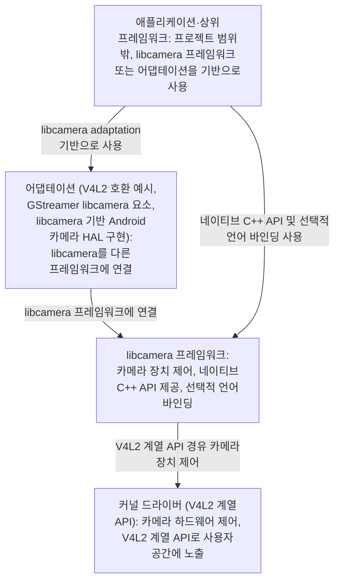

[Mermaid 원문](https://ttolsun.github.io/libcamera-sdd/index.camera-stack.mmd)

<details open>
<summary>그림 근거와 확인 범위</summary>

애플리케이션부터 커널 드라이버까지 네 소프트웨어 계층은 각각 어떤 역할을 맡습니까? 카메라 하드웨어 자체, 지원 기종, 성능은 이 그림의 범위가 아닙니다.

소스 연결 해석 · 자동 연결 검사만 통과 · 의미와 기기 실행은 검증 전

| 요소·전이 | 소스 근거 |
| --- | --- |
| 애플리케이션·상위 프레임워크: 프로젝트 범위 밖, libcamera 프레임워크 또는 어댑테이션을 기반으로 사용 | [Documentation/introduction.rst:137](#d3-source-e3b563f549a8c46d) |
| 어댑테이션 (V4L2 호환 예시, GStreamer libcamera 요소, libcamera 기반 Android 카메라 HAL 구현): libcamera를 다른 프레임워크에 연결 | [Documentation/introduction.rst:137](#d3-source-e3b563f549a8c46d) |
| libcamera 프레임워크: 카메라 장치 제어, 네이티브 C++ API 제공, 선택적 언어 바인딩 | [Documentation/introduction.rst:137](#d3-source-e3b563f549a8c46d) |
| 커널 드라이버 (V4L2 계열 API): 카메라 하드웨어 제어, V4L2 계열 API로 사용자 공간에 노출 | [Documentation/introduction.rst:137](#d3-source-e3b563f549a8c46d) |
| libcamera adaptation 기반으로 사용 | [Documentation/introduction.rst:137](#d3-source-e3b563f549a8c46d) |
| libcamera 프레임워크에 연결 | [Documentation/introduction.rst:137](#d3-source-e3b563f549a8c46d) |
| V4L2 계열 API 경유 카메라 장치 제어 | [Documentation/introduction.rst:137](#d3-source-e3b563f549a8c46d) |
| 네이티브 C++ API 및 선택적 언어 바인딩 사용 | [Documentation/introduction.rst:137](#d3-source-e3b563f549a8c46d) |

</details>

왼쪽 메뉴는 **독자 → 수행할 작업 → 문서** 순서입니다. For Vendor에서는 도입 판단·연동 구현·장치별 기능 구현을, For Developer에서는 구조 이해·동작 추적과 문제 진단·코드 탐색을 선택하세요.

## Vendor가 먼저 확인할 내용

1. [libcamera 제품 개요](#doc-3)에서 해결하는 문제, 제공 기능과 공통 설계의 강점을 확인합니다.
2. [연동 가이드](#doc-5)에서 연동 순서와 제공 측·구현자의 책임을 정합니다.
3. [지원 범위와 검증](#doc-4)에서 구성 제약과 성능 근거의 범위를 확인합니다.

이 안내는 공개 libcamera 예제입니다. 사내 HAL의 기능이나 회사 제품의 성능·지원 범위를 나타내지 않습니다.

## 처음 읽는 개발자의 순서

1. [시스템 개요](#d14-%ED%83%90%EC%83%89%EA%B3%BC-%ED%8C%8C%EC%9D%B4%ED%94%84%EB%9D%BC%EC%9D%B8-%EC%84%A0%ED%83%9D)에서 `src/libcamera/camera_manager.cpp`의 CameraManager 진입점과 카메라 탐색을 확인합니다. 근거를 펼치면 읽을 파일과 함수가 나옵니다.
2. [요청 제출과 완료](#d14-%EC%9A%94%EC%B2%AD-%EC%A0%9C%EC%B6%9C%EA%B3%BC-%EC%99%84%EB%A3%8C)에서 요청이 어디로 이동하고 어떤 신호로 끝나는지 따라갑니다. 낯선 용어는 [용어집](#doc-2)에서 확인합니다.
3. [요청 처리와 문제 진단](#doc-18)에서 증상에 맞는 코드로 이동합니다. 수정 전에는 [상태와 자원](#d14-%EC%BA%A1%EC%B2%98-%EC%84%B8%EC%85%98%EC%9D%98-%EC%83%81%ED%83%9C%EC%99%80-%EC%9E%90%EC%9B%90), [동기화 책임](#d14-%EC%8A%A4%EB%A0%88%EB%93%9C-%EA%B2%BD%EA%B3%84%EC%99%80-%EB%8F%99%EA%B8%B0%ED%99%94)을 확인합니다.

For Developer는 신입·타팀 개발자를 위한 경로입니다. 클래스 전체를 먼저 외울 필요 없이, 한 요청을 따라간 뒤 작업에 필요한 상세 문서로 이동하세요.

## 지금 필요한 문서

| 하려는 일 | 시작할 문서 |
| --- | --- |
| 이 프로젝트가 무엇을 받아 무엇을 내놓는지 이해합니다. | [이 프로젝트가 하는 일](#doc-13) |
| 하드웨어 지원의 구현 범위와 책임을 정합니다. | [libcamera 제품 개요](#doc-3) |
| 카메라를 직접 실행해 보고 설계 이유를 읽습니다. | [실행해 보고 설계 이유 읽기](#doc-15) |
| 요청을 연동하거나 완료 지연을 진단합니다. | [요청 처리와 문제 진단](#doc-18) |
| 구성 실패의 원인을 좁힙니다. | [구성 실패를 좁히는 순서](#d18-%EA%B5%AC%EC%84%B1-%EC%8B%A4%ED%8C%A8%EB%A5%BC-%EC%A2%81%ED%9E%88%EB%8A%94-%EC%88%9C%EC%84%9C) |
| 파이프라인의 구성·완료·정지를 구현합니다. | [Pipeline Handler](#doc-6) |
| 모듈 선택과 알고리즘 인터페이스를 수정합니다. | [IPA 관리와 구현 진입점](#doc-8) |
| 처음 구조를 배우고 수정할 코드를 찾습니다. | [시스템 개요](#doc-14) |
| 객체 수명과 상태 전이를 확인합니다. | [카메라와 요청 모델](#doc-16) |

하드웨어 지원을 추가하거나 파이프라인·알고리즘을 수정한다면 **[libcamera 제품 개요](#doc-3)**부터 읽으세요. 구현할 경계와 계약을 확인한 뒤 작업별 상세 문서로 이동할 수 있습니다.

## 기준 설명 찾기

요청·버퍼의 소유권과 재사용 규칙은 **카메라와 요청 모델**, 장치 큐와 완료 순서의 구현 규칙은 **Pipeline Handler**에서 관리합니다. 진단 문서는 이 계약을 연결하여 증상별 확인 순서를 안내합니다.

알고리즘을 따라가려면 [IPU3 LSC의 설정과 프레임 처리](#doc-10)를 여세요. 카메라별 튜닝과 커널 지원 조건은 [RKISP1 카메라별 왜곡 보정](#doc-12)에서 확인합니다.

약어가 낯설면 각 문서 첫머리의 용어 설명이나 [용어집](#doc-2)을 확인하세요.

## 문서를 읽는 방법

1. 페이지 첫 문장과 이동 안내에서 지금 확인할 항목을 고릅니다.
2. 문단 근거의 **발췌**를 누르면 이 문서 안의 원문이 펼쳐집니다. **전체 소스**는 해당 커밋의 코드 저장소로 이동합니다.
3. 실행 확인 항목은 대상 기기의 검증 계획에 옮깁니다.

그림을 누르면 확대와 요소 검색을 사용할 수 있습니다. 관계 그림과 정적 호출 추적은 실제 실행 순서를 보장하지 않습니다. 전체 클래스는 [구성 요소 색인](#doc-30), 주요 호출과 추적 경계는 [핵심 시나리오](#doc-20)에 있습니다.

<details open>
<summary>검증 범위와 문서 상태</summary>

"자동 검사 통과"는 인용한 코드 위치와 문장 형식을 기계로 확인했다는 뜻이며, 사람의 내용 승인이 아닙니다. 문서 상단에 검토 상태를, 아래 생성 근거에 분석 커밋과 자동 검사 결과를 표시합니다. 코드 발췌와 대조한 설명도 내용이 맞는지 사람이 검토해야 합니다.

이 사이트는 공개 libcamera의 정적 분석 결과입니다. 실제 기기의 촬영·성능·오류 복구와 사내 HAL은 검증하지 않았습니다. 설계 선택의 이유와 성능 예산은 코드에 근거가 있을 때만 설명할 수 있습니다.

[모델 비교 기록](https://github.com/TTolsun/camera-hal-sdd-generator/blob/main/docs/libcamera/records/model-comparison.md)의 4B·9B 초안은 내용 오류가 남아 채택하지 않았습니다.

</details>

<details open>
<summary>생성과 배포</summary>

[생성기](https://github.com/TTolsun/camera-hal-sdd-generator)가 추출·검증·화면 구성을 담당하고, [공개 문서 저장소](https://github.com/TTolsun/libcamera-sdd)가 공개 입력의 이력과 산출물을 보관합니다. 공개 환경에는 정기 예약을 설치하지 않습니다.

원래 라이브러리 사용법은 [libcamera 공식 문서](https://docs.libcamera.org/master/)에서 확인하세요.

</details>

## 문서 검증 현황

<details open>
<summary>자동 검사 통과 · 사람 검토 전 (29)</summary>

- [libcamera 제품 개요](#doc-3)
- [지원 범위와 검증](#doc-4)
- [연동 가이드](#doc-5)
- [Pipeline Handler](#doc-6)
- [Pipeline 요청 제출과 완료](#doc-7)
- [IPA 관리와 구현 진입점](#doc-8)
- [IPA 튜닝과 소프트웨어 ISP](#doc-9)
- [IPU3 LSC의 설정과 프레임 처리](#doc-10)
- [IPU3 렌즈 보정 테이블 준비](#doc-11)
- [RKISP1 카메라별 왜곡 보정](#doc-12)
- [이 프로젝트가 하는 일](#doc-13)
- [시스템 개요](#doc-14)
- [실행해 보고 설계 이유 읽기](#doc-15)
- [카메라와 요청 모델](#doc-16)
- [요청 객체와 버퍼 수명](#doc-17)
- [요청 처리와 문제 진단](#doc-18)
- [구성과 요청 오류 조사](#doc-19)
- [핵심 시나리오](#doc-20)
- [카메라 탐색](#doc-21)
- [스트림 구성](#doc-22)
- [캡처 시작](#doc-23)
- [요청 제출](#doc-24)
- [요청 완료 통지](#doc-25)
- [캡처 종료 요청](#doc-26)
- [IPA 모듈 정보 검사와 서명 파일 누락](#doc-27)
- [FrameBufferAllocator의 실패와 참조 수명](#doc-28)
- [WSL 공식 cam 가상 캡처 확인](#doc-29)
- [구성 요소 색인](#doc-30)
- [IPU3 LSC와 상태 연결](#doc-31)

</details>

## 문서 생성·검토 정보

- **문서 간 계약**: [자동 대조 보고서](https://ttolsun.github.io/libcamera-sdd/contract-consistency.json) · 사람 검토 전

<a id="doc-2"></a>

시작하기

# 용어집

검토용 문서

**문서에 나오는 약어와 분야 용어의 뜻을 모았습니다.**

본문에서 밑줄이 그어진 용어를 누르면 그 자리에서 뜻을 볼 수 있습니다. 문서 찾기에서 용어 이름으로 검색할 수도 있습니다.

바로가기: [0–9](#d2-term-3a) · [A](#d2-term-af) · [B](#d2-term-bayer) · [C](#d2-term-ccm) · [D](#d2-term-debug) · [E](#d2-term-ebusy) · [F](#d2-term-fbo) · [G](#d2-term-gb) · [H](#d2-term-hal) · [I](#d2-term-ipa) · [L](#d2-term-log) · [M](#d2-term-mali-c55) · [N](#d2-term-nv12) · [O](#d2-term-omm) · [P](#d2-term-pending) · [Q](#d2-term-qbuf) · [R](#d2-term-raw) · [S](#d2-term-streamoff) · [T](#d2-term-tid) · [U](#d2-term-udmabuf) · [V](#d2-term-v4l2) · [W](#d2-term-wsl) · [ㄷ](#d2-term-디베이어) · [ㅁ](#d2-term-메타데이터) · [ㅂ](#d2-term-블랙-레벨) · [ㅅ](#d2-term-셰이더) · [ㅇ](#d2-term-왜곡-보정) · [ㅋ](#d2-term-컨트롤-정보-맵) · [ㅌ](#d2-term-튜닝-파일) · [ㅍ](#d2-term-프레임-버퍼) · [ㅎ](#d2-term-활성-스트림)

- <a id="d2-term-3a"></a>**3A**: 자동 노출(AE·AGC), 자동 화이트 밸런스(AWB), 자동 초점(AF)을 함께 부르는 말입니다. IPA가 계산하는 대표 알고리즘입니다.
- <a id="d2-term-af"></a>**AF** (Auto Focus): 렌즈 위치를 움직여 초점을 맞추는 알고리즘입니다.
- **AGC** (Automatic Gain Control): 장면 밝기에 맞춰 노출 시간과 센서 게인을 정하는 자동 노출 알고리즘입니다.
- **ASSERT**: libcamera의 디버그 검사 매크로입니다. 디버그 빌드에서 조건이 거짓이면 치명적 로그를 남기고 실행을 중단합니다.
- **AWB** (Auto White Balance): 조명의 색온도를 추정하고, 흰색이 흰색으로 보이도록 R·G·B 채널별 게인을 정하는 알고리즘입니다.
- <a id="d2-term-bayer"></a>**bayer**: 센서의 화소마다 R·G·B 중 한 색만 기록하는 색 필터 배열입니다. 이 형식의 원시 데이터는 디베이어를 거쳐야 화소마다 RGB 값을 가집니다.
- <a id="d2-term-ccm"></a>**CCM**: IPU3 컬러 교정 행렬 알고리즘을 의미합니다.
- <a id="d2-term-debug"></a>**DEBUG**: 로그의 심각도 수준 중 가장 자세한 진단 정보를 뜻하는 이름입니다. 로그 수준 환경 변수에 \`DEBUG\`를 지정하면 상세한 로그를 얻습니다.
- **DMA** (Direct Memory Access): DMA(Direct Memory Access)는 I/O 장치가 시스템 메모리를 직접 읽거나 쓰는 방식을 뜻하는 용어입니다.
- **DQBUF**: DQBUF는 V4L2 장치에서 다음 사용 가능한 버퍼를 꺼내도록 요청하는 ioctl 명령입니다.
- **DRM** (Direct Rendering Manager): Linux 그래픽 장치를 관리하는 커널 하위 시스템입니다. DRM 픽셀 형식은 버퍼 안의 채널 배치를 식별합니다.
- **DW100**: 좌표 표에 따라 영상을 다시 배치해 왜곡을 보정하는 별도 하드웨어 장치입니다. NXP i.MX8MP 등에 들어 있습니다.
- <a id="d2-term-ebusy"></a>**EBUSY**: 이미 버퍼가 할당된 스트림에 대해 FrameBufferAllocator::allocate()를 다시 호출하면 -EBUSY를 반환합니다.
- **EEXIST**: 버퍼에 아직 해제되지 않은 펜스가 남아있거나 동일한 스트림에 이미 버퍼가 등록되어 있을 때 -EEXIST 오류를 반환합니다.
- **EGL**: 그래픽 API와 운영 환경의 디스플레이·이미지·버퍼를 연결하는 인터페이스입니다. 이 문서에서는 공유 버퍼를 그래픽 이미지로 가져오는 경계를 다룹니다.
- **errno**: Linux 함수가 실패 원인을 알리는 표준 오류 번호입니다. libcamera 함수는 이 값을 음수로 돌려줍니다. 예를 들어 -ENODEV는 장치 없음, -EACCES는 접근 거부, -EINVAL은 잘못된 인자, -ENOMEM은 메모리 부족, -EXDEV는 다른 객체에 속한 자원을 뜻합니다.
- **ETIMEDOUT**: IPC 응답 대기 타이머가 만료됐음을 나타내는 오류 코드입니다. 이 문서의 타이머 설정값은 2000ms입니다.
- <a id="d2-term-fbo"></a>**FBO**: 텍처를 부착할 프레임 버퍼 객체를 의미합니다.
- **fence**: 버퍼를 사용해도 되는 시점을 알리는 동기화 신호입니다. 요청에 유효한 fence가 연결돼 있으면 준비 단계에서 신호를 기다립니다. 요청 완료 신호와는 다릅니다.
- **FPS**: 초당 프레임 수입니다.
- <a id="d2-term-gb"></a>**GB**: 렌즈 음영 보정 표의 녹색 B 음영 계수를 의미합니다.
- **GCC** (GNU Compiler Collection): C, C++ 등의 프론트엔드를 포함하는 GNU 컴파일러 모음입니다.
- **GDB** (GNU Project Debugger): 지정한 조건에서 프로그램을 멈추게 하고, 멈춘 뒤 실행 상태를 살펴볼 수 있는 GNU 디버거입니다.
- **GL**: OpenGL 계열 그래픽 API의 식별자에 쓰이는 접두사입니다. 이 문서의 GL 형식은 텍스처의 채널 구성을 나타냅니다.
- **GNU** (GNU's Not Unix): GNU는 자유 소프트웨어로 이루어진 운영체제입니다. 이름은 재귀적 약어로, GNU's Not Unix를 뜻합니다.
- **GR**: 렌즈 음영 보정 표의 녹색 R 음영 계수를 의미합니다.
- <a id="d2-term-hal"></a>**HAL** (Hardware Abstraction Layer): 운영체제가 제조사마다 다른 하드웨어를 같은 인터페이스로 다루게 하는 계층입니다. 이 프로젝트의 최종 적용 대상은 사내 Android Camera HAL입니다.
- <a id="d2-term-ipa"></a>**IPA** (Image Processing Algorithms): 화질 알고리즘을 담은 별도 모듈(.so)입니다. ISP가 보낸 통계를 보고 다음 프레임에 쓸 ISP 설정값을 계산합니다. 제조사가 소스를 공개하지 않고 제공할 수 있도록 libcamera 본체와 분리되어 있습니다.
- **IPC** (Inter-Process Communication): 서로 다른 프로세스가 메시지를 주고받는 방식입니다. 서명이 없는 IPA 모듈은 별도 프로세스에서 실행되므로 libcamera가 IPC로 호출합니다.
- **IPU** (Image Processing Unit): Intel의 이미지 처리 장치 계열 이름입니다. IPU3와 IPU6처럼 세대 번호가 붙습니다.
- **IPU3** (Intel Image Processing Unit 3): 일부 Intel 노트북 프로세서에 들어 있는 카메라 ISP입니다. libcamera에는 이 장치용 Pipeline Handler와 IPA가 있습니다.
- **IPU6**: Intel 이미지 처리 장치(IPU)의 한 세대입니다. 공식 문서에는 전용 핸들러 대신 simple 파이프라인의 지원 대상으로 나옵니다.
- **ISP** (Image Signal Processor): 센서가 출력한 원시(bayer) 데이터를 화면에 쓸 수 있는 영상으로 바꾸는 처리 장치입니다. 블랙 레벨 보정, 렌즈 음영 보정, 화이트 밸런스, 디베이어 등을 수행합니다.
- <a id="d2-term-log"></a>**LOG**: 호출자가 지정하는 카테고리와 심각도 수준을 사용합니다.
- **LSC** (Lens Shading Correction): 렌즈 특성 때문에 영상 가장자리가 중앙보다 어둡거나 색이 틀어지는 현상(렌즈 음영)을 보정하는 처리입니다. 화면을 격자로 나눈 보정 표를 곱해서 적용합니다.
- **LUT** (Look-Up Table): 계산 결과를 미리 표로 만들어 두고 입력값으로 바로 찾는 방식입니다. LSC 보정 표가 여기에 해당합니다.
- <a id="d2-term-mali-c55"></a>**mali-c55**: Arm Mali-C55 카메라 ISP입니다. libcamera에는 이 장치용 Pipeline Handler와 IPA가 있습니다.
- **mojom**: IPA 인터페이스의 함수와 자료형을 정의하는 파일 형식입니다. 빌드할 때 이 정의로 프록시 코드를 만듭니다.
- <a id="d2-term-nv12"></a>**NV12** (NV12): 성분당 8비트를 쓰는 4:2:0 포맷입니다. 첫 번째 평면은 휘도(Y)이고, 두 번째 평면에는 Cb와 Cr 값이 한 개씩 번갈아 저장되는 교차 색차 데이터가 들어 있으며, 전체가 선형으로 연속된 메모리에 놓입니다.
- <a id="d2-term-omm"></a>**OMM**: 이 사이트의 읽기 화면 배치와 그림 확대·검색 규칙이 참고한 외부 문서 도구입니다. 실행기를 쓰지 않고 규칙만 적용했습니다.
- <a id="d2-term-pending"></a>**Pending**: 아직 완료 또는 취소로 바뀌지 않은 요청 상태입니다. 장치 처리가 시작됐다는 뜻은 아니며, 앞 요청이 이 상태이면 뒤 요청의 반환도 대기할 수 있습니다.
- **Pipeline Handler**: 특정 하드웨어 플랫폼(IPU3, RKISP1 등)의 미디어 장치를 찾아 카메라를 만들고, 요청을 장치에 넣고 완료를 돌려주는 libcamera 구성 요소입니다. 플랫폼마다 하나씩 있습니다.
- **PR** (Pull Request): 코드 변경 사항을 프로젝트에 병합해 달라고 제안하는 요청입니다.
- <a id="d2-term-qbuf"></a>**QBUF**: V4L2 장치의 큐에 버퍼를 추가하도록 요청하는 ioctl입니다.
- <a id="d2-term-raw"></a>**RAW**: RAW는 픽셀의 색상 인코딩 분류이며, 센서의 원시 프레임을 캡처하기 위한 별도의 스트림 역할인 StreamRole::Raw와 구분됩니다.
- **RK3399**: Rockchip의 시스템 반도체(SoC)입니다. 공식 문서에는 rkisp1 파이프라인 핸들러의 지원 대상으로 나옵니다.
- **RKISP1** (Rockchip Image Signal Processor 1): Rockchip SoC와 NXP i.MX8MP 등에 들어 있는 카메라 ISP입니다. libcamera에는 이 장치용 Pipeline Handler와 IPA가 있습니다.
- **ROI** (Return on Investment): ROI(투자 수익률)는 수익을 투자 비용과 비교하는 개념이며, 이 공개 libcamera 문서의 예시에서는 측정하지 않습니다.
- <a id="d2-term-streamoff"></a>**STREAMOFF**: V4L2 장치의 지정된 버퍼 유형에 대한 스트리밍을 중지하도록 요청하는 ioctl입니다.
- <a id="d2-term-tid"></a>**TID** (Linux thread ID): TID는 gettid 시스템 호출이 반환하는 Linux 스레드 ID입니다.
- <a id="d2-term-udmabuf"></a>**UDMABUF** (userspace dmabuf misc driver): Linux 커널의 드라이버 이름으로, 사용자 공간의 memfd 영역을 dma-buf로 바꿔 주는 드라이버입니다.
- **UQ**: 부호 없는 고정소수점 형식입니다. UQ\<m, n\>은 정수부 m비트와 소수부 n비트로 값을 나타냅니다.
- **UVC** (USB Video Class): USB 웹캠이 따르는 표준입니다. libcamera는 이 장치를 uvcvideo Pipeline Handler로 다룹니다.
- <a id="d2-term-v4l2"></a>**V4L2** (Video4Linux2): Linux 커널이 카메라와 영상 장치를 다루는 API입니다. libcamera는 이 API로 센서와 ISP 장치를 제어합니다.
- **VM** (Virtual Machine (가상 머신)): 가상 머신은 물리 컴퓨터의 자원을 가상화하여 소프트웨어로 구현한 컴퓨터이며, 자체 운영체제와 응용 프로그램을 실행합니다. 클라우드 서버에만 해당하지 않으며 개인용 물리 컴퓨터에서도 만들 수 있습니다.
- <a id="d2-term-wsl"></a>**WSL** (Windows Subsystem for Linux): Windows의 기능으로, Windows 컴퓨터에서 Linux 환경을 실행할 수 있게 해 줍니다.
- **WSL2** (Windows Subsystem for Linux 2): Windows에서 Linux를 실행하는 환경입니다. 이 사이트는 libcamera를 WSL2에서 빌드하고 추출한 결과로 만듭니다.
- <a id="d2-term-디베이어"></a>**디베이어**: bayer 원시 데이터에서 화소마다 빠진 색을 주변 화소로 보간해 RGB 영상을 만드는 처리입니다. 디모자이크라고도 합니다.
- <a id="d2-term-메타데이터"></a>**메타데이터**: 영상 픽셀과 함께 확인하는 촬영 정보입니다. Request의 메타데이터는 ControlList로 제공되며, FrameBuffer의 FrameMetadata는 촬영 상태·타임스탬프·사용한 바이트 수 등을 담습니다. FrameMetadata의 다른 필드가 유효한지는 촬영 상태에 따라 달라집니다.
- <a id="d2-term-블랙-레벨"></a>**블랙 레벨**: 빛이 전혀 없을 때도 센서가 내는 기준값입니다. ISP 처리의 첫 단계에서 이 값을 뺍니다.
- <a id="d2-term-셰이더"></a>**셰이더**: GPU에서 실행되는 작은 프로그램입니다. 소프트웨어 ISP는 디베이어와 색 보정을 GPU 셰이더로 수행할 수 있습니다.
- **소프트웨어 ISP**: 하드웨어 ISP가 없는 장치에서 CPU나 GPU로 ISP 처리를 대신하는 libcamera 구성 요소입니다. 소스에서는 software_isp, softisp라는 이름을 씁니다.
- <a id="d2-term-왜곡-보정"></a>**왜곡 보정**: 렌즈 때문에 휘어진 영상을 곧게 펴는 처리입니다. RKISP1 파이프라인은 DW100 장치에 좌표 표(vertex map)를 넣어 수행합니다.
- <a id="d2-term-컨트롤-정보-맵"></a>**컨트롤 정보 맵**: 카메라에서 사용할 제어 항목과 범위를 나타내는 정보입니다. 요청의 컨트롤 목록은 해당 카메라의 정보 맵을 참조해야 합니다.
- <a id="d2-term-튜닝-파일"></a>**튜닝 파일**: 센서와 플랫폼별 알고리즘 매개변수(보정 표, 색 행렬 등)를 담은 YAML 파일입니다. IPA가 시작할 때 읽습니다.
- <a id="d2-term-프레임-버퍼"></a>**프레임 버퍼**: 영상 데이터를 저장할 메모리 영역을 나타내는 FrameBuffer 객체입니다. 각 메모리 평면의 파일 기술자·오프셋·길이와 프레임별 메타데이터를 제공합니다. 촬영 성공·오류·취소에 따라 데이터와 메타데이터의 유효 범위가 달라집니다.
- **프록시**: IPA 모듈을 직접 부르지 않고, 같은 인터페이스로 호출을 받아 IPA 스레드나 별도 프로세스로 전달하는 대리 객체입니다. 빌드할 때 mojom 정의에서 자동 생성됩니다.
- <a id="d2-term-활성-스트림"></a>**활성 스트림**: 현재 카메라 구성에 연결된 Stream입니다. 요청 버퍼가 다른 구성의 스트림을 가리키면 제출 검사에서 거절됩니다.

## 문서 생성·검토 정보

- **문서 간 계약**: [자동 대조 보고서](https://ttolsun.github.io/libcamera-sdd/contract-consistency.json) · 사람 검토 전

<a id="doc-3"></a>

For Vendor

# libcamera 제품 개요

사람 검토 전자동 검사 통과작성: 추출한 구조와 모델이 쓴 초안[상태 설명 ↓](#d3-page-evidence)

**제품이 무엇이고 어디까지 지원하는지, 공통 설계가 구현자에게 해 주는 일을 확인하고 도입할 범위를 판단하세요.**

<details open>
<summary>설계 질문과 검증 범위</summary>

질문별 답변과 근거 연결을 검사했습니다. 의미와 실행 결과는 사람 검토가 필요합니다.

- 어떤 고객 문제를 해결하며 어떤 환경을 대상으로 합니까?

  [무엇이며 누구의 어떤 문제를 푸는가](#d3-무엇이며-누구의-어떤-문제를-푸는가)
- 어디까지 지원하며 지원 대상은 어떻게 고릅니까?

  [지원하는 하드웨어와 빌드 선택](#d3-지원하는-하드웨어와-빌드-선택)
- 어떤 기능을 제공하며 지원 범위는 어떤 구현에 달려 있습니까?

  [제공 기능과 지원 범위](#d3-제공-기능과-지원-범위)
- 공통 구현을 활용할 수 있는 강점과 그 조건은 무엇입니까?

  [장치 구현자가 공통 계층에서 얻는 것](#d3-장치-구현자가-공통-계층에서-얻는-것)

확인 범위: 코드 근거와 설명 연결

</details>

<details open>
<summary>이 문서의 용어: WSL2, Pipeline Handler, V4L2, HAL 외 3개</summary>

- **WSL2** (Windows Subsystem for Linux 2): Windows에서 Linux를 실행하는 환경입니다. 이 사이트는 libcamera를 WSL2에서 빌드하고 추출한 결과로 만듭니다.
- **Pipeline Handler**: 특정 하드웨어 플랫폼(IPU3, RKISP1 등)의 미디어 장치를 찾아 카메라를 만들고, 요청을 장치에 넣고 완료를 돌려주는 libcamera 구성 요소입니다. 플랫폼마다 하나씩 있습니다.
- **V4L2** (Video4Linux2): Linux 커널이 카메라와 영상 장치를 다루는 API입니다. libcamera는 이 API로 센서와 ISP 장치를 제어합니다.
- **HAL** (Hardware Abstraction Layer): 운영체제가 제조사마다 다른 하드웨어를 같은 인터페이스로 다루게 하는 계층입니다. 이 프로젝트의 최종 적용 대상은 사내 Android Camera HAL입니다.
- **IPU3** (Intel Image Processing Unit 3): 일부 Intel 노트북 프로세서에 들어 있는 카메라 ISP입니다. libcamera에는 이 장치용 Pipeline Handler와 IPA가 있습니다.
- **RK3399**: Rockchip의 시스템 반도체(SoC)입니다. 공식 문서에는 rkisp1 파이프라인 핸들러의 지원 대상으로 나옵니다.
- **IPU6**: Intel 이미지 처리 장치(IPU)의 한 세대입니다. 공식 문서에는 전용 핸들러 대신 simple 파이프라인의 지원 대상으로 나옵니다.

다른 용어는 [용어집](#doc-2)에서 찾을 수 있습니다.

</details>

이전 링크의 목적지

[Pipeline 요청 제출과 완료](#d7-%EC%9E%A5%EC%B9%98-%EC%9A%94%EC%B2%AD-%ED%95%9C%EB%8F%84%EC%99%80-%EB%8C%80%EA%B8%B0-%ED%81%90)

## <a id="d3-무엇이며-누구의-어떤-문제를-푸는가"></a>무엇이며 누구의 어떤 문제를 푸는가

libcamera는 Linux, Android, ChromeOS를 위한 오픈 소스 복합 카메라 지원 라이브러리입니다. Linux 커널 장치 드라이버와 연동하며, Linux 시스템에서 복합 카메라의 이미지 캡처를 쉽게 다루도록 개발자에게 API를 제공합니다. libcamera는 Linux 기반 시스템에 완전한 카메라 스택을 제공합니다. 이 스택은 커널 API를 통해 카메라에서 원하는 결과를 얻는 데 필요한 하드웨어 구성과 이미지 제어 알고리즘을 추상화하여, 개발자가 이 작업들을 간단하고 일관된 방식으로 다루게 합니다.

### 카메라 스택의 네 계층


[Mermaid 원문](https://ttolsun.github.io/libcamera-sdd/vendor-overview.camera-stack.mmd)

<details open>
<summary>그림 근거와 확인 범위</summary>

애플리케이션부터 커널 드라이버까지 네 소프트웨어 계층은 각각 어떤 역할을 맡습니까? 카메라 하드웨어 자체, 지원 기종, 성능은 이 그림의 범위가 아닙니다.

소스 연결 해석 · 자동 연결 검사만 통과 · 의미와 기기 실행은 검증 전

| 요소·전이 | 소스 근거 |
| --- | --- |
| 애플리케이션·상위 프레임워크: 프로젝트 범위 밖, libcamera 프레임워크 또는 어댑테이션을 기반으로 사용 | [Documentation/introduction.rst:137](#d3-source-e3b563f549a8c46d) |
| 어댑테이션 (V4L2 호환 예시, GStreamer libcamera 요소, libcamera 기반 Android 카메라 HAL 구현): libcamera를 다른 프레임워크에 연결 | [Documentation/introduction.rst:137](#d3-source-e3b563f549a8c46d) |
| libcamera 프레임워크: 카메라 장치 제어, 네이티브 C++ API 제공, 선택적 언어 바인딩 | [Documentation/introduction.rst:137](#d3-source-e3b563f549a8c46d) |
| 커널 드라이버 (V4L2 계열 API): 카메라 하드웨어 제어, V4L2 계열 API로 사용자 공간에 노출 | [Documentation/introduction.rst:137](#d3-source-e3b563f549a8c46d) |
| libcamera adaptation 기반으로 사용 | [Documentation/introduction.rst:137](#d3-source-e3b563f549a8c46d) |
| libcamera 프레임워크에 연결 | [Documentation/introduction.rst:137](#d3-source-e3b563f549a8c46d) |
| V4L2 계열 API 경유 카메라 장치 제어 | [Documentation/introduction.rst:137](#d3-source-e3b563f549a8c46d) |
| 네이티브 C++ API 및 선택적 언어 바인딩 사용 | [Documentation/introduction.rst:137](#d3-source-e3b563f549a8c46d) |

</details>

드라이버를 사용해 동작하는 카메라 스택을 제공하는 일은 사용자 공간의 책임이며, 벤더가 애플리케이션 개발자를 위한 공통 아키텍처나 API 없이 별도로 구현하는 경우가 일반적입니다. 하드웨어 파이프라인과 커널 API에서 이를 표현하는 방식의 차이 때문에 맞춤 처리가 필요한 경우가 많아 작업이 복잡해집니다. 가장 아래 계층의 커널 드라이버는 카메라 하드웨어를 제어하고 사용자 공간에 저수준 인터페이스를 제공합니다. 이 인터페이스는 Linux 커널의 `V4L2` API 계열인 Media `Controller` API, V4L2 Video `Device` API, V4L2 Subdev API를 사용합니다.

그 위의 libcamera 프레임워크는 핵심 구성 요소인 libcamera에서 카메라 장치의 모든 제어를 처리하고 상위 계층에 네이티브 `C++ API`를 제공합니다. 선택적 언어 바인딩을 사용하면 다른 프로그래밍 언어에서도 libcamera와 연결할 수 있습니다. 그 위의 libcamera adaptation은 다른 프레임워크에서 libcamera에 연결하는 구성 요소를 가리킵니다. 예로 `V4L2` 호환 계층, gstreamer libcamera 요소, libcamera 기반 Android camera HAL 구현이 있습니다.

가장 위의 애플리케이션과 상위 프레임워크는 libcamera 프레임워크 또는 libcamera adaptation을 기반으로 합니다. 이 계층은 libcamera 프로젝트의 범위 밖입니다.

<details open>
<summary>절 전체 근거 5개</summary>

- `Documentation/introduction.rst`[`L10` 발췌](#d3-source-34fda84500757231) · [전체 소스 `L10`](https://github.com/TTolsun/libcamera-sdd/blob/adfa719f8ed67d18fd8a0739fc088a1f8b9e7252/Documentation/introduction.rst#L10) · [`L45` 발췌](#d3-source-f350cabac0db8343) · [전체 소스 `L45`](https://github.com/TTolsun/libcamera-sdd/blob/adfa719f8ed67d18fd8a0739fc088a1f8b9e7252/Documentation/introduction.rst#L45) · [`L35` 발췌](#d3-source-de476c940b030e4a) · [전체 소스 `L35`](https://github.com/TTolsun/libcamera-sdd/blob/adfa719f8ed67d18fd8a0739fc088a1f8b9e7252/Documentation/introduction.rst#L35) · [`L137` 발췌](#d3-source-e3b563f549a8c46d) · [전체 소스 `L137`](https://github.com/TTolsun/libcamera-sdd/blob/adfa719f8ed67d18fd8a0739fc088a1f8b9e7252/Documentation/introduction.rst#L137)
- `product-evidence/libcamera/official-stack.txt`[`L1`](#d3-source-a43b9ee967d1a5db)

</details>

## <a id="d3-지원하는-하드웨어와-빌드-선택"></a>지원하는 하드웨어와 빌드 선택

문서에는 라이브러리가 현재 전용 파이프라인 핸들러로 지원하는 하드웨어 플랫폼으로 Arm Mali-C55, Intel IPU3 (`ipu3`), NXP i.MX8MP (`imx8-isi` 및 `rkisp1`), RaspberryPi 3, 4 및 zero (`rpi/vc4`), Rockchip RK3399 (`rkisp1`)가 나열되어 있습니다. libcamera가 범용으로 지원한다고 문서에 명시한 대상은 USB 비디오 장치 클래스 카메라(`uvcvideo`), iMX7, IPU6, Allwinner Sun6i(`simple`), 테스트 용도의 가상 미디어 컨트롤러 드라이버(`vimc`)입니다.

빌드할 파이프라인 핸들러는 배열 옵션인 `pipelines`에서 선택하며, 기본값은 `auto`입니다. `auto`를 선택하면 대상 아키텍처에 적용되는 모든 파이프라인을 빌드하고, `all`을 선택하면 모든 파이프라인을 빌드합니다. 두 값을 함께 선택하면 `all`이 우선합니다. 개별 선택지는 `imx8-isi`, `ipu3`, `mali-c55`, `rkisp1`, `rpi/pisp`, `rpi/vc4`, `simple`, `uvcvideo`, `vimc`, `virtual`입니다.

<details open>
<summary>절 전체 근거 2개</summary>

- `Documentation/platform_support.rst`[`L6` 발췌](#d3-source-9d6502e234c4647d) · [전체 소스 `L6`](https://github.com/TTolsun/libcamera-sdd/blob/adfa719f8ed67d18fd8a0739fc088a1f8b9e7252/Documentation/platform_support.rst#L6)
- `meson_options.txt`[`L75` 발췌](#d3-source-691389506fe87b32) · [전체 소스 `L75`](https://github.com/TTolsun/libcamera-sdd/blob/adfa719f8ed67d18fd8a0739fc088a1f8b9e7252/meson_options.txt#L75)

</details>

## <a id="d3-제공-기능과-지원-범위"></a>제공 기능과 지원 범위

`Camera`는 하나의 이미지 소스에서 하나 이상의 이미지 스트림을 생성할 수 있는 카메라를 모델링합니다. 기기를 구성하고 제어하며 이미지 스트림을 캡처하는 주요 인터페이스를 제공하는 libcamera의 중심 객체입니다. 장치별 `PipelineHandler`는 스트림 구성에 따라 하드웨어 파이프라인을 구성합니다. `PipelineHandler` 구현은 필요한 미디어 장치를 시스템의 장치와 대응시키고 모두 확보할 수 있게 되면 해당 `Camera` 인스턴스를 생성해야 하며, 모든 `PipelineHandler` 하위 클래스는 `REGISTER_PIPELINE_HANDLER()` 매크로로 libcamera에 등록해야 합니다.

### 공통 Camera와 장치별 구현의 경계

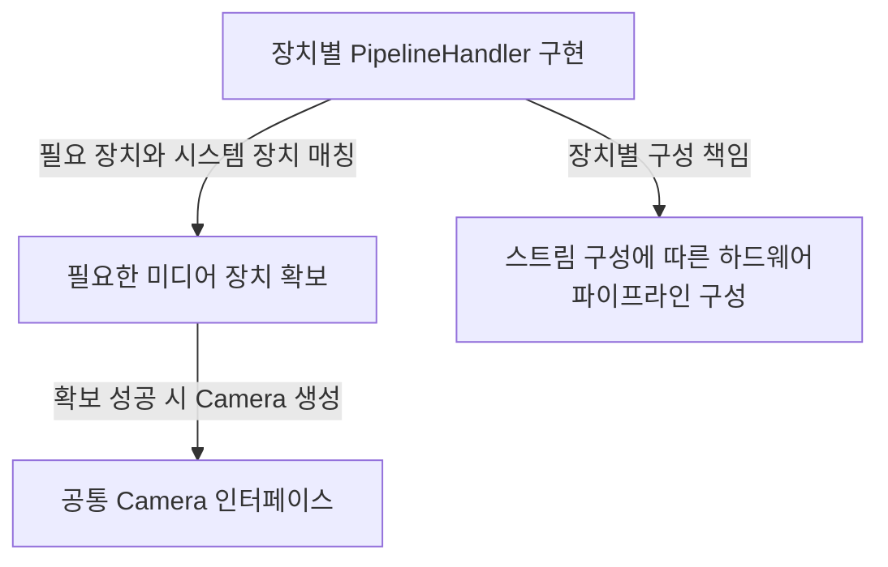

[Mermaid 원문](https://ttolsun.github.io/libcamera-sdd/vendor-overview.hardware-boundary.mmd)

<details open>
<summary>그림 근거와 확인 범위</summary>

공통 Camera와 장치별 PipelineHandler의 책임 연결입니다. 스트림 구성에 따른 하드웨어 구성과 장치 매칭·Camera 생성 책임을 구분하며 전체 실행 순서·지원 기종·성능을 보장하지 않습니다.

소스 연결 해석 · 자동 연결 검사만 통과 · 의미와 기기 실행은 검증 전

| 요소·전이 | 소스 근거 |
| --- | --- |
| 장치별 PipelineHandler 구현 | [src/libcamera/pipeline_handler.cpp:30](#d3-source-05721740b01bcd0e) |
| 필요한 미디어 장치 확보 | [src/libcamera/pipeline_handler.cpp:30](#d3-source-05721740b01bcd0e) |
| 공통 Camera 인터페이스 | [src/libcamera/camera.cpp:752](#d3-source-8264067114dccdee) |
| 스트림 구성에 따른 하드웨어 파이프라인 구성 | [Documentation/libcamera_architecture.rst:86](#d3-source-94ac8aab4dea2a65) |
| 장치별 구성 책임 | [Documentation/libcamera_architecture.rst:86](#d3-source-94ac8aab4dea2a65) |
| 필요 장치와 시스템 장치 매칭 | [src/libcamera/pipeline_handler.cpp:30](#d3-source-05721740b01bcd0e) |
| 확보 성공 시 Camera 생성 | [src/libcamera/pipeline_handler.cpp:30](#d3-source-05721740b01bcd0e) |

</details>

<details open>
<summary>절 전체 근거 3개</summary>

- `src/libcamera/camera.cpp`[`L752` 발췌](#d3-source-8264067114dccdee) · [전체 소스 `L752`](https://github.com/TTolsun/libcamera-sdd/blob/adfa719f8ed67d18fd8a0739fc088a1f8b9e7252/src/libcamera/camera.cpp#L752)
- `src/libcamera/pipeline_handler.cpp`[`L30` 발췌](#d3-source-05721740b01bcd0e) · [전체 소스 `L30`](https://github.com/TTolsun/libcamera-sdd/blob/adfa719f8ed67d18fd8a0739fc088a1f8b9e7252/src/libcamera/pipeline_handler.cpp#L30)
- `Documentation/libcamera_architecture.rst`[`L86` 발췌](#d3-source-94ac8aab4dea2a65) · [전체 소스 `L86`](https://github.com/TTolsun/libcamera-sdd/blob/adfa719f8ed67d18fd8a0739fc088a1f8b9e7252/Documentation/libcamera_architecture.rst#L86)

</details>

## <a id="d3-장치-구현자가-공통-계층에서-얻는-것"></a>장치 구현자가 공통 계층에서 얻는 것

`PipelineHandler::queueRequest()`는 요청을 대기 목록에 추가한 뒤 준비를 시작합니다. `registerRequest()`는 요청의 `prepared` 신호를 `doQueueRequests()` 호출에 연결합니다. `doQueueRequests()`는 대기 목록의 앞 요청이 준비되지 않았거나 `queuedRequests_`의 원소 개수가 `maxQueuedRequestsDevice_`와 같으면 순회를 멈춥니다. 그 외에는 앞 요청을 목록에서 꺼내 처리하므로 준비된 요청을 제출 순서대로 처리합니다.

### 선두 요청을 전달하거나 반복을 멈추는 조건

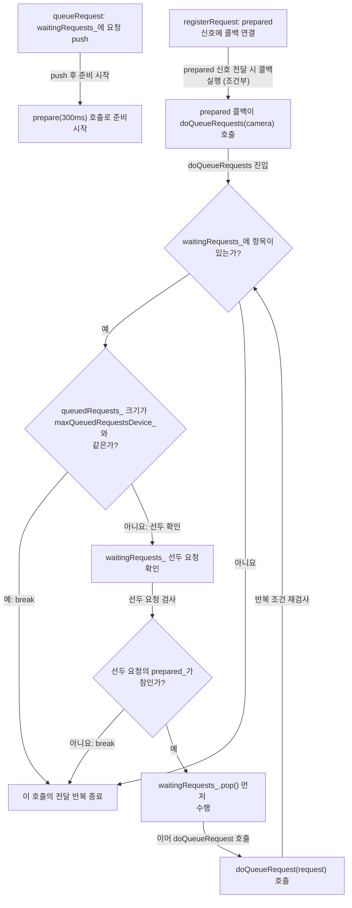

[Mermaid 원문](https://ttolsun.github.io/libcamera-sdd/vendor-overview.vendor-waiting-queue-conditions.mmd)

<details open>
<summary>그림 근거와 확인 범위</summary>

waitingRequests\_ 순회에서 준비 상태와 queuedRequests\_ 소프트웨어 큐 크기는 어떻게 전달을 제한합니까?

소스 연결 해석 · 자동 연결 검사만 통과 · 의미와 기기 실행은 검증 전

| 요소·전이 | 소스 근거 |
| --- | --- |
| queueRequest: waitingRequests\_에 요청 push | [src/libcamera/pipeline_handler.cpp:428](#d3-source-789eafedfaa7f3c5) |
| prepare(300ms) 호출로 준비 시작 | [src/libcamera/pipeline_handler.cpp:428](#d3-source-789eafedfaa7f3c5) |
| registerRequest: prepared 신호에 콜백 연결 | [src/libcamera/pipeline_handler.cpp:428](#d3-source-789eafedfaa7f3c5) |
| prepared 콜백이 doQueueRequests(camera) 호출 | [src/libcamera/pipeline_handler.cpp:428](#d3-source-789eafedfaa7f3c5) |
| waitingRequests\_에 항목이 있는가? | [src/libcamera/pipeline_handler.cpp:428](#d3-source-789eafedfaa7f3c5) |
| queuedRequests\_ 크기가 maxQueuedRequestsDevice\_와 같은가? | [src/libcamera/pipeline_handler.cpp:428](#d3-source-789eafedfaa7f3c5) |
| waitingRequests\_ 선두 요청 확인 | [src/libcamera/pipeline_handler.cpp:428](#d3-source-789eafedfaa7f3c5) |
| 선두 요청의 prepared\_가 참인가? | [src/libcamera/pipeline_handler.cpp:428](#d3-source-789eafedfaa7f3c5) |
| waitingRequests\_.pop() 먼저 수행 | [src/libcamera/pipeline_handler.cpp:428](#d3-source-789eafedfaa7f3c5) |
| doQueueRequest(request) 호출 | [src/libcamera/pipeline_handler.cpp:428](#d3-source-789eafedfaa7f3c5) |
| 이 호출의 전달 반복 종료 | [src/libcamera/pipeline_handler.cpp:428](#d3-source-789eafedfaa7f3c5) |
| push 후 준비 시작 | [src/libcamera/pipeline_handler.cpp:428](#d3-source-789eafedfaa7f3c5) |
| prepared 신호 전달 시 콜백 실행 (조건부) | [src/libcamera/pipeline_handler.cpp:428](#d3-source-789eafedfaa7f3c5) |
| doQueueRequests 진입 | [src/libcamera/pipeline_handler.cpp:428](#d3-source-789eafedfaa7f3c5) |
| 예 | [src/libcamera/pipeline_handler.cpp:428](#d3-source-789eafedfaa7f3c5) |
| 아니요 | [src/libcamera/pipeline_handler.cpp:428](#d3-source-789eafedfaa7f3c5) |
| 예: break | [src/libcamera/pipeline_handler.cpp:428](#d3-source-789eafedfaa7f3c5) |
| 아니요: 선두 확인 | [src/libcamera/pipeline_handler.cpp:428](#d3-source-789eafedfaa7f3c5) |
| 선두 요청 검사 | [src/libcamera/pipeline_handler.cpp:428](#d3-source-789eafedfaa7f3c5) |
| 아니요: break | [src/libcamera/pipeline_handler.cpp:428](#d3-source-789eafedfaa7f3c5) |
| 예 | [src/libcamera/pipeline_handler.cpp:428](#d3-source-789eafedfaa7f3c5) |
| 이어 doQueueRequest 호출 | [src/libcamera/pipeline_handler.cpp:428](#d3-source-789eafedfaa7f3c5) |
| 반복 조건 재검사 | [src/libcamera/pipeline_handler.cpp:428](#d3-source-789eafedfaa7f3c5) |

</details>

### 버퍼 완료와 명시적 요청 완료의 경계

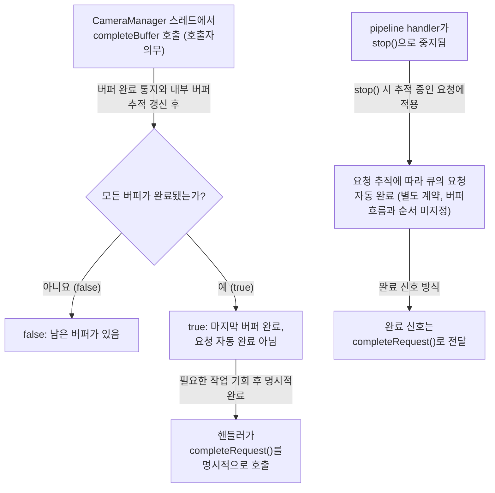

[Mermaid 원문](https://ttolsun.github.io/libcamera-sdd/vendor-overview.vendor-buffer-and-request-completion.mmd)

<details open>
<summary>그림 근거와 확인 범위</summary>

마지막 버퍼가 끝났을 때 completeBuffer의 반환과 핸들러의 요청 완료 의무는 어떻게 구분됩니까?

소스 연결 해석 · 자동 연결 검사만 통과 · 의미와 기기 실행은 검증 전

| 요소·전이 | 소스 근거 |
| --- | --- |
| CameraManager 스레드에서 completeBuffer 호출 (호출자 의무) | [src/libcamera/pipeline_handler.cpp:547](#d3-source-ab8710f8a8a7905d) |
| 모든 버퍼가 완료됐는가? | [src/libcamera/pipeline_handler.cpp:547](#d3-source-ab8710f8a8a7905d) |
| false: 남은 버퍼가 있음 | [src/libcamera/pipeline_handler.cpp:547](#d3-source-ab8710f8a8a7905d) |
| true: 마지막 버퍼 완료, 요청 자동 완료 아님 | [src/libcamera/pipeline_handler.cpp:547](#d3-source-ab8710f8a8a7905d) |
| 핸들러가 completeRequest()를 명시적으로 호출 | [src/libcamera/pipeline_handler.cpp:547](#d3-source-ab8710f8a8a7905d) |
| pipeline handler가 stop()으로 중지됨 | [src/libcamera/pipeline_handler.cpp:463](#d3-source-35ab684c1adef175) |
| 요청 추적에 따라 큐의 요청 자동 완료 (별도 계약, 버퍼 흐름과 순서 미지정) | [src/libcamera/pipeline_handler.cpp:463](#d3-source-35ab684c1adef175) |
| 완료 신호는 completeRequest()로 전달 | [src/libcamera/pipeline_handler.cpp:463](#d3-source-35ab684c1adef175) |
| 버퍼 완료 통지와 내부 버퍼 추적 갱신 후 | [src/libcamera/pipeline_handler.cpp:547](#d3-source-ab8710f8a8a7905d) |
| 아니요 (false) | [src/libcamera/pipeline_handler.cpp:547](#d3-source-ab8710f8a8a7905d) |
| 예 (true) | [src/libcamera/pipeline_handler.cpp:547](#d3-source-ab8710f8a8a7905d) |
| 필요한 작업 기회 후 명시적 완료 | [src/libcamera/pipeline_handler.cpp:547](#d3-source-ab8710f8a8a7905d) |
| stop() 시 추적 중인 요청에 적용 | [src/libcamera/pipeline_handler.cpp:463](#d3-source-35ab684c1adef175) |
| 완료 신호 방식 | [src/libcamera/pipeline_handler.cpp:463](#d3-source-35ab684c1adef175) |

</details>

요청 준비에 실패하거나 파이프라인 핸들러가 장치에 요청을 큐잉하는 데 실패하면 요청이 취소됩니다. 큐에 넣은 요청을 추적하면 `stop()`으로 파이프라인 핸들러를 중지할 때 모든 요청이 자동으로 완료되며, 파이프라인 핸들러는 `completeRequest()`로 요청 완료를 알려야 합니다. 요청이 준비 단계에서 실패하거나 파이프라인 핸들러가 요청을 하드웨어 큐에 등록하지 못하면 해당 요청이 취소됩니다.

대기열에 들어간 요청을 추적하므로 `stop()`으로 파이프라인 핸들러를 정지할 때 모든 요청이 자동으로 완료됩니다. 파이프라인 핸들러는 버퍼 완료를 애플리케이션에 알리고 요청 내부의 버퍼 추적을 갱신하도록 `CameraManager` 스레드에서 `completeBuffer()`를 호출해야 합니다. 마지막 버퍼가 완료되어도 요청은 자동으로 완료되지 않으므로 파이프라인 핸들러는 `completeRequest()`를 명시적으로 호출해야 합니다.

<details open>
<summary>절 전체 근거 5개</summary>

- `src/libcamera/pipeline_handler.cpp`[`L447` 발췌](#d3-source-106682bf83e3416a) · [전체 소스 `L447`](https://github.com/TTolsun/libcamera-sdd/blob/adfa719f8ed67d18fd8a0739fc088a1f8b9e7252/src/libcamera/pipeline_handler.cpp#L447) · [`L428` 발췌](#d3-source-789eafedfaa7f3c5) · [전체 소스 `L428`](https://github.com/TTolsun/libcamera-sdd/blob/adfa719f8ed67d18fd8a0739fc088a1f8b9e7252/src/libcamera/pipeline_handler.cpp#L428) · [`L460` 발췌](#d3-source-0a5bda976f5815de) · [전체 소스 `L460`](https://github.com/TTolsun/libcamera-sdd/blob/adfa719f8ed67d18fd8a0739fc088a1f8b9e7252/src/libcamera/pipeline_handler.cpp#L460) · [`L463` 발췌](#d3-source-35ab684c1adef175) · [전체 소스 `L463`](https://github.com/TTolsun/libcamera-sdd/blob/adfa719f8ed67d18fd8a0739fc088a1f8b9e7252/src/libcamera/pipeline_handler.cpp#L463) · [`L547` 발췌](#d3-source-ab8710f8a8a7905d) · [전체 소스 `L547`](https://github.com/TTolsun/libcamera-sdd/blob/adfa719f8ed67d18fd8a0739fc088a1f8b9e7252/src/libcamera/pipeline_handler.cpp#L547)

</details>

## 클래스 관계

화살표의 글자는 추출한 관계를 나타내며, 점선은 상속입니다. 화살표는 참조 대상 또는 기반 클래스를 향합니다. 호출 순서를 뜻하지 않습니다.

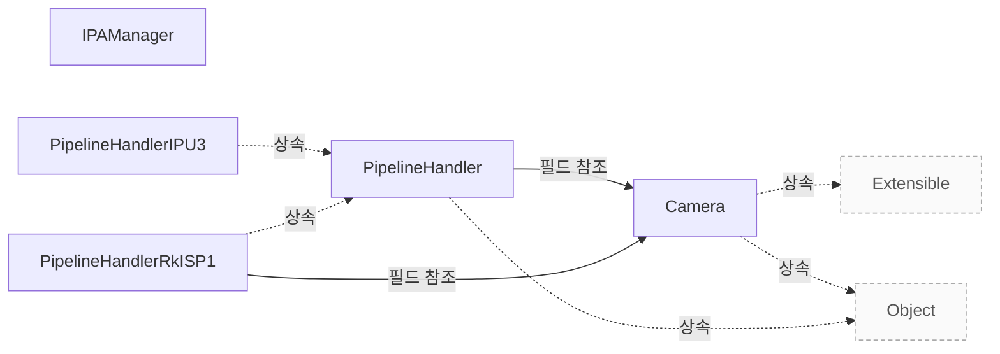

## 소스 근거

<details open>
<summary>소스 발췌 15개</summary>

같은 발췌는 한 번만 싣습니다. 필요한 원문을 펼쳐 설명과 대조하세요.

<a id="d3-source-34fda84500757231"></a>

<details open>
<summary>소스 근거: Documentation/introduction.rst:10</summary>

발췌 범위: [`Documentation/introduction.rst:10`](https://github.com/TTolsun/libcamera-sdd/blob/adfa719f8ed67d18fd8a0739fc088a1f8b9e7252/Documentation/introduction.rst#L10) \~ `13`

SHA-256: `84621541899cba7430b844bc03d13fc8e6f3f03e7c30556df0bf1cd11007494c`

```
libcamera is an open source complex camera support library for Linux, Android
and ChromeOS. The library interfaces with Linux kernel device drivers and
provides an intuitive API to developers in order to simplify the complexity
involved in capturing images from complex cameras on Linux systems.
```

</details>

<a id="d3-source-de476c940b030e4a"></a>

<details open>
<summary>소스 근거: Documentation/introduction.rst:35</summary>

발췌 범위: [`Documentation/introduction.rst:35`](https://github.com/TTolsun/libcamera-sdd/blob/adfa719f8ed67d18fd8a0739fc088a1f8b9e7252/Documentation/introduction.rst#L35) \~ `40`

SHA-256: `0c6b72f4ffe9e608101639096b5597a61f41f776e4f5ac4aaa43229c744db3f0`

```
The usage of these drivers to provide a functioning camera stack is a
responsibility that lies in userspace, and is commonly implemented separately
by vendors without a common architecture or API for application developers. This
adds a lot of complexity to the task, particularly when considering that the
differences in hardware pipelines and their representation in the kernel's APIs
often necessitate bespoke handling.
```

</details>

<a id="d3-source-f350cabac0db8343"></a>

<details open>
<summary>소스 근거: Documentation/introduction.rst:45</summary>

발췌 범위: [`Documentation/introduction.rst:45`](https://github.com/TTolsun/libcamera-sdd/blob/adfa719f8ed67d18fd8a0739fc088a1f8b9e7252/Documentation/introduction.rst#L45) \~ `49`

SHA-256: `56f623776b7eab9511de1f32c1f3080c4eab37239185f5134db6b2644760b1f5`

```
libcamera provides a complete camera stack for Linux-based systems to abstract
the configuration of hardware and image control algorithms required to obtain
desirable results from the camera through the kernel's APIs, reducing those
operations to a simple and consistent method for developers. In short instead of
having to deal with this:
```

</details>

<a id="d3-source-e3b563f549a8c46d"></a>

<details open>
<summary>소스 근거: Documentation/introduction.rst:137</summary>

발췌 범위: [`Documentation/introduction.rst:137`](https://github.com/TTolsun/libcamera-sdd/blob/adfa719f8ed67d18fd8a0739fc088a1f8b9e7252/Documentation/introduction.rst#L137) \~ `165`

SHA-256: `750a623b45ad76fbd899b56427ad76ef91bdc922497972317df868fe538c3b03`

```
The camera stack comprises four software layers. From bottom to top:

* The kernel drivers control the camera hardware and expose a
  low-level interface to userspace through the Linux kernel V4L2
  family of APIs (Media Controller API, V4L2 Video Device API and
  V4L2 Subdev API).

* The libcamera framework is the core part of the stack. It
  handles all control of the camera devices in its core component,
  libcamera, and exposes a native C++ API to upper layers. Optional
  language bindings allow interfacing to libcamera from other
  programming languages.

  Those components live in the same source code repository and
  all together constitute the libcamera framework.

* The libcamera adaptation is an umbrella term designating the
  components that interface to libcamera in other frameworks.
  Notable examples are a V4L2 compatibility layer, a gstreamer
  libcamera element, and an Android camera HAL implementation based
  on libcamera.

  Those components can live in the libcamera project source code
  in separate repositories, or move to their respective project's
  repository (for instance the gstreamer libcamera element).

* The applications and upper level frameworks are based on the
  libcamera framework or libcamera adaptation, and are outside of
  the scope of the libcamera project.
```

</details>

<a id="d3-source-a43b9ee967d1a5db"></a>

<details open>
<summary>제품 자료: product-evidence/libcamera/official-stack.txt:1</summary>

소스와 별도로 제공된 자료입니다. 제공자·버전·적용 범위를 아래 기록에서 확인하세요. 자동 검사는 사람 승인이 아닙니다.

발췌 범위: `product-evidence/libcamera/official-stack.txt:1` \~ `10`

SHA-256: `fdd39a9c11328e6bb549203a2395b3f9331fa15d5e2da711b703643e299f8fc0`

```
.. SPDX-License-Identifier: CC-BY-SA-4.0
.. Source: https://gitlab.freedesktop.org/camera/libcamera/-/blob/212c689fcf2450bbfbaab25c7472895ac277b5d6/Documentation/introduction.rst
.. Unmodified excerpt; project documentation, not a commercial product specification.

libcamera provides a complete camera stack for Linux-based systems to abstract
the configuration of hardware and image control algorithms required to obtain
desirable results from the camera through the kernel's APIs, reducing those
operations to a simple and consistent method for developers. In short instead of
having to deal with this:
```

```
{
  "type": "project-document",
  "supplier": "libcamera official upstream; CC-BY-SA-4.0; URL in local material",
  "version": "212c689fcf2450bbfbaab25c7472895ac277b5d6",
  "date": "2026-10-30",
  "valid_until": "2026-10-30",
  "product": "libcamera",
  "release": "212c689fcf2450bbfbaab25c7472895ac277b5d6",
  "configuration": "public-source-documentation",
  "feature": "camera-stack",
  "conditions": [
    "Linux-based systems",
    "Kernel drivers and the relevant pipeline implementation are required."
  ],
  "sha256": "fdd39a9c11328e6bb549203a2395b3f9331fa15d5e2da711b703643e299f8fc0"
}
```

</details>

<a id="d3-source-9d6502e234c4647d"></a>

<details open>
<summary>소스 근거: Documentation/platform_support.rst:6</summary>

발췌 범위: [`Documentation/platform_support.rst:6`](https://github.com/TTolsun/libcamera-sdd/blob/adfa719f8ed67d18fd8a0739fc088a1f8b9e7252/Documentation/platform_support.rst#L6) \~ `19`

SHA-256: `c3521ec69316b30bbb021a31f90ae53cd0d641f77c91a13ed2d6fa0f7266f2bb`

```
The library currently supports the following hardware platforms specifically
with dedicated pipeline handlers:

   - Arm Mali-C55
   - Intel IPU3 (ipu3)
   - NXP i.MX8MP (imx8-isi and rkisp1)
   - RaspberryPi 3, 4 and zero (rpi/vc4)
   - Rockchip RK3399 (rkisp1)

Furthermore, generic platform support is provided for the following:

   - USB video device class cameras (uvcvideo)
   - iMX7, IPU6, Allwinner Sun6i (simple)
   - Virtual media controller driver for test use cases (vimc)
```

</details>

<a id="d3-source-691389506fe87b32"></a>

<details open>
<summary>소스 근거: meson_options.txt:75</summary>

발췌 범위: [`meson_options.txt:75`](https://github.com/TTolsun/libcamera-sdd/blob/adfa719f8ed67d18fd8a0739fc088a1f8b9e7252/meson_options.txt#L75) \~ `92`

SHA-256: `6884c14e5ebb9b81b76a500c4890a7c14db2e86c34395d71c496a6c86bf0b58d`

```
option('pipelines',
        type : 'array',
        value : ['auto'],
        choices : [
            'all',
            'auto',
            'imx8-isi',
            'ipu3',
            'mali-c55',
            'rkisp1',
            'rpi/pisp',
            'rpi/vc4',
            'simple',
            'uvcvideo',
            'vimc',
            'virtual'
        ],
        description : 'Select which pipeline handlers to build. If this is set to "auto", all the pipelines applicable to the target architecture will be built. If this is set to "all", all the pipelines will be built. If both are selected then "all" will take precedence.')
```

</details>

<a id="d3-source-8264067114dccdee"></a>

<details open>
<summary>소스 근거: src/libcamera/camera.cpp:752</summary>

발췌 범위: [`src/libcamera/camera.cpp:752`](https://github.com/TTolsun/libcamera-sdd/blob/adfa719f8ed67d18fd8a0739fc088a1f8b9e7252/src/libcamera/camera.cpp#L752) \~ `784`

SHA-256: `325c2af6569c185be1bc686e1fb6d161782dcbc8db34a0fbb719cff005ba7625`

```
\class Camera
 * \brief Camera device
 *
 * \todo Add documentation for camera start timings. What exactly does the
 * camera expect the pipeline handler to do when start() is called?
 *
 * The Camera class models a camera capable of producing one or more image
 * streams from a single image source. It provides the main interface to
 * configuring and controlling the device, and capturing image streams. It is
 * the central object exposed by libcamera.
 *
 * To support the central nature of Camera objects, libcamera manages the
 * lifetime of camera instances with std::shared_ptr<>. Instances shall be
 * created with the create() function which returns a shared pointer. The
 * Camera constructors and destructor are private, to prevent instances from
 * being constructed and destroyed manually.
 *
 * \section camera_operation Operating the Camera
 *
 * An application needs to perform a sequence of operations on a camera before
 * it is ready to process requests. The camera needs to be acquired and
 * configured to prepare the camera for capture. Once started the camera can
 * process requests until it is stopped. When an application is done with a
 * camera, the camera needs to be released.
 *
 * An application may start and stop a camera multiple times as long as it is
 * not released. The camera may also be reconfigured.
 *
 * Functions that affect the camera state as defined below are generally not
 * synchronized with each other by the Camera class. The caller is responsible
 * for ensuring their synchronization if necessary.
 *
 * \subsection Camera States
```

</details>

<a id="d3-source-05721740b01bcd0e"></a>

<details open>
<summary>소스 근거: src/libcamera/pipeline_handler.cpp:30</summary>

발췌 범위: [`src/libcamera/pipeline_handler.cpp:30`](https://github.com/TTolsun/libcamera-sdd/blob/adfa719f8ed67d18fd8a0739fc088a1f8b9e7252/src/libcamera/pipeline_handler.cpp#L30) \~ `43`

SHA-256: `2ba321cd394e987c2851002e9db5df0634635d71c749580c066e5556df90a715`

```
\file pipeline_handler.h
 * \brief Create pipelines and cameras from a set of media devices
 *
 * Each pipeline supported by libcamera needs to be backed by a pipeline
 * handler implementation that operate on a set of media devices. The pipeline
 * handler is responsible for matching the media devices it requires with the
 * devices present in the system, and once all those devices can be acquired,
 * create corresponding Camera instances.
 *
 * Every subclass of PipelineHandler shall be registered with libcamera using
 * the REGISTER_PIPELINE_HANDLER() macro.
 */

using namespace std::chrono_literals;
```

</details>

<a id="d3-source-94ac8aab4dea2a65"></a>

<details open>
<summary>소스 근거: Documentation/libcamera_architecture.rst:86</summary>

발췌 범위: [`Documentation/libcamera_architecture.rst:86`](https://github.com/TTolsun/libcamera-sdd/blob/adfa719f8ed67d18fd8a0739fc088a1f8b9e7252/Documentation/libcamera_architecture.rst#L86) \~ `108`

SHA-256: `ebb7ebff27e91e71edc64f2b4e2399eb13abcbf5877787c922ba4f4146c85e7e`

```
Pipeline Handler
  The Pipeline Handler manages the complex pipelines exposed by the kernel
  drivers through the Media Controller and V4L2 APIs. It abstracts pipeline
  handling to hide device-specific details from the rest of the library, and
  implements both pipeline configuration based on stream configuration, and
  pipeline runtime execution and scheduling when needed by the device.

  The Pipeline Handler lives in the same process as the rest of the library, and
  has access to all helpers and kernel camera-related devices.

  Hardware abstraction is handled by device specific Pipeline Handlers which are
  derived from the Pipeline Handler base class allowing commonality to be shared
  among the implementations.

  Derived pipeline handlers create Camera device instances based on the devices
  they detect and support on the running system, and are responsible for
  managing the interactions with a camera device.

  More details can be found in the :doxy-int:`PipelineHandler` API
  documentation, and the
  :doc:`Pipeline Handler Writers Guide <guides/pipeline-handler>`.

Image Processing Algorithms
```

</details>

<a id="d3-source-106682bf83e3416a"></a>

<details open>
<summary>소스 근거: src/libcamera/pipeline_handler.cpp:447</summary>

발췌 범위: [`src/libcamera/pipeline_handler.cpp:447`](https://github.com/TTolsun/libcamera-sdd/blob/adfa719f8ed67d18fd8a0739fc088a1f8b9e7252/src/libcamera/pipeline_handler.cpp#L447) \~ `458`

SHA-256: `93b81531d0a6f65b242cd4cfe014e0a861502c2fc2ad1d5e1f593dda7564c17d`

```
\fn PipelineHandler::queueRequest()
 * \brief Queue a request
 * \param[in] request The request to queue
 *
 * This function queues a capture request to the pipeline handler for
 * processing. The request is first added to the internal list of waiting
 * requests which have to be prepared to make sure they are ready for being
 * queued to the pipeline handler.
 *
 * The queue of waiting requests is iterated and up to \a
 * maxQueuedRequestsDevice_ prepared requests are passed to the pipeline handler
 * in the same order they have been queued by calling this function.
```

</details>

<a id="d3-source-0a5bda976f5815de"></a>

<details open>
<summary>소스 근거: src/libcamera/pipeline_handler.cpp:460</summary>

발췌 범위: [`src/libcamera/pipeline_handler.cpp:460`](https://github.com/TTolsun/libcamera-sdd/blob/adfa719f8ed67d18fd8a0739fc088a1f8b9e7252/src/libcamera/pipeline_handler.cpp#L460) \~ `461`

SHA-256: `06067fbd4ead51418e85617bc3d67c04439619836e4f024497d1583f6ac0787c`

```
If a Request fails during the preparation phase or if the pipeline handler
 * fails in queuing the request to the hardware the request is cancelled.
```

</details>

<a id="d3-source-35ab684c1adef175"></a>

<details open>
<summary>소스 근거: src/libcamera/pipeline_handler.cpp:463</summary>

발췌 범위: [`src/libcamera/pipeline_handler.cpp:463`](https://github.com/TTolsun/libcamera-sdd/blob/adfa719f8ed67d18fd8a0739fc088a1f8b9e7252/src/libcamera/pipeline_handler.cpp#L463) \~ `465`

SHA-256: `c3d1253c0ef92dd7f0ef5fd41450b788e9aa00145ac2f65bf727bf6a11e08863`

```
Keeping track of queued requests ensures automatic completion of all requests
 * when the pipeline handler is stopped with stop(). Request completion shall be
 * signalled by the pipeline handler using the completeRequest() function.
```

</details>

<a id="d3-source-ab8710f8a8a7905d"></a>

<details open>
<summary>소스 근거: src/libcamera/pipeline_handler.cpp:547</summary>

발췌 범위: [`src/libcamera/pipeline_handler.cpp:547`](https://github.com/TTolsun/libcamera-sdd/blob/adfa719f8ed67d18fd8a0739fc088a1f8b9e7252/src/libcamera/pipeline_handler.cpp#L547) \~ `563`

SHA-256: `096784b4798b3156e88e3acf84577f60a27f0bf0e2422ae7850e44b081eb9d3a`

```
\brief Complete a buffer for a request
 * \param[in] request The request the buffer belongs to
 * \param[in] buffer The buffer that has completed
 *
 * This function shall be called by pipeline handlers to signal completion of
 * the \a buffer part of the \a request. It notifies applications of buffer
 * completion and updates the request's internal buffer tracking. The request
 * is not completed automatically when the last buffer completes to give
 * pipeline handlers a chance to perform any operation that may still be
 * needed. They shall complete requests explicitly with completeRequest().
 *
 * \context This function shall be called from the CameraManager thread.
 *
 * \return True if all buffers contained in the request have completed, false
 * otherwise
 */
bool PipelineHandler::completeBuffer(Request *request, FrameBuffer *buffer)
```

</details>

<a id="d3-source-789eafedfaa7f3c5"></a>

<details open>
<summary>소스 근거: src/libcamera/pipeline_handler.cpp:428</summary>

발췌 범위: [`src/libcamera/pipeline_handler.cpp:428`](https://github.com/TTolsun/libcamera-sdd/blob/adfa719f8ed67d18fd8a0739fc088a1f8b9e7252/src/libcamera/pipeline_handler.cpp#L428) \~ `547`

SHA-256: `5a7a3397a6034a73fe348ae44eb1e2568d2823e95542fe43386e16359d627180`

```
\fn PipelineHandler::registerRequest()
 * \brief Register a request for use by the pipeline handler
 * \param[in] request The request to register
 *
 * This function is called when the request is created, and allows the pipeline
 * handler to perform any one-time initialization it requries for the request.
 */
void PipelineHandler::registerRequest(Request *request)
{
    /*
     * Connect the request prepared signal to notify the pipeline handler
     * when a request is ready to be processed.
     */
    request->_d()->prepared.connect(this, [this, request]() {
        doQueueRequests(request->_d()->camera());
    });
}

/**
 * \fn PipelineHandler::queueRequest()
 * \brief Queue a request
 * \param[in] request The request to queue
 *
 * This function queues a capture request to the pipeline handler for
 * processing. The request is first added to the internal list of waiting
 * requests which have to be prepared to make sure they are ready for being
 * queued to the pipeline handler.
 *
 * The queue of waiting requests is iterated and up to \a
 * maxQueuedRequestsDevice_ prepared requests are passed to the pipeline handler
 * in the same order they have been queued by calling this function.
 *
 * If a Request fails during the preparation phase or if the pipeline handler
 * fails in queuing the request to the hardware the request is cancelled.
 *
 * Keeping track of queued requests ensures automatic completion of all requests
 * when the pipeline handler is stopped with stop(). Request completion shall be
 * signalled by the pipeline handler using the completeRequest() function.
 *
 * \context This function is called from the CameraManager thread.
 */
void PipelineHandler::queueRequest(Request *request)
{
    LIBCAMERA_TRACEPOINT(request_queue, request);

    Camera *camera = request->_d()->camera();
    Camera::Private *data = camera->_d();
    data->waitingRequests_.push(request);

    request->_d()->prepare(300ms);
}

/**
 * \brief Queue one requests to the device
 */
void PipelineHandler::doQueueRequest(Request *request)
{
    LIBCAMERA_TRACEPOINT(request_device_queue, request);

    Camera *camera = request->_d()->camera();
    Camera::Private *data = camera->_d();
    data->queuedRequests_.push_back(request);

    request->_d()->sequence_ = data->requestSequence_++;

    if (request->_d()->cancelled_) {
        completeRequest(request);
        return;
    }

    int ret = queueRequestDevice(camera, request);
    if (ret)
        cancelRequest(request);
}

/**
 * \brief Queue prepared requests to the device
 *
 * Iterate the list of waiting requests and queue them to the device one
 * by one if they have been prepared.
 */
void PipelineHandler::doQueueRequests(Camera *camera)
{
    Camera::Private *data = camera->_d();
    while (!data->waitingRequests_.empty()) {
        if (data->queuedRequests_.size() == maxQueuedRequestsDevice_)
            break;

        Request *request = data->waitingRequests_.front();
        if (!request->_d()->prepared_)
            break;

        /*
         * Pop the request first, in case doQueueRequests() is called
         * recursively from within doQueueRequest()
         */
        data->waitingRequests_.pop();
        doQueueRequest(request);
    }
}

/**
 * \fn PipelineHandler::queueRequestDevice()
 * \brief Queue a request to the device
 * \param[in] camera The camera to queue the request to
 * \param[in] request The request to queue
 *
 * This function queues a capture request to the device for processing. The
 * request contains a set of buffers associated with streams and a set of
 * parameters. The pipeline handler shall program the device to ensure that the
 * parameters will be applied to the frames captured in the buffers provided in
 * the request.
 *
 * \context This function is called from the CameraManager thread.
 *
 * \return 0 on success or a negative error code otherwise
 */

/**
 * \brief Complete a buffer for a request
```

</details>

</details>

## <a id="d3-page-evidence"></a>문서 생성·검토 정보

- **생성 방식**: 추출 사실과 LLM 설명
- **검증 범위**: 표·그림은 facts로 만들고 설명은 LLM이 작성합니다. 인용·문장 및 설정된 구조 검사를 적용합니다.
- **자동 검사**: 통과 (`ok`). 검사한 항목은 검증 범위에 적혀 있습니다. 설명 내용이 맞는지는 사람이 확인합니다.
- **사람 검토**: 사람 검토 전
- **분석 기준 커밋**: `adfa719f8ed67d18fd8a0739fc088a1f8b9e7252`
- **문서 생성 시각**: `2026-11-20 16:39:16+00:00`
- **문장 생성 모델**: `cli/codex/gpt-6.1-terra`
- **문서 간 계약**: [자동 대조 보고서](https://ttolsun.github.io/libcamera-sdd/contract-consistency.json) · 사람 검토 전
- **독자 범위**: [과업별 답변과 미검토 범위](https://ttolsun.github.io/libcamera-sdd/reader-scope.json)
- **제품 설명 입력**: [적용 범위·조건·자료](https://ttolsun.github.io/libcamera-sdd/product-context.json)

<details open>
<summary>원고 작성 당시 기록</summary>

원고에 저장된 당시 기록입니다. 현재 문서의 기준과 다를 수 있습니다.

- 근거 파일: `Documentation/introduction.rst`, `Documentation/libcamera_architecture.rst`, `Documentation/platform_support.rst`, `include/libcamera/camera.h`, `include/libcamera/internal/ipa_manager.h`, `include/libcamera/internal/pipeline_handler.h`, `meson_options.txt`, `product-evidence/libcamera/official-stack.txt`, `src/libcamera/camera.cpp`, `src/libcamera/ipa_manager.cpp`, `src/libcamera/pipeline/ipu3/ipu3.cpp`, `src/libcamera/pipeline/rkisp1/rkisp1.cpp`, `src/libcamera/pipeline_handler.cpp`
- 근거 수준: 코드 확인 (정적 분석, simple_compdb 구성, commit `adfa719f8e`)
- 자동 검사 (인용·문장 및 설정된 구조 검사): 통과
- 검토 상태 기록일: 2026-11-21 · 사람 검토 전

</details>

[Markdown 원문 ↗](https://ttolsun.github.io/libcamera-sdd/vendor-overview.md) [Mermaid 원문 ↗](https://ttolsun.github.io/libcamera-sdd/vendor-overview.mmd)

<a id="doc-4"></a>

For Vendor

# 지원 범위와 검증

사람 검토 전자동 검사 통과작성: 추출한 구조와 모델이 쓴 초안[상태 설명 ↓](#d4-page-evidence)

**WSL2 가상 캡처 기록을 읽고 고객 보드에 남은 첫 촬영 시험을 정하세요. 현재 분석한 커밋은 페이지 하단의 문서 생성·검토 정보에 있습니다.**

<details open>
<summary>설계 질문과 검증 범위</summary>

질문별 답변과 근거 연결을 검사했습니다. 의미와 실행 결과는 사람 검토가 필요합니다.

- 이 기록으로 고객 보드의 첫 촬영이 검증됐다고 보고할 수 있습니까?

  [고객 보드의 첫 촬영을 검증했습니까?](#d4-고객-보드의-첫-촬영을-검증했습니까)
- 지원 전제와 제약은 무엇이며 별도 검증할 항목은 무엇입니까?

  [지원 조건과 제약](#d4-지원-조건과-제약)
- 참고 벤치마크가 측정하는 범위와 별도 제품 검증 범위는 무엇입니까?

  [성능 근거를 읽는 기준](#d4-성능-근거를-읽는-기준)

확인 범위: 코드 근거와 설명 연결

</details>

<details open>
<summary>이 문서의 용어: WSL2, Pipeline Handler, NV12, DMA 외 3개</summary>

- **WSL2** (Windows Subsystem for Linux 2): Windows에서 Linux를 실행하는 환경입니다. 이 사이트는 libcamera를 WSL2에서 빌드하고 추출한 결과로 만듭니다.
- **Pipeline Handler**: 특정 하드웨어 플랫폼(IPU3, RKISP1 등)의 미디어 장치를 찾아 카메라를 만들고, 요청을 장치에 넣고 완료를 돌려주는 libcamera 구성 요소입니다. 플랫폼마다 하나씩 있습니다.
- **NV12** (NV12): 성분당 8비트를 쓰는 4:2:0 포맷입니다. 첫 번째 평면은 휘도(Y)이고, 두 번째 평면에는 Cb와 Cr 값이 한 개씩 번갈아 저장되는 교차 색차 데이터가 들어 있으며, 전체가 선형으로 연속된 메모리에 놓입니다.
- **DMA** (Direct Memory Access): DMA(Direct Memory Access)는 I/O 장치가 시스템 메모리를 직접 읽거나 쓰는 방식을 뜻하는 용어입니다.
- **디베이어**: bayer 원시 데이터에서 화소마다 빠진 색을 주변 화소로 보간해 RGB 영상을 만드는 처리입니다. 디모자이크라고도 합니다.
- **bayer**: 센서의 화소마다 R·G·B 중 한 색만 기록하는 색 필터 배열입니다. 이 형식의 원시 데이터는 디베이어를 거쳐야 화소마다 RGB 값을 가집니다.
- **ISP** (Image Signal Processor): 센서가 출력한 원시(bayer) 데이터를 화면에 쓸 수 있는 영상으로 바꾸는 처리 장치입니다. 블랙 레벨 보정, 렌즈 음영 보정, 화이트 밸런스, 디베이어 등을 수행합니다.

다른 용어는 [용어집](#doc-2)에서 찾을 수 있습니다.

</details>

## <a id="d4-고객-보드의-첫-촬영을-검증했습니까"></a>고객 보드의 첫 촬영을 검증했습니까?

이 기록으로 고객 보드의 첫 촬영을 검증했다고 보고할 수 없습니다. WSL2 시험 구성에서 물리 센서 대신 가상 카메라 Virtual2를 사용했으며, 고객 보드의 물리 센서로 촬영한 기록은 없습니다.

### 가상 캡처 관측과 고객 보드 시험

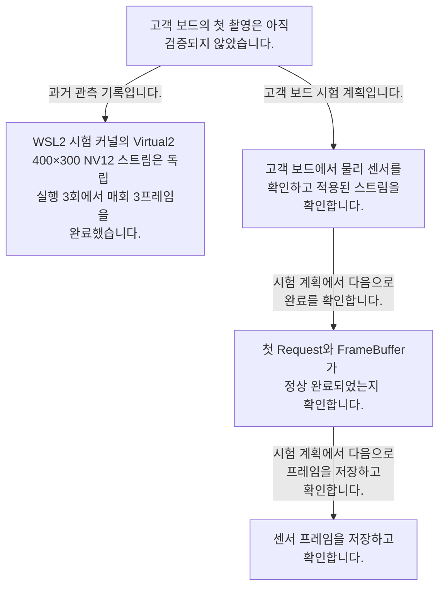

[Mermaid 원문](https://ttolsun.github.io/libcamera-sdd/vendor-assurance.first-capture-boundary.mmd)

<details open>
<summary>그림 근거와 확인 범위</summary>

WSL2에서 확인한 범위는 어디까지이며 고객 보드에서는 어떤 순서로 첫 촬영을 확인합니까?

소스 연결 해석 · 자동 연결 검사만 통과 · 의미와 기기 실행은 검증 전

LLM 그림 초안 · 사람 검토 전

작성 모델: `cli/codex/gpt-6.1-terra`

| 요소·전이 | 소스 근거 |
| --- | --- |
| 고객 보드의 첫 촬영은 아직 검증되지 않았습니다. | [product-evidence/libcamera-first-capture-trial/virtual-first-capture-run.txt:1](#d4-source-3c4ba1aba4901083) |
| WSL2 시험 커널의 Virtual2 400×300 NV12 스트림은 독립 실행 3회에서 매회 3프레임을 완료했습니다. | [product-evidence/libcamera-first-capture-trial/virtual-first-capture-run.txt:1](#d4-source-3c4ba1aba4901083) |
| 고객 보드에서 물리 센서를 확인하고 적용된 스트림을 확인합니다. | [product-evidence/libcamera-first-capture-trial/virtual-first-capture-run.txt:1](#d4-source-3c4ba1aba4901083) · [README.rst:107](#d4-source-ce71f2f0de50caf3) · [include/libcamera/camera.h:126](#d4-source-aba605be681da98e) |
| 첫 Request와 FrameBuffer가 정상 완료되었는지 확인합니다. | [include/libcamera/camera.h:126](#d4-source-aba605be681da98e) · [include/libcamera/request.h:34](#d4-source-cb2be6f3ec7f91fc) · [include/libcamera/framebuffer.h:25](#d4-source-094e6fd7ddda824a) |
| 센서 프레임을 저장하고 확인합니다. | [include/libcamera/camera.h:126](#d4-source-aba605be681da98e) · [README.rst:107](#d4-source-ce71f2f0de50caf3) |
| 과거 관측 기록입니다. | [product-evidence/libcamera-first-capture-trial/virtual-first-capture-run.txt:1](#d4-source-3c4ba1aba4901083) |
| 고객 보드 시험 계획입니다. | [product-evidence/libcamera-first-capture-trial/virtual-first-capture-run.txt:1](#d4-source-3c4ba1aba4901083) · [README.rst:107](#d4-source-ce71f2f0de50caf3) |
| 시험 계획에서 다음으로 완료를 확인합니다. | [include/libcamera/camera.h:126](#d4-source-aba605be681da98e) · [README.rst:107](#d4-source-ce71f2f0de50caf3) |
| 시험 계획에서 다음으로 프레임을 저장하고 확인합니다. | [include/libcamera/camera.h:126](#d4-source-aba605be681da98e) · [README.rst:107](#d4-source-ce71f2f0de50caf3) |

</details>

libcamera 공식 프로젝트 문서에서 확인할 수 있는 범위에서, Virtual Pipeline Handler는 테스트용 가상 외부 카메라를 모사합니다. 예제 YAML은 Virtual2에 400×300 크기와 `lines` 테스트 패턴을 지정합니다.

2026년 10월 31일의 가상 캡처 시험에서는 소스 커밋 293d751a814e0d4c34e85ad457ccd9d5eefd1a61과 내장 udmabuf를 갖춘 WSL2 시험 커널 6.18.33.2-microsoft-standard-WSL2-issue211을 사용했습니다. Virtual2에서 400×300 NV12로 별도 프로세스마다 실행한 3회 모두 각각 3프레임을 완료했습니다. 이 관측은 물리 카메라나 보드 DMA의 검증을 의미하지 않습니다.

고객 보드의 첫 촬영 시험에서는 보드와 물리 센서, 커널·드라이버, libcamera 빌드 및 대상 애플리케이션을 기록하고 실제 센서를 열어 적용된 스트림 형식과 크기를 확인합니다. 첫 요청의 RequestComplete와 버퍼의 FrameSuccess를 확인하고 센서에서 들어온 프레임을 저장해 확인하며, 기본 시험 도구의 저장 기능 예시로 cam을 사용할 수 있습니다. 기존 기록은 WSL2 시험 커널의 udmabuf와 Virtual2를 사용한 시험 구성에 한정되며 물리 카메라, 물리 DMA 및 제품 애플리케이션은 검증되지 않았습니다.

<details open>
<summary>절 전체 근거 7개</summary>

- `product-evidence/libcamera-first-capture-trial/virtual-first-capture-run.txt`[`L1`](#d4-source-3c4ba1aba4901083)
- `src/libcamera/pipeline/virtual/README.md`[`L3` 발췌](#d4-source-eb7d1ae4ac9df3f9) · [전체 소스 `L3`](https://github.com/TTolsun/libcamera-sdd/blob/adfa719f8ed67d18fd8a0739fc088a1f8b9e7252/src/libcamera/pipeline/virtual/README.md#L3)
- `src/libcamera/pipeline/virtual/data/virtual.yaml`[`L28` 발췌](#d4-source-fb6397b1c5827be7) · [전체 소스 `L28`](https://github.com/TTolsun/libcamera-sdd/blob/adfa719f8ed67d18fd8a0739fc088a1f8b9e7252/src/libcamera/pipeline/virtual/data/virtual.yaml#L28)
- `include/libcamera/request.h`[`L34` 발췌](#d4-source-cb2be6f3ec7f91fc) · [전체 소스 `L34`](https://github.com/TTolsun/libcamera-sdd/blob/adfa719f8ed67d18fd8a0739fc088a1f8b9e7252/include/libcamera/request.h#L34)
- `include/libcamera/framebuffer.h`[`L25` 발췌](#d4-source-094e6fd7ddda824a) · [전체 소스 `L25`](https://github.com/TTolsun/libcamera-sdd/blob/adfa719f8ed67d18fd8a0739fc088a1f8b9e7252/include/libcamera/framebuffer.h#L25)
- `README.rst`[`L107` 발췌](#d4-source-ce71f2f0de50caf3) · [전체 소스 `L107`](https://github.com/TTolsun/libcamera-sdd/blob/adfa719f8ed67d18fd8a0739fc088a1f8b9e7252/README.rst#L107)
- `include/libcamera/camera.h`[`L126` 발췌](#d4-source-aba605be681da98e) · [전체 소스 `L126`](https://github.com/TTolsun/libcamera-sdd/blob/adfa719f8ed67d18fd8a0739fc088a1f8b9e7252/include/libcamera/camera.h#L126)

</details>

## <a id="d4-지원-조건과-제약"></a>지원 조건과 제약

`CameraConfiguration::Invalid`는 구성이 유효하지 않고 조정할 수 없음을 뜻하며, 구성이 비어 있는 경우와 같은 극단적인 경우에만 발생할 수 있습니다. `CameraConfiguration::Adjusted`는 구성이 조정되었으며 조정 후 유효함을 나타냅니다. `CameraConfiguration::validate()`가 `Adjusted`를 반환하면 어느 스트림이든 파라미터가 바뀌었을 수 있고 일부 스트림만 바뀌었을 수도 있으며, 스트림 구성이 삭제되었을 수도 있습니다. `CameraConfiguration::Adjusted`일 때 호출자는 구성을 주의 깊게 확인해야 합니다.

### validate() 결과별 호출자의 책임

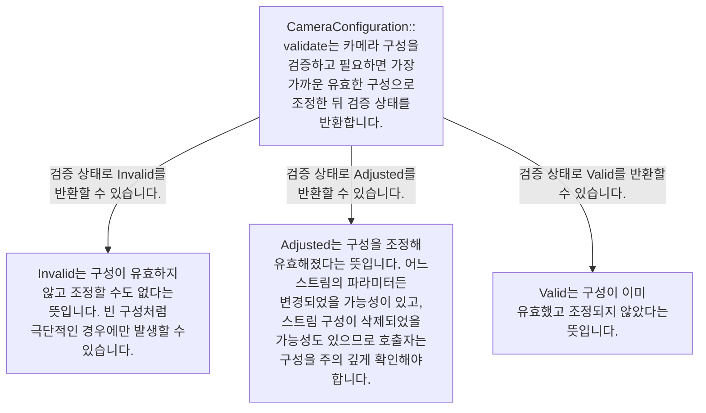

[Mermaid 원문](https://ttolsun.github.io/libcamera-sdd/vendor-assurance.validation-results.mmd)

<details open>
<summary>그림 근거와 확인 범위</summary>

validate()의 Invalid·Adjusted·Valid는 무엇을 뜻하며, Adjusted이면 호출자는 무엇을 다시 확인해야 합니까?

소스 연결 해석 · 자동 연결 검사만 통과 · 의미와 기기 실행은 검증 전

LLM 그림 초안 · 사람 검토 전

작성 모델: `cli/codex/gpt-6.1-terra`

| 요소·전이 | 소스 근거 |
| --- | --- |
| CameraConfiguration::validate는 카메라 구성을 검증하고 필요하면 가장 가까운 유효한 구성으로 조정한 뒤 검증 상태를 반환합니다. | [src/libcamera/camera.cpp:323](#d4-source-2b31e92e3fb3f083) |
| Invalid는 구성이 유효하지 않고 조정할 수도 없다는 뜻입니다. 빈 구성처럼 극단적인 경우에만 발생할 수 있습니다. | [src/libcamera/camera.cpp:323](#d4-source-2b31e92e3fb3f083) |
| Adjusted는 구성을 조정해 유효해졌다는 뜻입니다. 어느 스트림의 파라미터든 변경되었을 가능성이 있고, 스트림 구성이 삭제되었을 가능성도 있으므로 호출자는 구성을 주의 깊게 확인해야 합니다. | [src/libcamera/camera.cpp:323](#d4-source-2b31e92e3fb3f083) |
| Valid는 구성이 이미 유효했고 조정되지 않았다는 뜻입니다. | [src/libcamera/camera.cpp:323](#d4-source-2b31e92e3fb3f083) |
| 검증 상태로 Invalid를 반환할 수 있습니다. | [src/libcamera/camera.cpp:323](#d4-source-2b31e92e3fb3f083) |
| 검증 상태로 Adjusted를 반환할 수 있습니다. | [src/libcamera/camera.cpp:323](#d4-source-2b31e92e3fb3f083) |
| 검증 상태로 Valid를 반환할 수 있습니다. | [src/libcamera/camera.cpp:323](#d4-source-2b31e92e3fb3f083) |

</details>

### 역할 기반 구성 생성의 반환 계약

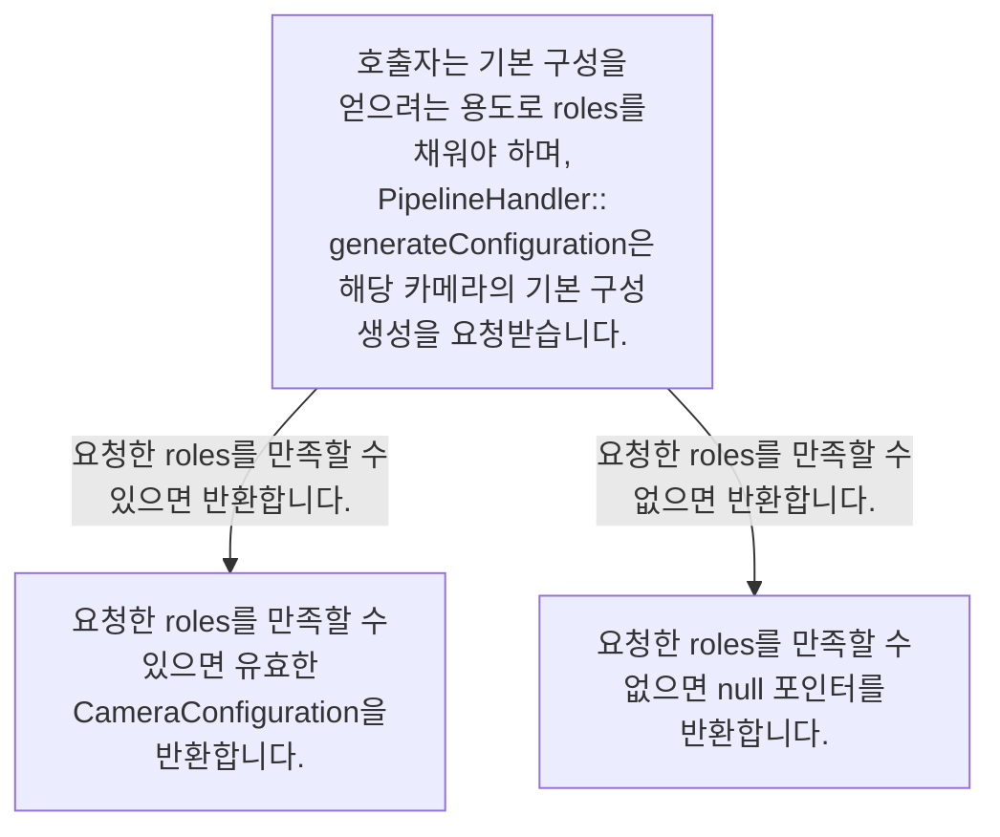

[Mermaid 원문](https://ttolsun.github.io/libcamera-sdd/vendor-assurance.configuration-contract-validity.mmd)

<details open>
<summary>그림 근거와 확인 범위</summary>

PipelineHandler::generateConfiguration은 요청한 roles를 만족할 수 있을 때와 없을 때 무엇을 반환합니까?

소스 연결 해석 · 자동 연결 검사만 통과 · 의미와 기기 실행은 검증 전

LLM 그림 초안 · 사람 검토 전

작성 모델: `cli/codex/gpt-6.1-terra`

| 요소·전이 | 소스 근거 |
| --- | --- |
| 호출자는 기본 구성을 얻으려는 용도로 roles를 채워야 하며, PipelineHandler::generateConfiguration은 해당 카메라의 기본 구성 생성을 요청받습니다. | [src/libcamera/pipeline_handler.cpp:271](#d4-source-23ff032cd1152d56) |
| 요청한 roles를 만족할 수 있으면 유효한 CameraConfiguration을 반환합니다. | [src/libcamera/pipeline_handler.cpp:271](#d4-source-23ff032cd1152d56) |
| 요청한 roles를 만족할 수 없으면 null 포인터를 반환합니다. | [src/libcamera/pipeline_handler.cpp:271](#d4-source-23ff032cd1152d56) |
| 요청한 roles를 만족할 수 있으면 반환합니다. | [src/libcamera/pipeline_handler.cpp:271](#d4-source-23ff032cd1152d56) |
| 요청한 roles를 만족할 수 없으면 반환합니다. | [src/libcamera/pipeline_handler.cpp:271](#d4-source-23ff032cd1152d56) |

</details>

`CameraConfiguration::validate()`가 `CameraConfiguration::Valid`를 반환하면 원래 구성이 이미 유효하며 조정되지 않은 상태입니다. `PipelineHandler::generateConfiguration()`은 스트림 역할 목록인 `roles`를 받아 요청한 역할을 충족할 수 있으면 유효한 `CameraConfiguration`을 반환하고, 그렇지 않으면 `null` 포인터를 반환합니다. `PipelineHandler::configure()`에 전달되는 설정은 `CameraConfiguration::validate()`로 검증되었음이 보장되며, 파이프라인 핸들러 구현자는 추가 검증을 해서는 안 됩니다. `PipelineHandler::configure()`의 구현자는 구성이 성공하면 `0`을 반환하고, 실패하면 음수 오류 코드를 반환해야 합니다.

<details open>
<summary>절 전체 근거 9개</summary>

- `src/libcamera/camera.cpp`[`L338` 발췌](#d4-source-60ab47044c6107c5) · [전체 소스 `L338`](https://github.com/TTolsun/libcamera-sdd/blob/adfa719f8ed67d18fd8a0739fc088a1f8b9e7252/src/libcamera/camera.cpp#L338) · [`L341` 발췌](#d4-source-8b6aa81367245db5) · [전체 소스 `L341`](https://github.com/TTolsun/libcamera-sdd/blob/adfa719f8ed67d18fd8a0739fc088a1f8b9e7252/src/libcamera/camera.cpp#L341) · [`L342` 발췌](#d4-source-e13fede0aa40ada1) · [전체 소스 `L342`](https://github.com/TTolsun/libcamera-sdd/blob/adfa719f8ed67d18fd8a0739fc088a1f8b9e7252/src/libcamera/camera.cpp#L342) · [`L343` 발췌](#d4-source-e5758fc43bf244cd) · [전체 소스 `L343`](https://github.com/TTolsun/libcamera-sdd/blob/adfa719f8ed67d18fd8a0739fc088a1f8b9e7252/src/libcamera/camera.cpp#L343) · [`L323` 발췌](#d4-source-2b31e92e3fb3f083) · [전체 소스 `L323`](https://github.com/TTolsun/libcamera-sdd/blob/adfa719f8ed67d18fd8a0739fc088a1f8b9e7252/src/libcamera/camera.cpp#L323)
- `src/libcamera/pipeline_handler.cpp`[`L271` 발췌](#d4-source-23ff032cd1152d56) · [전체 소스 `L271`](https://github.com/TTolsun/libcamera-sdd/blob/adfa719f8ed67d18fd8a0739fc088a1f8b9e7252/src/libcamera/pipeline_handler.cpp#L271) · [`L304` 발췌](#d4-source-31c5407347b4d0d8) · [전체 소스 `L304`](https://github.com/TTolsun/libcamera-sdd/blob/adfa719f8ed67d18fd8a0739fc088a1f8b9e7252/src/libcamera/pipeline_handler.cpp#L304) · [`L313` 발췌](#d4-source-f87ceb096b9f931d) · [전체 소스 `L313`](https://github.com/TTolsun/libcamera-sdd/blob/adfa719f8ed67d18fd8a0739fc088a1f8b9e7252/src/libcamera/pipeline_handler.cpp#L313) · [`L289`](#d4-source-4abbe39594a1bd27)

</details>

## <a id="d4-성능-근거를-읽는-기준"></a>성능 근거를 읽는 기준

`DebayerCpu`의 내장 벤치마크는 통계를 수집하고 디베이어링하는 처리에 걸린 시간만 측정합니다. 프레임을 캡처하거나 출력하는 데 걸린 시간은 포함하지 않습니다. Software ISP를 사용하는 파이프라인에서 `cam` 또는 `qcam`을 실행하면 내장 벤치마크를 사용할 수 있습니다.

<details open>
<summary>절 전체 근거 1개</summary>

- `Documentation/software-isp-benchmarking.rst`[`L15` 발췌](#d4-source-551d2b5944a36d19) · [전체 소스 `L15`](https://github.com/TTolsun/libcamera-sdd/blob/adfa719f8ed67d18fd8a0739fc088a1f8b9e7252/Documentation/software-isp-benchmarking.rst#L15)

</details>

## 클래스 관계

화살표의 글자는 추출한 관계를 나타내며, 점선은 상속입니다. 화살표는 참조 대상 또는 기반 클래스를 향합니다. 호출 순서를 뜻하지 않습니다.


<details open>
<summary>가상 시험의 검증 범위</summary>

**가상 시험 구성입니다. 실제 제품의 지원·성능 주장으로 사용하지 마세요.**

- [고객 보드의 첫 촬영을 검증했습니까?](#d4-고객-보드의-첫-촬영을-검증했습니까)

</details>

## 소스 근거

<details open>
<summary>소스 발췌 17개</summary>

같은 발췌는 한 번만 싣습니다. 필요한 원문을 펼쳐 설명과 대조하세요.

<a id="d4-source-eb7d1ae4ac9df3f9"></a>

<details open>
<summary>소스 근거: src/libcamera/pipeline/virtual/README.md:3</summary>

발췌 범위: [`src/libcamera/pipeline/virtual/README.md:3`](https://github.com/TTolsun/libcamera-sdd/blob/adfa719f8ed67d18fd8a0739fc088a1f8b9e7252/src/libcamera/pipeline/virtual/README.md#L3) \~ `5`

SHA-256: `493f7417e35aff44c5d8402be054cedfa0cf3d5cfa6007789c2a3bbc1d359491`

```
# Virtual Pipeline Handler

Virtual pipeline handler emulates fake external camera(s) for testing.
```

</details>

<a id="d4-source-fb6397b1c5827be7"></a>

<details open>
<summary>소스 근거: src/libcamera/pipeline/virtual/data/virtual.yaml:28</summary>

발췌 범위: [`src/libcamera/pipeline/virtual/data/virtual.yaml:28`](https://github.com/TTolsun/libcamera-sdd/blob/adfa719f8ed67d18fd8a0739fc088a1f8b9e7252/src/libcamera/pipeline/virtual/data/virtual.yaml#L28) \~ `34`

SHA-256: `4b1c7d6a7ad0a5de6e033d508a6a85e6e166dcabdca7866b1b61b23657d91c8d`

```
"Virtual2":
  supported_formats:
  - width: 400
    height: 300
  test_pattern: "lines"
  location: "Front"
  model: "Virtual Video Device2"
```

</details>

<a id="d4-source-aba605be681da98e"></a>

<details open>
<summary>소스 근거: include/libcamera/camera.h:126</summary>

발췌 범위: [`include/libcamera/camera.h:126`](https://github.com/TTolsun/libcamera-sdd/blob/adfa719f8ed67d18fd8a0739fc088a1f8b9e7252/include/libcamera/camera.h#L126) \~ `153`

SHA-256: `5c3c69878cf992146820a6ecf3d639f1b4d9cf15b6626a6adf39fbaa15fa8a87`

```
Signal<Request *, FrameBuffer *> bufferCompleted;
    Signal<Request *> requestCompleted;
    Signal<> disconnected;

    int acquire();
    int release();

    const ControlInfoMap &controls() const;
    const ControlList &properties() const;

    const std::set<Stream *> &streams() const;

    std::unique_ptr<CameraConfiguration>
    generateConfiguration(std::span<const StreamRole> roles = {});

    std::unique_ptr<CameraConfiguration>
    generateConfiguration(std::initializer_list<StreamRole> roles)
    {
        return generateConfiguration(std::span(roles.begin(), roles.end()));
    }

    int configure(CameraConfiguration *config);

    std::unique_ptr<Request> createRequest(uint64_t cookie = 0);
    int queueRequest(Request *request);

    int start(const ControlList *controls = nullptr);
    int stop();
```

</details>

<a id="d4-source-cb2be6f3ec7f91fc"></a>

<details open>
<summary>소스 근거: include/libcamera/request.h:34</summary>

발췌 범위: [`include/libcamera/request.h:34`](https://github.com/TTolsun/libcamera-sdd/blob/adfa719f8ed67d18fd8a0739fc088a1f8b9e7252/include/libcamera/request.h#L34) \~ `37`

SHA-256: `eaa5d321971fa026c205d6687465279a50cccbeec286ccbaecd1a8ff149652f0`

```
enum Status {
        RequestPending,
        RequestComplete,
        RequestCancelled,
```

</details>

<a id="d4-source-094e6fd7ddda824a"></a>

<details open>
<summary>소스 근거: include/libcamera/framebuffer.h:25</summary>

발췌 범위: [`include/libcamera/framebuffer.h:25`](https://github.com/TTolsun/libcamera-sdd/blob/adfa719f8ed67d18fd8a0739fc088a1f8b9e7252/include/libcamera/framebuffer.h#L25) \~ `28`

SHA-256: `dc2d776d3644c8251b2b5c814b24afbe1669453df099ff38f2948283af83b987`

```
enum Status {
        FrameSuccess,
        FrameError,
        FrameCancelled,
```

</details>

<a id="d4-source-ce71f2f0de50caf3"></a>

<details open>
<summary>소스 근거: README.rst:107</summary>

발췌 범위: [`README.rst:107`](https://github.com/TTolsun/libcamera-sdd/blob/adfa719f8ed67d18fd8a0739fc088a1f8b9e7252/README.rst#L107) \~ `110`

SHA-256: `ef4dcb6f295c819bccc9abda78c8416492644df33013d7602ab5f5bb170c4b05`

```
The ``cam`` utility can be used for basic testing. You can list the cameras
detected on the system with ``cam -l``, and capture ten frames from the first
camera and save them to disk with ``cam -c 1 --capture=10 --file``. See
``cam -h`` for more information about the ``cam`` tool.
```

</details>

<a id="d4-source-3c4ba1aba4901083"></a>

<details open>
<summary>제품 자료: product-evidence/libcamera-first-capture-trial/virtual-first-capture-run.txt:1</summary>

소스와 별도로 제공된 자료입니다. 제공자·버전·적용 범위를 아래 기록에서 확인하세요. 자동 검사는 사람 승인이 아닙니다.

발췌 범위: `product-evidence/libcamera-first-capture-trial/virtual-first-capture-run.txt:1` \~ `49`

SHA-256: `2284397098a8a2871f76f695264af00a36c57a8fc324630367a26e598ee165e8`

```
{
  "archive": "https://github.com/TTolsun/camera-hal-sdd-generator/tree/6adb29515c6a250d05e06ad0cf3b047205380be9/examples/libcamera/validation/issue211/runs/20261031-wsl-cam-3",
  "date": "2026-10-31",
  "source_commit": "293d751a814e0d4c34e85ad457ccd9d5eefd1a61",
  "source_tracked_clean": true,
  "kernel": "6.18.33.2-microsoft-standard-WSL2-issue211",
  "allocator": "udmabuf (built into the WSL2 trial kernel, CONFIG_UDMABUF=y)",
  "camera": "Virtual2",
  "requested_stream": "role=video,width=400,height=300,pixelformat=NV12",
  "runs": [
    {
      "pid": 434,
      "completed_frames": 3,
      "successful_buffer_sequences": [
        0,
        1,
        2
      ],
      "exit_code": 0
    },
    {
      "pid": 449,
      "completed_frames": 3,
      "successful_buffer_sequences": [
        0,
        1,
        2
      ],
      "exit_code": 0
    },
    {
      "pid": 464,
      "completed_frames": 3,
      "successful_buffer_sequences": [
        0,
        1,
        2
      ],
      "exit_code": 0
    }
  ],
  "physical_camera": "not-run",
  "physical_dma": "not-validated",
  "production_application": "not-run",
  "internal_hal": "not-run",
  "applied_stream": "(0) 400x300-NV12/SMPTE170M",
  "kernel_evidence": "https://github.com/TTolsun/camera-hal-sdd-generator/blob/6adb29515c6a250d05e06ad0cf3b047205380be9/examples/libcamera/validation/issue211/runs/20261031-after-kernel-inventory/stdout"
}
```

```
{
  "type": "measurement",
  "supplier": "Public official cam trial archive, selected run fields",
  "version": "2026-10-31",
  "date": "2026-10-31",
  "valid_until": "2026-10-31",
  "product": "libcamera-first-capture-trial",
  "release": "293d751a814e0d4c34e85ad457ccd9d5eefd1a61",
  "configuration": "wsl2-virtual2-official-cam-udmabuf",
  "feature": "virtual-first-capture",
  "conditions": [
    "WSL2 trial kernel with built-in udmabuf",
    "Unmodified official cam at the recorded source commit",
    "Virtual2, 400x300 NV12"
  ],
  "sha256": "2284397098a8a2871f76f695264af00a36c57a8fc324630367a26e598ee165e8"
}
```

</details>

<a id="d4-source-60ab47044c6107c5"></a>

<details open>
<summary>소스 근거: src/libcamera/camera.cpp:338</summary>

발췌 범위: [`src/libcamera/camera.cpp:338`](https://github.com/TTolsun/libcamera-sdd/blob/adfa719f8ed67d18fd8a0739fc088a1f8b9e7252/src/libcamera/camera.cpp#L338) \~ `340`

SHA-256: `2247db4a7b9353362f9df6c84aaa5c2810dec4eaaae4b3b36d19c57e427f5790`

```
\retval CameraConfiguration::Invalid The configuration is invalid and can't
 * be adjusted. This may only occur in extreme cases such as when the
 * configuration is empty.
```

</details>

<a id="d4-source-e5758fc43bf244cd"></a>

<details open>
<summary>소스 근거: src/libcamera/camera.cpp:343</summary>

발췌 범위: [`src/libcamera/camera.cpp:343`](https://github.com/TTolsun/libcamera-sdd/blob/adfa719f8ed67d18fd8a0739fc088a1f8b9e7252/src/libcamera/camera.cpp#L343) \~ `344`

SHA-256: `f2efdb13d4f1bd8dd432fb0badb987eab0cc484fe8ecb30b7ea9d47c0126590c`

```
The caller shall check the
 * configuration carefully.
```

</details>

<a id="d4-source-2b31e92e3fb3f083"></a>

<details open>
<summary>소스 근거: src/libcamera/camera.cpp:323</summary>

발췌 범위: [`src/libcamera/camera.cpp:323`](https://github.com/TTolsun/libcamera-sdd/blob/adfa719f8ed67d18fd8a0739fc088a1f8b9e7252/src/libcamera/camera.cpp#L323) \~ `346`

SHA-256: `86bf9109257512866bf70a5d42cd3da29c70d851d871f0e496058141ba377623`

```
\fn CameraConfiguration::validate()
 * \brief Validate and possibly adjust the camera configuration
 *
 * This function adjusts the camera configuration to the closest valid
 * configuration and returns the validation status.
 *
 * \todo Define exactly when to return each status code. Should stream
 * parameters set to 0 by the caller be adjusted without returning Adjusted ?
 * This would potentially be useful for applications but would get in the way
 * in Camera::configure(). Do we need an extra status code to signal this ?
 *
 * \todo Handle validation of buffers count when refactoring the buffers API.
 *
 * \return A CameraConfiguration::Status value that describes the validation
 * status.
 * \retval CameraConfiguration::Invalid The configuration is invalid and can't
 * be adjusted. This may only occur in extreme cases such as when the
 * configuration is empty.
 * \retval CameraConfiguration::Adjusted The configuration has been adjusted
 * and is now valid. Parameters may have changed for any stream, and stream
 * configurations may have been removed. The caller shall check the
 * configuration carefully.
 * \retval CameraConfiguration::Valid The configuration was already valid and
 * hasn't been adjusted.
```

</details>

<a id="d4-source-4abbe39594a1bd27"></a>

<details open>
<summary>소스 근거: src/libcamera/pipeline_handler.cpp:289</summary>

발췌 범위: [`src/libcamera/pipeline_handler.cpp:289`](https://github.com/TTolsun/libcamera-sdd/blob/adfa719f8ed67d18fd8a0739fc088a1f8b9e7252/src/libcamera/pipeline_handler.cpp#L289) \~ `290`

SHA-256: `b86c8678b02e96936d80626cefebf3811b6a991b459074e51c9f0e08457ff369`

```
\return A valid CameraConfiguration if the requested roles can be satisfied,
 * or a null pointer otherwise.
```

</details>

<a id="d4-source-31c5407347b4d0d8"></a>

<details open>
<summary>소스 근거: src/libcamera/pipeline_handler.cpp:304</summary>

발췌 범위: [`src/libcamera/pipeline_handler.cpp:304`](https://github.com/TTolsun/libcamera-sdd/blob/adfa719f8ed67d18fd8a0739fc088a1f8b9e7252/src/libcamera/pipeline_handler.cpp#L304) \~ `306`

SHA-256: `625bd787da81f9407ba9e746d4939d93b7172a26642429bcfd3300aa6187675f`

```
The configuration is guaranteed to have been validated with
 * CameraConfiguration::validate(). The pipeline handler implementation shall
 * not perform further validation
```

</details>

<a id="d4-source-f87ceb096b9f931d"></a>

<details open>
<summary>소스 근거: src/libcamera/pipeline_handler.cpp:313</summary>

발췌 범위: [`src/libcamera/pipeline_handler.cpp:313`](https://github.com/TTolsun/libcamera-sdd/blob/adfa719f8ed67d18fd8a0739fc088a1f8b9e7252/src/libcamera/pipeline_handler.cpp#L313) \~ `315`

SHA-256: `6e139b3c50660a7111d84bd00cfd17078b8b45d4a07688fa64b2d8af9ce52a22`

```
\context This function is called from the CameraManager thread.
 *
 * \return 0 on success or a negative error code otherwise
```

</details>

<a id="d4-source-8b6aa81367245db5"></a>

<details open>
<summary>소스 근거: src/libcamera/camera.cpp:341</summary>

발췌 범위: [`src/libcamera/camera.cpp:341`](https://github.com/TTolsun/libcamera-sdd/blob/adfa719f8ed67d18fd8a0739fc088a1f8b9e7252/src/libcamera/camera.cpp#L341) \~ `342`

SHA-256: `bc530fdf77cefda77bfd8ae1cadf7df4edea81ddfce01bef24867681b29655f6`

```
\retval CameraConfiguration::Adjusted The configuration has been adjusted
 * and is now valid.
```

</details>

<a id="d4-source-e13fede0aa40ada1"></a>

<details open>
<summary>소스 근거: src/libcamera/camera.cpp:342</summary>

발췌 범위: [`src/libcamera/camera.cpp:342`](https://github.com/TTolsun/libcamera-sdd/blob/adfa719f8ed67d18fd8a0739fc088a1f8b9e7252/src/libcamera/camera.cpp#L342) \~ `343`

SHA-256: `7c0debb896b6072c0bc59cf3589fbc49b607f915d96f30182d4e02038b94c156`

```
Parameters may have changed for any stream, and stream
 * configurations may have been removed.
```

</details>

<a id="d4-source-23ff032cd1152d56"></a>

<details open>
<summary>소스 근거: src/libcamera/pipeline_handler.cpp:271</summary>

발췌 범위: [`src/libcamera/pipeline_handler.cpp:271`](https://github.com/TTolsun/libcamera-sdd/blob/adfa719f8ed67d18fd8a0739fc088a1f8b9e7252/src/libcamera/pipeline_handler.cpp#L271) \~ `291`

SHA-256: `c1f4cc7aeedfc57e2bc5ebd6825a77f605173b44f7fde564aebc01bb013119cf`

```
\fn PipelineHandler::generateConfiguration()
 * \brief Generate a camera configuration for a specified camera
 * \param[in] camera The camera to generate a default configuration for
 * \param[in] roles A list of stream roles
 *
 * Generate a default configuration for the \a camera for a specified list of
 * stream roles. The caller shall populate the \a roles with the use-cases it
 * wishes to fetch the default configuration for. The returned configuration
 * can then be examined by the caller to learn about the selected streams and
 * their default parameters.
 *
 * The intended companion to this is \a configure() which can be used to change
 * the group of streams parameters.
 *
 * \context This function may be called from any thread and shall be
 * \threadsafe. It shall not modify the state of the \a camera in the pipeline
 * handler.
 *
 * \return A valid CameraConfiguration if the requested roles can be satisfied,
 * or a null pointer otherwise.
 */
```

</details>

<a id="d4-source-551d2b5944a36d19"></a>

<details open>
<summary>소스 근거: Documentation/software-isp-benchmarking.rst:15</summary>

발췌 범위: [`Documentation/software-isp-benchmarking.rst:15`](https://github.com/TTolsun/libcamera-sdd/blob/adfa719f8ed67d18fd8a0739fc088a1f8b9e7252/Documentation/software-isp-benchmarking.rst#L15) \~ `20`

SHA-256: `907d979f60258b4572a0557b6054ec814990084ca3e69a291317855a3b27084d`

```
The DebayerCpu class has a builtin benchmark. This benchmark measures the time
spent on processing (collecting statistics and debayering) only, it does not
measure the time spent on capturing or outputting the frames.

The builtin benchmark always runs. So this can be used by simply running "cam"
or "qcam" with a pipeline using the Software ISP.
```

</details>

</details>

## <a id="d4-page-evidence"></a>문서 생성·검토 정보

- **생성 방식**: 추출 사실과 LLM 설명
- **검증 범위**: 표·그림은 facts로 만들고 설명은 LLM이 작성합니다. 인용·문장 및 설정된 구조 검사를 적용합니다.
- **자동 검사**: 통과 (`ok`). 검사한 항목은 검증 범위에 적혀 있습니다. 설명 내용이 맞는지는 사람이 확인합니다.
- **사람 검토**: 사람 검토 전
- **분석 기준 커밋**: `adfa719f8ed67d18fd8a0739fc088a1f8b9e7252`
- **문서 생성 시각**: `2026-11-20 16:39:19+00:00`
- **문장 생성 모델**: `cli/codex/gpt-6.1-terra`
- **문서 간 계약**: [자동 대조 보고서](https://ttolsun.github.io/libcamera-sdd/contract-consistency.json) · 사람 검토 전
- **제품 설명 입력**: [적용 범위·조건·자료](https://ttolsun.github.io/libcamera-sdd/product-context.json)

<details open>
<summary>원고 작성 당시 기록</summary>

원고에 저장된 당시 기록입니다. 현재 문서의 기준과 다를 수 있습니다.

- 근거 파일: `Documentation/software-isp-benchmarking.rst`, `README.rst`, `include/libcamera/camera.h`, `include/libcamera/framebuffer.h`, `include/libcamera/internal/ipa_manager.h`, `include/libcamera/internal/pipeline_handler.h`, `include/libcamera/request.h`, `product-evidence/libcamera-first-capture-trial/virtual-first-capture-run.txt`, `src/libcamera/camera.cpp`, `src/libcamera/ipa_manager.cpp`, `src/libcamera/pipeline/ipu3/ipu3.cpp`, `src/libcamera/pipeline/rkisp1/rkisp1.cpp`, `src/libcamera/pipeline/virtual/README.md`, `src/libcamera/pipeline/virtual/data/virtual.yaml`, `src/libcamera/pipeline_handler.cpp`
- 근거 수준: 코드 확인 (정적 분석, simple_compdb 구성, commit `adfa719f8e`)
- 자동 검사 (인용·문장 및 설정된 구조 검사): 통과
- 검토 상태 기록일: 2026-11-21 · 사람 검토 전

</details>

[Markdown 원문 ↗](https://ttolsun.github.io/libcamera-sdd/vendor-assurance.md) [Mermaid 원문 ↗](https://ttolsun.github.io/libcamera-sdd/vendor-assurance.mmd)

<a id="doc-5"></a>

For Vendor

# 연동 가이드

사람 검토 전자동 검사 통과작성: 추출한 구조와 모델이 쓴 초안[상태 설명 ↓](#d5-page-evidence)

**연동 순서와 구현 책임을 확인하고 설정·요청·정지 계약을 적용하세요.**

<details open>
<summary>설계 질문과 검증 범위</summary>

질문별 답변과 근거 연결을 검사했습니다. 의미와 실행 결과는 사람 검토가 필요합니다.

- 연동을 시작할 순서와 제공 측·Vendor의 구현 책임은 무엇입니까?

  [연동 순서와 책임](#d5-연동-순서와-책임)
- 하드웨어의 장치 매칭과 카메라 등록은 누가 구현합니까?

  [하드웨어와 공통 계층의 경계](#d5-하드웨어와-공통-계층의-경계)
- 스트림 구성 구현은 어떤 입력과 출력 계약을 지킵니까?

  [구현할 설정 인터페이스](#d5-구현할-설정-인터페이스)
- 공통 큐와 하드웨어 구현은 요청 처리 책임을 어떻게 나눕니까?

  [요청을 장치에 전달하고 반환하기](#d5-요청을-장치에-전달하고-반환하기)
- IPA 모듈과 실행 방식은 어떻게 선택되며 언제 생성에 실패합니까?

  [IPA 모듈 선택과 실패 조건](#d5-ipa-모듈-선택과-실패-조건)
- 정지 시 공통 코드와 하드웨어 구현은 무엇을 끝내야 합니까?

  [정지와 오류 처리의 책임](#d5-정지와-오류-처리의-책임)
- 코드 계약과 별도 실행 검증 항목은 무엇입니까?

  [구현 뒤 확인할 계약과 실행 한계](#d5-구현-뒤-확인할-계약과-실행-한계)

확인 범위: 코드 근거와 설명 연결

</details>

<details open>
<summary>이 문서의 용어: WSL2, Pipeline Handler, IPA, 프록시</summary>

- **WSL2** (Windows Subsystem for Linux 2): Windows에서 Linux를 실행하는 환경입니다. 이 사이트는 libcamera를 WSL2에서 빌드하고 추출한 결과로 만듭니다.
- **Pipeline Handler**: 특정 하드웨어 플랫폼(IPU3, RKISP1 등)의 미디어 장치를 찾아 카메라를 만들고, 요청을 장치에 넣고 완료를 돌려주는 libcamera 구성 요소입니다. 플랫폼마다 하나씩 있습니다.
- **IPA** (Image Processing Algorithms): 화질 알고리즘을 담은 별도 모듈(.so)입니다. ISP가 보낸 통계를 보고 다음 프레임에 쓸 ISP 설정값을 계산합니다. 제조사가 소스를 공개하지 않고 제공할 수 있도록 libcamera 본체와 분리되어 있습니다.
- **프록시**: IPA 모듈을 직접 부르지 않고, 같은 인터페이스로 호출을 받아 IPA 스레드나 별도 프로세스로 전달하는 대리 객체입니다. 빌드할 때 mojom 정의에서 자동 생성됩니다.

다른 용어는 [용어집](#doc-2)에서 찾을 수 있습니다.

</details>

## <a id="d5-연동-순서와-책임"></a>연동 순서와 책임

애플리케이션은 촬영을 준비하려면 카메라를 확보하고 구성해야 하며, 카메라를 시작하면 정지할 때까지 요청을 처리할 수 있고, 사용을 마치면 카메라를 해제해야 합니다. 애플리케이션은 카메라를 해제하지 않은 동안 여러 번 시작하고 정지할 수 있으며, 카메라를 재구성할 수도 있습니다. `Camera` 클래스는 카메라 상태에 영향을 주는 함수들을 일반적으로 서로 동기화하지 않으므로, 필요한 경우 호출자가 동기화해야 합니다.

### 획득부터 해제까지의 연동 순서

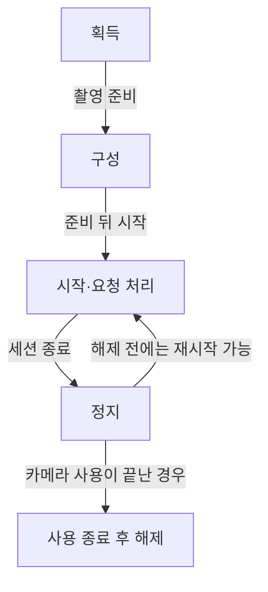

[Mermaid 원문](https://ttolsun.github.io/libcamera-sdd/vendor-integration.integration-stages.mmd)

<details open>
<summary>그림 근거와 확인 범위</summary>

애플리케이션의 세션 준비와 종료 순서입니다. 시작·정지는 해제 전까지 반복할 수 있습니다.

소스 연결 해석 · 자동 연결 검사만 통과 · 의미와 기기 실행은 검증 전

| 요소·전이 | 소스 근거 |
| --- | --- |
| 획득 | [src/libcamera/camera.cpp:771](#d5-source-2683b4a5a1dbfee9) |
| 구성 | [src/libcamera/camera.cpp:771](#d5-source-2683b4a5a1dbfee9) |
| 시작·요청 처리 | [src/libcamera/camera.cpp:771](#d5-source-2683b4a5a1dbfee9) |
| 정지 | [src/libcamera/camera.cpp:771](#d5-source-2683b4a5a1dbfee9) |
| 사용 종료 후 해제 | [src/libcamera/camera.cpp:771](#d5-source-2683b4a5a1dbfee9) |
| 촬영 준비 | [src/libcamera/camera.cpp:771](#d5-source-2683b4a5a1dbfee9) |
| 준비 뒤 시작 | [src/libcamera/camera.cpp:771](#d5-source-2683b4a5a1dbfee9) |
| 세션 종료 | [src/libcamera/camera.cpp:771](#d5-source-2683b4a5a1dbfee9) |
| 카메라 사용이 끝난 경우 | [src/libcamera/camera.cpp:771](#d5-source-2683b4a5a1dbfee9) |
| 해제 전에는 재시작 가능 | [src/libcamera/camera.cpp:777](#d5-source-948bd80fa1136291) |

</details>

<details open>
<summary>절 전체 근거 4개</summary>

- `src/libcamera/camera.cpp`[`L771` 발췌](#d5-source-2683b4a5a1dbfee9) · [전체 소스 `L771`](https://github.com/TTolsun/libcamera-sdd/blob/adfa719f8ed67d18fd8a0739fc088a1f8b9e7252/src/libcamera/camera.cpp#L771) · [`L777` 발췌](#d5-source-948bd80fa1136291) · [전체 소스 `L777`](https://github.com/TTolsun/libcamera-sdd/blob/adfa719f8ed67d18fd8a0739fc088a1f8b9e7252/src/libcamera/camera.cpp#L777) · [`L780` 발췌](#d5-source-cc6c66b57cf028e6) · [전체 소스 `L780`](https://github.com/TTolsun/libcamera-sdd/blob/adfa719f8ed67d18fd8a0739fc088a1f8b9e7252/src/libcamera/camera.cpp#L780) · [`L1032`](#d5-source-492118d913b10361)

</details>

## <a id="d5-하드웨어와-공통-계층의-경계"></a>하드웨어와 공통 계층의 경계

`PipelineHandler::match()` 구현자는 단일 파이프라인에 필요한 미디어 장치를 모두 찾으면 각 장치에 대해 `MediaDevice::acquire()`를 호출해 확보한 다음, 해당 `Camera` 인스턴스를 하나 이상 생성하고 내부에 저장하며 카메라 매니저에 등록한 뒤 `true`를 반환해야 합니다. `PipelineHandler::match()` 구현자는 필요한 미디어 장치를 모두 찾지 못했을 때 아직 장치를 확보하지 않았다면 어떤 장치도 확보해서는 안 되며, 이미 일부를 확보했다면 `MediaDevice::release()`를 호출해 확보한 장치를 모두 해제하고 `false`를 반환해야 합니다. `PipelineHandler::match()`는 `CameraManager` 스레드에서 호출되며, `true`를 반환하면 새로운 `PipelineHandler` 인스턴스가 생성되고 그 인스턴스의 `match()`가 호출됩니다.

### 장치 매칭의 확보·등록과 실패 정리

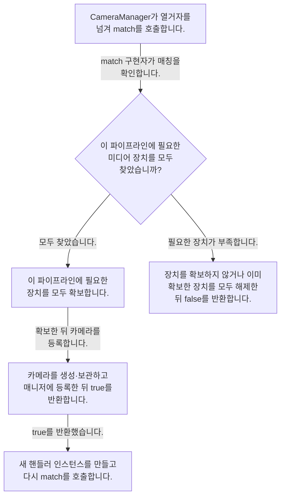

[Mermaid 원문](https://ttolsun.github.io/libcamera-sdd/vendor-integration.item-boundary.mmd)

<details open>
<summary>그림 근거와 확인 범위</summary>

누가 장치를 매칭하고 카메라를 등록하며, 매칭 결과에 따라 확보한 장치는 어떻게 처리됩니까?

소스 연결 해석 · 자동 연결 검사만 통과 · 의미와 기기 실행은 검증 전

| 요소·전이 | 소스 근거 |
| --- | --- |
| CameraManager가 열거자를 넘겨 match를 호출합니다. | [src/libcamera/pipeline_handler.cpp:91](#d5-source-5109302527925a6a) |
| 이 파이프라인에 필요한 미디어 장치를 모두 찾았습니까? | [src/libcamera/pipeline_handler.cpp:91](#d5-source-5109302527925a6a) |
| 이 파이프라인에 필요한 장치를 모두 확보합니다. | [src/libcamera/pipeline_handler.cpp:91](#d5-source-5109302527925a6a) |
| 카메라를 생성·보관하고 매니저에 등록한 뒤 true를 반환합니다. | [src/libcamera/pipeline_handler.cpp:91](#d5-source-5109302527925a6a) |
| 새 핸들러 인스턴스를 만들고 다시 match를 호출합니다. | [src/libcamera/pipeline_handler.cpp:109](#d5-source-1afff120b5d66b3c) |
| 장치를 확보하지 않거나 이미 확보한 장치를 모두 해제한 뒤 false를 반환합니다. | [src/libcamera/pipeline_handler.cpp:97](#d5-source-293bf5d4775550d0) |
| match 구현자가 매칭을 확인합니다. | [src/libcamera/pipeline_handler.cpp:91](#d5-source-5109302527925a6a) |
| 모두 찾았습니다. | [src/libcamera/pipeline_handler.cpp:91](#d5-source-5109302527925a6a) |
| 필요한 장치가 부족합니다. | [src/libcamera/pipeline_handler.cpp:91](#d5-source-5109302527925a6a) · [src/libcamera/pipeline_handler.cpp:97](#d5-source-293bf5d4775550d0) |
| 확보한 뒤 카메라를 등록합니다. | [src/libcamera/pipeline_handler.cpp:91](#d5-source-5109302527925a6a) |
| true를 반환했습니다. | [src/libcamera/pipeline_handler.cpp:91](#d5-source-5109302527925a6a) · [src/libcamera/pipeline_handler.cpp:109](#d5-source-1afff120b5d66b3c) |

</details>

<details open>
<summary>절 전체 근거 3개</summary>

- `src/libcamera/pipeline_handler.cpp`[`L91` 발췌](#d5-source-5109302527925a6a) · [전체 소스 `L91`](https://github.com/TTolsun/libcamera-sdd/blob/adfa719f8ed67d18fd8a0739fc088a1f8b9e7252/src/libcamera/pipeline_handler.cpp#L91) · [`L97` 발췌](#d5-source-293bf5d4775550d0) · [전체 소스 `L97`](https://github.com/TTolsun/libcamera-sdd/blob/adfa719f8ed67d18fd8a0739fc088a1f8b9e7252/src/libcamera/pipeline_handler.cpp#L97) · [`L109` 발췌](#d5-source-1afff120b5d66b3c) · [전체 소스 `L109`](https://github.com/TTolsun/libcamera-sdd/blob/adfa719f8ed67d18fd8a0739fc088a1f8b9e7252/src/libcamera/pipeline_handler.cpp#L109)

</details>

## <a id="d5-구현할-설정-인터페이스"></a>구현할 설정 인터페이스

`generateConfiguration`의 호출자는 기본 구성을 가져오려는 사용 사례를 `roles`에 채워야 합니다. `generateConfiguration()`이 반환하는 구성은 선택된 스트림과 그 스트림의 기본 파라미터를 호출자가 확인할 수 있는 정보를 포함합니다. `PipelineHandler::generateConfiguration()`은 요청된 `roles`를 충족할 수 있으면 유효한 `CameraConfiguration`을 반환하고, 그렇지 않으면 `null` 포인터를 반환해야 합니다. `PipelineHandler::generateConfiguration()` 구현은 어떤 스레드에서든 호출될 수 있으므로 스레드 안전성을 갖춰야 합니다.

### 설정 인터페이스별 입력과 결과

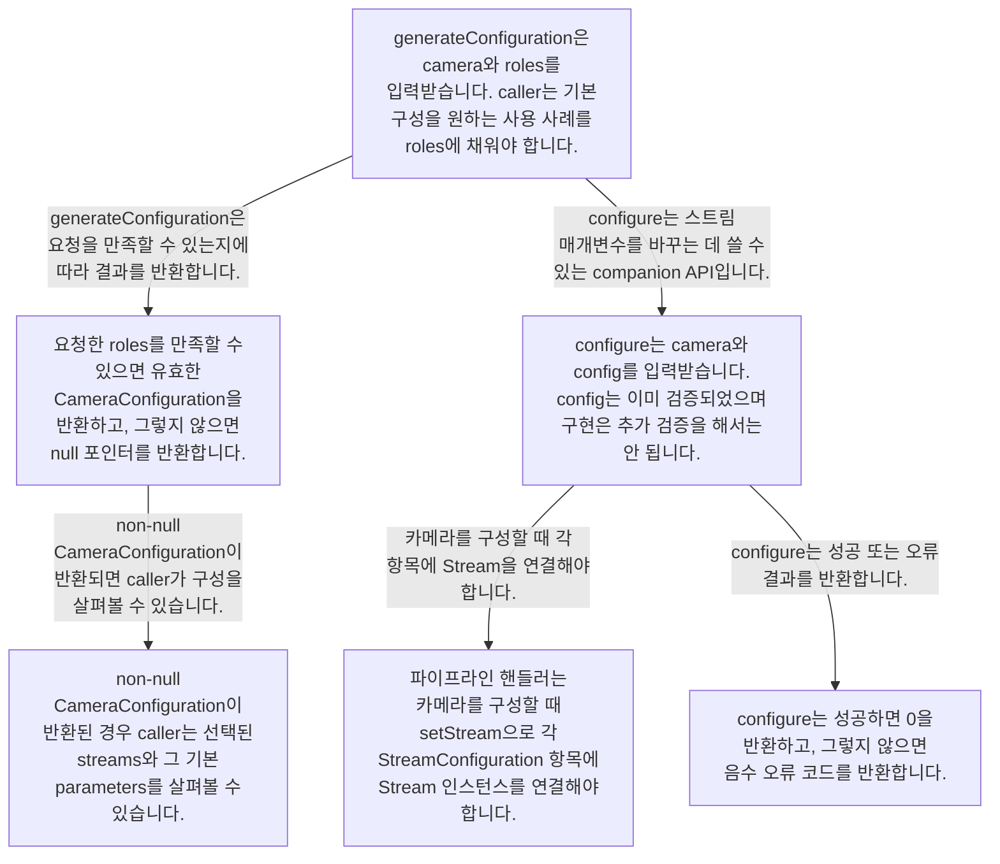

[Mermaid 원문](https://ttolsun.github.io/libcamera-sdd/vendor-integration.handler-configuration-contracts.mmd)

<details open>
<summary>그림 근거와 확인 범위</summary>

generateConfiguration과 configure의 입력·반환 및 성공 시 Stream 연결 의무는 무엇입니까?

소스 연결 해석 · 자동 연결 검사만 통과 · 의미와 기기 실행은 검증 전

LLM 그림 초안 · 사람 검토 전

작성 모델: `cli/codex/gpt-6.1-terra`

| 요소·전이 | 소스 근거 |
| --- | --- |
| generateConfiguration은 camera와 roles를 입력받습니다. caller는 기본 구성을 원하는 사용 사례를 roles에 채워야 합니다. | [src/libcamera/pipeline_handler.cpp:271](#d5-source-23ff032cd1152d56) |
| 요청한 roles를 만족할 수 있으면 유효한 CameraConfiguration을 반환하고, 그렇지 않으면 null 포인터를 반환합니다. | [src/libcamera/pipeline_handler.cpp:271](#d5-source-23ff032cd1152d56) |
| non-null CameraConfiguration이 반환된 경우 caller는 선택된 streams와 그 기본 parameters를 살펴볼 수 있습니다. | [src/libcamera/pipeline_handler.cpp:271](#d5-source-23ff032cd1152d56) |
| configure는 camera와 config를 입력받습니다. config는 이미 검증되었으며 구현은 추가 검증을 해서는 안 됩니다. | [src/libcamera/pipeline_handler.cpp:294](#d5-source-4255f8449e37ebb8) |
| configure는 성공하면 0을 반환하고, 그렇지 않으면 음수 오류 코드를 반환합니다. | [src/libcamera/pipeline_handler.cpp:294](#d5-source-4255f8449e37ebb8) |
| 파이프라인 핸들러는 카메라를 구성할 때 setStream으로 각 StreamConfiguration 항목에 Stream 인스턴스를 연결해야 합니다. | [src/libcamera/pipeline_handler.cpp:294](#d5-source-4255f8449e37ebb8) |
| generateConfiguration은 요청을 만족할 수 있는지에 따라 결과를 반환합니다. | [src/libcamera/pipeline_handler.cpp:271](#d5-source-23ff032cd1152d56) |
| non-null CameraConfiguration이 반환되면 caller가 구성을 살펴볼 수 있습니다. | [src/libcamera/pipeline_handler.cpp:271](#d5-source-23ff032cd1152d56) |
| configure는 스트림 매개변수를 바꾸는 데 쓸 수 있는 companion API입니다. | [src/libcamera/pipeline_handler.cpp:271](#d5-source-23ff032cd1152d56) |
| 카메라를 구성할 때 각 항목에 Stream을 연결해야 합니다. | [src/libcamera/pipeline_handler.cpp:294](#d5-source-4255f8449e37ebb8) |
| configure는 성공 또는 오류 결과를 반환합니다. | [src/libcamera/pipeline_handler.cpp:294](#d5-source-4255f8449e37ebb8) |

</details>

`PipelineHandler::generateConfiguration()` 구현자는 파이프라인 핸들러 내에서 `camera`의 상태를 변경해서는 안 됩니다. `PipelineHandler::configure()`에 전달되는 설정은 `CameraConfiguration::validate()`로 검증되었음이 보장되므로, 파이프라인 핸들러 구현은 추가 검증을 해서는 안 됩니다. `PipelineHandler::configure()` 구현은 자체 `CameraConfiguration` 파생 클래스에 저장된 모든 사용자 정의 필드에 의존할 수 있습니다. `PipelineHandler::configure()` 구현자는 카메라를 구성할 때 `StreamConfiguration::setStream()`을 사용해 `CameraConfiguration`의 각 `StreamConfiguration` 항목에 `Stream` 인스턴스를 연결해야 합니다.

`PipelineHandler::configure()`는 `CameraManager` 스레드에서 호출되며, 구현은 성공 시 `0`을, 실패 시 음수 오류 코드를 반환해야 합니다.

<details open>
<summary>절 전체 근거 11개</summary>

- `src/libcamera/pipeline_handler.cpp`[`L276` 발췌](#d5-source-924d43ea4bcaf94b) · [전체 소스 `L276`](https://github.com/TTolsun/libcamera-sdd/blob/adfa719f8ed67d18fd8a0739fc088a1f8b9e7252/src/libcamera/pipeline_handler.cpp#L276) · [`L289` 발췌](#d5-source-4abbe39594a1bd27) · [전체 소스 `L289`](https://github.com/TTolsun/libcamera-sdd/blob/adfa719f8ed67d18fd8a0739fc088a1f8b9e7252/src/libcamera/pipeline_handler.cpp#L289) · [`L285` 발췌](#d5-source-2eae247c4c37371c) · [전체 소스 `L285`](https://github.com/TTolsun/libcamera-sdd/blob/adfa719f8ed67d18fd8a0739fc088a1f8b9e7252/src/libcamera/pipeline_handler.cpp#L285) · [`L286` 발췌](#d5-source-25fb9495d4ab94a1) · [전체 소스 `L286`](https://github.com/TTolsun/libcamera-sdd/blob/adfa719f8ed67d18fd8a0739fc088a1f8b9e7252/src/libcamera/pipeline_handler.cpp#L286) · [`L304` 발췌](#d5-source-31c5407347b4d0d8) · [전체 소스 `L304`](https://github.com/TTolsun/libcamera-sdd/blob/adfa719f8ed67d18fd8a0739fc088a1f8b9e7252/src/libcamera/pipeline_handler.cpp#L304) · [`L306` 발췌](#d5-source-71079779113f431c) · [전체 소스 `L306`](https://github.com/TTolsun/libcamera-sdd/blob/adfa719f8ed67d18fd8a0739fc088a1f8b9e7252/src/libcamera/pipeline_handler.cpp#L306) · [`L309` 발췌](#d5-source-f3cf94b1dc7b9457) · [전체 소스 `L309`](https://github.com/TTolsun/libcamera-sdd/blob/adfa719f8ed67d18fd8a0739fc088a1f8b9e7252/src/libcamera/pipeline_handler.cpp#L309) · [`L313` 발췌](#d5-source-f87ceb096b9f931d) · [전체 소스 `L313`](https://github.com/TTolsun/libcamera-sdd/blob/adfa719f8ed67d18fd8a0739fc088a1f8b9e7252/src/libcamera/pipeline_handler.cpp#L313) · [`L271`](#d5-source-23ff032cd1152d56) · [`L294`](#d5-source-4255f8449e37ebb8)
- `src/libcamera/camera.cpp`[`L1191`](#d5-source-603af0dd7fa357d0)

</details>

## <a id="d5-요청을-장치에-전달하고-반환하기"></a>요청을 장치에 전달하고 반환하기

함께 확인: [마지막 버퍼가 끝났는데 요청 완료 통지가 오지 않을 때](#d19-%EC%8B%A4%ED%8C%A8-%EC%9C%84%EC%B9%98%EB%B3%84-%ED%99%95%EC%9D%B8-%EC%88%9C%EC%84%9C) · [completeRequest 호출 스레드와 함수 반환 후 요청 접근 금지](#d5-%EA%B5%AC%ED%98%84-%EB%92%A4-%ED%99%95%EC%9D%B8%ED%95%A0-%EA%B3%84%EC%95%BD%EA%B3%BC-%EC%8B%A4%ED%96%89-%ED%95%9C%EA%B3%84)

요청에는 버퍼 집합이 들어 있으며, 이 버퍼들은 스트림에 연결됩니다. 요청에는 파라미터 집합도 들어 있습니다. `queueRequestDevice` 구현자는 요청에서 제공한 버퍼에 캡처되는 프레임에 해당 파라미터가 적용되도록 장치를 프로그래밍해야 합니다. `queueRequestDevice` 구현자는 성공하면 `0`을, 실패하면 음수 오류 코드를 반환해야 합니다.

### 장치 큐잉과 버퍼·요청 완료의 책임

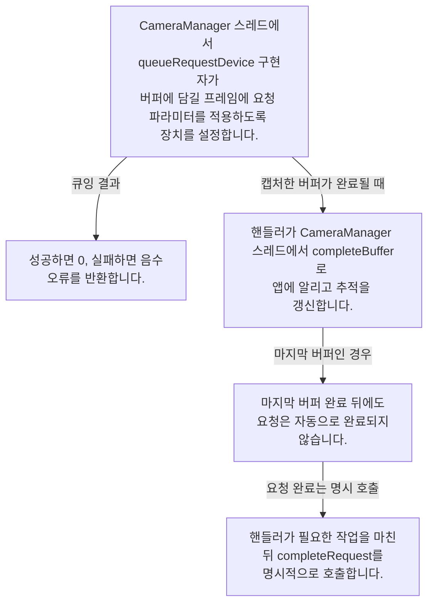

[Mermaid 원문](https://ttolsun.github.io/libcamera-sdd/vendor-integration.device-queue-and-completion.mmd)

<details open>
<summary>그림 근거와 확인 범위</summary>

누가 요청의 파라미터를 장치에 적용하고 버퍼와 요청을 각각 완료합니까?

소스 연결 해석 · 자동 연결 검사만 통과 · 의미와 기기 실행은 검증 전

| 요소·전이 | 소스 근거 |
| --- | --- |
| CameraManager 스레드에서 queueRequestDevice 구현자가 버퍼에 담길 프레임에 요청 파라미터를 적용하도록 장치를 설정합니다. | [src/libcamera/pipeline_handler.cpp:535](#d5-source-a9ed7dcbf54ccaff) · [src/libcamera/pipeline_handler.cpp:541](#d5-source-974203a2566eb6a7) |
| 성공하면 0, 실패하면 음수 오류를 반환합니다. | [src/libcamera/pipeline_handler.cpp:541](#d5-source-974203a2566eb6a7) |
| 핸들러가 CameraManager 스레드에서 completeBuffer로 앱에 알리고 추적을 갱신합니다. | [src/libcamera/pipeline_handler.cpp:551](#d5-source-2c79d29bf7fe6699) · [src/libcamera/pipeline_handler.cpp:558](#d5-source-699c5b0f43c595cf) |
| 마지막 버퍼 완료 뒤에도 요청은 자동으로 완료되지 않습니다. | [src/libcamera/pipeline_handler.cpp:553](#d5-source-7b871a70bfc9aa8f) |
| 핸들러가 필요한 작업을 마친 뒤 completeRequest를 명시적으로 호출합니다. | [src/libcamera/pipeline_handler.cpp:553](#d5-source-7b871a70bfc9aa8f) · [src/libcamera/pipeline_handler.cpp:556](#d5-source-e1c3bfd748ad8a33) |
| 큐잉 결과 | [src/libcamera/pipeline_handler.cpp:535](#d5-source-a9ed7dcbf54ccaff) · [src/libcamera/pipeline_handler.cpp:541](#d5-source-974203a2566eb6a7) |
| 캡처한 버퍼가 완료될 때 | [src/libcamera/pipeline_handler.cpp:535](#d5-source-a9ed7dcbf54ccaff) · [src/libcamera/pipeline_handler.cpp:551](#d5-source-2c79d29bf7fe6699) |
| 마지막 버퍼인 경우 | [src/libcamera/pipeline_handler.cpp:551](#d5-source-2c79d29bf7fe6699) · [src/libcamera/pipeline_handler.cpp:553](#d5-source-7b871a70bfc9aa8f) |
| 요청 완료는 명시 호출 | [src/libcamera/pipeline_handler.cpp:553](#d5-source-7b871a70bfc9aa8f) · [src/libcamera/pipeline_handler.cpp:556](#d5-source-e1c3bfd748ad8a33) |

</details>

`PipelineHandler::queueRequestDevice()`는 `CameraManager` 스레드에서 호출됩니다. 파이프라인 핸들러는 요청의 버퍼 완료를 알리기 위해 `CameraManager` 스레드에서 `completeBuffer`를 호출해야 합니다. `completeBuffer`는 애플리케이션에 버퍼 완료를 통지하고 요청 내부의 버퍼 추적을 갱신합니다. 마지막 버퍼가 완료되어도 요청은 자동으로 완료되지 않으므로 파이프라인 핸들러가 `completeRequest()`를 명시적으로 호출해 요청을 완료해야 합니다.

<details open>
<summary>절 전체 근거 6개</summary>

- `src/libcamera/pipeline_handler.cpp`[`L535` 발췌](#d5-source-a9ed7dcbf54ccaff) · [전체 소스 `L535`](https://github.com/TTolsun/libcamera-sdd/blob/adfa719f8ed67d18fd8a0739fc088a1f8b9e7252/src/libcamera/pipeline_handler.cpp#L535) · [`L541` 발췌](#d5-source-974203a2566eb6a7) · [전체 소스 `L541`](https://github.com/TTolsun/libcamera-sdd/blob/adfa719f8ed67d18fd8a0739fc088a1f8b9e7252/src/libcamera/pipeline_handler.cpp#L541) · [`L551` 발췌](#d5-source-2c79d29bf7fe6699) · [전체 소스 `L551`](https://github.com/TTolsun/libcamera-sdd/blob/adfa719f8ed67d18fd8a0739fc088a1f8b9e7252/src/libcamera/pipeline_handler.cpp#L551) · [`L558` 발췌](#d5-source-699c5b0f43c595cf) · [전체 소스 `L558`](https://github.com/TTolsun/libcamera-sdd/blob/adfa719f8ed67d18fd8a0739fc088a1f8b9e7252/src/libcamera/pipeline_handler.cpp#L558) · [`L553` 발췌](#d5-source-7b871a70bfc9aa8f) · [전체 소스 `L553`](https://github.com/TTolsun/libcamera-sdd/blob/adfa719f8ed67d18fd8a0739fc088a1f8b9e7252/src/libcamera/pipeline_handler.cpp#L553) · [`L556` 발췌](#d5-source-e1c3bfd748ad8a33) · [전체 소스 `L556`](https://github.com/TTolsun/libcamera-sdd/blob/adfa719f8ed67d18fd8a0739fc088a1f8b9e7252/src/libcamera/pipeline_handler.cpp#L556)

</details>

## <a id="d5-ipa-모듈-선택과-실패-조건"></a>IPA 모듈 선택과 실패 조건

`createIPA`는 `module`을 호출할 때 이름을 나타내는 `name`, 최소 버전을 나타내는 `minVersion`, 최대 버전을 나타내는 `maxVersion`을 순서대로 전달합니다. `IPAManager::module`은 모듈을 순회하며 이름과 허용 버전 범위에 대해 첫 `match`가 성립하면 해당 모듈을 반환하고 검색을 끝냅니다. 끝까지 일치하는 모듈이 없으면 `nullptr`을 반환합니다. `createIPA`는 `module`의 결과를 `m`에 받고, `!m`이면 `nullptr`을 반환합니다.

### IPA 모듈 검색과 프록시 반환 분기

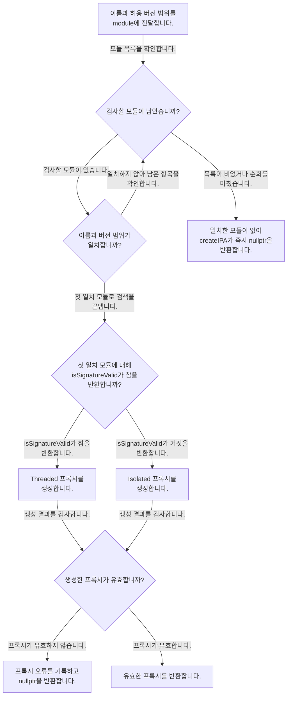

[Mermaid 원문](https://ttolsun.github.io/libcamera-sdd/vendor-integration.item-algorithm.mmd)

<details open>
<summary>그림 근거와 확인 범위</summary>

createIPA는 일치하는 모듈과 프록시 종류를 어떻게 선택하며 어느 분기에서 nullptr을 반환합니까?

소스 연결 해석 · 자동 연결 검사만 통과 · 의미와 기기 실행은 검증 전

| 요소·전이 | 소스 근거 |
| --- | --- |
| 이름과 허용 버전 범위를 module에 전달합니다. | [include/libcamera/internal/ipa_manager.h:35](#d5-source-1bc92c4993a1c4dc) |
| 검사할 모듈이 남았습니까? | [src/libcamera/ipa_manager.cpp:249](#d5-source-f61e5a9ff79a97a8) |
| 이름과 버전 범위가 일치합니까? | [src/libcamera/ipa_manager.cpp:249](#d5-source-f61e5a9ff79a97a8) |
| 일치한 모듈이 없어 createIPA가 즉시 nullptr을 반환합니다. | [src/libcamera/ipa_manager.cpp:249](#d5-source-f61e5a9ff79a97a8) · [include/libcamera/internal/ipa_manager.h:35](#d5-source-1bc92c4993a1c4dc) |
| 첫 일치 모듈에 대해 isSignatureValid가 참을 반환합니까? | [src/libcamera/ipa_manager.cpp:249](#d5-source-f61e5a9ff79a97a8) · [include/libcamera/internal/ipa_manager.h:35](#d5-source-1bc92c4993a1c4dc) |
| Threaded 프록시를 생성합니다. | [include/libcamera/internal/ipa_manager.h:35](#d5-source-1bc92c4993a1c4dc) |
| Isolated 프록시를 생성합니다. | [include/libcamera/internal/ipa_manager.h:35](#d5-source-1bc92c4993a1c4dc) |
| 생성한 프록시가 유효합니까? | [include/libcamera/internal/ipa_manager.h:35](#d5-source-1bc92c4993a1c4dc) |
| 프록시 오류를 기록하고 nullptr을 반환합니다. | [include/libcamera/internal/ipa_manager.h:35](#d5-source-1bc92c4993a1c4dc) |
| 유효한 프록시를 반환합니다. | [include/libcamera/internal/ipa_manager.h:35](#d5-source-1bc92c4993a1c4dc) |
| 모듈 목록을 확인합니다. | [include/libcamera/internal/ipa_manager.h:35](#d5-source-1bc92c4993a1c4dc) · [src/libcamera/ipa_manager.cpp:249](#d5-source-f61e5a9ff79a97a8) |
| 검사할 모듈이 있습니다. | [src/libcamera/ipa_manager.cpp:249](#d5-source-f61e5a9ff79a97a8) |
| 목록이 비었거나 순회를 마쳤습니다. | [src/libcamera/ipa_manager.cpp:249](#d5-source-f61e5a9ff79a97a8) · [include/libcamera/internal/ipa_manager.h:35](#d5-source-1bc92c4993a1c4dc) |
| 일치하지 않아 남은 항목을 확인합니다. | [src/libcamera/ipa_manager.cpp:249](#d5-source-f61e5a9ff79a97a8) |
| 첫 일치 모듈로 검색을 끝냅니다. | [src/libcamera/ipa_manager.cpp:249](#d5-source-f61e5a9ff79a97a8) · [include/libcamera/internal/ipa_manager.h:35](#d5-source-1bc92c4993a1c4dc) |
| isSignatureValid가 참을 반환합니다. | [src/libcamera/ipa_manager.cpp:249](#d5-source-f61e5a9ff79a97a8) · [include/libcamera/internal/ipa_manager.h:35](#d5-source-1bc92c4993a1c4dc) |
| isSignatureValid가 거짓을 반환합니다. | [src/libcamera/ipa_manager.cpp:249](#d5-source-f61e5a9ff79a97a8) · [include/libcamera/internal/ipa_manager.h:35](#d5-source-1bc92c4993a1c4dc) |
| 생성 결과를 검사합니다. | [include/libcamera/internal/ipa_manager.h:35](#d5-source-1bc92c4993a1c4dc) |
| 생성 결과를 검사합니다. | [include/libcamera/internal/ipa_manager.h:35](#d5-source-1bc92c4993a1c4dc) |
| 프록시가 유효하지 않습니다. | [include/libcamera/internal/ipa_manager.h:35](#d5-source-1bc92c4993a1c4dc) |
| 프록시가 유효합니다. | [include/libcamera/internal/ipa_manager.h:35](#d5-source-1bc92c4993a1c4dc) |

</details>

`createIPA` 내부 람다는 `isSignatureValid(m)`이 참이면 `T::Threaded` 프록시 객체를 생성하고, 거짓이면 `T::Isolated` 프록시 객체를 생성합니다. `createIPA`는 생성한 프록시의 `isValid` 검사가 실패하면 `Failed to load proxy` 오류를 기록하고 `nullptr`을 반환합니다. `createIPA`는 생성한 프록시가 유효성 검사를 통과하면 해당 프록시를 반환합니다.

<details open>
<summary>절 전체 근거 4개</summary>

- `include/libcamera/internal/ipa_manager.h`[`L39`](https://github.com/TTolsun/libcamera-sdd/blob/adfa719f8ed67d18fd8a0739fc088a1f8b9e7252/include/libcamera/internal/ipa_manager.h#L39) · [`L43` 발췌](#d5-source-6dc4133d5797f19b) · [전체 소스 `L43`](https://github.com/TTolsun/libcamera-sdd/blob/adfa719f8ed67d18fd8a0739fc088a1f8b9e7252/include/libcamera/internal/ipa_manager.h#L43) · [`L35` 발췌](#d5-source-1bc92c4993a1c4dc) · [전체 소스 `L35`](https://github.com/TTolsun/libcamera-sdd/blob/adfa719f8ed67d18fd8a0739fc088a1f8b9e7252/include/libcamera/internal/ipa_manager.h#L35) · [`L39`](#d5-source-88cede73f337db67) · [`L39`](#d5-source-da860180dc9199e6)
- `src/libcamera/ipa_manager.cpp`[`L249` 발췌](#d5-source-f61e5a9ff79a97a8) · [전체 소스 `L249`](https://github.com/TTolsun/libcamera-sdd/blob/adfa719f8ed67d18fd8a0739fc088a1f8b9e7252/src/libcamera/ipa_manager.cpp#L249)

</details>

## <a id="d5-정지와-오류-처리의-책임"></a>정지와 오류 처리의 책임

`PipelineHandler::stop()`은 먼저 `waitingRequests.swap(data->waitingRequests_)`를 실행한 다음 `stopDevice(camera)`를 호출합니다. `PipelineHandler::stop()`은 `stopDevice()` 내부에서 `completeRequest()`가 호출될 때 대기 중인 요청이 다시 큐에 들어가지 않도록 이 요청들을 따로 옮깁니다. `stopDevice()` 구현자는 실행 중인 모든 스트림의 캡처와 요청 처리를 즉시 중단하고, 해당 장치의 미완료 요청을 모두 취소해 즉시 오류 상태로 완료해야 합니다.

### 장치 정지와 대기 요청의 반환 순서

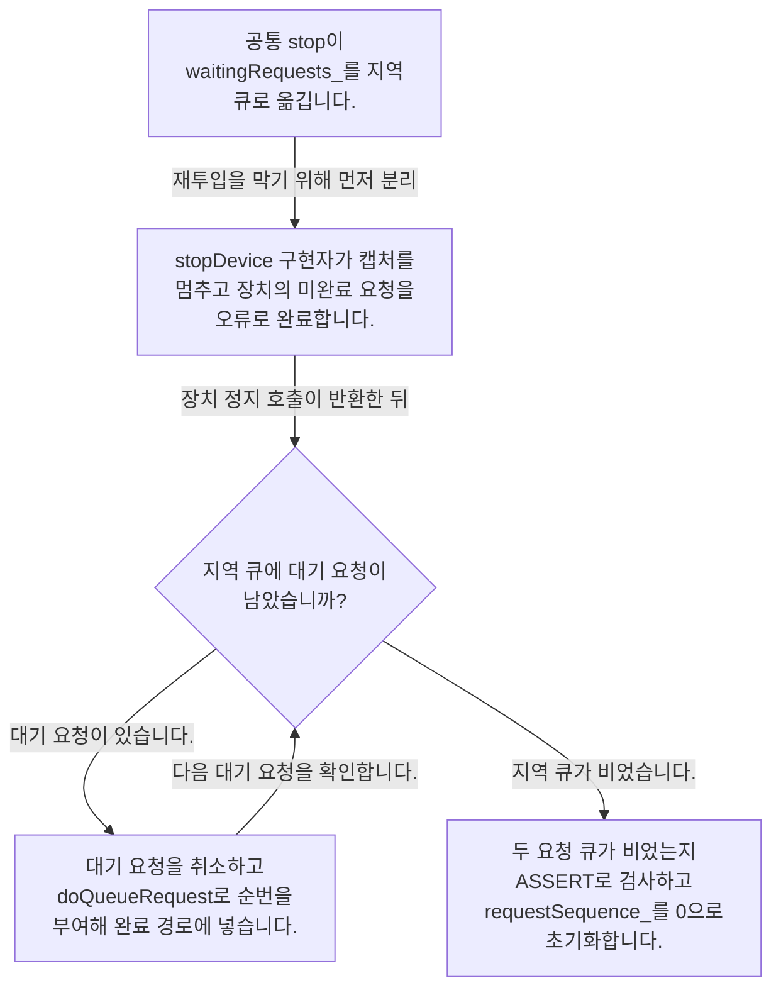

[Mermaid 원문](https://ttolsun.github.io/libcamera-sdd/vendor-integration.shutdown-device-and-waiting-requests.mmd)

<details open>
<summary>그림 근거와 확인 범위</summary>

공통 stop과 stopDevice 구현자가 각각 어떤 요청을 언제 처리합니까?

소스 연결 해석 · 자동 연결 검사만 통과 · 의미와 기기 실행은 검증 전

| 요소·전이 | 소스 근거 |
| --- | --- |
| 공통 stop이 waitingRequests\_를 지역 큐로 옮깁니다. | [src/libcamera/pipeline_handler.cpp:367](#d5-source-1cc522721d2c5142) · [src/libcamera/pipeline_handler.cpp:370](#d5-source-486f3f81acba3c1f) |
| stopDevice 구현자가 캡처를 멈추고 장치의 미완료 요청을 오류로 완료합니다. | [src/libcamera/pipeline_handler.cpp:367](#d5-source-7097caa35d0e97c8) · [src/libcamera/pipeline_handler.cpp:405](#d5-source-a1eeb263fc114d2f) |
| 지역 큐에 대기 요청이 남았습니까? | [src/libcamera/pipeline_handler.cpp:367](#d5-source-1cc522721d2c5142) |
| 대기 요청을 취소하고 doQueueRequest로 순번을 부여해 완료 경로에 넣습니다. | [src/libcamera/pipeline_handler.cpp:367](#d5-source-1cc522721d2c5142) |
| 두 요청 큐가 비었는지 ASSERT로 검사하고 requestSequence\_를 0으로 초기화합니다. | [src/libcamera/pipeline_handler.cpp:367](#d5-source-1cc522721d2c5142) |
| 재투입을 막기 위해 먼저 분리 | [src/libcamera/pipeline_handler.cpp:370](#d5-source-486f3f81acba3c1f) · [src/libcamera/pipeline_handler.cpp:367](#d5-source-1cc522721d2c5142) · [src/libcamera/pipeline_handler.cpp:367](#d5-source-7097caa35d0e97c8) |
| 장치 정지 호출이 반환한 뒤 | [src/libcamera/pipeline_handler.cpp:367](#d5-source-7097caa35d0e97c8) · [src/libcamera/pipeline_handler.cpp:367](#d5-source-1cc522721d2c5142) |
| 대기 요청이 있습니다. | [src/libcamera/pipeline_handler.cpp:367](#d5-source-1cc522721d2c5142) |
| 다음 대기 요청을 확인합니다. | [src/libcamera/pipeline_handler.cpp:367](#d5-source-1cc522721d2c5142) |
| 지역 큐가 비었습니다. | [src/libcamera/pipeline_handler.cpp:367](#d5-source-1cc522721d2c5142) |

</details>

`PipelineHandler::stop()`은 대기 요청을 따로 꺼낸 뒤 `stopDevice()`를 호출하고, 각 대기 요청을 취소한 후 `doQueueRequest()`로 전달하여 순번을 부여하고 `queuedRequests_`에 임시로 추가해 `completeRequest()`에서 완료할 수 있게 합니다. `PipelineHandler::stop()`은 대기 요청을 처리한 뒤 두 `ASSERT`로 `queuedRequests_`와 `waitingRequests_`가 비어 있는지 확인하고, `requestSequence_`에 `0`을 저장합니다.

<details open>
<summary>절 전체 근거 3개</summary>

- `src/libcamera/pipeline_handler.cpp`[`L367`](https://github.com/TTolsun/libcamera-sdd/blob/adfa719f8ed67d18fd8a0739fc088a1f8b9e7252/src/libcamera/pipeline_handler.cpp#L367) · [`L370` 발췌](#d5-source-486f3f81acba3c1f) · [전체 소스 `L370`](https://github.com/TTolsun/libcamera-sdd/blob/adfa719f8ed67d18fd8a0739fc088a1f8b9e7252/src/libcamera/pipeline_handler.cpp#L370) · [`L405` 발췌](#d5-source-a1eeb263fc114d2f) · [전체 소스 `L405`](https://github.com/TTolsun/libcamera-sdd/blob/adfa719f8ed67d18fd8a0739fc088a1f8b9e7252/src/libcamera/pipeline_handler.cpp#L405) · [`L367`](#d5-source-1cc522721d2c5142) · [`L367`](#d5-source-7097caa35d0e97c8)

</details>

## <a id="d5-구현-뒤-확인할-계약과-실행-한계"></a>구현 뒤 확인할 계약과 실행 한계

파이프라인 핸들러 구현자는 `completeRequest`가 반환된 뒤 해당 요청에 접근해서는 안 됩니다. 파이프라인 핸들러는 완료된 요청을 순서 제약 없이 `completeRequest`에 전달할 수 있으며, 이 함수는 요청을 제출 순서대로 애플리케이션에 반환합니다. 파이프라인 핸들러는 `completeRequest`를 `CameraManager` 스레드에서 호출해야 합니다.

<details open>
<summary>절 전체 근거 3개</summary>

- `src/libcamera/pipeline_handler.cpp`[`L571` 발췌](#d5-source-7ac40780a56ae3a9) · [전체 소스 `L571`](https://github.com/TTolsun/libcamera-sdd/blob/adfa719f8ed67d18fd8a0739fc088a1f8b9e7252/src/libcamera/pipeline_handler.cpp#L571) · [`L578` 발췌](#d5-source-16187edaf24c09f5) · [전체 소스 `L578`](https://github.com/TTolsun/libcamera-sdd/blob/adfa719f8ed67d18fd8a0739fc088a1f8b9e7252/src/libcamera/pipeline_handler.cpp#L578) · [`L582` 발췌](#d5-source-72e48606b2a92dcc) · [전체 소스 `L582`](https://github.com/TTolsun/libcamera-sdd/blob/adfa719f8ed67d18fd8a0739fc088a1f8b9e7252/src/libcamera/pipeline_handler.cpp#L582)

</details>

## 클래스 관계

화살표의 글자는 추출한 관계를 나타내며, 점선은 상속입니다. 화살표는 참조 대상 또는 기반 클래스를 향합니다. 호출 순서를 뜻하지 않습니다.


## 소스 근거

<details open>
<summary>소스 발췌 36개</summary>

같은 발췌는 한 번만 싣습니다. 필요한 원문을 펼쳐 설명과 대조하세요.

<a id="d5-source-2683b4a5a1dbfee9"></a>

<details open>
<summary>소스 근거: src/libcamera/camera.cpp:771</summary>

발췌 범위: [`src/libcamera/camera.cpp:771`](https://github.com/TTolsun/libcamera-sdd/blob/adfa719f8ed67d18fd8a0739fc088a1f8b9e7252/src/libcamera/camera.cpp#L771) \~ `775`

SHA-256: `2727ed2082026463f6e5fe4b907fefa46749d0ff9d9122ad2d578b6440c206a0`

```
An application needs to perform a sequence of operations on a camera before
 * it is ready to process requests. The camera needs to be acquired and
 * configured to prepare the camera for capture. Once started the camera can
 * process requests until it is stopped. When an application is done with a
 * camera, the camera needs to be released.
```

</details>

<a id="d5-source-cc6c66b57cf028e6"></a>

<details open>
<summary>소스 근거: src/libcamera/camera.cpp:780</summary>

발췌 범위: [`src/libcamera/camera.cpp:780`](https://github.com/TTolsun/libcamera-sdd/blob/adfa719f8ed67d18fd8a0739fc088a1f8b9e7252/src/libcamera/camera.cpp#L780) \~ `782`

SHA-256: `de3ba7a26c3bbaf6bbb33d1749b99829fdc58e13718068d149c849d0b2c43388`

```
Functions that affect the camera state as defined below are generally not
 * synchronized with each other by the Camera class. The caller is responsible
 * for ensuring their synchronization if necessary.
```

</details>

<a id="d5-source-948bd80fa1136291"></a>

<details open>
<summary>소스 근거: src/libcamera/camera.cpp:777</summary>

발췌 범위: [`src/libcamera/camera.cpp:777`](https://github.com/TTolsun/libcamera-sdd/blob/adfa719f8ed67d18fd8a0739fc088a1f8b9e7252/src/libcamera/camera.cpp#L777) \~ `778`

SHA-256: `4af35cfde252bae9391fc55c13025c02f8bd98084b9f53807de39707feb33377`

```
An application may start and stop a camera multiple times as long as it is
 * not released. The camera may also be reconfigured.
```

</details>

<a id="d5-source-492118d913b10361"></a>

<details open>
<summary>소스 근거: src/libcamera/camera.cpp:1032</summary>

발췌 범위: [`src/libcamera/camera.cpp:1032`](https://github.com/TTolsun/libcamera-sdd/blob/adfa719f8ed67d18fd8a0739fc088a1f8b9e7252/src/libcamera/camera.cpp#L1032) \~ `1062`

SHA-256: `734a942c1c3483d82cacc5da96ae3bd47ee8fe8d38d223c41777fbe244ccad1c`

```
\brief Release exclusive access to the camera device
 *
 * Releasing the camera device allows other users to acquire exclusive access
 * with the acquire() function.
 *
 * \context This function may only be called when the camera is in the
 * Available or Configured state as defined in \ref camera_operation, and shall
 * be synchronized by the caller with other functions that affect the camera
 * state.
 *
 * \return 0 on success or a negative error code otherwise
 * \retval -EBUSY The camera is running and can't be released
 */
int Camera::release()
{
    Private *const d = _d();

    int ret = d->isAccessAllowed(Private::CameraAvailable,
                     Private::CameraConfigured, true);
    if (ret < 0)
        return ret == -EACCES ? -EBUSY : ret;

    if (d->isAcquired())
        d->pipe_->invokeMethod(&PipelineHandler::release,
                       ConnectionTypeBlocking, this);

    d->setState(Private::CameraAvailable);

    return 0;
}
```

</details>

<a id="d5-source-5109302527925a6a"></a>

<details open>
<summary>소스 근거: src/libcamera/pipeline_handler.cpp:91</summary>

발췌 범위: [`src/libcamera/pipeline_handler.cpp:91`](https://github.com/TTolsun/libcamera-sdd/blob/adfa719f8ed67d18fd8a0739fc088a1f8b9e7252/src/libcamera/pipeline_handler.cpp#L91) \~ `103`

SHA-256: `f71446293f48c042c9685cc078c8474d78182a065365d2c02185640d8bdb385c`

```
This function is the main entry point of the pipeline handler. It is called
 * by the camera manager with the \a enumerator passed as an argument. It shall
 * acquire from the \a enumerator all the media devices it needs for a single
 * pipeline, create one or multiple Camera instances and register them with the
 * camera manager.
 *
 * If all media devices needed by the pipeline handler are found, they must all
 * be acquired by a call to MediaDevice::acquire(). This function shall then
 * create the corresponding Camera instances, store them internally, and return
 * true. Otherwise it shall not acquire any media device (or shall release all
 * the media devices is has acquired by calling MediaDevice::release()) and
 * return false.
 *
```

</details>

<a id="d5-source-1afff120b5d66b3c"></a>

<details open>
<summary>소스 근거: src/libcamera/pipeline_handler.cpp:109</summary>

발췌 범위: [`src/libcamera/pipeline_handler.cpp:109`](https://github.com/TTolsun/libcamera-sdd/blob/adfa719f8ed67d18fd8a0739fc088a1f8b9e7252/src/libcamera/pipeline_handler.cpp#L109) \~ `112`

SHA-256: `3e2c9aaca45aae2be928349e1a9f3eaa34c12a0a9ba701fe08112f604927640a`

```
If this function returns true, a new instance of the pipeline handler will
 * be created and its match() function called.
 *
 * \context This function is called from the CameraManager thread.
```

</details>

<a id="d5-source-293bf5d4775550d0"></a>

<details open>
<summary>소스 근거: src/libcamera/pipeline_handler.cpp:97</summary>

발췌 범위: [`src/libcamera/pipeline_handler.cpp:97`](https://github.com/TTolsun/libcamera-sdd/blob/adfa719f8ed67d18fd8a0739fc088a1f8b9e7252/src/libcamera/pipeline_handler.cpp#L97) \~ `103`

SHA-256: `55f330a97aaa4bc7d7e5d20f1afe49867ececda542794b11da4c861513563745`

```
If all media devices needed by the pipeline handler are found, they must all
 * be acquired by a call to MediaDevice::acquire(). This function shall then
 * create the corresponding Camera instances, store them internally, and return
 * true. Otherwise it shall not acquire any media device (or shall release all
 * the media devices is has acquired by calling MediaDevice::release()) and
 * return false.
 *
```

</details>

<a id="d5-source-924d43ea4bcaf94b"></a>

<details open>
<summary>소스 근거: src/libcamera/pipeline_handler.cpp:276</summary>

발췌 범위: [`src/libcamera/pipeline_handler.cpp:276`](https://github.com/TTolsun/libcamera-sdd/blob/adfa719f8ed67d18fd8a0739fc088a1f8b9e7252/src/libcamera/pipeline_handler.cpp#L276) \~ `280`

SHA-256: `38af3c19eb234dbcc39befcd4bafc97cb1029422310cc38e47bad37f84940db5`

```
Generate a default configuration for the \a camera for a specified list of
 * stream roles. The caller shall populate the \a roles with the use-cases it
 * wishes to fetch the default configuration for. The returned configuration
 * can then be examined by the caller to learn about the selected streams and
 * their default parameters.
```

</details>

<a id="d5-source-4abbe39594a1bd27"></a>

<details open>
<summary>소스 근거: src/libcamera/pipeline_handler.cpp:289</summary>

발췌 범위: [`src/libcamera/pipeline_handler.cpp:289`](https://github.com/TTolsun/libcamera-sdd/blob/adfa719f8ed67d18fd8a0739fc088a1f8b9e7252/src/libcamera/pipeline_handler.cpp#L289) \~ `290`

SHA-256: `b86c8678b02e96936d80626cefebf3811b6a991b459074e51c9f0e08457ff369`

```
\return A valid CameraConfiguration if the requested roles can be satisfied,
 * or a null pointer otherwise.
```

</details>

<a id="d5-source-2eae247c4c37371c"></a>

<details open>
<summary>소스 근거: src/libcamera/pipeline_handler.cpp:285</summary>

발췌 범위: [`src/libcamera/pipeline_handler.cpp:285`](https://github.com/TTolsun/libcamera-sdd/blob/adfa719f8ed67d18fd8a0739fc088a1f8b9e7252/src/libcamera/pipeline_handler.cpp#L285) \~ `286`

SHA-256: `dcef1582ffd11183a0765511757597c9619de8b015f123e92622a389a4bebd26`

```
\context This function may be called from any thread and shall be
 * \threadsafe.
```

</details>

<a id="d5-source-31c5407347b4d0d8"></a>

<details open>
<summary>소스 근거: src/libcamera/pipeline_handler.cpp:304</summary>

발췌 범위: [`src/libcamera/pipeline_handler.cpp:304`](https://github.com/TTolsun/libcamera-sdd/blob/adfa719f8ed67d18fd8a0739fc088a1f8b9e7252/src/libcamera/pipeline_handler.cpp#L304) \~ `306`

SHA-256: `625bd787da81f9407ba9e746d4939d93b7172a26642429bcfd3300aa6187675f`

```
The configuration is guaranteed to have been validated with
 * CameraConfiguration::validate(). The pipeline handler implementation shall
 * not perform further validation
```

</details>

<a id="d5-source-f3cf94b1dc7b9457"></a>

<details open>
<summary>소스 근거: src/libcamera/pipeline_handler.cpp:309</summary>

발췌 범위: [`src/libcamera/pipeline_handler.cpp:309`](https://github.com/TTolsun/libcamera-sdd/blob/adfa719f8ed67d18fd8a0739fc088a1f8b9e7252/src/libcamera/pipeline_handler.cpp#L309) \~ `311`

SHA-256: `7fb65d00aa32892f805904a4ada55b8f63566b0efc49ff0c5503bb821d3b79e0`

```
When configuring the camera the pipeline handler shall associate a Stream
 * instance to each StreamConfiguration entry in the CameraConfiguration using
 * the StreamConfiguration::setStream() function.
```

</details>

<a id="d5-source-f87ceb096b9f931d"></a>

<details open>
<summary>소스 근거: src/libcamera/pipeline_handler.cpp:313</summary>

발췌 범위: [`src/libcamera/pipeline_handler.cpp:313`](https://github.com/TTolsun/libcamera-sdd/blob/adfa719f8ed67d18fd8a0739fc088a1f8b9e7252/src/libcamera/pipeline_handler.cpp#L313) \~ `315`

SHA-256: `6e139b3c50660a7111d84bd00cfd17078b8b45d4a07688fa64b2d8af9ce52a22`

```
\context This function is called from the CameraManager thread.
 *
 * \return 0 on success or a negative error code otherwise
```

</details>

<a id="d5-source-71079779113f431c"></a>

<details open>
<summary>소스 근거: src/libcamera/pipeline_handler.cpp:306</summary>

발췌 범위: [`src/libcamera/pipeline_handler.cpp:306`](https://github.com/TTolsun/libcamera-sdd/blob/adfa719f8ed67d18fd8a0739fc088a1f8b9e7252/src/libcamera/pipeline_handler.cpp#L306) \~ `307`

SHA-256: `8436da4de01d0e01f9c5763f9e9df0210c59e6b1efb703f1eff1107afc3186b8`

```
may rely on any custom field stored in its
 * custom CameraConfiguration derived class.
```

</details>

<a id="d5-source-25fb9495d4ab94a1"></a>

<details open>
<summary>소스 근거: src/libcamera/pipeline_handler.cpp:286</summary>

발췌 범위: [`src/libcamera/pipeline_handler.cpp:286`](https://github.com/TTolsun/libcamera-sdd/blob/adfa719f8ed67d18fd8a0739fc088a1f8b9e7252/src/libcamera/pipeline_handler.cpp#L286) \~ `287`

SHA-256: `19e8cba75821e7582a759ecb13aaa7ec1439b76f0acf0aaa6b4bdcead0636ab6`

```
It shall not modify the state of the \a camera in the pipeline
 * handler.
```

</details>

<a id="d5-source-23ff032cd1152d56"></a>

<details open>
<summary>소스 근거: src/libcamera/pipeline_handler.cpp:271</summary>

발췌 범위: [`src/libcamera/pipeline_handler.cpp:271`](https://github.com/TTolsun/libcamera-sdd/blob/adfa719f8ed67d18fd8a0739fc088a1f8b9e7252/src/libcamera/pipeline_handler.cpp#L271) \~ `291`

SHA-256: `c1f4cc7aeedfc57e2bc5ebd6825a77f605173b44f7fde564aebc01bb013119cf`

```
\fn PipelineHandler::generateConfiguration()
 * \brief Generate a camera configuration for a specified camera
 * \param[in] camera The camera to generate a default configuration for
 * \param[in] roles A list of stream roles
 *
 * Generate a default configuration for the \a camera for a specified list of
 * stream roles. The caller shall populate the \a roles with the use-cases it
 * wishes to fetch the default configuration for. The returned configuration
 * can then be examined by the caller to learn about the selected streams and
 * their default parameters.
 *
 * The intended companion to this is \a configure() which can be used to change
 * the group of streams parameters.
 *
 * \context This function may be called from any thread and shall be
 * \threadsafe. It shall not modify the state of the \a camera in the pipeline
 * handler.
 *
 * \return A valid CameraConfiguration if the requested roles can be satisfied,
 * or a null pointer otherwise.
 */
```

</details>

<a id="d5-source-4255f8449e37ebb8"></a>

<details open>
<summary>소스 근거: src/libcamera/pipeline_handler.cpp:294</summary>

발췌 범위: [`src/libcamera/pipeline_handler.cpp:294`](https://github.com/TTolsun/libcamera-sdd/blob/adfa719f8ed67d18fd8a0739fc088a1f8b9e7252/src/libcamera/pipeline_handler.cpp#L294) \~ `316`

SHA-256: `5b219c0d287985da85343ebfed58f2c0ab7fc65635129141016b21bd45969a40`

```
\fn PipelineHandler::configure()
 * \brief Configure a group of streams for capture
 * \param[in] camera The camera to configure
 * \param[in] config The camera configurations to setup
 *
 * Configure the specified group of streams for \a camera according to the
 * configuration specified in \a config. The intended caller of this interface
 * is the Camera class which will receive configuration to apply from the
 * application.
 *
 * The configuration is guaranteed to have been validated with
 * CameraConfiguration::validate(). The pipeline handler implementation shall
 * not perform further validation and may rely on any custom field stored in its
 * custom CameraConfiguration derived class.
 *
 * When configuring the camera the pipeline handler shall associate a Stream
 * instance to each StreamConfiguration entry in the CameraConfiguration using
 * the StreamConfiguration::setStream() function.
 *
 * \context This function is called from the CameraManager thread.
 *
 * \return 0 on success or a negative error code otherwise
 */
```

</details>

<a id="d5-source-603af0dd7fa357d0"></a>

<details open>
<summary>소스 근거: src/libcamera/camera.cpp:1191</summary>

발췌 범위: [`src/libcamera/camera.cpp:1191`](https://github.com/TTolsun/libcamera-sdd/blob/adfa719f8ed67d18fd8a0739fc088a1f8b9e7252/src/libcamera/camera.cpp#L1191) \~ `1240`

SHA-256: `ff6ceda14768503bdfe753d462853457743d5b46a80e0808a97375632403cd36`

```
int Camera::configure(CameraConfiguration *config)
{
    Private *const d = _d();

    int ret = d->isAccessAllowed(Private::CameraAcquired,
                     Private::CameraConfigured);
    if (ret < 0)
        return ret;

    for (auto &cfg : *config)
        cfg.setStream(nullptr);

    if (config->validate() != CameraConfiguration::Valid) {
        LOG(Camera, Error)
            << "Can't configure camera with invalid configuration";
        return -EINVAL;
    }

    std::ostringstream msg("configuring streams:", std::ios_base::ate);

    for (unsigned int index = 0; index < config->size(); ++index) {
        StreamConfiguration &cfg = config->at(index);
        msg << " (" << index << ") " << cfg.toString();
    }

    LOG(Camera, Info) << msg.str();

    ret = d->pipe_->invokeMethod(&PipelineHandler::configure,
                     ConnectionTypeBlocking, this, config);
    if (ret)
        return ret;

    d->activeStreams_.clear();
    for (const StreamConfiguration &cfg : *config) {
        Stream *stream = cfg.stream();
        if (!stream) {
            LOG(Camera, Fatal)
                << "Pipeline handler failed to update stream configuration";
            d->activeStreams_.clear();
            return -EINVAL;
        }

        stream->configuration_ = cfg;
        d->activeStreams_.insert(stream);
    }

    d->setState(Private::CameraConfigured);

    return 0;
}
```

</details>

<a id="d5-source-a9ed7dcbf54ccaff"></a>

<details open>
<summary>소스 근거: src/libcamera/pipeline_handler.cpp:535</summary>

발췌 범위: [`src/libcamera/pipeline_handler.cpp:535`](https://github.com/TTolsun/libcamera-sdd/blob/adfa719f8ed67d18fd8a0739fc088a1f8b9e7252/src/libcamera/pipeline_handler.cpp#L535) \~ `540`

SHA-256: `90f059dc331718ad68e3644501e4aec3dddc1fa95977d61cb36f32ed7d9722fd`

```
This function queues a capture request to the device for processing. The
 * request contains a set of buffers associated with streams and a set of
 * parameters. The pipeline handler shall program the device to ensure that the
 * parameters will be applied to the frames captured in the buffers provided in
 * the request.
 *
```

</details>

<a id="d5-source-974203a2566eb6a7"></a>

<details open>
<summary>소스 근거: src/libcamera/pipeline_handler.cpp:541</summary>

발췌 범위: [`src/libcamera/pipeline_handler.cpp:541`](https://github.com/TTolsun/libcamera-sdd/blob/adfa719f8ed67d18fd8a0739fc088a1f8b9e7252/src/libcamera/pipeline_handler.cpp#L541) \~ `543`

SHA-256: `6e139b3c50660a7111d84bd00cfd17078b8b45d4a07688fa64b2d8af9ce52a22`

```
\context This function is called from the CameraManager thread.
 *
 * \return 0 on success or a negative error code otherwise
```

</details>

<a id="d5-source-2c79d29bf7fe6699"></a>

<details open>
<summary>소스 근거: src/libcamera/pipeline_handler.cpp:551</summary>

발췌 범위: [`src/libcamera/pipeline_handler.cpp:551`](https://github.com/TTolsun/libcamera-sdd/blob/adfa719f8ed67d18fd8a0739fc088a1f8b9e7252/src/libcamera/pipeline_handler.cpp#L551) \~ `553`

SHA-256: `60f0e467f8ae13c4ddb878bc507741645fdc3e4ac08fd4975645667c0973c7f7`

```
This function shall be called by pipeline handlers to signal completion of
 * the \a buffer part of the \a request. It notifies applications of buffer
 * completion and updates the request's internal buffer tracking.
```

</details>

<a id="d5-source-7b871a70bfc9aa8f"></a>

<details open>
<summary>소스 근거: src/libcamera/pipeline_handler.cpp:553</summary>

발췌 범위: [`src/libcamera/pipeline_handler.cpp:553`](https://github.com/TTolsun/libcamera-sdd/blob/adfa719f8ed67d18fd8a0739fc088a1f8b9e7252/src/libcamera/pipeline_handler.cpp#L553) \~ `556`

SHA-256: `6fd257c0a3f4e1d654e13a7de0624813b3e9153b824e4ae5e09f36da87950627`

```
The request
 * is not completed automatically when the last buffer completes to give
 * pipeline handlers a chance to perform any operation that may still be
 * needed.
```

</details>

<a id="d5-source-699c5b0f43c595cf"></a>

<details open>
<summary>소스 근거: src/libcamera/pipeline_handler.cpp:558</summary>

발췌 범위: [`src/libcamera/pipeline_handler.cpp:558`](https://github.com/TTolsun/libcamera-sdd/blob/adfa719f8ed67d18fd8a0739fc088a1f8b9e7252/src/libcamera/pipeline_handler.cpp#L558) \~ `558`

SHA-256: `0f7e50ba80f907cc3c696082a4898c3540fbe4390ac47fc4f4cceabf5644df8d`

```
\context This function shall be called from the CameraManager thread.
```

</details>

<a id="d5-source-e1c3bfd748ad8a33"></a>

<details open>
<summary>소스 근거: src/libcamera/pipeline_handler.cpp:556</summary>

발췌 범위: [`src/libcamera/pipeline_handler.cpp:556`](https://github.com/TTolsun/libcamera-sdd/blob/adfa719f8ed67d18fd8a0739fc088a1f8b9e7252/src/libcamera/pipeline_handler.cpp#L556) \~ `556`

SHA-256: `53620638ce4f05ea0ffdbf203d2e1c4689c6fc325aae57af105a88f01af48dc5`

```
They shall complete requests explicitly with completeRequest().
```

</details>

<a id="d5-source-1bc92c4993a1c4dc"></a>

<details open>
<summary>소스 근거: include/libcamera/internal/ipa_manager.h:35</summary>

발췌 범위: [`include/libcamera/internal/ipa_manager.h:35`](https://github.com/TTolsun/libcamera-sdd/blob/adfa719f8ed67d18fd8a0739fc088a1f8b9e7252/include/libcamera/internal/ipa_manager.h#L35) \~ `56`

SHA-256: `a8677961db1bb04a435196457a57d7f77bfdce934023d68a657a72bf3d468abf`

```
template<typename T>
    std::unique_ptr<T> createIPA(const char *name, uint32_t minVersion,
                     uint32_t maxVersion)
    {
        IPAModule *m = module(name, minVersion, maxVersion);
        if (!m)
            return nullptr;

        auto proxy = [&]() -> std::unique_ptr<T> {
            if (isSignatureValid(m))
                return std::make_unique<typename T::Threaded>(m, cm_);
            else
                return std::make_unique<typename T::Isolated>(m, cm_);
        }();

        if (!proxy->isValid()) {
            LOG(IPAManager, Error) << "Failed to load proxy";
            return nullptr;
        }

        return proxy;
    }
```

</details>

<a id="d5-source-6dc4133d5797f19b"></a>

<details open>
<summary>소스 근거: include/libcamera/internal/ipa_manager.h:43</summary>

발췌 범위: [`include/libcamera/internal/ipa_manager.h:43`](https://github.com/TTolsun/libcamera-sdd/blob/adfa719f8ed67d18fd8a0739fc088a1f8b9e7252/include/libcamera/internal/ipa_manager.h#L43) \~ `48`

SHA-256: `8dd07139188ee0ecf096f7b10adb371325923fd96667ed987098ba80c3cea94f`

```
auto proxy = [&]() -> std::unique_ptr<T> {
            if (isSignatureValid(m))
                return std::make_unique<typename T::Threaded>(m, cm_);
            else
                return std::make_unique<typename T::Isolated>(m, cm_);
        }();
```

</details>

<a id="d5-source-88cede73f337db67"></a>

<details open>
<summary>소스 근거: include/libcamera/internal/ipa_manager.h:39</summary>

발췌 범위: [`include/libcamera/internal/ipa_manager.h:39`](https://github.com/TTolsun/libcamera-sdd/blob/adfa719f8ed67d18fd8a0739fc088a1f8b9e7252/include/libcamera/internal/ipa_manager.h#L39) \~ `39`

SHA-256: `abe3700a1da7f3f2eb981affc5f0e293b2e1acc38b3566ae91bb3dd5283f2e4c`

```
IPAModule *m = module(name, minVersion, maxVersion);
```

</details>

<a id="d5-source-da860180dc9199e6"></a>

<details open>
<summary>소스 근거: include/libcamera/internal/ipa_manager.h:39</summary>

발췌 범위: [`include/libcamera/internal/ipa_manager.h:39`](https://github.com/TTolsun/libcamera-sdd/blob/adfa719f8ed67d18fd8a0739fc088a1f8b9e7252/include/libcamera/internal/ipa_manager.h#L39) \~ `41`

SHA-256: `177bd03308c1f0c5ca690d6960c7defda327b0c9bec1228cb75851a3ed5a9100`

```
IPAModule *m = module(name, minVersion, maxVersion);
        if (!m)
            return nullptr;
```

</details>

<a id="d5-source-f61e5a9ff79a97a8"></a>

<details open>
<summary>소스 근거: src/libcamera/ipa_manager.cpp:249</summary>

발췌 범위: [`src/libcamera/ipa_manager.cpp:249`](https://github.com/TTolsun/libcamera-sdd/blob/adfa719f8ed67d18fd8a0739fc088a1f8b9e7252/src/libcamera/ipa_manager.cpp#L249) \~ `263`

SHA-256: `2921c9966e20f365d405810ba3d0ea3b95298348355fd8a51631b5a163846dfb`

```
\brief Retrieve an IPA module that matches a given pipeline handler
 * \param[in] name The IPA module string identifier
 * \param[in] minVersion Minimum acceptable version of IPA module
 * \param[in] maxVersion Maximum acceptable version of IPA module
 */
IPAModule *IPAManager::module(const char *name, uint32_t minVersion,
                  uint32_t maxVersion)
{
    for (const auto &module : modules_) {
        if (module->match(name, minVersion, maxVersion))
            return module.get();
    }

    return nullptr;
}
```

</details>

<a id="d5-source-1cc522721d2c5142"></a>

<details open>
<summary>소스 근거: src/libcamera/pipeline_handler.cpp:367</summary>

발췌 범위: [`src/libcamera/pipeline_handler.cpp:367`](https://github.com/TTolsun/libcamera-sdd/blob/adfa719f8ed67d18fd8a0739fc088a1f8b9e7252/src/libcamera/pipeline_handler.cpp#L367) \~ `402`

SHA-256: `43962342db73d223e196b6bae1c49c79db3d3a68de4893cba3ddad50945c23d2`

```
void PipelineHandler::stop(Camera *camera)
{
    /*
     * Take all waiting requests so that they are not requeued in response
     * to completeRequest() being called inside stopDevice(). Cancel them
     * after the device to keep them in order.
     */
    Camera::Private *data = camera->_d();
    std::queue<Request *> waitingRequests;
    waitingRequests.swap(data->waitingRequests_);

    /* Stop the pipeline handler and let the queued requests complete. */
    stopDevice(camera);

    /* Cancel and signal as complete all waiting requests. */
    while (!waitingRequests.empty()) {
        Request *request = waitingRequests.front();
        waitingRequests.pop();

        /*
         * Cancel all requests by marking them as cancelled and calling
         * doQueueRequest() instead of cancelRequest(). This ensures
         * that the requests get a sequence number and are temporarily
         * added to queuedRequests_ so they can be properly completed in
         * completeRequest().
         */
        request->_d()->cancel();
        doQueueRequest(request);
    }

    /* Make sure no requests are pending. */
    ASSERT(data->queuedRequests_.empty());
    ASSERT(data->waitingRequests_.empty());

    data->requestSequence_ = 0;
}
```

</details>

<a id="d5-source-a1eeb263fc114d2f"></a>

<details open>
<summary>소스 근거: src/libcamera/pipeline_handler.cpp:405</summary>

발췌 범위: [`src/libcamera/pipeline_handler.cpp:405`](https://github.com/TTolsun/libcamera-sdd/blob/adfa719f8ed67d18fd8a0739fc088a1f8b9e7252/src/libcamera/pipeline_handler.cpp#L405) \~ `411`

SHA-256: `10e65d81029b39b67e5a3a0b9f6502965f8444fd0cfc459af29fbc511644930b`

```
\fn PipelineHandler::stopDevice()
 * \brief Stop capturing from all running streams
 * \param[in] camera The camera to stop
 *
 * This function stops capturing and processing requests immediately. All
 * pending requests are cancelled and complete immediately in an error state.
 */
```

</details>

<a id="d5-source-7097caa35d0e97c8"></a>

<details open>
<summary>소스 근거: src/libcamera/pipeline_handler.cpp:367</summary>

발췌 범위: [`src/libcamera/pipeline_handler.cpp:367`](https://github.com/TTolsun/libcamera-sdd/blob/adfa719f8ed67d18fd8a0739fc088a1f8b9e7252/src/libcamera/pipeline_handler.cpp#L367) \~ `379`

SHA-256: `3c6cff12988571819f87137599bce3e890430991f6cef0f7428d891073c6d6be`

```
void PipelineHandler::stop(Camera *camera)
{
    /*
     * Take all waiting requests so that they are not requeued in response
     * to completeRequest() being called inside stopDevice(). Cancel them
     * after the device to keep them in order.
     */
    Camera::Private *data = camera->_d();
    std::queue<Request *> waitingRequests;
    waitingRequests.swap(data->waitingRequests_);

    /* Stop the pipeline handler and let the queued requests complete. */
    stopDevice(camera);
```

</details>

<a id="d5-source-486f3f81acba3c1f"></a>

<details open>
<summary>소스 근거: src/libcamera/pipeline_handler.cpp:370</summary>

발췌 범위: [`src/libcamera/pipeline_handler.cpp:370`](https://github.com/TTolsun/libcamera-sdd/blob/adfa719f8ed67d18fd8a0739fc088a1f8b9e7252/src/libcamera/pipeline_handler.cpp#L370) \~ `371`

SHA-256: `8c2bdec1e95f13a806ecac8a21da815c448c76042bab9658999a4a7636fe96b1`

```
Take all waiting requests so that they are not requeued in response
     * to completeRequest() being called inside stopDevice().
```

</details>

<a id="d5-source-7ac40780a56ae3a9"></a>

<details open>
<summary>소스 근거: src/libcamera/pipeline_handler.cpp:571</summary>

발췌 범위: [`src/libcamera/pipeline_handler.cpp:571`](https://github.com/TTolsun/libcamera-sdd/blob/adfa719f8ed67d18fd8a0739fc088a1f8b9e7252/src/libcamera/pipeline_handler.cpp#L571) \~ `584`

SHA-256: `25903b4c6a305017b96bfe9117fe2b7b917b51fbeb2fd21139700b1fbf6a4fe2`

```
\brief Signal request completion
 * \param[in] request The request that has completed
 *
 * The pipeline handler shall call this function to notify the \a camera that
 * the request has completed. The request is no longer managed by the pipeline
 * handler and shall not be accessed once this function returns.
 *
 * This function ensures that requests will be returned to the application in
 * submission order, the pipeline handler may call it on any complete request
 * without any ordering constraint.
 *
 * \context This function shall be called from the CameraManager thread.
 */
void PipelineHandler::completeRequest
```

</details>

<a id="d5-source-16187edaf24c09f5"></a>

<details open>
<summary>소스 근거: src/libcamera/pipeline_handler.cpp:578</summary>

발췌 범위: [`src/libcamera/pipeline_handler.cpp:578`](https://github.com/TTolsun/libcamera-sdd/blob/adfa719f8ed67d18fd8a0739fc088a1f8b9e7252/src/libcamera/pipeline_handler.cpp#L578) \~ `580`

SHA-256: `559a88834ae3bb13ac9f2d1844e5b87f1d863fd91b1c8ed252704bf1974adac6`

```
This function ensures that requests will be returned to the application in
 * submission order, the pipeline handler may call it on any complete request
 * without any ordering constraint.
```

</details>

<a id="d5-source-72e48606b2a92dcc"></a>

<details open>
<summary>소스 근거: src/libcamera/pipeline_handler.cpp:582</summary>

발췌 범위: [`src/libcamera/pipeline_handler.cpp:582`](https://github.com/TTolsun/libcamera-sdd/blob/adfa719f8ed67d18fd8a0739fc088a1f8b9e7252/src/libcamera/pipeline_handler.cpp#L582) \~ `583`

SHA-256: `57320fd2a94f3a559970ad0de0160f8f6bd1373d83f964ff7ecd5c6a51485d7c`

```
\context This function shall be called from the CameraManager thread.
 */
```

</details>

</details>

## <a id="d5-page-evidence"></a>문서 생성·검토 정보

- **생성 방식**: 추출 사실과 LLM 설명
- **검증 범위**: 표·그림은 facts로 만들고 설명은 LLM이 작성합니다. 인용·문장 및 설정된 구조 검사를 적용합니다.
- **자동 검사**: 통과 (`ok`). 검사한 항목은 검증 범위에 적혀 있습니다. 설명 내용이 맞는지는 사람이 확인합니다.
- **사람 검토**: 사람 검토 전
- **분석 기준 커밋**: `adfa719f8ed67d18fd8a0739fc088a1f8b9e7252`
- **문서 생성 시각**: `2026-11-20 16:39:26+00:00`
- **문장 생성 모델**: `cli/codex/gpt-6.1-terra`
- **문서 간 계약**: [자동 대조 보고서](https://ttolsun.github.io/libcamera-sdd/contract-consistency.json) · 사람 검토 전

<details open>
<summary>원고 작성 당시 기록</summary>

원고에 저장된 당시 기록입니다. 현재 문서의 기준과 다를 수 있습니다.

- 근거 파일: `include/libcamera/camera.h`, `include/libcamera/internal/ipa_manager.h`, `include/libcamera/internal/pipeline_handler.h`, `src/libcamera/camera.cpp`, `src/libcamera/ipa_manager.cpp`, `src/libcamera/pipeline/ipu3/ipu3.cpp`, `src/libcamera/pipeline/rkisp1/rkisp1.cpp`, `src/libcamera/pipeline_handler.cpp`
- 근거 수준: 코드 확인 (정적 분석, simple_compdb 구성, commit `adfa719f8e`)
- 자동 검사 (인용·문장 및 설정된 구조 검사): 통과
- 검토 상태 기록일: 2026-11-21 · 사람 검토 전

</details>

[Markdown 원문 ↗](https://ttolsun.github.io/libcamera-sdd/vendor-integration.md) [Mermaid 원문 ↗](https://ttolsun.github.io/libcamera-sdd/vendor-integration.mmd)

<a id="doc-6"></a>

For Vendor

# Pipeline Handler

사람 검토 전자동 검사 통과작성: 추출한 구조와 모델이 쓴 초안[상태 설명 ↓](#d6-page-evidence)

**파이프라인 구현이 지켜야 하는 구성·요청·완료·종료 계약을 확인하세요.**

<details open>
<summary>설계 질문과 검증 범위</summary>

질문별 답변과 근거 연결을 검사했습니다. 의미와 실행 결과는 사람 검토가 필요합니다.

- 핸들러는 어떤 객체와 장치를 만들고 관리합니까?

  [장치 매칭과 객체 수명](#d6-장치-매칭과-객체-수명)
- 기본 구성과 실제 구성에서 호출자와 구현의 책임은 무엇입니까?

  [구성의 입력과 검증 책임](#d6-구성의-입력과-검증-책임)
- 정지 중 재큐잉을 막고 대기 요청을 반환하는 방법은 무엇입니까?

  [정지와 미완료 요청](#d6-정지와-미완료-요청)
- IPU3에서 입력 크기를 탐색하는 두 반복문은 최소 폭·높이를 어떻게 계산하며, 높이를 자르는 연산과 unsigned 경계는 어떤 관계입니까? 소스에 있는 식과 조건을 구분하고 기기 동작이나 성능을 보장하지 마세요.

  [IPU3 입력 크기 탐색의 경계](#d6-ipu3-입력-크기-탐색의-경계)

확인 범위: 코드 근거와 설명 연결

</details>

<details open>
<summary>이 문서의 용어: Pipeline Handler, ASSERT, IPU3</summary>

- **Pipeline Handler**: 특정 하드웨어 플랫폼(IPU3, RKISP1 등)의 미디어 장치를 찾아 카메라를 만들고, 요청을 장치에 넣고 완료를 돌려주는 libcamera 구성 요소입니다. 플랫폼마다 하나씩 있습니다.
- **ASSERT**: libcamera의 디버그 검사 매크로입니다. 디버그 빌드에서 조건이 거짓이면 치명적 로그를 남기고 실행을 중단합니다.
- **IPU3** (Intel Image Processing Unit 3): 일부 Intel 노트북 프로세서에 들어 있는 카메라 ISP입니다. libcamera에는 이 장치용 Pipeline Handler와 IPA가 있습니다.

다른 용어는 [용어집](#doc-2)에서 찾을 수 있습니다.

</details>

이전 링크의 목적지

[Pipeline 요청 제출과 완료](#d7-%EC%9A%94%EC%B2%AD-%EC%A4%80%EB%B9%84%EC%99%80-%EC%9E%A5%EC%B9%98-%ED%81%90)

이전 링크의 목적지

[Pipeline 요청 제출과 완료](#d7-%EB%B2%84%ED%8D%BC-%EC%99%84%EB%A3%8C%EC%99%80-%EC%9A%94%EC%B2%AD-%EB%B0%98%ED%99%98)

이전 링크의 목적지

[Pipeline 요청 제출과 완료](#d7-%EC%9A%94%EC%B2%AD%EC%9D%B4-%EB%8C%80%EA%B8%B0%ED%95%98%EA%B1%B0%EB%82%98-%EC%9E%A5%EC%B9%98%EB%A1%9C-%EA%B0%80%EB%8A%94-%EC%A1%B0%EA%B1%B4)

이전 링크의 목적지

[Pipeline 요청 제출과 완료](#d7-%EB%B2%84%ED%8D%BC-%EC%99%84%EB%A3%8C%EC%97%90%EC%84%9C-%EC%9A%94%EC%B2%AD-%EB%B0%98%ED%99%98%EA%B9%8C%EC%A7%80)

## <a id="d6-장치-매칭과-객체-수명"></a>장치 매칭과 객체 수명

`PipelineHandler`는 `DeviceEnumerator`의 미디어 장치를 지원하는 파이프라인과 일치시켜 `Camera`를 생성하고 관리합니다. 인스턴스는 수동으로 생성해서는 안 되며 `PipelineHandlerFactoryBase::create()`로 생성해야 하고, `std::shared_ptr`로 참조 횟수를 관리하며 멤버 함수에서 this만 사용할 수 있을 때 새 `shared_ptr`를 만들도록 `std::enable_shared_from_this`를 구현합니다. match()는 한 파이프라인에 필요한 장치를 모두 찾으면 모두 확보하고 하나 이상의 `Camera`를 생성해 내부에 저장하고 camera manager에 등록한 뒤 true를 반환해야 합니다. 필요한 장치를 모두 찾지 못하면 장치를 확보하지 않거나 이미 확보한 장치를 모두 해제하고 false를 반환해야 하며, 성공할 때마다 새 핸들러 인스턴스의 match()를 호출해 호환 장치가 소진될 때까지 각 호출이 한 파이프라인의 장치를 확보해야 합니다.

### 핸들러 생성과 장치 획득·반납의 책임

```mermaid
flowchart TB
%% sdd:translations {"PipelineHandler 인스턴스는 <br/>std::shared#95;ptr로 참조 수를 <br/>관리합니다. 멤버 함수에서 <br/>this만 사용할 수 있는 <br/>경로에서 새 <br/>std::shared#95;ptr를 만들 수 <br/>있도록 <br/>std::<br/>enable#95;shared#95;from#95;this를 <br/>구현합니다.": "PipelineHandler instances <br/>are reference-counted <br/>through std::shared#95;ptr. <br/>They implement <br/>std::<br/>enable#95;shared#95;from#95;this to <br/>create new std::shared#95;ptr <br/>instances in <br/>member-function paths where <br/>only this is available.", "PipelineHandler 인스턴스는 <br/>수동으로 만들지 말고 항상 <br/>PipelineHandlerFactoryBase::<br/>create#40;#41;로 만들어야 합니다.": "PipelineHandler instances <br/>must always be constructed <br/>through <br/>PipelineHandlerFactoryBase::<br/>create#40;#41; and never manually.", "PipelineHandler::match <br/>구현은 한 파이프라인에 <br/>필요한 장치를 모두 찾으면 <br/>MediaDevice::acquire#40;#41;로 <br/>모두 획득하고 Camera를 하나 <br/>이상 만들어 내부에 저장하고 <br/>카메라 관리자에 등록한 뒤 <br/>true를 반환해야 합니다. <br/>그렇지 않으면 장치를 <br/>획득하지 않거나 이미 획득한 <br/>장치를 <br/>MediaDevice::release#40;#41;로 <br/>모두 해제하고 false를 <br/>반환해야 합니다.": "If all devices needed for <br/>one pipeline are found, the <br/>PipelineHandler::match <br/>implementation must acquire <br/>them all with <br/>MediaDevice::acquire#40;#41;, <br/>create one or more Camera <br/>instances, store them <br/>internally, register them <br/>with the camera manager, <br/>and return true. Otherwise, <br/>it must acquire no devices <br/>or release all devices <br/>already acquired with <br/>MediaDevice::release#40;#41;, and <br/>return false.", "PipelineHandlerFactoryBase::<br/>create#40;#41;는 <br/>PipelineHandler의 필수 생성 <br/>경로입니다.": "PipelineHandlerFactoryBase::<br/>create#40;#41; is the required <br/>construction path for <br/>PipelineHandler instances.", "PipelineHandler는 <br/>mediaDevices#95;에 장치의 공유 <br/>포인터를 보관합니다.": "PipelineHandler stores <br/>shared pointers to devices <br/>in mediaDevices#95;.", "acquireMediaDevice#40;#41;가 <br/>획득한 장치는 핸들러의 <br/>mediaDevices#95;에 보관됩니다.": "A device acquired by <br/>acquireMediaDevice#40;#41; is <br/>stored in the handler#39;s <br/>mediaDevices#95;.", "acquireMediaDevice#40;#41;는 <br/>이전에 획득된 장치를 <br/>제외하고 일치하는 사용 <br/>가능한 장치를 찾아 획득한 <br/>뒤 공유 포인터를 <br/>반환합니다. 일치하는 장치가 <br/>없거나 획득에 실패하면 <br/>nullptr을 반환합니다. <br/>호출자는 장치를 직접 <br/>해제하면 안 되며, 장치는 <br/>핸들러가 소멸할 때 자동으로 <br/>해제됩니다.": "acquireMediaDevice#40;#41; finds <br/>and acquires an available <br/>matching device, excluding <br/>devices already acquired, <br/>and returns a shared <br/>pointer. It returns nullptr <br/>if no match is found or <br/>acquisition fails. The <br/>caller must not release the <br/>device explicitly; it is <br/>released automatically when <br/>the handler is destroyed.", "acquireMediaDevice#40;#41;는 <br/>획득한 장치를 <br/>mediaDevices#95;에 보관합니다. <br/>· #33;media-#62;acquire#40;#41; #91;false#93;": "acquireMediaDevice#40;#41; stores <br/>the acquired device in <br/>mediaDevices#95;. · <br/>#33;media-#62;acquire#40;#41; #91;false#93;", "카메라 관리자는 <br/>PipelineHandler의 match#40;#41;를 <br/>호출합니다. match#40;#41;가 <br/>true를 반환하면 새 핸들러 <br/>인스턴스가 생성되고 그 <br/>인스턴스의 match#40;#41;가 <br/>호출됩니다.": "The camera manager calls <br/>the PipelineHandler#39;s <br/>match#40;#41;. If match#40;#41; returns <br/>true, a new handler <br/>instance is created and its <br/>match#40;#41; is called.", "핸들러 소멸자는 <br/>mediaDevices#95;에 보관된 각 <br/>장치를 <br/>MediaDevice::release#40;#41;로 <br/>해제합니다.": "The handler destructor <br/>releases each device stored <br/>in mediaDevices#95; using <br/>MediaDevice::release#40;#41;.", "핸들러가 소멸하면 <br/>mediaDevices#95;의 각 장치를 <br/>해제합니다.": "When the handler is <br/>destroyed, it releases each <br/>device in mediaDevices#95;."}
  v_factory["PipelineHandler 인스턴스는 <br/>수동으로 만들지 말고 항상 <br/>PipelineHandlerFactoryBase::<br/>create#40;#41;로 만들어야 합니다."]
  v_handler["PipelineHandler 인스턴스는 <br/>std::shared#95;ptr로 참조 수를 <br/>관리합니다. 멤버 함수에서 <br/>this만 사용할 수 있는 <br/>경로에서 새 <br/>std::shared#95;ptr를 만들 수 <br/>있도록 <br/>std::<br/>enable#95;shared#95;from#95;this를 <br/>구현합니다."]
  v_match["PipelineHandler::match <br/>구현은 한 파이프라인에 <br/>필요한 장치를 모두 찾으면 <br/>MediaDevice::acquire#40;#41;로 <br/>모두 획득하고 Camera를 하나 <br/>이상 만들어 내부에 저장하고 <br/>카메라 관리자에 등록한 뒤 <br/>true를 반환해야 합니다. <br/>그렇지 않으면 장치를 <br/>획득하지 않거나 이미 획득한 <br/>장치를 <br/>MediaDevice::release#40;#41;로 <br/>모두 해제하고 false를 <br/>반환해야 합니다."]
  v_search["acquireMediaDevice#40;#41;는 <br/>이전에 획득된 장치를 <br/>제외하고 일치하는 사용 <br/>가능한 장치를 찾아 획득한 <br/>뒤 공유 포인터를 <br/>반환합니다. 일치하는 장치가 <br/>없거나 획득에 실패하면 <br/>nullptr을 반환합니다. <br/>호출자는 장치를 직접 <br/>해제하면 안 되며, 장치는 <br/>핸들러가 소멸할 때 자동으로 <br/>해제됩니다."]
  v_devices["acquireMediaDevice#40;#41;가 <br/>획득한 장치는 핸들러의 <br/>mediaDevices#95;에 보관됩니다."]
  v_release["핸들러 소멸자는 <br/>mediaDevices#95;에 보관된 각 <br/>장치를 <br/>MediaDevice::release#40;#41;로 <br/>해제합니다."]
  v_factory -->|"PipelineHandlerFactoryBase::<br/>create#40;#41;는 <br/>PipelineHandler의 필수 생성 <br/>경로입니다."| v_handler
  v_handler -->|"카메라 관리자는 <br/>PipelineHandler의 match#40;#41;를 <br/>호출합니다. match#40;#41;가 <br/>true를 반환하면 새 핸들러 <br/>인스턴스가 생성되고 그 <br/>인스턴스의 match#40;#41;가 <br/>호출됩니다."| v_match
  v_handler -->|"PipelineHandler는 <br/>mediaDevices#95;에 장치의 공유 <br/>포인터를 보관합니다."| v_devices
  v_search -->|"acquireMediaDevice#40;#41;는 <br/>획득한 장치를 <br/>mediaDevices#95;에 보관합니다. <br/>· #33;media-#62;acquire#40;#41; #91;false#93;"| v_devices
  v_devices -->|"핸들러가 소멸하면 <br/>mediaDevices#95;의 각 장치를 <br/>해제합니다."| v_release
```

[Mermaid 원문](https://ttolsun.github.io/libcamera-sdd/pipeline-handler.handler-device-ownership.mmd)

<details open>
<summary>그림 근거와 확인 범위</summary>

팩토리 생성·참조 수명과 match 계약은 어떻게 이어지며, acquireMediaDevice로 확보한 장치는 어디에 보관하고 핸들러 소멸 시 어떻게 해제합니까? acquire·release의 잠금 조건은 별도 그림에서 확인하세요.

소스 연결 해석 · 자동 연결 검사만 통과 · 의미와 기기 실행은 검증 전

LLM 그림 초안 · 사람 검토 전

작성 모델: `cli/codex/gpt-6.1-terra`

| 요소·전이 | 소스 근거 |
| --- | --- |
| PipelineHandler 인스턴스는 수동으로 만들지 말고 항상 PipelineHandlerFactoryBase::create()로 만들어야 합니다. | [src/libcamera/pipeline_handler.cpp:50](#d6-source-69bfa9568cf8b5c5) |
| PipelineHandler 인스턴스는 std::shared\_ptr로 참조 수를 관리합니다. 멤버 함수에서 this만 사용할 수 있는 경로에서 새 std::shared\_ptr를 만들 수 있도록 std::enable\_shared\_from\_this를 구현합니다. | [src/libcamera/pipeline_handler.cpp:50](#d6-source-69bfa9568cf8b5c5) |
| PipelineHandler::match 구현은 한 파이프라인에 필요한 장치를 모두 찾으면 MediaDevice::acquire()로 모두 획득하고 Camera를 하나 이상 만들어 내부에 저장하고 카메라 관리자에 등록한 뒤 true를 반환해야 합니다. 그렇지 않으면 장치를 획득하지 않거나 이미 획득한 장치를 MediaDevice::release()로 모두 해제하고 false를 반환해야 합니다. | [src/libcamera/pipeline_handler.cpp:50](#d6-source-69bfa9568cf8b5c5) |
| acquireMediaDevice()는 이전에 획득된 장치를 제외하고 일치하는 사용 가능한 장치를 찾아 획득한 뒤 공유 포인터를 반환합니다. 일치하는 장치가 없거나 획득에 실패하면 nullptr을 반환합니다. 호출자는 장치를 직접 해제하면 안 되며, 장치는 핸들러가 소멸할 때 자동으로 해제됩니다. | [src/libcamera/pipeline_handler.cpp:119](#d6-source-a3caf1625bc18d64) |
| acquireMediaDevice()가 획득한 장치는 핸들러의 mediaDevices\_에 보관됩니다. | [src/libcamera/pipeline_handler.cpp:119](#d6-source-a3caf1625bc18d64) · [src/libcamera/pipeline_handler.cpp:50](#d6-source-69bfa9568cf8b5c5) |
| 핸들러 소멸자는 mediaDevices\_에 보관된 각 장치를 MediaDevice::release()로 해제합니다. | [src/libcamera/pipeline_handler.cpp:50](#d6-source-69bfa9568cf8b5c5) |
| PipelineHandlerFactoryBase::create()는 PipelineHandler의 필수 생성 경로입니다. | [src/libcamera/pipeline_handler.cpp:50](#d6-source-69bfa9568cf8b5c5) |
| 카메라 관리자는 PipelineHandler의 match()를 호출합니다. match()가 true를 반환하면 새 핸들러 인스턴스가 생성되고 그 인스턴스의 match()가 호출됩니다. | [src/libcamera/pipeline_handler.cpp:50](#d6-source-69bfa9568cf8b5c5) |
| PipelineHandler는 mediaDevices\_에 장치의 공유 포인터를 보관합니다. | [src/libcamera/pipeline_handler.cpp:50](#d6-source-69bfa9568cf8b5c5) |
| acquireMediaDevice()는 획득한 장치를 mediaDevices\_에 보관합니다. · !media-\>acquire() \[false\] | [src/libcamera/pipeline_handler.cpp:119](#d6-source-a3caf1625bc18d64) |
| 핸들러가 소멸하면 mediaDevices\_의 각 장치를 해제합니다. | [src/libcamera/pipeline_handler.cpp:50](#d6-source-69bfa9568cf8b5c5) |

</details>

### 획득·반납의 잠금 조건과 해제 순서

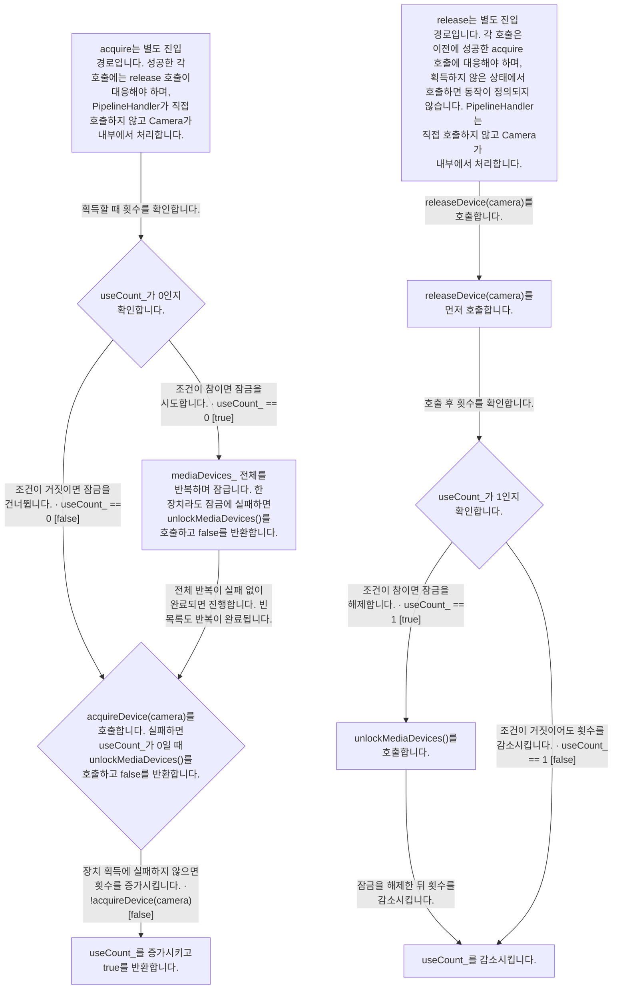

[Mermaid 원문](https://ttolsun.github.io/libcamera-sdd/pipeline-handler.acquire-release-locks.mmd)

<details open>
<summary>그림 근거와 확인 범위</summary>

acquire와 release를 별도 진입 경로로 두고 useCount\_ 조건, 실패 반환, releaseDevice·조건부 잠금 해제·감소의 순서를 구분하세요.

소스 연결 해석 · 자동 연결 검사만 통과 · 의미와 기기 실행은 검증 전

LLM 그림 초안 · 사람 검토 전

작성 모델: `cli/codex/gpt-6.1-terra`

| 요소·전이 | 소스 근거 |
| --- | --- |
| acquire는 별도 진입 경로입니다. 성공한 각 호출에는 release 호출이 대응해야 하며, PipelineHandler가 직접 호출하지 않고 Camera가 내부에서 처리합니다. | [src/libcamera/pipeline_handler.cpp:119](#d6-source-a3caf1625bc18d64) |
| useCount\_가 0인지 확인합니다. | [src/libcamera/pipeline_handler.cpp:119](#d6-source-a3caf1625bc18d64) |
| mediaDevices\_ 전체를 반복하며 잠급니다. 한 장치라도 잠금에 실패하면 unlockMediaDevices()를 호출하고 false를 반환합니다. | [src/libcamera/pipeline_handler.cpp:119](#d6-source-a3caf1625bc18d64) |
| acquireDevice(camera)를 호출합니다. 실패하면 useCount\_가 0일 때 unlockMediaDevices()를 호출하고 false를 반환합니다. | [src/libcamera/pipeline_handler.cpp:119](#d6-source-a3caf1625bc18d64) |
| useCount\_를 증가시키고 true를 반환합니다. | [src/libcamera/pipeline_handler.cpp:119](#d6-source-a3caf1625bc18d64) |
| release는 별도 진입 경로입니다. 각 호출은 이전에 성공한 acquire 호출에 대응해야 하며, 획득하지 않은 상태에서 호출하면 동작이 정의되지 않습니다. PipelineHandler는 직접 호출하지 않고 Camera가 내부에서 처리합니다. | [src/libcamera/pipeline_handler.cpp:119](#d6-source-a3caf1625bc18d64) |
| releaseDevice(camera)를 먼저 호출합니다. | [src/libcamera/pipeline_handler.cpp:119](#d6-source-a3caf1625bc18d64) |
| useCount\_가 1인지 확인합니다. | [src/libcamera/pipeline_handler.cpp:119](#d6-source-a3caf1625bc18d64) |
| unlockMediaDevices()를 호출합니다. | [src/libcamera/pipeline_handler.cpp:119](#d6-source-a3caf1625bc18d64) |
| useCount\_를 감소시킵니다. | [src/libcamera/pipeline_handler.cpp:119](#d6-source-a3caf1625bc18d64) |
| 획득할 때 횟수를 확인합니다. | [src/libcamera/pipeline_handler.cpp:119](#d6-source-a3caf1625bc18d64) |
| 조건이 참이면 잠금을 시도합니다. · useCount\_ == 0 \[true\] | [src/libcamera/pipeline_handler.cpp:119](#d6-source-a3caf1625bc18d64) |
| 조건이 거짓이면 잠금을 건너뜁니다. · useCount\_ == 0 \[false\] | [src/libcamera/pipeline_handler.cpp:119](#d6-source-a3caf1625bc18d64) |
| 전체 반복이 실패 없이 완료되면 진행합니다. 빈 목록도 반복이 완료됩니다. | [src/libcamera/pipeline_handler.cpp:119](#d6-source-a3caf1625bc18d64) |
| 장치 획득에 실패하지 않으면 횟수를 증가시킵니다. · !acquireDevice(camera) \[false\] | [src/libcamera/pipeline_handler.cpp:119](#d6-source-a3caf1625bc18d64) |
| releaseDevice(camera)를 호출합니다. | [src/libcamera/pipeline_handler.cpp:119](#d6-source-a3caf1625bc18d64) |
| 호출 후 횟수를 확인합니다. | [src/libcamera/pipeline_handler.cpp:119](#d6-source-a3caf1625bc18d64) |
| 조건이 참이면 잠금을 해제합니다. · useCount\_ == 1 \[true\] | [src/libcamera/pipeline_handler.cpp:119](#d6-source-a3caf1625bc18d64) |
| 잠금을 해제한 뒤 횟수를 감소시킵니다. | [src/libcamera/pipeline_handler.cpp:119](#d6-source-a3caf1625bc18d64) |
| 조건이 거짓이어도 횟수를 감소시킵니다. · useCount\_ == 1 \[false\] | [src/libcamera/pipeline_handler.cpp:119](#d6-source-a3caf1625bc18d64) |

</details>

acquireMediaDevice()는 이전에 확보된 장치를 제외하고 일치하는 장치를 찾아 확보하면 `mediaDevices_`에 보관하며, 호출자는 명시적으로 해제해서는 안 되고 핸들러 소멸자가 `MediaDevice::release()`를 호출합니다. acquire()는 `useCount_` == 0일 때만 미디어 장치를 잠그고, 장치 잠금이 실패하면 잠금을 해제하고 false를 반환하며 acquireDevice()가 실패하면 `useCount_` == 0인 경우 잠금을 해제하고 false를 반환합니다. 성공한 acquire()마다 release()가 짝을 이뤄야 하며, release()는 releaseDevice()를 호출한 뒤 `useCount_` == 1이면 장치 잠금을 풀고 카운트를 줄입니다. 여러 카메라가 공유하는 자원은 이전에 확보한 모든 카메라에 대해 releaseDevice()가 호출될 때까지 반납하지 않아야 합니다.

<details open>
<summary>절 전체 근거 2개</summary>

- `src/libcamera/pipeline_handler.cpp`[`L50` 발췌](#d6-source-69bfa9568cf8b5c5) · [전체 소스 `L50`](https://github.com/TTolsun/libcamera-sdd/blob/adfa719f8ed67d18fd8a0739fc088a1f8b9e7252/src/libcamera/pipeline_handler.cpp#L50) · [`L119` 발췌](#d6-source-a3caf1625bc18d64) · [전체 소스 `L119`](https://github.com/TTolsun/libcamera-sdd/blob/adfa719f8ed67d18fd8a0739fc088a1f8b9e7252/src/libcamera/pipeline_handler.cpp#L119)

</details>

## <a id="d6-구성의-입력과-검증-책임"></a>구성의 입력과 검증 책임

generateConfiguration()의 호출자는 기본 구성을 원하는 사용 사례의 스트림 역할 목록을 roles에 채워야 하며, 반환된 구성을 살펴 선택된 스트림과 기본 매개변수를 확인할 수 있습니다. 요청한 역할을 충족할 수 있으면 유효한 `CameraConfiguration`을 반환하고, 그렇지 않으면 null 포인터를 반환합니다. 이 함수는 어느 스레드에서나 호출될 수 있으며 스레드 안전해야 하고, 파이프라인 핸들러에서 카메라의 상태를 변경해서는 안 됩니다.

### 기본 구성 요청과 실제 구성의 호출 계약

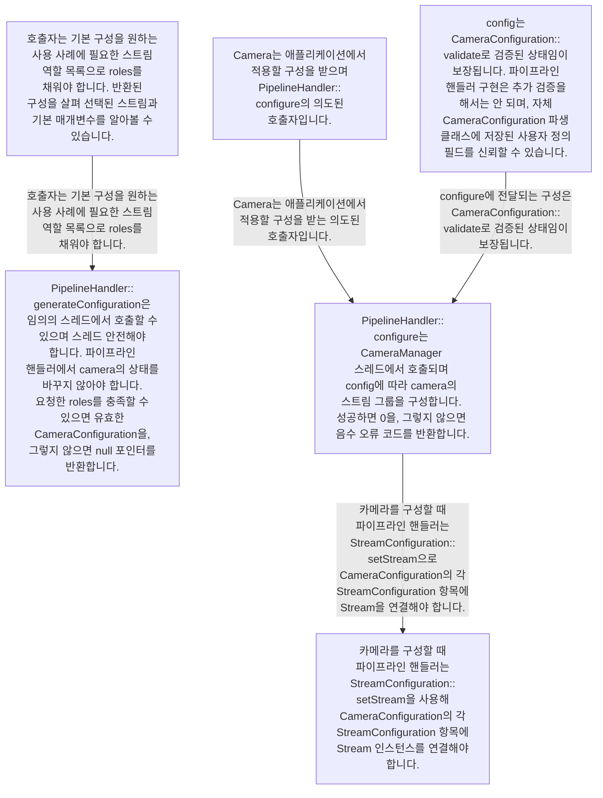

[Mermaid 원문](https://ttolsun.github.io/libcamera-sdd/pipeline-handler.configuration-contracts.mmd)

<details open>
<summary>그림 근거와 확인 범위</summary>

roles로 기본 구성을 요청하는 호출자와 Camera가 전달하는 검증된 구성을 구분하고, 각 함수의 호출 문맥·검증·Stream 연결 의무를 보여 주세요.

소스 연결 해석 · 자동 연결 검사만 통과 · 의미와 기기 실행은 검증 전

LLM 그림 초안 · 사람 검토 전

작성 모델: `cli/codex/gpt-6.1-terra`

| 요소·전이 | 소스 근거 |
| --- | --- |
| 호출자는 기본 구성을 원하는 사용 사례에 필요한 스트림 역할 목록으로 roles를 채워야 합니다. 반환된 구성을 살펴 선택된 스트림과 기본 매개변수를 알아볼 수 있습니다. | [src/libcamera/pipeline_handler.cpp:271](#d6-source-8cd14a802c5b1782) |
| PipelineHandler::generateConfiguration은 임의의 스레드에서 호출할 수 있으며 스레드 안전해야 합니다. 파이프라인 핸들러에서 camera의 상태를 바꾸지 않아야 합니다. 요청한 roles를 충족할 수 있으면 유효한 CameraConfiguration을, 그렇지 않으면 null 포인터를 반환합니다. | [src/libcamera/pipeline_handler.cpp:271](#d6-source-8cd14a802c5b1782) |
| Camera는 애플리케이션에서 적용할 구성을 받으며 PipelineHandler::configure의 의도된 호출자입니다. | [src/libcamera/pipeline_handler.cpp:271](#d6-source-8cd14a802c5b1782) |
| config는 CameraConfiguration::validate로 검증된 상태임이 보장됩니다. 파이프라인 핸들러 구현은 추가 검증을 해서는 안 되며, 자체 CameraConfiguration 파생 클래스에 저장된 사용자 정의 필드를 신뢰할 수 있습니다. | [src/libcamera/pipeline_handler.cpp:271](#d6-source-8cd14a802c5b1782) |
| PipelineHandler::configure는 CameraManager 스레드에서 호출되며 config에 따라 camera의 스트림 그룹을 구성합니다. 성공하면 0을, 그렇지 않으면 음수 오류 코드를 반환합니다. | [src/libcamera/pipeline_handler.cpp:271](#d6-source-8cd14a802c5b1782) |
| 카메라를 구성할 때 파이프라인 핸들러는 StreamConfiguration::setStream을 사용해 CameraConfiguration의 각 StreamConfiguration 항목에 Stream 인스턴스를 연결해야 합니다. | [src/libcamera/pipeline_handler.cpp:271](#d6-source-8cd14a802c5b1782) |
| 호출자는 기본 구성을 원하는 사용 사례에 필요한 스트림 역할 목록으로 roles를 채워야 합니다. | [src/libcamera/pipeline_handler.cpp:271](#d6-source-8cd14a802c5b1782) |
| Camera는 애플리케이션에서 적용할 구성을 받는 의도된 호출자입니다. | [src/libcamera/pipeline_handler.cpp:271](#d6-source-8cd14a802c5b1782) |
| configure에 전달되는 구성은 CameraConfiguration::validate로 검증된 상태임이 보장됩니다. | [src/libcamera/pipeline_handler.cpp:271](#d6-source-8cd14a802c5b1782) |
| 카메라를 구성할 때 파이프라인 핸들러는 StreamConfiguration::setStream으로 CameraConfiguration의 각 StreamConfiguration 항목에 Stream을 연결해야 합니다. | [src/libcamera/pipeline_handler.cpp:271](#d6-source-8cd14a802c5b1782) |

</details>

configure()의 호출 대상은 애플리케이션에서 적용할 구성을 전달받는 `Camera`이며, 이 함수는 `CameraManager` 스레드에서 호출됩니다. 구성은 `CameraConfiguration::validate()`로 검증된 상태임이 보장되므로, 파이프라인 핸들러 구현은 추가 검증을 수행해서는 안 되며 자체 `CameraConfiguration` 파생 클래스에 저장된 사용자 정의 필드를 신뢰할 수 있습니다. 구현은 카메라를 구성할 때 `StreamConfiguration::setStream()`을 사용해 `CameraConfiguration`의 각 `StreamConfiguration` 항목에 `Stream` 인스턴스를 연결해야 합니다. 성공하면 0을, 그렇지 않으면 음수 오류 코드를 반환합니다.

<details open>
<summary>절 전체 근거 1개</summary>

- `src/libcamera/pipeline_handler.cpp`[`L271` 발췌](#d6-source-8cd14a802c5b1782) · [전체 소스 `L271`](https://github.com/TTolsun/libcamera-sdd/blob/adfa719f8ed67d18fd8a0739fc088a1f8b9e7252/src/libcamera/pipeline_handler.cpp#L271)

</details>

## <a id="d6-정지와-미완료-요청"></a>정지와 미완료 요청

`PipelineHandler::stop`은 camera의 `waitingRequests_`를 비어 있는 지역 큐와 교환해 대기 요청을 분리합니다. 이는 stopDevice() 내부에서 completeRequest()가 호출될 때 대기 요청이 다시 큐에 들어가지 않도록 하기 위함입니다. 그 직후 장치 정지 함수 stopDevice(camera)를 호출합니다.

### 정상 완료의 대기 전달과 정지의 목록 분리

```mermaid
flowchart TB
%% sdd:translations {"completeRequest는 완료 처리 <br/>후 대기 요청이 진행될 수 <br/>있도록 doQueueRequests를 <br/>호출합니다.": "After handling completions, <br/>completeRequest calls <br/>doQueueRequests to allow <br/>waiting requests to proceed.", "doQueueRequests는 대기 <br/>목록이 비면 끝납니다. <br/>목록이 비어 있지 않더라도 <br/>queuedRequests#95;의 크기가 <br/>maxQueuedRequestsDevice#95;와 <br/>같거나 맨 앞 요청이 <br/>준비되지 않았으면 반복을 <br/>멈춥니다.": "doQueueRequests ends when <br/>the waiting list is empty. <br/>Even when the list is not <br/>empty, it stops the loop if <br/>the size of queuedRequests#95; <br/>equals <br/>maxQueuedRequestsDevice#95; or <br/>the front request is not <br/>prepared.", "stopDevice 구현자는 실행 <br/>중인 모든 스트림의 캡처와 <br/>요청 처리를 즉시 멈추고 <br/>이미 제출된 미완료 요청을 <br/>취소해 즉시 오류 상태로 <br/>완료해야 합니다. 분리한 <br/>대기 요청은 stopDevice 반환 <br/>뒤 stop이 처리합니다.": "The stopDevice implementer <br/>must immediately stop <br/>capture on all running <br/>streams and request <br/>processing, cancel already <br/>submitted unfinished <br/>requests, and complete them <br/>immediately in an error <br/>state. stop handles the <br/>detached waiting requests <br/>after stopDevice returns.", "stop은 CameraManager <br/>스레드에서 호출됩니다. <br/>계약에 따라 캡처와 요청 <br/>처리를 즉시 멈추고 미완료 <br/>요청을 취소해 즉시 오류 <br/>상태로 완료해야 합니다.": "stop is called from the <br/>CameraManager thread. Its <br/>contract requires it to <br/>stop capture and request <br/>processing immediately, <br/>cancel unfinished requests, <br/>and complete them <br/>immediately in an error <br/>state.", "stop은 stopDevice 반환 뒤 <br/>순서를 지키기 위해 분리한 <br/>요청을 하나씩 꺼내 취소를 <br/>표시하고 doQueueRequest를 <br/>호출합니다. 그러면 순번이 <br/>부여되고 queuedRequests#95;에 <br/>임시로 추가되어 <br/>completeRequest에서 <br/>올바르게 완료할 수 있습니다.": "After stopDevice returns, <br/>stop removes each detached <br/>request, marks it <br/>cancelled, and calls <br/>doQueueRequest to preserve <br/>order. This gives each <br/>request a sequence number <br/>and temporarily adds it to <br/>queuedRequests#95; so <br/>completeRequest can <br/>complete it properly.", "stop은 waitingRequests#95;를 <br/>waitingRequests로 분리한 뒤 <br/>stopDevice를 호출합니다. 이 <br/>분리는 stopDevice 안에서 <br/>completeRequest를 호출할 때 <br/>대기 요청이 다시 큐에 <br/>들어가는 일을 막습니다.": "stop separates <br/>waitingRequests#95; into <br/>waitingRequests, then calls <br/>stopDevice. This separation <br/>prevents waiting requests <br/>from being requeued in <br/>response to a <br/>completeRequest call inside <br/>stopDevice.", "대기 목록이 비어 있지 않고 <br/>queuedRequests#95;의 크기가 <br/>maxQueuedRequestsDevice#95;와 <br/>다르며 맨 앞 요청이 <br/>준비되어 있으면, 재귀 <br/>호출에 대비해 먼저 요청을 <br/>꺼낸 뒤 doQueueRequest를 <br/>호출합니다. · <br/>#33;request-#62;#95;d#40;#41;-#62;prepared#95; <br/>#91;false#93;": "If the waiting list is not <br/>empty, the size of <br/>queuedRequests#95; differs <br/>from <br/>maxQueuedRequestsDevice#95;, <br/>and the front request is <br/>prepared, doQueueRequests <br/>removes the request before <br/>calling doQueueRequest in <br/>case of a recursive call. · <br/>#33;request-#62;#95;d#40;#41;-#62;prepared#95; <br/>#91;false#93;", "정상 경로에서는 대기 <br/>목록에서 먼저 꺼낸 요청을 <br/>doQueueRequest에 <br/>전달합니다. stop 경로에서는 <br/>stopDevice 반환 뒤 분리한 <br/>요청에 취소를 표시하고 <br/>전달합니다.": "On the normal path, the <br/>request is removed from the <br/>waiting list before it is <br/>passed to doQueueRequest. <br/>On the stop path, after <br/>stopDevice returns, a <br/>detached request is marked <br/>cancelled and passed to it.", "파이프라인 핸들러는 <br/>CameraManager 스레드에서 <br/>completeRequest로 완료를 <br/>알려야 합니다. 완료된 <br/>요청은 순서에 상관없이 <br/>전달할 수 있으며, 함수는 <br/>제출 순서대로 <br/>애플리케이션에 반환합니다. <br/>함수가 반환된 뒤에는 해당 <br/>요청에 접근하면 안 됩니다.": "The pipeline handler must <br/>call completeRequest from <br/>the CameraManager thread to <br/>signal completion. It may <br/>pass completed requests in <br/>any order, and the function <br/>returns them to the <br/>application in submission <br/>order. The request must not <br/>be accessed after the <br/>function returns."}
  v_complete["파이프라인 핸들러는 <br/>CameraManager 스레드에서 <br/>completeRequest로 완료를 <br/>알려야 합니다. 완료된 <br/>요청은 순서에 상관없이 <br/>전달할 수 있으며, 함수는 <br/>제출 순서대로 <br/>애플리케이션에 반환합니다. <br/>함수가 반환된 뒤에는 해당 <br/>요청에 접근하면 안 됩니다."]
  v_dispatch["doQueueRequests는 대기 <br/>목록이 비면 끝납니다. <br/>목록이 비어 있지 않더라도 <br/>queuedRequests#95;의 크기가 <br/>maxQueuedRequestsDevice#95;와 <br/>같거나 맨 앞 요청이 <br/>준비되지 않았으면 반복을 <br/>멈춥니다."]
  v_queue["정상 경로에서는 대기 <br/>목록에서 먼저 꺼낸 요청을 <br/>doQueueRequest에 <br/>전달합니다. stop 경로에서는 <br/>stopDevice 반환 뒤 분리한 <br/>요청에 취소를 표시하고 <br/>전달합니다."]
  v_stop["stop은 CameraManager <br/>스레드에서 호출됩니다. <br/>계약에 따라 캡처와 요청 <br/>처리를 즉시 멈추고 미완료 <br/>요청을 취소해 즉시 오류 <br/>상태로 완료해야 합니다."]
  v_stopdevice["stopDevice 구현자는 실행 <br/>중인 모든 스트림의 캡처와 <br/>요청 처리를 즉시 멈추고 <br/>이미 제출된 미완료 요청을 <br/>취소해 즉시 오류 상태로 <br/>완료해야 합니다. 분리한 <br/>대기 요청은 stopDevice 반환 <br/>뒤 stop이 처리합니다."]
  v_complete -->|"completeRequest는 완료 처리 <br/>후 대기 요청이 진행될 수 <br/>있도록 doQueueRequests를 <br/>호출합니다."| v_dispatch
  v_dispatch -->|"대기 목록이 비어 있지 않고 <br/>queuedRequests#95;의 크기가 <br/>maxQueuedRequestsDevice#95;와 <br/>다르며 맨 앞 요청이 <br/>준비되어 있으면, 재귀 <br/>호출에 대비해 먼저 요청을 <br/>꺼낸 뒤 doQueueRequest를 <br/>호출합니다. · <br/>#33;request-#62;#95;d#40;#41;-#62;prepared#95; <br/>#91;false#93;"| v_queue
  v_stop -->|"stop은 waitingRequests#95;를 <br/>waitingRequests로 분리한 뒤 <br/>stopDevice를 호출합니다. 이 <br/>분리는 stopDevice 안에서 <br/>completeRequest를 호출할 때 <br/>대기 요청이 다시 큐에 <br/>들어가는 일을 막습니다."| v_stopdevice
  v_stop -->|"stop은 stopDevice 반환 뒤 <br/>순서를 지키기 위해 분리한 <br/>요청을 하나씩 꺼내 취소를 <br/>표시하고 doQueueRequest를 <br/>호출합니다. 그러면 순번이 <br/>부여되고 queuedRequests#95;에 <br/>임시로 추가되어 <br/>completeRequest에서 <br/>올바르게 완료할 수 있습니다."| v_queue
```

[Mermaid 원문](https://ttolsun.github.io/libcamera-sdd/pipeline-handler.normal-dispatch-and-stop.mmd)

<details open>
<summary>그림 근거와 확인 범위</summary>

정상 완료에서 doQueueRequests가 대기 요청을 전달하거나 멈추는 정확한 조건과, stop이 stopDevice 전에 대기 목록을 분리한 뒤 취소하는 순서를 구분하세요.

소스 연결 해석 · 자동 연결 검사만 통과 · 의미와 기기 실행은 검증 전

LLM 그림 초안 · 사람 검토 전

작성 모델: `cli/codex/gpt-6.1-terra`

| 요소·전이 | 소스 근거 |
| --- | --- |
| 파이프라인 핸들러는 CameraManager 스레드에서 completeRequest로 완료를 알려야 합니다. 완료된 요청은 순서에 상관없이 전달할 수 있으며, 함수는 제출 순서대로 애플리케이션에 반환합니다. 함수가 반환된 뒤에는 해당 요청에 접근하면 안 됩니다. | [src/libcamera/pipeline_handler.cpp:547](#d6-source-01ad7c6605c3296a) |
| doQueueRequests는 대기 목록이 비면 끝납니다. 목록이 비어 있지 않더라도 queuedRequests\_의 크기가 maxQueuedRequestsDevice\_와 같거나 맨 앞 요청이 준비되지 않았으면 반복을 멈춥니다. | [src/libcamera/pipeline_handler.cpp:509](#d6-source-d63c9e57bcf862b0) |
| 정상 경로에서는 대기 목록에서 먼저 꺼낸 요청을 doQueueRequest에 전달합니다. stop 경로에서는 stopDevice 반환 뒤 분리한 요청에 취소를 표시하고 전달합니다. | [src/libcamera/pipeline_handler.cpp:509](#d6-source-d63c9e57bcf862b0) · [src/libcamera/pipeline_handler.cpp:359](#d6-source-eefd1bbecb1aad0a) |
| stop은 CameraManager 스레드에서 호출됩니다. 계약에 따라 캡처와 요청 처리를 즉시 멈추고 미완료 요청을 취소해 즉시 오류 상태로 완료해야 합니다. | [src/libcamera/pipeline_handler.cpp:359](#d6-source-eefd1bbecb1aad0a) |
| stopDevice 구현자는 실행 중인 모든 스트림의 캡처와 요청 처리를 즉시 멈추고 이미 제출된 미완료 요청을 취소해 즉시 오류 상태로 완료해야 합니다. 분리한 대기 요청은 stopDevice 반환 뒤 stop이 처리합니다. | [src/libcamera/pipeline_handler.cpp:359](#d6-source-eefd1bbecb1aad0a) |
| completeRequest는 완료 처리 후 대기 요청이 진행될 수 있도록 doQueueRequests를 호출합니다. | [src/libcamera/pipeline_handler.cpp:547](#d6-source-01ad7c6605c3296a) |
| 대기 목록이 비어 있지 않고 queuedRequests\_의 크기가 maxQueuedRequestsDevice\_와 다르며 맨 앞 요청이 준비되어 있으면, 재귀 호출에 대비해 먼저 요청을 꺼낸 뒤 doQueueRequest를 호출합니다. · !request-\>\_d()-\>prepared\_ \[false\] | [src/libcamera/pipeline_handler.cpp:509](#d6-source-d63c9e57bcf862b0) |
| stop은 waitingRequests\_를 waitingRequests로 분리한 뒤 stopDevice를 호출합니다. 이 분리는 stopDevice 안에서 completeRequest를 호출할 때 대기 요청이 다시 큐에 들어가는 일을 막습니다. | [src/libcamera/pipeline_handler.cpp:359](#d6-source-eefd1bbecb1aad0a) |
| stop은 stopDevice 반환 뒤 순서를 지키기 위해 분리한 요청을 하나씩 꺼내 취소를 표시하고 doQueueRequest를 호출합니다. 그러면 순번이 부여되고 queuedRequests\_에 임시로 추가되어 completeRequest에서 올바르게 완료할 수 있습니다. | [src/libcamera/pipeline_handler.cpp:359](#d6-source-eefd1bbecb1aad0a) |

</details>

stopDevice가 반환하면 분리해 둔 대기 요청을 큐의 앞에서 하나씩 꺼내 취소 상태로 표시한 다음 doQueueRequest로 처리합니다. 이 과정에서 요청에 시퀀스 번호가 부여되고 `queuedRequests_`에 일시적으로 추가되어 completeRequest에서 완료 처리됩니다. stopDevice 구현자는 실행 중인 모든 스트림의 캡처와 요청 처리를 즉시 중단하고, 이미 장치에 제출된 미완료 요청을 취소하여 오류 상태로 즉시 완료해야 합니다. stop이 미리 분리한 `waitingRequests_`의 대기 요청은 stopDevice가 반환된 뒤 stop이 순서대로 취소하고 완료 처리합니다.

stop 마지막에서 ASSERT는 `queuedRequests_`와 `waitingRequests_`가 각각 비어 있는지 확인합니다. 이후 `requestSequence_`를 0으로 초기화합니다. 정상 완료에서 completeRequest는 끝에 doQueueRequests를 호출하며, 이 함수는 `waitingRequests_`가 비어 있지 않은 동안 `queuedRequests_`.size() == `maxQueuedRequestsDevice_`이면 반복을 멈추고 선두 요청의 `prepared_`가 거짓이어도 멈추며, 그렇지 않으면 선두 요청을 꺼내 doQueueRequest로 전달합니다. 정지 시 stop은 stopDevice를 호출하기 전에 `waitingRequests_`를 분리하므로, stopDevice 안의 완료 처리에서 doQueueRequests가 재진입해도 원래 대기 요청은 다시 제출되지 않습니다.

<details open>
<summary>절 전체 근거 3개</summary>

- `src/libcamera/pipeline_handler.cpp`[`L359` 발췌](#d6-source-eefd1bbecb1aad0a) · [전체 소스 `L359`](https://github.com/TTolsun/libcamera-sdd/blob/adfa719f8ed67d18fd8a0739fc088a1f8b9e7252/src/libcamera/pipeline_handler.cpp#L359) · [`L547` 발췌](#d6-source-01ad7c6605c3296a) · [전체 소스 `L547`](https://github.com/TTolsun/libcamera-sdd/blob/adfa719f8ed67d18fd8a0739fc088a1f8b9e7252/src/libcamera/pipeline_handler.cpp#L547) · [`L509` 발췌](#d6-source-d63c9e57bcf862b0) · [전체 소스 `L509`](https://github.com/TTolsun/libcamera-sdd/blob/adfa719f8ed67d18fd8a0739fc088a1f8b9e7252/src/libcamera/pipeline_handler.cpp#L509)

</details>

## <a id="d6-ipu3-입력-크기-탐색의-경계"></a>IPU3 입력 크기 탐색의 경계

minIfWidth는 std::max(in.width - `ImgUDevice::kIFMaxCropWidth`, `ImgUDevice::kIFMaxCropWidth`)로 계산합니다. minIfHeight는 std::max(in.height - `ImgUDevice::kIFMaxCropHeight`, `ImgUDevice::kIFMaxCropHeight`)로 계산합니다.

### 두 탐색의 중첩 구조와 별도 높이 차감식

```mermaid
flowchart TB
%% sdd:translations {"unsigned int 경계 <br/>minIfWidth는 <br/>std::max#40;in.width - <br/>ImgUDevice::<br/>kIFMaxCropWidth, <br/>ImgUDevice::<br/>kIFMaxCropWidth#41;로, <br/>minIfHeight는 <br/>std::max#40;in.height - <br/>ImgUDevice::<br/>kIFMaxCropHeight, <br/>ImgUDevice::<br/>kIFMaxCropHeight#41;로 <br/>계산합니다. 반복 조건은 이 <br/>경계와 unsigned 변수를 <br/>비교합니다. 주석은 <br/>calculateBDSHeight가 <br/>높이에서 최대 <br/>kIFMaxCropHeight줄을 <br/>자르므로 그 아래로 내려가면 <br/>입력 포매터의 최소 높이가 <br/>감긴다고 설명합니다.": "The unsigned int bound <br/>minIfWidth is calculated <br/>with std::max#40;in.width - <br/>ImgUDevice::<br/>kIFMaxCropWidth, <br/>ImgUDevice::<br/>kIFMaxCropWidth#41;, and <br/>minIfHeight with <br/>std::max#40;in.height - <br/>ImgUDevice::<br/>kIFMaxCropHeight, <br/>ImgUDevice::<br/>kIFMaxCropHeight#41;. The loop <br/>conditions compare the <br/>unsigned variables with <br/>these bounds. The comment <br/>explains that <br/>calculateBDSHeight crops up <br/>to kIFMaxCropHeight lines <br/>from the height, so going <br/>below that makes the <br/>minimum input formatter <br/>height wrap.", "두 번째 탐색에서 ifWidth <br/>반복은 ifHeight 반복 안에 <br/>있습니다.": "In the second search, the <br/>ifWidth loop is nested <br/>inside the ifHeight loop.", "두 번째 탐색의 바깥 반복은 <br/>ifHeight가 minIfHeight <br/>이상인 동안 진행합니다. <br/>안쪽 반복이 끝날 때마다 <br/>ifHeight를 <br/>ImgUDevice::<br/>kIFAlignHeight만큼 줄이며, <br/>안쪽 ifWidth를 다시 <br/>설정하지 않습니다.": "The second search#39;s outer <br/>loop runs while ifHeight is <br/>at least minIfHeight. After <br/>each inner loop finishes, <br/>it subtracts <br/>ImgUDevice::kIFAlignHeight <br/>from ifHeight and does not <br/>reset the inner ifWidth.", "두 번째 탐색의 안쪽 반복은 <br/>ifWidth가 minIfWidth 이상인 <br/>동안 진행하며, 각 반복에서 <br/>ifWidth를 <br/>ImgUDevice::<br/>kIFAlignWidth만큼 줄입니다. <br/>소스는 이 절차가 아마 <br/>잘못되었다고 표시합니다.": "The second search#39;s inner <br/>loop runs while ifWidth is <br/>at least minIfWidth and <br/>subtracts <br/>ImgUDevice::kIFAlignWidth <br/>from ifWidth on each <br/>iteration. The source marks <br/>this procedure as probably <br/>broken.", "두 변수를 복원한 뒤 두 번째 <br/>탐색의 ifHeight 반복이 <br/>나옵니다.": "The second search#39;s <br/>ifHeight loop follows the <br/>restoration of both <br/>variables.", "별도 높이 계산 함수는 <br/>iif.height를 사용합니다.": "The separate height <br/>calculation function uses <br/>iif.height.", "별도 높이 계산에서 <br/>iif.height를 사용해 <br/>minIFHeight를 계산합니다.": "The separate height <br/>calculation uses iif.height <br/>to calculate minIFHeight.", "별도 함수 <br/>calculateBDSHeight에서 입력 <br/>포매터의 최소 높이 <br/>minIFHeight는 unsigned <br/>int이며, iif.height에서 <br/>ImgUDevice::<br/>kIFMaxCropHeight를 뺀 <br/>값입니다. iif.height가 그 <br/>상수보다 작으면 unsigned <br/>차감이 감깁니다.": "In the separate function <br/>calculateBDSHeight, the <br/>minimum input formatter <br/>height minIFHeight is an <br/>unsigned int calculated by <br/>subtracting <br/>ImgUDevice::<br/>kIFMaxCropHeight from <br/>iif.height. If iif.height <br/>is smaller than that <br/>constant, the unsigned <br/>subtraction wraps.", "첫 탐색 전체가 끝난 뒤 두 <br/>번째 탐색 전에 ifWidth와 <br/>ifHeight를 각각 <br/>utils::alignUp#40;in.width, <br/>ImgUDevice::<br/>kIFAlignWidth#41;와 <br/>utils::alignUp#40;in.height, <br/>ImgUDevice::<br/>kIFAlignHeight#41;로 <br/>복원합니다.": "After the entire first <br/>search finishes and before <br/>the second search, ifWidth <br/>and ifHeight are restored <br/>to utils::alignUp#40;in.width, <br/>ImgUDevice::kIFAlignWidth#41; <br/>and <br/>utils::alignUp#40;in.height, <br/>ImgUDevice::<br/>kIFAlignHeight#41;, <br/>respectively.", "첫 탐색에서 ifHeight 반복은 <br/>ifWidth 반복 안에 있습니다.": "In the first search, the <br/>ifHeight loop is nested <br/>inside the ifWidth loop.", "첫 탐색의 바깥 ifWidth <br/>반복과 그 안의 ifHeight <br/>반복이 모두 종료된 뒤에만 <br/>두 변수를 복원합니다.": "Both variables are restored <br/>only after the first <br/>search#39;s outer ifWidth loop <br/>and its nested ifHeight <br/>loop have both finished.", "첫 탐색의 바깥 반복은 <br/>ifWidth가 minIfWidth 이상인 <br/>동안 진행합니다. 안쪽 <br/>반복이 끝날 때마다 <br/>ifWidth를 <br/>ImgUDevice::<br/>kIFAlignWidth만큼 줄이며, <br/>안쪽 ifHeight를 다시 <br/>설정하지 않습니다.": "The first search#39;s outer <br/>loop runs while ifWidth is <br/>at least minIfWidth. After <br/>each inner loop finishes, <br/>it subtracts <br/>ImgUDevice::kIFAlignWidth <br/>from ifWidth and does not <br/>reset the inner ifHeight.", "첫 탐색의 안쪽 반복은 <br/>ifHeight가 minIfHeight <br/>이상인 동안 진행하며, 각 <br/>반복에서 ifHeight를 <br/>ImgUDevice::<br/>kIFAlignHeight만큼 줄입니다.": "The first search#39;s inner <br/>loop runs while ifHeight is <br/>at least minIfHeight and <br/>subtracts <br/>ImgUDevice::kIFAlignHeight <br/>from ifHeight on each <br/>iteration."}
  v_first_width["첫 탐색의 바깥 반복은 <br/>ifWidth가 minIfWidth 이상인 <br/>동안 진행합니다. 안쪽 <br/>반복이 끝날 때마다 <br/>ifWidth를 <br/>ImgUDevice::<br/>kIFAlignWidth만큼 줄이며, <br/>안쪽 ifHeight를 다시 <br/>설정하지 않습니다."]
  v_first_height["첫 탐색의 안쪽 반복은 <br/>ifHeight가 minIfHeight <br/>이상인 동안 진행하며, 각 <br/>반복에서 ifHeight를 <br/>ImgUDevice::<br/>kIFAlignHeight만큼 줄입니다."]
  v_bounds["unsigned int 경계 <br/>minIfWidth는 <br/>std::max#40;in.width - <br/>ImgUDevice::<br/>kIFMaxCropWidth, <br/>ImgUDevice::<br/>kIFMaxCropWidth#41;로, <br/>minIfHeight는 <br/>std::max#40;in.height - <br/>ImgUDevice::<br/>kIFMaxCropHeight, <br/>ImgUDevice::<br/>kIFMaxCropHeight#41;로 <br/>계산합니다. 반복 조건은 이 <br/>경계와 unsigned 변수를 <br/>비교합니다. 주석은 <br/>calculateBDSHeight가 <br/>높이에서 최대 <br/>kIFMaxCropHeight줄을 <br/>자르므로 그 아래로 내려가면 <br/>입력 포매터의 최소 높이가 <br/>감긴다고 설명합니다."]
  v_reset["첫 탐색 전체가 끝난 뒤 두 <br/>번째 탐색 전에 ifWidth와 <br/>ifHeight를 각각 <br/>utils::alignUp#40;in.width, <br/>ImgUDevice::<br/>kIFAlignWidth#41;와 <br/>utils::alignUp#40;in.height, <br/>ImgUDevice::<br/>kIFAlignHeight#41;로 <br/>복원합니다."]
  v_second_height["두 번째 탐색의 바깥 반복은 <br/>ifHeight가 minIfHeight <br/>이상인 동안 진행합니다. <br/>안쪽 반복이 끝날 때마다 <br/>ifHeight를 <br/>ImgUDevice::<br/>kIFAlignHeight만큼 줄이며, <br/>안쪽 ifWidth를 다시 <br/>설정하지 않습니다."]
  v_second_width["두 번째 탐색의 안쪽 반복은 <br/>ifWidth가 minIfWidth 이상인 <br/>동안 진행하며, 각 반복에서 <br/>ifWidth를 <br/>ImgUDevice::<br/>kIFAlignWidth만큼 줄입니다. <br/>소스는 이 절차가 아마 <br/>잘못되었다고 표시합니다."]
  v_input_height["별도 높이 계산 함수는 <br/>iif.height를 사용합니다."]
  v_minimum_height["별도 함수 <br/>calculateBDSHeight에서 입력 <br/>포매터의 최소 높이 <br/>minIFHeight는 unsigned <br/>int이며, iif.height에서 <br/>ImgUDevice::<br/>kIFMaxCropHeight를 뺀 <br/>값입니다. iif.height가 그 <br/>상수보다 작으면 unsigned <br/>차감이 감깁니다."]
  v_first_width -->|"첫 탐색에서 ifHeight 반복은 <br/>ifWidth 반복 안에 있습니다."| v_first_height
  v_first_width -->|"첫 탐색의 바깥 ifWidth <br/>반복과 그 안의 ifHeight <br/>반복이 모두 종료된 뒤에만 <br/>두 변수를 복원합니다."| v_reset
  v_reset -->|"두 변수를 복원한 뒤 두 번째 <br/>탐색의 ifHeight 반복이 <br/>나옵니다."| v_second_height
  v_second_height -->|"두 번째 탐색에서 ifWidth <br/>반복은 ifHeight 반복 안에 <br/>있습니다."| v_second_width
  v_input_height -->|"별도 높이 계산에서 <br/>iif.height를 사용해 <br/>minIFHeight를 계산합니다."| v_minimum_height
```

[Mermaid 원문](https://ttolsun.github.io/libcamera-sdd/pipeline-handler.input-search-loops.mmd)

<details open>
<summary>그림 근거와 확인 범위</summary>

두 탐색에서 바깥·안쪽 반복 변수가 각각 어디서 감소하며, 두 번째 탐색 전의 재초기화와 unsigned 높이 차감 식은 어떻게 구분됩니까?

소스 연결 해석 · 자동 연결 검사만 통과 · 의미와 기기 실행은 검증 전

LLM 그림 초안 · 사람 검토 전

작성 모델: `cli/codex/gpt-6.1-terra`

| 요소·전이 | 소스 근거 |
| --- | --- |
| 첫 탐색의 바깥 반복은 ifWidth가 minIfWidth 이상인 동안 진행합니다. 안쪽 반복이 끝날 때마다 ifWidth를 ImgUDevice::kIFAlignWidth만큼 줄이며, 안쪽 ifHeight를 다시 설정하지 않습니다. | [src/libcamera/pipeline/ipu3/imgu.cpp:407](#d6-source-2494b74f28e1b200) |
| 첫 탐색의 안쪽 반복은 ifHeight가 minIfHeight 이상인 동안 진행하며, 각 반복에서 ifHeight를 ImgUDevice::kIFAlignHeight만큼 줄입니다. | [src/libcamera/pipeline/ipu3/imgu.cpp:407](#d6-source-2494b74f28e1b200) |
| unsigned int 경계 minIfWidth는 std::max(in.width - ImgUDevice::kIFMaxCropWidth, ImgUDevice::kIFMaxCropWidth)로, minIfHeight는 std::max(in.height - ImgUDevice::kIFMaxCropHeight, ImgUDevice::kIFMaxCropHeight)로 계산합니다. 반복 조건은 이 경계와 unsigned 변수를 비교합니다. 주석은 calculateBDSHeight가 높이에서 최대 kIFMaxCropHeight줄을 자르므로 그 아래로 내려가면 입력 포매터의 최소 높이가 감긴다고 설명합니다. | [src/libcamera/pipeline/ipu3/imgu.cpp:407](#d6-source-2494b74f28e1b200) |
| 첫 탐색 전체가 끝난 뒤 두 번째 탐색 전에 ifWidth와 ifHeight를 각각 utils::alignUp(in.width, ImgUDevice::kIFAlignWidth)와 utils::alignUp(in.height, ImgUDevice::kIFAlignHeight)로 복원합니다. | [src/libcamera/pipeline/ipu3/imgu.cpp:407](#d6-source-2494b74f28e1b200) |
| 두 번째 탐색의 바깥 반복은 ifHeight가 minIfHeight 이상인 동안 진행합니다. 안쪽 반복이 끝날 때마다 ifHeight를 ImgUDevice::kIFAlignHeight만큼 줄이며, 안쪽 ifWidth를 다시 설정하지 않습니다. | [src/libcamera/pipeline/ipu3/imgu.cpp:407](#d6-source-2494b74f28e1b200) |
| 두 번째 탐색의 안쪽 반복은 ifWidth가 minIfWidth 이상인 동안 진행하며, 각 반복에서 ifWidth를 ImgUDevice::kIFAlignWidth만큼 줄입니다. 소스는 이 절차가 아마 잘못되었다고 표시합니다. | [src/libcamera/pipeline/ipu3/imgu.cpp:407](#d6-source-2494b74f28e1b200) |
| 별도 높이 계산 함수는 iif.height를 사용합니다. | [src/libcamera/pipeline/ipu3/imgu.cpp:111](#d6-source-e95802b61093a795) · [src/libcamera/pipeline/ipu3/imgu.cpp:407](#d6-source-2494b74f28e1b200) |
| 별도 함수 calculateBDSHeight에서 입력 포매터의 최소 높이 minIFHeight는 unsigned int이며, iif.height에서 ImgUDevice::kIFMaxCropHeight를 뺀 값입니다. iif.height가 그 상수보다 작으면 unsigned 차감이 감깁니다. | [src/libcamera/pipeline/ipu3/imgu.cpp:407](#d6-source-2494b74f28e1b200) · [src/libcamera/pipeline/ipu3/imgu.cpp:111](#d6-source-e95802b61093a795) |
| 첫 탐색에서 ifHeight 반복은 ifWidth 반복 안에 있습니다. | [src/libcamera/pipeline/ipu3/imgu.cpp:407](#d6-source-2494b74f28e1b200) |
| 첫 탐색의 바깥 ifWidth 반복과 그 안의 ifHeight 반복이 모두 종료된 뒤에만 두 변수를 복원합니다. | [src/libcamera/pipeline/ipu3/imgu.cpp:407](#d6-source-2494b74f28e1b200) |
| 두 변수를 복원한 뒤 두 번째 탐색의 ifHeight 반복이 나옵니다. | [src/libcamera/pipeline/ipu3/imgu.cpp:407](#d6-source-2494b74f28e1b200) |
| 두 번째 탐색에서 ifWidth 반복은 ifHeight 반복 안에 있습니다. | [src/libcamera/pipeline/ipu3/imgu.cpp:407](#d6-source-2494b74f28e1b200) |
| 별도 높이 계산에서 iif.height를 사용해 minIFHeight를 계산합니다. | [src/libcamera/pipeline/ipu3/imgu.cpp:111](#d6-source-e95802b61093a795) |

</details>

첫 탐색은 입력 포매터의 폭을 바깥쪽, 높이를 안쪽에서 반복하는 반면, 두 번째 탐색은 높이를 바깥쪽, 폭을 안쪽에서 반복하며 각각 minIfWidth와 minIfHeight 이상인 동안 진행합니다. 첫 탐색에서는 안쪽 높이를 kIFAlignHeight만큼, 바깥쪽 폭을 kIFAlignWidth만큼 감소시키고, 두 번째 탐색에서는 안쪽 폭을 kIFAlignWidth만큼, 바깥쪽 높이를 kIFAlignHeight만큼 감소시킵니다. 두 번째 탐색 전에 두 값을 alignUp으로 재초기화하며, 바깥 반복마다 안쪽 변수를 재초기화하지 않습니다. 탐색 부분의 주석은 calculateBDSHeight가 입력 포매터 높이에서 최대 kIFMaxCropHeight줄을 자르므로 그 아래로 내려가지 않아야 한다고 설명하며, unsigned int minIFHeight = iif.height - `ImgUDevice::kIFMaxCropHeight`;에서 iif.height가 kIFMaxCropHeight보다 작으면 최솟값이 감깁니다.

<details open>
<summary>절 전체 근거 2개</summary>

- `src/libcamera/pipeline/ipu3/imgu.cpp`[`L407` 발췌](#d6-source-2494b74f28e1b200) · [전체 소스 `L407`](https://github.com/TTolsun/libcamera-sdd/blob/adfa719f8ed67d18fd8a0739fc088a1f8b9e7252/src/libcamera/pipeline/ipu3/imgu.cpp#L407) · [`L111` 발췌](#d6-source-e95802b61093a795) · [전체 소스 `L111`](https://github.com/TTolsun/libcamera-sdd/blob/adfa719f8ed67d18fd8a0739fc088a1f8b9e7252/src/libcamera/pipeline/ipu3/imgu.cpp#L111)

</details>

## 클래스 관계

화살표의 글자는 추출한 관계를 나타내며, 점선은 상속입니다. 화살표는 참조 대상 또는 기반 클래스를 향합니다. 호출 순서를 뜻하지 않습니다.

```mermaid
flowchart LR
  c0["Object"]:::context
  c1["PipelineHandler"]
  c2["PipelineHandlerFactory"]
  c3["PipelineHandlerFactoryBase"]
  c4["PipelineHandlerIPU3"]
  c5["PipelineHandlerIPU3::IPU3PipeModes"]
  c6["PipelineHandlerISI"]
  c7["PipelineHandlerISI::Pipe"]
  c8["PipelineHandlerMaliC55"]
  c9["PipelineHandlerMaliC55::#40;unnamed enum at src/libcamera/pipeline/mali-c55/mali-c55.cpp:712:2#41;"]
  c10["PipelineHandlerMaliC55::MaliC55Pipe"]
  c11["PipelineHandlerPiSP"]
  c12["PipelineHandlerRkISP1"]
  c13["PipelineHandlerUVC"]
  c14["PipelineHandlerVc4"]
  c15["PipelineHandlerVimc"]
  c16["PipelineHandlerVirtual"]
  c17["RPi::PipelineHandlerBase"]:::context
  c1 -.->|상속| c0
  c2 -.->|상속| c3
  c4 -.->|상속| c1
  c6 -.->|상속| c1
  c6 -->|필드 참조| c7
  c8 -.->|상속| c1
  c8 -->|필드 참조| c10
  c11 -.->|상속| c17
  c12 -.->|상속| c1
  c13 -.->|상속| c1
  c14 -.->|상속| c17
  c15 -.->|상속| c1
  c16 -.->|상속| c1
  classDef context fill:#fafafa,stroke:#aaa,stroke-dasharray:4 3,color:#555
```

## 소스 근거

<details open>
<summary>소스 발췌 8개</summary>

같은 발췌는 한 번만 싣습니다. 필요한 원문을 펼쳐 설명과 대조하세요.

<a id="d6-source-69bfa9568cf8b5c5"></a>

<details open>
<summary>소스 근거: src/libcamera/pipeline_handler.cpp:50</summary>

발췌 범위: [`src/libcamera/pipeline_handler.cpp:50`](https://github.com/TTolsun/libcamera-sdd/blob/adfa719f8ed67d18fd8a0739fc088a1f8b9e7252/src/libcamera/pipeline_handler.cpp#L50) \~ `119`

SHA-256: `e05278df0a06cb963fe79f772e62d4560b62df15c1411a6b49e32f7ca84d9e74`

```
\class PipelineHandler
 * \brief Create and manage cameras based on a set of media devices
 *
 * The PipelineHandler matches the media devices provided by a DeviceEnumerator
 * with the pipelines it supports and creates corresponding Camera devices.
 *
 * Pipeline handler instances are reference-counted through std::shared_ptr<>.
 * They implement std::enable_shared_from_this<> in order to create new
 * std::shared_ptr<> in code paths originating from member functions of the
 * PipelineHandler class where only the 'this' pointer is available.
 */

/**
 * \brief Construct a PipelineHandler instance
 * \param[in] manager The camera manager
 * \param[in] maxQueuedRequestsDevice The maximum number of requests queued to
 * the device
 *
 * In order to honour the std::enable_shared_from_this<> contract,
 * PipelineHandler instances shall never be constructed manually, but always
 * through the PipelineHandlerFactoryBase::create() function.
 */
PipelineHandler::PipelineHandler(CameraManager *manager,
                 unsigned int maxQueuedRequestsDevice)
    : manager_(manager), maxQueuedRequestsDevice_(maxQueuedRequestsDevice),
      useCount_(0)
{
}

PipelineHandler::~PipelineHandler()
{
    for (std::shared_ptr<MediaDevice> &media : mediaDevices_)
        media->release();
}

/**
 * \fn PipelineHandler::match(DeviceEnumerator *enumerator)
 * \brief Match media devices and create camera instances
 * \param[in] enumerator The enumerator providing all media devices found in the
 * system
 *
 * This function is the main entry point of the pipeline handler. It is called
 * by the camera manager with the \a enumerator passed as an argument. It shall
 * acquire from the \a enumerator all the media devices it needs for a single
 * pipeline, create one or multiple Camera instances and register them with the
 * camera manager.
 *
 * If all media devices needed by the pipeline handler are found, they must all
 * be acquired by a call to MediaDevice::acquire(). This function shall then
 * create the corresponding Camera instances, store them internally, and return
 * true. Otherwise it shall not acquire any media device (or shall release all
 * the media devices is has acquired by calling MediaDevice::release()) and
 * return false.
 *
 * If multiple instances of a pipeline are available in the system, the
 * PipelineHandler class will be instantiated once per instance, and its match()
 * function called for every instance. Each call shall acquire media devices for
 * one pipeline instance, until all compatible media devices are exhausted.
 *
 * If this function returns true, a new instance of the pipeline handler will
 * be created and its match() function called.
 *
 * \context This function is called from the CameraManager thread.
 *
 * \return true if media devices have been acquired and camera instances
 * created, or false otherwise
 */

/**
 * \brief Search and acquire a MediaDevice
```

</details>

<a id="d6-source-a3caf1625bc18d64"></a>

<details open>
<summary>소스 근거: src/libcamera/pipeline_handler.cpp:119</summary>

발췌 범위: [`src/libcamera/pipeline_handler.cpp:119`](https://github.com/TTolsun/libcamera-sdd/blob/adfa719f8ed67d18fd8a0739fc088a1f8b9e7252/src/libcamera/pipeline_handler.cpp#L119) \~ `271`

SHA-256: `379b17c52a1e97055bf78aaabd964595fb3ec506c568d112e552ed1c29235591`

```
\brief Search and acquire a MediaDevice matching a device pattern
 * \param[in] enumerator Enumerator containing all media devices in the system
 * \param[in] dm Device match pattern
 *
 * Search the device \a enumerator for an available media device matching the
 * device match pattern \a dm. Matching media device that have previously been
 * acquired by MediaDevice::acquire() are not considered. If a match is found,
 * the media device is acquired and returned. The caller shall not release the
 * device explicitly, it will be automatically released when the pipeline
 * handler is destroyed.
 *
 * \context This function shall be called from the CameraManager thread.
 *
 * \return A shared pointer to the matching MediaDevice, or nullptr if no match
 * is found
 */
std::shared_ptr<MediaDevice>
PipelineHandler::acquireMediaDevice(DeviceEnumerator *enumerator,
                    const DeviceMatch &dm)
{
    std::shared_ptr<MediaDevice> media = enumerator->search(dm);
    if (!media)
        return nullptr;

    if (!media->acquire())
        return nullptr;

    mediaDevices_.push_back(media);

    return media;
}

/**
 * \brief Acquire exclusive access to the pipeline handler for the process
 *
 * This function locks all the media devices used by the pipeline to ensure
 * that no other process can access them concurrently.
 *
 * Access to a pipeline handler may be acquired recursively from within the
 * same process. Every successful acquire() call shall be matched with a
 * release() call. This allows concurrent access to the same pipeline handler
 * from different cameras within the same process.
 *
 * Pipeline handlers shall not call this function directly as the Camera class
 * handles access internally.
 *
 * \context This function is called from the CameraManager thread.
 *
 * \return True if the pipeline handler was acquired, false if another process
 * has already acquired it
 * \sa release()
 */
bool PipelineHandler::acquire(Camera *camera)
{
    if (useCount_ == 0) {
        for (std::shared_ptr<MediaDevice> &media : mediaDevices_) {
            if (!media->lock()) {
                unlockMediaDevices();
                return false;
            }
        }
    }

    if (!acquireDevice(camera)) {
        if (useCount_ == 0)
            unlockMediaDevices();

        return false;
    }

    ++useCount_;
    return true;
}

/**
 * \brief Release exclusive access to the pipeline handler
 * \param[in] camera The camera for which to release data
 *
 * This function releases access to the pipeline handler previously acquired by
 * a call to acquire(). Every release() call shall match a previous successful
 * acquire() call. Calling this function on a pipeline handler that hasn't been
 * acquired results in undefined behaviour.
 *
 * Pipeline handlers shall not call this function directly as the Camera class
 * handles access internally.
 *
 * \context This function is called from the CameraManager thread.
 *
 * \sa acquire()
 */
void PipelineHandler::release(Camera *camera)
{
    ASSERT(useCount_);

    releaseDevice(camera);

    if (useCount_ == 1)
        unlockMediaDevices();

    --useCount_;
}

/**
 * \brief Acquire resources associated with this camera
 * \param[in] camera The camera for which to acquire resources
 *
 * Pipeline handlers may override this in order to get resources such as opening
 * devices and allocating buffers when a camera is acquired.
 *
 * This is used by the uvcvideo pipeline handler to delay opening /dev/video#
 * until the camera is acquired to avoid excess power consumption. The delayed
 * opening of /dev/video# is a special case because the kernel uvcvideo driver
 * powers on the USB device as soon as /dev/video# is opened. This behavior
 * should *not* be copied by other pipeline handlers.
 *
 * \context This function is called from the CameraManager thread.
 *
 * \return True on success, false on failure
 * \sa releaseDevice()
 */
bool PipelineHandler::acquireDevice([[maybe_unused]] Camera *camera)
{
    return true;
}

/**
 * \brief Release resources associated with this camera
 * \param[in] camera The camera for which to release resources
 *
 * Pipeline handlers may override this in order to perform cleanup operations
 * when a camera is released, such as freeing memory.
 *
 * This is called once for every camera that is released. If there are resources
 * shared by multiple cameras then the pipeline handler must take care to not
 * release them until releaseDevice() has been called for all previously
 * acquired cameras.
 *
 * \context This function is called from the CameraManager thread.
 *
 * \sa acquireDevice()
 */
void PipelineHandler::releaseDevice([[maybe_unused]] Camera *camera)
{
}

void PipelineHandler::unlockMediaDevices()
{
    for (std::shared_ptr<MediaDevice> &media : mediaDevices_)
        media->unlock();
}

/**
 * \fn PipelineHandler::generateConfiguration()
```

</details>

<a id="d6-source-8cd14a802c5b1782"></a>

<details open>
<summary>소스 근거: src/libcamera/pipeline_handler.cpp:271</summary>

발췌 범위: [`src/libcamera/pipeline_handler.cpp:271`](https://github.com/TTolsun/libcamera-sdd/blob/adfa719f8ed67d18fd8a0739fc088a1f8b9e7252/src/libcamera/pipeline_handler.cpp#L271) \~ `315`

SHA-256: `56e3a59872a70fc01b1bfdea1601201880929f47ae90d7888c2cf4c080085ea6`

```
\fn PipelineHandler::generateConfiguration()
 * \brief Generate a camera configuration for a specified camera
 * \param[in] camera The camera to generate a default configuration for
 * \param[in] roles A list of stream roles
 *
 * Generate a default configuration for the \a camera for a specified list of
 * stream roles. The caller shall populate the \a roles with the use-cases it
 * wishes to fetch the default configuration for. The returned configuration
 * can then be examined by the caller to learn about the selected streams and
 * their default parameters.
 *
 * The intended companion to this is \a configure() which can be used to change
 * the group of streams parameters.
 *
 * \context This function may be called from any thread and shall be
 * \threadsafe. It shall not modify the state of the \a camera in the pipeline
 * handler.
 *
 * \return A valid CameraConfiguration if the requested roles can be satisfied,
 * or a null pointer otherwise.
 */

/**
 * \fn PipelineHandler::configure()
 * \brief Configure a group of streams for capture
 * \param[in] camera The camera to configure
 * \param[in] config The camera configurations to setup
 *
 * Configure the specified group of streams for \a camera according to the
 * configuration specified in \a config. The intended caller of this interface
 * is the Camera class which will receive configuration to apply from the
 * application.
 *
 * The configuration is guaranteed to have been validated with
 * CameraConfiguration::validate(). The pipeline handler implementation shall
 * not perform further validation and may rely on any custom field stored in its
 * custom CameraConfiguration derived class.
 *
 * When configuring the camera the pipeline handler shall associate a Stream
 * instance to each StreamConfiguration entry in the CameraConfiguration using
 * the StreamConfiguration::setStream() function.
 *
 * \context This function is called from the CameraManager thread.
 *
 * \return 0 on success or a negative error code otherwise
```

</details>

<a id="d6-source-eefd1bbecb1aad0a"></a>

<details open>
<summary>소스 근거: src/libcamera/pipeline_handler.cpp:359</summary>

발췌 범위: [`src/libcamera/pipeline_handler.cpp:359`](https://github.com/TTolsun/libcamera-sdd/blob/adfa719f8ed67d18fd8a0739fc088a1f8b9e7252/src/libcamera/pipeline_handler.cpp#L359) \~ `414`

SHA-256: `108b1bea5a8314ba57213d15c1e3ba01abe2b3f8a9e0e1e1281864b5492c7304`

```
\brief Stop capturing from all running streams and cancel pending requests
 * \param[in] camera The camera to stop
 *
 * This function stops capturing and processing requests immediately. All
 * pending requests are cancelled and complete immediately in an error state.
 *
 * \context This function is called from the CameraManager thread.
 */
void PipelineHandler::stop(Camera *camera)
{
    /*
     * Take all waiting requests so that they are not requeued in response
     * to completeRequest() being called inside stopDevice(). Cancel them
     * after the device to keep them in order.
     */
    Camera::Private *data = camera->_d();
    std::queue<Request *> waitingRequests;
    waitingRequests.swap(data->waitingRequests_);

    /* Stop the pipeline handler and let the queued requests complete. */
    stopDevice(camera);

    /* Cancel and signal as complete all waiting requests. */
    while (!waitingRequests.empty()) {
        Request *request = waitingRequests.front();
        waitingRequests.pop();

        /*
         * Cancel all requests by marking them as cancelled and calling
         * doQueueRequest() instead of cancelRequest(). This ensures
         * that the requests get a sequence number and are temporarily
         * added to queuedRequests_ so they can be properly completed in
         * completeRequest().
         */
        request->_d()->cancel();
        doQueueRequest(request);
    }

    /* Make sure no requests are pending. */
    ASSERT(data->queuedRequests_.empty());
    ASSERT(data->waitingRequests_.empty());

    data->requestSequence_ = 0;
}

/**
 * \fn PipelineHandler::stopDevice()
 * \brief Stop capturing from all running streams
 * \param[in] camera The camera to stop
 *
 * This function stops capturing and processing requests immediately. All
 * pending requests are cancelled and complete immediately in an error state.
 */

/**
 * \brief Determine if the camera has any requests pending
```

</details>

<a id="d6-source-01ad7c6605c3296a"></a>

<details open>
<summary>소스 근거: src/libcamera/pipeline_handler.cpp:547</summary>

발췌 범위: [`src/libcamera/pipeline_handler.cpp:547`](https://github.com/TTolsun/libcamera-sdd/blob/adfa719f8ed67d18fd8a0739fc088a1f8b9e7252/src/libcamera/pipeline_handler.cpp#L547) \~ `620`

SHA-256: `514288cc958de9ff5fd19d46393cec3bb3088f4f08486528d4559071138638c9`

```
\brief Complete a buffer for a request
 * \param[in] request The request the buffer belongs to
 * \param[in] buffer The buffer that has completed
 *
 * This function shall be called by pipeline handlers to signal completion of
 * the \a buffer part of the \a request. It notifies applications of buffer
 * completion and updates the request's internal buffer tracking. The request
 * is not completed automatically when the last buffer completes to give
 * pipeline handlers a chance to perform any operation that may still be
 * needed. They shall complete requests explicitly with completeRequest().
 *
 * \context This function shall be called from the CameraManager thread.
 *
 * \return True if all buffers contained in the request have completed, false
 * otherwise
 */
bool PipelineHandler::completeBuffer(Request *request, FrameBuffer *buffer)
{
    Camera *camera = request->_d()->camera();
    camera->bufferCompleted.emit(request, buffer);
    return request->_d()->completeBuffer(buffer);
}

/**
 * \brief Signal request completion
 * \param[in] request The request that has completed
 *
 * The pipeline handler shall call this function to notify the \a camera that
 * the request has completed. The request is no longer managed by the pipeline
 * handler and shall not be accessed once this function returns.
 *
 * This function ensures that requests will be returned to the application in
 * submission order, the pipeline handler may call it on any complete request
 * without any ordering constraint.
 *
 * \context This function shall be called from the CameraManager thread.
 */
void PipelineHandler::completeRequest(Request *request)
{
    Camera *camera = request->_d()->camera();

    request->_d()->complete();

    Camera::Private *data = camera->_d();

    while (!data->queuedRequests_.empty()) {
        Request *req = data->queuedRequests_.front();
        if (req->status() == Request::RequestPending)
            break;

        ASSERT(!req->hasPendingBuffers());
        data->queuedRequests_.pop_front();
        camera->requestComplete(req);
    }

    /* Allow any waiting requests to be queued to the pipeline. */
    doQueueRequests(camera);
}

/**
 * \brief Cancel request and signal its completion
 * \param[in] request The request to cancel
 *
 * This function cancels and completes the request. The same rules as for
 * completeRequest() apply.
 */
void PipelineHandler::cancelRequest(Request *request)
{
    request->_d()->cancel();
    completeRequest(request);
}

/**
 * \brief Retrieve the absolute path to a platform configuration file
```

</details>

<a id="d6-source-d63c9e57bcf862b0"></a>

<details open>
<summary>소스 근거: src/libcamera/pipeline_handler.cpp:509</summary>

발췌 범위: [`src/libcamera/pipeline_handler.cpp:509`](https://github.com/TTolsun/libcamera-sdd/blob/adfa719f8ed67d18fd8a0739fc088a1f8b9e7252/src/libcamera/pipeline_handler.cpp#L509) \~ `530`

SHA-256: `b2d2d134eaa639300cae5e7660d8453da545646bcc100bf640a981fa1371899d`

```
void PipelineHandler::doQueueRequests(Camera *camera)
{
    Camera::Private *data = camera->_d();
    while (!data->waitingRequests_.empty()) {
        if (data->queuedRequests_.size() == maxQueuedRequestsDevice_)
            break;

        Request *request = data->waitingRequests_.front();
        if (!request->_d()->prepared_)
            break;

        /*
         * Pop the request first, in case doQueueRequests() is called
         * recursively from within doQueueRequest()
         */
        data->waitingRequests_.pop();
        doQueueRequest(request);
    }
}

/**
 * \fn PipelineHandler::queueRequestDevice()
```

</details>

<a id="d6-source-2494b74f28e1b200"></a>

<details open>
<summary>소스 근거: src/libcamera/pipeline/ipu3/imgu.cpp:407</summary>

발췌 범위: [`src/libcamera/pipeline/ipu3/imgu.cpp:407`](https://github.com/TTolsun/libcamera-sdd/blob/adfa719f8ed67d18fd8a0739fc088a1f8b9e7252/src/libcamera/pipeline/ipu3/imgu.cpp#L407) \~ `449`

SHA-256: `dff1dd0c4b791141aa7e60ba45e759e6cb4c6e69877280a629dc9250cf9b42dd`

```
float bdsSF = static_cast<float>(in.width) / gdc.width;
    float sf = findScaleFactor(bdsSF, bdsScalingFactors, true);

    /*
     * Populate the configurations vector by scaling width and height.
     *
     * calculateBDSHeight() crops up to kIFMaxCropHeight lines from the IF
     * height, so don't go below that, or its minimum IF height wraps.
     */
    unsigned int ifWidth = utils::alignUp(in.width, ImgUDevice::kIFAlignWidth);
    unsigned int ifHeight = utils::alignUp(in.height, ImgUDevice::kIFAlignHeight);
    unsigned int minIfWidth = std::max(in.width - ImgUDevice::kIFMaxCropWidth,
                       ImgUDevice::kIFMaxCropWidth);
    unsigned int minIfHeight = std::max(in.height - ImgUDevice::kIFMaxCropHeight,
                        ImgUDevice::kIFMaxCropHeight);
    while (ifWidth >= minIfWidth) {
        while (ifHeight >= minIfHeight) {
            Size iif{ ifWidth, ifHeight };
            calculateBDS(pipe, iif, gdc, sf);
            ifHeight -= ImgUDevice::kIFAlignHeight;
        }

        ifWidth -= ImgUDevice::kIFAlignWidth;
    }

    /* Repeat search by scaling width first. */
    ifWidth = utils::alignUp(in.width, ImgUDevice::kIFAlignWidth);
    ifHeight = utils::alignUp(in.height, ImgUDevice::kIFAlignHeight);
    while (ifHeight >= minIfHeight) {
        /*
         * \todo This procedure is probably broken:
         * https://github.com/intel/intel-ipu3-pipecfg/issues/2
         */
        while (ifWidth >= minIfWidth) {
            Size iif{ ifWidth, ifHeight };
            calculateBDS(pipe, iif, gdc, sf);
            ifWidth -= ImgUDevice::kIFAlignWidth;
        }

        ifHeight -= ImgUDevice::kIFAlignHeight;
    }

    if (pipeConfigs.size() == 0) {
```

</details>

<a id="d6-source-e95802b61093a795"></a>

<details open>
<summary>소스 근거: src/libcamera/pipeline/ipu3/imgu.cpp:111</summary>

발췌 범위: [`src/libcamera/pipeline/ipu3/imgu.cpp:111`](https://github.com/TTolsun/libcamera-sdd/blob/adfa719f8ed67d18fd8a0739fc088a1f8b9e7252/src/libcamera/pipeline/ipu3/imgu.cpp#L111) \~ `112`

SHA-256: `095e890fbc9265784421e7c5bffa38c5c482fbea73289f56889e877d24b817c3`

```
unsigned int minIFHeight = iif.height - ImgUDevice::kIFMaxCropHeight;
    unsigned int minBDSHeight = gdc.height + ImgUDevice::kFilterHeight * 2;
```

</details>

</details>

## 관련 클래스

선언·상속·주석은 각 클래스 링크에서 확인하세요.

- [`libcamera::PipelineHandler`](#d30-symbol-3314f2db823b9670)
- [`libcamera::PipelineHandlerFactory`](#d30-symbol-3ee1a13b17f9a60e)
- [`libcamera::PipelineHandlerFactoryBase`](#d30-symbol-4ac8f526d012f414)
- [`libcamera::PipelineHandlerIPU3`](#d30-symbol-0093e4c6a0107db9)
- [`libcamera::PipelineHandlerIPU3::IPU3PipeModes`](#d30-symbol-d4eeaf6faebe0347)
- [`libcamera::PipelineHandlerISI`](#d30-symbol-552c2fdf3ace4cc0)
- [`libcamera::PipelineHandlerISI::Pipe`](#d30-symbol-573bcc95fb09d5fb)
- [`libcamera::PipelineHandlerMaliC55`](#d30-symbol-a033d7bcdd2993e7)
- [`libcamera::PipelineHandlerMaliC55::(unnamed enum at src/libcamera/pipeline/mali-c55/mali-c55.cpp:712:2)`](#d30-symbol-84e588f06630d6bf)
- [`libcamera::PipelineHandlerMaliC55::MaliC55Pipe`](#d30-symbol-ed255261a244b359)
- [`libcamera::PipelineHandlerPiSP`](#d30-symbol-ff0d47857340b804)
- [`libcamera::PipelineHandlerRkISP1`](#d30-symbol-71d255269b19bbd0)
- [`libcamera::PipelineHandlerUVC`](#d30-symbol-96fae215efbde66b)
- [`libcamera::PipelineHandlerVc4`](#d30-symbol-1580cfcca5e21b09)
- [`libcamera::PipelineHandlerVimc`](#d30-symbol-56224033014a4273)
- [`libcamera::PipelineHandlerVirtual`](#d30-symbol-6fa0a9ba3419dd6f)

## <a id="d6-page-evidence"></a>문서 생성·검토 정보

- **생성 방식**: 추출 사실과 LLM 설명
- **검증 범위**: 표·그림은 facts로 만들고 설명은 LLM이 작성합니다. 인용·문장 및 설정된 구조 검사를 적용합니다.
- **자동 검사**: 통과 (`ok`). 검사한 항목은 검증 범위에 적혀 있습니다. 설명 내용이 맞는지는 사람이 확인합니다.
- **사람 검토**: 사람 검토 전
- **분석 기준 커밋**: `adfa719f8ed67d18fd8a0739fc088a1f8b9e7252`
- **문서 생성 시각**: `2026-11-20 18:11:25+00:00`
- **문장 생성 모델**: `cli/codex/gpt-6.1-terra`
- **문서 간 계약**: [자동 대조 보고서](https://ttolsun.github.io/libcamera-sdd/contract-consistency.json) · 사람 검토 전

<details open>
<summary>원고 작성 당시 기록</summary>

원고에 저장된 당시 기록입니다. 현재 문서의 기준과 다를 수 있습니다.

- 근거 파일: `include/libcamera/internal/pipeline_handler.h`, `src/libcamera/pipeline/imx8-isi/imx8-isi.cpp`, `src/libcamera/pipeline/ipu3/imgu.cpp`, `src/libcamera/pipeline/ipu3/ipu3.cpp`, `src/libcamera/pipeline/mali-c55/mali-c55.cpp`, `src/libcamera/pipeline/rkisp1/rkisp1.cpp`, `src/libcamera/pipeline/rpi/pisp/pisp.cpp`, `src/libcamera/pipeline/rpi/vc4/vc4.cpp`, `src/libcamera/pipeline/uvcvideo/uvcvideo.cpp`, `src/libcamera/pipeline/vimc/vimc.cpp`, `src/libcamera/pipeline/virtual/virtual.cpp`, `src/libcamera/pipeline_handler.cpp`
- 근거 수준: 코드 확인 (정적 분석, simple_compdb 구성, commit `adfa719f8e`)
- 자동 검사 (인용·문장 및 설정된 구조 검사): 통과
- 검토 상태 기록일: 2026-11-21 · 사람 검토 전

</details>

[Markdown 원문 ↗](https://ttolsun.github.io/libcamera-sdd/pipeline-handler.md) [Mermaid 원문 ↗](https://ttolsun.github.io/libcamera-sdd/pipeline-handler.mmd)

<a id="doc-7"></a>

For Vendor

# Pipeline 요청 제출과 완료

사람 검토 전자동 검사 통과작성: 추출한 구조와 모델이 쓴 초안[상태 설명 ↓](#d7-page-evidence)

**요청 큐의 대기·장치 전달·완료 경계를 따라 구현자의 책임을 확인하세요.**

<details open>
<summary>설계 질문과 검증 범위</summary>

질문별 답변과 근거 연결을 검사했습니다. 의미와 실행 결과는 사람 검토가 필요합니다.

- 요청을 장치로 넘기는 조건과 실패 처리는 무엇입니까?

  [요청 준비와 장치 큐](#d7-요청-준비와-장치-큐)
- 버퍼 완료, 요청 완료와 접근 가능한 수명은 어떻게 구분됩니까?

  [버퍼 완료와 요청 반환](#d7-버퍼-완료와-요청-반환)
- 장치에 동시에 제출하는 요청 수의 기본 한도와 대기 요청의 처리는 무엇입니까?

  [장치 요청 한도와 대기 큐](#d7-장치-요청-한도와-대기-큐)

확인 범위: 코드 근거와 설명 연결

</details>

<details open>
<summary>이 문서의 용어: Pipeline Handler, 프레임 버퍼, Pending</summary>

- **Pipeline Handler**: 특정 하드웨어 플랫폼(IPU3, RKISP1 등)의 미디어 장치를 찾아 카메라를 만들고, 요청을 장치에 넣고 완료를 돌려주는 libcamera 구성 요소입니다. 플랫폼마다 하나씩 있습니다.
- **프레임 버퍼**: 영상 데이터를 저장할 메모리 영역을 나타내는 FrameBuffer 객체입니다. 각 메모리 평면의 파일 기술자·오프셋·길이와 프레임별 메타데이터를 제공합니다. 촬영 성공·오류·취소에 따라 데이터와 메타데이터의 유효 범위가 달라집니다.
- **Pending**: 아직 완료 또는 취소로 바뀌지 않은 요청 상태입니다. 장치 처리가 시작됐다는 뜻은 아니며, 앞 요청이 이 상태이면 뒤 요청의 반환도 대기할 수 있습니다.

다른 용어는 [용어집](#doc-2)에서 찾을 수 있습니다.

</details>

## <a id="d7-요청-준비와-장치-큐"></a>요청 준비와 장치 큐

registerRequest는 요청이 생성될 때 호출되어 파이프라인 핸들러가 해당 요청에 필요한 일회성 초기화를 수행할 기회를 제공합니다. prepared 신호에 연결된 콜백은 doQueueRequests 함수를 호출합니다. `PipelineHandler::queueRequest`는 요청이 가리키는 카메라의 내부 `waitingRequests_`에 요청을 추가한 뒤 prepare에 시간 인자 300ms를 전달합니다.

### <a id="d7-요청이-대기하거나-장치로-가는-조건"></a>요청이 대기하거나 장치로 가는 조건

```mermaid
flowchart TB
%% sdd:translations {"doQueueRequests#40;#41;에서 확인": "Check in doQueueRequests#40;#41;", "queueRequestDevice#40;#41;": "queueRequestDevice#40;#41;", "waitingRequests#95;": "waitingRequests#95;", "대기열에 유지": "Stay in waiting queue", "선두 요청이 prepared#95;인가?": "Is the front request <br/>prepared?", "아니오: 선두 요청 확인": "No: inspect front request", "아니오: 준비를 기다림": "No: wait for preparation", "예: 새 요청을 전달하지 않음": "Yes: stop forwarding", "예: 준비 실패로 취소되지 <br/>않은 요청": "Yes: unless cancelled <br/>during preparation", "장치 제출 실패": "Device queue failure", "장치 큐 한도에 도달했는가?": "Device queue at its limit?", "준비 중 취소된 요청은 장치 <br/>제출 생략": "Skip device for cancelled <br/>request", "취소·완료 경로": "Cancellation and completion"}
  v_wait["waitingRequests#95;"]
  v_ready{"선두 요청이 prepared#95;인가?"}
  v_limit{"장치 큐 한도에 도달했는가?"}
  v_hold["대기열에 유지"]
  v_device["queueRequestDevice#40;#41;"]
  v_cancel["취소·완료 경로"]
  v_wait -->|"doQueueRequests#40;#41;에서 확인"| v_limit
  v_limit -->|"예: 새 요청을 전달하지 않음"| v_hold
  v_limit -->|"아니오: 선두 요청 확인"| v_ready
  v_ready -->|"아니오: 준비를 기다림"| v_hold
  v_ready -->|"예: 준비 실패로 취소되지 <br/>않은 요청"| v_device
  v_device -->|"장치 제출 실패"| v_cancel
  v_ready -->|"준비 중 취소된 요청은 장치 <br/>제출 생략"| v_cancel
```

[Mermaid 원문](https://ttolsun.github.io/libcamera-sdd/pipeline-requests.queue-gates.mmd)

<details open>
<summary>그림 근거와 확인 범위</summary>

준비 대기와 장치 큐 한도를 구분하세요. 준비 실패와 장치 제출 실패는 취소 경로로 이어집니다.

소스 연결 해석 · 자동 연결 검사만 통과 · 의미와 기기 실행은 검증 전

| 요소·전이 | 소스 근거 |
| --- | --- |
| waitingRequests\_ | [src/libcamera/pipeline_handler.cpp:428](#d7-source-789eafedfaa7f3c5) |
| 선두 요청이 prepared\_인가? | [src/libcamera/pipeline_handler.cpp:428](#d7-source-789eafedfaa7f3c5) |
| 장치 큐 한도에 도달했는가? | [src/libcamera/pipeline_handler.cpp:428](#d7-source-789eafedfaa7f3c5) |
| 대기열에 유지 | [src/libcamera/pipeline_handler.cpp:428](#d7-source-789eafedfaa7f3c5) |
| queueRequestDevice() | [src/libcamera/pipeline_handler.cpp:428](#d7-source-789eafedfaa7f3c5) |
| 취소·완료 경로 | [src/libcamera/pipeline_handler.cpp:428](#d7-source-789eafedfaa7f3c5) |
| doQueueRequests()에서 확인 | [src/libcamera/pipeline_handler.cpp:428](#d7-source-789eafedfaa7f3c5) |
| 예: 새 요청을 전달하지 않음 | [src/libcamera/pipeline_handler.cpp:428](#d7-source-789eafedfaa7f3c5) |
| 아니오: 선두 요청 확인 | [src/libcamera/pipeline_handler.cpp:428](#d7-source-789eafedfaa7f3c5) |
| 아니오: 준비를 기다림 | [src/libcamera/pipeline_handler.cpp:428](#d7-source-789eafedfaa7f3c5) |
| 예: 준비 실패로 취소되지 않은 요청 | [src/libcamera/pipeline_handler.cpp:428](#d7-source-789eafedfaa7f3c5) |
| 장치 제출 실패 | [src/libcamera/pipeline_handler.cpp:428](#d7-source-789eafedfaa7f3c5) |
| 준비 중 취소된 요청은 장치 제출 생략 | [src/libcamera/pipeline_handler.cpp:428](#d7-source-789eafedfaa7f3c5) |

</details>

### 장치 큐에 들어가기 전 펜스와 타이머

```mermaid
flowchart TB
%% sdd:translations {"각 프레임 버퍼의 acquire <br/>fence를 기다려 요청을 <br/>준비합니다.": "Prepares the request by <br/>waiting for each acquire <br/>fence.", "기다릴 펜스가 없으면 즉시 <br/>신호를 보냅니다. · <br/>notifiers#95;.empty#40;#41; #91;true#93;": "Signals immediately if no <br/>fences need waiting. · <br/>notifiers#95;.empty#40;#41; #91;true#93;", "대기 요청을 취소하고 완료할 <br/>수 있게 큐에 넣습니다.": "Cancels and queues waiting <br/>requests to finish.", "대기 중 제한 시간이 <br/>지정되면 타이머에 <br/>연결합니다. · timeout #33;#61; <br/>0ms #91;true#93;": "While waiting, connects the <br/>specified timer. · timeout <br/>#33;#61; 0ms #91;true#93;", "모든 펜스가 신호되면 완료를 <br/>알립니다.": "Signals when all fences <br/>have signalled.", "선택한 제한 시간에 연결되는 <br/>타임아웃 처리 함수입니다.": "This timeout handler is <br/>connected to the optional <br/>timer.", "시간이 만료되면 요청을 <br/>취소하고 신호를 보냅니다.": "On timeout, cancels the <br/>request and signals.", "요청이 장치에 전달될 준비를 <br/>합니다.": "Prepares the request for <br/>the device.", "장치 정지 후 대기 요청을 <br/>취소하고 완료 처리합니다.": "After device stop, cancels <br/>and completes waiting <br/>requests.", "준비 완료를 알리는 <br/>신호입니다.": "This signal reports that <br/>preparation is complete.", "준비와 정지 취소는 요청에 <br/>작용합니다.": "Preparation and stop <br/>cancellation act on <br/>requests."}
  v_prepare["각 프레임 버퍼의 acquire <br/>fence를 기다려 요청을 <br/>준비합니다."]
  v_request["준비와 정지 취소는 요청에 <br/>작용합니다."]
  v_prepared["준비 완료를 알리는 <br/>신호입니다."]
  v_timeout["선택한 제한 시간에 연결되는 <br/>타임아웃 처리 함수입니다."]
  v_stop["장치 정지 후 대기 요청을 <br/>취소하고 완료 처리합니다."]
  v_prepare -->|"요청이 장치에 전달될 준비를 <br/>합니다."| v_request
  v_prepare -->|"기다릴 펜스가 없으면 즉시 <br/>신호를 보냅니다. · <br/>notifiers#95;.empty#40;#41; #91;true#93;"| v_prepared
  v_prepare -->|"모든 펜스가 신호되면 완료를 <br/>알립니다."| v_prepared
  v_prepare -->|"시간이 만료되면 요청을 <br/>취소하고 신호를 보냅니다."| v_prepared
  v_prepare -->|"대기 중 제한 시간이 <br/>지정되면 타이머에 <br/>연결합니다. · timeout #33;#61; <br/>0ms #91;true#93;"| v_timeout
  v_stop -->|"대기 요청을 취소하고 완료할 <br/>수 있게 큐에 넣습니다."| v_request
```

[Mermaid 원문](https://ttolsun.github.io/libcamera-sdd/pipeline-requests.request-preparation-notifiers.mmd)

<details open>
<summary>그림 근거와 확인 범위</summary>

준비 함수가 펜스를 관찰할 때 어느 경로에서 준비 완료 신호를 보내고, 타임아웃 또는 정지 취소는 어디에 작용합니까?

소스 연결 해석 · 자동 연결 검사만 통과 · 의미와 기기 실행은 검증 전

LLM 그림 초안 · 사람 검토 전

작성 모델: `cli/codex/gpt-6.1-terra`

| 요소·전이 | 소스 근거 |
| --- | --- |
| 각 프레임 버퍼의 acquire fence를 기다려 요청을 준비합니다. | [src/libcamera/request.cpp:199](#d7-source-4f52447929ee8da9) |
| 준비와 정지 취소는 요청에 작용합니다. | [src/libcamera/request.cpp:199](#d7-source-4f52447929ee8da9) · [src/libcamera/pipeline_handler.cpp:359](#d7-source-eefd1bbecb1aad0a) |
| 준비 완료를 알리는 신호입니다. | [src/libcamera/request.cpp:199](#d7-source-4f52447929ee8da9) |
| 선택한 제한 시간에 연결되는 타임아웃 처리 함수입니다. | [src/libcamera/request.cpp:199](#d7-source-4f52447929ee8da9) |
| 장치 정지 후 대기 요청을 취소하고 완료 처리합니다. | [src/libcamera/pipeline_handler.cpp:359](#d7-source-eefd1bbecb1aad0a) |
| 요청이 장치에 전달될 준비를 합니다. | [src/libcamera/request.cpp:199](#d7-source-4f52447929ee8da9) |
| 기다릴 펜스가 없으면 즉시 신호를 보냅니다. · notifiers\_.empty() \[true\] | [src/libcamera/request.cpp:199](#d7-source-4f52447929ee8da9) |
| 모든 펜스가 신호되면 완료를 알립니다. | [src/libcamera/request.cpp:199](#d7-source-4f52447929ee8da9) |
| 시간이 만료되면 요청을 취소하고 신호를 보냅니다. | [src/libcamera/request.cpp:199](#d7-source-4f52447929ee8da9) |
| 대기 중 제한 시간이 지정되면 타이머에 연결합니다. · timeout != 0ms \[true\] | [src/libcamera/request.cpp:199](#d7-source-4f52447929ee8da9) |
| 대기 요청을 취소하고 완료할 수 있게 큐에 넣습니다. | [src/libcamera/pipeline_handler.cpp:359](#d7-source-eefd1bbecb1aad0a) |

</details>

`Request::Private::prepare`는 정지 취소로 준비 대기가 중단되지 않은 정상 경로에서 장치에 요청을 큐잉하기 전 각 프레임 버퍼의 획득 펜스가 신호되기를 기다립니다. 기다릴 펜스가 없으면 조기 반환하며, 펜스가 있고 선택적 timeout이 0이 아닌 경우에만 타이머를 생성하고 시작합니다. 기다릴 펜스가 없거나 마지막 대기 펜스가 신호되면 타이머 설정 여부와 관계없이 prepared 신호를 발생시키며, 타이머가 만료되면 요청을 취소한 뒤 prepared 신호를 발생시킵니다. 별도 정지 취소는 타이머와 notifier를 정리하며, 그 취소 경로에서 prepared 신호가 발생하지 않는지는 확인되지 않습니다.

doQueueRequests는 `queuedRequests_`의 크기가 `maxQueuedRequestsDevice_`와 같으면 break로 반복을 중단합니다. doQueueRequests에서 `waitingRequests_` 선두 요청의 `prepared_`가 false이면 break 문을 실행하여 while 반복을 중단합니다. doQueueRequest는 요청을 `queuedRequests_`에 추가한 뒤 `sequence_`에 `requestSequence_`의 증가 전 값을 대입하고 `requestSequence_`를 증가시킵니다. doQueueRequest에서 `cancelled_` 조건이 참인 이미 취소된 요청은 completeRequest(request)를 호출해 완료하고 doQueueRequest에서 즉시 반환합니다.

doQueueRequest는 요청이 이미 취소되지 않은 경우에만 queueRequestDevice를 호출하고 그 결과를 ret에 저장합니다. doQueueRequest에서 ret가 0이 아니면 cancelRequest(request)를 호출합니다. queueRequestDevice 구현자는 요청에 제공된 버퍼에 캡처되는 프레임에 요청의 매개변수가 적용되도록 장치를 설정해야 합니다.

<details open>
<summary>절 전체 근거 13개</summary>

- `src/libcamera/pipeline_handler.cpp`[`L428` 발췌](#d7-source-789eafedfaa7f3c5) · [전체 소스 `L428`](https://github.com/TTolsun/libcamera-sdd/blob/adfa719f8ed67d18fd8a0739fc088a1f8b9e7252/src/libcamera/pipeline_handler.cpp#L428) · [`L435` 발췌](#d7-source-2e194e2fc68579c3) · [전체 소스 `L435`](https://github.com/TTolsun/libcamera-sdd/blob/adfa719f8ed67d18fd8a0739fc088a1f8b9e7252/src/libcamera/pipeline_handler.cpp#L435) · [`L469` 발췌](#d7-source-c86b50cadd8a5947) · [전체 소스 `L469`](https://github.com/TTolsun/libcamera-sdd/blob/adfa719f8ed67d18fd8a0739fc088a1f8b9e7252/src/libcamera/pipeline_handler.cpp#L469) · [`L359` 발췌](#d7-source-eefd1bbecb1aad0a) · [전체 소스 `L359`](https://github.com/TTolsun/libcamera-sdd/blob/adfa719f8ed67d18fd8a0739fc088a1f8b9e7252/src/libcamera/pipeline_handler.cpp#L359) · [`L513` 발췌](#d7-source-819fe99ec52b734f) · [전체 소스 `L513`](https://github.com/TTolsun/libcamera-sdd/blob/adfa719f8ed67d18fd8a0739fc088a1f8b9e7252/src/libcamera/pipeline_handler.cpp#L513) · [`L509` 발췌](#d7-source-d63c9e57bcf862b0) · [전체 소스 `L509`](https://github.com/TTolsun/libcamera-sdd/blob/adfa719f8ed67d18fd8a0739fc088a1f8b9e7252/src/libcamera/pipeline_handler.cpp#L509) · [`L489` 발췌](#d7-source-ce717689071a887f) · [전체 소스 `L489`](https://github.com/TTolsun/libcamera-sdd/blob/adfa719f8ed67d18fd8a0739fc088a1f8b9e7252/src/libcamera/pipeline_handler.cpp#L489) · [`L491` 발췌](#d7-source-a8f47a79aca791ea) · [전체 소스 `L491`](https://github.com/TTolsun/libcamera-sdd/blob/adfa719f8ed67d18fd8a0739fc088a1f8b9e7252/src/libcamera/pipeline_handler.cpp#L491) · [`L483` 발췌](#d7-source-8bf901f3faef18e5) · [전체 소스 `L483`](https://github.com/TTolsun/libcamera-sdd/blob/adfa719f8ed67d18fd8a0739fc088a1f8b9e7252/src/libcamera/pipeline_handler.cpp#L483) · [`L498` 발췌](#d7-source-1e06e477d10056b7) · [전체 소스 `L498`](https://github.com/TTolsun/libcamera-sdd/blob/adfa719f8ed67d18fd8a0739fc088a1f8b9e7252/src/libcamera/pipeline_handler.cpp#L498) · [`L475`](#d7-source-3ad79b52195fbc58)
- `src/libcamera/request.cpp`[`L199` 발췌](#d7-source-4f52447929ee8da9) · [전체 소스 `L199`](https://github.com/TTolsun/libcamera-sdd/blob/adfa719f8ed67d18fd8a0739fc088a1f8b9e7252/src/libcamera/request.cpp#L199) · [`L139`](https://github.com/TTolsun/libcamera-sdd/blob/adfa719f8ed67d18fd8a0739fc088a1f8b9e7252/src/libcamera/request.cpp#L139) · [`L139`](#d7-source-c98dc1442538e903)

</details>

## <a id="d7-버퍼-완료와-요청-반환"></a>버퍼 완료와 요청 반환

함께 확인: [마지막 버퍼가 끝났는데 요청 완료 통지가 오지 않을 때](#d19-%EC%8B%A4%ED%8C%A8-%EC%9C%84%EC%B9%98%EB%B3%84-%ED%99%95%EC%9D%B8-%EC%88%9C%EC%84%9C)

파이프라인 핸들러는 일반 버퍼 완료 경로에서 요청의 버퍼 완료를 알리기 위해 completeBuffer를 호출해야 합니다. 이 함수는 애플리케이션에 버퍼 완료를 알리고 요청의 내부 버퍼 추적 정보를 갱신합니다. 마지막 버퍼가 완료되어도 요청은 자동으로 완료되지 않으므로 파이프라인 핸들러가 completeRequest()로 명시적으로 완료해야 합니다. 일반 완료 경로에서 마지막 버퍼 처리가 끝나도 요청은 자동으로 완료되지 않으므로, 구현자는 completeRequest()를 명시적으로 호출하여 요청을 완료해야 합니다.

### <a id="d7-버퍼-완료에서-요청-반환까지"></a>일반적인 버퍼 완료에서 요청 반환까지

```mermaid
flowchart TB
%% sdd:translations {"completeBuffer#40;#41;": "completeBuffer#40;#41;", "completeRequest#40;#41;가 <br/>반환하면 적용합니다.": "This applies when <br/>completeRequest#40;#41; returns.", "다음 선두를 확인합니다.": "Check the next queue head.", "대기 상태를 벗어난 선두 <br/>요청을 반환합니다.": "Return the non-pending head <br/>request.", "모든 버퍼 완료 → 필요한 <br/>작업이 있으면 수행 후 <br/>핸들러가 명시적으로 호출": "All buffers complete → <br/>handler performs any <br/>remaining work if needed, <br/>then explicitly calls", "반환 뒤에는 <br/>completeRequest#40;#41;에 전달한 <br/>요청에 접근할 수 없습니다.": "After return, the handler <br/>must no longer access the <br/>request passed to <br/>completeRequest#40;#41;.", "반환 순회를 끝내고 <br/>doQueueRequests#40;camera#41;를 <br/>호출합니다.": "End the return loop and <br/>call <br/>doQueueRequests#40;camera#41;.", "버퍼 완료 알림": "Notify buffer completion", "버퍼 추적 상태 갱신": "Update buffer completion <br/>tracking", "상태 갱신 뒤 큐를 <br/>확인합니다.": "Check the queue after the <br/>status update.", "선두 요청을 꺼내 제출 <br/>순서대로 애플리케이션에 <br/>완료를 알립니다.": "Pop the head and notify the <br/>application in submission <br/>order.", "선두 요청의 상태가 <br/>RequestPending입니까?": "Is the head request still <br/>RequestPending?", "선두가 미완료라서 반환을 <br/>기다립니다.": "A pending head blocks <br/>return from the queue.", "선두가 있습니다.": "The queue has a head <br/>request.", "완료 순서 큐에 선두 요청이 <br/>있습니까?": "Is there a request at the <br/>queue head?", "큐가 비었습니다.": "The queue is empty.", "핸들러는 완료된 요청에 순서 <br/>제약 없이 호출합니다. <br/>completeRequest#40;#41;는 <br/>전달받은 요청 상태를 <br/>갱신합니다.": "Handlers may call <br/>completeRequest#40;#41; on any <br/>completed request in any <br/>order. It updates the <br/>supplied request status."}
  v_buffer["completeBuffer#40;#41;"]
  v_remaining["버퍼 추적 상태 갱신"]
  v_request["핸들러는 완료된 요청에 순서 <br/>제약 없이 호출합니다. <br/>completeRequest#40;#41;는 <br/>전달받은 요청 상태를 <br/>갱신합니다."]
  v_application["선두 요청을 꺼내 제출 <br/>순서대로 애플리케이션에 <br/>완료를 알립니다."]
  v_access-ends["반환 뒤에는 <br/>completeRequest#40;#41;에 전달한 <br/>요청에 접근할 수 없습니다."]
  v_head{"완료 순서 큐에 선두 요청이 <br/>있습니까?"}
  v_pending{"선두 요청의 상태가 <br/>RequestPending입니까?"}
  v_dispatch["반환 순회를 끝내고 <br/>doQueueRequests#40;camera#41;를 <br/>호출합니다."]
  v_buffer -->|"버퍼 완료 알림"| v_remaining
  v_remaining -->|"모든 버퍼 완료 → 필요한 <br/>작업이 있으면 수행 후 <br/>핸들러가 명시적으로 호출"| v_request
  v_request -->|"상태 갱신 뒤 큐를 <br/>확인합니다."| v_head
  v_head -->|"선두가 있습니다."| v_pending
  v_head -->|"큐가 비었습니다."| v_dispatch
  v_pending -->|"선두가 미완료라서 반환을 <br/>기다립니다."| v_dispatch
  v_pending -->|"대기 상태를 벗어난 선두 <br/>요청을 반환합니다."| v_application
  v_application -->|"다음 선두를 확인합니다."| v_head
  v_dispatch -->|"completeRequest#40;#41;가 <br/>반환하면 적용합니다."| v_access-ends
```

[Mermaid 원문](https://ttolsun.github.io/libcamera-sdd/pipeline-requests.buffer-request-completion.mmd)

<details open>
<summary>그림 근거와 확인 범위</summary>

버퍼가 완료된 뒤 요청은 어떤 순서로 반환되며, 파이프라인 핸들러의 요청 접근은 언제 끝납니까?

소스 연결 해석 · 자동 연결 검사만 통과 · 의미와 기기 실행은 검증 전

| 요소·전이 | 소스 근거 |
| --- | --- |
| completeBuffer() | [src/libcamera/pipeline_handler.cpp:547](#d7-source-01ad7c6605c3296a) |
| 버퍼 추적 상태 갱신 | [src/libcamera/pipeline_handler.cpp:547](#d7-source-01ad7c6605c3296a) |
| 핸들러는 완료된 요청에 순서 제약 없이 호출합니다. completeRequest()는 전달받은 요청 상태를 갱신합니다. | [src/libcamera/pipeline_handler.cpp:571](#d7-source-236c920e906cb6fd) |
| 선두 요청을 꺼내 제출 순서대로 애플리케이션에 완료를 알립니다. | [src/libcamera/pipeline_handler.cpp:571](#d7-source-236c920e906cb6fd) |
| 반환 뒤에는 completeRequest()에 전달한 요청에 접근할 수 없습니다. | [src/libcamera/pipeline_handler.cpp:571](#d7-source-236c920e906cb6fd) |
| 완료 순서 큐에 선두 요청이 있습니까? | [src/libcamera/pipeline_handler.cpp:571](#d7-source-236c920e906cb6fd) |
| 선두 요청의 상태가 RequestPending입니까? | [src/libcamera/pipeline_handler.cpp:571](#d7-source-236c920e906cb6fd) |
| 반환 순회를 끝내고 doQueueRequests(camera)를 호출합니다. | [src/libcamera/pipeline_handler.cpp:571](#d7-source-236c920e906cb6fd) |
| 버퍼 완료 알림 | [src/libcamera/pipeline_handler.cpp:547](#d7-source-01ad7c6605c3296a) |
| 모든 버퍼 완료 → 필요한 작업이 있으면 수행 후 핸들러가 명시적으로 호출 | [src/libcamera/pipeline_handler.cpp:547](#d7-source-01ad7c6605c3296a) |
| 상태 갱신 뒤 큐를 확인합니다. | [src/libcamera/pipeline_handler.cpp:571](#d7-source-236c920e906cb6fd) |
| 선두가 있습니다. | [src/libcamera/pipeline_handler.cpp:571](#d7-source-236c920e906cb6fd) |
| 큐가 비었습니다. | [src/libcamera/pipeline_handler.cpp:571](#d7-source-236c920e906cb6fd) |
| 선두가 미완료라서 반환을 기다립니다. | [src/libcamera/pipeline_handler.cpp:571](#d7-source-236c920e906cb6fd) |
| 대기 상태를 벗어난 선두 요청을 반환합니다. | [src/libcamera/pipeline_handler.cpp:571](#d7-source-236c920e906cb6fd) |
| 다음 선두를 확인합니다. | [src/libcamera/pipeline_handler.cpp:571](#d7-source-236c920e906cb6fd) |
| completeRequest()가 반환하면 적용합니다. | [src/libcamera/pipeline_handler.cpp:571](#d7-source-236c920e906cb6fd) |

</details>

completeRequest가 반환된 뒤에는 파이프라인 핸들러가 해당 요청에 접근해서는 안 됩니다. completeRequest는 요청이 애플리케이션에 제출 순서대로 반환되도록 보장합니다. 파이프라인 핸들러는 완료된 요청에 대해 순서 제약 없이 completeRequest를 호출할 수 있습니다. while 루프는 맨 앞 요청이 RequestPending 상태이면 break를 실행하여 반복을 중단합니다.

completeRequest는 대기 중인 요청을 파이프라인에 큐잉할 수 있도록 마지막에 doQueueRequests(camera)를 호출합니다. completeBuffer와 completeRequest는 모두 `CameraManager` 스레드에서 호출해야 합니다.

cancelRequest는 내부 취소를 호출하여 각 대기 버퍼를 취소하고 해당 버퍼마다 bufferCompleted 신호를 발생시킵니다. 내부 취소는 모든 대기 버퍼를 처리한 뒤 `cancelled_`를 true로 설정하고 대기 버퍼 목록을 비웁니다. 이후 cancelRequest가 completeRequest를 호출하면 `Request::Private::complete()`는 `cancelled_` 값에 따라 요청 상태에 RequestCancelled를 대입합니다.

<details open>
<summary>절 전체 근거 8개</summary>

- `src/libcamera/pipeline_handler.cpp`[`L547`](https://github.com/TTolsun/libcamera-sdd/blob/adfa719f8ed67d18fd8a0739fc088a1f8b9e7252/src/libcamera/pipeline_handler.cpp#L547) · [`L553` 발췌](#d7-source-5b0ae08604dff588) · [전체 소스 `L553`](https://github.com/TTolsun/libcamera-sdd/blob/adfa719f8ed67d18fd8a0739fc088a1f8b9e7252/src/libcamera/pipeline_handler.cpp#L553) · [`L571` 발췌](#d7-source-236c920e906cb6fd) · [전체 소스 `L571`](https://github.com/TTolsun/libcamera-sdd/blob/adfa719f8ed67d18fd8a0739fc088a1f8b9e7252/src/libcamera/pipeline_handler.cpp#L571) · [`L578` 발췌](#d7-source-16187edaf24c09f5) · [전체 소스 `L578`](https://github.com/TTolsun/libcamera-sdd/blob/adfa719f8ed67d18fd8a0739fc088a1f8b9e7252/src/libcamera/pipeline_handler.cpp#L578) · [`L584` 발췌](#d7-source-b6dd86e931d905ed) · [전체 소스 `L584`](https://github.com/TTolsun/libcamera-sdd/blob/adfa719f8ed67d18fd8a0739fc088a1f8b9e7252/src/libcamera/pipeline_handler.cpp#L584) · [`L607` 발췌](#d7-source-27cb6869fd89d13d) · [전체 소스 `L607`](https://github.com/TTolsun/libcamera-sdd/blob/adfa719f8ed67d18fd8a0739fc088a1f8b9e7252/src/libcamera/pipeline_handler.cpp#L607) · [`L547`](#d7-source-01ad7c6605c3296a) · [`L547`](#d7-source-f389c6ca68ade3da)
- `src/libcamera/request.cpp`[`L139`](https://github.com/TTolsun/libcamera-sdd/blob/adfa719f8ed67d18fd8a0739fc088a1f8b9e7252/src/libcamera/request.cpp#L139) · [`L125` 발췌](#d7-source-0626196def047e5c) · [전체 소스 `L125`](https://github.com/TTolsun/libcamera-sdd/blob/adfa719f8ed67d18fd8a0739fc088a1f8b9e7252/src/libcamera/request.cpp#L125) · [`L139`](#d7-source-906fe48d2b97450b)

</details>

## <a id="d7-장치-요청-한도와-대기-큐"></a>장치 요청 한도와 대기 큐

`PipelineHandler` 생성자 선언에서 maxQueuedRequestsDevice의 기본값은 32입니다. `maxQueuedRequestsDevice_`는 파이프라인 핸들러가 한 시점에 하드웨어에 큐잉하는 요청 수를 제한합니다. 나머지 요청은 나중에 대기열에 추가될 때까지 내부 대기 큐에서 기다립니다.

<details open>
<summary>절 전체 근거 2개</summary>

- `include/libcamera/internal/pipeline_handler.h`[`L38` 발췌](#d7-source-0cf3f7eced88f3df) · [전체 소스 `L38`](https://github.com/TTolsun/libcamera-sdd/blob/adfa719f8ed67d18fd8a0739fc088a1f8b9e7252/include/libcamera/internal/pipeline_handler.h#L38)
- `src/libcamera/pipeline_handler.cpp`[`L805` 발췌](#d7-source-bf25a409490e6fa9) · [전체 소스 `L805`](https://github.com/TTolsun/libcamera-sdd/blob/adfa719f8ed67d18fd8a0739fc088a1f8b9e7252/src/libcamera/pipeline_handler.cpp#L805)

</details>

## 클래스 관계

화살표의 글자는 추출한 관계를 나타내며, 점선은 상속입니다. 화살표는 참조 대상 또는 기반 클래스를 향합니다. 호출 순서를 뜻하지 않습니다.

```mermaid
flowchart LR
  c0["Object"]:::context
  c1["PipelineHandler"]
  c2["PipelineHandlerFactory"]
  c3["PipelineHandlerFactoryBase"]
  c4["PipelineHandlerIPU3"]
  c5["PipelineHandlerIPU3::IPU3PipeModes"]
  c6["PipelineHandlerISI"]
  c7["PipelineHandlerISI::Pipe"]
  c8["PipelineHandlerMaliC55"]
  c9["PipelineHandlerMaliC55::#40;unnamed enum at src/libcamera/pipeline/mali-c55/mali-c55.cpp:712:2#41;"]
  c10["PipelineHandlerMaliC55::MaliC55Pipe"]
  c11["PipelineHandlerPiSP"]
  c12["PipelineHandlerRkISP1"]
  c13["PipelineHandlerUVC"]
  c14["PipelineHandlerVc4"]
  c15["PipelineHandlerVimc"]
  c16["PipelineHandlerVirtual"]
  c17["RPi::PipelineHandlerBase"]:::context
  c1 -.->|상속| c0
  c2 -.->|상속| c3
  c4 -.->|상속| c1
  c6 -.->|상속| c1
  c6 -->|필드 참조| c7
  c8 -.->|상속| c1
  c8 -->|필드 참조| c10
  c11 -.->|상속| c17
  c12 -.->|상속| c1
  c13 -.->|상속| c1
  c14 -.->|상속| c17
  c15 -.->|상속| c1
  c16 -.->|상속| c1
  classDef context fill:#fafafa,stroke:#aaa,stroke-dasharray:4 3,color:#555
```

## 소스 근거

<details open>
<summary>소스 발췌 24개</summary>

같은 발췌는 한 번만 싣습니다. 필요한 원문을 펼쳐 설명과 대조하세요.

<a id="d7-source-789eafedfaa7f3c5"></a>

<details open>
<summary>소스 근거: src/libcamera/pipeline_handler.cpp:428</summary>

발췌 범위: [`src/libcamera/pipeline_handler.cpp:428`](https://github.com/TTolsun/libcamera-sdd/blob/adfa719f8ed67d18fd8a0739fc088a1f8b9e7252/src/libcamera/pipeline_handler.cpp#L428) \~ `547`

SHA-256: `5a7a3397a6034a73fe348ae44eb1e2568d2823e95542fe43386e16359d627180`

```
\fn PipelineHandler::registerRequest()
 * \brief Register a request for use by the pipeline handler
 * \param[in] request The request to register
 *
 * This function is called when the request is created, and allows the pipeline
 * handler to perform any one-time initialization it requries for the request.
 */
void PipelineHandler::registerRequest(Request *request)
{
    /*
     * Connect the request prepared signal to notify the pipeline handler
     * when a request is ready to be processed.
     */
    request->_d()->prepared.connect(this, [this, request]() {
        doQueueRequests(request->_d()->camera());
    });
}

/**
 * \fn PipelineHandler::queueRequest()
 * \brief Queue a request
 * \param[in] request The request to queue
 *
 * This function queues a capture request to the pipeline handler for
 * processing. The request is first added to the internal list of waiting
 * requests which have to be prepared to make sure they are ready for being
 * queued to the pipeline handler.
 *
 * The queue of waiting requests is iterated and up to \a
 * maxQueuedRequestsDevice_ prepared requests are passed to the pipeline handler
 * in the same order they have been queued by calling this function.
 *
 * If a Request fails during the preparation phase or if the pipeline handler
 * fails in queuing the request to the hardware the request is cancelled.
 *
 * Keeping track of queued requests ensures automatic completion of all requests
 * when the pipeline handler is stopped with stop(). Request completion shall be
 * signalled by the pipeline handler using the completeRequest() function.
 *
 * \context This function is called from the CameraManager thread.
 */
void PipelineHandler::queueRequest(Request *request)
{
    LIBCAMERA_TRACEPOINT(request_queue, request);

    Camera *camera = request->_d()->camera();
    Camera::Private *data = camera->_d();
    data->waitingRequests_.push(request);

    request->_d()->prepare(300ms);
}

/**
 * \brief Queue one requests to the device
 */
void PipelineHandler::doQueueRequest(Request *request)
{
    LIBCAMERA_TRACEPOINT(request_device_queue, request);

    Camera *camera = request->_d()->camera();
    Camera::Private *data = camera->_d();
    data->queuedRequests_.push_back(request);

    request->_d()->sequence_ = data->requestSequence_++;

    if (request->_d()->cancelled_) {
        completeRequest(request);
        return;
    }

    int ret = queueRequestDevice(camera, request);
    if (ret)
        cancelRequest(request);
}

/**
 * \brief Queue prepared requests to the device
 *
 * Iterate the list of waiting requests and queue them to the device one
 * by one if they have been prepared.
 */
void PipelineHandler::doQueueRequests(Camera *camera)
{
    Camera::Private *data = camera->_d();
    while (!data->waitingRequests_.empty()) {
        if (data->queuedRequests_.size() == maxQueuedRequestsDevice_)
            break;

        Request *request = data->waitingRequests_.front();
        if (!request->_d()->prepared_)
            break;

        /*
         * Pop the request first, in case doQueueRequests() is called
         * recursively from within doQueueRequest()
         */
        data->waitingRequests_.pop();
        doQueueRequest(request);
    }
}

/**
 * \fn PipelineHandler::queueRequestDevice()
 * \brief Queue a request to the device
 * \param[in] camera The camera to queue the request to
 * \param[in] request The request to queue
 *
 * This function queues a capture request to the device for processing. The
 * request contains a set of buffers associated with streams and a set of
 * parameters. The pipeline handler shall program the device to ensure that the
 * parameters will be applied to the frames captured in the buffers provided in
 * the request.
 *
 * \context This function is called from the CameraManager thread.
 *
 * \return 0 on success or a negative error code otherwise
 */

/**
 * \brief Complete a buffer for a request
```

</details>

<a id="d7-source-4f52447929ee8da9"></a>

<details open>
<summary>소스 근거: src/libcamera/request.cpp:199</summary>

발췌 범위: [`src/libcamera/request.cpp:199`](https://github.com/TTolsun/libcamera-sdd/blob/adfa719f8ed67d18fd8a0739fc088a1f8b9e7252/src/libcamera/request.cpp#L199) \~ `263`

SHA-256: `97d311c371577c108a7c9e936dc85fca0cbcc912ac3de743229c1d2647590bd3`

```
\brief Prepare the Request to be queued to the device
 * \param[in] timeout Optional expiration timeout
 *
 * Prepare a Request to be queued to the hardware device by ensuring it is
 * ready for the incoming memory transfers.
 *
 * This currently means waiting on each frame buffer acquire fence to be
 * signalled. An optional expiration timeout can be specified. If not all the
 * fences have been signalled correctly before the timeout expires the Request
 * is cancelled.
 *
 * The function immediately emits the prepared signal if all the prepare
 * operations have been completed synchronously. If instead the prepare
 * operations require to wait the completion of asynchronous events, such as
 * fences notifications or timer expiration, the prepared signal is emitted upon
 * the asynchronous event completion.
 *
 * As we currently only handle fences, the function emits the prepared signal
 * immediately if there are no fences to wait on. Otherwise the prepared signal
 * is emitted when all fences have been signalled or the optional timeout has
 * expired.
 *
 * If not all the fences have been correctly signalled or the optional timeout
 * has expired the Request will be cancelled and the Request::prepared signal
 * emitted.
 *
 * The intended user of this function is the PipelineHandler base class, which
 * 'prepares' a Request before queuing it to the hardware device.
 */
void Request::Private::prepare(std::chrono::milliseconds timeout)
{
    /* Create and connect one notifier for each synchronization fence. */
    for (FrameBuffer *buffer : pending_) {
        const Fence *fence = buffer->_d()->fence();
        if (!fence)
            continue;

        auto [it, inserted] = notifiers_.try_emplace(buffer, fence->fd().get(), EventNotifier::Type::Read);
        ASSERT(inserted);

        it->second.activated.connect(this, [this, buffer] {
            notifierActivated(buffer);
        });
    }

    if (notifiers_.empty()) {
        emitPrepareCompleted();
        return;
    }

    /*
     * In case a timeout is specified, create a timer and set it up.
     *
     * The timer must be created here instead of in the Request constructor,
     * in order to be bound to the pipeline handler thread.
     */
    if (timeout != 0ms) {
        timer_ = std::make_unique<Timer>();
        timer_->timeout.connect(this, &Request::Private::timeout);
        timer_->start(timeout);
    }
}

/**
 * \var Request::Private::prepared
```

</details>

<a id="d7-source-2e194e2fc68579c3"></a>

<details open>
<summary>소스 근거: src/libcamera/pipeline_handler.cpp:435</summary>

발췌 범위: [`src/libcamera/pipeline_handler.cpp:435`](https://github.com/TTolsun/libcamera-sdd/blob/adfa719f8ed67d18fd8a0739fc088a1f8b9e7252/src/libcamera/pipeline_handler.cpp#L435) \~ `444`

SHA-256: `ceadd0f83ea31d5d8a39a1673cb0e9b9b4f0f9d212cb5161241a6eec94b0c193`

```
void PipelineHandler::registerRequest(Request *request)
{
    /*
     * Connect the request prepared signal to notify the pipeline handler
     * when a request is ready to be processed.
     */
    request->_d()->prepared.connect(this, [this, request]() {
        doQueueRequests(request->_d()->camera());
    });
}
```

</details>

<a id="d7-source-c86b50cadd8a5947"></a>

<details open>
<summary>소스 근거: src/libcamera/pipeline_handler.cpp:469</summary>

발췌 범위: [`src/libcamera/pipeline_handler.cpp:469`](https://github.com/TTolsun/libcamera-sdd/blob/adfa719f8ed67d18fd8a0739fc088a1f8b9e7252/src/libcamera/pipeline_handler.cpp#L469) \~ `483`

SHA-256: `e407d584d54cee2098dd5730446a692093cc16cc54785bd294c39457e562a622`

```
void PipelineHandler::queueRequest(Request *request)
{
    LIBCAMERA_TRACEPOINT(request_queue, request);

    Camera *camera = request->_d()->camera();
    Camera::Private *data = camera->_d();
    data->waitingRequests_.push(request);

    request->_d()->prepare(300ms);
}

/**
 * \brief Queue one requests to the device
 */
void PipelineHandler::doQueueRequest(Request *request)
```

</details>

<a id="d7-source-8bf901f3faef18e5"></a>

<details open>
<summary>소스 근거: src/libcamera/pipeline_handler.cpp:483</summary>

발췌 범위: [`src/libcamera/pipeline_handler.cpp:483`](https://github.com/TTolsun/libcamera-sdd/blob/adfa719f8ed67d18fd8a0739fc088a1f8b9e7252/src/libcamera/pipeline_handler.cpp#L483) \~ `504`

SHA-256: `6c0fefadbc69b9bb9371953979a07a38024dc18cb648266d81168f15d8e9e4fb`

```
void PipelineHandler::doQueueRequest(Request *request)
{
    LIBCAMERA_TRACEPOINT(request_device_queue, request);

    Camera *camera = request->_d()->camera();
    Camera::Private *data = camera->_d();
    data->queuedRequests_.push_back(request);

    request->_d()->sequence_ = data->requestSequence_++;

    if (request->_d()->cancelled_) {
        completeRequest(request);
        return;
    }

    int ret = queueRequestDevice(camera, request);
    if (ret)
        cancelRequest(request);
}

/**
 * \brief Queue prepared requests to the device
```

</details>

<a id="d7-source-d63c9e57bcf862b0"></a>

<details open>
<summary>소스 근거: src/libcamera/pipeline_handler.cpp:509</summary>

발췌 범위: [`src/libcamera/pipeline_handler.cpp:509`](https://github.com/TTolsun/libcamera-sdd/blob/adfa719f8ed67d18fd8a0739fc088a1f8b9e7252/src/libcamera/pipeline_handler.cpp#L509) \~ `530`

SHA-256: `b2d2d134eaa639300cae5e7660d8453da545646bcc100bf640a981fa1371899d`

```
void PipelineHandler::doQueueRequests(Camera *camera)
{
    Camera::Private *data = camera->_d();
    while (!data->waitingRequests_.empty()) {
        if (data->queuedRequests_.size() == maxQueuedRequestsDevice_)
            break;

        Request *request = data->waitingRequests_.front();
        if (!request->_d()->prepared_)
            break;

        /*
         * Pop the request first, in case doQueueRequests() is called
         * recursively from within doQueueRequest()
         */
        data->waitingRequests_.pop();
        doQueueRequest(request);
    }
}

/**
 * \fn PipelineHandler::queueRequestDevice()
```

</details>

<a id="d7-source-ce717689071a887f"></a>

<details open>
<summary>소스 근거: src/libcamera/pipeline_handler.cpp:489</summary>

발췌 범위: [`src/libcamera/pipeline_handler.cpp:489`](https://github.com/TTolsun/libcamera-sdd/blob/adfa719f8ed67d18fd8a0739fc088a1f8b9e7252/src/libcamera/pipeline_handler.cpp#L489) \~ `489`

SHA-256: `6f7b414922ac8aa5b1145605d838f7188794abfdb44ae70d5272c3290753a50d`

```
data->queuedRequests_.push_back(request);
```

</details>

<a id="d7-source-a8f47a79aca791ea"></a>

<details open>
<summary>소스 근거: src/libcamera/pipeline_handler.cpp:491</summary>

발췌 범위: [`src/libcamera/pipeline_handler.cpp:491`](https://github.com/TTolsun/libcamera-sdd/blob/adfa719f8ed67d18fd8a0739fc088a1f8b9e7252/src/libcamera/pipeline_handler.cpp#L491) \~ `491`

SHA-256: `852f648a05b063e1893e4b06b763725a1c14963c9f76c4a5b38eacf57852f05f`

```
request->_d()->sequence_ = data->requestSequence_++;
```

</details>

<a id="d7-source-3ad79b52195fbc58"></a>

<details open>
<summary>소스 근거: src/libcamera/pipeline_handler.cpp:475</summary>

발췌 범위: [`src/libcamera/pipeline_handler.cpp:475`](https://github.com/TTolsun/libcamera-sdd/blob/adfa719f8ed67d18fd8a0739fc088a1f8b9e7252/src/libcamera/pipeline_handler.cpp#L475) \~ `475`

SHA-256: `1814c6100eba91f737fab4e000863c03e533260a921598e99fc69298b94f5ddb`

```
data->waitingRequests_.push(request);
```

</details>

<a id="d7-source-819fe99ec52b734f"></a>

<details open>
<summary>소스 근거: src/libcamera/pipeline_handler.cpp:513</summary>

발췌 범위: [`src/libcamera/pipeline_handler.cpp:513`](https://github.com/TTolsun/libcamera-sdd/blob/adfa719f8ed67d18fd8a0739fc088a1f8b9e7252/src/libcamera/pipeline_handler.cpp#L513) \~ `514`

SHA-256: `0e91fc5bcfd16b461ea572e903ca063877d267a641ad5e6018b4b13d89723143`

```
if (data->queuedRequests_.size() == maxQueuedRequestsDevice_)
            break;
```

</details>

<a id="d7-source-1e06e477d10056b7"></a>

<details open>
<summary>소스 근거: src/libcamera/pipeline_handler.cpp:498</summary>

발췌 범위: [`src/libcamera/pipeline_handler.cpp:498`](https://github.com/TTolsun/libcamera-sdd/blob/adfa719f8ed67d18fd8a0739fc088a1f8b9e7252/src/libcamera/pipeline_handler.cpp#L498) \~ `500`

SHA-256: `474a449d8915b2098739e2f25079a56e132930340a353c2538de1f3ca84c3a1e`

```
int ret = queueRequestDevice(camera, request);
    if (ret)
        cancelRequest(request);
```

</details>

<a id="d7-source-c98dc1442538e903"></a>

<details open>
<summary>소스 근거: src/libcamera/request.cpp:139</summary>

발췌 범위: [`src/libcamera/request.cpp:139`](https://github.com/TTolsun/libcamera-sdd/blob/adfa719f8ed67d18fd8a0739fc088a1f8b9e7252/src/libcamera/request.cpp#L139) \~ `173`

SHA-256: `ab2c12813c3b84e720851c664946cf0fcf11cdf0816324ec446013b3ab51b342`

```
void Request::Private::doCancelRequest()
{
    Request *request = _o<Request>();

    for (FrameBuffer *buffer : pending_) {
        buffer->_d()->cancel();
        camera_->bufferCompleted.emit(request, buffer);
    }

    cancelled_ = true;
    pending_.clear();
    notifiers_.clear();
    timer_.reset();
}

/**
 * \brief Cancel a queued request
 *
 * Mark the request and its associated buffers as cancelled and complete it.
 *
 * Set each pending buffer in error state and emit the buffer completion signal
 * before completing the Request.
 */
void Request::Private::cancel()
{
    LIBCAMERA_TRACEPOINT(request_cancel, this);

    Request *request = _o<Request>();
    ASSERT(request->status() == RequestPending);

    doCancelRequest();
}

/**
 * \brief Reset the request internal data
```

</details>

<a id="d7-source-eefd1bbecb1aad0a"></a>

<details open>
<summary>소스 근거: src/libcamera/pipeline_handler.cpp:359</summary>

발췌 범위: [`src/libcamera/pipeline_handler.cpp:359`](https://github.com/TTolsun/libcamera-sdd/blob/adfa719f8ed67d18fd8a0739fc088a1f8b9e7252/src/libcamera/pipeline_handler.cpp#L359) \~ `414`

SHA-256: `108b1bea5a8314ba57213d15c1e3ba01abe2b3f8a9e0e1e1281864b5492c7304`

```
\brief Stop capturing from all running streams and cancel pending requests
 * \param[in] camera The camera to stop
 *
 * This function stops capturing and processing requests immediately. All
 * pending requests are cancelled and complete immediately in an error state.
 *
 * \context This function is called from the CameraManager thread.
 */
void PipelineHandler::stop(Camera *camera)
{
    /*
     * Take all waiting requests so that they are not requeued in response
     * to completeRequest() being called inside stopDevice(). Cancel them
     * after the device to keep them in order.
     */
    Camera::Private *data = camera->_d();
    std::queue<Request *> waitingRequests;
    waitingRequests.swap(data->waitingRequests_);

    /* Stop the pipeline handler and let the queued requests complete. */
    stopDevice(camera);

    /* Cancel and signal as complete all waiting requests. */
    while (!waitingRequests.empty()) {
        Request *request = waitingRequests.front();
        waitingRequests.pop();

        /*
         * Cancel all requests by marking them as cancelled and calling
         * doQueueRequest() instead of cancelRequest(). This ensures
         * that the requests get a sequence number and are temporarily
         * added to queuedRequests_ so they can be properly completed in
         * completeRequest().
         */
        request->_d()->cancel();
        doQueueRequest(request);
    }

    /* Make sure no requests are pending. */
    ASSERT(data->queuedRequests_.empty());
    ASSERT(data->waitingRequests_.empty());

    data->requestSequence_ = 0;
}

/**
 * \fn PipelineHandler::stopDevice()
 * \brief Stop capturing from all running streams
 * \param[in] camera The camera to stop
 *
 * This function stops capturing and processing requests immediately. All
 * pending requests are cancelled and complete immediately in an error state.
 */

/**
 * \brief Determine if the camera has any requests pending
```

</details>

<a id="d7-source-01ad7c6605c3296a"></a>

<details open>
<summary>소스 근거: src/libcamera/pipeline_handler.cpp:547</summary>

발췌 범위: [`src/libcamera/pipeline_handler.cpp:547`](https://github.com/TTolsun/libcamera-sdd/blob/adfa719f8ed67d18fd8a0739fc088a1f8b9e7252/src/libcamera/pipeline_handler.cpp#L547) \~ `620`

SHA-256: `514288cc958de9ff5fd19d46393cec3bb3088f4f08486528d4559071138638c9`

```
\brief Complete a buffer for a request
 * \param[in] request The request the buffer belongs to
 * \param[in] buffer The buffer that has completed
 *
 * This function shall be called by pipeline handlers to signal completion of
 * the \a buffer part of the \a request. It notifies applications of buffer
 * completion and updates the request's internal buffer tracking. The request
 * is not completed automatically when the last buffer completes to give
 * pipeline handlers a chance to perform any operation that may still be
 * needed. They shall complete requests explicitly with completeRequest().
 *
 * \context This function shall be called from the CameraManager thread.
 *
 * \return True if all buffers contained in the request have completed, false
 * otherwise
 */
bool PipelineHandler::completeBuffer(Request *request, FrameBuffer *buffer)
{
    Camera *camera = request->_d()->camera();
    camera->bufferCompleted.emit(request, buffer);
    return request->_d()->completeBuffer(buffer);
}

/**
 * \brief Signal request completion
 * \param[in] request The request that has completed
 *
 * The pipeline handler shall call this function to notify the \a camera that
 * the request has completed. The request is no longer managed by the pipeline
 * handler and shall not be accessed once this function returns.
 *
 * This function ensures that requests will be returned to the application in
 * submission order, the pipeline handler may call it on any complete request
 * without any ordering constraint.
 *
 * \context This function shall be called from the CameraManager thread.
 */
void PipelineHandler::completeRequest(Request *request)
{
    Camera *camera = request->_d()->camera();

    request->_d()->complete();

    Camera::Private *data = camera->_d();

    while (!data->queuedRequests_.empty()) {
        Request *req = data->queuedRequests_.front();
        if (req->status() == Request::RequestPending)
            break;

        ASSERT(!req->hasPendingBuffers());
        data->queuedRequests_.pop_front();
        camera->requestComplete(req);
    }

    /* Allow any waiting requests to be queued to the pipeline. */
    doQueueRequests(camera);
}

/**
 * \brief Cancel request and signal its completion
 * \param[in] request The request to cancel
 *
 * This function cancels and completes the request. The same rules as for
 * completeRequest() apply.
 */
void PipelineHandler::cancelRequest(Request *request)
{
    request->_d()->cancel();
    completeRequest(request);
}

/**
 * \brief Retrieve the absolute path to a platform configuration file
```

</details>

<a id="d7-source-f389c6ca68ade3da"></a>

<details open>
<summary>소스 근거: src/libcamera/pipeline_handler.cpp:547</summary>

발췌 범위: [`src/libcamera/pipeline_handler.cpp:547`](https://github.com/TTolsun/libcamera-sdd/blob/adfa719f8ed67d18fd8a0739fc088a1f8b9e7252/src/libcamera/pipeline_handler.cpp#L547) \~ `571`

SHA-256: `ef4ebb9cfbf4b1330b1023d5fa7a790ab8fb13be2793adb41c2e41f01cbf107a`

```
\brief Complete a buffer for a request
 * \param[in] request The request the buffer belongs to
 * \param[in] buffer The buffer that has completed
 *
 * This function shall be called by pipeline handlers to signal completion of
 * the \a buffer part of the \a request. It notifies applications of buffer
 * completion and updates the request's internal buffer tracking. The request
 * is not completed automatically when the last buffer completes to give
 * pipeline handlers a chance to perform any operation that may still be
 * needed. They shall complete requests explicitly with completeRequest().
 *
 * \context This function shall be called from the CameraManager thread.
 *
 * \return True if all buffers contained in the request have completed, false
 * otherwise
 */
bool PipelineHandler::completeBuffer(Request *request, FrameBuffer *buffer)
{
    Camera *camera = request->_d()->camera();
    camera->bufferCompleted.emit(request, buffer);
    return request->_d()->completeBuffer(buffer);
}

/**
 * \brief Signal request completion
```

</details>

<a id="d7-source-236c920e906cb6fd"></a>

<details open>
<summary>소스 근거: src/libcamera/pipeline_handler.cpp:571</summary>

발췌 범위: [`src/libcamera/pipeline_handler.cpp:571`](https://github.com/TTolsun/libcamera-sdd/blob/adfa719f8ed67d18fd8a0739fc088a1f8b9e7252/src/libcamera/pipeline_handler.cpp#L571) \~ `607`

SHA-256: `6ad80c6800e8b980c2a6146d7dcc5648de9db2b0ca408711a896c4e46a624684`

```
\brief Signal request completion
 * \param[in] request The request that has completed
 *
 * The pipeline handler shall call this function to notify the \a camera that
 * the request has completed. The request is no longer managed by the pipeline
 * handler and shall not be accessed once this function returns.
 *
 * This function ensures that requests will be returned to the application in
 * submission order, the pipeline handler may call it on any complete request
 * without any ordering constraint.
 *
 * \context This function shall be called from the CameraManager thread.
 */
void PipelineHandler::completeRequest(Request *request)
{
    Camera *camera = request->_d()->camera();

    request->_d()->complete();

    Camera::Private *data = camera->_d();

    while (!data->queuedRequests_.empty()) {
        Request *req = data->queuedRequests_.front();
        if (req->status() == Request::RequestPending)
            break;

        ASSERT(!req->hasPendingBuffers());
        data->queuedRequests_.pop_front();
        camera->requestComplete(req);
    }

    /* Allow any waiting requests to be queued to the pipeline. */
    doQueueRequests(camera);
}

/**
 * \brief Cancel request and signal its completion
```

</details>

<a id="d7-source-b6dd86e931d905ed"></a>

<details open>
<summary>소스 근거: src/libcamera/pipeline_handler.cpp:584</summary>

발췌 범위: [`src/libcamera/pipeline_handler.cpp:584`](https://github.com/TTolsun/libcamera-sdd/blob/adfa719f8ed67d18fd8a0739fc088a1f8b9e7252/src/libcamera/pipeline_handler.cpp#L584) \~ `613`

SHA-256: `1c316a2c8c85330805c7dd48fd785dbda88c6cc8e60e9ff0b63039b0205c5577`

```
void PipelineHandler::completeRequest(Request *request)
{
    Camera *camera = request->_d()->camera();

    request->_d()->complete();

    Camera::Private *data = camera->_d();

    while (!data->queuedRequests_.empty()) {
        Request *req = data->queuedRequests_.front();
        if (req->status() == Request::RequestPending)
            break;

        ASSERT(!req->hasPendingBuffers());
        data->queuedRequests_.pop_front();
        camera->requestComplete(req);
    }

    /* Allow any waiting requests to be queued to the pipeline. */
    doQueueRequests(camera);
}

/**
 * \brief Cancel request and signal its completion
 * \param[in] request The request to cancel
 *
 * This function cancels and completes the request. The same rules as for
 * completeRequest() apply.
 */
void PipelineHandler::cancelRequest(Request *request)
```

</details>

<a id="d7-source-27cb6869fd89d13d"></a>

<details open>
<summary>소스 근거: src/libcamera/pipeline_handler.cpp:607</summary>

발췌 범위: [`src/libcamera/pipeline_handler.cpp:607`](https://github.com/TTolsun/libcamera-sdd/blob/adfa719f8ed67d18fd8a0739fc088a1f8b9e7252/src/libcamera/pipeline_handler.cpp#L607) \~ `620`

SHA-256: `1fa9cc6547bd09cc36ec17572eec6ed2a69b261e1d9c9e5bd9cf58e24edd7d18`

```
\brief Cancel request and signal its completion
 * \param[in] request The request to cancel
 *
 * This function cancels and completes the request. The same rules as for
 * completeRequest() apply.
 */
void PipelineHandler::cancelRequest(Request *request)
{
    request->_d()->cancel();
    completeRequest(request);
}

/**
 * \brief Retrieve the absolute path to a platform configuration file
```

</details>

<a id="d7-source-0626196def047e5c"></a>

<details open>
<summary>소스 근거: src/libcamera/request.cpp:125</summary>

발췌 범위: [`src/libcamera/request.cpp:125`](https://github.com/TTolsun/libcamera-sdd/blob/adfa719f8ed67d18fd8a0739fc088a1f8b9e7252/src/libcamera/request.cpp#L125) \~ `139`

SHA-256: `2efec13b708bff2ca232445ef868877a30facef1b6fa17ddcff47bfd013e2289`

```
void Request::Private::complete()
{
    Request *request = _o<Request>();

    ASSERT(request->status() == RequestPending);
    ASSERT(!hasPendingBuffers());

    request->status_ = cancelled_ ? RequestCancelled : RequestComplete;

    LOG(Request, Debug) << request->toString();

    LIBCAMERA_TRACEPOINT(request_complete, this);
}

void Request::Private::doCancelRequest()
```

</details>

<a id="d7-source-16187edaf24c09f5"></a>

<details open>
<summary>소스 근거: src/libcamera/pipeline_handler.cpp:578</summary>

발췌 범위: [`src/libcamera/pipeline_handler.cpp:578`](https://github.com/TTolsun/libcamera-sdd/blob/adfa719f8ed67d18fd8a0739fc088a1f8b9e7252/src/libcamera/pipeline_handler.cpp#L578) \~ `580`

SHA-256: `559a88834ae3bb13ac9f2d1844e5b87f1d863fd91b1c8ed252704bf1974adac6`

```
This function ensures that requests will be returned to the application in
 * submission order, the pipeline handler may call it on any complete request
 * without any ordering constraint.
```

</details>

<a id="d7-source-906fe48d2b97450b"></a>

<details open>
<summary>소스 근거: src/libcamera/request.cpp:139</summary>

발췌 범위: [`src/libcamera/request.cpp:139`](https://github.com/TTolsun/libcamera-sdd/blob/adfa719f8ed67d18fd8a0739fc088a1f8b9e7252/src/libcamera/request.cpp#L139) \~ `173`

SHA-256: `b74bd2ff612eb08a3fcb85d16630e0f6d54c5068a2309d9ae192f3308a9a3780`

```
void Request::Private::doCancelRequest()
{
    Request *request = _o<Request>();

    for (FrameBuffer *buffer : pending_) {
        buffer->_d()->cancel();
        camera_->bufferCompleted.emit(request, buffer);
    }

    cancelled_ = true;
    pending_.clear();
    notifiers_.clear();
    timer_.reset();
}

/**
 * \brief Cancel a queued request
 *
 * Mark the request and its associated buffers as cancelled and complete it.
 *
 * Set each pending buffer in error state and emit the buffer completion signal
 * before completing the Request.
 */
void Request::Private::cancel()
{
    LIBCAMERA_TRACEPOINT(request_cancel, this);

    Request *request = _o<Request>();
    ASSERT(request->status() == RequestPending);

    doCancelRequest();
}

/**
 * \brief Reset the request internal data to default values
```

</details>

<a id="d7-source-5b0ae08604dff588"></a>

<details open>
<summary>소스 근거: src/libcamera/pipeline_handler.cpp:553</summary>

발췌 범위: [`src/libcamera/pipeline_handler.cpp:553`](https://github.com/TTolsun/libcamera-sdd/blob/adfa719f8ed67d18fd8a0739fc088a1f8b9e7252/src/libcamera/pipeline_handler.cpp#L553) \~ `556`

SHA-256: `957ec8f5090b25e8e97e61a6390c77c799eb5e696028a5674ca4717473b6d42d`

```
The request
 * is not completed automatically when the last buffer completes to give
 * pipeline handlers a chance to perform any operation that may still be
 * needed. They shall complete requests explicitly with completeRequest().
```

</details>

<a id="d7-source-0cf3f7eced88f3df"></a>

<details open>
<summary>소스 근거: include/libcamera/internal/pipeline_handler.h:38</summary>

발췌 범위: [`include/libcamera/internal/pipeline_handler.h:38`](https://github.com/TTolsun/libcamera-sdd/blob/adfa719f8ed67d18fd8a0739fc088a1f8b9e7252/include/libcamera/internal/pipeline_handler.h#L38) \~ `40`

SHA-256: `192dbd8152727ba28535110f878eaf807b85e7b9e7be25d58355dd1e0a94690a`

```
PipelineHandler(CameraManager *manager,
            unsigned int maxQueuedRequestsDevice = 32);
    virtual ~PipelineHandler();
```

</details>

<a id="d7-source-bf25a409490e6fa9"></a>

<details open>
<summary>소스 근거: src/libcamera/pipeline_handler.cpp:805</summary>

발췌 범위: [`src/libcamera/pipeline_handler.cpp:805`](https://github.com/TTolsun/libcamera-sdd/blob/adfa719f8ed67d18fd8a0739fc088a1f8b9e7252/src/libcamera/pipeline_handler.cpp#L805) \~ `819`

SHA-256: `bebb0d8c2cd1119a344011aa4263c60740456a685b32ed3f02cd6f49c1d6101e`

```
\var PipelineHandler::maxQueuedRequestsDevice_
 * \brief The maximum number of requests the pipeline handler shall queue to the
 * device
 *
 * maxQueuedRequestsDevice_ limits the number of request that the
 * pipeline handler shall queue to the underlying hardware, in order to
 * saturate the pipeline with requests. The application may choose to queue
 * as many requests as it desires, however only maxQueuedRequestsDevice_
 * requests will be queued to the hardware at a given point in time. The
 * remaining requests will be kept waiting in the internal waiting
 * queue, to be queued at a later stage.
 */

/**
 * \fn PipelineHandler::name()
```

</details>

</details>

## 관련 클래스

선언·상속·주석은 각 클래스 링크에서 확인하세요.

- [`libcamera::PipelineHandler`](#d30-symbol-3314f2db823b9670)
- [`libcamera::PipelineHandlerFactory`](#d30-symbol-3ee1a13b17f9a60e)
- [`libcamera::PipelineHandlerFactoryBase`](#d30-symbol-4ac8f526d012f414)
- [`libcamera::PipelineHandlerIPU3`](#d30-symbol-0093e4c6a0107db9)
- [`libcamera::PipelineHandlerIPU3::IPU3PipeModes`](#d30-symbol-d4eeaf6faebe0347)
- [`libcamera::PipelineHandlerISI`](#d30-symbol-552c2fdf3ace4cc0)
- [`libcamera::PipelineHandlerISI::Pipe`](#d30-symbol-573bcc95fb09d5fb)
- [`libcamera::PipelineHandlerMaliC55`](#d30-symbol-a033d7bcdd2993e7)
- [`libcamera::PipelineHandlerMaliC55::(unnamed enum at src/libcamera/pipeline/mali-c55/mali-c55.cpp:712:2)`](#d30-symbol-84e588f06630d6bf)
- [`libcamera::PipelineHandlerMaliC55::MaliC55Pipe`](#d30-symbol-ed255261a244b359)
- [`libcamera::PipelineHandlerPiSP`](#d30-symbol-ff0d47857340b804)
- [`libcamera::PipelineHandlerRkISP1`](#d30-symbol-71d255269b19bbd0)
- [`libcamera::PipelineHandlerUVC`](#d30-symbol-96fae215efbde66b)
- [`libcamera::PipelineHandlerVc4`](#d30-symbol-1580cfcca5e21b09)
- [`libcamera::PipelineHandlerVimc`](#d30-symbol-56224033014a4273)
- [`libcamera::PipelineHandlerVirtual`](#d30-symbol-6fa0a9ba3419dd6f)

## <a id="d7-page-evidence"></a>문서 생성·검토 정보

- **생성 방식**: 추출 사실과 LLM 설명
- **검증 범위**: 표·그림은 facts로 만들고 설명은 LLM이 작성합니다. 인용·문장 및 설정된 구조 검사를 적용합니다.
- **자동 검사**: 통과 (`ok`). 검사한 항목은 검증 범위에 적혀 있습니다. 설명 내용이 맞는지는 사람이 확인합니다.
- **사람 검토**: 사람 검토 전
- **분석 기준 커밋**: `adfa719f8ed67d18fd8a0739fc088a1f8b9e7252`
- **문서 생성 시각**: `2026-11-20 17:39:07+00:00`
- **문장 생성 모델**: `cli/codex/gpt-6.1-terra`
- **문서 간 계약**: [자동 대조 보고서](https://ttolsun.github.io/libcamera-sdd/contract-consistency.json) · 사람 검토 전

<details open>
<summary>원고 작성 당시 기록</summary>

원고에 저장된 당시 기록입니다. 현재 문서의 기준과 다를 수 있습니다.

- 근거 파일: `include/libcamera/internal/pipeline_handler.h`, `src/libcamera/pipeline/imx8-isi/imx8-isi.cpp`, `src/libcamera/pipeline/ipu3/ipu3.cpp`, `src/libcamera/pipeline/mali-c55/mali-c55.cpp`, `src/libcamera/pipeline/rkisp1/rkisp1.cpp`, `src/libcamera/pipeline/rpi/pisp/pisp.cpp`, `src/libcamera/pipeline/rpi/vc4/vc4.cpp`, `src/libcamera/pipeline/uvcvideo/uvcvideo.cpp`, `src/libcamera/pipeline/vimc/vimc.cpp`, `src/libcamera/pipeline/virtual/virtual.cpp`, `src/libcamera/pipeline_handler.cpp`, `src/libcamera/request.cpp`
- 근거 수준: 코드 확인 (정적 분석, simple_compdb 구성, commit `adfa719f8e`)
- 자동 검사 (인용·문장 및 설정된 구조 검사): 통과
- 검토 상태 기록일: 2026-11-21 · 사람 검토 전

</details>

[Markdown 원문 ↗](https://ttolsun.github.io/libcamera-sdd/pipeline-requests.md) [Mermaid 원문 ↗](https://ttolsun.github.io/libcamera-sdd/pipeline-requests.mmd)

<a id="doc-8"></a>

For Vendor

# IPA 관리와 구현 진입점

사람 검토 전자동 검사 통과작성: 추출한 구조와 모델이 쓴 초안[상태 설명 ↓](#d8-page-evidence)

**IPA 모듈 선택, 스레드·프로세스 경계와 요청·결과 인터페이스를 구현 근거로 확인하세요.**

<details open>
<summary>설계 질문과 검증 범위</summary>

질문별 답변과 근거 연결을 검사했습니다. 의미와 실행 결과는 사람 검토가 필요합니다.

- 어떤 IPA 모듈과 실행 방식이 선택됩니까?

  [모듈 탐색과 격리 조건](#d8-모듈-탐색과-격리-조건)
- 동기 호출과 비동기 호출은 어디에서 실행됩니까?

  [스레드와 프로세스 경계](#d8-스레드와-프로세스-경계)
- 파이프라인과 알고리즘은 어떤 입력과 결과를 주고받습니까?

  [프레임 입력과 결과 인터페이스](#d8-프레임-입력과-결과-인터페이스)
- 인터페이스를 만들고 비동기 처리를 끝내는 계약은 무엇입니까?

  [IPA 객체와 종료 순서](#d8-ipa-객체와-종료-순서)
- 모듈 생성과 IPC 오류는 어떻게 관찰됩니까?

  [생성과 IPC 실패](#d8-생성과-ipc-실패)

확인 범위: 코드 근거와 설명 연결

</details>

<details open>
<summary>이 문서의 용어: IPA, IPC, 튜닝 파일, 소프트웨어 ISP 외 6개</summary>

- **IPA** (Image Processing Algorithms): 화질 알고리즘을 담은 별도 모듈(.so)입니다. ISP가 보낸 통계를 보고 다음 프레임에 쓸 ISP 설정값을 계산합니다. 제조사가 소스를 공개하지 않고 제공할 수 있도록 libcamera 본체와 분리되어 있습니다.
- **IPC** (Inter-Process Communication): 서로 다른 프로세스가 메시지를 주고받는 방식입니다. 서명이 없는 IPA 모듈은 별도 프로세스에서 실행되므로 libcamera가 IPC로 호출합니다.
- **튜닝 파일**: 센서와 플랫폼별 알고리즘 매개변수(보정 표, 색 행렬 등)를 담은 YAML 파일입니다. IPA가 시작할 때 읽습니다.
- **소프트웨어 ISP**: 하드웨어 ISP가 없는 장치에서 CPU나 GPU로 ISP 처리를 대신하는 libcamera 구성 요소입니다. 소스에서는 software_isp, softisp라는 이름을 씁니다.
- **ISP** (Image Signal Processor): 센서가 출력한 원시(bayer) 데이터를 화면에 쓸 수 있는 영상으로 바꾸는 처리 장치입니다. 블랙 레벨 보정, 렌즈 음영 보정, 화이트 밸런스, 디베이어 등을 수행합니다.
- **셰이더**: GPU에서 실행되는 작은 프로그램입니다. 소프트웨어 ISP는 디베이어와 색 보정을 GPU 셰이더로 수행할 수 있습니다.
- **LSC** (Lens Shading Correction): 렌즈 특성 때문에 영상 가장자리가 중앙보다 어둡거나 색이 틀어지는 현상(렌즈 음영)을 보정하는 처리입니다. 화면을 격자로 나눈 보정 표를 곱해서 적용합니다.
- **프록시**: IPA 모듈을 직접 부르지 않고, 같은 인터페이스로 호출을 받아 IPA 스레드나 별도 프로세스로 전달하는 대리 객체입니다. 빌드할 때 mojom 정의에서 자동 생성됩니다.
- **RKISP1** (Rockchip Image Signal Processor 1): Rockchip SoC와 NXP i.MX8MP 등에 들어 있는 카메라 ISP입니다. libcamera에는 이 장치용 Pipeline Handler와 IPA가 있습니다.
- **IPU3** (Intel Image Processing Unit 3): 일부 Intel 노트북 프로세서에 들어 있는 카메라 ISP입니다. libcamera에는 이 장치용 Pipeline Handler와 IPA가 있습니다.

다른 용어는 [용어집](#doc-2)에서 찾을 수 있습니다.

</details>

이전 링크의 목적지

[IPA 튜닝과 소프트웨어 ISP](#d9-%EB%B3%B4%EC%A0%95-%EC%A0%84-%ED%8A%9C%EB%8B%9D-%ED%8C%8C%EC%9D%BC)

이전 링크의 목적지

[IPA 튜닝과 소프트웨어 ISP](#d9-%EC%86%8C%ED%94%84%ED%8A%B8%EC%9B%A8%EC%96%B4-isp-%EC%9E%85%EB%A0%A5-%EB%B2%84%ED%8D%BC%EC%9D%98-%ED%85%8D%EC%8A%A4%EC%B2%98-%ED%98%95%EC%8B%9D)

이전 링크의 목적지

[IPA 튜닝과 소프트웨어 ISP](#d9-%EC%86%8C%ED%94%84%ED%8A%B8%EC%9B%A8%EC%96%B4-isp-%EC%85%B0%EC%9D%B4%EB%8D%94%EC%9D%98-%EB%A0%8C%EC%A6%88-%EC%9D%8C%EC%98%81-%EB%B3%B4%EC%A0%95)

## <a id="d8-모듈-탐색과-격리-조건"></a>모듈 탐색과 격리 조건

`IPAManager::IPAManager`는 사용자가 지정한 `ipa.module_paths`를 우선 검색하며, 빈 경로는 건너뛰고 나머지 경로마다 `addDir()`을 호출합니다. 지정된 경로 목록이 비어 있지 않지만 IPA를 하나도 찾지 못하면 경고를 기록합니다. 이어서 `utils::libcameraBuildPath()`가 빈 문자열이 아니면 그 경로에 `src/ipa`를 붙여 최대 깊이 2로 `addDir()`을 호출합니다. 마지막으로 설치된 시스템 경로 `IPA_MODULE_DIR`에 `addDir()`을 호출하고, 전체 검색에서 IPA를 하나도 찾지 못하면 경고를 기록합니다.

### IPA 모듈 선택과 실행 경계

```mermaid
flowchart TB
%% sdd:translations {"Isolated 프록시": "Isolated proxy", "Threaded 프록시": "Threaded proxy", "false": "false", "isSignatureValid#40;m#41;?": "isSignatureValid#40;m#41;?", "nullptr: 생성 실패": "nullptr: creation failed", "true": "true", "생성 후 검사": "Check after construction", "아니오": "No", "예": "Yes", "이름·버전의 모듈이 있는가?": "Module matching name and <br/>version?", "프록시 반환": "Return proxy", "프록시가 유효한가?": "Is the proxy valid?"}
  v_module{"이름·버전의 모듈이 있는가?"}
  v_signature{"isSignatureValid#40;m#41;?"}
  v_threaded["Threaded 프록시"]
  v_isolated["Isolated 프록시"]
  v_valid{"프록시가 유효한가?"}
  v_failure["nullptr: 생성 실패"]
  v_success["프록시 반환"]
  v_module -->|"아니오"| v_failure
  v_module -->|"예"| v_signature
  v_signature -->|"true"| v_threaded
  v_signature -->|"false"| v_isolated
  v_threaded -->|"생성 후 검사"| v_valid
  v_isolated -->|"생성 후 검사"| v_valid
  v_valid -->|"아니오"| v_failure
  v_valid -->|"예"| v_success
```

[Mermaid 원문](https://ttolsun.github.io/libcamera-sdd/ipa.proxy-selection.mmd)

<details open>
<summary>그림 근거와 확인 범위</summary>

모듈 선택, 서명 판정, 프록시 유효성의 분기를 구분하세요. 서명 판정의 구성 조건은 이어지는 설명에서 확인합니다.

소스 연결 해석 · 자동 연결 검사만 통과 · 의미와 기기 실행은 검증 전

| 요소·전이 | 소스 근거 |
| --- | --- |
| 이름·버전의 모듈이 있는가? | [include/libcamera/internal/ipa_manager.h:35](#d8-source-2a1bbbc8623a516f) |
| isSignatureValid(m)? | [include/libcamera/internal/ipa_manager.h:35](#d8-source-2a1bbbc8623a516f) |
| Threaded 프록시 | [include/libcamera/internal/ipa_manager.h:35](#d8-source-2a1bbbc8623a516f) |
| Isolated 프록시 | [include/libcamera/internal/ipa_manager.h:35](#d8-source-2a1bbbc8623a516f) |
| 프록시가 유효한가? | [include/libcamera/internal/ipa_manager.h:35](#d8-source-2a1bbbc8623a516f) |
| nullptr: 생성 실패 | [include/libcamera/internal/ipa_manager.h:35](#d8-source-2a1bbbc8623a516f) |
| 프록시 반환 | [include/libcamera/internal/ipa_manager.h:35](#d8-source-2a1bbbc8623a516f) |
| 아니오 | [include/libcamera/internal/ipa_manager.h:35](#d8-source-2a1bbbc8623a516f) |
| 예 | [include/libcamera/internal/ipa_manager.h:35](#d8-source-2a1bbbc8623a516f) |
| true | [include/libcamera/internal/ipa_manager.h:35](#d8-source-2a1bbbc8623a516f) |
| false | [include/libcamera/internal/ipa_manager.h:35](#d8-source-2a1bbbc8623a516f) |
| 생성 후 검사 | [include/libcamera/internal/ipa_manager.h:35](#d8-source-2a1bbbc8623a516f) |
| 생성 후 검사 | [include/libcamera/internal/ipa_manager.h:35](#d8-source-2a1bbbc8623a516f) |
| 아니오 | [include/libcamera/internal/ipa_manager.h:35](#d8-source-2a1bbbc8623a516f) |
| 예 | [include/libcamera/internal/ipa_manager.h:35](#d8-source-2a1bbbc8623a516f) |

</details>

`IPAModule::match`는 `info_.pipelineVersion`이 `minVersion` 이상이고 `maxVersion` 이하이며, `info_.name`과 `name`을 비교한 `strcmp`의 결과가 0이면 `true`를 반환합니다. 이 조건 중 하나라도 만족하지 않으면 `false`를 반환합니다.

`createIPA`는 먼저 `module(name, minVersion, maxVersion)`으로 모듈을 검색하고, 모듈이 없으면 `nullptr`을 반환합니다. 모듈이 있으면 `isSignatureValid(m)`이 참일 때 `T::Threaded` 프록시를, 거짓일 때 `T::Isolated` 프록시를 생성합니다. 생성한 프록시의 `isValid()`가 거짓이면 오류를 기록하고 `nullptr`을 반환하며, 참이면 프록시를 반환합니다.

`IPAManager::isSignatureValid`는 `HAVE_IPA_PUBKEY`가 활성화되지 않으면 `false`를 반환합니다. 활성화된 경우 `forceIsolation_`이 참이면 `false`를 반환하고, 그렇지 않으면 IPA 모듈 파일을 읽기 전용으로 엽니다. 파일을 열지 못하거나 파일 매핑 결과가 비어 있으면 `false`를 반환합니다. 두 단계를 통과하면 매핑된 데이터와 IPA 서명을 `pubKey_.verify`에 전달하고, 검사 결과를 로그에 기록한 뒤 그 결과를 반환합니다.

<details open>
<summary>절 전체 근거 4개</summary>

- `src/libcamera/ipa_manager.cpp`[`L107` 발췌](#d8-source-7603cbafe8eef490) · [전체 소스 `L107`](https://github.com/TTolsun/libcamera-sdd/blob/adfa719f8ed67d18fd8a0739fc088a1f8b9e7252/src/libcamera/ipa_manager.cpp#L107) · [`L289` 발췌](#d8-source-532f8ffa194bd319) · [전체 소스 `L289`](https://github.com/TTolsun/libcamera-sdd/blob/adfa719f8ed67d18fd8a0739fc088a1f8b9e7252/src/libcamera/ipa_manager.cpp#L289)
- `src/libcamera/ipa_module.cpp`[`L460` 발췌](#d8-source-6e1525c1fc1aa55e) · [전체 소스 `L460`](https://github.com/TTolsun/libcamera-sdd/blob/adfa719f8ed67d18fd8a0739fc088a1f8b9e7252/src/libcamera/ipa_module.cpp#L460)
- `include/libcamera/internal/ipa_manager.h`[`L35` 발췌](#d8-source-2a1bbbc8623a516f) · [전체 소스 `L35`](https://github.com/TTolsun/libcamera-sdd/blob/adfa719f8ed67d18fd8a0739fc088a1f8b9e7252/include/libcamera/internal/ipa_manager.h#L35)

</details>

## <a id="d8-스레드와-프로세스-경계"></a>스레드와 프로세스 경계

Threaded `init` 템플릿은 전달된 매개변수로 `ipa_->init()`을 직접 호출합니다. 반환형이 `void`가 아니면 호출 결과를 `_ret`에 저장하고 반환하며, `void`이면 값을 반환하지 않습니다. `init` 분기에서는 IPA 메서드를 호출한 뒤 `proxy_.moveToThread`에 스레드 객체 `thread_`의 주소를 전달합니다.

### Threaded init와 start의 호출 맥락

```mermaid
flowchart TB
%% sdd:translations {"Threaded 템플릿은 <br/>인터페이스에 해당 메서드가 <br/>있으면 init과 start를 <br/>각각의 분기로 생성합니다.": "The Threaded template <br/>generates separate init and <br/>start branches when those <br/>methods exist in the <br/>interface.", "init은 ipa#95;의 init 메서드를 <br/>직접 호출합니다.": "init directly calls the <br/>init method on ipa#95;.", "invokeMethod가 정상 <br/>복귀하면 그 결과를 <br/>반환합니다.": "It returns the result after <br/>invokeMethod returns <br/>normally.", "proxy#95;.moveToThread#40;#38;thread#95;<br/>#41;를 호출합니다.": "Call <br/>proxy#95;.moveToThread#40;#38;thread#95;<br/>#41;.", "proxy#95;의 invokeMethod가 <br/>ThreadProxy::start를 <br/>ConnectionTypeBlocking으로 <br/>호출합니다.": "invokeMethod on proxy#95; <br/>calls ThreadProxy::start <br/>with ConnectionTypeBlocking.", "start는 invokeMethod의 <br/>결과를 반환합니다.": "start returns the result of <br/>invokeMethod.", "start는 state#95;에 <br/>ProxyRunning을 저장합니다.": "start stores ProxyRunning <br/>in state#95;.", "start는 먼저 상태를 <br/>저장합니다.": "start first stores the <br/>state.", "start는 별도의 시작 경로를 <br/>실행합니다.": "start runs a separate <br/>startup path.", "thread#95;.start#40;#41;를 <br/>호출합니다.": "Call thread#95;.start#40;#41;.", "thread#95;.start가 정상 <br/>복귀하면 Blocking 호출을 <br/>수행합니다.": "After thread#95;.start returns <br/>normally, it makes the <br/>Blocking call.", "반환형이 void가 아니면 직접 <br/>호출한 결과를 반환하고, <br/>void이면 값 없이 반환합니다.": "It returns the direct call <br/>result for a non-void <br/>return type, or returns <br/>without a value for void.", "상태를 저장한 뒤 호출합니다.": "Make the call after storing <br/>the state.", "이동 호출이 정상 복귀하면 <br/>반환합니다.": "It returns after the move <br/>call returns normally.", "직접 호출이 정상 복귀하면 <br/>다음 호출로 이어집니다.": "Continue after the direct <br/>call returns normally.", "해당 메서드가 있으면 init <br/>분기를 생성합니다.": "It generates the init <br/>branch when the method <br/>exists.", "해당 메서드가 있으면 start <br/>분기를 생성합니다.": "It generates the start <br/>branch when the method <br/>exists."}
  v_threaded["Threaded 템플릿은 <br/>인터페이스에 해당 메서드가 <br/>있으면 init과 start를 <br/>각각의 분기로 생성합니다."]
  v_init["init은 ipa#95;의 init 메서드를 <br/>직접 호출합니다."]
  v_move["proxy#95;.moveToThread#40;#38;thread#95;<br/>#41;를 호출합니다."]
  v_init_return["반환형이 void가 아니면 직접 <br/>호출한 결과를 반환하고, <br/>void이면 값 없이 반환합니다."]
  v_start["start는 별도의 시작 경로를 <br/>실행합니다."]
  v_state["start는 state#95;에 <br/>ProxyRunning을 저장합니다."]
  v_thread["thread#95;.start#40;#41;를 <br/>호출합니다."]
  v_invoke["proxy#95;의 invokeMethod가 <br/>ThreadProxy::start를 <br/>ConnectionTypeBlocking으로 <br/>호출합니다."]
  v_start_return["start는 invokeMethod의 <br/>결과를 반환합니다."]
  v_threaded -->|"해당 메서드가 있으면 init <br/>분기를 생성합니다."| v_init
  v_threaded -->|"해당 메서드가 있으면 start <br/>분기를 생성합니다."| v_start
  v_init -->|"직접 호출이 정상 복귀하면 <br/>다음 호출로 이어집니다."| v_move
  v_move -->|"이동 호출이 정상 복귀하면 <br/>반환합니다."| v_init_return
  v_start -->|"start는 먼저 상태를 <br/>저장합니다."| v_state
  v_state -->|"상태를 저장한 뒤 호출합니다."| v_thread
  v_thread -->|"thread#95;.start가 정상 <br/>복귀하면 Blocking 호출을 <br/>수행합니다."| v_invoke
  v_invoke -->|"invokeMethod가 정상 <br/>복귀하면 그 결과를 <br/>반환합니다."| v_start_return
```

[Mermaid 원문](https://ttolsun.github.io/libcamera-sdd/ipa.threaded-init-start.mmd)

<details open>
<summary>그림 근거와 확인 범위</summary>

Threaded init와 start는 각각 직접 호출·스레드 이동·작업 스레드 시작·Blocking 호출과 반환을 어떻게 구성합니까?

소스 연결 해석 · 자동 연결 검사만 통과 · 의미와 기기 실행은 검증 전

| 요소·전이 | 소스 근거 |
| --- | --- |
| Threaded 템플릿은 인터페이스에 해당 메서드가 있으면 init과 start를 각각의 분기로 생성합니다. | [utils/codegen/ipc/generators/libcamera_templates/module_ipa_proxy.cpp.tmpl:48](#d8-source-c7fd6e52f2c537b5) |
| init은 ipa\_의 init 메서드를 직접 호출합니다. | [utils/codegen/ipc/generators/libcamera_templates/module_ipa_proxy.cpp.tmpl:82](#d8-source-9d9c3049e90e4238) |
| proxy\_.moveToThread(&thread\_)를 호출합니다. | [utils/codegen/ipc/generators/libcamera_templates/module_ipa_proxy.cpp.tmpl:82](#d8-source-9d9c3049e90e4238) |
| 반환형이 void가 아니면 직접 호출한 결과를 반환하고, void이면 값 없이 반환합니다. | [utils/codegen/ipc/generators/libcamera_templates/module_ipa_proxy.cpp.tmpl:82](#d8-source-9d9c3049e90e4238) |
| start는 별도의 시작 경로를 실행합니다. | [utils/codegen/ipc/generators/libcamera_templates/module_ipa_proxy.cpp.tmpl:93](#d8-source-7670edf527118b0e) |
| start는 state\_에 ProxyRunning을 저장합니다. | [utils/codegen/ipc/generators/libcamera_templates/module_ipa_proxy.cpp.tmpl:93](#d8-source-7670edf527118b0e) |
| thread\_.start()를 호출합니다. | [utils/codegen/ipc/generators/libcamera_templates/module_ipa_proxy.cpp.tmpl:93](#d8-source-7670edf527118b0e) |
| proxy\_의 invokeMethod가 ThreadProxy::start를 ConnectionTypeBlocking으로 호출합니다. | [utils/codegen/ipc/generators/libcamera_templates/module_ipa_proxy.cpp.tmpl:93](#d8-source-7670edf527118b0e) |
| start는 invokeMethod의 결과를 반환합니다. | [utils/codegen/ipc/generators/libcamera_templates/module_ipa_proxy.cpp.tmpl:93](#d8-source-7670edf527118b0e) |
| 해당 메서드가 있으면 init 분기를 생성합니다. | [utils/codegen/ipc/generators/libcamera_templates/module_ipa_proxy.cpp.tmpl:48](#d8-source-c7fd6e52f2c537b5) · [utils/codegen/ipc/generators/libcamera_templates/module_ipa_proxy.cpp.tmpl:82](#d8-source-9d9c3049e90e4238) |
| 해당 메서드가 있으면 start 분기를 생성합니다. | [utils/codegen/ipc/generators/libcamera_templates/module_ipa_proxy.cpp.tmpl:48](#d8-source-c7fd6e52f2c537b5) · [utils/codegen/ipc/generators/libcamera_templates/module_ipa_proxy.cpp.tmpl:93](#d8-source-7670edf527118b0e) |
| 직접 호출이 정상 복귀하면 다음 호출로 이어집니다. | [utils/codegen/ipc/generators/libcamera_templates/module_ipa_proxy.cpp.tmpl:82](#d8-source-9d9c3049e90e4238) |
| 이동 호출이 정상 복귀하면 반환합니다. | [utils/codegen/ipc/generators/libcamera_templates/module_ipa_proxy.cpp.tmpl:82](#d8-source-9d9c3049e90e4238) |
| start는 먼저 상태를 저장합니다. | [utils/codegen/ipc/generators/libcamera_templates/module_ipa_proxy.cpp.tmpl:93](#d8-source-7670edf527118b0e) |
| 상태를 저장한 뒤 호출합니다. | [utils/codegen/ipc/generators/libcamera_templates/module_ipa_proxy.cpp.tmpl:93](#d8-source-7670edf527118b0e) |
| thread\_.start가 정상 복귀하면 Blocking 호출을 수행합니다. | [utils/codegen/ipc/generators/libcamera_templates/module_ipa_proxy.cpp.tmpl:93](#d8-source-7670edf527118b0e) |
| invokeMethod가 정상 복귀하면 그 결과를 반환합니다. | [utils/codegen/ipc/generators/libcamera_templates/module_ipa_proxy.cpp.tmpl:93](#d8-source-7670edf527118b0e) |

</details>

### Threaded 생성자의 인터페이스 유지

```mermaid
flowchart TB
%% sdd:translations {"ipa#95;가 변환한 인터페이스를 <br/>std::unique#95;ptr로 <br/>소유합니다.": "ipa#95; owns the cast <br/>interface through a <br/>std::unique#95;ptr.", "setIPA가 정상적으로 <br/>반환하면 각 이벤트를 <br/>연결합니다.": "After setIPA returns <br/>normally, the constructor <br/>connects each event.", "생성자가 createInterface를 <br/>호출하고 ipai를 확인합니다.": "The constructor calls <br/>createInterface and checks <br/>ipai.", "생성자가 ipa#95;.get#40;#41;의 <br/>포인터를 proxy#95;.setIPA에 <br/>넘깁니다.": "The constructor passes the <br/>pointer from ipa#95;.get#40;#41; to <br/>proxy#95;.setIPA.", "생성자가 ipam의 load를 <br/>호출하고 결과를 확인합니다.": "The constructor calls load <br/>on ipam and checks the <br/>result.", "생성자가 valid#95;에 true를 <br/>저장하고 정상적으로 <br/>마칩니다.": "The constructor stores true <br/>in valid#95; and finishes <br/>normally.", "생성자가 각 인터페이스 <br/>이벤트를 this의 해당 <br/>Handler에 connect로 <br/>연결합니다.": "The constructor uses <br/>connect to link each <br/>interface event to its <br/>corresponding Handler on <br/>this.", "생성자가 오류를 기록하고 <br/>반환합니다.": "The constructor logs an <br/>error and returns.", "생성자가 즉시 반환합니다.": "The constructor returns <br/>immediately.", "소유한 인터페이스의 <br/>포인터를 setIPA에 넘깁니다.": "The constructor passes a <br/>pointer to the owned <br/>interface to setIPA.", "이벤트 연결을 마치면 <br/>valid#95;에 true를 저장합니다.": "After connecting the <br/>events, the constructor <br/>stores true in valid#95;.", "조건이 거짓이면 <br/>createInterface를 <br/>호출합니다. · #33;ipam-#62;load#40;#41; <br/>#91;false#93;": "If the condition is false, <br/>the constructor calls <br/>createInterface. · <br/>#33;ipam-#62;load#40;#41; #91;false#93;", "조건이 거짓이면 ipa#95;가 <br/>인터페이스를 소유합니다. · <br/>#33;ipai #91;false#93;": "If the condition is false, <br/>ipa#95; owns the interface. · <br/>#33;ipai #91;false#93;", "조건이 참이면 오류를 <br/>기록하고 반환합니다. · <br/>#33;ipai #91;true#93;": "If the condition is true, <br/>the constructor logs an <br/>error and returns. · #33;ipai <br/>#91;true#93;", "조건이 참이면 즉시 <br/>반환합니다. · #33;ipam-#62;load#40;#41; <br/>#91;true#93;": "If the condition is true, <br/>the constructor returns <br/>immediately. · <br/>#33;ipam-#62;load#40;#41; #91;true#93;"}
  v_load{"생성자가 ipam의 load를 <br/>호출하고 결과를 확인합니다."}
  v_load_return["생성자가 즉시 반환합니다."]
  v_interface{"생성자가 createInterface를 <br/>호출하고 ipai를 확인합니다."}
  v_error_return["생성자가 오류를 기록하고 <br/>반환합니다."]
  v_own["ipa#95;가 변환한 인터페이스를 <br/>std::unique#95;ptr로 <br/>소유합니다."]
  v_pointer["생성자가 ipa#95;.get#40;#41;의 <br/>포인터를 proxy#95;.setIPA에 <br/>넘깁니다."]
  v_events["생성자가 각 인터페이스 <br/>이벤트를 this의 해당 <br/>Handler에 connect로 <br/>연결합니다."]
  v_valid["생성자가 valid#95;에 true를 <br/>저장하고 정상적으로 <br/>마칩니다."]
  v_load -->|"조건이 참이면 즉시 <br/>반환합니다. · #33;ipam-#62;load#40;#41; <br/>#91;true#93;"| v_load_return
  v_load -->|"조건이 거짓이면 <br/>createInterface를 <br/>호출합니다. · #33;ipam-#62;load#40;#41; <br/>#91;false#93;"| v_interface
  v_interface -->|"조건이 참이면 오류를 <br/>기록하고 반환합니다. · <br/>#33;ipai #91;true#93;"| v_error_return
  v_interface -->|"조건이 거짓이면 ipa#95;가 <br/>인터페이스를 소유합니다. · <br/>#33;ipai #91;false#93;"| v_own
  v_own -->|"소유한 인터페이스의 <br/>포인터를 setIPA에 넘깁니다."| v_pointer
  v_pointer -->|"setIPA가 정상적으로 <br/>반환하면 각 이벤트를 <br/>연결합니다."| v_events
  v_events -->|"이벤트 연결을 마치면 <br/>valid#95;에 true를 저장합니다."| v_valid
```

[Mermaid 원문](https://ttolsun.github.io/libcamera-sdd/ipa.interface-creation-outcomes.mmd)

<details open>
<summary>그림 근거와 확인 범위</summary>

Threaded 생성자는 load와 createInterface 결과에 따라 언제 반환하며 인터페이스를 어떻게 보유·연결합니까?

소스 연결 해석 · 자동 연결 검사만 통과 · 의미와 기기 실행은 검증 전

LLM 그림 초안 · 사람 검토 전

작성 모델: `cli/codex/gpt-6.1-terra`

| 요소·전이 | 소스 근거 |
| --- | --- |
| 생성자가 ipam의 load를 호출하고 결과를 확인합니다. | [utils/codegen/ipc/generators/libcamera_templates/module_ipa_proxy.cpp.tmpl:48](#d8-source-c7fd6e52f2c537b5) |
| 생성자가 즉시 반환합니다. | [utils/codegen/ipc/generators/libcamera_templates/module_ipa_proxy.cpp.tmpl:48](#d8-source-c7fd6e52f2c537b5) |
| 생성자가 createInterface를 호출하고 ipai를 확인합니다. | [utils/codegen/ipc/generators/libcamera_templates/module_ipa_proxy.cpp.tmpl:48](#d8-source-c7fd6e52f2c537b5) |
| 생성자가 오류를 기록하고 반환합니다. | [utils/codegen/ipc/generators/libcamera_templates/module_ipa_proxy.cpp.tmpl:48](#d8-source-c7fd6e52f2c537b5) |
| ipa\_가 변환한 인터페이스를 std::unique\_ptr로 소유합니다. | [utils/codegen/ipc/generators/libcamera_templates/module_ipa_proxy.cpp.tmpl:48](#d8-source-c7fd6e52f2c537b5) |
| 생성자가 ipa\_.get()의 포인터를 proxy\_.setIPA에 넘깁니다. | [utils/codegen/ipc/generators/libcamera_templates/module_ipa_proxy.cpp.tmpl:48](#d8-source-c7fd6e52f2c537b5) |
| 생성자가 각 인터페이스 이벤트를 this의 해당 Handler에 connect로 연결합니다. | [utils/codegen/ipc/generators/libcamera_templates/module_ipa_proxy.cpp.tmpl:48](#d8-source-c7fd6e52f2c537b5) |
| 생성자가 valid\_에 true를 저장하고 정상적으로 마칩니다. | [utils/codegen/ipc/generators/libcamera_templates/module_ipa_proxy.cpp.tmpl:48](#d8-source-c7fd6e52f2c537b5) |
| 조건이 참이면 즉시 반환합니다. · !ipam-\>load() \[true\] | [utils/codegen/ipc/generators/libcamera_templates/module_ipa_proxy.cpp.tmpl:48](#d8-source-c7fd6e52f2c537b5) |
| 조건이 거짓이면 createInterface를 호출합니다. · !ipam-\>load() \[false\] | [utils/codegen/ipc/generators/libcamera_templates/module_ipa_proxy.cpp.tmpl:48](#d8-source-c7fd6e52f2c537b5) |
| 조건이 참이면 오류를 기록하고 반환합니다. · !ipai \[true\] | [utils/codegen/ipc/generators/libcamera_templates/module_ipa_proxy.cpp.tmpl:48](#d8-source-c7fd6e52f2c537b5) |
| 조건이 거짓이면 ipa\_가 인터페이스를 소유합니다. · !ipai \[false\] | [utils/codegen/ipc/generators/libcamera_templates/module_ipa_proxy.cpp.tmpl:48](#d8-source-c7fd6e52f2c537b5) |
| 소유한 인터페이스의 포인터를 setIPA에 넘깁니다. | [utils/codegen/ipc/generators/libcamera_templates/module_ipa_proxy.cpp.tmpl:48](#d8-source-c7fd6e52f2c537b5) |
| setIPA가 정상적으로 반환하면 각 이벤트를 연결합니다. | [utils/codegen/ipc/generators/libcamera_templates/module_ipa_proxy.cpp.tmpl:48](#d8-source-c7fd6e52f2c537b5) |
| 이벤트 연결을 마치면 valid\_에 true를 저장합니다. | [utils/codegen/ipc/generators/libcamera_templates/module_ipa_proxy.cpp.tmpl:48](#d8-source-c7fd6e52f2c537b5) |

</details>

### 격리 IPA 프록시의 연결 분기와 IPC 소유권

```mermaid
flowchart TB
%% sdd:translations {"IPCPipeUnixSocket에 모듈 <br/>경로와 worker 경로를 <br/>전달합니다.": "Pass the module path and <br/>worker path to <br/>IPCPipeUnixSocket.", "IPCPipe를 만들지 못했다는 <br/>별도의 오류 로그를 남기고 <br/>반환합니다.": "Log a separate error for <br/>the failure to create <br/>IPCPipe and return.", "isConnected로 연결 여부를 <br/>검사합니다.": "Check the connection with <br/>isConnected.", "proxyWorkerPath가 비었는지 <br/>검사합니다.": "Check whether <br/>proxyWorkerPath is empty.", "recv.connect에 this와 <br/>#38;{{proxy#95;name}}Isolated::<br/>recvMessage를 연결합니다.": "Connect recv using this and <br/>#38;{{proxy#95;name}}Isolated::<br/>recvMessage.", "resolvePath에 <br/>#34;{{module#95;name}}#95;ipa#95;proxy#34;<br/>를 전달해 worker 경로를 <br/>찾습니다.": "Pass <br/>#34;{{module#95;name}}#95;ipa#95;proxy#34; <br/>to resolvePath to find the <br/>worker path.", "std::move#40;ipc#41;로 연결의 <br/>소유권을 ipc#95;에 옮깁니다.": "Transfer ownership of the <br/>connection to ipc#95; with <br/>std::move#40;ipc#41;.", "valid#95;에 true를 저장합니다.": "Store true in valid#95;.", "worker 경로를 찾지 못했다는 <br/>오류 로그를 남기고 <br/>반환합니다.": "Log the failure to get the <br/>worker path and return.", "경로가 비어 있으면 오류를 <br/>처리합니다. · <br/>proxyWorkerPath.empty#40;#41; <br/>#91;true#93;": "Handle the error if the <br/>path is empty. · <br/>proxyWorkerPath.empty#40;#41; <br/>#91;true#93;", "경로가 비어 있지 않으면 <br/>IPCPipeUnixSocket을 <br/>만듭니다. · <br/>proxyWorkerPath.empty#40;#41; <br/>#91;false#93;": "Create IPCPipeUnixSocket if <br/>the path is not empty. · <br/>proxyWorkerPath.empty#40;#41; <br/>#91;false#93;", "생성한 ipc의 연결 여부를 <br/>검사합니다.": "Check the connection of the <br/>created ipc.", "소유권을 옮긴 뒤 valid#95;를 <br/>설정합니다.": "Set valid#95; after <br/>transferring ownership.", "수신 핸들러를 연결한 뒤 <br/>소유권을 옮깁니다.": "Transfer ownership after <br/>connecting the receive <br/>handler.", "연결되지 않았으면 오류를 <br/>처리합니다. · <br/>#33;ipc-#62;isConnected#40;#41; #91;true#93;": "Handle the error if it is <br/>not connected. · <br/>#33;ipc-#62;isConnected#40;#41; #91;true#93;", "연결된 것으로 검사되면 수신 <br/>핸들러를 연결합니다. · <br/>#33;ipc-#62;isConnected#40;#41; #91;false#93;": "Connect the receive handler <br/>if the check reports a <br/>connection. · <br/>#33;ipc-#62;isConnected#40;#41; #91;false#93;", "찾은 경로를 검사합니다.": "Check the resolved path."}
  v_resolve["resolvePath에 <br/>#34;{{module#95;name}}#95;ipa#95;proxy#34;<br/>를 전달해 worker 경로를 <br/>찾습니다."]
  v_path_check{"proxyWorkerPath가 비었는지 <br/>검사합니다."}
  v_path_failure["worker 경로를 찾지 못했다는 <br/>오류 로그를 남기고 <br/>반환합니다."]
  v_create["IPCPipeUnixSocket에 모듈 <br/>경로와 worker 경로를 <br/>전달합니다."]
  v_connection_check{"isConnected로 연결 여부를 <br/>검사합니다."}
  v_connection_failure["IPCPipe를 만들지 못했다는 <br/>별도의 오류 로그를 남기고 <br/>반환합니다."]
  v_connect["recv.connect에 this와 <br/>#38;{{proxy#95;name}}Isolated::<br/>recvMessage를 연결합니다."]
  v_transfer["std::move#40;ipc#41;로 연결의 <br/>소유권을 ipc#95;에 옮깁니다."]
  v_valid["valid#95;에 true를 저장합니다."]
  v_resolve -->|"찾은 경로를 검사합니다."| v_path_check
  v_path_check -->|"경로가 비어 있으면 오류를 <br/>처리합니다. · <br/>proxyWorkerPath.empty#40;#41; <br/>#91;true#93;"| v_path_failure
  v_path_check -->|"경로가 비어 있지 않으면 <br/>IPCPipeUnixSocket을 <br/>만듭니다. · <br/>proxyWorkerPath.empty#40;#41; <br/>#91;false#93;"| v_create
  v_create -->|"생성한 ipc의 연결 여부를 <br/>검사합니다."| v_connection_check
  v_connection_check -->|"연결되지 않았으면 오류를 <br/>처리합니다. · <br/>#33;ipc-#62;isConnected#40;#41; #91;true#93;"| v_connection_failure
  v_connection_check -->|"연결된 것으로 검사되면 수신 <br/>핸들러를 연결합니다. · <br/>#33;ipc-#62;isConnected#40;#41; #91;false#93;"| v_connect
  v_connect -->|"수신 핸들러를 연결한 뒤 <br/>소유권을 옮깁니다."| v_transfer
  v_transfer -->|"소유권을 옮긴 뒤 valid#95;를 <br/>설정합니다."| v_valid
```

[Mermaid 원문](https://ttolsun.github.io/libcamera-sdd/ipa.isolated-constructor-connection.mmd)

<details open>
<summary>그림 근거와 확인 범위</summary>

Isolated 생성자는 worker 경로와 IPC 연결의 실패를 어떻게 처리하고, 성공한 연결의 소유권을 어떻게 옮깁니까?

소스 연결 해석 · 자동 연결 검사만 통과 · 의미와 기기 실행은 검증 전

LLM 그림 초안 · 사람 검토 전

작성 모델: `cli/codex/gpt-6.1-terra`

| 요소·전이 | 소스 근거 |
| --- | --- |
| resolvePath에 "{{module\_name}}\_ipa\_proxy"를 전달해 worker 경로를 찾습니다. | [utils/codegen/ipc/generators/libcamera_templates/module_ipa_proxy.cpp.tmpl:130](#d8-source-9ff6047b0a70ce66) |
| proxyWorkerPath가 비었는지 검사합니다. | [utils/codegen/ipc/generators/libcamera_templates/module_ipa_proxy.cpp.tmpl:130](#d8-source-9ff6047b0a70ce66) |
| worker 경로를 찾지 못했다는 오류 로그를 남기고 반환합니다. | [utils/codegen/ipc/generators/libcamera_templates/module_ipa_proxy.cpp.tmpl:130](#d8-source-9ff6047b0a70ce66) |
| IPCPipeUnixSocket에 모듈 경로와 worker 경로를 전달합니다. | [utils/codegen/ipc/generators/libcamera_templates/module_ipa_proxy.cpp.tmpl:130](#d8-source-9ff6047b0a70ce66) |
| isConnected로 연결 여부를 검사합니다. | [utils/codegen/ipc/generators/libcamera_templates/module_ipa_proxy.cpp.tmpl:130](#d8-source-9ff6047b0a70ce66) |
| IPCPipe를 만들지 못했다는 별도의 오류 로그를 남기고 반환합니다. | [utils/codegen/ipc/generators/libcamera_templates/module_ipa_proxy.cpp.tmpl:130](#d8-source-9ff6047b0a70ce66) |
| recv.connect에 this와 &{{proxy\_name}}Isolated::recvMessage를 연결합니다. | [utils/codegen/ipc/generators/libcamera_templates/module_ipa_proxy.cpp.tmpl:130](#d8-source-9ff6047b0a70ce66) |
| std::move(ipc)로 연결의 소유권을 ipc\_에 옮깁니다. | [utils/codegen/ipc/generators/libcamera_templates/module_ipa_proxy.cpp.tmpl:130](#d8-source-9ff6047b0a70ce66) |
| valid\_에 true를 저장합니다. | [utils/codegen/ipc/generators/libcamera_templates/module_ipa_proxy.cpp.tmpl:130](#d8-source-9ff6047b0a70ce66) |
| 찾은 경로를 검사합니다. | [utils/codegen/ipc/generators/libcamera_templates/module_ipa_proxy.cpp.tmpl:130](#d8-source-9ff6047b0a70ce66) |
| 경로가 비어 있으면 오류를 처리합니다. · proxyWorkerPath.empty() \[true\] | [utils/codegen/ipc/generators/libcamera_templates/module_ipa_proxy.cpp.tmpl:130](#d8-source-9ff6047b0a70ce66) |
| 경로가 비어 있지 않으면 IPCPipeUnixSocket을 만듭니다. · proxyWorkerPath.empty() \[false\] | [utils/codegen/ipc/generators/libcamera_templates/module_ipa_proxy.cpp.tmpl:130](#d8-source-9ff6047b0a70ce66) |
| 생성한 ipc의 연결 여부를 검사합니다. | [utils/codegen/ipc/generators/libcamera_templates/module_ipa_proxy.cpp.tmpl:130](#d8-source-9ff6047b0a70ce66) |
| 연결되지 않았으면 오류를 처리합니다. · !ipc-\>isConnected() \[true\] | [utils/codegen/ipc/generators/libcamera_templates/module_ipa_proxy.cpp.tmpl:130](#d8-source-9ff6047b0a70ce66) |
| 연결된 것으로 검사되면 수신 핸들러를 연결합니다. · !ipc-\>isConnected() \[false\] | [utils/codegen/ipc/generators/libcamera_templates/module_ipa_proxy.cpp.tmpl:130](#d8-source-9ff6047b0a70ce66) |
| 수신 핸들러를 연결한 뒤 소유권을 옮깁니다. | [utils/codegen/ipc/generators/libcamera_templates/module_ipa_proxy.cpp.tmpl:130](#d8-source-9ff6047b0a70ce66) |
| 소유권을 옮긴 뒤 valid\_를 설정합니다. | [utils/codegen/ipc/generators/libcamera_templates/module_ipa_proxy.cpp.tmpl:130](#d8-source-9ff6047b0a70ce66) |

</details>

### 일반 IPA 메서드의 호출 경로

```mermaid
flowchart TB
%% sdd:translations {"IPA 메서드를 직접 호출": "Call the IPA method directly", "Isolated": "Isolated", "ProxyRunning 확인 후 작업 <br/>큐에 전달": "Check ProxyRunning and <br/>enqueue the call", "Threaded": "Threaded", "Threaded 호출이 비동기인가?": "Is the Threaded method <br/>asynchronous?", "sendAsync로 전달. 동기 <br/>응답을 기다리지 않습니다.": "sendAsync sends without <br/>waiting for a sync reply.", "void 분기에서 종료": "Finish the void branch", "void 호출은 값을 돌려주지 <br/>않음": "A void call returns without <br/>a value", "동기": "Synchronous", "동기 sendSync. 필요할 때 <br/>응답 사용": "Sync: sendSync. Use a <br/>response when needed.", "동기 송신 결과가 음수인가요?": "Did the synchronous send <br/>return an error?", "반환값 다음에 출력 인자를 <br/>처리": "Decode output arguments <br/>after the return value", "비-void 반환값을 돌려줌": "Return the decoded non-void <br/>value", "비-void 분기에서 반환": "Return from the non-void <br/>branch", "비-void 응답의 반환값부터 <br/>역직렬화": "Decode the non-void return <br/>value first", "비-void는 오류를 캐스트, <br/>void는 값 없이 반환": "Non-void: cast error. Void: <br/>return.", "비동기": "Asynchronous", "비동기 경로": "Async branch", "아니요. void와 출력 없음": "No. Void with no outputs", "아니요. void와 출력 인자": "No. Void with output <br/>arguments", "아니요. 비-void 응답": "No. Non-void response", "예": "Yes", "일반 IPA 메서드의 두 프록시": "Two proxies for ordinary <br/>IPA methods", "입력을 직렬화합니다. 비동기 <br/>호출인가요?": "Serialize inputs. Is this <br/>an async call?", "출력 인자가 있으면 역직렬화": "Decode output arguments <br/>when present"}
  v_calls["일반 IPA 메서드의 두 프록시"]
  v_threaded{"Threaded 호출이 비동기인가?"}
  v_direct["IPA 메서드를 직접 호출"]
  v_queued["ProxyRunning 확인 후 작업 <br/>큐에 전달"]
  v_isolated{"입력을 직렬화합니다. 비동기 <br/>호출인가요?"}
  v_transfer{"동기 송신 결과가 음수인가요?"}
  v_error["비-void는 오류를 캐스트, <br/>void는 값 없이 반환"]
  v_value["비-void 응답의 반환값부터 <br/>역직렬화"]
  v_outputs["출력 인자가 있으면 역직렬화"]
  v_done["비-void 반환값을 돌려줌"]
  v_done_void["void 호출은 값을 돌려주지 <br/>않음"]
  v_async_done["sendAsync로 전달. 동기 <br/>응답을 기다리지 않습니다."]
  v_calls -->|"Threaded"| v_threaded
  v_threaded -->|"동기"| v_direct
  v_threaded -->|"비동기"| v_queued
  v_calls -->|"Isolated"| v_isolated
  v_isolated -->|"동기 sendSync. 필요할 때 <br/>응답 사용"| v_transfer
  v_transfer -->|"예"| v_error
  v_transfer -->|"아니요. 비-void 응답"| v_value
  v_transfer -->|"아니요. void와 출력 인자"| v_outputs
  v_transfer -->|"아니요. void와 출력 없음"| v_done_void
  v_value -->|"반환값 다음에 출력 인자를 <br/>처리"| v_outputs
  v_outputs -->|"비-void 분기에서 반환"| v_done
  v_outputs -->|"void 분기에서 종료"| v_done_void
  v_isolated -->|"비동기 경로"| v_async_done
```

[Mermaid 원문](https://ttolsun.github.io/libcamera-sdd/ipa.ordinary-proxy-call-paths.mmd)

<details open>
<summary>그림 근거와 확인 범위</summary>

일반 IPA 메서드에서 두 프록시가 동기와 비동기 호출을 전달하고 Isolated 응답의 결과를 처리하는 순서는 무엇입니까?

소스 연결 해석 · 자동 연결 검사만 통과 · 의미와 기기 실행은 검증 전

| 요소·전이 | 소스 근거 |
| --- | --- |
| 일반 IPA 메서드의 두 프록시 | [utils/codegen/ipc/generators/libcamera_templates/module_ipa_proxy.cpp.tmpl:75](#d8-source-542f7efc12af7917) · [utils/codegen/ipc/generators/libcamera_templates/module_ipa_proxy.cpp.tmpl:130](#d8-source-9ff6047b0a70ce66) |
| Threaded 호출이 비동기인가? | [utils/codegen/ipc/generators/libcamera_templates/module_ipa_proxy.cpp.tmpl:75](#d8-source-542f7efc12af7917) · [utils/codegen/ipc/generators/libcamera_templates/module_ipa_proxy.cpp.tmpl:109](#d8-source-f6afc431ed47a72a) |
| IPA 메서드를 직접 호출 | [utils/codegen/ipc/generators/libcamera_templates/module_ipa_proxy.cpp.tmpl:75](#d8-source-542f7efc12af7917) |
| ProxyRunning 확인 후 작업 큐에 전달 | [utils/codegen/ipc/generators/libcamera_templates/module_ipa_proxy.cpp.tmpl:109](#d8-source-f6afc431ed47a72a) |
| 입력을 직렬화합니다. 비동기 호출인가요? | [utils/codegen/ipc/generators/libcamera_templates/module_ipa_proxy.cpp.tmpl:130](#d8-source-9ff6047b0a70ce66) |
| 동기 송신 결과가 음수인가요? | [utils/codegen/ipc/generators/libcamera_templates/module_ipa_proxy.cpp.tmpl:130](#d8-source-9ff6047b0a70ce66) |
| 비-void는 오류를 캐스트, void는 값 없이 반환 | [utils/codegen/ipc/generators/libcamera_templates/module_ipa_proxy.cpp.tmpl:130](#d8-source-9ff6047b0a70ce66) |
| 비-void 응답의 반환값부터 역직렬화 | [utils/codegen/ipc/generators/libcamera_templates/module_ipa_proxy.cpp.tmpl:130](#d8-source-9ff6047b0a70ce66) |
| 출력 인자가 있으면 역직렬화 | [utils/codegen/ipc/generators/libcamera_templates/module_ipa_proxy.cpp.tmpl:130](#d8-source-9ff6047b0a70ce66) |
| 비-void 반환값을 돌려줌 | [utils/codegen/ipc/generators/libcamera_templates/module_ipa_proxy.cpp.tmpl:130](#d8-source-9ff6047b0a70ce66) |
| void 호출은 값을 돌려주지 않음 | [utils/codegen/ipc/generators/libcamera_templates/module_ipa_proxy.cpp.tmpl:130](#d8-source-9ff6047b0a70ce66) |
| sendAsync로 전달. 동기 응답을 기다리지 않습니다. | [utils/codegen/ipc/generators/libcamera_templates/module_ipa_proxy.cpp.tmpl:130](#d8-source-9ff6047b0a70ce66) · [src/libcamera/ipc_pipe_unixsocket.cpp:73](#d8-source-6fafe97ae651cb83) |
| Threaded | [utils/codegen/ipc/generators/libcamera_templates/module_ipa_proxy.cpp.tmpl:75](#d8-source-542f7efc12af7917) · [utils/codegen/ipc/generators/libcamera_templates/module_ipa_proxy.cpp.tmpl:109](#d8-source-f6afc431ed47a72a) |
| 동기 | [utils/codegen/ipc/generators/libcamera_templates/module_ipa_proxy.cpp.tmpl:75](#d8-source-542f7efc12af7917) |
| 비동기 | [utils/codegen/ipc/generators/libcamera_templates/module_ipa_proxy.cpp.tmpl:109](#d8-source-f6afc431ed47a72a) |
| Isolated | [utils/codegen/ipc/generators/libcamera_templates/module_ipa_proxy.cpp.tmpl:130](#d8-source-9ff6047b0a70ce66) |
| 동기 sendSync. 필요할 때 응답 사용 | [utils/codegen/ipc/generators/libcamera_templates/module_ipa_proxy.cpp.tmpl:130](#d8-source-9ff6047b0a70ce66) |
| 예 | [utils/codegen/ipc/generators/libcamera_templates/module_ipa_proxy.cpp.tmpl:130](#d8-source-9ff6047b0a70ce66) |
| 아니요. 비-void 응답 | [utils/codegen/ipc/generators/libcamera_templates/module_ipa_proxy.cpp.tmpl:130](#d8-source-9ff6047b0a70ce66) |
| 아니요. void와 출력 인자 | [utils/codegen/ipc/generators/libcamera_templates/module_ipa_proxy.cpp.tmpl:130](#d8-source-9ff6047b0a70ce66) |
| 아니요. void와 출력 없음 | [utils/codegen/ipc/generators/libcamera_templates/module_ipa_proxy.cpp.tmpl:130](#d8-source-9ff6047b0a70ce66) |
| 반환값 다음에 출력 인자를 처리 | [utils/codegen/ipc/generators/libcamera_templates/module_ipa_proxy.cpp.tmpl:130](#d8-source-9ff6047b0a70ce66) |
| 비-void 분기에서 반환 | [utils/codegen/ipc/generators/libcamera_templates/module_ipa_proxy.cpp.tmpl:130](#d8-source-9ff6047b0a70ce66) |
| void 분기에서 종료 | [utils/codegen/ipc/generators/libcamera_templates/module_ipa_proxy.cpp.tmpl:130](#d8-source-9ff6047b0a70ce66) |
| 비동기 경로 | [utils/codegen/ipc/generators/libcamera_templates/module_ipa_proxy.cpp.tmpl:130](#d8-source-9ff6047b0a70ce66) · [src/libcamera/ipc_pipe_unixsocket.cpp:73](#d8-source-6fafe97ae651cb83) |

</details>

Threaded `start` 템플릿 분기는 `state_`를 `ProxyRunning`으로 설정한 뒤 `thread_.start()`를 호출해 worker 스레드를 시작합니다. 이어서 `proxy_.invokeMethod()`로 `ThreadProxy::start`를 `ConnectionTypeBlocking` 연결 유형과 생성된 매개변수로 호출하고 그 반환값을 반환합니다. `{{proxy_name}}Threaded`의 메서드에서 `init`, `start`, `stop`을 제외한 일반 동기 분기는 전달받은 인자로 `ipa_`의 같은 이름의 메서드를 직접 호출하고 그 반환값을 반환합니다.

비동기 메서드 분기는 `ASSERT` 매크로에 검사식 `state_ == ProxyRunning`을 전달합니다. 검사식이 거짓이면 `ASSERT`는 `Fatal` 수준의 오류 메시지를 기록하고 프로그램 실행을 중단합니다. `log.h`를 포함하기 전에 `NDEBUG`가 정의되어 있으면 `ASSERT`는 코드를 생성하지 않습니다. Threaded 비동기 분기에서 `proxy_.invokeMethod`는 `ThreadProxy` 메서드를 전달할 때 연결 유형으로 `ConnectionTypeQueued`를 사용합니다.

`{{proxy_name}}Threaded` 생성자는 `ipam->load()`를 호출합니다. `load()`가 거짓을 반환하면 생성자에서 즉시 반환합니다.

`Threaded` 생성자는 `load()`가 성공한 경우에만 `createInterface()`를 호출합니다. 반환된 포인터가 없으면 `ipam->path()`를 포함한 오류를 기록하고 반환합니다. 포인터가 있으면 인터페이스를 `unique_ptr`로 소유하고 `proxy_.setIPA(ipa_.get())`에 포인터를 넘깁니다. 이어서 각 이벤트를 수신 객체 `this`의 해당 `Handler` 메서드에 `connect`하고 `valid_`를 `true`로 설정합니다.

`{{proxy_name}}Isolated` 생성자는 `resolvePath("{{module_name}}_ipa_proxy")`로 워커 경로를 찾고, 경로가 비어 있으면 오류를 기록하고 반환합니다. 이어서 `IPCPipeUnixSocket`을 `ipam->path().c_str()`와 `proxyWorkerPath.c_str()` 인자로 생성하며, `isConnected()`가 거짓이면 오류를 기록하고 반환합니다. 연결에 성공하면 `recv.connect`에 수신 객체 `this`와 콜백 `&{{proxy_name}}Isolated::recvMessage`를 연결하고, `std::move`로 `ipc`의 소유권을 `ipc_`에 옮긴 뒤 `valid_`에 `true`를 저장합니다.

`IPAProxy::resolvePath`는 먼저 `execPaths_`를 순서대로 살펴보며 빈 디렉터리는 건너뛰고, `file`을 붙인 경로에 실행 권한이 있으면 그 경로를 반환합니다. 이후 `utils::libcameraBuildPath()`가 빈 문자열이 아니면 빌드 디렉터리의 `src/libcamera/proxy/worker`를 확인하고, 빈 문자열이면 설치 디렉터리 `IPA_PROXY_DIR`을 확인합니다. 선택한 디렉터리에서 실행 권한이 있는 경로를 찾으면 그 경로를 반환하고, 찾지 못하면 빈 문자열을 반환합니다.

`readyRead`는 소켓에서 페이로드를 수신하다가 오류가 나면 로그를 남기고 반환합니다. 수신한 데이터가 `IPCMessage::Header`보다 짧아도 로그를 남기고 반환합니다. 그다음 메시지의 `cookie`로 `callData_`에서 대기 항목을 찾고, 일치하는 항목이 있으면 페이로드를 응답으로 이동한 뒤 `done`을 `true`로 설정하고 반환합니다.

`IPCPipeUnixSocket::sendAsync`는 `data.payload()`를 `socket_->send`로 전송하고 반환값을 `ret`에 저장합니다. `ret`이 0이 아니면 오류를 기록하고 `ret`을 반환합니다. 그렇지 않으면 0을 반환합니다.

<details open>
<summary>절 전체 근거 12개</summary>

- `utils/codegen/ipc/generators/libcamera_templates/module_ipa_proxy.cpp.tmpl`[`L82` 발췌](#d8-source-9d9c3049e90e4238) · [전체 소스 `L82`](https://github.com/TTolsun/libcamera-sdd/blob/adfa719f8ed67d18fd8a0739fc088a1f8b9e7252/utils/codegen/ipc/generators/libcamera_templates/module_ipa_proxy.cpp.tmpl#L82) · [`L93` 발췌](#d8-source-7670edf527118b0e) · [전체 소스 `L93`](https://github.com/TTolsun/libcamera-sdd/blob/adfa719f8ed67d18fd8a0739fc088a1f8b9e7252/utils/codegen/ipc/generators/libcamera_templates/module_ipa_proxy.cpp.tmpl#L93) · [`L75` 발췌](#d8-source-542f7efc12af7917) · [전체 소스 `L75`](https://github.com/TTolsun/libcamera-sdd/blob/adfa719f8ed67d18fd8a0739fc088a1f8b9e7252/utils/codegen/ipc/generators/libcamera_templates/module_ipa_proxy.cpp.tmpl#L75) · [`L109` 발췌](#d8-source-f6afc431ed47a72a) · [전체 소스 `L109`](https://github.com/TTolsun/libcamera-sdd/blob/adfa719f8ed67d18fd8a0739fc088a1f8b9e7252/utils/codegen/ipc/generators/libcamera_templates/module_ipa_proxy.cpp.tmpl#L109) · [`L55` 발췌](#d8-source-60c70cd011db2353) · [전체 소스 `L55`](https://github.com/TTolsun/libcamera-sdd/blob/adfa719f8ed67d18fd8a0739fc088a1f8b9e7252/utils/codegen/ipc/generators/libcamera_templates/module_ipa_proxy.cpp.tmpl#L55) · [`L48` 발췌](#d8-source-c7fd6e52f2c537b5) · [전체 소스 `L48`](https://github.com/TTolsun/libcamera-sdd/blob/adfa719f8ed67d18fd8a0739fc088a1f8b9e7252/utils/codegen/ipc/generators/libcamera_templates/module_ipa_proxy.cpp.tmpl#L48) · [`L130` 발췌](#d8-source-9ff6047b0a70ce66) · [전체 소스 `L130`](https://github.com/TTolsun/libcamera-sdd/blob/adfa719f8ed67d18fd8a0739fc088a1f8b9e7252/utils/codegen/ipc/generators/libcamera_templates/module_ipa_proxy.cpp.tmpl#L130)
- `src/libcamera/base/log.cpp`[`L1044` 발췌](#d8-source-bae93ab8b66697ce) · [전체 소스 `L1044`](https://github.com/TTolsun/libcamera-sdd/blob/adfa719f8ed67d18fd8a0739fc088a1f8b9e7252/src/libcamera/base/log.cpp#L1044)
- `src/libcamera/ipa_proxy.cpp`[`L204` 발췌](#d8-source-59a673fb7c43c0e0) · [전체 소스 `L204`](https://github.com/TTolsun/libcamera-sdd/blob/adfa719f8ed67d18fd8a0739fc088a1f8b9e7252/src/libcamera/ipa_proxy.cpp#L204)
- `src/libcamera/ipc_pipe_unixsocket.cpp`[`L84` 발췌](#d8-source-7f9e84d5315c5882) · [전체 소스 `L84`](https://github.com/TTolsun/libcamera-sdd/blob/adfa719f8ed67d18fd8a0739fc088a1f8b9e7252/src/libcamera/ipc_pipe_unixsocket.cpp#L84) · [`L73` 발췌](#d8-source-6fafe97ae651cb83) · [전체 소스 `L73`](https://github.com/TTolsun/libcamera-sdd/blob/adfa719f8ed67d18fd8a0739fc088a1f8b9e7252/src/libcamera/ipc_pipe_unixsocket.cpp#L73) · [`L27`](#d8-source-f0268126d3f8c2bc)

</details>

## <a id="d8-프레임-입력과-결과-인터페이스"></a>프레임 입력과 결과 인터페이스

`IPAIPU3Interface`는 `[async]` 메서드로 `queueRequest(frame, controls)`, `computeParams(frame, bufferId)`, `processStats(frame, frameTimestamp, bufferId, sensorControls)`를 선언합니다. `IPAIPU3EventInterface`는 `paramsComputed(frame)`, `metadataReady(frame, metadata)`, `setSensorControls(frame, sensorControls, lensControls)`를 선언합니다.

`IPARkISP1Interface`는 `[async]` 메서드로 `queueRequest(frame, reqControls)`, `computeParams(frame, bufferId)`, `processStats(frame, bufferId, sensorControls)`를 선언합니다. `IPARkISP1EventInterface`는 `paramsComputed(frame, bytesused)`, `metadataReady(frame, metadata)`, `setSensorControls(frame, sensorControls)`를 선언합니다.

<details open>
<summary>절 전체 근거 2개</summary>

- `include/libcamera/ipa/ipu3.mojom`[`L19` 발췌](#d8-source-5a4a0da4800968a4) · [전체 소스 `L19`](https://github.com/TTolsun/libcamera-sdd/blob/adfa719f8ed67d18fd8a0739fc088a1f8b9e7252/include/libcamera/ipa/ipu3.mojom#L19)
- `include/libcamera/ipa/rkisp1.mojom`[`L17` 발췌](#d8-source-7a01de2477d6466e) · [전체 소스 `L17`](https://github.com/TTolsun/libcamera-sdd/blob/adfa719f8ed67d18fd8a0739fc088a1f8b9e7252/include/libcamera/ipa/rkisp1.mojom#L17)

</details>

## <a id="d8-ipa-객체와-종료-순서"></a>IPA 객체와 종료 순서

호출자는 유효한 모듈에서 `load()`를 한 번 성공한 뒤 필요한 `IPAInterface` 인스턴스 수만큼 `createInterface()`를 호출할 수 있습니다. Threaded 프록시의 `stop`은 먼저 상태가 `ProxyStopping`이 아닌지 단언하고, `ProxyRunning`이 아니면 반환합니다. 실행 중이면 상태를 `ProxyStopping`으로 바꾸고 `ThreadProxy::stop`을 `ConnectionTypeBlocking`으로 호출한 다음 `thread_.exit()`와 `thread_.wait()`를 순서대로 호출합니다. 이어 현재 스레드에서 이 프록시의 `InvokeMessage`를 디스패치하고 상태를 `ProxyStopped`로 바꿉니다.

### Threaded 정지의 상태와 순서

```mermaid
flowchart TB
%% sdd:translations {"ASSERT 뒤에 별도의 상태 <br/>검사가 나옵니다.": "A separate state check <br/>follows ASSERT.", "ASSERT 뒤에서 state#95;가 <br/>ProxyRunning이 아닌지 <br/>검사합니다.": "After ASSERT, check whether <br/>state#95; is not ProxyRunning.", "dispatchMessages가 정상 <br/>반환하면 state#95;를 <br/>ProxyStopped로 갱신합니다.": "When dispatchMessages <br/>returns normally, update <br/>state#95; to ProxyStopped.", "exit가 정상 반환하면 wait를 <br/>호출합니다.": "When exit returns normally, <br/>call wait.", "proxy#95;의 invokeMethod로 <br/>ThreadProxy::stop을 <br/>ConnectionTypeBlocking으로 <br/>동기 호출합니다.": "Call ThreadProxy::stop <br/>synchronously through <br/>proxy#95;#39;s invokeMethod with <br/>ConnectionTypeBlocking.", "thread#95;의 wait를 호출해 <br/>스레드 종료를 기다립니다.": "Call wait on thread#95; to <br/>wait for the thread to <br/>finish.", "wait가 정상 반환하면 <br/>메시지를 처리합니다.": "When wait returns normally, <br/>dispatch messages.", "동기 호출이 정상 반환하면 <br/>thread#95;의 exit를 호출합니다.": "When the synchronous call <br/>returns normally, call exit <br/>on thread#95;.", "먼저 ASSERT로 state#95;가 <br/>ProxyStopping이 아닌지 <br/>확인합니다.": "First, ASSERT checks that <br/>state#95; is not ProxyStopping.", "메시지 처리가 정상 반환하면 <br/>상태를 갱신합니다.": "When message dispatch <br/>returns normally, update <br/>the state.", "상태를 설정한 뒤 동기 <br/>호출합니다.": "After setting the state, <br/>make the synchronous call.", "조건이 거짓이면 state#95;를 <br/>ProxyStopping으로 <br/>설정합니다.": "If the condition is false, <br/>set state#95; to ProxyStopping.", "조건이 거짓이면 정지를 <br/>진행합니다. · state#95; #33;#61; <br/>ProxyRunning #91;false#93;": "If the condition is false, <br/>proceed with stopping. · <br/>state#95; #33;#61; ProxyRunning <br/>#91;false#93;", "조건이 참이면 즉시 <br/>반환합니다.": "If the condition is true, <br/>return immediately.", "조건이 참이면 즉시 <br/>반환합니다. · state#95; #33;#61; <br/>ProxyRunning #91;true#93;": "If the condition is true, <br/>return immediately. · <br/>state#95; #33;#61; ProxyRunning <br/>#91;true#93;", "현재 스레드에서 <br/>dispatchMessages를 호출해 <br/>this와 <br/>Message::Type::<br/>InvokeMessage를 대상으로 <br/>메시지를 처리합니다.": "Call dispatchMessages on <br/>the current thread to <br/>process messages for this <br/>and <br/>Message::Type::<br/>InvokeMessage.", "호출이 정상 반환하면 exit를 <br/>호출합니다.": "When the call returns <br/>normally, call exit."}
  v_assert["먼저 ASSERT로 state#95;가 <br/>ProxyStopping이 아닌지 <br/>확인합니다."]
  v_check{"ASSERT 뒤에서 state#95;가 <br/>ProxyRunning이 아닌지 <br/>검사합니다."}
  v_return["조건이 참이면 즉시 <br/>반환합니다."]
  v_stopping["조건이 거짓이면 state#95;를 <br/>ProxyStopping으로 <br/>설정합니다."]
  v_invoke["proxy#95;의 invokeMethod로 <br/>ThreadProxy::stop을 <br/>ConnectionTypeBlocking으로 <br/>동기 호출합니다."]
  v_exit["동기 호출이 정상 반환하면 <br/>thread#95;의 exit를 호출합니다."]
  v_wait["thread#95;의 wait를 호출해 <br/>스레드 종료를 기다립니다."]
  v_dispatch["현재 스레드에서 <br/>dispatchMessages를 호출해 <br/>this와 <br/>Message::Type::<br/>InvokeMessage를 대상으로 <br/>메시지를 처리합니다."]
  v_stopped["dispatchMessages가 정상 <br/>반환하면 state#95;를 <br/>ProxyStopped로 갱신합니다."]
  v_assert -->|"ASSERT 뒤에 별도의 상태 <br/>검사가 나옵니다."| v_check
  v_check -->|"조건이 참이면 즉시 <br/>반환합니다. · state#95; #33;#61; <br/>ProxyRunning #91;true#93;"| v_return
  v_check -->|"조건이 거짓이면 정지를 <br/>진행합니다. · state#95; #33;#61; <br/>ProxyRunning #91;false#93;"| v_stopping
  v_stopping -->|"상태를 설정한 뒤 동기 <br/>호출합니다."| v_invoke
  v_invoke -->|"호출이 정상 반환하면 exit를 <br/>호출합니다."| v_exit
  v_exit -->|"exit가 정상 반환하면 wait를 <br/>호출합니다."| v_wait
  v_wait -->|"wait가 정상 반환하면 <br/>메시지를 처리합니다."| v_dispatch
  v_dispatch -->|"메시지 처리가 정상 반환하면 <br/>상태를 갱신합니다."| v_stopped
```

[Mermaid 원문](https://ttolsun.github.io/libcamera-sdd/ipa.threaded-stop-order.mmd)

<details open>
<summary>그림 근거와 확인 범위</summary>

Threaded stop은 어떤 상태 검사와 동기 호출 및 스레드 종료 순서로 ProxyStopped가 됩니까?

소스 연결 해석 · 자동 연결 검사만 통과 · 의미와 기기 실행은 검증 전

LLM 그림 초안 · 사람 검토 전

작성 모델: `cli/codex/gpt-6.1-terra`

| 요소·전이 | 소스 근거 |
| --- | --- |
| 먼저 ASSERT로 state\_가 ProxyStopping이 아닌지 확인합니다. | [utils/codegen/ipc/generators/libcamera_templates/proxy_functions.tmpl:25](#d8-source-eb8f57d7452822da) |
| ASSERT 뒤에서 state\_가 ProxyRunning이 아닌지 검사합니다. | [utils/codegen/ipc/generators/libcamera_templates/proxy_functions.tmpl:25](#d8-source-eb8f57d7452822da) |
| 조건이 참이면 즉시 반환합니다. | [utils/codegen/ipc/generators/libcamera_templates/proxy_functions.tmpl:25](#d8-source-eb8f57d7452822da) |
| 조건이 거짓이면 state\_를 ProxyStopping으로 설정합니다. | [utils/codegen/ipc/generators/libcamera_templates/proxy_functions.tmpl:25](#d8-source-eb8f57d7452822da) |
| proxy\_의 invokeMethod로 ThreadProxy::stop을 ConnectionTypeBlocking으로 동기 호출합니다. | [utils/codegen/ipc/generators/libcamera_templates/proxy_functions.tmpl:25](#d8-source-eb8f57d7452822da) |
| 동기 호출이 정상 반환하면 thread\_의 exit를 호출합니다. | [utils/codegen/ipc/generators/libcamera_templates/proxy_functions.tmpl:25](#d8-source-eb8f57d7452822da) |
| thread\_의 wait를 호출해 스레드 종료를 기다립니다. | [utils/codegen/ipc/generators/libcamera_templates/proxy_functions.tmpl:25](#d8-source-eb8f57d7452822da) |
| 현재 스레드에서 dispatchMessages를 호출해 this와 Message::Type::InvokeMessage를 대상으로 메시지를 처리합니다. | [utils/codegen/ipc/generators/libcamera_templates/proxy_functions.tmpl:25](#d8-source-eb8f57d7452822da) |
| dispatchMessages가 정상 반환하면 state\_를 ProxyStopped로 갱신합니다. | [utils/codegen/ipc/generators/libcamera_templates/proxy_functions.tmpl:25](#d8-source-eb8f57d7452822da) |
| ASSERT 뒤에 별도의 상태 검사가 나옵니다. | [utils/codegen/ipc/generators/libcamera_templates/proxy_functions.tmpl:25](#d8-source-eb8f57d7452822da) |
| 조건이 참이면 즉시 반환합니다. · state\_ != ProxyRunning \[true\] | [utils/codegen/ipc/generators/libcamera_templates/proxy_functions.tmpl:25](#d8-source-eb8f57d7452822da) |
| 조건이 거짓이면 정지를 진행합니다. · state\_ != ProxyRunning \[false\] | [utils/codegen/ipc/generators/libcamera_templates/proxy_functions.tmpl:25](#d8-source-eb8f57d7452822da) |
| 상태를 설정한 뒤 동기 호출합니다. | [utils/codegen/ipc/generators/libcamera_templates/proxy_functions.tmpl:25](#d8-source-eb8f57d7452822da) |
| 호출이 정상 반환하면 exit를 호출합니다. | [utils/codegen/ipc/generators/libcamera_templates/proxy_functions.tmpl:25](#d8-source-eb8f57d7452822da) |
| exit가 정상 반환하면 wait를 호출합니다. | [utils/codegen/ipc/generators/libcamera_templates/proxy_functions.tmpl:25](#d8-source-eb8f57d7452822da) |
| wait가 정상 반환하면 메시지를 처리합니다. | [utils/codegen/ipc/generators/libcamera_templates/proxy_functions.tmpl:25](#d8-source-eb8f57d7452822da) |
| 메시지 처리가 정상 반환하면 상태를 갱신합니다. | [utils/codegen/ipc/generators/libcamera_templates/proxy_functions.tmpl:25](#d8-source-eb8f57d7452822da) |

</details>

### Isolated 소멸자의 IPC 분기

```mermaid
flowchart TB
%% sdd:translations {"Exit와 seq#95;++로 header를 <br/>만들고 msg를 구성한 뒤 <br/>ipc#95;-#62;sendAsync#40;msg#41;를 <br/>호출합니다. 반환값은 <br/>검사하지 않습니다.": "It builds header with Exit <br/>and seq#95;++, constructs msg, <br/>and calls <br/>ipc#95;-#62;sendAsync#40;msg#41;. It <br/>does not check the return <br/>value.", "Isolated 소멸자는 ipc#95;가 <br/>있는지 확인합니다.": "The Isolated destructor <br/>checks whether ipc#95; is <br/>present.", "Isolated 소멸자는 메시지 <br/>구성과 sendAsync 호출을 <br/>건너뛰고 본문을 마칩니다. <br/>return 문장은 없습니다.": "The Isolated destructor <br/>skips message construction <br/>and the sendAsync call, <br/>then reaches the end of its <br/>body. There is no return <br/>statement.", "조건이 거짓이면 if 본문을 <br/>건너뜁니다. · ipc#95; #91;false#93;": "If the condition is false, <br/>it skips the if body. · <br/>ipc#95; #91;false#93;", "조건이 참이면 Exit 메시지 <br/>전송을 시도합니다. · ipc#95; <br/>#91;true#93;": "If the condition is true, <br/>it attempts to send the <br/>Exit message. · ipc#95; #91;true#93;"}
  v_check{"Isolated 소멸자는 ipc#95;가 <br/>있는지 확인합니다."}
  v_send["Exit와 seq#95;++로 header를 <br/>만들고 msg를 구성한 뒤 <br/>ipc#95;-#62;sendAsync#40;msg#41;를 <br/>호출합니다. 반환값은 <br/>검사하지 않습니다."]
  v_end["Isolated 소멸자는 메시지 <br/>구성과 sendAsync 호출을 <br/>건너뛰고 본문을 마칩니다. <br/>return 문장은 없습니다."]
  v_check -->|"조건이 참이면 Exit 메시지 <br/>전송을 시도합니다. · ipc#95; <br/>#91;true#93;"| v_send
  v_check -->|"조건이 거짓이면 if 본문을 <br/>건너뜁니다. · ipc#95; #91;false#93;"| v_end
```

[Mermaid 원문](https://ttolsun.github.io/libcamera-sdd/ipa.isolated-destructor-guard.mmd)

<details open>
<summary>그림 근거와 확인 범위</summary>

Isolated 소멸자는 ipc\_가 없으면 어떤 구문을 건너뛰며, 있으면 어떤 Exit 전송을 시도합니까?

소스 연결 해석 · 자동 연결 검사만 통과 · 의미와 기기 실행은 검증 전

LLM 그림 초안 · 사람 검토 전

작성 모델: `cli/codex/gpt-6.1-terra`

| 요소·전이 | 소스 근거 |
| --- | --- |
| Isolated 소멸자는 ipc\_가 있는지 확인합니다. | [utils/codegen/ipc/generators/libcamera_templates/module_ipa_proxy.cpp.tmpl:157](#d8-source-a230ed3065e7523d) |
| Exit와 seq\_++로 header를 만들고 msg를 구성한 뒤 ipc\_-\>sendAsync(msg)를 호출합니다. 반환값은 검사하지 않습니다. | [utils/codegen/ipc/generators/libcamera_templates/module_ipa_proxy.cpp.tmpl:157](#d8-source-a230ed3065e7523d) |
| Isolated 소멸자는 메시지 구성과 sendAsync 호출을 건너뛰고 본문을 마칩니다. return 문장은 없습니다. | [utils/codegen/ipc/generators/libcamera_templates/module_ipa_proxy.cpp.tmpl:157](#d8-source-a230ed3065e7523d) |
| 조건이 참이면 Exit 메시지 전송을 시도합니다. · ipc\_ \[true\] | [utils/codegen/ipc/generators/libcamera_templates/module_ipa_proxy.cpp.tmpl:157](#d8-source-a230ed3065e7523d) |
| 조건이 거짓이면 if 본문을 건너뜁니다. · ipc\_ \[false\] | [utils/codegen/ipc/generators/libcamera_templates/module_ipa_proxy.cpp.tmpl:157](#d8-source-a230ed3065e7523d) |

</details>

Isolated 프록시의 소멸자는 `ipc_`가 있으면 `Exit` 명령과 증가 전의 `seq_` 값으로 헤더를 만들고, 해당 메시지를 `sendAsync()`로 보냅니다.

<details open>
<summary>절 전체 근거 5개</summary>

- `src/libcamera/ipa_module.cpp`[`L390` 발췌](#d8-source-fadefbb962b2fc44) · [전체 소스 `L390`](https://github.com/TTolsun/libcamera-sdd/blob/adfa719f8ed67d18fd8a0739fc088a1f8b9e7252/src/libcamera/ipa_module.cpp#L390)
- `utils/codegen/ipc/generators/libcamera_templates/proxy_functions.tmpl`[`L25` 발췌](#d8-source-eb8f57d7452822da) · [전체 소스 `L25`](https://github.com/TTolsun/libcamera-sdd/blob/adfa719f8ed67d18fd8a0739fc088a1f8b9e7252/utils/codegen/ipc/generators/libcamera_templates/proxy_functions.tmpl#L25)
- `utils/codegen/ipc/generators/libcamera_templates/module_ipa_proxy.cpp.tmpl`[`L48` 발췌](#d8-source-c7fd6e52f2c537b5) · [전체 소스 `L48`](https://github.com/TTolsun/libcamera-sdd/blob/adfa719f8ed67d18fd8a0739fc088a1f8b9e7252/utils/codegen/ipc/generators/libcamera_templates/module_ipa_proxy.cpp.tmpl#L48) · [`L157` 발췌](#d8-source-a230ed3065e7523d) · [전체 소스 `L157`](https://github.com/TTolsun/libcamera-sdd/blob/adfa719f8ed67d18fd8a0739fc088a1f8b9e7252/utils/codegen/ipc/generators/libcamera_templates/module_ipa_proxy.cpp.tmpl#L157) · [`L130`](#d8-source-9ff6047b0a70ce66)

</details>

## <a id="d8-생성과-ipc-실패"></a>생성과 IPC 실패

`IPAModule::load()`는 `valid_`가 거짓이면 `false`를 반환하고, 이미 `loaded_`이면 `true`를 반환합니다. 이어서 `dlopen`이 실패하면 오류를 기록하고 `false`를 반환합니다. `dlsym`으로 `ipaCreate`를 찾지 못하면 오류를 기록하고 `dlclose`로 핸들을 닫은 뒤 `dlHandle_`을 `nullptr`로 설정하고 `false`를 반환합니다. 심벌을 찾으면 `ipaCreate_`에 팩토리를 저장하고 `loaded_`를 `true`로 설정한 뒤 `true`를 반환합니다.

### 모듈 로드의 성공과 실패 반환

```mermaid
flowchart TB
%% sdd:translations {"#33;valid#95;는 모듈이 유효하지 <br/>않다는 뜻인가요? 유효하지 <br/>않은 모듈에서 호출하면 <br/>오류입니다.": "Does #33;valid#95; mean the <br/>module is invalid? Calling <br/>this on an invalid module <br/>is an error.", "dlopen으로 얻은 dlHandle#95;에 <br/>대해 #33;dlHandle#95;는 열기 <br/>실패를 뜻하나요?": "For dlHandle#95; obtained by <br/>dlopen, does #33;dlHandle#95; <br/>mean opening failed?", "dlsym으로 얻은 symbol에 <br/>대해 #33;symbol은 심볼 탐색 <br/>실패를 뜻하나요?": "For symbol obtained by <br/>dlsym, does #33;symbol mean <br/>the symbol lookup failed?", "false를 반환합니다.": "Return false.", "loaded#95;는 모듈이 이미 <br/>로드되었다는 뜻인가요?": "Does loaded#95; mean the <br/>module is already loaded?", "symbol로 ipaCreate#95;를 <br/>설정하고 loaded#95;를 true로 <br/>설정한 뒤 true를 반환합니다.": "Set ipaCreate#95; from symbol, <br/>set loaded#95; to true, and <br/>return true.", "true를 반환합니다.": "Return true.", "거짓이면 dlopen으로 공유 <br/>객체를 엽니다. #91;false#93;": "If false, open the shared <br/>object with dlopen. #91;false#93;", "거짓이면 dlsym으로 <br/>ipaCreate를 찾습니다. <br/>#91;false#93;": "If false, look up ipaCreate <br/>with dlsym. #91;false#93;", "거짓이면 이미 로드되었는지 <br/>확인합니다. #91;false#93;": "If false, check whether it <br/>is already loaded. #91;false#93;", "거짓이면 팩터리를 <br/>설정합니다. #91;false#93;": "If false, set the factory. <br/>#91;false#93;", "오류를 기록하고 dlclose로 <br/>dlHandle#95;을 닫은 뒤 <br/>nullptr로 설정하고 false를 <br/>반환합니다.": "Log the error, close <br/>dlHandle#95; with dlclose, set <br/>it to nullptr, and return <br/>false.", "오류를 기록하고 false를 <br/>반환합니다.": "Log the error and return <br/>false.", "참이면 false를 반환합니다. <br/>#91;true#93;": "If true, return false. <br/>#91;true#93;", "참이면 true를 반환합니다. <br/>#91;true#93;": "If true, return true. #91;true#93;", "참이면 오류를 기록하고 <br/>false를 반환합니다. #91;true#93;": "If true, log the error and <br/>return false. #91;true#93;", "참이면 핸들을 정리하고 <br/>false를 반환합니다. #91;true#93;": "If true, clean up the <br/>handle and return false. <br/>#91;true#93;"}
  v_valid{"#33;valid#95;는 모듈이 유효하지 <br/>않다는 뜻인가요? 유효하지 <br/>않은 모듈에서 호출하면 <br/>오류입니다."}
  v_invalid["false를 반환합니다."]
  v_loaded{"loaded#95;는 모듈이 이미 <br/>로드되었다는 뜻인가요?"}
  v_already["true를 반환합니다."]
  v_open{"dlopen으로 얻은 dlHandle#95;에 <br/>대해 #33;dlHandle#95;는 열기 <br/>실패를 뜻하나요?"}
  v_open_failure["오류를 기록하고 false를 <br/>반환합니다."]
  v_lookup{"dlsym으로 얻은 symbol에 <br/>대해 #33;symbol은 심볼 탐색 <br/>실패를 뜻하나요?"}
  v_lookup_failure["오류를 기록하고 dlclose로 <br/>dlHandle#95;을 닫은 뒤 <br/>nullptr로 설정하고 false를 <br/>반환합니다."]
  v_success["symbol로 ipaCreate#95;를 <br/>설정하고 loaded#95;를 true로 <br/>설정한 뒤 true를 반환합니다."]
  v_valid -->|"참이면 false를 반환합니다. <br/>#91;true#93;"| v_invalid
  v_valid -->|"거짓이면 이미 로드되었는지 <br/>확인합니다. #91;false#93;"| v_loaded
  v_loaded -->|"참이면 true를 반환합니다. <br/>#91;true#93;"| v_already
  v_loaded -->|"거짓이면 dlopen으로 공유 <br/>객체를 엽니다. #91;false#93;"| v_open
  v_open -->|"참이면 오류를 기록하고 <br/>false를 반환합니다. #91;true#93;"| v_open_failure
  v_open -->|"거짓이면 dlsym으로 <br/>ipaCreate를 찾습니다. <br/>#91;false#93;"| v_lookup
  v_lookup -->|"참이면 핸들을 정리하고 <br/>false를 반환합니다. #91;true#93;"| v_lookup_failure
  v_lookup -->|"거짓이면 팩터리를 <br/>설정합니다. #91;false#93;"| v_success
```

[Mermaid 원문](https://ttolsun.github.io/libcamera-sdd/ipa.module-load-error-branches.mmd)

<details open>
<summary>그림 근거와 확인 범위</summary>

IPAModule::load는 기존 상태, dlopen과 dlsym 결과에 따라 어떤 값을 반환하고 무엇을 정리합니까?

소스 연결 해석 · 자동 연결 검사만 통과 · 의미와 기기 실행은 검증 전

LLM 그림 초안 · 사람 검토 전

작성 모델: `cli/codex/gpt-6.1-terra`

| 요소·전이 | 소스 근거 |
| --- | --- |
| !valid\_는 모듈이 유효하지 않다는 뜻인가요? 유효하지 않은 모듈에서 호출하면 오류입니다. | [src/libcamera/ipa_module.cpp:390](#d8-source-fadefbb962b2fc44) |
| false를 반환합니다. | [src/libcamera/ipa_module.cpp:390](#d8-source-fadefbb962b2fc44) |
| loaded\_는 모듈이 이미 로드되었다는 뜻인가요? | [src/libcamera/ipa_module.cpp:390](#d8-source-fadefbb962b2fc44) |
| true를 반환합니다. | [src/libcamera/ipa_module.cpp:390](#d8-source-fadefbb962b2fc44) |
| dlopen으로 얻은 dlHandle\_에 대해 !dlHandle\_는 열기 실패를 뜻하나요? | [src/libcamera/ipa_module.cpp:390](#d8-source-fadefbb962b2fc44) |
| 오류를 기록하고 false를 반환합니다. | [src/libcamera/ipa_module.cpp:390](#d8-source-fadefbb962b2fc44) |
| dlsym으로 얻은 symbol에 대해 !symbol은 심볼 탐색 실패를 뜻하나요? | [src/libcamera/ipa_module.cpp:390](#d8-source-fadefbb962b2fc44) |
| 오류를 기록하고 dlclose로 dlHandle\_을 닫은 뒤 nullptr로 설정하고 false를 반환합니다. | [src/libcamera/ipa_module.cpp:390](#d8-source-fadefbb962b2fc44) |
| symbol로 ipaCreate\_를 설정하고 loaded\_를 true로 설정한 뒤 true를 반환합니다. | [src/libcamera/ipa_module.cpp:390](#d8-source-fadefbb962b2fc44) |
| 참이면 false를 반환합니다. · !valid\_ \[true\] | [src/libcamera/ipa_module.cpp:390](#d8-source-fadefbb962b2fc44) |
| 거짓이면 이미 로드되었는지 확인합니다. · !valid\_ \[false\] | [src/libcamera/ipa_module.cpp:390](#d8-source-fadefbb962b2fc44) |
| 참이면 true를 반환합니다. · loaded\_ \[true\] | [src/libcamera/ipa_module.cpp:390](#d8-source-fadefbb962b2fc44) |
| 거짓이면 dlopen으로 공유 객체를 엽니다. · loaded\_ \[false\] | [src/libcamera/ipa_module.cpp:390](#d8-source-fadefbb962b2fc44) |
| 참이면 오류를 기록하고 false를 반환합니다. · !dlHandle\_ \[true\] | [src/libcamera/ipa_module.cpp:390](#d8-source-fadefbb962b2fc44) |
| 거짓이면 dlsym으로 ipaCreate를 찾습니다. · !dlHandle\_ \[false\] | [src/libcamera/ipa_module.cpp:390](#d8-source-fadefbb962b2fc44) |
| 참이면 핸들을 정리하고 false를 반환합니다. · !symbol \[true\] | [src/libcamera/ipa_module.cpp:390](#d8-source-fadefbb962b2fc44) |
| 거짓이면 팩터리를 설정합니다. · !symbol \[false\] | [src/libcamera/ipa_module.cpp:390](#d8-source-fadefbb962b2fc44) |

</details>

### 동기 call의 송신·대기·정리

```mermaid
flowchart TB
%% sdd:translations {"callData#95;.insert는 cookie를 <br/>키로, {response, false}를 <br/>값으로 삽입하려고 <br/>시도합니다.": "callData#95;.insert attempts <br/>to insert cookie as the key <br/>and {response, false} as <br/>the value.", "callData#95;에서 iter 항목을 <br/>지운 뒤 0을 반환합니다.": "Erase the iter entry from <br/>callData#95; and return 0.", "callData#95;의 erase가 iter <br/>항목을 지운 뒤 ret를 <br/>반환합니다.": "The erase method of <br/>callData#95; removes the iter <br/>entry, then the function <br/>returns ret.", "done이 false이면 타이머를 <br/>확인합니다. · <br/>#33;iter-#62;second.done #91;true#93;": "If done is false, check the <br/>timer. · #33;iter-#62;second.done <br/>#91;true#93;", "done이 true이면 정리하고 <br/>반환합니다. · <br/>#33;iter-#62;second.done #91;false#93;": "If done is true, clean up <br/>and return. · <br/>#33;iter-#62;second.done #91;false#93;", "iter 항목의 done을 <br/>확인합니다.": "Check done in the iter <br/>entry.", "result.first를 iter로 <br/>사용하며 result.second는 <br/>검사하지 않습니다. cookie가 <br/>이미 있으면 iter는 기존 <br/>항목을 가리킬 수 있습니다.": "Use result.first as iter; <br/>do not test result.second. <br/>An existing cookie can make <br/>iter reference an existing <br/>entry.", "ret가 0이 아닌지 확인합니다.": "Check whether ret is <br/>nonzero.", "socket#95;의 send가 message를 <br/>보내고 결과를 ret에 <br/>저장합니다.": "The send method of socket#95; <br/>sends message and stores <br/>the result in ret.", "timeout의 isRunning으로 <br/>타이머가 실행 중인지 <br/>확인합니다.": "Check whether the timer is <br/>running using the isRunning <br/>method of timeout.", "timeout의 start가 2000ms <br/>타이머를 시작합니다.": "The start method of timeout <br/>starts a 2000ms timer.", "삽입 시도 결과에서 반복자를 <br/>선택합니다.": "Select the iterator from <br/>the insertion attempt <br/>result.", "선택한 뒤 message를 <br/>보냅니다.": "Send message after the <br/>selection.", "송신 결과가 0이 아니면 <br/>정리하고 반환합니다. · ret <br/>#91;true#93;": "If the send result is <br/>nonzero, clean up and <br/>return. · ret #91;true#93;", "송신 결과가 0이면 타이머를 <br/>시작합니다. · ret #91;false#93;": "If the send result is zero, <br/>start the timer. · ret <br/>#91;false#93;", "송신 결과를 확인합니다.": "Check the send result.", "이벤트를 처리한 뒤 done을 <br/>다시 확인합니다.": "Check done again after <br/>processing events.", "타이머가 실행 중이 아니면 <br/>타임아웃을 처리합니다. · <br/>#33;timeout.isRunning#40;#41; #91;true#93;": "If the timer is not <br/>running, handle the <br/>timeout. · <br/>#33;timeout.isRunning#40;#41; #91;true#93;", "타이머가 실행 중이면 <br/>이벤트를 처리합니다. · <br/>#33;timeout.isRunning#40;#41; #91;false#93;": "If the timer is running, <br/>process events. · <br/>#33;timeout.isRunning#40;#41; #91;false#93;", "타이머를 시작한 뒤 done을 <br/>확인합니다.": "Check done after starting <br/>the timer.", "타임아웃을 기록하고 <br/>callData#95;에서 iter 항목을 <br/>지운 뒤 -ETIMEDOUT을 <br/>반환합니다.": "Log the timeout, erase the <br/>iter entry from callData#95;, <br/>and return -ETIMEDOUT.", "현재 스레드의 <br/>eventDispatcher가 <br/>processEvents를 실행합니다.": "The eventDispatcher of the <br/>current thread runs <br/>processEvents."}
  v_insert["callData#95;.insert는 cookie를 <br/>키로, {response, false}를 <br/>값으로 삽입하려고 <br/>시도합니다."]
  v_iter["result.first를 iter로 <br/>사용하며 result.second는 <br/>검사하지 않습니다. cookie가 <br/>이미 있으면 iter는 기존 <br/>항목을 가리킬 수 있습니다."]
  v_send["socket#95;의 send가 message를 <br/>보내고 결과를 ret에 <br/>저장합니다."]
  v_ret{"ret가 0이 아닌지 확인합니다."}
  v_send_failure["callData#95;의 erase가 iter <br/>항목을 지운 뒤 ret를 <br/>반환합니다."]
  v_start["timeout의 start가 2000ms <br/>타이머를 시작합니다."]
  v_done{"iter 항목의 done을 <br/>확인합니다."}
  v_timer{"timeout의 isRunning으로 <br/>타이머가 실행 중인지 <br/>확인합니다."}
  v_timed_out["타임아웃을 기록하고 <br/>callData#95;에서 iter 항목을 <br/>지운 뒤 -ETIMEDOUT을 <br/>반환합니다."]
  v_events["현재 스레드의 <br/>eventDispatcher가 <br/>processEvents를 실행합니다."]
  v_success["callData#95;에서 iter 항목을 <br/>지운 뒤 0을 반환합니다."]
  v_insert -->|"삽입 시도 결과에서 반복자를 <br/>선택합니다."| v_iter
  v_iter -->|"선택한 뒤 message를 <br/>보냅니다."| v_send
  v_send -->|"송신 결과를 확인합니다."| v_ret
  v_ret -->|"송신 결과가 0이 아니면 <br/>정리하고 반환합니다. · ret <br/>#91;true#93;"| v_send_failure
  v_ret -->|"송신 결과가 0이면 타이머를 <br/>시작합니다. · ret #91;false#93;"| v_start
  v_start -->|"타이머를 시작한 뒤 done을 <br/>확인합니다."| v_done
  v_done -->|"done이 false이면 타이머를 <br/>확인합니다. · <br/>#33;iter-#62;second.done #91;true#93;"| v_timer
  v_done -->|"done이 true이면 정리하고 <br/>반환합니다. · <br/>#33;iter-#62;second.done #91;false#93;"| v_success
  v_timer -->|"타이머가 실행 중이 아니면 <br/>타임아웃을 처리합니다. · <br/>#33;timeout.isRunning#40;#41; #91;true#93;"| v_timed_out
  v_timer -->|"타이머가 실행 중이면 <br/>이벤트를 처리합니다. · <br/>#33;timeout.isRunning#40;#41; #91;false#93;"| v_events
  v_events -->|"이벤트를 처리한 뒤 done을 <br/>다시 확인합니다."| v_done
```

[Mermaid 원문](https://ttolsun.github.io/libcamera-sdd/ipa.synchronous-ipc-outcomes.mmd)

<details open>
<summary>그림 근거와 확인 범위</summary>

call은 쿠키 항목 삽입 시도, 송신 결과와 done·타이머 상태에 따라 무엇을 정리하고 반환합니까?

소스 연결 해석 · 자동 연결 검사만 통과 · 의미와 기기 실행은 검증 전

LLM 그림 초안 · 사람 검토 전

작성 모델: `cli/codex/gpt-6.1-terra`

| 요소·전이 | 소스 근거 |
| --- | --- |
| callData\_.insert는 cookie를 키로, {response, false}를 값으로 삽입하려고 시도합니다. | [src/libcamera/ipc_pipe_unixsocket.cpp:112](#d8-source-651cf5a1cd2457ca) |
| result.first를 iter로 사용하며 result.second는 검사하지 않습니다. cookie가 이미 있으면 iter는 기존 항목을 가리킬 수 있습니다. | [src/libcamera/ipc_pipe_unixsocket.cpp:112](#d8-source-651cf5a1cd2457ca) |
| socket\_의 send가 message를 보내고 결과를 ret에 저장합니다. | [src/libcamera/ipc_pipe_unixsocket.cpp:112](#d8-source-651cf5a1cd2457ca) |
| ret가 0이 아닌지 확인합니다. | [src/libcamera/ipc_pipe_unixsocket.cpp:112](#d8-source-651cf5a1cd2457ca) |
| callData\_의 erase가 iter 항목을 지운 뒤 ret를 반환합니다. | [src/libcamera/ipc_pipe_unixsocket.cpp:112](#d8-source-651cf5a1cd2457ca) |
| timeout의 start가 2000ms 타이머를 시작합니다. | [src/libcamera/ipc_pipe_unixsocket.cpp:112](#d8-source-651cf5a1cd2457ca) |
| iter 항목의 done을 확인합니다. | [src/libcamera/ipc_pipe_unixsocket.cpp:112](#d8-source-651cf5a1cd2457ca) |
| timeout의 isRunning으로 타이머가 실행 중인지 확인합니다. | [src/libcamera/ipc_pipe_unixsocket.cpp:112](#d8-source-651cf5a1cd2457ca) |
| 타임아웃을 기록하고 callData\_에서 iter 항목을 지운 뒤 -ETIMEDOUT을 반환합니다. | [src/libcamera/ipc_pipe_unixsocket.cpp:112](#d8-source-651cf5a1cd2457ca) |
| 현재 스레드의 eventDispatcher가 processEvents를 실행합니다. | [src/libcamera/ipc_pipe_unixsocket.cpp:112](#d8-source-651cf5a1cd2457ca) |
| callData\_에서 iter 항목을 지운 뒤 0을 반환합니다. | [src/libcamera/ipc_pipe_unixsocket.cpp:112](#d8-source-651cf5a1cd2457ca) |
| 삽입 시도 결과에서 반복자를 선택합니다. | [src/libcamera/ipc_pipe_unixsocket.cpp:112](#d8-source-651cf5a1cd2457ca) |
| 선택한 뒤 message를 보냅니다. | [src/libcamera/ipc_pipe_unixsocket.cpp:112](#d8-source-651cf5a1cd2457ca) |
| 송신 결과를 확인합니다. | [src/libcamera/ipc_pipe_unixsocket.cpp:112](#d8-source-651cf5a1cd2457ca) |
| 송신 결과가 0이 아니면 정리하고 반환합니다. · ret \[true\] | [src/libcamera/ipc_pipe_unixsocket.cpp:112](#d8-source-651cf5a1cd2457ca) |
| 송신 결과가 0이면 타이머를 시작합니다. · ret \[false\] | [src/libcamera/ipc_pipe_unixsocket.cpp:112](#d8-source-651cf5a1cd2457ca) |
| 타이머를 시작한 뒤 done을 확인합니다. | [src/libcamera/ipc_pipe_unixsocket.cpp:112](#d8-source-651cf5a1cd2457ca) |
| done이 false이면 타이머를 확인합니다. · !iter-\>second.done \[true\] | [src/libcamera/ipc_pipe_unixsocket.cpp:112](#d8-source-651cf5a1cd2457ca) |
| done이 true이면 정리하고 반환합니다. · !iter-\>second.done \[false\] | [src/libcamera/ipc_pipe_unixsocket.cpp:112](#d8-source-651cf5a1cd2457ca) |
| 타이머가 실행 중이 아니면 타임아웃을 처리합니다. · !timeout.isRunning() \[true\] | [src/libcamera/ipc_pipe_unixsocket.cpp:112](#d8-source-651cf5a1cd2457ca) |
| 타이머가 실행 중이면 이벤트를 처리합니다. · !timeout.isRunning() \[false\] | [src/libcamera/ipc_pipe_unixsocket.cpp:112](#d8-source-651cf5a1cd2457ca) |
| 이벤트를 처리한 뒤 done을 다시 확인합니다. | [src/libcamera/ipc_pipe_unixsocket.cpp:112](#d8-source-651cf5a1cd2457ca) |

</details>

`IPAModule::createInterface()`는 모듈이 유효하지 않거나 로드되지 않았으면 `nullptr`을 반환합니다. 두 조건을 모두 통과하면 `ipaCreate_()`를 호출하고 그 반환값을 반환합니다.

`IPCPipeUnixSocket::sendSync`는 입력 페이로드, 응답 저장 위치, 입력 헤더의 쿠키로 `call`을 호출하고 반환값을 검사합니다. 반환값이 0이 아니면 오류를 기록하고 그 값을 그대로 반환합니다. 성공하면 `out`이 널이 아닐 때 응답으로 만든 `IPCMessage`를 `out`에 저장하고 0을 반환합니다.

`IPCPipeUnixSocket::call`은 `cookie`를 키로 하고 `response`와 `false`를 값으로 하여 `callData_`에 삽입을 시도합니다. 이 함수는 삽입 성공 여부를 검사하지 않고 결과의 `first` 필드를 `iter`로 사용하여 해당 항목을 가리킵니다. 소켓의 `send`에는 반복자가 아닌 `message`를 전달하며, 송신이 실패하면 `erase`로 `iter`가 가리키는 항목을 지우고 송신의 반환값을 반환합니다.

`IPCPipeUnixSocket::call`은 타이머를 `2000ms`로 시작하고 항목의 `done`이 참이 될 때까지 기다립니다. 대기 중 타이머가 실행 중이면 현재 스레드의 이벤트 디스패처에서 `processEvents()`를 호출합니다. 타이머가 만료되면 `erase`로 항목을 지우고 `-ETIMEDOUT`을 반환합니다. `done`이 참이 되어 정상 완료되면 항목을 `erase`로 지우고 0을 반환합니다.

<details open>
<summary>절 전체 근거 5개</summary>

- `src/libcamera/ipa_module.cpp`[`L390` 발췌](#d8-source-fadefbb962b2fc44) · [전체 소스 `L390`](https://github.com/TTolsun/libcamera-sdd/blob/adfa719f8ed67d18fd8a0739fc088a1f8b9e7252/src/libcamera/ipa_module.cpp#L390) · [`L451` 발췌](#d8-source-0ea8ec769af3a9cd) · [전체 소스 `L451`](https://github.com/TTolsun/libcamera-sdd/blob/adfa719f8ed67d18fd8a0739fc088a1f8b9e7252/src/libcamera/ipa_module.cpp#L451)
- `src/libcamera/ipc_pipe_unixsocket.cpp`[`L57` 발췌](#d8-source-bd92cc1dba99926f) · [전체 소스 `L57`](https://github.com/TTolsun/libcamera-sdd/blob/adfa719f8ed67d18fd8a0739fc088a1f8b9e7252/src/libcamera/ipc_pipe_unixsocket.cpp#L57) · [`L112` 발췌](#d8-source-651cf5a1cd2457ca) · [전체 소스 `L112`](https://github.com/TTolsun/libcamera-sdd/blob/adfa719f8ed67d18fd8a0739fc088a1f8b9e7252/src/libcamera/ipc_pipe_unixsocket.cpp#L112) · [`L27`](#d8-source-f0268126d3f8c2bc)

</details>

## 클래스 관계

화살표의 글자는 추출한 관계를 나타내며, 점선은 상속입니다. 화살표는 참조 대상 또는 기반 클래스를 향합니다. 호출 순서를 뜻하지 않습니다.

```mermaid
flowchart LR
  c0["IPAInterface"]:::context
  c1["IPAManager"]
  c2["IPAModule"]
  c3["IPAProxy"]
  c4["Loggable"]:::context
  c5["ipa::ipu3::IPAIPU3"]
  c6["ipa::ipu3::Module"]:::context
  c7["ipa::rkisp1::IPARkISP1"]
  c8["ipa::rkisp1::Module"]:::context
  c1 -->|필드 참조| c2
  c2 -.->|상속| c4
  c3 -.->|상속| c0
  c3 -->|필드 참조| c2
  c5 -.->|상속| c6
  c7 -.->|상속| c8
  classDef context fill:#fafafa,stroke:#aaa,stroke-dasharray:4 3,color:#555
```

## 소스 근거

<details open>
<summary>소스 발췌 24개</summary>

같은 발췌는 한 번만 싣습니다. 필요한 원문을 펼쳐 설명과 대조하세요.

<a id="d8-source-7603cbafe8eef490"></a>

<details open>
<summary>소스 근거: src/libcamera/ipa_manager.cpp:107</summary>

발췌 범위: [`src/libcamera/ipa_manager.cpp:107`](https://github.com/TTolsun/libcamera-sdd/blob/adfa719f8ed67d18fd8a0739fc088a1f8b9e7252/src/libcamera/ipa_manager.cpp#L107) \~ `162`

SHA-256: `ed1b15d5743b434eb29e34ba981de978ff4dd9bcb186859e4800931a525e766c`

```
IPAManager::IPAManager(const CameraManager &cm)
    : cm_(cm)
{
    const GlobalConfiguration &configuration = cm._d()->configuration();

#if HAVE_IPA_PUBKEY
    if (!pubKey_.isValid())
        LOG(IPAManager, Warning) << "Public key not valid";

    forceIsolation_ = configuration.option<bool>({ "ipa", "force_isolation" })
                       .value_or(false);
#endif

    unsigned int ipaCount = 0;

    /* User-specified paths take precedence. */
    const auto modulePaths =
        configuration.listOption({ "ipa", "module_paths" })
            .value_or(utils::defopt);
    for (const auto &dir : modulePaths) {
        if (dir.empty())
            continue;

        ipaCount += addDir(dir.c_str());
    }

    if (!modulePaths.empty() && !ipaCount)
        LOG(IPAManager, Warning) << "No IPA found in '"
                     << utils::join(modulePaths, ":")
                     << "'";

    /*
     * When libcamera is used before it is installed, load IPAs from the
     * same build directory as the libcamera library itself.
     */
    std::string root = utils::libcameraBuildPath();
    if (!root.empty()) {
        std::string ipaBuildPath = root + "src/ipa";
        constexpr int maxDepth = 2;

        LOG(IPAManager, Info)
            << "libcamera is not installed. Adding '"
            << ipaBuildPath << "' to the IPA search path";

        ipaCount += addDir(ipaBuildPath.c_str(), maxDepth);
    }

    /* Finally try to load IPAs from the installed system path. */
    ipaCount += addDir(IPA_MODULE_DIR);

    if (!ipaCount)
        LOG(IPAManager, Warning)
            << "No IPA found in '" IPA_MODULE_DIR "'";
}

IPAManager::~IPAManager() = default;
```

</details>

<a id="d8-source-6e1525c1fc1aa55e"></a>

<details open>
<summary>소스 근거: src/libcamera/ipa_module.cpp:460</summary>

발췌 범위: [`src/libcamera/ipa_module.cpp:460`](https://github.com/TTolsun/libcamera-sdd/blob/adfa719f8ed67d18fd8a0739fc088a1f8b9e7252/src/libcamera/ipa_module.cpp#L460) \~ `478`

SHA-256: `99940db9ea353ad0d8282b7c2148578f4c6054d785ef7aaf690d522b52bafb5b`

```
\brief Verify if the IPA module matches a given name
 * \param[in] name The IPA module name
 * \param[in] minVersion Minimum acceptable version of IPA module
 * \param[in] maxVersion Maximum acceptable version of IPA module
 *
 * This function checks if this IPA module matches the requested \a name
 * and the input version range.
 *
 * \return True if the IPA module matches, or false otherwise
 */
bool IPAModule::match(const char *name, uint32_t minVersion,
              uint32_t maxVersion) const
{
    return info_.pipelineVersion >= minVersion &&
           info_.pipelineVersion <= maxVersion &&
           !strcmp(info_.name, name);
}

std::string IPAModule::logPrefix()
```

</details>

<a id="d8-source-2a1bbbc8623a516f"></a>

<details open>
<summary>소스 근거: include/libcamera/internal/ipa_manager.h:35</summary>

발췌 범위: [`include/libcamera/internal/ipa_manager.h:35`](https://github.com/TTolsun/libcamera-sdd/blob/adfa719f8ed67d18fd8a0739fc088a1f8b9e7252/include/libcamera/internal/ipa_manager.h#L35) \~ `58`

SHA-256: `e0bd5192ea24a8b39d3df7b7b93c8b17614663a0144f6dd0741d410fa321d458`

```
template<typename T>
    std::unique_ptr<T> createIPA(const char *name, uint32_t minVersion,
                     uint32_t maxVersion)
    {
        IPAModule *m = module(name, minVersion, maxVersion);
        if (!m)
            return nullptr;

        auto proxy = [&]() -> std::unique_ptr<T> {
            if (isSignatureValid(m))
                return std::make_unique<typename T::Threaded>(m, cm_);
            else
                return std::make_unique<typename T::Isolated>(m, cm_);
        }();

        if (!proxy->isValid()) {
            LOG(IPAManager, Error) << "Failed to load proxy";
            return nullptr;
        }

        return proxy;
    }

#if HAVE_IPA_PUBKEY
```

</details>

<a id="d8-source-532f8ffa194bd319"></a>

<details open>
<summary>소스 근거: src/libcamera/ipa_manager.cpp:289</summary>

발췌 범위: [`src/libcamera/ipa_manager.cpp:289`](https://github.com/TTolsun/libcamera-sdd/blob/adfa719f8ed67d18fd8a0739fc088a1f8b9e7252/src/libcamera/ipa_manager.cpp#L289) \~ `319`

SHA-256: `f657ce54df77453510108b02060166edd7506c982d13d3e4868fadee4065a677`

```
bool IPAManager::isSignatureValid([[maybe_unused]] IPAModule *ipa) const
{
#if HAVE_IPA_PUBKEY
    if (forceIsolation_) {
        LOG(IPAManager, Debug)
            << "Isolation of IPA module " << ipa->path()
            << " forced through configuration";
        return false;
    }

    File file{ ipa->path() };
    if (!file.open(File::OpenModeFlag::ReadOnly))
        return false;

    std::span<uint8_t> data = file.map();
    if (data.empty())
        return false;

    bool valid = pubKey_.verify(data, ipa->signature());

    LOG(IPAManager, Debug)
        << "IPA module " << ipa->path() << " signature is "
        << (valid ? "valid" : "not valid");

    return valid;
#else
    return false;
#endif
}

} /* namespace libcamera */
```

</details>

<a id="d8-source-c7fd6e52f2c537b5"></a>

<details open>
<summary>소스 근거: utils/codegen/ipc/generators/libcamera_templates/module_ipa_proxy.cpp.tmpl:48</summary>

발췌 범위: [`utils/codegen/ipc/generators/libcamera_templates/module_ipa_proxy.cpp.tmpl:48`](https://github.com/TTolsun/libcamera-sdd/blob/adfa719f8ed67d18fd8a0739fc088a1f8b9e7252/utils/codegen/ipc/generators/libcamera_templates/module_ipa_proxy.cpp.tmpl#L48) \~ `128`

SHA-256: `af4b12c81ffee2e9979c01a7e7eb188f5568d258ba03e522b60a3608dc226abd`

```
{{proxy_name}}Threaded::{{proxy_name}}Threaded(IPAModule *ipam, const CameraManager &cm)
    : {{proxy_name}}(ipam, cm), thread_("{{proxy_name}}")
{
    LOG(IPAProxy, Debug)
        << "initializing {{module_name}} proxy in thread: loading IPA from "
        << ipam->path();

    if (!ipam->load())
        return;

    IPAInterface *ipai = ipam->createInterface();
    if (!ipai) {
        LOG(IPAProxy, Error)
            << "Failed to create IPA context for " << ipam->path();
        return;
    }

    ipa_ = std::unique_ptr<{{interface_name}}>(static_cast<{{interface_name}} *>(ipai));
    proxy_.setIPA(ipa_.get());


    ipa_->{{method.mojom_name}}.connect(this, &{{proxy_name}}Threaded::{{method.mojom_name}}Handler);


    valid_ = true;
}

{{proxy_name}}Threaded::~{{proxy_name}}Threaded() = default;


{{proxy_funcs.func_sig(proxy_name + "Threaded", method)}}
{

    {{proxy_funcs.stop_thread_body()}}

    {{ method|method_return_value + " _ret = " if method|method_return_value != "void" -}}
    ipa_->{{method.mojom_name}}(
    
        {{param}}{{- ", " if not loop.last}}
    
);

    proxy_.moveToThread(&thread_);

    return {{ "_ret" if method|method_return_value != "void" }};

    state_ = ProxyRunning;
    thread_.start();

    return proxy_.invokeMethod(&ThreadProxy::start, ConnectionTypeBlocking
    {{- ", " if method|method_param_names}}
    
        {{param}}{{- ", " if not loop.last}}
    
);

    return ipa_->{{method.mojom_name}}(
    
        {{param}}{{- ", " if not loop.last}}
    
);

    ASSERT(state_ == ProxyRunning);
    proxy_.invokeMethod(&ThreadProxy::{{method.mojom_name}}, ConnectionTypeQueued
    
        , {{param}}
    
);

}



{{proxy_funcs.func_sig(proxy_name + "Threaded", method, "Handler")}}
{
    ASSERT(state_ != ProxyStopped);
    {{method.mojom_name}}.emit({{method.parameters|params_comma_sep}});
}


/* ========================================================================== */
```

</details>

<a id="d8-source-9ff6047b0a70ce66"></a>

<details open>
<summary>소스 근거: utils/codegen/ipc/generators/libcamera_templates/module_ipa_proxy.cpp.tmpl:130</summary>

발췌 범위: [`utils/codegen/ipc/generators/libcamera_templates/module_ipa_proxy.cpp.tmpl:130`](https://github.com/TTolsun/libcamera-sdd/blob/adfa719f8ed67d18fd8a0739fc088a1f8b9e7252/utils/codegen/ipc/generators/libcamera_templates/module_ipa_proxy.cpp.tmpl#L130) \~ `212`

SHA-256: `dd0ba6e352ffacd6c27c6ff5bb447af14838d75ca6aed8d056855ec442a97744`

```
{{proxy_name}}Isolated::{{proxy_name}}Isolated(IPAModule *ipam, const CameraManager &cm)
    : {{proxy_name}}(ipam, cm),
      controlSerializer_(ControlSerializer::Role::Proxy), seq_(0)
{
    LOG(IPAProxy, Debug)
        << "initializing {{module_name}} proxy in isolation: loading IPA from "
        << ipam->path();

    const std::string proxyWorkerPath = resolvePath("{{module_name}}_ipa_proxy");
    if (proxyWorkerPath.empty()) {
        LOG(IPAProxy, Error) << "Failed to get proxy worker path";
        return;
    }

    auto ipc = std::make_unique<IPCPipeUnixSocket>(ipam->path().c_str(),
                               proxyWorkerPath.c_str());
    if (!ipc->isConnected()) {
        LOG(IPAProxy, Error) << "Failed to create IPCPipe";
        return;
    }

    ipc->recv.connect(this, &{{proxy_name}}Isolated::recvMessage);

    ipc_ = std::move(ipc);
    valid_ = true;
}

{{proxy_name}}Isolated::~{{proxy_name}}Isolated()
{
    if (ipc_) {
        IPCMessage::Header header =
            { static_cast<uint32_t>({{cmd_enum_name}}::Exit), seq_++ };
        IPCMessage msg(header);
        ipc_->sendAsync(msg);
    }
}


{{proxy_funcs.func_sig(proxy_name + "Isolated", method)}}
{

    controlSerializer_.reset();



    IPCMessage::Header _header = { static_cast<uint32_t>({{cmd}}), seq_++ };
    IPCMessage _ipcInputBuf(_header);

    IPCMessage _ipcOutputBuf;


{{proxy_funcs.serialize_call(method|method_param_inputs, '_ipcInputBuf.data()', '_ipcInputBuf.fds()')}}


    int _ret = ipc_->sendAsync(_ipcInputBuf);

    int _ret = ipc_->sendSync(_ipcInputBuf
{{- ", &_ipcOutputBuf" if has_output -}}
);

    if (_ret < 0) {
        LOG(IPAProxy, Error) << "Failed to call {{method.mojom_name}}: " << _ret;

        return static_cast<{{method|method_return_value}}>(_ret);

        return;

    }

    {{method|method_return_value}} _retValue = IPADataSerializer<{{method|method_return_value}}>::deserialize(_ipcOutputBuf.data(), 0);

{{proxy_funcs.deserialize_call(method|method_param_outputs, '_ipcOutputBuf.data()', '_ipcOutputBuf.fds()', init_offset = method|method_return_value|byte_width|int)}}

    return _retValue;


{{proxy_funcs.deserialize_call(method|method_param_outputs, '_ipcOutputBuf.data()', '_ipcOutputBuf.fds()')}}

}



void {{proxy_name}}Isolated::recvMessage(
```

</details>

<a id="d8-source-59a673fb7c43c0e0"></a>

<details open>
<summary>소스 근거: src/libcamera/ipa_proxy.cpp:204</summary>

발췌 범위: [`src/libcamera/ipa_proxy.cpp:204`](https://github.com/TTolsun/libcamera-sdd/blob/adfa719f8ed67d18fd8a0739fc088a1f8b9e7252/src/libcamera/ipa_proxy.cpp#L204) \~ `261`

SHA-256: `8cbcadf7036cdb391f4c48af8562cb637752242f9564f1118c949a62df9dbd77`

```
\brief Find a valid full path for a proxy worker for a given executable name
 * \param[in] file File name of proxy worker executable
 *
 * A proxy worker's executable could be found in either the global installation
 * directory, or in the paths specified by the environment variable
 * LIBCAMERA_IPA_PROXY_PATH. This function checks the global install directory
 * first, then LIBCAMERA_IPA_PROXY_PATH in order, and returns the full path to
 * the proxy worker executable that is specified by file. The proxy worker
 * executable shall have exec permission.
 *
 * \return The full path to the proxy worker executable, or an empty string if
 * no valid executable path
 */
std::string IPAProxy::resolvePath(const std::string &file) const
{
    std::string proxyFile = "/" + file;

    /* Try paths from the configuration first. */
    for (const auto &dir : execPaths_) {
        if (dir.empty())
            continue;

        std::string proxyPath = dir + proxyFile;
        if (!access(proxyPath.c_str(), X_OK))
            return proxyPath;
    }

    /*
     * When libcamera is used before it is installed, load proxy workers
     * from the same build directory as the libcamera directory itself.
     * This requires identifying the path of the libcamera.so, and
     * referencing a relative path for the proxy workers from that point.
     */
    std::string root = utils::libcameraBuildPath();
    if (!root.empty()) {
        std::string ipaProxyDir = root + "src/libcamera/proxy/worker";

        LOG(IPAProxy, Info)
            << "libcamera is not installed. Loading proxy workers from '"
            << ipaProxyDir << "'";

        std::string proxyPath = ipaProxyDir + proxyFile;
        if (!access(proxyPath.c_str(), X_OK))
            return proxyPath;

        return std::string();
    }

    /* Else try finding the exec target from the install directory. */
    std::string proxyPath = std::string(IPA_PROXY_DIR) + proxyFile;
    if (!access(proxyPath.c_str(), X_OK))
        return proxyPath;

    return std::string();
}

/**
 * \var IPAProxy::valid_
```

</details>

<a id="d8-source-f0268126d3f8c2bc"></a>

<details open>
<summary>소스 근거: src/libcamera/ipc_pipe_unixsocket.cpp:27</summary>

발췌 범위: [`src/libcamera/ipc_pipe_unixsocket.cpp:27`](https://github.com/TTolsun/libcamera-sdd/blob/adfa719f8ed67d18fd8a0739fc088a1f8b9e7252/src/libcamera/ipc_pipe_unixsocket.cpp#L27) \~ `144`

SHA-256: `0abe488ceae72cca0a5b96c7223ffc4cc412ab18f94765fd7f001dc450544f40`

```
IPCPipeUnixSocket::IPCPipeUnixSocket(const char *ipaModulePath,
                     const char *ipaProxyWorkerPath)
    : IPCPipe()
{
    socket_ = std::make_unique<IPCUnixSocket>();
    UniqueFD fd = socket_->create();
    if (!fd.isValid()) {
        LOG(IPCPipe, Error) << "Failed to create socket";
        return;
    }
    socket_->readyRead.connect(this, &IPCPipeUnixSocket::readyRead);

    std::array args{ std::string(ipaModulePath), std::to_string(fd.get()) };
    std::array fds{ fd.get() };

    proc_ = std::make_unique<Process>();
    int ret = proc_->start(ipaProxyWorkerPath, args, fds);
    if (ret) {
        LOG(IPCPipe, Error)
            << "Failed to start proxy worker process";
        return;
    }

    connected_ = true;
}

IPCPipeUnixSocket::~IPCPipeUnixSocket()
{
}

int IPCPipeUnixSocket::sendSync(const IPCMessage &in, IPCMessage *out)
{
    IPCUnixSocket::Payload response;

    int ret = call(in.payload(), &response, in.header().cookie);
    if (ret) {
        LOG(IPCPipe, Error) << "Failed to call sync";
        return ret;
    }

    if (out)
        *out = IPCMessage(response);

    return 0;
}

int IPCPipeUnixSocket::sendAsync(const IPCMessage &data)
{
    int ret = socket_->send(data.payload());
    if (ret) {
        LOG(IPCPipe, Error) << "Failed to call async";
        return ret;
    }

    return 0;
}

void IPCPipeUnixSocket::readyRead()
{
    IPCUnixSocket::Payload payload;
    int ret = socket_->receive(&payload);
    if (ret) {
        LOG(IPCPipe, Error) << "Receive message failed" << ret;
        return;
    }

    /* \todo Use span to avoid the double copy when callData is found. */
    if (payload.data.size() < sizeof(IPCMessage::Header)) {
        LOG(IPCPipe, Error) << "Not enough data received";
        return;
    }

    IPCMessage ipcMessage(payload);

    auto callData = callData_.find(ipcMessage.header().cookie);
    if (callData != callData_.end()) {
        *callData->second.response = std::move(payload);
        callData->second.done = true;
        return;
    }

    /* Received unexpected data, this means it's a call from the IPA. */
    recv.emit(ipcMessage);
}

int IPCPipeUnixSocket::call(const IPCUnixSocket::Payload &message,
                IPCUnixSocket::Payload *response, uint32_t cookie)
{
    Timer timeout;
    int ret;

    const auto result = callData_.insert({ cookie, { response, false } });
    const auto &iter = result.first;

    ret = socket_->send(message);
    if (ret) {
        callData_.erase(iter);
        return ret;
    }

    /* \todo Make this less dangerous, see IPCPipe::sendSync() */
    timeout.start(2000ms);
    while (!iter->second.done) {
        if (!timeout.isRunning()) {
            LOG(IPCPipe, Error) << "Call timeout!";
            callData_.erase(iter);
            return -ETIMEDOUT;
        }

        Thread::current()->eventDispatcher()->processEvents();
    }

    callData_.erase(iter);

    return 0;
}

} /* namespace libcamera */
```

</details>

<a id="d8-source-542f7efc12af7917"></a>

<details open>
<summary>소스 근거: utils/codegen/ipc/generators/libcamera_templates/module_ipa_proxy.cpp.tmpl:75</summary>

발췌 범위: [`utils/codegen/ipc/generators/libcamera_templates/module_ipa_proxy.cpp.tmpl:75`](https://github.com/TTolsun/libcamera-sdd/blob/adfa719f8ed67d18fd8a0739fc088a1f8b9e7252/utils/codegen/ipc/generators/libcamera_templates/module_ipa_proxy.cpp.tmpl#L75) \~ `128`

SHA-256: `229171bf11ad25715f66dce8118661d411ecb495b15b82548f9f9a8369e0fa0c`

```
{{proxy_name}}Threaded::~{{proxy_name}}Threaded() = default;


{{proxy_funcs.func_sig(proxy_name + "Threaded", method)}}
{

    {{proxy_funcs.stop_thread_body()}}

    {{ method|method_return_value + " _ret = " if method|method_return_value != "void" -}}
    ipa_->{{method.mojom_name}}(
    
        {{param}}{{- ", " if not loop.last}}
    
);

    proxy_.moveToThread(&thread_);

    return {{ "_ret" if method|method_return_value != "void" }};

    state_ = ProxyRunning;
    thread_.start();

    return proxy_.invokeMethod(&ThreadProxy::start, ConnectionTypeBlocking
    {{- ", " if method|method_param_names}}
    
        {{param}}{{- ", " if not loop.last}}
    
);

    return ipa_->{{method.mojom_name}}(
    
        {{param}}{{- ", " if not loop.last}}
    
);

    ASSERT(state_ == ProxyRunning);
    proxy_.invokeMethod(&ThreadProxy::{{method.mojom_name}}, ConnectionTypeQueued
    
        , {{param}}
    
);

}



{{proxy_funcs.func_sig(proxy_name + "Threaded", method, "Handler")}}
{
    ASSERT(state_ != ProxyStopped);
    {{method.mojom_name}}.emit({{method.parameters|params_comma_sep}});
}


/* ========================================================================== */
```

</details>

<a id="d8-source-7670edf527118b0e"></a>

<details open>
<summary>소스 근거: utils/codegen/ipc/generators/libcamera_templates/module_ipa_proxy.cpp.tmpl:93</summary>

발췌 범위: [`utils/codegen/ipc/generators/libcamera_templates/module_ipa_proxy.cpp.tmpl:93`](https://github.com/TTolsun/libcamera-sdd/blob/adfa719f8ed67d18fd8a0739fc088a1f8b9e7252/utils/codegen/ipc/generators/libcamera_templates/module_ipa_proxy.cpp.tmpl#L93) \~ `103`

SHA-256: `6d84fe1343442ab9a1a6b0a70cb1d00c03d0ed1af36ac3cfb8fe739590f517e1`

```

    state_ = ProxyRunning;
    thread_.start();

    return proxy_.invokeMethod(&ThreadProxy::start, ConnectionTypeBlocking
    {{- ", " if method|method_param_names}}
    
        {{param}}{{- ", " if not loop.last}}
    
);

```

</details>

<a id="d8-source-f6afc431ed47a72a"></a>

<details open>
<summary>소스 근거: utils/codegen/ipc/generators/libcamera_templates/module_ipa_proxy.cpp.tmpl:109</summary>

발췌 범위: [`utils/codegen/ipc/generators/libcamera_templates/module_ipa_proxy.cpp.tmpl:109`](https://github.com/TTolsun/libcamera-sdd/blob/adfa719f8ed67d18fd8a0739fc088a1f8b9e7252/utils/codegen/ipc/generators/libcamera_templates/module_ipa_proxy.cpp.tmpl#L109) \~ `118`

SHA-256: `9bffd86ebff514f6f8f34878e0f5b845ba9a15ccfc50b967619c8e9a9c90651d`

```

    ASSERT(state_ == ProxyRunning);
    proxy_.invokeMethod(&ThreadProxy::{{method.mojom_name}}, ConnectionTypeQueued
    
        , {{param}}
    
);

}

```

</details>

<a id="d8-source-9d9c3049e90e4238"></a>

<details open>
<summary>소스 근거: utils/codegen/ipc/generators/libcamera_templates/module_ipa_proxy.cpp.tmpl:82</summary>

발췌 범위: [`utils/codegen/ipc/generators/libcamera_templates/module_ipa_proxy.cpp.tmpl:82`](https://github.com/TTolsun/libcamera-sdd/blob/adfa719f8ed67d18fd8a0739fc088a1f8b9e7252/utils/codegen/ipc/generators/libcamera_templates/module_ipa_proxy.cpp.tmpl#L82) \~ `93`

SHA-256: `19c6c157aeb7f5b049df673ccd1c2792c2675800d870838db244a21f359738b9`

```

    {{ method|method_return_value + " _ret = " if method|method_return_value != "void" -}}
    ipa_->{{method.mojom_name}}(
    
        {{param}}{{- ", " if not loop.last}}
    
);

    proxy_.moveToThread(&thread_);

    return {{ "_ret" if method|method_return_value != "void" }};

```

</details>

<a id="d8-source-60c70cd011db2353"></a>

<details open>
<summary>소스 근거: utils/codegen/ipc/generators/libcamera_templates/module_ipa_proxy.cpp.tmpl:55</summary>

발췌 범위: [`utils/codegen/ipc/generators/libcamera_templates/module_ipa_proxy.cpp.tmpl:55`](https://github.com/TTolsun/libcamera-sdd/blob/adfa719f8ed67d18fd8a0739fc088a1f8b9e7252/utils/codegen/ipc/generators/libcamera_templates/module_ipa_proxy.cpp.tmpl#L55) \~ `56`

SHA-256: `487c09c1385700711ded6c5037d3c9d4d59b576e401dd378775c6d567c6b4dbe`

```
if (!ipam->load())
        return;
```

</details>

<a id="d8-source-6fafe97ae651cb83"></a>

<details open>
<summary>소스 근거: src/libcamera/ipc_pipe_unixsocket.cpp:73</summary>

발췌 범위: [`src/libcamera/ipc_pipe_unixsocket.cpp:73`](https://github.com/TTolsun/libcamera-sdd/blob/adfa719f8ed67d18fd8a0739fc088a1f8b9e7252/src/libcamera/ipc_pipe_unixsocket.cpp#L73) \~ `84`

SHA-256: `81f2c0648cc4ae69f0049dd2aef8d25e3fc1bc498706a15d41d76db29c865f61`

```
int IPCPipeUnixSocket::sendAsync(const IPCMessage &data)
{
    int ret = socket_->send(data.payload());
    if (ret) {
        LOG(IPCPipe, Error) << "Failed to call async";
        return ret;
    }

    return 0;
}

void IPCPipeUnixSocket::readyRead()
```

</details>

<a id="d8-source-7f9e84d5315c5882"></a>

<details open>
<summary>소스 근거: src/libcamera/ipc_pipe_unixsocket.cpp:84</summary>

발췌 범위: [`src/libcamera/ipc_pipe_unixsocket.cpp:84`](https://github.com/TTolsun/libcamera-sdd/blob/adfa719f8ed67d18fd8a0739fc088a1f8b9e7252/src/libcamera/ipc_pipe_unixsocket.cpp#L84) \~ `110`

SHA-256: `80db6c393d9adc09ed40ff8c4bf122abf5125ad8a36129134bcfd3b3fc3496d1`

```
void IPCPipeUnixSocket::readyRead()
{
    IPCUnixSocket::Payload payload;
    int ret = socket_->receive(&payload);
    if (ret) {
        LOG(IPCPipe, Error) << "Receive message failed" << ret;
        return;
    }

    /* \todo Use span to avoid the double copy when callData is found. */
    if (payload.data.size() < sizeof(IPCMessage::Header)) {
        LOG(IPCPipe, Error) << "Not enough data received";
        return;
    }

    IPCMessage ipcMessage(payload);

    auto callData = callData_.find(ipcMessage.header().cookie);
    if (callData != callData_.end()) {
        *callData->second.response = std::move(payload);
        callData->second.done = true;
        return;
    }

    /* Received unexpected data, this means it's a call from the IPA. */
    recv.emit(ipcMessage);
}
```

</details>

<a id="d8-source-bae93ab8b66697ce"></a>

<details open>
<summary>소스 근거: src/libcamera/base/log.cpp:1044</summary>

발췌 범위: [`src/libcamera/base/log.cpp:1044`](https://github.com/TTolsun/libcamera-sdd/blob/adfa719f8ed67d18fd8a0739fc088a1f8b9e7252/src/libcamera/base/log.cpp#L1044) \~ `1058`

SHA-256: `522875c26e54ef1cc9cce7c4797356dda57027e4fb9bd25ceb4b352ccc7bcefe`

```
\def ASSERT(condition)
 * \hideinitializer
 * \brief Abort program execution if assertion fails
 *
 * If \a condition is false, ASSERT() logs an error message with the Fatal log
 * level and aborts program execution.
 *
 * If the macro NDEBUG is defined before including log.h, ASSERT() generates no
 * code.
 *
 * Using conditions that have side effects with ASSERT() is not recommended, as
 * these effects would depend on whether NDEBUG is defined or not. Similarly,
 * ASSERT() should not be used to check for errors that can occur under normal
 * conditions as those checks would then be removed when compiling with NDEBUG.
 */
```

</details>

<a id="d8-source-5a4a0da4800968a4"></a>

<details open>
<summary>소스 근거: include/libcamera/ipa/ipu3.mojom:19</summary>

발췌 범위: [`include/libcamera/ipa/ipu3.mojom:19`](https://github.com/TTolsun/libcamera-sdd/blob/adfa719f8ed67d18fd8a0739fc088a1f8b9e7252/include/libcamera/ipa/ipu3.mojom#L19) \~ `44`

SHA-256: `f1969299336634cdd04e42402648a452126032a25540ad5c78bd2c804362a381`

```
interface IPAIPU3Interface {
    init(libcamera.IPASettings settings,
         libcamera.IPACameraSensorInfo sensorInfo,
         libcamera.ControlInfoMap sensorControls)
        => (int32 ret, libcamera.ControlInfoMap ipaControls);
    start() => (int32 ret);
    stop();

    configure(IPAConfigInfo configInfo)
        => (int32 ret, libcamera.ControlInfoMap ipaControls);

    mapBuffers(array<libcamera.IPABuffer> buffers);
    unmapBuffers(array<uint32> ids);

    [async] queueRequest(uint32 frame, libcamera.ControlList controls);
    [async] computeParams(uint32 frame, uint32 bufferId);
    [async] processStats(uint32 frame, int64 frameTimestamp,
                 uint32 bufferId, libcamera.ControlList sensorControls);
};

interface IPAIPU3EventInterface {
    setSensorControls(uint32 frame, libcamera.ControlList sensorControls,
              libcamera.ControlList lensControls);
    paramsComputed(uint32 frame);
    metadataReady(uint32 frame, libcamera.ControlList metadata);
};
```

</details>

<a id="d8-source-7a01de2477d6466e"></a>

<details open>
<summary>소스 근거: include/libcamera/ipa/rkisp1.mojom:17</summary>

발췌 범위: [`include/libcamera/ipa/rkisp1.mojom:17`](https://github.com/TTolsun/libcamera-sdd/blob/adfa719f8ed67d18fd8a0739fc088a1f8b9e7252/include/libcamera/ipa/rkisp1.mojom#L17) \~ `43`

SHA-256: `32d657315ff8eac800254f0a5d39462d55bb4b0ef6ee5717930f3d3b8504162b`

```
interface IPARkISP1Interface {
    init(libcamera.IPASettings settings,
         uint32 hwRevision, uint32 supportedBlocks,
         libcamera.IPACameraSensorInfo sensorInfo,
         libcamera.ControlInfoMap sensorControls)
        => (int32 ret, libcamera.ControlInfoMap ipaControls);
    start() => (int32 ret);
    stop();

    configure(IPAConfigInfo configInfo,
          map<uint32, libcamera.IPAStream> streamConfig)
        => (int32 ret, libcamera.ControlInfoMap ipaControls);

    mapBuffers(array<libcamera.IPABuffer> buffers);
    unmapBuffers(array<uint32> ids);

    [async] queueRequest(uint32 frame, libcamera.ControlList reqControls);
    [async] computeParams(uint32 frame, uint32 bufferId);
    [async] processStats(uint32 frame, uint32 bufferId,
                 libcamera.ControlList sensorControls);
};

interface IPARkISP1EventInterface {
    paramsComputed(uint32 frame, uint32 bytesused);
    setSensorControls(uint32 frame, libcamera.ControlList sensorControls);
    metadataReady(uint32 frame, libcamera.ControlList metadata);
};
```

</details>

<a id="d8-source-fadefbb962b2fc44"></a>

<details open>
<summary>소스 근거: src/libcamera/ipa_module.cpp:390</summary>

발췌 범위: [`src/libcamera/ipa_module.cpp:390`](https://github.com/TTolsun/libcamera-sdd/blob/adfa719f8ed67d18fd8a0739fc088a1f8b9e7252/src/libcamera/ipa_module.cpp#L390) \~ `460`

SHA-256: `a1e13344bfc27e191c6c24c682f3a088446d42c99b9497c6e831ab1b97b55619`

```
\brief Load the IPA implementation factory from the shared object
 *
 * The IPA module shared object implements an IPAInterface object to be used
 * by pipeline handlers. This function loads the factory function from the
 * shared object. Later, createInterface() can be called to instantiate the
 * IPAInterface.
 *
 * This function only needs to be called successfully once, after which
 * createInterface() can be called as many times as IPAInterface instances are
 * needed.
 *
 * Calling this function on an invalid module (as returned by isValid()) is
 * an error.
 *
 * \return True if load was successful, or already loaded, and false otherwise
 */
bool IPAModule::load()
{
    if (!valid_)
        return false;

    if (loaded_)
        return true;

    dlHandle_ = dlopen(libPath_.c_str(), RTLD_LAZY);
    if (!dlHandle_) {
        LOG(IPAModule, Error)
            << "Failed to open IPA module shared object: "
            << dlerror();
        return false;
    }

    void *symbol = dlsym(dlHandle_, "ipaCreate");
    if (!symbol) {
        LOG(IPAModule, Error)
            << "Failed to load ipaCreate() from IPA module shared object: "
            << dlerror();
        dlclose(dlHandle_);
        dlHandle_ = nullptr;
        return false;
    }

    ipaCreate_ = reinterpret_cast<IPAIntfFactory>(symbol);

    loaded_ = true;

    return true;
}

/**
 * \brief Instantiate an IPA interface
 *
 * After loading the IPA module with load(), this function creates an instance
 * of the IPA module interface.
 *
 * Calling this function on a module that has not yet been loaded, or an
 * invalid module (as returned by load() and isValid(), respectively) is
 * an error.
 *
 * \return The IPA interface on success, or nullptr on error
 */
IPAInterface *IPAModule::createInterface()
{
    if (!valid_ || !loaded_)
        return nullptr;

    return ipaCreate_();
}

/**
 * \brief Verify if the IPA module matches
```

</details>

<a id="d8-source-eb8f57d7452822da"></a>

<details open>
<summary>소스 근거: utils/codegen/ipc/generators/libcamera_templates/proxy_functions.tmpl:25</summary>

발췌 범위: [`utils/codegen/ipc/generators/libcamera_templates/proxy_functions.tmpl:25`](https://github.com/TTolsun/libcamera-sdd/blob/adfa719f8ed67d18fd8a0739fc088a1f8b9e7252/utils/codegen/ipc/generators/libcamera_templates/proxy_functions.tmpl#L25) \~ `40`

SHA-256: `40789903a76fad82ef27bf4ecd2c79ed2c47d0e0ad9d6583fba12e9cf072884b`

```

    ASSERT(state_ != ProxyStopping);
    if (state_ != ProxyRunning)
        return;

    state_ = ProxyStopping;

    proxy_.invokeMethod(&ThreadProxy::stop, ConnectionTypeBlocking);

    thread_.exit();
    thread_.wait();

    Thread::current()->dispatchMessages(Message::Type::InvokeMessage, this);

    state_ = ProxyStopped;

```

</details>

<a id="d8-source-a230ed3065e7523d"></a>

<details open>
<summary>소스 근거: utils/codegen/ipc/generators/libcamera_templates/module_ipa_proxy.cpp.tmpl:157</summary>

발췌 범위: [`utils/codegen/ipc/generators/libcamera_templates/module_ipa_proxy.cpp.tmpl:157`](https://github.com/TTolsun/libcamera-sdd/blob/adfa719f8ed67d18fd8a0739fc088a1f8b9e7252/utils/codegen/ipc/generators/libcamera_templates/module_ipa_proxy.cpp.tmpl#L157) \~ `165`

SHA-256: `134a6b2cd3ed0e858c49bb1f3872af60ba1d44b3a32e60f2d2d0642a68865851`

```
{{proxy_name}}Isolated::~{{proxy_name}}Isolated()
{
    if (ipc_) {
        IPCMessage::Header header =
            { static_cast<uint32_t>({{cmd_enum_name}}::Exit), seq_++ };
        IPCMessage msg(header);
        ipc_->sendAsync(msg);
    }
}
```

</details>

<a id="d8-source-651cf5a1cd2457ca"></a>

<details open>
<summary>소스 근거: src/libcamera/ipc_pipe_unixsocket.cpp:112</summary>

발췌 범위: [`src/libcamera/ipc_pipe_unixsocket.cpp:112`](https://github.com/TTolsun/libcamera-sdd/blob/adfa719f8ed67d18fd8a0739fc088a1f8b9e7252/src/libcamera/ipc_pipe_unixsocket.cpp#L112) \~ `142`

SHA-256: `c3014bf1773367a6cee381806d3e8c9d090d5422393863e184b6a0bd97b0ec79`

```
int IPCPipeUnixSocket::call(const IPCUnixSocket::Payload &message,
                IPCUnixSocket::Payload *response, uint32_t cookie)
{
    Timer timeout;
    int ret;

    const auto result = callData_.insert({ cookie, { response, false } });
    const auto &iter = result.first;

    ret = socket_->send(message);
    if (ret) {
        callData_.erase(iter);
        return ret;
    }

    /* \todo Make this less dangerous, see IPCPipe::sendSync() */
    timeout.start(2000ms);
    while (!iter->second.done) {
        if (!timeout.isRunning()) {
            LOG(IPCPipe, Error) << "Call timeout!";
            callData_.erase(iter);
            return -ETIMEDOUT;
        }

        Thread::current()->eventDispatcher()->processEvents();
    }

    callData_.erase(iter);

    return 0;
}
```

</details>

<a id="d8-source-bd92cc1dba99926f"></a>

<details open>
<summary>소스 근거: src/libcamera/ipc_pipe_unixsocket.cpp:57</summary>

발췌 범위: [`src/libcamera/ipc_pipe_unixsocket.cpp:57`](https://github.com/TTolsun/libcamera-sdd/blob/adfa719f8ed67d18fd8a0739fc088a1f8b9e7252/src/libcamera/ipc_pipe_unixsocket.cpp#L57) \~ `71`

SHA-256: `de13fb892859dee920a0aa332f3f6fbb4c8c01caf5500efc8e43567b0f9a49ee`

```
int IPCPipeUnixSocket::sendSync(const IPCMessage &in, IPCMessage *out)
{
    IPCUnixSocket::Payload response;

    int ret = call(in.payload(), &response, in.header().cookie);
    if (ret) {
        LOG(IPCPipe, Error) << "Failed to call sync";
        return ret;
    }

    if (out)
        *out = IPCMessage(response);

    return 0;
}
```

</details>

<a id="d8-source-0ea8ec769af3a9cd"></a>

<details open>
<summary>소스 근거: src/libcamera/ipa_module.cpp:451</summary>

발췌 범위: [`src/libcamera/ipa_module.cpp:451`](https://github.com/TTolsun/libcamera-sdd/blob/adfa719f8ed67d18fd8a0739fc088a1f8b9e7252/src/libcamera/ipa_module.cpp#L451) \~ `457`

SHA-256: `cc474ffc04763317d9b3d0f3b2a6a5fb3319eba3c6883c0e71ab952df7c94fbf`

```
IPAInterface *IPAModule::createInterface()
{
    if (!valid_ || !loaded_)
        return nullptr;

    return ipaCreate_();
}
```

</details>

</details>

## 관련 클래스

선언·상속·주석은 각 클래스 링크에서 확인하세요.

- [`libcamera::IPAManager`](#d30-symbol-3238118080d7f2c1)
- [`libcamera::IPAModule`](#d30-symbol-28df0a797b776dc1)
- [`libcamera::IPAProxy`](#d30-symbol-b21b6c7500228c50)
- [`libcamera::ipa::ipu3::IPAIPU3`](#d30-symbol-5b59abd6ba8e81fe)
- [`libcamera::ipa::rkisp1::IPARkISP1`](#d30-symbol-6f72c63462844b08)

## <a id="d8-page-evidence"></a>문서 생성·검토 정보

- **생성 방식**: 추출 사실과 LLM 설명
- **검증 범위**: 표·그림은 facts로 만들고 설명은 LLM이 작성합니다. 인용·문장 및 설정된 구조 검사를 적용합니다.
- **자동 검사**: 통과 (`ok`). 검사한 항목은 검증 범위에 적혀 있습니다. 설명 내용이 맞는지는 사람이 확인합니다.
- **사람 검토**: 사람 검토 전
- **분석 기준 커밋**: `adfa719f8ed67d18fd8a0739fc088a1f8b9e7252`
- **문서 생성 시각**: `2026-11-20 19:31:13+00:00`
- **문장 생성 모델**: `cli/codex/gpt-6.1-terra`
- **문서 간 계약**: [자동 대조 보고서](https://ttolsun.github.io/libcamera-sdd/contract-consistency.json) · 사람 검토 전

<details open>
<summary>원고 작성 당시 기록</summary>

원고에 저장된 당시 기록입니다. 현재 문서의 기준과 다를 수 있습니다.

- 근거 파일: `include/libcamera/internal/ipa_manager.h`, `include/libcamera/internal/ipa_module.h`, `include/libcamera/internal/ipa_proxy.h`, `include/libcamera/ipa/ipu3.mojom`, `include/libcamera/ipa/rkisp1.mojom`, `src/ipa/ipu3/ipu3.cpp`, `src/ipa/rkisp1/rkisp1.cpp`, `src/libcamera/base/log.cpp`, `src/libcamera/ipa_manager.cpp`, `src/libcamera/ipa_module.cpp`, `src/libcamera/ipa_proxy.cpp`, `src/libcamera/ipc_pipe_unixsocket.cpp`, `utils/codegen/ipc/generators/libcamera_templates/module_ipa_proxy.cpp.tmpl`, `utils/codegen/ipc/generators/libcamera_templates/proxy_functions.tmpl`
- 근거 수준: 코드 확인 (정적 분석, simple_compdb 구성, commit `adfa719f8e`)
- 자동 검사 (인용·문장 및 설정된 구조 검사): 통과
- 검토 상태 기록일: 2026-11-21 · 사람 검토 전

</details>

[Markdown 원문 ↗](https://ttolsun.github.io/libcamera-sdd/ipa.md) [Mermaid 원문 ↗](https://ttolsun.github.io/libcamera-sdd/ipa.mmd)

<a id="doc-9"></a>

For Vendor

# IPA 튜닝과 소프트웨어 ISP

사람 검토 전자동 검사 통과작성: 추출한 구조와 모델이 쓴 초안[상태 설명 ↓](#d9-page-evidence)

**튜닝 파일 경로와 소프트웨어 ISP의 렌즈 보정·입력 버퍼 연결을 코드와 대조하세요.**

<details open>
<summary>설계 질문과 검증 범위</summary>

질문별 답변과 근거 연결을 검사했습니다. 의미와 실행 결과는 사람 검토가 필요합니다.

- 센서별 튜닝 파일이 없으면 어떤 파일과 알고리즘이 쓰입니까?

  [보정 전 튜닝 파일](#d9-보정-전-튜닝-파일)
- 소프트웨어 ISP의 GPU 셰이더는 렌즈 음영 보정을 어느 단계에 적용합니까?

  [소프트웨어 ISP 셰이더의 렌즈 음영 보정](#d9-소프트웨어-isp-셰이더의-렌즈-음영-보정)
- 소프트웨어 ISP의 입력 버퍼를 텍스처로 가져올 때 형식과 실패 처리는 어떻게 연결됩니까?

  [소프트웨어 ISP 입력 버퍼의 텍스처 형식](#d9-소프트웨어-isp-입력-버퍼의-텍스처-형식)

확인 범위: 코드 근거와 설명 연결

</details>

<details open>
<summary>이 문서의 용어: IPA, 소프트웨어 ISP, ISP, 튜닝 파일 외 7개</summary>

- **IPA** (Image Processing Algorithms): 화질 알고리즘을 담은 별도 모듈(.so)입니다. ISP가 보낸 통계를 보고 다음 프레임에 쓸 ISP 설정값을 계산합니다. 제조사가 소스를 공개하지 않고 제공할 수 있도록 libcamera 본체와 분리되어 있습니다.
- **소프트웨어 ISP**: 하드웨어 ISP가 없는 장치에서 CPU나 GPU로 ISP 처리를 대신하는 libcamera 구성 요소입니다. 소스에서는 software_isp, softisp라는 이름을 씁니다.
- **ISP** (Image Signal Processor): 센서가 출력한 원시(bayer) 데이터를 화면에 쓸 수 있는 영상으로 바꾸는 처리 장치입니다. 블랙 레벨 보정, 렌즈 음영 보정, 화이트 밸런스, 디베이어 등을 수행합니다.
- **튜닝 파일**: 센서와 플랫폼별 알고리즘 매개변수(보정 표, 색 행렬 등)를 담은 YAML 파일입니다. IPA가 시작할 때 읽습니다.
- **RKISP1** (Rockchip Image Signal Processor 1): Rockchip SoC와 NXP i.MX8MP 등에 들어 있는 카메라 ISP입니다. libcamera에는 이 장치용 Pipeline Handler와 IPA가 있습니다.
- **mali-c55**: Arm Mali-C55 카메라 ISP입니다. libcamera에는 이 장치용 Pipeline Handler와 IPA가 있습니다.
- **GL**: OpenGL 계열 그래픽 API의 식별자에 쓰이는 접두사입니다. 이 문서의 GL 형식은 텍스처의 채널 구성을 나타냅니다.
- **EGL**: 그래픽 API와 운영 환경의 디스플레이·이미지·버퍼를 연결하는 인터페이스입니다. 이 문서에서는 공유 버퍼를 그래픽 이미지로 가져오는 경계를 다룹니다.
- **셰이더**: GPU에서 실행되는 작은 프로그램입니다. 소프트웨어 ISP는 디베이어와 색 보정을 GPU 셰이더로 수행할 수 있습니다.
- **LSC** (Lens Shading Correction): 렌즈 특성 때문에 영상 가장자리가 중앙보다 어둡거나 색이 틀어지는 현상(렌즈 음영)을 보정하는 처리입니다. 화면을 격자로 나눈 보정 표를 곱해서 적용합니다.
- **IPU3** (Intel Image Processing Unit 3): 일부 Intel 노트북 프로세서에 들어 있는 카메라 ISP입니다. libcamera에는 이 장치용 Pipeline Handler와 IPA가 있습니다.

다른 용어는 [용어집](#doc-2)에서 찾을 수 있습니다.

</details>

## <a id="d9-보정-전-튜닝-파일"></a>보정 전 튜닝 파일

RKISP1과 Mali-C55는 각각 센서 모델 이름에 `.yaml`을 붙인 파일 이름과 대체 이름 `uncalibrated.yaml`을 `IPAProxy::configurationFile()`에 전달합니다. 이 함수는 먼저 IPA 모듈 이름과 요청한 이름으로 설정 파일을 검색하고, 경로가 비어 있지 않으면 그 경로를 반환합니다. 검색 결과가 비어 있고 대체 이름도 비어 있으면 오류를 기록하고 빈 문자열을 반환합니다. 대체 이름이 비어 있지 않으면 그 이름으로 다시 검색하고 경고를 기록합니다.

### IPA 튜닝 파일 검색 순서

```mermaid
flowchart TB
%% sdd:translations {"검색 결과 확인": "Check the result", "대체 이름으로 검색하고 경고 <br/>기록": "Look up the fallback name <br/>and log a warning", "대체 이름이 비었는가?": "Is the fallback name empty?", "아니요": "No", "예": "Yes", "오류 기록 후 빈 경로 반환": "Log an error and return an <br/>empty path", "요청 경로 반환": "Return the requested path", "요청 경로가 있는가?": "Requested path found?", "요청한 이름으로 검색": "Look up the requested name"}
  v_lookup["요청한 이름으로 검색"]
  v_found{"요청 경로가 있는가?"}
  v_requested["요청 경로 반환"]
  v_fallback{"대체 이름이 비었는가?"}
  v_missing["오류 기록 후 빈 경로 반환"]
  v_alternative["대체 이름으로 검색하고 경고 <br/>기록"]
  v_lookup -->|"검색 결과 확인"| v_found
  v_found -->|"예"| v_requested
  v_found -->|"아니요"| v_fallback
  v_fallback -->|"예"| v_missing
  v_fallback -->|"아니요"| v_alternative
```

[Mermaid 원문](https://ttolsun.github.io/libcamera-sdd/ipa-algorithms.ipa-tuning-file-fallback.mmd)

<details open>
<summary>그림 근거와 확인 범위</summary>

요청한 튜닝 파일을 찾지 못하면 어떤 조건에서 대체 이름을 검색하나요?

소스 연결 해석 · 자동 연결 검사만 통과 · 의미와 기기 실행은 검증 전

| 요소·전이 | 소스 근거 |
| --- | --- |
| 요청한 이름으로 검색 | [src/libcamera/ipa_proxy.cpp:174](#d9-source-4000376c954f5327) |
| 요청 경로가 있는가? | [src/libcamera/ipa_proxy.cpp:174](#d9-source-4000376c954f5327) |
| 요청 경로 반환 | [src/libcamera/ipa_proxy.cpp:174](#d9-source-4000376c954f5327) |
| 대체 이름이 비었는가? | [src/libcamera/ipa_proxy.cpp:174](#d9-source-4000376c954f5327) |
| 오류 기록 후 빈 경로 반환 | [src/libcamera/ipa_proxy.cpp:174](#d9-source-4000376c954f5327) |
| 대체 이름으로 검색하고 경고 기록 | [src/libcamera/ipa_proxy.cpp:174](#d9-source-4000376c954f5327) |
| 검색 결과 확인 | [src/libcamera/ipa_proxy.cpp:174](#d9-source-4000376c954f5327) |
| 예 | [src/libcamera/ipa_proxy.cpp:174](#d9-source-4000376c954f5327) |
| 아니요 | [src/libcamera/ipa_proxy.cpp:174](#d9-source-4000376c954f5327) |
| 예 | [src/libcamera/ipa_proxy.cpp:174](#d9-source-4000376c954f5327) |
| 아니요 | [src/libcamera/ipa_proxy.cpp:174](#d9-source-4000376c954f5327) |

</details>

RKISP1의 `uncalibrated.yaml`에는 `Agc`, `Awb`, `BlackLevelCorrection`, `Ccm`, `GammaOutCorrection`이 나열되어 있습니다. RKISP1의 IMX219 센서별 파일에도 `GammaOutCorrection` 항목이 있습니다. Mali-C55의 `uncalibrated.yaml`에는 `Agc`, `Awb`, `BlackLevelCorrection`, `Ccm`, `Gamma`가 나열되어 있습니다. 별도로 알고리즘 빌드 목록인 `mali_c55_ipa_algorithms`에는 `gamma.cpp`가 포함되어 있습니다.

<details open>
<summary>절 전체 근거 7개</summary>

- `src/libcamera/pipeline/rkisp1/rkisp1.cpp`[`L406` 발췌](#d9-source-a117437c7ec61db3) · [전체 소스 `L406`](https://github.com/TTolsun/libcamera-sdd/blob/adfa719f8ed67d18fd8a0739fc088a1f8b9e7252/src/libcamera/pipeline/rkisp1/rkisp1.cpp#L406)
- `src/libcamera/pipeline/mali-c55/mali-c55.cpp`[`L468` 발췌](#d9-source-efc0c3fc5cf7acef) · [전체 소스 `L468`](https://github.com/TTolsun/libcamera-sdd/blob/adfa719f8ed67d18fd8a0739fc088a1f8b9e7252/src/libcamera/pipeline/mali-c55/mali-c55.cpp#L468)
- `src/libcamera/ipa_proxy.cpp`[`L174` 발췌](#d9-source-4000376c954f5327) · [전체 소스 `L174`](https://github.com/TTolsun/libcamera-sdd/blob/adfa719f8ed67d18fd8a0739fc088a1f8b9e7252/src/libcamera/ipa_proxy.cpp#L174)
- `src/ipa/rkisp1/data/uncalibrated.yaml`[`L1` 발췌](#d9-source-c3d57577d02a4dc3) · [전체 소스 `L1`](https://github.com/TTolsun/libcamera-sdd/blob/adfa719f8ed67d18fd8a0739fc088a1f8b9e7252/src/ipa/rkisp1/data/uncalibrated.yaml#L1)
- `src/ipa/rkisp1/data/imx219.yaml`[`L1` 발췌](#d9-source-ae07d96c1336aa7d) · [전체 소스 `L1`](https://github.com/TTolsun/libcamera-sdd/blob/adfa719f8ed67d18fd8a0739fc088a1f8b9e7252/src/ipa/rkisp1/data/imx219.yaml#L1)
- `src/ipa/mali-c55/data/uncalibrated.yaml`[`L1` 발췌](#d9-source-2aca0607eacef985) · [전체 소스 `L1`](https://github.com/TTolsun/libcamera-sdd/blob/adfa719f8ed67d18fd8a0739fc088a1f8b9e7252/src/ipa/mali-c55/data/uncalibrated.yaml#L1)
- `src/ipa/mali-c55/algorithms/meson.build`[`L1` 발췌](#d9-source-f8b760d0d191cbea) · [전체 소스 `L1`](https://github.com/TTolsun/libcamera-sdd/blob/adfa719f8ed67d18fd8a0739fc088a1f8b9e7252/src/ipa/mali-c55/algorithms/meson.build#L1)

</details>

## <a id="d9-소프트웨어-isp-입력-버퍼의-텍스처-형식"></a>소프트웨어 ISP 입력 버퍼의 텍스처 형식

`createDMABufTexture2D()`는 `GL_RED`와 `GL_LUMINANCE`를 각각 `DRM_FORMAT_R8`에 대응합니다. `GL_RG`는 `DRM_FORMAT_GR88`에, `GL_RGBA`는 `DRM_FORMAT_ARGB8888`에 대응합니다.

### DMA-BUF 가져오기 분기

```mermaid
flowchart TB
%% sdd:translations {"-ENODEV 반환": "Return -ENODEV", "0 반환": "Return 0", "EGL 이미지 생성에 <br/>실패했는가?": "Did EGL image creation fail?", "GL 형식을 지원하는가?": "Is the GL format supported?", "GL#95;RED·GL#95;LUMINANCE → <br/>DRM#95;FORMAT#95;R8, GL#95;RG → <br/>DRM#95;FORMAT#95;GR88, GL#95;RGBA → <br/>DRM#95;FORMAT#95;ARGB8888": "GL#95;RED·GL#95;LUMINANCE → <br/>DRM#95;FORMAT#95;R8, GL#95;RG → <br/>DRM#95;FORMAT#95;GR88, GL#95;RGBA → <br/>DRM#95;FORMAT#95;ARGB8888", "실패 플래그 설정 후 -ENODEV <br/>반환": "Set the failure flag and <br/>return -ENODEV", "아니요": "No", "예": "Yes", "출력 텍스처인가?": "Is this an output texture?", "프레임버퍼 연결 결과 반환": "Return the framebuffer <br/>attachment result"}
  v_format{"GL 형식을 지원하는가?"}
  v_unknown["-ENODEV 반환"]
  v_image{"EGL 이미지 생성에 <br/>실패했는가?"}
  v_failed["실패 플래그 설정 후 -ENODEV <br/>반환"]
  v_output{"출력 텍스처인가?"}
  v_attach["프레임버퍼 연결 결과 반환"]
  v_success["0 반환"]
  v_format -->|"아니요"| v_unknown
  v_format -->|"GL#95;RED·GL#95;LUMINANCE → <br/>DRM#95;FORMAT#95;R8, GL#95;RG → <br/>DRM#95;FORMAT#95;GR88, GL#95;RGBA → <br/>DRM#95;FORMAT#95;ARGB8888"| v_image
  v_image -->|"예"| v_failed
  v_image -->|"아니요"| v_output
  v_output -->|"예"| v_attach
  v_output -->|"아니요"| v_success
```

[Mermaid 원문](https://ttolsun.github.io/libcamera-sdd/ipa-algorithms.softisp-dmabuf-import-paths.mmd)

<details open>
<summary>그림 근거와 확인 범위</summary>

각 GL 텍스처 형식은 어떤 DRM 형식을 선택하고, EGL 가져오기에 실패하면 무엇을 반환합니까?

소스 연결 해석 · 자동 연결 검사만 통과 · 의미와 기기 실행은 검증 전

| 요소·전이 | 소스 근거 |
| --- | --- |
| GL 형식을 지원하는가? | [src/libcamera/egl.cpp:174](#d9-source-8cc12a6ba8b0dced) |
| -ENODEV 반환 | [src/libcamera/egl.cpp:174](#d9-source-8cc12a6ba8b0dced) |
| EGL 이미지 생성에 실패했는가? | [src/libcamera/egl.cpp:174](#d9-source-8cc12a6ba8b0dced) |
| 실패 플래그 설정 후 -ENODEV 반환 | [src/libcamera/egl.cpp:174](#d9-source-8cc12a6ba8b0dced) |
| 출력 텍스처인가? | [src/libcamera/egl.cpp:174](#d9-source-8cc12a6ba8b0dced) |
| 프레임버퍼 연결 결과 반환 | [src/libcamera/egl.cpp:174](#d9-source-8cc12a6ba8b0dced) |
| 0 반환 | [src/libcamera/egl.cpp:174](#d9-source-8cc12a6ba8b0dced) |
| 아니요 | [src/libcamera/egl.cpp:174](#d9-source-8cc12a6ba8b0dced) |
| GL\_RED·GL\_LUMINANCE → DRM\_FORMAT\_R8, GL\_RG → DRM\_FORMAT\_GR88, GL\_RGBA → DRM\_FORMAT\_ARGB8888 | [src/libcamera/egl.cpp:174](#d9-source-8cc12a6ba8b0dced) |
| 예 | [src/libcamera/egl.cpp:174](#d9-source-8cc12a6ba8b0dced) |
| 아니요 | [src/libcamera/egl.cpp:174](#d9-source-8cc12a6ba8b0dced) |
| 예 | [src/libcamera/egl.cpp:174](#d9-source-8cc12a6ba8b0dced) |
| 아니요 | [src/libcamera/egl.cpp:174](#d9-source-8cc12a6ba8b0dced) |

</details>

`createDMABufTexture2D()`의 `switch`에서 처리하지 않는 형식은 `default` 분기로 갑니다. 이 분기는 오류 수준으로 `unhandled GL format`을 로그에 기록하고 `-ENODEV`를 반환합니다. 이 분기에는 `dmabuf_import_failed_`에 값을 대입하는 코드가 없습니다.

`createDMABufTexture2D()`는 `eglCreateImageKHR()`의 결과가 `EGL_NO_IMAGE_KHR`이면 디버그 로그에 `eglCreateImageKHR fail`을 기록합니다. 이어서 `eglImage.dmabuf_import_failed_`에 `true`를 대입하고 `-ENODEV`를 반환합니다. `createInputDMABufTexture2D()`는 `createDMABufTexture2D()`의 마지막 인자로 `false`를 전달합니다. `createOutputDMABufTexture2D()`는 마지막 인자로 `true`를 전달합니다.

`createDMABufTexture2D()`는 처리할 수 없는 GL 형식이거나 EGL 이미지 생성에 실패하면 앞서 `-ENODEV`를 반환합니다. 이 오류 분기에서 반환하지 않은 경로에서 `output`이 참이면 `attachTextureToFBO(eglImage)`를 호출해 텍스처를 프레임버퍼 객체에 연결하고, 그 반환값을 `ret`에 대입합니다. `output`이 거짓이면 `ret`은 초기값인 0을 유지하며, 함수는 마지막에 `ret`을 반환합니다.

<details open>
<summary>절 전체 근거 1개</summary>

- `src/libcamera/egl.cpp`[`L174` 발췌](#d9-source-8cc12a6ba8b0dced) · [전체 소스 `L174`](https://github.com/TTolsun/libcamera-sdd/blob/adfa719f8ed67d18fd8a0739fc088a1f8b9e7252/src/libcamera/egl.cpp#L174)

</details>

## <a id="d9-소프트웨어-isp-셰이더의-렌즈-음영-보정"></a>소프트웨어 ISP 셰이더의 렌즈 음영 보정

두 셰이더의 `main`은 구성된 `rgb`에서 `blacklevel`을 빼고 `1.0 - blacklevel`로 나눕니다. `APPLY_LSC`가 정의된 경우 그다음 `lsc_tex`에서 읽은 RGB 값에 `4.0`을 곱해 `rgb`에 적용합니다. packed 셰이더는 `textureOut`을, unpacked 셰이더는 `center.xy`를 텍스처 좌표로 사용하며, `4.0`은 `UQ<2, 6>` 값을 실수로 변환하는 배율입니다.

### 셰이더의 렌즈 음영 보정 위치

```mermaid
flowchart TB
%% sdd:translations {"APPLY#95;LSC가 정의됐는가?": "Is APPLY#95;LSC defined?", "AWB 이득 곱셈과 범위 제한": "Apply AWB gains and clamp", "AWB 적용 후": "After AWB", "CCM, 범위 제한, 대비, 감마 <br/>순서": "CCM, clamp, contrast, then <br/>gamma", "lsc#95;tex의 RGB에 4.0을 곱해 <br/>적용": "Apply lsc#95;tex RGB scaled by <br/>4.0", "블랙 레벨 정규화": "Normalize the black level", "블랙 레벨 처리 후": "After black-level correction", "아니요": "No", "예": "Yes", "음영 보정 후": "After lens shading <br/>correction"}
  v_black["블랙 레벨 정규화"]
  v_condition{"APPLY#95;LSC가 정의됐는가?"}
  v_lsc["lsc#95;tex의 RGB에 4.0을 곱해 <br/>적용"]
  v_awb["AWB 이득 곱셈과 범위 제한"]
  v_color["CCM, 범위 제한, 대비, 감마 <br/>순서"]
  v_black -->|"블랙 레벨 처리 후"| v_condition
  v_condition -->|"예"| v_lsc
  v_condition -->|"아니요"| v_awb
  v_lsc -->|"음영 보정 후"| v_awb
  v_awb -->|"AWB 적용 후"| v_color
```

[Mermaid 원문](https://ttolsun.github.io/libcamera-sdd/ipa-algorithms.softisp-lsc-shader-order.mmd)

<details open>
<summary>그림 근거와 확인 범위</summary>

두 셰이더에서 어떤 조건일 때 렌즈 음영을 보정하며, 전후에는 무엇을 처리하나요?

소스 연결 해석 · 자동 연결 검사만 통과 · 의미와 기기 실행은 검증 전

| 요소·전이 | 소스 근거 |
| --- | --- |
| 블랙 레벨 정규화 | [src/libcamera/shaders/bayer_1x_packed.frag:237](#d9-source-68d470282c445049) · [src/libcamera/shaders/bayer_unpacked.frag:140](#d9-source-86d4a7688119bd37) |
| APPLY\_LSC가 정의됐는가? | [src/libcamera/shaders/bayer_1x_packed.frag:237](#d9-source-68d470282c445049) · [src/libcamera/shaders/bayer_unpacked.frag:140](#d9-source-86d4a7688119bd37) |
| lsc\_tex의 RGB에 4.0을 곱해 적용 | [src/libcamera/shaders/bayer_1x_packed.frag:237](#d9-source-68d470282c445049) · [src/libcamera/shaders/bayer_unpacked.frag:140](#d9-source-86d4a7688119bd37) |
| AWB 이득 곱셈과 범위 제한 | [src/libcamera/shaders/bayer_1x_packed.frag:237](#d9-source-68d470282c445049) · [src/libcamera/shaders/bayer_unpacked.frag:140](#d9-source-86d4a7688119bd37) |
| CCM, 범위 제한, 대비, 감마 순서 | [src/libcamera/shaders/bayer_1x_packed.frag:237](#d9-source-68d470282c445049) · [src/libcamera/shaders/bayer_unpacked.frag:140](#d9-source-86d4a7688119bd37) |
| 블랙 레벨 처리 후 | [src/libcamera/shaders/bayer_1x_packed.frag:237](#d9-source-68d470282c445049) · [src/libcamera/shaders/bayer_unpacked.frag:140](#d9-source-86d4a7688119bd37) |
| 예 | [src/libcamera/shaders/bayer_1x_packed.frag:237](#d9-source-68d470282c445049) · [src/libcamera/shaders/bayer_unpacked.frag:140](#d9-source-86d4a7688119bd37) |
| 아니요 | [src/libcamera/shaders/bayer_1x_packed.frag:237](#d9-source-68d470282c445049) · [src/libcamera/shaders/bayer_unpacked.frag:140](#d9-source-86d4a7688119bd37) |
| 음영 보정 후 | [src/libcamera/shaders/bayer_1x_packed.frag:237](#d9-source-68d470282c445049) · [src/libcamera/shaders/bayer_unpacked.frag:140](#d9-source-86d4a7688119bd37) |
| AWB 적용 후 | [src/libcamera/shaders/bayer_1x_packed.frag:237](#d9-source-68d470282c445049) · [src/libcamera/shaders/bayer_unpacked.frag:140](#d9-source-86d4a7688119bd37) |

</details>

두 셰이더의 `main`은 그다음 `awb` 이득을 곱하고 각 채널을 0과 1 사이로 제한한 뒤 `ccm` 색 보정을 적용합니다. 이어서 다시 값을 0과 1 사이로 제한하고 각 채널에 `apply_contrast`를 적용한 후 `gamma` 거듭제곱을 적용합니다. `IPASoftIspInterface.init` 선언은 `fdStats`와 `fdParams`를 인자로 받고 `lscEnabled`를 반환값으로 포함합니다. 이 선언은 이 항목들과 셰이더의 `lsc_tex` 사이의 연결을 명시하지 않습니다.

<details open>
<summary>절 전체 근거 3개</summary>

- `src/libcamera/shaders/bayer_1x_packed.frag`[`L237` 발췌](#d9-source-68d470282c445049) · [전체 소스 `L237`](https://github.com/TTolsun/libcamera-sdd/blob/adfa719f8ed67d18fd8a0739fc088a1f8b9e7252/src/libcamera/shaders/bayer_1x_packed.frag#L237)
- `src/libcamera/shaders/bayer_unpacked.frag`[`L140` 발췌](#d9-source-86d4a7688119bd37) · [전체 소스 `L140`](https://github.com/TTolsun/libcamera-sdd/blob/adfa719f8ed67d18fd8a0739fc088a1f8b9e7252/src/libcamera/shaders/bayer_unpacked.frag#L140)
- `include/libcamera/ipa/softisp.mojom`[`L1` 발췌](#d9-source-df8e8976167a0311) · [전체 소스 `L1`](https://github.com/TTolsun/libcamera-sdd/blob/adfa719f8ed67d18fd8a0739fc088a1f8b9e7252/include/libcamera/ipa/softisp.mojom#L1)

</details>

## 클래스 관계

화살표의 글자는 추출한 관계를 나타내며, 점선은 상속입니다. 화살표는 참조 대상 또는 기반 클래스를 향합니다. 호출 순서를 뜻하지 않습니다.

```mermaid
flowchart LR
  c0["IPAInterface"]:::context
  c1["IPAManager"]
  c2["IPAModule"]
  c3["IPAProxy"]
  c4["Loggable"]:::context
  c5["ipa::ipu3::IPAIPU3"]
  c6["ipa::ipu3::Module"]:::context
  c7["ipa::rkisp1::IPARkISP1"]
  c8["ipa::rkisp1::Module"]:::context
  c1 -->|필드 참조| c2
  c2 -.->|상속| c4
  c3 -.->|상속| c0
  c3 -->|필드 참조| c2
  c5 -.->|상속| c6
  c7 -.->|상속| c8
  classDef context fill:#fafafa,stroke:#aaa,stroke-dasharray:4 3,color:#555
```

## 소스 근거

<details open>
<summary>소스 발췌 11개</summary>

같은 발췌는 한 번만 싣습니다. 필요한 원문을 펼쳐 설명과 대조하세요.

<a id="d9-source-a117437c7ec61db3"></a>

<details open>
<summary>소스 근거: src/libcamera/pipeline/rkisp1/rkisp1.cpp:406</summary>

발췌 범위: [`src/libcamera/pipeline/rkisp1/rkisp1.cpp:406`](https://github.com/TTolsun/libcamera-sdd/blob/adfa719f8ed67d18fd8a0739fc088a1f8b9e7252/src/libcamera/pipeline/rkisp1/rkisp1.cpp#L406) \~ `408`

SHA-256: `5085c39368b264636b7bc7386979e019ea9cd60621335cc42d1e3ad28d810c6c`

```
/* The IPA tuning file is made from the sensor name. */
    std::string ipaTuningFile =
        ipa_->configurationFile(sensor_->model() + ".yaml", "uncalibrated.yaml");
```

</details>

<a id="d9-source-efc0c3fc5cf7acef"></a>

<details open>
<summary>소스 근거: src/libcamera/pipeline/mali-c55/mali-c55.cpp:468</summary>

발췌 범위: [`src/libcamera/pipeline/mali-c55/mali-c55.cpp:468`](https://github.com/TTolsun/libcamera-sdd/blob/adfa719f8ed67d18fd8a0739fc088a1f8b9e7252/src/libcamera/pipeline/mali-c55/mali-c55.cpp#L468) \~ `469`

SHA-256: `226c3c21c4b760c25b2a3323369bce67c92f92db80b9fcef19589a44af6eaa2a`

```
std::string ipaTuningFile = ipa_->configurationFile(sensor()->model() + ".yaml",
                                "uncalibrated.yaml");
```

</details>

<a id="d9-source-4000376c954f5327"></a>

<details open>
<summary>소스 근거: src/libcamera/ipa_proxy.cpp:174</summary>

발췌 범위: [`src/libcamera/ipa_proxy.cpp:174`](https://github.com/TTolsun/libcamera-sdd/blob/adfa719f8ed67d18fd8a0739fc088a1f8b9e7252/src/libcamera/ipa_proxy.cpp#L174) \~ `199`

SHA-256: `6c48d1f3994c22addbc1b338c87cf7b166f9fee0f9223ecf718a254be0aa93a8`

```
std::string IPAProxy::configurationFile(const std::string &name,
                    const std::string &fallbackName) const
{
    /*
     * The IPA module name can be used as-is to build directory names as it
     * has been validated when loading the module.
     */
    const std::string ipaName = ipam_->info().name;
    std::string confPath = ipaConfigurationFile(ipaName, name, configPaths_);
    if (!confPath.empty()) {
        LOG(IPAProxy, Info) << "Using tuning file " << confPath;
        return confPath;
    }

    if (fallbackName.empty()) {
        LOG(IPAProxy, Error)
            << "Configuration file '" << name
            << "' not found for IPA module '" << ipaName << "'";
        return std::string();
    }

    confPath = ipaConfigurationFile(ipaName, fallbackName, configPaths_);
    LOG(IPAProxy, Warning)
        << "Configuration file '" << name
        << "' not found for IPA module '" << ipaName
        << "', falling back to '" << confPath << "'";
```

</details>

<a id="d9-source-c3d57577d02a4dc3"></a>

<details open>
<summary>소스 근거: src/ipa/rkisp1/data/uncalibrated.yaml:1</summary>

발췌 범위: [`src/ipa/rkisp1/data/uncalibrated.yaml:1`](https://github.com/TTolsun/libcamera-sdd/blob/adfa719f8ed67d18fd8a0739fc088a1f8b9e7252/src/ipa/rkisp1/data/uncalibrated.yaml#L1) \~ `11`

SHA-256: `f3e8a3a6257b7fb82f16cf5c8239901d57bcc15023908c8994dcac3714e9e648`

```
# SPDX-License-Identifier: CC0-1.0
%YAML 1.1
---
version: 1
algorithms:
  - Agc:
  - Awb:
  - BlackLevelCorrection:
  - Ccm:
  - GammaOutCorrection:
...
```

</details>

<a id="d9-source-ae07d96c1336aa7d"></a>

<details open>
<summary>소스 근거: src/ipa/rkisp1/data/imx219.yaml:1</summary>

발췌 범위: [`src/ipa/rkisp1/data/imx219.yaml:1`](https://github.com/TTolsun/libcamera-sdd/blob/adfa719f8ed67d18fd8a0739fc088a1f8b9e7252/src/ipa/rkisp1/data/imx219.yaml#L1) \~ `115`

SHA-256: `481ce90625969b74388d6a4dfceb898e2595daa9a40ed271589fd7ae42c3f477`

```
# SPDX-License-Identifier: CC0-1.0
%YAML 1.1
---
version: 1
algorithms:
  - Agc:
  - Awb:
  - BlackLevelCorrection:
  - LensShadingCorrection:
      x-size: [ 0.0625, 0.0625, 0.0625, 0.0625, 0.0625, 0.0625, 0.0625, 0.0625 ]
      y-size: [ 0.0625, 0.0625, 0.0625, 0.0625, 0.0625, 0.0625, 0.0625, 0.0625 ]
      sets:
        - ct: 5800
          r: [
               1501, 1480, 1478, 1362, 1179, 1056, 1024, 1024, 1024, 1024, 1024, 1024, 1024,
               1030, 1053, 1134, 1185, 1520, 1480, 1463, 1179, 1056, 1024, 1024, 1024, 1024,
               1024, 1024, 1024, 1024, 1024, 1027, 1046, 1134, 1533, 1471, 1179, 1056, 1024,
               1024, 1024, 1024, 1024, 1024, 1024, 1024, 1024, 1024, 1024, 1025, 1039, 1471,
               1314, 1068, 1024, 1024, 1024, 1024, 1024, 1024, 1024, 1024, 1024, 1024, 1024,
               1024, 1024, 1025, 1314, 1150, 1028, 1024, 1024, 1024, 1024, 1024, 1024, 1024,
               1024, 1024, 1024, 1024, 1024, 1024, 1024, 1150, 1050, 1024, 1024, 1024, 1024,
               1024, 1024, 1024, 1024, 1024, 1024, 1024, 1024, 1024, 1024, 1024, 1076, 1026,
               1024, 1024, 1024, 1024, 1024, 1024, 1024, 1024, 1024, 1024, 1024, 1024, 1024,
               1024, 1024, 1052, 1024, 1024, 1024, 1024, 1024, 1024, 1024, 1024, 1024, 1024,
               1024, 1024, 1024, 1024, 1024, 1024, 1050, 1024, 1024, 1024, 1024, 1024, 1024,
               1024, 1024, 1024, 1024, 1024, 1024, 1024, 1024, 1024, 1024, 1050, 1024, 1024,
               1024, 1024, 1024, 1024, 1024, 1024, 1024, 1024, 1024, 1024, 1024, 1024, 1024,
               1024, 1050, 1024, 1024, 1024, 1024, 1024, 1024, 1024, 1024, 1024, 1024, 1024,
               1024, 1024, 1024, 1024, 1025, 1086, 1037, 1024, 1024, 1024, 1024, 1024, 1024,
               1024, 1024, 1024, 1024, 1024, 1024, 1024, 1025, 1057, 1182, 1071, 1024, 1024,
               1024, 1024, 1024, 1024, 1024, 1024, 1024, 1024, 1024, 1024, 1024, 1057, 1161,
               1345, 1146, 1027, 1024, 1024, 1024, 1024, 1024, 1024, 1024, 1024, 1024, 1024,
               1024, 1036, 1161, 1298, 1612, 1328, 1089, 1025, 1024, 1024, 1024, 1024, 1024,
               1024, 1024, 1024, 1025, 1036, 1161, 1324, 1463, 1884, 1651, 1339, 1103, 1032,
               1025, 1024, 1024, 1024, 1024, 1025, 1038, 1101, 1204, 1324, 1463, 1497, 1933,
               1884, 1587, 1275, 1079, 1052, 1046, 1046, 1046, 1046, 1055, 1101, 1204, 1336,
               1487, 1493, 1476,
             ]
          gr: [
                1262, 1250, 1094, 1027, 1024, 1024, 1024, 1024, 1024, 1024, 1024, 1024, 1024,
                1024, 1024, 1024, 1024, 1250, 1095, 1028, 1024, 1024, 1024, 1024, 1024, 1024,
                1024, 1024, 1024, 1024, 1024, 1024, 1024, 1024, 1095, 1030, 1024, 1024, 1024,
                1024, 1024, 1024, 1024, 1024, 1024, 1024, 1024, 1024, 1024, 1024, 1024, 1030,
                1024, 1024, 1024, 1024, 1024, 1024, 1024, 1024, 1024, 1024, 1024, 1024, 1024,
                1024, 1024, 1024, 1024, 1024, 1024, 1024, 1024, 1024, 1024, 1024, 1024, 1024,
                1024, 1024, 1024, 1024, 1024, 1024, 1024, 1024, 1024, 1024, 1024, 1024, 1024,
                1024, 1024, 1024, 1024, 1024, 1024, 1024, 1024, 1024, 1024, 1024, 1024, 1024,
                1024, 1024, 1024, 1024, 1024, 1024, 1024, 1024, 1024, 1024, 1024, 1024, 1024,
                1024, 1024, 1024, 1024, 1024, 1024, 1024, 1024, 1024, 1024, 1024, 1024, 1024,
                1024, 1024, 1024, 1024, 1024, 1024, 1024, 1024, 1024, 1024, 1024, 1024, 1024,
                1024, 1024, 1024, 1024, 1024, 1024, 1024, 1024, 1024, 1024, 1024, 1024, 1024,
                1024, 1024, 1024, 1024, 1024, 1024, 1024, 1024, 1024, 1024, 1024, 1024, 1024,
                1024, 1024, 1024, 1024, 1024, 1024, 1024, 1024, 1024, 1024, 1024, 1024, 1024,
                1024, 1024, 1024, 1024, 1024, 1024, 1024, 1024, 1024, 1024, 1024, 1024, 1024,
                1024, 1024, 1024, 1024, 1024, 1024, 1024, 1024, 1024, 1024, 1024, 1024, 1024,
                1024, 1024, 1024, 1024, 1024, 1024, 1024, 1024, 1024, 1024, 1024, 1024, 1024,
                1024, 1024, 1024, 1024, 1024, 1024, 1024, 1024, 1024, 1024, 1024, 1024, 1024,
                1024, 1024, 1024, 1024, 1025, 1024, 1024, 1024, 1024, 1024, 1024, 1024, 1024,
                1024, 1024, 1024, 1024, 1024, 1024, 1024, 1041, 1051, 1025, 1024, 1024, 1024,
                1024, 1024, 1024, 1024, 1024, 1024, 1024, 1024, 1024, 1024, 1051, 1165, 1088,
                1051, 1024, 1024, 1024, 1024, 1024, 1024, 1024, 1024, 1024, 1024, 1024, 1024,
                1051, 1165, 1261,
              ]
          gb: [
                1259, 1248, 1092, 1027, 1024, 1024, 1024, 1024, 1024, 1024, 1024, 1024, 1024,
                1024, 1024, 1024, 1024, 1248, 1092, 1027, 1024, 1024, 1024, 1024, 1024, 1024,
                1024, 1024, 1024, 1024, 1024, 1024, 1024, 1024, 1092, 1029, 1024, 1024, 1024,
                1024, 1024, 1024, 1024, 1024, 1024, 1024, 1024, 1024, 1024, 1024, 1024, 1029,
                1024, 1024, 1024, 1024, 1024, 1024, 1024, 1024, 1024, 1024, 1024, 1024, 1024,
                1024, 1024, 1024, 1024, 1024, 1024, 1024, 1024, 1024, 1024, 1024, 1024, 1024,
                1024, 1024, 1024, 1024, 1024, 1024, 1024, 1024, 1024, 1024, 1024, 1024, 1024,
                1024, 1024, 1024, 1024, 1024, 1024, 1024, 1024, 1024, 1024, 1024, 1024, 1024,
                1024, 1024, 1024, 1024, 1024, 1024, 1024, 1024, 1024, 1024, 1024, 1024, 1024,
                1024, 1024, 1024, 1024, 1024, 1024, 1024, 1024, 1024, 1024, 1024, 1024, 1024,
                1024, 1024, 1024, 1024, 1024, 1024, 1024, 1024, 1024, 1024, 1024, 1024, 1024,
                1024, 1024, 1024, 1024, 1024, 1024, 1024, 1024, 1024, 1024, 1024, 1024, 1024,
                1024, 1024, 1024, 1024, 1024, 1024, 1024, 1024, 1024, 1024, 1024, 1024, 1024,
                1024, 1024, 1024, 1024, 1024, 1024, 1024, 1024, 1024, 1024, 1024, 1024, 1024,
                1024, 1024, 1024, 1024, 1024, 1024, 1024, 1024, 1024, 1024, 1024, 1024, 1024,
                1024, 1024, 1024, 1024, 1024, 1024, 1024, 1024, 1024, 1024, 1024, 1024, 1024,
                1024, 1024, 1024, 1024, 1024, 1024, 1024, 1024, 1024, 1024, 1024, 1024, 1024,
                1024, 1024, 1024, 1024, 1024, 1024, 1024, 1024, 1024, 1024, 1024, 1024, 1024,
                1024, 1024, 1024, 1024, 1025, 1024, 1024, 1024, 1024, 1024, 1024, 1024, 1024,
                1024, 1024, 1024, 1024, 1024, 1024, 1024, 1041, 1051, 1025, 1024, 1024, 1024,
                1024, 1024, 1024, 1024, 1024, 1024, 1024, 1024, 1024, 1024, 1052, 1166, 1090,
                1051, 1024, 1024, 1024, 1024, 1024, 1024, 1024, 1024, 1024, 1024, 1024, 1024,
                1052, 1166, 1266,
              ]
          b: [
               1380, 1378, 1377, 1247, 1080, 1025, 1024, 1024, 1024, 1024, 1024, 1024, 1024,
               1024, 1024, 1024, 1030, 1406, 1378, 1284, 1092, 1027, 1024, 1024, 1024, 1024,
               1024, 1024, 1024, 1024, 1024, 1024, 1024, 1024, 1406, 1338, 1129, 1029, 1024,
               1024, 1024, 1024, 1024, 1024, 1024, 1024, 1024, 1024, 1024, 1024, 1024, 1338,
               1205, 1043, 1024, 1024, 1024, 1024, 1024, 1024, 1024, 1024, 1024, 1024, 1024,
               1024, 1024, 1024, 1205, 1094, 1024, 1024, 1024, 1024, 1024, 1024, 1024, 1024,
               1024, 1024, 1024, 1024, 1024, 1024, 1024, 1116, 1039, 1024, 1024, 1024, 1024,
               1024, 1024, 1024, 1024, 1024, 1024, 1024, 1024, 1024, 1024, 1024, 1070, 1025,
               1024, 1024, 1024, 1024, 1024, 1024, 1024, 1024, 1024, 1024, 1024, 1024, 1024,
               1024, 1024, 1052, 1024, 1024, 1024, 1024, 1024, 1024, 1024, 1024, 1024, 1024,
               1024, 1024, 1024, 1024, 1024, 1024, 1052, 1024, 1024, 1024, 1024, 1024, 1024,
               1024, 1024, 1024, 1024, 1024, 1024, 1024, 1024, 1024, 1024, 1052, 1024, 1024,
               1024, 1024, 1024, 1024, 1024, 1024, 1024, 1024, 1024, 1024, 1024, 1024, 1024,
               1024, 1052, 1024, 1024, 1024, 1024, 1024, 1024, 1024, 1024, 1024, 1024, 1024,
               1024, 1024, 1024, 1024, 1024, 1070, 1025, 1024, 1024, 1024, 1024, 1024, 1024,
               1024, 1024, 1024, 1024, 1024, 1024, 1024, 1024, 1025, 1109, 1036, 1024, 1024,
               1024, 1024, 1024, 1024, 1024, 1024, 1024, 1024, 1024, 1024, 1024, 1025, 1057,
               1175, 1082, 1024, 1024, 1024, 1024, 1024, 1024, 1024, 1024, 1024, 1024, 1024,
               1024, 1024, 1057, 1176, 1293, 1172, 1036, 1024, 1024, 1024, 1024, 1024, 1024,
               1024, 1024, 1024, 1024, 1024, 1054, 1185, 1334, 1438, 1294, 1099, 1025, 1024,
               1024, 1024, 1024, 1024, 1024, 1024, 1024, 1024, 1054, 1185, 1334, 1334, 1462,
               1438, 1226, 1059, 1024, 1024, 1024, 1024, 1024, 1024, 1024, 1025, 1054, 1185,
               1326, 1334, 1334,
             ]
  - GammaOutCorrection:
...
```

</details>

<a id="d9-source-2aca0607eacef985"></a>

<details open>
<summary>소스 근거: src/ipa/mali-c55/data/uncalibrated.yaml:1</summary>

발췌 범위: [`src/ipa/mali-c55/data/uncalibrated.yaml:1`](https://github.com/TTolsun/libcamera-sdd/blob/adfa719f8ed67d18fd8a0739fc088a1f8b9e7252/src/ipa/mali-c55/data/uncalibrated.yaml#L1) \~ `11`

SHA-256: `146853b0c8245c36b27863ac10c2edcaeed14bb5624c0eb523a0b75d226199e1`

```
# SPDX-License-Identifier: CC0-1.0
%YAML 1.1
---
version: 1
algorithms:
  - Agc:
  - Awb:
  - BlackLevelCorrection:
  - Ccm:
  - Gamma:
...
```

</details>

<a id="d9-source-f8b760d0d191cbea"></a>

<details open>
<summary>소스 근거: src/ipa/mali-c55/algorithms/meson.build:1</summary>

발췌 범위: [`src/ipa/mali-c55/algorithms/meson.build:1`](https://github.com/TTolsun/libcamera-sdd/blob/adfa719f8ed67d18fd8a0739fc088a1f8b9e7252/src/ipa/mali-c55/algorithms/meson.build#L1) \~ `10`

SHA-256: `3928a9bc4320438e89a6a3545559afe1f9b45195e24421219df8014c30f33778`

```
# SPDX-License-Identifier: CC0-1.0

mali_c55_ipa_algorithms = files([
    'agc.cpp',
    'awb.cpp',
    'blc.cpp',
    'ccm.cpp',
    'gamma.cpp',
    'lsc.cpp',
])
```

</details>

<a id="d9-source-8cc12a6ba8b0dced"></a>

<details open>
<summary>소스 근거: src/libcamera/egl.cpp:174</summary>

발췌 범위: [`src/libcamera/egl.cpp:174`](https://github.com/TTolsun/libcamera-sdd/blob/adfa719f8ed67d18fd8a0739fc088a1f8b9e7252/src/libcamera/egl.cpp#L174) \~ `279`

SHA-256: `54972e6c423848da387112f756eb3670a3ac895a05f7cc8d3e7bb77f5cb6a570`

```
int eGL::createDMABufTexture2D(eGLImage &eglImage, int fd, bool output)
{
    EGLint drm_format;
    int ret = 0;

    assertThread();

    switch (eglImage.format_) {
    case GL_RED:
    case GL_LUMINANCE:
        drm_format = DRM_FORMAT_R8;
        break;
    case GL_RG:
        drm_format = DRM_FORMAT_GR88;
        break;
    case GL_RGBA:
        drm_format = DRM_FORMAT_ARGB8888;
        break;
    default:
        LOG(eGL, Error) << "unhandled GL format";
        return -ENODEV;
    }

    // clang-format off
    EGLint image_attrs[] = {
        EGL_WIDTH, (EGLint)eglImage.width_,
        EGL_HEIGHT, (EGLint)eglImage.height_,
        EGL_LINUX_DRM_FOURCC_EXT, drm_format,
        EGL_DMA_BUF_PLANE0_FD_EXT, fd,
        EGL_DMA_BUF_PLANE0_OFFSET_EXT, 0,
        EGL_DMA_BUF_PLANE0_PITCH_EXT, (EGLint)eglImage.stride_,
        EGL_DMA_BUF_PLANE0_MODIFIER_LO_EXT, 0,
        EGL_DMA_BUF_PLANE0_MODIFIER_HI_EXT, 0,
        EGL_NONE,
    };
    // clang-format on

    EGLImageKHR image = vtable_.eglCreateImageKHR(display_, EGL_NO_CONTEXT,
                              EGL_LINUX_DMA_BUF_EXT,
                              NULL, image_attrs);

    if (image == EGL_NO_IMAGE_KHR) {
        LOG(eGL, Debug) << "eglCreateImageKHR fail";
        eglImage.dmabuf_import_failed_ = true;
        return -ENODEV;
    }

    activateBindTexture(eglImage);

    // Generate texture with filter semantics
    vtable_.glEGLImageTargetTexture2DOES(GL_TEXTURE_2D, image);
    vtable_.eglDestroyImageKHR(display_, image);

    // Nearest filtering
    glTexParameteri(GL_TEXTURE_2D, GL_TEXTURE_MIN_FILTER, GL_NEAREST);
    glTexParameteri(GL_TEXTURE_2D, GL_TEXTURE_MAG_FILTER, GL_NEAREST);

    // Wrap to edge to avoid edge artifacts
    glTexParameteri(GL_TEXTURE_2D, GL_TEXTURE_WRAP_S, GL_CLAMP_TO_EDGE);
    glTexParameteri(GL_TEXTURE_2D, GL_TEXTURE_WRAP_T, GL_CLAMP_TO_EDGE);

    if (output)
        ret = attachTextureToFBO(eglImage);

    return ret;
}

/**
 * \brief Create an input DMA-BUF backed texture
 * \param[in,out] eglImage EGL image to associate with the DMA-BUF
 * \param[in] fd DMA-BUF file descriptor
 *
 * Creates an EGL image from a DMA-BUF file descriptor and binds it to
 * a 2D texture for use as an input texture in shaders. The texture is
 * configured with nearest filtering and clamp-to-edge wrapping.
 *
 * \return 0 on success, or -ENODEV on failure
 */
int eGL::createInputDMABufTexture2D(eGLImage &eglImage, int fd)
{
    assertThread();

    return createDMABufTexture2D(eglImage, fd, false);
}

/**
 * \brief Create an output DMA-BUF backed texture
 * \param[in,out] eglImage EGL image to associate with the DMA-BUF
 * \param[in] fd DMA-BUF file descriptor
 *
 * Creates an EGL image from a DMA-BUF file descriptor and binds it to
 * a 2D texture, then attaches it to a framebuffer object for use as a
 * render target. This enables zero-copy rendering directly to the
 * DMA-BUF.
 *
 * \return 0 on success, or -ENODEV on failure
 */
int eGL::createOutputDMABufTexture2D(eGLImage &eglImage, int fd)
{
    assertThread();

    return createDMABufTexture2D(eglImage, fd, true);
}

/**
 * \brief Create a 2D texture from a memory buffer
```

</details>

<a id="d9-source-68d470282c445049"></a>

<details open>
<summary>소스 근거: src/libcamera/shaders/bayer_1x_packed.frag:237</summary>

발췌 범위: [`src/libcamera/shaders/bayer_1x_packed.frag:237`](https://github.com/TTolsun/libcamera-sdd/blob/adfa719f8ed67d18fd8a0739fc088a1f8b9e7252/src/libcamera/shaders/bayer_1x_packed.frag#L237) \~ `270`

SHA-256: `84e5be2b8bbb1a1337af23df059b5d9270e16421c945a530a8c848709f302e6a`

```
rgb = (rgb - blacklevel) / (1.0 - blacklevel);

#if defined(APPLY_LSC)
        /* Multiple by 4.0 for UQ<2, 6> -> float conversion:
         * texture2D(...) = original_float * 2^6 (quantization) * 1/2^8 (texture byte to float)
         * => original_float = texture2D(...) / 2^6 * 2^8 = texture2D(...) * 2^2
         */
        rgb = rgb * (texture2D(lsc_tex, textureOut).rgb * 4.0);
#endif

    /* Apply AWB gains, and saturate each channel at sensor range */
    rgb = clamp(rgb * awb, vec3(0.0), vec3(1.0));

    /* Colour Correction Matrix */
    rgb = ccm * rgb;

    /*
     * Contrast
     * contrastExp 0..2 contrast to 0..infinity; avoid actual infinity at tan(pi/2)
     */
    rgb = clamp(rgb, 0.0, 1.0);
    rgb.r = apply_contrast(rgb.r);
    rgb.g = apply_contrast(rgb.g);
    rgb.b = apply_contrast(rgb.b);

    /* Apply gamma after colour correction */
    rgb = pow(rgb, vec3(gamma));

#if defined (SWAP_BLUE)
    gl_FragColor = vec4(rgb.bgr, 1.0);
#else
    gl_FragColor = vec4(rgb, 1.0);
#endif
}
```

</details>

<a id="d9-source-86d4a7688119bd37"></a>

<details open>
<summary>소스 근거: src/libcamera/shaders/bayer_unpacked.frag:140</summary>

발췌 범위: [`src/libcamera/shaders/bayer_unpacked.frag:140`](https://github.com/TTolsun/libcamera-sdd/blob/adfa719f8ed67d18fd8a0739fc088a1f8b9e7252/src/libcamera/shaders/bayer_unpacked.frag#L140) \~ `169`

SHA-256: `5567b6548b078d7db847d9b57eefb1799e917214787288683110d5b41510573b`

```
rgb = (rgb - blacklevel) / (1.0 - blacklevel);

#if defined(APPLY_LSC)
    /* Multiple by 4.0 for UQ<2, 6> -> float conversion */
    rgb = rgb * (texture2D(lsc_tex, center.xy).rgb * 4.0);
#endif

    /* Apply AWB gains, and saturate each channel at sensor range */
    rgb = clamp(rgb * awb, vec3(0.0), vec3(1.0));

    /* Colour Correction Matrix */
    rgb = ccm * rgb;

    /*
     * Contrast
     */
    rgb = clamp(rgb, 0.0, 1.0);
    rgb.r = apply_contrast(rgb.r);
    rgb.g = apply_contrast(rgb.g);
    rgb.b = apply_contrast(rgb.b);

    /* Apply gamma after colour correction */
    rgb = pow(rgb, vec3(gamma));

#if defined (SWAP_BLUE)
    gl_FragColor = vec4(rgb.bgr, 1.0);
#else
    gl_FragColor = vec4(rgb, 1.0);
#endif
}
```

</details>

<a id="d9-source-df8e8976167a0311"></a>

<details open>
<summary>소스 근거: include/libcamera/ipa/softisp.mojom:1</summary>

발췌 범위: [`include/libcamera/ipa/softisp.mojom:1`](https://github.com/TTolsun/libcamera-sdd/blob/adfa719f8ed67d18fd8a0739fc088a1f8b9e7252/include/libcamera/ipa/softisp.mojom#L1) \~ `40`

SHA-256: `dedbfb928f4f1cdb8e174d8104cb8cbd575fd543e9b620240984c3af4cddecdb`

```
/* SPDX-License-Identifier: LGPL-2.1-or-later */

/*
 * \todo Document the interface and remove the related EXCLUDE_PATTERNS entry.
 */

module ipa.softisp;

import "include/libcamera/ipa/core.mojom";

struct IPAConfigInfo {
    libcamera.ControlInfoMap sensorControls;
};

interface IPASoftIspInterface {
    init(libcamera.IPASettings settings,
         libcamera.SharedFD fdStats,
         libcamera.SharedFD fdParams,
         libcamera.IPACameraSensorInfo sensorInfo,
         libcamera.ControlInfoMap sensorControls)
        => (int32 ret,
            libcamera.ControlInfoMap ipaControls,
            bool ccmEnabled, bool lscEnabled);
    start() => (int32 ret);
    stop();
    configure(IPAConfigInfo configInfo)
        => (int32 ret, libcamera.ControlInfoMap ipaControls);

    [async] queueRequest(uint32 frame, libcamera.ControlList sensorControls);
    [async] computeParams(uint32 frame);
    [async] processStats(uint32 frame,
                 uint32 bufferId,
                 libcamera.ControlList sensorControls);
};

interface IPASoftIspEventInterface {
    setSensorControls(libcamera.ControlList sensorControls);
    paramsComputed(uint32 frame);
    metadataReady(uint32 frame, libcamera.ControlList metadata);
};
```

</details>

</details>

## 관련 클래스

선언·상속·주석은 각 클래스 링크에서 확인하세요.

- [`libcamera::IPAManager`](#d30-symbol-3238118080d7f2c1)
- [`libcamera::IPAModule`](#d30-symbol-28df0a797b776dc1)
- [`libcamera::IPAProxy`](#d30-symbol-b21b6c7500228c50)
- [`libcamera::ipa::ipu3::IPAIPU3`](#d30-symbol-5b59abd6ba8e81fe)
- [`libcamera::ipa::rkisp1::IPARkISP1`](#d30-symbol-6f72c63462844b08)

## <a id="d9-page-evidence"></a>문서 생성·검토 정보

- **생성 방식**: 추출 사실과 LLM 설명
- **검증 범위**: 표·그림은 facts로 만들고 설명은 LLM이 작성합니다. 인용·문장 및 설정된 구조 검사를 적용합니다.
- **자동 검사**: 통과 (`ok`). 검사한 항목은 검증 범위에 적혀 있습니다. 설명 내용이 맞는지는 사람이 확인합니다.
- **사람 검토**: 사람 검토 전
- **분석 기준 커밋**: `adfa719f8ed67d18fd8a0739fc088a1f8b9e7252`
- **문서 생성 시각**: `2026-11-20 17:45:00+00:00`
- **문장 생성 모델**: `cli/codex/gpt-6.1-terra`
- **문서 간 계약**: [자동 대조 보고서](https://ttolsun.github.io/libcamera-sdd/contract-consistency.json) · 사람 검토 전

<details open>
<summary>원고 작성 당시 기록</summary>

원고에 저장된 당시 기록입니다. 현재 문서의 기준과 다를 수 있습니다.

- 근거 파일: `include/libcamera/internal/ipa_manager.h`, `include/libcamera/internal/ipa_module.h`, `include/libcamera/internal/ipa_proxy.h`, `include/libcamera/ipa/softisp.mojom`, `src/ipa/ipu3/ipu3.cpp`, `src/ipa/mali-c55/algorithms/meson.build`, `src/ipa/mali-c55/data/uncalibrated.yaml`, `src/ipa/rkisp1/data/imx219.yaml`, `src/ipa/rkisp1/data/uncalibrated.yaml`, `src/ipa/rkisp1/rkisp1.cpp`, `src/libcamera/egl.cpp`, `src/libcamera/ipa_manager.cpp`, `src/libcamera/ipa_module.cpp`, `src/libcamera/ipa_proxy.cpp`, `src/libcamera/pipeline/mali-c55/mali-c55.cpp`, `src/libcamera/pipeline/rkisp1/rkisp1.cpp`, `src/libcamera/shaders/bayer_1x_packed.frag`, `src/libcamera/shaders/bayer_unpacked.frag`
- 근거 수준: 코드 확인 (정적 분석, simple_compdb 구성, commit `adfa719f8e`)
- 자동 검사 (인용·문장 및 설정된 구조 검사): 통과
- 검토 상태 기록일: 2026-11-21 · 사람 검토 전

</details>

[Markdown 원문 ↗](https://ttolsun.github.io/libcamera-sdd/ipa-algorithms.md) [Mermaid 원문 ↗](https://ttolsun.github.io/libcamera-sdd/ipa-algorithms.mmd)

<a id="doc-10"></a>

For Vendor

# IPU3 LSC의 설정과 프레임 처리

사람 검토 전자동 검사 통과작성: 추출한 구조와 모델이 쓴 초안[상태 설명 ↓](#d10-page-evidence)

**LSC를 수정할 때는 초기 그리드 설정, 요청별 활성화 상태, 색온도에 따른 파라미터 갱신 조건을 차례로 확인하세요.**

<details open>
<summary>설계 질문과 검증 범위</summary>

질문별 답변과 근거 연결을 검사했습니다. 의미와 실행 결과는 사람 검토가 필요합니다.

- LSC 구현 파일과 공유 상태 및 프레임별 상태는 어떻게 연결됩니까?

  [빌드와 상태 연결](#d10-빌드와-상태-연결)
- 입력 크기에 따라 그리드와 크기 제한을 어떻게 결정합니까?

  [초기화와 크롭 설정](#d10-초기화와-크롭-설정)
- 첫 프레임의 기본 활성화와 요청 제어는 어떤 데이터를 전달합니까?

  [첫 프레임과 요청별 제어](#d10-첫-프레임과-요청별-제어)
- 프레임 처리 결과를 어떻게 통지합니까?

  [메타데이터와 확인 범위](#d10-메타데이터와-확인-범위)

확인 범위: 코드 근거와 설명 연결

</details>

<details open>
<summary>이 문서의 용어: IPU3, LSC, 메타데이터, IPA</summary>

- **IPU3** (Intel Image Processing Unit 3): 일부 Intel 노트북 프로세서에 들어 있는 카메라 ISP입니다. libcamera에는 이 장치용 Pipeline Handler와 IPA가 있습니다.
- **LSC** (Lens Shading Correction): 렌즈 특성 때문에 영상 가장자리가 중앙보다 어둡거나 색이 틀어지는 현상(렌즈 음영)을 보정하는 처리입니다. 화면을 격자로 나눈 보정 표를 곱해서 적용합니다.
- **메타데이터**: 영상 픽셀과 함께 확인하는 촬영 정보입니다. Request의 메타데이터는 ControlList로 제공되며, FrameBuffer의 FrameMetadata는 촬영 상태·타임스탬프·사용한 바이트 수 등을 담습니다. FrameMetadata의 다른 필드가 유효한지는 촬영 상태에 따라 달라집니다.
- **IPA** (Image Processing Algorithms): 화질 알고리즘을 담은 별도 모듈(.so)입니다. ISP가 보낸 통계를 보고 다음 프레임에 쓸 ISP 설정값을 계산합니다. 제조사가 소스를 공개하지 않고 제공할 수 있도록 libcamera 본체와 분리되어 있습니다.

다른 용어는 [용어집](#doc-2)에서 찾을 수 있습니다.

</details>

이전 링크의 목적지

[IPU3 렌즈 보정 테이블 준비](#d11-%ED%8C%8C%EB%9D%BC%EB%AF%B8%ED%84%B0-%EA%B0%B1%EC%8B%A0-%EC%A1%B0%EA%B1%B4)

이전 링크의 목적지

[IPU3 렌즈 보정 테이블 준비](#d11-lsc-%ED%8C%8C%EB%9D%BC%EB%AF%B8%ED%84%B0%EB%A5%BC-%EA%B0%B1%EC%8B%A0%ED%95%98%EB%8A%94-%EB%B6%84%EA%B8%B0)

## <a id="d10-빌드와-상태-연결"></a>빌드와 상태 연결

Meson의 `ipu3_ipa_algorithms` 목록은 `lsc.cpp`를 빌드 입력에 포함하며, 이 파일은 `Lsc` 클래스를 IPU3 렌즈 음영 보정 알고리즘으로 소개합니다. `IPAActiveState`의 `lsc` 필드는 `ipa::lsc::ActiveState` 타입으로 선언되어 있습니다. `IPAFrameContext`는 `FrameContext`를 상속하며, `lsc` 필드를 `ipa::lsc::FrameContext` 타입으로 선언합니다. `IPAContext`의 `frameContexts` 필드 타입은 `FCQueue<IPAFrameContext>`입니다.

### LSC 빌드와 메서드 상태 입력

```mermaid
flowchart TB
%% sdd:translations {"IPAActiveState는 <br/>ipa::lsc::ActiveState <br/>타입의 공유 lsc 상태를 <br/>선언합니다.": "IPAActiveState declares the <br/>shared lsc state with type <br/>ipa::lsc::ActiveState.", "IPAContext는 IPAActiveState <br/>타입의 activeState를 <br/>선언합니다.": "IPAContext declares <br/>activeState with type <br/>IPAActiveState.", "IPAContext의 activeState는 <br/>IPAActiveState입니다.": "The activeState in <br/>IPAContext is an <br/>IPAActiveState.", "IPAFrameContext는 <br/>ipa::lsc::FrameContext <br/>타입의 프레임 lsc 상태를 <br/>선언합니다.": "IPAFrameContext declares <br/>the frame lsc state with <br/>type ipa::lsc::FrameContext.", "Lsc::queueRequest는 <br/>IPAContext를 참조로 <br/>받습니다.": "Lsc::queueRequest takes <br/>IPAContext by reference.", "Lsc::queueRequest는 <br/>IPAContext와 <br/>IPAFrameContext를 참조 <br/>인자로 받습니다.": "Lsc::queueRequest takes <br/>IPAContext and <br/>IPAFrameContext by <br/>reference.", "Lsc::queueRequest는 <br/>IPAFrameContext를 참조로 <br/>받습니다.": "Lsc::queueRequest takes <br/>IPAFrameContext by <br/>reference.", "Lsc::queueRequest는 <br/>context.activeState.lsc를 <br/>lscAlgo#95;에 전달합니다.": "Lsc::queueRequest passes <br/>context.activeState.lsc to <br/>lscAlgo#95;.", "Lsc::queueRequest는 <br/>frameContext.lsc를 <br/>lscAlgo#95;에 전달합니다.": "Lsc::queueRequest passes <br/>frameContext.lsc to <br/>lscAlgo#95;.", "Lsc는 IPU3 렌즈 셰이딩 보정 <br/>알고리즘입니다.": "Lsc is the IPU3 lens <br/>shading correction <br/>algorithm.", "Lsc는 queueRequest 메서드를 <br/>선언합니다.": "Lsc declares the <br/>queueRequest method.", "ipu3#95;ipa#95;algorithms는 <br/>lsc.cpp를 빌드 입력으로 <br/>포함하지만, 이것만으로 <br/>요청의 LSC 활성화를 <br/>증명하지는 않습니다.": "ipu3#95;ipa#95;algorithms <br/>includes lsc.cpp as a build <br/>input, but inclusion alone <br/>does not prove LSC is <br/>enabled for a request.", "ipu3#95;ipa#95;algorithms는 <br/>lsc.cpp를 빌드 입력으로 <br/>포함합니다.": "ipu3#95;ipa#95;algorithms <br/>includes lsc.cpp as a build <br/>input.", "lsc.cpp는 빌드 목록에 <br/>포함된 소스 파일입니다.": "lsc.cpp is a source file <br/>included in the build list.", "lsc.cpp에서 <br/>Lsc::queueRequest를 <br/>정의합니다.": "lsc.cpp defines <br/>Lsc::queueRequest."}
  v_build["ipu3#95;ipa#95;algorithms는 <br/>lsc.cpp를 빌드 입력으로 <br/>포함하지만, 이것만으로 <br/>요청의 LSC 활성화를 <br/>증명하지는 않습니다."]
  v_cpp["lsc.cpp는 빌드 목록에 <br/>포함된 소스 파일입니다."]
  v_lsc["Lsc는 IPU3 렌즈 셰이딩 보정 <br/>알고리즘입니다."]
  v_queue["Lsc::queueRequest는 <br/>IPAContext와 <br/>IPAFrameContext를 참조 <br/>인자로 받습니다."]
  v_context["IPAContext는 IPAActiveState <br/>타입의 activeState를 <br/>선언합니다."]
  v_active["IPAActiveState는 <br/>ipa::lsc::ActiveState <br/>타입의 공유 lsc 상태를 <br/>선언합니다."]
  v_frame["IPAFrameContext는 <br/>ipa::lsc::FrameContext <br/>타입의 프레임 lsc 상태를 <br/>선언합니다."]
  v_build -->|"ipu3#95;ipa#95;algorithms는 <br/>lsc.cpp를 빌드 입력으로 <br/>포함합니다."| v_cpp
  v_cpp -->|"lsc.cpp에서 <br/>Lsc::queueRequest를 <br/>정의합니다."| v_queue
  v_lsc -->|"Lsc는 queueRequest 메서드를 <br/>선언합니다."| v_queue
  v_queue -->|"Lsc::queueRequest는 <br/>IPAContext를 참조로 <br/>받습니다."| v_context
  v_queue -->|"Lsc::queueRequest는 <br/>IPAFrameContext를 참조로 <br/>받습니다."| v_frame
  v_context -->|"IPAContext의 activeState는 <br/>IPAActiveState입니다."| v_active
  v_queue -->|"Lsc::queueRequest는 <br/>context.activeState.lsc를 <br/>lscAlgo#95;에 전달합니다."| v_active
  v_frame -->|"Lsc::queueRequest는 <br/>frameContext.lsc를 <br/>lscAlgo#95;에 전달합니다."| v_queue
```

[Mermaid 원문](https://ttolsun.github.io/libcamera-sdd/ipu3-lsc-flow.lsc-build-state-integration.mmd)

<details open>
<summary>그림 근거와 확인 범위</summary>

빌드 목록의 lsc.cpp와 Lsc 메서드의 IPAContext·IPAFrameContext 입력, 공유 lsc 상태·프레임 lsc 상태 선언은 어떻게 연결됩니까?

소스 연결 해석 · 자동 연결 검사만 통과 · 의미와 기기 실행은 검증 전

LLM 그림 초안 · 사람 검토 전

작성 모델: `cli/codex/gpt-6.1-terra`

| 요소·전이 | 소스 근거 |
| --- | --- |
| ipu3\_ipa\_algorithms는 lsc.cpp를 빌드 입력으로 포함하지만, 이것만으로 요청의 LSC 활성화를 증명하지는 않습니다. | [src/ipa/ipu3/algorithms/meson.build:3](#d10-source-914bc0dd95a64016) |
| lsc.cpp는 빌드 목록에 포함된 소스 파일입니다. | [src/ipa/ipu3/algorithms/meson.build:3](#d10-source-914bc0dd95a64016) |
| Lsc는 IPU3 렌즈 셰이딩 보정 알고리즘입니다. | [src/ipa/ipu3/algorithms/lsc.cpp:25](#d10-source-724bb41a4f6f5bae) |
| Lsc::queueRequest는 IPAContext와 IPAFrameContext를 참조 인자로 받습니다. | [src/ipa/ipu3/algorithms/lsc.cpp:121](#d10-source-fb65fafe64a3b61f) |
| IPAContext는 IPAActiveState 타입의 activeState를 선언합니다. | [src/ipa/ipu3/ipa_context.h:32](#d10-source-47a8aa55a4a846f4) |
| IPAActiveState는 ipa::lsc::ActiveState 타입의 공유 lsc 상태를 선언합니다. | [src/ipa/ipu3/ipa_context.h:32](#d10-source-47a8aa55a4a846f4) |
| IPAFrameContext는 ipa::lsc::FrameContext 타입의 프레임 lsc 상태를 선언합니다. | [src/ipa/ipu3/ipa_context.h:32](#d10-source-47a8aa55a4a846f4) |
| ipu3\_ipa\_algorithms는 lsc.cpp를 빌드 입력으로 포함합니다. | [src/ipa/ipu3/algorithms/meson.build:3](#d10-source-914bc0dd95a64016) |
| lsc.cpp에서 Lsc::queueRequest를 정의합니다. | [src/ipa/ipu3/algorithms/meson.build:3](#d10-source-914bc0dd95a64016) · [src/ipa/ipu3/algorithms/lsc.cpp:121](#d10-source-fb65fafe64a3b61f) |
| Lsc는 queueRequest 메서드를 선언합니다. | [src/ipa/ipu3/algorithms/lsc.h:21](#d10-source-1c0b8c6b923ea225) · [src/ipa/ipu3/algorithms/lsc.cpp:121](#d10-source-fb65fafe64a3b61f) |
| Lsc::queueRequest는 IPAContext를 참조로 받습니다. | [src/ipa/ipu3/algorithms/lsc.cpp:121](#d10-source-fb65fafe64a3b61f) |
| Lsc::queueRequest는 IPAFrameContext를 참조로 받습니다. | [src/ipa/ipu3/algorithms/lsc.cpp:121](#d10-source-fb65fafe64a3b61f) |
| IPAContext의 activeState는 IPAActiveState입니다. | [src/ipa/ipu3/ipa_context.h:32](#d10-source-47a8aa55a4a846f4) |
| Lsc::queueRequest는 context.activeState.lsc를 lscAlgo\_에 전달합니다. | [src/ipa/ipu3/algorithms/lsc.cpp:121](#d10-source-fb65fafe64a3b61f) · [src/ipa/ipu3/ipa_context.h:32](#d10-source-47a8aa55a4a846f4) |
| Lsc::queueRequest는 frameContext.lsc를 lscAlgo\_에 전달합니다. | [src/ipa/ipu3/algorithms/lsc.cpp:121](#d10-source-fb65fafe64a3b61f) · [src/ipa/ipu3/ipa_context.h:32](#d10-source-47a8aa55a4a846f4) |

</details>

<details open>
<summary>절 전체 근거 5개</summary>

- `src/ipa/ipu3/algorithms/meson.build`[`L3` 발췌](#d10-source-914bc0dd95a64016) · [전체 소스 `L3`](https://github.com/TTolsun/libcamera-sdd/blob/adfa719f8ed67d18fd8a0739fc088a1f8b9e7252/src/ipa/ipu3/algorithms/meson.build#L3)
- `src/ipa/ipu3/algorithms/lsc.cpp`[`L25` 발췌](#d10-source-724bb41a4f6f5bae) · [전체 소스 `L25`](https://github.com/TTolsun/libcamera-sdd/blob/adfa719f8ed67d18fd8a0739fc088a1f8b9e7252/src/ipa/ipu3/algorithms/lsc.cpp#L25) · [`L121`](#d10-source-fb65fafe64a3b61f)
- `src/ipa/ipu3/ipa_context.h`[`L32` 발췌](#d10-source-47a8aa55a4a846f4) · [전체 소스 `L32`](https://github.com/TTolsun/libcamera-sdd/blob/adfa719f8ed67d18fd8a0739fc088a1f8b9e7252/src/ipa/ipu3/ipa_context.h#L32)
- `src/ipa/ipu3/algorithms/lsc.h`[`L21`](#d10-source-1c0b8c6b923ea225)

</details>

## <a id="d10-초기화와-크롭-설정"></a>초기화와 크롭 설정

`Lsc::init()`은 센서 `activeArea`의 너비와 높이를 사용하고, 최대 가로 73개와 세로 56개 셀을 기준으로 각 방향의 셀 크기를 올림 나눗셈으로 구합니다. 이어서 `std::bit_ceil`로 셀 크기를 2의 거듭제곱으로 올리고, 이미지 크기를 이 셀 크기로 올림 나누어 셀 수를 정합니다. 각 블록 크기의 로그 값은 해당 셀 크기의 `std::bit_width`에서 1을 빼서 구합니다.

### 초기화와 크롭 설정의 관계와 경계

```mermaid
flowchart TB
%% sdd:translations {"Lsc의 init과 configure가 <br/>그리드의 셀 수를 공유합니다.": "Lsc init and configure use <br/>the same grid cell counts.", "configure에서 analogCrop의 <br/>너비와 높이를 먼저 <br/>저장합니다.": "configure first stores the <br/>width and height of <br/>analogCrop.", "init에서 센서 활성 영역의 <br/>너비와 높이를 읽습니다.": "init reads the width and <br/>height of the sensor active <br/>area.", "init의 처리입니다.": "This is the init path.", "가로 셀 수로 xPos를 <br/>구합니다. 각 위치는 i를 셀 <br/>수에서 1을 뺀 값으로 <br/>나눕니다.": "Compute xPos using the <br/>horizontal cell count. Each <br/>position is i divided by <br/>#40;the cell count minus one#41;.", "가로 위치 다음에 세로 <br/>위치를 구합니다.": "Compute the vertical <br/>positions after the <br/>horizontal ones.", "가로와 세로에 적용되는 식의 <br/>경계입니다.": "This formula boundary <br/>applies to both axes.", "계산한 셀 수를 전달합니다.": "Pass the computed cell <br/>counts.", "공통 configure에 활성 상태, <br/>analogCrop, xPos, yPos를 <br/>넘기고 그 반환값을 <br/>반환합니다.": "Pass active state, <br/>analogCrop, xPos and yPos <br/>to the common configure and <br/>return its result.", "두 위치 벡터와 analogCrop을 <br/>전달합니다.": "Pass both position vectors <br/>and analogCrop.", "두 축의 하한에 적용합니다.": "Round both lower bounds.", "별도 configure의 처리입니다.": "This is the separate <br/>configure path.", "셀 수가 0이면 반복하지 않고 <br/>1이면 식의 분모가 0입니다.": "A cell count of 0 skips the <br/>loop. A count of 1 gives a <br/>zero denominator.", "셀 수를 공통 init에 <br/>전달하고 그 반환값을 <br/>반환합니다.": "Pass the cell counts to the <br/>common init and return its <br/>result.", "셀 크기를 2의 거듭제곱으로 <br/>올림한 뒤 축별 셀 수를 <br/>계산합니다.": "Round cell sizes up to <br/>powers of two, then compute <br/>the cell count on each axis.", "이어서 세로 셀 수로 같은 <br/>방식의 yPos를 구합니다.": "Then compute yPos the same <br/>way using the vertical cell <br/>count.", "크롭 크기를 저장한 뒤 <br/>계산합니다.": "Compute after storing the <br/>crop size.", "활성 영역에서 셀 크기 <br/>하한을 구합니다.": "Compute the cell size lower <br/>bounds from the active area.", "활성 영역의 너비와 높이를 <br/>각각 최대 셀 수 73과 56으로 <br/>올림 나눗셈합니다.": "Ceiling-divide the active <br/>width by 73 and the active <br/>height by 56."}
  v_methods["Lsc의 init과 configure가 <br/>그리드의 셀 수를 공유합니다."]
  v_sensor["init에서 센서 활성 영역의 <br/>너비와 높이를 읽습니다."]
  v_minimum["활성 영역의 너비와 높이를 <br/>각각 최대 셀 수 73과 56으로 <br/>올림 나눗셈합니다."]
  v_grid["셀 크기를 2의 거듭제곱으로 <br/>올림한 뒤 축별 셀 수를 <br/>계산합니다."]
  v_init["셀 수를 공통 init에 <br/>전달하고 그 반환값을 <br/>반환합니다."]
  v_crop["configure에서 analogCrop의 <br/>너비와 높이를 먼저 <br/>저장합니다."]
  v_x["가로 셀 수로 xPos를 <br/>구합니다. 각 위치는 i를 셀 <br/>수에서 1을 뺀 값으로 <br/>나눕니다."]
  v_y["이어서 세로 셀 수로 같은 <br/>방식의 yPos를 구합니다."]
  v_formula-limit["셀 수가 0이면 반복하지 않고 <br/>1이면 식의 분모가 0입니다."]
  v_configure["공통 configure에 활성 상태, <br/>analogCrop, xPos, yPos를 <br/>넘기고 그 반환값을 <br/>반환합니다."]
  v_methods -->|"init의 처리입니다."| v_sensor
  v_sensor -->|"활성 영역에서 셀 크기 <br/>하한을 구합니다."| v_minimum
  v_minimum -->|"두 축의 하한에 적용합니다."| v_grid
  v_grid -->|"계산한 셀 수를 전달합니다."| v_init
  v_methods -->|"별도 configure의 처리입니다."| v_crop
  v_crop -->|"크롭 크기를 저장한 뒤 <br/>계산합니다."| v_x
  v_x -->|"가로 위치 다음에 세로 <br/>위치를 구합니다."| v_y
  v_x -->|"가로와 세로에 적용되는 식의 <br/>경계입니다."| v_formula-limit
  v_y -->|"두 위치 벡터와 analogCrop을 <br/>전달합니다."| v_configure
```

[Mermaid 원문](https://ttolsun.github.io/libcamera-sdd/ipu3-lsc-flow.item-setup.mmd)

<details open>
<summary>그림 근거와 확인 범위</summary>

센서 활성 영역과 셀 수 제한으로 그리드를 계산한 뒤 그 결과를 크롭 설정에 어떻게 전달하는가?

소스 연결 해석 · 자동 연결 검사만 통과 · 의미와 기기 실행은 검증 전

| 요소·전이 | 소스 근거 |
| --- | --- |
| Lsc의 init과 configure가 그리드의 셀 수를 공유합니다. | [src/ipa/ipu3/algorithms/lsc.cpp:31](#d10-source-441d18135ba28bdb) |
| init에서 센서 활성 영역의 너비와 높이를 읽습니다. | [src/ipa/ipu3/algorithms/lsc.cpp:31](#d10-source-441d18135ba28bdb) |
| 활성 영역의 너비와 높이를 각각 최대 셀 수 73과 56으로 올림 나눗셈합니다. | [src/ipa/ipu3/algorithms/lsc.cpp:31](#d10-source-441d18135ba28bdb) |
| 셀 크기를 2의 거듭제곱으로 올림한 뒤 축별 셀 수를 계산합니다. | [src/ipa/ipu3/algorithms/lsc.cpp:31](#d10-source-441d18135ba28bdb) |
| 셀 수를 공통 init에 전달하고 그 반환값을 반환합니다. | [src/ipa/ipu3/algorithms/lsc.cpp:31](#d10-source-441d18135ba28bdb) |
| configure에서 analogCrop의 너비와 높이를 먼저 저장합니다. | [src/ipa/ipu3/algorithms/lsc.cpp:31](#d10-source-441d18135ba28bdb) |
| 가로 셀 수로 xPos를 구합니다. 각 위치는 i를 셀 수에서 1을 뺀 값으로 나눕니다. | [src/ipa/ipu3/algorithms/lsc.cpp:31](#d10-source-441d18135ba28bdb) |
| 이어서 세로 셀 수로 같은 방식의 yPos를 구합니다. | [src/ipa/ipu3/algorithms/lsc.cpp:31](#d10-source-441d18135ba28bdb) |
| 셀 수가 0이면 반복하지 않고 1이면 식의 분모가 0입니다. | [src/ipa/ipu3/algorithms/lsc.cpp:31](#d10-source-441d18135ba28bdb) |
| 공통 configure에 활성 상태, analogCrop, xPos, yPos를 넘기고 그 반환값을 반환합니다. | [src/ipa/ipu3/algorithms/lsc.cpp:31](#d10-source-441d18135ba28bdb) |
| init의 처리입니다. | [src/ipa/ipu3/algorithms/lsc.cpp:31](#d10-source-441d18135ba28bdb) |
| 활성 영역에서 셀 크기 하한을 구합니다. | [src/ipa/ipu3/algorithms/lsc.cpp:31](#d10-source-441d18135ba28bdb) |
| 두 축의 하한에 적용합니다. | [src/ipa/ipu3/algorithms/lsc.cpp:31](#d10-source-441d18135ba28bdb) |
| 계산한 셀 수를 전달합니다. | [src/ipa/ipu3/algorithms/lsc.cpp:31](#d10-source-441d18135ba28bdb) |
| 별도 configure의 처리입니다. | [src/ipa/ipu3/algorithms/lsc.cpp:31](#d10-source-441d18135ba28bdb) |
| 크롭 크기를 저장한 뒤 계산합니다. | [src/ipa/ipu3/algorithms/lsc.cpp:31](#d10-source-441d18135ba28bdb) |
| 가로 위치 다음에 세로 위치를 구합니다. | [src/ipa/ipu3/algorithms/lsc.cpp:31](#d10-source-441d18135ba28bdb) |
| 가로와 세로에 적용되는 식의 경계입니다. | [src/ipa/ipu3/algorithms/lsc.cpp:31](#d10-source-441d18135ba28bdb) |
| 두 위치 벡터와 analogCrop을 전달합니다. | [src/ipa/ipu3/algorithms/lsc.cpp:31](#d10-source-441d18135ba28bdb) |

</details>

`Lsc::init()`은 튜닝 데이터의 `type`이 `polynomial`인지 저장합니다. 이어서 공통 알고리즘의 `lscAlgo_.init()`에 튜닝 데이터, `context.ctrlMap`, 채널 키 `r`, `gr`, `gb`, `b`, 계산한 가로·세로 샘플 수와 센서 `activeArea` 크기를 전달하고 그 반환값을 반환합니다.

`Lsc::configure()`는 `analogCrop`의 너비와 높이를 저장하고, 가로와 세로 셀 수를 각각 `calculatePositions()`에 전달합니다. `calculatePositions()`는 각 차원에서 인덱스 `i`를 `dimension - 1`로 나눈 위치 배열을 반환합니다. 이어서 `Lsc::configure()`는 LSC 활성 상태, `analogCrop`, 두 위치 배열을 `lscAlgo_.configure()`에 전달하고 그 반환값을 반환합니다.

<details open>
<summary>절 전체 근거 1개</summary>

- `src/ipa/ipu3/algorithms/lsc.cpp`[`L31` 발췌](#d10-source-441d18135ba28bdb) · [전체 소스 `L31`](https://github.com/TTolsun/libcamera-sdd/blob/adfa719f8ed67d18fd8a0739fc088a1f8b9e7252/src/ipa/ipu3/algorithms/lsc.cpp#L31)

</details>

## <a id="d10-첫-프레임과-요청별-제어"></a>첫 프레임과 요청별 제어

`Lsc::queueRequest()`는 첫 프레임에서 `LensShadingCorrectionEnable` 제어가 없으면 `frameContext.lsc.enabled`와 `frameContext.lsc.update`에 모두 `true`를 씁니다. `Lsc::queueRequest`는 `lscAlgo_`의 `queueRequest`를 호출하며, 첫 번째 인자로 `context.activeState.lsc`, 두 번째 인자로 `frameContext.lsc`, 세 번째 인자로 `controls`를 전달합니다.

### 요청 제어가 프레임 상태에 반영되는 곳

```mermaid
flowchart TB
%% sdd:translations {"enabled#61;true, update#61;true": "enabled#61;true, update#61;true", "기본값 적용 후 전달": "Forward after applying <br/>default", "아니오": "No", "아니오: 공통 호출로 진행": "No: continue to the common <br/>call", "예": "Yes", "첫 프레임인가?": "First frame?", "활성 상태 <br/>context.activeState.lsc, <br/>프레임 상태 <br/>frameContext.lsc와 <br/>controls를 공통 LSC <br/>queueRequest#40;#41;에 전달합니다.": "Pass active state <br/>context.activeState.lsc, <br/>frame state <br/>frameContext.lsc, and <br/>controls to the common LSC <br/>queueRequest#40;#41;.", "활성화 제어가 없는가?": "Enable control absent?"}
  v_first{"첫 프레임인가?"}
  v_control{"활성화 제어가 없는가?"}
  v_default["enabled#61;true, update#61;true"]
  v_common["활성 상태 <br/>context.activeState.lsc, <br/>프레임 상태 <br/>frameContext.lsc와 <br/>controls를 공통 LSC <br/>queueRequest#40;#41;에 전달합니다."]
  v_first -->|"예"| v_control
  v_first -->|"아니오"| v_common
  v_control -->|"예"| v_default
  v_control -->|"아니오: 공통 호출로 진행"| v_common
  v_default -->|"기본값 적용 후 전달"| v_common
```

[Mermaid 원문](https://ttolsun.github.io/libcamera-sdd/ipu3-lsc-flow.lsc-request-input.mmd)

<details open>
<summary>그림 근거와 확인 범위</summary>

첫 프레임에서 활성화 제어가 없으면 광고한 기본값을 맞춥니다. 이후 공통 LSC 알고리즘에 요청 제어를 전달합니다.

소스 연결 해석 · 자동 연결 검사만 통과 · 의미와 기기 실행은 검증 전

| 요소·전이 | 소스 근거 |
| --- | --- |
| 첫 프레임인가? | [src/ipa/ipu3/algorithms/lsc.cpp:121](#d10-source-80fd6c99ec2c0ae8) |
| 활성화 제어가 없는가? | [src/ipa/ipu3/algorithms/lsc.cpp:121](#d10-source-80fd6c99ec2c0ae8) |
| enabled=true, update=true | [src/ipa/ipu3/algorithms/lsc.cpp:121](#d10-source-80fd6c99ec2c0ae8) |
| 활성 상태 context.activeState.lsc, 프레임 상태 frameContext.lsc와 controls를 공통 LSC queueRequest()에 전달합니다. | [src/ipa/ipu3/algorithms/lsc.cpp:121](#d10-source-80fd6c99ec2c0ae8) |
| 예 | [src/ipa/ipu3/algorithms/lsc.cpp:121](#d10-source-80fd6c99ec2c0ae8) |
| 아니오 | [src/ipa/ipu3/algorithms/lsc.cpp:121](#d10-source-80fd6c99ec2c0ae8) |
| 예 | [src/ipa/ipu3/algorithms/lsc.cpp:121](#d10-source-80fd6c99ec2c0ae8) |
| 아니오: 공통 호출로 진행 | [src/ipa/ipu3/algorithms/lsc.cpp:121](#d10-source-80fd6c99ec2c0ae8) |
| 기본값 적용 후 전달 | [src/ipa/ipu3/algorithms/lsc.cpp:121](#d10-source-80fd6c99ec2c0ae8) |

</details>

<details open>
<summary>절 전체 근거 2개</summary>

- `src/ipa/ipu3/algorithms/lsc.cpp`[`L121`](https://github.com/TTolsun/libcamera-sdd/blob/adfa719f8ed67d18fd8a0739fc088a1f8b9e7252/src/ipa/ipu3/algorithms/lsc.cpp#L121) · [`L139` 발췌](#d10-source-9a0c59def2673a45) · [전체 소스 `L139`](https://github.com/TTolsun/libcamera-sdd/blob/adfa719f8ed67d18fd8a0739fc088a1f8b9e7252/src/ipa/ipu3/algorithms/lsc.cpp#L139) · [`L121`](#d10-source-80fd6c99ec2c0ae8)

</details>

## <a id="d10-메타데이터와-확인-범위"></a>메타데이터와 확인 범위

`Lsc::process()`는 `frameContext.lsc`와 `metadata`를 `lscAlgo_.process()`에 전달합니다. 래퍼는 `stats`를 직접 사용하지 않습니다. 파일 끝의 `REGISTER_IPA_ALGORITHM(Lsc, "Lsc")`는 `Lsc` 알고리즘을 `"Lsc"`라는 이름으로 등록합니다.

<details open>
<summary>절 전체 근거 1개</summary>

- `src/ipa/ipu3/algorithms/lsc.cpp`[`L282` 발췌](#d10-source-5e8cfeb51ea8c16a) · [전체 소스 `L282`](https://github.com/TTolsun/libcamera-sdd/blob/adfa719f8ed67d18fd8a0739fc088a1f8b9e7252/src/ipa/ipu3/algorithms/lsc.cpp#L282)

</details>

## 클래스 관계

화살표의 글자는 추출한 관계를 나타내며, 점선은 상속입니다. 화살표는 참조 대상 또는 기반 클래스를 향합니다. 호출 순서를 뜻하지 않습니다.

```mermaid
flowchart LR
  c0["ipa::FrameContext"]:::context
  c1["ipa::LscAlgorithm"]
  c2["ipa::LscAlgorithmBase"]:::context
  c3["ipa::ipu3::Algorithm"]:::context
  c4["ipa::ipu3::IPAActiveState"]
  c5["ipa::ipu3::IPAContext"]
  c6["ipa::ipu3::IPAFrameContext"]
  c7["ipa::ipu3::algorithms::Lsc"]
  c8["ipa::lsc::ActiveState"]
  c9["ipa::lsc::FrameContext"]
  c1 -.->|상속| c2
  c4 -->|필드 참조| c8
  c5 -->|필드 참조| c4
  c6 -.->|상속| c0
  c6 -->|필드 참조| c9
  c7 -->|필드 참조| c1
  c7 -.->|상속| c3
  classDef context fill:#fafafa,stroke:#aaa,stroke-dasharray:4 3,color:#555
```

## 소스 근거

<details open>
<summary>소스 발췌 9개</summary>

같은 발췌는 한 번만 싣습니다. 필요한 원문을 펼쳐 설명과 대조하세요.

<a id="d10-source-914bc0dd95a64016"></a>

<details open>
<summary>소스 근거: src/ipa/ipu3/algorithms/meson.build:3</summary>

발췌 범위: [`src/ipa/ipu3/algorithms/meson.build:3`](https://github.com/TTolsun/libcamera-sdd/blob/adfa719f8ed67d18fd8a0739fc088a1f8b9e7252/src/ipa/ipu3/algorithms/meson.build#L3) \~ `11`

SHA-256: `5b34e175668b4fedb33a633567f049c2738f6368c3b4d8ac26d069e77add82c9`

```
ipu3_ipa_algorithms = files([
    'af.cpp',
    'agc.cpp',
    'awb.cpp',
    'blc.cpp',
    'ccm.cpp',
    'lsc.cpp',
    'tone_mapping.cpp',
])
```

</details>

<a id="d10-source-47a8aa55a4a846f4"></a>

<details open>
<summary>소스 근거: src/ipa/ipu3/ipa_context.h:32</summary>

발췌 범위: [`src/ipa/ipu3/ipa_context.h:32`](https://github.com/TTolsun/libcamera-sdd/blob/adfa719f8ed67d18fd8a0739fc088a1f8b9e7252/src/ipa/ipu3/ipa_context.h#L32) \~ `91`

SHA-256: `e373aff7c5b5e5f034637b3d9030b0fdef974614261025791afd6e3146b1108d`

```
struct IPASessionConfiguration {
    struct {
        ipu3_uapi_grid_config bdsGrid;
        Size bdsOutputSize;
        uint32_t stride;
    } grid;

    struct {
        ipu3_uapi_grid_config afGrid;
    } af;

    agc::Session agc;
};

struct IPAActiveState {
    struct {
        uint32_t focus;
        double maxVariance;
        bool stable;
    } af;

    agc::ActiveState agc;
    ipa::awb::ActiveState awb;
    ipa::ccm::ActiveState ccm;
    ipa::gamma::ActiveState gamma;
    ipa::lsc::ActiveState lsc;
};

struct IPAFrameContext : public FrameContext {
    struct {
        uint32_t exposure;
        double gain;
    } sensor;

    agc::FrameContext agc;
    ipa::awb::FrameContext awb;
    ipa::ccm::FrameContext ccm;
    ipa::gamma::FrameContext gamma;
    ipa::lsc::FrameContext lsc;
};

struct IPAContext {
    IPAContext(unsigned int frameContextSize)
        : frameContexts(frameContextSize)
    {
    }

    IPASessionConfiguration configuration;
    IPACameraSensorInfo sensorInfo;
    ControlInfoMap sensorControls;
    IPAActiveState activeState;

    FCQueue<IPAFrameContext> frameContexts;

    std::unique_ptr<CameraSensorHelper> camHelper;

    ControlInfoMap::Map ctrlMap;
};

} /* namespace ipa::ipu3 */
```

</details>

<a id="d10-source-724bb41a4f6f5bae"></a>

<details open>
<summary>소스 근거: src/ipa/ipu3/algorithms/lsc.cpp:25</summary>

발췌 범위: [`src/ipa/ipu3/algorithms/lsc.cpp:25`](https://github.com/TTolsun/libcamera-sdd/blob/adfa719f8ed67d18fd8a0739fc088a1f8b9e7252/src/ipa/ipu3/algorithms/lsc.cpp#L25) \~ `27`

SHA-256: `dc87ed5856cdb01479417f85ff58fd5c34081034ae381e3c01ca52c375ca4dfe`

```
\class Lsc
 * \brief IPU3 Lens Shading Correction algorithm
 */
```

</details>

<a id="d10-source-1c0b8c6b923ea225"></a>

<details open>
<summary>소스 근거: src/ipa/ipu3/algorithms/lsc.h:21</summary>

발췌 범위: [`src/ipa/ipu3/algorithms/lsc.h:21`](https://github.com/TTolsun/libcamera-sdd/blob/adfa719f8ed67d18fd8a0739fc088a1f8b9e7252/src/ipa/ipu3/algorithms/lsc.h#L21) \~ `56`

SHA-256: `94a832d5031c9a3e51ddf0fd9811921872d9239c63cca648e3da06f9c62039d4`

```
class Lsc : public Algorithm
{
public:
    int init(IPAContext &context, const ValueNode &tuningData) override;
    void queueRequest(IPAContext &context, const uint32_t frame,
              IPAFrameContext &frameContext,
              const ControlList &controls) override;
    int configure(IPAContext &context, const IPAConfigInfo &configInfo) override;
    void prepare(IPAContext &context, const uint32_t frame,
             IPAFrameContext &frameContext,
             ipu3_uapi_params *params) override;
    void process(IPAContext &context, const uint32_t frame,
             IPAFrameContext &frameContext,
             const ipu3_uapi_stats_3a *stats,
             ControlList &metadata) override;

private:
    std::vector<double> calculatePositions(unsigned int dimension);

    unsigned int numHCells_;
    unsigned int numVCells_;
    unsigned int blockWidthLog2_;
    unsigned int blockHeightLog2_;

    unsigned int lastAppliedCt_;
    unsigned int lastAppliedQuantizedCt_;

    unsigned int sensorWidth_;
    unsigned int sensorHeight_;
    unsigned int cropWidth_;
    unsigned int cropHeight_;

    bool polynomial_;

    LscAlgorithm<UQ<2, 10>> lscAlgo_;
};
```

</details>

<a id="d10-source-fb65fafe64a3b61f"></a>

<details open>
<summary>소스 근거: src/ipa/ipu3/algorithms/lsc.cpp:121</summary>

발췌 범위: [`src/ipa/ipu3/algorithms/lsc.cpp:121`](https://github.com/TTolsun/libcamera-sdd/blob/adfa719f8ed67d18fd8a0739fc088a1f8b9e7252/src/ipa/ipu3/algorithms/lsc.cpp#L121) \~ `140`

SHA-256: `b1f8edb143aec40d4df054ceb5aae3957139b7127404bae65c85996a07801165`

```
void Lsc::queueRequest(IPAContext &context, const uint32_t frame,
               IPAFrameContext &frameContext,
               const ControlList &controls)
{
    /*
     * The base algorithm defines the LensShadingCorrectionEnable control
     * with a default value of true, but actually the IPU3 driver defaults
     * it to off. If this is the first frame, check for the control, but if
     * there isn't one, force it on to fulfil the advertised default.
     */
    if (frame == 0) {
        const auto &lscEnable = controls.get(controls::LensShadingCorrectionEnable);
        if (!lscEnable) {
            frameContext.lsc.enabled = true;
            frameContext.lsc.update = true;
        }
    }

    lscAlgo_.queueRequest(context.activeState.lsc, frameContext.lsc, controls);
}
```

</details>

<a id="d10-source-441d18135ba28bdb"></a>

<details open>
<summary>소스 근거: src/ipa/ipu3/algorithms/lsc.cpp:31</summary>

발췌 범위: [`src/ipa/ipu3/algorithms/lsc.cpp:31`](https://github.com/TTolsun/libcamera-sdd/blob/adfa719f8ed67d18fd8a0739fc088a1f8b9e7252/src/ipa/ipu3/algorithms/lsc.cpp#L31) \~ `121`

SHA-256: `b4b73b83ec5f1caeb1e654f00aace0f49abf402b43c0ff6bd30528176ea8a566`

```
static constexpr unsigned int kMaxNumHCells = 73;
static constexpr unsigned int kMaxNumVCells = 56;
static constexpr int kColourTemperatureQuantization = 10;

/**
 * \copydoc libcamera::ipa::Algorithm::init
 */
int Lsc::init(IPAContext &context, const ValueNode &tuningData)
{
    /*
     * The IPU3 lens shading block expects a table of data that isn't of a
     * fixed size, but rather is configurable based on 4 parameters:
     *
     * block_width_log2:    The log2 of the horizontal pixel count per cell
     * block_height_log2:   The log2 of the vertical pixel count per cell
     * width:       The number of horizontal cells
     * height:      The number of vertical cells
     *
     * The constructed grid should be capable of covering the image, but
     * ideally won't extend past the edges of the image. Fixing either set
     * of parameters for the algorithm as a whole is likely to result in
     * suboptimal situations for some sensors, so let's determine them
     * programmatically instead.
     *
     * What we want is the densest possible grid that ideally doesn't extend
     * past the edges of the image at all. The maximum grid size is 73x56,
     * which gives us the lower bounds on cell size. Unfortunately we can
     * only specify sizes in powers of two, which can have the effect of
     * making the grid much more coarse. For example for a 2592x1944 input
     * image, 2592 / 73 = 35.5...which means we need to set blockWidthLog2
     * to 6 (I.E. 64) and have just 40.5 (or rather 41) cells horizontally.
     */
    sensorWidth_ = context.sensorInfo.activeArea.width;
    sensorHeight_ = context.sensorInfo.activeArea.height;

    unsigned int cellWidth = (sensorWidth_ + kMaxNumHCells - 1) / kMaxNumHCells;
    unsigned int cellHeight = (sensorHeight_ + kMaxNumVCells - 1) / kMaxNumVCells;

    unsigned int minCellWidth = std::bit_ceil(cellWidth);
    unsigned int minCellHeight = std::bit_ceil(cellHeight);

    numHCells_ = (sensorWidth_ + minCellWidth - 1) / minCellWidth;
    numVCells_ = (sensorHeight_ + minCellHeight - 1) / minCellHeight;

    blockWidthLog2_ = std::bit_width(minCellWidth) - 1;
    blockHeightLog2_ = std::bit_width(minCellHeight) - 1;

    LOG(IPU3Lsc, Debug) << "Calculated Grid configuration: "
                << numHCells_ << "x" << numVCells_ << " cells of "
                << minCellWidth << "x" << minCellHeight << " pixels";

    /*
     * We need to know if we're running the polynomial algorithm or not as
     * things will behave slightly differently.
     */
    polynomial_ = tuningData["type"].get<std::string>() == "polynomial";

    return lscAlgo_.init(tuningData, context.ctrlMap,
                 { .keys = { "r", "gr", "gb", "b" },
                   .numHSamples = numHCells_,
                   .numVSamples = numVCells_,
                   .sensorSize = context.sensorInfo.activeArea.size() });
}

std::vector<double> Lsc::calculatePositions(unsigned int dimension)
{
    std::vector<double> positions(dimension);
    for (double i = 0.0; i < dimension; i++)
        positions[i] = i / (dimension - 1);

    return positions;
}

/**
 * \copydoc libcamera::ipa::Algorithm::configure
 */
int Lsc::configure(IPAContext &context, const IPAConfigInfo &configInfo)
{
    cropWidth_ = configInfo.sensorInfo.analogCrop.width;
    cropHeight_ = configInfo.sensorInfo.analogCrop.height;
    std::vector<double> xPos = calculatePositions(numHCells_);
    std::vector<double> yPos = calculatePositions(numVCells_);

    return lscAlgo_.configure(context.activeState.lsc,
                  configInfo.sensorInfo.analogCrop, xPos, yPos);
}

/**
 * \copydoc libcamera::ipa::Algorithm::queueRequest
 */
void Lsc::queueRequest(
```

</details>

<a id="d10-source-80fd6c99ec2c0ae8"></a>

<details open>
<summary>소스 근거: src/ipa/ipu3/algorithms/lsc.cpp:121</summary>

발췌 범위: [`src/ipa/ipu3/algorithms/lsc.cpp:121`](https://github.com/TTolsun/libcamera-sdd/blob/adfa719f8ed67d18fd8a0739fc088a1f8b9e7252/src/ipa/ipu3/algorithms/lsc.cpp#L121) \~ `142`

SHA-256: `550c83f35d2a4d5218ac10731fe8650d8446e262841f2dd80a54e9238c7da287`

```
void Lsc::queueRequest(IPAContext &context, const uint32_t frame,
               IPAFrameContext &frameContext,
               const ControlList &controls)
{
    /*
     * The base algorithm defines the LensShadingCorrectionEnable control
     * with a default value of true, but actually the IPU3 driver defaults
     * it to off. If this is the first frame, check for the control, but if
     * there isn't one, force it on to fulfil the advertised default.
     */
    if (frame == 0) {
        const auto &lscEnable = controls.get(controls::LensShadingCorrectionEnable);
        if (!lscEnable) {
            frameContext.lsc.enabled = true;
            frameContext.lsc.update = true;
        }
    }

    lscAlgo_.queueRequest(context.activeState.lsc, frameContext.lsc, controls);
}

static unsigned int quantize(
```

</details>

<a id="d10-source-9a0c59def2673a45"></a>

<details open>
<summary>소스 근거: src/ipa/ipu3/algorithms/lsc.cpp:139</summary>

발췌 범위: [`src/ipa/ipu3/algorithms/lsc.cpp:139`](https://github.com/TTolsun/libcamera-sdd/blob/adfa719f8ed67d18fd8a0739fc088a1f8b9e7252/src/ipa/ipu3/algorithms/lsc.cpp#L139) \~ `139`

SHA-256: `847c975cc42b6b3d3c9361d2d3d84501ee3b5fa6b9101e5158e8707299973a1f`

```
lscAlgo_.queueRequest(context.activeState.lsc, frameContext.lsc, controls);
```

</details>

<a id="d10-source-5e8cfeb51ea8c16a"></a>

<details open>
<summary>소스 근거: src/ipa/ipu3/algorithms/lsc.cpp:282</summary>

발췌 범위: [`src/ipa/ipu3/algorithms/lsc.cpp:282`](https://github.com/TTolsun/libcamera-sdd/blob/adfa719f8ed67d18fd8a0739fc088a1f8b9e7252/src/ipa/ipu3/algorithms/lsc.cpp#L282) \~ `291`

SHA-256: `e1411dc6710e62f774ea84588792a3f6fd547beb3442bc7cc49495eb19dff05e`

```
void Lsc::process([[maybe_unused]] IPAContext &context,
          [[maybe_unused]] const uint32_t frame,
          IPAFrameContext &frameContext,
          [[maybe_unused]] const ipu3_uapi_stats_3a *stats,
          ControlList &metadata)
{
    lscAlgo_.process(frameContext.lsc, metadata);
}

REGISTER_IPA_ALGORITHM(Lsc, "Lsc")
```

</details>

</details>

## 관련 클래스

선언·상속·주석은 각 클래스 링크에서 확인하세요.

- [`libcamera::ipa::LscAlgorithm`](#d30-symbol-35864770c9b19571)
- [`libcamera::ipa::ipu3::IPAActiveState`](#d30-symbol-3ad1329ffa9faf72)
- [`libcamera::ipa::ipu3::IPAContext`](#d30-symbol-d69ce173b81f15c7)
- [`libcamera::ipa::ipu3::IPAFrameContext`](#d30-symbol-95c43781c510c214)
- [`libcamera::ipa::ipu3::algorithms::Lsc`](#d30-symbol-917573daa436fa73)
- [`libcamera::ipa::lsc::ActiveState`](#d30-symbol-e48939394fd77620)
- [`libcamera::ipa::lsc::FrameContext`](#d30-symbol-d71d12576e0d63bf)

## <a id="d10-page-evidence"></a>문서 생성·검토 정보

- **생성 방식**: 추출 사실과 LLM 설명
- **검증 범위**: 표·그림은 facts로 만들고 설명은 LLM이 작성합니다. 인용·문장 및 설정된 구조 검사를 적용합니다.
- **자동 검사**: 통과 (`ok`). 검사한 항목은 검증 범위에 적혀 있습니다. 설명 내용이 맞는지는 사람이 확인합니다.
- **사람 검토**: 사람 검토 전
- **분석 기준 커밋**: `adfa719f8ed67d18fd8a0739fc088a1f8b9e7252`
- **문서 생성 시각**: `2026-11-11 20:17:55+00:00`
- **문장 생성 모델**: `cli/codex/gpt-6.1-terra`
- **문서 간 계약**: [자동 대조 보고서](https://ttolsun.github.io/libcamera-sdd/contract-consistency.json) · 사람 검토 전

<details open>
<summary>원고 작성 당시 기록</summary>

원고에 저장된 당시 기록입니다. 현재 문서의 기준과 다를 수 있습니다.

- 근거 파일: `src/ipa/ipu3/algorithms/lsc.cpp`, `src/ipa/ipu3/algorithms/lsc.h`, `src/ipa/ipu3/algorithms/meson.build`, `src/ipa/ipu3/ipa_context.h`, `src/ipa/libipa/lsc.h`
- 근거 수준: 코드 확인 (정적 분석, simple_compdb 구성, commit `c19d05128f`)
- 자동 검사 (인용·문장 및 설정된 구조 검사): 통과
- 검토 상태 기록일: 2026-11-12 · 사람 검토 전

</details>

[Markdown 원문 ↗](https://ttolsun.github.io/libcamera-sdd/ipu3-lsc-flow.md) [Mermaid 원문 ↗](https://ttolsun.github.io/libcamera-sdd/ipu3-lsc-flow.mmd)

<a id="doc-11"></a>

For Vendor

# IPU3 렌즈 보정 테이블 준비

사람 검토 전자동 검사 통과작성: 추출한 구조와 모델이 쓴 초안[상태 설명 ↓](#d11-page-evidence)

**보정 테이블 갱신 조건과 보간·양자화·하드웨어 배열 배치를 코드와 대조하세요.**

<details open>
<summary>설계 질문과 검증 범위</summary>

질문별 답변과 근거 연결을 검사했습니다. 의미와 실행 결과는 사람 검토가 필요합니다.

- 갱신은 어떤 조건에서 수행하며 커널에 어떤 파라미터를 전달합니까?

  [파라미터 갱신 조건](#d11-파라미터-갱신-조건)

확인 범위: 코드 근거와 설명 연결

</details>

<details open>
<summary>이 문서의 용어: IPU3, LSC, LUT, IPA</summary>

- **IPU3** (Intel Image Processing Unit 3): 일부 Intel 노트북 프로세서에 들어 있는 카메라 ISP입니다. libcamera에는 이 장치용 Pipeline Handler와 IPA가 있습니다.
- **LSC** (Lens Shading Correction): 렌즈 특성 때문에 영상 가장자리가 중앙보다 어둡거나 색이 틀어지는 현상(렌즈 음영)을 보정하는 처리입니다. 화면을 격자로 나눈 보정 표를 곱해서 적용합니다.
- **LUT** (Look-Up Table): 계산 결과를 미리 표로 만들어 두고 입력값으로 바로 찾는 방식입니다. LSC 보정 표가 여기에 해당합니다.
- **IPA** (Image Processing Algorithms): 화질 알고리즘을 담은 별도 모듈(.so)입니다. ISP가 보낸 통계를 보고 다음 프레임에 쓸 ISP 설정값을 계산합니다. 제조사가 소스를 공개하지 않고 제공할 수 있도록 libcamera 본체와 분리되어 있습니다.

다른 용어는 [용어집](#doc-2)에서 찾을 수 있습니다.

</details>

## <a id="d11-파라미터-갱신-조건"></a>파라미터 갱신 조건

`Lsc::prepare`는 `frameContext.lsc.update`와 `frameContext.lsc.enabled`가 모두 false이면 반환합니다. `Lsc::prepare`는 원래 색온도 `ct`와 `lastAppliedCt_`의 절대 차이가 `kColourTemperatureQuantization`의 절반인 5보다 작으면 반환합니다. 이 검사를 통과하면 `quantizedCt`가 `lastAppliedQuantizedCt_`와 같을 때 반환하며, 두 비교는 `frameContext.lsc.update`가 false이고 `frameContext.lsc.enabled`가 true일 때 적용합니다.

### <a id="d11-lsc-파라미터를-갱신하는-분기"></a>LSC 파라미터를 갱신하는 분기

```mermaid
flowchart TB
%% sdd:translations {"lsc.enabled인가?": "lsc.enabled?", "lsc.update인가?": "lsc.update?", "use.acc#95;shd와 활성화 값 기록": "Write use.acc#95;shd and <br/>enable flag", "색온도 차이가 임계값 <br/>이상인가?": "Colour-temperature <br/>difference reaches <br/>threshold?", "아니오": "No", "양자화된 색온도가 <br/>달라졌는가?": "Quantized temperature <br/>changed?", "예": "Yes", "파라미터 갱신 없이 반환": "Return without updating <br/>parameters", "활성 상태면 LUT 계산·기록": "Compute and write LUT when <br/>enabled", "활성 상태일 때만": "Only when enabled"}
  v_update{"lsc.update인가?"}
  v_enabled{"lsc.enabled인가?"}
  v_threshold{"색온도 차이가 임계값 <br/>이상인가?"}
  v_quantized{"양자화된 색온도가 <br/>달라졌는가?"}
  v_skip["파라미터 갱신 없이 반환"]
  v_notify["use.acc#95;shd와 활성화 값 기록"]
  v_lut["활성 상태면 LUT 계산·기록"]
  v_update -->|"예"| v_notify
  v_update -->|"아니오"| v_enabled
  v_enabled -->|"아니오"| v_skip
  v_enabled -->|"예"| v_threshold
  v_threshold -->|"아니오"| v_skip
  v_threshold -->|"예"| v_quantized
  v_quantized -->|"아니오"| v_skip
  v_quantized -->|"예"| v_notify
  v_notify -->|"활성 상태일 때만"| v_lut
```

[Mermaid 원문](https://ttolsun.github.io/libcamera-sdd/ipu3-lsc-prepare.lsc-update-gates.mmd)

<details open>
<summary>그림 근거와 확인 범위</summary>

명시적 update가 있으면 색온도 생략 검사를 건너뜁니다. 갱신을 통지한 뒤 비활성 상태이면 LUT 계산은 수행하지 않습니다.

소스 연결 해석 · 자동 연결 검사만 통과 · 의미와 기기 실행은 검증 전

| 요소·전이 | 소스 근거 |
| --- | --- |
| lsc.update인가? | [src/ipa/ipu3/algorithms/lsc.cpp:142](#d11-source-026024190618ffa6) |
| lsc.enabled인가? | [src/ipa/ipu3/algorithms/lsc.cpp:142](#d11-source-026024190618ffa6) |
| 색온도 차이가 임계값 이상인가? | [src/ipa/ipu3/algorithms/lsc.cpp:142](#d11-source-026024190618ffa6) |
| 양자화된 색온도가 달라졌는가? | [src/ipa/ipu3/algorithms/lsc.cpp:142](#d11-source-026024190618ffa6) |
| 파라미터 갱신 없이 반환 | [src/ipa/ipu3/algorithms/lsc.cpp:142](#d11-source-026024190618ffa6) |
| use.acc\_shd와 활성화 값 기록 | [src/ipa/ipu3/algorithms/lsc.cpp:142](#d11-source-026024190618ffa6) |
| 활성 상태면 LUT 계산·기록 | [src/ipa/ipu3/algorithms/lsc.cpp:142](#d11-source-026024190618ffa6) |
| 예 | [src/ipa/ipu3/algorithms/lsc.cpp:142](#d11-source-026024190618ffa6) |
| 아니오 | [src/ipa/ipu3/algorithms/lsc.cpp:142](#d11-source-026024190618ffa6) |
| 아니오 | [src/ipa/ipu3/algorithms/lsc.cpp:142](#d11-source-026024190618ffa6) |
| 예 | [src/ipa/ipu3/algorithms/lsc.cpp:142](#d11-source-026024190618ffa6) |
| 아니오 | [src/ipa/ipu3/algorithms/lsc.cpp:142](#d11-source-026024190618ffa6) |
| 예 | [src/ipa/ipu3/algorithms/lsc.cpp:142](#d11-source-026024190618ffa6) |
| 아니오 | [src/ipa/ipu3/algorithms/lsc.cpp:142](#d11-source-026024190618ffa6) |
| 예 | [src/ipa/ipu3/algorithms/lsc.cpp:142](#d11-source-026024190618ffa6) |
| 활성 상태일 때만 | [src/ipa/ipu3/algorithms/lsc.cpp:142](#d11-source-026024190618ffa6) |

</details>

`Lsc::prepare`는 앞의 조기 반환을 통과하면 `params->use.acc_shd`에 `1`을 기록합니다. 이 플래그는 커널 드라이버가 캐시된 복사본 대신 사용자 공간에서 전달한 LSC 매개변수를 읽어야 함을 알립니다. `Lsc::prepare`는 `config->general.shd_enable`에 `frameContext.lsc.enabled` 값을 대입합니다. 그 직후 `enabled`가 `false`이면 `return`으로 반환합니다.

`Lsc::prepare`는 활성 경로에서 `grid`의 너비와 높이를 각각 `numHCells_`와 `numVCells_`로 설정합니다. 블록 크기의 로그 값인 `block_width_log2`와 `block_height_log2`는 각각 `blockWidthLog2_`와 `blockHeightLog2_`로 설정합니다. `grid_height_per_slice`는 `IPU3_UAPI_SHD_MAX_CELLS_PER_SET`을 `numHCells_`로 나눈 값으로 설정합니다.

`Lsc::prepare`가 좌표 설정에 도달하면 `polynomial_`이 참인 경우 `config->grid.x_start`와 `config->grid.y_start`에 각각 `0`을 대입합니다. `polynomial_`이 거짓인 경우 `config->grid.x_start`에는 `(cropWidth_ - sensorWidth_) / 2`를, `config->grid.y_start`에는 `(cropHeight_ - sensorHeight_) / 2`를 대입합니다. `Lsc::prepare`는 활성 경로에서 `config->general.gain_factor`를 `0`으로 설정합니다. `Lsc::prepare`는 앞의 반환 조건을 통과하면 `black_level`의 `bl_r`, `bl_gr`, `bl_gb`, `bl_b` 필드를 모두 `0`으로 설정합니다.

`Lsc::prepare`는 `frameContext.awb.colourTemperature`에서 읽은 색온도 `ct`를 `kColourTemperatureQuantization`으로 양자화하여 `quantizedCt`를 만듭니다. 이후 `interpolateComponents`를 호출할 때 이 `quantizedCt`를 전달합니다. `Lsc::prepare`는 LUT에서 `set.at("r")[i]`를 `lut->sets[s].r_and_gr[c].r`에, `set.at("gr")[i]`를 `lut->sets[s].r_and_gr[c].gr`에 대입합니다. 이어서 `set.at("gb")[i]`를 `lut->sets[s].gb_and_b[c].gb`에, `set.at("b")[i]`를 `lut->sets[s].gb_and_b[c].b`에 대입합니다.

`Lsc::prepare`는 LSC가 활성화되어 LUT 값을 채운 뒤 현재 색온도 `ct`를 `lastAppliedCt_`에, 양자화된 색온도 `quantizedCt`를 `lastAppliedQuantizedCt_`에 저장합니다.

<details open>
<summary>절 전체 근거 10개</summary>

- `src/ipa/ipu3/algorithms/lsc.cpp`[`L142` 발췌](#d11-source-026024190618ffa6) · [전체 소스 `L142`](https://github.com/TTolsun/libcamera-sdd/blob/adfa719f8ed67d18fd8a0739fc088a1f8b9e7252/src/ipa/ipu3/algorithms/lsc.cpp#L142) · [`L156` 발췌](#d11-source-60bee6a85540e6a9) · [전체 소스 `L156`](https://github.com/TTolsun/libcamera-sdd/blob/adfa719f8ed67d18fd8a0739fc088a1f8b9e7252/src/ipa/ipu3/algorithms/lsc.cpp#L156) · [`L31` 발췌](#d11-source-af2cbcaa6410fbf4) · [전체 소스 `L31`](https://github.com/TTolsun/libcamera-sdd/blob/adfa719f8ed67d18fd8a0739fc088a1f8b9e7252/src/ipa/ipu3/algorithms/lsc.cpp#L31) · [`L182` 발췌](#d11-source-2565eab3740cff67) · [전체 소스 `L182`](https://github.com/TTolsun/libcamera-sdd/blob/adfa719f8ed67d18fd8a0739fc088a1f8b9e7252/src/ipa/ipu3/algorithms/lsc.cpp#L182) · [`L207` 발췌](#d11-source-bab7044c90ebf671) · [전체 소스 `L207`](https://github.com/TTolsun/libcamera-sdd/blob/adfa719f8ed67d18fd8a0739fc088a1f8b9e7252/src/ipa/ipu3/algorithms/lsc.cpp#L207) · [`L248` 발췌](#d11-source-dba1ef8e8f2a8563) · [전체 소스 `L248`](https://github.com/TTolsun/libcamera-sdd/blob/adfa719f8ed67d18fd8a0739fc088a1f8b9e7252/src/ipa/ipu3/algorithms/lsc.cpp#L248) · [`L255` 발췌](#d11-source-d9cad5cb8a925660) · [전체 소스 `L255`](https://github.com/TTolsun/libcamera-sdd/blob/adfa719f8ed67d18fd8a0739fc088a1f8b9e7252/src/ipa/ipu3/algorithms/lsc.cpp#L255) · [`L263` 발췌](#d11-source-807a646dc9c1acbc) · [전체 소스 `L263`](https://github.com/TTolsun/libcamera-sdd/blob/adfa719f8ed67d18fd8a0739fc088a1f8b9e7252/src/ipa/ipu3/algorithms/lsc.cpp#L263) · [`L272` 발췌](#d11-source-8fc123f7e3c227d7) · [전체 소스 `L272`](https://github.com/TTolsun/libcamera-sdd/blob/adfa719f8ed67d18fd8a0739fc088a1f8b9e7252/src/ipa/ipu3/algorithms/lsc.cpp#L272) · [`L273` 발췌](#d11-source-bb86261a35600a17) · [전체 소스 `L273`](https://github.com/TTolsun/libcamera-sdd/blob/adfa719f8ed67d18fd8a0739fc088a1f8b9e7252/src/ipa/ipu3/algorithms/lsc.cpp#L273)

</details>

## 클래스 관계

화살표의 글자는 추출한 관계를 나타내며, 점선은 상속입니다. 화살표는 참조 대상 또는 기반 클래스를 향합니다. 호출 순서를 뜻하지 않습니다.

```mermaid
flowchart LR
  c0["ipa::FrameContext"]:::context
  c1["ipa::LscAlgorithm"]
  c2["ipa::LscAlgorithmBase"]:::context
  c3["ipa::ipu3::Algorithm"]:::context
  c4["ipa::ipu3::IPAActiveState"]
  c5["ipa::ipu3::IPAContext"]
  c6["ipa::ipu3::IPAFrameContext"]
  c7["ipa::ipu3::algorithms::Lsc"]
  c8["ipa::lsc::ActiveState"]
  c9["ipa::lsc::FrameContext"]
  c1 -.->|상속| c2
  c4 -->|필드 참조| c8
  c5 -->|필드 참조| c4
  c6 -.->|상속| c0
  c6 -->|필드 참조| c9
  c7 -->|필드 참조| c1
  c7 -.->|상속| c3
  classDef context fill:#fafafa,stroke:#aaa,stroke-dasharray:4 3,color:#555
```

## 소스 근거

<details open>
<summary>소스 발췌 10개</summary>

같은 발췌는 한 번만 싣습니다. 필요한 원문을 펼쳐 설명과 대조하세요.

<a id="d11-source-026024190618ffa6"></a>

<details open>
<summary>소스 근거: src/ipa/ipu3/algorithms/lsc.cpp:142</summary>

발췌 범위: [`src/ipa/ipu3/algorithms/lsc.cpp:142`](https://github.com/TTolsun/libcamera-sdd/blob/adfa719f8ed67d18fd8a0739fc088a1f8b9e7252/src/ipa/ipu3/algorithms/lsc.cpp#L142) \~ `282`

SHA-256: `1d11fc7397b377f682d4fab45d12dd20480e554176aae94ba2708a5f8f747268`

```
static unsigned int quantize(unsigned int value, unsigned int step)
{
    return std::lround(value / static_cast<double>(step)) * step;
}

/**
 * \copydoc libcamera::ipa::Algorithm::prepare
 */
void Lsc::prepare([[maybe_unused]] IPAContext &context, [[maybe_unused]] const uint32_t frame,
          IPAFrameContext &frameContext, ipu3_uapi_params *params)
{
    uint32_t ct = frameContext.awb.colourTemperature;
    unsigned int quantizedCt = quantize(ct, kColourTemperatureQuantization);

    if (!frameContext.lsc.update) {
        if (!frameContext.lsc.enabled)
            return;

        /*
         * Add a threshold so that oscillations around a quantization
         * step don't lead to constant changes.
         */
        if (utils::abs_diff(ct, lastAppliedCt_) < kColourTemperatureQuantization / 2)
            return;

        if (quantizedCt == lastAppliedQuantizedCt_)
            return;
    }

    /*
     * This flag tells the kernel driver that it should read the LSC params
     * passed from userspace instead of using its cached copy.
     */
    params->use.acc_shd = 1;

    /*
     * Pass the enabled flag. If we're not enabled, we can then just bail
     * out.
     */
    ipu3_uapi_shd_config_static *config = &params->acc_param.shd.shd;
    config->general.shd_enable = frameContext.lsc.enabled;

    if (!frameContext.lsc.enabled)
        return;

    config->grid.width = numHCells_;
    config->grid.height = numVCells_;
    config->grid.block_width_log2 = blockWidthLog2_;
    config->grid.block_height_log2 = blockHeightLog2_;
    config->grid.grid_height_per_slice = IPU3_UAPI_SHD_MAX_CELLS_PER_SET / numHCells_;

    /*
     * The IPU3's documentation describes the x_start and y_start members
     * as follows:
     *
     * "[X/Y] value of top left corner of sensor relative to ROI
     * s13, [-4096, 0], default 0, only negative values."
     *
     * I interpret that as allowing us to configure the cropped rectangle
     * relative to the full grid. That's useful if we're running the tabular
     * algorithm, which would otherwise apply the full grid inappropriately.
     * If we're running the polynomial one though the calculated grid is
     * probably more appropriate than a coarse application of the full grid
     * so let's tell the hardware not to bother correcting in that case.
     */
    if (polynomial_) {
        config->grid.x_start = 0;
        config->grid.y_start = 0;
    } else {
        config->grid.x_start = (cropWidth_ - sensorWidth_) / 2;
        config->grid.y_start = (cropHeight_ - sensorHeight_) / 2;
    }

    /* No idea what this is, but the docs say it should be set as so */
    config->general.init_set_vrt_offst_ul =
        config->grid.y_start >> (config->grid.block_height_log2 %
                     config->grid.grid_height_per_slice);

    /*
     * Values in the LUT cease taking effect at 4096, and a value of 0.0 is
     * "no correction" rather than black. The gain factor is described by
     * the documentation like so:
     *
     * "Shift calculated anti shading value. Precision u2. 0x0 - gain factor
     * [1, 5], means no shift interpolated value. 0x1 - gain factor [1, 9],
     * means shift interpolated by 1. 0x2 - gain factor [1, 17], means shift
     * interpolated by 2."
     *
     * The simplest interpretation for those pieces of information is I
     * think that the LUT stores 12-bit Q numbers who's represented values
     * depend on the gain_factor setting like so:
     *
     * 0: UQ<2, 10> representing values in range [0, 4)
     * 1: UQ<3, 9> representing values in range [0, 8)
     * 2: UQ<4, 8> representing values in range [0, 16)
     *
     * And that a base gain of 1.0 is added to those configured values. As a
     * gain of more than 5.0 is fairly unlikely, let's fix gain_factor to 0
     * for now and revisit if needed.
     */
    config->general.gain_factor = 0;

    /*
     * Disable the black level settings here - we do that through another
     * parameters block.
     */
    config->black_level.bl_r = 0;
    config->black_level.bl_gr = 0;
    config->black_level.bl_gb = 0;
    config->black_level.bl_b = 0;

    ipu3_uapi_shd_lut *lut = &params->acc_param.shd.shd_lut;

    const auto &set = lscAlgo_.interpolateComponents(quantizedCt);

    unsigned int totalCells = numHCells_ * numVCells_;
    unsigned int cellsPerSet = numHCells_ * config->grid.grid_height_per_slice;
    unsigned int numSets = (numHCells_ + config->grid.grid_height_per_slice - 1) /
                   config->grid.grid_height_per_slice;
    unsigned int i = 0;

    for (unsigned int s = 0; s < numSets; s++) {
        for (unsigned int c = 0; c < cellsPerSet && i < totalCells; c++, i++) {
            lut->sets[s].r_and_gr[c].r = set.at("r")[i];
            lut->sets[s].r_and_gr[c].gr = set.at("gr")[i];
            lut->sets[s].gb_and_b[c].gb = set.at("gb")[i];
            lut->sets[s].gb_and_b[c].b = set.at("b")[i];
        }
    }

    lastAppliedCt_ = ct;
    lastAppliedQuantizedCt_ = quantizedCt;
    LOG(IPU3Lsc, Debug)
        << "ct is " << ct << ", quantized to "
        << quantizedCt;
}

/**
 * \copydoc libcamera::ipa::Algorithm::process
 */
void Lsc::process(
```

</details>

<a id="d11-source-af2cbcaa6410fbf4"></a>

<details open>
<summary>소스 근거: src/ipa/ipu3/algorithms/lsc.cpp:31</summary>

발췌 범위: [`src/ipa/ipu3/algorithms/lsc.cpp:31`](https://github.com/TTolsun/libcamera-sdd/blob/adfa719f8ed67d18fd8a0739fc088a1f8b9e7252/src/ipa/ipu3/algorithms/lsc.cpp#L31) \~ `38`

SHA-256: `7807718b4ae9327f1ca428627d2b00f59ba38ced03261465ee8c79312ea27833`

```
static constexpr unsigned int kMaxNumHCells = 73;
static constexpr unsigned int kMaxNumVCells = 56;
static constexpr int kColourTemperatureQuantization = 10;

/**
 * \copydoc libcamera::ipa::Algorithm::init
 */
int Lsc::init(
```

</details>

<a id="d11-source-2565eab3740cff67"></a>

<details open>
<summary>소스 근거: src/ipa/ipu3/algorithms/lsc.cpp:182</summary>

발췌 범위: [`src/ipa/ipu3/algorithms/lsc.cpp:182`](https://github.com/TTolsun/libcamera-sdd/blob/adfa719f8ed67d18fd8a0739fc088a1f8b9e7252/src/ipa/ipu3/algorithms/lsc.cpp#L182) \~ `185`

SHA-256: `c01350762a48814f82cd74a201743cc3a05182aca7837fdb61c61be2f23d0446`

```
config->general.shd_enable = frameContext.lsc.enabled;

    if (!frameContext.lsc.enabled)
        return;
```

</details>

<a id="d11-source-dba1ef8e8f2a8563"></a>

<details open>
<summary>소스 근거: src/ipa/ipu3/algorithms/lsc.cpp:248</summary>

발췌 범위: [`src/ipa/ipu3/algorithms/lsc.cpp:248`](https://github.com/TTolsun/libcamera-sdd/blob/adfa719f8ed67d18fd8a0739fc088a1f8b9e7252/src/ipa/ipu3/algorithms/lsc.cpp#L248) \~ `251`

SHA-256: `0d3f67f2135ab9779d48a9c37820f7d694dcd54b8d2fdd140ded1a91ef8c505f`

```
config->black_level.bl_r = 0;
    config->black_level.bl_gr = 0;
    config->black_level.bl_gb = 0;
    config->black_level.bl_b = 0;
```

</details>

<a id="d11-source-d9cad5cb8a925660"></a>

<details open>
<summary>소스 근거: src/ipa/ipu3/algorithms/lsc.cpp:255</summary>

발췌 범위: [`src/ipa/ipu3/algorithms/lsc.cpp:255`](https://github.com/TTolsun/libcamera-sdd/blob/adfa719f8ed67d18fd8a0739fc088a1f8b9e7252/src/ipa/ipu3/algorithms/lsc.cpp#L255) \~ `255`

SHA-256: `0acd80d1672a74f03b1e8ac712a046a486d25382cfa71448f67dcf3c30edf13d`

```
const auto &set = lscAlgo_.interpolateComponents(quantizedCt);
```

</details>

<a id="d11-source-807a646dc9c1acbc"></a>

<details open>
<summary>소스 근거: src/ipa/ipu3/algorithms/lsc.cpp:263</summary>

발췌 범위: [`src/ipa/ipu3/algorithms/lsc.cpp:263`](https://github.com/TTolsun/libcamera-sdd/blob/adfa719f8ed67d18fd8a0739fc088a1f8b9e7252/src/ipa/ipu3/algorithms/lsc.cpp#L263) \~ `272`

SHA-256: `4b7da473a595e23e82e1e8118afae2c1a044c6e1a510c1ac5e7fd1fd562be119`

```
for (unsigned int s = 0; s < numSets; s++) {
        for (unsigned int c = 0; c < cellsPerSet && i < totalCells; c++, i++) {
            lut->sets[s].r_and_gr[c].r = set.at("r")[i];
            lut->sets[s].r_and_gr[c].gr = set.at("gr")[i];
            lut->sets[s].gb_and_b[c].gb = set.at("gb")[i];
            lut->sets[s].gb_and_b[c].b = set.at("b")[i];
        }
    }

    lastAppliedCt_ = ct;
```

</details>

<a id="d11-source-8fc123f7e3c227d7"></a>

<details open>
<summary>소스 근거: src/ipa/ipu3/algorithms/lsc.cpp:272</summary>

발췌 범위: [`src/ipa/ipu3/algorithms/lsc.cpp:272`](https://github.com/TTolsun/libcamera-sdd/blob/adfa719f8ed67d18fd8a0739fc088a1f8b9e7252/src/ipa/ipu3/algorithms/lsc.cpp#L272) \~ `272`

SHA-256: `8ff337801a819f86b0e1912bd37319c93fe2cfaddaa718cc2437776b20fd55b2`

```
lastAppliedCt_ = ct;
```

</details>

<a id="d11-source-bb86261a35600a17"></a>

<details open>
<summary>소스 근거: src/ipa/ipu3/algorithms/lsc.cpp:273</summary>

발췌 범위: [`src/ipa/ipu3/algorithms/lsc.cpp:273`](https://github.com/TTolsun/libcamera-sdd/blob/adfa719f8ed67d18fd8a0739fc088a1f8b9e7252/src/ipa/ipu3/algorithms/lsc.cpp#L273) \~ `273`

SHA-256: `cf33d4637404946cb518e1bad89c7613d47f18ff75930a5af092bba468a014ed`

```
lastAppliedQuantizedCt_ = quantizedCt;
```

</details>

<a id="d11-source-bab7044c90ebf671"></a>

<details open>
<summary>소스 근거: src/ipa/ipu3/algorithms/lsc.cpp:207</summary>

발췌 범위: [`src/ipa/ipu3/algorithms/lsc.cpp:207`](https://github.com/TTolsun/libcamera-sdd/blob/adfa719f8ed67d18fd8a0739fc088a1f8b9e7252/src/ipa/ipu3/algorithms/lsc.cpp#L207) \~ `213`

SHA-256: `03b2fe18d792ea317a04f630910098f72786262031e88589a85ee20479bb6678`

```
if (polynomial_) {
        config->grid.x_start = 0;
        config->grid.y_start = 0;
    } else {
        config->grid.x_start = (cropWidth_ - sensorWidth_) / 2;
        config->grid.y_start = (cropHeight_ - sensorHeight_) / 2;
    }
```

</details>

<a id="d11-source-60bee6a85540e6a9"></a>

<details open>
<summary>소스 근거: src/ipa/ipu3/algorithms/lsc.cpp:156</summary>

발췌 범위: [`src/ipa/ipu3/algorithms/lsc.cpp:156`](https://github.com/TTolsun/libcamera-sdd/blob/adfa719f8ed67d18fd8a0739fc088a1f8b9e7252/src/ipa/ipu3/algorithms/lsc.cpp#L156) \~ `168`

SHA-256: `9d45289add761dddb0551df39c704bd9cb4ea65cab01e73956465a40c96bd52e`

```
if (!frameContext.lsc.update) {
        if (!frameContext.lsc.enabled)
            return;

        /*
         * Add a threshold so that oscillations around a quantization
         * step don't lead to constant changes.
         */
        if (utils::abs_diff(ct, lastAppliedCt_) < kColourTemperatureQuantization / 2)
            return;

        if (quantizedCt == lastAppliedQuantizedCt_)
            return;
```

</details>

</details>

## 관련 클래스

선언·상속·주석은 각 클래스 링크에서 확인하세요.

- [`libcamera::ipa::LscAlgorithm`](#d30-symbol-35864770c9b19571)
- [`libcamera::ipa::ipu3::IPAActiveState`](#d30-symbol-3ad1329ffa9faf72)
- [`libcamera::ipa::ipu3::IPAContext`](#d30-symbol-d69ce173b81f15c7)
- [`libcamera::ipa::ipu3::IPAFrameContext`](#d30-symbol-95c43781c510c214)
- [`libcamera::ipa::ipu3::algorithms::Lsc`](#d30-symbol-917573daa436fa73)
- [`libcamera::ipa::lsc::ActiveState`](#d30-symbol-e48939394fd77620)
- [`libcamera::ipa::lsc::FrameContext`](#d30-symbol-d71d12576e0d63bf)

## <a id="d11-page-evidence"></a>문서 생성·검토 정보

- **생성 방식**: 추출 사실과 LLM 설명
- **검증 범위**: 표·그림은 facts로 만들고 설명은 LLM이 작성합니다. 인용·문장 및 설정된 구조 검사를 적용합니다.
- **자동 검사**: 통과 (`ok`). 검사한 항목은 검증 범위에 적혀 있습니다. 설명 내용이 맞는지는 사람이 확인합니다.
- **사람 검토**: 사람 검토 전
- **분석 기준 커밋**: `adfa719f8ed67d18fd8a0739fc088a1f8b9e7252`
- **문서 생성 시각**: `2026-11-20 16:48:18+00:00`
- **문장 생성 모델**: `cli/codex/gpt-6.1-terra`
- **문서 간 계약**: [자동 대조 보고서](https://ttolsun.github.io/libcamera-sdd/contract-consistency.json) · 사람 검토 전

<details open>
<summary>원고 작성 당시 기록</summary>

원고에 저장된 당시 기록입니다. 현재 문서의 기준과 다를 수 있습니다.

- 근거 파일: `src/ipa/ipu3/algorithms/lsc.cpp`, `src/ipa/ipu3/algorithms/lsc.h`, `src/ipa/ipu3/ipa_context.h`, `src/ipa/libipa/lsc.h`
- 근거 수준: 코드 확인 (정적 분석, simple_compdb 구성, commit `adfa719f8e`)
- 자동 검사 (인용·문장 및 설정된 구조 검사): 통과
- 검토 상태 기록일: 2026-11-21 · 사람 검토 전

</details>

[Markdown 원문 ↗](https://ttolsun.github.io/libcamera-sdd/ipu3-lsc-prepare.md) [Mermaid 원문 ↗](https://ttolsun.github.io/libcamera-sdd/ipu3-lsc-prepare.mmd)

<a id="doc-12"></a>

For Vendor

# RKISP1 카메라별 왜곡 보정

사람 검토 전자동 검사 통과작성: 추출한 구조와 모델이 쓴 초안[상태 설명 ↓](#d12-page-evidence)

**카메라별 보정값의 보관 위치와 설정 시점을 확인한 뒤 튜닝 입력과 커널 지원을 점검하세요.**

<details open>
<summary>설계 질문과 검증 범위</summary>

질문별 답변과 근거 연결을 검사했습니다. 의미와 실행 결과는 사람 검토가 필요합니다.

- 여러 카메라의 보정값이 섞이지 않도록 누가 값을 보관하고 전달합니까?

  [카메라별 보정값의 소유권](#d12-카메라별-보정값의-소유권)
- 보정값이 없거나 일부만 있을 때 어떤 결과를 반환합니까?

  [튜닝 입력의 기본값과 오류](#d12-튜닝-입력의-기본값과-오류)
- 보정값은 어느 스트림에 적용되고 어떤 실행 조건을 따로 확인해야 합니까?

  [스트림 적용과 실행 확인 범위](#d12-스트림-적용과-실행-확인-범위)

확인 범위: 코드 근거와 설명 연결

</details>

<details open>
<summary>이 문서의 용어: RKISP1, 왜곡 보정, RAW, 메타데이터 외 1개</summary>

- **RKISP1** (Rockchip Image Signal Processor 1): Rockchip SoC와 NXP i.MX8MP 등에 들어 있는 카메라 ISP입니다. libcamera에는 이 장치용 Pipeline Handler와 IPA가 있습니다.
- **왜곡 보정**: 렌즈 때문에 휘어진 영상을 곧게 펴는 처리입니다. RKISP1 파이프라인은 DW100 장치에 좌표 표(vertex map)를 넣어 수행합니다.
- **RAW**: RAW는 픽셀의 색상 인코딩 분류이며, 센서의 원시 프레임을 캡처하기 위한 별도의 스트림 역할인 StreamRole::Raw와 구분됩니다.
- **메타데이터**: 영상 픽셀과 함께 확인하는 촬영 정보입니다. Request의 메타데이터는 ControlList로 제공되며, FrameBuffer의 FrameMetadata는 촬영 상태·타임스탬프·사용한 바이트 수 등을 담습니다. FrameMetadata의 다른 필드가 유효한지는 촬영 상태에 따라 달라집니다.
- **Pipeline Handler**: 특정 하드웨어 플랫폼(IPU3, RKISP1 등)의 미디어 장치를 찾아 카메라를 만들고, 요청을 장치에 넣고 완료를 돌려주는 libcamera 구성 요소입니다. 플랫폼마다 하나씩 있습니다.

다른 용어는 [용어집](#doc-2)에서 찾을 수 있습니다.

</details>

## <a id="d12-카메라별-보정값의-소유권"></a>카메라별 보정값의 소유권

`RkISP1CameraData`는 카메라별 `dewarpParams_`를 `std::optional<Dw100VertexMap::DewarpParams>` 멤버로 보관합니다. `RkISP1CameraData::loadTuningFile()`은 `modules` 목록에서 `Dewarp` 항목을 찾아 `loadDewarpParams()`에 이 멤버를 전달하고, 성공하면 `canUseDewarper_`를 참으로 설정한 뒤 0을 반환합니다. 적재 함수가 0이 아닌 값을 반환하면 그 값을 그대로 반환합니다.

### 카메라별 선택적 보정값의 저장과 전달

```mermaid
flowchart TB
%% sdd:translations {"Dewarp 항목을 params로 <br/>전달합니다.": "The Dewarp entry is passed <br/>as params.", "cm, coefficients, cmNew가 <br/>모두 없으면 객체를 비운 채 <br/>성공합니다.": "If cm, coefficients and <br/>cmNew are all absent, the <br/>loader succeeds with the <br/>optional empty.", "configure#40;#41;에 전달된 Camera": "Camera supplied to <br/>configure#40;#41;", "configure#40;camera#41;가 <br/>cameraData#40;camera#41;로 카메라 <br/>데이터를 선택합니다.": "configure#40;camera#41; selects <br/>the camera data with <br/>cameraData#40;camera#41;.", "loadDewarpParams#40;#41;": "loadDewarpParams#40;#41;", "로더는 카메라의 선택적 <br/>객체를 참조로 받아 비우고, <br/>필수 검증을 모두 통과하면 <br/>값을 저장합니다.": "The loader resets the <br/>camera#39;s optional by <br/>reference and stores values <br/>when all required <br/>validation passes.", "별도 configure#40;#41;가 메인 <br/>경로에 도달하고 <br/>usesDewarper#95;가 true이면 <br/>비어 있을 수도 있는 객체를 <br/>전달합니다.": "Separate configure#40;#41; passes <br/>the possibly empty optional <br/>upon reaching the main path <br/>with usesDewarper#95; true.", "별도 configure#40;#41;의 보정기 <br/>설정. 화살표는 소유권과 <br/>데이터 전달을 나타내며 실행 <br/>순서를 뜻하지 않습니다.": "Dewarper configuration in a <br/>separate configure#40;#41;. <br/>Arrows show ownership and <br/>data transfer, not <br/>execution order.", "선택된 RkISP1CameraData": "Selected RkISP1CameraData", "선택적 보정값 dewarpParams#95;": "Optional calibration value <br/>dewarpParams#95;", "카메라 데이터에 선택적 <br/>보정값이 포함됩니다.": "The camera data contains <br/>the optional calibration <br/>value.", "튜닝 파일의 Dewarp 항목": "Dewarp entry in the tuning <br/>file"}
  v_camera["configure#40;#41;에 전달된 Camera"]
  v_data["선택된 RkISP1CameraData"]
  v_optional["선택적 보정값 dewarpParams#95;"]
  v_tuning["튜닝 파일의 Dewarp 항목"]
  v_loader["loadDewarpParams#40;#41;"]
  v_converter["별도 configure#40;#41;의 보정기 <br/>설정. 화살표는 소유권과 <br/>데이터 전달을 나타내며 실행 <br/>순서를 뜻하지 않습니다."]
  v_camera -->|"configure#40;camera#41;가 <br/>cameraData#40;camera#41;로 카메라 <br/>데이터를 선택합니다."| v_data
  v_data -->|"카메라 데이터에 선택적 <br/>보정값이 포함됩니다."| v_optional
  v_tuning -->|"Dewarp 항목을 params로 <br/>전달합니다."| v_loader
  v_loader -->|"로더는 카메라의 선택적 <br/>객체를 참조로 받아 비우고, <br/>필수 검증을 모두 통과하면 <br/>값을 저장합니다."| v_optional
  v_loader -->|"cm, coefficients, cmNew가 <br/>모두 없으면 객체를 비운 채 <br/>성공합니다."| v_optional
  v_optional -->|"별도 configure#40;#41;가 메인 <br/>경로에 도달하고 <br/>usesDewarper#95;가 true이면 <br/>비어 있을 수도 있는 객체를 <br/>전달합니다."| v_converter
```

[Mermaid 원문](https://ttolsun.github.io/libcamera-sdd/rkisp1-dewarp.per-camera-parameters.mmd)

<details open>
<summary>그림 근거와 확인 범위</summary>

선택한 카메라의 선택적 보정값은 어디에 보관되고 튜닝 항목에서 어떻게 채워질 수 있으며, 어떤 조건에서 보정기에 전달됩니까?

소스 연결 해석 · 자동 연결 검사만 통과 · 의미와 기기 실행은 검증 전

LLM 그림 초안 · 사람 검토 전

작성 모델: `cli/codex/gpt-6.1-terra high`

| 요소·전이 | 소스 근거 |
| --- | --- |
| configure()에 전달된 Camera | [src/libcamera/pipeline/rkisp1/rkisp1.cpp:914](#d12-source-c164eb4c00d1c1d6) |
| 선택된 RkISP1CameraData | [src/libcamera/pipeline/rkisp1/rkisp1.cpp:914](#d12-source-c164eb4c00d1c1d6) |
| 선택적 보정값 dewarpParams\_ | [src/libcamera/pipeline/rkisp1/rkisp1.cpp:94](#d12-source-04546183f68b35f4) |
| 튜닝 파일의 Dewarp 항목 | [src/libcamera/pipeline/rkisp1/rkisp1.cpp:434](#d12-source-af6210cb39d0385e) |
| loadDewarpParams() | [src/libcamera/converter/converter_dw100.cpp:105](#d12-source-eacff078bd6a9d79) |
| 별도 configure()의 보정기 설정. 화살표는 소유권과 데이터 전달을 나타내며 실행 순서를 뜻하지 않습니다. | [src/libcamera/pipeline/rkisp1/rkisp1.cpp:914](#d12-source-c164eb4c00d1c1d6) |
| configure(camera)가 cameraData(camera)로 카메라 데이터를 선택합니다. | [src/libcamera/pipeline/rkisp1/rkisp1.cpp:914](#d12-source-c164eb4c00d1c1d6) |
| 카메라 데이터에 선택적 보정값이 포함됩니다. | [src/libcamera/pipeline/rkisp1/rkisp1.cpp:94](#d12-source-04546183f68b35f4) |
| Dewarp 항목을 params로 전달합니다. | [src/libcamera/pipeline/rkisp1/rkisp1.cpp:434](#d12-source-af6210cb39d0385e) |
| 로더는 카메라의 선택적 객체를 참조로 받아 비우고, 필수 검증을 모두 통과하면 값을 저장합니다. | [src/libcamera/pipeline/rkisp1/rkisp1.cpp:434](#d12-source-af6210cb39d0385e) · [src/libcamera/converter/converter_dw100.cpp:105](#d12-source-eacff078bd6a9d79) |
| cm, coefficients, cmNew가 모두 없으면 객체를 비운 채 성공합니다. | [src/libcamera/converter/converter_dw100.cpp:105](#d12-source-eacff078bd6a9d79) |
| 별도 configure()가 메인 경로에 도달하고 usesDewarper\_가 true이면 비어 있을 수도 있는 객체를 전달합니다. | [src/libcamera/pipeline/rkisp1/rkisp1.cpp:914](#d12-source-c164eb4c00d1c1d6) · [src/libcamera/converter/converter_dw100.cpp:105](#d12-source-eacff078bd6a9d79) |

</details>

`RkISP1CameraData::loadTuningFile()`은 보정기가 없으면 파일을 열지 않고 0을 반환합니다. 파일 열기에 실패하면 파일 오류를 반환하고, YAML 파싱에 실패하면 `-EINVAL`을 반환합니다. `modules`가 없거나 목록에 `Dewarp` 항목이 없으면 0을 반환합니다.

`PipelineHandlerRkISP1::configure()`는 현재 `camera`에서 `cameraData(camera)`를 가져와 `canUseDewarper_`가 참이고 첫 스트림이 RAW가 아닐 때 `usesDewarper_`를 참으로 설정합니다. 메인 경로 스트림에서 보정기를 사용하면 `dewarper_->configure()`에 현재 카메라 데이터의 `dewarpParams_`를 전달하고, 반환값이 0이 아니면 그 값을 반환합니다.

<details open>
<summary>절 전체 근거 3개</summary>

- `src/libcamera/pipeline/rkisp1/rkisp1.cpp`[`L94` 발췌](#d12-source-04546183f68b35f4) · [전체 소스 `L94`](https://github.com/TTolsun/libcamera-sdd/blob/adfa719f8ed67d18fd8a0739fc088a1f8b9e7252/src/libcamera/pipeline/rkisp1/rkisp1.cpp#L94) · [`L434` 발췌](#d12-source-af6210cb39d0385e) · [전체 소스 `L434`](https://github.com/TTolsun/libcamera-sdd/blob/adfa719f8ed67d18fd8a0739fc088a1f8b9e7252/src/libcamera/pipeline/rkisp1/rkisp1.cpp#L434) · [`L914`](https://github.com/TTolsun/libcamera-sdd/blob/adfa719f8ed67d18fd8a0739fc088a1f8b9e7252/src/libcamera/pipeline/rkisp1/rkisp1.cpp#L914) · [`L914`](#d12-source-c164eb4c00d1c1d6)

</details>

## <a id="d12-튜닝-입력의-기본값과-오류"></a>튜닝 입력의 기본값과 오류

`ConverterDW100Module::loadDewarpParams`는 먼저 `dewarpParams`를 비웁니다. `cm`, `coefficients`, `cmNew`가 모두 없으면 `0`을 반환합니다. 하나라도 있으면 `cm`을 3×3 `double` 행렬로 읽어 유효한 값을 `dp.cm`에 저장한 뒤, `coefficients`를 `double` 목록으로 읽어 `setCoefficients`에 넘깁니다. `cm` 또는 `coefficients`가 없거나 읽기에 실패하거나 `setCoefficients`가 오류를 반환하면 `-EINVAL`을 반환합니다.

### 보정 입력의 기본값·오류·저장 분기

```mermaid
flowchart TB
%% sdd:translations {"cm, coefficients, cmNew가 <br/>모두 없습니까?": "Are cm, coefficients, and <br/>cmNew all absent?", "cmNew 변환에 성공했습니다.": "The cmNew conversion <br/>succeeded.", "cmNew 변환에 실패했습니다.": "The cmNew conversion failed.", "cmNew가 없습니다.": "cmNew is absent.", "cmNew가 있습니까?": "Is cmNew present?", "cmNew를 3×3 double 행렬로 <br/>읽을 수 있습니까?": "Can cmNew be read as a 3×3 <br/>double matrix?", "cm을 저장한 뒤 계수를 <br/>검사합니다.": "Check the coefficients <br/>after storing cm.", "cm이 없거나 변환에 <br/>실패했습니다.": "cm is absent or its <br/>conversion failed.", "cm이 있고 3×3 double 행렬로 <br/>읽을 수 있습니까?": "Is cm present and readable <br/>as a 3×3 double matrix?", "cm이 있고 변환에 <br/>성공했습니다.": "cm is present and its <br/>conversion succeeded.", "coefficients를 목록으로 <br/>읽고 4, 5, 8, 12개 중 <br/>하나를 넘겼습니까?": "Is coefficients a list that <br/>passes the 4, 5, 8, or 12 <br/>count check?", "dewarpParams를 비웁니다.": "Clear dewarpParams.", "dp.cm을 dp.cmNew에 <br/>복사합니다.": "Copy dp.cm to dp.cmNew.", "dp를 dewarpParams에 <br/>저장하고 0을 반환합니다.": "Store dp in dewarpParams <br/>and return 0.", "기본 행렬이 준비됐습니다.": "The default matrix is ready.", "누락, 목록 변환 실패 또는 <br/>허용 개수 위반입니다.": "The list is missing, <br/>invalid, or has an <br/>unsupported count.", "목록을 읽었고 <br/>setCoefficients가 <br/>성공했습니다.": "The list was read and <br/>setCoefficients succeeded.", "보정값을 저장하지 않고 <br/>-EINVAL을 반환합니다.": "Return -EINVAL with the <br/>optional empty.", "비어 있는 상태로 0을 <br/>반환합니다.": "Return 0 with the optional <br/>empty.", "세 입력을 확인합니다.": "Check the three inputs.", "세 입력이 모두 없습니다.": "All three inputs are absent.", "유효한 행렬을 dp.cm에 <br/>복사합니다.": "Copy the valid matrix to <br/>dp.cm.", "입력이 하나 이상 있습니다.": "At least one input is <br/>present.", "제공한 cmNew를 읽습니다.": "Read the supplied cmNew.", "제공한 행렬을 dp.cmNew에 <br/>복사합니다.": "Copy the supplied matrix to <br/>dp.cmNew.", "제공한 행렬이 준비됐습니다.": "The supplied matrix is <br/>ready."}
  v_reset["dewarpParams를 비웁니다."]
  v_empty{"cm, coefficients, cmNew가 <br/>모두 없습니까?"}
  v_empty-return["비어 있는 상태로 0을 <br/>반환합니다."]
  v_cm{"cm이 있고 3×3 double 행렬로 <br/>읽을 수 있습니까?"}
  v_save-cm["유효한 행렬을 dp.cm에 <br/>복사합니다."]
  v_coeff{"coefficients를 목록으로 <br/>읽고 4, 5, 8, 12개 중 <br/>하나를 넘겼습니까?"}
  v_new{"cmNew가 있습니까?"}
  v_matrix{"cmNew를 3×3 double 행렬로 <br/>읽을 수 있습니까?"}
  v_default["dp.cm을 dp.cmNew에 <br/>복사합니다."]
  v_save-new["제공한 행렬을 dp.cmNew에 <br/>복사합니다."]
  v_store["dp를 dewarpParams에 <br/>저장하고 0을 반환합니다."]
  v_error["보정값을 저장하지 않고 <br/>-EINVAL을 반환합니다."]
  v_reset -->|"세 입력을 확인합니다."| v_empty
  v_empty -->|"세 입력이 모두 없습니다."| v_empty-return
  v_empty -->|"입력이 하나 이상 있습니다."| v_cm
  v_cm -->|"cm이 있고 변환에 <br/>성공했습니다."| v_save-cm
  v_cm -->|"cm이 없거나 변환에 <br/>실패했습니다."| v_error
  v_save-cm -->|"cm을 저장한 뒤 계수를 <br/>검사합니다."| v_coeff
  v_coeff -->|"목록을 읽었고 <br/>setCoefficients가 <br/>성공했습니다."| v_new
  v_coeff -->|"누락, 목록 변환 실패 또는 <br/>허용 개수 위반입니다."| v_error
  v_new -->|"제공한 cmNew를 읽습니다."| v_matrix
  v_new -->|"cmNew가 없습니다."| v_default
  v_matrix -->|"cmNew 변환에 성공했습니다."| v_save-new
  v_matrix -->|"cmNew 변환에 실패했습니다."| v_error
  v_default -->|"기본 행렬이 준비됐습니다."| v_store
  v_save-new -->|"제공한 행렬이 준비됐습니다."| v_store
```

[Mermaid 원문](https://ttolsun.github.io/libcamera-sdd/rkisp1-dewarp.item-parameters.mmd)

<details open>
<summary>그림 근거와 확인 범위</summary>

보정 입력이 없거나 잘못됐을 때 무엇을 반환하며, 어떤 조건에서 보정값을 저장합니까?

소스 연결 해석 · 자동 연결 검사만 통과 · 의미와 기기 실행은 검증 전

| 요소·전이 | 소스 근거 |
| --- | --- |
| dewarpParams를 비웁니다. | [src/libcamera/converter/converter_dw100.cpp:105](#d12-source-eacff078bd6a9d79) |
| cm, coefficients, cmNew가 모두 없습니까? | [src/libcamera/converter/converter_dw100.cpp:105](#d12-source-eacff078bd6a9d79) |
| 비어 있는 상태로 0을 반환합니다. | [src/libcamera/converter/converter_dw100.cpp:105](#d12-source-eacff078bd6a9d79) |
| cm이 있고 3×3 double 행렬로 읽을 수 있습니까? | [src/libcamera/converter/converter_dw100.cpp:105](#d12-source-eacff078bd6a9d79) |
| 유효한 행렬을 dp.cm에 복사합니다. | [src/libcamera/converter/converter_dw100.cpp:105](#d12-source-eacff078bd6a9d79) |
| coefficients를 목록으로 읽고 4, 5, 8, 12개 중 하나를 넘겼습니까? | [src/libcamera/converter/converter_dw100.cpp:105](#d12-source-eacff078bd6a9d79) · [src/libcamera/converter/converter_dw100_vertexmap.cpp:258](#d12-source-abfd8a7335a891ed) |
| cmNew가 있습니까? | [src/libcamera/converter/converter_dw100.cpp:105](#d12-source-eacff078bd6a9d79) |
| cmNew를 3×3 double 행렬로 읽을 수 있습니까? | [src/libcamera/converter/converter_dw100.cpp:105](#d12-source-eacff078bd6a9d79) |
| dp.cm을 dp.cmNew에 복사합니다. | [src/libcamera/converter/converter_dw100.cpp:105](#d12-source-eacff078bd6a9d79) |
| 제공한 행렬을 dp.cmNew에 복사합니다. | [src/libcamera/converter/converter_dw100.cpp:105](#d12-source-eacff078bd6a9d79) |
| dp를 dewarpParams에 저장하고 0을 반환합니다. | [src/libcamera/converter/converter_dw100.cpp:105](#d12-source-eacff078bd6a9d79) |
| 보정값을 저장하지 않고 -EINVAL을 반환합니다. | [src/libcamera/converter/converter_dw100.cpp:105](#d12-source-eacff078bd6a9d79) |
| 세 입력을 확인합니다. | [src/libcamera/converter/converter_dw100.cpp:105](#d12-source-eacff078bd6a9d79) |
| 세 입력이 모두 없습니다. | [src/libcamera/converter/converter_dw100.cpp:105](#d12-source-eacff078bd6a9d79) |
| 입력이 하나 이상 있습니다. | [src/libcamera/converter/converter_dw100.cpp:105](#d12-source-eacff078bd6a9d79) |
| cm이 있고 변환에 성공했습니다. | [src/libcamera/converter/converter_dw100.cpp:105](#d12-source-eacff078bd6a9d79) |
| cm이 없거나 변환에 실패했습니다. | [src/libcamera/converter/converter_dw100.cpp:105](#d12-source-eacff078bd6a9d79) |
| cm을 저장한 뒤 계수를 검사합니다. | [src/libcamera/converter/converter_dw100.cpp:105](#d12-source-eacff078bd6a9d79) |
| 목록을 읽었고 setCoefficients가 성공했습니다. | [src/libcamera/converter/converter_dw100.cpp:105](#d12-source-eacff078bd6a9d79) · [src/libcamera/converter/converter_dw100_vertexmap.cpp:258](#d12-source-abfd8a7335a891ed) |
| 누락, 목록 변환 실패 또는 허용 개수 위반입니다. | [src/libcamera/converter/converter_dw100.cpp:105](#d12-source-eacff078bd6a9d79) · [src/libcamera/converter/converter_dw100_vertexmap.cpp:258](#d12-source-abfd8a7335a891ed) |
| 제공한 cmNew를 읽습니다. | [src/libcamera/converter/converter_dw100.cpp:105](#d12-source-eacff078bd6a9d79) |
| cmNew가 없습니다. | [src/libcamera/converter/converter_dw100.cpp:105](#d12-source-eacff078bd6a9d79) |
| cmNew 변환에 성공했습니다. | [src/libcamera/converter/converter_dw100.cpp:105](#d12-source-eacff078bd6a9d79) |
| cmNew 변환에 실패했습니다. | [src/libcamera/converter/converter_dw100.cpp:105](#d12-source-eacff078bd6a9d79) |
| 기본 행렬이 준비됐습니다. | [src/libcamera/converter/converter_dw100.cpp:105](#d12-source-eacff078bd6a9d79) |
| 제공한 행렬이 준비됐습니다. | [src/libcamera/converter/converter_dw100.cpp:105](#d12-source-eacff078bd6a9d79) |

</details>

`Dw100VertexMap::DewarpParams::setCoefficients`는 계수의 개수가 4, 5, 8, 12개인지 `if (!(s == 4 || s == 5 || s == 8 || s == 12))`로 검사하고, 다른 개수이면 `-EINVAL`을 반환합니다. `loadDewarpParams`는 `setCoefficients`의 반환값이 0이 아니면 계수가 4개, 5개, 8개 또는 12개여야 한다는 오류를 기록하고 `-EINVAL`을 반환합니다.

`ConverterDW100Module::loadDewarpParams`는 앞선 검사를 통과한 뒤 `cmNew`가 있으면 이를 3×3 `double` 행렬로 읽어 `dp.cmNew`에 저장하며, 변환에 실패하면 `-EINVAL`을 반환합니다. `cmNew`가 없으면 `dp.cm`을 `dp.cmNew`에 복사합니다. 두 경로에서 처리가 성공하면 `dp`를 `dewarpParams`에 저장한 뒤 `0`을 반환합니다.

<details open>
<summary>절 전체 근거 2개</summary>

- `src/libcamera/converter/converter_dw100.cpp`[`L105` 발췌](#d12-source-eacff078bd6a9d79) · [전체 소스 `L105`](https://github.com/TTolsun/libcamera-sdd/blob/adfa719f8ed67d18fd8a0739fc088a1f8b9e7252/src/libcamera/converter/converter_dw100.cpp#L105)
- `src/libcamera/converter/converter_dw100_vertexmap.cpp`[`L258` 발췌](#d12-source-abfd8a7335a891ed) · [전체 소스 `L258`](https://github.com/TTolsun/libcamera-sdd/blob/adfa719f8ed67d18fd8a0739fc088a1f8b9e7252/src/libcamera/converter/converter_dw100_vertexmap.cpp#L258)

</details>

## <a id="d12-스트림-적용과-실행-확인-범위"></a>스트림 적용과 실행 확인 범위

`ConverterDW100Module::configure`는 각 출력 설정을 순회하며 해당 스트림의 `vertexMap`에 `inputCfg.size`를 `setInputSize`로, `outputCfg.size`를 `setOutputSize`로, `sensorCrop_`을 `setSensorCrop`으로 순서대로 전달합니다. `ConverterDW100Module::configure`는 출력 스트림을 순회하면서 `dewarpParams`에 값이 있으면 해당 스트림의 `vertexMap.setDewarpParams`를 호출하고 `*dewarpParams`를 전달합니다.

### 출력별 맵과 선택적 보정값

```mermaid
flowchart TB
%% sdd:translations {"converter#95;.configure#40;<br/>inputCfg, outputCfgs#41;의 <br/>결과를 ret에 저장합니다.": "The function stores the <br/>result of <br/>converter#95;.configure#40;<br/>inputCfg, outputCfgs#41; in <br/>ret.", "for #40;auto #38;ref : <br/>outputCfgs#41;에서 각 출력을 <br/>순회합니다.": "The function iterates over <br/>each output in for #40;auto <br/>#38;ref : outputCfgs#41;.", "if #40;dewarpParams#41;": "The function checks <br/>dewarpParams: if <br/>#40;dewarpParams#41;.", "if #40;ret#41;": "The function checks ret: if <br/>#40;ret#41;.", "info.update에 true를 <br/>저장합니다.": "The function sets <br/>info.update to true.", "inputBufferCount#95;에 <br/>inputCfg.bufferCount를, <br/>hasDewarpParams#95;에 <br/>dewarpParams.has#95;value#40;#41;를 <br/>저장합니다.": "The function stores <br/>inputCfg.bufferCount in <br/>inputBufferCount#95; and <br/>dewarpParams.has#95;value#40;#41; in <br/>hasDewarpParams#95;.", "ret을 반환합니다.": "The function returns ret.", "vertexMap.setDewarpParams#40;#42;<br/>dewarpParams#41;를 호출합니다.": "The function calls <br/>vertexMap.setDewarpParams#40;#42;<br/>dewarpParams#41;.", "vertexMaps#95;.clear#40;#41;로 기존 <br/>맵을 지웁니다.": "vertexMaps#95;.clear#40;#41; clears <br/>the existing maps.", "각 stream의 info.map에 입력 <br/>크기, 출력 크기와 <br/>sensorCrop#95;을 설정합니다.": "The function sets the input <br/>size, output size, and <br/>sensorCrop#95; on each <br/>stream#39;s info.map.", "거짓이면 보정값 설정을 <br/>건너뜁니다. · dewarpParams <br/>#91;false#93;": "If false, the function <br/>skips setting the dewarp <br/>parameters. · dewarpParams <br/>#91;false#93;", "거짓이면 입력 버퍼 수와 <br/>보정값 유무를 저장합니다. · <br/>ret #91;false#93;": "If false, the function <br/>stores the input buffer <br/>count and parameter <br/>presence. · ret #91;false#93;", "다음 출력이 있는지 <br/>확인합니다.": "The function checks for the <br/>next output.", "맵 설정 호출이 정상 <br/>복귀하면 보정값을 <br/>확인합니다.": "After the map setup calls <br/>return normally, the <br/>function checks the <br/>parameters.", "맵을 지운 뒤 기저 구성을 <br/>호출합니다.": "After clearing the maps, <br/>the function calls the base <br/>configuration.", "모든 출력을 처리하면 0을 <br/>반환합니다. 보정값이 없어도 <br/>성공할 수 있습니다.": "The function returns 0 <br/>after processing all <br/>outputs. It can succeed <br/>without dewarp parameters.", "저장한 뒤 출력을 순회합니다.": "After storing the values, <br/>the function iterates over <br/>the outputs.", "참이면 ret을 반환합니다. · <br/>ret #91;true#93;": "If true, the function <br/>returns ret. · ret #91;true#93;", "참이면 보정값을 설정합니다. <br/>· dewarpParams #91;true#93;": "If true, the function sets <br/>the dewarp parameters. · <br/>dewarpParams #91;true#93;", "처리할 출력이 있으면 해당 <br/>맵을 설정합니다.": "If an output remains, the <br/>function configures its map.", "출력이 없거나 순회가 끝나면 <br/>0을 반환합니다.": "If there are no outputs or <br/>iteration is complete, the <br/>function returns 0.", "호출이 정상 복귀하면 <br/>update를 설정합니다.": "After the call returns <br/>normally, the function sets <br/>update.", "호출이 정상 복귀하면 ret을 <br/>확인합니다.": "After the call returns <br/>normally, the function <br/>checks ret."}
  v_clear["vertexMaps#95;.clear#40;#41;로 기존 <br/>맵을 지웁니다."]
  v_configure["converter#95;.configure#40;<br/>inputCfg, outputCfgs#41;의 <br/>결과를 ret에 저장합니다."]
  v_ret_check{"if #40;ret#41;"}
  v_return_ret["ret을 반환합니다."]
  v_store["inputBufferCount#95;에 <br/>inputCfg.bufferCount를, <br/>hasDewarpParams#95;에 <br/>dewarpParams.has#95;value#40;#41;를 <br/>저장합니다."]
  v_loop{"for #40;auto #38;ref : <br/>outputCfgs#41;에서 각 출력을 <br/>순회합니다."}
  v_map["각 stream의 info.map에 입력 <br/>크기, 출력 크기와 <br/>sensorCrop#95;을 설정합니다."]
  v_params_check{"if #40;dewarpParams#41;"}
  v_set_params["vertexMap.setDewarpParams#40;#42;<br/>dewarpParams#41;를 호출합니다."]
  v_update["info.update에 true를 <br/>저장합니다."]
  v_return_zero["모든 출력을 처리하면 0을 <br/>반환합니다. 보정값이 없어도 <br/>성공할 수 있습니다."]
  v_clear -->|"맵을 지운 뒤 기저 구성을 <br/>호출합니다."| v_configure
  v_configure -->|"호출이 정상 복귀하면 ret을 <br/>확인합니다."| v_ret_check
  v_ret_check -->|"참이면 ret을 반환합니다. · <br/>ret #91;true#93;"| v_return_ret
  v_ret_check -->|"거짓이면 입력 버퍼 수와 <br/>보정값 유무를 저장합니다. · <br/>ret #91;false#93;"| v_store
  v_store -->|"저장한 뒤 출력을 순회합니다."| v_loop
  v_loop -->|"처리할 출력이 있으면 해당 <br/>맵을 설정합니다."| v_map
  v_loop -->|"출력이 없거나 순회가 끝나면 <br/>0을 반환합니다."| v_return_zero
  v_map -->|"맵 설정 호출이 정상 <br/>복귀하면 보정값을 <br/>확인합니다."| v_params_check
  v_params_check -->|"참이면 보정값을 설정합니다. <br/>· dewarpParams #91;true#93;"| v_set_params
  v_params_check -->|"거짓이면 보정값 설정을 <br/>건너뜁니다. · dewarpParams <br/>#91;false#93;"| v_update
  v_set_params -->|"호출이 정상 복귀하면 <br/>update를 설정합니다."| v_update
  v_update -->|"다음 출력이 있는지 <br/>확인합니다."| v_loop
```

[Mermaid 원문](https://ttolsun.github.io/libcamera-sdd/rkisp1-dewarp.per-output-vertex-map.mmd)

<details open>
<summary>그림 근거와 확인 범위</summary>

ConverterDW100Module::configure는 기저 구성 결과에 따라 무엇을 반환하며 각 출력의 맵을 어떻게 초기화합니까?

소스 연결 해석 · 자동 연결 검사만 통과 · 의미와 기기 실행은 검증 전

LLM 그림 초안 · 사람 검토 전

작성 모델: `cli/codex/gpt-6.1-terra`

| 요소·전이 | 소스 근거 |
| --- | --- |
| vertexMaps\_.clear()로 기존 맵을 지웁니다. | [src/libcamera/converter/converter_dw100.cpp:178](#d12-source-25d871212cbd755c) |
| converter\_.configure(inputCfg, outputCfgs)의 결과를 ret에 저장합니다. | [src/libcamera/converter/converter_dw100.cpp:178](#d12-source-25d871212cbd755c) |
| if (ret) | [src/libcamera/converter/converter_dw100.cpp:178](#d12-source-25d871212cbd755c) |
| ret을 반환합니다. | [src/libcamera/converter/converter_dw100.cpp:178](#d12-source-25d871212cbd755c) |
| inputBufferCount\_에 inputCfg.bufferCount를, hasDewarpParams\_에 dewarpParams.has\_value()를 저장합니다. | [src/libcamera/converter/converter_dw100.cpp:178](#d12-source-25d871212cbd755c) |
| for (auto &ref : outputCfgs)에서 각 출력을 순회합니다. | [src/libcamera/converter/converter_dw100.cpp:178](#d12-source-25d871212cbd755c) |
| 각 stream의 info.map에 입력 크기, 출력 크기와 sensorCrop\_을 설정합니다. | [src/libcamera/converter/converter_dw100.cpp:178](#d12-source-25d871212cbd755c) |
| if (dewarpParams) | [src/libcamera/converter/converter_dw100.cpp:178](#d12-source-25d871212cbd755c) |
| vertexMap.setDewarpParams(\*dewarpParams)를 호출합니다. | [src/libcamera/converter/converter_dw100.cpp:178](#d12-source-25d871212cbd755c) |
| info.update에 true를 저장합니다. | [src/libcamera/converter/converter_dw100.cpp:178](#d12-source-25d871212cbd755c) |
| 모든 출력을 처리하면 0을 반환합니다. 보정값이 없어도 성공할 수 있습니다. | [src/libcamera/converter/converter_dw100.cpp:178](#d12-source-25d871212cbd755c) |
| 맵을 지운 뒤 기저 구성을 호출합니다. | [src/libcamera/converter/converter_dw100.cpp:178](#d12-source-25d871212cbd755c) |
| 호출이 정상 복귀하면 ret을 확인합니다. | [src/libcamera/converter/converter_dw100.cpp:178](#d12-source-25d871212cbd755c) |
| 참이면 ret을 반환합니다. · ret \[true\] | [src/libcamera/converter/converter_dw100.cpp:178](#d12-source-25d871212cbd755c) |
| 거짓이면 입력 버퍼 수와 보정값 유무를 저장합니다. · ret \[false\] | [src/libcamera/converter/converter_dw100.cpp:178](#d12-source-25d871212cbd755c) |
| 저장한 뒤 출력을 순회합니다. | [src/libcamera/converter/converter_dw100.cpp:178](#d12-source-25d871212cbd755c) |
| 처리할 출력이 있으면 해당 맵을 설정합니다. | [src/libcamera/converter/converter_dw100.cpp:178](#d12-source-25d871212cbd755c) |
| 출력이 없거나 순회가 끝나면 0을 반환합니다. | [src/libcamera/converter/converter_dw100.cpp:178](#d12-source-25d871212cbd755c) |
| 맵 설정 호출이 정상 복귀하면 보정값을 확인합니다. | [src/libcamera/converter/converter_dw100.cpp:178](#d12-source-25d871212cbd755c) |
| 참이면 보정값을 설정합니다. · dewarpParams \[true\] | [src/libcamera/converter/converter_dw100.cpp:178](#d12-source-25d871212cbd755c) |
| 거짓이면 보정값 설정을 건너뜁니다. · dewarpParams \[false\] | [src/libcamera/converter/converter_dw100.cpp:178](#d12-source-25d871212cbd755c) |
| 호출이 정상 복귀하면 update를 설정합니다. | [src/libcamera/converter/converter_dw100.cpp:178](#d12-source-25d871212cbd755c) |
| 다음 출력이 있는지 확인합니다. | [src/libcamera/converter/converter_dw100.cpp:178](#d12-source-25d871212cbd755c) |

</details>

### 지원 제어와 요청 지원 조건

```mermaid
flowchart TB
%% sdd:translations {"#33;converter#95;.supportsRequests<br/>#40;#41; 조건을 확인합니다.": "Check the <br/>#33;converter#95;.supportsRequests<br/>#40;#41; condition.", "controls::<br/>LensDewarpEnable에 <br/>ControlInfo#40;false, true, <br/>true#41;를 추가합니다.": "Add ControlInfo#40;false, <br/>true, true#41; for <br/>controls::LensDewarpEnable.", "controls::ScalerCrop에 <br/>최솟값 <br/>Rectangle#40;sensorCrop#95;.x, <br/>sensorCrop#95;.y, 1, 1#41;, <br/>최댓값 sensorCrop#95;, 기본값 <br/>sensorCrop#95;를 설정합니다.": "Set controls::ScalerCrop <br/>with minimum <br/>Rectangle#40;sensorCrop#95;.x, <br/>sensorCrop#95;.y, 1, 1#41;, <br/>maximum sensorCrop#95;, and <br/>default sensorCrop#95;.", "hasDewarpParams#95; 조건을 <br/>확인합니다.": "Check the hasDewarpParams#95; <br/>condition.", "isConfigured#40;stream#41; 조건을 <br/>확인합니다.": "Check the <br/>isConfigured#40;stream#41; <br/>condition.", "map.applyLimits#40;#41;를 <br/>호출하고 <br/>effectiveScalerCrop#40;#41;의 <br/>결과를 로컬 <br/>scalerCropDefault에 <br/>저장합니다.": "Call map.applyLimits#40;#41; and <br/>store the result of <br/>effectiveScalerCrop#40;#41; in <br/>local scalerCropDefault.", "scalerCropDefault를 <br/>sensorCrop#95;로 초기화합니다.": "Initialize <br/>scalerCropDefault to <br/>sensorCrop#95;.", "updateControlInfos가 <br/>끝납니다.": "updateControlInfos ends.", "거짓이면 제한 적용을 <br/>건너뜁니다. · <br/>isConfigured#40;stream#41; #91;false#93;": "If false, skip applying the <br/>limits. · <br/>isConfigured#40;stream#41; #91;false#93;", "거짓이면 추가를 건너뜁니다. <br/>· hasDewarpParams#95; #91;false#93;": "If false, skip the <br/>addition. · <br/>hasDewarpParams#95; #91;false#93;", "거짓이면 함수를 끝냅니다. · <br/>#33;converter#95;.supportsRequests<br/>#40;#41; #91;false#93;": "If false, end the function. <br/>· <br/>#33;converter#95;.supportsRequests<br/>#40;#41; #91;false#93;", "로그 호출이 정상 복귀하면 <br/>함수를 끝냅니다.": "After the log call returns <br/>normally, end the function.", "보정값 조건을 확인합니다.": "Check the dewarp parameter <br/>condition.", "스트림 구성을 확인합니다.": "Check the stream <br/>configuration.", "요청 지원 여부를 확인합니다.": "Check request support.", "요청을 지원하지 않아 동적 <br/>구성이 불가능하다는 경고 <br/>로그를 호출합니다.": "Call the warning log <br/>stating that requests are <br/>unsupported and dynamic <br/>configuration is not <br/>possible.", "정상 복귀 후 ScalerCrop을 <br/>설정합니다.": "After normal return, set <br/>ScalerCrop.", "참이면 경고 로그를 <br/>호출합니다. · <br/>#33;converter#95;.supportsRequests<br/>#40;#41; #91;true#93;": "If true, call the warning <br/>log. · <br/>#33;converter#95;.supportsRequests<br/>#40;#41; #91;true#93;", "참이면 제어를 추가합니다. · <br/>hasDewarpParams#95; #91;true#93;": "If true, add the control. · <br/>hasDewarpParams#95; #91;true#93;", "참이면 제한을 적용합니다. · <br/>isConfigured#40;stream#41; #91;true#93;": "If true, apply the limits. <br/>· isConfigured#40;stream#41; <br/>#91;true#93;"}
  v_start["scalerCropDefault를 <br/>sensorCrop#95;로 초기화합니다."]
  v_configured{"isConfigured#40;stream#41; 조건을 <br/>확인합니다."}
  v_limits["map.applyLimits#40;#41;를 <br/>호출하고 <br/>effectiveScalerCrop#40;#41;의 <br/>결과를 로컬 <br/>scalerCropDefault에 <br/>저장합니다."]
  v_crop["controls::ScalerCrop에 <br/>최솟값 <br/>Rectangle#40;sensorCrop#95;.x, <br/>sensorCrop#95;.y, 1, 1#41;, <br/>최댓값 sensorCrop#95;, 기본값 <br/>sensorCrop#95;를 설정합니다."]
  v_dewarp{"hasDewarpParams#95; 조건을 <br/>확인합니다."}
  v_enable["controls::<br/>LensDewarpEnable에 <br/>ControlInfo#40;false, true, <br/>true#41;를 추가합니다."]
  v_requests{"#33;converter#95;.supportsRequests<br/>#40;#41; 조건을 확인합니다."}
  v_warning["요청을 지원하지 않아 동적 <br/>구성이 불가능하다는 경고 <br/>로그를 호출합니다."]
  v_end["updateControlInfos가 <br/>끝납니다."]
  v_start -->|"스트림 구성을 확인합니다."| v_configured
  v_configured -->|"참이면 제한을 적용합니다. · <br/>isConfigured#40;stream#41; #91;true#93;"| v_limits
  v_configured -->|"거짓이면 제한 적용을 <br/>건너뜁니다. · <br/>isConfigured#40;stream#41; #91;false#93;"| v_crop
  v_limits -->|"정상 복귀 후 ScalerCrop을 <br/>설정합니다."| v_crop
  v_crop -->|"보정값 조건을 확인합니다."| v_dewarp
  v_dewarp -->|"참이면 제어를 추가합니다. · <br/>hasDewarpParams#95; #91;true#93;"| v_enable
  v_dewarp -->|"거짓이면 추가를 건너뜁니다. <br/>· hasDewarpParams#95; #91;false#93;"| v_requests
  v_enable -->|"요청 지원 여부를 확인합니다."| v_requests
  v_requests -->|"참이면 경고 로그를 <br/>호출합니다. · <br/>#33;converter#95;.supportsRequests<br/>#40;#41; #91;true#93;"| v_warning
  v_requests -->|"거짓이면 함수를 끝냅니다. · <br/>#33;converter#95;.supportsRequests<br/>#40;#41; #91;false#93;"| v_end
  v_warning -->|"로그 호출이 정상 복귀하면 <br/>함수를 끝냅니다."| v_end
```

[Mermaid 원문](https://ttolsun.github.io/libcamera-sdd/rkisp1-dewarp.control-info-and-request-support.mmd)

<details open>
<summary>그림 근거와 확인 범위</summary>

updateControlInfos는 스트림 구성과 보정값에 따라 지원 제어를 어떻게 채우며 요청 미지원 때 무엇을 합니까?

소스 연결 해석 · 자동 연결 검사만 통과 · 의미와 기기 실행은 검증 전

LLM 그림 초안 · 사람 검토 전

작성 모델: `cli/codex/gpt-6.1-terra`

| 요소·전이 | 소스 근거 |
| --- | --- |
| scalerCropDefault를 sensorCrop\_로 초기화합니다. | [src/libcamera/converter/converter_dw100.cpp:369](#d12-source-d069b98fadac2d0c) |
| isConfigured(stream) 조건을 확인합니다. | [src/libcamera/converter/converter_dw100.cpp:369](#d12-source-d069b98fadac2d0c) |
| map.applyLimits()를 호출하고 effectiveScalerCrop()의 결과를 로컬 scalerCropDefault에 저장합니다. | [src/libcamera/converter/converter_dw100.cpp:369](#d12-source-d069b98fadac2d0c) |
| controls::ScalerCrop에 최솟값 Rectangle(sensorCrop\_.x, sensorCrop\_.y, 1, 1), 최댓값 sensorCrop\_, 기본값 sensorCrop\_를 설정합니다. | [src/libcamera/converter/converter_dw100.cpp:369](#d12-source-d069b98fadac2d0c) |
| hasDewarpParams\_ 조건을 확인합니다. | [src/libcamera/converter/converter_dw100.cpp:369](#d12-source-d069b98fadac2d0c) |
| controls::LensDewarpEnable에 ControlInfo(false, true, true)를 추가합니다. | [src/libcamera/converter/converter_dw100.cpp:369](#d12-source-d069b98fadac2d0c) |
| !converter\_.supportsRequests() 조건을 확인합니다. | [src/libcamera/converter/converter_dw100.cpp:369](#d12-source-d069b98fadac2d0c) |
| 요청을 지원하지 않아 동적 구성이 불가능하다는 경고 로그를 호출합니다. | [src/libcamera/converter/converter_dw100.cpp:369](#d12-source-d069b98fadac2d0c) |
| updateControlInfos가 끝납니다. | [src/libcamera/converter/converter_dw100.cpp:369](#d12-source-d069b98fadac2d0c) |
| 스트림 구성을 확인합니다. | [src/libcamera/converter/converter_dw100.cpp:369](#d12-source-d069b98fadac2d0c) |
| 참이면 제한을 적용합니다. · isConfigured(stream) \[true\] | [src/libcamera/converter/converter_dw100.cpp:369](#d12-source-d069b98fadac2d0c) |
| 거짓이면 제한 적용을 건너뜁니다. · isConfigured(stream) \[false\] | [src/libcamera/converter/converter_dw100.cpp:369](#d12-source-d069b98fadac2d0c) |
| 정상 복귀 후 ScalerCrop을 설정합니다. | [src/libcamera/converter/converter_dw100.cpp:369](#d12-source-d069b98fadac2d0c) |
| 보정값 조건을 확인합니다. | [src/libcamera/converter/converter_dw100.cpp:369](#d12-source-d069b98fadac2d0c) |
| 참이면 제어를 추가합니다. · hasDewarpParams\_ \[true\] | [src/libcamera/converter/converter_dw100.cpp:369](#d12-source-d069b98fadac2d0c) |
| 거짓이면 추가를 건너뜁니다. · hasDewarpParams\_ \[false\] | [src/libcamera/converter/converter_dw100.cpp:369](#d12-source-d069b98fadac2d0c) |
| 요청 지원 여부를 확인합니다. | [src/libcamera/converter/converter_dw100.cpp:369](#d12-source-d069b98fadac2d0c) |
| 참이면 경고 로그를 호출합니다. · !converter\_.supportsRequests() \[true\] | [src/libcamera/converter/converter_dw100.cpp:369](#d12-source-d069b98fadac2d0c) |
| 거짓이면 함수를 끝냅니다. · !converter\_.supportsRequests() \[false\] | [src/libcamera/converter/converter_dw100.cpp:369](#d12-source-d069b98fadac2d0c) |
| 로그 호출이 정상 복귀하면 함수를 끝냅니다. | [src/libcamera/converter/converter_dw100.cpp:369](#d12-source-d069b98fadac2d0c) |

</details>

### 구성된 스트림의 제어 갱신

```mermaid
flowchart TB
%% sdd:translations {"ConverterDW100Module::<br/>setControls가 제어를 <br/>검사합니다.": "ConverterDW100Module::<br/>setControls checks the <br/>controls.", "ScalerCrop의 crop <br/>optional이 존재합니까?": "Is the crop optional for <br/>ScalerCrop present?", "info.update가 true이고 <br/>running#95;이 참이며 <br/>converter#95;가 요청을 <br/>지원하지 않습니까?": "Is info.update true, <br/>running#95; true, and request <br/>support absent from <br/>converter#95;?", "lensDewarpEnable optional이 <br/>존재합니까? 포함된 bool <br/>값이 false여도 존재할 수 <br/>있습니다.": "Is the lensDewarpEnable <br/>optional present? It can be <br/>present with a false bool <br/>value.", "optional이 없으면 crop을 <br/>검사합니다. · <br/>lensDewarpEnable #91;false#93;": "If the optional is absent, <br/>it checks crop. · <br/>lensDewarpEnable #91;false#93;", "optional이 없으면 요청 <br/>미지원 오류 조건을 <br/>검사합니다. · crop #91;false#93;": "If the optional is absent, <br/>it checks the request <br/>support error condition. · <br/>crop #91;false#93;", "optional이 존재하면 false를 <br/>포함한 값을 전달합니다. · <br/>lensDewarpEnable #91;true#93;": "If the optional is present, <br/>it passes the value, <br/>including false. · <br/>lensDewarpEnable #91;true#93;", "optional이 존재하면 값을 <br/>전달합니다. · crop #91;true#93;": "If the optional is present, <br/>it passes the value. · crop <br/>#91;true#93;", "setLensDewarpEnable#40;#42;<br/>lensDewarpEnable#41;을 <br/>호출하고 info.update를 <br/>true로 설정합니다.": "It calls <br/>setLensDewarpEnable#40;#42;<br/>lensDewarpEnable#41; and sets <br/>info.update to true.", "setScalerCrop#40;#42;crop#41;을 <br/>호출하고 info.update를 <br/>true로 설정합니다.": "It calls <br/>setScalerCrop#40;#42;crop#41; and <br/>sets info.update to true.", "stream의 미구성 여부를 <br/>검사합니다.": "It checks whether stream is <br/>not configured.", "stream이 구성되지 <br/>않았습니까?": "Is stream not configured?", "오류 기록이 정상 복귀하면 <br/>함수가 끝납니다.": "The function ends when <br/>logging the error returns <br/>normally.", "요청을 지원하는 dw100 커널 <br/>드라이버가 필요하다는 <br/>오류를 LOG로 기록합니다. <br/>앞서 갱신한 값은 되돌리지 <br/>않습니다.": "It logs that a dw100 kernel <br/>driver with requests <br/>support is required. It <br/>does not revert earlier <br/>updates.", "조건이 거짓이면 <br/>lensDewarpEnable optional을 <br/>검사합니다. · <br/>#33;isConfigured#40;stream#41; <br/>#91;false#93;": "If the condition is false, <br/>it checks the <br/>lensDewarpEnable optional. <br/>· #33;isConfigured#40;stream#41; <br/>#91;false#93;", "조건이 거짓이면 함수가 <br/>끝납니다. · info.update #38;#38; <br/>running#95; #38;#38; <br/>#33;converter#95;.supportsRequests<br/>#40;#41; #91;false#93;": "If the condition is false, <br/>the function ends. · <br/>info.update #38;#38; running#95; #38;#38; <br/>#33;converter#95;.supportsRequests<br/>#40;#41; #91;false#93;", "조건이 참이면 오류를 <br/>기록합니다. · info.update <br/>#38;#38; running#95; #38;#38; <br/>#33;converter#95;.supportsRequests<br/>#40;#41; #91;true#93;": "If the condition is true, <br/>it logs an error. · <br/>info.update #38;#38; running#95; #38;#38; <br/>#33;converter#95;.supportsRequests<br/>#40;#41; #91;true#93;", "조건이 참이면 즉시 <br/>반환합니다. · <br/>#33;isConfigured#40;stream#41; #91;true#93;": "If the condition is true, <br/>it returns immediately. · <br/>#33;isConfigured#40;stream#41; #91;true#93;", "함수가 끝납니다.": "The function ends.", "함수가 즉시 반환합니다.": "The function returns <br/>immediately.", "호출이 정상 복귀하고 갱신한 <br/>뒤 crop을 검사합니다.": "After the call returns <br/>normally and the update is <br/>set, it checks crop.", "호출이 정상 복귀하고 갱신한 <br/>뒤 오류 조건을 검사합니다.": "After the call returns <br/>normally and the update is <br/>set, it checks the error <br/>condition."}
  v_start["ConverterDW100Module::<br/>setControls가 제어를 <br/>검사합니다."]
  v_configured{"stream이 구성되지 <br/>않았습니까?"}
  v_return["함수가 즉시 반환합니다."]
  v_lens{"lensDewarpEnable optional이 <br/>존재합니까? 포함된 bool <br/>값이 false여도 존재할 수 <br/>있습니다."}
  v_set_lens["setLensDewarpEnable#40;#42;<br/>lensDewarpEnable#41;을 <br/>호출하고 info.update를 <br/>true로 설정합니다."]
  v_crop{"ScalerCrop의 crop <br/>optional이 존재합니까?"}
  v_set_crop["setScalerCrop#40;#42;crop#41;을 <br/>호출하고 info.update를 <br/>true로 설정합니다."]
  v_requests{"info.update가 true이고 <br/>running#95;이 참이며 <br/>converter#95;가 요청을 <br/>지원하지 않습니까?"}
  v_log["요청을 지원하는 dw100 커널 <br/>드라이버가 필요하다는 <br/>오류를 LOG로 기록합니다. <br/>앞서 갱신한 값은 되돌리지 <br/>않습니다."]
  v_finish["함수가 끝납니다."]
  v_start -->|"stream의 미구성 여부를 <br/>검사합니다."| v_configured
  v_configured -->|"조건이 참이면 즉시 <br/>반환합니다. · <br/>#33;isConfigured#40;stream#41; #91;true#93;"| v_return
  v_configured -->|"조건이 거짓이면 <br/>lensDewarpEnable optional을 <br/>검사합니다. · <br/>#33;isConfigured#40;stream#41; <br/>#91;false#93;"| v_lens
  v_lens -->|"optional이 존재하면 false를 <br/>포함한 값을 전달합니다. · <br/>lensDewarpEnable #91;true#93;"| v_set_lens
  v_lens -->|"optional이 없으면 crop을 <br/>검사합니다. · <br/>lensDewarpEnable #91;false#93;"| v_crop
  v_set_lens -->|"호출이 정상 복귀하고 갱신한 <br/>뒤 crop을 검사합니다."| v_crop
  v_crop -->|"optional이 존재하면 값을 <br/>전달합니다. · crop #91;true#93;"| v_set_crop
  v_crop -->|"optional이 없으면 요청 <br/>미지원 오류 조건을 <br/>검사합니다. · crop #91;false#93;"| v_requests
  v_set_crop -->|"호출이 정상 복귀하고 갱신한 <br/>뒤 오류 조건을 검사합니다."| v_requests
  v_requests -->|"조건이 참이면 오류를 <br/>기록합니다. · info.update <br/>#38;#38; running#95; #38;#38; <br/>#33;converter#95;.supportsRequests<br/>#40;#41; #91;true#93;"| v_log
  v_requests -->|"조건이 거짓이면 함수가 <br/>끝납니다. · info.update #38;#38; <br/>running#95; #38;#38; <br/>#33;converter#95;.supportsRequests<br/>#40;#41; #91;false#93;"| v_finish
  v_log -->|"오류 기록이 정상 복귀하면 <br/>함수가 끝납니다."| v_finish
```

[Mermaid 원문](https://ttolsun.github.io/libcamera-sdd/rkisp1-dewarp.stream-control-update.mmd)

<details open>
<summary>그림 근거와 확인 범위</summary>

setControls의 optional 제어 존재 검사와 실행 중 요청 미지원 오류 조건은 무엇입니까?

소스 연결 해석 · 자동 연결 검사만 통과 · 의미와 기기 실행은 검증 전

LLM 그림 초안 · 사람 검토 전

작성 모델: `cli/codex/gpt-6.1-terra`

| 요소·전이 | 소스 근거 |
| --- | --- |
| ConverterDW100Module::setControls가 제어를 검사합니다. | [src/libcamera/converter/converter_dw100.cpp:400](#d12-source-3b37038ea14e4a3f) |
| stream이 구성되지 않았습니까? | [src/libcamera/converter/converter_dw100.cpp:400](#d12-source-3b37038ea14e4a3f) |
| 함수가 즉시 반환합니다. | [src/libcamera/converter/converter_dw100.cpp:400](#d12-source-3b37038ea14e4a3f) |
| lensDewarpEnable optional이 존재합니까? 포함된 bool 값이 false여도 존재할 수 있습니다. | [src/libcamera/converter/converter_dw100.cpp:400](#d12-source-3b37038ea14e4a3f) |
| setLensDewarpEnable(\*lensDewarpEnable)을 호출하고 info.update를 true로 설정합니다. | [src/libcamera/converter/converter_dw100.cpp:400](#d12-source-3b37038ea14e4a3f) |
| ScalerCrop의 crop optional이 존재합니까? | [src/libcamera/converter/converter_dw100.cpp:400](#d12-source-3b37038ea14e4a3f) |
| setScalerCrop(\*crop)을 호출하고 info.update를 true로 설정합니다. | [src/libcamera/converter/converter_dw100.cpp:400](#d12-source-3b37038ea14e4a3f) |
| info.update가 true이고 running\_이 참이며 converter\_가 요청을 지원하지 않습니까? | [src/libcamera/converter/converter_dw100.cpp:400](#d12-source-3b37038ea14e4a3f) |
| 요청을 지원하는 dw100 커널 드라이버가 필요하다는 오류를 LOG로 기록합니다. 앞서 갱신한 값은 되돌리지 않습니다. | [src/libcamera/converter/converter_dw100.cpp:400](#d12-source-3b37038ea14e4a3f) |
| 함수가 끝납니다. | [src/libcamera/converter/converter_dw100.cpp:400](#d12-source-3b37038ea14e4a3f) |
| stream의 미구성 여부를 검사합니다. | [src/libcamera/converter/converter_dw100.cpp:400](#d12-source-3b37038ea14e4a3f) |
| 조건이 참이면 즉시 반환합니다. · !isConfigured(stream) \[true\] | [src/libcamera/converter/converter_dw100.cpp:400](#d12-source-3b37038ea14e4a3f) |
| 조건이 거짓이면 lensDewarpEnable optional을 검사합니다. · !isConfigured(stream) \[false\] | [src/libcamera/converter/converter_dw100.cpp:400](#d12-source-3b37038ea14e4a3f) |
| optional이 존재하면 false를 포함한 값을 전달합니다. · lensDewarpEnable \[true\] | [src/libcamera/converter/converter_dw100.cpp:400](#d12-source-3b37038ea14e4a3f) |
| optional이 없으면 crop을 검사합니다. · lensDewarpEnable \[false\] | [src/libcamera/converter/converter_dw100.cpp:400](#d12-source-3b37038ea14e4a3f) |
| 호출이 정상 복귀하고 갱신한 뒤 crop을 검사합니다. | [src/libcamera/converter/converter_dw100.cpp:400](#d12-source-3b37038ea14e4a3f) |
| optional이 존재하면 값을 전달합니다. · crop \[true\] | [src/libcamera/converter/converter_dw100.cpp:400](#d12-source-3b37038ea14e4a3f) |
| optional이 없으면 요청 미지원 오류 조건을 검사합니다. · crop \[false\] | [src/libcamera/converter/converter_dw100.cpp:400](#d12-source-3b37038ea14e4a3f) |
| 호출이 정상 복귀하고 갱신한 뒤 오류 조건을 검사합니다. | [src/libcamera/converter/converter_dw100.cpp:400](#d12-source-3b37038ea14e4a3f) |
| 조건이 참이면 오류를 기록합니다. · info.update && running\_ && !converter\_.supportsRequests() \[true\] | [src/libcamera/converter/converter_dw100.cpp:400](#d12-source-3b37038ea14e4a3f) |
| 조건이 거짓이면 함수가 끝납니다. · info.update && running\_ && !converter\_.supportsRequests() \[false\] | [src/libcamera/converter/converter_dw100.cpp:400](#d12-source-3b37038ea14e4a3f) |
| 오류 기록이 정상 복귀하면 함수가 끝납니다. | [src/libcamera/converter/converter_dw100.cpp:400](#d12-source-3b37038ea14e4a3f) |

</details>

### 스트림 메타데이터의 조건

```mermaid
flowchart TB
%% sdd:translations {"#33;isConfigured#40;stream#41;인지 <br/>확인합니다.": "Check whether <br/>#33;isConfigured#40;stream#41; is <br/>true.", "ScalerCrop을 기록합니다.": "Write ScalerCrop.", "hasDewarpParams#95;가 참인지 <br/>확인합니다.": "Check whether <br/>hasDewarpParams#95; is true.", "populateMetadata가 stream과 <br/>meta를 받습니다.": "populateMetadata receives <br/>stream and meta.", "populateMetadata를 마칩니다.": "Finish populateMetadata.", "stream의 map을 <br/>vertexMap으로 참조합니다.": "Reference the stream#39;s map <br/>as vertexMap.", "vertexMap의 <br/>effectiveScalerCrop 값을 <br/>meta의 <br/>controls::ScalerCrop에 <br/>기록합니다.": "Write the <br/>effectiveScalerCrop value <br/>from vertexMap to <br/>controls::ScalerCrop in <br/>meta.", "vertexMap의 <br/>lensDewarpEnable 값을 <br/>meta의 <br/>controls::<br/>LensDewarpEnable에 <br/>기록합니다.": "Write the lensDewarpEnable <br/>value from vertexMap to <br/>controls::LensDewarpEnable <br/>in meta.", "기록 호출이 정상 복귀하면 <br/>조건을 확인합니다.": "Check the condition if the <br/>write call returns normally.", "기록 호출이 정상 복귀하면 <br/>함수를 마칩니다.": "Finish the function if the <br/>write call returns normally.", "설정 여부를 확인합니다.": "Check whether the stream is <br/>configured.", "조건이 거짓이면 map을 <br/>참조합니다. · <br/>#33;isConfigured#40;stream#41; <br/>#91;false#93;": "Reference the map if the <br/>condition is false. · <br/>#33;isConfigured#40;stream#41; <br/>#91;false#93;", "조건이 거짓이면 함수를 <br/>마칩니다. · <br/>hasDewarpParams#95; #91;false#93;": "Finish the function if the <br/>condition is false. · <br/>hasDewarpParams#95; #91;false#93;", "조건이 참이면 값을 <br/>기록합니다. · <br/>hasDewarpParams#95; #91;true#93;": "Write the value if the <br/>condition is true. · <br/>hasDewarpParams#95; #91;true#93;", "조건이 참이면 즉시 <br/>반환합니다. · <br/>#33;isConfigured#40;stream#41; #91;true#93;": "Return immediately if the <br/>condition is true. · <br/>#33;isConfigured#40;stream#41; #91;true#93;", "즉시 반환합니다.": "Return immediately."}
  v_start["populateMetadata가 stream과 <br/>meta를 받습니다."]
  v_configured{"#33;isConfigured#40;stream#41;인지 <br/>확인합니다."}
  v_early_return["즉시 반환합니다."]
  v_map["stream의 map을 <br/>vertexMap으로 참조합니다."]
  v_crop["vertexMap의 <br/>effectiveScalerCrop 값을 <br/>meta의 <br/>controls::ScalerCrop에 <br/>기록합니다."]
  v_dewarp_check{"hasDewarpParams#95;가 참인지 <br/>확인합니다."}
  v_dewarp["vertexMap의 <br/>lensDewarpEnable 값을 <br/>meta의 <br/>controls::<br/>LensDewarpEnable에 <br/>기록합니다."]
  v_end["populateMetadata를 마칩니다."]
  v_start -->|"설정 여부를 확인합니다."| v_configured
  v_configured -->|"조건이 참이면 즉시 <br/>반환합니다. · <br/>#33;isConfigured#40;stream#41; #91;true#93;"| v_early_return
  v_configured -->|"조건이 거짓이면 map을 <br/>참조합니다. · <br/>#33;isConfigured#40;stream#41; <br/>#91;false#93;"| v_map
  v_map -->|"ScalerCrop을 기록합니다."| v_crop
  v_crop -->|"기록 호출이 정상 복귀하면 <br/>조건을 확인합니다."| v_dewarp_check
  v_dewarp_check -->|"조건이 참이면 값을 <br/>기록합니다. · <br/>hasDewarpParams#95; #91;true#93;"| v_dewarp
  v_dewarp_check -->|"조건이 거짓이면 함수를 <br/>마칩니다. · <br/>hasDewarpParams#95; #91;false#93;"| v_end
  v_dewarp -->|"기록 호출이 정상 복귀하면 <br/>함수를 마칩니다."| v_end
```

[Mermaid 원문](https://ttolsun.github.io/libcamera-sdd/rkisp1-dewarp.configured-stream-metadata.mmd)

<details open>
<summary>그림 근거와 확인 범위</summary>

populateMetadata는 언제 조기 반환하며 어떤 조건으로 ScalerCrop과 LensDewarpEnable을 기록합니까?

소스 연결 해석 · 자동 연결 검사만 통과 · 의미와 기기 실행은 검증 전

LLM 그림 초안 · 사람 검토 전

작성 모델: `cli/codex/gpt-6.1-terra`

| 요소·전이 | 소스 근거 |
| --- | --- |
| populateMetadata가 stream과 meta를 받습니다. | [src/libcamera/converter/converter_dw100.cpp:434](#d12-source-91482028dd941751) |
| !isConfigured(stream)인지 확인합니다. | [src/libcamera/converter/converter_dw100.cpp:434](#d12-source-91482028dd941751) |
| 즉시 반환합니다. | [src/libcamera/converter/converter_dw100.cpp:434](#d12-source-91482028dd941751) |
| stream의 map을 vertexMap으로 참조합니다. | [src/libcamera/converter/converter_dw100.cpp:434](#d12-source-91482028dd941751) |
| vertexMap의 effectiveScalerCrop 값을 meta의 controls::ScalerCrop에 기록합니다. | [src/libcamera/converter/converter_dw100.cpp:434](#d12-source-91482028dd941751) |
| hasDewarpParams\_가 참인지 확인합니다. | [src/libcamera/converter/converter_dw100.cpp:434](#d12-source-91482028dd941751) |
| vertexMap의 lensDewarpEnable 값을 meta의 controls::LensDewarpEnable에 기록합니다. | [src/libcamera/converter/converter_dw100.cpp:434](#d12-source-91482028dd941751) |
| populateMetadata를 마칩니다. | [src/libcamera/converter/converter_dw100.cpp:434](#d12-source-91482028dd941751) |
| 설정 여부를 확인합니다. | [src/libcamera/converter/converter_dw100.cpp:434](#d12-source-91482028dd941751) |
| 조건이 참이면 즉시 반환합니다. · !isConfigured(stream) \[true\] | [src/libcamera/converter/converter_dw100.cpp:434](#d12-source-91482028dd941751) |
| 조건이 거짓이면 map을 참조합니다. · !isConfigured(stream) \[false\] | [src/libcamera/converter/converter_dw100.cpp:434](#d12-source-91482028dd941751) |
| ScalerCrop을 기록합니다. | [src/libcamera/converter/converter_dw100.cpp:434](#d12-source-91482028dd941751) |
| 기록 호출이 정상 복귀하면 조건을 확인합니다. | [src/libcamera/converter/converter_dw100.cpp:434](#d12-source-91482028dd941751) |
| 조건이 참이면 값을 기록합니다. · hasDewarpParams\_ \[true\] | [src/libcamera/converter/converter_dw100.cpp:434](#d12-source-91482028dd941751) |
| 조건이 거짓이면 함수를 마칩니다. · hasDewarpParams\_ \[false\] | [src/libcamera/converter/converter_dw100.cpp:434](#d12-source-91482028dd941751) |
| 기록 호출이 정상 복귀하면 함수를 마칩니다. | [src/libcamera/converter/converter_dw100.cpp:434](#d12-source-91482028dd941751) |

</details>

### 메인 경로의 보정 구성과 crop 전달

```mermaid
flowchart TB
%% sdd:translations {"dewarper#95;-#62;configure가 <br/>반환한 ret를 확인합니다.": "Check ret returned by <br/>dewarper#95;-#62;configure.", "dewarper#95;-#62;configure에 <br/>ispCfg, 출력 구성 { cfg }, <br/>현재 카메라의 <br/>dewarpParams#95;를 전달합니다.": "Pass ispCfg, output <br/>configuration { cfg }, and <br/>the current camera#39;s <br/>dewarpParams#95; to <br/>dewarper#95;-#62;configure.", "dewarper#95;-#62;setTransform에 <br/>cfg.stream#40;#41;과 <br/>config-#62;combinedTransform#40;#41;<br/>을 전달하고 cfg.size의 로컬 <br/>복사본 size를 만듭니다.": "Pass cfg.stream#40;#41; and <br/>config-#62;combinedTransform#40;#41; <br/>to dewarper#95;-#62;setTransform, <br/>then copy cfg.size to local <br/>size.", "dewarper를 사용하면 <br/>복사본을 조정합니다. · <br/>data-#62;usesDewarper#95; #91;true#93;": "Adjust the copy when using <br/>the dewarper. · <br/>data-#62;usesDewarper#95; #91;true#93;", "dewarper를 사용하지 않으면 <br/>복사본을 그대로 전달합니다. <br/>· data-#62;usesDewarper#95; <br/>#91;false#93;": "Pass the copy unchanged <br/>when not using the <br/>dewarper. · <br/>data-#62;usesDewarper#95; #91;false#93;", "ispCfg의 bufferCount를 <br/>kRkISP1MinBufferCount로, <br/>size를 format.size로 <br/>설정하고 stride를 다시 <br/>계산합니다.": "Set ispCfg bufferCount to <br/>kRkISP1MinBufferCount and <br/>size to format.size, then <br/>recalculate stride.", "mainPath#95;.configure에 <br/>ispCfg와 format을 <br/>전달합니다. 이 호출만으로 <br/>전체 Camera 구성이 성공한 <br/>것은 아닙니다.": "Pass ispCfg and format to <br/>mainPath#95;.configure. This <br/>call alone does not mean <br/>the whole Camera <br/>configuration succeeded.", "ret가 0이 아니면 <br/>반환합니다. · ret #91;true#93;": "Return when ret is nonzero. <br/>· ret #91;true#93;", "ret가 0이 아니면 같은 ret를 <br/>반환합니다.": "If ret is nonzero, return <br/>the same ret.", "ret가 0이면 계속합니다. · <br/>ret #91;false#93;": "Continue when ret is zero. <br/>· ret #91;false#93;", "sensorCrop 크기를 로컬 <br/>size의 종횡비에 맞게 <br/>제한하고 <br/>sensorCrop.center#40;#41;에 <br/>중심을 맞춘 crop을 <br/>setControls에 전달합니다.": "Bound sensorCrop size to <br/>the local size aspect ratio <br/>and pass the crop centered <br/>on sensorCrop.center#40;#41; to <br/>setControls.", "setControls 호출 뒤 메인 <br/>경로를 구성합니다.": "Configure the main path <br/>after calling setControls.", "transposeAfterIsp를 <br/>검사합니다. dewarper를 <br/>사용하고 <br/>combinedTransform에 <br/>Transform::Transpose 비트가 <br/>있으면 참입니다.": "Check transposeAfterIsp, <br/>which is true when the <br/>dewarper is used and <br/>combinedTransform has the <br/>Transform::Transpose bit.", "거짓이면 로컬 size를 <br/>전치하지 않습니다. · <br/>transposeAfterIsp #91;false#93;": "Do not transpose the local <br/>size when false. · <br/>transposeAfterIsp #91;false#93;", "기존 usesDewarper#95; 값을 <br/>검사합니다. 이 값은 앞서 <br/>canUseDewarper#95;가 참이고 <br/>isRaw#95;가 거짓일 때 참으로 <br/>설정되었습니다.": "Check the existing <br/>usesDewarper#95; value, set <br/>earlier to true when <br/>canUseDewarper#95; is true and <br/>isRaw#95; is false.", "로컬 size를 한 번 <br/>전치합니다.": "Transpose the local size <br/>once.", "로컬 size의 전치 여부를 <br/>확인합니다.": "Check whether to transpose <br/>the local size.", "반환값을 확인합니다.": "Check the return value.", "복사본을 만든 뒤 기존 사용 <br/>여부를 확인합니다.": "Check the existing usage <br/>value after making the copy.", "센서와 ISP 구성이 성공하고 <br/>cfg가 메인 경로일 때 cfg를 <br/>ispCfg에 복사합니다.": "After sensor and ISP <br/>configuration succeeds, <br/>copy the main-path cfg to <br/>ispCfg.", "전치한 로컬 size를 <br/>사용합니다.": "Use the transposed local <br/>size.", "조정한 복사본을 전달합니다.": "Pass the adjusted copy.", "참이면 로컬 size를 <br/>전치합니다. · <br/>transposeAfterIsp #91;true#93;": "Transpose the local size <br/>when true. · <br/>transposeAfterIsp #91;true#93;"}
  v_copy["센서와 ISP 구성이 성공하고 <br/>cfg가 메인 경로일 때 cfg를 <br/>ispCfg에 복사합니다."]
  v_use_dewarper{"기존 usesDewarper#95; 값을 <br/>검사합니다. 이 값은 앞서 <br/>canUseDewarper#95;가 참이고 <br/>isRaw#95;가 거짓일 때 참으로 <br/>설정되었습니다."}
  v_prepare["ispCfg의 bufferCount를 <br/>kRkISP1MinBufferCount로, <br/>size를 format.size로 <br/>설정하고 stride를 다시 <br/>계산합니다."]
  v_dewarp_configure["dewarper#95;-#62;configure에 <br/>ispCfg, 출력 구성 { cfg }, <br/>현재 카메라의 <br/>dewarpParams#95;를 전달합니다."]
  v_result{"dewarper#95;-#62;configure가 <br/>반환한 ret를 확인합니다."}
  v_return_ret["ret가 0이 아니면 같은 ret를 <br/>반환합니다."]
  v_transform["dewarper#95;-#62;setTransform에 <br/>cfg.stream#40;#41;과 <br/>config-#62;combinedTransform#40;#41;<br/>을 전달하고 cfg.size의 로컬 <br/>복사본 size를 만듭니다."]
  v_transpose_check{"transposeAfterIsp를 <br/>검사합니다. dewarper를 <br/>사용하고 <br/>combinedTransform에 <br/>Transform::Transpose 비트가 <br/>있으면 참입니다."}
  v_transpose["로컬 size를 한 번 <br/>전치합니다."]
  v_crop["sensorCrop 크기를 로컬 <br/>size의 종횡비에 맞게 <br/>제한하고 <br/>sensorCrop.center#40;#41;에 <br/>중심을 맞춘 crop을 <br/>setControls에 전달합니다."]
  v_main_configure["mainPath#95;.configure에 <br/>ispCfg와 format을 <br/>전달합니다. 이 호출만으로 <br/>전체 Camera 구성이 성공한 <br/>것은 아닙니다."]
  v_copy -->|"복사본을 만든 뒤 기존 사용 <br/>여부를 확인합니다."| v_use_dewarper
  v_use_dewarper -->|"dewarper를 사용하면 <br/>복사본을 조정합니다. · <br/>data-#62;usesDewarper#95; #91;true#93;"| v_prepare
  v_use_dewarper -->|"dewarper를 사용하지 않으면 <br/>복사본을 그대로 전달합니다. <br/>· data-#62;usesDewarper#95; <br/>#91;false#93;"| v_main_configure
  v_prepare -->|"조정한 복사본을 전달합니다."| v_dewarp_configure
  v_dewarp_configure -->|"반환값을 확인합니다."| v_result
  v_result -->|"ret가 0이 아니면 <br/>반환합니다. · ret #91;true#93;"| v_return_ret
  v_result -->|"ret가 0이면 계속합니다. · <br/>ret #91;false#93;"| v_transform
  v_transform -->|"로컬 size의 전치 여부를 <br/>확인합니다."| v_transpose_check
  v_transpose_check -->|"참이면 로컬 size를 <br/>전치합니다. · <br/>transposeAfterIsp #91;true#93;"| v_transpose
  v_transpose_check -->|"거짓이면 로컬 size를 <br/>전치하지 않습니다. · <br/>transposeAfterIsp #91;false#93;"| v_crop
  v_transpose -->|"전치한 로컬 size를 <br/>사용합니다."| v_crop
  v_crop -->|"setControls 호출 뒤 메인 <br/>경로를 구성합니다."| v_main_configure
```

[Mermaid 원문](https://ttolsun.github.io/libcamera-sdd/rkisp1-dewarp.main-path-dewarp-handoff.mmd)

<details open>
<summary>그림 근거와 확인 범위</summary>

메인 경로에서 dewarper 사용과 구성 반환값은 입력 복사본·출력 구성·보정값·기본 crop 전달을 어떻게 가릅니까?

소스 연결 해석 · 자동 연결 검사만 통과 · 의미와 기기 실행은 검증 전

LLM 그림 초안 · 사람 검토 전

작성 모델: `cli/codex/gpt-6.1-terra`

| 요소·전이 | 소스 근거 |
| --- | --- |
| 센서와 ISP 구성이 성공하고 cfg가 메인 경로일 때 cfg를 ispCfg에 복사합니다. | [src/libcamera/pipeline/rkisp1/rkisp1.cpp:914](#d12-source-36de5a75453d86c6) |
| 기존 usesDewarper\_ 값을 검사합니다. 이 값은 앞서 canUseDewarper\_가 참이고 isRaw\_가 거짓일 때 참으로 설정되었습니다. | [src/libcamera/pipeline/rkisp1/rkisp1.cpp:914](#d12-source-36de5a75453d86c6) |
| ispCfg의 bufferCount를 kRkISP1MinBufferCount로, size를 format.size로 설정하고 stride를 다시 계산합니다. | [src/libcamera/pipeline/rkisp1/rkisp1.cpp:914](#d12-source-36de5a75453d86c6) |
| dewarper\_-\>configure에 ispCfg, 출력 구성 { cfg }, 현재 카메라의 dewarpParams\_를 전달합니다. | [src/libcamera/pipeline/rkisp1/rkisp1.cpp:914](#d12-source-36de5a75453d86c6) |
| dewarper\_-\>configure가 반환한 ret를 확인합니다. | [src/libcamera/pipeline/rkisp1/rkisp1.cpp:914](#d12-source-36de5a75453d86c6) |
| ret가 0이 아니면 같은 ret를 반환합니다. | [src/libcamera/pipeline/rkisp1/rkisp1.cpp:914](#d12-source-36de5a75453d86c6) |
| dewarper\_-\>setTransform에 cfg.stream()과 config-\>combinedTransform()을 전달하고 cfg.size의 로컬 복사본 size를 만듭니다. | [src/libcamera/pipeline/rkisp1/rkisp1.cpp:914](#d12-source-36de5a75453d86c6) |
| transposeAfterIsp를 검사합니다. dewarper를 사용하고 combinedTransform에 Transform::Transpose 비트가 있으면 참입니다. | [src/libcamera/pipeline/rkisp1/rkisp1.cpp:914](#d12-source-36de5a75453d86c6) |
| 로컬 size를 한 번 전치합니다. | [src/libcamera/pipeline/rkisp1/rkisp1.cpp:914](#d12-source-36de5a75453d86c6) |
| sensorCrop 크기를 로컬 size의 종횡비에 맞게 제한하고 sensorCrop.center()에 중심을 맞춘 crop을 setControls에 전달합니다. | [src/libcamera/pipeline/rkisp1/rkisp1.cpp:914](#d12-source-36de5a75453d86c6) |
| mainPath\_.configure에 ispCfg와 format을 전달합니다. 이 호출만으로 전체 Camera 구성이 성공한 것은 아닙니다. | [src/libcamera/pipeline/rkisp1/rkisp1.cpp:914](#d12-source-36de5a75453d86c6) |
| 복사본을 만든 뒤 기존 사용 여부를 확인합니다. | [src/libcamera/pipeline/rkisp1/rkisp1.cpp:914](#d12-source-36de5a75453d86c6) |
| dewarper를 사용하면 복사본을 조정합니다. · data-\>usesDewarper\_ \[true\] | [src/libcamera/pipeline/rkisp1/rkisp1.cpp:914](#d12-source-36de5a75453d86c6) |
| dewarper를 사용하지 않으면 복사본을 그대로 전달합니다. · data-\>usesDewarper\_ \[false\] | [src/libcamera/pipeline/rkisp1/rkisp1.cpp:914](#d12-source-36de5a75453d86c6) |
| 조정한 복사본을 전달합니다. | [src/libcamera/pipeline/rkisp1/rkisp1.cpp:914](#d12-source-36de5a75453d86c6) |
| 반환값을 확인합니다. | [src/libcamera/pipeline/rkisp1/rkisp1.cpp:914](#d12-source-36de5a75453d86c6) |
| ret가 0이 아니면 반환합니다. · ret \[true\] | [src/libcamera/pipeline/rkisp1/rkisp1.cpp:914](#d12-source-36de5a75453d86c6) |
| ret가 0이면 계속합니다. · ret \[false\] | [src/libcamera/pipeline/rkisp1/rkisp1.cpp:914](#d12-source-36de5a75453d86c6) |
| 로컬 size의 전치 여부를 확인합니다. | [src/libcamera/pipeline/rkisp1/rkisp1.cpp:914](#d12-source-36de5a75453d86c6) |
| 참이면 로컬 size를 전치합니다. · transposeAfterIsp \[true\] | [src/libcamera/pipeline/rkisp1/rkisp1.cpp:914](#d12-source-36de5a75453d86c6) |
| 거짓이면 로컬 size를 전치하지 않습니다. · transposeAfterIsp \[false\] | [src/libcamera/pipeline/rkisp1/rkisp1.cpp:914](#d12-source-36de5a75453d86c6) |
| 전치한 로컬 size를 사용합니다. | [src/libcamera/pipeline/rkisp1/rkisp1.cpp:914](#d12-source-36de5a75453d86c6) |
| setControls 호출 뒤 메인 경로를 구성합니다. | [src/libcamera/pipeline/rkisp1/rkisp1.cpp:914](#d12-source-36de5a75453d86c6) |

</details>

`ConverterDW100Module::updateControlInfos`는 `hasDewarpParams_`가 참이면 `controls::LensDewarpEnable`을 지원 제어로 등록하고 제어 정보의 최솟값, 최댓값, 기본값을 각각 `false`, `true`, `true`로 설정합니다. `ConverterDW100Module::setControls`는 `isConfigured(stream)`이 거짓이면 반환하고 종료합니다. 구성된 스트림에서 `ConverterDW100Module::setControls`는 `info.update`와 `running_`이 참이고 `converter_.supportsRequests()`가 거짓이면 동적 제어에 관한 오류 로그를 기록합니다. `populateMetadata`는 `isConfigured(stream)` 검사에서 스트림이 설정되지 않았으면 즉시 반환합니다.

`ConverterDW100Module::populateMetadata`는 구성된 스트림의 `vertexMap.effectiveScalerCrop()` 값을 `controls::ScalerCrop`에 기록합니다. 이어서 `hasDewarpParams_`가 참이면 `vertexMap.lensDewarpEnable()` 값을 `controls::LensDewarpEnable`에 기록합니다.

<details open>
<summary>절 전체 근거 12개</summary>

- `src/libcamera/converter/converter_dw100.cpp`[`L178`](https://github.com/TTolsun/libcamera-sdd/blob/adfa719f8ed67d18fd8a0739fc088a1f8b9e7252/src/libcamera/converter/converter_dw100.cpp#L178) · [`L369`](https://github.com/TTolsun/libcamera-sdd/blob/adfa719f8ed67d18fd8a0739fc088a1f8b9e7252/src/libcamera/converter/converter_dw100.cpp#L369) · [`L402` 발췌](#d12-source-ec47236059d2723f) · [전체 소스 `L402`](https://github.com/TTolsun/libcamera-sdd/blob/adfa719f8ed67d18fd8a0739fc088a1f8b9e7252/src/libcamera/converter/converter_dw100.cpp#L402) · [`L400` 발췌](#d12-source-3b37038ea14e4a3f) · [전체 소스 `L400`](https://github.com/TTolsun/libcamera-sdd/blob/adfa719f8ed67d18fd8a0739fc088a1f8b9e7252/src/libcamera/converter/converter_dw100.cpp#L400) · [`L434`](https://github.com/TTolsun/libcamera-sdd/blob/adfa719f8ed67d18fd8a0739fc088a1f8b9e7252/src/libcamera/converter/converter_dw100.cpp#L434) · [`L441` 발췌](#d12-source-6fc7fca6e9842fbd) · [전체 소스 `L441`](https://github.com/TTolsun/libcamera-sdd/blob/adfa719f8ed67d18fd8a0739fc088a1f8b9e7252/src/libcamera/converter/converter_dw100.cpp#L441) · [`L443` 발췌](#d12-source-aebf4a59ba423b05) · [전체 소스 `L443`](https://github.com/TTolsun/libcamera-sdd/blob/adfa719f8ed67d18fd8a0739fc088a1f8b9e7252/src/libcamera/converter/converter_dw100.cpp#L443) · [`L178`](#d12-source-167e93a77fbf4931) · [`L369`](#d12-source-fc0e25ddead912f1) · [`L434`](#d12-source-3a4c4ed7cee81158) · [`L197`](#d12-source-fff6050000b728bd) · [`L198`](#d12-source-a6496a0f6db3636a) · [`L199`](#d12-source-a92725ea0f81f8d7) · [`L178`](#d12-source-25d871212cbd755c) · [`L212`](#d12-source-3c3967c227d1109c) · [`L369`](#d12-source-d069b98fadac2d0c) · [`L434`](#d12-source-91482028dd941751)
- `src/libcamera/pipeline/rkisp1/rkisp1.cpp`[`L914`](#d12-source-36de5a75453d86c6)

</details>

## 소스 근거

<details open>
<summary>소스 발췌 20개</summary>

같은 발췌는 한 번만 싣습니다. 필요한 원문을 펼쳐 설명과 대조하세요.

<a id="d12-source-04546183f68b35f4"></a>

<details open>
<summary>소스 근거: src/libcamera/pipeline/rkisp1/rkisp1.cpp:94</summary>

발췌 범위: [`src/libcamera/pipeline/rkisp1/rkisp1.cpp:94`](https://github.com/TTolsun/libcamera-sdd/blob/adfa719f8ed67d18fd8a0739fc088a1f8b9e7252/src/libcamera/pipeline/rkisp1/rkisp1.cpp#L94) \~ `142`

SHA-256: `4c9387123443d958220746e355a9e93b30dca2bb4a32b4f4020c938e1a699de1`

```
class RkISP1CameraData : public Camera::Private
{
public:
    RkISP1CameraData(PipelineHandler *pipe, RkISP1MainPath *mainPath,
             RkISP1SelfPath *selfPath)
        : Camera::Private(pipe), frame_(0), frameInfo_(pipe),
          mainPath_(mainPath), selfPath_(selfPath),
          canUseDewarper_(false), usesDewarper_(false)
    {
    }

    PipelineHandlerRkISP1 *pipe();
    const PipelineHandlerRkISP1 *pipe() const;
    int loadIPA(unsigned int hwRevision, uint32_t supportedBlocks);

    Stream mainPathStream_;
    Stream selfPathStream_;
    std::unique_ptr<CameraSensor> sensor_;
    std::unique_ptr<DelayedControls> delayedCtrls_;
    unsigned int frame_;
    std::vector<IPABuffer> ipaBuffers_;
    RkISP1Frames frameInfo_;

    RkISP1MainPath *mainPath_;
    RkISP1SelfPath *selfPath_;

    std::unique_ptr<ipa::rkisp1::IPAProxyRkISP1> ipa_;

    ControlInfoMap ipaControls_;

    /*
     * All entities in the pipeline, from the camera sensor to the RKISP1.
     */
    MediaPipeline pipe_;

    bool canUseDewarper_;
    bool usesDewarper_;
    std::optional<Dw100VertexMap::DewarpParams> dewarpParams_;

private:
    void paramsComputed(unsigned int frame, unsigned int bytesused);
    void setSensorControls(unsigned int frame,
                   const ControlList &sensorControls);

    void metadataReady(unsigned int frame, const ControlList &metadata);
    int loadTuningFile(const std::string &file);
};

class RkISP1CameraConfiguration :
```

</details>

<a id="d12-source-af6210cb39d0385e"></a>

<details open>
<summary>소스 근거: src/libcamera/pipeline/rkisp1/rkisp1.cpp:434</summary>

발췌 범위: [`src/libcamera/pipeline/rkisp1/rkisp1.cpp:434`](https://github.com/TTolsun/libcamera-sdd/blob/adfa719f8ed67d18fd8a0739fc088a1f8b9e7252/src/libcamera/pipeline/rkisp1/rkisp1.cpp#L434) \~ `479`

SHA-256: `d0fb5eb90b4c6d0df3e90cff142c95b4f7daeddb6d483a4272a5fb07d7dd3fec`

```
int RkISP1CameraData::loadTuningFile(const std::string &path)
{
    int ret;

    if (!pipe()->dewarper_)
        /* Nothing to do without dewarper */
        return 0;

    LOG(RkISP1, Debug) << "Load tuning file " << path;

    File file(path);
    if (!file.open(File::OpenModeFlag::ReadOnly)) {
        ret = file.error();
        LOG(RkISP1, Error)
            << "Failed to open tuning file "
            << path << ": " << strerror(-ret);
        return ret;
    }

    std::unique_ptr<ValueNode> data = YamlParser::parse(file);
    if (!data)
        return -EINVAL;

    if (!data->contains("modules"))
        return 0;

    const auto &modules = (*data)["modules"].asList();
    for (const auto &module : modules) {
        const auto &params = module["Dewarp"];
        if (!params)
            continue;

        ret = pipe()->dewarper_->loadDewarpParams(params, dewarpParams_);
        if (ret)
            return ret;

        LOG(RkISP1, Info) << "Dw100 dewarper initialized";

        canUseDewarper_ = true;
        return 0;
    }

    return 0;
}

void RkISP1CameraData::paramsComputed(
```

</details>

<a id="d12-source-c164eb4c00d1c1d6"></a>

<details open>
<summary>소스 근거: src/libcamera/pipeline/rkisp1/rkisp1.cpp:914</summary>

발췌 범위: [`src/libcamera/pipeline/rkisp1/rkisp1.cpp:914`](https://github.com/TTolsun/libcamera-sdd/blob/adfa719f8ed67d18fd8a0739fc088a1f8b9e7252/src/libcamera/pipeline/rkisp1/rkisp1.cpp#L914) \~ `1122`

SHA-256: `85e3aef5f0b623538bedbd13a895c0a08ada48616ab1e9ee8fe1a87882b67ee6`

```
int PipelineHandlerRkISP1::configure(Camera *camera, CameraConfiguration *c)
{
    RkISP1CameraConfiguration *config =
        static_cast<RkISP1CameraConfiguration *>(c);
    RkISP1CameraData *data = cameraData(camera);
    CameraSensor *sensor = data->sensor_.get();
    int ret;

    ret = initLinks(camera, *config);
    if (ret)
        return ret;

    const PixelFormat &streamFormat = config->at(0).pixelFormat;
    const PixelFormatInfo &info = PixelFormatInfo::info(streamFormat);
    isRaw_ = info.colourEncoding == PixelFormatInfo::ColourEncodingRAW;
    data->usesDewarper_ = data->canUseDewarper_ && !isRaw_;

    Transform transform = config->combinedTransform();
    bool transposeAfterIsp = false;
    if (data->usesDewarper_) {
        if (!!(transform & Transform::Transpose))
            transposeAfterIsp = true;
        transform = Transform::Identity;
    }

    /*
     * Configure the format on the sensor output and propagate it through
     * the pipeline.
     */
    V4L2SubdeviceFormat format = config->sensorFormat();
    LOG(RkISP1, Debug) << "Configuring sensor with " << format;

    if (config->sensorConfig)
        ret = sensor->applyConfiguration(*config->sensorConfig,
                         transform,
                         &format);
    else
        ret = sensor->setFormat(&format, transform);

    if (ret < 0)
        return ret;

    LOG(RkISP1, Debug) << "Sensor configured with " << format;

    /* Propagate format through the internal media pipeline up to the ISP */
    ret = data->pipe_.configure(sensor, &format);
    if (ret < 0)
        return ret;

    LOG(RkISP1, Debug) << "Configuring ISP with : " << format;
    ret = isp_->setFormat(0, &format);
    if (ret < 0)
        return ret;

    Rectangle inputCrop(0, 0, format.size);
    ret = isp_->setSelection(0, V4L2_SEL_TGT_CROP, &inputCrop);
    if (ret < 0)
        return ret;

    LOG(RkISP1, Debug)
        << "ISP input pad configured with " << format
        << " crop " << inputCrop;

    Rectangle outputCrop = inputCrop;

    /* YUYV8_2X8 is required on the ISP source path pad for YUV output. */
    if (!isRaw_)
        format.code = MEDIA_BUS_FMT_YUYV8_2X8;

    /*
     * On devices without DUAL_CROP (like the imx8mp) cropping needs to be
     * done on the ISP/IS output.
     *
     * If the dewarper is used, the cropping shall be done by the dewarper.
     */
    if (media_->hwRevision() == RKISP1_V_IMX8MP) {
        /* imx8mp has only a single path. */
        const auto &cfg = config->at(0);
        /*
         * If the dewarper is used, all cropping including aspect ratio
         * preservation shall be done there. To ensure that the output
         * format provided by the ISP is supported by the dewarper, a
         * minimal crop still needs to be applied on the ISP output.
         *
         * \todo It might be possible to allocate bigger buffers
         * (aligned to 8 pixels) with a stride matching format.size for
         * the ISP. The not-filled border could later be ignored by the
         * dewarper. This way we could skip the minimal crop here and
         * the MaximumScalerCrop would always match the isp output.
         */
        Size ispCrop;
        if (data->usesDewarper_)
            ispCrop = dewarper_->adjustInputSize(cfg.pixelFormat,
                                 format.size);
        else
            ispCrop = format.size.boundedToAspectRatio(cfg.size)
                      .alignedUpTo(2, 2);

        outputCrop = ispCrop.centeredTo(Rectangle(format.size).center());
        format.size = ispCrop;
    }

    LOG(RkISP1, Debug)
        << "Configuring ISP output pad with " << format
        << " crop " << outputCrop;

    ret = isp_->setSelection(2, V4L2_SEL_TGT_CROP, &outputCrop);
    if (ret < 0)
        return ret;

    format.colorSpace = config->at(0).colorSpace;
    ret = isp_->setFormat(2, &format);
    if (ret < 0)
        return ret;

    LOG(RkISP1, Debug)
        << "ISP output pad configured with " << format
        << " crop " << outputCrop;

    IPACameraSensorInfo sensorInfo;
    ret = data->sensor_->sensorInfo(&sensorInfo);
    if (ret)
        return ret;

    /* Apply the actual sensor crop for proper dewarp map calculation. */
    Rectangle sensorCrop = outputCrop.transformedBetween(
        inputCrop, sensorInfo.analogCrop);
    if (data->usesDewarper_)
        dewarper_->setSensorCrop(sensorCrop);
    data->properties_.set(properties::ScalerCropMaximum, sensorCrop);

    std::map<unsigned int, IPAStream> streamConfig;

    for (const StreamConfiguration &cfg : *config) {
        if (cfg.stream() == &data->mainPathStream_) {
            /*
             * To allow for digital zoom, scaling down should happen
             * in the dewarper, instead of the resizer. Configure
             * the isp output to the same size as the sensor output.
             */
            StreamConfiguration ispCfg = cfg;
            if (data->usesDewarper_) {
                ispCfg.bufferCount = kRkISP1MinBufferCount;
                ispCfg.size = format.size;
                ispCfg.stride =
                    PixelFormatInfo::info(ispCfg.pixelFormat)
                        .stride(ispCfg.size.width, 0);

                ret = dewarper_->configure(ispCfg, { cfg }, data->dewarpParams_);
                if (ret)
                    return ret;

                dewarper_->setTransform(cfg.stream(), config->combinedTransform());
                /*
                 * Apply a default scaler crop that keeps the
                 * aspect ratio.
                 */
                Size size = cfg.size;
                if (transposeAfterIsp)
                    size.transpose();
                size = sensorCrop.size().boundedToAspectRatio(size);

                ControlList ctrls;
                ctrls.set(controls::ScalerCrop, size.centeredTo(sensorCrop.center()));
                dewarper_->setControls(cfg.stream(), ctrls);
            }

            ret = mainPath_.configure(ispCfg, format);
            streamConfig[0] = IPAStream(cfg.pixelFormat,
                            cfg.size);
        } else if (hasSelfPath_) {
            ret = selfPath_.configure(cfg, format);
            streamConfig[1] = IPAStream(cfg.pixelFormat,
                            cfg.size);
        } else {
            return -ENODEV;
        }

        if (ret)
            return ret;
    }

    V4L2DeviceFormat paramFormat;
    paramFormat.fourcc = V4L2PixelFormat(V4L2_META_FMT_RK_ISP1_EXT_PARAMS);
    ret = param_->setFormat(&paramFormat);
    if (ret)
        return ret;

    V4L2DeviceFormat statFormat;
    statFormat.fourcc = V4L2PixelFormat(V4L2_META_FMT_RK_ISP1_STAT_3A);
    ret = stat_->setFormat(&statFormat);
    if (ret)
        return ret;

    /* Inform IPA of stream configuration and sensor controls. */
    ipa::rkisp1::IPAConfigInfo ipaConfig{ sensorInfo,
                          data->sensor_->controls(),
                          paramFormat.fourcc };

    ret = data->ipa_->configure(ipaConfig, streamConfig, &data->ipaControls_);
    if (ret) {
        LOG(RkISP1, Error) << "failed configuring IPA (" << ret << ")";
        return ret;
    }

    return updateControls(data);
}

int PipelineHandlerRkISP1::exportFrameBuffers(
```

</details>

<a id="d12-source-eacff078bd6a9d79"></a>

<details open>
<summary>소스 근거: src/libcamera/converter/converter_dw100.cpp:105</summary>

발췌 범위: [`src/libcamera/converter/converter_dw100.cpp:105`](https://github.com/TTolsun/libcamera-sdd/blob/adfa719f8ed67d18fd8a0739fc088a1f8b9e7252/src/libcamera/converter/converter_dw100.cpp#L105) \~ `178`

SHA-256: `5e4f1317cd9611173e6e5b1fa350ab26f28500656037c812909008604ebfb091`

```
int ConverterDW100Module::loadDewarpParams(const ValueNode &params,
                       std::optional<Dw100VertexMap::DewarpParams> &dewarpParams)
{
    Dw100VertexMap::DewarpParams dp;
    dewarpParams.reset();

    auto &cm = params["cm"];
    auto &coefficients = params["coefficients"];
    auto &cmNew = params["cmNew"];

    /* If nothing is provided, the dewarper is still functional */
    if (!cm && !coefficients && !cmNew)
        return 0;

    if (!cm) {
        LOG(Converter, Error) << "Dewarp parameters are missing 'cm' value";
        return -EINVAL;
    }

    auto matrix = cm.get<Matrix<double, 3, 3>>();
    if (!matrix) {
        LOG(Converter, Error) << "Failed to load 'cm' value";
        return -EINVAL;
    }

    dp.cm = *matrix;

    if (!coefficients) {
        LOG(Converter, Error) << "Dewarp parameters are missing 'coefficients' value";
        return -EINVAL;
    }

    const auto coeffs = coefficients.get<std::vector<double>>();
    if (!coeffs) {
        LOG(Converter, Error) << "Dewarp parameters 'coefficients' value is not a list";
        return -EINVAL;
    }

    int ret = dp.setCoefficients(*coeffs);
    if (ret) {
        LOG(Converter, Error)
            << "Dewarp 'coefficients' must have 4, 5, 8 or 12 values";
        return -EINVAL;
    }

    if (cmNew) {
        matrix = cmNew.get<Matrix<double, 3, 3>>();
        if (!matrix) {
            LOG(Converter, Error) << "Failed to load 'cmNew' value";
            return -EINVAL;
        }

        dp.cmNew = *matrix;
    } else {
        dp.cmNew = dp.cm;
    }

    dewarpParams = dp;

    return 0;
}

/**
 * \brief Configure a the dw100 converter module
 * \param[in] inputCfg Input stream configuration
 * \param[in] outputCfgs A list of output stream configurations
 * \param[in] dewarpParams The lens dewarp parameters to apply
 *
 * Configures the converter for the given input and output stream configurations
 * and an optional set of dewarp parameters.
 *
 * \return 0 on success or a negative error code otherwise
 */
int ConverterDW100Module::configure(
```

</details>

<a id="d12-source-abfd8a7335a891ed"></a>

<details open>
<summary>소스 근거: src/libcamera/converter/converter_dw100_vertexmap.cpp:258</summary>

발췌 범위: [`src/libcamera/converter/converter_dw100_vertexmap.cpp:258`](https://github.com/TTolsun/libcamera-sdd/blob/adfa719f8ed67d18fd8a0739fc088a1f8b9e7252/src/libcamera/converter/converter_dw100_vertexmap.cpp#L258) \~ `290`

SHA-256: `b1a17e4f1ba9764bfd619a46ec1e5089c0120986720f4300e39d0723259d1b20`

```
int Dw100VertexMap::DewarpParams::setCoefficients(std::span<const double> coeffs)
{
    size_t s = coeffs.size();
    if (!(s == 4 || s == 5 || s == 8 || s == 12))
        return -EINVAL;

    coefficients = {};

    if (s >= 4) {
        coefficients.k1 = coeffs[0];
        coefficients.k2 = coeffs[1];
        coefficients.p1 = coeffs[2];
        coefficients.p2 = coeffs[3];
    }

    if (s >= 5)
        coefficients.k3 = coeffs[4];

    if (s >= 8) {
        coefficients.k4 = coeffs[5];
        coefficients.k5 = coeffs[6];
        coefficients.k6 = coeffs[7];
    }

    if (s == 12) {
        coefficients.s1 = coeffs[8];
        coefficients.s2 = coeffs[9];
        coefficients.s3 = coeffs[10];
        coefficients.s4 = coeffs[11];
    }

    return 0;
}
```

</details>

<a id="d12-source-167e93a77fbf4931"></a>

<details open>
<summary>소스 근거: src/libcamera/converter/converter_dw100.cpp:178</summary>

발췌 범위: [`src/libcamera/converter/converter_dw100.cpp:178`](https://github.com/TTolsun/libcamera-sdd/blob/adfa719f8ed67d18fd8a0739fc088a1f8b9e7252/src/libcamera/converter/converter_dw100.cpp#L178) \~ `212`

SHA-256: `b517243a55de2dab95250c687c7f2aab9fd32b4ed115e3b65b8878daa39b0bc8`

```
int ConverterDW100Module::configure(const StreamConfiguration &inputCfg,
                    const std::vector<std::reference_wrapper<const StreamConfiguration>>
                        &outputCfgs,
                    const std::optional<Dw100VertexMap::DewarpParams> &dewarpParams)
{
    int ret;

    vertexMaps_.clear();
    ret = converter_.configure(inputCfg, outputCfgs);
    if (ret)
        return ret;

    inputBufferCount_ = inputCfg.bufferCount;
    hasDewarpParams_ = dewarpParams.has_value();

    for (auto &ref : outputCfgs) {
        const auto &outputCfg = ref.get();
        auto &info = vertexMaps_[outputCfg.stream()];
        auto &vertexMap = info.map;
        vertexMap.setInputSize(inputCfg.size);
        vertexMap.setOutputSize(outputCfg.size);
        vertexMap.setSensorCrop(sensorCrop_);

        if (dewarpParams)
            vertexMap.setDewarpParams(*dewarpParams);
        info.update = true;
    }

    return 0;
}

/**
 * \copydoc libcamera::V4L2M2MConverter::isConfigured
 */
bool ConverterDW100Module::isConfigured(
```

</details>

<a id="d12-source-fc0e25ddead912f1"></a>

<details open>
<summary>소스 근거: src/libcamera/converter/converter_dw100.cpp:369</summary>

발췌 범위: [`src/libcamera/converter/converter_dw100.cpp:369`](https://github.com/TTolsun/libcamera-sdd/blob/adfa719f8ed67d18fd8a0739fc088a1f8b9e7252/src/libcamera/converter/converter_dw100.cpp#L369) \~ `434`

SHA-256: `aa6937cbf814f9c7bf5c1dfab84e4d5e0fa96ace063b360484f3858066454e02`

```
void ConverterDW100Module::updateControlInfos(const Stream *stream, ControlInfoMap::Map &controls)
{
    ControlValue scalerCropDefault = sensorCrop_;

    if (isConfigured(stream)) {
        auto &info = vertexMaps_[stream];
        info.map.applyLimits();
        scalerCropDefault = info.map.effectiveScalerCrop();
    }

    controls[&controls::ScalerCrop] = ControlInfo(Rectangle(sensorCrop_.x, sensorCrop_.y, 1, 1),
                              sensorCrop_, sensorCrop_);

    if (hasDewarpParams_)
        controls[&controls::LensDewarpEnable] = ControlInfo(false, true, true);

    if (!converter_.supportsRequests())
        LOG(Converter, Warning)
            << "dw100 kernel driver has no requests support."
               " Dynamic configuration is not possible.";
}

/**
 * \brief Set libcamera controls
 * \param[in] stream The stream to update
 * \param[in] controls The controls
 *
 * Looks up all supported controls in \a controls and sets them on stream \a
 * stream. The controls will be applied to the device on the next call to
 * queueBuffers().
 */
void ConverterDW100Module::setControls(const Stream *stream, const ControlList &controls)
{
    if (!isConfigured(stream))
        return;

    auto &info = vertexMaps_[stream];
    auto &vertexMap = info.map;

    const auto &lensDewarpEnable = controls.get(controls::LensDewarpEnable);
    if (lensDewarpEnable) {
        vertexMap.setLensDewarpEnable(*lensDewarpEnable);
        info.update = true;
    }

    const auto &crop = controls.get(controls::ScalerCrop);
    if (crop) {
        vertexMap.setScalerCrop(*crop);
        info.update = true;
    }

    if (info.update && running_ && !converter_.supportsRequests())
        LOG(Converter, Error)
            << "Dynamically setting dw100 specific controls requires"
               " a dw100 kernel driver with requests support";
}

/**
 * \brief Retrieve updated metadata
 * \param[in] stream The stream
 * \param[in] meta The metadata list
 *
 * This function retrieves the metadata for the provided \a stream and writes it
 * to \a list. It shall be called after queueBuffers().
 */
void ConverterDW100Module::populateMetadata(
```

</details>

<a id="d12-source-3a4c4ed7cee81158"></a>

<details open>
<summary>소스 근거: src/libcamera/converter/converter_dw100.cpp:434</summary>

발췌 범위: [`src/libcamera/converter/converter_dw100.cpp:434`](https://github.com/TTolsun/libcamera-sdd/blob/adfa719f8ed67d18fd8a0739fc088a1f8b9e7252/src/libcamera/converter/converter_dw100.cpp#L434) \~ `465`

SHA-256: `37f3f992d5270f1f7309de486064df8a88ceebdafa81963ddb49872b7e674ecb`

```
void ConverterDW100Module::populateMetadata(const Stream *stream, ControlList &meta)
{
    if (!isConfigured(stream))
        return;

    auto &vertexMap = vertexMaps_[stream].map;

    meta.set(controls::ScalerCrop, vertexMap.effectiveScalerCrop());

    if (hasDewarpParams_)
        meta.set(controls::LensDewarpEnable, vertexMap.lensDewarpEnable());
}

/**
 * \var ConverterDW100Module::inputBufferReady
 * \brief A signal emitted when the input frame buffer completes
 */

/**
 * \var ConverterDW100Module::outputBufferReady
 * \brief A signal emitted on each frame buffer completion of the output queue
 */

/**
 * \brief Set sensor crop rectangle
 * \param[in] rect The crop rectangle
 *
 * Set the sensor crop rectangle to \a rect. This rectangle describes the area
 * covered by the input buffers in sensor coordinates. It is used internally
 * to handle the ScalerCrop control and related metadata.
 */
void ConverterDW100Module::setSensorCrop(
```

</details>

<a id="d12-source-fff6050000b728bd"></a>

<details open>
<summary>소스 근거: src/libcamera/converter/converter_dw100.cpp:197</summary>

발췌 범위: [`src/libcamera/converter/converter_dw100.cpp:197`](https://github.com/TTolsun/libcamera-sdd/blob/adfa719f8ed67d18fd8a0739fc088a1f8b9e7252/src/libcamera/converter/converter_dw100.cpp#L197) \~ `197`

SHA-256: `79a73838f65043686ff00e9decb65d5e058c110f8f633815a213b06858cad86c`

```
vertexMap.setInputSize(inputCfg.size);
```

</details>

<a id="d12-source-a6496a0f6db3636a"></a>

<details open>
<summary>소스 근거: src/libcamera/converter/converter_dw100.cpp:198</summary>

발췌 범위: [`src/libcamera/converter/converter_dw100.cpp:198`](https://github.com/TTolsun/libcamera-sdd/blob/adfa719f8ed67d18fd8a0739fc088a1f8b9e7252/src/libcamera/converter/converter_dw100.cpp#L198) \~ `198`

SHA-256: `ff8b08a01f0408c265812b9f25f000f48aa90b693ea8464759f4ad5c955cd742`

```
vertexMap.setOutputSize(outputCfg.size);
```

</details>

<a id="d12-source-a92725ea0f81f8d7"></a>

<details open>
<summary>소스 근거: src/libcamera/converter/converter_dw100.cpp:199</summary>

발췌 범위: [`src/libcamera/converter/converter_dw100.cpp:199`](https://github.com/TTolsun/libcamera-sdd/blob/adfa719f8ed67d18fd8a0739fc088a1f8b9e7252/src/libcamera/converter/converter_dw100.cpp#L199) \~ `199`

SHA-256: `a9ebf143a526bae7de1baeb9b3e16dbddd4e3b5a9ff2db059bfc1d9f3f5cf3ae`

```
vertexMap.setSensorCrop(sensorCrop_);
```

</details>

<a id="d12-source-ec47236059d2723f"></a>

<details open>
<summary>소스 근거: src/libcamera/converter/converter_dw100.cpp:402</summary>

발췌 범위: [`src/libcamera/converter/converter_dw100.cpp:402`](https://github.com/TTolsun/libcamera-sdd/blob/adfa719f8ed67d18fd8a0739fc088a1f8b9e7252/src/libcamera/converter/converter_dw100.cpp#L402) \~ `403`

SHA-256: `c5040e533831af4e7c96d2886389921009cc952c3969afe51bc33668cfcd0045`

```
if (!isConfigured(stream))
        return;
```

</details>

<a id="d12-source-6fc7fca6e9842fbd"></a>

<details open>
<summary>소스 근거: src/libcamera/converter/converter_dw100.cpp:441</summary>

발췌 범위: [`src/libcamera/converter/converter_dw100.cpp:441`](https://github.com/TTolsun/libcamera-sdd/blob/adfa719f8ed67d18fd8a0739fc088a1f8b9e7252/src/libcamera/converter/converter_dw100.cpp#L441) \~ `441`

SHA-256: `0cae7e4a2d9a50beb66d4df9242bb3a720e325445dc4575db4c9b7d4e05126dd`

```
meta.set(controls::ScalerCrop, vertexMap.effectiveScalerCrop());
```

</details>

<a id="d12-source-aebf4a59ba423b05"></a>

<details open>
<summary>소스 근거: src/libcamera/converter/converter_dw100.cpp:443</summary>

발췌 범위: [`src/libcamera/converter/converter_dw100.cpp:443`](https://github.com/TTolsun/libcamera-sdd/blob/adfa719f8ed67d18fd8a0739fc088a1f8b9e7252/src/libcamera/converter/converter_dw100.cpp#L443) \~ `444`

SHA-256: `d8b9be0d0d3aa6f450f0317006eb47a5a4564b58869a63257194c410a34c9dd9`

```
if (hasDewarpParams_)
        meta.set(controls::LensDewarpEnable, vertexMap.lensDewarpEnable());
```

</details>

<a id="d12-source-36de5a75453d86c6"></a>

<details open>
<summary>소스 근거: src/libcamera/pipeline/rkisp1/rkisp1.cpp:914</summary>

발췌 범위: [`src/libcamera/pipeline/rkisp1/rkisp1.cpp:914`](https://github.com/TTolsun/libcamera-sdd/blob/adfa719f8ed67d18fd8a0739fc088a1f8b9e7252/src/libcamera/pipeline/rkisp1/rkisp1.cpp#L914) \~ `1120`

SHA-256: `5b47ac903184e961b3b117b2c9e06dd6764b3a1b18d34ca7bb86035aa1c067c0`

```
int PipelineHandlerRkISP1::configure(Camera *camera, CameraConfiguration *c)
{
    RkISP1CameraConfiguration *config =
        static_cast<RkISP1CameraConfiguration *>(c);
    RkISP1CameraData *data = cameraData(camera);
    CameraSensor *sensor = data->sensor_.get();
    int ret;

    ret = initLinks(camera, *config);
    if (ret)
        return ret;

    const PixelFormat &streamFormat = config->at(0).pixelFormat;
    const PixelFormatInfo &info = PixelFormatInfo::info(streamFormat);
    isRaw_ = info.colourEncoding == PixelFormatInfo::ColourEncodingRAW;
    data->usesDewarper_ = data->canUseDewarper_ && !isRaw_;

    Transform transform = config->combinedTransform();
    bool transposeAfterIsp = false;
    if (data->usesDewarper_) {
        if (!!(transform & Transform::Transpose))
            transposeAfterIsp = true;
        transform = Transform::Identity;
    }

    /*
     * Configure the format on the sensor output and propagate it through
     * the pipeline.
     */
    V4L2SubdeviceFormat format = config->sensorFormat();
    LOG(RkISP1, Debug) << "Configuring sensor with " << format;

    if (config->sensorConfig)
        ret = sensor->applyConfiguration(*config->sensorConfig,
                         transform,
                         &format);
    else
        ret = sensor->setFormat(&format, transform);

    if (ret < 0)
        return ret;

    LOG(RkISP1, Debug) << "Sensor configured with " << format;

    /* Propagate format through the internal media pipeline up to the ISP */
    ret = data->pipe_.configure(sensor, &format);
    if (ret < 0)
        return ret;

    LOG(RkISP1, Debug) << "Configuring ISP with : " << format;
    ret = isp_->setFormat(0, &format);
    if (ret < 0)
        return ret;

    Rectangle inputCrop(0, 0, format.size);
    ret = isp_->setSelection(0, V4L2_SEL_TGT_CROP, &inputCrop);
    if (ret < 0)
        return ret;

    LOG(RkISP1, Debug)
        << "ISP input pad configured with " << format
        << " crop " << inputCrop;

    Rectangle outputCrop = inputCrop;

    /* YUYV8_2X8 is required on the ISP source path pad for YUV output. */
    if (!isRaw_)
        format.code = MEDIA_BUS_FMT_YUYV8_2X8;

    /*
     * On devices without DUAL_CROP (like the imx8mp) cropping needs to be
     * done on the ISP/IS output.
     *
     * If the dewarper is used, the cropping shall be done by the dewarper.
     */
    if (media_->hwRevision() == RKISP1_V_IMX8MP) {
        /* imx8mp has only a single path. */
        const auto &cfg = config->at(0);
        /*
         * If the dewarper is used, all cropping including aspect ratio
         * preservation shall be done there. To ensure that the output
         * format provided by the ISP is supported by the dewarper, a
         * minimal crop still needs to be applied on the ISP output.
         *
         * \todo It might be possible to allocate bigger buffers
         * (aligned to 8 pixels) with a stride matching format.size for
         * the ISP. The not-filled border could later be ignored by the
         * dewarper. This way we could skip the minimal crop here and
         * the MaximumScalerCrop would always match the isp output.
         */
        Size ispCrop;
        if (data->usesDewarper_)
            ispCrop = dewarper_->adjustInputSize(cfg.pixelFormat,
                                 format.size);
        else
            ispCrop = format.size.boundedToAspectRatio(cfg.size)
                      .alignedUpTo(2, 2);

        outputCrop = ispCrop.centeredTo(Rectangle(format.size).center());
        format.size = ispCrop;
    }

    LOG(RkISP1, Debug)
        << "Configuring ISP output pad with " << format
        << " crop " << outputCrop;

    ret = isp_->setSelection(2, V4L2_SEL_TGT_CROP, &outputCrop);
    if (ret < 0)
        return ret;

    format.colorSpace = config->at(0).colorSpace;
    ret = isp_->setFormat(2, &format);
    if (ret < 0)
        return ret;

    LOG(RkISP1, Debug)
        << "ISP output pad configured with " << format
        << " crop " << outputCrop;

    IPACameraSensorInfo sensorInfo;
    ret = data->sensor_->sensorInfo(&sensorInfo);
    if (ret)
        return ret;

    /* Apply the actual sensor crop for proper dewarp map calculation. */
    Rectangle sensorCrop = outputCrop.transformedBetween(
        inputCrop, sensorInfo.analogCrop);
    if (data->usesDewarper_)
        dewarper_->setSensorCrop(sensorCrop);
    data->properties_.set(properties::ScalerCropMaximum, sensorCrop);

    std::map<unsigned int, IPAStream> streamConfig;

    for (const StreamConfiguration &cfg : *config) {
        if (cfg.stream() == &data->mainPathStream_) {
            /*
             * To allow for digital zoom, scaling down should happen
             * in the dewarper, instead of the resizer. Configure
             * the isp output to the same size as the sensor output.
             */
            StreamConfiguration ispCfg = cfg;
            if (data->usesDewarper_) {
                ispCfg.bufferCount = kRkISP1MinBufferCount;
                ispCfg.size = format.size;
                ispCfg.stride =
                    PixelFormatInfo::info(ispCfg.pixelFormat)
                        .stride(ispCfg.size.width, 0);

                ret = dewarper_->configure(ispCfg, { cfg }, data->dewarpParams_);
                if (ret)
                    return ret;

                dewarper_->setTransform(cfg.stream(), config->combinedTransform());
                /*
                 * Apply a default scaler crop that keeps the
                 * aspect ratio.
                 */
                Size size = cfg.size;
                if (transposeAfterIsp)
                    size.transpose();
                size = sensorCrop.size().boundedToAspectRatio(size);

                ControlList ctrls;
                ctrls.set(controls::ScalerCrop, size.centeredTo(sensorCrop.center()));
                dewarper_->setControls(cfg.stream(), ctrls);
            }

            ret = mainPath_.configure(ispCfg, format);
            streamConfig[0] = IPAStream(cfg.pixelFormat,
                            cfg.size);
        } else if (hasSelfPath_) {
            ret = selfPath_.configure(cfg, format);
            streamConfig[1] = IPAStream(cfg.pixelFormat,
                            cfg.size);
        } else {
            return -ENODEV;
        }

        if (ret)
            return ret;
    }

    V4L2DeviceFormat paramFormat;
    paramFormat.fourcc = V4L2PixelFormat(V4L2_META_FMT_RK_ISP1_EXT_PARAMS);
    ret = param_->setFormat(&paramFormat);
    if (ret)
        return ret;

    V4L2DeviceFormat statFormat;
    statFormat.fourcc = V4L2PixelFormat(V4L2_META_FMT_RK_ISP1_STAT_3A);
    ret = stat_->setFormat(&statFormat);
    if (ret)
        return ret;

    /* Inform IPA of stream configuration and sensor controls. */
    ipa::rkisp1::IPAConfigInfo ipaConfig{ sensorInfo,
                          data->sensor_->controls(),
                          paramFormat.fourcc };

    ret = data->ipa_->configure(ipaConfig, streamConfig, &data->ipaControls_);
    if (ret) {
        LOG(RkISP1, Error) << "failed configuring IPA (" << ret << ")";
        return ret;
    }

    return updateControls(data);
}
```

</details>

<a id="d12-source-25d871212cbd755c"></a>

<details open>
<summary>소스 근거: src/libcamera/converter/converter_dw100.cpp:178</summary>

발췌 범위: [`src/libcamera/converter/converter_dw100.cpp:178`](https://github.com/TTolsun/libcamera-sdd/blob/adfa719f8ed67d18fd8a0739fc088a1f8b9e7252/src/libcamera/converter/converter_dw100.cpp#L178) \~ `207`

SHA-256: `78dde0742228b34c3f439a9eddb6037b62427aabefc6d5d1cf1cca5ebbb1be07`

```
int ConverterDW100Module::configure(const StreamConfiguration &inputCfg,
                    const std::vector<std::reference_wrapper<const StreamConfiguration>>
                        &outputCfgs,
                    const std::optional<Dw100VertexMap::DewarpParams> &dewarpParams)
{
    int ret;

    vertexMaps_.clear();
    ret = converter_.configure(inputCfg, outputCfgs);
    if (ret)
        return ret;

    inputBufferCount_ = inputCfg.bufferCount;
    hasDewarpParams_ = dewarpParams.has_value();

    for (auto &ref : outputCfgs) {
        const auto &outputCfg = ref.get();
        auto &info = vertexMaps_[outputCfg.stream()];
        auto &vertexMap = info.map;
        vertexMap.setInputSize(inputCfg.size);
        vertexMap.setOutputSize(outputCfg.size);
        vertexMap.setSensorCrop(sensorCrop_);

        if (dewarpParams)
            vertexMap.setDewarpParams(*dewarpParams);
        info.update = true;
    }

    return 0;
}
```

</details>

<a id="d12-source-3c3967c227d1109c"></a>

<details open>
<summary>소스 근거: src/libcamera/converter/converter_dw100.cpp:212</summary>

발췌 범위: [`src/libcamera/converter/converter_dw100.cpp:212`](https://github.com/TTolsun/libcamera-sdd/blob/adfa719f8ed67d18fd8a0739fc088a1f8b9e7252/src/libcamera/converter/converter_dw100.cpp#L212) \~ `215`

SHA-256: `a9101e5798b547dc964f47b0cdc02a663fbac547a8ca9334e92c8f915b399967`

```
bool ConverterDW100Module::isConfigured(const Stream *stream) const
{
    return vertexMaps_.find(stream) != vertexMaps_.end();
}
```

</details>

<a id="d12-source-d069b98fadac2d0c"></a>

<details open>
<summary>소스 근거: src/libcamera/converter/converter_dw100.cpp:369</summary>

발췌 범위: [`src/libcamera/converter/converter_dw100.cpp:369`](https://github.com/TTolsun/libcamera-sdd/blob/adfa719f8ed67d18fd8a0739fc088a1f8b9e7252/src/libcamera/converter/converter_dw100.cpp#L369) \~ `389`

SHA-256: `e1b29934e982572d53d59c39d6c378efd91d24852bbca5ca00612947e57d91eb`

```
void ConverterDW100Module::updateControlInfos(const Stream *stream, ControlInfoMap::Map &controls)
{
    ControlValue scalerCropDefault = sensorCrop_;

    if (isConfigured(stream)) {
        auto &info = vertexMaps_[stream];
        info.map.applyLimits();
        scalerCropDefault = info.map.effectiveScalerCrop();
    }

    controls[&controls::ScalerCrop] = ControlInfo(Rectangle(sensorCrop_.x, sensorCrop_.y, 1, 1),
                              sensorCrop_, sensorCrop_);

    if (hasDewarpParams_)
        controls[&controls::LensDewarpEnable] = ControlInfo(false, true, true);

    if (!converter_.supportsRequests())
        LOG(Converter, Warning)
            << "dw100 kernel driver has no requests support."
               " Dynamic configuration is not possible.";
}
```

</details>

<a id="d12-source-3b37038ea14e4a3f"></a>

<details open>
<summary>소스 근거: src/libcamera/converter/converter_dw100.cpp:400</summary>

발췌 범위: [`src/libcamera/converter/converter_dw100.cpp:400`](https://github.com/TTolsun/libcamera-sdd/blob/adfa719f8ed67d18fd8a0739fc088a1f8b9e7252/src/libcamera/converter/converter_dw100.cpp#L400) \~ `424`

SHA-256: `9103f3c7e936f73ecac9cd744a6fd3d94f6e54e14542d2a4c13e6c417faa8cee`

```
void ConverterDW100Module::setControls(const Stream *stream, const ControlList &controls)
{
    if (!isConfigured(stream))
        return;

    auto &info = vertexMaps_[stream];
    auto &vertexMap = info.map;

    const auto &lensDewarpEnable = controls.get(controls::LensDewarpEnable);
    if (lensDewarpEnable) {
        vertexMap.setLensDewarpEnable(*lensDewarpEnable);
        info.update = true;
    }

    const auto &crop = controls.get(controls::ScalerCrop);
    if (crop) {
        vertexMap.setScalerCrop(*crop);
        info.update = true;
    }

    if (info.update && running_ && !converter_.supportsRequests())
        LOG(Converter, Error)
            << "Dynamically setting dw100 specific controls requires"
               " a dw100 kernel driver with requests support";
}
```

</details>

<a id="d12-source-91482028dd941751"></a>

<details open>
<summary>소스 근거: src/libcamera/converter/converter_dw100.cpp:434</summary>

발췌 범위: [`src/libcamera/converter/converter_dw100.cpp:434`](https://github.com/TTolsun/libcamera-sdd/blob/adfa719f8ed67d18fd8a0739fc088a1f8b9e7252/src/libcamera/converter/converter_dw100.cpp#L434) \~ `445`

SHA-256: `c3910ce8099422d783f718ab0fc0de073c5999dd6aa53dfef296cf33fbfb3255`

```
void ConverterDW100Module::populateMetadata(const Stream *stream, ControlList &meta)
{
    if (!isConfigured(stream))
        return;

    auto &vertexMap = vertexMaps_[stream].map;

    meta.set(controls::ScalerCrop, vertexMap.effectiveScalerCrop());

    if (hasDewarpParams_)
        meta.set(controls::LensDewarpEnable, vertexMap.lensDewarpEnable());
}
```

</details>

</details>

## <a id="d12-page-evidence"></a>문서 생성·검토 정보

- **생성 방식**: 추출 사실과 LLM 설명
- **검증 범위**: 표·그림은 facts로 만들고 설명은 LLM이 작성합니다. 인용·문장 및 설정된 구조 검사를 적용합니다.
- **자동 검사**: 통과 (`ok`). 검사한 항목은 검증 범위에 적혀 있습니다. 설명 내용이 맞는지는 사람이 확인합니다.
- **사람 검토**: 사람 검토 전
- **분석 기준 커밋**: `adfa719f8ed67d18fd8a0739fc088a1f8b9e7252`
- **문서 생성 시각**: `2026-11-11 19:12:32+00:00`
- **문장 생성 모델**: `cli/codex/gpt-6.1-terra`
- **문서 간 계약**: [자동 대조 보고서](https://ttolsun.github.io/libcamera-sdd/contract-consistency.json) · 사람 검토 전

<details open>
<summary>원고 작성 당시 기록</summary>

원고에 저장된 당시 기록입니다. 현재 문서의 기준과 다를 수 있습니다.

- 근거 파일: `include/libcamera/internal/converter.h`, `include/libcamera/internal/converter/converter_dw100.h`, `include/libcamera/internal/converter/converter_dw100_vertexmap.h`, `src/libcamera/converter.cpp`, `src/libcamera/converter/converter_dw100.cpp`, `src/libcamera/converter/converter_dw100_vertexmap.cpp`, `src/libcamera/pipeline/rkisp1/rkisp1.cpp`
- 근거 수준: 코드 확인 (정적 분석, simple_compdb 구성, commit `c19d05128f`)
- 자동 검사 (인용·문장 및 설정된 구조 검사): 통과
- 검토 상태 기록일: 2026-11-12 · 사람 검토 전

</details>

[Markdown 원문 ↗](https://ttolsun.github.io/libcamera-sdd/rkisp1-dewarp.md)

<a id="doc-13"></a>

For Developer

# 이 프로젝트가 하는 일

사람 검토 전자동 검사 통과작성: 추출한 구조와 모델이 쓴 초안[상태 설명 ↓](#d13-page-evidence)

**이 프로젝트가 무엇을 받아 무엇을 내놓는지, 어느 계층·팀과 맞닿아 있는지 짧게 확인하세요.**

<details open>
<summary>설계 질문과 검증 범위</summary>

질문별 답변과 근거 연결을 검사했습니다. 의미와 실행 결과는 사람 검토가 필요합니다.

- 이 프로젝트는 무엇을 하며 누구의 어떤 문제를 풉니까?

  [하는 일](#d13-하는-일)
- 이 프로젝트는 무엇을 입력으로 받습니까?

  [받는 것](#d13-받는-것)
- 이 프로젝트는 무엇을 결과로 내놓습니까?

  [내놓는 것](#d13-내놓는-것)
- 어느 계층·팀과 책임이 나뉩니까?

  [다른 팀·계층과의 경계](#d13-다른-팀계층과의-경계)

확인 범위: 코드 근거와 설명 연결

</details>

<details open>
<summary>이 문서의 용어: V4L2, Pipeline Handler, HAL, IPA</summary>

- **V4L2** (Video4Linux2): Linux 커널이 카메라와 영상 장치를 다루는 API입니다. libcamera는 이 API로 센서와 ISP 장치를 제어합니다.
- **Pipeline Handler**: 특정 하드웨어 플랫폼(IPU3, RKISP1 등)의 미디어 장치를 찾아 카메라를 만들고, 요청을 장치에 넣고 완료를 돌려주는 libcamera 구성 요소입니다. 플랫폼마다 하나씩 있습니다.
- **HAL** (Hardware Abstraction Layer): 운영체제가 제조사마다 다른 하드웨어를 같은 인터페이스로 다루게 하는 계층입니다. 이 프로젝트의 최종 적용 대상은 사내 Android Camera HAL입니다.
- **IPA** (Image Processing Algorithms): 화질 알고리즘을 담은 별도 모듈(.so)입니다. ISP가 보낸 통계를 보고 다음 프레임에 쓸 ISP 설정값을 계산합니다. 제조사가 소스를 공개하지 않고 제공할 수 있도록 libcamera 본체와 분리되어 있습니다.

다른 용어는 [용어집](#doc-2)에서 찾을 수 있습니다.

</details>

## <a id="d13-하는-일"></a>하는 일

libcamera는 Linux, Android, ChromeOS를 위한 오픈 소스 복합 카메라 지원 라이브러리입니다. Linux 커널 장치 드라이버와 연결하고 개발자에게 직관적인 API를 제공하여 Linux 시스템에서 복합 카메라로 이미지를 캡처하는 과정의 복잡성을 줄입니다. 드라이버를 사용하여 동작하는 카메라 스택을 제공할 책임은 사용자 공간에 있으며, 벤더가 보통 이를 각각 구현합니다. 이러한 구현에는 응용 프로그램 개발자를 위한 공통 아키텍처나 API가 없으며, 하드웨어 파이프라인과 커널 API에서의 표현 방식이 서로 다르기 때문에 맞춤 처리가 필요한 경우가 많습니다.

### 카메라 스택의 네 계층

```mermaid
flowchart TB
%% sdd:translations {"C++ API로 직접 사용": "Use the C++ API directly", "V4L2 계열 API로 제어": "Control through the V4L2 <br/>family of APIs", "libcamera 프레임워크": "libcamera framework", "libcamera에 연결": "Connect to libcamera", "다른 프레임워크를 거쳐 사용": "Use through another <br/>framework", "애플리케이션·상위 프레임워크": "Applications and <br/>upper-level frameworks", "어댑테이션 #40;V4L2 <br/>호환·GStreamer·Android HAL#41;": "Adaptation #40;V4L2 <br/>compatibility, GStreamer, <br/>Android HAL#41;", "커널 드라이버 #40;V4L2 계열 <br/>API#41;": "Kernel drivers #40;V4L2 family <br/>of APIs#41;"}
  v_apps["애플리케이션·상위 프레임워크"]
  v_adaptation["어댑테이션 #40;V4L2 <br/>호환·GStreamer·Android HAL#41;"]
  v_framework["libcamera 프레임워크"]
  v_kernel["커널 드라이버 #40;V4L2 계열 <br/>API#41;"]
  v_apps -->|"C++ API로 직접 사용"| v_framework
  v_apps -->|"다른 프레임워크를 거쳐 사용"| v_adaptation
  v_adaptation -->|"libcamera에 연결"| v_framework
  v_framework -->|"V4L2 계열 API로 제어"| v_kernel
```

[Mermaid 원문](https://ttolsun.github.io/libcamera-sdd/team-overview.camera-stack.mmd)

<details open>
<summary>그림 근거와 확인 범위</summary>

애플리케이션에서 카메라 하드웨어까지 어떤 계층을 지납니까? 지원 기종이나 성능을 보장하는 그림은 아닙니다.

소스 연결 해석 · 자동 연결 검사만 통과 · 의미와 기기 실행은 검증 전

| 요소·전이 | 소스 근거 |
| --- | --- |
| 애플리케이션·상위 프레임워크 | [Documentation/introduction.rst:137](#d13-source-e3b563f549a8c46d) |
| 어댑테이션 (V4L2 호환·GStreamer·Android HAL) | [Documentation/introduction.rst:137](#d13-source-e3b563f549a8c46d) |
| libcamera 프레임워크 | [Documentation/introduction.rst:137](#d13-source-e3b563f549a8c46d) |
| 커널 드라이버 (V4L2 계열 API) | [Documentation/introduction.rst:137](#d13-source-e3b563f549a8c46d) |
| C++ API로 직접 사용 | [Documentation/introduction.rst:137](#d13-source-e3b563f549a8c46d) |
| 다른 프레임워크를 거쳐 사용 | [Documentation/introduction.rst:137](#d13-source-e3b563f549a8c46d) |
| libcamera에 연결 | [Documentation/introduction.rst:137](#d13-source-e3b563f549a8c46d) |
| V4L2 계열 API로 제어 | [Documentation/introduction.rst:137](#d13-source-e3b563f549a8c46d) |

</details>

libcamera는 Linux 기반 시스템에 카메라 스택을 제공하여, 카메라에서 원하는 결과를 얻는 데 필요한 하드웨어 설정과 이미지 제어 알고리즘을 커널 API를 통해 처리하는 작업을 추상화합니다. 이를 통해 개발자는 해당 작업을 간단하고 일관된 방식으로 수행할 수 있습니다. 카메라 스택은 아래에서 위로 커널 드라이버, libcamera 프레임워크, libcamera 적응 계층, 애플리케이션·상위 프레임워크의 네 계층으로 구성됩니다.

<details open>
<summary>절 전체 근거 4개</summary>

- `Documentation/introduction.rst`[`L10` 발췌](#d13-source-34fda84500757231) · [전체 소스 `L10`](https://github.com/TTolsun/libcamera-sdd/blob/adfa719f8ed67d18fd8a0739fc088a1f8b9e7252/Documentation/introduction.rst#L10) · [`L35` 발췌](#d13-source-de476c940b030e4a) · [전체 소스 `L35`](https://github.com/TTolsun/libcamera-sdd/blob/adfa719f8ed67d18fd8a0739fc088a1f8b9e7252/Documentation/introduction.rst#L35) · [`L45` 발췌](#d13-source-f350cabac0db8343) · [전체 소스 `L45`](https://github.com/TTolsun/libcamera-sdd/blob/adfa719f8ed67d18fd8a0739fc088a1f8b9e7252/Documentation/introduction.rst#L45) · [`L137` 발췌](#d13-source-e3b563f549a8c46d) · [전체 소스 `L137`](https://github.com/TTolsun/libcamera-sdd/blob/adfa719f8ed67d18fd8a0739fc088a1f8b9e7252/Documentation/introduction.rst#L137)

</details>

## <a id="d13-받는-것"></a>받는 것

커널 드라이버는 카메라 하드웨어를 제어하는 구성 요소로, Linux 영상 장치용 API인 V4L2를 비롯한 API를 통해 사용자 공간에 하위 수준의 접점을 제공합니다. API는 프로그램이 장치 기능을 요청하는 접점입니다. libcamera의 Pipeline Handler는 이 접점으로 노출된 파이프라인을 관리하고, 스트림 설정을 바탕으로 파이프라인을 구성하며 장치에 필요한 경우 실행과 일정을 관리합니다. 장치별 Pipeline Handler는 감지하고 지원하는 장치를 바탕으로 `Camera` 인스턴스를 만들고 카메라 장치와의 상호작용을 관리합니다.

### 커널 입력과 카메라 제어 책임

```mermaid
flowchart TB
%% sdd:translations {"Camera Manager가 Pipeline <br/>Handlers를 생성합니다.": "Camera Manager instantiates <br/>Pipeline Handlers.", "Camera Manager는 카메라를 <br/>열거하고 Pipeline <br/>Handlers를 생성합니다.": "Camera Manager enumerates <br/>cameras and instantiates <br/>Pipeline Handlers.", "Linux kernel의 drivers가 <br/>카메라 하드웨어를 <br/>제어합니다.": "Linux kernel drivers <br/>control the camera hardware.", "Pipeline Handlers는 <br/>libcamera가 지원하는 각 <br/>Camera를 관리합니다.": "Pipeline Handlers manage <br/>each Camera that libcamera <br/>supports.", "Pipeline Handler는 커널이 <br/>Media Controller와 V4L2로 <br/>노출한 파이프라인을 <br/>관리합니다.": "Pipeline Handler manages <br/>the pipelines exposed <br/>through Media Controller <br/>and V4L2.", "interface는 Linux 커널 V4L2 <br/>API 계열을 통해 userspace에 <br/>노출됩니다.": "The interface is exposed to <br/>userspace through Linux <br/>V4L2 APIs.", "kernel drivers가 저수준 <br/>interface를 노출합니다.": "Kernel drivers expose the <br/>low-level interface.", "userspace에는 저수준 <br/>interface가 노출됩니다.": "The low-level interface is <br/>exposed to userspace.", "각 application에서는 Camera <br/>Manager 인스턴스가 하나만 <br/>실행됩니다.": "Only one Camera Manager <br/>instance runs per <br/>application.", "각 application의 Camera <br/>Manager는 한 번에 하나의 <br/>application만 camera <br/>device를 제어할 수 있게 <br/>보장합니다.": "Camera Manager ensures only <br/>one application controls a <br/>device at once.", "기반 kernel 기기가 지원하면 <br/>Camera Manager도 핫플러그 <br/>감지와 알림 이벤트를 <br/>지원합니다.": "Camera Manager supports <br/>hotplug events when kernel <br/>devices do.", "저수준 interface는 Linux <br/>커널의 V4L2 API 계열을 <br/>사용합니다.": "The low-level interface <br/>uses the Linux kernel V4L2 <br/>family of APIs.", "한 번에 하나의 <br/>application만 camera <br/>device를 제어할 수 있습니다.": "Only one application can <br/>control a camera device at <br/>once."}
  v_kernel["Linux kernel의 drivers가 <br/>카메라 하드웨어를 <br/>제어합니다."]
  v_interface["저수준 interface는 Linux <br/>커널의 V4L2 API 계열을 <br/>사용합니다."]
  v_userspace["userspace에는 저수준 <br/>interface가 노출됩니다."]
  v_manager["Camera Manager는 카메라를 <br/>열거하고 Pipeline <br/>Handlers를 생성합니다."]
  v_handlers["Pipeline Handlers는 <br/>libcamera가 지원하는 각 <br/>Camera를 관리합니다."]
  v_application["각 application에서는 Camera <br/>Manager 인스턴스가 하나만 <br/>실행됩니다."]
  v_device["한 번에 하나의 <br/>application만 camera <br/>device를 제어할 수 있습니다."]
  v_kernel -->|"kernel drivers가 저수준 <br/>interface를 노출합니다."| v_interface
  v_interface -->|"interface는 Linux 커널 V4L2 <br/>API 계열을 통해 userspace에 <br/>노출됩니다."| v_userspace
  v_manager -->|"기반 kernel 기기가 지원하면 <br/>Camera Manager도 핫플러그 <br/>감지와 알림 이벤트를 <br/>지원합니다."| v_kernel
  v_manager -->|"Camera Manager가 Pipeline <br/>Handlers를 생성합니다."| v_handlers
  v_application -->|"각 application에서는 Camera <br/>Manager 인스턴스가 하나만 <br/>실행됩니다."| v_manager
  v_manager -->|"각 application의 Camera <br/>Manager는 한 번에 하나의 <br/>application만 camera <br/>device를 제어할 수 있게 <br/>보장합니다."| v_device
  v_userspace -->|"Pipeline Handler는 커널이 <br/>Media Controller와 V4L2로 <br/>노출한 파이프라인을 <br/>관리합니다."| v_handlers
```

[Mermaid 원문](https://ttolsun.github.io/libcamera-sdd/team-overview.item-inputs.mmd)

<details open>
<summary>그림 근거와 확인 범위</summary>

커널 인터페이스, Camera Manager, Pipeline Handler와 애플리케이션은 어떻게 관계를 맺으며 한 번에 누가 카메라를 제어할 수 있습니까?

소스 연결 해석 · 자동 연결 검사만 통과 · 의미와 기기 실행은 검증 전

| 요소·전이 | 소스 근거 |
| --- | --- |
| Linux kernel의 drivers가 카메라 하드웨어를 제어합니다. | [Documentation/introduction.rst:139](#d13-source-e93209ecbe248c51) |
| 저수준 interface는 Linux 커널의 V4L2 API 계열을 사용합니다. | [Documentation/introduction.rst:139](#d13-source-e93209ecbe248c51) |
| userspace에는 저수준 interface가 노출됩니다. | [Documentation/introduction.rst:139](#d13-source-e93209ecbe248c51) |
| Camera Manager는 카메라를 열거하고 Pipeline Handlers를 생성합니다. | [Documentation/libcamera_architecture.rst:60](#d13-source-64bdc114ca74bd2c) |
| Pipeline Handlers는 libcamera가 지원하는 각 Camera를 관리합니다. | [Documentation/libcamera_architecture.rst:60](#d13-source-64bdc114ca74bd2c) |
| 각 application에서는 Camera Manager 인스턴스가 하나만 실행됩니다. | [Documentation/libcamera_architecture.rst:60](#d13-source-64bdc114ca74bd2c) |
| 한 번에 하나의 application만 camera device를 제어할 수 있습니다. | [Documentation/libcamera_architecture.rst:60](#d13-source-64bdc114ca74bd2c) |
| kernel drivers가 저수준 interface를 노출합니다. | [Documentation/introduction.rst:139](#d13-source-e93209ecbe248c51) |
| interface는 Linux 커널 V4L2 API 계열을 통해 userspace에 노출됩니다. | [Documentation/introduction.rst:139](#d13-source-e93209ecbe248c51) |
| 기반 kernel 기기가 지원하면 Camera Manager도 핫플러그 감지와 알림 이벤트를 지원합니다. | [Documentation/libcamera_architecture.rst:60](#d13-source-64bdc114ca74bd2c) |
| Camera Manager가 Pipeline Handlers를 생성합니다. | [Documentation/libcamera_architecture.rst:60](#d13-source-64bdc114ca74bd2c) |
| 각 application에서는 Camera Manager 인스턴스가 하나만 실행됩니다. | [Documentation/libcamera_architecture.rst:60](#d13-source-64bdc114ca74bd2c) |
| 각 application의 Camera Manager는 한 번에 하나의 application만 camera device를 제어할 수 있게 보장합니다. | [Documentation/libcamera_architecture.rst:60](#d13-source-64bdc114ca74bd2c) |
| Pipeline Handler는 커널이 Media Controller와 V4L2로 노출한 파이프라인을 관리합니다. | [Documentation/libcamera_architecture.rst:87](#d13-source-8bd888bd0473995e) |

</details>

`Camera` Manager(카메라 관리자)는 카메라를 찾아 목록화하고, libcamera가 지원하는 각 카메라를 관리할 Pipeline Handler(카메라 처리 관리자)를 생성합니다. 각 애플리케이션에는 `Camera` Manager가 하나만 실행되며, 한 번에 하나의 애플리케이션만 카메라 장치의 제어권을 가질 수 있도록 합니다.

<details open>
<summary>절 전체 근거 3개</summary>

- `Documentation/introduction.rst`[`L139` 발췌](#d13-source-e93209ecbe248c51) · [전체 소스 `L139`](https://github.com/TTolsun/libcamera-sdd/blob/adfa719f8ed67d18fd8a0739fc088a1f8b9e7252/Documentation/introduction.rst#L139)
- `Documentation/libcamera_architecture.rst`[`L87` 발췌](#d13-source-8bd888bd0473995e) · [전체 소스 `L87`](https://github.com/TTolsun/libcamera-sdd/blob/adfa719f8ed67d18fd8a0739fc088a1f8b9e7252/Documentation/libcamera_architecture.rst#L87) · [`L60` 발췌](#d13-source-64bdc114ca74bd2c) · [전체 소스 `L60`](https://github.com/TTolsun/libcamera-sdd/blob/adfa719f8ed67d18fd8a0739fc088a1f8b9e7252/Documentation/libcamera_architecture.rst#L60)

</details>

## <a id="d13-내놓는-것"></a>내놓는 것

libcamera는 애플리케이션 등 상위 계층이 카메라 장치를 제어할 수 있도록 네이티브 C++ API를 제공합니다. 선택적인 언어 바인딩을 사용하면 다른 프로그래밍 언어에서도 libcamera와 연결할 수 있습니다.

### 상위 계층이 libcamera에 연결하는 인터페이스

```mermaid
flowchart TB
%% sdd:translations {"V4L2 호환 계층, GStreamer <br/>요소, Android 카메라 HAL이 <br/>예입니다.": "Examples include a V4L2 <br/>layer, a GStreamer element, <br/>and an Android camera HAL.", "libcamera 코어가 카메라 <br/>장치를 제어합니다.": "The libcamera core controls <br/>camera devices.", "libcamera에 연결": "Connects to libcamera", "네이티브 C++ API": "Native C++ API", "다른 언어는 선택적 언어 <br/>바인딩을 사용할 수 있습니다.": "Other languages can use <br/>optional bindings.", "상위 계층은 네이티브 C++ <br/>API를 사용합니다.": "Upper layers use the native <br/>C++ API.", "선택적 바인딩": "Optional bindings", "연결 구성 요소 예": "Integration examples", "외부 프레임워크는 연결 구성 <br/>요소를 사용합니다.": "Other frameworks use <br/>integration components."}
  v_upper["상위 계층은 네이티브 C++ <br/>API를 사용합니다."]
  v_other_language["다른 언어는 선택적 언어 <br/>바인딩을 사용할 수 있습니다."]
  v_adaptation["외부 프레임워크는 연결 구성 <br/>요소를 사용합니다."]
  v_examples["V4L2 호환 계층, GStreamer <br/>요소, Android 카메라 HAL이 <br/>예입니다."]
  v_core["libcamera 코어가 카메라 <br/>장치를 제어합니다."]
  v_upper -->|"네이티브 C++ API"| v_core
  v_other_language -->|"선택적 바인딩"| v_core
  v_adaptation -->|"libcamera에 연결"| v_core
  v_adaptation -->|"연결 구성 요소 예"| v_examples
```

[Mermaid 원문](https://ttolsun.github.io/libcamera-sdd/team-overview.interfaces-to-upper-layers.mmd)

<details open>
<summary>그림 근거와 확인 범위</summary>

네이티브 API, 언어 바인딩과 외부 프레임워크의 adaptation은 어떻게 연결됩니까?

소스 연결 해석 · 자동 연결 검사만 통과 · 의미와 기기 실행은 검증 전

| 요소·전이 | 소스 근거 |
| --- | --- |
| 상위 계층은 네이티브 C++ API를 사용합니다. | [Documentation/introduction.rst:144](#d13-source-d47b8630f593cf3c) · [Documentation/libcamera_architecture.rst:72](#d13-source-611760d3be65ec8c) |
| 다른 언어는 선택적 언어 바인딩을 사용할 수 있습니다. | [Documentation/introduction.rst:144](#d13-source-d47b8630f593cf3c) |
| 외부 프레임워크는 연결 구성 요소를 사용합니다. | [Documentation/introduction.rst:153](#d13-source-72dfdf22c79d4609) |
| V4L2 호환 계층, GStreamer 요소, Android 카메라 HAL이 예입니다. | [Documentation/introduction.rst:153](#d13-source-72dfdf22c79d4609) |
| libcamera 코어가 카메라 장치를 제어합니다. | [Documentation/introduction.rst:144](#d13-source-d47b8630f593cf3c) · [Documentation/libcamera_architecture.rst:72](#d13-source-611760d3be65ec8c) |
| 네이티브 C++ API | [Documentation/introduction.rst:144](#d13-source-d47b8630f593cf3c) · [Documentation/libcamera_architecture.rst:72](#d13-source-611760d3be65ec8c) |
| 선택적 바인딩 | [Documentation/introduction.rst:144](#d13-source-d47b8630f593cf3c) |
| libcamera에 연결 | [Documentation/introduction.rst:153](#d13-source-72dfdf22c79d4609) · [Documentation/introduction.rst:144](#d13-source-d47b8630f593cf3c) |
| 연결 구성 요소 예 | [Documentation/introduction.rst:153](#d13-source-72dfdf22c79d4609) |

</details>

libcamera adaptation은 다른 프레임워크의 구성 요소 중 libcamera와 연결되는 구성 요소를 통칭합니다. 예로는 V4L2 호환 계층, gstreamer의 libcamera 요소, libcamera를 기반으로 구현한 Android 카메라 HAL(하드웨어와 소프트웨어를 연결하는 계층)이 있습니다. 이러한 구성 요소는 libcamera 프로젝트 소스 코드의 별도 저장소에 있거나 각 프로젝트의 저장소로 옮겨질 수 있습니다. 구체적인 입출력과 협업 책임은 확인되지 않습니다.

<details open>
<summary>절 전체 근거 3개</summary>

- `Documentation/introduction.rst`[`L144` 발췌](#d13-source-d47b8630f593cf3c) · [전체 소스 `L144`](https://github.com/TTolsun/libcamera-sdd/blob/adfa719f8ed67d18fd8a0739fc088a1f8b9e7252/Documentation/introduction.rst#L144) · [`L153` 발췌](#d13-source-72dfdf22c79d4609) · [전체 소스 `L153`](https://github.com/TTolsun/libcamera-sdd/blob/adfa719f8ed67d18fd8a0739fc088a1f8b9e7252/Documentation/introduction.rst#L153)
- `Documentation/libcamera_architecture.rst`[`L72` 발췌](#d13-source-611760d3be65ec8c) · [전체 소스 `L72`](https://github.com/TTolsun/libcamera-sdd/blob/adfa719f8ed67d18fd8a0739fc088a1f8b9e7252/Documentation/libcamera_architecture.rst#L72)

</details>

## <a id="d13-다른-팀계층과의-경계"></a>다른 팀·계층과의 경계

libcamera 프레임워크(소프트웨어 개발의 기반 구조) 또는 libcamera를 맞춰 적용한 것을 기반으로 하는 애플리케이션(응용 프로그램)과 상위 수준 프레임워크는 libcamera 프로젝트의 범위 밖에 있습니다.

### 다른 팀·계층과의 경계의 관계와 경계

```mermaid
flowchart TB
%% sdd:translations {"Handlers는 libcamera 코드 <br/>기반의 일부입니다.": "Handlers are part of the <br/>libcamera code base.", "IPA Modules는 Pipeline <br/>Handler API로만 libcamera와 <br/>상호작용하며 kernel camera <br/>devices에 직접 접근할 수 <br/>없습니다.": "IPA Modules use only the <br/>Pipeline Handler API to <br/>interact with libcamera and <br/>cannot directly access <br/>kernel camera devices.", "IPA Modules는 별도 <br/>플러그인입니다. in-tree <br/>모듈에는 free software <br/>license가 적용되며 외부 IPA <br/>Modules는 open-source 또는 <br/>closed-source일 수 있습니다.": "IPA Modules are separate <br/>plugins. In-tree modules <br/>have a free software <br/>license; external IPA <br/>Modules may be open-source <br/>or closed-source.", "IPA 알고리즘은 IPA <br/>Modules라는 외부 <br/>플러그인으로 로드됩니다.": "IPA algorithms are loaded <br/>as external plugins named <br/>IPA Modules.", "IPA 알고리즘은 하드웨어 <br/>이미지 처리 및 통계 수집과 <br/>함께 3A 등을 구현하고 <br/>하드웨어 이미지 처리를 <br/>제어합니다.": "IPA algorithms implement 3A <br/>and others with hardware <br/>image processing and <br/>statistics collection, and <br/>control hardware image <br/>processing.", "Pipeline Handler는 stream <br/>configuration을 바탕으로 <br/>pipeline을 구성하고 장치에 <br/>필요하면 runtime 실행과 <br/>scheduling을 수행합니다.": "The Pipeline Handler <br/>configures pipelines from <br/>stream configuration and <br/>handles runtime execution <br/>and scheduling when the <br/>device needs them.", "libcamera는 카메라 지원을 <br/>위한 프레임워크와 코드 <br/>기반을 제공합니다.": "libcamera provides a <br/>framework and code base for <br/>camera support.", "third parties가 배포하는 <br/>외부 closed-source IPA <br/>Modules에는 libcamera <br/>프로젝트의 소스 코드가 <br/>없어야 합니다.": "External closed-source IPA <br/>Modules distributed by <br/>third parties must not <br/>include libcamera project <br/>source code.", "third parties는 외부 IPA <br/>Modules를 개발하고 배포할 <br/>수 있습니다.": "Third parties may develop <br/>and distribute external IPA <br/>Modules.", "애플리케이션과 상위 <br/>프레임워크는 libcamera <br/>프레임워크 또는 <br/>adaptation을 기반으로 <br/>합니다.": "Applications and <br/>upper-level frameworks are <br/>based on the libcamera <br/>framework or adaptation.", "애플리케이션과 상위 <br/>프레임워크는 libcamera <br/>프로젝트 범위 밖에 있습니다.": "Applications and <br/>upper-level frameworks are <br/>outside the libcamera <br/>project scope.", "장치 제조사는 Handlers를 <br/>upstream에 기여해야 합니다.": "Device vendors must <br/>contribute Handlers <br/>upstream.", "장치 제조사는 Pipeline <br/>Handler를 upstream에 <br/>기여해야 하며 외부 IPA <br/>Modules를 제공할 수 <br/>있습니다.": "Device vendors must <br/>contribute Pipeline <br/>Handlers upstream and may <br/>provide external IPA <br/>Modules.", "장치별 Handlers는 <br/>하드웨어를 추상화하고, 실행 <br/>시스템에서 감지해 지원하는 <br/>장치의 Camera 인스턴스를 <br/>만들며 카메라 장치와의 <br/>상호작용을 관리합니다.": "Device-specific Handlers <br/>abstract hardware, create <br/>Camera instances for this <br/>system#39;s detected and <br/>supported devices, and <br/>manage camera-device <br/>interactions.", "장치별 Handlers는 Pipeline <br/>Handler 기본 클래스를 <br/>상속합니다.": "Device-specific Handlers <br/>derive from the Pipeline <br/>Handler base class."}
  v_applications["애플리케이션과 상위 <br/>프레임워크는 libcamera <br/>프로젝트 범위 밖에 있습니다."]
  v_libcamera["libcamera는 카메라 지원을 <br/>위한 프레임워크와 코드 <br/>기반을 제공합니다."]
  v_vendors["장치 제조사는 Pipeline <br/>Handler를 upstream에 <br/>기여해야 하며 외부 IPA <br/>Modules를 제공할 수 <br/>있습니다."]
  v_handlers["장치별 Handlers는 <br/>하드웨어를 추상화하고, 실행 <br/>시스템에서 감지해 지원하는 <br/>장치의 Camera 인스턴스를 <br/>만들며 카메라 장치와의 <br/>상호작용을 관리합니다."]
  v_pipeline["Pipeline Handler는 stream <br/>configuration을 바탕으로 <br/>pipeline을 구성하고 장치에 <br/>필요하면 runtime 실행과 <br/>scheduling을 수행합니다."]
  v_algorithms["IPA 알고리즘은 하드웨어 <br/>이미지 처리 및 통계 수집과 <br/>함께 3A 등을 구현하고 <br/>하드웨어 이미지 처리를 <br/>제어합니다."]
  v_modules["IPA Modules는 별도 <br/>플러그인입니다. in-tree <br/>모듈에는 free software <br/>license가 적용되며 외부 IPA <br/>Modules는 open-source 또는 <br/>closed-source일 수 있습니다."]
  v_third["third parties가 배포하는 <br/>외부 closed-source IPA <br/>Modules에는 libcamera <br/>프로젝트의 소스 코드가 <br/>없어야 합니다."]
  v_applications -->|"애플리케이션과 상위 <br/>프레임워크는 libcamera <br/>프레임워크 또는 <br/>adaptation을 기반으로 <br/>합니다."| v_libcamera
  v_handlers -->|"Handlers는 libcamera 코드 <br/>기반의 일부입니다."| v_libcamera
  v_vendors -->|"장치 제조사는 Handlers를 <br/>upstream에 기여해야 합니다."| v_handlers
  v_handlers -->|"장치별 Handlers는 Pipeline <br/>Handler 기본 클래스를 <br/>상속합니다."| v_pipeline
  v_algorithms -->|"IPA 알고리즘은 IPA <br/>Modules라는 외부 <br/>플러그인으로 로드됩니다."| v_modules
  v_third -->|"third parties는 외부 IPA <br/>Modules를 개발하고 배포할 <br/>수 있습니다."| v_modules
  v_modules -->|"IPA Modules는 Pipeline <br/>Handler API로만 libcamera와 <br/>상호작용하며 kernel camera <br/>devices에 직접 접근할 수 <br/>없습니다."| v_pipeline
```

[Mermaid 원문](https://ttolsun.github.io/libcamera-sdd/team-overview.item-boundaries.mmd)

<details open>
<summary>그림 근거와 확인 범위</summary>

애플리케이션, libcamera, 장치 제조사, Pipeline Handler와 IPA Module 사이에서 프로젝트 범위와 책임은 어떻게 나뉩니까?

소스 연결 해석 · 자동 연결 검사만 통과 · 의미와 기기 실행은 검증 전

| 요소·전이 | 소스 근거 |
| --- | --- |
| 애플리케이션과 상위 프레임워크는 libcamera 프로젝트 범위 밖에 있습니다. | [Documentation/introduction.rst:163](#d13-source-9e653b8ff755db78) |
| libcamera는 카메라 지원을 위한 프레임워크와 코드 기반을 제공합니다. | [Documentation/introduction.rst:163](#d13-source-9e653b8ff755db78) · [Documentation/introduction.rst:200](#d13-source-341442e08591ef50) |
| 장치 제조사는 Pipeline Handler를 upstream에 기여해야 하며 외부 IPA Modules를 제공할 수 있습니다. | [Documentation/introduction.rst:200](#d13-source-341442e08591ef50) · [Documentation/libcamera_architecture.rst:109](#d13-source-1f130cc8640ef810) |
| 장치별 Handlers는 하드웨어를 추상화하고, 실행 시스템에서 감지해 지원하는 장치의 Camera 인스턴스를 만들며 카메라 장치와의 상호작용을 관리합니다. | [Documentation/libcamera_architecture.rst:87](#d13-source-8bd888bd0473995e) |
| Pipeline Handler는 stream configuration을 바탕으로 pipeline을 구성하고 장치에 필요하면 runtime 실행과 scheduling을 수행합니다. | [Documentation/libcamera_architecture.rst:87](#d13-source-8bd888bd0473995e) |
| IPA 알고리즘은 하드웨어 이미지 처리 및 통계 수집과 함께 3A 등을 구현하고 하드웨어 이미지 처리를 제어합니다. | [Documentation/libcamera_architecture.rst:109](#d13-source-1f130cc8640ef810) |
| IPA Modules는 별도 플러그인입니다. in-tree 모듈에는 free software license가 적용되며 외부 IPA Modules는 open-source 또는 closed-source일 수 있습니다. | [Documentation/libcamera_architecture.rst:109](#d13-source-1f130cc8640ef810) · [Documentation/introduction.rst:200](#d13-source-341442e08591ef50) |
| third parties가 배포하는 외부 closed-source IPA Modules에는 libcamera 프로젝트의 소스 코드가 없어야 합니다. | [Documentation/introduction.rst:200](#d13-source-341442e08591ef50) |
| 애플리케이션과 상위 프레임워크는 libcamera 프레임워크 또는 adaptation을 기반으로 합니다. | [Documentation/introduction.rst:163](#d13-source-9e653b8ff755db78) |
| Handlers는 libcamera 코드 기반의 일부입니다. | [Documentation/introduction.rst:200](#d13-source-341442e08591ef50) |
| 장치 제조사는 Handlers를 upstream에 기여해야 합니다. | [Documentation/introduction.rst:200](#d13-source-341442e08591ef50) |
| 장치별 Handlers는 Pipeline Handler 기본 클래스를 상속합니다. | [Documentation/libcamera_architecture.rst:87](#d13-source-8bd888bd0473995e) |
| IPA 알고리즘은 IPA Modules라는 외부 플러그인으로 로드됩니다. | [Documentation/libcamera_architecture.rst:109](#d13-source-1f130cc8640ef810) |
| third parties는 외부 IPA Modules를 개발하고 배포할 수 있습니다. | [Documentation/introduction.rst:200](#d13-source-341442e08591ef50) |
| IPA Modules는 Pipeline Handler API로만 libcamera와 상호작용하며 kernel camera devices에 직접 접근할 수 없습니다. | [Documentation/libcamera_architecture.rst:120](#d13-source-6c10d5aeb8fc7ca9) · [Documentation/libcamera_architecture.rst:109](#d13-source-1f130cc8640ef810) |

</details>

Pipeline Handler(파이프라인 처리기)는 장치별 파이프라인을 관리하며, 장치 제조사는 이를 libcamera에 기여해야 합니다. 이미지 처리 알고리즘(`Image` Processing Algorithms, IPA)은 상위 계층의 매개변수를 바탕으로 하드웨어 이미지 처리를 제어하며, IPA `Module`(IPA 모듈)은 외부에서 별도로 제공할 수 있습니다. libcamera에 포함된 IPA `Module`에는 자유 소프트웨어 라이선스가 적용되며, 외부 모듈은 libcamera 프로젝트의 소스 코드를 포함하지 않는 조건으로 비공개 소스 라이선스로 배포할 수 있습니다. IPA `Module`은 libcamera와 Pipeline Handler가 제공하는 API(응용 프로그램 인터페이스)로만 상호작용하며 kernel camera devices(커널 카메라 장치)에 직접 접근할 수 없습니다.

<details open>
<summary>절 전체 근거 5개</summary>

- `Documentation/introduction.rst`[`L163` 발췌](#d13-source-9e653b8ff755db78) · [전체 소스 `L163`](https://github.com/TTolsun/libcamera-sdd/blob/adfa719f8ed67d18fd8a0739fc088a1f8b9e7252/Documentation/introduction.rst#L163) · [`L200` 발췌](#d13-source-341442e08591ef50) · [전체 소스 `L200`](https://github.com/TTolsun/libcamera-sdd/blob/adfa719f8ed67d18fd8a0739fc088a1f8b9e7252/Documentation/introduction.rst#L200)
- `Documentation/libcamera_architecture.rst`[`L87` 발췌](#d13-source-8bd888bd0473995e) · [전체 소스 `L87`](https://github.com/TTolsun/libcamera-sdd/blob/adfa719f8ed67d18fd8a0739fc088a1f8b9e7252/Documentation/libcamera_architecture.rst#L87) · [`L109` 발췌](#d13-source-1f130cc8640ef810) · [전체 소스 `L109`](https://github.com/TTolsun/libcamera-sdd/blob/adfa719f8ed67d18fd8a0739fc088a1f8b9e7252/Documentation/libcamera_architecture.rst#L109) · [`L120` 발췌](#d13-source-6c10d5aeb8fc7ca9) · [전체 소스 `L120`](https://github.com/TTolsun/libcamera-sdd/blob/adfa719f8ed67d18fd8a0739fc088a1f8b9e7252/Documentation/libcamera_architecture.rst#L120)

</details>

## 소스 근거

<details open>
<summary>소스 발췌 14개</summary>

같은 발췌는 한 번만 싣습니다. 필요한 원문을 펼쳐 설명과 대조하세요.

<a id="d13-source-34fda84500757231"></a>

<details open>
<summary>소스 근거: Documentation/introduction.rst:10</summary>

발췌 범위: [`Documentation/introduction.rst:10`](https://github.com/TTolsun/libcamera-sdd/blob/adfa719f8ed67d18fd8a0739fc088a1f8b9e7252/Documentation/introduction.rst#L10) \~ `13`

SHA-256: `84621541899cba7430b844bc03d13fc8e6f3f03e7c30556df0bf1cd11007494c`

```
libcamera is an open source complex camera support library for Linux, Android
and ChromeOS. The library interfaces with Linux kernel device drivers and
provides an intuitive API to developers in order to simplify the complexity
involved in capturing images from complex cameras on Linux systems.
```

</details>

<a id="d13-source-de476c940b030e4a"></a>

<details open>
<summary>소스 근거: Documentation/introduction.rst:35</summary>

발췌 범위: [`Documentation/introduction.rst:35`](https://github.com/TTolsun/libcamera-sdd/blob/adfa719f8ed67d18fd8a0739fc088a1f8b9e7252/Documentation/introduction.rst#L35) \~ `40`

SHA-256: `0c6b72f4ffe9e608101639096b5597a61f41f776e4f5ac4aaa43229c744db3f0`

```
The usage of these drivers to provide a functioning camera stack is a
responsibility that lies in userspace, and is commonly implemented separately
by vendors without a common architecture or API for application developers. This
adds a lot of complexity to the task, particularly when considering that the
differences in hardware pipelines and their representation in the kernel's APIs
often necessitate bespoke handling.
```

</details>

<a id="d13-source-f350cabac0db8343"></a>

<details open>
<summary>소스 근거: Documentation/introduction.rst:45</summary>

발췌 범위: [`Documentation/introduction.rst:45`](https://github.com/TTolsun/libcamera-sdd/blob/adfa719f8ed67d18fd8a0739fc088a1f8b9e7252/Documentation/introduction.rst#L45) \~ `49`

SHA-256: `56f623776b7eab9511de1f32c1f3080c4eab37239185f5134db6b2644760b1f5`

```
libcamera provides a complete camera stack for Linux-based systems to abstract
the configuration of hardware and image control algorithms required to obtain
desirable results from the camera through the kernel's APIs, reducing those
operations to a simple and consistent method for developers. In short instead of
having to deal with this:
```

</details>

<a id="d13-source-e3b563f549a8c46d"></a>

<details open>
<summary>소스 근거: Documentation/introduction.rst:137</summary>

발췌 범위: [`Documentation/introduction.rst:137`](https://github.com/TTolsun/libcamera-sdd/blob/adfa719f8ed67d18fd8a0739fc088a1f8b9e7252/Documentation/introduction.rst#L137) \~ `165`

SHA-256: `750a623b45ad76fbd899b56427ad76ef91bdc922497972317df868fe538c3b03`

```
The camera stack comprises four software layers. From bottom to top:

* The kernel drivers control the camera hardware and expose a
  low-level interface to userspace through the Linux kernel V4L2
  family of APIs (Media Controller API, V4L2 Video Device API and
  V4L2 Subdev API).

* The libcamera framework is the core part of the stack. It
  handles all control of the camera devices in its core component,
  libcamera, and exposes a native C++ API to upper layers. Optional
  language bindings allow interfacing to libcamera from other
  programming languages.

  Those components live in the same source code repository and
  all together constitute the libcamera framework.

* The libcamera adaptation is an umbrella term designating the
  components that interface to libcamera in other frameworks.
  Notable examples are a V4L2 compatibility layer, a gstreamer
  libcamera element, and an Android camera HAL implementation based
  on libcamera.

  Those components can live in the libcamera project source code
  in separate repositories, or move to their respective project's
  repository (for instance the gstreamer libcamera element).

* The applications and upper level frameworks are based on the
  libcamera framework or libcamera adaptation, and are outside of
  the scope of the libcamera project.
```

</details>

<a id="d13-source-e93209ecbe248c51"></a>

<details open>
<summary>소스 근거: Documentation/introduction.rst:139</summary>

발췌 범위: [`Documentation/introduction.rst:139`](https://github.com/TTolsun/libcamera-sdd/blob/adfa719f8ed67d18fd8a0739fc088a1f8b9e7252/Documentation/introduction.rst#L139) \~ `142`

SHA-256: `33d991f6b824d355da564d0c328fb633374964b7dfee2b8e68b450cb29a80efa`

```
* The kernel drivers control the camera hardware and expose a
  low-level interface to userspace through the Linux kernel V4L2
  family of APIs (Media Controller API, V4L2 Video Device API and
  V4L2 Subdev API).
```

</details>

<a id="d13-source-8bd888bd0473995e"></a>

<details open>
<summary>소스 근거: Documentation/libcamera_architecture.rst:87</summary>

발췌 범위: [`Documentation/libcamera_architecture.rst:87`](https://github.com/TTolsun/libcamera-sdd/blob/adfa719f8ed67d18fd8a0739fc088a1f8b9e7252/Documentation/libcamera_architecture.rst#L87) \~ `102`

SHA-256: `868d392c7f94391d196168c05db330a1f07da72687d94f7b5a6ffaf1d6dee988`

```
The Pipeline Handler manages the complex pipelines exposed by the kernel
  drivers through the Media Controller and V4L2 APIs. It abstracts pipeline
  handling to hide device-specific details from the rest of the library, and
  implements both pipeline configuration based on stream configuration, and
  pipeline runtime execution and scheduling when needed by the device.

  The Pipeline Handler lives in the same process as the rest of the library, and
  has access to all helpers and kernel camera-related devices.

  Hardware abstraction is handled by device specific Pipeline Handlers which are
  derived from the Pipeline Handler base class allowing commonality to be shared
  among the implementations.

  Derived pipeline handlers create Camera device instances based on the devices
  they detect and support on the running system, and are responsible for
  managing the interactions with a camera device.
```

</details>

<a id="d13-source-64bdc114ca74bd2c"></a>

<details open>
<summary>소스 근거: Documentation/libcamera_architecture.rst:60</summary>

발췌 범위: [`Documentation/libcamera_architecture.rst:60`](https://github.com/TTolsun/libcamera-sdd/blob/adfa719f8ed67d18fd8a0739fc088a1f8b9e7252/Documentation/libcamera_architecture.rst#L60) \~ `67`

SHA-256: `bd036b31d192ef7504f07202ebcbc475e23b8b4387bf322ddf529accbbb786a7`

```
The Camera Manager enumerates cameras and instantiates Pipeline Handlers to
  manage each Camera that libcamera supports. The Camera Manager supports
  hotplug detection and notification events when supported by the underlying
  kernel devices.

  There is only ever one instance of the Camera Manager running per application.
  Each application's instance of the Camera Manager ensures that only a single
  application can take control of a camera device at once.
```

</details>

<a id="d13-source-d47b8630f593cf3c"></a>

<details open>
<summary>소스 근거: Documentation/introduction.rst:144</summary>

발췌 범위: [`Documentation/introduction.rst:144`](https://github.com/TTolsun/libcamera-sdd/blob/adfa719f8ed67d18fd8a0739fc088a1f8b9e7252/Documentation/introduction.rst#L144) \~ `151`

SHA-256: `69bc145221729420c980f5fe5887a43497e96b41eb16fa12ed7fdef01ccfdb97`

```
* The libcamera framework is the core part of the stack. It
  handles all control of the camera devices in its core component,
  libcamera, and exposes a native C++ API to upper layers. Optional
  language bindings allow interfacing to libcamera from other
  programming languages.

  Those components live in the same source code repository and
  all together constitute the libcamera framework.
```

</details>

<a id="d13-source-611760d3be65ec8c"></a>

<details open>
<summary>소스 근거: Documentation/libcamera_architecture.rst:72</summary>

발췌 범위: [`Documentation/libcamera_architecture.rst:72`](https://github.com/TTolsun/libcamera-sdd/blob/adfa719f8ed67d18fd8a0739fc088a1f8b9e7252/Documentation/libcamera_architecture.rst#L72) \~ `82`

SHA-256: `d64fa7a71ca69a53433d250a2fd8f59a0beed2578980eee658d8dfb44a7513ee`

```
The Camera class represents a single item of camera hardware that is capable
  of producing one or more image streams, and provides the API to interact with
  the underlying device.

  If a system has multiple instances of the same hardware attached, each has its
  own instance of the camera class.

  The API exposes full control of the device to upper layers of libcamera through
  the public API, making it the highest level object libcamera exposes, and the
  object that all other API operations interact with from configuration to
  capture.
```

</details>

<a id="d13-source-72dfdf22c79d4609"></a>

<details open>
<summary>소스 근거: Documentation/introduction.rst:153</summary>

발췌 범위: [`Documentation/introduction.rst:153`](https://github.com/TTolsun/libcamera-sdd/blob/adfa719f8ed67d18fd8a0739fc088a1f8b9e7252/Documentation/introduction.rst#L153) \~ `161`

SHA-256: `684ccb39cfc9bebf3125bd79b4b2f847de806a34261a9bcac9216bda52f1f99d`

```
* The libcamera adaptation is an umbrella term designating the
  components that interface to libcamera in other frameworks.
  Notable examples are a V4L2 compatibility layer, a gstreamer
  libcamera element, and an Android camera HAL implementation based
  on libcamera.

  Those components can live in the libcamera project source code
  in separate repositories, or move to their respective project's
  repository (for instance the gstreamer libcamera element).
```

</details>

<a id="d13-source-9e653b8ff755db78"></a>

<details open>
<summary>소스 근거: Documentation/introduction.rst:163</summary>

발췌 범위: [`Documentation/introduction.rst:163`](https://github.com/TTolsun/libcamera-sdd/blob/adfa719f8ed67d18fd8a0739fc088a1f8b9e7252/Documentation/introduction.rst#L163) \~ `165`

SHA-256: `e8a1fc73a04b4feadbf1c6ca5d820f482b4eaaebfafec27a74612e2189b01c7c`

```
* The applications and upper level frameworks are based on the
  libcamera framework or libcamera adaptation, and are outside of
  the scope of the libcamera project.
```

</details>

<a id="d13-source-1f130cc8640ef810"></a>

<details open>
<summary>소스 근거: Documentation/libcamera_architecture.rst:109</summary>

발췌 범위: [`Documentation/libcamera_architecture.rst:109`](https://github.com/TTolsun/libcamera-sdd/blob/adfa719f8ed67d18fd8a0739fc088a1f8b9e7252/Documentation/libcamera_architecture.rst#L109) \~ `118`

SHA-256: `f0858f8576140aaf8b57ac5d757e8be0910218fb68d85b4704fe9275e2683a28`

```
Together with the hardware image processing and hardware statistics
  collection, the Image Processing Algorithms (IPA) implement 3A (Auto-Exposure,
  Auto-White Balance and Auto-Focus) and other algorithms. They run on the CPU
  and control hardware image processing based on the parameters supplied by
  upper layers, closing the control loop of the ISP.

  IPAs are loaded as external plugins named IPA Modules. IPA Modules can be
  part of the libcamera code base or provided externally by camera vendors.
  In-tree IPA modules are covered by the same license as the rest of libcamera,
  external IPA modules can be open-source or closed-source.
```

</details>

<a id="d13-source-341442e08591ef50"></a>

<details open>
<summary>소스 근거: Documentation/introduction.rst:200</summary>

발췌 범위: [`Documentation/introduction.rst:200`](https://github.com/TTolsun/libcamera-sdd/blob/adfa719f8ed67d18fd8a0739fc088a1f8b9e7252/Documentation/introduction.rst#L200) \~ `204`

SHA-256: `ef0482e955d8c625e622517f8a1bd58e9fcc321770a02c19aa241cdc485bb623`

```
Handlers are a part of the libcamera code base and need to be contributed
upstream by device vendors. IPA modules included in libcamera are covered by a
free software license, however third-parties may develop IPA modules outside of
libcamera and distribute them under a closed-source license, provided they do
not include source code from the libcamera project.
```

</details>

<a id="d13-source-6c10d5aeb8fc7ca9"></a>

<details open>
<summary>소스 근거: Documentation/libcamera_architecture.rst:120</summary>

발췌 범위: [`Documentation/libcamera_architecture.rst:120`](https://github.com/TTolsun/libcamera-sdd/blob/adfa719f8ed67d18fd8a0739fc088a1f8b9e7252/Documentation/libcamera_architecture.rst#L120) \~ `127`

SHA-256: `d877bb3fd4bb3023c4b18924fc81b0d964997c3ddf7263ba68b4c05d91f883c9`

```
IPA Modules built with libcamera are run in the same process space as the
  library. External IPA Modules are run in a separate sandboxed process. In
  either case, they can only interact with libcamera through the API provided
  by the Pipeline Handler. They have a restricted view of the system, with no
  direct access to kernel camera devices, no access to networking APIs, and
  limited access to file systems. All their accesses to image and metadata are
  mediated by dmabuf instances explicitly passed by the Pipeline Handler to the
  IPA Module.
```

</details>

</details>

## <a id="d13-page-evidence"></a>문서 생성·검토 정보

- **생성 방식**: 추출 사실과 LLM 설명
- **검증 범위**: 표·그림은 facts로 만들고 설명은 LLM이 작성합니다. 인용·문장 및 설정된 구조 검사를 적용합니다.
- **자동 검사**: 통과 (`ok`). 검사한 항목은 검증 범위에 적혀 있습니다. 설명 내용이 맞는지는 사람이 확인합니다.
- **사람 검토**: 사람 검토 전
- **분석 기준 커밋**: `adfa719f8ed67d18fd8a0739fc088a1f8b9e7252`
- **문서 생성 시각**: `2026-11-11 20:35:47+00:00`
- **문장 생성 모델**: `cli/codex/gpt-6.1-terra`
- **문서 간 계약**: [자동 대조 보고서](https://ttolsun.github.io/libcamera-sdd/contract-consistency.json) · 사람 검토 전
- **독자 범위**: [과업별 답변과 미검토 범위](https://ttolsun.github.io/libcamera-sdd/reader-scope.json)

<details open>
<summary>원고 작성 당시 기록</summary>

원고에 저장된 당시 기록입니다. 현재 문서의 기준과 다를 수 있습니다.

- 근거 파일: `Documentation/introduction.rst`, `Documentation/libcamera_architecture.rst`, `include/libcamera/camera.h`, `include/libcamera/camera_manager.h`, `include/libcamera/internal/pipeline_handler.h`, `src/libcamera/camera.cpp`, `src/libcamera/camera_manager.cpp`, `src/libcamera/pipeline_handler.cpp`
- 근거 수준: 코드 확인 (정적 분석, simple_compdb 구성, commit `c19d05128f`)
- 자동 검사 (인용·문장 및 설정된 구조 검사): 통과
- 검토 상태 기록일: 2026-11-12 · 사람 검토 전

</details>

[Markdown 원문 ↗](https://ttolsun.github.io/libcamera-sdd/team-overview.md)

<a id="doc-14"></a>

For Developer

# 시스템 개요

사람 검토 전자동 검사 통과작성: 추출한 구조와 모델이 쓴 초안[상태 설명 ↓](#d14-page-evidence)

**src/libcamera/camera_manager.cpp의 CameraManager에서 시작해 요청 제출과 완료를 따라가세요.**

<details open>
<summary>설계 질문과 검증 범위</summary>

질문별 답변과 근거 연결을 검사했습니다. 의미와 실행 결과는 사람 검토가 필요합니다.

- Camera는 어떤 공개 기능과 객체 수명 계약을 제공합니까?

  [컴포넌트별 책임](#d14-컴포넌트별-책임)
- 어느 파일과 진입점부터 읽고, 장치 탐색과 카메라 접근은 어떤 순서로 이어집니까?

  [탐색과 파이프라인 선택](#d14-탐색과-파이프라인-선택)
- 요청 생성의 조건과 소유권·재사용 계약은 무엇입니까?

  [요청 생성과 소유권](#d14-요청-생성과-소유권)
- 캡처를 준비하고 반복하고 끝내는 순서는 무엇입니까?

  [캡처 세션의 상태와 자원](#d14-캡처-세션의-상태와-자원)
- 요청을 어떤 조건으로 제출하고 완료를 어떻게 통지받습니까?

  [요청 제출과 완료](#d14-요청-제출과-완료)
- 버퍼 완료와 요청 완료는 어떻게 구분합니까?

  [버퍼 완료와 요청 완료](#d14-버퍼-완료와-요청-완료)
- 상태 변경의 동기화 책임과 요청 완료의 실행 스레드는 무엇입니까?

  [스레드 경계와 동기화](#d14-스레드-경계와-동기화)
- Camera::start()는 어떤 상태에서 호출할 수 있고, 상태 검사 실패 시 무엇을 반환합니까? 시작 타이밍 문서에는 어떤 TODO가 남아 있습니까?

  [정적 근거의 확인 범위](#d14-정적-근거의-확인-범위)

  실행 확인 항목 별도

확인 범위: 코드 근거와 설명 연결

</details>

<details open>
<summary>이 문서의 용어: IPA, Pipeline Handler</summary>

- **IPA** (Image Processing Algorithms): 화질 알고리즘을 담은 별도 모듈(.so)입니다. ISP가 보낸 통계를 보고 다음 프레임에 쓸 ISP 설정값을 계산합니다. 제조사가 소스를 공개하지 않고 제공할 수 있도록 libcamera 본체와 분리되어 있습니다.
- **Pipeline Handler**: 특정 하드웨어 플랫폼(IPU3, RKISP1 등)의 미디어 장치를 찾아 카메라를 만들고, 요청을 장치에 넣고 완료를 돌려주는 libcamera 구성 요소입니다. 플랫폼마다 하나씩 있습니다.

다른 용어는 [용어집](#doc-2)에서 찾을 수 있습니다.

</details>

이전 링크의 목적지

[Pipeline 요청 제출과 완료](#d7-%EC%9E%A5%EC%B9%98-%EC%9A%94%EC%B2%AD-%ED%95%9C%EB%8F%84%EC%99%80-%EB%8C%80%EA%B8%B0-%ED%81%90)

## <a id="d14-탐색과-파이프라인-선택"></a>탐색과 파이프라인 선택

`CameraManager`는 libcamera의 진입점으로, 장치를 열거하고 파이프라인과 연결하며 애플리케이션이 시스템의 카메라에 접근할 수 있게 합니다. `CameraManager::Private::pipelineFactoryMatch`는 팩토리에서 `PipelineHandler`를 반복해서 생성하고 `enumerator_`로 일치를 확인하며, 일치하지 않으면 반복을 끝냅니다. `CameraManager` 인스턴스는 동시에 하나만 존재할 수 있습니다. 기존 인스턴스를 삭제하지 않고 두 번째 인스턴스를 생성하려고 하면 동작이 정의되지 않습니다.

### 장치 탐색에서 Camera 접근까지

```mermaid
flowchart TB
%% sdd:translations {"CameraManager는 장치를 <br/>열거하고 Camera 객체를 <br/>소유합니다.": "CameraManager enumerates <br/>devices and owns the Camera <br/>objects.", "ID로 Camera를 찾습니다.": "Look up a Camera by ID.", "cameras#40;#41;는 사용 가능한 <br/>Camera 목록을 반환합니다.": "cameras#40;#41; returns the list <br/>of available cameras.", "get#40;id#41;는 Camera의 공유 <br/>포인터를 반환합니다. 없으면 <br/>nullptr입니다.": "get#40;id#41; returns a shared <br/>pointer to the Camera, or <br/>nullptr if it is absent.", "match가 장치 존재를 <br/>확인합니다.": "match checks whether the <br/>devices are available.", "start#40;#41;에서 매니저를 <br/>시작하고 장치를 열거합니다.": "start#40;#41; starts the manager <br/>and enumerates devices.", "true이면 새 핸들러에서 다시 <br/>매칭합니다.": "A true result starts <br/>matching again with a new <br/>handler.", "매니저의 별도 장치 매칭 <br/>책임입니다.": "This is the manager’s <br/>separate device matching <br/>responsibility.", "목록을 조회합니다.": "Get the list.", "별도의 앱 조회 조건입니다.": "This is the separate <br/>application lookup <br/>requirement.", "시작 결과가 실패입니다.": "The start failed.", "시작 실패에는 음수 오류 <br/>코드가 반환됩니다.": "A failed start returns a <br/>negative error code.", "앱은 조회 전에 매니저가 <br/>실행 중임을 확인합니다.": "Before a lookup, the <br/>application ensures the <br/>manager is running.", "이 파이프라인에 필요한 <br/>장치를 모두 찾았습니까?": "Were all devices for this <br/>pipeline found?", "장치 탐색을 시작합니다.": "Start device discovery.", "장치를 확보하고 Camera를 <br/>생성·보관·등록한 뒤 true를 <br/>반환합니다.": "Acquire the devices, <br/>create, store and register <br/>the cameras, and return <br/>true.", "장치를 확보하지 않거나 <br/>확보한 장치를 모두 해제하고 <br/>false를 반환합니다.": "Acquire no devices or <br/>release all acquired <br/>devices, then return false.", "팩터리가 핸들러를 만들고 <br/>매니저가 match를 호출합니다.": "The factory creates a <br/>handler and the manager <br/>calls match.", "필요한 장치가 모두 있습니다.": "All required devices are <br/>available.", "필요한 장치가 부족합니다.": "A required device is <br/>missing."}
  v_manager["CameraManager는 장치를 <br/>열거하고 Camera 객체를 <br/>소유합니다."]
  v_start["start#40;#41;에서 매니저를 <br/>시작하고 장치를 열거합니다."]
  v_start-error["시작 실패에는 음수 오류 <br/>코드가 반환됩니다."]
  v_match["팩터리가 핸들러를 만들고 <br/>매니저가 match를 호출합니다."]
  v_found{"이 파이프라인에 필요한 <br/>장치를 모두 찾았습니까?"}
  v_registered["장치를 확보하고 Camera를 <br/>생성·보관·등록한 뒤 true를 <br/>반환합니다."]
  v_released["장치를 확보하지 않거나 <br/>확보한 장치를 모두 해제하고 <br/>false를 반환합니다."]
  v_running["앱은 조회 전에 매니저가 <br/>실행 중임을 확인합니다."]
  v_list["cameras#40;#41;는 사용 가능한 <br/>Camera 목록을 반환합니다."]
  v_get["get#40;id#41;는 Camera의 공유 <br/>포인터를 반환합니다. 없으면 <br/>nullptr입니다."]
  v_manager -->|"장치 탐색을 시작합니다."| v_start
  v_manager -->|"매니저의 별도 장치 매칭 <br/>책임입니다."| v_match
  v_start -->|"시작 결과가 실패입니다."| v_start-error
  v_match -->|"match가 장치 존재를 <br/>확인합니다."| v_found
  v_found -->|"필요한 장치가 모두 있습니다."| v_registered
  v_found -->|"필요한 장치가 부족합니다."| v_released
  v_registered -->|"true이면 새 핸들러에서 다시 <br/>매칭합니다."| v_match
  v_manager -->|"별도의 앱 조회 조건입니다."| v_running
  v_running -->|"목록을 조회합니다."| v_list
  v_running -->|"ID로 Camera를 찾습니다."| v_get
```

[Mermaid 원문](https://ttolsun.github.io/libcamera-sdd/overview.discovery-map.mmd)

<details open>
<summary>그림 근거와 확인 범위</summary>

CameraManager는 어떻게 장치를 매칭하고 카메라를 등록하며, 앱은 어떤 조건에서 카메라를 조회할 수 있습니까?

소스 연결 해석 · 자동 연결 검사만 통과 · 의미와 기기 실행은 검증 전

| 요소·전이 | 소스 근거 |
| --- | --- |
| CameraManager는 장치를 열거하고 Camera 객체를 소유합니다. | [src/libcamera/camera_manager.cpp:283](#d14-source-f75d22cf73f3402d) |
| start()에서 매니저를 시작하고 장치를 열거합니다. | [src/libcamera/camera_manager.cpp:329](#d14-source-f58d94d893e03971) |
| 시작 실패에는 음수 오류 코드가 반환됩니다. | [src/libcamera/camera_manager.cpp:329](#d14-source-f58d94d893e03971) |
| 팩터리가 핸들러를 만들고 매니저가 match를 호출합니다. | [src/libcamera/camera_manager.cpp:154](#d14-source-0c01857bf49370e2) |
| 이 파이프라인에 필요한 장치를 모두 찾았습니까? | [src/libcamera/pipeline_handler.cpp:86](#d14-source-5bbd41c1e725138c) |
| 장치를 확보하고 Camera를 생성·보관·등록한 뒤 true를 반환합니다. | [src/libcamera/pipeline_handler.cpp:86](#d14-source-5bbd41c1e725138c) |
| 장치를 확보하지 않거나 확보한 장치를 모두 해제하고 false를 반환합니다. | [src/libcamera/pipeline_handler.cpp:86](#d14-source-5bbd41c1e725138c) |
| 앱은 조회 전에 매니저가 실행 중임을 확인합니다. | [src/libcamera/camera_manager.cpp:329](#d14-source-f58d94d893e03971) · [src/libcamera/camera_manager.cpp:368](#d14-source-0c733673790ad84f) |
| cameras()는 사용 가능한 Camera 목록을 반환합니다. | [src/libcamera/camera_manager.cpp:368](#d14-source-0c733673790ad84f) |
| get(id)는 Camera의 공유 포인터를 반환합니다. 없으면 nullptr입니다. | [src/libcamera/camera_manager.cpp:368](#d14-source-0c733673790ad84f) |
| 장치 탐색을 시작합니다. | [src/libcamera/camera_manager.cpp:283](#d14-source-f75d22cf73f3402d) · [src/libcamera/camera_manager.cpp:329](#d14-source-f58d94d893e03971) |
| 매니저의 별도 장치 매칭 책임입니다. | [src/libcamera/camera_manager.cpp:283](#d14-source-f75d22cf73f3402d) · [src/libcamera/camera_manager.cpp:154](#d14-source-0c01857bf49370e2) |
| 시작 결과가 실패입니다. | [src/libcamera/camera_manager.cpp:329](#d14-source-f58d94d893e03971) |
| match가 장치 존재를 확인합니다. | [src/libcamera/camera_manager.cpp:154](#d14-source-0c01857bf49370e2) · [src/libcamera/pipeline_handler.cpp:86](#d14-source-5bbd41c1e725138c) |
| 필요한 장치가 모두 있습니다. | [src/libcamera/pipeline_handler.cpp:86](#d14-source-5bbd41c1e725138c) |
| 필요한 장치가 부족합니다. | [src/libcamera/pipeline_handler.cpp:86](#d14-source-5bbd41c1e725138c) |
| true이면 새 핸들러에서 다시 매칭합니다. | [src/libcamera/pipeline_handler.cpp:86](#d14-source-5bbd41c1e725138c) · [src/libcamera/camera_manager.cpp:154](#d14-source-0c01857bf49370e2) |
| 별도의 앱 조회 조건입니다. | [src/libcamera/camera_manager.cpp:283](#d14-source-f75d22cf73f3402d) · [src/libcamera/camera_manager.cpp:329](#d14-source-f58d94d893e03971) · [src/libcamera/camera_manager.cpp:368](#d14-source-0c733673790ad84f) |
| 목록을 조회합니다. | [src/libcamera/camera_manager.cpp:329](#d14-source-f58d94d893e03971) · [src/libcamera/camera_manager.cpp:368](#d14-source-0c733673790ad84f) |
| ID로 Camera를 찾습니다. | [src/libcamera/camera_manager.cpp:329](#d14-source-f58d94d893e03971) · [src/libcamera/camera_manager.cpp:368](#d14-source-0c733673790ad84f) |

</details>

애플리케이션은 `CameraManager::start()`의 시작이 확인된 뒤부터 카메라 관리자가 중지되거나 해당 카메라가 시스템에서 분리될 때까지 카메라를 나열하고 사용할 수 있습니다. 호출자는 `CameraManager::cameras()`와 `CameraManager::get()`을 호출하기 전에 카메라 매니저가 실행 중인지 확인해야 합니다. `PipelineHandler::match()` 구현자는 필요한 미디어 장치를 모두 찾으면 각 장치를 `MediaDevice::acquire()`로 획득하고, 해당 `Camera` 인스턴스를 생성해 내부에 저장하고 카메라 관리자에 등록한 뒤 `true`를 반환해야 합니다. 필요한 장치를 모두 찾지 못하면 `match()` 구현자는 어떤 미디어 장치도 획득하지 않거나 이미 획득한 장치를 `MediaDevice::release()`로 모두 해제하고 `false`를 반환해야 합니다.

<details open>
<summary>절 전체 근거 5개</summary>

- `src/libcamera/camera_manager.cpp`[`L283` 발췌](#d14-source-f75d22cf73f3402d) · [전체 소스 `L283`](https://github.com/TTolsun/libcamera-sdd/blob/adfa719f8ed67d18fd8a0739fc088a1f8b9e7252/src/libcamera/camera_manager.cpp#L283) · [`L154` 발췌](#d14-source-0c01857bf49370e2) · [전체 소스 `L154`](https://github.com/TTolsun/libcamera-sdd/blob/adfa719f8ed67d18fd8a0739fc088a1f8b9e7252/src/libcamera/camera_manager.cpp#L154) · [`L329` 발췌](#d14-source-f58d94d893e03971) · [전체 소스 `L329`](https://github.com/TTolsun/libcamera-sdd/blob/adfa719f8ed67d18fd8a0739fc088a1f8b9e7252/src/libcamera/camera_manager.cpp#L329) · [`L368` 발췌](#d14-source-0c733673790ad84f) · [전체 소스 `L368`](https://github.com/TTolsun/libcamera-sdd/blob/adfa719f8ed67d18fd8a0739fc088a1f8b9e7252/src/libcamera/camera_manager.cpp#L368)
- `src/libcamera/pipeline_handler.cpp`[`L86` 발췌](#d14-source-5bbd41c1e725138c) · [전체 소스 `L86`](https://github.com/TTolsun/libcamera-sdd/blob/adfa719f8ed67d18fd8a0739fc088a1f8b9e7252/src/libcamera/pipeline_handler.cpp#L86)

</details>

## <a id="d14-컴포넌트별-책임"></a>컴포넌트별 책임

`Camera`는 하나의 이미지 소스에서 하나 이상의 이미지 스트림을 생성할 수 있는 카메라를 모델링하며, 장치 설정과 제어 및 이미지 스트림 캡처를 위한 주 인터페이스를 제공하는 libcamera의 중심 객체입니다. libcamera는 카메라 인스턴스의 수명을 `std::shared_ptr<>`로 관리하며, 인스턴스는 공유 포인터를 반환하는 `create()` 함수로 생성해야 합니다. `Camera`의 생성자와 소멸자는 비공개이므로 인스턴스를 수동으로 생성하거나 파괴할 수 없습니다.

<details open>
<summary>절 전체 근거 1개</summary>

- `src/libcamera/camera.cpp`[`L758` 발췌](#d14-source-6c066281dcce33d6) · [전체 소스 `L758`](https://github.com/TTolsun/libcamera-sdd/blob/adfa719f8ed67d18fd8a0739fc088a1f8b9e7252/src/libcamera/camera.cpp#L758)

</details>

## <a id="d14-요청-생성과-소유권"></a>요청 생성과 소유권

`Camera::createRequest(cookie)`의 `cookie`는 애플리케이션이 사용하는 불투명한 입력입니다. 이 값은 요청에 저장되며 `Request::cookie()`로 언제든 읽을 수 있고, `libcamera` 관점에서는 완전히 불투명합니다. 애플리케이션은 보통 요청 완료 핸들러에서 요청을 외부 리소스에 연결하는 데 이 값을 사용합니다. `Camera::createRequest()`는 카메라가 `Configured` 또는 `Running` 상태일 때만 호출할 수 있으며, 오류가 발생하면 `nullptr`을 반환합니다.

### 요청 생성과 소유권의 관계와 경계

```mermaid
flowchart TB
%% sdd:translations {"Camera::createRequest는 <br/>Configured 또는 Running <br/>상태에서만 호출할 수 <br/>있으며, 빈 요청을 반환하고 <br/>오류가 나면 nullptr를 <br/>반환합니다.": "Camera::createRequest <br/>creates an empty request in <br/>Configured or Running and <br/>returns nullptr on error.", "Request::reuse의 flags가 <br/>버퍼 재사용 여부를 <br/>나타냅니다.": "The flags of Request::reuse <br/>indicate whether to reuse <br/>buffers.", "ReuseBuffers를 지정하면 <br/>기존 버퍼를 다시 <br/>연결합니다. #91;true#93;": "With ReuseBuffers, the <br/>existing buffers are <br/>associated again. #91;true#93;", "ReuseBuffers를 지정하지 <br/>않으면 버퍼 맵을 비웁니다. <br/>#91;false#93;": "Without ReuseBuffers, the <br/>buffer map is cleared. <br/>#91;false#93;", "bufferMap#95;을 비워 이전 버퍼 <br/>연결을 제거합니다.": "bufferMap#95; is cleared, <br/>removing the previous <br/>buffer associations.", "flags로 버퍼 재사용 여부를 <br/>선택합니다. 펜스를 사용하면 <br/>ReuseBuffers를 피합니다.": "Flags choose buffer reuse. <br/>Avoid ReuseBuffers when <br/>using fences.", "각 기존 buffer에 요청을 <br/>설정하고 pending#95;에 <br/>넣습니다. 모든 항목을 <br/>처리하면 반복이 끝납니다.": "Each existing buffer gets <br/>the request and enters <br/>pending#95;; the loop then <br/>ends.", "버퍼 처리 뒤 상태를 <br/>RequestPending으로 바꾸고 <br/>제어와 메타데이터를 <br/>비웁니다.": "After buffer handling, set <br/>RequestPending and clear <br/>controls and metadata.", "버퍼 처리를 마친 뒤 <br/>초기화합니다.": "Reset after buffer handling.", "요청을 반환하면 소유권이 <br/>호출자에게 넘어갑니다.": "The returned request#39;s <br/>ownership passes to the <br/>caller.", "요청을 재사용하려면 다시 <br/>제출하기 전에 <br/>Request::reuse를 호출합니다.": "Call Request::reuse before <br/>queueing the request again.", "호출자는 반환된 요청을 <br/>소유하며 삭제할 책임이 <br/>있습니다. 완료 핸들러에서 <br/>삭제하거나 상태를 초기화한 <br/>뒤 재사용할 수 있습니다.": "The caller owns and must <br/>delete the request; it may <br/>delete it on completion or <br/>reset and reuse it.", "호출자는 삭제하는 대신 <br/>상태를 초기화해 재사용할 수 <br/>있습니다.": "The caller may reset and <br/>reuse the request instead <br/>of deleting it."}
  v_create["Camera::createRequest는 <br/>Configured 또는 Running <br/>상태에서만 호출할 수 <br/>있으며, 빈 요청을 반환하고 <br/>오류가 나면 nullptr를 <br/>반환합니다."]
  v_caller["호출자는 반환된 요청을 <br/>소유하며 삭제할 책임이 <br/>있습니다. 완료 핸들러에서 <br/>삭제하거나 상태를 초기화한 <br/>뒤 재사용할 수 있습니다."]
  v_reuse["요청을 재사용하려면 다시 <br/>제출하기 전에 <br/>Request::reuse를 호출합니다."]
  v_flags{"flags로 버퍼 재사용 여부를 <br/>선택합니다. 펜스를 사용하면 <br/>ReuseBuffers를 피합니다."}
  v_buffer["각 기존 buffer에 요청을 <br/>설정하고 pending#95;에 <br/>넣습니다. 모든 항목을 <br/>처리하면 반복이 끝납니다."]
  v_map["bufferMap#95;을 비워 이전 버퍼 <br/>연결을 제거합니다."]
  v_reset["버퍼 처리 뒤 상태를 <br/>RequestPending으로 바꾸고 <br/>제어와 메타데이터를 <br/>비웁니다."]
  v_create -->|"요청을 반환하면 소유권이 <br/>호출자에게 넘어갑니다."| v_caller
  v_caller -->|"호출자는 삭제하는 대신 <br/>상태를 초기화해 재사용할 수 <br/>있습니다."| v_reuse
  v_reuse -->|"Request::reuse의 flags가 <br/>버퍼 재사용 여부를 <br/>나타냅니다."| v_flags
  v_flags -->|"ReuseBuffers를 지정하면 <br/>기존 버퍼를 다시 <br/>연결합니다. #91;true#93;"| v_buffer
  v_flags -->|"ReuseBuffers를 지정하지 <br/>않으면 버퍼 맵을 비웁니다. <br/>#91;false#93;"| v_map
  v_buffer -->|"버퍼 처리를 마친 뒤 <br/>초기화합니다."| v_reset
  v_map -->|"버퍼 처리를 마친 뒤 <br/>초기화합니다."| v_reset
```

[Mermaid 원문](https://ttolsun.github.io/libcamera-sdd/overview.item-creation.mmd)

<details open>
<summary>그림 근거와 확인 범위</summary>

호출자는 요청을 어떻게 생성·소유·삭제하거나 재사용하며, ReuseBuffers 지정 여부에 따라 버퍼는 어떻게 되나요?

소스 연결 해석 · 자동 연결 검사만 통과 · 의미와 기기 실행은 검증 전

| 요소·전이 | 소스 근거 |
| --- | --- |
| Camera::createRequest는 Configured 또는 Running 상태에서만 호출할 수 있으며, 빈 요청을 반환하고 오류가 나면 nullptr를 반환합니다. | [src/libcamera/camera.cpp:1243](#d14-source-d61960ed2545ba78) |
| 호출자는 반환된 요청을 소유하며 삭제할 책임이 있습니다. 완료 핸들러에서 삭제하거나 상태를 초기화한 뒤 재사용할 수 있습니다. | [src/libcamera/camera.cpp:1243](#d14-source-d61960ed2545ba78) |
| 요청을 재사용하려면 다시 제출하기 전에 Request::reuse를 호출합니다. | [src/libcamera/request.cpp:376](#d14-source-0556d5e91908d040) |
| flags로 버퍼 재사용 여부를 선택합니다. 펜스를 사용하면 ReuseBuffers를 피합니다. | [src/libcamera/request.cpp:376](#d14-source-0556d5e91908d040) · [src/libcamera/request.cpp:326](#d14-source-99c7ceeed4e79b3a) |
| 각 기존 buffer에 요청을 설정하고 pending\_에 넣습니다. 모든 항목을 처리하면 반복이 끝납니다. | [src/libcamera/request.cpp:376](#d14-source-0556d5e91908d040) |
| bufferMap\_을 비워 이전 버퍼 연결을 제거합니다. | [src/libcamera/request.cpp:376](#d14-source-0556d5e91908d040) |
| 버퍼 처리 뒤 상태를 RequestPending으로 바꾸고 제어와 메타데이터를 비웁니다. | [src/libcamera/request.cpp:376](#d14-source-0556d5e91908d040) |
| 요청을 반환하면 소유권이 호출자에게 넘어갑니다. | [src/libcamera/camera.cpp:1243](#d14-source-d61960ed2545ba78) |
| 호출자는 삭제하는 대신 상태를 초기화해 재사용할 수 있습니다. | [src/libcamera/camera.cpp:1243](#d14-source-d61960ed2545ba78) |
| Request::reuse의 flags가 버퍼 재사용 여부를 나타냅니다. | [src/libcamera/request.cpp:376](#d14-source-0556d5e91908d040) |
| ReuseBuffers를 지정하면 기존 버퍼를 다시 연결합니다. · flags & ReuseBuffers \[true\] | [src/libcamera/request.cpp:376](#d14-source-0556d5e91908d040) |
| ReuseBuffers를 지정하지 않으면 버퍼 맵을 비웁니다. · flags & ReuseBuffers \[false\] | [src/libcamera/request.cpp:376](#d14-source-0556d5e91908d040) |
| 버퍼 처리를 마친 뒤 초기화합니다. | [src/libcamera/request.cpp:376](#d14-source-0556d5e91908d040) |
| 버퍼 처리를 마친 뒤 초기화합니다. | [src/libcamera/request.cpp:376](#d14-source-0556d5e91908d040) |

</details>

`Camera::createRequest()`가 반환한 요청의 소유권은 호출자에게 넘어가며, 호출자는 요청을 삭제할 책임이 있습니다. 호출자는 새 요청을 만들지 않고 같은 요청을 다시 큐에 넣으려면 큐에 넣기 전에 `Request::reuse()`를 호출해 요청 상태와 연결된 컨트롤을 초기화해야 합니다. `Request::reuse()`는 `ReuseBuffers`를 지정하면 `addBuffer()`로 추가한 기존 버퍼를 요청에 다시 연결해 재사용하고 지정하지 않으면 `bufferMap_`을 비우며, 버퍼에 연결된 펜스는 재사용하지 않으므로 펜스를 사용할 때는 `ReuseBuffers`를 쓰지 않도록 권고합니다.

<details open>
<summary>절 전체 근거 3개</summary>

- `src/libcamera/camera.cpp`[`L1243` 발췌](#d14-source-d61960ed2545ba78) · [전체 소스 `L1243`](https://github.com/TTolsun/libcamera-sdd/blob/adfa719f8ed67d18fd8a0739fc088a1f8b9e7252/src/libcamera/camera.cpp#L1243)
- `src/libcamera/request.cpp`[`L376` 발췌](#d14-source-0556d5e91908d040) · [전체 소스 `L376`](https://github.com/TTolsun/libcamera-sdd/blob/adfa719f8ed67d18fd8a0739fc088a1f8b9e7252/src/libcamera/request.cpp#L376) · [`L326` 발췌](#d14-source-99c7ceeed4e79b3a) · [전체 소스 `L326`](https://github.com/TTolsun/libcamera-sdd/blob/adfa719f8ed67d18fd8a0739fc088a1f8b9e7252/src/libcamera/request.cpp#L326)

</details>

## <a id="d14-캡처-세션의-상태와-자원"></a>캡처 세션의 상태와 자원

애플리케이션은 캡처를 준비할 때 `acquire()`로 카메라를 획득하고, `configure()`로 구성한 다음 `start()`로 시작합니다. 시작한 카메라는 정지할 때까지 요청을 처리할 수 있습니다. 애플리케이션이 `Running` 상태인 카메라의 사용을 완전히 끝낼 때는 `stop()`으로 정지하고, `Stopping`을 거쳐 `Configured`로 돌아온 후 `release()`로 해제합니다. 애플리케이션은 카메라를 해제하지 않은 동안 시작과 정지를 여러 번 반복하거나 카메라를 재구성할 수 있습니다.

### 캡처 세션의 상태와 자원의 관계와 경계

```mermaid
flowchart TB
%% sdd:translations {"Acquired 상태입니다. 촬영을 <br/>준비하려면 카메라를 <br/>acquire#40;#41;하고 <br/>configure#40;#41;해야 합니다.": "The camera is Acquired. <br/>Acquire and configure it to <br/>prepare for capture.", "Available 상태입니다. <br/>사용을 마친 카메라는 <br/>release#40;#41;해야 합니다.": "The camera is Available. <br/>Release it when finished.", "Configured 상태입니다. <br/>해제하지 않은 카메라는 여러 <br/>번 시작하고 정지할 수 <br/>있으며 재구성할 수도 <br/>있습니다.": "The camera is Configured. <br/>It can be reconfigured or <br/>started and stopped <br/>repeatedly until released.", "Running 상태에서는 정지할 <br/>때까지 요청을 처리할 수 <br/>있습니다.": "The camera is Running and <br/>can process requests until <br/>stopped.", "Stopping 상태입니다. <br/>Camera는 상태에 영향을 주는 <br/>함수들을 대체로 서로 <br/>동기화하지 않으므로, 필요한 <br/>동기화는 호출자가 <br/>책임집니다.": "The camera is Stopping. The <br/>caller must synchronize <br/>state functions if <br/>necessary.", "Stopping에서 Configured <br/>상태로 전이합니다.": "The camera transitions from <br/>Stopping to Configured.", "acquire#40;#41;하면 Acquired <br/>상태가 됩니다.": "acquire#40;#41; moves the camera <br/>to Acquired.", "configure#40;#41; 또는 <br/>createRequest#40;#41; 후에도 <br/>Configured 상태입니다.": "configure#40;#41; or <br/>createRequest#40;#41; leaves the <br/>camera Configured.", "configure#40;#41;하면 Configured <br/>상태가 됩니다.": "configure#40;#41; moves the <br/>camera to Configured.", "createRequest#40;#41; 또는 <br/>queueRequest#40;#41; 후에도 <br/>Running 상태입니다.": "createRequest#40;#41; or <br/>queueRequest#40;#41; leaves the <br/>camera Running.", "release#40;#41;하면 Available <br/>상태가 됩니다.": "release#40;#41; moves the camera <br/>to Available.", "release#40;#41;해도 Available <br/>상태입니다.": "release#40;#41; leaves the camera <br/>Available.", "start#40;#41;하면 Running 상태가 <br/>됩니다.": "start#40;#41; moves the camera to <br/>Running.", "stop#40;#41;하면 Stopping 상태가 <br/>됩니다.": "stop#40;#41; moves the camera to <br/>Stopping."}
  v_available["Available 상태입니다. <br/>사용을 마친 카메라는 <br/>release#40;#41;해야 합니다."]
  v_acquired["Acquired 상태입니다. 촬영을 <br/>준비하려면 카메라를 <br/>acquire#40;#41;하고 <br/>configure#40;#41;해야 합니다."]
  v_configured["Configured 상태입니다. <br/>해제하지 않은 카메라는 여러 <br/>번 시작하고 정지할 수 <br/>있으며 재구성할 수도 <br/>있습니다."]
  v_running["Running 상태에서는 정지할 <br/>때까지 요청을 처리할 수 <br/>있습니다."]
  v_stopping["Stopping 상태입니다. <br/>Camera는 상태에 영향을 주는 <br/>함수들을 대체로 서로 <br/>동기화하지 않으므로, 필요한 <br/>동기화는 호출자가 <br/>책임집니다."]
  v_available -->|"release#40;#41;해도 Available <br/>상태입니다."| v_available
  v_available -->|"acquire#40;#41;하면 Acquired <br/>상태가 됩니다."| v_acquired
  v_acquired -->|"release#40;#41;하면 Available <br/>상태가 됩니다."| v_available
  v_acquired -->|"configure#40;#41;하면 Configured <br/>상태가 됩니다."| v_configured
  v_configured -->|"release#40;#41;하면 Available <br/>상태가 됩니다."| v_available
  v_configured -->|"configure#40;#41; 또는 <br/>createRequest#40;#41; 후에도 <br/>Configured 상태입니다."| v_configured
  v_configured -->|"start#40;#41;하면 Running 상태가 <br/>됩니다."| v_running
  v_running -->|"stop#40;#41;하면 Stopping 상태가 <br/>됩니다."| v_stopping
  v_stopping -->|"Stopping에서 Configured <br/>상태로 전이합니다."| v_configured
  v_running -->|"createRequest#40;#41; 또는 <br/>queueRequest#40;#41; 후에도 <br/>Running 상태입니다."| v_running
```

[Mermaid 원문](https://ttolsun.github.io/libcamera-sdd/overview.item-lifecycle.mmd)

<details open>
<summary>그림 근거와 확인 범위</summary>

acquire, configure, start, stop, release와 반복 캡처는 카메라 상태를 어떻게 바꾸나요?

소스 연결 해석 · 자동 연결 검사만 통과 · 의미와 기기 실행은 검증 전

| 요소·전이 | 소스 근거 |
| --- | --- |
| Available 상태입니다. 사용을 마친 카메라는 release()해야 합니다. | [src/libcamera/camera.cpp:769](#d14-source-4b17a07667f3a55d) |
| Acquired 상태입니다. 촬영을 준비하려면 카메라를 acquire()하고 configure()해야 합니다. | [src/libcamera/camera.cpp:769](#d14-source-4b17a07667f3a55d) |
| Configured 상태입니다. 해제하지 않은 카메라는 여러 번 시작하고 정지할 수 있으며 재구성할 수도 있습니다. | [src/libcamera/camera.cpp:769](#d14-source-4b17a07667f3a55d) |
| Running 상태에서는 정지할 때까지 요청을 처리할 수 있습니다. | [src/libcamera/camera.cpp:769](#d14-source-4b17a07667f3a55d) |
| Stopping 상태입니다. Camera는 상태에 영향을 주는 함수들을 대체로 서로 동기화하지 않으므로, 필요한 동기화는 호출자가 책임집니다. | [src/libcamera/camera.cpp:769](#d14-source-4b17a07667f3a55d) |
| release()해도 Available 상태입니다. | [src/libcamera/camera.cpp:769](#d14-source-4b17a07667f3a55d) |
| acquire()하면 Acquired 상태가 됩니다. | [src/libcamera/camera.cpp:769](#d14-source-4b17a07667f3a55d) |
| release()하면 Available 상태가 됩니다. | [src/libcamera/camera.cpp:769](#d14-source-4b17a07667f3a55d) |
| configure()하면 Configured 상태가 됩니다. | [src/libcamera/camera.cpp:769](#d14-source-4b17a07667f3a55d) |
| release()하면 Available 상태가 됩니다. | [src/libcamera/camera.cpp:769](#d14-source-4b17a07667f3a55d) |
| configure() 또는 createRequest() 후에도 Configured 상태입니다. | [src/libcamera/camera.cpp:769](#d14-source-4b17a07667f3a55d) |
| start()하면 Running 상태가 됩니다. | [src/libcamera/camera.cpp:769](#d14-source-4b17a07667f3a55d) |
| stop()하면 Stopping 상태가 됩니다. | [src/libcamera/camera.cpp:769](#d14-source-4b17a07667f3a55d) |
| Stopping에서 Configured 상태로 전이합니다. | [src/libcamera/camera.cpp:769](#d14-source-4b17a07667f3a55d) |
| createRequest() 또는 queueRequest() 후에도 Running 상태입니다. | [src/libcamera/camera.cpp:769](#d14-source-4b17a07667f3a55d) |

</details>

<details open>
<summary>절 전체 근거 1개</summary>

- `src/libcamera/camera.cpp`[`L769` 발췌](#d14-source-4b17a07667f3a55d) · [전체 소스 `L769`](https://github.com/TTolsun/libcamera-sdd/blob/adfa719f8ed67d18fd8a0739fc088a1f8b9e7252/src/libcamera/camera.cpp#L769)

</details>

## <a id="d14-요청-제출과-완료"></a>요청 제출과 완료

함께 확인: [버퍼 완료와 요청 전체 완료 구분](#d14-%EB%B2%84%ED%8D%BC-%EC%99%84%EB%A3%8C%EC%99%80-%EC%9A%94%EC%B2%AD-%EC%99%84%EB%A3%8C) · [완료 호출자와 스레드 의무](#d14-%EC%8A%A4%EB%A0%88%EB%93%9C-%EA%B2%BD%EA%B3%84%EC%99%80-%EB%8F%99%EA%B8%B0%ED%99%94)

애플리케이션은 `Camera::queueRequest()`로 제출하기 전에 `createRequest()`가 반환한 요청 객체에 캡처 버퍼를 최소 한 개 연결해야 합니다. 카메라는 `Camera::queueRequest()`로 큐에 넣은 요청의 처리가 끝나면 `requestCompleted` 신호로 애플리케이션에 완료를 알립니다. `Camera::queueRequest()`는 카메라가 `Running` 상태일 때만 호출해야 합니다.

### 요청 접수와 버퍼 완료, 요청 완료

```mermaid
flowchart TB
%% sdd:translations {"0 반환: 접수 성공": "Return 0: submission <br/>accepted", "Running 상태에서 제출": "Submit in Running state", "completeBuffer#40;#41;: 버퍼 완료 <br/>알림과 추적": "completeBuffer#40;#41;: buffer <br/>completion notification and <br/>tracking", "completeRequest#40;#41;: <br/>파이프라인 핸들러의 명시적 <br/>요청 완료": "completeRequest#40;#41;: explicit <br/>request completion by the <br/>pipeline handler", "queueRequest#40;#41;": "queueRequest#40;#41;", "requestCompleted 신호": "requestCompleted signal", "마지막 버퍼가 완료되어도 <br/>요청은 자동으로 완료되지 <br/>않으므로 핸들러가 별도로 <br/>완료해야 함": "Even the last buffer does <br/>not automatically complete <br/>the request; the handler <br/>must complete it separately", "버퍼를 연결한 Request": "Request with capture buffers", "음수 오류 반환. 빈 요청은 <br/>큐에 넣지 않음": "Negative error. Empty <br/>requests are not queued", "접수 성공": "Accepted", "제출 거부": "Rejected", "촬영 완료는 별도로 통지": "Notify completion separately"}
  v_request["버퍼를 연결한 Request"]
  v_queue["queueRequest#40;#41;"]
  v_accepted["0 반환: 접수 성공"]
  v_signal["requestCompleted 신호"]
  v_complete-buffer["completeBuffer#40;#41;: 버퍼 완료 <br/>알림과 추적"]
  v_complete-request["completeRequest#40;#41;: <br/>파이프라인 핸들러의 명시적 <br/>요청 완료"]
  v_rejected["음수 오류 반환. 빈 요청은 <br/>큐에 넣지 않음"]
  v_request -->|"Running 상태에서 제출"| v_queue
  v_queue -->|"접수 성공"| v_accepted
  v_accepted -->|"촬영 완료는 별도로 통지"| v_signal
  v_complete-buffer -->|"마지막 버퍼가 완료되어도 <br/>요청은 자동으로 완료되지 <br/>않으므로 핸들러가 별도로 <br/>완료해야 함"| v_complete-request
  v_queue -->|"제출 거부"| v_rejected
```

[Mermaid 원문](https://ttolsun.github.io/libcamera-sdd/overview.submission-completion.mmd)

<details open>
<summary>그림 근거와 확인 범위</summary>

queueRequest()의 반환값은 접수 결과입니다. completeBuffer()는 버퍼 완료를 알리고 추적하며, 파이프라인 핸들러는 completeRequest()로 요청을 별도로 완료해야 합니다. requestCompleted 신호는 요청 완료를 별도로 알립니다.

소스 연결 해석 · 자동 연결 검사만 통과 · 의미와 기기 실행은 검증 전

LLM 그림 초안 · 사람 검토 전

작성 모델: `cli/codex/gpt-6.1-terra`

| 요소·전이 | 소스 근거 |
| --- | --- |
| 버퍼를 연결한 Request | [src/libcamera/camera.cpp:1308](#d14-source-2f880c124115c9c4) |
| queueRequest() | [src/libcamera/camera.cpp:1308](#d14-source-2f880c124115c9c4) |
| 0 반환: 접수 성공 | [src/libcamera/camera.cpp:1308](#d14-source-2f880c124115c9c4) |
| requestCompleted 신호 | [src/libcamera/camera.cpp:1308](#d14-source-2f880c124115c9c4) |
| completeBuffer(): 버퍼 완료 알림과 추적 | [src/libcamera/pipeline_handler.cpp:547](#d14-source-ca3f659653ce3f6a) |
| completeRequest(): 파이프라인 핸들러의 명시적 요청 완료 | [src/libcamera/pipeline_handler.cpp:547](#d14-source-ca3f659653ce3f6a) |
| 음수 오류 반환. 빈 요청은 큐에 넣지 않음 | [src/libcamera/camera.cpp:1308](#d14-source-2f880c124115c9c4) |
| Running 상태에서 제출 | [src/libcamera/camera.cpp:1308](#d14-source-2f880c124115c9c4) |
| 접수 성공 | [src/libcamera/camera.cpp:1308](#d14-source-2f880c124115c9c4) |
| 촬영 완료는 별도로 통지 | [src/libcamera/camera.cpp:1308](#d14-source-2f880c124115c9c4) |
| 마지막 버퍼가 완료되어도 요청은 자동으로 완료되지 않으므로 핸들러가 별도로 완료해야 함 | [src/libcamera/pipeline_handler.cpp:547](#d14-source-ca3f659653ce3f6a) |
| 제출 거부 | [src/libcamera/camera.cpp:1308](#d14-source-2f880c124115c9c4) |

</details>

<details open>
<summary>절 전체 근거 1개</summary>

- `src/libcamera/camera.cpp`[`L1308` 발췌](#d14-source-2f880c124115c9c4) · [전체 소스 `L1308`](https://github.com/TTolsun/libcamera-sdd/blob/adfa719f8ed67d18fd8a0739fc088a1f8b9e7252/src/libcamera/camera.cpp#L1308)

</details>

## <a id="d14-버퍼-완료와-요청-완료"></a>버퍼 완료와 요청 완료

`PipelineHandler::completeBuffer()`는 요청에 속한 버퍼의 완료를 애플리케이션에 알림으로 전달하고, 요청 내부의 버퍼 추적 정보를 갱신합니다. 파이프라인 핸들러는 마지막 버퍼가 완료된 뒤에도 `completeRequest()`를 명시적으로 호출해야 합니다.

### 버퍼 완료와 요청 완료의 관계와 경계

```mermaid
flowchart TB
%% sdd:translations {"마지막 버퍼가 끝나도 요청을 <br/>별도로 완료해야 합니다.": "Even after the last buffer, <br/>the handler must complete <br/>the request explicitly.", "마지막 버퍼가 완료돼도 <br/>요청은 자동 완료되지 <br/>않으므로 핸들러는 <br/>completeRequest#40;#41;로 <br/>명시적으로 완료해야 합니다.": "The last buffer does not <br/>automatically complete the <br/>request; handlers must call <br/>completeRequest#40;#41;.", "모든 버퍼가 완료됐다면 <br/>True를 반환합니다.": "It returns True if all <br/>buffers have completed.", "모든 버퍼가 완료되지 <br/>않았다면 false를 반환합니다.": "It returns false if not all <br/>buffers have completed.", "반환값은 요청에 포함된 <br/>버퍼가 모두 완료됐는지 <br/>나타냅니다.": "The return value indicates <br/>whether all buffers in the <br/>request have completed.", "이 함수는 전체 버퍼의 완료 <br/>여부를 반환합니다.": "The function returns <br/>whether all buffers have <br/>completed.", "파이프라인 핸들러는 <br/>CameraManager 스레드에서 <br/>PipelineHandler::<br/>completeBuffer를 호출해 <br/>개별 버퍼 완료를 알리고 <br/>요청의 버퍼 추적 정보를 <br/>갱신해야 합니다.": "The handler must call <br/>completeBuffer on the <br/>CameraManager thread to <br/>notify and track buffer <br/>completion."}
  v_buffer_completion["파이프라인 핸들러는 <br/>CameraManager 스레드에서 <br/>PipelineHandler::<br/>completeBuffer를 호출해 <br/>개별 버퍼 완료를 알리고 <br/>요청의 버퍼 추적 정보를 <br/>갱신해야 합니다."]
  v_result{"반환값은 요청에 포함된 <br/>버퍼가 모두 완료됐는지 <br/>나타냅니다."}
  v_all_complete["모든 버퍼가 완료됐다면 <br/>True를 반환합니다."]
  v_buffers_remaining["모든 버퍼가 완료되지 <br/>않았다면 false를 반환합니다."]
  v_request_completion["마지막 버퍼가 완료돼도 <br/>요청은 자동 완료되지 <br/>않으므로 핸들러는 <br/>completeRequest#40;#41;로 <br/>명시적으로 완료해야 합니다."]
  v_buffer_completion -->|"이 함수는 전체 버퍼의 완료 <br/>여부를 반환합니다."| v_result
  v_result -->|"모든 버퍼가 완료됐다면 <br/>True를 반환합니다."| v_all_complete
  v_result -->|"모든 버퍼가 완료되지 <br/>않았다면 false를 반환합니다."| v_buffers_remaining
  v_all_complete -->|"마지막 버퍼가 끝나도 요청을 <br/>별도로 완료해야 합니다."| v_request_completion
```

[Mermaid 원문](https://ttolsun.github.io/libcamera-sdd/overview.item-completion.mmd)

<details open>
<summary>그림 근거와 확인 범위</summary>

개별 버퍼 완료와 전체 버퍼 완료 여부는 명시적인 요청 완료 호출과 어떻게 구분되나요?

소스 연결 해석 · 자동 연결 검사만 통과 · 의미와 기기 실행은 검증 전

| 요소·전이 | 소스 근거 |
| --- | --- |
| 파이프라인 핸들러는 CameraManager 스레드에서 PipelineHandler::completeBuffer를 호출해 개별 버퍼 완료를 알리고 요청의 버퍼 추적 정보를 갱신해야 합니다. | [src/libcamera/pipeline_handler.cpp:547](#d14-source-ca3f659653ce3f6a) |
| 반환값은 요청에 포함된 버퍼가 모두 완료됐는지 나타냅니다. | [src/libcamera/pipeline_handler.cpp:547](#d14-source-ca3f659653ce3f6a) |
| 모든 버퍼가 완료됐다면 True를 반환합니다. | [src/libcamera/pipeline_handler.cpp:547](#d14-source-ca3f659653ce3f6a) |
| 모든 버퍼가 완료되지 않았다면 false를 반환합니다. | [src/libcamera/pipeline_handler.cpp:547](#d14-source-ca3f659653ce3f6a) |
| 마지막 버퍼가 완료돼도 요청은 자동 완료되지 않으므로 핸들러는 completeRequest()로 명시적으로 완료해야 합니다. | [src/libcamera/pipeline_handler.cpp:547](#d14-source-ca3f659653ce3f6a) |
| 이 함수는 전체 버퍼의 완료 여부를 반환합니다. | [src/libcamera/pipeline_handler.cpp:547](#d14-source-ca3f659653ce3f6a) |
| 모든 버퍼가 완료됐다면 True를 반환합니다. | [src/libcamera/pipeline_handler.cpp:547](#d14-source-ca3f659653ce3f6a) |
| 모든 버퍼가 완료되지 않았다면 false를 반환합니다. | [src/libcamera/pipeline_handler.cpp:547](#d14-source-ca3f659653ce3f6a) |
| 마지막 버퍼가 끝나도 요청을 별도로 완료해야 합니다. | [src/libcamera/pipeline_handler.cpp:547](#d14-source-ca3f659653ce3f6a) |

</details>

<details open>
<summary>절 전체 근거 1개</summary>

- `src/libcamera/pipeline_handler.cpp`[`L547` 발췌](#d14-source-ca3f659653ce3f6a) · [전체 소스 `L547`](https://github.com/TTolsun/libcamera-sdd/blob/adfa719f8ed67d18fd8a0739fc088a1f8b9e7252/src/libcamera/pipeline_handler.cpp#L547)

</details>

## <a id="d14-스레드-경계와-동기화"></a>스레드 경계와 동기화

호출자는 `Camera` 상태에 영향을 주는 함수를 호출할 때 필요한 경우 함수 간 동기화를 보장해야 합니다. 파이프라인 핸들러는 `PipelineHandler::completeRequest()`를 `CameraManager` 스레드에서 호출해야 합니다.

<details open>
<summary>절 전체 근거 2개</summary>

- `src/libcamera/camera.cpp`[`L780` 발췌](#d14-source-33ababe2a4780075) · [전체 소스 `L780`](https://github.com/TTolsun/libcamera-sdd/blob/adfa719f8ed67d18fd8a0739fc088a1f8b9e7252/src/libcamera/camera.cpp#L780)
- `src/libcamera/pipeline_handler.cpp`[`L571` 발췌](#d14-source-7ac40780a56ae3a9) · [전체 소스 `L571`](https://github.com/TTolsun/libcamera-sdd/blob/adfa719f8ed67d18fd8a0739fc088a1f8b9e7252/src/libcamera/pipeline_handler.cpp#L571)

</details>

## <a id="d14-정적-근거의-확인-범위"></a>정적 근거의 확인 범위

`Camera::start`는 `CameraConfigured` 접근 검사 결과인 `ret`이 음수이면 그 값을 반환합니다. API 설명에 따르면 시작할 수 있는 상태가 아닐 때의 오류 코드는 `-EACCES`입니다. 접근 검사를 통과하면 `PipelineHandler::start`를 `ConnectionTypeBlocking`으로 호출하고, 그 결과인 `ret`이 0이 아니면 그대로 반환합니다. 결과가 0이면 상태를 `CameraRunning`으로 바꾼 뒤 0을 반환합니다.

### 상태 검사와 시작 결과

```mermaid
flowchart TB
%% sdd:translations {"Camera::start는 <br/>isAccessAllowed#40;Private::<br/>CameraConfigured#41;의 결과를 <br/>ret에 저장합니다.": "Camera::start stores the <br/>result of <br/>isAccessAllowed#40;Private::<br/>CameraConfigured#41; in ret.", "ControlList 복사본을 만들고 <br/>patchControlList에 넘깁니다.": "Create a ControlList copy <br/>and pass it to <br/>patchControlList.", "invokeMethod로 <br/>PipelineHandler::start를 <br/>ConnectionTypeBlocking과 <br/>#38;copy로 호출합니다.": "It calls <br/>PipelineHandler::start via <br/>invokeMethod with <br/>ConnectionTypeBlocking and <br/>#38;copy.", "invokeMethod로 <br/>PipelineHandler::start를 <br/>ConnectionTypeBlocking과 <br/>nullptr로 호출합니다.": "It calls <br/>PipelineHandler::start via <br/>invokeMethod with <br/>ConnectionTypeBlocking and <br/>nullptr.", "patchControlList가 정상 <br/>복귀하면 복사본으로 <br/>호출합니다.": "When patchControlList <br/>returns normally, it calls <br/>with the copy.", "requestSequence#95;가 0인지 <br/>ASSERT로 검사합니다.": "An ASSERT checks that <br/>requestSequence#95; is zero.", "setState로 <br/>Private::CameraRunning을 <br/>설정하고 0을 반환합니다.": "It sets <br/>Private::CameraRunning with <br/>setState and returns 0.", "거짓이면 ASSERT에 <br/>도달합니다. · ret #60; 0 <br/>#91;false#93;": "If false, it reaches <br/>ASSERT. · ret #60; 0 #91;false#93;", "거짓이면 nullptr로 <br/>호출합니다. · controls <br/>#91;false#93;": "If false, it calls with <br/>nullptr. · controls #91;false#93;", "거짓이면 상태를 설정하고 <br/>0을 반환합니다. · ret <br/>#91;false#93;": "If false, it sets the state <br/>and returns 0. · ret #91;false#93;", "이어서 실행되는 경로에서 <br/>제어 입력을 확인합니다.": "On the continuing path, <br/>check the supplied controls.", "접근 검사 결과 ret을 <br/>반환합니다.": "It returns the access check <br/>result ret.", "접근 검사 결과를 확인합니다.": "It checks the access check <br/>result.", "접근 검사가 정상 복귀하면 <br/>결과를 확인합니다.": "When the access check <br/>returns normally, it checks <br/>the result.", "조건: controls.": "Condition: controls.", "조건: ret.": "Condition: ret.", "참이면 ret을 반환합니다. · <br/>ret #60; 0 #91;true#93;": "If true, it returns ret. · <br/>ret #60; 0 #91;true#93;", "참이면 ret을 반환합니다. · <br/>ret #91;true#93;": "If true, it returns ret. · <br/>ret #91;true#93;", "참이면 복사본을 만듭니다. · <br/>controls #91;true#93;": "If true, it creates a copy. <br/>· controls #91;true#93;", "파이프라인 시작 결과 ret을 <br/>반환합니다.": "It returns the pipeline <br/>start result ret.", "호출이 정상 복귀하면 ret을 <br/>확인합니다.": "When the call returns <br/>normally, it checks ret."}
  v_access["Camera::start는 <br/>isAccessAllowed#40;Private::<br/>CameraConfigured#41;의 결과를 <br/>ret에 저장합니다."]
  v_access_check{"접근 검사 결과를 확인합니다."}
  v_access_return["접근 검사 결과 ret을 <br/>반환합니다."]
  v_assertion["requestSequence#95;가 0인지 <br/>ASSERT로 검사합니다."]
  v_controls_check{"조건: controls."}
  v_copy_controls["ControlList 복사본을 만들고 <br/>patchControlList에 넘깁니다."]
  v_start_copy["invokeMethod로 <br/>PipelineHandler::start를 <br/>ConnectionTypeBlocking과 <br/>#38;copy로 호출합니다."]
  v_start_null["invokeMethod로 <br/>PipelineHandler::start를 <br/>ConnectionTypeBlocking과 <br/>nullptr로 호출합니다."]
  v_result_check{"조건: ret."}
  v_result_return["파이프라인 시작 결과 ret을 <br/>반환합니다."]
  v_running["setState로 <br/>Private::CameraRunning을 <br/>설정하고 0을 반환합니다."]
  v_access -->|"접근 검사가 정상 복귀하면 <br/>결과를 확인합니다."| v_access_check
  v_access_check -->|"참이면 ret을 반환합니다. · <br/>ret #60; 0 #91;true#93;"| v_access_return
  v_access_check -->|"거짓이면 ASSERT에 <br/>도달합니다. · ret #60; 0 <br/>#91;false#93;"| v_assertion
  v_assertion -->|"이어서 실행되는 경로에서 <br/>제어 입력을 확인합니다."| v_controls_check
  v_controls_check -->|"참이면 복사본을 만듭니다. · <br/>controls #91;true#93;"| v_copy_controls
  v_controls_check -->|"거짓이면 nullptr로 <br/>호출합니다. · controls <br/>#91;false#93;"| v_start_null
  v_copy_controls -->|"patchControlList가 정상 <br/>복귀하면 복사본으로 <br/>호출합니다."| v_start_copy
  v_start_copy -->|"호출이 정상 복귀하면 ret을 <br/>확인합니다."| v_result_check
  v_start_null -->|"호출이 정상 복귀하면 ret을 <br/>확인합니다."| v_result_check
  v_result_check -->|"참이면 ret을 반환합니다. · <br/>ret #91;true#93;"| v_result_return
  v_result_check -->|"거짓이면 상태를 설정하고 <br/>0을 반환합니다. · ret <br/>#91;false#93;"| v_running
```

[Mermaid 원문](https://ttolsun.github.io/libcamera-sdd/overview.item-verification.mmd)

<details open>
<summary>그림 근거와 확인 범위</summary>

Camera::start는 접근 검사와 파이프라인 시작 결과에 따라 무엇을 반환하고 언제 CameraRunning으로 전환합니까?

소스 연결 해석 · 자동 연결 검사만 통과 · 의미와 기기 실행은 검증 전

| 요소·전이 | 소스 근거 |
| --- | --- |
| Camera::start는 isAccessAllowed(Private::CameraConfigured)의 결과를 ret에 저장합니다. | [src/libcamera/camera.cpp:1400](#d14-source-05691b4c81e7ee1c) |
| 접근 검사 결과를 확인합니다. | [src/libcamera/camera.cpp:1400](#d14-source-05691b4c81e7ee1c) |
| 접근 검사 결과 ret을 반환합니다. | [src/libcamera/camera.cpp:1400](#d14-source-05691b4c81e7ee1c) |
| requestSequence\_가 0인지 ASSERT로 검사합니다. | [src/libcamera/camera.cpp:1400](#d14-source-05691b4c81e7ee1c) |
| 조건: controls. | [src/libcamera/camera.cpp:1400](#d14-source-05691b4c81e7ee1c) |
| ControlList 복사본을 만들고 patchControlList에 넘깁니다. | [src/libcamera/camera.cpp:1400](#d14-source-05691b4c81e7ee1c) |
| invokeMethod로 PipelineHandler::start를 ConnectionTypeBlocking과 &copy로 호출합니다. | [src/libcamera/camera.cpp:1400](#d14-source-05691b4c81e7ee1c) |
| invokeMethod로 PipelineHandler::start를 ConnectionTypeBlocking과 nullptr로 호출합니다. | [src/libcamera/camera.cpp:1400](#d14-source-05691b4c81e7ee1c) |
| 조건: ret. | [src/libcamera/camera.cpp:1400](#d14-source-05691b4c81e7ee1c) |
| 파이프라인 시작 결과 ret을 반환합니다. | [src/libcamera/camera.cpp:1400](#d14-source-05691b4c81e7ee1c) |
| setState로 Private::CameraRunning을 설정하고 0을 반환합니다. | [src/libcamera/camera.cpp:1400](#d14-source-05691b4c81e7ee1c) |
| 접근 검사가 정상 복귀하면 결과를 확인합니다. | [src/libcamera/camera.cpp:1400](#d14-source-05691b4c81e7ee1c) |
| 참이면 ret을 반환합니다. · ret \< 0 \[true\] | [src/libcamera/camera.cpp:1400](#d14-source-05691b4c81e7ee1c) |
| 거짓이면 ASSERT에 도달합니다. · ret \< 0 \[false\] | [src/libcamera/camera.cpp:1400](#d14-source-05691b4c81e7ee1c) |
| 이어서 실행되는 경로에서 제어 입력을 확인합니다. | [src/libcamera/camera.cpp:1400](#d14-source-05691b4c81e7ee1c) |
| 참이면 복사본을 만듭니다. · controls \[true\] | [src/libcamera/camera.cpp:1400](#d14-source-05691b4c81e7ee1c) |
| 거짓이면 nullptr로 호출합니다. · controls \[false\] | [src/libcamera/camera.cpp:1400](#d14-source-05691b4c81e7ee1c) |
| patchControlList가 정상 복귀하면 복사본으로 호출합니다. | [src/libcamera/camera.cpp:1400](#d14-source-05691b4c81e7ee1c) |
| 호출이 정상 복귀하면 ret을 확인합니다. | [src/libcamera/camera.cpp:1400](#d14-source-05691b4c81e7ee1c) |
| 호출이 정상 복귀하면 ret을 확인합니다. | [src/libcamera/camera.cpp:1400](#d14-source-05691b4c81e7ee1c) |
| 참이면 ret을 반환합니다. · ret \[true\] | [src/libcamera/camera.cpp:1400](#d14-source-05691b4c81e7ee1c) |
| 거짓이면 상태를 설정하고 0을 반환합니다. · ret \[false\] | [src/libcamera/camera.cpp:1400](#d14-source-05691b4c81e7ee1c) |

</details>

실행 확인 항목: 이 TODO 주석은 카메라 시작 타이밍에 관한 문서 추가를 요청합니다.

<details open>
<summary>절 전체 근거 4개</summary>

- `src/libcamera/camera.cpp`[`L1404` 발췌](#d14-source-bf3cae669253cabe) · [전체 소스 `L1404`](https://github.com/TTolsun/libcamera-sdd/blob/adfa719f8ed67d18fd8a0739fc088a1f8b9e7252/src/libcamera/camera.cpp#L1404) · [`L1383` 발췌](#d14-source-1bb135021258e6a5) · [전체 소스 `L1383`](https://github.com/TTolsun/libcamera-sdd/blob/adfa719f8ed67d18fd8a0739fc088a1f8b9e7252/src/libcamera/camera.cpp#L1383) · [`L1400` 발췌](#d14-source-05691b4c81e7ee1c) · [전체 소스 `L1400`](https://github.com/TTolsun/libcamera-sdd/blob/adfa719f8ed67d18fd8a0739fc088a1f8b9e7252/src/libcamera/camera.cpp#L1400) · [`L755` 발췌](#d14-source-2e73109154ae3a90) · [전체 소스 `L755`](https://github.com/TTolsun/libcamera-sdd/blob/adfa719f8ed67d18fd8a0739fc088a1f8b9e7252/src/libcamera/camera.cpp#L755)

</details>

## 클래스 관계

화살표의 글자는 추출한 관계를 나타내며, 점선은 상속입니다. 화살표는 참조 대상 또는 기반 클래스를 향합니다. 호출 순서를 뜻하지 않습니다.

```mermaid
flowchart LR
  c0["Camera"]
  c1["CameraManager"]
  c2["Extensible"]:::context
  c3["IPAManager"]
  c4["Object"]:::context
  c5["PipelineHandler"]
  c6["Request"]
  c0 -.->|상속| c2
  c0 -.->|상속| c4
  c1 -.->|상속| c2
  c1 -.->|상속| c4
  c3 -->|필드 참조| c1
  c5 -->|필드 참조| c0
  c5 -->|필드 참조| c1
  c5 -.->|상속| c4
  c6 -.->|상속| c2
  classDef context fill:#fafafa,stroke:#aaa,stroke-dasharray:4 3,color:#555
```

## 소스 근거

<details open>
<summary>소스 발췌 18개</summary>

같은 발췌는 한 번만 싣습니다. 필요한 원문을 펼쳐 설명과 대조하세요.

<a id="d14-source-f75d22cf73f3402d"></a>

<details open>
<summary>소스 근거: src/libcamera/camera_manager.cpp:283</summary>

발췌 범위: [`src/libcamera/camera_manager.cpp:283`](https://github.com/TTolsun/libcamera-sdd/blob/adfa719f8ed67d18fd8a0739fc088a1f8b9e7252/src/libcamera/camera_manager.cpp#L283) \~ `293`

SHA-256: `6c52c603a60f0faf8c931e6c1691d951484c4915ef9ab8ac67cc65d89acbb550`

```
The camera manager is the entry point to libcamera. It enumerates devices,
 * associates them with pipeline managers, and provides access to the cameras
 * in the system to applications. The manager owns all Camera objects and
 * handles hot-plugging and hot-unplugging to manage the lifetime of cameras.
 *
 * To interact with libcamera, an application starts by creating a camera
 * manager instance. Only a single instance of the camera manager may exist at
 * a time. Attempting to create a second instance without first deleting the
 * existing instance results in undefined behaviour.
 *
 * The manager is initially stopped,
```

</details>

<a id="d14-source-f58d94d893e03971"></a>

<details open>
<summary>소스 근거: src/libcamera/camera_manager.cpp:329</summary>

발췌 범위: [`src/libcamera/camera_manager.cpp:329`](https://github.com/TTolsun/libcamera-sdd/blob/adfa719f8ed67d18fd8a0739fc088a1f8b9e7252/src/libcamera/camera_manager.cpp#L329) \~ `338`

SHA-256: `5c647185035857e55de76a49cffad27bfac087260af8577a43cc2611196e3c17`

```
\brief Start the camera manager
 *
 * Start the camera manager and enumerate all devices in the system. Once
 * the start has been confirmed the user is free to list and otherwise
 * interact with cameras in the system until either the camera manager
 * is stopped or the camera is unplugged from the system.
 *
 * \return 0 on success or a negative error code otherwise
 */
int CameraManager::start()
```

</details>

<a id="d14-source-0c733673790ad84f"></a>

<details open>
<summary>소스 근거: src/libcamera/camera_manager.cpp:368</summary>

발췌 범위: [`src/libcamera/camera_manager.cpp:368`](https://github.com/TTolsun/libcamera-sdd/blob/adfa719f8ed67d18fd8a0739fc088a1f8b9e7252/src/libcamera/camera_manager.cpp#L368) \~ `398`

SHA-256: `756e463ef09b825d17af3fc8b7d9912349d46cc84446a0e0c3e9c48fb22d56b6`

```
\fn CameraManager::cameras()
 * \brief Retrieve all available cameras
 *
 * Before calling this function the caller is responsible for ensuring that
 * the camera manager is running.
 *
 * \context This function is \threadsafe.
 *
 * \return List of all available cameras
 */
std::vector<std::shared_ptr<Camera>> CameraManager::cameras() const
{
    const Private *const d = _d();

    MutexLocker locker(d->mutex_);

    return d->cameras_;
}

/**
 * \brief Get a camera based on ID
 * \param[in] id ID of camera to get
 *
 * Before calling this function the caller is responsible for ensuring that
 * the camera manager is running.
 *
 * \context This function is \threadsafe.
 *
 * \return Shared pointer to Camera object or nullptr if camera not found
 */
std::shared_ptr<Camera> CameraManager::get(std::string_view id)
```

</details>

<a id="d14-source-5bbd41c1e725138c"></a>

<details open>
<summary>소스 근거: src/libcamera/pipeline_handler.cpp:86</summary>

발췌 범위: [`src/libcamera/pipeline_handler.cpp:86`](https://github.com/TTolsun/libcamera-sdd/blob/adfa719f8ed67d18fd8a0739fc088a1f8b9e7252/src/libcamera/pipeline_handler.cpp#L86) \~ `119`

SHA-256: `7dde6563cf6bda32f38f4c1fb3ef0443502432236a0222d4f811b3fa71f3fc05`

```
\fn PipelineHandler::match(DeviceEnumerator *enumerator)
 * \brief Match media devices and create camera instances
 * \param[in] enumerator The enumerator providing all media devices found in the
 * system
 *
 * This function is the main entry point of the pipeline handler. It is called
 * by the camera manager with the \a enumerator passed as an argument. It shall
 * acquire from the \a enumerator all the media devices it needs for a single
 * pipeline, create one or multiple Camera instances and register them with the
 * camera manager.
 *
 * If all media devices needed by the pipeline handler are found, they must all
 * be acquired by a call to MediaDevice::acquire(). This function shall then
 * create the corresponding Camera instances, store them internally, and return
 * true. Otherwise it shall not acquire any media device (or shall release all
 * the media devices is has acquired by calling MediaDevice::release()) and
 * return false.
 *
 * If multiple instances of a pipeline are available in the system, the
 * PipelineHandler class will be instantiated once per instance, and its match()
 * function called for every instance. Each call shall acquire media devices for
 * one pipeline instance, until all compatible media devices are exhausted.
 *
 * If this function returns true, a new instance of the pipeline handler will
 * be created and its match() function called.
 *
 * \context This function is called from the CameraManager thread.
 *
 * \return true if media devices have been acquired and camera instances
 * created, or false otherwise
 */

/**
 * \brief Search and acquire a MediaDevice
```

</details>

<a id="d14-source-0c01857bf49370e2"></a>

<details open>
<summary>소스 근거: src/libcamera/camera_manager.cpp:154</summary>

발췌 범위: [`src/libcamera/camera_manager.cpp:154`](https://github.com/TTolsun/libcamera-sdd/blob/adfa719f8ed67d18fd8a0739fc088a1f8b9e7252/src/libcamera/camera_manager.cpp#L154) \~ `169`

SHA-256: `9d849533ca73d2d4d7b3a00c565fb4226d372e08d7001bde8bb3d18eb287f0f4`

```
void CameraManager::Private::pipelineFactoryMatch(const PipelineHandlerFactoryBase *factory)
{
    CameraManager *const o = LIBCAMERA_O_PTR();

    /* Provide as many matching pipelines as possible. */
    while (1) {
        std::shared_ptr<PipelineHandler> pipe = factory->create(o);
        if (!pipe->match(enumerator_.get()))
            break;

        LOG(Camera, Debug)
            << "Pipeline handler \"" << factory->name()
            << "\" matched";
    }
}
```

</details>

<a id="d14-source-6c066281dcce33d6"></a>

<details open>
<summary>소스 근거: src/libcamera/camera.cpp:758</summary>

발췌 범위: [`src/libcamera/camera.cpp:758`](https://github.com/TTolsun/libcamera-sdd/blob/adfa719f8ed67d18fd8a0739fc088a1f8b9e7252/src/libcamera/camera.cpp#L758) \~ `769`

SHA-256: `e77cee469b7c57430e4bd4b0f08493289c46b57549873521c476df388d591dc2`

```
The Camera class models a camera capable of producing one or more image
 * streams from a single image source. It provides the main interface to
 * configuring and controlling the device, and capturing image streams. It is
 * the central object exposed by libcamera.
 *
 * To support the central nature of Camera objects, libcamera manages the
 * lifetime of camera instances with std::shared_ptr<>. Instances shall be
 * created with the create() function which returns a shared pointer. The
 * Camera constructors and destructor are private, to prevent instances from
 * being constructed and destroyed manually.
 *
 * \section camera_operation
```

</details>

<a id="d14-source-d61960ed2545ba78"></a>

<details open>
<summary>소스 근거: src/libcamera/camera.cpp:1243</summary>

발췌 범위: [`src/libcamera/camera.cpp:1243`](https://github.com/TTolsun/libcamera-sdd/blob/adfa719f8ed67d18fd8a0739fc088a1f8b9e7252/src/libcamera/camera.cpp#L1243) \~ `1263`

SHA-256: `e71b8c0bea6263314881525ebf4714628591079745c9453624d3f4c3dffe31d0`

```
\brief Create a request object for the camera
 * \param[in] cookie Opaque cookie for application use
 *
 * This function creates an empty request for the application to fill with
 * buffers and parameters, and queue for capture.
 *
 * The \a cookie is stored in the request and is accessible through the
 * Request::cookie() function at any time. It is typically used by applications
 * to map the request to an external resource in the request completion
 * handler, and is completely opaque to libcamera.
 *
 * The ownership of the returned request is passed to the caller, which is
 * responsible for deleting it. The request may be deleted in the completion
 * handler, or reused after resetting its state with Request::reuse().
 *
 * \context This function is \threadsafe. It may only be called when the camera
 * is in the Configured or Running state as defined in \ref camera_operation.
 *
 * \return A pointer to the newly created request, or nullptr on error
 */
std::unique_ptr<Request> Camera::createRequest
```

</details>

<a id="d14-source-0556d5e91908d040"></a>

<details open>
<summary>소스 근거: src/libcamera/request.cpp:376</summary>

발췌 범위: [`src/libcamera/request.cpp:376`](https://github.com/TTolsun/libcamera-sdd/blob/adfa719f8ed67d18fd8a0739fc088a1f8b9e7252/src/libcamera/request.cpp#L376) \~ `404`

SHA-256: `b8358f2f31eecf64aa785310854e8d8736615d7ad24816d0d1916db424b7f351`

```
\brief Reset the request for reuse
 * \param[in] flags Indicate whether or not to reuse the buffers
 *
 * Reset the status and controls associated with the request, to allow it to
 * be reused and requeued without destruction. This function shall be called
 * prior to queueing the request to the camera, in lieu of constructing a new
 * request. The application can reuse the buffers that were previously added
 * to the request via addBuffer() by setting \a flags to ReuseBuffers.
 */
void Request::reuse(ReuseFlag flags)
{
    LIBCAMERA_TRACEPOINT(request_reuse, this);

    _d()->reset();

    if (flags & ReuseBuffers) {
        for (const auto &[stream, buffer] : bufferMap_) {
            buffer->_d()->setRequest(this);
            _d()->pending_.insert(buffer);
        }
    } else {
        bufferMap_.clear();
    }

    status_ = RequestPending;

    controls_.clear();
    _d()->metadata_.clear();
}
```

</details>

<a id="d14-source-99c7ceeed4e79b3a"></a>

<details open>
<summary>소스 근거: src/libcamera/request.cpp:326</summary>

발췌 범위: [`src/libcamera/request.cpp:326`](https://github.com/TTolsun/libcamera-sdd/blob/adfa719f8ed67d18fd8a0739fc088a1f8b9e7252/src/libcamera/request.cpp#L326) \~ `335`

SHA-256: `5fe1055d36ad945573c5312c1835b2ef93b2db3804a2763c5657eac18a725eb7`

```
\enum Request::ReuseFlag
 * Flags to control the behavior of Request::reuse()
 * \var Request::Default
 * Don't reuse buffers
 * \var Request::ReuseBuffers
 * Reuse the buffers that were previously added by addBuffer()
 *
 * \note Fences associated with the buffers are not reused.
 *  This flag should not be used if fences are used.
 */
```

</details>

<a id="d14-source-4b17a07667f3a55d"></a>

<details open>
<summary>소스 근거: src/libcamera/camera.cpp:769</summary>

발췌 범위: [`src/libcamera/camera.cpp:769`](https://github.com/TTolsun/libcamera-sdd/blob/adfa719f8ed67d18fd8a0739fc088a1f8b9e7252/src/libcamera/camera.cpp#L769) \~ `814`

SHA-256: `e85796df194551ecbd587ba1a7bb356a1409fa1d606762865e7eb989c92d2f72`

```
\section camera_operation Operating the Camera
 *
 * An application needs to perform a sequence of operations on a camera before
 * it is ready to process requests. The camera needs to be acquired and
 * configured to prepare the camera for capture. Once started the camera can
 * process requests until it is stopped. When an application is done with a
 * camera, the camera needs to be released.
 *
 * An application may start and stop a camera multiple times as long as it is
 * not released. The camera may also be reconfigured.
 *
 * Functions that affect the camera state as defined below are generally not
 * synchronized with each other by the Camera class. The caller is responsible
 * for ensuring their synchronization if necessary.
 *
 * \subsection Camera States
 *
 * To help manage the sequence of operations needed to control the camera a set
 * of states are defined. Each state describes which operations may be performed
 * on the camera. Performing an operation not allowed in the camera state
 * results in undefined behaviour. Operations not listed at all in the state
 * diagram are allowed in all states.
 *
 * \dot
 * digraph camera_state_machine {
 *   node [shape = doublecircle ]; Available;
 *   node [shape = circle ]; Acquired;
 *   node [shape = circle ]; Configured;
 *   node [shape = circle ]; Stopping;
 *   node [shape = circle ]; Running;
 *
 *   Available -> Available [label = "release()"];
 *   Available -> Acquired [label = "acquire()"];
 *
 *   Acquired -> Available [label = "release()"];
 *   Acquired -> Configured [label = "configure()"];
 *
 *   Configured -> Available [label = "release()"];
 *   Configured -> Configured [label = "configure(), createRequest()"];
 *   Configured -> Running [label = "start()"];
 *
 *   Running -> Stopping [label = "stop()"];
 *   Stopping -> Configured;
 *   Running -> Running [label = "createRequest(), queueRequest()"];
 * }
 * \enddot
```

</details>

<a id="d14-source-2f880c124115c9c4"></a>

<details open>
<summary>소스 근거: src/libcamera/camera.cpp:1308</summary>

발췌 범위: [`src/libcamera/camera.cpp:1308`](https://github.com/TTolsun/libcamera-sdd/blob/adfa719f8ed67d18fd8a0739fc088a1f8b9e7252/src/libcamera/camera.cpp#L1308) \~ `1330`

SHA-256: `b24af43d2f808f81b527cf4ee8915451be675f43f877bac5e6edfe69ff3739d6`

```
\brief Queue a request to the camera
 * \param[in] request The request to queue to the camera
 *
 * This function queues a \a request to the camera for capture.
 *
 * After allocating the request with createRequest(), the application shall
 * fill it with at least one capture buffer before queuing it. Requests that
 * contain no buffers are invalid and are rejected without being queued.
 *
 * Once the request has been queued, the camera will notify its completion
 * through the \ref requestCompleted signal.
 *
 * \context This function is \threadsafe. It may only be called when the camera
 * is in the Running state as defined in \ref camera_operation.
 *
 * \return 0 on success or a negative error code otherwise
 * \retval -ENODEV The camera has been disconnected from the system
 * \retval -EACCES The camera is not running so requests can't be queued
 * \retval -EXDEV The request does not belong to this camera
 * \retval -EINVAL The request is invalid
 * \retval -ENOMEM No buffer memory was available to handle the request
 */
int Camera::queueRequest
```

</details>

<a id="d14-source-ca3f659653ce3f6a"></a>

<details open>
<summary>소스 근거: src/libcamera/pipeline_handler.cpp:547</summary>

발췌 범위: [`src/libcamera/pipeline_handler.cpp:547`](https://github.com/TTolsun/libcamera-sdd/blob/adfa719f8ed67d18fd8a0739fc088a1f8b9e7252/src/libcamera/pipeline_handler.cpp#L547) \~ `563`

SHA-256: `49b0139e3f0f620c0a3c044caf699179753dddf1b896d48de417c338bbae6a22`

```
\brief Complete a buffer for a request
 * \param[in] request The request the buffer belongs to
 * \param[in] buffer The buffer that has completed
 *
 * This function shall be called by pipeline handlers to signal completion of
 * the \a buffer part of the \a request. It notifies applications of buffer
 * completion and updates the request's internal buffer tracking. The request
 * is not completed automatically when the last buffer completes to give
 * pipeline handlers a chance to perform any operation that may still be
 * needed. They shall complete requests explicitly with completeRequest().
 *
 * \context This function shall be called from the CameraManager thread.
 *
 * \return True if all buffers contained in the request have completed, false
 * otherwise
 */
bool PipelineHandler::completeBuffer
```

</details>

<a id="d14-source-33ababe2a4780075"></a>

<details open>
<summary>소스 근거: src/libcamera/camera.cpp:780</summary>

발췌 범위: [`src/libcamera/camera.cpp:780`](https://github.com/TTolsun/libcamera-sdd/blob/adfa719f8ed67d18fd8a0739fc088a1f8b9e7252/src/libcamera/camera.cpp#L780) \~ `784`

SHA-256: `943831ed5cf08179455c41bd83a649d74d2a4a2d53f153cfa83dbeff179c2bf6`

```
Functions that affect the camera state as defined below are generally not
 * synchronized with each other by the Camera class. The caller is responsible
 * for ensuring their synchronization if necessary.
 *
 * \subsection Camera States
```

</details>

<a id="d14-source-7ac40780a56ae3a9"></a>

<details open>
<summary>소스 근거: src/libcamera/pipeline_handler.cpp:571</summary>

발췌 범위: [`src/libcamera/pipeline_handler.cpp:571`](https://github.com/TTolsun/libcamera-sdd/blob/adfa719f8ed67d18fd8a0739fc088a1f8b9e7252/src/libcamera/pipeline_handler.cpp#L571) \~ `584`

SHA-256: `25903b4c6a305017b96bfe9117fe2b7b917b51fbeb2fd21139700b1fbf6a4fe2`

```
\brief Signal request completion
 * \param[in] request The request that has completed
 *
 * The pipeline handler shall call this function to notify the \a camera that
 * the request has completed. The request is no longer managed by the pipeline
 * handler and shall not be accessed once this function returns.
 *
 * This function ensures that requests will be returned to the application in
 * submission order, the pipeline handler may call it on any complete request
 * without any ordering constraint.
 *
 * \context This function shall be called from the CameraManager thread.
 */
void PipelineHandler::completeRequest
```

</details>

<a id="d14-source-2e73109154ae3a90"></a>

<details open>
<summary>소스 근거: src/libcamera/camera.cpp:755</summary>

발췌 범위: [`src/libcamera/camera.cpp:755`](https://github.com/TTolsun/libcamera-sdd/blob/adfa719f8ed67d18fd8a0739fc088a1f8b9e7252/src/libcamera/camera.cpp#L755) \~ `755`

SHA-256: `fa53c392eca3eb23fa113575f5efb5ed42ce1ea38f034199417d8365c3b79e01`

```
\todo Add documentation for camera start timings.
```

</details>

<a id="d14-source-bf3cae669253cabe"></a>

<details open>
<summary>소스 근거: src/libcamera/camera.cpp:1404</summary>

발췌 범위: [`src/libcamera/camera.cpp:1404`](https://github.com/TTolsun/libcamera-sdd/blob/adfa719f8ed67d18fd8a0739fc088a1f8b9e7252/src/libcamera/camera.cpp#L1404) \~ `1405`

SHA-256: `604f18ec7863ac1636e2cf6bf73286d6cfa15a0c6eaad0782eb3c612d0aac4d4`

```
int ret = d->isAccessAllowed(Private::CameraConfigured);
    if (ret < 0)
```

</details>

<a id="d14-source-1bb135021258e6a5"></a>

<details open>
<summary>소스 근거: src/libcamera/camera.cpp:1383</summary>

발췌 범위: [`src/libcamera/camera.cpp:1383`](https://github.com/TTolsun/libcamera-sdd/blob/adfa719f8ed67d18fd8a0739fc088a1f8b9e7252/src/libcamera/camera.cpp#L1383) \~ `1399`

SHA-256: `9121c6f5bd2e73de134af571dd2a8a2089f052b08739b10519bdf9433ea1b2b9`

```
\brief Start capture from camera
 * \param[in] controls Controls to be applied before starting the Camera
 *
 * Start the camera capture session, optionally providing a list of controls to
 * apply before starting. Once the camera is started the application can queue
 * requests to the camera to process and return to the application until the
 * capture session is terminated with \a stop().
 *
 * \context This function may only be called when the camera is in the
 * Configured state as defined in \ref camera_operation, and shall be
 * synchronized by the caller with other functions that affect the camera
 * state.
 *
 * \return 0 on success or a negative error code otherwise
 * \retval -ENODEV The camera has been disconnected from the system
 * \retval -EACCES The camera is not in a state where it can be started
 */
```

</details>

<a id="d14-source-05691b4c81e7ee1c"></a>

<details open>
<summary>소스 근거: src/libcamera/camera.cpp:1400</summary>

발췌 범위: [`src/libcamera/camera.cpp:1400`](https://github.com/TTolsun/libcamera-sdd/blob/adfa719f8ed67d18fd8a0739fc088a1f8b9e7252/src/libcamera/camera.cpp#L1400) \~ `1428`

SHA-256: `a440ed27d1a8c891ff25f542252c50f9fc3040df4cc04346bf771ee8e4e54b73`

```
int Camera::start(const ControlList *controls)
{
    Private *const d = _d();

    int ret = d->isAccessAllowed(Private::CameraConfigured);
    if (ret < 0)
        return ret;

    LOG(Camera, Debug) << "Starting capture";

    ASSERT(d->requestSequence_ == 0);

    if (controls) {
        ControlList copy(*controls);
        patchControlList(copy);
        ret = d->pipe_->invokeMethod(&PipelineHandler::start,
                         ConnectionTypeBlocking, this, &copy);
    } else {
        ret = d->pipe_->invokeMethod(&PipelineHandler::start,
                         ConnectionTypeBlocking, this, nullptr);
    }

    if (ret)
        return ret;

    d->setState(Private::CameraRunning);

    return 0;
}
```

</details>

</details>

## 선택한 시나리오의 코드 읽기 순서

1. 진입점 `Camera::queueRequest(Request *)`의 입력 검사와 반환 조건을 확인합니다.
2. [요청 제출 (Camera::queueRequest)](#doc-24)에서 주요 호출과 추적 경계를 확인합니다.
3. 예약된 호출과 완료 통지를 구분하고, 실행 스레드는 연결 코드와 대조합니다.

## <a id="d14-page-evidence"></a>문서 생성·검토 정보

- **생성 방식**: 추출 사실과 LLM 설명
- **검증 범위**: 표·그림은 facts로 만들고 설명은 LLM이 작성합니다. 인용·문장 및 설정된 구조 검사를 적용합니다.
- **자동 검사**: 통과 (`ok`). 검사한 항목은 검증 범위에 적혀 있습니다. 설명 내용이 맞는지는 사람이 확인합니다.
- **사람 검토**: 사람 검토 전
- **분석 기준 커밋**: `adfa719f8ed67d18fd8a0739fc088a1f8b9e7252`
- **문서 생성 시각**: `2026-11-20 17:39:13+00:00`
- **문장 생성 모델**: `cli/codex/gpt-6.1-terra`
- **문서 간 계약**: [자동 대조 보고서](https://ttolsun.github.io/libcamera-sdd/contract-consistency.json) · 사람 검토 전
- **독자 범위**: [과업별 답변과 미검토 범위](https://ttolsun.github.io/libcamera-sdd/reader-scope.json)

<details open>
<summary>원고 작성 당시 기록</summary>

원고에 저장된 당시 기록입니다. 현재 문서의 기준과 다를 수 있습니다.

- 근거 파일: `include/libcamera/camera.h`, `include/libcamera/camera_manager.h`, `include/libcamera/internal/ipa_manager.h`, `include/libcamera/internal/pipeline_handler.h`, `include/libcamera/request.h`, `src/libcamera/base/log.cpp`, `src/libcamera/camera.cpp`, `src/libcamera/camera_manager.cpp`, `src/libcamera/controls.cpp`, `src/libcamera/ipa_manager.cpp`, `src/libcamera/pipeline_handler.cpp`, `src/libcamera/request.cpp`
- 근거 수준: 코드 확인 (정적 분석, simple_compdb 구성, commit `adfa719f8e`)
- 자동 검사 (인용·문장 및 설정된 구조 검사): 통과
- 검토 상태 기록일: 2026-11-21 · 사람 검토 전

</details>

[Markdown 원문 ↗](https://ttolsun.github.io/libcamera-sdd/overview.md) [Mermaid 원문 ↗](https://ttolsun.github.io/libcamera-sdd/overview.mmd)

<a id="doc-15"></a>

For Developer

# 실행해 보고 설계 이유 읽기

사람 검토 전자동 검사 통과작성: 추출한 구조와 모델이 쓴 초안[상태 설명 ↓](#d15-page-evidence)

**먼저 cam 도구로 카메라를 확인한 뒤, 요청 접수와 완료가 나뉜 이유를 소스 주석에서 읽으세요.**

<details open>
<summary>설계 질문과 검증 범위</summary>

질문별 답변과 근거 연결을 검사했습니다. 의미와 실행 결과는 사람 검토가 필요합니다.

- 카메라를 직접 확인해 보려면 무엇을 실행합니까?

  [직접 실행해 보기](#d15-직접-실행해-보기)
- 요청 접수와 완료 통지가 별도 단계인 이유 중 소스가 직접 밝힌 것은 무엇입니까?

  [요청 접수와 완료를 나눈 이유](#d15-요청-접수와-완료를-나눈-이유)

확인 범위: 코드 근거와 설명 연결

</details>

<details open>
<summary>이 문서의 용어: Pipeline Handler</summary>

- **Pipeline Handler**: 특정 하드웨어 플랫폼(IPU3, RKISP1 등)의 미디어 장치를 찾아 카메라를 만들고, 요청을 장치에 넣고 완료를 돌려주는 libcamera 구성 요소입니다. 플랫폼마다 하나씩 있습니다.

다른 용어는 [용어집](#doc-2)에서 찾을 수 있습니다.

</details>

## <a id="d15-직접-실행해-보기"></a>직접 실행해 보기

시스템에서 감지된 카메라 목록은 `cam -l`로 확인하고, 첫 번째 카메라에서 10프레임을 캡처해 디스크에 저장하려면 `cam -c 1 --capture=10 --file`을 사용합니다. 문제가 발생하면 `LIBCAMERA_LOG_LEVELS=*:DEBUG cam -l`로 상세한 libcamera 디버그 로그를 얻을 수 있습니다.

<details open>
<summary>절 전체 근거 1개</summary>

- `README.rst`[`L107` 발췌](#d15-source-5bc9ee57c1b6daee) · [전체 소스 `L107`](https://github.com/TTolsun/libcamera-sdd/blob/adfa719f8ed67d18fd8a0739fc088a1f8b9e7252/README.rst#L107)

</details>

## <a id="d15-요청-접수와-완료를-나눈-이유"></a>요청 접수와 완료를 나눈 이유

애플리케이션은 createRequest()로 요청을 할당한 후 queueRequest를 호출하기 전에 캡처 버퍼를 하나 이상 채워야 합니다. 버퍼가 없는 요청은 유효하지 않아 큐에 들어가지 않고 거부됩니다. 요청이 큐에 들어간 후 카메라는 requestCompleted 시그널을 통해 완료를 알립니다.

### 요청 제출과 버퍼·요청 완료의 책임

```mermaid
flowchart TB
%% sdd:translations {"completeBuffer는 버퍼 <br/>완료를 알립니다. 마지막 <br/>버퍼가 완료되어도 요청은 <br/>자동으로 완료되지 않습니다.": "completeBuffer signals <br/>buffer completion; the last <br/>buffer does not complete <br/>the request.", "버퍼 완료 후에도 핸들러가 <br/>요청을 명시적으로 완료해야 <br/>합니다.": "Handlers must explicitly <br/>complete the request.", "버퍼가 있는 요청을 큐에 <br/>넣으면 핸들러가 버퍼 완료를 <br/>알립니다.": "Handlers signal completion <br/>of a queued request#39;s <br/>buffer.", "앱은 제출 전에 request에 <br/>캡처 버퍼를 하나 이상 <br/>넣어야 합니다. 버퍼가 <br/>없으면 요청은 큐에 들어가지 <br/>못합니다.": "The app must add a capture <br/>buffer before submission; a <br/>bufferless request is <br/>rejected.", "큐에 들어간 요청이 완료되면 <br/>카메라는 requestCompleted <br/>신호로 알립니다.": "The camera signals <br/>completion of a queued <br/>request via <br/>requestCompleted.", "핸들러가 요청 완료를 알리면 <br/>카메라는 완료 신호로 앱에 <br/>알립니다.": "The camera signals the <br/>request#39;s completion.", "핸들러는 필요한 후속 작업을 <br/>할 기회를 가진 뒤 <br/>completeRequest를 <br/>명시적으로 호출해야 합니다. <br/>반환 후에는 요청에 접근하면 <br/>안 됩니다.": "Handlers can perform needed <br/>work and must call <br/>completeRequest. No access <br/>is allowed after it returns.", "핸들러의 completeRequest <br/>호출 순서에는 제약이 <br/>없지만, 요청은 원래 제출 <br/>순서로 앱에 돌아갑니다.": "Calls have no ordering <br/>constraint; requests return <br/>to the app in submission <br/>order.", "핸들러의 호출 순서와 <br/>관계없이 앱에는 제출 순서로 <br/>반환됩니다.": "Requests return to the app <br/>in submission order."}
  v_submission["앱은 제출 전에 request에 <br/>캡처 버퍼를 하나 이상 <br/>넣어야 합니다. 버퍼가 <br/>없으면 요청은 큐에 들어가지 <br/>못합니다."]
  v_buffer["completeBuffer는 버퍼 <br/>완료를 알립니다. 마지막 <br/>버퍼가 완료되어도 요청은 <br/>자동으로 완료되지 않습니다."]
  v_explicit["핸들러는 필요한 후속 작업을 <br/>할 기회를 가진 뒤 <br/>completeRequest를 <br/>명시적으로 호출해야 합니다. <br/>반환 후에는 요청에 접근하면 <br/>안 됩니다."]
  v_application["핸들러의 completeRequest <br/>호출 순서에는 제약이 <br/>없지만, 요청은 원래 제출 <br/>순서로 앱에 돌아갑니다."]
  v_notification["큐에 들어간 요청이 완료되면 <br/>카메라는 requestCompleted <br/>신호로 알립니다."]
  v_submission -->|"버퍼가 있는 요청을 큐에 <br/>넣으면 핸들러가 버퍼 완료를 <br/>알립니다."| v_buffer
  v_buffer -->|"버퍼 완료 후에도 핸들러가 <br/>요청을 명시적으로 완료해야 <br/>합니다."| v_explicit
  v_explicit -->|"핸들러의 호출 순서와 <br/>관계없이 앱에는 제출 순서로 <br/>반환됩니다."| v_application
  v_explicit -->|"핸들러가 요청 완료를 알리면 <br/>카메라는 완료 신호로 앱에 <br/>알립니다."| v_notification
```

[Mermaid 원문](https://ttolsun.github.io/libcamera-sdd/onboarding.request-completion-contract.mmd)

<details open>
<summary>그림 근거와 확인 범위</summary>

요청의 제출 조건, 버퍼 완료와 명시적 요청 완료, 앱에 전달하는 순서는 어떻게 연결됩니까?

소스 연결 해석 · 자동 연결 검사만 통과 · 의미와 기기 실행은 검증 전

LLM 그림 초안 · 사람 검토 전

작성 모델: `cli/codex/gpt-6.1-terra`

| 요소·전이 | 소스 근거 |
| --- | --- |
| 앱은 제출 전에 request에 캡처 버퍼를 하나 이상 넣어야 합니다. 버퍼가 없으면 요청은 큐에 들어가지 못합니다. | [src/libcamera/camera.cpp:1311](#d15-source-a697a2ba4de7965c) |
| completeBuffer는 버퍼 완료를 알립니다. 마지막 버퍼가 완료되어도 요청은 자동으로 완료되지 않습니다. | [src/libcamera/pipeline_handler.cpp:551](#d15-source-9bd7c9fb9847e336) |
| 핸들러는 필요한 후속 작업을 할 기회를 가진 뒤 completeRequest를 명시적으로 호출해야 합니다. 반환 후에는 요청에 접근하면 안 됩니다. | [src/libcamera/pipeline_handler.cpp:551](#d15-source-9bd7c9fb9847e336) · [src/libcamera/pipeline_handler.cpp:574](#d15-source-77cb263c0a63392c) |
| 핸들러의 completeRequest 호출 순서에는 제약이 없지만, 요청은 원래 제출 순서로 앱에 돌아갑니다. | [src/libcamera/pipeline_handler.cpp:551](#d15-source-9bd7c9fb9847e336) · [src/libcamera/pipeline_handler.cpp:574](#d15-source-77cb263c0a63392c) |
| 큐에 들어간 요청이 완료되면 카메라는 requestCompleted 신호로 알립니다. | [src/libcamera/camera.cpp:1311](#d15-source-a697a2ba4de7965c) |
| 버퍼가 있는 요청을 큐에 넣으면 핸들러가 버퍼 완료를 알립니다. | [src/libcamera/camera.cpp:1311](#d15-source-a697a2ba4de7965c) · [src/libcamera/pipeline_handler.cpp:551](#d15-source-9bd7c9fb9847e336) |
| 버퍼 완료 후에도 핸들러가 요청을 명시적으로 완료해야 합니다. | [src/libcamera/pipeline_handler.cpp:551](#d15-source-9bd7c9fb9847e336) |
| 핸들러의 호출 순서와 관계없이 앱에는 제출 순서로 반환됩니다. | [src/libcamera/pipeline_handler.cpp:551](#d15-source-9bd7c9fb9847e336) · [src/libcamera/pipeline_handler.cpp:574](#d15-source-77cb263c0a63392c) |
| 핸들러가 요청 완료를 알리면 카메라는 완료 신호로 앱에 알립니다. | [src/libcamera/pipeline_handler.cpp:551](#d15-source-9bd7c9fb9847e336) · [src/libcamera/camera.cpp:1311](#d15-source-a697a2ba4de7965c) · [src/libcamera/pipeline_handler.cpp:574](#d15-source-77cb263c0a63392c) |

</details>

파이프라인 핸들러가 completeBuffer를 호출해 요청의 마지막 버퍼가 완료되었음을 알리더라도, 그 시점에 요청은 자동으로 완료되지 않습니다. 이는 파이프라인 핸들러가 여전히 필요할 수 있는 작업을 수행할 기회를 주기 위한 것이며, 핸들러는 completeRequest()로 요청을 명시적으로 완료해야 합니다. 요청은 제출된 순서대로 애플리케이션에 반환되며, 파이프라인 핸들러는 순서 제약 없이 완료된 요청에 대해 completeRequest()를 호출할 수 있습니다.

<details open>
<summary>절 전체 근거 3개</summary>

- `src/libcamera/camera.cpp`[`L1311` 발췌](#d15-source-a697a2ba4de7965c) · [전체 소스 `L1311`](https://github.com/TTolsun/libcamera-sdd/blob/adfa719f8ed67d18fd8a0739fc088a1f8b9e7252/src/libcamera/camera.cpp#L1311)
- `src/libcamera/pipeline_handler.cpp`[`L551` 발췌](#d15-source-9bd7c9fb9847e336) · [전체 소스 `L551`](https://github.com/TTolsun/libcamera-sdd/blob/adfa719f8ed67d18fd8a0739fc088a1f8b9e7252/src/libcamera/pipeline_handler.cpp#L551) · [`L574` 발췌](#d15-source-77cb263c0a63392c) · [전체 소스 `L574`](https://github.com/TTolsun/libcamera-sdd/blob/adfa719f8ed67d18fd8a0739fc088a1f8b9e7252/src/libcamera/pipeline_handler.cpp#L574)

</details>

## 소스 근거

<details open>
<summary>소스 발췌 4개</summary>

같은 발췌는 한 번만 싣습니다. 필요한 원문을 펼쳐 설명과 대조하세요.

<a id="d15-source-5bc9ee57c1b6daee"></a>

<details open>
<summary>소스 근거: README.rst:107</summary>

발췌 범위: [`README.rst:107`](https://github.com/TTolsun/libcamera-sdd/blob/adfa719f8ed67d18fd8a0739fc088a1f8b9e7252/README.rst#L107) \~ `117`

SHA-256: `c35f23844229f0b6dc8411bca6eea313eb05f11d9b9a4524f5375c921b09afc4`

```
The ``cam`` utility can be used for basic testing. You can list the cameras
detected on the system with ``cam -l``, and capture ten frames from the first
camera and save them to disk with ``cam -c 1 --capture=10 --file``. See
``cam -h`` for more information about the ``cam`` tool.

In case of problems, a detailed debug log can be obtained from libcamera by
setting the ``LIBCAMERA_LOG_LEVELS`` environment variable:

.. code::

    :~$ LIBCAMERA_LOG_LEVELS=*:DEBUG cam -l
```

</details>

<a id="d15-source-a697a2ba4de7965c"></a>

<details open>
<summary>소스 근거: src/libcamera/camera.cpp:1311</summary>

발췌 범위: [`src/libcamera/camera.cpp:1311`](https://github.com/TTolsun/libcamera-sdd/blob/adfa719f8ed67d18fd8a0739fc088a1f8b9e7252/src/libcamera/camera.cpp#L1311) \~ `1318`

SHA-256: `e28ed33dec85a5e783457be419afac5b7c646b588c24bc311d46265b1ae7f37a`

```
This function queues a \a request to the camera for capture.
 *
 * After allocating the request with createRequest(), the application shall
 * fill it with at least one capture buffer before queuing it. Requests that
 * contain no buffers are invalid and are rejected without being queued.
 *
 * Once the request has been queued, the camera will notify its completion
 * through the \ref requestCompleted signal.
```

</details>

<a id="d15-source-9bd7c9fb9847e336"></a>

<details open>
<summary>소스 근거: src/libcamera/pipeline_handler.cpp:551</summary>

발췌 범위: [`src/libcamera/pipeline_handler.cpp:551`](https://github.com/TTolsun/libcamera-sdd/blob/adfa719f8ed67d18fd8a0739fc088a1f8b9e7252/src/libcamera/pipeline_handler.cpp#L551) \~ `556`

SHA-256: `dc60b6f028df4f7341facfcbd3ebade17f81bb4d2e72ce580ba93c7a1c449b42`

```
This function shall be called by pipeline handlers to signal completion of
 * the \a buffer part of the \a request. It notifies applications of buffer
 * completion and updates the request's internal buffer tracking. The request
 * is not completed automatically when the last buffer completes to give
 * pipeline handlers a chance to perform any operation that may still be
 * needed. They shall complete requests explicitly with completeRequest().
```

</details>

<a id="d15-source-77cb263c0a63392c"></a>

<details open>
<summary>소스 근거: src/libcamera/pipeline_handler.cpp:574</summary>

발췌 범위: [`src/libcamera/pipeline_handler.cpp:574`](https://github.com/TTolsun/libcamera-sdd/blob/adfa719f8ed67d18fd8a0739fc088a1f8b9e7252/src/libcamera/pipeline_handler.cpp#L574) \~ `580`

SHA-256: `5df554f7462852344c1f8f25dd3bf2f16f22ab34e3f96d948d54ec44baca7217`

```
The pipeline handler shall call this function to notify the \a camera that
 * the request has completed. The request is no longer managed by the pipeline
 * handler and shall not be accessed once this function returns.
 *
 * This function ensures that requests will be returned to the application in
 * submission order, the pipeline handler may call it on any complete request
 * without any ordering constraint.
```

</details>

</details>

## <a id="d15-page-evidence"></a>문서 생성·검토 정보

- **생성 방식**: 추출 사실과 LLM 설명
- **검증 범위**: 표·그림은 facts로 만들고 설명은 LLM이 작성합니다. 인용·문장 및 설정된 구조 검사를 적용합니다.
- **자동 검사**: 통과 (`ok`). 검사한 항목은 검증 범위에 적혀 있습니다. 설명 내용이 맞는지는 사람이 확인합니다.
- **사람 검토**: 사람 검토 전
- **분석 기준 커밋**: `adfa719f8ed67d18fd8a0739fc088a1f8b9e7252`
- **문서 생성 시각**: `2026-11-04 05:02:45+00:00`
- **문장 생성 모델**: `cli/codex/gpt-6.1-terra`
- **문서 간 계약**: [자동 대조 보고서](https://ttolsun.github.io/libcamera-sdd/contract-consistency.json) · 사람 검토 전

<details open>
<summary>원고 작성 당시 기록</summary>

원고에 저장된 당시 기록입니다. 현재 문서의 기준과 다를 수 있습니다.

- 근거 파일: `README.rst`, `include/libcamera/camera.h`, `include/libcamera/internal/pipeline_handler.h`, `include/libcamera/request.h`, `src/libcamera/camera.cpp`, `src/libcamera/pipeline_handler.cpp`, `src/libcamera/request.cpp`
- 근거 수준: 코드 확인 (정적 분석, simple_compdb 구성, commit `293d751a81`)
- 자동 검사 (인용·문장 및 설정된 구조 검사): 통과
- 검토 상태 기록일: 2026-11-04 · 사람 검토 전

</details>

[Markdown 원문 ↗](https://ttolsun.github.io/libcamera-sdd/onboarding.md)

<a id="doc-16"></a>

For Developer

# 카메라와 요청 모델

사람 검토 전자동 검사 통과작성: 추출한 구조와 모델이 쓴 초안[상태 설명 ↓](#d16-page-evidence)

**클래스의 책임, 요청과 버퍼의 수명, 상태 전이와 종료·동기화 계약을 코드 근거로 확인하세요.**

<details open>
<summary>설계 질문과 검증 범위</summary>

질문별 답변과 근거 연결을 검사했습니다. 의미와 실행 결과는 사람 검토가 필요합니다.

- CameraManager, Camera, Request의 책임과 객체 수명은 어떻게 나뉩니까?

  [클래스별 책임](#d16-클래스별-책임)
- 상태별 허용 호출과 동기화 책임은 어떻게 나뉩니까?

  [상태와 허용 호출](#d16-상태와-허용-호출)
- queueRequest의 실패 조건과 stop의 취소·완료·반환 상태는 무엇입니까?

  [오류와 종료](#d16-오류와-종료)
- threadsafe 보장, 호출자의 동기화 책임과 파이프라인의 완료 통지 계약을 구분하세요. 애플리케이션 콜백 전달 방식과 실기기 검증은 별도로 확인하세요.

  [동시성과 실행 확인](#d16-동시성과-실행-확인)
- 카메라 연결이 끊어지면 상태·API 접근·대기 요청에 어떤 변화와 확인 한계가 있습니까?

  [연결 해제와 대기 요청](#d16-연결-해제와-대기-요청)

  실행 확인 항목 별도

확인 범위: 코드 근거와 설명 연결

</details>

<details open>
<summary>이 문서의 용어: 활성 스트림, Pipeline Handler</summary>

- **활성 스트림**: 현재 카메라 구성에 연결된 Stream입니다. 요청 버퍼가 다른 구성의 스트림을 가리키면 제출 검사에서 거절됩니다.
- **Pipeline Handler**: 특정 하드웨어 플랫폼(IPU3, RKISP1 등)의 미디어 장치를 찾아 카메라를 만들고, 요청을 장치에 넣고 완료를 돌려주는 libcamera 구성 요소입니다. 플랫폼마다 하나씩 있습니다.

다른 용어는 [용어집](#doc-2)에서 찾을 수 있습니다.

</details>

이전 링크의 목적지

[요청 객체와 버퍼 수명](#d17-%EC%9A%94%EC%B2%AD-%EC%83%9D%EC%84%B1%EA%B3%BC-%EC%99%84%EB%A3%8C)

이전 링크의 목적지

[요청 객체와 버퍼 수명](#d17-%EC%86%8C%EC%9C%A0%EA%B6%8C%EA%B3%BC-%EC%9E%AC%EC%82%AC%EC%9A%A9)

이전 링크의 목적지

[요청 객체와 버퍼 수명](#d17-%EC%9A%94%EC%B2%AD%EA%B3%BC-%EB%B2%84%ED%8D%BC%EB%A5%BC-%EC%9C%A0%EC%A7%80%ED%95%A0-%EA%B8%B0%EA%B0%84)

## <a id="d16-클래스별-책임"></a>클래스별 책임

`CameraManager`는 장치를 열거하고 파이프라인 관리자와 연결하며, 애플리케이션에 카메라 접근을 제공하고 카메라 객체를 소유하며 핫플러그와 핫언플러그에 따른 수명을 관리하는 libcamera의 진입점입니다. `CameraManager` 인스턴스는 한 번에 하나만 존재할 수 있으며, 기존 인스턴스를 삭제하기 전에 추가 인스턴스를 만들면 동작이 정의되지 않습니다.

### 클래스별 책임의 관계와 경계

```mermaid
flowchart TB
%% sdd:translations {"Camera 인스턴스는 <br/>create#40;#41;로 만들어야 하며, <br/>생성자와 소멸자는 수동 <br/>생성과 파괴를 막도록 <br/>비공개입니다.": "Camera instances must use <br/>create#40;#41;; private <br/>constructors and destructor <br/>prevent manual use.", "CameraManager는 모든 Camera <br/>객체를 소유하고 앱에 접근을 <br/>제공합니다.": "CameraManager owns all <br/>Camera objects and provides <br/>access to them.", "CameraManager는 장치를 <br/>열거하고 파이프라인 <br/>관리자와 연결하며 카메라의 <br/>핫플러그와 제거를 <br/>처리합니다.": "CameraManager enumerates <br/>devices, links pipeline <br/>managers, and handles <br/>camera hot-plugs.", "Camera는 Request를 <br/>생성합니다.": "Camera creates a Request.", "Camera는 단일 이미지 <br/>소스에서 하나 이상의 <br/>스트림을 만드는 장치를 <br/>모델링하고 설정, 제어, 캡처 <br/>인터페이스를 제공합니다.": "Camera models a <br/>single-source device and <br/>provides configuration, <br/>control and capture.", "Request는 프레임별 버퍼와 <br/>제어를 연결해 카메라 장치의 <br/>처리 대기열에 넣을 수 있게 <br/>합니다.": "Request associates <br/>per-frame buffers and <br/>controls for queuing to the <br/>camera device.", "create#40;#41;는 공유 포인터를 <br/>반환합니다.": "create#40;#41; returns a shared <br/>pointer.", "libcamera는 Camera의 수명을 <br/>std::shared#95;ptr로 <br/>관리합니다.": "libcamera manages Camera <br/>lifetime with <br/>std::shared#95;ptr.", "std::shared#95;ptr로 공유되는 <br/>Camera는 마지막 참조가 <br/>해제될 때까지 유효하며 앱의 <br/>특별한 조치가 필요하지 <br/>않습니다.": "A Camera shared by <br/>std::shared#95;ptr stays valid <br/>until its last reference is <br/>released.", "관리자가 제공한 자원은 정지 <br/>후 아직 삭제되지 않았더라도 <br/>유효하거나 작동한다고 <br/>간주해서는 안 됩니다.": "After stopping, manager <br/>resources should not be <br/>considered valid or <br/>functional, even if <br/>undeleted.", "앱이 보유한 카메라 참조를 <br/>모두 해제하면 <br/>CameraManager를 stop#40;#41;으로 <br/>중지할 수 있습니다.": "The app can stop <br/>CameraManager after <br/>releasing all camera <br/>references it held.", "앱이 보유한 카메라 참조를 <br/>모두 해제하면 <br/>CameraManager를 중지할 수 <br/>있습니다.": "CameraManager can stop <br/>after the app releases its <br/>camera references.", "정지 후에는 삭제되지 않은 <br/>자원도 유효하거나 <br/>작동한다고 간주해서는 안 <br/>됩니다.": "After stop, even undeleted <br/>resources should not be <br/>considered valid or <br/>functional.", "호출자는 관리자를 중지하기 <br/>전에 제공된 모든 카메라가 <br/>관리자에게 반환되도록 해야 <br/>합니다.": "Before stopping the <br/>manager, the caller must <br/>ensure all provided cameras <br/>are returned.", "호출자는 정지 전에 제공된 <br/>모든 카메라가 관리자에게 <br/>반환되도록 해야 합니다.": "The caller must ensure all <br/>provided cameras are <br/>returned before stop."}
  v_manager["CameraManager는 장치를 <br/>열거하고 파이프라인 <br/>관리자와 연결하며 카메라의 <br/>핫플러그와 제거를 <br/>처리합니다."]
  v_camera["Camera는 단일 이미지 <br/>소스에서 하나 이상의 <br/>스트림을 만드는 장치를 <br/>모델링하고 설정, 제어, 캡처 <br/>인터페이스를 제공합니다."]
  v_request["Request는 프레임별 버퍼와 <br/>제어를 연결해 카메라 장치의 <br/>처리 대기열에 넣을 수 있게 <br/>합니다."]
  v_shared["std::shared#95;ptr로 공유되는 <br/>Camera는 마지막 참조가 <br/>해제될 때까지 유효하며 앱의 <br/>특별한 조치가 필요하지 <br/>않습니다."]
  v_create["Camera 인스턴스는 <br/>create#40;#41;로 만들어야 하며, <br/>생성자와 소멸자는 수동 <br/>생성과 파괴를 막도록 <br/>비공개입니다."]
  v_stop["앱이 보유한 카메라 참조를 <br/>모두 해제하면 <br/>CameraManager를 stop#40;#41;으로 <br/>중지할 수 있습니다."]
  v_caller["호출자는 관리자를 중지하기 <br/>전에 제공된 모든 카메라가 <br/>관리자에게 반환되도록 해야 <br/>합니다."]
  v_resource["관리자가 제공한 자원은 정지 <br/>후 아직 삭제되지 않았더라도 <br/>유효하거나 작동한다고 <br/>간주해서는 안 됩니다."]
  v_manager -->|"CameraManager는 모든 Camera <br/>객체를 소유하고 앱에 접근을 <br/>제공합니다."| v_camera
  v_camera -->|"Camera는 Request를 <br/>생성합니다."| v_request
  v_camera -->|"libcamera는 Camera의 수명을 <br/>std::shared#95;ptr로 <br/>관리합니다."| v_shared
  v_create -->|"create#40;#41;는 공유 포인터를 <br/>반환합니다."| v_shared
  v_manager -->|"앱이 보유한 카메라 참조를 <br/>모두 해제하면 <br/>CameraManager를 중지할 수 <br/>있습니다."| v_stop
  v_caller -->|"호출자는 정지 전에 제공된 <br/>모든 카메라가 관리자에게 <br/>반환되도록 해야 합니다."| v_stop
  v_stop -->|"정지 후에는 삭제되지 않은 <br/>자원도 유효하거나 <br/>작동한다고 간주해서는 안 <br/>됩니다."| v_resource
```

[Mermaid 원문](https://ttolsun.github.io/libcamera-sdd/camera-model.item-responsibility.mmd)

<details open>
<summary>그림 근거와 확인 범위</summary>

CameraManager, Camera, Request의 책임과 Camera의 공유 수명은 어떻게 나뉘는가? CameraManager 정지 후 관리자 자원의 유효성 조건은 무엇인가?

소스 연결 해석 · 자동 연결 검사만 통과 · 의미와 기기 실행은 검증 전

LLM 그림 초안 · 사람 검토 전

작성 모델: `cli/codex/gpt-6.1-terra`

| 요소·전이 | 소스 근거 |
| --- | --- |
| CameraManager는 장치를 열거하고 파이프라인 관리자와 연결하며 카메라의 핫플러그와 제거를 처리합니다. | [src/libcamera/camera_manager.cpp:280](#d16-source-fbcf3effd2584b79) |
| Camera는 단일 이미지 소스에서 하나 이상의 스트림을 만드는 장치를 모델링하고 설정, 제어, 캡처 인터페이스를 제공합니다. | [src/libcamera/camera.cpp:758](#d16-source-6c066281dcce33d6) |
| Request는 프레임별 버퍼와 제어를 연결해 카메라 장치의 처리 대기열에 넣을 수 있게 합니다. | [src/libcamera/request.cpp:343](#d16-source-abce7dd469896527) |
| std::shared\_ptr로 공유되는 Camera는 마지막 참조가 해제될 때까지 유효하며 앱의 특별한 조치가 필요하지 않습니다. | [src/libcamera/camera_manager.cpp:280](#d16-source-fbcf3effd2584b79) · [src/libcamera/camera.cpp:758](#d16-source-6c066281dcce33d6) |
| Camera 인스턴스는 create()로 만들어야 하며, 생성자와 소멸자는 수동 생성과 파괴를 막도록 비공개입니다. | [src/libcamera/camera.cpp:758](#d16-source-6c066281dcce33d6) |
| 앱이 보유한 카메라 참조를 모두 해제하면 CameraManager를 stop()으로 중지할 수 있습니다. | [src/libcamera/camera_manager.cpp:280](#d16-source-fbcf3effd2584b79) |
| 호출자는 관리자를 중지하기 전에 제공된 모든 카메라가 관리자에게 반환되도록 해야 합니다. | [src/libcamera/camera_manager.cpp:351](#d16-source-f655f7db9b67c8d8) |
| 관리자가 제공한 자원은 정지 후 아직 삭제되지 않았더라도 유효하거나 작동한다고 간주해서는 안 됩니다. | [src/libcamera/camera_manager.cpp:351](#d16-source-f655f7db9b67c8d8) |
| CameraManager는 모든 Camera 객체를 소유하고 앱에 접근을 제공합니다. | [src/libcamera/camera_manager.cpp:280](#d16-source-fbcf3effd2584b79) |
| Camera는 Request를 생성합니다. | [src/libcamera/request.cpp:343](#d16-source-abce7dd469896527) |
| libcamera는 Camera의 수명을 std::shared\_ptr로 관리합니다. | [src/libcamera/camera.cpp:758](#d16-source-6c066281dcce33d6) |
| create()는 공유 포인터를 반환합니다. | [src/libcamera/camera.cpp:758](#d16-source-6c066281dcce33d6) |
| 앱이 보유한 카메라 참조를 모두 해제하면 CameraManager를 중지할 수 있습니다. | [src/libcamera/camera_manager.cpp:280](#d16-source-fbcf3effd2584b79) |
| 호출자는 정지 전에 제공된 모든 카메라가 관리자에게 반환되도록 해야 합니다. | [src/libcamera/camera_manager.cpp:351](#d16-source-f655f7db9b67c8d8) |
| 정지 후에는 삭제되지 않은 자원도 유효하거나 작동한다고 간주해서는 안 됩니다. | [src/libcamera/camera_manager.cpp:351](#d16-source-f655f7db9b67c8d8) |

</details>

`Camera`는 하나의 이미지 소스에서 하나 이상의 이미지 스트림을 생성할 수 있는 카메라를 모델링하며, 장치 설정과 제어 및 이미지 스트림 캡처를 위한 주요 인터페이스입니다. libcamera는 카메라 인스턴스의 수명을 `std::shared_ptr`로 관리하며, 인스턴스는 공유 포인터를 반환하는 `create()` 함수로 생성해야 합니다. `Camera`의 생성자와 소멸자는 수동 생성과 소멸을 막기 위해 비공개입니다. `Request`는 애플리케이션이 프레임마다 버퍼와 컨트롤을 연결하고 카메라 장치에서 처리하도록 큐에 넣을 수 있는 객체입니다.

`Request` 생성자에 전달한 `cookie`는 요청에 저장되는 애플리케이션용 불투명 값이며, 언제든지 `cookie()`로 읽을 수 있습니다. 호출자는 `CameraManager::stop`으로 관리자를 중지한 후에는 관리자가 제공한 자원이 아직 삭제되지 않았더라도 유효하거나 동작한다고 봐서는 안 됩니다.

<details open>
<summary>절 전체 근거 4개</summary>

- `src/libcamera/camera_manager.cpp`[`L280` 발췌](#d16-source-fbcf3effd2584b79) · [전체 소스 `L280`](https://github.com/TTolsun/libcamera-sdd/blob/adfa719f8ed67d18fd8a0739fc088a1f8b9e7252/src/libcamera/camera_manager.cpp#L280) · [`L351` 발췌](#d16-source-f655f7db9b67c8d8) · [전체 소스 `L351`](https://github.com/TTolsun/libcamera-sdd/blob/adfa719f8ed67d18fd8a0739fc088a1f8b9e7252/src/libcamera/camera_manager.cpp#L351)
- `src/libcamera/camera.cpp`[`L758` 발췌](#d16-source-6c066281dcce33d6) · [전체 소스 `L758`](https://github.com/TTolsun/libcamera-sdd/blob/adfa719f8ed67d18fd8a0739fc088a1f8b9e7252/src/libcamera/camera.cpp#L758)
- `src/libcamera/request.cpp`[`L343` 발췌](#d16-source-abce7dd469896527) · [전체 소스 `L343`](https://github.com/TTolsun/libcamera-sdd/blob/adfa719f8ed67d18fd8a0739fc088a1f8b9e7252/src/libcamera/request.cpp#L343)

</details>

## <a id="d16-상태와-허용-호출"></a>상태와 허용 호출

카메라가 `Available` 상태에서 `acquire()`에 성공하면 `Acquired` 상태가 됩니다.

### 카메라 상태와 허용 호출

```mermaid
flowchart TB
%% sdd:translations {"Acquired": "Acquired", "Available": "Available", "Configured": "Configured", "Running": "Running", "Stopping": "Stopping", "acquire#40;#41;": "acquire#40;#41;", "configure#40;#41;": "configure#40;#41;", "configure#40;#41;, createRequest#40;#41;": "configure#40;#41;, createRequest#40;#41;", "createRequest#40;#41;, <br/>queueRequest#40;#41;": "createRequest#40;#41;, <br/>queueRequest#40;#41;", "release#40;#41;": "release#40;#41;", "start#40;#41;": "start#40;#41;", "stop#40;#41;": "stop#40;#41;", "정지 처리 종료": "stop finished"}
  v_available["Available"]
  v_acquired["Acquired"]
  v_configured["Configured"]
  v_running["Running"]
  v_stopping["Stopping"]
  v_available -->|"release#40;#41;"| v_available
  v_available -->|"acquire#40;#41;"| v_acquired
  v_acquired -->|"release#40;#41;"| v_available
  v_acquired -->|"configure#40;#41;"| v_configured
  v_configured -->|"release#40;#41;"| v_available
  v_configured -->|"configure#40;#41;, createRequest#40;#41;"| v_configured
  v_configured -->|"start#40;#41;"| v_running
  v_running -->|"stop#40;#41;"| v_stopping
  v_stopping -->|"정지 처리 종료"| v_configured
  v_running -->|"createRequest#40;#41;, <br/>queueRequest#40;#41;"| v_running
```

[Mermaid 원문](https://ttolsun.github.io/libcamera-sdd/camera-model.camera-states.mmd)

<details open>
<summary>그림 근거와 확인 범위</summary>

성공한 상태 전이와 상태를 유지하는 호출을 구분하세요. 상태 변경 함수의 동기화는 호출자가 책임집니다.

소스 연결 해석 · 자동 연결 검사만 통과 · 의미와 기기 실행은 검증 전

| 요소·전이 | 소스 근거 |
| --- | --- |
| Available | [src/libcamera/camera.cpp:769](#d16-source-4b17a07667f3a55d) |
| Acquired | [src/libcamera/camera.cpp:769](#d16-source-4b17a07667f3a55d) |
| Configured | [src/libcamera/camera.cpp:769](#d16-source-4b17a07667f3a55d) |
| Running | [src/libcamera/camera.cpp:769](#d16-source-4b17a07667f3a55d) |
| Stopping | [src/libcamera/camera.cpp:769](#d16-source-4b17a07667f3a55d) |
| release() | [src/libcamera/camera.cpp:769](#d16-source-4b17a07667f3a55d) |
| acquire() | [src/libcamera/camera.cpp:769](#d16-source-4b17a07667f3a55d) |
| release() | [src/libcamera/camera.cpp:769](#d16-source-4b17a07667f3a55d) |
| configure() | [src/libcamera/camera.cpp:769](#d16-source-4b17a07667f3a55d) |
| release() | [src/libcamera/camera.cpp:769](#d16-source-4b17a07667f3a55d) |
| configure(), createRequest() | [src/libcamera/camera.cpp:769](#d16-source-4b17a07667f3a55d) |
| start() | [src/libcamera/camera.cpp:769](#d16-source-4b17a07667f3a55d) |
| stop() | [src/libcamera/camera.cpp:769](#d16-source-4b17a07667f3a55d) |
| 정지 처리 종료 | [src/libcamera/camera.cpp:769](#d16-source-4b17a07667f3a55d) |
| createRequest(), queueRequest() | [src/libcamera/camera.cpp:769](#d16-source-4b17a07667f3a55d) |

</details>

`Camera::configure()`는 `CameraAcquired`부터 `CameraConfigured`까지의 접근을 검사해 결과가 음수이면 그 값을 반환하고, 각 설정의 스트림을 `nullptr`로 설정한 뒤 `validate()`가 `CameraConfiguration::Valid`가 아니면 `-EINVAL`을 반환합니다. 이후 `PipelineHandler::configure`의 반환값이 0이 아니면 그 값을 반환하고, 성공하면 활성 스트림을 비운 뒤 각 설정의 `cfg.stream()`을 확인합니다. 스트림이 null이면 `LOG`로 `Fatal` 메시지를 출력하고 그 뒤 활성 스트림을 비우고 `-EINVAL`을 반환하는 구문이 있지만, `Fatal` 로그는 메시지 출력 직후 프로그램을 종료하며, 모든 스트림 처리를 마치면 상태를 `Configured`로 설정하고 0을 반환합니다.

`Configured` 상태에서 `start()`가 성공하면 카메라는 `Running` 상태가 됩니다. 카메라는 `Running` 상태에서 `stop()`을 호출하면 `Stopping` 상태로 진입합니다. 카메라는 `Stopping` 상태에서 정지 처리가 끝나면 `Configured` 상태로 돌아갑니다. `release()`는 `Available` 상태에서는 상태를 유지하고, `Acquired` 또는 `Configured` 상태에서는 `Available`로 바꿉니다.

호출자는 카메라가 `Configured` 또는 `Running` 상태일 때만 `Camera::createRequest()`를 호출할 수 있습니다. 호출자는 카메라가 `Running` 상태일 때만 `Camera::queueRequest`를 호출할 수 있습니다. 카메라가 실행 중이 아니어서 요청을 큐에 넣을 수 없으면 `-EACCES`를 반환합니다. `Camera::start()`는 카메라가 `Configured` 상태일 때만 호출할 수 있습니다.

`Camera` 클래스는 카메라 상태에 영향을 주는 함수들을 일반적으로 서로 동기화하지 않습니다. 호출자는 필요한 경우 이 함수들이 동기화되도록 해야 합니다.

<details open>
<summary>절 전체 근거 7개</summary>

- `src/libcamera/camera.cpp`[`L769` 발췌](#d16-source-4b17a07667f3a55d) · [전체 소스 `L769`](https://github.com/TTolsun/libcamera-sdd/blob/adfa719f8ed67d18fd8a0739fc088a1f8b9e7252/src/libcamera/camera.cpp#L769) · [`L1237` 발췌](#d16-source-077fcae46087aee0) · [전체 소스 `L1237`](https://github.com/TTolsun/libcamera-sdd/blob/adfa719f8ed67d18fd8a0739fc088a1f8b9e7252/src/libcamera/camera.cpp#L1237) · [`L1258` 발췌](#d16-source-8f791427a31c3313) · [전체 소스 `L1258`](https://github.com/TTolsun/libcamera-sdd/blob/adfa719f8ed67d18fd8a0739fc088a1f8b9e7252/src/libcamera/camera.cpp#L1258) · [`L1320` 발췌](#d16-source-e0caa8c16f728202) · [전체 소스 `L1320`](https://github.com/TTolsun/libcamera-sdd/blob/adfa719f8ed67d18fd8a0739fc088a1f8b9e7252/src/libcamera/camera.cpp#L1320) · [`L1383` 발췌](#d16-source-617d53c4c7de2c0c) · [전체 소스 `L1383`](https://github.com/TTolsun/libcamera-sdd/blob/adfa719f8ed67d18fd8a0739fc088a1f8b9e7252/src/libcamera/camera.cpp#L1383) · [`L780` 발췌](#d16-source-cc6c66b57cf028e6) · [전체 소스 `L780`](https://github.com/TTolsun/libcamera-sdd/blob/adfa719f8ed67d18fd8a0739fc088a1f8b9e7252/src/libcamera/camera.cpp#L780)
- `src/libcamera/base/log.cpp`[`L1022` 발췌](#d16-source-47a6ef3943a7b53c) · [전체 소스 `L1022`](https://github.com/TTolsun/libcamera-sdd/blob/adfa719f8ed67d18fd8a0739fc088a1f8b9e7252/src/libcamera/base/log.cpp#L1022)

</details>

## <a id="d16-오류와-종료"></a>오류와 종료

`Camera::queueRequest()`는 성공하면 0을 반환합니다. 실행 상태를 확인하는 `isAccessAllowed()`가 음수를 반환하면 그 값을 그대로 반환하며, API 주석에는 카메라 연결이 끊긴 경우 `-ENODEV`, 실행 중이 아닌 경우 `-EACCES`, 요청을 처리할 버퍼 메모리가 없는 경우 `-ENOMEM`이 명시되어 있습니다. `Camera::queueRequest()`는 요청을 생성한 카메라가 자신과 다르면 `-EXDEV`를 반환하고, 요청 상태가 `Request::RequestPending`이 아니면 `-EINVAL`을 반환합니다. 또한 `request->controls().infoMap()`이 `&controls()` 주소와 다르면 `-EINVAL`을 반환합니다.

### stop의 즉시 반환과 실행 중 정리

```mermaid
flowchart TB
%% sdd:translations {"Camera::stop#40;#41;은 모든 <br/>카메라 상태에서 호출할 수 <br/>있습니다. 호출자는 카메라 <br/>상태에 영향을 주는 다른 <br/>함수와 호출을 동기화해야 <br/>합니다.": "Camera::stop#40;#41; may be <br/>called in any camera state. <br/>The caller must synchronize <br/>it with other functions <br/>that affect the camera <br/>state.", "PipelineHandler::stop을 <br/>동기 호출합니다. 대기 중인 <br/>모든 요청은 취소되고 오류 <br/>상태로 동기 완료됩니다.": "Call PipelineHandler::stop <br/>synchronously. All pending <br/>requests are canceled and <br/>complete synchronously in <br/>an error state.", "Private::CameraRunning에 <br/>대한 접근을 검사하고 결과가 <br/>음수인지 확인합니다.": "Check access for <br/>Private::CameraRunning and <br/>whether the result is <br/>negative.", "검사 결과가 음수가 아니면 <br/>상태를 바꿉니다. #91;false#93;": "Change the state if the <br/>check result is not <br/>negative. #91;false#93;", "검사 결과가 음수이면 <br/>반환합니다. #91;true#93;": "Return if the check result <br/>is negative. #91;true#93;", "대기 중인 요청이 없는지 <br/>ASSERT로 확인합니다.": "ASSERT checks that no <br/>requests are pending.", "동기 중지가 끝나면 대기 <br/>요청을 확인합니다.": "Check pending requests <br/>after the synchronous stop <br/>completes.", "상태를 <br/>Private::CameraConfigured로 <br/>바꿉니다.": "Set the state to <br/>Private::CameraConfigured.", "상태를 <br/>Private::CameraStopping으로 <br/>바꿉니다.": "Set the state to <br/>Private::CameraStopping.", "상태를 바꾼 뒤 동기 중지를 <br/>호출합니다.": "Call the synchronous stop <br/>after changing the state.", "상태를 바꾼 뒤 반환합니다.": "Return after changing the <br/>state.", "실행 여부를 확인합니다.": "Check whether the camera is <br/>running.", "실행 중이 아니면 바로 <br/>반환합니다. #91;true#93;": "Return immediately if the <br/>camera is not running. <br/>#91;true#93;", "실행 중이 아니면 상태를 <br/>바꾸지 않고 0을 반환합니다.": "If the camera is not <br/>running, return 0 without <br/>changing its state.", "실행 중이면 접근을 <br/>검사합니다. #91;false#93;": "Check access if the camera <br/>is running. #91;false#93;", "요청을 확인한 뒤 상태를 <br/>바꿉니다.": "Change the state after <br/>checking the requests.", "접근 검사 결과가 음수이면 <br/>그 오류 코드를 반환합니다.": "If the access check result <br/>is negative, return that <br/>error code.", "중지를 마치고 0을 <br/>반환합니다.": "Return 0 after stopping.", "카메라가 실행 중인지 <br/>확인합니다.": "Check whether the camera is <br/>running."}
  v_entry["Camera::stop#40;#41;은 모든 <br/>카메라 상태에서 호출할 수 <br/>있습니다. 호출자는 카메라 <br/>상태에 영향을 주는 다른 <br/>함수와 호출을 동기화해야 <br/>합니다."]
  v_running{"카메라가 실행 중인지 <br/>확인합니다."}
  v_noop["실행 중이 아니면 상태를 <br/>바꾸지 않고 0을 반환합니다."]
  v_access{"Private::CameraRunning에 <br/>대한 접근을 검사하고 결과가 <br/>음수인지 확인합니다."}
  v_error["접근 검사 결과가 음수이면 <br/>그 오류 코드를 반환합니다."]
  v_stopping["상태를 <br/>Private::CameraStopping으로 <br/>바꿉니다."]
  v_stop["PipelineHandler::stop을 <br/>동기 호출합니다. 대기 중인 <br/>모든 요청은 취소되고 오류 <br/>상태로 동기 완료됩니다."]
  v_pending["대기 중인 요청이 없는지 <br/>ASSERT로 확인합니다."]
  v_configured["상태를 <br/>Private::CameraConfigured로 <br/>바꿉니다."]
  v_success["중지를 마치고 0을 <br/>반환합니다."]
  v_entry -->|"실행 여부를 확인합니다."| v_running
  v_running -->|"실행 중이 아니면 바로 <br/>반환합니다. #91;true#93;"| v_noop
  v_running -->|"실행 중이면 접근을 <br/>검사합니다. #91;false#93;"| v_access
  v_access -->|"검사 결과가 음수이면 <br/>반환합니다. #91;true#93;"| v_error
  v_access -->|"검사 결과가 음수가 아니면 <br/>상태를 바꿉니다. #91;false#93;"| v_stopping
  v_stopping -->|"상태를 바꾼 뒤 동기 중지를 <br/>호출합니다."| v_stop
  v_stop -->|"동기 중지가 끝나면 대기 <br/>요청을 확인합니다."| v_pending
  v_pending -->|"요청을 확인한 뒤 상태를 <br/>바꿉니다."| v_configured
  v_configured -->|"상태를 바꾼 뒤 반환합니다."| v_success
```

[Mermaid 원문](https://ttolsun.github.io/libcamera-sdd/camera-model.stop-running-and-noop.mmd)

<details open>
<summary>그림 근거와 확인 범위</summary>

Camera::stop()은 실행 중이 아닐 때 무엇을 유지하고, 실행 중일 때 접근 검사·정지·대기 요청·상태 변경을 어떤 순서로 처리합니까?

소스 연결 해석 · 자동 연결 검사만 통과 · 의미와 기기 실행은 검증 전

LLM 그림 초안 · 사람 검토 전

작성 모델: `cli/codex/gpt-6.1-terra`

| 요소·전이 | 소스 근거 |
| --- | --- |
| Camera::stop()은 모든 카메라 상태에서 호출할 수 있습니다. 호출자는 카메라 상태에 영향을 주는 다른 함수와 호출을 동기화해야 합니다. | [src/libcamera/camera.cpp:1431](#d16-source-e09324743def3f09) |
| 카메라가 실행 중인지 확인합니다. | [src/libcamera/camera.cpp:1431](#d16-source-e09324743def3f09) |
| 실행 중이 아니면 상태를 바꾸지 않고 0을 반환합니다. | [src/libcamera/camera.cpp:1431](#d16-source-e09324743def3f09) |
| Private::CameraRunning에 대한 접근을 검사하고 결과가 음수인지 확인합니다. | [src/libcamera/camera.cpp:1431](#d16-source-e09324743def3f09) |
| 접근 검사 결과가 음수이면 그 오류 코드를 반환합니다. | [src/libcamera/camera.cpp:1431](#d16-source-e09324743def3f09) |
| 상태를 Private::CameraStopping으로 바꿉니다. | [src/libcamera/camera.cpp:1431](#d16-source-e09324743def3f09) |
| PipelineHandler::stop을 동기 호출합니다. 대기 중인 모든 요청은 취소되고 오류 상태로 동기 완료됩니다. | [src/libcamera/camera.cpp:1431](#d16-source-e09324743def3f09) |
| 대기 중인 요청이 없는지 ASSERT로 확인합니다. | [src/libcamera/camera.cpp:1431](#d16-source-e09324743def3f09) |
| 상태를 Private::CameraConfigured로 바꿉니다. | [src/libcamera/camera.cpp:1431](#d16-source-e09324743def3f09) |
| 중지를 마치고 0을 반환합니다. | [src/libcamera/camera.cpp:1431](#d16-source-e09324743def3f09) |
| 실행 여부를 확인합니다. | [src/libcamera/camera.cpp:1431](#d16-source-e09324743def3f09) |
| 실행 중이 아니면 바로 반환합니다. · !d-\>isRunning() \[true\] | [src/libcamera/camera.cpp:1431](#d16-source-e09324743def3f09) |
| 실행 중이면 접근을 검사합니다. · !d-\>isRunning() \[false\] | [src/libcamera/camera.cpp:1431](#d16-source-e09324743def3f09) |
| 검사 결과가 음수이면 반환합니다. · ret \< 0 \[true\] | [src/libcamera/camera.cpp:1431](#d16-source-e09324743def3f09) |
| 검사 결과가 음수가 아니면 상태를 바꿉니다. · ret \< 0 \[false\] | [src/libcamera/camera.cpp:1431](#d16-source-e09324743def3f09) |
| 상태를 바꾼 뒤 동기 중지를 호출합니다. | [src/libcamera/camera.cpp:1431](#d16-source-e09324743def3f09) |
| 동기 중지가 끝나면 대기 요청을 확인합니다. | [src/libcamera/camera.cpp:1431](#d16-source-e09324743def3f09) |
| 요청을 확인한 뒤 상태를 바꿉니다. | [src/libcamera/camera.cpp:1431](#d16-source-e09324743def3f09) |
| 상태를 바꾼 뒤 반환합니다. | [src/libcamera/camera.cpp:1431](#d16-source-e09324743def3f09) |

</details>

### queueRequest의 검사와 접수 경계

```mermaid
flowchart TB
%% sdd:translations {"PipelineHandler::<br/>queueRequest를 <br/>ConnectionTypeQueued로 <br/>호출하고 0을 반환합니다. <br/>완료는 requestCompleted로 <br/>알립니다.": "Invoke <br/>PipelineHandler::<br/>queueRequest with <br/>ConnectionTypeQueued and <br/>return 0.", "buffers가 비어 있는지 <br/>검사합니다. 호출자는 접수 <br/>전에 캡처 버퍼를 하나 이상 <br/>채워야 합니다.": "Check buffers. The caller <br/>must add at least one <br/>capture buffer before <br/>queuing.", "infoMap이 카메라의 <br/>controls와 같으면 버퍼를 <br/>검사합니다. #91;false#93;": "Check buffers if infoMap <br/>matches the camera <br/>controls. #91;false#93;", "infoMap이 카메라의 <br/>controls와 다르면 <br/>반환합니다. #91;true#93;": "Return if infoMap differs <br/>from the camera controls. <br/>#91;true#93;", "isAccessAllowed로 접근을 <br/>검사합니다. 호출은 카메라가 <br/>Running 상태일 때만 <br/>허용됩니다.": "Check access with <br/>isAccessAllowed. Call only <br/>while the camera is Running.", "request가 이 카메라에 <br/>속하면 상태를 검사합니다. <br/>#91;false#93;": "Check status if request <br/>belongs to this camera. <br/>#91;false#93;", "request가 이 카메라에 <br/>속하지 않으면 반환합니다. <br/>#91;true#93;": "Return if request does not <br/>belong to this camera. <br/>#91;true#93;", "request가 이 카메라에서 <br/>만들어졌는지 검사합니다.": "Check whether this camera <br/>created request.", "request의 status가 <br/>Request::RequestPending인지 <br/>검사합니다.": "Check whether the status of <br/>request is <br/>Request::RequestPending.", "request의 제어 목록이 <br/>유효한지 infoMap을 <br/>검사합니다.": "Check infoMap to validate <br/>the control list of request.", "stream이 activeStreams#95;에 <br/>없으면 반환합니다. #91;true#93;": "Return if stream is absent <br/>from activeStreams#95;. #91;true#93;", "stream이 활성 상태이고 다음 <br/>버퍼가 있으면 다음 스트림을 <br/>검사합니다. #91;false#93;": "Check the next stream if <br/>this one is active and a <br/>buffer remains. #91;false#93;", "각 버퍼의 stream이 <br/>activeStreams#95;에 있는지 <br/>검사합니다.": "Check whether each buffer#39;s <br/>stream is in activeStreams#95;.", "검사에 실패하면 -EINVAL을 <br/>즉시 반환하고 request를 <br/>접수하지 않습니다.": "On a failed check, return <br/>-EINVAL immediately without <br/>queuing request.", "다른 카메라의 request이면 <br/>-EXDEV를 즉시 반환합니다.": "Return -EXDEV immediately <br/>if request belongs to <br/>another camera.", "마지막 stream이 활성 <br/>상태이면 반복을 끝내고 <br/>전처리합니다. #91;false#93;": "End the loop and preprocess <br/>if the last stream is <br/>active. #91;false#93;", "모든 스트림 검사가 끝나면 <br/>patchControlList로 <br/>AeEnable을 전처리합니다.": "After all stream checks, <br/>patchControlList <br/>preprocesses AeEnable.", "버퍼가 없으면 반환합니다. <br/>#91;true#93;": "Return if there are no <br/>buffers. #91;true#93;", "버퍼가 있으면 각 스트림을 <br/>검사합니다. #91;false#93;": "Check each stream if <br/>buffers are present. #91;false#93;", "상태가 <br/>Request::RequestPending이 <br/>아니면 반환합니다. #91;true#93;": "Return if status is not <br/>Request::RequestPending. <br/>#91;true#93;", "상태가 <br/>Request::RequestPending이면 <br/>제어 목록을 검사합니다. <br/>#91;false#93;": "Check controls if status is <br/>Request::RequestPending. <br/>#91;false#93;", "전처리한 뒤 queued 호출을 <br/>하고 0을 반환합니다.": "After preprocessing, make <br/>the queued call and return <br/>0.", "접근 검사 결과가 음수가 <br/>아니면 카메라를 검사합니다. <br/>#91;false#93;": "Check the camera if the <br/>access result is not <br/>negative. #91;false#93;", "접근 검사 결과가 음수이면 <br/>ret을 즉시 반환합니다. <br/>문서에는 연결 해제 시 <br/>-ENODEV, 실행 중이 아닐 때 <br/>-EACCES가 명시됩니다.": "Return a negative ret <br/>immediately. The documented <br/>errors include -ENODEV and <br/>-EACCES.", "접근 검사 결과가 음수이면 <br/>즉시 반환합니다. #91;true#93;": "Return immediately if the <br/>access result is negative. <br/>#91;true#93;"}
  v_access{"isAccessAllowed로 접근을 <br/>검사합니다. 호출은 카메라가 <br/>Running 상태일 때만 <br/>허용됩니다."}
  v_access_error["접근 검사 결과가 음수이면 <br/>ret을 즉시 반환합니다. <br/>문서에는 연결 해제 시 <br/>-ENODEV, 실행 중이 아닐 때 <br/>-EACCES가 명시됩니다."]
  v_camera{"request가 이 카메라에서 <br/>만들어졌는지 검사합니다."}
  v_wrong_camera["다른 카메라의 request이면 <br/>-EXDEV를 즉시 반환합니다."]
  v_status{"request의 status가 <br/>Request::RequestPending인지 <br/>검사합니다."}
  v_controls{"request의 제어 목록이 <br/>유효한지 infoMap을 <br/>검사합니다."}
  v_buffers{"buffers가 비어 있는지 <br/>검사합니다. 호출자는 접수 <br/>전에 캡처 버퍼를 하나 이상 <br/>채워야 합니다."}
  v_stream{"각 버퍼의 stream이 <br/>activeStreams#95;에 있는지 <br/>검사합니다."}
  v_invalid["검사에 실패하면 -EINVAL을 <br/>즉시 반환하고 request를 <br/>접수하지 않습니다."]
  v_patch["모든 스트림 검사가 끝나면 <br/>patchControlList로 <br/>AeEnable을 전처리합니다."]
  v_queued["PipelineHandler::<br/>queueRequest를 <br/>ConnectionTypeQueued로 <br/>호출하고 0을 반환합니다. <br/>완료는 requestCompleted로 <br/>알립니다."]
  v_access -->|"접근 검사 결과가 음수이면 <br/>즉시 반환합니다. #91;true#93;"| v_access_error
  v_access -->|"접근 검사 결과가 음수가 <br/>아니면 카메라를 검사합니다. <br/>#91;false#93;"| v_camera
  v_camera -->|"request가 이 카메라에 <br/>속하지 않으면 반환합니다. <br/>#91;true#93;"| v_wrong_camera
  v_camera -->|"request가 이 카메라에 <br/>속하면 상태를 검사합니다. <br/>#91;false#93;"| v_status
  v_status -->|"상태가 <br/>Request::RequestPending이 <br/>아니면 반환합니다. #91;true#93;"| v_invalid
  v_status -->|"상태가 <br/>Request::RequestPending이면 <br/>제어 목록을 검사합니다. <br/>#91;false#93;"| v_controls
  v_controls -->|"infoMap이 카메라의 <br/>controls와 다르면 <br/>반환합니다. #91;true#93;"| v_invalid
  v_controls -->|"infoMap이 카메라의 <br/>controls와 같으면 버퍼를 <br/>검사합니다. #91;false#93;"| v_buffers
  v_buffers -->|"버퍼가 없으면 반환합니다. <br/>#91;true#93;"| v_invalid
  v_buffers -->|"버퍼가 있으면 각 스트림을 <br/>검사합니다. #91;false#93;"| v_stream
  v_stream -->|"stream이 activeStreams#95;에 <br/>없으면 반환합니다. #91;true#93;"| v_invalid
  v_stream -->|"stream이 활성 상태이고 다음 <br/>버퍼가 있으면 다음 스트림을 <br/>검사합니다. #91;false#93;"| v_stream
  v_stream -->|"마지막 stream이 활성 <br/>상태이면 반복을 끝내고 <br/>전처리합니다. #91;false#93;"| v_patch
  v_patch -->|"전처리한 뒤 queued 호출을 <br/>하고 0을 반환합니다."| v_queued
```

[Mermaid 원문](https://ttolsun.github.io/libcamera-sdd/camera-model.queue-validation-order.mmd)

<details open>
<summary>그림 근거와 확인 범위</summary>

Camera::queueRequest()의 접근·카메라·상태·제어·버퍼·스트림 검사 순서와 각 오류 반환 및 접수 경계는 무엇입니까?

소스 연결 해석 · 자동 연결 검사만 통과 · 의미와 기기 실행은 검증 전

LLM 그림 초안 · 사람 검토 전

작성 모델: `cli/codex/gpt-6.1-terra`

| 요소·전이 | 소스 근거 |
| --- | --- |
| isAccessAllowed로 접근을 검사합니다. 호출은 카메라가 Running 상태일 때만 허용됩니다. | [src/libcamera/camera.cpp:1308](#d16-source-28d007de6ad1a8a5) |
| 접근 검사 결과가 음수이면 ret을 즉시 반환합니다. 문서에는 연결 해제 시 -ENODEV, 실행 중이 아닐 때 -EACCES가 명시됩니다. | [src/libcamera/camera.cpp:1308](#d16-source-28d007de6ad1a8a5) |
| request가 이 카메라에서 만들어졌는지 검사합니다. | [src/libcamera/camera.cpp:1308](#d16-source-28d007de6ad1a8a5) |
| 다른 카메라의 request이면 -EXDEV를 즉시 반환합니다. | [src/libcamera/camera.cpp:1308](#d16-source-28d007de6ad1a8a5) |
| request의 status가 Request::RequestPending인지 검사합니다. | [src/libcamera/camera.cpp:1308](#d16-source-28d007de6ad1a8a5) |
| request의 제어 목록이 유효한지 infoMap을 검사합니다. | [src/libcamera/camera.cpp:1308](#d16-source-28d007de6ad1a8a5) |
| buffers가 비어 있는지 검사합니다. 호출자는 접수 전에 캡처 버퍼를 하나 이상 채워야 합니다. | [src/libcamera/camera.cpp:1308](#d16-source-28d007de6ad1a8a5) |
| 각 버퍼의 stream이 activeStreams\_에 있는지 검사합니다. | [src/libcamera/camera.cpp:1308](#d16-source-28d007de6ad1a8a5) |
| 검사에 실패하면 -EINVAL을 즉시 반환하고 request를 접수하지 않습니다. | [src/libcamera/camera.cpp:1308](#d16-source-28d007de6ad1a8a5) |
| 모든 스트림 검사가 끝나면 patchControlList로 AeEnable을 전처리합니다. | [src/libcamera/camera.cpp:1308](#d16-source-28d007de6ad1a8a5) |
| PipelineHandler::queueRequest를 ConnectionTypeQueued로 호출하고 0을 반환합니다. 완료는 requestCompleted로 알립니다. | [src/libcamera/camera.cpp:1308](#d16-source-28d007de6ad1a8a5) |
| 접근 검사 결과가 음수이면 즉시 반환합니다. · ret \< 0 \[true\] | [src/libcamera/camera.cpp:1308](#d16-source-28d007de6ad1a8a5) |
| 접근 검사 결과가 음수가 아니면 카메라를 검사합니다. · ret \< 0 \[false\] | [src/libcamera/camera.cpp:1308](#d16-source-28d007de6ad1a8a5) |
| request가 이 카메라에 속하지 않으면 반환합니다. · request-\>\_d()-\>camera() != this \[true\] | [src/libcamera/camera.cpp:1308](#d16-source-28d007de6ad1a8a5) |
| request가 이 카메라에 속하면 상태를 검사합니다. · request-\>\_d()-\>camera() != this \[false\] | [src/libcamera/camera.cpp:1308](#d16-source-28d007de6ad1a8a5) |
| 상태가 Request::RequestPending이 아니면 반환합니다. · request-\>status() != Request::RequestPending \[true\] | [src/libcamera/camera.cpp:1308](#d16-source-28d007de6ad1a8a5) |
| 상태가 Request::RequestPending이면 제어 목록을 검사합니다. · request-\>status() != Request::RequestPending \[false\] | [src/libcamera/camera.cpp:1308](#d16-source-28d007de6ad1a8a5) |
| infoMap이 카메라의 controls와 다르면 반환합니다. · request-\>controls().infoMap() != &controls() \[true\] | [src/libcamera/camera.cpp:1308](#d16-source-28d007de6ad1a8a5) |
| infoMap이 카메라의 controls와 같으면 버퍼를 검사합니다. · request-\>controls().infoMap() != &controls() \[false\] | [src/libcamera/camera.cpp:1308](#d16-source-28d007de6ad1a8a5) |
| 버퍼가 없으면 반환합니다. · request-\>buffers().empty() \[true\] | [src/libcamera/camera.cpp:1308](#d16-source-28d007de6ad1a8a5) |
| 버퍼가 있으면 각 스트림을 검사합니다. · request-\>buffers().empty() \[false\] | [src/libcamera/camera.cpp:1308](#d16-source-28d007de6ad1a8a5) |
| stream이 activeStreams\_에 없으면 반환합니다. · d-\>activeStreams\_.find(stream) == d-\>activeStreams\_.end() \[true\] | [src/libcamera/camera.cpp:1308](#d16-source-28d007de6ad1a8a5) |
| stream이 활성 상태이고 다음 버퍼가 있으면 다음 스트림을 검사합니다. · d-\>activeStreams\_.find(stream) == d-\>activeStreams\_.end() \[false\] | [src/libcamera/camera.cpp:1308](#d16-source-28d007de6ad1a8a5) |
| 마지막 stream이 활성 상태이면 반복을 끝내고 전처리합니다. · d-\>activeStreams\_.find(stream) == d-\>activeStreams\_.end() \[false\] | [src/libcamera/camera.cpp:1308](#d16-source-28d007de6ad1a8a5) |
| 전처리한 뒤 queued 호출을 하고 0을 반환합니다. | [src/libcamera/camera.cpp:1308](#d16-source-28d007de6ad1a8a5) |

</details>

애플리케이션은 `createRequest()`로 만든 요청을 큐에 넣기 전에 적어도 하나의 캡처 버퍼를 채워야 합니다. `Camera::queueRequest()`는 카메라 상태·소유 카메라·요청 상태·제어 정보 검사 뒤에 버퍼 존재와 활성 스트림을 검사하며, 버퍼가 없거나 버퍼의 스트림이 활성 스트림에 없으면 `-EINVAL`을 반환합니다. 큐에 접수된 요청의 완료는 `requestCompleted` 신호로 알립니다.

`Camera::stop()`은 카메라가 실행 중이 아니면 아무 작업도 하지 않고 0을 반환합니다. 실행 중일 때 `isAccessAllowed()`가 음수를 반환하면 그 값을 그대로 반환합니다. 검사를 통과하면 상태를 `CameraStopping`으로 바꾸고 `PipelineHandler::stop`을 `ConnectionTypeBlocking`으로 호출한 뒤 `CameraConfigured` 상태로 바꾸고 0을 반환합니다. `Camera::stop()`의 API 계약에 따르면 캡처와 요청 처리를 즉시 중단하며, 대기 중인 모든 요청을 취소하고 오류 상태로 동기 완료합니다.

<details open>
<summary>절 전체 근거 2개</summary>

- `src/libcamera/camera.cpp`[`L1308` 발췌](#d16-source-28d007de6ad1a8a5) · [전체 소스 `L1308`](https://github.com/TTolsun/libcamera-sdd/blob/adfa719f8ed67d18fd8a0739fc088a1f8b9e7252/src/libcamera/camera.cpp#L1308) · [`L1431` 발췌](#d16-source-e09324743def3f09) · [전체 소스 `L1431`](https://github.com/TTolsun/libcamera-sdd/blob/adfa719f8ed67d18fd8a0739fc088a1f8b9e7252/src/libcamera/camera.cpp#L1431)

</details>

## <a id="d16-동시성과-실행-확인"></a>동시성과 실행 확인

`Camera::createRequest()`는 스레드 안전 함수입니다. `Camera::queueRequest()`는 스레드 안전 함수입니다. 호출자는 `Camera::start`와 `Camera::stop`을 각각 카메라 상태에 영향을 주는 다른 함수들과 동기화해야 합니다.

### API 호출 계약: 동기화와 완료 함수의 스레드

```mermaid
flowchart TB
%% sdd:translations {"Camera::queueRequest#40;#41;는 <br/>threadsafe이며 Running <br/>상태에서만 호출할 수 <br/>있습니다.": "Camera::queueRequest#40;#41; is <br/>threadsafe and may be <br/>called only in the Running <br/>state.", "Camera::start#40;#41;는 <br/>Configured 상태에서만 <br/>호출할 수 있습니다.": "Camera::start#40;#41; may be <br/>called only in the <br/>Configured state.", "Camera::stop#40;#41;은 어느 <br/>상태에서나 호출할 수 <br/>있으며, 카메라가 실행 중이 <br/>아니면 아무 작업도 하지 <br/>않습니다.": "Camera::stop#40;#41; may be <br/>called in any state and <br/>does nothing if the camera <br/>is not running.", "CameraManager 스레드는 <br/>파이프라인 완료 함수의 호출 <br/>문맥입니다.": "The CameraManager thread is <br/>the required calling <br/>context for the pipeline <br/>completion functions.", "PipelineHandler::<br/>cancelRequest#40;#41;는 요청을 <br/>취소하고 완료하며, <br/>completeRequest#40;#41;와 같은 <br/>규칙을 따릅니다.": "PipelineHandler::<br/>cancelRequest#40;#41; cancels and <br/>completes the request and <br/>follows the same rules as <br/>completeRequest#40;#41;.", "PipelineHandler::<br/>cancelRequest#40;#41;에는 <br/>completeRequest#40;#41;와 같은 <br/>규칙이 적용됩니다.": "PipelineHandler::<br/>cancelRequest#40;#41; follows the <br/>same rules as <br/>completeRequest#40;#41;.", "PipelineHandler::<br/>completeBuffer#40;#41;는 <br/>CameraManager 스레드에서 <br/>호출해야 합니다.": "PipelineHandler::<br/>completeBuffer#40;#41; must be <br/>called from the <br/>CameraManager thread.", "caller는 Camera::start#40;#41;를 <br/>다른 상태 영향 함수와 <br/>동기화해야 합니다.": "The caller must synchronize <br/>Camera::start#40;#41; with other <br/>state-affecting functions.", "caller는 Camera::stop#40;#41;을 <br/>다른 상태 영향 함수와 <br/>동기화해야 합니다.": "The caller must synchronize <br/>Camera::stop#40;#41; with other <br/>state-affecting functions.", "caller는 시작과 중지를 <br/>카메라 상태에 영향을 주는 <br/>다른 함수와 동기화해야 <br/>합니다.": "The caller must synchronize <br/>start and stop with other <br/>functions that affect the <br/>camera state.", "completeRequest#40;#41;는 <br/>CameraManager 스레드에서 <br/>호출해야 합니다.": "completeRequest#40;#41; must be <br/>called from the <br/>CameraManager thread.", "completeRequest#40;#41;에는 <br/>완료된 요청을 순서 제약 <br/>없이 전달할 수 있지만, <br/>요청은 애플리케이션에 제출 <br/>순서로 반환됩니다.": "completeRequest#40;#41; may be <br/>called on completed <br/>requests without ordering <br/>constraints, but requests <br/>are returned to the <br/>application in submission <br/>order.", "createRequest#40;#41;는 <br/>threadsafe이며 Configured <br/>또는 Running 상태에서만 <br/>호출할 수 있습니다.": "createRequest#40;#41; is <br/>threadsafe and may be <br/>called only in the <br/>Configured or Running state.", "마지막 버퍼가 완료되어도 <br/>요청은 자동 완료되지 <br/>않으며, 핸들러가 <br/>completeRequest#40;#41;로 <br/>명시적으로 완료해야 합니다.": "When the last buffer <br/>completes, it does not <br/>automatically complete the <br/>request; the handler must <br/>explicitly complete it with <br/>completeRequest#40;#41;.", "애플리케이션은 생성한 <br/>요청에 캡처 버퍼를 하나 <br/>이상 채운 뒤 큐에 넣어야 <br/>합니다.": "The application must add at <br/>least one capture buffer <br/>before queuing the created <br/>request.", "핸들러는 요청을 <br/>completeRequest#40;#41;로 <br/>명시적으로 완료해야 합니다.": "The handler must explicitly <br/>complete the request with <br/>completeRequest#40;#41;."}
  v_create["createRequest#40;#41;는 <br/>threadsafe이며 Configured <br/>또는 Running 상태에서만 <br/>호출할 수 있습니다."]
  v_queue["Camera::queueRequest#40;#41;는 <br/>threadsafe이며 Running <br/>상태에서만 호출할 수 <br/>있습니다."]
  v_start["Camera::start#40;#41;는 <br/>Configured 상태에서만 <br/>호출할 수 있습니다."]
  v_stop["Camera::stop#40;#41;은 어느 <br/>상태에서나 호출할 수 <br/>있으며, 카메라가 실행 중이 <br/>아니면 아무 작업도 하지 <br/>않습니다."]
  v_caller["caller는 시작과 중지를 <br/>카메라 상태에 영향을 주는 <br/>다른 함수와 동기화해야 <br/>합니다."]
  v_buffer["마지막 버퍼가 완료되어도 <br/>요청은 자동 완료되지 <br/>않으며, 핸들러가 <br/>completeRequest#40;#41;로 <br/>명시적으로 완료해야 합니다."]
  v_complete["completeRequest#40;#41;에는 <br/>완료된 요청을 순서 제약 <br/>없이 전달할 수 있지만, <br/>요청은 애플리케이션에 제출 <br/>순서로 반환됩니다."]
  v_manager["CameraManager 스레드는 <br/>파이프라인 완료 함수의 호출 <br/>문맥입니다."]
  v_cancel["PipelineHandler::<br/>cancelRequest#40;#41;는 요청을 <br/>취소하고 완료하며, <br/>completeRequest#40;#41;와 같은 <br/>규칙을 따릅니다."]
  v_create -->|"애플리케이션은 생성한 <br/>요청에 캡처 버퍼를 하나 <br/>이상 채운 뒤 큐에 넣어야 <br/>합니다."| v_queue
  v_caller -->|"caller는 Camera::start#40;#41;를 <br/>다른 상태 영향 함수와 <br/>동기화해야 합니다."| v_start
  v_caller -->|"caller는 Camera::stop#40;#41;을 <br/>다른 상태 영향 함수와 <br/>동기화해야 합니다."| v_stop
  v_buffer -->|"핸들러는 요청을 <br/>completeRequest#40;#41;로 <br/>명시적으로 완료해야 합니다."| v_complete
  v_buffer -->|"PipelineHandler::<br/>completeBuffer#40;#41;는 <br/>CameraManager 스레드에서 <br/>호출해야 합니다."| v_manager
  v_complete -->|"completeRequest#40;#41;는 <br/>CameraManager 스레드에서 <br/>호출해야 합니다."| v_manager
  v_cancel -->|"PipelineHandler::<br/>cancelRequest#40;#41;에는 <br/>completeRequest#40;#41;와 같은 <br/>규칙이 적용됩니다."| v_complete
```

[Mermaid 원문](https://ttolsun.github.io/libcamera-sdd/camera-model.item-concurrency.mmd)

<details open>
<summary>그림 근거와 확인 범위</summary>

어떤 API 호출에 threadsafe·상태 조건과 호출자 동기화 의무가 있고, 어떤 완료 함수를 CameraManager 스레드에서 호출해야 합니까? 앱 콜백 전달 방식은 이 그림 범위 밖입니다.

소스 연결 해석 · 자동 연결 검사만 통과 · 의미와 기기 실행은 검증 전

LLM 그림 초안 · 사람 검토 전

작성 모델: `cli/codex/gpt-6.1-terra`

| 요소·전이 | 소스 근거 |
| --- | --- |
| createRequest()는 threadsafe이며 Configured 또는 Running 상태에서만 호출할 수 있습니다. | [src/libcamera/camera.cpp:1243](#d16-source-0ae00d77839f61cb) |
| Camera::queueRequest()는 threadsafe이며 Running 상태에서만 호출할 수 있습니다. | [src/libcamera/camera.cpp:1308](#d16-source-28d007de6ad1a8a5) |
| Camera::start()는 Configured 상태에서만 호출할 수 있습니다. | [src/libcamera/camera.cpp:1383](#d16-source-617d53c4c7de2c0c) |
| Camera::stop()은 어느 상태에서나 호출할 수 있으며, 카메라가 실행 중이 아니면 아무 작업도 하지 않습니다. | [src/libcamera/camera.cpp:1431](#d16-source-e09324743def3f09) |
| caller는 시작과 중지를 카메라 상태에 영향을 주는 다른 함수와 동기화해야 합니다. | [src/libcamera/camera.cpp:1383](#d16-source-617d53c4c7de2c0c) · [src/libcamera/camera.cpp:1431](#d16-source-e09324743def3f09) |
| 마지막 버퍼가 완료되어도 요청은 자동 완료되지 않으며, 핸들러가 completeRequest()로 명시적으로 완료해야 합니다. | [src/libcamera/pipeline_handler.cpp:547](#d16-source-01ad7c6605c3296a) |
| completeRequest()에는 완료된 요청을 순서 제약 없이 전달할 수 있지만, 요청은 애플리케이션에 제출 순서로 반환됩니다. | [src/libcamera/pipeline_handler.cpp:547](#d16-source-01ad7c6605c3296a) |
| CameraManager 스레드는 파이프라인 완료 함수의 호출 문맥입니다. | [src/libcamera/pipeline_handler.cpp:547](#d16-source-01ad7c6605c3296a) |
| PipelineHandler::cancelRequest()는 요청을 취소하고 완료하며, completeRequest()와 같은 규칙을 따릅니다. | [src/libcamera/pipeline_handler.cpp:547](#d16-source-01ad7c6605c3296a) |
| 애플리케이션은 생성한 요청에 캡처 버퍼를 하나 이상 채운 뒤 큐에 넣어야 합니다. | [src/libcamera/camera.cpp:1308](#d16-source-28d007de6ad1a8a5) |
| caller는 Camera::start()를 다른 상태 영향 함수와 동기화해야 합니다. | [src/libcamera/camera.cpp:1383](#d16-source-617d53c4c7de2c0c) |
| caller는 Camera::stop()을 다른 상태 영향 함수와 동기화해야 합니다. | [src/libcamera/camera.cpp:1431](#d16-source-e09324743def3f09) |
| 핸들러는 요청을 completeRequest()로 명시적으로 완료해야 합니다. | [src/libcamera/pipeline_handler.cpp:547](#d16-source-01ad7c6605c3296a) |
| PipelineHandler::completeBuffer()는 CameraManager 스레드에서 호출해야 합니다. | [src/libcamera/pipeline_handler.cpp:547](#d16-source-01ad7c6605c3296a) |
| completeRequest()는 CameraManager 스레드에서 호출해야 합니다. | [src/libcamera/pipeline_handler.cpp:547](#d16-source-01ad7c6605c3296a) |
| PipelineHandler::cancelRequest()에는 completeRequest()와 같은 규칙이 적용됩니다. | [src/libcamera/pipeline_handler.cpp:547](#d16-source-01ad7c6605c3296a) |

</details>

파이프라인 핸들러는 `completeBuffer()`와 `completeRequest()`를 `CameraManager` 스레드에서 호출해야 합니다. `cancelRequest()`에는 `completeRequest()`와 같은 규칙이 적용되므로 `CameraManager` 스레드에서 호출해야 합니다. `Camera::requestComplete()`는 요청 완료를 알리는 경로에서 `requestCompleted.emit(request)`를 호출해 `requestCompleted` 신호를 발행합니다.

<details open>
<summary>절 전체 근거 6개</summary>

- `src/libcamera/camera.cpp`[`L1243` 발췌](#d16-source-0ae00d77839f61cb) · [전체 소스 `L1243`](https://github.com/TTolsun/libcamera-sdd/blob/adfa719f8ed67d18fd8a0739fc088a1f8b9e7252/src/libcamera/camera.cpp#L1243) · [`L1308` 발췌](#d16-source-28d007de6ad1a8a5) · [전체 소스 `L1308`](https://github.com/TTolsun/libcamera-sdd/blob/adfa719f8ed67d18fd8a0739fc088a1f8b9e7252/src/libcamera/camera.cpp#L1308) · [`L1383` 발췌](#d16-source-617d53c4c7de2c0c) · [전체 소스 `L1383`](https://github.com/TTolsun/libcamera-sdd/blob/adfa719f8ed67d18fd8a0739fc088a1f8b9e7252/src/libcamera/camera.cpp#L1383) · [`L1431` 발췌](#d16-source-e09324743def3f09) · [전체 소스 `L1431`](https://github.com/TTolsun/libcamera-sdd/blob/adfa719f8ed67d18fd8a0739fc088a1f8b9e7252/src/libcamera/camera.cpp#L1431) · [`L1475` 발췌](#d16-source-8e6389a7d7864907) · [전체 소스 `L1475`](https://github.com/TTolsun/libcamera-sdd/blob/adfa719f8ed67d18fd8a0739fc088a1f8b9e7252/src/libcamera/camera.cpp#L1475)
- `src/libcamera/pipeline_handler.cpp`[`L547` 발췌](#d16-source-01ad7c6605c3296a) · [전체 소스 `L547`](https://github.com/TTolsun/libcamera-sdd/blob/adfa719f8ed67d18fd8a0739fc088a1f8b9e7252/src/libcamera/pipeline_handler.cpp#L547)

</details>

## <a id="d16-연결-해제와-대기-요청"></a>연결 해제와 대기 요청

`Camera::Private::disconnect()`는 현재 상태가 `CameraRunning`일 때만 `CameraConfigured`를 저장하며, 다른 상태에서는 이 저장을 생략합니다. 이후 상태와 관계없이 `disconnected_`를 `true`로 설정합니다. 주석에 따르면 상태 변경의 목적은 하드웨어가 제거될 때 카메라가 실행 중이었다면 애플리케이션이 카메라를 삭제하기 전에 자원을 해제하고 `release()`를 호출할 수 있도록 하는 것입니다.

### 연결 해제 알림과 상태 정리

```mermaid
flowchart TB
%% sdd:translations {"Camera::disconnect가 연결 <br/>해제를 전달합니다.": "Camera::disconnect handles <br/>the disconnection <br/>notification.", "Private::disconnect가 <br/>반환된 뒤 신호를 보냅니다.": "After Private::disconnect <br/>returns, it emits the <br/>signal.", "Private::disconnect가 <br/>카메라의 실행 상태를 <br/>확인합니다.": "Private::disconnect checks <br/>whether the camera is <br/>running.", "Private::disconnect를 <br/>호출해 상태를 확인합니다.": "It calls <br/>Private::disconnect, which <br/>checks the state.", "disconnected 신호를 <br/>보냅니다. 대기 요청 처리는 <br/>TODO이며 취소·완료 구현은 <br/>이 발췌에 없습니다.": "It emits disconnected. <br/>Pending requests are a <br/>TODO; no cancellation or <br/>completion is shown here.", "disconnected#95;를 true로 <br/>설정합니다.": "It sets disconnected#95; to <br/>true.", "상태를 바꾼 뒤 플래그를 <br/>설정합니다.": "After changing the state, <br/>it sets the flag.", "실행 중이 아니면 상태를 <br/>유지하고 플래그를 <br/>설정합니다. #91;false#93;": "Otherwise, it keeps the <br/>state and sets the flag. <br/>#91;false#93;", "실행 중이면 상태를 <br/>바꿉니다. #91;true#93;": "If running, it changes the <br/>state. #91;true#93;", "실행 중이었다면 <br/>Private::CameraConfigured로 <br/>바꿔 자원 해제와 release <br/>호출을 허용합니다.": "If running, it changes to <br/>Private::CameraConfigured <br/>to allow freeing resources <br/>and calling release."}
  v_caller["Camera::disconnect가 연결 <br/>해제를 전달합니다."]
  v_check{"Private::disconnect가 <br/>카메라의 실행 상태를 <br/>확인합니다."}
  v_configured["실행 중이었다면 <br/>Private::CameraConfigured로 <br/>바꿔 자원 해제와 release <br/>호출을 허용합니다."]
  v_flag["disconnected#95;를 true로 <br/>설정합니다."]
  v_signal["disconnected 신호를 <br/>보냅니다. 대기 요청 처리는 <br/>TODO이며 취소·완료 구현은 <br/>이 발췌에 없습니다."]
  v_caller -->|"Private::disconnect를 <br/>호출해 상태를 확인합니다."| v_check
  v_check -->|"실행 중이면 상태를 <br/>바꿉니다. #91;true#93;"| v_configured
  v_configured -->|"상태를 바꾼 뒤 플래그를 <br/>설정합니다."| v_flag
  v_check -->|"실행 중이 아니면 상태를 <br/>유지하고 플래그를 <br/>설정합니다. #91;false#93;"| v_flag
  v_flag -->|"Private::disconnect가 <br/>반환된 뒤 신호를 보냅니다."| v_signal
```

[Mermaid 원문](https://ttolsun.github.io/libcamera-sdd/camera-model.disconnection-state-notification.mmd)

<details open>
<summary>그림 근거와 확인 범위</summary>

Camera의 연결 해제 알림은 실행 상태 변경과 플래그 설정 뒤 어떤 순서로 전달되며 대기 요청 처리는 어디까지 구현되었습니까?

소스 연결 해석 · 자동 연결 검사만 통과 · 의미와 기기 실행은 검증 전

LLM 그림 초안 · 사람 검토 전

작성 모델: `cli/codex/gpt-6.1-terra`

| 요소·전이 | 소스 근거 |
| --- | --- |
| Camera::disconnect가 연결 해제를 전달합니다. | [src/libcamera/camera.cpp:944](#d16-source-2758e9ddd31ad41d) |
| Private::disconnect가 카메라의 실행 상태를 확인합니다. | [src/libcamera/camera.cpp:690](#d16-source-ac8ee83f828fe269) |
| 실행 중이었다면 Private::CameraConfigured로 바꿔 자원 해제와 release 호출을 허용합니다. | [src/libcamera/camera.cpp:690](#d16-source-ac8ee83f828fe269) |
| disconnected\_를 true로 설정합니다. | [src/libcamera/camera.cpp:690](#d16-source-ac8ee83f828fe269) |
| disconnected 신호를 보냅니다. 대기 요청 처리는 TODO이며 취소·완료 구현은 이 발췌에 없습니다. | [src/libcamera/camera.cpp:944](#d16-source-2758e9ddd31ad41d) |
| Private::disconnect를 호출해 상태를 확인합니다. | [src/libcamera/camera.cpp:944](#d16-source-2758e9ddd31ad41d) · [src/libcamera/camera.cpp:690](#d16-source-ac8ee83f828fe269) |
| 실행 중이면 상태를 바꿉니다. · state\_.load(std::memory\_order\_acquire) == Private::CameraRunning \[true\] | [src/libcamera/camera.cpp:690](#d16-source-ac8ee83f828fe269) |
| 상태를 바꾼 뒤 플래그를 설정합니다. | [src/libcamera/camera.cpp:690](#d16-source-ac8ee83f828fe269) |
| 실행 중이 아니면 상태를 유지하고 플래그를 설정합니다. · state\_.load(std::memory\_order\_acquire) == Private::CameraRunning \[false\] | [src/libcamera/camera.cpp:690](#d16-source-ac8ee83f828fe269) |
| Private::disconnect가 반환된 뒤 신호를 보냅니다. | [src/libcamera/camera.cpp:690](#d16-source-ac8ee83f828fe269) · [src/libcamera/camera.cpp:944](#d16-source-2758e9ddd31ad41d) |

</details>

### 해제 상태와 API 접근 결과

```mermaid
flowchart TB
%% sdd:translations {"단일 상태 오버로드는 <br/>currentState와 state의 <br/>일치를 확인합니다.": "The single-state overload <br/>checks whether currentState <br/>matches state.", "두 오버로드는 공통 연결 <br/>해제 조건을 확인합니다.": "Both overloads check the <br/>common disconnection <br/>condition.", "범위 오버로드는 <br/>currentState가 low부터 <br/>high까지의 범위에 있는지 <br/>확인합니다.": "The range overload checks <br/>whether currentState is <br/>between low and high, <br/>inclusive.", "범위 조건이 거짓이면 low와 <br/>high를 검사합니다. #91;false#93;": "If the range condition is <br/>false, it checks low and <br/>high. #91;false#93;", "범위 조건이 참이면 성공을 <br/>반환합니다. #91;true#93;": "If the range condition is <br/>true, it returns success. <br/>#91;true#93;", "상태가 범위 밖이면 ASSERT가 <br/>low와 high를 검사합니다.": "If the state is outside the <br/>range, ASSERT checks low <br/>and high.", "상태가 범위 안에 있으면 0을 <br/>반환합니다.": "If the state is within the <br/>range, it returns 0.", "상태가 일치하면 0을 <br/>반환합니다.": "If the states match, it <br/>returns 0.", "상태가 일치하지 않으면 <br/>ASSERT가 state를 검사합니다.": "If the states do not match, <br/>ASSERT checks state.", "유효한 low와 high가 <br/>ASSERT를 통과하면 오류를 <br/>기록하고 -EACCES를 <br/>반환합니다.": "If valid low and high pass <br/>ASSERT, it logs an error <br/>and returns -EACCES.", "유효한 low와 high가 <br/>ASSERT를 통과하면 오류를 <br/>반환합니다.": "If valid low and high pass <br/>ASSERT, it returns an error.", "유효한 state가 ASSERT를 <br/>통과하면 오류를 기록하고 <br/>-EACCES를 반환합니다.": "If valid state passes <br/>ASSERT, it logs an error <br/>and returns -EACCES.", "유효한 state가 ASSERT를 <br/>통과하면 오류를 반환합니다.": "If valid state passes <br/>ASSERT, it returns an error.", "일치 조건이 거짓이면 <br/>state를 검사합니다. #91;false#93;": "If the match condition is <br/>false, it checks state. <br/>#91;false#93;", "일치 조건이 참이면 성공을 <br/>반환합니다. #91;true#93;": "If the match condition is <br/>true, it returns success. <br/>#91;true#93;", "조건이 거짓이면 단일 상태 <br/>계약은 상태를 확인합니다. <br/>#91;false#93;": "If false, the single-state <br/>contract checks the state. <br/>#91;false#93;", "조건이 거짓이면 범위 계약은 <br/>상태를 확인합니다. #91;false#93;": "If false, the range <br/>contract checks the state. <br/>#91;false#93;", "조건이 참이면 두 오버로드는 <br/>-ENODEV를 반환합니다.": "If the condition is true, <br/>both overloads return <br/>-ENODEV.", "조건이 참이면 연결 해제 <br/>오류를 반환합니다. #91;true#93;": "If true, it returns the <br/>disconnection error. #91;true#93;"}
  v_disconnect{"두 오버로드는 공통 연결 <br/>해제 조건을 확인합니다."}
  v_nodev["조건이 참이면 두 오버로드는 <br/>-ENODEV를 반환합니다."]
  v_exact{"단일 상태 오버로드는 <br/>currentState와 state의 <br/>일치를 확인합니다."}
  v_range{"범위 오버로드는 <br/>currentState가 low부터 <br/>high까지의 범위에 있는지 <br/>확인합니다."}
  v_exact_ok["상태가 일치하면 0을 <br/>반환합니다."]
  v_range_ok["상태가 범위 안에 있으면 0을 <br/>반환합니다."]
  v_exact_assert["상태가 일치하지 않으면 <br/>ASSERT가 state를 검사합니다."]
  v_range_assert["상태가 범위 밖이면 ASSERT가 <br/>low와 high를 검사합니다."]
  v_exact_error["유효한 state가 ASSERT를 <br/>통과하면 오류를 기록하고 <br/>-EACCES를 반환합니다."]
  v_range_error["유효한 low와 high가 <br/>ASSERT를 통과하면 오류를 <br/>기록하고 -EACCES를 <br/>반환합니다."]
  v_disconnect -->|"조건이 참이면 연결 해제 <br/>오류를 반환합니다. #91;true#93;"| v_nodev
  v_disconnect -->|"조건이 거짓이면 단일 상태 <br/>계약은 상태를 확인합니다. <br/>#91;false#93;"| v_exact
  v_disconnect -->|"조건이 거짓이면 범위 계약은 <br/>상태를 확인합니다. #91;false#93;"| v_range
  v_exact -->|"일치 조건이 참이면 성공을 <br/>반환합니다. #91;true#93;"| v_exact_ok
  v_exact -->|"일치 조건이 거짓이면 <br/>state를 검사합니다. #91;false#93;"| v_exact_assert
  v_range -->|"범위 조건이 참이면 성공을 <br/>반환합니다. #91;true#93;"| v_range_ok
  v_range -->|"범위 조건이 거짓이면 low와 <br/>high를 검사합니다. #91;false#93;"| v_range_assert
  v_exact_assert -->|"유효한 state가 ASSERT를 <br/>통과하면 오류를 반환합니다."| v_exact_error
  v_range_assert -->|"유효한 low와 high가 <br/>ASSERT를 통과하면 오류를 <br/>반환합니다."| v_range_error
```

[Mermaid 원문](https://ttolsun.github.io/libcamera-sdd/camera-model.disconnection-access-results.mmd)

<details open>
<summary>그림 근거와 확인 범위</summary>

유효한 상태 인자로 호출한 두 isAccessAllowed 오버로드에서 연결 해제 예외와 단일·범위 상태 조건은 반환 결과를 어떻게 결정합니까?

소스 연결 해석 · 자동 연결 검사만 통과 · 의미와 기기 실행은 검증 전

LLM 그림 초안 · 사람 검토 전

작성 모델: `cli/codex/gpt-6.1-terra`

| 요소·전이 | 소스 근거 |
| --- | --- |
| 두 오버로드는 공통 연결 해제 조건을 확인합니다. | [src/libcamera/camera.cpp:690](#d16-source-43bf991ac670b1aa) · [src/libcamera/camera.cpp:709](#d16-source-0840d2509c9e395b) |
| 조건이 참이면 두 오버로드는 -ENODEV를 반환합니다. | [src/libcamera/camera.cpp:690](#d16-source-43bf991ac670b1aa) · [src/libcamera/camera.cpp:709](#d16-source-0840d2509c9e395b) |
| 단일 상태 오버로드는 currentState와 state의 일치를 확인합니다. | [src/libcamera/camera.cpp:690](#d16-source-43bf991ac670b1aa) |
| 범위 오버로드는 currentState가 low부터 high까지의 범위에 있는지 확인합니다. | [src/libcamera/camera.cpp:709](#d16-source-0840d2509c9e395b) |
| 상태가 일치하면 0을 반환합니다. | [src/libcamera/camera.cpp:690](#d16-source-43bf991ac670b1aa) |
| 상태가 범위 안에 있으면 0을 반환합니다. | [src/libcamera/camera.cpp:709](#d16-source-0840d2509c9e395b) |
| 상태가 일치하지 않으면 ASSERT가 state를 검사합니다. | [src/libcamera/camera.cpp:690](#d16-source-43bf991ac670b1aa) |
| 상태가 범위 밖이면 ASSERT가 low와 high를 검사합니다. | [src/libcamera/camera.cpp:709](#d16-source-0840d2509c9e395b) |
| 유효한 state가 ASSERT를 통과하면 오류를 기록하고 -EACCES를 반환합니다. | [src/libcamera/camera.cpp:690](#d16-source-43bf991ac670b1aa) |
| 유효한 low와 high가 ASSERT를 통과하면 오류를 기록하고 -EACCES를 반환합니다. | [src/libcamera/camera.cpp:709](#d16-source-0840d2509c9e395b) |
| 조건이 참이면 연결 해제 오류를 반환합니다. · !allowDisconnected && disconnected\_ \[true\] | [src/libcamera/camera.cpp:690](#d16-source-43bf991ac670b1aa) · [src/libcamera/camera.cpp:709](#d16-source-0840d2509c9e395b) |
| 조건이 거짓이면 단일 상태 계약은 상태를 확인합니다. · !allowDisconnected && disconnected\_ \[false\] | [src/libcamera/camera.cpp:690](#d16-source-43bf991ac670b1aa) |
| 조건이 거짓이면 범위 계약은 상태를 확인합니다. · !allowDisconnected && disconnected\_ \[false\] | [src/libcamera/camera.cpp:709](#d16-source-0840d2509c9e395b) |
| 일치 조건이 참이면 성공을 반환합니다. · currentState == state \[true\] | [src/libcamera/camera.cpp:690](#d16-source-43bf991ac670b1aa) |
| 일치 조건이 거짓이면 state를 검사합니다. · currentState == state \[false\] | [src/libcamera/camera.cpp:690](#d16-source-43bf991ac670b1aa) |
| 범위 조건이 참이면 성공을 반환합니다. · currentState \>= low && currentState \<= high \[true\] | [src/libcamera/camera.cpp:709](#d16-source-0840d2509c9e395b) |
| 범위 조건이 거짓이면 low와 high를 검사합니다. · currentState \>= low && currentState \<= high \[false\] | [src/libcamera/camera.cpp:709](#d16-source-0840d2509c9e395b) |
| 유효한 state가 ASSERT를 통과하면 오류를 반환합니다. | [src/libcamera/camera.cpp:690](#d16-source-43bf991ac670b1aa) |
| 유효한 low와 high가 ASSERT를 통과하면 오류를 반환합니다. | [src/libcamera/camera.cpp:709](#d16-source-0840d2509c9e395b) |

</details>

`Camera::Private::isAccessAllowed`의 두 오버로드는 `!allowDisconnected`와 `disconnected_`가 모두 참이면 상태 검사 전에 `-ENODEV`를 반환합니다. 단일 상태 오버로드는 현재 상태가 `state`와 같으면, 범위 오버로드는 현재 상태가 `low` 이상 `high` 이하이면 `0`을 반환합니다. 상태가 맞지 않으면 먼저 `state` 또는 `low`와 `high`가 상태 이름 배열의 유효 범위에 있는지 `ASSERT`로 검사하며, 이 검사를 통과한 경로에서 오류 로그를 기록하고 `-EACCES`를 반환합니다. 오류 로그는 `from` 뒤에 `()`를 붙여 출력하며, 상태 이름은 `currentState`와 `state` 또는 `low`와 `high`를 사용해 가져옵니다.

`Camera::disconnect()`는 `_d()->disconnect()`를 호출한 뒤 `disconnected.emit()`을 호출합니다.

실행 확인 항목: `Camera::disconnect()`의 TODO는 카메라가 실행 중 연결 해제될 때 대기 중인 요청을 처리하는 일을 남겨 둡니다. 발췌된 본문은 `_d()->disconnect()`를 호출한 다음 `disconnected.emit()`을 호출하며, 개별 요청을 취소하거나 완료하는 코드는 포함하지 않습니다.

<details open>
<summary>절 전체 근거 3개</summary>

- `src/libcamera/camera.cpp`[`L690`](https://github.com/TTolsun/libcamera-sdd/blob/adfa719f8ed67d18fd8a0739fc088a1f8b9e7252/src/libcamera/camera.cpp#L690) · [`L944` 발췌](#d16-source-2758e9ddd31ad41d) · [전체 소스 `L944`](https://github.com/TTolsun/libcamera-sdd/blob/adfa719f8ed67d18fd8a0739fc088a1f8b9e7252/src/libcamera/camera.cpp#L944) · [`L690`](#d16-source-ac8ee83f828fe269) · [`L690`](#d16-source-43bf991ac670b1aa) · [`L709`](#d16-source-0840d2509c9e395b)

</details>

## 클래스 관계

화살표의 글자는 추출한 관계를 나타내며, 점선은 상속입니다. 화살표는 참조 대상 또는 기반 클래스를 향합니다. 호출 순서를 뜻하지 않습니다.

```mermaid
flowchart LR
  c0["Camera"]
  c1["CameraManager"]
  c2["Extensible"]:::context
  c3["Object"]:::context
  c4["Request"]
  c0 -.->|상속| c2
  c0 -.->|상속| c3
  c1 -.->|상속| c2
  c1 -.->|상속| c3
  c4 -.->|상속| c2
  classDef context fill:#fafafa,stroke:#aaa,stroke-dasharray:4 3,color:#555
```

## 소스 근거

<details open>
<summary>소스 발췌 20개</summary>

같은 발췌는 한 번만 싣습니다. 필요한 원문을 펼쳐 설명과 대조하세요.

<a id="d16-source-fbcf3effd2584b79"></a>

<details open>
<summary>소스 근거: src/libcamera/camera_manager.cpp:280</summary>

발췌 범위: [`src/libcamera/camera_manager.cpp:280`](https://github.com/TTolsun/libcamera-sdd/blob/adfa719f8ed67d18fd8a0739fc088a1f8b9e7252/src/libcamera/camera_manager.cpp#L280) \~ `304`

SHA-256: `adcd6d49b0c989ec78a81cacece7f6c871a8e0ddf3aa52e42648fae2760a6e84`

```
\class CameraManager
 * \brief Provide access and manage all cameras in the system
 *
 * The camera manager is the entry point to libcamera. It enumerates devices,
 * associates them with pipeline managers, and provides access to the cameras
 * in the system to applications. The manager owns all Camera objects and
 * handles hot-plugging and hot-unplugging to manage the lifetime of cameras.
 *
 * To interact with libcamera, an application starts by creating a camera
 * manager instance. Only a single instance of the camera manager may exist at
 * a time. Attempting to create a second instance without first deleting the
 * existing instance results in undefined behaviour.
 *
 * The manager is initially stopped, and shall be started with start(). This
 * will enumerate all the cameras present in the system, which can then be
 * listed with list() and retrieved with get().
 *
 * Cameras are shared through std::shared_ptr<>, ensuring that a camera will
 * stay valid until the last reference is released without requiring any special
 * action from the application. Once the application has released all the
 * references it held to cameras, the camera manager can be stopped with
 * stop().
 */

CameraManager *CameraManager::self_
```

</details>

<a id="d16-source-6c066281dcce33d6"></a>

<details open>
<summary>소스 근거: src/libcamera/camera.cpp:758</summary>

발췌 범위: [`src/libcamera/camera.cpp:758`](https://github.com/TTolsun/libcamera-sdd/blob/adfa719f8ed67d18fd8a0739fc088a1f8b9e7252/src/libcamera/camera.cpp#L758) \~ `769`

SHA-256: `e77cee469b7c57430e4bd4b0f08493289c46b57549873521c476df388d591dc2`

```
The Camera class models a camera capable of producing one or more image
 * streams from a single image source. It provides the main interface to
 * configuring and controlling the device, and capturing image streams. It is
 * the central object exposed by libcamera.
 *
 * To support the central nature of Camera objects, libcamera manages the
 * lifetime of camera instances with std::shared_ptr<>. Instances shall be
 * created with the create() function which returns a shared pointer. The
 * Camera constructors and destructor are private, to prevent instances from
 * being constructed and destroyed manually.
 *
 * \section camera_operation
```

</details>

<a id="d16-source-abce7dd469896527"></a>

<details open>
<summary>소스 근거: src/libcamera/request.cpp:343</summary>

발췌 범위: [`src/libcamera/request.cpp:343`](https://github.com/TTolsun/libcamera-sdd/blob/adfa719f8ed67d18fd8a0739fc088a1f8b9e7252/src/libcamera/request.cpp#L343) \~ `360`

SHA-256: `948968e35cb0d98957bc63aa2d6b613d2a8203e66855db23974f035e9d679764`

```
\class Request
 * \brief A frame capture request
 *
 * A Request allows an application to associate buffers and controls on a
 * per-frame basis to be queued to the camera device for processing.
 */

/**
 * \brief Create a capture request for a camera
 * \param[in] camera The camera that creates the request
 * \param[in] cookie Opaque cookie for application use
 *
 * The \a cookie is stored in the request and is accessible through the
 * cookie() function at any time. It is typically used by applications to map
 * the request to an external resource in the request completion handler, and is
 * completely opaque to libcamera.
 */
Request::Request(Camera *camera, uint64_t cookie)
```

</details>

<a id="d16-source-f655f7db9b67c8d8"></a>

<details open>
<summary>소스 근거: src/libcamera/camera_manager.cpp:351</summary>

발췌 범위: [`src/libcamera/camera_manager.cpp:351`](https://github.com/TTolsun/libcamera-sdd/blob/adfa719f8ed67d18fd8a0739fc088a1f8b9e7252/src/libcamera/camera_manager.cpp#L351) \~ `360`

SHA-256: `6d8941664595bc11143322bdaa5a19bd0a077beda8372d7cebdea7377b501926`

```
\brief Stop the camera manager
 *
 * Before stopping the camera manager the caller is responsible for making
 * sure all cameras provided by the manager are returned to the manager.
 *
 * After the manager has been stopped no resource provided by the camera
 * manager should be consider valid or functional even if they for one
 * reason or another have yet to be deleted.
 */
void CameraManager::stop()
```

</details>

<a id="d16-source-4b17a07667f3a55d"></a>

<details open>
<summary>소스 근거: src/libcamera/camera.cpp:769</summary>

발췌 범위: [`src/libcamera/camera.cpp:769`](https://github.com/TTolsun/libcamera-sdd/blob/adfa719f8ed67d18fd8a0739fc088a1f8b9e7252/src/libcamera/camera.cpp#L769) \~ `814`

SHA-256: `e85796df194551ecbd587ba1a7bb356a1409fa1d606762865e7eb989c92d2f72`

```
\section camera_operation Operating the Camera
 *
 * An application needs to perform a sequence of operations on a camera before
 * it is ready to process requests. The camera needs to be acquired and
 * configured to prepare the camera for capture. Once started the camera can
 * process requests until it is stopped. When an application is done with a
 * camera, the camera needs to be released.
 *
 * An application may start and stop a camera multiple times as long as it is
 * not released. The camera may also be reconfigured.
 *
 * Functions that affect the camera state as defined below are generally not
 * synchronized with each other by the Camera class. The caller is responsible
 * for ensuring their synchronization if necessary.
 *
 * \subsection Camera States
 *
 * To help manage the sequence of operations needed to control the camera a set
 * of states are defined. Each state describes which operations may be performed
 * on the camera. Performing an operation not allowed in the camera state
 * results in undefined behaviour. Operations not listed at all in the state
 * diagram are allowed in all states.
 *
 * \dot
 * digraph camera_state_machine {
 *   node [shape = doublecircle ]; Available;
 *   node [shape = circle ]; Acquired;
 *   node [shape = circle ]; Configured;
 *   node [shape = circle ]; Stopping;
 *   node [shape = circle ]; Running;
 *
 *   Available -> Available [label = "release()"];
 *   Available -> Acquired [label = "acquire()"];
 *
 *   Acquired -> Available [label = "release()"];
 *   Acquired -> Configured [label = "configure()"];
 *
 *   Configured -> Available [label = "release()"];
 *   Configured -> Configured [label = "configure(), createRequest()"];
 *   Configured -> Running [label = "start()"];
 *
 *   Running -> Stopping [label = "stop()"];
 *   Stopping -> Configured;
 *   Running -> Running [label = "createRequest(), queueRequest()"];
 * }
 * \enddot
```

</details>

<a id="d16-source-617d53c4c7de2c0c"></a>

<details open>
<summary>소스 근거: src/libcamera/camera.cpp:1383</summary>

발췌 범위: [`src/libcamera/camera.cpp:1383`](https://github.com/TTolsun/libcamera-sdd/blob/adfa719f8ed67d18fd8a0739fc088a1f8b9e7252/src/libcamera/camera.cpp#L1383) \~ `1400`

SHA-256: `e0abda64dc6b1bdd78d1326c8dd8651e842c03181dcf28e3b8b7eac1a4c70fcf`

```
\brief Start capture from camera
 * \param[in] controls Controls to be applied before starting the Camera
 *
 * Start the camera capture session, optionally providing a list of controls to
 * apply before starting. Once the camera is started the application can queue
 * requests to the camera to process and return to the application until the
 * capture session is terminated with \a stop().
 *
 * \context This function may only be called when the camera is in the
 * Configured state as defined in \ref camera_operation, and shall be
 * synchronized by the caller with other functions that affect the camera
 * state.
 *
 * \return 0 on success or a negative error code otherwise
 * \retval -ENODEV The camera has been disconnected from the system
 * \retval -EACCES The camera is not in a state where it can be started
 */
int Camera::start(const ControlList *controls)
```

</details>

<a id="d16-source-8f791427a31c3313"></a>

<details open>
<summary>소스 근거: src/libcamera/camera.cpp:1258</summary>

발췌 범위: [`src/libcamera/camera.cpp:1258`](https://github.com/TTolsun/libcamera-sdd/blob/adfa719f8ed67d18fd8a0739fc088a1f8b9e7252/src/libcamera/camera.cpp#L1258) \~ `1263`

SHA-256: `fd7dc6ea02f64424f17322fff027c34131ac5a3fb64d69d83aa6fa55ca9f826a`

```
\context This function is \threadsafe. It may only be called when the camera
 * is in the Configured or Running state as defined in \ref camera_operation.
 *
 * \return A pointer to the newly created request, or nullptr on error
 */
std::unique_ptr<Request> Camera::createRequest(uint64_t cookie)
```

</details>

<a id="d16-source-e0caa8c16f728202"></a>

<details open>
<summary>소스 근거: src/libcamera/camera.cpp:1320</summary>

발췌 범위: [`src/libcamera/camera.cpp:1320`](https://github.com/TTolsun/libcamera-sdd/blob/adfa719f8ed67d18fd8a0739fc088a1f8b9e7252/src/libcamera/camera.cpp#L1320) \~ `1330`

SHA-256: `b9de90acc07617b489b367e116e41ecc8bc712180c6f445763b58658ff1bc649`

```
\context This function is \threadsafe. It may only be called when the camera
 * is in the Running state as defined in \ref camera_operation.
 *
 * \return 0 on success or a negative error code otherwise
 * \retval -ENODEV The camera has been disconnected from the system
 * \retval -EACCES The camera is not running so requests can't be queued
 * \retval -EXDEV The request does not belong to this camera
 * \retval -EINVAL The request is invalid
 * \retval -ENOMEM No buffer memory was available to handle the request
 */
int Camera::queueRequest(Request *request)
```

</details>

<a id="d16-source-cc6c66b57cf028e6"></a>

<details open>
<summary>소스 근거: src/libcamera/camera.cpp:780</summary>

발췌 범위: [`src/libcamera/camera.cpp:780`](https://github.com/TTolsun/libcamera-sdd/blob/adfa719f8ed67d18fd8a0739fc088a1f8b9e7252/src/libcamera/camera.cpp#L780) \~ `782`

SHA-256: `de3ba7a26c3bbaf6bbb33d1749b99829fdc58e13718068d149c849d0b2c43388`

```
Functions that affect the camera state as defined below are generally not
 * synchronized with each other by the Camera class. The caller is responsible
 * for ensuring their synchronization if necessary.
```

</details>

<a id="d16-source-077fcae46087aee0"></a>

<details open>
<summary>소스 근거: src/libcamera/camera.cpp:1237</summary>

발췌 범위: [`src/libcamera/camera.cpp:1237`](https://github.com/TTolsun/libcamera-sdd/blob/adfa719f8ed67d18fd8a0739fc088a1f8b9e7252/src/libcamera/camera.cpp#L1237) \~ `1239`

SHA-256: `c286717b62d3b69c9dd97f324bb16930edb27f32da54c40916bef758fbca20da`

```
d->setState(Private::CameraConfigured);

    return 0;
```

</details>

<a id="d16-source-47a6ef3943a7b53c"></a>

<details open>
<summary>소스 근거: src/libcamera/base/log.cpp:1022</summary>

발췌 범위: [`src/libcamera/base/log.cpp:1022`](https://github.com/TTolsun/libcamera-sdd/blob/adfa719f8ed67d18fd8a0739fc088a1f8b9e7252/src/libcamera/base/log.cpp#L1022) \~ `1060`

SHA-256: `52e64d292f59786541e66fe48f5bae65256bdced60c803aa76bf3637083b47b0`

```
\def LOG(category, severity)
 * \hideinitializer
 * \brief Log a message
 * \param[in] category Category (optional)
 * \param[in] severity Severity
 *
 * Return an std::ostream reference to which a message can be logged using the
 * iostream API. The \a category, if specified, sets the message category. When
 * absent the default category is used. The  \a severity controls whether the
 * message is printed or discarded, depending on the log level for the category.
 *
 * If the severity is set to Fatal, execution is aborted and the program
 * terminates immediately after printing the message.
 *
 * \warning Logging from the destructor of a global object, either directly or
 * indirectly, results in undefined behaviour.
 *
 * \todo Allow logging from destructors of global objects to the largest
 * possible extent
 */

/**
 * \def ASSERT(condition)
 * \hideinitializer
 * \brief Abort program execution if assertion fails
 *
 * If \a condition is false, ASSERT() logs an error message with the Fatal log
 * level and aborts program execution.
 *
 * If the macro NDEBUG is defined before including log.h, ASSERT() generates no
 * code.
 *
 * Using conditions that have side effects with ASSERT() is not recommended, as
 * these effects would depend on whether NDEBUG is defined or not. Similarly,
 * ASSERT() should not be used to check for errors that can occur under normal
 * conditions as those checks would then be removed when compiling with NDEBUG.
 */

} /* namespace libcamera */
```

</details>

<a id="d16-source-28d007de6ad1a8a5"></a>

<details open>
<summary>소스 근거: src/libcamera/camera.cpp:1308</summary>

발췌 범위: [`src/libcamera/camera.cpp:1308`](https://github.com/TTolsun/libcamera-sdd/blob/adfa719f8ed67d18fd8a0739fc088a1f8b9e7252/src/libcamera/camera.cpp#L1308) \~ `1383`

SHA-256: `96db61baeb32065c966b20942f97518ddbd3a43b36b64e8083eb29a90ecb7f4b`

```
\brief Queue a request to the camera
 * \param[in] request The request to queue to the camera
 *
 * This function queues a \a request to the camera for capture.
 *
 * After allocating the request with createRequest(), the application shall
 * fill it with at least one capture buffer before queuing it. Requests that
 * contain no buffers are invalid and are rejected without being queued.
 *
 * Once the request has been queued, the camera will notify its completion
 * through the \ref requestCompleted signal.
 *
 * \context This function is \threadsafe. It may only be called when the camera
 * is in the Running state as defined in \ref camera_operation.
 *
 * \return 0 on success or a negative error code otherwise
 * \retval -ENODEV The camera has been disconnected from the system
 * \retval -EACCES The camera is not running so requests can't be queued
 * \retval -EXDEV The request does not belong to this camera
 * \retval -EINVAL The request is invalid
 * \retval -ENOMEM No buffer memory was available to handle the request
 */
int Camera::queueRequest(Request *request)
{
    Private *const d = _d();

    int ret = d->isAccessAllowed(Private::CameraRunning);
    if (ret < 0)
        return ret;

    /* Requests can only be queued to the camera that created them. */
    if (request->_d()->camera() != this) {
        LOG(Camera, Error) << "Request was not created by this camera";
        return -EXDEV;
    }

    if (request->status() != Request::RequestPending) {
        LOG(Camera, Error) << request->toString() << " is not valid";
        return -EINVAL;
    }

    /* Make sure the Request has a valid control list. */
    if (request->controls().infoMap() != &controls()) {
        LOG(Camera, Error) << "Overwriting Request::controls() is not allowed";
        return -EINVAL;
    }

    /*
     * The camera state may change until the end of the function. No locking
     * is however needed as PipelineHandler::queueRequest() will handle
     * this.
     */

    if (request->buffers().empty()) {
        LOG(Camera, Error) << "Request contains no buffers";
        return -EINVAL;
    }

    for (const auto &[stream, buffer] : request->buffers()) {
        if (d->activeStreams_.find(stream) == d->activeStreams_.end()) {
            LOG(Camera, Error) << "Invalid request";
            return -EINVAL;
        }
    }

    /* Pre-process AeEnable. */
    patchControlList(request->controls());

    d->pipe_->invokeMethod(&PipelineHandler::queueRequest,
                   ConnectionTypeQueued, request);

    return 0;
}

/**
 * \brief Start capture from camera
```

</details>

<a id="d16-source-e09324743def3f09"></a>

<details open>
<summary>소스 근거: src/libcamera/camera.cpp:1431</summary>

발췌 범위: [`src/libcamera/camera.cpp:1431`](https://github.com/TTolsun/libcamera-sdd/blob/adfa719f8ed67d18fd8a0739fc088a1f8b9e7252/src/libcamera/camera.cpp#L1431) \~ `1475`

SHA-256: `0009c665993b995489738e48affc81643a7159d82b5326e5f182e30fe11e4901`

```
\brief Stop capture from camera
 *
 * This function stops capturing and processing requests immediately. All
 * pending requests are cancelled and complete synchronously in an error state.
 *
 * \context This function may be called in any camera state as defined in \ref
 * camera_operation, and shall be synchronized by the caller with other
 * functions that affect the camera state. If called when the camera isn't
 * running, it is a no-op.
 *
 * \return 0 on success or a negative error code otherwise
 * \retval -ENODEV The camera has been disconnected from the system
 * \retval -EACCES The camera is not running so can't be stopped
 */
int Camera::stop()
{
    Private *const d = _d();

    /*
     * \todo Make calling stop() when not in 'Running' part of the state
     * machine rather than take this shortcut
     */
    if (!d->isRunning())
        return 0;

    int ret = d->isAccessAllowed(Private::CameraRunning);
    if (ret < 0)
        return ret;

    LOG(Camera, Debug) << "Stopping capture";

    d->setState(Private::CameraStopping);

    d->pipe_->invokeMethod(&PipelineHandler::stop, ConnectionTypeBlocking,
                   this);

    ASSERT(!d->pipe_->hasPendingRequests(this));

    d->setState(Private::CameraConfigured);

    return 0;
}

/**
 * \brief Handle request completion and notify application
```

</details>

<a id="d16-source-0ae00d77839f61cb"></a>

<details open>
<summary>소스 근거: src/libcamera/camera.cpp:1243</summary>

발췌 범위: [`src/libcamera/camera.cpp:1243`](https://github.com/TTolsun/libcamera-sdd/blob/adfa719f8ed67d18fd8a0739fc088a1f8b9e7252/src/libcamera/camera.cpp#L1243) \~ `1263`

SHA-256: `9f251ecf5ba569606e9753d3619b88e1aef5a4ce15f816ae97efd283e34b823b`

```
\brief Create a request object for the camera
 * \param[in] cookie Opaque cookie for application use
 *
 * This function creates an empty request for the application to fill with
 * buffers and parameters, and queue for capture.
 *
 * The \a cookie is stored in the request and is accessible through the
 * Request::cookie() function at any time. It is typically used by applications
 * to map the request to an external resource in the request completion
 * handler, and is completely opaque to libcamera.
 *
 * The ownership of the returned request is passed to the caller, which is
 * responsible for deleting it. The request may be deleted in the completion
 * handler, or reused after resetting its state with Request::reuse().
 *
 * \context This function is \threadsafe. It may only be called when the camera
 * is in the Configured or Running state as defined in \ref camera_operation.
 *
 * \return A pointer to the newly created request, or nullptr on error
 */
std::unique_ptr<Request> Camera::createRequest(uint64_t cookie)
```

</details>

<a id="d16-source-01ad7c6605c3296a"></a>

<details open>
<summary>소스 근거: src/libcamera/pipeline_handler.cpp:547</summary>

발췌 범위: [`src/libcamera/pipeline_handler.cpp:547`](https://github.com/TTolsun/libcamera-sdd/blob/adfa719f8ed67d18fd8a0739fc088a1f8b9e7252/src/libcamera/pipeline_handler.cpp#L547) \~ `620`

SHA-256: `514288cc958de9ff5fd19d46393cec3bb3088f4f08486528d4559071138638c9`

```
\brief Complete a buffer for a request
 * \param[in] request The request the buffer belongs to
 * \param[in] buffer The buffer that has completed
 *
 * This function shall be called by pipeline handlers to signal completion of
 * the \a buffer part of the \a request. It notifies applications of buffer
 * completion and updates the request's internal buffer tracking. The request
 * is not completed automatically when the last buffer completes to give
 * pipeline handlers a chance to perform any operation that may still be
 * needed. They shall complete requests explicitly with completeRequest().
 *
 * \context This function shall be called from the CameraManager thread.
 *
 * \return True if all buffers contained in the request have completed, false
 * otherwise
 */
bool PipelineHandler::completeBuffer(Request *request, FrameBuffer *buffer)
{
    Camera *camera = request->_d()->camera();
    camera->bufferCompleted.emit(request, buffer);
    return request->_d()->completeBuffer(buffer);
}

/**
 * \brief Signal request completion
 * \param[in] request The request that has completed
 *
 * The pipeline handler shall call this function to notify the \a camera that
 * the request has completed. The request is no longer managed by the pipeline
 * handler and shall not be accessed once this function returns.
 *
 * This function ensures that requests will be returned to the application in
 * submission order, the pipeline handler may call it on any complete request
 * without any ordering constraint.
 *
 * \context This function shall be called from the CameraManager thread.
 */
void PipelineHandler::completeRequest(Request *request)
{
    Camera *camera = request->_d()->camera();

    request->_d()->complete();

    Camera::Private *data = camera->_d();

    while (!data->queuedRequests_.empty()) {
        Request *req = data->queuedRequests_.front();
        if (req->status() == Request::RequestPending)
            break;

        ASSERT(!req->hasPendingBuffers());
        data->queuedRequests_.pop_front();
        camera->requestComplete(req);
    }

    /* Allow any waiting requests to be queued to the pipeline. */
    doQueueRequests(camera);
}

/**
 * \brief Cancel request and signal its completion
 * \param[in] request The request to cancel
 *
 * This function cancels and completes the request. The same rules as for
 * completeRequest() apply.
 */
void PipelineHandler::cancelRequest(Request *request)
{
    request->_d()->cancel();
    completeRequest(request);
}

/**
 * \brief Retrieve the absolute path to a platform configuration file
```

</details>

<a id="d16-source-8e6389a7d7864907"></a>

<details open>
<summary>소스 근거: src/libcamera/camera.cpp:1475</summary>

발췌 범위: [`src/libcamera/camera.cpp:1475`](https://github.com/TTolsun/libcamera-sdd/blob/adfa719f8ed67d18fd8a0739fc088a1f8b9e7252/src/libcamera/camera.cpp#L1475) \~ `1490`

SHA-256: `69fcc9cae7f7590799771bd304b13feeca21ebe9eed7032ea7562d3ab737db6e`

```
\brief Handle request completion and notify application
 * \param[in] request The request that has completed
 *
 * This function is called by the pipeline handler to notify the camera that
 * the request has completed. It emits the requestCompleted signal.
 */
void Camera::requestComplete(Request *request)
{
    /* Disconnected cameras are still able to complete requests. */
    if (_d()->isAccessAllowed(Private::CameraStopping, Private::CameraRunning,
                  true))
        LOG(Camera, Fatal) << "Trying to complete a request when stopped";

    requestCompleted.emit(request);
}
```

</details>

<a id="d16-source-ac8ee83f828fe269"></a>

<details open>
<summary>소스 근거: src/libcamera/camera.cpp:690</summary>

발췌 범위: [`src/libcamera/camera.cpp:690`](https://github.com/TTolsun/libcamera-sdd/blob/adfa719f8ed67d18fd8a0739fc088a1f8b9e7252/src/libcamera/camera.cpp#L690) \~ `745`

SHA-256: `1e0ac0e45422136580c0722ca5a356f17a7c0b8ae18dbb64090f7734afdbfaae`

```
int Camera::Private::isAccessAllowed(State state, bool allowDisconnected,
                     const char *from) const
{
    if (!allowDisconnected && disconnected_)
        return -ENODEV;

    State currentState = state_.load(std::memory_order_acquire);
    if (currentState == state)
        return 0;

    ASSERT(static_cast<unsigned int>(state) < std::size(camera_state_names));

    LOG(Camera, Error) << "Camera in " << camera_state_names[currentState]
               << " state trying " << from << "() requiring state "
               << camera_state_names[state];

    return -EACCES;
}

int Camera::Private::isAccessAllowed(State low, State high,
                     bool allowDisconnected,
                     const char *from) const
{
    if (!allowDisconnected && disconnected_)
        return -ENODEV;

    State currentState = state_.load(std::memory_order_acquire);
    if (currentState >= low && currentState <= high)
        return 0;

    ASSERT(static_cast<unsigned int>(low) < std::size(camera_state_names) &&
           static_cast<unsigned int>(high) < std::size(camera_state_names));

    LOG(Camera, Error) << "Camera in " << camera_state_names[currentState]
               << " state trying " << from
               << "() requiring state between "
               << camera_state_names[low] << " and "
               << camera_state_names[high];

    return -EACCES;
}

void Camera::Private::disconnect()
{
    /*
     * If the camera was running when the hardware was removed force the
     * state to Configured state to allow applications to free resources
     * and call release() before deleting the camera.
     */
    if (state_.load(std::memory_order_acquire) == Private::CameraRunning)
        state_.store(Private::CameraConfigured, std::memory_order_release);

    disconnected_ = true;
}

void Camera::Private::setState(State state)
```

</details>

<a id="d16-source-2758e9ddd31ad41d"></a>

<details open>
<summary>소스 근거: src/libcamera/camera.cpp:944</summary>

발췌 범위: [`src/libcamera/camera.cpp:944`](https://github.com/TTolsun/libcamera-sdd/blob/adfa719f8ed67d18fd8a0739fc088a1f8b9e7252/src/libcamera/camera.cpp#L944) \~ `963`

SHA-256: `cbc12aaba21898e519c8599faec5e998b408162912a507880b162ee6787cf8b0`

```
\brief Notify camera disconnection
 *
 * This function is used to notify the camera instance that the underlying
 * hardware has been unplugged. In response to the disconnection the camera
 * instance notifies the application by emitting the #disconnected signal, and
 * ensures that all new calls to the application-facing Camera API return an
 * error immediately.
 *
 * \todo Deal with pending requests if the camera is disconnected in a
 * running state.
 */
void Camera::disconnect()
{
    LOG(Camera, Debug) << "Disconnecting camera " << id();

    _d()->disconnect();
    disconnected.emit();
}

int Camera::exportFrameBuffers(Stream *stream,
```

</details>

<a id="d16-source-43bf991ac670b1aa"></a>

<details open>
<summary>소스 근거: src/libcamera/camera.cpp:690</summary>

발췌 범위: [`src/libcamera/camera.cpp:690`](https://github.com/TTolsun/libcamera-sdd/blob/adfa719f8ed67d18fd8a0739fc088a1f8b9e7252/src/libcamera/camera.cpp#L690) \~ `707`

SHA-256: `eda58d39ca207e5943afd21f4d2439316a5afdb0d3d19c7a40800658db295899`

```
int Camera::Private::isAccessAllowed(State state, bool allowDisconnected,
                     const char *from) const
{
    if (!allowDisconnected && disconnected_)
        return -ENODEV;

    State currentState = state_.load(std::memory_order_acquire);
    if (currentState == state)
        return 0;

    ASSERT(static_cast<unsigned int>(state) < std::size(camera_state_names));

    LOG(Camera, Error) << "Camera in " << camera_state_names[currentState]
               << " state trying " << from << "() requiring state "
               << camera_state_names[state];

    return -EACCES;
}
```

</details>

<a id="d16-source-0840d2509c9e395b"></a>

<details open>
<summary>소스 근거: src/libcamera/camera.cpp:709</summary>

발췌 범위: [`src/libcamera/camera.cpp:709`](https://github.com/TTolsun/libcamera-sdd/blob/adfa719f8ed67d18fd8a0739fc088a1f8b9e7252/src/libcamera/camera.cpp#L709) \~ `730`

SHA-256: `d04dbcf64bf95e8e89669e5c85602d590cd8d6530e44cd275cee39348d644b8f`

```
int Camera::Private::isAccessAllowed(State low, State high,
                     bool allowDisconnected,
                     const char *from) const
{
    if (!allowDisconnected && disconnected_)
        return -ENODEV;

    State currentState = state_.load(std::memory_order_acquire);
    if (currentState >= low && currentState <= high)
        return 0;

    ASSERT(static_cast<unsigned int>(low) < std::size(camera_state_names) &&
           static_cast<unsigned int>(high) < std::size(camera_state_names));

    LOG(Camera, Error) << "Camera in " << camera_state_names[currentState]
               << " state trying " << from
               << "() requiring state between "
               << camera_state_names[low] << " and "
               << camera_state_names[high];

    return -EACCES;
}
```

</details>

</details>

## 관련 클래스

선언·상속·주석은 각 클래스 링크에서 확인하세요.

- [`libcamera::Camera`](#d30-symbol-9ae6e967edca4ba7)
- [`libcamera::CameraManager`](#d30-symbol-b6baaeffd8132566)
- [`libcamera::Request`](#d30-symbol-b83ff4379289191d)

## <a id="d16-page-evidence"></a>문서 생성·검토 정보

- **생성 방식**: 추출 사실과 LLM 설명
- **검증 범위**: 표·그림은 facts로 만들고 설명은 LLM이 작성합니다. 인용·문장 및 설정된 구조 검사를 적용합니다.
- **자동 검사**: 통과 (`ok`). 검사한 항목은 검증 범위에 적혀 있습니다. 설명 내용이 맞는지는 사람이 확인합니다.
- **사람 검토**: 사람 검토 전
- **분석 기준 커밋**: `adfa719f8ed67d18fd8a0739fc088a1f8b9e7252`
- **문서 생성 시각**: `2026-11-20 18:07:29+00:00`
- **문장 생성 모델**: `cli/codex/gpt-6.1-terra`
- **문서 간 계약**: [자동 대조 보고서](https://ttolsun.github.io/libcamera-sdd/contract-consistency.json) · 사람 검토 전

<details open>
<summary>원고 작성 당시 기록</summary>

원고에 저장된 당시 기록입니다. 현재 문서의 기준과 다를 수 있습니다.

- 근거 파일: `include/libcamera/camera.h`, `include/libcamera/camera_manager.h`, `include/libcamera/request.h`, `src/libcamera/base/log.cpp`, `src/libcamera/camera.cpp`, `src/libcamera/camera_manager.cpp`, `src/libcamera/pipeline_handler.cpp`, `src/libcamera/request.cpp`
- 근거 수준: 코드 확인 (정적 분석, simple_compdb 구성, commit `adfa719f8e`)
- 자동 검사 (인용·문장 및 설정된 구조 검사): 통과
- 검토 상태 기록일: 2026-11-21 · 사람 검토 전

</details>

[Markdown 원문 ↗](https://ttolsun.github.io/libcamera-sdd/camera-model.md) [Mermaid 원문 ↗](https://ttolsun.github.io/libcamera-sdd/camera-model.mmd)

<a id="doc-17"></a>

For Developer

# 요청 객체와 버퍼 수명

사람 검토 전자동 검사 통과작성: 추출한 구조와 모델이 쓴 초안[상태 설명 ↓](#d17-page-evidence)

**요청 생성과 제출, 버퍼·펜스의 유지와 재사용 조건을 코드와 대조하세요.**

<details open>
<summary>설계 질문과 검증 범위</summary>

질문별 답변과 근거 연결을 검사했습니다. 의미와 실행 결과는 사람 검토가 필요합니다.

- 요청 생성부터 완료 통지까지 객체 수명과 호출 순서는 무엇입니까?

  [요청 생성과 완료](#d17-요청-생성과-완료)
- 요청이 진행 중일 때와 완료된 뒤의 소유권, ReuseBuffers와 fence 규칙은 무엇입니까?

  [소유권과 재사용](#d17-소유권과-재사용)

확인 범위: 코드 근거와 설명 연결

</details>

<details open>
<summary>이 문서의 용어: fence, Pipeline Handler</summary>

- **fence**: 버퍼를 사용해도 되는 시점을 알리는 동기화 신호입니다. 요청에 유효한 fence가 연결돼 있으면 준비 단계에서 신호를 기다립니다. 요청 완료 신호와는 다릅니다.
- **Pipeline Handler**: 특정 하드웨어 플랫폼(IPU3, RKISP1 등)의 미디어 장치를 찾아 카메라를 만들고, 요청을 장치에 넣고 완료를 돌려주는 libcamera 구성 요소입니다. 플랫폼마다 하나씩 있습니다.

다른 용어는 [용어집](#doc-2)에서 찾을 수 있습니다.

</details>

## <a id="d17-요청-생성과-완료"></a>요청 생성과 완료

`createRequest`는 새로 만든 빈 `Request` 객체를 `std::unique_ptr<Request>`로 반환하며, 오류가 나면 `nullptr`을 반환합니다. 반환된 객체의 소유권은 호출자에게 넘어가며, 호출자가 이를 삭제할 책임을 가집니다. 요청은 완료 핸들러에서 삭제되거나, `Request::reuse()`로 상태를 초기화한 뒤 재사용될 수 있습니다. 호출자는 `Request::addBuffer`로 한 요청에 같은 스트림의 버퍼를 둘 이상 연결해서는 안 되며, 한 요청은 스트림당 버퍼를 하나만 포함할 수 있습니다.

### 버퍼 연결 실패를 구분하는 순서

```mermaid
flowchart TB
%% sdd:translations {"-EEXIST: 남은 fence": "-EEXIST: retained fence", "-EEXIST: 중복 stream": "-EEXIST: duplicate stream", "-EINVAL 반환": "Return -EINVAL", "0 반환": "Return 0", "stream이 비었나요?": "Is stream null?", "stream이 이미 등록됐나요?": "Is the stream already <br/>registered?", "버퍼에 fence가 남았나요?": "Does the buffer retain a <br/>fence?", "아니요": "No", "예": "Yes", "요청 연결과 pending#95; 추가": "Attach request and add <br/>pending#95;", "유효한 fence가 있으면 <br/>이동한 뒤 반환": "Move a valid supplied fence <br/>if present, then return"}
  v_stream{"stream이 비었나요?"}
  v_invalid["-EINVAL 반환"]
  v_fence{"버퍼에 fence가 남았나요?"}
  v_retained["-EEXIST: 남은 fence"]
  v_duplicate{"stream이 이미 등록됐나요?"}
  v_existing["-EEXIST: 중복 stream"]
  v_attach["요청 연결과 pending#95; 추가"]
  v_success["0 반환"]
  v_stream -->|"예"| v_invalid
  v_stream -->|"아니요"| v_fence
  v_fence -->|"예"| v_retained
  v_fence -->|"아니요"| v_duplicate
  v_duplicate -->|"예"| v_existing
  v_duplicate -->|"아니요"| v_attach
  v_attach -->|"유효한 fence가 있으면 <br/>이동한 뒤 반환"| v_success
```

[Mermaid 원문](https://ttolsun.github.io/libcamera-sdd/camera-requests.add-buffer-rejections.mmd)

<details open>
<summary>그림 근거와 확인 범위</summary>

같은 -EEXIST라도 남은 fence와 중복 stream을 구분하고, 실패 검사 뒤의 요청 연결 경계를 확인합니다.

소스 연결 해석 · 자동 연결 검사만 통과 · 의미와 기기 실행은 검증 전

| 요소·전이 | 소스 근거 |
| --- | --- |
| stream이 비었나요? | [src/libcamera/request.cpp:475](#d17-source-605100b059a6864d) |
| -EINVAL 반환 | [src/libcamera/request.cpp:475](#d17-source-605100b059a6864d) |
| 버퍼에 fence가 남았나요? | [src/libcamera/request.cpp:475](#d17-source-605100b059a6864d) |
| -EEXIST: 남은 fence | [src/libcamera/request.cpp:475](#d17-source-605100b059a6864d) |
| stream이 이미 등록됐나요? | [src/libcamera/request.cpp:475](#d17-source-605100b059a6864d) |
| -EEXIST: 중복 stream | [src/libcamera/request.cpp:475](#d17-source-605100b059a6864d) |
| 요청 연결과 pending\_ 추가 | [src/libcamera/request.cpp:475](#d17-source-605100b059a6864d) |
| 0 반환 | [src/libcamera/request.cpp:475](#d17-source-605100b059a6864d) |
| 예 | [src/libcamera/request.cpp:475](#d17-source-605100b059a6864d) |
| 아니요 | [src/libcamera/request.cpp:475](#d17-source-605100b059a6864d) |
| 예 | [src/libcamera/request.cpp:475](#d17-source-605100b059a6864d) |
| 아니요 | [src/libcamera/request.cpp:475](#d17-source-605100b059a6864d) |
| 예 | [src/libcamera/request.cpp:475](#d17-source-605100b059a6864d) |
| 아니요 | [src/libcamera/request.cpp:475](#d17-source-605100b059a6864d) |
| 유효한 fence가 있으면 이동한 뒤 반환 | [src/libcamera/request.cpp:475](#d17-source-605100b059a6864d) |

</details>

### 접수 반환과 완료 알림

```mermaid
flowchart TB
%% sdd:translations {"API의 완료 알림 계약": "API completion-notification <br/>contract", "ConnectionTypeQueued 호출": "Invoke with <br/>ConnectionTypeQueued", "queueRequest: 0 반환": "queueRequest returns 0", "완료 시 requestCompleted <br/>알림": "Notify completion through <br/>requestCompleted", "큐에 넣은 요청": "Queued request", "호출 뒤 반환": "Return after invoking"}
  v_invoke["ConnectionTypeQueued 호출"]
  v_zero["queueRequest: 0 반환"]
  v_queued["큐에 넣은 요청"]
  v_complete["완료 시 requestCompleted <br/>알림"]
  v_invoke -->|"호출 뒤 반환"| v_zero
  v_queued -->|"API의 완료 알림 계약"| v_complete
```

[Mermaid 원문](https://ttolsun.github.io/libcamera-sdd/camera-requests.queue-return-completion.mmd)

<details open>
<summary>그림 근거와 확인 범위</summary>

queueRequest의 0 반환과 requestCompleted 알림은 각각 무엇을 뜻합니까?

소스 연결 해석 · 자동 연결 검사만 통과 · 의미와 기기 실행은 검증 전

| 요소·전이 | 소스 근거 |
| --- | --- |
| ConnectionTypeQueued 호출 | [src/libcamera/camera.cpp:1330](#d17-source-a6565762f1627660) |
| queueRequest: 0 반환 | [src/libcamera/camera.cpp:1330](#d17-source-a6565762f1627660) |
| 큐에 넣은 요청 | [src/libcamera/camera.cpp:1308](#d17-source-28d007de6ad1a8a5) |
| 완료 시 requestCompleted 알림 | [src/libcamera/camera.cpp:1308](#d17-source-28d007de6ad1a8a5) |
| 호출 뒤 반환 | [src/libcamera/camera.cpp:1330](#d17-source-a6565762f1627660) |
| API의 완료 알림 계약 | [src/libcamera/camera.cpp:1308](#d17-source-28d007de6ad1a8a5) |

</details>

### 요청 데이터의 거절 조건

```mermaid
flowchart TB
%% sdd:translations {"같은 제어 맵입니다.": "The control info map <br/>matches.", "다른 제어 맵입니다.": "The control info map <br/>differs.", "대기 상태가 아닙니다.": "The request is not pending.", "대기 상태입니다.": "The request is pending.", "모든 스트림이 활성 목록에 <br/>있습니다.": "Every stream is in the <br/>active set.", "버퍼가 없습니다.": "There are no buffers.", "버퍼가 있습니다.": "There are buffers.", "아니오.": "No.", "연결된 모든 버퍼의 스트림이 <br/>활성 스트림입니까?": "Does every attached buffer <br/>belong to an active stream?", "예.": "Yes.", "요청 데이터 검사에서 <br/>-EINVAL을 반환합니다.": "Return -EINVAL from the <br/>failed request-data check.", "요청 상태가 <br/>RequestPending입니까?": "Is the request still <br/>RequestPending?", "요청에 버퍼가 한 개 이상 <br/>있습니까?": "Does the request contain at <br/>least one buffer?", "요청을 만든 카메라가 달라 <br/>-EXDEV를 반환합니다.": "Return -EXDEV because a <br/>different camera created <br/>the request.", "접근 검사를 통과한 요청이 <br/>현재 카메라에서 <br/>만들어졌습니까?": "After the access check <br/>passes, did this camera <br/>create the request?", "제어 목록의 infoMap이 현재 <br/>카메라의 제어 맵입니까?": "Does the control list use <br/>this camera’s control info <br/>map?", "제어를 사전 처리하고 <br/>파이프라인 큐 호출을 <br/>비동기로 예약한 뒤 0을 <br/>반환합니다.": "Preprocess controls, queue <br/>the asynchronous pipeline <br/>call, and return 0.", "활성 목록에 없는 스트림이 <br/>있습니다.": "A stream is absent from the <br/>active set."}
  v_camera{"접근 검사를 통과한 요청이 <br/>현재 카메라에서 <br/>만들어졌습니까?"}
  v_wrong-camera["요청을 만든 카메라가 달라 <br/>-EXDEV를 반환합니다."]
  v_status{"요청 상태가 <br/>RequestPending입니까?"}
  v_controls{"제어 목록의 infoMap이 현재 <br/>카메라의 제어 맵입니까?"}
  v_buffers{"요청에 버퍼가 한 개 이상 <br/>있습니까?"}
  v_streams{"연결된 모든 버퍼의 스트림이 <br/>활성 스트림입니까?"}
  v_invalid["요청 데이터 검사에서 <br/>-EINVAL을 반환합니다."]
  v_submit["제어를 사전 처리하고 <br/>파이프라인 큐 호출을 <br/>비동기로 예약한 뒤 0을 <br/>반환합니다."]
  v_camera -->|"아니오."| v_wrong-camera
  v_camera -->|"예."| v_status
  v_status -->|"대기 상태가 아닙니다."| v_invalid
  v_status -->|"대기 상태입니다."| v_controls
  v_controls -->|"다른 제어 맵입니다."| v_invalid
  v_controls -->|"같은 제어 맵입니다."| v_buffers
  v_buffers -->|"버퍼가 없습니다."| v_invalid
  v_buffers -->|"버퍼가 있습니다."| v_streams
  v_streams -->|"활성 목록에 없는 스트림이 <br/>있습니다."| v_invalid
  v_streams -->|"모든 스트림이 활성 목록에 <br/>있습니다."| v_submit
```

[Mermaid 원문](https://ttolsun.github.io/libcamera-sdd/camera-requests.queued-request-data-checks.mmd)

<details open>
<summary>그림 근거와 확인 범위</summary>

접근 검사를 통과한 뒤 큐에 제출하는 요청의 소속·상태·제어·버퍼에서 어떤 값이 거절됩니까?

소스 연결 해석 · 자동 연결 검사만 통과 · 의미와 기기 실행은 검증 전

| 요소·전이 | 소스 근거 |
| --- | --- |
| 접근 검사를 통과한 요청이 현재 카메라에서 만들어졌습니까? | [src/libcamera/camera.cpp:1330](#d17-source-a6565762f1627660) |
| 요청을 만든 카메라가 달라 -EXDEV를 반환합니다. | [src/libcamera/camera.cpp:1330](#d17-source-a6565762f1627660) |
| 요청 상태가 RequestPending입니까? | [src/libcamera/camera.cpp:1330](#d17-source-a6565762f1627660) |
| 제어 목록의 infoMap이 현재 카메라의 제어 맵입니까? | [src/libcamera/camera.cpp:1330](#d17-source-a6565762f1627660) |
| 요청에 버퍼가 한 개 이상 있습니까? | [src/libcamera/camera.cpp:1330](#d17-source-a6565762f1627660) |
| 연결된 모든 버퍼의 스트림이 활성 스트림입니까? | [src/libcamera/camera.cpp:1330](#d17-source-a6565762f1627660) |
| 요청 데이터 검사에서 -EINVAL을 반환합니다. | [src/libcamera/camera.cpp:1330](#d17-source-a6565762f1627660) · [src/libcamera/camera.cpp:1350](#d17-source-980d3a2f94252f0c) · [src/libcamera/camera.cpp:1361](#d17-source-d572e3b4aa0a295b) · [src/libcamera/camera.cpp:1367](#d17-source-589094bc9fe6e38d) |
| 제어를 사전 처리하고 파이프라인 큐 호출을 비동기로 예약한 뒤 0을 반환합니다. | [src/libcamera/camera.cpp:1330](#d17-source-a6565762f1627660) |
| 아니오. | [src/libcamera/camera.cpp:1330](#d17-source-a6565762f1627660) |
| 예. | [src/libcamera/camera.cpp:1330](#d17-source-a6565762f1627660) |
| 대기 상태가 아닙니다. | [src/libcamera/camera.cpp:1330](#d17-source-a6565762f1627660) · [src/libcamera/camera.cpp:1350](#d17-source-980d3a2f94252f0c) · [src/libcamera/camera.cpp:1361](#d17-source-d572e3b4aa0a295b) · [src/libcamera/camera.cpp:1367](#d17-source-589094bc9fe6e38d) |
| 대기 상태입니다. | [src/libcamera/camera.cpp:1330](#d17-source-a6565762f1627660) |
| 다른 제어 맵입니다. | [src/libcamera/camera.cpp:1330](#d17-source-a6565762f1627660) · [src/libcamera/camera.cpp:1350](#d17-source-980d3a2f94252f0c) · [src/libcamera/camera.cpp:1361](#d17-source-d572e3b4aa0a295b) · [src/libcamera/camera.cpp:1367](#d17-source-589094bc9fe6e38d) |
| 같은 제어 맵입니다. | [src/libcamera/camera.cpp:1330](#d17-source-a6565762f1627660) |
| 버퍼가 없습니다. | [src/libcamera/camera.cpp:1330](#d17-source-a6565762f1627660) · [src/libcamera/camera.cpp:1350](#d17-source-980d3a2f94252f0c) · [src/libcamera/camera.cpp:1361](#d17-source-d572e3b4aa0a295b) · [src/libcamera/camera.cpp:1367](#d17-source-589094bc9fe6e38d) |
| 버퍼가 있습니다. | [src/libcamera/camera.cpp:1330](#d17-source-a6565762f1627660) |
| 활성 목록에 없는 스트림이 있습니다. | [src/libcamera/camera.cpp:1330](#d17-source-a6565762f1627660) · [src/libcamera/camera.cpp:1350](#d17-source-980d3a2f94252f0c) · [src/libcamera/camera.cpp:1361](#d17-source-d572e3b4aa0a295b) · [src/libcamera/camera.cpp:1367](#d17-source-589094bc9fe6e38d) |
| 모든 스트림이 활성 목록에 있습니다. | [src/libcamera/camera.cpp:1330](#d17-source-a6565762f1627660) |

</details>

`Request::addBuffer()`는 먼저 `!stream` 조건을 확인하고, 참이면 "Invalid stream reference" 오류 로그를 남긴 뒤 `-EINVAL`을 반환합니다. 다음으로 `buffer->_d()->fence()`가 남아 있으면 `-EEXIST`를 반환하므로, fence가 남아 있는 버퍼는 이 단계에서 등록되지 않습니다. 마지막으로 `bufferMap_.try_emplace(stream, buffer)`의 `inserted`가 false이면, 로그 "`FrameBuffer` already set for stream"과 함께 `-EEXIST`를 반환합니다.

`!stream` 검사, fence 검사, `inserted` 검사를 모두 통과하고 `bufferMap_.try_emplace`가 `inserted`가 true인 경우에만 `buffer->_d()->setRequest(this)`와 `_d()->pending_.insert(buffer)`가 이 순서대로 실행됩니다. 이 두 줄 뒤에는 fence 설정 분기가 이어지고, 함수는 `return 0;`으로 끝납니다. 애플리케이션은 `createRequest()`로 요청을 만든 뒤 `queueRequest`를 호출하기 전에 그 요청에 캡처 버퍼를 하나 이상 채워야 하며, 버퍼가 없는 요청은 큐에 넣지 않고 거부됩니다. `Camera::queueRequest`는 접근 검사에서 반환하지 않고 생성 카메라 검사에 도달한 경우, 요청을 생성한 카메라가 현재 카메라와 다르면 `-EXDEV`를 반환합니다.

`Camera::queueRequest`는 접근 검사와 요청을 생성한 카메라 검사를 통과해 상태 검사에 도달한 경우, `request->status()`가 `Request::RequestPending`과 일치하지 않으면 `-EINVAL`을 반환합니다. `Camera::queueRequest()`는 접근, 요청을 생성한 카메라, 요청 상태 검사에서 반환하지 않고 controls 검사에 도달한 경우, `request->controls().infoMap()`이 `Camera::controls()`의 주소와 다르면 `-EINVAL`을 반환합니다.

`Camera::queueRequest`가 앞선 접근·요청 생성 카메라·요청 상태·`controls` 검사를 통과해 이 검사에 도달하면, `buffers` 목록이 비어 있는 경우 `-EINVAL`을 반환합니다. 앞선 검사에서는 접근 검사 결과가 음수이면 그 값을 반환하고, 요청을 만든 카메라가 다르면 `-EXDEV`를, 요청 상태나 `controls` 검사가 실패하면 `-EINVAL`을 반환합니다. `Camera::queueRequest`가 앞선 검사와 빈 버퍼 검사를 통과해 스트림 순회에 도달한 경우, 요청의 각 스트림이 `activeStreams_`에 포함되어 있는지 검사하고 포함되지 않은 스트림이 있으면 `-EINVAL`을 반환합니다.

`Camera::queueRequest()`는 요청 검사를 마친 뒤 `ConnectionTypeQueued`를 지정해 `invokeMethod`로 `PipelineHandler::queueRequest`를 호출하고, 그 호출 뒤에 `0`을 반환합니다. 이 `0`은 `invokeMethod` 호출 뒤의 반환값이며, 요청 완료는 카메라가 `requestCompleted` 신호로 별도로 알립니다.

<details open>
<summary>절 전체 근거 9개</summary>

- `src/libcamera/camera.cpp`[`L1243` 발췌](#d17-source-0ae00d77839f61cb) · [전체 소스 `L1243`](https://github.com/TTolsun/libcamera-sdd/blob/adfa719f8ed67d18fd8a0739fc088a1f8b9e7252/src/libcamera/camera.cpp#L1243) · [`L1308` 발췌](#d17-source-28d007de6ad1a8a5) · [전체 소스 `L1308`](https://github.com/TTolsun/libcamera-sdd/blob/adfa719f8ed67d18fd8a0739fc088a1f8b9e7252/src/libcamera/camera.cpp#L1308) · [`L1339` 발췌](#d17-source-a03c9ac514bfd95e) · [전체 소스 `L1339`](https://github.com/TTolsun/libcamera-sdd/blob/adfa719f8ed67d18fd8a0739fc088a1f8b9e7252/src/libcamera/camera.cpp#L1339) · [`L1330` 발췌](#d17-source-a6565762f1627660) · [전체 소스 `L1330`](https://github.com/TTolsun/libcamera-sdd/blob/adfa719f8ed67d18fd8a0739fc088a1f8b9e7252/src/libcamera/camera.cpp#L1330) · [`L1350` 발췌](#d17-source-980d3a2f94252f0c) · [전체 소스 `L1350`](https://github.com/TTolsun/libcamera-sdd/blob/adfa719f8ed67d18fd8a0739fc088a1f8b9e7252/src/libcamera/camera.cpp#L1350) · [`L1361` 발췌](#d17-source-d572e3b4aa0a295b) · [전체 소스 `L1361`](https://github.com/TTolsun/libcamera-sdd/blob/adfa719f8ed67d18fd8a0739fc088a1f8b9e7252/src/libcamera/camera.cpp#L1361) · [`L1367` 발췌](#d17-source-589094bc9fe6e38d) · [전체 소스 `L1367`](https://github.com/TTolsun/libcamera-sdd/blob/adfa719f8ed67d18fd8a0739fc088a1f8b9e7252/src/libcamera/camera.cpp#L1367)
- `src/libcamera/request.cpp`[`L442` 발췌](#d17-source-95ae69eeb085e3b1) · [전체 소스 `L442`](https://github.com/TTolsun/libcamera-sdd/blob/adfa719f8ed67d18fd8a0739fc088a1f8b9e7252/src/libcamera/request.cpp#L442) · [`L475` 발췌](#d17-source-605100b059a6864d) · [전체 소스 `L475`](https://github.com/TTolsun/libcamera-sdd/blob/adfa719f8ed67d18fd8a0739fc088a1f8b9e7252/src/libcamera/request.cpp#L475)

</details>

## <a id="d17-소유권과-재사용"></a>소유권과 재사용

`Request::addBuffer`는 버퍼에 대한 참조를 요청에 저장합니다. 호출자는 요청 완료 콜백이 호출될 때까지 해당 버퍼가 유효하게 남아 있도록 보장해야 합니다. `Request::addBuffer`가 성공하면 유효한 `Fence`의 소유권은 `buffer`(`FrameBuffer`)로 이동합니다. 이때 `fence`는 `buffer`로 옮겨집니다.

### <a id="d17-요청과-버퍼를-유지할-기간"></a>요청과 버퍼를 유지할 기간

```mermaid
flowchart TB
%% sdd:translations {"Request가 버퍼를 참조": "Request references buffer", "addBuffer#40;#41;": "addBuffer#40;#41;", "reuse#40;#41; 후 다시 제출": "Reset before requeue", "완료 핸들러에서 삭제 가능": "May delete in completion <br/>handler", "요청 삭제": "Delete request", "요청 완료 콜백": "Request completion callback", "이 시점까지 버퍼를 유효하게 <br/>유지": "Keep buffer valid until <br/>this point", "재사용 전 상태 초기화": "Reset state before reuse", "호출자가 Request를 소유": "Caller owns Request"}
  v_caller["호출자가 Request를 소유"]
  v_buffer["Request가 버퍼를 참조"]
  v_callback["요청 완료 콜백"]
  v_delete["요청 삭제"]
  v_reuse["reuse#40;#41; 후 다시 제출"]
  v_caller -->|"addBuffer#40;#41;"| v_buffer
  v_buffer -->|"이 시점까지 버퍼를 유효하게 <br/>유지"| v_callback
  v_callback -->|"완료 핸들러에서 삭제 가능"| v_delete
  v_callback -->|"재사용 전 상태 초기화"| v_reuse
```

createRequest()로 만든 요청은 앱이 소유합니다. addBuffer()가 저장하는 버퍼 참조와 queueRequest()가 전달하는 raw 포인터는 객체 수명을 연장하지 않습니다. 앱은 버퍼를 요청 완료 콜백까지, 큐에 넘긴 요청은 적어도 메서드가 호출될 때까지 유효하게 유지해야 합니다. [`camera.cpp:1254`](https://github.com/TTolsun/libcamera-sdd/blob/adfa719f8ed67d18fd8a0739fc088a1f8b9e7252/src/libcamera/camera.cpp#L1254) · [`request.cpp:447`](https://github.com/TTolsun/libcamera-sdd/blob/adfa719f8ed67d18fd8a0739fc088a1f8b9e7252/src/libcamera/request.cpp#L447) · [`camera.cpp:1377`](https://github.com/TTolsun/libcamera-sdd/blob/adfa719f8ed67d18fd8a0739fc088a1f8b9e7252/src/libcamera/camera.cpp#L1377) · [`object.cpp:269`](https://github.com/TTolsun/libcamera-sdd/blob/adfa719f8ed67d18fd8a0739fc088a1f8b9e7252/src/libcamera/base/object.cpp#L269)

[Mermaid 원문](https://ttolsun.github.io/libcamera-sdd/camera-requests.request-ownership.mmd)

<details open>
<summary>그림 근거와 확인 범위</summary>

요청의 소유권은 호출자에게 있습니다. 버퍼 참조를 연결해도 호출자의 버퍼 유지 책임은 계속됩니다.

소스 연결 해석 · 자동 연결 검사만 통과 · 의미와 기기 실행은 검증 전

| 요소·전이 | 소스 근거 |
| --- | --- |
| 호출자가 Request를 소유 | [src/libcamera/camera.cpp:1243](#d17-source-0ae00d77839f61cb) |
| Request가 버퍼를 참조 | [src/libcamera/request.cpp:442](#d17-source-95ae69eeb085e3b1) |
| 요청 완료 콜백 | [src/libcamera/request.cpp:442](#d17-source-95ae69eeb085e3b1) |
| 요청 삭제 | [src/libcamera/camera.cpp:1243](#d17-source-0ae00d77839f61cb) |
| reuse() 후 다시 제출 | [src/libcamera/request.cpp:376](#d17-source-38494771cb29cc8c) |
| addBuffer() | [src/libcamera/request.cpp:442](#d17-source-95ae69eeb085e3b1) |
| 이 시점까지 버퍼를 유효하게 유지 | [src/libcamera/request.cpp:442](#d17-source-95ae69eeb085e3b1) |
| 완료 핸들러에서 삭제 가능 | [src/libcamera/camera.cpp:1243](#d17-source-0ae00d77839f61cb) |
| 재사용 전 상태 초기화 | [src/libcamera/request.cpp:376](#d17-source-38494771cb29cc8c) |

</details>

### 타임아웃 뒤 펜스 회수

```mermaid
flowchart TB
%% sdd:translations {"다른 요청에 넣기 전에 <br/>확인할 펜스 조건": "Fence condition to check <br/>before adding the buffer to <br/>another request", "버퍼에 펜스가 남음": "Buffer still contains its <br/>fence", "애플리케이션이 <br/>releaseFence#40;#41;로 회수": "Application retrieves with <br/>releaseFence#40;#41;", "요청 실패 뒤에도 유지": "Remains after request <br/>failure", "재사용 전 회수 의무": "Must retrieve before reuse", "펜스 미신호: 요청 타임아웃": "Unsignalled fence: request <br/>times out", "회수는 재사용의 선행 조건": "Retrieval is a prerequisite <br/>for reuse"}
  v_timeout["펜스 미신호: 요청 타임아웃"]
  v_retained["버퍼에 펜스가 남음"]
  v_retrieve["애플리케이션이 <br/>releaseFence#40;#41;로 회수"]
  v_reuse["다른 요청에 넣기 전에 <br/>확인할 펜스 조건"]
  v_timeout -->|"요청 실패 뒤에도 유지"| v_retained
  v_retained -->|"재사용 전 회수 의무"| v_retrieve
  v_retrieve -->|"회수는 재사용의 선행 조건"| v_reuse
```

버퍼의 상태가 FrameSuccess일 때만 프레임 데이터를 사용하세요. [`framebuffer.cpp:42`](https://github.com/TTolsun/libcamera-sdd/blob/adfa719f8ed67d18fd8a0739fc088a1f8b9e7252/src/libcamera/framebuffer.cpp#L42)

[Mermaid 원문](https://ttolsun.github.io/libcamera-sdd/camera-requests.timeout-fence-recovery.mmd)

<details open>
<summary>그림 근거와 확인 범위</summary>

신호되지 않은 펜스로 타임아웃이 나면 다른 요청에 재사용하기 전에 무엇을 해야 합니까?

소스 연결 해석 · 자동 연결 검사만 통과 · 의미와 기기 실행은 검증 전

| 요소·전이 | 소스 근거 |
| --- | --- |
| 펜스 미신호: 요청 타임아웃 | [src/libcamera/request.cpp:462](#d17-source-d8cf34a75a4333a7) |
| 버퍼에 펜스가 남음 | [src/libcamera/request.cpp:462](#d17-source-d8cf34a75a4333a7) |
| 애플리케이션이 releaseFence()로 회수 | [src/libcamera/request.cpp:462](#d17-source-d8cf34a75a4333a7) |
| 다른 요청에 넣기 전에 확인할 펜스 조건 | [src/libcamera/request.cpp:462](#d17-source-d8cf34a75a4333a7) |
| 요청 실패 뒤에도 유지 | [src/libcamera/request.cpp:462](#d17-source-d8cf34a75a4333a7) |
| 재사용 전 회수 의무 | [src/libcamera/request.cpp:462](#d17-source-d8cf34a75a4333a7) |
| 회수는 재사용의 선행 조건 | [src/libcamera/request.cpp:462](#d17-source-d8cf34a75a4333a7) |

</details>

### 재사용 버퍼의 요청 연결

```mermaid
flowchart TB
%% sdd:translations {"ReuseBuffers: 기존 <br/>bufferMap#95; 순회": "ReuseBuffers: iterate <br/>existing bufferMap#95;", "각 기존 버퍼의 연결 갱신": "Update each retained buffer <br/>link", "각 버퍼를 pending#95;에 추가": "Insert each buffer into <br/>pending#95;", "각 버퍼의 setRequest#40;this#41;": "setRequest#40;this#41; on each <br/>buffer", "연결한 뒤 대기 집합에 추가": "Insert into pending after <br/>relinking"}
  v_retained["ReuseBuffers: 기존 <br/>bufferMap#95; 순회"]
  v_request["각 버퍼의 setRequest#40;this#41;"]
  v_pending["각 버퍼를 pending#95;에 추가"]
  v_retained -->|"각 기존 버퍼의 연결 갱신"| v_request
  v_request -->|"연결한 뒤 대기 집합에 추가"| v_pending
```

기본 reuse()는 버퍼 연결을 비우므로 다시 제출하기 전에 addBuffer()로 버퍼를 다시 붙이세요. [`request.cpp:397`](https://github.com/TTolsun/libcamera-sdd/blob/adfa719f8ed67d18fd8a0739fc088a1f8b9e7252/src/libcamera/request.cpp#L397)

[Mermaid 원문](https://ttolsun.github.io/libcamera-sdd/camera-requests.reuse-buffer-relink.mmd)

<details open>
<summary>그림 근거와 확인 범위</summary>

ReuseBuffers 경로에서 각 버퍼는 어떤 순서로 다시 요청에 연결됩니까?

소스 연결 해석 · 자동 연결 검사만 통과 · 의미와 기기 실행은 검증 전

| 요소·전이 | 소스 근거 |
| --- | --- |
| ReuseBuffers: 기존 bufferMap\_ 순회 | [src/libcamera/request.cpp:391](#d17-source-e41b7fa688c1de2e) |
| 각 버퍼의 setRequest(this) | [src/libcamera/request.cpp:391](#d17-source-e41b7fa688c1de2e) |
| 각 버퍼를 pending\_에 추가 | [src/libcamera/request.cpp:391](#d17-source-e41b7fa688c1de2e) |
| 각 기존 버퍼의 연결 갱신 | [src/libcamera/request.cpp:391](#d17-source-e41b7fa688c1de2e) |
| 연결한 뒤 대기 집합에 추가 | [src/libcamera/request.cpp:391](#d17-source-e41b7fa688c1de2e) |

</details>

### 버퍼 재사용과 펜스 권고

```mermaid
flowchart TB
%% sdd:translations {"API의 should not 권고": "API should-not <br/>recommendation", "ReuseBuffers": "ReuseBuffers", "버퍼와 펜스의 범위 구분": "Distinguish buffer and <br/>fence reuse", "앞서 addBuffer로 넣은 버퍼 <br/>재사용": "Reuse buffers previously <br/>added by addBuffer", "연결된 펜스는 재사용하지 <br/>않음": "Associated fences are not <br/>reused", "펜스를 쓰면 이 플래그를 <br/>피하도록 권고": "Should not use this flag <br/>with fences", "플래그의 재사용 범위": "Flag reuse scope"}
  v_flag["ReuseBuffers"]
  v_buffers["앞서 addBuffer로 넣은 버퍼 <br/>재사용"]
  v_fences["연결된 펜스는 재사용하지 <br/>않음"]
  v_advice["펜스를 쓰면 이 플래그를 <br/>피하도록 권고"]
  v_flag -->|"플래그의 재사용 범위"| v_buffers
  v_buffers -->|"버퍼와 펜스의 범위 구분"| v_fences
  v_fences -->|"API의 should not 권고"| v_advice
```

같은 요청을 ReuseBuffers로 재사용해도 버퍼에 타임아웃 펜스가 남아 있으면 다시 제출하기 전에 releaseFence()로 회수하세요. [`request.cpp:391`](https://github.com/TTolsun/libcamera-sdd/blob/adfa719f8ed67d18fd8a0739fc088a1f8b9e7252/src/libcamera/request.cpp#L391) · [`request.cpp:464`](https://github.com/TTolsun/libcamera-sdd/blob/adfa719f8ed67d18fd8a0739fc088a1f8b9e7252/src/libcamera/request.cpp#L464)

[Mermaid 원문](https://ttolsun.github.io/libcamera-sdd/camera-requests.reuse-buffer-fence-distinction.mmd)

<details open>
<summary>그림 근거와 확인 범위</summary>

ReuseBuffers가 재사용하는 대상과 펜스 사용 시 권고는 무엇입니까?

소스 연결 해석 · 자동 연결 검사만 통과 · 의미와 기기 실행은 검증 전

| 요소·전이 | 소스 근거 |
| --- | --- |
| ReuseBuffers | [src/libcamera/request.cpp:326](#d17-source-447804db33308244) |
| 앞서 addBuffer로 넣은 버퍼 재사용 | [src/libcamera/request.cpp:326](#d17-source-447804db33308244) |
| 연결된 펜스는 재사용하지 않음 | [src/libcamera/request.cpp:326](#d17-source-447804db33308244) |
| 펜스를 쓰면 이 플래그를 피하도록 권고 | [src/libcamera/request.cpp:326](#d17-source-447804db33308244) |
| 플래그의 재사용 범위 | [src/libcamera/request.cpp:326](#d17-source-447804db33308244) |
| 버퍼와 펜스의 범위 구분 | [src/libcamera/request.cpp:326](#d17-source-447804db33308244) |
| API의 should not 권고 | [src/libcamera/request.cpp:326](#d17-source-447804db33308244) |

</details>

### addBuffer의 펜스 소유권

```mermaid
flowchart TB
%% sdd:translations {"버퍼 추가 결과를 확인합니다.": "Check the result of adding <br/>the buffer.", "버퍼 추가가 성공했습니까?": "Did adding the buffer <br/>succeed?", "성공했습니다.": "Adding the buffer succeeded.", "실패하면 펜스 소유권은 <br/>호출자에게 남습니다.": "On failure, the caller <br/>retains fence ownership.", "실패했습니다.": "Adding the buffer failed.", "유효한 펜스가 없습니다.": "No valid fence was supplied.", "유효한 펜스가 없으면 <br/>소유권을 옮기지 않습니다.": "Without a valid fence, <br/>there is no fence ownership <br/>transfer.", "유효한 펜스를 제공했습니까?": "Was a valid fence supplied?", "유효한 펜스를 제공했습니다.": "A valid fence was supplied.", "유효한 펜스의 소유권을 <br/>FrameBuffer로 옮깁니다.": "Move ownership of the valid <br/>fence to the FrameBuffer.", "호출자가 addBuffer에 펜스를 <br/>제공할 수 있습니다.": "The caller can supply a <br/>fence to addBuffer."}
  v_input["호출자가 addBuffer에 펜스를 <br/>제공할 수 있습니다."]
  v_result{"버퍼 추가가 성공했습니까?"}
  v_caller["실패하면 펜스 소유권은 <br/>호출자에게 남습니다."]
  v_valid{"유효한 펜스를 제공했습니까?"}
  v_buffer["유효한 펜스의 소유권을 <br/>FrameBuffer로 옮깁니다."]
  v_none["유효한 펜스가 없으면 <br/>소유권을 옮기지 않습니다."]
  v_input -->|"버퍼 추가 결과를 확인합니다."| v_result
  v_result -->|"실패했습니다."| v_caller
  v_result -->|"성공했습니다."| v_valid
  v_valid -->|"유효한 펜스를 제공했습니다."| v_buffer
  v_valid -->|"유효한 펜스가 없습니다."| v_none
```

[Mermaid 원문](https://ttolsun.github.io/libcamera-sdd/camera-requests.add-buffer-fence-transfer.mmd)

<details open>
<summary>그림 근거와 확인 범위</summary>

addBuffer의 성공과 실패에 따라 호출자가 제공한 유효한 펜스를 누가 소유합니까?

소스 연결 해석 · 자동 연결 검사만 통과 · 의미와 기기 실행은 검증 전

| 요소·전이 | 소스 근거 |
| --- | --- |
| 호출자가 addBuffer에 펜스를 제공할 수 있습니다. | [src/libcamera/request.cpp:475](#d17-source-605100b059a6864d) |
| 버퍼 추가가 성공했습니까? | [src/libcamera/request.cpp:456](#d17-source-86a8d784a8348122) |
| 실패하면 펜스 소유권은 호출자에게 남습니다. | [src/libcamera/request.cpp:442](#d17-source-95ae69eeb085e3b1) |
| 유효한 펜스를 제공했습니까? | [src/libcamera/request.cpp:475](#d17-source-605100b059a6864d) |
| 유효한 펜스의 소유권을 FrameBuffer로 옮깁니다. | [src/libcamera/request.cpp:475](#d17-source-605100b059a6864d) |
| 유효한 펜스가 없으면 소유권을 옮기지 않습니다. | [src/libcamera/request.cpp:475](#d17-source-605100b059a6864d) |
| 버퍼 추가 결과를 확인합니다. | [src/libcamera/request.cpp:475](#d17-source-605100b059a6864d) · [src/libcamera/request.cpp:456](#d17-source-86a8d784a8348122) |
| 실패했습니다. | [src/libcamera/request.cpp:456](#d17-source-86a8d784a8348122) · [src/libcamera/request.cpp:442](#d17-source-95ae69eeb085e3b1) |
| 성공했습니다. | [src/libcamera/request.cpp:456](#d17-source-86a8d784a8348122) · [src/libcamera/request.cpp:475](#d17-source-605100b059a6864d) |
| 유효한 펜스를 제공했습니다. | [src/libcamera/request.cpp:475](#d17-source-605100b059a6864d) |
| 유효한 펜스가 없습니다. | [src/libcamera/request.cpp:475](#d17-source-605100b059a6864d) |

</details>

`addBuffer`가 실패하면 `fence`의 소유권은 가져가지 않으며, 전달받은 `fence`는 변경되지 않고 그대로 유지됩니다. 펜스가 신호되지 않으면 요청은 타임아웃 후 실패합니다. 이때 버퍼에는 펜스가 그대로 남아 있으며, 애플리케이션은 다른 요청에 버퍼를 재사용하기 전에 `FrameBuffer::releaseFence()`로 이 펜스를 회수해야 합니다. `Request::reuse`는 `flags`에 `ReuseBuffers`가 설정된 경우 `bufferMap_`의 각 버퍼마다 `buffer->_d()->setRequest(this)`를 호출해 그 버퍼를 현재 요청에 연결한 뒤, `_d()->pending_`에 그 버퍼를 추가합니다.

`Request::reuse()`에서 `flags & ReuseBuffers`가 거짓이면 else 분기가 실행되며, 이때 `bufferMap_.clear()`를 호출해 `bufferMap_`의 모든 항목을 비웁니다. `Request::reuse`는 `status_`를 `RequestPending`으로 설정한 뒤, `controls_`와 `_d()->metadata_`를 각각 `clear()`합니다. `Request::ReuseBuffers` 플래그는 `Request::reuse()` 호출 시 `addBuffer()`로 이전에 추가한 버퍼를 다시 사용하여 기존 버퍼를 유지합니다. 다만 버퍼에 연결된 펜스는 재사용되지 않으며, 소스 주석은 펜스를 사용하는 경우 이 플래그를 피하도록 권고합니다.

<details open>
<summary>절 전체 근거 11개</summary>

- `src/libcamera/request.cpp`[`L442` 발췌](#d17-source-95ae69eeb085e3b1) · [전체 소스 `L442`](https://github.com/TTolsun/libcamera-sdd/blob/adfa719f8ed67d18fd8a0739fc088a1f8b9e7252/src/libcamera/request.cpp#L442) · [`L456` 발췌](#d17-source-86a8d784a8348122) · [전체 소스 `L456`](https://github.com/TTolsun/libcamera-sdd/blob/adfa719f8ed67d18fd8a0739fc088a1f8b9e7252/src/libcamera/request.cpp#L456) · [`L462` 발췌](#d17-source-d8cf34a75a4333a7) · [전체 소스 `L462`](https://github.com/TTolsun/libcamera-sdd/blob/adfa719f8ed67d18fd8a0739fc088a1f8b9e7252/src/libcamera/request.cpp#L462) · [`L391` 발췌](#d17-source-e41b7fa688c1de2e) · [전체 소스 `L391`](https://github.com/TTolsun/libcamera-sdd/blob/adfa719f8ed67d18fd8a0739fc088a1f8b9e7252/src/libcamera/request.cpp#L391) · [`L393` 발췌](#d17-source-bf1ee390b8473e16) · [전체 소스 `L393`](https://github.com/TTolsun/libcamera-sdd/blob/adfa719f8ed67d18fd8a0739fc088a1f8b9e7252/src/libcamera/request.cpp#L393) · [`L376` 발췌](#d17-source-38494771cb29cc8c) · [전체 소스 `L376`](https://github.com/TTolsun/libcamera-sdd/blob/adfa719f8ed67d18fd8a0739fc088a1f8b9e7252/src/libcamera/request.cpp#L376) · [`L400` 발췌](#d17-source-a98823fa5ec440a2) · [전체 소스 `L400`](https://github.com/TTolsun/libcamera-sdd/blob/adfa719f8ed67d18fd8a0739fc088a1f8b9e7252/src/libcamera/request.cpp#L400) · [`L402` 발췌](#d17-source-c8638489aa83cfd1) · [전체 소스 `L402`](https://github.com/TTolsun/libcamera-sdd/blob/adfa719f8ed67d18fd8a0739fc088a1f8b9e7252/src/libcamera/request.cpp#L402) · [`L403` 발췌](#d17-source-47569737e131b31a) · [전체 소스 `L403`](https://github.com/TTolsun/libcamera-sdd/blob/adfa719f8ed67d18fd8a0739fc088a1f8b9e7252/src/libcamera/request.cpp#L403) · [`L326` 발췌](#d17-source-447804db33308244) · [전체 소스 `L326`](https://github.com/TTolsun/libcamera-sdd/blob/adfa719f8ed67d18fd8a0739fc088a1f8b9e7252/src/libcamera/request.cpp#L326) · [`L334` 발췌](#d17-source-d9944a69f2dd6758) · [전체 소스 `L334`](https://github.com/TTolsun/libcamera-sdd/blob/adfa719f8ed67d18fd8a0739fc088a1f8b9e7252/src/libcamera/request.cpp#L334)

</details>

## 클래스 관계

화살표의 글자는 추출한 관계를 나타내며, 점선은 상속입니다. 화살표는 참조 대상 또는 기반 클래스를 향합니다. 호출 순서를 뜻하지 않습니다.

```mermaid
flowchart LR
  c0["Camera"]
  c1["CameraManager"]
  c2["Extensible"]:::context
  c3["Object"]:::context
  c4["Request"]
  c0 -.->|상속| c2
  c0 -.->|상속| c3
  c1 -.->|상속| c2
  c1 -.->|상속| c3
  c4 -.->|상속| c2
  classDef context fill:#fafafa,stroke:#aaa,stroke-dasharray:4 3,color:#555
```

## 소스 근거

<details open>
<summary>소스 발췌 19개</summary>

같은 발췌는 한 번만 싣습니다. 필요한 원문을 펼쳐 설명과 대조하세요.

<a id="d17-source-0ae00d77839f61cb"></a>

<details open>
<summary>소스 근거: src/libcamera/camera.cpp:1243</summary>

발췌 범위: [`src/libcamera/camera.cpp:1243`](https://github.com/TTolsun/libcamera-sdd/blob/adfa719f8ed67d18fd8a0739fc088a1f8b9e7252/src/libcamera/camera.cpp#L1243) \~ `1263`

SHA-256: `9f251ecf5ba569606e9753d3619b88e1aef5a4ce15f816ae97efd283e34b823b`

```
\brief Create a request object for the camera
 * \param[in] cookie Opaque cookie for application use
 *
 * This function creates an empty request for the application to fill with
 * buffers and parameters, and queue for capture.
 *
 * The \a cookie is stored in the request and is accessible through the
 * Request::cookie() function at any time. It is typically used by applications
 * to map the request to an external resource in the request completion
 * handler, and is completely opaque to libcamera.
 *
 * The ownership of the returned request is passed to the caller, which is
 * responsible for deleting it. The request may be deleted in the completion
 * handler, or reused after resetting its state with Request::reuse().
 *
 * \context This function is \threadsafe. It may only be called when the camera
 * is in the Configured or Running state as defined in \ref camera_operation.
 *
 * \return A pointer to the newly created request, or nullptr on error
 */
std::unique_ptr<Request> Camera::createRequest(uint64_t cookie)
```

</details>

<a id="d17-source-28d007de6ad1a8a5"></a>

<details open>
<summary>소스 근거: src/libcamera/camera.cpp:1308</summary>

발췌 범위: [`src/libcamera/camera.cpp:1308`](https://github.com/TTolsun/libcamera-sdd/blob/adfa719f8ed67d18fd8a0739fc088a1f8b9e7252/src/libcamera/camera.cpp#L1308) \~ `1383`

SHA-256: `96db61baeb32065c966b20942f97518ddbd3a43b36b64e8083eb29a90ecb7f4b`

```
\brief Queue a request to the camera
 * \param[in] request The request to queue to the camera
 *
 * This function queues a \a request to the camera for capture.
 *
 * After allocating the request with createRequest(), the application shall
 * fill it with at least one capture buffer before queuing it. Requests that
 * contain no buffers are invalid and are rejected without being queued.
 *
 * Once the request has been queued, the camera will notify its completion
 * through the \ref requestCompleted signal.
 *
 * \context This function is \threadsafe. It may only be called when the camera
 * is in the Running state as defined in \ref camera_operation.
 *
 * \return 0 on success or a negative error code otherwise
 * \retval -ENODEV The camera has been disconnected from the system
 * \retval -EACCES The camera is not running so requests can't be queued
 * \retval -EXDEV The request does not belong to this camera
 * \retval -EINVAL The request is invalid
 * \retval -ENOMEM No buffer memory was available to handle the request
 */
int Camera::queueRequest(Request *request)
{
    Private *const d = _d();

    int ret = d->isAccessAllowed(Private::CameraRunning);
    if (ret < 0)
        return ret;

    /* Requests can only be queued to the camera that created them. */
    if (request->_d()->camera() != this) {
        LOG(Camera, Error) << "Request was not created by this camera";
        return -EXDEV;
    }

    if (request->status() != Request::RequestPending) {
        LOG(Camera, Error) << request->toString() << " is not valid";
        return -EINVAL;
    }

    /* Make sure the Request has a valid control list. */
    if (request->controls().infoMap() != &controls()) {
        LOG(Camera, Error) << "Overwriting Request::controls() is not allowed";
        return -EINVAL;
    }

    /*
     * The camera state may change until the end of the function. No locking
     * is however needed as PipelineHandler::queueRequest() will handle
     * this.
     */

    if (request->buffers().empty()) {
        LOG(Camera, Error) << "Request contains no buffers";
        return -EINVAL;
    }

    for (const auto &[stream, buffer] : request->buffers()) {
        if (d->activeStreams_.find(stream) == d->activeStreams_.end()) {
            LOG(Camera, Error) << "Invalid request";
            return -EINVAL;
        }
    }

    /* Pre-process AeEnable. */
    patchControlList(request->controls());

    d->pipe_->invokeMethod(&PipelineHandler::queueRequest,
                   ConnectionTypeQueued, request);

    return 0;
}

/**
 * \brief Start capture from camera
```

</details>

<a id="d17-source-95ae69eeb085e3b1"></a>

<details open>
<summary>소스 근거: src/libcamera/request.cpp:442</summary>

발췌 범위: [`src/libcamera/request.cpp:442`](https://github.com/TTolsun/libcamera-sdd/blob/adfa719f8ed67d18fd8a0739fc088a1f8b9e7252/src/libcamera/request.cpp#L442) \~ `475`

SHA-256: `65cd8b0501b7f6545dd10eaaec4a4fe46c52a096a3bbd94ea6b4813e4a670876`

```
\brief Add a FrameBuffer with its associated Stream to the Request
 * \param[in] stream The stream the buffer belongs to
 * \param[in] buffer The FrameBuffer to add to the request
 * \param[in] fence The optional fence
 *
 * A reference to the buffer is stored in the request. The caller is responsible
 * for ensuring that the buffer will remain valid until the request complete
 * callback is called.
 *
 * A request can only contain one buffer per stream. If a buffer has already
 * been added to the request for the same stream, this function returns -EEXIST.
 *
 * A Fence can be optionally associated with the \a buffer.
 *
 * When a valid Fence is provided to this function, \a fence is moved to \a
 * buffer and this Request will only be queued to the device once the
 * fences of all its buffers have been correctly signalled. Ownership of the
 * fence will only be taken in case of success, otherwise the fence will
 * be left unmodified.
 *
 * If the \a fence associated with \a buffer isn't signalled, the request will
 * fail after a timeout. The buffer will still contain the fence, which
 * applications must retrieve with FrameBuffer::releaseFence() before the buffer
 * can be reused in another request. Attempting to add a buffer that still
 * contains a fence to a request will result in this function returning -EEXIST.
 *
 * \sa FrameBuffer::releaseFence()
 *
 * \return 0 on success or a negative error code otherwise
 * \retval -EEXIST The request already contains a buffer for the stream
 *  or the buffer still references a fence
 * \retval -EINVAL The buffer does not reference a valid Stream
 */
int Request::addBuffer(const Stream *stream, FrameBuffer *buffer,
```

</details>

<a id="d17-source-a6565762f1627660"></a>

<details open>
<summary>소스 근거: src/libcamera/camera.cpp:1330</summary>

발췌 범위: [`src/libcamera/camera.cpp:1330`](https://github.com/TTolsun/libcamera-sdd/blob/adfa719f8ed67d18fd8a0739fc088a1f8b9e7252/src/libcamera/camera.cpp#L1330) \~ `1383`

SHA-256: `b375a7828af46db11a4e6308cc634ebb265619e76e9f173907d16d9009fe2c51`

```
int Camera::queueRequest(Request *request)
{
    Private *const d = _d();

    int ret = d->isAccessAllowed(Private::CameraRunning);
    if (ret < 0)
        return ret;

    /* Requests can only be queued to the camera that created them. */
    if (request->_d()->camera() != this) {
        LOG(Camera, Error) << "Request was not created by this camera";
        return -EXDEV;
    }

    if (request->status() != Request::RequestPending) {
        LOG(Camera, Error) << request->toString() << " is not valid";
        return -EINVAL;
    }

    /* Make sure the Request has a valid control list. */
    if (request->controls().infoMap() != &controls()) {
        LOG(Camera, Error) << "Overwriting Request::controls() is not allowed";
        return -EINVAL;
    }

    /*
     * The camera state may change until the end of the function. No locking
     * is however needed as PipelineHandler::queueRequest() will handle
     * this.
     */

    if (request->buffers().empty()) {
        LOG(Camera, Error) << "Request contains no buffers";
        return -EINVAL;
    }

    for (const auto &[stream, buffer] : request->buffers()) {
        if (d->activeStreams_.find(stream) == d->activeStreams_.end()) {
            LOG(Camera, Error) << "Invalid request";
            return -EINVAL;
        }
    }

    /* Pre-process AeEnable. */
    patchControlList(request->controls());

    d->pipe_->invokeMethod(&PipelineHandler::queueRequest,
                   ConnectionTypeQueued, request);

    return 0;
}

/**
 * \brief Start capture from camera
```

</details>

<a id="d17-source-a03c9ac514bfd95e"></a>

<details open>
<summary>소스 근거: src/libcamera/camera.cpp:1339</summary>

발췌 범위: [`src/libcamera/camera.cpp:1339`](https://github.com/TTolsun/libcamera-sdd/blob/adfa719f8ed67d18fd8a0739fc088a1f8b9e7252/src/libcamera/camera.cpp#L1339) \~ `1341`

SHA-256: `51b2d34ec47a0b6ce4959a45e21a5ab5f667d3c996c6a152fdd85fd6e1e967b4`

```
if (request->_d()->camera() != this) {
        LOG(Camera, Error) << "Request was not created by this camera";
        return -EXDEV;
```

</details>

<a id="d17-source-980d3a2f94252f0c"></a>

<details open>
<summary>소스 근거: src/libcamera/camera.cpp:1350</summary>

발췌 범위: [`src/libcamera/camera.cpp:1350`](https://github.com/TTolsun/libcamera-sdd/blob/adfa719f8ed67d18fd8a0739fc088a1f8b9e7252/src/libcamera/camera.cpp#L1350) \~ `1352`

SHA-256: `21331d8e4da77f65f47cb7839303a4d0b612d033f9ac661fc4c954b506495ee5`

```
if (request->controls().infoMap() != &controls()) {
        LOG(Camera, Error) << "Overwriting Request::controls() is not allowed";
        return -EINVAL;
```

</details>

<a id="d17-source-d572e3b4aa0a295b"></a>

<details open>
<summary>소스 근거: src/libcamera/camera.cpp:1361</summary>

발췌 범위: [`src/libcamera/camera.cpp:1361`](https://github.com/TTolsun/libcamera-sdd/blob/adfa719f8ed67d18fd8a0739fc088a1f8b9e7252/src/libcamera/camera.cpp#L1361) \~ `1363`

SHA-256: `76a3abbddd8350d57239dd636efe9210ec70ee57eb0b688796169fd3c0fab9a4`

```
if (request->buffers().empty()) {
        LOG(Camera, Error) << "Request contains no buffers";
        return -EINVAL;
```

</details>

<a id="d17-source-589094bc9fe6e38d"></a>

<details open>
<summary>소스 근거: src/libcamera/camera.cpp:1367</summary>

발췌 범위: [`src/libcamera/camera.cpp:1367`](https://github.com/TTolsun/libcamera-sdd/blob/adfa719f8ed67d18fd8a0739fc088a1f8b9e7252/src/libcamera/camera.cpp#L1367) \~ `1369`

SHA-256: `f6125338e1ec0b5e371a073942e4e5a3912505ca3b455e2fbae553e891cb8c7b`

```
if (d->activeStreams_.find(stream) == d->activeStreams_.end()) {
            LOG(Camera, Error) << "Invalid request";
            return -EINVAL;
```

</details>

<a id="d17-source-605100b059a6864d"></a>

<details open>
<summary>소스 근거: src/libcamera/request.cpp:475</summary>

발췌 범위: [`src/libcamera/request.cpp:475`](https://github.com/TTolsun/libcamera-sdd/blob/adfa719f8ed67d18fd8a0739fc088a1f8b9e7252/src/libcamera/request.cpp#L475) \~ `505`

SHA-256: `c1c0b55f2925856df843fa155a14bb07eb616f52b6bde75cd3b0b5a4ab03b64a`

```
int Request::addBuffer(const Stream *stream, FrameBuffer *buffer,
               std::unique_ptr<Fence> &&fence)
{
    if (!stream) {
        LOG(Request, Error) << "Invalid stream reference";
        return -EINVAL;
    }

    /*
     * Make sure the fence has been extracted from the buffer
     * to avoid waiting on a stale fence.
     */
    if (buffer->_d()->fence()) {
        LOG(Request, Error) << "Can't add buffer that still references a fence";
        return -EEXIST;
    }

    auto [it, inserted] = bufferMap_.try_emplace(stream, buffer);
    if (!inserted) {
        LOG(Request, Error) << "FrameBuffer already set for stream";
        return -EEXIST;
    }

    buffer->_d()->setRequest(this);
    _d()->pending_.insert(buffer);

    if (fence && fence->isValid())
        buffer->_d()->setFence(std::move(fence));

    return 0;
}
```

</details>

<a id="d17-source-38494771cb29cc8c"></a>

<details open>
<summary>소스 근거: src/libcamera/request.cpp:376</summary>

발췌 범위: [`src/libcamera/request.cpp:376`](https://github.com/TTolsun/libcamera-sdd/blob/adfa719f8ed67d18fd8a0739fc088a1f8b9e7252/src/libcamera/request.cpp#L376) \~ `407`

SHA-256: `22294a6809bd4c6655824af9603fb3879603cec256c6845e00d3d2a0e6bf7679`

```
\brief Reset the request for reuse
 * \param[in] flags Indicate whether or not to reuse the buffers
 *
 * Reset the status and controls associated with the request, to allow it to
 * be reused and requeued without destruction. This function shall be called
 * prior to queueing the request to the camera, in lieu of constructing a new
 * request. The application can reuse the buffers that were previously added
 * to the request via addBuffer() by setting \a flags to ReuseBuffers.
 */
void Request::reuse(ReuseFlag flags)
{
    LIBCAMERA_TRACEPOINT(request_reuse, this);

    _d()->reset();

    if (flags & ReuseBuffers) {
        for (const auto &[stream, buffer] : bufferMap_) {
            buffer->_d()->setRequest(this);
            _d()->pending_.insert(buffer);
        }
    } else {
        bufferMap_.clear();
    }

    status_ = RequestPending;

    controls_.clear();
    _d()->metadata_.clear();
}

/**
 * \fn Request::controls()
```

</details>

<a id="d17-source-447804db33308244"></a>

<details open>
<summary>소스 근거: src/libcamera/request.cpp:326</summary>

발췌 범위: [`src/libcamera/request.cpp:326`](https://github.com/TTolsun/libcamera-sdd/blob/adfa719f8ed67d18fd8a0739fc088a1f8b9e7252/src/libcamera/request.cpp#L326) \~ `338`

SHA-256: `9e55d8335a38080c0af78cf267bac78c573636447425e25d394e5b206217e7fe`

```
\enum Request::ReuseFlag
 * Flags to control the behavior of Request::reuse()
 * \var Request::Default
 * Don't reuse buffers
 * \var Request::ReuseBuffers
 * Reuse the buffers that were previously added by addBuffer()
 *
 * \note Fences associated with the buffers are not reused.
 *  This flag should not be used if fences are used.
 */

/**
 * \typedef Request::BufferMap
```

</details>

<a id="d17-source-86a8d784a8348122"></a>

<details open>
<summary>소스 근거: src/libcamera/request.cpp:456</summary>

발췌 범위: [`src/libcamera/request.cpp:456`](https://github.com/TTolsun/libcamera-sdd/blob/adfa719f8ed67d18fd8a0739fc088a1f8b9e7252/src/libcamera/request.cpp#L456) \~ `460`

SHA-256: `e7cc6e59b5401c6d2ef2bef1cceef1090d9bdd058ea8ce00a74bc573f5e4fdc2`

```
When a valid Fence is provided to this function, \a fence is moved to \a
 * buffer and this Request will only be queued to the device once the
 * fences of all its buffers have been correctly signalled. Ownership of the
 * fence will only be taken in case of success, otherwise the fence will
 * be left unmodified.
```

</details>

<a id="d17-source-d8cf34a75a4333a7"></a>

<details open>
<summary>소스 근거: src/libcamera/request.cpp:462</summary>

발췌 범위: [`src/libcamera/request.cpp:462`](https://github.com/TTolsun/libcamera-sdd/blob/adfa719f8ed67d18fd8a0739fc088a1f8b9e7252/src/libcamera/request.cpp#L462) \~ `465`

SHA-256: `ebb24de716cdebb7c0c82cfddf05e91d7d2fb938eda24fe5027d3e9efcf62104`

```
If the \a fence associated with \a buffer isn't signalled, the request will
 * fail after a timeout. The buffer will still contain the fence, which
 * applications must retrieve with FrameBuffer::releaseFence() before the buffer
 * can be reused in another request.
```

</details>

<a id="d17-source-a98823fa5ec440a2"></a>

<details open>
<summary>소스 근거: src/libcamera/request.cpp:400</summary>

발췌 범위: [`src/libcamera/request.cpp:400`](https://github.com/TTolsun/libcamera-sdd/blob/adfa719f8ed67d18fd8a0739fc088a1f8b9e7252/src/libcamera/request.cpp#L400) \~ `400`

SHA-256: `aaf5bc87fb8a4ce9c7fbee2875c9cd6f20a8eb982ace6a531236dbd558cc8fc4`

```
status_ = RequestPending;
```

</details>

<a id="d17-source-c8638489aa83cfd1"></a>

<details open>
<summary>소스 근거: src/libcamera/request.cpp:402</summary>

발췌 범위: [`src/libcamera/request.cpp:402`](https://github.com/TTolsun/libcamera-sdd/blob/adfa719f8ed67d18fd8a0739fc088a1f8b9e7252/src/libcamera/request.cpp#L402) \~ `402`

SHA-256: `e0203f8fd7483c79c6b1a03e35cf952e3839dce41ea145adaa678eceb1382491`

```
controls_.clear();
```

</details>

<a id="d17-source-47569737e131b31a"></a>

<details open>
<summary>소스 근거: src/libcamera/request.cpp:403</summary>

발췌 범위: [`src/libcamera/request.cpp:403`](https://github.com/TTolsun/libcamera-sdd/blob/adfa719f8ed67d18fd8a0739fc088a1f8b9e7252/src/libcamera/request.cpp#L403) \~ `403`

SHA-256: `794ec4bc82f6076eb388d21eab25bd1409e880c0160e00c1fee50d822c8fa82d`

```
_d()->metadata_.clear();
```

</details>

<a id="d17-source-e41b7fa688c1de2e"></a>

<details open>
<summary>소스 근거: src/libcamera/request.cpp:391</summary>

발췌 범위: [`src/libcamera/request.cpp:391`](https://github.com/TTolsun/libcamera-sdd/blob/adfa719f8ed67d18fd8a0739fc088a1f8b9e7252/src/libcamera/request.cpp#L391) \~ `400`

SHA-256: `2b47b341a1707d21d16d2589f40203968308f0b9b7c9b0ac59d62b3ed792e533`

```
if (flags & ReuseBuffers) {
        for (const auto &[stream, buffer] : bufferMap_) {
            buffer->_d()->setRequest(this);
            _d()->pending_.insert(buffer);
        }
    } else {
        bufferMap_.clear();
    }

    status_ = RequestPending;
```

</details>

<a id="d17-source-bf1ee390b8473e16"></a>

<details open>
<summary>소스 근거: src/libcamera/request.cpp:393</summary>

발췌 범위: [`src/libcamera/request.cpp:393`](https://github.com/TTolsun/libcamera-sdd/blob/adfa719f8ed67d18fd8a0739fc088a1f8b9e7252/src/libcamera/request.cpp#L393) \~ `393`

SHA-256: `ede3bfeddecbdb89f3d76930ab26a1c4c232bab0eb12712ce122ad99e600af8c`

```
buffer->_d()->setRequest(this);
```

</details>

<a id="d17-source-d9944a69f2dd6758"></a>

<details open>
<summary>소스 근거: src/libcamera/request.cpp:334</summary>

발췌 범위: [`src/libcamera/request.cpp:334`](https://github.com/TTolsun/libcamera-sdd/blob/adfa719f8ed67d18fd8a0739fc088a1f8b9e7252/src/libcamera/request.cpp#L334) \~ `334`

SHA-256: `7b740fbb97fdbfb9b7d270aa48ba5e7902f04d691349b58981ea011f324282d5`

```
This flag should not be used if fences are used.
```

</details>

</details>

## 관련 클래스

선언·상속·주석은 각 클래스 링크에서 확인하세요.

- [`libcamera::Camera`](#d30-symbol-9ae6e967edca4ba7)
- [`libcamera::CameraManager`](#d30-symbol-b6baaeffd8132566)
- [`libcamera::Request`](#d30-symbol-b83ff4379289191d)

## <a id="d17-page-evidence"></a>문서 생성·검토 정보

- **생성 방식**: 추출 사실과 LLM 설명
- **검증 범위**: 표·그림은 facts로 만들고 설명은 LLM이 작성합니다. 인용·문장 및 설정된 구조 검사를 적용합니다.
- **자동 검사**: 통과 (`ok`). 검사한 항목은 검증 범위에 적혀 있습니다. 설명 내용이 맞는지는 사람이 확인합니다.
- **사람 검토**: 사람 검토 전
- **분석 기준 커밋**: `adfa719f8ed67d18fd8a0739fc088a1f8b9e7252`
- **문서 생성 시각**: `2026-11-11 17:00:37+00:00`
- **문장 생성 모델**: `cli/claude/claude-haiku-5-5`
- **문서 간 계약**: [자동 대조 보고서](https://ttolsun.github.io/libcamera-sdd/contract-consistency.json) · 사람 검토 전

<details open>
<summary>원고 작성 당시 기록</summary>

원고에 저장된 당시 기록입니다. 현재 문서의 기준과 다를 수 있습니다.

- 근거 파일: `include/libcamera/camera.h`, `include/libcamera/camera_manager.h`, `include/libcamera/request.h`, `src/libcamera/camera.cpp`, `src/libcamera/camera_manager.cpp`, `src/libcamera/request.cpp`
- 근거 수준: 코드 확인 (정적 분석, simple_compdb 구성, commit `be7e83e913`)
- 자동 검사 (인용·문장 및 설정된 구조 검사): 통과
- 검토 상태 기록일: 2026-11-12 · 사람 검토 전

</details>

[Markdown 원문 ↗](https://ttolsun.github.io/libcamera-sdd/camera-requests.md) [Mermaid 원문 ↗](https://ttolsun.github.io/libcamera-sdd/camera-requests.mmd)

<a id="doc-18"></a>

For Developer

# 요청 처리와 문제 진단

사람 검토 전자동 검사 통과작성: 추출한 구조와 모델이 쓴 초안[상태 설명 ↓](#d18-page-evidence)

**요청의 제출 성공과 촬영 완료를 구분하고, 버퍼를 유지할 기간과 오류가 난 위치를 확인하세요.**

<details open>
<summary>설계 질문과 검증 범위</summary>

질문별 답변과 근거 연결을 검사했습니다. 의미와 실행 결과는 사람 검토가 필요합니다.

- 제출 성공 이후의 대기 조건과 완료 책임은 무엇입니까?

  [제출에서 완료까지](#d18-제출에서-완료까지)

  실행 확인 항목 별도
- 어떤 자원을 누가 유지하고 완료 후 무엇을 초기화해야 합니까?

  [요청·버퍼·fence의 수명](#d18-요청버퍼fence의-수명)

  실행 확인 항목 별도
- 정지 중 요청 반환과 연결 해제의 보장 범위는 어떻게 다릅니까?

  [정지와 연결 해제를 구분하기](#d18-정지와-연결-해제를-구분하기)

  실행 확인 항목 별도
- 문서를 읽고 어떤 질문에 답하고 어떤 실행 증거를 확보해야 합니까?

  [변경 검토와 실행 확인](#d18-변경-검토와-실행-확인)
- 공개 가상 콜백 프로브에서 실제로 관찰한 범위와 아직 검증하지 않은 범위는 무엇입니까?

  [공개 가상 카메라의 콜백 관찰](#d18-공개-가상-카메라의-콜백-관찰)
- 준비 대기의 생산자·소비자와 중첩 재진입을 연결하여 완료 누락의 조사 위치와 변경 불변조건을 설명하세요.

  [준비 대기와 재진입을 좁히기](#d18-준비-대기와-재진입을-좁히기)
- 선택한 UVC 구체 경로의 실패·장치 큐잉·버퍼 및 요청 완료를 연결하세요. 다른 파이프라인이나 실제 장치 관찰로 확대하지 마세요.

  [UVC의 장치 제출과 완료를 추적하기](#d18-uvc의-장치-제출과-완료를-추적하기)
- 정상 정지의 대기 격리·장치 반환·호출자 복귀와 STREAMOFF 실패 반례를 구분하고 변경 후 검사 조건을 제시하세요.

  [UVC 정지의 정상 경로와 실패 경계](#d18-uvc-정지의-정상-경로와-실패-경계)
- 신호 발생과 수신 실행·내부 상태 갱신을 구분하여 요청·버퍼 재사용과 정지 변경의 안전 조건을 설명하세요.

  [콜백의 스레드와 재진입을 구분하기](#d18-콜백의-스레드와-재진입을-구분하기)
- 버퍼 신호와 내부 추적 갱신 및 요청 완료 통지의 순서를 구분하여 재사용 시점을 판단하세요.

  [버퍼 알림과 요청 반환의 내부 경계](#d18-버퍼-알림과-요청-반환의-내부-경계)

확인 범위: 코드 근거와 설명 연결

</details>

<details open>
<summary>이 문서의 용어: fence, Pipeline Handler, Pending, errno 외 13개</summary>

- **fence**: 버퍼를 사용해도 되는 시점을 알리는 동기화 신호입니다. 요청에 유효한 fence가 연결돼 있으면 준비 단계에서 신호를 기다립니다. 요청 완료 신호와는 다릅니다.
- **Pipeline Handler**: 특정 하드웨어 플랫폼(IPU3, RKISP1 등)의 미디어 장치를 찾아 카메라를 만들고, 요청을 장치에 넣고 완료를 돌려주는 libcamera 구성 요소입니다. 플랫폼마다 하나씩 있습니다.
- **Pending**: 아직 완료 또는 취소로 바뀌지 않은 요청 상태입니다. 장치 처리가 시작됐다는 뜻은 아니며, 앞 요청이 이 상태이면 뒤 요청의 반환도 대기할 수 있습니다.
- **errno**: Linux 함수가 실패 원인을 알리는 표준 오류 번호입니다. libcamera 함수는 이 값을 음수로 돌려줍니다. 예를 들어 -ENODEV는 장치 없음, -EACCES는 접근 거부, -EINVAL은 잘못된 인자, -ENOMEM은 메모리 부족, -EXDEV는 다른 객체에 속한 자원을 뜻합니다.
- **EEXIST**: 버퍼에 아직 해제되지 않은 펜스가 남아있거나 동일한 스트림에 이미 버퍼가 등록되어 있을 때 -EEXIST 오류를 반환합니다.
- **V4L2** (Video4Linux2): Linux 커널이 카메라와 영상 장치를 다루는 API입니다. libcamera는 이 API로 센서와 ISP 장치를 제어합니다.
- **UVC** (USB Video Class): USB 웹캠이 따르는 표준입니다. libcamera는 이 장치를 uvcvideo Pipeline Handler로 다룹니다.
- **QBUF**: V4L2 장치의 큐에 버퍼를 추가하도록 요청하는 ioctl입니다.
- **메타데이터**: 영상 픽셀과 함께 확인하는 촬영 정보입니다. Request의 메타데이터는 ControlList로 제공되며, FrameBuffer의 FrameMetadata는 촬영 상태·타임스탬프·사용한 바이트 수 등을 담습니다. FrameMetadata의 다른 필드가 유효한지는 촬영 상태에 따라 달라집니다.
- **DMA** (Direct Memory Access): DMA(Direct Memory Access)는 I/O 장치가 시스템 메모리를 직접 읽거나 쓰는 방식을 뜻하는 용어입니다.
- **HAL** (Hardware Abstraction Layer): 운영체제가 제조사마다 다른 하드웨어를 같은 인터페이스로 다루게 하는 계층입니다. 이 프로젝트의 최종 적용 대상은 사내 Android Camera HAL입니다.
- **TID** (Linux thread ID): TID는 gettid 시스템 호출이 반환하는 Linux 스레드 ID입니다.
- **STREAMOFF**: V4L2 장치의 지정된 버퍼 유형에 대한 스트리밍을 중지하도록 요청하는 ioctl입니다.
- **DQBUF**: DQBUF는 V4L2 장치에서 다음 사용 가능한 버퍼를 꺼내도록 요청하는 ioctl 명령입니다.
- **ASSERT**: libcamera의 디버그 검사 매크로입니다. 디버그 빌드에서 조건이 거짓이면 치명적 로그를 남기고 실행을 중단합니다.
- **WSL2** (Windows Subsystem for Linux 2): Windows에서 Linux를 실행하는 환경입니다. 이 사이트는 libcamera를 WSL2에서 빌드하고 추출한 결과로 만듭니다.
- **ISP** (Image Signal Processor): 센서가 출력한 원시(bayer) 데이터를 화면에 쓸 수 있는 영상으로 바꾸는 처리 장치입니다. 블랙 레벨 보정, 렌즈 음영 보정, 화이트 밸런스, 디베이어 등을 수행합니다.

다른 용어는 [용어집](#doc-2)에서 찾을 수 있습니다.

</details>

<a id="d18-구성-실패를-좁히는-순서"></a>

이전 링크의 목적지

[구성과 요청 오류 조사](#d19-%EA%B5%AC%EC%84%B1-%EC%8B%A4%ED%8C%A8%EB%A5%BC-%EC%A2%81%ED%9E%88%EB%8A%94-%EC%88%9C%EC%84%9C)

이전 링크의 목적지

[구성과 요청 오류 조사](#d19-%EC%8B%A4%ED%8C%A8-%EC%9C%84%EC%B9%98%EB%B3%84-%ED%99%95%EC%9D%B8-%EC%88%9C%EC%84%9C)

이전 링크의 목적지

[구성과 요청 오류 조사](#d19-%EC%9A%94%EC%B2%AD%EC%9D%B4-%EB%8C%80%EA%B8%B0%ED%95%98%EA%B1%B0%EB%82%98-%EC%9E%A5%EC%B9%98%EB%A1%9C-%EA%B0%80%EB%8A%94-%EC%A1%B0%EA%B1%B4)

이전 링크의 목적지

[구성과 요청 오류 조사](#d19-%EA%B5%AC%EC%84%B1-%EC%8B%A4%ED%8C%A8%EB%A5%BC-%EC%A2%81%ED%9E%88%EB%8A%94-%EB%B6%84%EA%B8%B0)

## <a id="d18-제출에서-완료까지"></a>제출에서 완료까지

함께 확인: [접수·버퍼 완료·요청 완료를 함께 확인](#d14-%EC%9A%94%EC%B2%AD-%EC%A0%9C%EC%B6%9C%EA%B3%BC-%EC%99%84%EB%A3%8C) · [제보와 관측을 구분해 조사 메모 남기기](#d19-%EC%8B%A4%ED%8C%A8-%EC%9C%84%EC%B9%98%EB%B3%84-%ED%99%95%EC%9D%B8-%EC%88%9C%EC%84%9C)

파이프라인 대상 호출을 비동기로 예약한 성공을 뜻하는 queueRequest의 0 반환은 요청 완료와 구분됩니다. 파이프라인 핸들러는 completeRequest로 이미 완료된 요청을 카메라에 알려야 하며, 완료된 요청은 제출 순서대로 애플리케이션에 반환됩니다.

### 제출·준비·장치 처리·완료의 연결

```mermaid
flowchart TB
%% sdd:translations {"Camera::queueRequest#40;#41;": "Camera::queueRequest#40;#41;", "completeBuffer#40;#41;: 모든 버퍼 <br/>완료인가?": "completeBuffer#40;#41;: have all <br/>buffers completed?", "completeRequest#40;#41;": "completeRequest#40;#41;", "false": "false", "false: 아직 완료되지 않은 <br/>버퍼가 있음": "false: buffers have not all <br/>completed", "queueRequestDevice#40;#41;": "queueRequestDevice#40;#41;", "true: 버퍼는 모두 완료, <br/>요청은 자동 완료되지 않음": "true: all buffers <br/>completed; request is not <br/>automatically completed", "대기열과 준비 단계": "Waiting queue and <br/>preparation", "선두 미완료 요청 뒤의 <br/>반환은 대기": "Wait behind an incomplete <br/>head request", "장치 제출 성공#40;0#41; 경로: <br/>파이프라인 핸들러의 버퍼 <br/>완료 통지": "Device submission success <br/>#40;0#41;: pipeline handler <br/>signals buffer completion", "제출 순서로 애플리케이션 <br/>반환": "Return to application in <br/>submission order", "준비·큐 한도 만족·비취소; <br/>유효 fence가 있으면 모두 <br/>신호된 뒤": "Prepared, within queue <br/>limit, not cancelled; all <br/>valid fences signalled if <br/>present", "핸들러 호출을 큐에 예약": "Queue the handler invocation", "핸들러가 명시적으로 완료 <br/>호출": "Handler explicitly calls <br/>completion", "핸들러에 필요한 추가 작업 <br/>기회": "Opportunity for any <br/>additional required work"}
  v_queue["Camera::queueRequest#40;#41;"]
  v_waiting["대기열과 준비 단계"]
  v_device["queueRequestDevice#40;#41;"]
  v_buffer{"completeBuffer#40;#41;: 모든 버퍼 <br/>완료인가?"}
  v_remaining["핸들러에 필요한 추가 작업 <br/>기회"]
  v_request["completeRequest#40;#41;"]
  v_application["제출 순서로 애플리케이션 <br/>반환"]
  v_pending["false: 아직 완료되지 않은 <br/>버퍼가 있음"]
  v_queue -->|"핸들러 호출을 큐에 예약"| v_waiting
  v_waiting -->|"준비·큐 한도 만족·비취소; <br/>유효 fence가 있으면 모두 <br/>신호된 뒤"| v_device
  v_device -->|"장치 제출 성공#40;0#41; 경로: <br/>파이프라인 핸들러의 버퍼 <br/>완료 통지"| v_buffer
  v_buffer -->|"true: 버퍼는 모두 완료, <br/>요청은 자동 완료되지 않음"| v_remaining
  v_remaining -->|"핸들러가 명시적으로 완료 <br/>호출"| v_request
  v_request -->|"선두 미완료 요청 뒤의 <br/>반환은 대기"| v_application
  v_buffer -->|"false"| v_pending
```

[Mermaid 원문](https://ttolsun.github.io/libcamera-sdd/request-lifecycle.request-stages.mmd)

<details open>
<summary>그림 근거와 확인 범위</summary>

접수 성공 뒤에도 준비 대기와 장치 처리가 남습니다. 정상 촬영 경로의 계약을 연결한 그림이며 실제 실행 시간이나 전체 실패 경로를 나타내지 않습니다.

소스 연결 해석 · 자동 연결 검사만 통과 · 의미와 기기 실행은 검증 전

| 요소·전이 | 소스 근거 |
| --- | --- |
| Camera::queueRequest() | [src/libcamera/camera.cpp:1308](#d18-source-28d007de6ad1a8a5) |
| 대기열과 준비 단계 | [src/libcamera/pipeline_handler.cpp:428](#d18-source-789eafedfaa7f3c5) |
| queueRequestDevice() | [src/libcamera/pipeline_handler.cpp:428](#d18-source-789eafedfaa7f3c5) |
| completeBuffer(): 모든 버퍼 완료인가? | [src/libcamera/pipeline_handler.cpp:547](#d18-source-ab8710f8a8a7905d) |
| 핸들러에 필요한 추가 작업 기회 | [src/libcamera/pipeline_handler.cpp:547](#d18-source-01ad7c6605c3296a) |
| completeRequest() | [src/libcamera/pipeline_handler.cpp:547](#d18-source-01ad7c6605c3296a) |
| 제출 순서로 애플리케이션 반환 | [src/libcamera/pipeline_handler.cpp:547](#d18-source-01ad7c6605c3296a) |
| false: 아직 완료되지 않은 버퍼가 있음 | [src/libcamera/pipeline_handler.cpp:547](#d18-source-ab8710f8a8a7905d) |
| 핸들러 호출을 큐에 예약 | [src/libcamera/camera.cpp:1308](#d18-source-28d007de6ad1a8a5) |
| 준비·큐 한도 만족·비취소; 유효 fence가 있으면 모두 신호된 뒤 | [src/libcamera/pipeline_handler.cpp:428](#d18-source-789eafedfaa7f3c5) · [src/libcamera/request.cpp:442](#d18-source-95ae69eeb085e3b1) |
| 장치 제출 성공(0) 경로: 파이프라인 핸들러의 버퍼 완료 통지 | [src/libcamera/pipeline_handler.cpp:547](#d18-source-ab8710f8a8a7905d) · [src/libcamera/pipeline_handler.cpp:530](#d18-source-c05f8214908fe4fe) |
| true: 버퍼는 모두 완료, 요청은 자동 완료되지 않음 | [src/libcamera/pipeline_handler.cpp:553](#d18-source-5b0ae08604dff588) |
| 핸들러가 명시적으로 완료 호출 | [src/libcamera/pipeline_handler.cpp:547](#d18-source-01ad7c6605c3296a) |
| 선두 미완료 요청 뒤의 반환은 대기 | [src/libcamera/pipeline_handler.cpp:547](#d18-source-01ad7c6605c3296a) |
| false | [src/libcamera/pipeline_handler.cpp:547](#d18-source-ab8710f8a8a7905d) |

</details>

### 접수 반환과 완료 알림

```mermaid
flowchart TB
%% sdd:translations {"API 완료 통지 경로": "API completion-notification <br/>path", "Camera가 requestCompleted <br/>신호로 완료 알림": "Camera notifies completion <br/>through requestCompleted", "ConnectionTypeQueued 호출": "Invoke with <br/>ConnectionTypeQueued", "queueRequest: 0 반환": "queueRequest returns 0", "완료 요청을 제출 순서로 <br/>애플리케이션에 반환": "Return completed requests <br/>to the application in <br/>submission order", "완료된 요청을 <br/>completeRequest로 통지": "Notify the <br/>already-completed request <br/>through completeRequest", "제출 순서 보장 계약": "Submission-order contract", "큐에 넣은 뒤의 API 완료 <br/>알림 계약": "API completion-notification <br/>contract after queuing", "큐에 넣은 요청": "Queued request", "호출 뒤 반환": "Return after invoking"}
  v_invoke["ConnectionTypeQueued 호출"]
  v_zero["queueRequest: 0 반환"]
  v_queued["큐에 넣은 요청"]
  v_complete["완료된 요청을 <br/>completeRequest로 통지"]
  v_ordered["완료 요청을 제출 순서로 <br/>애플리케이션에 반환"]
  v_signal["Camera가 requestCompleted <br/>신호로 완료 알림"]
  v_invoke -->|"호출 뒤 반환"| v_zero
  v_queued -->|"API 완료 통지 경로"| v_complete
  v_complete -->|"제출 순서 보장 계약"| v_ordered
  v_queued -->|"큐에 넣은 뒤의 API 완료 <br/>알림 계약"| v_signal
```

[Mermaid 원문](https://ttolsun.github.io/libcamera-sdd/request-lifecycle.lifecycle-queue-return-completion.mmd)

<details open>
<summary>그림 근거와 확인 범위</summary>

queueRequest의 0 반환과 requestCompleted 알림은 각각 무엇을 뜻합니까?

소스 연결 해석 · 자동 연결 검사만 통과 · 의미와 기기 실행은 검증 전

| 요소·전이 | 소스 근거 |
| --- | --- |
| ConnectionTypeQueued 호출 | [src/libcamera/camera.cpp:1308](#d18-source-28d007de6ad1a8a5) |
| queueRequest: 0 반환 | [src/libcamera/camera.cpp:1308](#d18-source-28d007de6ad1a8a5) |
| 큐에 넣은 요청 | [src/libcamera/camera.cpp:1308](#d18-source-28d007de6ad1a8a5) |
| 완료된 요청을 completeRequest로 통지 | [src/libcamera/pipeline_handler.cpp:571](#d18-source-236c920e906cb6fd) |
| 완료 요청을 제출 순서로 애플리케이션에 반환 | [src/libcamera/pipeline_handler.cpp:571](#d18-source-236c920e906cb6fd) |
| Camera가 requestCompleted 신호로 완료 알림 | [src/libcamera/camera.cpp:1308](#d18-source-28d007de6ad1a8a5) |
| 호출 뒤 반환 | [src/libcamera/camera.cpp:1308](#d18-source-28d007de6ad1a8a5) |
| API 완료 통지 경로 | [src/libcamera/camera.cpp:1308](#d18-source-28d007de6ad1a8a5) · [src/libcamera/pipeline_handler.cpp:571](#d18-source-236c920e906cb6fd) |
| 제출 순서 보장 계약 | [src/libcamera/pipeline_handler.cpp:571](#d18-source-236c920e906cb6fd) |
| 큐에 넣은 뒤의 API 완료 알림 계약 | [src/libcamera/camera.cpp:1308](#d18-source-28d007de6ad1a8a5) |

</details>

### 선두 요청을 전달하거나 반복을 멈추는 조건

```mermaid
flowchart TB
%% sdd:translations {"queuedRequests#95; 크기가 <br/>maxQueuedRequestsDevice#95;인가<br/>?": "Does queuedRequests#95; size <br/>equal <br/>maxQueuedRequestsDevice#95;?", "waitingRequests#95;에 항목이 <br/>있는가?": "Does waitingRequests#95; <br/>contain an item?", "먼저 pop#40;#41;, 이어 <br/>doQueueRequest#40;request#41;": "pop#40;#41; first, then <br/>doQueueRequest#40;request#41;", "반복 조건 재검사": "Recheck loop condition", "선두 요청의 prepared#95;가 <br/>참인가?": "Is the front request <br/>prepared#95;?", "아니요": "No", "아니요: break": "No: break", "아니요: 선두 확인": "No: inspect front", "예": "Yes", "예: break": "Yes: break", "이 호출의 전달 반복 종료": "End this invocation#39;s <br/>forwarding loop"}
  v_waiting{"waitingRequests#95;에 항목이 <br/>있는가?"}
  v_limit{"queuedRequests#95; 크기가 <br/>maxQueuedRequestsDevice#95;인가<br/>?"}
  v_ready{"선두 요청의 prepared#95;가 <br/>참인가?"}
  v_forward["먼저 pop#40;#41;, 이어 <br/>doQueueRequest#40;request#41;"]
  v_end["이 호출의 전달 반복 종료"]
  v_waiting -->|"예"| v_limit
  v_waiting -->|"아니요"| v_end
  v_limit -->|"예: break"| v_end
  v_limit -->|"아니요: 선두 확인"| v_ready
  v_ready -->|"아니요: break"| v_end
  v_ready -->|"예"| v_forward
  v_forward -->|"반복 조건 재검사"| v_waiting
```

PipelineHandler::queueRequest()는 요청 준비의 타임아웃 인자로 300 ms를 전달합니다. 전달이 멈추면 queuedRequests\_.size()가 maxQueuedRequestsDevice\_와 같은지와 waitingRequests\_의 맨 앞 요청이 준비되었는지를 각각 확인하세요. [`pipeline_handler.cpp:477`](https://github.com/TTolsun/libcamera-sdd/blob/adfa719f8ed67d18fd8a0739fc088a1f8b9e7252/src/libcamera/pipeline_handler.cpp#L477) · [`pipeline_handler.cpp:513`](https://github.com/TTolsun/libcamera-sdd/blob/adfa719f8ed67d18fd8a0739fc088a1f8b9e7252/src/libcamera/pipeline_handler.cpp#L513) · [`pipeline_handler.cpp:517`](https://github.com/TTolsun/libcamera-sdd/blob/adfa719f8ed67d18fd8a0739fc088a1f8b9e7252/src/libcamera/pipeline_handler.cpp#L517)

[Mermaid 원문](https://ttolsun.github.io/libcamera-sdd/request-lifecycle.waiting-queue-conditions.mmd)

<details open>
<summary>그림 근거와 확인 범위</summary>

waitingRequests\_ 순회에서 준비 상태와 queuedRequests\_ 소프트웨어 큐 크기는 어떻게 전달을 제한합니까?

소스 연결 해석 · 자동 연결 검사만 통과 · 의미와 기기 실행은 검증 전

| 요소·전이 | 소스 근거 |
| --- | --- |
| waitingRequests\_에 항목이 있는가? | [src/libcamera/pipeline_handler.cpp:428](#d18-source-789eafedfaa7f3c5) |
| queuedRequests\_ 크기가 maxQueuedRequestsDevice\_인가? | [src/libcamera/pipeline_handler.cpp:428](#d18-source-789eafedfaa7f3c5) |
| 선두 요청의 prepared\_가 참인가? | [src/libcamera/pipeline_handler.cpp:428](#d18-source-789eafedfaa7f3c5) |
| 먼저 pop(), 이어 doQueueRequest(request) | [src/libcamera/pipeline_handler.cpp:428](#d18-source-789eafedfaa7f3c5) |
| 이 호출의 전달 반복 종료 | [src/libcamera/pipeline_handler.cpp:428](#d18-source-789eafedfaa7f3c5) |
| 예 | [src/libcamera/pipeline_handler.cpp:428](#d18-source-789eafedfaa7f3c5) |
| 아니요 | [src/libcamera/pipeline_handler.cpp:428](#d18-source-789eafedfaa7f3c5) |
| 예: break | [src/libcamera/pipeline_handler.cpp:428](#d18-source-789eafedfaa7f3c5) |
| 아니요: 선두 확인 | [src/libcamera/pipeline_handler.cpp:428](#d18-source-789eafedfaa7f3c5) |
| 아니요: break | [src/libcamera/pipeline_handler.cpp:428](#d18-source-789eafedfaa7f3c5) |
| 예 | [src/libcamera/pipeline_handler.cpp:428](#d18-source-789eafedfaa7f3c5) |
| 반복 조건 재검사 | [src/libcamera/pipeline_handler.cpp:428](#d18-source-789eafedfaa7f3c5) |

</details>

### void 전달 함수의 두 취소 경로

```mermaid
flowchart TB
%% sdd:translations {"cancelRequest#40;request#41;": "cancelRequest#40;request#41;", "completeRequest#40;request#41;; <br/>return;": "completeRequest#40;request#41;; <br/>return;", "queueRequestDevice#40;camera, <br/>request#41;": "queueRequestDevice#40;camera, <br/>request#41;", "request-#62;#95;d#40;#41;-#62;cancelled#95;인<br/>가?": "Is <br/>request-#62;#95;d#40;#41;-#62;cancelled#95; <br/>true?", "ret가 0이 아닌가?": "Is ret nonzero?", "void 함수 끝: 정수 반환값 <br/>없음": "End of void function: no <br/>integer return", "아니요": "No", "예": "Yes", "장치 함수 결과 검사": "Inspect device result"}
  v_cancelled{"request-#62;#95;d#40;#41;-#62;cancelled#95;인<br/>가?"}
  v_complete["completeRequest#40;request#41;; <br/>return;"]
  v_device["queueRequestDevice#40;camera, <br/>request#41;"]
  v_ret{"ret가 0이 아닌가?"}
  v_cancel["cancelRequest#40;request#41;"]
  v_end["void 함수 끝: 정수 반환값 <br/>없음"]
  v_cancelled -->|"예"| v_complete
  v_cancelled -->|"아니요"| v_device
  v_device -->|"장치 함수 결과 검사"| v_ret
  v_ret -->|"예"| v_cancel
  v_ret -->|"아니요"| v_end
```

[Mermaid 원문](https://ttolsun.github.io/libcamera-sdd/request-lifecycle.dispatch-cancel-or-device.mmd)

<details open>
<summary>그림 근거와 확인 범위</summary>

doQueueRequest는 이미 취소된 요청과 장치 전달 실패를 각각 어느 함수로 처리합니까?

소스 연결 해석 · 자동 연결 검사만 통과 · 의미와 기기 실행은 검증 전

| 요소·전이 | 소스 근거 |
| --- | --- |
| request-\>\_d()-\>cancelled\_인가? | [src/libcamera/pipeline_handler.cpp:483](#d18-source-7348e9b4af985eb2) |
| completeRequest(request); return; | [src/libcamera/pipeline_handler.cpp:483](#d18-source-7348e9b4af985eb2) |
| queueRequestDevice(camera, request) | [src/libcamera/pipeline_handler.cpp:483](#d18-source-7348e9b4af985eb2) |
| ret가 0이 아닌가? | [src/libcamera/pipeline_handler.cpp:483](#d18-source-7348e9b4af985eb2) |
| cancelRequest(request) | [src/libcamera/pipeline_handler.cpp:483](#d18-source-7348e9b4af985eb2) |
| void 함수 끝: 정수 반환값 없음 | [src/libcamera/pipeline_handler.cpp:483](#d18-source-7348e9b4af985eb2) |
| 예 | [src/libcamera/pipeline_handler.cpp:483](#d18-source-7348e9b4af985eb2) |
| 아니요 | [src/libcamera/pipeline_handler.cpp:483](#d18-source-7348e9b4af985eb2) |
| 장치 함수 결과 검사 | [src/libcamera/pipeline_handler.cpp:483](#d18-source-7348e9b4af985eb2) |
| 예 | [src/libcamera/pipeline_handler.cpp:483](#d18-source-7348e9b4af985eb2) |
| 아니요 | [src/libcamera/pipeline_handler.cpp:483](#d18-source-7348e9b4af985eb2) |

</details>

### 버퍼 완료와 명시적 요청 완료의 경계

```mermaid
flowchart TB
%% sdd:translations {"CameraManager 스레드에서 <br/>completeBuffer": "completeBuffer in <br/>CameraManager thread", "false: 남은 버퍼가 있음": "false: buffers remain", "true: 마지막 버퍼 완료, <br/>요청 자동 완료 아님": "true: last buffer <br/>completed, request not <br/>automatically completed", "모든 버퍼가 완료됐는가?": "Have all buffers completed?", "버퍼 완료 통지·내부 추적 <br/>갱신": "Notify buffer completion <br/>and update tracking", "아니요": "No", "예": "Yes", "필요한 작업이 있다면 그 <br/>작업 기회 후": "After an opportunity for <br/>any remaining required work", "핸들러가 completeRequest를 <br/>명시적으로 호출": "Handler explicitly calls <br/>completeRequest"}
  v_call["CameraManager 스레드에서 <br/>completeBuffer"]
  v_all{"모든 버퍼가 완료됐는가?"}
  v_false["false: 남은 버퍼가 있음"]
  v_true["true: 마지막 버퍼 완료, <br/>요청 자동 완료 아님"]
  v_explicit["핸들러가 completeRequest를 <br/>명시적으로 호출"]
  v_call -->|"버퍼 완료 통지·내부 추적 <br/>갱신"| v_all
  v_all -->|"아니요"| v_false
  v_all -->|"예"| v_true
  v_true -->|"필요한 작업이 있다면 그 <br/>작업 기회 후"| v_explicit
```

completeBuffer()가 true를 반환하면 요청에 포함된 모든 버퍼가 완료된 것입니다. 마지막 버퍼가 완료되어도 요청은 자동으로 완료되지 않으므로, 요청이 완료되지 않았다면 파이프라인 핸들러가 completeRequest()를 명시적으로 호출하는지 확인하세요. [`pipeline_handler.cpp:556`](https://github.com/TTolsun/libcamera-sdd/blob/adfa719f8ed67d18fd8a0739fc088a1f8b9e7252/src/libcamera/pipeline_handler.cpp#L556) · [`pipeline_handler.cpp:560`](https://github.com/TTolsun/libcamera-sdd/blob/adfa719f8ed67d18fd8a0739fc088a1f8b9e7252/src/libcamera/pipeline_handler.cpp#L560)

[Mermaid 원문](https://ttolsun.github.io/libcamera-sdd/request-lifecycle.buffer-and-request-completion.mmd)

<details open>
<summary>그림 근거와 확인 범위</summary>

마지막 버퍼가 끝났을 때 completeBuffer의 반환과 핸들러의 요청 완료 의무는 어떻게 구분됩니까?

소스 연결 해석 · 자동 연결 검사만 통과 · 의미와 기기 실행은 검증 전

| 요소·전이 | 소스 근거 |
| --- | --- |
| CameraManager 스레드에서 completeBuffer | [src/libcamera/pipeline_handler.cpp:547](#d18-source-ab8710f8a8a7905d) |
| 모든 버퍼가 완료됐는가? | [src/libcamera/pipeline_handler.cpp:547](#d18-source-ab8710f8a8a7905d) |
| false: 남은 버퍼가 있음 | [src/libcamera/pipeline_handler.cpp:547](#d18-source-ab8710f8a8a7905d) |
| true: 마지막 버퍼 완료, 요청 자동 완료 아님 | [src/libcamera/pipeline_handler.cpp:553](#d18-source-5b0ae08604dff588) |
| 핸들러가 completeRequest를 명시적으로 호출 | [src/libcamera/pipeline_handler.cpp:553](#d18-source-5b0ae08604dff588) |
| 버퍼 완료 통지·내부 추적 갱신 | [src/libcamera/pipeline_handler.cpp:547](#d18-source-ab8710f8a8a7905d) |
| 아니요 | [src/libcamera/pipeline_handler.cpp:547](#d18-source-ab8710f8a8a7905d) |
| 예 | [src/libcamera/pipeline_handler.cpp:547](#d18-source-ab8710f8a8a7905d) |
| 필요한 작업이 있다면 그 작업 기회 후 | [src/libcamera/pipeline_handler.cpp:553](#d18-source-5b0ae08604dff588) |

</details>

### 제출 큐의 선두 상태와 반환 순서

```mermaid
flowchart TB
%% sdd:translations {"ASSERT#40;#33;req-#62;<br/>hasPendingBuffers#40;#41;#41; 소스 <br/>위치": "Source location of <br/>ASSERT#40;#33;req-#62;<br/>hasPendingBuffers#40;#41;#41;", "CameraManager 스레드: 현재 <br/>요청 complete#40;#41;": "CameraManager thread: <br/>complete#40;#41; current request", "pop#95;front#40;#41; 뒤 <br/>camera-#62;requestComplete#40;req#41;": "pop#95;front#40;#41; then <br/>camera-#62;requestComplete#40;req#41;", "queuedRequests#95;가 비어 있지 <br/>않은가?": "Is queuedRequests#95; nonempty?", "다음 선두 검사": "Inspect next front", "반환 반복 후 <br/>doQueueRequests#40;camera#41;": "doQueueRequests#40;camera#41; <br/>after return loop", "선두 req-#62;status#40;#41;가 <br/>RequestPending인가?": "Is front req-#62;status#40;#41; <br/>RequestPending?", "아니요": "No", "예: break": "Yes: break", "예: 선두 확인": "Yes: inspect front", "이어지는 소스 순서": "Following source order", "제출 큐를 확인": "Inspect submission queue"}
  v_entry["CameraManager 스레드: 현재 <br/>요청 complete#40;#41;"]
  v_queue{"queuedRequests#95;가 비어 있지 <br/>않은가?"}
  v_pending{"선두 req-#62;status#40;#41;가 <br/>RequestPending인가?"}
  v_assertion["ASSERT#40;#33;req-#62;<br/>hasPendingBuffers#40;#41;#41; 소스 <br/>위치"]
  v_notify["pop#95;front#40;#41; 뒤 <br/>camera-#62;requestComplete#40;req#41;"]
  v_end["반환 반복 후 <br/>doQueueRequests#40;camera#41;"]
  v_entry -->|"제출 큐를 확인"| v_queue
  v_queue -->|"예: 선두 확인"| v_pending
  v_queue -->|"아니요"| v_end
  v_pending -->|"예: break"| v_end
  v_pending -->|"아니요"| v_assertion
  v_assertion -->|"이어지는 소스 순서"| v_notify
  v_notify -->|"다음 선두 검사"| v_queue
```

파이프라인 핸들러는 완료된 요청에 대해 순서 제약 없이 completeRequest()를 호출할 수 있지만, 요청은 제출 순서대로 애플리케이션에 반환됩니다. 앞선 요청의 상태가 Request::RequestPending이면 뒤에 있는 완료된 요청도 반환되지 않습니다. [`pipeline_handler.cpp:588`](https://github.com/TTolsun/libcamera-sdd/blob/adfa719f8ed67d18fd8a0739fc088a1f8b9e7252/src/libcamera/pipeline_handler.cpp#L588) · [`pipeline_handler.cpp:594`](https://github.com/TTolsun/libcamera-sdd/blob/adfa719f8ed67d18fd8a0739fc088a1f8b9e7252/src/libcamera/pipeline_handler.cpp#L594)

[Mermaid 원문](https://ttolsun.github.io/libcamera-sdd/request-lifecycle.submission-order-completion.mmd)

<details open>
<summary>그림 근거와 확인 범위</summary>

CameraManager 스레드의 completeRequest는 어느 조건에서 반환 반복을 멈추고 어느 요청을 애플리케이션에 알립니까?

소스 연결 해석 · 자동 연결 검사만 통과 · 의미와 기기 실행은 검증 전

| 요소·전이 | 소스 근거 |
| --- | --- |
| CameraManager 스레드: 현재 요청 complete() | [src/libcamera/pipeline_handler.cpp:571](#d18-source-236c920e906cb6fd) |
| queuedRequests\_가 비어 있지 않은가? | [src/libcamera/pipeline_handler.cpp:571](#d18-source-236c920e906cb6fd) |
| 선두 req-\>status()가 RequestPending인가? | [src/libcamera/pipeline_handler.cpp:571](#d18-source-236c920e906cb6fd) |
| ASSERT(!req-\>hasPendingBuffers()) 소스 위치 | [src/libcamera/pipeline_handler.cpp:571](#d18-source-236c920e906cb6fd) |
| pop\_front() 뒤 camera-\>requestComplete(req) | [src/libcamera/pipeline_handler.cpp:571](#d18-source-236c920e906cb6fd) |
| 반환 반복 후 doQueueRequests(camera) | [src/libcamera/pipeline_handler.cpp:571](#d18-source-236c920e906cb6fd) |
| 제출 큐를 확인 | [src/libcamera/pipeline_handler.cpp:571](#d18-source-236c920e906cb6fd) |
| 예: 선두 확인 | [src/libcamera/pipeline_handler.cpp:571](#d18-source-236c920e906cb6fd) |
| 아니요 | [src/libcamera/pipeline_handler.cpp:571](#d18-source-236c920e906cb6fd) |
| 예: break | [src/libcamera/pipeline_handler.cpp:571](#d18-source-236c920e906cb6fd) |
| 아니요 | [src/libcamera/pipeline_handler.cpp:571](#d18-source-236c920e906cb6fd) |
| 이어지는 소스 순서 | [src/libcamera/pipeline_handler.cpp:571](#d18-source-236c920e906cb6fd) |
| 다음 선두 검사 | [src/libcamera/pipeline_handler.cpp:571](#d18-source-236c920e906cb6fd) |

</details>

createRequest의 반환 타입은 `std::unique_ptr<Request>`이며, 새로 생성된 빈 `Request` 객체를 가리키는 포인터를 반환합니다. 오류가 발생하면 nullptr을 반환합니다. addBuffer는 버퍼를 해당 `Stream`과 연결하여 요청에 참조를 저장하며, 호출자는 요청 완료 콜백까지 버퍼가 유효하도록 보장해야 합니다. API 계약에서 버퍼가 유효한 `Stream`을 참조하지 않으면 -EINVAL을 반환하며, 구현은 stream이 nullptr인 경우를 확인하고, 같은 `Stream`의 버퍼가 이미 요청에 있거나 버퍼가 여전히 펜스를 참조하면 -EEXIST를 반환합니다.

queued 호출 전에 isAccessAllowed 검사가 음수 ret을 반환하면 그 값을 그대로 반환하고, 다른 카메라가 만든 요청에는 -EXDEV를 반환합니다. 요청 상태가 RequestPending이 아니거나 controls().infoMap()이 &controls()와 다르거나 버퍼가 없거나 비활성 `Stream`이 포함되면 -EINVAL을 반환합니다. API 주석의 반환 계약은 카메라 연결 해제에 -ENODEV, 실행 상태가 아닐 때 -EACCES, 요청을 처리할 버퍼 메모리가 부족할 때 -ENOMEM을 명시하지만, 함수 본문에는 -ENOMEM을 직접 반환하는 분기가 없습니다. `PipelineHandler::queueRequest()`와 `PipelineHandler::queueRequestDevice()`는 모두 `CameraManager` 스레드에서 호출됩니다.

`PipelineHandler::registerRequest()`는 요청이 준비되면 doQueueRequests(request-\>`_d()`-\>camera())를 호출하도록 prepared 신호를 연결합니다. `PipelineHandler::queueRequest()`는 요청을 `waitingRequests_`에 추가한 뒤 prepare(300ms)를 호출합니다. 요청이 준비 단계에서 실패하면 취소됩니다.

doQueueRequests()는 `waitingRequests_`의 선두 요청에서 `prepared_`가 거짓이면 뒤 요청을 전달하지 않고 중단합니다. 또한 `queuedRequests_`.size() == `maxQueuedRequestsDevice_`이면 요청 전달을 중단합니다. completeRequest()는 `queuedRequests_`의 선두부터 대기 중이 아닌 요청을 제거한 뒤 doQueueRequests(camera)를 호출해, 큐 크기에 여유가 생긴 경우 대기 요청의 전달을 다시 시도합니다.

doQueueRequest는 요청을 `queuedRequests_`에 추가하고 `sequence_`에 `requestSequence_` 값을 할당한 뒤 `requestSequence_`를 증가시킵니다. `cancelled_`가 참이면 completeRequest를 호출하고 함수를 종료합니다. 그렇지 않으면 queueRequestDevice를 호출하며, 그 결과가 0이 아니면 cancelRequest를 호출합니다.

queueRequestDevice()의 구현자는 요청에 제공된 버퍼에 캡처되는 프레임에 요청 파라미터가 적용되도록 장치를 프로그래밍해야 합니다. 성공하면 0을 반환하고, 오류가 발생하면 음수 오류 코드를 반환합니다.

실행 확인 항목: completeRequest와 애플리케이션 콜백의 진입·복귀 시점을 각각 기록하고, 현재 Linux 스레드 ID를 반환하는 `Thread::currentId()`의 반환값을 비교하는 조사를 계획합니다. 이 계획은 아직 실행하지 않았으며 콜백의 실제 실행 결과와 실행 스레드는 검증 전입니다.

<details open>
<summary>절 전체 근거 14개</summary>

- `src/libcamera/camera.cpp`[`L1308` 발췌](#d18-source-28d007de6ad1a8a5) · [전체 소스 `L1308`](https://github.com/TTolsun/libcamera-sdd/blob/adfa719f8ed67d18fd8a0739fc088a1f8b9e7252/src/libcamera/camera.cpp#L1308) · [`L1243` 발췌](#d18-source-0ae00d77839f61cb) · [전체 소스 `L1243`](https://github.com/TTolsun/libcamera-sdd/blob/adfa719f8ed67d18fd8a0739fc088a1f8b9e7252/src/libcamera/camera.cpp#L1243)
- `src/libcamera/base/bound_method.cpp`[`L68` 발췌](#d18-source-0470759dc8387e9a) · [전체 소스 `L68`](https://github.com/TTolsun/libcamera-sdd/blob/adfa719f8ed67d18fd8a0739fc088a1f8b9e7252/src/libcamera/base/bound_method.cpp#L68)
- `src/libcamera/pipeline_handler.cpp`[`L571` 발췌](#d18-source-236c920e906cb6fd) · [전체 소스 `L571`](https://github.com/TTolsun/libcamera-sdd/blob/adfa719f8ed67d18fd8a0739fc088a1f8b9e7252/src/libcamera/pipeline_handler.cpp#L571) · [`L428` 발췌](#d18-source-789eafedfaa7f3c5) · [전체 소스 `L428`](https://github.com/TTolsun/libcamera-sdd/blob/adfa719f8ed67d18fd8a0739fc088a1f8b9e7252/src/libcamera/pipeline_handler.cpp#L428) · [`L530` 발췌](#d18-source-c05f8214908fe4fe) · [전체 소스 `L530`](https://github.com/TTolsun/libcamera-sdd/blob/adfa719f8ed67d18fd8a0739fc088a1f8b9e7252/src/libcamera/pipeline_handler.cpp#L530) · [`L516` 발췌](#d18-source-a637b7daf9acb7ac) · [전체 소스 `L516`](https://github.com/TTolsun/libcamera-sdd/blob/adfa719f8ed67d18fd8a0739fc088a1f8b9e7252/src/libcamera/pipeline_handler.cpp#L516) · [`L547`](https://github.com/TTolsun/libcamera-sdd/blob/adfa719f8ed67d18fd8a0739fc088a1f8b9e7252/src/libcamera/pipeline_handler.cpp#L547) · [`L483`](https://github.com/TTolsun/libcamera-sdd/blob/adfa719f8ed67d18fd8a0739fc088a1f8b9e7252/src/libcamera/pipeline_handler.cpp#L483) · [`L547`](#d18-source-01ad7c6605c3296a) · [`L483`](#d18-source-7348e9b4af985eb2) · [`L547`](#d18-source-ab8710f8a8a7905d) · [`L553`](#d18-source-5b0ae08604dff588) · [`L594`](#d18-source-bae861ceef5e8406)
- `src/libcamera/request.cpp`[`L442` 발췌](#d18-source-95ae69eeb085e3b1) · [전체 소스 `L442`](https://github.com/TTolsun/libcamera-sdd/blob/adfa719f8ed67d18fd8a0739fc088a1f8b9e7252/src/libcamera/request.cpp#L442) · [`L475` 발췌](#d18-source-605100b059a6864d) · [전체 소스 `L475`](https://github.com/TTolsun/libcamera-sdd/blob/adfa719f8ed67d18fd8a0739fc088a1f8b9e7252/src/libcamera/request.cpp#L475)
- `src/libcamera/base/thread.cpp`[`L502` 발췌](#d18-source-87063df7f844467f) · [전체 소스 `L502`](https://github.com/TTolsun/libcamera-sdd/blob/adfa719f8ed67d18fd8a0739fc088a1f8b9e7252/src/libcamera/base/thread.cpp#L502)

</details>

## <a id="d18-준비-대기와-재진입을-좁히기"></a>준비 대기와 재진입을 좁히기

조사 계획으로, `Camera::queueRequest()`가 0을 반환했지만 `PipelineHandler::queueRequest()`에 진입하지 않은 경우에는 `waitingRequests_`의 준비 대기를 살펴보기 전에 `ConnectionTypeQueued` 메시지의 대상 객체 스레드와 이벤트 루프 진행 및 메서드 진입을 관찰합니다. `Object::invokeMethod()`는 포인터를 그대로 전달하므로 호출자는 `Request` 포인터가 실제 메서드 호출까지 유효하도록 해야 하며, `ConnectionTypeQueued` 호출은 스레드가 멈추기 전에 실행된다고 보장되지 않습니다.

### 준비 대기와 재진입을 좁히기 그림

```mermaid
flowchart TB
%% sdd:translations {"doQueueRequest 안에서 <br/>doQueueRequests가 재귀 <br/>호출될 수 있으므로 <br/>waitingRequests#95;에서 선두 <br/>요청을 먼저 pop합니다.": "The front request is popped <br/>from waitingRequests#95; first <br/>because doQueueRequests may <br/>be called recursively from <br/>within doQueueRequest.", "doQueueRequests는 대기 <br/>요청이 있는 동안 <br/>Camera::Private::<br/>queuedRequests#95;에 등록된 <br/>소프트웨어 요청 수와 한도의 <br/>동등 여부를 검사합니다. <br/>같으면 break하고, 같지 <br/>않으면 이 조건으로 중단하지 <br/>않습니다. 크기가 한도를 <br/>넘지 않는다는 불변조건은 <br/>별도로 검증해야 합니다.": "While requests are waiting, <br/>doQueueRequests tests <br/>whether the number of <br/>software requests <br/>registered in <br/>Camera::Private::<br/>queuedRequests#95; equals the <br/>limit. If equal, it breaks; <br/>otherwise, this condition <br/>does not stop it. The <br/>invariant that the size <br/>does not exceed the limit <br/>must be verified separately.", "doQueueRequest는 먼저 <br/>요청을 <br/>Camera::Private::<br/>queuedRequests#95; 소프트웨어 <br/>큐에 등록합니다. 이미 <br/>취소된 요청은 <br/>completeRequest 후 반환해 <br/>queueRequestDevice를 <br/>건너뜁니다. 그 외에는 <br/>queueRequestDevice로 장치 <br/>제출을 시도하고 실패하면 <br/>cancelRequest를 호출합니다.": "doQueueRequest first <br/>registers the request in <br/>the <br/>Camera::Private::<br/>queuedRequests#95; software <br/>queue. For an already <br/>cancelled request, it calls <br/>completeRequest and <br/>returns, skipping <br/>queueRequestDevice. <br/>Otherwise, it attempts <br/>device submission through <br/>queueRequestDevice and <br/>calls cancelRequest if it <br/>fails.", "emitPrepareCompleted는 <br/>prepared#95;를 true로 설정한 <br/>뒤 prepared 신호를 보냅니다.": "emitPrepareCompleted sets <br/>prepared#95; to true and then <br/>emits the prepared signal.", "notifierActivated는 해당 <br/>fence를 해제하고 notifier <br/>항목을 지웁니다. 처리되지 <br/>않은 notifier가 남으면 <br/>반환합니다.": "notifierActivated releases <br/>the corresponding fence and <br/>removes its notifier entry. <br/>It returns if unprocessed <br/>notifiers remain.", "prepared 신호는 준비가 <br/>끝났음을 알립니다. 준비 중 <br/>오류가 생기면 요청이 취소될 <br/>수 있습니다.": "The prepared signal reports <br/>that preparation is <br/>complete. The request may <br/>be cancelled if an error <br/>occurs during preparation.", "prepared#95;를 설정한 뒤 <br/>prepared를 보냅니다.": "It emits prepared after <br/>setting prepared#95;.", "timeout은 처리되지 않은 <br/>notifier가 남았음을 <br/>단언하고 항목을 모두 지운 <br/>뒤 cancel#40;#41;과 <br/>emitPrepareCompleted#40;#41;를 <br/>호출합니다.": "timeout asserts that <br/>unprocessed notifiers <br/>remain, clears all entries, <br/>and then calls cancel#40;#41; and <br/>emitPrepareCompleted#40;#41;.", "동등 비교가 거짓이면 선두 <br/>요청의 준비 여부를 <br/>검사합니다. · <br/>data-#62;queuedRequests#95;.size#40;#41;<br/> #61;#61; <br/>maxQueuedRequestsDevice#95; <br/>#91;false#93;": "If the equality comparison <br/>is false, it checks whether <br/>the front request is <br/>prepared. · <br/>data-#62;queuedRequests#95;.size#40;#41;<br/> #61;#61; <br/>maxQueuedRequestsDevice#95; <br/>#91;false#93;", "등록된 prepared 신호가 <br/>doQueueRequests를 <br/>호출합니다.": "The registered prepared <br/>signal calls <br/>doQueueRequests.", "선두 요청을 pop한 뒤 <br/>doQueueRequest에 전달합니다.": "It pops the front request <br/>before passing it to <br/>doQueueRequest.", "선두 요청의 prepared#95;가 <br/>설정되지 않았으면 반복을 <br/>멈춥니다.": "If the front request#39;s <br/>prepared#95; is not set, <br/>iteration stops.", "선두 요청이 준비되었으면 <br/>대기열에서 꺼냅니다. · <br/>#33;request-#62;#95;d#40;#41;-#62;prepared#95; <br/>#91;false#93;": "If the front request is <br/>prepared, it is popped from <br/>the waiting queue. · <br/>#33;request-#62;#95;d#40;#41;-#62;prepared#95; <br/>#91;false#93;", "요청을 취소한 뒤 준비 <br/>완료를 알립니다.": "It reports preparation <br/>completion after cancelling <br/>the request.", "처리되지 않은 notifier가 <br/>남지 않으면 타이머를 <br/>해제하고 준비 완료를 <br/>알립니다. · <br/>#33;notifiers#95;.empty#40;#41; #91;false#93;": "If no unprocessed notifiers <br/>remain, it resets the timer <br/>and reports preparation <br/>completion. · <br/>#33;notifiers#95;.empty#40;#41; #91;false#93;"}
  v_fence{"notifierActivated는 해당 <br/>fence를 해제하고 notifier <br/>항목을 지웁니다. 처리되지 <br/>않은 notifier가 남으면 <br/>반환합니다."}
  v_timeout["timeout은 처리되지 않은 <br/>notifier가 남았음을 <br/>단언하고 항목을 모두 지운 <br/>뒤 cancel#40;#41;과 <br/>emitPrepareCompleted#40;#41;를 <br/>호출합니다."]
  v_emit["emitPrepareCompleted는 <br/>prepared#95;를 true로 설정한 <br/>뒤 prepared 신호를 보냅니다."]
  v_signal["prepared 신호는 준비가 <br/>끝났음을 알립니다. 준비 중 <br/>오류가 생기면 요청이 취소될 <br/>수 있습니다."]
  v_limit{"doQueueRequests는 대기 <br/>요청이 있는 동안 <br/>Camera::Private::<br/>queuedRequests#95;에 등록된 <br/>소프트웨어 요청 수와 한도의 <br/>동등 여부를 검사합니다. <br/>같으면 break하고, 같지 <br/>않으면 이 조건으로 중단하지 <br/>않습니다. 크기가 한도를 <br/>넘지 않는다는 불변조건은 <br/>별도로 검증해야 합니다."}
  v_ready{"선두 요청의 prepared#95;가 <br/>설정되지 않았으면 반복을 <br/>멈춥니다."}
  v_waiting["doQueueRequest 안에서 <br/>doQueueRequests가 재귀 <br/>호출될 수 있으므로 <br/>waitingRequests#95;에서 선두 <br/>요청을 먼저 pop합니다."]
  v_queue["doQueueRequest는 먼저 <br/>요청을 <br/>Camera::Private::<br/>queuedRequests#95; 소프트웨어 <br/>큐에 등록합니다. 이미 <br/>취소된 요청은 <br/>completeRequest 후 반환해 <br/>queueRequestDevice를 <br/>건너뜁니다. 그 외에는 <br/>queueRequestDevice로 장치 <br/>제출을 시도하고 실패하면 <br/>cancelRequest를 호출합니다."]
  v_fence -->|"처리되지 않은 notifier가 <br/>남지 않으면 타이머를 <br/>해제하고 준비 완료를 <br/>알립니다. · <br/>#33;notifiers#95;.empty#40;#41; #91;false#93;"| v_emit
  v_timeout -->|"요청을 취소한 뒤 준비 <br/>완료를 알립니다."| v_emit
  v_emit -->|"prepared#95;를 설정한 뒤 <br/>prepared를 보냅니다."| v_signal
  v_signal -->|"등록된 prepared 신호가 <br/>doQueueRequests를 <br/>호출합니다."| v_limit
  v_limit -->|"동등 비교가 거짓이면 선두 <br/>요청의 준비 여부를 <br/>검사합니다. · <br/>data-#62;queuedRequests#95;.size#40;#41;<br/> #61;#61; <br/>maxQueuedRequestsDevice#95; <br/>#91;false#93;"| v_ready
  v_ready -->|"선두 요청이 준비되었으면 <br/>대기열에서 꺼냅니다. · <br/>#33;request-#62;#95;d#40;#41;-#62;prepared#95; <br/>#91;false#93;"| v_waiting
  v_waiting -->|"선두 요청을 pop한 뒤 <br/>doQueueRequest에 전달합니다."| v_queue
```

[Mermaid 원문](https://ttolsun.github.io/libcamera-sdd/request-lifecycle.preparation-depth-flow.mmd)

<details open>
<summary>그림 근거와 확인 범위</summary>

fence 신호 또는 타임아웃에서 prepared\_가 설정된 뒤 선두 준비·큐 한도를 검사하고, 재진입 전 pop하여 전달하는 흐름은 무엇입니까?

소스 연결 해석 · 자동 연결 검사만 통과 · 의미와 기기 실행은 검증 전

LLM 그림 초안 · 사람 검토 전

작성 모델: `cli/codex/gpt-6.1-terra`

| 요소·전이 | 소스 근거 |
| --- | --- |
| notifierActivated는 해당 fence를 해제하고 notifier 항목을 지웁니다. 처리되지 않은 notifier가 남으면 반환합니다. | [src/libcamera/request.cpp:192](#d18-source-7fddc16569422edd) |
| timeout은 처리되지 않은 notifier가 남았음을 단언하고 항목을 모두 지운 뒤 cancel()과 emitPrepareCompleted()를 호출합니다. | [src/libcamera/request.cpp:192](#d18-source-7fddc16569422edd) |
| emitPrepareCompleted는 prepared\_를 true로 설정한 뒤 prepared 신호를 보냅니다. | [src/libcamera/request.cpp:192](#d18-source-7fddc16569422edd) |
| prepared 신호는 준비가 끝났음을 알립니다. 준비 중 오류가 생기면 요청이 취소될 수 있습니다. | [src/libcamera/request.cpp:192](#d18-source-7fddc16569422edd) |
| doQueueRequests는 대기 요청이 있는 동안 Camera::Private::queuedRequests\_에 등록된 소프트웨어 요청 수와 한도의 동등 여부를 검사합니다. 같으면 break하고, 같지 않으면 이 조건으로 중단하지 않습니다. 크기가 한도를 넘지 않는다는 불변조건은 별도로 검증해야 합니다. | [src/libcamera/pipeline_handler.cpp:435](#d18-source-f905d5de57d1030f) |
| 선두 요청의 prepared\_가 설정되지 않았으면 반복을 멈춥니다. | [src/libcamera/pipeline_handler.cpp:435](#d18-source-f905d5de57d1030f) |
| doQueueRequest 안에서 doQueueRequests가 재귀 호출될 수 있으므로 waitingRequests\_에서 선두 요청을 먼저 pop합니다. | [src/libcamera/pipeline_handler.cpp:435](#d18-source-f905d5de57d1030f) |
| doQueueRequest는 먼저 요청을 Camera::Private::queuedRequests\_ 소프트웨어 큐에 등록합니다. 이미 취소된 요청은 completeRequest 후 반환해 queueRequestDevice를 건너뜁니다. 그 외에는 queueRequestDevice로 장치 제출을 시도하고 실패하면 cancelRequest를 호출합니다. | [src/libcamera/pipeline_handler.cpp:435](#d18-source-f905d5de57d1030f) |
| 처리되지 않은 notifier가 남지 않으면 타이머를 해제하고 준비 완료를 알립니다. · !notifiers\_.empty() \[false\] | [src/libcamera/request.cpp:192](#d18-source-7fddc16569422edd) |
| 요청을 취소한 뒤 준비 완료를 알립니다. | [src/libcamera/request.cpp:192](#d18-source-7fddc16569422edd) |
| prepared\_를 설정한 뒤 prepared를 보냅니다. | [src/libcamera/request.cpp:192](#d18-source-7fddc16569422edd) |
| 등록된 prepared 신호가 doQueueRequests를 호출합니다. | [src/libcamera/pipeline_handler.cpp:435](#d18-source-f905d5de57d1030f) |
| 동등 비교가 거짓이면 선두 요청의 준비 여부를 검사합니다. · data-\>queuedRequests\_.size() == maxQueuedRequestsDevice\_ \[false\] | [src/libcamera/pipeline_handler.cpp:435](#d18-source-f905d5de57d1030f) |
| 선두 요청이 준비되었으면 대기열에서 꺼냅니다. · !request-\>\_d()-\>prepared\_ \[false\] | [src/libcamera/pipeline_handler.cpp:435](#d18-source-f905d5de57d1030f) |
| 선두 요청을 pop한 뒤 doQueueRequest에 전달합니다. | [src/libcamera/pipeline_handler.cpp:435](#d18-source-f905d5de57d1030f) |

</details>

### 동시 제출의 순서를 관찰할 경계

```mermaid
flowchart TB
%% sdd:translations {"Thread의 postMessage는 <br/>mutex 안에서 메시지를 <br/>추가합니다. 호출자는 포인터 <br/>인자를 메서드가 호출될 <br/>때까지 유효하게 유지해야 <br/>합니다.": "Thread postMessage adds the <br/>message under a mutex. The <br/>caller must keep pointer <br/>arguments valid until the <br/>method is invoked.", "doQueueRequest는 <br/>queuedRequests#95;에 요청을 <br/>넣고 소프트웨어 sequence#95;를 <br/>부여합니다. 이는 장치의 <br/>FrameMetadata sequence와 <br/>별개입니다. <br/>registerRequest는 준비 <br/>신호를 연결합니다.": "doQueueRequest adds the <br/>request to queuedRequests#95; <br/>and assigns its software <br/>sequence#95;, separate from <br/>the device FrameMetadata <br/>sequence. registerRequest <br/>connects the prepared <br/>signal.", "queueRequest의 시작 시각은 <br/>스레드 간 게시 순서를 <br/>정하지 않습니다. 이 그림은 <br/>추가 계측 위치이며 실제 <br/>동시 시험 결과가 아닙니다.": "queueRequest start times do <br/>not establish posting order <br/>across threads. This <br/>diagram shows additional <br/>instrumentation points, not <br/>results of a concurrent <br/>test.", "requestCompleted 신호 <br/>발생과 특정 연결의 콜백 <br/>관찰은 다릅니다. 요청 <br/>완료가 촬영 성공을 <br/>보장하지는 않습니다.": "Emitting requestCompleted <br/>differs from observing a <br/>callback on a particular <br/>connection. Request <br/>completion does not <br/>guarantee successful <br/>capture.", "검증을 통과하면 큐에 넣을 <br/>호출을 게시한 뒤 0을 <br/>반환합니다.": "After validation passes, <br/>the queued invocation is <br/>posted before 0 is returned.", "완료 처리에서 <br/>queuedRequests#95;의 선두가 <br/>완료된 상태이면 이를 꺼낸 <br/>뒤 신호를 발생합니다. · <br/>req-#62;status#40;#41; #61;#61; <br/>Request::RequestPending <br/>#91;false#93;": "During completion <br/>processing, a completed <br/>queuedRequests#95; head is <br/>popped before the signal is <br/>emitted. · req-#62;status#40;#41; #61;#61; <br/>Request::RequestPending <br/>#91;false#93;", "정상 경로에서는 준비와 장치 <br/>한도가 허용할 때 <br/>등록합니다. 정지 중에는 <br/>분리한 대기 요청을 취소한 <br/>뒤 전달합니다.": "On the normal path, <br/>registration requires <br/>preparation and device <br/>capacity. During stop, a <br/>cancelled waiting request <br/>is passed for registration.", "파이프라인은 요청을 <br/>waitingRequests#95;에 넣고 <br/>준비합니다. 큐에 넣은 <br/>호출은 스레드가 정지하기 <br/>전에 실행된다는 보장이 <br/>없습니다.": "The pipeline adds the <br/>request to waitingRequests#95; <br/>and prepares it. A queued <br/>invocation is not <br/>guaranteed to run before <br/>the thread stops.", "해당 메시지를 소비해 <br/>핸들러를 실행하면 요청이 <br/>대기 목록에 들어갑니다.": "If the message is consumed <br/>and its handler runs, the <br/>request enters the waiting <br/>queue."}
  v_api["queueRequest의 시작 시각은 <br/>스레드 간 게시 순서를 <br/>정하지 않습니다. 이 그림은 <br/>추가 계측 위치이며 실제 <br/>동시 시험 결과가 아닙니다."]
  v_post["Thread의 postMessage는 <br/>mutex 안에서 메시지를 <br/>추가합니다. 호출자는 포인터 <br/>인자를 메서드가 호출될 <br/>때까지 유효하게 유지해야 <br/>합니다."]
  v_waiting["파이프라인은 요청을 <br/>waitingRequests#95;에 넣고 <br/>준비합니다. 큐에 넣은 <br/>호출은 스레드가 정지하기 <br/>전에 실행된다는 보장이 <br/>없습니다."]
  v_register["doQueueRequest는 <br/>queuedRequests#95;에 요청을 <br/>넣고 소프트웨어 sequence#95;를 <br/>부여합니다. 이는 장치의 <br/>FrameMetadata sequence와 <br/>별개입니다. <br/>registerRequest는 준비 <br/>신호를 연결합니다."]
  v_notice["requestCompleted 신호 <br/>발생과 특정 연결의 콜백 <br/>관찰은 다릅니다. 요청 <br/>완료가 촬영 성공을 <br/>보장하지는 않습니다."]
  v_api -->|"검증을 통과하면 큐에 넣을 <br/>호출을 게시한 뒤 0을 <br/>반환합니다."| v_post
  v_post -->|"해당 메시지를 소비해 <br/>핸들러를 실행하면 요청이 <br/>대기 목록에 들어갑니다."| v_waiting
  v_waiting -->|"정상 경로에서는 준비와 장치 <br/>한도가 허용할 때 <br/>등록합니다. 정지 중에는 <br/>분리한 대기 요청을 취소한 <br/>뒤 전달합니다."| v_register
  v_register -->|"완료 처리에서 <br/>queuedRequests#95;의 선두가 <br/>완료된 상태이면 이를 꺼낸 <br/>뒤 신호를 발생합니다. · <br/>req-#62;status#40;#41; #61;#61; <br/>Request::RequestPending <br/>#91;false#93;"| v_notice
```

[Mermaid 원문](https://ttolsun.github.io/libcamera-sdd/request-lifecycle.submission-order-flow.mmd)

<details open>
<summary>그림 근거와 확인 범위</summary>

API 호출 시작과 실제 게시·등록·완료 통지의 순서는 어디에서 구분합니까?

소스 연결 해석 · 자동 연결 검사만 통과 · 의미와 기기 실행은 검증 전

LLM 그림 초안 · 사람 검토 전

작성 모델: `cli/codex/gpt-6.1-terra`

| 요소·전이 | 소스 근거 |
| --- | --- |
| queueRequest의 시작 시각은 스레드 간 게시 순서를 정하지 않습니다. 이 그림은 추가 계측 위치이며 실제 동시 시험 결과가 아닙니다. | [src/libcamera/camera.cpp:1308](#d18-source-28d007de6ad1a8a5) · [src/libcamera/base/thread.cpp:558](#d18-source-30a3738b60b6abb2) |
| Thread의 postMessage는 mutex 안에서 메시지를 추가합니다. 호출자는 포인터 인자를 메서드가 호출될 때까지 유효하게 유지해야 합니다. | [src/libcamera/base/thread.cpp:558](#d18-source-30a3738b60b6abb2) · [src/libcamera/base/object.cpp:258](#d18-source-438c51d63c1510a4) |
| 파이프라인은 요청을 waitingRequests\_에 넣고 준비합니다. 큐에 넣은 호출은 스레드가 정지하기 전에 실행된다는 보장이 없습니다. | [src/libcamera/pipeline_handler.cpp:435](#d18-source-f905d5de57d1030f) · [src/libcamera/base/object.cpp:258](#d18-source-438c51d63c1510a4) |
| doQueueRequest는 queuedRequests\_에 요청을 넣고 소프트웨어 sequence\_를 부여합니다. 이는 장치의 FrameMetadata sequence와 별개입니다. registerRequest는 준비 신호를 연결합니다. | [src/libcamera/pipeline_handler.cpp:435](#d18-source-f905d5de57d1030f) · [src/libcamera/v4l2_videodevice.cpp:1814](#d18-source-c75cbbe9c0bd5f96) |
| requestCompleted 신호 발생과 특정 연결의 콜백 관찰은 다릅니다. 요청 완료가 촬영 성공을 보장하지는 않습니다. | [src/libcamera/camera.cpp:1475](#d18-source-a8b87568e9f33e81) · [src/libcamera/base/bound_method.cpp:22](#d18-source-bfdfed92f905633d) · [src/libcamera/pipeline_handler.cpp:359](#d18-source-eefd1bbecb1aad0a) |
| 검증을 통과하면 큐에 넣을 호출을 게시한 뒤 0을 반환합니다. | [src/libcamera/camera.cpp:1308](#d18-source-28d007de6ad1a8a5) · [include/libcamera/base/object.h:26](#d18-source-b4f8bfcb927a6e0c) · [include/libcamera/base/bound_method.h:59](#d18-source-ded819c4f6ccbb7c) · [src/libcamera/base/bound_method.cpp:22](#d18-source-bfdfed92f905633d) · [src/libcamera/base/object.cpp:184](#d18-source-993262a2c2838b27) · [src/libcamera/base/thread.cpp:558](#d18-source-30a3738b60b6abb2) |
| 해당 메시지를 소비해 핸들러를 실행하면 요청이 대기 목록에 들어갑니다. | [src/libcamera/base/thread.cpp:558](#d18-source-30a3738b60b6abb2) · [src/libcamera/base/thread.cpp:630](#d18-source-d1c65540038fa8b5) · [src/libcamera/base/object.cpp:184](#d18-source-993262a2c2838b27) · [src/libcamera/base/message.cpp:151](#d18-source-f8ca77901599d6f4) · [include/libcamera/base/bound_method.h:59](#d18-source-ded819c4f6ccbb7c) · [src/libcamera/camera.cpp:1308](#d18-source-28d007de6ad1a8a5) · [src/libcamera/pipeline_handler.cpp:435](#d18-source-f905d5de57d1030f) |
| 정상 경로에서는 준비와 장치 한도가 허용할 때 등록합니다. 정지 중에는 분리한 대기 요청을 취소한 뒤 전달합니다. | [src/libcamera/pipeline_handler.cpp:435](#d18-source-f905d5de57d1030f) · [src/libcamera/pipeline_handler.cpp:359](#d18-source-eefd1bbecb1aad0a) |
| 완료 처리에서 queuedRequests\_의 선두가 완료된 상태이면 이를 꺼낸 뒤 신호를 발생합니다. · req-\>status() == Request::RequestPending \[false\] | [src/libcamera/pipeline_handler.cpp:435](#d18-source-f905d5de57d1030f) · [src/libcamera/pipeline_handler.cpp:547](#d18-source-01ad7c6605c3296a) · [src/libcamera/camera.cpp:1475](#d18-source-a8b87568e9f33e81) |

</details>

### 같은 Poll 회차의 fence와 타이머 처리

```mermaid
flowchart TB
%% sdd:translations {"Timer 소멸자가 stop을 <br/>호출합니다.": "The Timer destructor calls <br/>stop.", "fence를 기다리는 notifier의 <br/>activated는 <br/>notifierActivated에 <br/>연결됩니다.": "The activated signal of the <br/>notifier waiting for a <br/>fence is connected to <br/>notifierActivated.", "notifier의 신호는 이 콜백에 <br/>연결됩니다.": "The notifier signal is <br/>connected to this callback.", "poll 결과가 양수이면 알림을 <br/>처리합니다. · ret #62; 0 #91;true#93;": "It processes notifiers when <br/>poll returns a positive <br/>result. · ret #62; 0 #91;true#93;", "processNotifiers가 반환한 <br/>뒤 processTimers를 <br/>호출합니다.": "It calls processTimers <br/>after processNotifiers <br/>returns.", "timeout은 남은 notifiers#95;를 <br/>지우고 요청을 취소합니다. <br/>미신호 fence는 버퍼에 <br/>남으므로 재사용 전에 <br/>FrameBuffer::releaseFence로 <br/>꺼내야 합니다.": "timeout clears the <br/>remaining notifiers#95; and <br/>cancels the request. An <br/>unsignalled fence remains <br/>in the buffer and must be <br/>retrieved with <br/>FrameBuffer::releaseFence <br/>before reuse.", "기본 Poll은 양수 결과에서 <br/>알림을 처리한 뒤 타이머를 <br/>처리합니다.": "For a positive result, the <br/>default Poll processes <br/>notifiers before timers.", "남은 notifiers#95;를 지우고 <br/>요청을 취소한 뒤 준비 <br/>완료를 발행합니다.": "It clears the remaining <br/>notifiers#95;, cancels the <br/>request, and emits <br/>preparation completion.", "남은 notifier가 없으면 <br/>timer#95;.reset을 호출합니다. <br/>· #33;notifiers#95;.empty#40;#41; <br/>#91;false#93;": "If no notifier remains, it <br/>calls timer#95;.reset. · <br/>#33;notifiers#95;.empty#40;#41; #91;false#93;", "다른 fence가 남고 타이머가 <br/>여전히 등록되어 기한이 <br/>지났으면 timeout을 <br/>발행합니다. · <br/>timer-#62;deadline#40;#41; #62; now <br/>#91;false#93;": "If another fence remains <br/>and the timer is still <br/>registered and expired, it <br/>emits timeout. · <br/>timer-#62;deadline#40;#41; #62; now <br/>#91;false#93;", "등록된 Read notifier의 <br/>유효한 이벤트가 일치하면 <br/>activated를 발행합니다.": "It emits activated when a <br/>registered Read notifier <br/>has a matching valid event.", "등록된 타이머가 남아 있고 <br/>기한이 지났을 때 <br/>처리합니다. 기한 경과만으로 <br/>timeout 선행이 보장되지는 <br/>않습니다.": "It processes a timer if it <br/>remains registered and its <br/>deadline has passed. Expiry <br/>alone does not guarantee <br/>that timeout runs first.", "마지막 fence가 완료되면 <br/>timer#95;.reset이 Timer를 <br/>소멸합니다.": "When the last fence <br/>completes, timer#95;.reset <br/>destroys the Timer.", "마지막 notifier를 제거하면 <br/>timer#95;.reset을 마친 뒤 준비 <br/>완료를 발행합니다. · <br/>#33;notifiers#95;.empty#40;#41; #91;false#93;": "After removing the last <br/>notifier, it emits <br/>preparation completion <br/>after timer#95;.reset returns. <br/>· #33;notifiers#95;.empty#40;#41; <br/>#91;false#93;", "소멸자는 stop을 호출합니다. <br/>올바른 스레드에서 실행 중인 <br/>타이머는 등록이 제거됩니다.": "The destructor calls stop. <br/>A running timer is <br/>unregistered on the correct <br/>thread.", "신호된 fence를 <br/>releaseFence로 꺼내고 해당 <br/>notifier를 제거한 뒤 남은 <br/>notifier를 확인합니다.": "It retrieves the signalled <br/>fence with releaseFence, <br/>removes its notifier, and <br/>checks for remaining <br/>notifiers.", "유효한 Read notifier의 <br/>이벤트가 일치하면 <br/>발행합니다. · pfd.revents #38; <br/>event.events #91;true#93;": "It emits for a valid Read <br/>notifier when its event <br/>matches. · pfd.revents #38; <br/>event.events #91;true#93;", "준비 완료를 발행합니다. <br/>이후 요청이 장치 오류로 <br/>취소될 수도 있습니다.": "It emits preparation <br/>completion. The request may <br/>still be cancelled due to a <br/>later device error."}
  v_events["기본 Poll은 양수 결과에서 <br/>알림을 처리한 뒤 타이머를 <br/>처리합니다."]
  v_notifiers["등록된 Read notifier의 <br/>유효한 이벤트가 일치하면 <br/>activated를 발행합니다."]
  v_activated["fence를 기다리는 notifier의 <br/>activated는 <br/>notifierActivated에 <br/>연결됩니다."]
  v_notifier{"신호된 fence를 <br/>releaseFence로 꺼내고 해당 <br/>notifier를 제거한 뒤 남은 <br/>notifier를 확인합니다."}
  v_timer["마지막 fence가 완료되면 <br/>timer#95;.reset이 Timer를 <br/>소멸합니다."]
  v_stop["소멸자는 stop을 호출합니다. <br/>올바른 스레드에서 실행 중인 <br/>타이머는 등록이 제거됩니다."]
  v_timers["등록된 타이머가 남아 있고 <br/>기한이 지났을 때 <br/>처리합니다. 기한 경과만으로 <br/>timeout 선행이 보장되지는 <br/>않습니다."]
  v_timeout["timeout은 남은 notifiers#95;를 <br/>지우고 요청을 취소합니다. <br/>미신호 fence는 버퍼에 <br/>남으므로 재사용 전에 <br/>FrameBuffer::releaseFence로 <br/>꺼내야 합니다."]
  v_prepared["준비 완료를 발행합니다. <br/>이후 요청이 장치 오류로 <br/>취소될 수도 있습니다."]
  v_events -->|"poll 결과가 양수이면 알림을 <br/>처리합니다. · ret #62; 0 #91;true#93;"| v_notifiers
  v_notifiers -->|"유효한 Read notifier의 <br/>이벤트가 일치하면 <br/>발행합니다. · pfd.revents #38; <br/>event.events #91;true#93;"| v_activated
  v_activated -->|"notifier의 신호는 이 콜백에 <br/>연결됩니다."| v_notifier
  v_notifiers -->|"processNotifiers가 반환한 <br/>뒤 processTimers를 <br/>호출합니다."| v_timers
  v_notifier -->|"남은 notifier가 없으면 <br/>timer#95;.reset을 호출합니다. <br/>· #33;notifiers#95;.empty#40;#41; <br/>#91;false#93;"| v_timer
  v_timer -->|"Timer 소멸자가 stop을 <br/>호출합니다."| v_stop
  v_notifier -->|"마지막 notifier를 제거하면 <br/>timer#95;.reset을 마친 뒤 준비 <br/>완료를 발행합니다. · <br/>#33;notifiers#95;.empty#40;#41; #91;false#93;"| v_prepared
  v_timers -->|"다른 fence가 남고 타이머가 <br/>여전히 등록되어 기한이 <br/>지났으면 timeout을 <br/>발행합니다. · <br/>timer-#62;deadline#40;#41; #62; now <br/>#91;false#93;"| v_timeout
  v_timeout -->|"남은 notifiers#95;를 지우고 <br/>요청을 취소한 뒤 준비 <br/>완료를 발행합니다."| v_prepared
```

[Mermaid 원문](https://ttolsun.github.io/libcamera-sdd/request-lifecycle.fence-timer-order-flow.mmd)

<details open>
<summary>그림 근거와 확인 범위</summary>

fence 준비와 타이머 기한 경과가 같은 Poll 회차에 잡히면 어느 분기를 확인합니까?

소스 연결 해석 · 자동 연결 검사만 통과 · 의미와 기기 실행은 검증 전

LLM 그림 초안 · 사람 검토 전

작성 모델: `cli/codex/gpt-6.1-terra`

| 요소·전이 | 소스 근거 |
| --- | --- |
| 기본 Poll은 양수 결과에서 알림을 처리한 뒤 타이머를 처리합니다. | [src/libcamera/base/event_dispatcher_poll.cpp:1](#d18-source-26d8c6fc2ebea7ad) |
| 등록된 Read notifier의 유효한 이벤트가 일치하면 activated를 발행합니다. | [src/libcamera/base/event_dispatcher_poll.cpp:1](#d18-source-26d8c6fc2ebea7ad) |
| fence를 기다리는 notifier의 activated는 notifierActivated에 연결됩니다. | [src/libcamera/request.cpp:192](#d18-source-7fddc16569422edd) |
| 신호된 fence를 releaseFence로 꺼내고 해당 notifier를 제거한 뒤 남은 notifier를 확인합니다. | [src/libcamera/request.cpp:192](#d18-source-7fddc16569422edd) |
| 마지막 fence가 완료되면 timer\_.reset이 Timer를 소멸합니다. | [src/libcamera/request.cpp:192](#d18-source-7fddc16569422edd) · [include/libcamera/internal/request.h:28](#d18-source-54503df575ebd339) |
| 소멸자는 stop을 호출합니다. 올바른 스레드에서 실행 중인 타이머는 등록이 제거됩니다. | [src/libcamera/base/timer.cpp:60](#d18-source-9f261f2b61d35a0b) |
| 등록된 타이머가 남아 있고 기한이 지났을 때 처리합니다. 기한 경과만으로 timeout 선행이 보장되지는 않습니다. | [src/libcamera/base/event_dispatcher_poll.cpp:1](#d18-source-26d8c6fc2ebea7ad) |
| timeout은 남은 notifiers\_를 지우고 요청을 취소합니다. 미신호 fence는 버퍼에 남으므로 재사용 전에 FrameBuffer::releaseFence로 꺼내야 합니다. | [src/libcamera/request.cpp:192](#d18-source-7fddc16569422edd) · [src/libcamera/request.cpp:462](#d18-source-d8cf34a75a4333a7) |
| 준비 완료를 발행합니다. 이후 요청이 장치 오류로 취소될 수도 있습니다. | [src/libcamera/request.cpp:192](#d18-source-7fddc16569422edd) |
| poll 결과가 양수이면 알림을 처리합니다. · ret \> 0 \[true\] | [src/libcamera/base/event_dispatcher_poll.cpp:1](#d18-source-26d8c6fc2ebea7ad) |
| 유효한 Read notifier의 이벤트가 일치하면 발행합니다. · pfd.revents & event.events \[true\] | [src/libcamera/base/event_dispatcher_poll.cpp:1](#d18-source-26d8c6fc2ebea7ad) |
| notifier의 신호는 이 콜백에 연결됩니다. | [src/libcamera/request.cpp:192](#d18-source-7fddc16569422edd) |
| processNotifiers가 반환한 뒤 processTimers를 호출합니다. | [src/libcamera/base/event_dispatcher_poll.cpp:1](#d18-source-26d8c6fc2ebea7ad) |
| 남은 notifier가 없으면 timer\_.reset을 호출합니다. · !notifiers\_.empty() \[false\] | [src/libcamera/request.cpp:192](#d18-source-7fddc16569422edd) |
| Timer 소멸자가 stop을 호출합니다. | [src/libcamera/base/timer.cpp:60](#d18-source-9f261f2b61d35a0b) |
| 마지막 notifier를 제거하면 timer\_.reset을 마친 뒤 준비 완료를 발행합니다. · !notifiers\_.empty() \[false\] | [src/libcamera/request.cpp:192](#d18-source-7fddc16569422edd) |
| 다른 fence가 남고 타이머가 여전히 등록되어 기한이 지났으면 timeout을 발행합니다. · timer-\>deadline() \> now \[false\] | [src/libcamera/base/event_dispatcher_poll.cpp:1](#d18-source-26d8c6fc2ebea7ad) · [src/libcamera/request.cpp:192](#d18-source-7fddc16569422edd) |
| 남은 notifiers\_를 지우고 요청을 취소한 뒤 준비 완료를 발행합니다. | [src/libcamera/request.cpp:192](#d18-source-7fddc16569422edd) |

</details>

`PipelineHandler::queueRequest()`는 요청을 `waitingRequests_`에 넣고 `prepare(300ms)`를 호출하며, `doQueueRequests()`는 큐가 가득 찼거나 선두 요청의 `prepared_`가 거짓이면 순회를 멈춥니다. `Request::Private::prepare()`는 fence가 없으면 동기적으로 준비 완료를 알리고, fence가 있으면 `notifiers_`로 기다리며, `notifierActivated()`가 마지막 fence를 처리하거나 `timeout()`이 요청을 취소하면 `emitPrepareCompleted()`가 `prepared_`를 참으로 바꾼 뒤 `prepared` 신호를 보냅니다. 따라서 `prepared_`는 촬영 준비 성공을 뜻하지 않으며, 완료 누락 조사에서는 `waitingRequests_` 선두의 `prepared_`, `notifiers_`에 남은 fence, `notifierActivated()`와 `timeout()`의 실행 및 다음 분기를 관찰합니다.

`doQueueRequests()`는 `queuedRequests_.size() == maxQueuedRequestsDevice_`이거나 대기 큐의 선두 요청이 준비되지 않았으면 반복을 중단하고, 준비된 선두 요청은 큐에서 제거한 뒤 `doQueueRequest()`를 호출합니다. 이 제거 순서는 `doQueueRequest()` 안에서 `doQueueRequests()`가 재귀 호출되는 경우를 고려한 것이며, 준비 중 취소된 요청이나 장치 제출에 실패한 요청은 완료 처리를 거쳐 다시 `doQueueRequests()`를 호출할 수 있습니다. 조사 계획으로는 이 제거 순서를 변경하기 전에 대기 큐의 선두와 제거 순서, 각 요청의 중복 처리 여부를 관찰합니다.

호출자는 이미 제출된 요청이 있는 경우에도 `Camera::stop()`을 다른 카메라 상태 변경 함수와 동기화해야 합니다. `Camera::queueRequest()`는 상태 검사 후에도 함수 실행 중 카메라 상태가 바뀔 수 있다고 명시하며, 게시된 `PipelineHandler::queueRequest()`는 `CameraStopping`을 재검사하지 않고 요청을 `waitingRequests_`에 추가한 뒤 `prepare(300ms)`를 실행합니다. 조사 계획으로, 게시된 호출이 정지 시 대기 큐를 분리한 뒤 실행되는지 확인하기 위해 호출 게시와 실행, `CameraStopping` 설정, 대기 큐 분리, `stopDevice()`, 준비, 장치 제출 및 `Camera::requestComplete()` 상태 검사의 순서를 기록합니다.

`Camera::requestComplete()`는 `isAccessAllowed()`에 `CameraStopping`부터 `CameraRunning`까지의 범위와 `allowDisconnected=true`를 전달하며, 이 인자는 연결 해제 거부만 건너뛰고 상태 범위 검사는 유지합니다. 게시된 호출이 대기 큐 분리 뒤 실행되고 요청 완료가 `CameraConfigured` 상태에서 `Camera::requestComplete()`에 도달하면 범위 검사에서 `-EACCES`가 반환되어 `Trying to complete a request when stopped` Fatal 로그 경계에 도달합니다.

검증 계획: 선택한 카메라에서 각 `Camera::queueRequest`의 호출 시작과 `0` 반환, 그리고 `Thread::postMessage`가 mutex를 얻은 뒤 메시지를 추가한 순서를 따로 기록하며, 서로 다른 스레드의 호출 시작 순서를 게시 순서로 단정하지 않습니다. `Camera::queueRequest`의 `ConnectionTypeQueued` 호출은 `Object::invokeMethod`, 바인딩된 메서드와 `Object::postMessage`를 거쳐 게시되며, `Thread::dispatchMessages`가 `Object::message`를 호출하고 `InvokeMessage::invoke`가 패킹된 메서드를 호출하는 경로를 확인합니다.

검증 계획: `PipelineHandler::queueRequest` 진입과 `waitingRequests_` 등록을 기록하고, `registerRequest`는 `prepared` 신호를 연결하며 `doQueueRequest`가 `queuedRequests_`에 추가한 뒤 `sequence_`를 부여하는 지점과 구분하여 준비된 요청의 제출 순서를 확인합니다. `completeRequest`에 따른 완료 통지와 `Camera::requestComplete`의 `requestCompleted` 발생 및 특정 수신 연결의 실제 콜백을 따로 기록하고 여러 수신 연결을 중복 완료로 세지 않으며, `Request`의 `sequence_`와 V4L2의 `FrameMetadata::sequence`는 동일하다고 가정하지 않고 출력 버퍼 여부와 첫 프레임 보정 조건을 함께 확인합니다.

선택한 `EventDispatcherPoll::processEvents()`는 같은 회차에서 `poll`의 반환값이 양수이면 `processNotifiers()`를 처리한 뒤 `processTimers()`를 호출합니다. 유효한 fence fd에 Read 준비가 보고되고 요청 타이머의 기한도 지난 경우, `notifierActivated()`가 마지막 `notifiers_` 항목을 제거하면 `timer_.reset()`으로 `Timer`를 소멸시키며, 소멸자는 `Timer::stop()`을 통해 dispatcher 등록을 제거합니다. 이어서 `notifierActivated()`는 별도로 `emitPrepareCompleted()`를 호출하고, 이 함수는 `prepared_`를 설정한 뒤 `prepared`를 발행하므로 기한 경과만으로 `timeout()`이 먼저 호출되었다고 판정할 수 없습니다. 다른 fence가 남아 타이머가 여전히 등록되어 있고 만료 상태라면 뒤의 `processTimers()`에서 `timeout()`이 실행될 수 있습니다.

조사 계획으로 handler가 실행되기 전에 fence의 fd와 `revents`를 기록합니다. 이어서 notifier와 timer의 진입 순서, 등록 제거, `cancelled_`와 `prepared_` 값을 각 경계에서 기록합니다. 이 확인은 timeout 경로를 판정하기 위한 것이며, 후속 장치 제출 오류에 따른 취소를 배제하지 않습니다.

조사 계획으로 앱에 추가 계측을 넣어 `Camera::queueRequest()`를 시작할 때마다 회차 표식을 만들고, 같은 표식으로 API 반환값 `0` 또는 오류, 메시지 큐 등록, `PipelineHandler::queueRequest()` 진입을 연결합니다. 성공 반환 후 진입 기록이 없으면 메시지 전달을 조사하고, 진입 기록이 있으면 대기 큐 조사를 이어가며, 같은 `Request` 주소와 나중에 `doQueueRequest()`가 부여하는 `sequence`는 진입 전 회차 표식을 대신할 수 없습니다.

<details open>
<summary>절 전체 근거 23개</summary>

- `src/libcamera/base/object.cpp`[`L258` 발췌](#d18-source-438c51d63c1510a4) · [전체 소스 `L258`](https://github.com/TTolsun/libcamera-sdd/blob/adfa719f8ed67d18fd8a0739fc088a1f8b9e7252/src/libcamera/base/object.cpp#L258) · [`L184` 발췌](#d18-source-993262a2c2838b27) · [전체 소스 `L184`](https://github.com/TTolsun/libcamera-sdd/blob/adfa719f8ed67d18fd8a0739fc088a1f8b9e7252/src/libcamera/base/object.cpp#L184)
- `src/libcamera/camera.cpp`[`L1308` 발췌](#d18-source-28d007de6ad1a8a5) · [전체 소스 `L1308`](https://github.com/TTolsun/libcamera-sdd/blob/adfa719f8ed67d18fd8a0739fc088a1f8b9e7252/src/libcamera/camera.cpp#L1308) · [`L1431` 발췌](#d18-source-e09324743def3f09) · [전체 소스 `L1431`](https://github.com/TTolsun/libcamera-sdd/blob/adfa719f8ed67d18fd8a0739fc088a1f8b9e7252/src/libcamera/camera.cpp#L1431) · [`L1475` 발췌](#d18-source-a8b87568e9f33e81) · [전체 소스 `L1475`](https://github.com/TTolsun/libcamera-sdd/blob/adfa719f8ed67d18fd8a0739fc088a1f8b9e7252/src/libcamera/camera.cpp#L1475) · [`L709` 발췌](#d18-source-1e64f4ece8808997) · [전체 소스 `L709`](https://github.com/TTolsun/libcamera-sdd/blob/adfa719f8ed67d18fd8a0739fc088a1f8b9e7252/src/libcamera/camera.cpp#L709)
- `src/libcamera/pipeline_handler.cpp`[`L435` 발췌](#d18-source-f905d5de57d1030f) · [전체 소스 `L435`](https://github.com/TTolsun/libcamera-sdd/blob/adfa719f8ed67d18fd8a0739fc088a1f8b9e7252/src/libcamera/pipeline_handler.cpp#L435) · [`L547`](https://github.com/TTolsun/libcamera-sdd/blob/adfa719f8ed67d18fd8a0739fc088a1f8b9e7252/src/libcamera/pipeline_handler.cpp#L547) · [`L359` 발췌](#d18-source-eefd1bbecb1aad0a) · [전체 소스 `L359`](https://github.com/TTolsun/libcamera-sdd/blob/adfa719f8ed67d18fd8a0739fc088a1f8b9e7252/src/libcamera/pipeline_handler.cpp#L359) · [`L547`](#d18-source-01ad7c6605c3296a)
- `src/libcamera/request.cpp`[`L192` 발췌](#d18-source-7fddc16569422edd) · [전체 소스 `L192`](https://github.com/TTolsun/libcamera-sdd/blob/adfa719f8ed67d18fd8a0739fc088a1f8b9e7252/src/libcamera/request.cpp#L192) · [`L139`](#d18-source-c98dc1442538e903) · [`L462`](#d18-source-d8cf34a75a4333a7)
- `include/libcamera/internal/camera.h`[`L49` 발췌](#d18-source-a46d382d4070001c) · [전체 소스 `L49`](https://github.com/TTolsun/libcamera-sdd/blob/adfa719f8ed67d18fd8a0739fc088a1f8b9e7252/include/libcamera/internal/camera.h#L49)
- `include/libcamera/base/object.h`[`L26` 발췌](#d18-source-b4f8bfcb927a6e0c) · [전체 소스 `L26`](https://github.com/TTolsun/libcamera-sdd/blob/adfa719f8ed67d18fd8a0739fc088a1f8b9e7252/include/libcamera/base/object.h#L26)
- `include/libcamera/base/bound_method.h`[`L59` 발췌](#d18-source-ded819c4f6ccbb7c) · [전체 소스 `L59`](https://github.com/TTolsun/libcamera-sdd/blob/adfa719f8ed67d18fd8a0739fc088a1f8b9e7252/include/libcamera/base/bound_method.h#L59)
- `src/libcamera/base/bound_method.cpp`[`L22` 발췌](#d18-source-bfdfed92f905633d) · [전체 소스 `L22`](https://github.com/TTolsun/libcamera-sdd/blob/adfa719f8ed67d18fd8a0739fc088a1f8b9e7252/src/libcamera/base/bound_method.cpp#L22)
- `src/libcamera/base/thread.cpp`[`L558` 발췌](#d18-source-30a3738b60b6abb2) · [전체 소스 `L558`](https://github.com/TTolsun/libcamera-sdd/blob/adfa719f8ed67d18fd8a0739fc088a1f8b9e7252/src/libcamera/base/thread.cpp#L558) · [`L630` 발췌](#d18-source-d1c65540038fa8b5) · [전체 소스 `L630`](https://github.com/TTolsun/libcamera-sdd/blob/adfa719f8ed67d18fd8a0739fc088a1f8b9e7252/src/libcamera/base/thread.cpp#L630)
- `src/libcamera/base/message.cpp`[`L151` 발췌](#d18-source-f8ca77901599d6f4) · [전체 소스 `L151`](https://github.com/TTolsun/libcamera-sdd/blob/adfa719f8ed67d18fd8a0739fc088a1f8b9e7252/src/libcamera/base/message.cpp#L151)
- `src/libcamera/v4l2_videodevice.cpp`[`L1814` 발췌](#d18-source-c75cbbe9c0bd5f96) · [전체 소스 `L1814`](https://github.com/TTolsun/libcamera-sdd/blob/adfa719f8ed67d18fd8a0739fc088a1f8b9e7252/src/libcamera/v4l2_videodevice.cpp#L1814)
- `src/libcamera/base/event_dispatcher_poll.cpp`[`L1` 발췌](#d18-source-26d8c6fc2ebea7ad) · [전체 소스 `L1`](https://github.com/TTolsun/libcamera-sdd/blob/adfa719f8ed67d18fd8a0739fc088a1f8b9e7252/src/libcamera/base/event_dispatcher_poll.cpp#L1)
- `src/libcamera/base/timer.cpp`[`L60` 발췌](#d18-source-9f261f2b61d35a0b) · [전체 소스 `L60`](https://github.com/TTolsun/libcamera-sdd/blob/adfa719f8ed67d18fd8a0739fc088a1f8b9e7252/src/libcamera/base/timer.cpp#L60)
- `include/libcamera/internal/request.h`[`L28` 발췌](#d18-source-54503df575ebd339) · [전체 소스 `L28`](https://github.com/TTolsun/libcamera-sdd/blob/adfa719f8ed67d18fd8a0739fc088a1f8b9e7252/include/libcamera/internal/request.h#L28)

</details>

## <a id="d18-uvc의-장치-제출과-완료를-추적하기"></a>UVC의 장치 제출과 완료를 추적하기

`processControls`는 각 `processControl`의 반환값을 검사하지 않고 구성한 `ControlList`를 `setControls`에 전달한 뒤 그 반환값을 반환합니다. `V4L2Device::setControls`는 빈 목록에 0을 반환하고, 미등록 제어나 일반 검증 오류에는 `-EINVAL`을 반환하며, 특정 제어의 쓰기 실패에는 `error_idx` 앞의 제어만 대상으로 `updateControls`를 호출하고 `-EIO`를 반환합니다. 조사 계획에서는 원래 호출의 반환값을 확인하고, `ioctl`이 실패한 경우 `error_idx`와 그 앞의 제어 상태를 관찰합니다.

### UVC의 장치 제출과 완료를 추적하기 그림

```mermaid
flowchart TB
%% sdd:translations {"DQBUF가 성공하고 등록된 <br/>버퍼를 찾아 반환하면 <br/>bufferReady를 내보내고 <br/>연결된 imageBufferReady가 <br/>알림을 받습니다. · #33;buffer <br/>#91;false#93;": "If DQBUF succeeds and the <br/>registered buffer is found <br/>and returned, bufferReady <br/>is emitted and the <br/>connected imageBufferReady <br/>receives the notification. <br/>· #33;buffer #91;false#93;", "VIDIOC#95;QBUF가 성공하면 <br/>버퍼를 등록합니다. · ret #60; <br/>0 #91;false#93;": "If VIDIOC#95;QBUF succeeds, it <br/>records the buffer. · ret #60; <br/>0 #91;false#93;", "bufferAvailable은 별도의 <br/>장치 완료 이벤트를 <br/>처리합니다. DQBUF가 <br/>실패하거나 예상하지 못한 <br/>버퍼가 반환되면 bufferReady <br/>알림 없이 반환합니다.": "bufferAvailable handles a <br/>separate device completion <br/>event. If DQBUF fails or an <br/>unexpected buffer is <br/>returned, it returns <br/>without a bufferReady <br/>notification.", "cancelRequest는 요청을 <br/>취소하고 완료하며 <br/>completeRequest와 같은 <br/>규칙을 따릅니다.": "cancelRequest cancels and <br/>completes the request and <br/>follows the same rules as <br/>completeRequest.", "completeBuffer로 버퍼 <br/>완료를 알린 뒤 <br/>completeRequest를 <br/>호출합니다. 버퍼 완료만으로 <br/>요청이 자동 완료되지는 <br/>않습니다.": "It calls completeRequest <br/>after signaling buffer <br/>completion with <br/>completeBuffer. Buffer <br/>completion alone does not <br/>automatically complete the <br/>request.", "imageBufferReady는 버퍼 <br/>타임스탬프를 요청에 기록한 <br/>뒤 버퍼와 요청을 차례로 <br/>완료합니다.": "imageBufferReady records <br/>the buffer timestamp in the <br/>request, then completes the <br/>buffer and the request in <br/>that order.", "processControls는 개별 <br/>processControl의 반환을 <br/>검사하지 않고 구성된 목록을 <br/>setControls에 전달합니다. <br/>빈 목록도 0을 반환할 수 <br/>있으므로 0은 모든 요청 <br/>제어가 적용되었다는 증명이 <br/>아닙니다.": "processControls does not <br/>check individual <br/>processControl returns; it <br/>passes the constructed list <br/>to setControls. An empty <br/>list can also return 0, so <br/>0 does not prove that all <br/>requested controls were <br/>applied.", "queueBuffer는 VIDIOC#95;QBUF를 <br/>수행합니다. cache#95;가 없으면 <br/>Fatal을 기록하므로 이를 <br/>정상적인 음수 반환으로 <br/>일반화하면 안 됩니다.": "queueBuffer performs <br/>VIDIOC#95;QBUF. A missing <br/>cache#95; logs Fatal, so it <br/>must not be generalized as <br/>a normal negative return.", "queueRequestDevice는 스트림 <br/>버퍼가 없으면 -ENOENT를 <br/>반환하고, 제어 처리와 버퍼 <br/>제출이 모두 성공하면 0을 <br/>반환합니다.": "queueRequestDevice returns <br/>-ENOENT if the stream <br/>buffer is missing and <br/>returns 0 if both control <br/>processing and buffer <br/>submission succeed.", "queuedBuffers#95;에는 QBUF에 <br/>성공한 버퍼가 인덱스로 <br/>등록됩니다.": "queuedBuffers#95; records <br/>buffers by index after QBUF <br/>succeeds.", "등록 후 별도의 장치 완료 <br/>이벤트가 발생하면 <br/>bufferAvailable이 <br/>처리합니다. 등록 자체는 <br/>즉시 알림이나 하드웨어 <br/>완료를 보장하지 않습니다.": "If a separate device <br/>completion event occurs <br/>after registration, <br/>bufferAvailable handles it. <br/>Registration itself does <br/>not guarantee an immediate <br/>notification or hardware <br/>completion.", "스트림 버퍼를 찾으면 요청의 <br/>제어를 처리합니다. · <br/>#33;buffer #91;false#93;": "If the stream buffer is <br/>found, it processes the <br/>request controls. · #33;buffer <br/>#91;false#93;", "제어 처리 결과가 음수가 <br/>아니면 버퍼를 큐에 <br/>넣습니다. · ret #60; 0 #91;false#93;": "If the control processing <br/>result is not negative, it <br/>queues the buffer. · ret #60; <br/>0 #91;false#93;", "제어 처리 결과가 음수이면 <br/>QBUF 전에 그 값을 반환하고 <br/>호출자가 요청을 취소합니다. <br/>· ret #60; 0 #91;true#93;": "If control processing <br/>returns a negative value, <br/>it is returned before QBUF <br/>and the caller cancels the <br/>request. · ret #60; 0 #91;true#93;", "제어 처리 뒤 버퍼 큐잉이 <br/>음수를 반환하면 호출자가 <br/>요청을 취소합니다. 제어 <br/>롤백은 보장되지 않습니다. · <br/>ret #60; 0 #91;true#93;": "If buffer queueing returns <br/>a negative value after <br/>control processing, the <br/>caller cancels the request. <br/>Control rollback is not <br/>guaranteed. · ret #60; 0 #91;true#93;", "취소한 요청을 완료합니다.": "It completes the cancelled <br/>request.", "파이프라인 핸들러는 <br/>CameraManager 스레드에서 <br/>요청을 명시적으로 완료해야 <br/>하며 반환 후에는 요청에 <br/>접근하면 안 됩니다. 완료된 <br/>요청은 순서 제약 없이 <br/>전달할 수 있고 <br/>애플리케이션에는 제출 <br/>순서대로 반환됩니다.": "The pipeline handler must <br/>explicitly complete the <br/>request on the <br/>CameraManager thread and <br/>must not access it after <br/>completeRequest returns. It <br/>may call completeRequest on <br/>complete requests without <br/>an ordering constraint, and <br/>requests are returned to <br/>the application in <br/>submission order."}
  v_submit["queueRequestDevice는 스트림 <br/>버퍼가 없으면 -ENOENT를 <br/>반환하고, 제어 처리와 버퍼 <br/>제출이 모두 성공하면 0을 <br/>반환합니다."]
  v_controls["processControls는 개별 <br/>processControl의 반환을 <br/>검사하지 않고 구성된 목록을 <br/>setControls에 전달합니다. <br/>빈 목록도 0을 반환할 수 <br/>있으므로 0은 모든 요청 <br/>제어가 적용되었다는 증명이 <br/>아닙니다."]
  v_queue["queueBuffer는 VIDIOC#95;QBUF를 <br/>수행합니다. cache#95;가 없으면 <br/>Fatal을 기록하므로 이를 <br/>정상적인 음수 반환으로 <br/>일반화하면 안 됩니다."]
  v_queued["queuedBuffers#95;에는 QBUF에 <br/>성공한 버퍼가 인덱스로 <br/>등록됩니다."]
  v_cancel["cancelRequest는 요청을 <br/>취소하고 완료하며 <br/>completeRequest와 같은 <br/>규칙을 따릅니다."]
  v_available["bufferAvailable은 별도의 <br/>장치 완료 이벤트를 <br/>처리합니다. DQBUF가 <br/>실패하거나 예상하지 못한 <br/>버퍼가 반환되면 bufferReady <br/>알림 없이 반환합니다."]
  v_ready["imageBufferReady는 버퍼 <br/>타임스탬프를 요청에 기록한 <br/>뒤 버퍼와 요청을 차례로 <br/>완료합니다."]
  v_complete["파이프라인 핸들러는 <br/>CameraManager 스레드에서 <br/>요청을 명시적으로 완료해야 <br/>하며 반환 후에는 요청에 <br/>접근하면 안 됩니다. 완료된 <br/>요청은 순서 제약 없이 <br/>전달할 수 있고 <br/>애플리케이션에는 제출 <br/>순서대로 반환됩니다."]
  v_submit -->|"스트림 버퍼를 찾으면 요청의 <br/>제어를 처리합니다. · <br/>#33;buffer #91;false#93;"| v_controls
  v_controls -->|"제어 처리 결과가 음수가 <br/>아니면 버퍼를 큐에 <br/>넣습니다. · ret #60; 0 #91;false#93;"| v_queue
  v_controls -->|"제어 처리 결과가 음수이면 <br/>QBUF 전에 그 값을 반환하고 <br/>호출자가 요청을 취소합니다. <br/>· ret #60; 0 #91;true#93;"| v_cancel
  v_queue -->|"제어 처리 뒤 버퍼 큐잉이 <br/>음수를 반환하면 호출자가 <br/>요청을 취소합니다. 제어 <br/>롤백은 보장되지 않습니다. · <br/>ret #60; 0 #91;true#93;"| v_cancel
  v_queue -->|"VIDIOC#95;QBUF가 성공하면 <br/>버퍼를 등록합니다. · ret #60; <br/>0 #91;false#93;"| v_queued
  v_queued -->|"등록 후 별도의 장치 완료 <br/>이벤트가 발생하면 <br/>bufferAvailable이 <br/>처리합니다. 등록 자체는 <br/>즉시 알림이나 하드웨어 <br/>완료를 보장하지 않습니다."| v_available
  v_available -->|"DQBUF가 성공하고 등록된 <br/>버퍼를 찾아 반환하면 <br/>bufferReady를 내보내고 <br/>연결된 imageBufferReady가 <br/>알림을 받습니다. · #33;buffer <br/>#91;false#93;"| v_ready
  v_ready -->|"completeBuffer로 버퍼 <br/>완료를 알린 뒤 <br/>completeRequest를 <br/>호출합니다. 버퍼 완료만으로 <br/>요청이 자동 완료되지는 <br/>않습니다."| v_complete
  v_cancel -->|"취소한 요청을 완료합니다."| v_complete
```

[Mermaid 원문](https://ttolsun.github.io/libcamera-sdd/request-lifecycle.uvc-depth-flow.mmd)

<details open>
<summary>그림 근거와 확인 범위</summary>

제어 적용 뒤 QBUF 실패의 취소와, 성공 제출 뒤 별도로 도착한 장치 완료 알림은 어디에서 갈라집니까?

소스 연결 해석 · 자동 연결 검사만 통과 · 의미와 기기 실행은 검증 전

LLM 그림 초안 · 사람 검토 전

작성 모델: `cli/codex/gpt-6.1-terra`

| 요소·전이 | 소스 근거 |
| --- | --- |
| queueRequestDevice는 스트림 버퍼가 없으면 -ENOENT를 반환하고, 제어 처리와 버퍼 제출이 모두 성공하면 0을 반환합니다. | [src/libcamera/pipeline/uvcvideo/uvcvideo.cpp:448](#d18-source-3a087e0a990d7e90) |
| processControls는 개별 processControl의 반환을 검사하지 않고 구성된 목록을 setControls에 전달합니다. 빈 목록도 0을 반환할 수 있으므로 0은 모든 요청 제어가 적용되었다는 증명이 아닙니다. | [src/libcamera/pipeline/uvcvideo/uvcvideo.cpp:427](#d18-source-10ae274fe1533335) · [src/libcamera/v4l2_device.cpp:309](#d18-source-9fe67b6f6386944c) |
| queueBuffer는 VIDIOC\_QBUF를 수행합니다. cache\_가 없으면 Fatal을 기록하므로 이를 정상적인 음수 반환으로 일반화하면 안 됩니다. | [src/libcamera/v4l2_videodevice.cpp:1648](#d18-source-c944ca5694efdd7e) |
| queuedBuffers\_에는 QBUF에 성공한 버퍼가 인덱스로 등록됩니다. | [src/libcamera/v4l2_videodevice.cpp:1648](#d18-source-c944ca5694efdd7e) |
| cancelRequest는 요청을 취소하고 완료하며 completeRequest와 같은 규칙을 따릅니다. | [src/libcamera/pipeline_handler.cpp:547](#d18-source-01ad7c6605c3296a) |
| bufferAvailable은 별도의 장치 완료 이벤트를 처리합니다. DQBUF가 실패하거나 예상하지 못한 버퍼가 반환되면 bufferReady 알림 없이 반환합니다. | [src/libcamera/v4l2_videodevice.cpp:1648](#d18-source-c944ca5694efdd7e) · [src/libcamera/v4l2_videodevice.cpp:1814](#d18-source-c75cbbe9c0bd5f96) |
| imageBufferReady는 버퍼 타임스탬프를 요청에 기록한 뒤 버퍼와 요청을 차례로 완료합니다. | [src/libcamera/pipeline/uvcvideo/uvcvideo.cpp:893](#d18-source-bfa0db3a4bc7970d) |
| 파이프라인 핸들러는 CameraManager 스레드에서 요청을 명시적으로 완료해야 하며 반환 후에는 요청에 접근하면 안 됩니다. 완료된 요청은 순서 제약 없이 전달할 수 있고 애플리케이션에는 제출 순서대로 반환됩니다. | [src/libcamera/pipeline_handler.cpp:547](#d18-source-01ad7c6605c3296a) |
| 스트림 버퍼를 찾으면 요청의 제어를 처리합니다. · !buffer \[false\] | [src/libcamera/pipeline/uvcvideo/uvcvideo.cpp:448](#d18-source-3a087e0a990d7e90) |
| 제어 처리 결과가 음수가 아니면 버퍼를 큐에 넣습니다. · ret \< 0 \[false\] | [src/libcamera/pipeline/uvcvideo/uvcvideo.cpp:448](#d18-source-3a087e0a990d7e90) |
| 제어 처리 결과가 음수이면 QBUF 전에 그 값을 반환하고 호출자가 요청을 취소합니다. · ret \< 0 \[true\] | [src/libcamera/pipeline/uvcvideo/uvcvideo.cpp:448](#d18-source-3a087e0a990d7e90) · [src/libcamera/pipeline_handler.cpp:483](#d18-source-8bf901f3faef18e5) |
| 제어 처리 뒤 버퍼 큐잉이 음수를 반환하면 호출자가 요청을 취소합니다. 제어 롤백은 보장되지 않습니다. · ret \< 0 \[true\] | [src/libcamera/pipeline/uvcvideo/uvcvideo.cpp:448](#d18-source-3a087e0a990d7e90) · [src/libcamera/pipeline_handler.cpp:483](#d18-source-8bf901f3faef18e5) · [src/libcamera/v4l2_videodevice.cpp:1648](#d18-source-c944ca5694efdd7e) |
| VIDIOC\_QBUF가 성공하면 버퍼를 등록합니다. · ret \< 0 \[false\] | [src/libcamera/v4l2_videodevice.cpp:1648](#d18-source-c944ca5694efdd7e) |
| 등록 후 별도의 장치 완료 이벤트가 발생하면 bufferAvailable이 처리합니다. 등록 자체는 즉시 알림이나 하드웨어 완료를 보장하지 않습니다. | [src/libcamera/v4l2_videodevice.cpp:1648](#d18-source-c944ca5694efdd7e) · [src/libcamera/v4l2_videodevice.cpp:1814](#d18-source-c75cbbe9c0bd5f96) |
| DQBUF가 성공하고 등록된 버퍼를 찾아 반환하면 bufferReady를 내보내고 연결된 imageBufferReady가 알림을 받습니다. · !buffer \[false\] | [src/libcamera/v4l2_videodevice.cpp:1814](#d18-source-c75cbbe9c0bd5f96) · [src/libcamera/pipeline/uvcvideo/uvcvideo.cpp:535](#d18-source-f9929d36ff1c1b93) |
| completeBuffer로 버퍼 완료를 알린 뒤 completeRequest를 호출합니다. 버퍼 완료만으로 요청이 자동 완료되지는 않습니다. | [src/libcamera/pipeline/uvcvideo/uvcvideo.cpp:893](#d18-source-bfa0db3a4bc7970d) · [src/libcamera/pipeline_handler.cpp:547](#d18-source-01ad7c6605c3296a) |
| 취소한 요청을 완료합니다. | [src/libcamera/pipeline_handler.cpp:547](#d18-source-01ad7c6605c3296a) |

</details>

### QBUF 호출 전 실패와 cache 반환

```mermaid
flowchart TB
%% sdd:translations {"cache#95;가 있고 장치가 <br/>Stopping이 아니면 <br/>queueBuffer가 get을 <br/>호출합니다. 두 오류에서는 <br/>이번 버퍼를 <br/>queuedBuffers#95;에 새로 <br/>등록하지 않습니다.": "When cache#95; exists and the <br/>device is not Stopping, <br/>queueBuffer calls get. <br/>Neither error newly <br/>registers this buffer in <br/>queuedBuffers#95;.", "cancelRequest는 요청을 <br/>취소하고 완료합니다. <br/>completeRequest의 제출 <br/>순서와 호출 규칙이 <br/>적용됩니다.": "cancelRequest cancels and <br/>completes the request. The <br/>submission ordering and <br/>calling rules of <br/>completeRequest apply.", "doQueueRequest는 <br/>queueRequestDevice의 <br/>반환값이 0이 아닌지 <br/>검사합니다.": "doQueueRequest checks <br/>whether the return value <br/>from queueRequestDevice is <br/>nonzero.", "get은 사용 가능한 cache <br/>항목을 고르지 못하면 <br/>-ENOENT를 반환합니다. 이때 <br/>guard와 확보된 index는 아직 <br/>없습니다.": "get returns -ENOENT if it <br/>cannot select an available <br/>cache entry. At that point, <br/>there is no guard or <br/>acquired index.", "get의 음수 ret을 <br/>queueBuffer가 즉시 반환하면 <br/>queueRequestDevice가 그대로 <br/>전달합니다. · ret #60; 0 #91;true#93;": "When queueBuffer <br/>immediately returns the <br/>negative ret from get, <br/>queueRequestDevice passes <br/>it on unchanged. · ret #60; 0 <br/>#91;true#93;", "get이 index를 확보하면 <br/>guard를 만든 뒤 planes를 <br/>검사합니다. · ret #60; 0 <br/>#91;false#93;": "When get acquires an index, <br/>the function creates the <br/>guard and then checks <br/>planes. · ret #60; 0 #91;false#93;", "guard가 put을 수행한 뒤 <br/>queueRequestDevice가 <br/>queueBuffer의 -EINVAL을 <br/>그대로 반환합니다.": "After the guard calls put, <br/>queueRequestDevice returns <br/>queueBuffer#39;s -EINVAL <br/>unchanged.", "isContiguous 검사는 planes <br/>수가 형식의 수와 다를 때 <br/>연속성을 확인하며, 연속되지 <br/>않으면 -EINVAL을 반환합니다.": "The isContiguous check <br/>tests contiguity when the <br/>number of planes differs <br/>from the format count and <br/>returns -EINVAL if the <br/>buffer is not contiguous.", "planes 수가 부족하면 <br/>-EINVAL 반환 시 guard가 <br/>index를 put합니다. · <br/>planes.size#40;#41; #60; <br/>numV4l2Planes #91;true#93;": "If there are too few <br/>planes, the guard calls put <br/>on the index when returning <br/>-EINVAL. · planes.size#40;#41; #60; <br/>numV4l2Planes #91;true#93;", "planes 수가 부족하지 않으면 <br/>필요한 연속성을 검사합니다. <br/>· planes.size#40;#41; #60; <br/>numV4l2Planes #91;false#93;": "If there are enough planes, <br/>the function checks the <br/>required contiguity. · <br/>planes.size#40;#41; #60; <br/>numV4l2Planes #91;false#93;", "planes의 수가 장치 형식에 <br/>필요한 수보다 적으면 공통 <br/>검증이 -EINVAL을 반환합니다.": "The common validation <br/>returns -EINVAL if the <br/>number of planes is smaller <br/>than the device format <br/>requires.", "queueBuffer가 cache index를 <br/>요청합니다.": "queueBuffer requests a <br/>cache index.", "queueRequestDevice는 먼저 <br/>제어를 처리하고 <br/>queueBuffer의 음수 ret을 <br/>그대로 반환합니다. 모든 <br/>제어의 적용 보장이나 롤백은 <br/>이 경로에 없습니다.": "queueRequestDevice <br/>processes controls first <br/>and returns a negative ret <br/>from queueBuffer unchanged. <br/>This path provides no <br/>guarantee that all controls <br/>are applied and shows no <br/>rollback.", "queueRequestDevice의 원래 <br/>오류 반환값을 <br/>doQueueRequest가 받습니다.": "doQueueRequest receives the <br/>original error return value <br/>from queueRequestDevice.", "공통 검증 실패로 반환할 때 <br/>scope#95;exit guard가 확보한 <br/>index에 put을 호출해 해당 <br/>cache 항목을 다시 사용 <br/>가능하게 합니다.": "On return after common <br/>validation fails, the <br/>scope#95;exit guard calls put <br/>on the acquired index, <br/>making that cache entry <br/>available again.", "공통 검증과 나머지 사전 <br/>처리를 통과하면 <br/>VIDIOC#95;QBUF를 호출합니다. <br/>ioctl 이후 상세는 별도 <br/>범위입니다.": "After the common checks and <br/>remaining preliminary <br/>processing pass, <br/>VIDIOC#95;QBUF is called. <br/>Details after ioctl are <br/>outside this scope.", "반환값이 0이 아니면 <br/>cancelRequest를 호출합니다. <br/>· ret #91;true#93;": "If the return value is <br/>nonzero, doQueueRequest <br/>calls cancelRequest. · ret <br/>#91;true#93;", "연속성 검사를 통과하고 <br/>나머지 사전 처리도 통과하면 <br/>VIDIOC#95;QBUF에 도달합니다. · <br/>planes.size#40;#41; #33;#61; <br/>numV4l2Planes #38;#38; <br/>#33;buffer-#62;#95;d#40;#41;-#62;isContiguous#40;<br/>#41; #91;false#93;": "After the contiguity check <br/>and the remaining <br/>preliminary processing <br/>pass, execution reaches <br/>VIDIOC#95;QBUF. · <br/>planes.size#40;#41; #33;#61; <br/>numV4l2Planes #38;#38; <br/>#33;buffer-#62;#95;d#40;#41;-#62;isContiguous#40;<br/>#41; #91;false#93;", "연속성 조건을 충족하지 <br/>못하면 -EINVAL 반환 시 <br/>guard가 index를 put합니다. <br/>· planes.size#40;#41; #33;#61; <br/>numV4l2Planes #38;#38; <br/>#33;buffer-#62;#95;d#40;#41;-#62;isContiguous#40;<br/>#41; #91;true#93;": "If the contiguity <br/>requirement is not met, the <br/>guard calls put on the <br/>index when returning <br/>-EINVAL. · planes.size#40;#41; #33;#61; <br/>numV4l2Planes #38;#38; <br/>#33;buffer-#62;#95;d#40;#41;-#62;isContiguous#40;<br/>#41; #91;true#93;"}
  v_n0["cache#95;가 있고 장치가 <br/>Stopping이 아니면 <br/>queueBuffer가 get을 <br/>호출합니다. 두 오류에서는 <br/>이번 버퍼를 <br/>queuedBuffers#95;에 새로 <br/>등록하지 않습니다."]
  v_n1{"get은 사용 가능한 cache <br/>항목을 고르지 못하면 <br/>-ENOENT를 반환합니다. 이때 <br/>guard와 확보된 index는 아직 <br/>없습니다."}
  v_n2{"planes의 수가 장치 형식에 <br/>필요한 수보다 적으면 공통 <br/>검증이 -EINVAL을 반환합니다."}
  v_n3{"isContiguous 검사는 planes <br/>수가 형식의 수와 다를 때 <br/>연속성을 확인하며, 연속되지 <br/>않으면 -EINVAL을 반환합니다."}
  v_n4["공통 검증 실패로 반환할 때 <br/>scope#95;exit guard가 확보한 <br/>index에 put을 호출해 해당 <br/>cache 항목을 다시 사용 <br/>가능하게 합니다."]
  v_n5["공통 검증과 나머지 사전 <br/>처리를 통과하면 <br/>VIDIOC#95;QBUF를 호출합니다. <br/>ioctl 이후 상세는 별도 <br/>범위입니다."]
  v_n6["queueRequestDevice는 먼저 <br/>제어를 처리하고 <br/>queueBuffer의 음수 ret을 <br/>그대로 반환합니다. 모든 <br/>제어의 적용 보장이나 롤백은 <br/>이 경로에 없습니다."]
  v_n7{"doQueueRequest는 <br/>queueRequestDevice의 <br/>반환값이 0이 아닌지 <br/>검사합니다."}
  v_n8["cancelRequest는 요청을 <br/>취소하고 완료합니다. <br/>completeRequest의 제출 <br/>순서와 호출 규칙이 <br/>적용됩니다."]
  v_n0 -->|"queueBuffer가 cache index를 <br/>요청합니다."| v_n1
  v_n1 -->|"get이 index를 확보하면 <br/>guard를 만든 뒤 planes를 <br/>검사합니다. · ret #60; 0 <br/>#91;false#93;"| v_n2
  v_n1 -->|"get의 음수 ret을 <br/>queueBuffer가 즉시 반환하면 <br/>queueRequestDevice가 그대로 <br/>전달합니다. · ret #60; 0 #91;true#93;"| v_n6
  v_n2 -->|"planes 수가 부족하면 <br/>-EINVAL 반환 시 guard가 <br/>index를 put합니다. · <br/>planes.size#40;#41; #60; <br/>numV4l2Planes #91;true#93;"| v_n4
  v_n2 -->|"planes 수가 부족하지 않으면 <br/>필요한 연속성을 검사합니다. <br/>· planes.size#40;#41; #60; <br/>numV4l2Planes #91;false#93;"| v_n3
  v_n3 -->|"연속성 조건을 충족하지 <br/>못하면 -EINVAL 반환 시 <br/>guard가 index를 put합니다. <br/>· planes.size#40;#41; #33;#61; <br/>numV4l2Planes #38;#38; <br/>#33;buffer-#62;#95;d#40;#41;-#62;isContiguous#40;<br/>#41; #91;true#93;"| v_n4
  v_n3 -->|"연속성 검사를 통과하고 <br/>나머지 사전 처리도 통과하면 <br/>VIDIOC#95;QBUF에 도달합니다. · <br/>planes.size#40;#41; #33;#61; <br/>numV4l2Planes #38;#38; <br/>#33;buffer-#62;#95;d#40;#41;-#62;isContiguous#40;<br/>#41; #91;false#93;"| v_n5
  v_n4 -->|"guard가 put을 수행한 뒤 <br/>queueRequestDevice가 <br/>queueBuffer의 -EINVAL을 <br/>그대로 반환합니다."| v_n6
  v_n6 -->|"queueRequestDevice의 원래 <br/>오류 반환값을 <br/>doQueueRequest가 받습니다."| v_n7
  v_n7 -->|"반환값이 0이 아니면 <br/>cancelRequest를 호출합니다. <br/>· ret #91;true#93;"| v_n8
```

[Mermaid 원문](https://ttolsun.github.io/libcamera-sdd/request-lifecycle.pre-qbuf-failure-flow.mmd)

<details open>
<summary>그림 근거와 확인 범위</summary>

cache 인덱스 확보와 공통 plane 검증의 실패는 ioctl·cache 반환·공통 취소에서 어떻게 갈립니까?

소스 연결 해석 · 자동 연결 검사만 통과 · 의미와 기기 실행은 검증 전

LLM 그림 초안 · 사람 검토 전

작성 모델: `cli/codex/gpt-6.1-terra`

| 요소·전이 | 소스 근거 |
| --- | --- |
| cache\_가 있고 장치가 Stopping이 아니면 queueBuffer가 get을 호출합니다. 두 오류에서는 이번 버퍼를 queuedBuffers\_에 새로 등록하지 않습니다. | [src/libcamera/v4l2_videodevice.cpp:1648](#d18-source-c944ca5694efdd7e) |
| get은 사용 가능한 cache 항목을 고르지 못하면 -ENOENT를 반환합니다. 이때 guard와 확보된 index는 아직 없습니다. | [src/libcamera/v4l2_videodevice.cpp:230](#d18-source-1bcb60608dcf5671) · [src/libcamera/v4l2_videodevice.cpp:1648](#d18-source-c944ca5694efdd7e) |
| planes의 수가 장치 형식에 필요한 수보다 적으면 공통 검증이 -EINVAL을 반환합니다. | [src/libcamera/v4l2_videodevice.cpp:1648](#d18-source-c944ca5694efdd7e) |
| isContiguous 검사는 planes 수가 형식의 수와 다를 때 연속성을 확인하며, 연속되지 않으면 -EINVAL을 반환합니다. | [src/libcamera/v4l2_videodevice.cpp:1648](#d18-source-c944ca5694efdd7e) |
| 공통 검증 실패로 반환할 때 scope\_exit guard가 확보한 index에 put을 호출해 해당 cache 항목을 다시 사용 가능하게 합니다. | [src/libcamera/v4l2_videodevice.cpp:1648](#d18-source-c944ca5694efdd7e) · [src/libcamera/v4l2_videodevice.cpp:272](#d18-source-63aea0f4c80543b9) · [include/libcamera/base/utils.h:397](#d18-source-5b47396152bb7c6f) |
| 공통 검증과 나머지 사전 처리를 통과하면 VIDIOC\_QBUF를 호출합니다. ioctl 이후 상세는 별도 범위입니다. | [src/libcamera/v4l2_videodevice.cpp:1648](#d18-source-c944ca5694efdd7e) |
| queueRequestDevice는 먼저 제어를 처리하고 queueBuffer의 음수 ret을 그대로 반환합니다. 모든 제어의 적용 보장이나 롤백은 이 경로에 없습니다. | [src/libcamera/pipeline/uvcvideo/uvcvideo.cpp:448](#d18-source-3a087e0a990d7e90) · [src/libcamera/pipeline/uvcvideo/uvcvideo.cpp:427](#d18-source-10ae274fe1533335) |
| doQueueRequest는 queueRequestDevice의 반환값이 0이 아닌지 검사합니다. | [src/libcamera/pipeline_handler.cpp:483](#d18-source-8bf901f3faef18e5) |
| cancelRequest는 요청을 취소하고 완료합니다. completeRequest의 제출 순서와 호출 규칙이 적용됩니다. | [src/libcamera/pipeline_handler.cpp:547](#d18-source-01ad7c6605c3296a) |
| queueBuffer가 cache index를 요청합니다. | [src/libcamera/v4l2_videodevice.cpp:1648](#d18-source-c944ca5694efdd7e) |
| get이 index를 확보하면 guard를 만든 뒤 planes를 검사합니다. · ret \< 0 \[false\] | [src/libcamera/v4l2_videodevice.cpp:1648](#d18-source-c944ca5694efdd7e) |
| get의 음수 ret을 queueBuffer가 즉시 반환하면 queueRequestDevice가 그대로 전달합니다. · ret \< 0 \[true\] | [src/libcamera/v4l2_videodevice.cpp:1648](#d18-source-c944ca5694efdd7e) · [src/libcamera/pipeline/uvcvideo/uvcvideo.cpp:448](#d18-source-3a087e0a990d7e90) |
| planes 수가 부족하면 -EINVAL 반환 시 guard가 index를 put합니다. · planes.size() \< numV4l2Planes \[true\] | [src/libcamera/v4l2_videodevice.cpp:1648](#d18-source-c944ca5694efdd7e) · [include/libcamera/base/utils.h:397](#d18-source-5b47396152bb7c6f) |
| planes 수가 부족하지 않으면 필요한 연속성을 검사합니다. · planes.size() \< numV4l2Planes \[false\] | [src/libcamera/v4l2_videodevice.cpp:1648](#d18-source-c944ca5694efdd7e) |
| 연속성 조건을 충족하지 못하면 -EINVAL 반환 시 guard가 index를 put합니다. · planes.size() != numV4l2Planes && !buffer-\>\_d()-\>isContiguous() \[true\] | [src/libcamera/v4l2_videodevice.cpp:1648](#d18-source-c944ca5694efdd7e) · [include/libcamera/base/utils.h:397](#d18-source-5b47396152bb7c6f) |
| 연속성 검사를 통과하고 나머지 사전 처리도 통과하면 VIDIOC\_QBUF에 도달합니다. · planes.size() != numV4l2Planes && !buffer-\>\_d()-\>isContiguous() \[false\] | [src/libcamera/v4l2_videodevice.cpp:1648](#d18-source-c944ca5694efdd7e) |
| guard가 put을 수행한 뒤 queueRequestDevice가 queueBuffer의 -EINVAL을 그대로 반환합니다. | [src/libcamera/v4l2_videodevice.cpp:1648](#d18-source-c944ca5694efdd7e) · [include/libcamera/base/utils.h:397](#d18-source-5b47396152bb7c6f) · [src/libcamera/pipeline/uvcvideo/uvcvideo.cpp:448](#d18-source-3a087e0a990d7e90) |
| queueRequestDevice의 원래 오류 반환값을 doQueueRequest가 받습니다. | [src/libcamera/pipeline_handler.cpp:483](#d18-source-8bf901f3faef18e5) |
| 반환값이 0이 아니면 cancelRequest를 호출합니다. · ret \[true\] | [src/libcamera/pipeline_handler.cpp:483](#d18-source-8bf901f3faef18e5) |

</details>

`PipelineHandlerUVC::queueRequestDevice`는 `findBuffer`가 버퍼를 찾지 못하면 `-ENOENT`를 반환하고, `processControls`가 음수를 반환하면 장치에 버퍼를 제출하기 전에 그 값을 반환하며, `queueBuffer`가 음수를 반환하면 그 값을 반환합니다. `processControls`는 `setControls`를 호출하며, 성공한 뒤 `queueBuffer`가 실패하는 경로에는 제어 변경을 롤백하는 코드가 없습니다. `PipelineHandler::doQueueRequest`는 요청을 `queuedRequests_`에 등록하고 sequence를 지정한 뒤, 이미 취소된 요청은 `completeRequest`로 완료하고 그렇지 않은 요청에서 `queueRequestDevice`가 0이 아닌 값을 반환하면 `cancelRequest`를 호출합니다.

`V4L2VideoDevice::queueBuffer()`는 상태가 `State::Stopping`이면 `-ESHUTDOWN`을 반환합니다. `cache_`가 없으면 Fatal 로그 뒤에 `-ENOENT` 반환문이 있지만, 그 반환문이나 취소 경로에 도달한다고 보장할 수는 없습니다.

`queueBuffer()`에서 캐시 획득에 성공한 뒤 `VIDIOC_QBUF`가 음수를 반환하면, 활성 `scope_exit`가 `cache_->put(buf.index)`를 실행하고 이번 버퍼를 `queuedBuffers_`에 새로 등록하지 않은 채 원래 `ret`를 반환합니다. `V4L2BufferCache::put()`은 해당 인덱스를 사용 가능으로 표시합니다. `VIDIOC_QBUF`가 성공하면 함수는 버퍼를 `queuedBuffers_`에 등록한 뒤 `guard.release()`를 호출하므로 이 함수의 반환 시에는 자동 `put`이 실행되지 않습니다. 프레임 완료는 별도로 `bufferAvailable()`에서 `bufferReady` 신호로 알리며, 조사할 때는 기존 `VIDIOC_QBUF` 반환값과 이어지는 분기 및 등록 여부를 관찰하는 계획입니다.

`dequeueBuffer()`는 `VIDIOC_DQBUF` 오류나 예상 밖 `index`에서 `nullptr`를 반환하고, `bufferAvailable()`은 `bufferReady`를 보내지 않습니다. 버퍼가 반환되면 UVC에 연결된 `imageBufferReady()`가 `completeBuffer()`와 `completeRequest()`를 순서대로 호출합니다.

`dequeueBuffer()`는 입출력 모두에서 오류 플래그에 따라 `FrameError`를 정하고, 출력 타입은 캡처 플레인 검사 전에 반환합니다. 캡처에서 플레인 수가 다르고 V4L2 플레인이 1개가 아니거나 분할 중 플레인 시작 전 `remaining`이 0이면 `FrameError`이며, 마지막 플레인의 `bytesused`는 길이보다 작을 수 있습니다. `Request::Private::complete()`는 프레임 성공과 별개로 `cancelled_`에 따라 `RequestComplete` 또는 `RequestCancelled`를 정합니다. 완료 누락 조사 계획에서는 `pending_`과 `queuedRequests_` 선두 상태를 확인하며, 선두가 `RequestPending`이면 후속 완료 통지가 지연될 수 있습니다.

`FrameMetadata::FrameSuccess`는 프레임이 성공적으로 캡처되어 데이터와 모든 메타데이터 필드가 유효한 상태입니다. `FrameMetadata::FrameError`는 프레임 데이터가 일부 또는 전체 손상되었거나 없거나 유효하지 않은 상태이며, `sequence`와 `timestamp`는 유효하고 나머지 필드는 유효하지 않을 수 있습니다. `FrameMetadata::FrameCancelled`는 프레임이 완료되기 전에 캡처가 중단된 상태이며, 프레임 데이터와 `status`를 제외한 모든 메타데이터 필드가 유효하지 않습니다.

`V4L2BufferCache::get`은 `free_`인 항목만 검사하고, 사용할 항목이 없으면 미스 횟수를 증가시킨 뒤 `-ENOENT`를 반환합니다. `queueBuffer`는 이 음수를 그대로 반환하며, 이번 호출에서는 새 인덱스를 확보하지 못했고 `scope_exit` guard도 아직 만들지 않았으므로 그 guard에 의한 `put`도 없습니다. 이 반환은 `VIDIOC_QBUF` 호출과 이번 버퍼의 `queuedBuffers_` 등록보다 앞섭니다. `cache_` 자체가 없는 경우의 Fatal 분기는 이 경우와 별개입니다.

UVC의 `queueRequestDevice`는 `processControls`가 0을 반환한 뒤 `queueBuffer`에 도달하고, 그 음수를 그대로 반환합니다. 공통 호출자인 `doQueueRequest`는 반환값이 0이 아니면 `cancelRequest`를 호출합니다. 제어 처리는 앞서지만 실제 제어 적용이나 롤백은 보장하지 않습니다. 조사 계획에서는 기존 호출의 `processControls`와 `queueBuffer` 반환값 및 이어지는 분기를 확인합니다.

`V4L2VideoDevice::queueBuffer`는 cache 인덱스를 확보한 뒤 `planes.size()`가 `numV4l2Planes`보다 작으면 버퍼의 연속성과 관계없이 `-EINVAL`을 반환합니다. 플레인이 더 많으면 두 번째 검사는 비연속 버퍼에서 `-EINVAL`을 반환하고, 연속 버퍼는 두 검사를 통과합니다. 플레인 수가 같으면 두 검사 분기는 반환을 일으키지 않습니다.

두 `-EINVAL` 반환에서는 `scope_exit`가 현재 인덱스로 `cache_->put`을 호출해 해당 cache 항목을 비어 있는 상태로 표시합니다. 이 반환 경로는 `VIDIOC_QBUF` ioctl과 이번 버퍼의 `queuedBuffers_` 등록에 도달하지 않습니다. 두 검사를 통과해도 이후 `VIDIOC_QBUF`의 성공이 보장되지는 않습니다.

<details open>
<summary>절 전체 근거 15개</summary>

- `src/libcamera/pipeline/uvcvideo/uvcvideo.cpp`[`L427` 발췌](#d18-source-10ae274fe1533335) · [전체 소스 `L427`](https://github.com/TTolsun/libcamera-sdd/blob/adfa719f8ed67d18fd8a0739fc088a1f8b9e7252/src/libcamera/pipeline/uvcvideo/uvcvideo.cpp#L427) · [`L327` 발췌](#d18-source-e2dd9c088789d48d) · [전체 소스 `L327`](https://github.com/TTolsun/libcamera-sdd/blob/adfa719f8ed67d18fd8a0739fc088a1f8b9e7252/src/libcamera/pipeline/uvcvideo/uvcvideo.cpp#L327) · [`L448` 발췌](#d18-source-3a087e0a990d7e90) · [전체 소스 `L448`](https://github.com/TTolsun/libcamera-sdd/blob/adfa719f8ed67d18fd8a0739fc088a1f8b9e7252/src/libcamera/pipeline/uvcvideo/uvcvideo.cpp#L448) · [`L535` 발췌](#d18-source-f9929d36ff1c1b93) · [전체 소스 `L535`](https://github.com/TTolsun/libcamera-sdd/blob/adfa719f8ed67d18fd8a0739fc088a1f8b9e7252/src/libcamera/pipeline/uvcvideo/uvcvideo.cpp#L535) · [`L893` 발췌](#d18-source-bfa0db3a4bc7970d) · [전체 소스 `L893`](https://github.com/TTolsun/libcamera-sdd/blob/adfa719f8ed67d18fd8a0739fc088a1f8b9e7252/src/libcamera/pipeline/uvcvideo/uvcvideo.cpp#L893)
- `src/libcamera/v4l2_device.cpp`[`L309` 발췌](#d18-source-9fe67b6f6386944c) · [전체 소스 `L309`](https://github.com/TTolsun/libcamera-sdd/blob/adfa719f8ed67d18fd8a0739fc088a1f8b9e7252/src/libcamera/v4l2_device.cpp#L309)
- `src/libcamera/pipeline_handler.cpp`[`L483`](https://github.com/TTolsun/libcamera-sdd/blob/adfa719f8ed67d18fd8a0739fc088a1f8b9e7252/src/libcamera/pipeline_handler.cpp#L483) · [`L547`](https://github.com/TTolsun/libcamera-sdd/blob/adfa719f8ed67d18fd8a0739fc088a1f8b9e7252/src/libcamera/pipeline_handler.cpp#L547) · [`L547`](#d18-source-01ad7c6605c3296a) · [`L483`](#d18-source-8bf901f3faef18e5)
- `src/libcamera/v4l2_videodevice.cpp`[`L1648` 발췌](#d18-source-c944ca5694efdd7e) · [전체 소스 `L1648`](https://github.com/TTolsun/libcamera-sdd/blob/adfa719f8ed67d18fd8a0739fc088a1f8b9e7252/src/libcamera/v4l2_videodevice.cpp#L1648) · [`L272` 발췌](#d18-source-63aea0f4c80543b9) · [전체 소스 `L272`](https://github.com/TTolsun/libcamera-sdd/blob/adfa719f8ed67d18fd8a0739fc088a1f8b9e7252/src/libcamera/v4l2_videodevice.cpp#L272) · [`L1814` 발췌](#d18-source-c75cbbe9c0bd5f96) · [전체 소스 `L1814`](https://github.com/TTolsun/libcamera-sdd/blob/adfa719f8ed67d18fd8a0739fc088a1f8b9e7252/src/libcamera/v4l2_videodevice.cpp#L1814) · [`L230` 발췌](#d18-source-1bcb60608dcf5671) · [전체 소스 `L230`](https://github.com/TTolsun/libcamera-sdd/blob/adfa719f8ed67d18fd8a0739fc088a1f8b9e7252/src/libcamera/v4l2_videodevice.cpp#L230)
- `include/libcamera/base/utils.h`[`L397` 발췌](#d18-source-5b47396152bb7c6f) · [전체 소스 `L397`](https://github.com/TTolsun/libcamera-sdd/blob/adfa719f8ed67d18fd8a0739fc088a1f8b9e7252/include/libcamera/base/utils.h#L397)
- `src/libcamera/request.cpp`[`L103` 발췌](#d18-source-db7f21585c4c2708) · [전체 소스 `L103`](https://github.com/TTolsun/libcamera-sdd/blob/adfa719f8ed67d18fd8a0739fc088a1f8b9e7252/src/libcamera/request.cpp#L103)
- `src/libcamera/framebuffer.cpp`[`L40` 발췌](#d18-source-50aa8a55cc04062e) · [전체 소스 `L40`](https://github.com/TTolsun/libcamera-sdd/blob/adfa719f8ed67d18fd8a0739fc088a1f8b9e7252/src/libcamera/framebuffer.cpp#L40)

</details>

## <a id="d18-요청버퍼fence의-수명"></a>요청·버퍼·fence의 수명

### 제출 성공 뒤에도 남는 수명 문제

`Camera::queueRequest`가 입력 검사를 통과해 `0`을 반환하는 성공 경로에서는 `ConnectionTypeQueued`로 `invokeMethod`를 호출한 뒤 `0`을 반환합니다. 요청 완료는 별도의 `requestCompleted` 신호로 통지합니다.

### 소유권과 두 완료 경계

`Camera::createRequest()` 호출자는 반환된 `Request`의 소유권을 받으며 삭제할 책임이 있습니다. 호출자는 완료 핸들러에서 요청을 삭제하거나 `Request::reuse()`로 상태를 초기화한 뒤 재사용할 수 있습니다. `Request::addBuffer()`는 버퍼 참조를 요청에 저장하며, 호출자는 요청 완료 콜백이 호출될 때까지 버퍼가 유효하도록 해야 합니다. 파이프라인 핸들러는 `completeRequest()` 또는 `cancelRequest()`가 반환된 뒤 해당 요청에 접근해서는 안 됩니다.

#### 요청과 버퍼를 유지할 기간

```mermaid
flowchart TB
%% sdd:translations {"Queued 수신은 비동기이며 <br/>발신자는 완료를 기다리지 <br/>않습니다. Auto는 같은 <br/>스레드에서 Direct, 다른 <br/>스레드에서 Queued를 <br/>사용합니다.": "Queued delivery is <br/>asynchronous and the sender <br/>does not wait for <br/>completion. Auto uses <br/>Direct in the same thread <br/>and Queued in different <br/>threads.", "Signal::emit으로 포인터나 <br/>참조를 전달하는 발신자는 <br/>신호 발생 후에도 대상이 <br/>유효하도록 해야 합니다.": "An emitter passing a <br/>pointer or reference <br/>through Signal::emit must <br/>ensure that its target <br/>remains valid after <br/>emission.", "addBuffer 호출자는 요청에 <br/>참조로 저장된 버퍼가 요청 <br/>완료 콜백이 호출될 때까지 <br/>유효하도록 해야 합니다.": "The addBuffer caller must <br/>ensure that the buffer <br/>referenced by the request <br/>remains valid until the <br/>request completion callback <br/>is called.", "cancelRequest는 <br/>completeRequest를 호출하며 <br/>같은 완료 규칙을 따릅니다.": "cancelRequest calls <br/>completeRequest and follows <br/>the same completion rules.", "cancelRequest는 요청을 <br/>취소하고 완료합니다. 반환 <br/>후 접근 금지를 포함해 <br/>completeRequest와 같은 <br/>규칙이 적용됩니다.": "cancelRequest cancels and <br/>completes the request. The <br/>same rules as <br/>completeRequest apply, <br/>including the prohibition <br/>on access after return.", "createRequest 호출자는 <br/>반환된 요청의 소유권과 삭제 <br/>책임을 받습니다. 오류가 <br/>나면 nullptr가 반환됩니다.": "The createRequest caller <br/>receives ownership of the <br/>returned request and is <br/>responsible for deleting <br/>it. On error, nullptr is <br/>returned.", "reuse는 요청의 상태와 제어 <br/>값을 초기화합니다. 다시 <br/>큐에 넣기 전에 호출하며 <br/>ReuseBuffers로 이전 버퍼를 <br/>재사용할 수 있습니다.": "reuse resets the request <br/>status and controls. Call <br/>it before requeuing; <br/>ReuseBuffers can be used to <br/>reuse previously added <br/>buffers.", "반환된 요청은 완료 <br/>핸들러에서 삭제할 수 <br/>있습니다.": "The returned request may be <br/>deleted in the completion <br/>handler.", "별도 Queued 수신자가 <br/>포인터를 계속 쓰면 마지막 <br/>사용까지의 수명과 관계자 간 <br/>협의를 확인하세요. 완료 <br/>콜백 하나나 stop 반환이 <br/>모든 수신을 기다린다고 <br/>가정하지 마세요.": "If a separate Queued <br/>receiver continues to use a <br/>pointer, verify its <br/>lifetime through the last <br/>use and coordination <br/>between parties. Do not <br/>assume one completion <br/>callback or stop return <br/>waits for all receivers.", "삭제 대신 요청의 상태를 <br/>초기화한 뒤 재사용할 수 <br/>있습니다.": "As an alternative to <br/>deletion, the request may <br/>be reused after its state <br/>is reset.", "완료 핸들러에서 요청을 <br/>삭제하거나 상태를 초기화한 <br/>뒤 재사용할 수 있습니다. <br/>삭제와 재사용은 <br/>선택지입니다.": "The request may be deleted <br/>in the completion handler <br/>or reused after its state <br/>is reset. Deletion and <br/>reuse are alternatives.", "요청 완료 콜백은 addBuffer <br/>호출자가 버퍼를 유효하게 <br/>유지해야 하는 기한입니다.": "The request completion <br/>callback is the point until <br/>which the addBuffer caller <br/>must keep the buffer valid.", "파이프라인 핸들러는 <br/>completeRequest가 반환된 뒤 <br/>요청에 접근하면 안 됩니다. <br/>이는 완료 핸들러의 <br/>삭제·재사용 선택과 별도 <br/>경계입니다.": "The pipeline handler must <br/>not access the request <br/>after completeRequest <br/>returns. This is a separate <br/>boundary from the <br/>completion handler#39;s <br/>deletion or reuse choice.", "호출자는 요청 완료 콜백이 <br/>호출될 때까지 버퍼가 <br/>유효하도록 해야 합니다.": "The caller must ensure that <br/>the buffer remains valid <br/>until the request <br/>completion callback is <br/>called."}
  v_create["createRequest 호출자는 <br/>반환된 요청의 소유권과 삭제 <br/>책임을 받습니다. 오류가 <br/>나면 nullptr가 반환됩니다."]
  v_add["addBuffer 호출자는 요청에 <br/>참조로 저장된 버퍼가 요청 <br/>완료 콜백이 호출될 때까지 <br/>유효하도록 해야 합니다."]
  v_handler["완료 핸들러에서 요청을 <br/>삭제하거나 상태를 초기화한 <br/>뒤 재사용할 수 있습니다. <br/>삭제와 재사용은 <br/>선택지입니다."]
  v_callback["요청 완료 콜백은 addBuffer <br/>호출자가 버퍼를 유효하게 <br/>유지해야 하는 기한입니다."]
  v_reuse["reuse는 요청의 상태와 제어 <br/>값을 초기화합니다. 다시 <br/>큐에 넣기 전에 호출하며 <br/>ReuseBuffers로 이전 버퍼를 <br/>재사용할 수 있습니다."]
  v_complete["파이프라인 핸들러는 <br/>completeRequest가 반환된 뒤 <br/>요청에 접근하면 안 됩니다. <br/>이는 완료 핸들러의 <br/>삭제·재사용 선택과 별도 <br/>경계입니다."]
  v_cancel["cancelRequest는 요청을 <br/>취소하고 완료합니다. 반환 <br/>후 접근 금지를 포함해 <br/>completeRequest와 같은 <br/>규칙이 적용됩니다."]
  v_signal["Signal::emit으로 포인터나 <br/>참조를 전달하는 발신자는 <br/>신호 발생 후에도 대상이 <br/>유효하도록 해야 합니다."]
  v_queued["별도 Queued 수신자가 <br/>포인터를 계속 쓰면 마지막 <br/>사용까지의 수명과 관계자 간 <br/>협의를 확인하세요. 완료 <br/>콜백 하나나 stop 반환이 <br/>모든 수신을 기다린다고 <br/>가정하지 마세요."]
  v_create -->|"반환된 요청은 완료 <br/>핸들러에서 삭제할 수 <br/>있습니다."| v_handler
  v_handler -->|"삭제 대신 요청의 상태를 <br/>초기화한 뒤 재사용할 수 <br/>있습니다."| v_reuse
  v_add -->|"호출자는 요청 완료 콜백이 <br/>호출될 때까지 버퍼가 <br/>유효하도록 해야 합니다."| v_callback
  v_cancel -->|"cancelRequest는 <br/>completeRequest를 호출하며 <br/>같은 완료 규칙을 따릅니다."| v_complete
  v_signal -->|"Queued 수신은 비동기이며 <br/>발신자는 완료를 기다리지 <br/>않습니다. Auto는 같은 <br/>스레드에서 Direct, 다른 <br/>스레드에서 Queued를 <br/>사용합니다."| v_queued
```

[Mermaid 원문](https://ttolsun.github.io/libcamera-sdd/request-lifecycle.request-ownership.mmd)

<details open>
<summary>그림 근거와 확인 범위</summary>

createRequest·addBuffer 호출자, 완료 핸들러의 삭제·재사용과 핸들러 접근 종료, 별도 Queued 수신자의 포인터 수명을 어떻게 구분합니까?

소스 연결 해석 · 자동 연결 검사만 통과 · 의미와 기기 실행은 검증 전

LLM 그림 초안 · 사람 검토 전

작성 모델: `cli/codex/gpt-6.1-terra`

| 요소·전이 | 소스 근거 |
| --- | --- |
| createRequest 호출자는 반환된 요청의 소유권과 삭제 책임을 받습니다. 오류가 나면 nullptr가 반환됩니다. | [src/libcamera/camera.cpp:1243](#d18-source-0ae00d77839f61cb) |
| addBuffer 호출자는 요청에 참조로 저장된 버퍼가 요청 완료 콜백이 호출될 때까지 유효하도록 해야 합니다. | [src/libcamera/request.cpp:442](#d18-source-95ae69eeb085e3b1) |
| 완료 핸들러에서 요청을 삭제하거나 상태를 초기화한 뒤 재사용할 수 있습니다. 삭제와 재사용은 선택지입니다. | [src/libcamera/camera.cpp:1243](#d18-source-0ae00d77839f61cb) |
| 요청 완료 콜백은 addBuffer 호출자가 버퍼를 유효하게 유지해야 하는 기한입니다. | [src/libcamera/request.cpp:442](#d18-source-95ae69eeb085e3b1) |
| reuse는 요청의 상태와 제어 값을 초기화합니다. 다시 큐에 넣기 전에 호출하며 ReuseBuffers로 이전 버퍼를 재사용할 수 있습니다. | [src/libcamera/request.cpp:376](#d18-source-38494771cb29cc8c) |
| 파이프라인 핸들러는 completeRequest가 반환된 뒤 요청에 접근하면 안 됩니다. 이는 완료 핸들러의 삭제·재사용 선택과 별도 경계입니다. | [src/libcamera/pipeline_handler.cpp:547](#d18-source-01ad7c6605c3296a) · [src/libcamera/camera.cpp:1243](#d18-source-0ae00d77839f61cb) |
| cancelRequest는 요청을 취소하고 완료합니다. 반환 후 접근 금지를 포함해 completeRequest와 같은 규칙이 적용됩니다. | [src/libcamera/pipeline_handler.cpp:547](#d18-source-01ad7c6605c3296a) |
| Signal::emit으로 포인터나 참조를 전달하는 발신자는 신호 발생 후에도 대상이 유효하도록 해야 합니다. | [src/libcamera/base/signal.cpp:73](#d18-source-52064eba9532db6a) |
| 별도 Queued 수신자가 포인터를 계속 쓰면 마지막 사용까지의 수명과 관계자 간 협의를 확인하세요. 완료 콜백 하나나 stop 반환이 모든 수신을 기다린다고 가정하지 마세요. | [src/libcamera/base/signal.cpp:73](#d18-source-52064eba9532db6a) · [src/libcamera/base/bound_method.cpp:22](#d18-source-bfdfed92f905633d) |
| 반환된 요청은 완료 핸들러에서 삭제할 수 있습니다. | [src/libcamera/camera.cpp:1243](#d18-source-0ae00d77839f61cb) |
| 삭제 대신 요청의 상태를 초기화한 뒤 재사용할 수 있습니다. | [src/libcamera/camera.cpp:1243](#d18-source-0ae00d77839f61cb) |
| 호출자는 요청 완료 콜백이 호출될 때까지 버퍼가 유효하도록 해야 합니다. | [src/libcamera/request.cpp:442](#d18-source-95ae69eeb085e3b1) |
| cancelRequest는 completeRequest를 호출하며 같은 완료 규칙을 따릅니다. | [src/libcamera/pipeline_handler.cpp:547](#d18-source-01ad7c6605c3296a) |
| Queued 수신은 비동기이며 발신자는 완료를 기다리지 않습니다. Auto는 같은 스레드에서 Direct, 다른 스레드에서 Queued를 사용합니다. | [src/libcamera/base/bound_method.cpp:22](#d18-source-bfdfed92f905633d) |

</details>

### 정상 완료와 다음 요청 준비

`completeBuffer`는 `bufferCompleted`를 emit한 뒤 요청 내부의 버퍼 추적을 갱신하고, 모든 버퍼가 완료되면 `true`, 남은 버퍼가 있으면 `false`를 반환합니다. 마지막 버퍼가 완료되어도 요청은 자동 완료되지 않으므로, 파이프라인 핸들러는 필요한 처리를 마친 뒤 `completeRequest`로 명시적으로 완료를 통지해야 합니다. 두 함수는 `CameraManager` 스레드에서 호출해야 하며, 실제 콜백 실행 스레드는 이 소스에서 확인되지 않습니다. `completeRequest`가 호출하는 내부 `complete`는 `cancelled_`가 `false`이면 `RequestComplete`, `true`이면 `RequestCancelled`를 선택합니다.

#### 버퍼 알림에서 요청 반환까지

```mermaid
flowchart TB
%% sdd:translations {"bufferCompleted 알림": "bufferCompleted notification", "emit 뒤 갱신": "Update after emit", "마지막 버퍼만으로 자동 <br/>완료되지 않음": "Last buffer does not <br/>automatically complete <br/>request", "명시적 completeRequest": "Explicit completeRequest", "완료된 선두부터 반환": "Return completed queue heads", "요청 내부 버퍼 추적 갱신": "Update internal buffer <br/>tracking", "제출 순서로 애플리케이션 <br/>반환": "Return to application in <br/>submission order"}
  v_notice["bufferCompleted 알림"]
  v_tracking["요청 내부 버퍼 추적 갱신"]
  v_complete["명시적 completeRequest"]
  v_return["제출 순서로 애플리케이션 <br/>반환"]
  v_notice -->|"emit 뒤 갱신"| v_tracking
  v_tracking -->|"마지막 버퍼만으로 자동 <br/>완료되지 않음"| v_complete
  v_complete -->|"완료된 선두부터 반환"| v_return
```

[Mermaid 원문](https://ttolsun.github.io/libcamera-sdd/request-lifecycle.completion-notification-order.mmd)

<details open>
<summary>그림 근거와 확인 범위</summary>

정상 경로의 호출·추적 순서입니다. 모든 버퍼와 필요한 추가 처리가 끝난 뒤 요청 완료를 통지하며, 실제 실행 시간이나 애플리케이션 콜백 스레드를 나타내지 않습니다.

소스 연결 해석 · 자동 연결 검사만 통과 · 의미와 기기 실행은 검증 전

| 요소·전이 | 소스 근거 |
| --- | --- |
| bufferCompleted 알림 | [src/libcamera/pipeline_handler.cpp:547](#d18-source-01ad7c6605c3296a) |
| 요청 내부 버퍼 추적 갱신 | [src/libcamera/pipeline_handler.cpp:547](#d18-source-01ad7c6605c3296a) |
| 명시적 completeRequest | [src/libcamera/pipeline_handler.cpp:547](#d18-source-01ad7c6605c3296a) |
| 제출 순서로 애플리케이션 반환 | [src/libcamera/pipeline_handler.cpp:547](#d18-source-01ad7c6605c3296a) |
| emit 뒤 갱신 | [src/libcamera/pipeline_handler.cpp:547](#d18-source-01ad7c6605c3296a) |
| 마지막 버퍼만으로 자동 완료되지 않음 | [src/libcamera/pipeline_handler.cpp:547](#d18-source-01ad7c6605c3296a) |
| 완료된 선두부터 반환 | [src/libcamera/pipeline_handler.cpp:547](#d18-source-01ad7c6605c3296a) |

</details>

마지막 버퍼 알림은 관찰했지만 요청 완료 콜백은 아직 관찰하지 못한 경우, 그 관측만으로 내부 추적 갱신이나 `completeRequest` 호출이 아직 남았다고 단정할 수 없습니다. 이 알림은 버퍼 유효성 유지 기한이 끝났다는 근거가 아니므로, 버퍼 유효성을 깨뜨리는 해제나 다른 요청에 연결하는 작업의 안전성을 알림만으로 판정할 수 없습니다. 모든 재사용이 일괄적으로 금지되는 것은 아니며, 다른 요청에 연결할 수 있는지는 적용되는 API와 동기화 계약 및 버퍼 유효성 유지를 별도로 대조해야 합니다.

소스 기반 조사 계획으로, 조사자는 기존 `completeBuffer` 호출의 반환값을 관찰합니다. 조사자는 `completeRequest` 호출 자체도 관찰합니다. 이어서 조사자는 제출 순서 때문에 완료된 요청의 반환이 지연되는지와 요청 완료 콜백이 발생하는지를 확인합니다.

### 알림 순서와 취소가 달라질 때

소스에서 유도한 조건부 예로, `A` 다음에 `B`를 제출했고 선두 `A`가 `RequestPending`인 동안 `B`의 모든 버퍼와 추가 처리를 마친 핸들러가 `completeRequest(B)`를 호출한 경우를 살펴봅니다. `Request::Private::complete()`는 `cancelled_`가 false이면 `RequestComplete`를, true이면 `RequestCancelled`를 대입합니다. 버퍼 처리가 끝났다는 사실만으로 `cancelled_`가 false라고 판단할 수는 없습니다.

#### 완료 상태와 애플리케이션 반환의 차이

```mermaid
flowchart TB
%% sdd:translations {"B도 자기 요청 완료 콜백까지 <br/>유효성 보장": "Keep B buffers valid until <br/>its own request completion <br/>callback", "B의 처리 종료: <br/>completeRequest#40;B#41;": "B processing finished: <br/>completeRequest#40;B#41;", "Pending 아님": "Not Pending", "RequestCancelled": "RequestCancelled", "RequestComplete": "RequestComplete", "break로 루프 종료": "Exit the loop via break", "cancelled#95; 값은?": "Value of cancelled#95;?", "false": "false", "true": "true", "내부 complete에서 상태 선택": "Select status in internal <br/>complete", "다음 선두": "Next head", "상태 갱신 뒤 선두 검사": "Check queue head after <br/>status update", "선두 Pending에서 반환 루프 <br/>중단": "Stop the return loop at a <br/>Pending head", "선두가 Pending이면 break": "Break if the head is Pending", "완료 함수 반환 뒤 핸들러 <br/>접근 금지": "No handler access after <br/>completion function returns", "요청 완료 콜백까지 버퍼 유지": "Keep buffer valid until <br/>request completion callback", "이 반환 루프 종료": "End this return loop", "취소 상태도 같은 선두 검사": "Same head check for <br/>cancelled status", "큐가 비었으면 이 루프 종료": "End this loop if the queue <br/>is empty", "함수 반환 시점의 접근 경계": "Access boundary when the <br/>function returns", "현재 선두를 제거하고 앱에 <br/>반환": "Pop the current head and <br/>return it to the app", "현재 큐 선두가 <br/>RequestPending인가?": "Is the current queue head <br/>RequestPending?"}
  v_b["B의 처리 종료: <br/>completeRequest#40;B#41;"]
  v_flag{"cancelled#95; 값은?"}
  v_complete["RequestComplete"]
  v_cancelled["RequestCancelled"]
  v_head{"현재 큐 선두가 <br/>RequestPending인가?"}
  v_wait["선두 Pending에서 반환 루프 <br/>중단"]
  v_return["현재 선두를 제거하고 앱에 <br/>반환"]
  v_handler["완료 함수 반환 뒤 핸들러 <br/>접근 금지"]
  v_buffer["요청 완료 콜백까지 버퍼 유지"]
  v_end["이 반환 루프 종료"]
  v_b -->|"내부 complete에서 상태 선택"| v_flag
  v_flag -->|"false"| v_complete
  v_flag -->|"true"| v_cancelled
  v_complete -->|"상태 갱신 뒤 선두 검사"| v_head
  v_cancelled -->|"취소 상태도 같은 선두 검사"| v_head
  v_head -->|"선두가 Pending이면 break"| v_wait
  v_head -->|"Pending 아님"| v_return
  v_b -->|"함수 반환 시점의 접근 경계"| v_handler
  v_b -->|"B도 자기 요청 완료 콜백까지 <br/>유효성 보장"| v_buffer
  v_return -->|"다음 선두"| v_head
  v_return -->|"큐가 비었으면 이 루프 종료"| v_end
  v_wait -->|"break로 루프 종료"| v_end
```

[Mermaid 원문](https://ttolsun.github.io/libcamera-sdd/request-lifecycle.completed-but-not-returned.mmd)

<details open>
<summary>그림 근거와 확인 범위</summary>

A 다음 B를 제출한 조건부 예이며 두 요청 사이에 다른 요청이 있을 수도 있습니다. cancelled\_가 B의 상태를 정하고, 반환 루프는 현재 선두를 하나씩 검사합니다. 중간 Pending 요청에서도 중단하므로 A가 끝났다는 사실만으로 B 반환을 보장하지 않습니다. 수명 화살표는 접근·유효성 계약이며 실제 콜백 시각이나 함수 전체의 종료 순서가 아닙니다.

소스 연결 해석 · 자동 연결 검사만 통과 · 의미와 기기 실행은 검증 전

| 요소·전이 | 소스 근거 |
| --- | --- |
| B의 처리 종료: completeRequest(B) | [src/libcamera/pipeline_handler.cpp:547](#d18-source-01ad7c6605c3296a) |
| cancelled\_ 값은? | [src/libcamera/request.cpp:91](#d18-source-c78836578026f078) |
| RequestComplete | [src/libcamera/request.cpp:91](#d18-source-c78836578026f078) |
| RequestCancelled | [src/libcamera/request.cpp:91](#d18-source-c78836578026f078) |
| 현재 큐 선두가 RequestPending인가? | [src/libcamera/pipeline_handler.cpp:547](#d18-source-01ad7c6605c3296a) |
| 선두 Pending에서 반환 루프 중단 | [src/libcamera/pipeline_handler.cpp:547](#d18-source-01ad7c6605c3296a) |
| 현재 선두를 제거하고 앱에 반환 | [src/libcamera/pipeline_handler.cpp:547](#d18-source-01ad7c6605c3296a) |
| 완료 함수 반환 뒤 핸들러 접근 금지 | [src/libcamera/pipeline_handler.cpp:575](#d18-source-d93a02e9220fa760) |
| 요청 완료 콜백까지 버퍼 유지 | [src/libcamera/request.cpp:447](#d18-source-4cdce80c57526221) |
| 이 반환 루프 종료 | [src/libcamera/pipeline_handler.cpp:547](#d18-source-01ad7c6605c3296a) |
| 내부 complete에서 상태 선택 | [src/libcamera/pipeline_handler.cpp:547](#d18-source-01ad7c6605c3296a) · [src/libcamera/request.cpp:91](#d18-source-c78836578026f078) |
| false | [src/libcamera/request.cpp:91](#d18-source-c78836578026f078) |
| true | [src/libcamera/request.cpp:91](#d18-source-c78836578026f078) |
| 상태 갱신 뒤 선두 검사 | [src/libcamera/pipeline_handler.cpp:547](#d18-source-01ad7c6605c3296a) |
| 취소 상태도 같은 선두 검사 | [src/libcamera/pipeline_handler.cpp:547](#d18-source-01ad7c6605c3296a) |
| 선두가 Pending이면 break | [src/libcamera/pipeline_handler.cpp:547](#d18-source-01ad7c6605c3296a) |
| Pending 아님 | [src/libcamera/pipeline_handler.cpp:547](#d18-source-01ad7c6605c3296a) |
| 함수 반환 시점의 접근 경계 | [src/libcamera/pipeline_handler.cpp:575](#d18-source-d93a02e9220fa760) |
| B도 자기 요청 완료 콜백까지 유효성 보장 | [src/libcamera/request.cpp:447](#d18-source-4cdce80c57526221) |
| 다음 선두 | [src/libcamera/pipeline_handler.cpp:547](#d18-source-01ad7c6605c3296a) |
| 큐가 비었으면 이 루프 종료 | [src/libcamera/pipeline_handler.cpp:547](#d18-source-01ad7c6605c3296a) |
| break로 루프 종료 | [src/libcamera/pipeline_handler.cpp:547](#d18-source-01ad7c6605c3296a) |

</details>

#### 타임아웃 뒤 펜스 회수

```mermaid
flowchart TB
%% sdd:translations {"다른 요청의 재사용에 필요한 <br/>회수 조건": "Required retrieval <br/>condition for reuse in <br/>another request", "버퍼에 펜스가 남음": "Buffer still contains its <br/>fence", "애플리케이션이 <br/>releaseFence#40;#41;로 회수": "Application retrieves with <br/>releaseFence#40;#41;", "요청 실패 뒤에도 유지": "Remains after request <br/>failure", "재사용 전 회수 의무": "Must retrieve before reuse", "펜스 미신호: 요청 타임아웃": "Unsignalled fence: request <br/>times out", "회수는 필요한 선행 조건": "Retrieval is a necessary <br/>precondition"}
  v_timeout["펜스 미신호: 요청 타임아웃"]
  v_retained["버퍼에 펜스가 남음"]
  v_retrieve["애플리케이션이 <br/>releaseFence#40;#41;로 회수"]
  v_reuse["다른 요청의 재사용에 필요한 <br/>회수 조건"]
  v_timeout -->|"요청 실패 뒤에도 유지"| v_retained
  v_retained -->|"재사용 전 회수 의무"| v_retrieve
  v_retrieve -->|"회수는 필요한 선행 조건"| v_reuse
```

[Mermaid 원문](https://ttolsun.github.io/libcamera-sdd/request-lifecycle.lifecycle-timeout-fence-recovery.mmd)

<details open>
<summary>그림 근거와 확인 범위</summary>

신호되지 않은 펜스로 타임아웃이 나면 다른 요청에 재사용하기 전에 무엇을 해야 합니까?

소스 연결 해석 · 자동 연결 검사만 통과 · 의미와 기기 실행은 검증 전

| 요소·전이 | 소스 근거 |
| --- | --- |
| 펜스 미신호: 요청 타임아웃 | [src/libcamera/request.cpp:462](#d18-source-d8cf34a75a4333a7) |
| 버퍼에 펜스가 남음 | [src/libcamera/request.cpp:462](#d18-source-d8cf34a75a4333a7) |
| 애플리케이션이 releaseFence()로 회수 | [src/libcamera/request.cpp:462](#d18-source-d8cf34a75a4333a7) |
| 다른 요청의 재사용에 필요한 회수 조건 | [src/libcamera/request.cpp:462](#d18-source-d8cf34a75a4333a7) |
| 요청 실패 뒤에도 유지 | [src/libcamera/request.cpp:462](#d18-source-d8cf34a75a4333a7) |
| 재사용 전 회수 의무 | [src/libcamera/request.cpp:462](#d18-source-d8cf34a75a4333a7) |
| 회수는 필요한 선행 조건 | [src/libcamera/request.cpp:462](#d18-source-d8cf34a75a4333a7) |

</details>

#### 버퍼 재사용과 펜스 권고

```mermaid
flowchart TB
%% sdd:translations {"API의 should not 권고": "API should-not <br/>recommendation", "ReuseBuffers": "ReuseBuffers", "버퍼와 펜스의 범위 구분": "Distinguish buffer and <br/>fence reuse", "앞서 addBuffer로 넣은 버퍼 <br/>재사용": "Reuse buffers previously <br/>added by addBuffer", "연결된 펜스는 재사용하지 <br/>않음": "Associated fences are not <br/>reused", "펜스를 쓰면 이 플래그를 <br/>피하도록 권고": "Should not use this flag <br/>with fences", "플래그의 재사용 범위": "Flag reuse scope"}
  v_flag["ReuseBuffers"]
  v_buffers["앞서 addBuffer로 넣은 버퍼 <br/>재사용"]
  v_fences["연결된 펜스는 재사용하지 <br/>않음"]
  v_advice["펜스를 쓰면 이 플래그를 <br/>피하도록 권고"]
  v_flag -->|"플래그의 재사용 범위"| v_buffers
  v_buffers -->|"버퍼와 펜스의 범위 구분"| v_fences
  v_fences -->|"API의 should not 권고"| v_advice
```

[Mermaid 원문](https://ttolsun.github.io/libcamera-sdd/request-lifecycle.lifecycle-reuse-buffer-fence-distinction.mmd)

<details open>
<summary>그림 근거와 확인 범위</summary>

ReuseBuffers가 재사용하는 대상과 펜스 사용 시 권고는 무엇입니까?

소스 연결 해석 · 자동 연결 검사만 통과 · 의미와 기기 실행은 검증 전

| 요소·전이 | 소스 근거 |
| --- | --- |
| ReuseBuffers | [src/libcamera/request.cpp:326](#d18-source-447804db33308244) |
| 앞서 addBuffer로 넣은 버퍼 재사용 | [src/libcamera/request.cpp:326](#d18-source-447804db33308244) |
| 연결된 펜스는 재사용하지 않음 | [src/libcamera/request.cpp:326](#d18-source-447804db33308244) |
| 펜스를 쓰면 이 플래그를 피하도록 권고 | [src/libcamera/request.cpp:326](#d18-source-447804db33308244) |
| 플래그의 재사용 범위 | [src/libcamera/request.cpp:326](#d18-source-447804db33308244) |
| 버퍼와 펜스의 범위 구분 | [src/libcamera/request.cpp:326](#d18-source-447804db33308244) |
| API의 should not 권고 | [src/libcamera/request.cpp:326](#d18-source-447804db33308244) |

</details>

소스에서 유도한 조건부 예로, `completeRequest(B)`가 호출되어도 `queuedRequests_`의 선두 A가 `RequestPending`이면 순회가 멈춰 B의 통지가 지연됩니다. 이후 A와 B가 앞에서부터 완료되어 순회가 각각에 도달하고 `Camera::requestComplete`의 상태 검사에서 `CameraStopping` 또는 `CameraRunning`이 허용되면, A와 B 순서로 `requestCompleted`를 emit해 애플리케이션에 통지합니다. 범위 밖 상태에서는 상태 검사가 실패하여 `Fatal` 경계로 진입합니다.

소스 기반 조사 계획으로 `Request::Private::complete()`의 상태 대입 지점에서 `cancelled_`와 대입되는 상태를 대조합니다. 제출 큐의 선두와 pending 버퍼, 요청 완료 콜백도 관찰합니다.

앞의 정상 완료 예와 별도로, 제출 큐의 선두 요청 A와 요청 B가 모두 `RequestPending`인 시점에 파이프라인 핸들러가 `completeRequest(B)` 대신 `cancelRequest(B)`를 호출하는 경우입니다. `Request::Private::doCancelRequest`는 B의 `pending_` 버퍼를 각각 취소하고 `bufferCompleted`를 발생시킨 뒤 `cancelled_`를 `true`로 설정하고 `pending_`를 비웁니다. `cancelRequest`는 `cancel` 다음에 `completeRequest`를 호출하며, `Request::Private::complete`는 B의 상태로 `RequestCancelled`를 선택합니다. 선두 A가 여전히 `RequestPending`이면 B의 애플리케이션 반환은 지연되며, 버퍼 수명과 핸들러의 요청 접근에는 앞에서 설명한 공통 규칙이 적용됩니다.

`Request::addBuffer()`에 유효한 `Fence`를 전달하면 성공 시 소유권이 `buffer`로 이동하지만, 실패 시에는 전달한 `fence`가 수정되지 않고 소유권도 넘어가지 않습니다. 버퍼에 연결된 펜스가 신호되지 않으면 요청은 타임아웃 후 실패하며, 버퍼에는 펜스가 그대로 남습니다. 애플리케이션은 버퍼를 다른 요청에서 재사용하기 전에 `FrameBuffer::releaseFence()`로 펜스를 회수해야 합니다.

`Request::ReuseBuffers`는 `addBuffer()`로 이전에 추가한 버퍼를 유지하여 재사용하지만, 버퍼에 연결된 펜스는 재사용하지 않습니다. 펜스를 사용하는 경우 이 플래그를 사용하지 않아야 한다는 권고가 있습니다(`should not be used`).

### 완료 책임을 변경하기 전에

조사 계획은 기존 `completeBuffer`와 `completeRequest` 호출자 및 스레드 전달 경계를 찾아 변경 전후의 호출 위치를 대조하는 것입니다. 파이프라인 핸들러는 두 함수를 `CameraManager` 스레드에서 호출해야 합니다. 변경으로 다른 스레드에서 이 API를 직접 호출하면 문서화된 호출 의무와 충돌합니다.

#### 완료 책임 변경에서 함께 대조할 계약

```mermaid
flowchart TB
%% sdd:translations {"CameraManager 스레드 호출 <br/>의무": "Must call from <br/>CameraManager thread", "선두 상태·반환 경로 확인": "Check queue head and return <br/>path", "연동 호출자 수명 확인": "Check integration caller <br/>lifetime", "완료 책임 변경": "Change completion <br/>responsibility", "완료 함수 반환 뒤 핸들러 <br/>접근 금지": "No handler access after <br/>completion function returns", "요청 완료 콜백까지 버퍼 유효": "Buffer valid until request <br/>completion callback", "제출 순서로 요청 반환": "Return requests in <br/>submission order", "핸들러 수명 경계 확인": "Check handler lifetime <br/>boundary", "호출자 문맥 확인": "Check caller context"}
  v_api["완료 책임 변경"]
  v_thread["CameraManager 스레드 호출 <br/>의무"]
  v_order["제출 순서로 요청 반환"]
  v_lifetime["완료 함수 반환 뒤 핸들러 <br/>접근 금지"]
  v_buffer["요청 완료 콜백까지 버퍼 유효"]
  v_api -->|"호출자 문맥 확인"| v_thread
  v_api -->|"선두 상태·반환 경로 확인"| v_order
  v_api -->|"핸들러 수명 경계 확인"| v_lifetime
  v_api -->|"연동 호출자 수명 확인"| v_buffer
```

[Mermaid 원문](https://ttolsun.github.io/libcamera-sdd/request-lifecycle.completion-change-checks.mmd)

<details open>
<summary>그림 근거와 확인 범위</summary>

변경 검토의 확인 관계입니다. 화살표는 실행 순서나 기기 보장이 아니라 completeRequest 책임을 바꿀 때 함께 보존할 소스 계약을 가리킵니다.

소스 연결 해석 · 자동 연결 검사만 통과 · 의미와 기기 실행은 검증 전

| 요소·전이 | 소스 근거 |
| --- | --- |
| 완료 책임 변경 | [src/libcamera/pipeline_handler.cpp:547](#d18-source-01ad7c6605c3296a) |
| CameraManager 스레드 호출 의무 | [src/libcamera/pipeline_handler.cpp:547](#d18-source-01ad7c6605c3296a) |
| 제출 순서로 요청 반환 | [src/libcamera/pipeline_handler.cpp:547](#d18-source-01ad7c6605c3296a) |
| 완료 함수 반환 뒤 핸들러 접근 금지 | [src/libcamera/pipeline_handler.cpp:575](#d18-source-d93a02e9220fa760) |
| 요청 완료 콜백까지 버퍼 유효 | [src/libcamera/request.cpp:447](#d18-source-4cdce80c57526221) |
| 호출자 문맥 확인 | [src/libcamera/pipeline_handler.cpp:547](#d18-source-01ad7c6605c3296a) |
| 선두 상태·반환 경로 확인 | [src/libcamera/pipeline_handler.cpp:547](#d18-source-01ad7c6605c3296a) |
| 핸들러 수명 경계 확인 | [src/libcamera/pipeline_handler.cpp:575](#d18-source-d93a02e9220fa760) |
| 연동 호출자 수명 확인 | [src/libcamera/request.cpp:447](#d18-source-4cdce80c57526221) |

</details>

실행 확인 항목: 이 조사 계획은 실제 콜백 스레드, 기기 DMA, 캐시, 실행 시간 또는 사내 HAL을 검증한 결과가 아닙니다. 역사적 설계 이유와 대안의 우열을 판단하려면 별도의 결정 기록이나 실행 자료가 필요합니다.

<details open>
<summary>절 전체 근거 18개</summary>

- `src/libcamera/camera.cpp`[`L1308` 발췌](#d18-source-28d007de6ad1a8a5) · [전체 소스 `L1308`](https://github.com/TTolsun/libcamera-sdd/blob/adfa719f8ed67d18fd8a0739fc088a1f8b9e7252/src/libcamera/camera.cpp#L1308) · [`L1243` 발췌](#d18-source-0ae00d77839f61cb) · [전체 소스 `L1243`](https://github.com/TTolsun/libcamera-sdd/blob/adfa719f8ed67d18fd8a0739fc088a1f8b9e7252/src/libcamera/camera.cpp#L1243) · [`L709` 발췌](#d18-source-1e64f4ece8808997) · [전체 소스 `L709`](https://github.com/TTolsun/libcamera-sdd/blob/adfa719f8ed67d18fd8a0739fc088a1f8b9e7252/src/libcamera/camera.cpp#L709) · [`L1475` 발췌](#d18-source-a8b87568e9f33e81) · [전체 소스 `L1475`](https://github.com/TTolsun/libcamera-sdd/blob/adfa719f8ed67d18fd8a0739fc088a1f8b9e7252/src/libcamera/camera.cpp#L1475)
- `src/libcamera/request.cpp`[`L376` 발췌](#d18-source-38494771cb29cc8c) · [전체 소스 `L376`](https://github.com/TTolsun/libcamera-sdd/blob/adfa719f8ed67d18fd8a0739fc088a1f8b9e7252/src/libcamera/request.cpp#L376) · [`L447` 발췌](#d18-source-4cdce80c57526221) · [전체 소스 `L447`](https://github.com/TTolsun/libcamera-sdd/blob/adfa719f8ed67d18fd8a0739fc088a1f8b9e7252/src/libcamera/request.cpp#L447) · [`L91`](https://github.com/TTolsun/libcamera-sdd/blob/adfa719f8ed67d18fd8a0739fc088a1f8b9e7252/src/libcamera/request.cpp#L91) · [`L456` 발췌](#d18-source-86a8d784a8348122) · [전체 소스 `L456`](https://github.com/TTolsun/libcamera-sdd/blob/adfa719f8ed67d18fd8a0739fc088a1f8b9e7252/src/libcamera/request.cpp#L456) · [`L462` 발췌](#d18-source-d8cf34a75a4333a7) · [전체 소스 `L462`](https://github.com/TTolsun/libcamera-sdd/blob/adfa719f8ed67d18fd8a0739fc088a1f8b9e7252/src/libcamera/request.cpp#L462) · [`L326` 발췌](#d18-source-447804db33308244) · [전체 소스 `L326`](https://github.com/TTolsun/libcamera-sdd/blob/adfa719f8ed67d18fd8a0739fc088a1f8b9e7252/src/libcamera/request.cpp#L326) · [`L334` 발췌](#d18-source-d9944a69f2dd6758) · [전체 소스 `L334`](https://github.com/TTolsun/libcamera-sdd/blob/adfa719f8ed67d18fd8a0739fc088a1f8b9e7252/src/libcamera/request.cpp#L334) · [`L442`](#d18-source-95ae69eeb085e3b1) · [`L91`](#d18-source-c78836578026f078)
- `src/libcamera/pipeline_handler.cpp`[`L575` 발췌](#d18-source-d93a02e9220fa760) · [전체 소스 `L575`](https://github.com/TTolsun/libcamera-sdd/blob/adfa719f8ed67d18fd8a0739fc088a1f8b9e7252/src/libcamera/pipeline_handler.cpp#L575) · [`L610` 발췌](#d18-source-52fb58c8956b1a91) · [전체 소스 `L610`](https://github.com/TTolsun/libcamera-sdd/blob/adfa719f8ed67d18fd8a0739fc088a1f8b9e7252/src/libcamera/pipeline_handler.cpp#L610) · [`L547`](https://github.com/TTolsun/libcamera-sdd/blob/adfa719f8ed67d18fd8a0739fc088a1f8b9e7252/src/libcamera/pipeline_handler.cpp#L547) · [`L547`](#d18-source-01ad7c6605c3296a)
- `include/libcamera/internal/camera.h`[`L49` 발췌](#d18-source-a46d382d4070001c) · [전체 소스 `L49`](https://github.com/TTolsun/libcamera-sdd/blob/adfa719f8ed67d18fd8a0739fc088a1f8b9e7252/include/libcamera/internal/camera.h#L49)
- `src/libcamera/base/signal.cpp`[`L73`](#d18-source-52064eba9532db6a)
- `src/libcamera/base/bound_method.cpp`[`L22`](#d18-source-bfdfed92f905633d)

</details>

## <a id="d18-버퍼-알림과-요청-반환의-내부-경계"></a>버퍼 알림과 요청 반환의 내부 경계

`PipelineHandler::completeBuffer`는 `bufferCompleted.emit` 뒤에 `Request::Private::completeBuffer`를 호출해 `pending_`에서 버퍼를 제거하고 버퍼의 요청 연결을 해제하며, `ConnectionTypeDirect` 콜백은 송신자 스레드에서 즉시 동기 실행되므로 내부 갱신 전에 실행될 수 있습니다. 호출자는 `bufferCompleted` 신호만으로 요청 완료나 삭제·재사용 시점을 판단해서는 안 되며, 요청 완료 콜백까지 버퍼를 유효하게 유지해야 합니다.

### 버퍼 알림과 요청 반환의 내부 경계 그림

```mermaid
flowchart TB
%% sdd:translations {"PipelineHandler::<br/>completeBuffer가 <br/>bufferCompleted 신호를 <br/>발생시킵니다.": "PipelineHandler::<br/>completeBuffer emits the <br/>bufferCompleted signal.", "PipelineHandler::<br/>completeBuffer는 요청의 <br/>모든 버퍼가 완료되면 <br/>true를, 그렇지 않으면 <br/>false를 반환합니다.": "PipelineHandler::<br/>completeBuffer returns true <br/>if all buffers in the <br/>request have completed, and <br/>false otherwise.", "Request::Private::<br/>completeBuffer가 <br/>pending#95;에서 버퍼를 <br/>지웁니다.": "Request::Private::<br/>completeBuffer erases the <br/>buffer from pending#95;.", "Request::Private::<br/>completeBuffer가 요청의 <br/>버퍼 추적을 갱신합니다.": "Request::Private::<br/>completeBuffer updates the <br/>request#39;s buffer tracking.", "bufferCompleted 신호가 <br/>발생하고 emit이 반환됩니다. <br/>수신 함수의 실행 경계는 <br/>별도 콜백 경계 그림에서 <br/>다룹니다.": "The bufferCompleted signal <br/>is emitted and emit <br/>returns. The receiver <br/>execution boundary is <br/>covered in a separate <br/>callback boundary diagram.", "bufferCompleted의 emit이 <br/>반환된 뒤 요청의 <br/>completeBuffer를 호출합니다.": "After the bufferCompleted <br/>emit returns, it calls the <br/>request#39;s completeBuffer.", "completeRequest가 현재 <br/>요청의 complete를 <br/>호출합니다.": "completeRequest calls <br/>complete on the current <br/>request.", "complete는 요청이 <br/>RequestPending이고 대기 <br/>버퍼가 없는지 검사합니다. <br/>cancelled#95;가 true이면 <br/>RequestCancelled로, <br/>false이면 RequestComplete로 <br/>상태를 설정합니다. <br/>doCancelRequest는 <br/>pending#95;이 비어 있어도 <br/>cancelled#95;를 true로 <br/>설정합니다.": "complete asserts that the <br/>request is RequestPending <br/>and has no pending buffers. <br/>It sets the status to <br/>RequestCancelled if <br/>cancelled#95; is true and to <br/>RequestComplete if it is <br/>false. doCancelRequest sets <br/>cancelled#95; to true even <br/>when pending#95; is empty.", "pending#95; 제거와 연결 해제 <br/>등을 마친 뒤 <br/>PipelineHandler::<br/>completeBuffer가 결과를 <br/>반환합니다.": "After removing the buffer <br/>from pending#95;, clearing its <br/>association, and performing <br/>the remaining checks, <br/>PipelineHandler::<br/>completeBuffer returns the <br/>result.", "pending#95;에서 버퍼를 지우고 <br/>삭제된 항목이 하나인지 <br/>검사한 뒤 버퍼의 요청 <br/>연결을 해제합니다. 버퍼 <br/>상태가 <br/>FrameMetadata::<br/>FrameCancelled이면 <br/>cancelled#95;를 true로 <br/>설정합니다.": "It erases the buffer from <br/>pending#95;, asserts that <br/>exactly one entry was <br/>erased, and clears the <br/>buffer#39;s request <br/>association. If the buffer <br/>status is <br/>FrameMetadata::<br/>FrameCancelled, it sets <br/>cancelled#95; to true.", "requestCompleted 신호가 <br/>발생하고 emit이 반환됩니다. <br/>수신 함수의 실행 경계는 <br/>별도 콜백 경계 그림에서 <br/>다룹니다.": "The requestCompleted signal <br/>is emitted and emit <br/>returns. The receiver <br/>execution boundary is <br/>covered in a separate <br/>callback boundary diagram.", "꺼낸 요청의 완료를 camera에 <br/>알리기 위해 <br/>Camera::requestComplete를 <br/>호출합니다. 이 그림은 상태 <br/>검사를 통과하는 경로를 보여 <br/>줍니다.": "It calls <br/>Camera::requestComplete to <br/>notify the camera that the <br/>removed request has <br/>completed. This diagram <br/>shows the path that passes <br/>the state check.", "마지막 버퍼가 끝나도 요청은 <br/>자동으로 완료되지 않습니다. <br/>핸들러는 CameraManager <br/>스레드에서 <br/>completeRequest를 <br/>명시적으로 호출해야 하며 <br/>반환 후 요청에 접근해서는 <br/>안 됩니다. 완료된 요청은 <br/>순서 제약 없이 전달할 수 <br/>있고 애플리케이션에는 제출 <br/>순서로 반환됩니다.": "The request does not <br/>complete automatically when <br/>the last buffer completes. <br/>The handler must explicitly <br/>call completeRequest from <br/>the CameraManager thread <br/>and must not access the <br/>request after it returns. <br/>The handler may pass <br/>completed requests without <br/>an ordering constraint, and <br/>they are returned to the <br/>application in submission <br/>order.", "상태 검사를 통과하면 <br/>requestComplete가 <br/>requestCompleted 신호를 <br/>발생시킵니다. · <br/>#95;d#40;#41;-#62;isAccessAllowed#40;Private::<br/>CameraStopping, <br/>Private::CameraRunning, <br/>true#41; #91;false#93;": "If the state check passes, <br/>requestComplete emits the <br/>requestCompleted signal. · <br/>#95;d#40;#41;-#62;isAccessAllowed#40;Private::<br/>CameraStopping, <br/>Private::CameraRunning, <br/>true#41; #91;false#93;", "선두 요청에 대기 버퍼가 <br/>없는지 검사한 뒤 큐에서 <br/>꺼냅니다. · req-#62;status#40;#41; <br/>#61;#61; Request::RequestPending <br/>#91;false#93;": "It asserts that the front <br/>request has no pending <br/>buffers, then removes it <br/>from the queue. · <br/>req-#62;status#40;#41; #61;#61; <br/>Request::RequestPending <br/>#91;false#93;", "선두 요청이 더 이상 대기 <br/>중이 아니면 대기 버퍼가 <br/>없는지 검사하고 pop#95;front로 <br/>큐에서 꺼냅니다.": "If the front request is no <br/>longer pending, it asserts <br/>that the request has no <br/>pending buffers and removes <br/>it from the queue with <br/>pop#95;front.", "선택한 UVC 경로에서는 <br/>completeBuffer가 반환된 뒤 <br/>completeRequest를 <br/>명시적으로 호출합니다.": "On the selected UVC path, <br/>it explicitly calls <br/>completeRequest after <br/>completeBuffer returns.", "큐가 비어 있지 않으면 선두 <br/>요청을 검사합니다. 선두가 <br/>RequestPending이면 통지하지 <br/>않고 반복을 멈춥니다.": "If the queue is not empty, <br/>it checks the front <br/>request. If the front <br/>request is RequestPending, <br/>the loop stops without <br/>notifying it.", "큐에서 꺼낸 뒤 camera에 <br/>완료를 알립니다.": "After removing the request <br/>from the queue, it notifies <br/>the camera of completion.", "파이프라인 핸들러는 버퍼 <br/>완료를 알리기 위해 <br/>CameraManager 스레드에서 <br/>PipelineHandler::<br/>completeBuffer를 호출해야 <br/>합니다.": "The pipeline handler must <br/>call <br/>PipelineHandler::<br/>completeBuffer from the <br/>CameraManager thread to <br/>signal buffer completion.", "현재 요청을 완료 처리한 뒤 <br/>큐가 비어 있지 않으면 선두 <br/>요청의 상태를 검사합니다.": "After completing the <br/>current request, it checks <br/>the status of the front <br/>request if the queue is not <br/>empty."}
  v_pipeline_buffer["파이프라인 핸들러는 버퍼 <br/>완료를 알리기 위해 <br/>CameraManager 스레드에서 <br/>PipelineHandler::<br/>completeBuffer를 호출해야 <br/>합니다."]
  v_buffer_signal["bufferCompleted 신호가 <br/>발생하고 emit이 반환됩니다. <br/>수신 함수의 실행 경계는 <br/>별도 콜백 경계 그림에서 <br/>다룹니다."]
  v_request_buffer["Request::Private::<br/>completeBuffer가 요청의 <br/>버퍼 추적을 갱신합니다."]
  v_pending["pending#95;에서 버퍼를 지우고 <br/>삭제된 항목이 하나인지 <br/>검사한 뒤 버퍼의 요청 <br/>연결을 해제합니다. 버퍼 <br/>상태가 <br/>FrameMetadata::<br/>FrameCancelled이면 <br/>cancelled#95;를 true로 <br/>설정합니다."]
  v_buffer_return["PipelineHandler::<br/>completeBuffer는 요청의 <br/>모든 버퍼가 완료되면 <br/>true를, 그렇지 않으면 <br/>false를 반환합니다."]
  v_complete_request["마지막 버퍼가 끝나도 요청은 <br/>자동으로 완료되지 않습니다. <br/>핸들러는 CameraManager <br/>스레드에서 <br/>completeRequest를 <br/>명시적으로 호출해야 하며 <br/>반환 후 요청에 접근해서는 <br/>안 됩니다. 완료된 요청은 <br/>순서 제약 없이 전달할 수 <br/>있고 애플리케이션에는 제출 <br/>순서로 반환됩니다."]
  v_complete["complete는 요청이 <br/>RequestPending이고 대기 <br/>버퍼가 없는지 검사합니다. <br/>cancelled#95;가 true이면 <br/>RequestCancelled로, <br/>false이면 RequestComplete로 <br/>상태를 설정합니다. <br/>doCancelRequest는 <br/>pending#95;이 비어 있어도 <br/>cancelled#95;를 true로 <br/>설정합니다."]
  v_front{"큐가 비어 있지 않으면 선두 <br/>요청을 검사합니다. 선두가 <br/>RequestPending이면 통지하지 <br/>않고 반복을 멈춥니다."}
  v_pop["선두 요청이 더 이상 대기 <br/>중이 아니면 대기 버퍼가 <br/>없는지 검사하고 pop#95;front로 <br/>큐에서 꺼냅니다."]
  v_notify_camera["꺼낸 요청의 완료를 camera에 <br/>알리기 위해 <br/>Camera::requestComplete를 <br/>호출합니다. 이 그림은 상태 <br/>검사를 통과하는 경로를 보여 <br/>줍니다."]
  v_notify_application["requestCompleted 신호가 <br/>발생하고 emit이 반환됩니다. <br/>수신 함수의 실행 경계는 <br/>별도 콜백 경계 그림에서 <br/>다룹니다."]
  v_pipeline_buffer -->|"PipelineHandler::<br/>completeBuffer가 <br/>bufferCompleted 신호를 <br/>발생시킵니다."| v_buffer_signal
  v_buffer_signal -->|"bufferCompleted의 emit이 <br/>반환된 뒤 요청의 <br/>completeBuffer를 호출합니다."| v_request_buffer
  v_request_buffer -->|"Request::Private::<br/>completeBuffer가 <br/>pending#95;에서 버퍼를 <br/>지웁니다."| v_pending
  v_pending -->|"pending#95; 제거와 연결 해제 <br/>등을 마친 뒤 <br/>PipelineHandler::<br/>completeBuffer가 결과를 <br/>반환합니다."| v_buffer_return
  v_buffer_return -->|"선택한 UVC 경로에서는 <br/>completeBuffer가 반환된 뒤 <br/>completeRequest를 <br/>명시적으로 호출합니다."| v_complete_request
  v_complete_request -->|"completeRequest가 현재 <br/>요청의 complete를 <br/>호출합니다."| v_complete
  v_complete -->|"현재 요청을 완료 처리한 뒤 <br/>큐가 비어 있지 않으면 선두 <br/>요청의 상태를 검사합니다."| v_front
  v_front -->|"선두 요청에 대기 버퍼가 <br/>없는지 검사한 뒤 큐에서 <br/>꺼냅니다. · req-#62;status#40;#41; <br/>#61;#61; Request::RequestPending <br/>#91;false#93;"| v_pop
  v_pop -->|"큐에서 꺼낸 뒤 camera에 <br/>완료를 알립니다."| v_notify_camera
  v_notify_camera -->|"상태 검사를 통과하면 <br/>requestComplete가 <br/>requestCompleted 신호를 <br/>발생시킵니다. · <br/>#95;d#40;#41;-#62;isAccessAllowed#40;Private::<br/>CameraStopping, <br/>Private::CameraRunning, <br/>true#41; #91;false#93;"| v_notify_application
```

[Mermaid 원문](https://ttolsun.github.io/libcamera-sdd/request-lifecycle.callback-order-flow.mmd)

<details open>
<summary>그림 근거와 확인 범위</summary>

상태 검사를 통과하는 정상 완료에서 PipelineHandler::completeBuffer 진입, bufferCompleted 신호, Request::Private::completeBuffer와 pending 제거, 명시적 요청 완료와 선두 검사 뒤 통지 순서를 구분하세요.

소스 연결 해석 · 자동 연결 검사만 통과 · 의미와 기기 실행은 검증 전

LLM 그림 초안 · 사람 검토 전

작성 모델: `cli/codex/gpt-6.1-terra`

| 요소·전이 | 소스 근거 |
| --- | --- |
| 파이프라인 핸들러는 버퍼 완료를 알리기 위해 CameraManager 스레드에서 PipelineHandler::completeBuffer를 호출해야 합니다. | [src/libcamera/pipeline_handler.cpp:547](#d18-source-01ad7c6605c3296a) |
| bufferCompleted 신호가 발생하고 emit이 반환됩니다. 수신 함수의 실행 경계는 별도 콜백 경계 그림에서 다룹니다. | [src/libcamera/pipeline_handler.cpp:547](#d18-source-01ad7c6605c3296a) |
| Request::Private::completeBuffer가 요청의 버퍼 추적을 갱신합니다. | [src/libcamera/pipeline_handler.cpp:547](#d18-source-01ad7c6605c3296a) · [src/libcamera/request.cpp:103](#d18-source-db7f21585c4c2708) |
| pending\_에서 버퍼를 지우고 삭제된 항목이 하나인지 검사한 뒤 버퍼의 요청 연결을 해제합니다. 버퍼 상태가 FrameMetadata::FrameCancelled이면 cancelled\_를 true로 설정합니다. | [src/libcamera/request.cpp:103](#d18-source-db7f21585c4c2708) |
| PipelineHandler::completeBuffer는 요청의 모든 버퍼가 완료되면 true를, 그렇지 않으면 false를 반환합니다. | [src/libcamera/pipeline_handler.cpp:547](#d18-source-01ad7c6605c3296a) · [src/libcamera/request.cpp:103](#d18-source-db7f21585c4c2708) |
| 마지막 버퍼가 끝나도 요청은 자동으로 완료되지 않습니다. 핸들러는 CameraManager 스레드에서 completeRequest를 명시적으로 호출해야 하며 반환 후 요청에 접근해서는 안 됩니다. 완료된 요청은 순서 제약 없이 전달할 수 있고 애플리케이션에는 제출 순서로 반환됩니다. | [src/libcamera/pipeline_handler.cpp:547](#d18-source-01ad7c6605c3296a) |
| complete는 요청이 RequestPending이고 대기 버퍼가 없는지 검사합니다. cancelled\_가 true이면 RequestCancelled로, false이면 RequestComplete로 상태를 설정합니다. doCancelRequest는 pending\_이 비어 있어도 cancelled\_를 true로 설정합니다. | [src/libcamera/request.cpp:125](#d18-source-0626196def047e5c) · [src/libcamera/request.cpp:139](#d18-source-c98dc1442538e903) |
| 큐가 비어 있지 않으면 선두 요청을 검사합니다. 선두가 RequestPending이면 통지하지 않고 반복을 멈춥니다. | [src/libcamera/pipeline_handler.cpp:547](#d18-source-01ad7c6605c3296a) |
| 선두 요청이 더 이상 대기 중이 아니면 대기 버퍼가 없는지 검사하고 pop\_front로 큐에서 꺼냅니다. | [src/libcamera/pipeline_handler.cpp:547](#d18-source-01ad7c6605c3296a) |
| 꺼낸 요청의 완료를 camera에 알리기 위해 Camera::requestComplete를 호출합니다. 이 그림은 상태 검사를 통과하는 경로를 보여 줍니다. | [src/libcamera/pipeline_handler.cpp:547](#d18-source-01ad7c6605c3296a) · [src/libcamera/camera.cpp:1475](#d18-source-a8b87568e9f33e81) |
| requestCompleted 신호가 발생하고 emit이 반환됩니다. 수신 함수의 실행 경계는 별도 콜백 경계 그림에서 다룹니다. | [src/libcamera/camera.cpp:1475](#d18-source-a8b87568e9f33e81) |
| PipelineHandler::completeBuffer가 bufferCompleted 신호를 발생시킵니다. | [src/libcamera/pipeline_handler.cpp:547](#d18-source-01ad7c6605c3296a) |
| bufferCompleted의 emit이 반환된 뒤 요청의 completeBuffer를 호출합니다. | [src/libcamera/pipeline_handler.cpp:547](#d18-source-01ad7c6605c3296a) |
| Request::Private::completeBuffer가 pending\_에서 버퍼를 지웁니다. | [src/libcamera/request.cpp:103](#d18-source-db7f21585c4c2708) |
| pending\_ 제거와 연결 해제 등을 마친 뒤 PipelineHandler::completeBuffer가 결과를 반환합니다. | [src/libcamera/request.cpp:103](#d18-source-db7f21585c4c2708) · [src/libcamera/pipeline_handler.cpp:547](#d18-source-01ad7c6605c3296a) |
| 선택한 UVC 경로에서는 completeBuffer가 반환된 뒤 completeRequest를 명시적으로 호출합니다. | [src/libcamera/pipeline/uvcvideo/uvcvideo.cpp:893](#d18-source-bfa0db3a4bc7970d) |
| completeRequest가 현재 요청의 complete를 호출합니다. | [src/libcamera/pipeline_handler.cpp:547](#d18-source-01ad7c6605c3296a) |
| 현재 요청을 완료 처리한 뒤 큐가 비어 있지 않으면 선두 요청의 상태를 검사합니다. | [src/libcamera/pipeline_handler.cpp:547](#d18-source-01ad7c6605c3296a) |
| 선두 요청에 대기 버퍼가 없는지 검사한 뒤 큐에서 꺼냅니다. · req-\>status() == Request::RequestPending \[false\] | [src/libcamera/pipeline_handler.cpp:547](#d18-source-01ad7c6605c3296a) |
| 큐에서 꺼낸 뒤 camera에 완료를 알립니다. | [src/libcamera/pipeline_handler.cpp:547](#d18-source-01ad7c6605c3296a) |
| 상태 검사를 통과하면 requestComplete가 requestCompleted 신호를 발생시킵니다. · \_d()-\>isAccessAllowed(Private::CameraStopping, Private::CameraRunning, true) \[false\] | [src/libcamera/camera.cpp:1475](#d18-source-a8b87568e9f33e81) |

</details>

선택한 UVC의 `UVCCameraData::imageBufferReady`는 `completeBuffer`가 반환한 뒤 `completeRequest`를 명시적으로 호출하며, `completeRequest`는 `Request::Private::complete`를 호출해 요청 상태를 갱신합니다. `completeRequest`는 완료 큐 선두가 `RequestPending`이면 통지하지 않고 순회를 멈추며, 완료된 선두는 `pop_front`한 뒤 `Camera::requestComplete`에 전달하고, 이 함수는 `Camera` 상태 검사를 통과하면 `requestCompleted` 신호를 발생시킵니다. `ConnectionTypeQueued` 수신은 신호 발생과 별개로 실행되며, 수신 스레드가 이벤트 루프로 돌아가기 전에 명시적 또는 재귀적인 `Thread::dispatchMessages`가 `type`과 `receiver` 필터에 맞는 메시지를 처리할 수 있지만 스레드가 정지하기 전 실제 수신자 호출은 보장되지 않습니다.

B의 `Request::addBuffer`가 A 버퍼의 직접 `bufferCompleted` 수신자 안에서 같은 버퍼의 연결을 B로 바꾸면, 뒤따르는 A의 내부 `completeBuffer`가 `setRequest(nullptr)`로 B 연결을 지울 수 있습니다. 지연된 수신자가 포인터를 마지막으로 사용하는 시점은 별도 수명 항목과 대조합니다.

`Request::Private::completeBuffer()`는 `pending_`에서 버퍼를 지운 뒤 `setRequest(nullptr)`을 호출하지만, `doCancelRequest()`는 대기 중인 각 버퍼를 취소하고 완료 신호를 보낸 뒤 `pending_.clear()`를 호출하며 같은 연결 해제는 호출하지 않습니다. `FrameBuffer::request()`가 반환하는 포인터는 `Request::addBuffer()`로 연결된 때부터 버퍼가 완료될 때까지만 유효하므로, 취소 뒤 저장된 값이 비널이어도 유효한 `Request` 포인터나 소유권 또는 수명 연장으로 해석해서는 안 됩니다.

호출자는 `Request::addBuffer()`에 전달한 버퍼가 요청 완료 콜백까지 유효하도록 해야 하며, `Object::invokeMethod()`에 포인터 인수를 전달할 때는 호출된 메서드가 실행될 때까지 그 포인터가 유효하도록 해야 합니다. 유효한 fence가 신호되지 않아 요청이 타임아웃되면 애플리케이션은 버퍼를 다른 요청에서 재사용하기 전에 `FrameBuffer::releaseFence()`로 fence를 회수해야 합니다. 조사 계획으로는 기존 실행에서 정상 완료와 일괄 취소 각각의 신호와 `pending_` 처리 순서, 버퍼의 fence 상태, 재사용 시 `Request::addBuffer()`의 반환값과 그에 따른 분기를 관찰합니다.

<details open>
<summary>절 전체 근거 13개</summary>

- `src/libcamera/pipeline_handler.cpp`[`L547`](https://github.com/TTolsun/libcamera-sdd/blob/adfa719f8ed67d18fd8a0739fc088a1f8b9e7252/src/libcamera/pipeline_handler.cpp#L547) · [`L547`](#d18-source-01ad7c6605c3296a)
- `src/libcamera/request.cpp`[`L103` 발췌](#d18-source-db7f21585c4c2708) · [전체 소스 `L103`](https://github.com/TTolsun/libcamera-sdd/blob/adfa719f8ed67d18fd8a0739fc088a1f8b9e7252/src/libcamera/request.cpp#L103) · [`L442` 발췌](#d18-source-95ae69eeb085e3b1) · [전체 소스 `L442`](https://github.com/TTolsun/libcamera-sdd/blob/adfa719f8ed67d18fd8a0739fc088a1f8b9e7252/src/libcamera/request.cpp#L442) · [`L125` 발췌](#d18-source-0626196def047e5c) · [전체 소스 `L125`](https://github.com/TTolsun/libcamera-sdd/blob/adfa719f8ed67d18fd8a0739fc088a1f8b9e7252/src/libcamera/request.cpp#L125) · [`L475` 발췌](#d18-source-605100b059a6864d) · [전체 소스 `L475`](https://github.com/TTolsun/libcamera-sdd/blob/adfa719f8ed67d18fd8a0739fc088a1f8b9e7252/src/libcamera/request.cpp#L475) · [`L139`](https://github.com/TTolsun/libcamera-sdd/blob/adfa719f8ed67d18fd8a0739fc088a1f8b9e7252/src/libcamera/request.cpp#L139) · [`L139`](#d18-source-c98dc1442538e903)
- `src/libcamera/base/bound_method.cpp`[`L22` 발췌](#d18-source-bfdfed92f905633d) · [전체 소스 `L22`](https://github.com/TTolsun/libcamera-sdd/blob/adfa719f8ed67d18fd8a0739fc088a1f8b9e7252/src/libcamera/base/bound_method.cpp#L22)
- `src/libcamera/camera.cpp`[`L1243` 발췌](#d18-source-0ae00d77839f61cb) · [전체 소스 `L1243`](https://github.com/TTolsun/libcamera-sdd/blob/adfa719f8ed67d18fd8a0739fc088a1f8b9e7252/src/libcamera/camera.cpp#L1243) · [`L1475` 발췌](#d18-source-a8b87568e9f33e81) · [전체 소스 `L1475`](https://github.com/TTolsun/libcamera-sdd/blob/adfa719f8ed67d18fd8a0739fc088a1f8b9e7252/src/libcamera/camera.cpp#L1475)
- `src/libcamera/pipeline/uvcvideo/uvcvideo.cpp`[`L893` 발췌](#d18-source-bfa0db3a4bc7970d) · [전체 소스 `L893`](https://github.com/TTolsun/libcamera-sdd/blob/adfa719f8ed67d18fd8a0739fc088a1f8b9e7252/src/libcamera/pipeline/uvcvideo/uvcvideo.cpp#L893)
- `src/libcamera/base/thread.cpp`[`L613` 발췌](#d18-source-42ba1d0bfc15542a) · [전체 소스 `L613`](https://github.com/TTolsun/libcamera-sdd/blob/adfa719f8ed67d18fd8a0739fc088a1f8b9e7252/src/libcamera/base/thread.cpp#L613)
- `src/libcamera/base/object.cpp`[`L258` 발췌](#d18-source-438c51d63c1510a4) · [전체 소스 `L258`](https://github.com/TTolsun/libcamera-sdd/blob/adfa719f8ed67d18fd8a0739fc088a1f8b9e7252/src/libcamera/base/object.cpp#L258)
- `src/libcamera/framebuffer.cpp`[`L368` 발췌](#d18-source-840277f77c8ddd07) · [전체 소스 `L368`](https://github.com/TTolsun/libcamera-sdd/blob/adfa719f8ed67d18fd8a0739fc088a1f8b9e7252/src/libcamera/framebuffer.cpp#L368)

</details>

## <a id="d18-콜백의-스레드와-재진입을-구분하기"></a>콜백의 스레드와 재진입을 구분하기

파이프라인 핸들러는 `CameraManager` 스레드에서 `completeBuffer()`로 `bufferCompleted`를 내며, `completeRequest()`의 처리 과정에서 `Camera::requestComplete()`가 `requestCompleted`를 냅니다. `Object` 슬롯은 `ConnectionTypeAuto`에서 현재 스레드와 수신 스레드가 같으면 `ConnectionTypeDirect`, 다르면 `ConnectionTypeQueued`를 사용하며, 다른 스레드의 객체에도 `ConnectionTypeDirect`를 명시하면 송신 스레드에서 즉시 실행하고, `ConnectionTypeQueued`는 수신 객체가 유효하고 수신 스레드가 메시지를 소비하는 경우 비동기로 실행하며 일반적인 이벤트 루프 경로 외에 명시적 또는 재귀적인 `Thread::dispatchMessages()`로도 전달할 수 있지만 스레드 정지 전 실행은 보장되지 않고 객체 소멸 시 대기 메시지가 제거될 수 있습니다.

### 콜백의 스레드와 재진입을 구분하기 그림

```mermaid
flowchart TB
%% sdd:translations {"ConnectionTypeAuto는 <br/>Thread::current#40;#41;와 수신 <br/>객체의 스레드를 비교합니다.": "ConnectionTypeAuto compares <br/>Thread::current#40;#41; with the <br/>receiver object#39;s thread.", "ConnectionTypeDirect는 <br/>invokePack으로 즉시 동기 <br/>호출하고 true를 반환합니다. <br/>호출자는 pack에 반환값이 <br/>있으면 사용할 수 있습니다.": "ConnectionTypeDirect calls <br/>invokePack immediately and <br/>synchronously, then returns <br/>true. The caller may use <br/>the return value in pack, <br/>if any.", "ConnectionTypeQueued는 <br/>postMessage로 메시지를 <br/>보내고 완료를 기다리지 않은 <br/>채 false를 반환합니다. <br/>호출자는 pack의 반환값을 <br/>사용하면 안 됩니다.": "ConnectionTypeQueued posts <br/>a message with postMessage <br/>and returns false without <br/>waiting for completion. The <br/>caller must not use the <br/>return value in pack.", "두 스레드가 같으면 <br/>ConnectionTypeDirect를 <br/>선택합니다. · <br/>Thread::current#40;#41; #61;#61; <br/>object#95;-#62;thread#40;#41; #91;true#93;": "If the two threads are the <br/>same, it selects <br/>ConnectionTypeDirect. · <br/>Thread::current#40;#41; #61;#61; <br/>object#95;-#62;thread#40;#41; #91;true#93;", "두 스레드가 다르면 <br/>ConnectionTypeQueued를 <br/>선택합니다. · <br/>Thread::current#40;#41; #61;#61; <br/>object#95;-#62;thread#40;#41; #91;false#93;": "If the two threads differ, <br/>it selects <br/>ConnectionTypeQueued. · <br/>Thread::current#40;#41; #61;#61; <br/>object#95;-#62;thread#40;#41; #91;false#93;"}
  v_auto{"ConnectionTypeAuto는 <br/>Thread::current#40;#41;와 수신 <br/>객체의 스레드를 비교합니다."}
  v_direct["ConnectionTypeDirect는 <br/>invokePack으로 즉시 동기 <br/>호출하고 true를 반환합니다. <br/>호출자는 pack에 반환값이 <br/>있으면 사용할 수 있습니다."]
  v_queued["ConnectionTypeQueued는 <br/>postMessage로 메시지를 <br/>보내고 완료를 기다리지 않은 <br/>채 false를 반환합니다. <br/>호출자는 pack의 반환값을 <br/>사용하면 안 됩니다."]
  v_auto -->|"두 스레드가 같으면 <br/>ConnectionTypeDirect를 <br/>선택합니다. · <br/>Thread::current#40;#41; #61;#61; <br/>object#95;-#62;thread#40;#41; #91;true#93;"| v_direct
  v_auto -->|"두 스레드가 다르면 <br/>ConnectionTypeQueued를 <br/>선택합니다. · <br/>Thread::current#40;#41; #61;#61; <br/>object#95;-#62;thread#40;#41; #91;false#93;"| v_queued
```

[Mermaid 원문](https://ttolsun.github.io/libcamera-sdd/request-lifecycle.callback-depth-flow.mmd)

<details open>
<summary>그림 근거와 확인 범위</summary>

Auto가 현재·수신 스레드를 비교해 Direct 즉시 호출과 Queued 메시지 전달을 고르는 분기는 무엇입니까?

소스 연결 해석 · 자동 연결 검사만 통과 · 의미와 기기 실행은 검증 전

LLM 그림 초안 · 사람 검토 전

작성 모델: `cli/codex/gpt-6.1-terra`

| 요소·전이 | 소스 근거 |
| --- | --- |
| ConnectionTypeAuto는 Thread::current()와 수신 객체의 스레드를 비교합니다. | [src/libcamera/base/bound_method.cpp:22](#d18-source-bfdfed92f905633d) |
| ConnectionTypeDirect는 invokePack으로 즉시 동기 호출하고 true를 반환합니다. 호출자는 pack에 반환값이 있으면 사용할 수 있습니다. | [src/libcamera/base/bound_method.cpp:22](#d18-source-bfdfed92f905633d) |
| ConnectionTypeQueued는 postMessage로 메시지를 보내고 완료를 기다리지 않은 채 false를 반환합니다. 호출자는 pack의 반환값을 사용하면 안 됩니다. | [src/libcamera/base/bound_method.cpp:22](#d18-source-bfdfed92f905633d) |
| 두 스레드가 같으면 ConnectionTypeDirect를 선택합니다. · Thread::current() == object\_-\>thread() \[true\] | [src/libcamera/base/bound_method.cpp:22](#d18-source-bfdfed92f905633d) |
| 두 스레드가 다르면 ConnectionTypeQueued를 선택합니다. · Thread::current() == object\_-\>thread() \[false\] | [src/libcamera/base/bound_method.cpp:22](#d18-source-bfdfed92f905633d) |

</details>

### Queued 수신과 해제 시점의 책임

```mermaid
flowchart TB
%% sdd:translations {"Camera::requestComplete는 <br/>완료된 Request를 받아 <br/>requestCompleted 신호를 <br/>발생시킵니다.": "Camera::requestComplete <br/>receives the completed <br/>Request and emits the <br/>requestCompleted signal.", "Request::addBuffer#40;#41; <br/>호출자는 요청 완료 콜백이 <br/>호출될 때까지 버퍼가 <br/>유효하도록 해야 합니다. <br/>검증 계획: 요청 소유자가 <br/>별도 Queued 수신자의 마지막 <br/>사용을 추적하고 동기화한 뒤 <br/>삭제나 재사용을 결정하는지 <br/>확인합니다.": "The Request::addBuffer#40;#41; <br/>caller must ensure that the <br/>buffer remains valid until <br/>the request completion <br/>callback is called. <br/>Verification plan: check <br/>that the request owner <br/>tracks and synchronizes the <br/>last use by separate Queued <br/>receivers before deciding <br/>to delete or reuse the <br/>buffer.", "Signal 발신자는 신호로 <br/>전달한 포인터나 참조가 신호 <br/>발생 후에도 유효하도록 해야 <br/>합니다.": "The Signal emitter must <br/>ensure that pointers or <br/>references passed through <br/>the signal remain valid <br/>after emission.", "Signal은 연결된 Object <br/>슬롯에 인자를 전달합니다. <br/>Queued 수신자의 마지막 <br/>사용까지 유효성을 유지할 <br/>방법은 별도로 협의하고 <br/>검증해야 합니다.": "Signal passes arguments to <br/>the connected Object slot. <br/>The parties must separately <br/>agree on and verify how <br/>validity will be maintained <br/>through the Queued <br/>receiver#39;s last use.", "다른 스레드의 Object 슬롯에 <br/>Auto가 Queued를 선택하거나 <br/>Queued를 명시하면 발신자는 <br/>수신 완료를 기다리지 <br/>않습니다. 수신은 <br/>Signal::emit#40;#41; 반환 전에 <br/>시작될 수도 있어 두 시점의 <br/>순서는 보장되지 않습니다.": "When Auto selects Queued <br/>for an Object slot on <br/>another thread, or Queued <br/>is specified explicitly, <br/>the sender does not wait <br/>for the receiver to finish. <br/>Reception may start before <br/>Signal::emit#40;#41; returns, so <br/>their order is not <br/>guaranteed.", "완료된 Request가 <br/>Camera::requestComplete에 <br/>전달됩니다. 이 알림만으로 <br/>별도 Queued 수신자의 마지막 <br/>사용이 끝났다고 보장되지는 <br/>않습니다.": "The completed Request is <br/>passed to <br/>Camera::requestComplete. <br/>This notification alone <br/>does not guarantee that <br/>separate Queued receivers <br/>have finished their last <br/>use."}
  v_signal["Signal 발신자는 신호로 <br/>전달한 포인터나 참조가 신호 <br/>발생 후에도 유효하도록 해야 <br/>합니다."]
  v_object["다른 스레드의 Object 슬롯에 <br/>Auto가 Queued를 선택하거나 <br/>Queued를 명시하면 발신자는 <br/>수신 완료를 기다리지 <br/>않습니다. 수신은 <br/>Signal::emit#40;#41; 반환 전에 <br/>시작될 수도 있어 두 시점의 <br/>순서는 보장되지 않습니다."]
  v_request["Request::addBuffer#40;#41; <br/>호출자는 요청 완료 콜백이 <br/>호출될 때까지 버퍼가 <br/>유효하도록 해야 합니다. <br/>검증 계획: 요청 소유자가 <br/>별도 Queued 수신자의 마지막 <br/>사용을 추적하고 동기화한 뒤 <br/>삭제나 재사용을 결정하는지 <br/>확인합니다."]
  v_complete["Camera::requestComplete는 <br/>완료된 Request를 받아 <br/>requestCompleted 신호를 <br/>발생시킵니다."]
  v_signal -->|"Signal은 연결된 Object <br/>슬롯에 인자를 전달합니다. <br/>Queued 수신자의 마지막 <br/>사용까지 유효성을 유지할 <br/>방법은 별도로 협의하고 <br/>검증해야 합니다."| v_object
  v_request -->|"완료된 Request가 <br/>Camera::requestComplete에 <br/>전달됩니다. 이 알림만으로 <br/>별도 Queued 수신자의 마지막 <br/>사용이 끝났다고 보장되지는 <br/>않습니다."| v_complete
```

[Mermaid 원문](https://ttolsun.github.io/libcamera-sdd/request-lifecycle.queued-lifetime-flow.mmd)

<details open>
<summary>그림 근거와 확인 범위</summary>

Signal 발신자의 포인터 수명 책임과 요청 소유자의 마지막 수신 사용 확인은 어떻게 연결됩니까?

소스 연결 해석 · 자동 연결 검사만 통과 · 의미와 기기 실행은 검증 전

LLM 그림 초안 · 사람 검토 전

작성 모델: `cli/codex/gpt-6.1-terra`

| 요소·전이 | 소스 근거 |
| --- | --- |
| Signal 발신자는 신호로 전달한 포인터나 참조가 신호 발생 후에도 유효하도록 해야 합니다. | [src/libcamera/base/signal.cpp:73](#d18-source-52064eba9532db6a) |
| 다른 스레드의 Object 슬롯에 Auto가 Queued를 선택하거나 Queued를 명시하면 발신자는 수신 완료를 기다리지 않습니다. 수신은 Signal::emit() 반환 전에 시작될 수도 있어 두 시점의 순서는 보장되지 않습니다. | [src/libcamera/base/signal.cpp:73](#d18-source-52064eba9532db6a) · [src/libcamera/base/bound_method.cpp:22](#d18-source-bfdfed92f905633d) · [src/libcamera/base/thread.cpp:558](#d18-source-30a3738b60b6abb2) · [src/libcamera/base/thread.cpp:630](#d18-source-d1c65540038fa8b5) |
| Request::addBuffer() 호출자는 요청 완료 콜백이 호출될 때까지 버퍼가 유효하도록 해야 합니다. 검증 계획: 요청 소유자가 별도 Queued 수신자의 마지막 사용을 추적하고 동기화한 뒤 삭제나 재사용을 결정하는지 확인합니다. | [src/libcamera/request.cpp:442](#d18-source-95ae69eeb085e3b1) · [src/libcamera/base/signal.cpp:73](#d18-source-52064eba9532db6a) · [src/libcamera/base/bound_method.cpp:22](#d18-source-bfdfed92f905633d) |
| Camera::requestComplete는 완료된 Request를 받아 requestCompleted 신호를 발생시킵니다. | [src/libcamera/camera.cpp:1475](#d18-source-a8b87568e9f33e81) |
| Signal은 연결된 Object 슬롯에 인자를 전달합니다. Queued 수신자의 마지막 사용까지 유효성을 유지할 방법은 별도로 협의하고 검증해야 합니다. | [src/libcamera/base/signal.cpp:73](#d18-source-52064eba9532db6a) |
| 완료된 Request가 Camera::requestComplete에 전달됩니다. 이 알림만으로 별도 Queued 수신자의 마지막 사용이 끝났다고 보장되지는 않습니다. | [src/libcamera/camera.cpp:1475](#d18-source-a8b87568e9f33e81) · [src/libcamera/base/bound_method.cpp:22](#d18-source-bfdfed92f905633d) |

</details>

### 직접 중첩 호출과 별도 Queued 수신의 경계

```mermaid
flowchart TB
%% sdd:translations {"Direct 분기에서는 <br/>activatePack이 invokePack을 <br/>동기 호출합니다.": "In the Direct branch, <br/>activatePack calls <br/>invokePack synchronously.", "Direct의 invokePack은 발신 <br/>스레드에서 수신 함수를 즉시 <br/>동기 호출하고 수신 함수가 <br/>복귀한 뒤 돌아옵니다. <br/>콜백에서 같은 함수를 중첩 <br/>호출하는 것은 별도로 <br/>허용하지 않으면 금지됩니다.": "For Direct, invokePack <br/>immediately calls the <br/>receiver function <br/>synchronously in the <br/>sender#39;s thread and returns <br/>after the receiver function <br/>returns. A nested call to <br/>the same function from a <br/>callback is forbidden <br/>unless separately allowed.", "Object 수신자가 있는 멤버 <br/>또는 함수 객체의 activate는 <br/>인자를 묶어 activatePack을 <br/>호출합니다. · <br/>#33;this-#62;object#95; #91;false#93;": "The activate method of a <br/>member or functor with an <br/>Object receiver packs the <br/>arguments and calls <br/>activatePack. · <br/>#33;this-#62;object#95; #91;false#93;", "Object::message는 소비된 <br/>InvokeMessage를 객체의 <br/>스레드에서 처리합니다. 이 <br/>처리는 emit 반환이나 내부 <br/>갱신 전후 어느 때든 시작할 <br/>수 있습니다. 재정의 함수는 <br/>처리하지 않은 메시지를 부모 <br/>처리기에 넘겨야 하며 반환 <br/>후 메시지 참조를 보관해서는 <br/>안 됩니다.": "Object::message handles a <br/>consumed InvokeMessage in <br/>the object#39;s thread. This <br/>handling may start before <br/>or after emit returns or <br/>the internal update. An <br/>override must pass <br/>unhandled messages to the <br/>parent handler and must not <br/>retain a message reference <br/>after return.", "PipelineHandler::<br/>completeBuffer는 emit이 <br/>실제로 반환한 뒤 내부 <br/>completeBuffer를 호출합니다.": "PipelineHandler::<br/>completeBuffer calls the <br/>internal completeBuffer <br/>after emit actually returns.", "Queued 분기에서는 <br/>activatePack이 <br/>postMessage로 메시지를 <br/>게시하고 false를 반환합니다.": "In the Queued branch, <br/>activatePack posts the <br/>message through postMessage <br/>and returns false.", "Queued의 postMessage는 <br/>InvokeMessage를 게시합니다. <br/>발신자는 수신 함수의 완료를 <br/>기다리지 않으며, 수신 <br/>함수의 실행과 완료는 <br/>별도입니다. Object 소멸자는 <br/>남은 메시지를 제거할 수 <br/>있으므로 게시만으로 미래 <br/>전달이 보장되지는 않습니다.": "For Queued, postMessage <br/>posts an InvokeMessage. The <br/>sender does not wait for <br/>the receiver function to <br/>finish; execution and <br/>completion of the receiver <br/>function are separate. The <br/>Object destructor may <br/>remove pending messages, so <br/>posting alone does not <br/>guarantee future delivery.", "activatePack은 연결 방식에 <br/>따라 분기합니다. Auto는 <br/>같은 스레드에서 Direct를, <br/>다른 스레드에서 Queued를 <br/>선택합니다.": "activatePack branches <br/>according to the connection <br/>type. Auto selects Direct <br/>on the same thread and <br/>Queued on different threads.", "bufferCompleted.emit는 <br/>연결된 슬롯의 activate를 <br/>연결 순서대로 호출합니다. <br/>발신자는 신호로 전달한 <br/>포인터와 참조가 신호 발생 <br/>후에도 유효하도록 해야 <br/>합니다.": "bufferCompleted.emit calls <br/>activate on connected slots <br/>in connection order. The <br/>emitter must ensure that <br/>pointers and references <br/>passed through the signal <br/>remain valid after emission.", "dispatchMessages는 해당 <br/>스레드에서 type과 receiver <br/>필터에 맞는 게시 메시지를 <br/>전달합니다. 일반 이벤트 <br/>루프 밖에서 명시적으로 <br/>호출할 수 있고 같은 <br/>스레드의 메시지 핸들러에서 <br/>재귀 호출할 수 있습니다. <br/>다른 스레드에서 호출하면 <br/>동작이 정의되지 않습니다.": "dispatchMessages delivers <br/>posted messages matching <br/>the type and receiver <br/>filters in that thread. It <br/>can be called explicitly <br/>outside the normal event <br/>loop and recursively from a <br/>message handler in the same <br/>thread. Calling it from <br/>another thread has <br/>undefined behavior.", "emit은 연결된 각 슬롯의 <br/>activate를 연결 순서대로 <br/>호출합니다.": "emit calls activate on each <br/>connected slot in <br/>connection order.", "emit이 실제로 반환한 뒤 <br/>Request::Private::<br/>completeBuffer는 <br/>pending#95;에서 buffer를 <br/>제거하고 buffer의 request <br/>연결을 해제하며, 취소된 <br/>buffer면 cancelled#95;를 <br/>설정합니다. 마지막 buffer가 <br/>끝나도 요청은 자동 완료되지 <br/>않으므로 pipeline handler가 <br/>completeRequest#40;#41;를 <br/>명시적으로 호출해야 합니다.": "After emit actually <br/>returns, <br/>Request::Private::<br/>completeBuffer removes <br/>buffer from pending#95; and <br/>clears the buffer#39;s request <br/>association, setting <br/>cancelled#95; if the buffer <br/>was cancelled. The request <br/>does not complete <br/>automatically when the last <br/>buffer completes, so the <br/>pipeline handler must call <br/>completeRequest#40;#41; <br/>explicitly.", "멤버 또는 함수 객체의 <br/>activate는 Object 수신자가 <br/>있으면 인자를 묶어 <br/>activatePack을 호출하고, <br/>없으면 함수를 직접 <br/>호출합니다.": "A member or functor <br/>activate packs the <br/>arguments and calls <br/>activatePack when there is <br/>an Object receiver; <br/>otherwise, it calls the <br/>function directly.", "해당 수신 스레드에서 <br/>dispatchMessages가 큐에 <br/>남은 메시지를 소비할 때 <br/>수신 Object가 유효하고 <br/>메시지가 type과 receiver <br/>필터에 일치하면 수신 객체의 <br/>message를 호출합니다.": "When dispatchMessages <br/>consumes a message <br/>remaining in the queue in <br/>the receiving thread, it <br/>calls the receiving <br/>object#39;s message if the <br/>receiving Object is valid <br/>and the message matches the <br/>type and receiver filters.", "해당 수신 스레드의 <br/>dispatchMessages가 실행될 <br/>때 메시지가 큐에 남아 있고 <br/>수신 Object가 유효하며 <br/>type과 receiver 필터에 <br/>일치하면 게시된 메시지를 <br/>소비합니다.": "When dispatchMessages runs <br/>in the receiving thread, it <br/>consumes the posted message <br/>if the message remains in <br/>the queue, the receiving <br/>Object is valid, and the <br/>message matches the type <br/>and receiver filters."}
  v_emit["bufferCompleted.emit는 <br/>연결된 슬롯의 activate를 <br/>연결 순서대로 호출합니다. <br/>발신자는 신호로 전달한 <br/>포인터와 참조가 신호 발생 <br/>후에도 유효하도록 해야 <br/>합니다."]
  v_activate["멤버 또는 함수 객체의 <br/>activate는 Object 수신자가 <br/>있으면 인자를 묶어 <br/>activatePack을 호출하고, <br/>없으면 함수를 직접 <br/>호출합니다."]
  v_activatepack{"activatePack은 연결 방식에 <br/>따라 분기합니다. Auto는 <br/>같은 스레드에서 Direct를, <br/>다른 스레드에서 Queued를 <br/>선택합니다."}
  v_invokepack["Direct의 invokePack은 발신 <br/>스레드에서 수신 함수를 즉시 <br/>동기 호출하고 수신 함수가 <br/>복귀한 뒤 돌아옵니다. <br/>콜백에서 같은 함수를 중첩 <br/>호출하는 것은 별도로 <br/>허용하지 않으면 금지됩니다."]
  v_postmessage["Queued의 postMessage는 <br/>InvokeMessage를 게시합니다. <br/>발신자는 수신 함수의 완료를 <br/>기다리지 않으며, 수신 <br/>함수의 실행과 완료는 <br/>별도입니다. Object 소멸자는 <br/>남은 메시지를 제거할 수 <br/>있으므로 게시만으로 미래 <br/>전달이 보장되지는 않습니다."]
  v_dispatch["dispatchMessages는 해당 <br/>스레드에서 type과 receiver <br/>필터에 맞는 게시 메시지를 <br/>전달합니다. 일반 이벤트 <br/>루프 밖에서 명시적으로 <br/>호출할 수 있고 같은 <br/>스레드의 메시지 핸들러에서 <br/>재귀 호출할 수 있습니다. <br/>다른 스레드에서 호출하면 <br/>동작이 정의되지 않습니다."]
  v_message["Object::message는 소비된 <br/>InvokeMessage를 객체의 <br/>스레드에서 처리합니다. 이 <br/>처리는 emit 반환이나 내부 <br/>갱신 전후 어느 때든 시작할 <br/>수 있습니다. 재정의 함수는 <br/>처리하지 않은 메시지를 부모 <br/>처리기에 넘겨야 하며 반환 <br/>후 메시지 참조를 보관해서는 <br/>안 됩니다."]
  v_completebuffer["emit이 실제로 반환한 뒤 <br/>Request::Private::<br/>completeBuffer는 <br/>pending#95;에서 buffer를 <br/>제거하고 buffer의 request <br/>연결을 해제하며, 취소된 <br/>buffer면 cancelled#95;를 <br/>설정합니다. 마지막 buffer가 <br/>끝나도 요청은 자동 완료되지 <br/>않으므로 pipeline handler가 <br/>completeRequest#40;#41;를 <br/>명시적으로 호출해야 합니다."]
  v_emit -->|"emit은 연결된 각 슬롯의 <br/>activate를 연결 순서대로 <br/>호출합니다."| v_activate
  v_activate -->|"Object 수신자가 있는 멤버 <br/>또는 함수 객체의 activate는 <br/>인자를 묶어 activatePack을 <br/>호출합니다. · <br/>#33;this-#62;object#95; #91;false#93;"| v_activatepack
  v_activatepack -->|"Direct 분기에서는 <br/>activatePack이 invokePack을 <br/>동기 호출합니다."| v_invokepack
  v_activatepack -->|"Queued 분기에서는 <br/>activatePack이 <br/>postMessage로 메시지를 <br/>게시하고 false를 반환합니다."| v_postmessage
  v_postmessage -->|"해당 수신 스레드의 <br/>dispatchMessages가 실행될 <br/>때 메시지가 큐에 남아 있고 <br/>수신 Object가 유효하며 <br/>type과 receiver 필터에 <br/>일치하면 게시된 메시지를 <br/>소비합니다."| v_dispatch
  v_dispatch -->|"해당 수신 스레드에서 <br/>dispatchMessages가 큐에 <br/>남은 메시지를 소비할 때 <br/>수신 Object가 유효하고 <br/>메시지가 type과 receiver <br/>필터에 일치하면 수신 객체의 <br/>message를 호출합니다."| v_message
  v_emit -->|"PipelineHandler::<br/>completeBuffer는 emit이 <br/>실제로 반환한 뒤 내부 <br/>completeBuffer를 호출합니다."| v_completebuffer
```

[Mermaid 원문](https://ttolsun.github.io/libcamera-sdd/request-lifecycle.callback-boundaries-flow.mmd)

<details open>
<summary>그림 근거와 확인 범위</summary>

Direct 중첩 호출·Queued 게시와 명시적 dispatch는 emit 반환 및 내부 갱신과 어떻게 구분됩니까?

소스 연결 해석 · 자동 연결 검사만 통과 · 의미와 기기 실행은 검증 전

LLM 그림 초안 · 사람 검토 전

작성 모델: `cli/codex/gpt-6.1-terra`

| 요소·전이 | 소스 근거 |
| --- | --- |
| bufferCompleted.emit는 연결된 슬롯의 activate를 연결 순서대로 호출합니다. 발신자는 신호로 전달한 포인터와 참조가 신호 발생 후에도 유효하도록 해야 합니다. | [src/libcamera/pipeline_handler.cpp:547](#d18-source-01ad7c6605c3296a) · [include/libcamera/base/signal.h:38](#d18-source-91522e9aaaa1dc2c) · [src/libcamera/base/signal.cpp:73](#d18-source-52064eba9532db6a) |
| 멤버 또는 함수 객체의 activate는 Object 수신자가 있으면 인자를 묶어 activatePack을 호출하고, 없으면 함수를 직접 호출합니다. | [include/libcamera/base/bound_method.h:59](#d18-source-ded819c4f6ccbb7c) |
| activatePack은 연결 방식에 따라 분기합니다. Auto는 같은 스레드에서 Direct를, 다른 스레드에서 Queued를 선택합니다. | [src/libcamera/base/bound_method.cpp:22](#d18-source-bfdfed92f905633d) |
| Direct의 invokePack은 발신 스레드에서 수신 함수를 즉시 동기 호출하고 수신 함수가 복귀한 뒤 돌아옵니다. 콜백에서 같은 함수를 중첩 호출하는 것은 별도로 허용하지 않으면 금지됩니다. | [src/libcamera/base/bound_method.cpp:22](#d18-source-bfdfed92f905633d) · [include/libcamera/base/bound_method.h:59](#d18-source-ded819c4f6ccbb7c) · [Documentation/thread-safety.dox:1](#d18-source-6c01009ce557af9e) |
| Queued의 postMessage는 InvokeMessage를 게시합니다. 발신자는 수신 함수의 완료를 기다리지 않으며, 수신 함수의 실행과 완료는 별도입니다. Object 소멸자는 남은 메시지를 제거할 수 있으므로 게시만으로 미래 전달이 보장되지는 않습니다. | [src/libcamera/base/bound_method.cpp:22](#d18-source-bfdfed92f905633d) · [src/libcamera/base/object.cpp:97](#d18-source-5c4e28c7eeb42833) |
| dispatchMessages는 해당 스레드에서 type과 receiver 필터에 맞는 게시 메시지를 전달합니다. 일반 이벤트 루프 밖에서 명시적으로 호출할 수 있고 같은 스레드의 메시지 핸들러에서 재귀 호출할 수 있습니다. 다른 스레드에서 호출하면 동작이 정의되지 않습니다. | [src/libcamera/base/thread.cpp:613](#d18-source-42ba1d0bfc15542a) |
| Object::message는 소비된 InvokeMessage를 객체의 스레드에서 처리합니다. 이 처리는 emit 반환이나 내부 갱신 전후 어느 때든 시작할 수 있습니다. 재정의 함수는 처리하지 않은 메시지를 부모 처리기에 넘겨야 하며 반환 후 메시지 참조를 보관해서는 안 됩니다. | [src/libcamera/base/object.cpp:184](#d18-source-993262a2c2838b27) · [src/libcamera/base/thread.cpp:613](#d18-source-42ba1d0bfc15542a) · [src/libcamera/pipeline_handler.cpp:547](#d18-source-01ad7c6605c3296a) |
| emit이 실제로 반환한 뒤 Request::Private::completeBuffer는 pending\_에서 buffer를 제거하고 buffer의 request 연결을 해제하며, 취소된 buffer면 cancelled\_를 설정합니다. 마지막 buffer가 끝나도 요청은 자동 완료되지 않으므로 pipeline handler가 completeRequest()를 명시적으로 호출해야 합니다. | [src/libcamera/pipeline_handler.cpp:547](#d18-source-01ad7c6605c3296a) · [src/libcamera/request.cpp:103](#d18-source-db7f21585c4c2708) |
| emit은 연결된 각 슬롯의 activate를 연결 순서대로 호출합니다. | [include/libcamera/base/signal.h:38](#d18-source-91522e9aaaa1dc2c) · [src/libcamera/base/signal.cpp:73](#d18-source-52064eba9532db6a) |
| Object 수신자가 있는 멤버 또는 함수 객체의 activate는 인자를 묶어 activatePack을 호출합니다. · !this-\>object\_ \[false\] | [include/libcamera/base/bound_method.h:59](#d18-source-ded819c4f6ccbb7c) |
| Direct 분기에서는 activatePack이 invokePack을 동기 호출합니다. | [src/libcamera/base/bound_method.cpp:22](#d18-source-bfdfed92f905633d) |
| Queued 분기에서는 activatePack이 postMessage로 메시지를 게시하고 false를 반환합니다. | [src/libcamera/base/bound_method.cpp:22](#d18-source-bfdfed92f905633d) |
| 해당 수신 스레드의 dispatchMessages가 실행될 때 메시지가 큐에 남아 있고 수신 Object가 유효하며 type과 receiver 필터에 일치하면 게시된 메시지를 소비합니다. | [src/libcamera/base/thread.cpp:613](#d18-source-42ba1d0bfc15542a) · [src/libcamera/base/object.cpp:97](#d18-source-5c4e28c7eeb42833) |
| 해당 수신 스레드에서 dispatchMessages가 큐에 남은 메시지를 소비할 때 수신 Object가 유효하고 메시지가 type과 receiver 필터에 일치하면 수신 객체의 message를 호출합니다. | [src/libcamera/base/thread.cpp:630](#d18-source-d1c65540038fa8b5) · [src/libcamera/base/object.cpp:97](#d18-source-5c4e28c7eeb42833) |
| PipelineHandler::completeBuffer는 emit이 실제로 반환한 뒤 내부 completeBuffer를 호출합니다. | [src/libcamera/pipeline_handler.cpp:547](#d18-source-01ad7c6605c3296a) |

</details>

### stop 반환과 별도 수신의 마지막 사용 확인

```mermaid
flowchart TB
%% sdd:translations {"Blocking 호출이 끝나면 <br/>단언과 상태 설정을 거쳐 <br/>반환합니다.": "After the Blocking call <br/>completes, it asserts, sets <br/>the state, and returns.", "Camera::stop은 실행 중이 <br/>아니면 0을 반환하고, 접근 <br/>검사에 실패하면 오류를 <br/>반환합니다.": "Camera::stop returns 0 if <br/>it is not running and <br/>returns the error if the <br/>access check fails.", "Camera::stop은 호출 후 <br/>pending request가 없음을 <br/>단언하고 상태를 설정한 다음 <br/>0을 반환합니다.": "After the call, <br/>Camera::stop asserts that <br/>no requests are pending, <br/>sets the state, and returns <br/>0.", "PipelineHandler::stop은 <br/>Blocking으로 호출됩니다. <br/>같은 스레드에서는 <br/>Direct이고, 다른 <br/>스레드에서는 해당 <br/>InvokeMessage의 semaphore를 <br/>기다립니다.": "PipelineHandler::stop is <br/>called with Blocking. It is <br/>Direct in the same thread; <br/>otherwise, the caller waits <br/>on that InvokeMessage#39;s <br/>semaphore.", "검증 계획에서는 별도 <br/>수신자의 Request 포인터 <br/>마지막 사용을 확인하고, <br/>그전에는 삭제하거나 <br/>재사용하지 않습니다. 이는 <br/>시험 결과가 아닙니다.": "The verification plan <br/>checks the separate <br/>receiver#39;s last use of the <br/>Request pointer before <br/>deletion or reuse. This is <br/>not a test result.", "마지막 사용은 별도 확인이 <br/>필요합니다. stop 반환과 <br/>마지막 사용의 선후는 <br/>보장되지 않습니다.": "The last use needs a <br/>separate check. The <br/>ordering of stop return and <br/>the last use is not <br/>guaranteed.", "별도 Object의 Queued 호출은 <br/>비동기로 처리되며, 스레드가 <br/>멈추기 전에 호출된다는 <br/>보장은 없습니다.": "A separate Object#39;s Queued <br/>invocation runs <br/>asynchronously and is not <br/>guaranteed to run before <br/>the thread stops.", "실행 중이고 접근 검사를 <br/>통과하면 Blocking으로 <br/>호출합니다. · ret #60; 0 <br/>#91;false#93;": "When running and the access <br/>check succeeds, it calls <br/>with Blocking. · ret #60; 0 <br/>#91;false#93;", "포인터는 그대로 전달됩니다. <br/>호출자는 호출될 때까지 <br/>포인터를 유효하게 유지해야 <br/>합니다.": "Pointers are passed <br/>untouched. The caller must <br/>keep each pointer valid <br/>until the method is invoked."}
  v_stop_entry["Camera::stop은 실행 중이 <br/>아니면 0을 반환하고, 접근 <br/>검사에 실패하면 오류를 <br/>반환합니다."]
  v_blocking_stop["PipelineHandler::stop은 <br/>Blocking으로 호출됩니다. <br/>같은 스레드에서는 <br/>Direct이고, 다른 <br/>스레드에서는 해당 <br/>InvokeMessage의 semaphore를 <br/>기다립니다."]
  v_stop_return["Camera::stop은 호출 후 <br/>pending request가 없음을 <br/>단언하고 상태를 설정한 다음 <br/>0을 반환합니다."]
  v_queued_receiver["별도 Object의 Queued 호출은 <br/>비동기로 처리되며, 스레드가 <br/>멈추기 전에 호출된다는 <br/>보장은 없습니다."]
  v_pointer_check["검증 계획에서는 별도 <br/>수신자의 Request 포인터 <br/>마지막 사용을 확인하고, <br/>그전에는 삭제하거나 <br/>재사용하지 않습니다. 이는 <br/>시험 결과가 아닙니다."]
  v_stop_entry -->|"실행 중이고 접근 검사를 <br/>통과하면 Blocking으로 <br/>호출합니다. · ret #60; 0 <br/>#91;false#93;"| v_blocking_stop
  v_blocking_stop -->|"Blocking 호출이 끝나면 <br/>단언과 상태 설정을 거쳐 <br/>반환합니다."| v_stop_return
  v_queued_receiver -->|"포인터는 그대로 전달됩니다. <br/>호출자는 호출될 때까지 <br/>포인터를 유효하게 유지해야 <br/>합니다."| v_pointer_check
  v_stop_return -->|"마지막 사용은 별도 확인이 <br/>필요합니다. stop 반환과 <br/>마지막 사용의 선후는 <br/>보장되지 않습니다."| v_pointer_check
```

[Mermaid 원문](https://ttolsun.github.io/libcamera-sdd/request-lifecycle.stop-lifetime-flow.mmd)

<details open>
<summary>그림 근거와 확인 범위</summary>

정상 stop의 Blocking 호출이 반환해도 별도 Queued 수신자의 포인터 사용은 왜 따로 확인합니까?

소스 연결 해석 · 자동 연결 검사만 통과 · 의미와 기기 실행은 검증 전

LLM 그림 초안 · 사람 검토 전

작성 모델: `cli/codex/gpt-6.1-terra`

| 요소·전이 | 소스 근거 |
| --- | --- |
| Camera::stop은 실행 중이 아니면 0을 반환하고, 접근 검사에 실패하면 오류를 반환합니다. | [src/libcamera/camera.cpp:1445](#d18-source-b0fa492ac93fb410) |
| PipelineHandler::stop은 Blocking으로 호출됩니다. 같은 스레드에서는 Direct이고, 다른 스레드에서는 해당 InvokeMessage의 semaphore를 기다립니다. | [src/libcamera/camera.cpp:1445](#d18-source-b0fa492ac93fb410) · [src/libcamera/base/bound_method.cpp:22](#d18-source-bfdfed92f905633d) |
| Camera::stop은 호출 후 pending request가 없음을 단언하고 상태를 설정한 다음 0을 반환합니다. | [src/libcamera/camera.cpp:1445](#d18-source-b0fa492ac93fb410) |
| 별도 Object의 Queued 호출은 비동기로 처리되며, 스레드가 멈추기 전에 호출된다는 보장은 없습니다. | [src/libcamera/base/object.cpp:258](#d18-source-438c51d63c1510a4) · [src/libcamera/base/bound_method.cpp:22](#d18-source-bfdfed92f905633d) |
| 검증 계획에서는 별도 수신자의 Request 포인터 마지막 사용을 확인하고, 그전에는 삭제하거나 재사용하지 않습니다. 이는 시험 결과가 아닙니다. | [src/libcamera/base/object.cpp:258](#d18-source-438c51d63c1510a4) · [src/libcamera/base/signal.cpp:73](#d18-source-52064eba9532db6a) |
| 실행 중이고 접근 검사를 통과하면 Blocking으로 호출합니다. · ret \< 0 \[false\] | [src/libcamera/camera.cpp:1445](#d18-source-b0fa492ac93fb410) |
| Blocking 호출이 끝나면 단언과 상태 설정을 거쳐 반환합니다. | [src/libcamera/camera.cpp:1445](#d18-source-b0fa492ac93fb410) |
| 포인터는 그대로 전달됩니다. 호출자는 호출될 때까지 포인터를 유효하게 유지해야 합니다. | [src/libcamera/base/object.cpp:258](#d18-source-438c51d63c1510a4) |
| 마지막 사용은 별도 확인이 필요합니다. stop 반환과 마지막 사용의 선후는 보장되지 않습니다. | [src/libcamera/camera.cpp:1445](#d18-source-b0fa492ac93fb410) · [src/libcamera/base/object.cpp:258](#d18-source-438c51d63c1510a4) · [src/libcamera/base/signal.cpp:73](#d18-source-52064eba9532db6a) |

</details>

`Signal`에 연결된 `Object` 외 수신자의 멤버 함수와 functor, 정적 함수는 각각의 `activate`에서 호출 문맥상 즉시 실행됩니다. `Object::invokeMethod()`을 `ConnectionTypeQueued`로 호출하면 값이나 참조로 전달한 인자는 복사하지만 포인터는 그대로 전달하므로, 호출자는 실제 메서드 호출까지 포인터 대상을 유효하게 유지해야 합니다. 비동기 호출은 수신 객체가 유효하고 해당 수신 스레드가 게시된 메시지를 실제로 소비하는 조건에서 처리됩니다. `Camera` 상태를 변경하는 함수는 일반적으로 서로 동기화되지 않으므로, 호출자는 필요한 경우 동기화를 해야 합니다.

`Signal` 문서는 다른 스레드에 속한 `Object` 슬롯이 인자 복사본을 받아 `Signal::emit()` 반환 뒤에 비동기로 호출된다고 설명합니다. 발신자는 신호로 전달한 포인터나 참조가 신호 발생 이후에도 유효하도록 해야 합니다.

구현에서 `Signal::emit()`은 슬롯마다 `activate`를 호출하며, `ConnectionTypeAuto`가 서로 다른 스레드를 확인해 `ConnectionTypeQueued`를 선택하거나 명시적으로 `ConnectionTypeQueued`를 사용하면 메시지를 게시하고 기다리지 않고 반환합니다. `Thread::postMessage()`가 큐 잠금을 해제한 뒤 수신 측의 `Thread::dispatchMessages()`가 `Object::message()`와 `InvokeMessage::invoke()`를 호출할 수 있으므로, 다른 스레드의 수신 실행은 `Signal::emit()` 반환 전에도 시작될 수 있으며 일반적인 반환 전후 순서는 보장되지 않습니다. 명시적 `ConnectionTypeDirect`는 수신 객체가 다른 스레드에 속해도 발신 스레드에서 즉시 동기 호출합니다.

변경 검증 계획에서는 발신자와 요청 소유자가 완료 및 해제 시점을 협의하고, 별도의 `ConnectionTypeQueued` 수신자마다 마지막 사용을 추적하고 동기화합니다. 모든 지연 수신자의 마지막 사용을 확인하기 전에는 삭제나 재사용으로 전달 대상의 수명을 끊지 않습니다. 소스 기반 조사 계획으로, `Signal::emit()`에서 수신자의 `Object` 유무, 연결 종류, 현재 스레드와 수신 스레드, 이벤트 루프, 요청과 버퍼의 상태를 기록하고 콜백 진입·복귀 및 카메라 정지 전후를 애플리케이션 표식으로 구분합니다. `ConnectionTypeDirect`의 재진입과 `ConnectionTypeQueued`의 지연을 조사하면서 전달된 포인터·참조의 유효성, `Request::Private::completeBuffer()`의 `pending_.erase(buffer)` 반환값과 다음 분기, 중복 완료 및 정지 후 요청 제출 여부를 확인합니다.

`thread-safe`는 같은 인스턴스를 여러 스레드에서 동시에 호출할 수 있음을 뜻하고, `reentrant`는 호출마다 다른 인스턴스를 쓸 때 여러 스레드에서 동시에 호출할 수 있음을 뜻합니다. 두 정의는 같은 스레드의 콜백에서 같은 함수에 중첩 진입하는 것을 허용하지 않으며, 별도 문서화가 없으면 이러한 호출은 허용되지 않고 교착될 수 있습니다. `ConnectionTypeQueued` 수신은 수신 스레드가 이벤트 루프로 돌아올 때 비동기로 실행되지만, 해당 스레드에서 명시적 또는 재귀적으로 호출한 `Thread::dispatchMessages`가 필터에 맞는 메시지를 더 일찍 전달할 수도 있으며, 스레드가 정지하기 전 실제 소비가 보장되지는 않습니다. 정지나 재구성을 조사할 때는 호출자가 필요한 카메라 상태 변경 동기화를 수행했는지와 수신 이벤트 루프가 진행되는지를 확인하는 조사 계획을 세웁니다.

`CameraManager::start()`를 호출한 애플리케이션 메인 스레드는 `Thread` 인스턴스에 연결되지만, libcamera가 접근할 수 있는 이벤트 루프는 없습니다. 조사 계획에서는 해당 스레드에 묶인 `Object`의 `Queued` 또는 다른 스레드에서 보내는 `Auto` 신호 수신을 살필 때 이 조건을 먼저 확인하고, 실제 애플리케이션의 메시지 소비 경로와 진행 여부를 별도로 기록합니다.

`BoundMethodBase::activatePack()`은 `ConnectionTypeBlocking`에서 `Thread::current()`와 수신 `Object`의 스레드가 같으면 연결 방식을 `ConnectionTypeDirect`로 바꾸고 `invokePack()`을 즉시 호출합니다. 두 스레드가 다르면 이 함수는 해당 호출의 세마포어를 전달한 `InvokeMessage`를 게시한 뒤 `semaphore.acquire()`로 기다립니다.

`Thread::dispatchMessages()`의 Doxygen 계약은 메시지를 게시한 순서대로 전달한다고 명시합니다. 실제 구현은 `type` 또는 `receiver`가 일치하지 않는 메시지를 건너뛰고, 잠금을 푼 뒤 수신자의 핸들러를 호출합니다. 다른 필터를 사용하는 재귀 호출에서는 앞서 건너뛴 메시지보다 뒤의 메시지가 먼저 전달될 수 있습니다.

`Thread::dispatchMessages()`는 이벤트 루프 외에도 해당 수신 스레드에서 명시적으로 호출하거나 핸들러에서 재귀 호출하여 남아 있는 일치 메시지를 전달할 수 있습니다. `type`이 `Message::Type::None`이면 모든 유형이 일치하고, `receiver`가 null이면 모든 수신자가 일치합니다. 이 함수는 thread-safe가 아니므로 해당 스레드에서만 호출해야 하며, 다른 스레드에서 호출하면 동작은 정의되지 않습니다.

소스 기반 조사 계획으로, 각 dispatch의 `type`, `receiver`, 메시지 게시 순서와 실제 전달 순서, 수신 TID와 재귀 깊이, 콜백 진입과 복귀를 기록합니다. 포인터 인자의 마지막 사용도 기록하여 호출 시점까지 유효했는지 확인하고, 메시지 포인터는 핸들러 호출이 끝난 뒤 참조를 보관하지 않아야 합니다. 이 계획은 실행 결과가 아닙니다.

<details open>
<summary>절 전체 근거 20개</summary>

- `src/libcamera/pipeline_handler.cpp`[`L547`](https://github.com/TTolsun/libcamera-sdd/blob/adfa719f8ed67d18fd8a0739fc088a1f8b9e7252/src/libcamera/pipeline_handler.cpp#L547) · [`L547`](#d18-source-01ad7c6605c3296a)
- `src/libcamera/camera.cpp`[`L1475` 발췌](#d18-source-a8b87568e9f33e81) · [전체 소스 `L1475`](https://github.com/TTolsun/libcamera-sdd/blob/adfa719f8ed67d18fd8a0739fc088a1f8b9e7252/src/libcamera/camera.cpp#L1475) · [`L769` 발췌](#d18-source-ea39665f99ddabe7) · [전체 소스 `L769`](https://github.com/TTolsun/libcamera-sdd/blob/adfa719f8ed67d18fd8a0739fc088a1f8b9e7252/src/libcamera/camera.cpp#L769) · [`L1445`](#d18-source-b0fa492ac93fb410)
- `src/libcamera/base/bound_method.cpp`[`L22` 발췌](#d18-source-bfdfed92f905633d) · [전체 소스 `L22`](https://github.com/TTolsun/libcamera-sdd/blob/adfa719f8ed67d18fd8a0739fc088a1f8b9e7252/src/libcamera/base/bound_method.cpp#L22)
- `src/libcamera/base/thread.cpp`[`L613` 발췌](#d18-source-42ba1d0bfc15542a) · [전체 소스 `L613`](https://github.com/TTolsun/libcamera-sdd/blob/adfa719f8ed67d18fd8a0739fc088a1f8b9e7252/src/libcamera/base/thread.cpp#L613) · [`L558` 발췌](#d18-source-30a3738b60b6abb2) · [전체 소스 `L558`](https://github.com/TTolsun/libcamera-sdd/blob/adfa719f8ed67d18fd8a0739fc088a1f8b9e7252/src/libcamera/base/thread.cpp#L558) · [`L630` 발췌](#d18-source-d1c65540038fa8b5) · [전체 소스 `L630`](https://github.com/TTolsun/libcamera-sdd/blob/adfa719f8ed67d18fd8a0739fc088a1f8b9e7252/src/libcamera/base/thread.cpp#L630) · [`L26` 발췌](#d18-source-42e599e9840a0e43) · [전체 소스 `L26`](https://github.com/TTolsun/libcamera-sdd/blob/adfa719f8ed67d18fd8a0739fc088a1f8b9e7252/src/libcamera/base/thread.cpp#L26)
- `src/libcamera/base/object.cpp`[`L258` 발췌](#d18-source-438c51d63c1510a4) · [전체 소스 `L258`](https://github.com/TTolsun/libcamera-sdd/blob/adfa719f8ed67d18fd8a0739fc088a1f8b9e7252/src/libcamera/base/object.cpp#L258) · [`L97` 발췌](#d18-source-5c4e28c7eeb42833) · [전체 소스 `L97`](https://github.com/TTolsun/libcamera-sdd/blob/adfa719f8ed67d18fd8a0739fc088a1f8b9e7252/src/libcamera/base/object.cpp#L97) · [`L184` 발췌](#d18-source-993262a2c2838b27) · [전체 소스 `L184`](https://github.com/TTolsun/libcamera-sdd/blob/adfa719f8ed67d18fd8a0739fc088a1f8b9e7252/src/libcamera/base/object.cpp#L184)
- `include/libcamera/base/signal.h`[`L38` 발췌](#d18-source-91522e9aaaa1dc2c) · [전체 소스 `L38`](https://github.com/TTolsun/libcamera-sdd/blob/adfa719f8ed67d18fd8a0739fc088a1f8b9e7252/include/libcamera/base/signal.h#L38)
- `include/libcamera/base/bound_method.h`[`L59` 발췌](#d18-source-ded819c4f6ccbb7c) · [전체 소스 `L59`](https://github.com/TTolsun/libcamera-sdd/blob/adfa719f8ed67d18fd8a0739fc088a1f8b9e7252/include/libcamera/base/bound_method.h#L59)
- `src/libcamera/base/signal.cpp`[`L73` 발췌](#d18-source-52064eba9532db6a) · [전체 소스 `L73`](https://github.com/TTolsun/libcamera-sdd/blob/adfa719f8ed67d18fd8a0739fc088a1f8b9e7252/src/libcamera/base/signal.cpp#L73)
- `src/libcamera/base/message.cpp`[`L151` 발췌](#d18-source-f8ca77901599d6f4) · [전체 소스 `L151`](https://github.com/TTolsun/libcamera-sdd/blob/adfa719f8ed67d18fd8a0739fc088a1f8b9e7252/src/libcamera/base/message.cpp#L151)
- `src/libcamera/request.cpp`[`L103` 발췌](#d18-source-db7f21585c4c2708) · [전체 소스 `L103`](https://github.com/TTolsun/libcamera-sdd/blob/adfa719f8ed67d18fd8a0739fc088a1f8b9e7252/src/libcamera/request.cpp#L103) · [`L442`](#d18-source-95ae69eeb085e3b1)
- `Documentation/thread-safety.dox`[`L1` 발췌](#d18-source-6c01009ce557af9e) · [전체 소스 `L1`](https://github.com/TTolsun/libcamera-sdd/blob/adfa719f8ed67d18fd8a0739fc088a1f8b9e7252/Documentation/thread-safety.dox#L1)
- `include/libcamera/base/object.h`[`L26`](#d18-source-b4f8bfcb927a6e0c)

</details>

## <a id="d18-정지와-연결-해제를-구분하기"></a>정지와 연결 해제를 구분하기

`PipelineHandler::stop`의 문서 계약은 정지 시 모든 미완료 요청을 취소하고 즉시 오류 상태로 완료하도록 요구합니다. 실행 중 연결 해제될 때 대기 요청을 처리하는 일은 TODO이며, 선택된 UVC 구현에서는 장치 버퍼 반환 전에 스트리밍 정지가 실패해도 버퍼 해제를 계속 호출하므로 모든 요청이 반환되거나 계약이 자동으로 충족된다고 보장할 수 없습니다.

### 정지할 때 대기 요청을 처리하는 순서

```mermaid
flowchart TB
%% sdd:translations {"Blocking 호출이 반환한 뒤": "After the blocking <br/>invocation returns", "Camera::stop의 ASSERT 소스 <br/>위치": "Source location of <br/>Camera::stop ASSERT", "Configured로 복귀": "Return to Configured", "requestSequence#95; #61; 0": "requestSequence#95; #61; 0", "stopDevice#40;#41;": "stopDevice#40;#41;", "waitingRequests에 항목이 <br/>남았는가?": "Does waitingRequests <br/>contain an item?", "기기 정지 뒤 대기 큐 확인": "Inspect waiting queue after <br/>device stop", "다음 대기 항목 검사": "Inspect next waiting item", "대기 항목 하나를 cancel 후 <br/>doQueueRequest": "Cancel one waiting item, <br/>then doQueueRequest", "대기열을 별도로 분리": "Detach waiting queue", "분리 후 장치 정지": "Stop device after detaching", "비어 있으면 반복 종료": "If empty: leave loop", "예: 각 대기 요청": "Yes: each waiting request", "이 정상 경로의 함수 끝": "End of this normal function <br/>path", "이어지는 소스 순서": "Following source order", "이어지는 정상 소스 경로": "Following normal source path", "핸들러의 두 ASSERT 소스 위치": "Source locations of the two <br/>handler ASSERTs", "핸들러의 정상 반환 경계": "Handler normal-return <br/>boundary"}
  v_detach["대기열을 별도로 분리"]
  v_stop["stopDevice#40;#41;"]
  v_cancel["대기 항목 하나를 cancel 후 <br/>doQueueRequest"]
  v_configured["Configured로 복귀"]
  v_waiting{"waitingRequests에 항목이 <br/>남았는가?"}
  v_handlerchecks["핸들러의 두 ASSERT 소스 위치"]
  v_sequence["requestSequence#95; #61; 0"]
  v_handlerreturn["핸들러의 정상 반환 경계"]
  v_cameraassert["Camera::stop의 ASSERT 소스 <br/>위치"]
  v_detach -->|"분리 후 장치 정지"| v_stop
  v_cancel -->|"다음 대기 항목 검사"| v_waiting
  v_stop -->|"기기 정지 뒤 대기 큐 확인"| v_waiting
  v_waiting -->|"예: 각 대기 요청"| v_cancel
  v_waiting -->|"비어 있으면 반복 종료"| v_handlerchecks
  v_handlerchecks -->|"이어지는 소스 순서"| v_sequence
  v_sequence -->|"이 정상 경로의 함수 끝"| v_handlerreturn
  v_handlerreturn -->|"Blocking 호출이 반환한 뒤"| v_cameraassert
  v_cameraassert -->|"이어지는 정상 소스 경로"| v_configured
```

[Mermaid 원문](https://ttolsun.github.io/libcamera-sdd/request-lifecycle.stop-order.mmd)

<details open>
<summary>그림 근거와 확인 범위</summary>

정상 정지 경로의 순서를 표시합니다. 연결 해제 알림의 미완료 요청 TODO를 이 정지 보장과 혼동하지 마세요.

소스 연결 해석 · 자동 연결 검사만 통과 · 의미와 기기 실행은 검증 전

| 요소·전이 | 소스 근거 |
| --- | --- |
| 대기열을 별도로 분리 | [src/libcamera/pipeline_handler.cpp:359](#d18-source-eefd1bbecb1aad0a) |
| stopDevice() | [src/libcamera/pipeline_handler.cpp:359](#d18-source-eefd1bbecb1aad0a) |
| 대기 항목 하나를 cancel 후 doQueueRequest | [src/libcamera/pipeline_handler.cpp:359](#d18-source-eefd1bbecb1aad0a) |
| Configured로 복귀 | [src/libcamera/camera.cpp:1431](#d18-source-e09324743def3f09) |
| waitingRequests에 항목이 남았는가? | [src/libcamera/pipeline_handler.cpp:359](#d18-source-eefd1bbecb1aad0a) |
| 핸들러의 두 ASSERT 소스 위치 | [src/libcamera/pipeline_handler.cpp:359](#d18-source-eefd1bbecb1aad0a) |
| requestSequence\_ = 0 | [src/libcamera/pipeline_handler.cpp:359](#d18-source-eefd1bbecb1aad0a) |
| 핸들러의 정상 반환 경계 | [src/libcamera/pipeline_handler.cpp:359](#d18-source-eefd1bbecb1aad0a) |
| Camera::stop의 ASSERT 소스 위치 | [src/libcamera/camera.cpp:1431](#d18-source-e09324743def3f09) |
| 분리 후 장치 정지 | [src/libcamera/pipeline_handler.cpp:359](#d18-source-eefd1bbecb1aad0a) |
| 다음 대기 항목 검사 | [src/libcamera/pipeline_handler.cpp:359](#d18-source-eefd1bbecb1aad0a) |
| 기기 정지 뒤 대기 큐 확인 | [src/libcamera/pipeline_handler.cpp:359](#d18-source-eefd1bbecb1aad0a) |
| 예: 각 대기 요청 | [src/libcamera/pipeline_handler.cpp:359](#d18-source-eefd1bbecb1aad0a) |
| 비어 있으면 반복 종료 | [src/libcamera/pipeline_handler.cpp:359](#d18-source-eefd1bbecb1aad0a) |
| 이어지는 소스 순서 | [src/libcamera/pipeline_handler.cpp:359](#d18-source-eefd1bbecb1aad0a) |
| 이 정상 경로의 함수 끝 | [src/libcamera/pipeline_handler.cpp:359](#d18-source-eefd1bbecb1aad0a) |
| Blocking 호출이 반환한 뒤 | [src/libcamera/camera.cpp:1431](#d18-source-e09324743def3f09) |
| 이어지는 정상 소스 경로 | [src/libcamera/camera.cpp:1431](#d18-source-e09324743def3f09) |

</details>

### 정지 API 계약과 연결 해제 TODO

```mermaid
flowchart TB
%% sdd:translations {"Camera::disconnect 알림": "Camera::disconnect <br/>notification", "PipelineHandler::stop 계약": "PipelineHandler::stop <br/>contract", "Running 중 연결 해제 시 <br/>대기 요청 처리: TODO": "Pending requests on <br/>disconnection while <br/>Running: TODO", "계약: 모든 대기 요청 <br/>취소·즉시 오류 완료": "Contract: cancel all <br/>pending requests; <br/>immediately complete in <br/>error", "미완료 TODO를 구분": "Distinguish unfinished TODO", "선택된 핸들러 원문의 계약": "Contract in the selected <br/>handler source"}
  v_stop["PipelineHandler::stop 계약"]
  v_complete["계약: 모든 대기 요청 <br/>취소·즉시 오류 완료"]
  v_disconnect["Camera::disconnect 알림"]
  v_todo["Running 중 연결 해제 시 <br/>대기 요청 처리: TODO"]
  v_stop -->|"선택된 핸들러 원문의 계약"| v_complete
  v_disconnect -->|"미완료 TODO를 구분"| v_todo
```

[Mermaid 원문](https://ttolsun.github.io/libcamera-sdd/request-lifecycle.stop-disconnect-contract.mmd)

<details open>
<summary>그림 근거와 확인 범위</summary>

PipelineHandler::stop과 Camera::disconnect의 선택된 두 원문은 대기 요청 처리를 어떻게 다르게 명시합니까?

소스 연결 해석 · 자동 연결 검사만 통과 · 의미와 기기 실행은 검증 전

| 요소·전이 | 소스 근거 |
| --- | --- |
| PipelineHandler::stop 계약 | [src/libcamera/pipeline_handler.cpp:359](#d18-source-eefd1bbecb1aad0a) |
| 계약: 모든 대기 요청 취소·즉시 오류 완료 | [src/libcamera/pipeline_handler.cpp:359](#d18-source-eefd1bbecb1aad0a) |
| Camera::disconnect 알림 | [src/libcamera/camera.cpp:944](#d18-source-839140c350119dd1) |
| Running 중 연결 해제 시 대기 요청 처리: TODO | [src/libcamera/camera.cpp:944](#d18-source-839140c350119dd1) |
| 선택된 핸들러 원문의 계약 | [src/libcamera/pipeline_handler.cpp:359](#d18-source-eefd1bbecb1aad0a) |
| 미완료 TODO를 구분 | [src/libcamera/camera.cpp:944](#d18-source-839140c350119dd1) |

</details>

### Camera::stop의 미실행·오류·정상 경로

```mermaid
flowchart TB
%% sdd:translations {"ASSERT#40;#33;hasPendingRequests#40;<br/>this#41;#41; 소스 위치": "Source location of <br/>ASSERT#40;#33;hasPendingRequests#40;<br/>this#41;#41;", "CameraConfigured 설정 후 0 <br/>반환": "Set CameraConfigured, then <br/>return 0", "CameraStopping 설정": "Set CameraStopping", "ConnectionTypeBlocking으로 <br/>PipelineHandler::stop 호출": "Invoke <br/>PipelineHandler::stop with <br/>ConnectionTypeBlocking", "d-#62;isRunning#40;#41;인가?": "Is d-#62;isRunning#40;#41; true?", "isAccessAllowed 결과 ret #60; <br/>0인가?": "Is isAccessAllowed result <br/>ret #60; 0?", "그 ret를 반환": "Return that ret", "미실행: 0 반환": "Not running: return 0", "아니요": "No", "예": "Yes", "이어지는 소스 순서": "Following source order", "정지 호출": "Invoke stop", "호출이 반환한 뒤의 소스 위치": "Source location after <br/>invocation returns"}
  v_running{"d-#62;isRunning#40;#41;인가?"}
  v_noop["미실행: 0 반환"]
  v_access{"isAccessAllowed 결과 ret #60; <br/>0인가?"}
  v_error["그 ret를 반환"]
  v_stopping["CameraStopping 설정"]
  v_invoke["ConnectionTypeBlocking으로 <br/>PipelineHandler::stop 호출"]
  v_assertion["ASSERT#40;#33;hasPendingRequests#40;<br/>this#41;#41; 소스 위치"]
  v_configured["CameraConfigured 설정 후 0 <br/>반환"]
  v_running -->|"아니요"| v_noop
  v_running -->|"예"| v_access
  v_access -->|"예"| v_error
  v_access -->|"아니요"| v_stopping
  v_stopping -->|"정지 호출"| v_invoke
  v_invoke -->|"호출이 반환한 뒤의 소스 위치"| v_assertion
  v_assertion -->|"이어지는 소스 순서"| v_configured
```

실행 중인 카메라가 접근 검사를 통과하면 Camera::stop()은 촬영과 요청 처리를 즉시 중단하며, 모든 미완료 요청을 취소하고 오류 상태로 동기적으로 완료하는 것이 공개 API 계약입니다. !d-\>isRunning()이면 이 함수는 아무 작업도 하지 않고 0을 반환합니다. [`camera.cpp:1434`](https://github.com/TTolsun/libcamera-sdd/blob/adfa719f8ed67d18fd8a0739fc088a1f8b9e7252/src/libcamera/camera.cpp#L1434)

[Mermaid 원문](https://ttolsun.github.io/libcamera-sdd/request-lifecycle.camera-stop-branches.mmd)

<details open>
<summary>그림 근거와 확인 범위</summary>

isRunning과 접근 검사 결과에 따라 Camera::stop은 어떤 경로로 반환합니까?

소스 연결 해석 · 자동 연결 검사만 통과 · 의미와 기기 실행은 검증 전

| 요소·전이 | 소스 근거 |
| --- | --- |
| d-\>isRunning()인가? | [src/libcamera/camera.cpp:1431](#d18-source-e09324743def3f09) |
| 미실행: 0 반환 | [src/libcamera/camera.cpp:1431](#d18-source-e09324743def3f09) |
| isAccessAllowed 결과 ret \< 0인가? | [src/libcamera/camera.cpp:1431](#d18-source-e09324743def3f09) |
| 그 ret를 반환 | [src/libcamera/camera.cpp:1431](#d18-source-e09324743def3f09) |
| CameraStopping 설정 | [src/libcamera/camera.cpp:1431](#d18-source-e09324743def3f09) |
| ConnectionTypeBlocking으로 PipelineHandler::stop 호출 | [src/libcamera/camera.cpp:1431](#d18-source-e09324743def3f09) |
| ASSERT(!hasPendingRequests(this)) 소스 위치 | [src/libcamera/camera.cpp:1431](#d18-source-e09324743def3f09) |
| CameraConfigured 설정 후 0 반환 | [src/libcamera/camera.cpp:1431](#d18-source-e09324743def3f09) |
| 아니요 | [src/libcamera/camera.cpp:1431](#d18-source-e09324743def3f09) |
| 예 | [src/libcamera/camera.cpp:1431](#d18-source-e09324743def3f09) |
| 예 | [src/libcamera/camera.cpp:1431](#d18-source-e09324743def3f09) |
| 아니요 | [src/libcamera/camera.cpp:1431](#d18-source-e09324743def3f09) |
| 정지 호출 | [src/libcamera/camera.cpp:1431](#d18-source-e09324743def3f09) |
| 호출이 반환한 뒤의 소스 위치 | [src/libcamera/camera.cpp:1431](#d18-source-e09324743def3f09) |
| 이어지는 소스 순서 | [src/libcamera/camera.cpp:1431](#d18-source-e09324743def3f09) |

</details>

### stopDevice 호출 구간의 관찰 계획

```mermaid
flowchart TB
%% sdd:translations {"계획: waitingRequests.swap <br/>직후 분리 상태 관찰": "Plan: inspect separation <br/>immediately after <br/>waitingRequests.swap", "계획: 관찰 창에서 복귀 <br/>미관찰 → 추가 조사#40;원인 <br/>미확정#41;": "Plan: no observed return in <br/>observation window → <br/>investigate; cause <br/>unresolved", "계획: 대상 stopDevice <br/>구현의 취소·완료 경로 검토": "Plan: review cancellation <br/>and completion in the <br/>target stopDevice <br/>implementation", "계획: 실제 stopDevice 구현 <br/>복귀 이벤트 관찰 #40;선택한 <br/>UVC 구현은 별도 정적 분석, <br/>측정 결과 아님#41;": "Plan: observe the actual <br/>stopDevice implementation <br/>return event #40;selected UVC <br/>implementation statically <br/>analysed separately; not a <br/>measured result#41;", "계획: 실제 stopDevice 구현 <br/>진입을 별도 관찰": "Plan: separately observe <br/>entry into the actual <br/>stopDevice implementation", "계획: 호출 직전 관찰#40;구현 <br/>진입과 별도#41;": "Plan: observe before call, <br/>separately from <br/>implementation entry", "계획: 호출에서 돌아온 뒤 <br/>위치": "Plan: source position after <br/>the call returns", "구현 복귀를 관찰한 뒤 호출 <br/>뒤 위치와 비교 #40;호출 직전 <br/>로그는 복귀의 증거가 아님#41;": "Compare with the post-call <br/>position after an observed <br/>implementation return #40;a <br/>before-call log is not <br/>evidence of return#41;", "구현별 경로를 검토해 관찰 <br/>지점 선정": "Select observation points <br/>after reviewing <br/>implementation-specific <br/>paths", "다음 stopDevice 호출 전 <br/>지점과 비교": "Compare with the position <br/>before the following <br/>stopDevice call", "진입 뒤 반환이 관찰된 경우": "If a return is observed <br/>after entry", "진입은 관찰했으나 복귀 <br/>관찰이 없으면": "If entry was observed but <br/>return was not", "호출 지점과 실제 구현 <br/>진입을 구분": "Distinguish call site from <br/>actual implementation entry"}
  v_review["계획: 대상 stopDevice <br/>구현의 취소·완료 경로 검토"]
  v_detach["계획: waitingRequests.swap <br/>직후 분리 상태 관찰"]
  v_before["계획: 호출 직전 관찰#40;구현 <br/>진입과 별도#41;"]
  v_call["계획: 실제 stopDevice 구현 <br/>진입을 별도 관찰"]
  v_after["계획: 호출에서 돌아온 뒤 <br/>위치"]
  v_unreturned["계획: 관찰 창에서 복귀 <br/>미관찰 → 추가 조사#40;원인 <br/>미확정#41;"]
  v_implementation-return["계획: 실제 stopDevice 구현 <br/>복귀 이벤트 관찰 #40;선택한 <br/>UVC 구현은 별도 정적 분석, <br/>측정 결과 아님#41;"]
  v_review -->|"구현별 경로를 검토해 관찰 <br/>지점 선정"| v_before
  v_detach -->|"다음 stopDevice 호출 전 <br/>지점과 비교"| v_before
  v_before -->|"호출 지점과 실제 구현 <br/>진입을 구분"| v_call
  v_call -->|"진입 뒤 반환이 관찰된 경우"| v_implementation-return
  v_call -->|"진입은 관찰했으나 복귀 <br/>관찰이 없으면"| v_unreturned
  v_implementation-return -->|"구현 복귀를 관찰한 뒤 호출 <br/>뒤 위치와 비교 #40;호출 직전 <br/>로그는 복귀의 증거가 아님#41;"| v_after
```

[Mermaid 원문](https://ttolsun.github.io/libcamera-sdd/request-lifecycle.stop-device-observation-plan.mmd)

<details open>
<summary>그림 근거와 확인 범위</summary>

대상 stopDevice 구현의 취소·완료 경로 검토와 분리 직후·호출 직전·실제 구현 진입·복귀의 관찰 계획입니다. 실제 검토·측정 결과가 아니며 호출 직전 표시만으로 구현 진입이나 멎은 원인을 확정하지 않습니다.

소스 연결 해석 · 자동 연결 검사만 통과 · 의미와 기기 실행은 검증 전

| 요소·전이 | 소스 근거 |
| --- | --- |
| 계획: 대상 stopDevice 구현의 취소·완료 경로 검토 | [src/libcamera/pipeline_handler.cpp:359](#d18-source-eefd1bbecb1aad0a) |
| 계획: waitingRequests.swap 직후 분리 상태 관찰 | [src/libcamera/pipeline_handler.cpp:359](#d18-source-eefd1bbecb1aad0a) |
| 계획: 호출 직전 관찰(구현 진입과 별도) | [src/libcamera/pipeline_handler.cpp:359](#d18-source-eefd1bbecb1aad0a) |
| 계획: 실제 stopDevice 구현 진입을 별도 관찰 | [src/libcamera/pipeline_handler.cpp:359](#d18-source-eefd1bbecb1aad0a) |
| 계획: 호출에서 돌아온 뒤 위치 | [src/libcamera/pipeline_handler.cpp:359](#d18-source-eefd1bbecb1aad0a) |
| 계획: 관찰 창에서 복귀 미관찰 → 추가 조사(원인 미확정) | [src/libcamera/pipeline_handler.cpp:359](#d18-source-eefd1bbecb1aad0a) |
| 계획: 실제 stopDevice 구현 복귀 이벤트 관찰 (선택한 UVC 구현은 별도 정적 분석, 측정 결과 아님) | [src/libcamera/pipeline_handler.cpp:359](#d18-source-eefd1bbecb1aad0a) |
| 구현별 경로를 검토해 관찰 지점 선정 | [src/libcamera/pipeline_handler.cpp:359](#d18-source-eefd1bbecb1aad0a) |
| 다음 stopDevice 호출 전 지점과 비교 | [src/libcamera/pipeline_handler.cpp:359](#d18-source-eefd1bbecb1aad0a) |
| 호출 지점과 실제 구현 진입을 구분 | [src/libcamera/pipeline_handler.cpp:359](#d18-source-eefd1bbecb1aad0a) |
| 진입 뒤 반환이 관찰된 경우 | [src/libcamera/pipeline_handler.cpp:359](#d18-source-eefd1bbecb1aad0a) |
| 진입은 관찰했으나 복귀 관찰이 없으면 | [src/libcamera/pipeline_handler.cpp:359](#d18-source-eefd1bbecb1aad0a) |
| 구현 복귀를 관찰한 뒤 호출 뒤 위치와 비교 (호출 직전 로그는 복귀의 증거가 아님) | [src/libcamera/pipeline_handler.cpp:359](#d18-source-eefd1bbecb1aad0a) |

</details>

### 완료 통지의 호출자 의무와 반환 뒤 경계

```mermaid
flowchart TB
%% sdd:translations {"CameraManager 스레드에서 <br/>completeRequest 호출 의무": "Caller must invoke <br/>completeRequest in <br/>CameraManager thread", "완료 요청을 제출 순서로 <br/>애플리케이션에 반환": "Return completed requests <br/>to the application in <br/>submission order", "이 함수가 반환한 뒤의 의무": "Duty once this function <br/>returns", "함수 반환 후 핸들러의 요청 <br/>접근 금지": "Handler must not access <br/>request once the function <br/>returns", "함수의 반환 순서 계약": "Function submission-order <br/>contract"}
  v_call["CameraManager 스레드에서 <br/>completeRequest 호출 의무"]
  v_ordered["완료 요청을 제출 순서로 <br/>애플리케이션에 반환"]
  v_after["함수 반환 후 핸들러의 요청 <br/>접근 금지"]
  v_call -->|"함수의 반환 순서 계약"| v_ordered
  v_call -->|"이 함수가 반환한 뒤의 의무"| v_after
```

[Mermaid 원문](https://ttolsun.github.io/libcamera-sdd/request-lifecycle.stopping-completion-contract.mmd)

<details open>
<summary>그림 근거와 확인 범위</summary>

completeRequest 호출 스레드, 제출 순서 반환과 핸들러의 접근 금지 경계는 어떻게 연결됩니까?

소스 연결 해석 · 자동 연결 검사만 통과 · 의미와 기기 실행은 검증 전

| 요소·전이 | 소스 근거 |
| --- | --- |
| CameraManager 스레드에서 completeRequest 호출 의무 | [src/libcamera/pipeline_handler.cpp:547](#d18-source-01ad7c6605c3296a) |
| 완료 요청을 제출 순서로 애플리케이션에 반환 | [src/libcamera/pipeline_handler.cpp:547](#d18-source-01ad7c6605c3296a) |
| 함수 반환 후 핸들러의 요청 접근 금지 | [src/libcamera/pipeline_handler.cpp:547](#d18-source-01ad7c6605c3296a) |
| 함수의 반환 순서 계약 | [src/libcamera/pipeline_handler.cpp:547](#d18-source-01ad7c6605c3296a) |
| 이 함수가 반환한 뒤의 의무 | [src/libcamera/pipeline_handler.cpp:547](#d18-source-01ad7c6605c3296a) |

</details>

### 제출 회차별 완료 기록의 비교 계획

```mermaid
flowchart TB
%% sdd:translations {"각 경로에서 관찰 지점 선정": "Select observation points <br/>on each path", "계획: <br/>completeRequest#40;request#41; <br/>진입마다 기록": "Plan: record each <br/>completeRequest#40;request#41; <br/>entry", "계획: requestComplete#40;req#41; <br/>통지 호출마다 별도 기록": "Plan: separately record <br/>each requestComplete#40;req#41; <br/>notification call", "계획: 유효한 때 논리적 제출 <br/>회차의 식별 기록 확보": "Plan: capture <br/>logical-submission identity <br/>while the request is valid", "계획: 장치·대기 요청의 <br/>취소·완료 경로 구분": "Plan: distinguish device <br/>and waiting-request <br/>cancellation/completion <br/>paths", "계획: 제출 회차별 두 기록의 <br/>횟수·순서 비교": "Plan: compare both record <br/>counts and order per <br/>submission", "식별 기록과 진입 관찰을 연결": "Associate captured identity <br/>with entry observations", "재사용된 주소·cookie만으로 <br/>회차를 구분하지 않기": "Do not identify submissions <br/>from a reused address or <br/>cookie alone", "진입 기록을 통지와 일대일로 <br/>가정하지 않기": "Do not assume entry records <br/>correspond one-to-one with <br/>notifications", "통지 뒤 요청 필드 대신 보관 <br/>기록만 비교": "Compare only retained <br/>records after notification, <br/>without reading request <br/>fields"}
  v_paths["계획: 장치·대기 요청의 <br/>취소·완료 경로 구분"]
  v_identify["계획: 유효한 때 논리적 제출 <br/>회차의 식별 기록 확보"]
  v_entry["계획: <br/>completeRequest#40;request#41; <br/>진입마다 기록"]
  v_record["계획: requestComplete#40;req#41; <br/>통지 호출마다 별도 기록"]
  v_compare["계획: 제출 회차별 두 기록의 <br/>횟수·순서 비교"]
  v_paths -->|"각 경로에서 관찰 지점 선정"| v_identify
  v_identify -->|"식별 기록과 진입 관찰을 연결"| v_entry
  v_identify -->|"재사용된 주소·cookie만으로 <br/>회차를 구분하지 않기"| v_record
  v_entry -->|"진입 기록을 통지와 일대일로 <br/>가정하지 않기"| v_compare
  v_record -->|"통지 뒤 요청 필드 대신 보관 <br/>기록만 비교"| v_compare
```

[Mermaid 원문](https://ttolsun.github.io/libcamera-sdd/request-lifecycle.request-completion-audit-plan.mmd)

<details open>
<summary>그림 근거와 확인 범위</summary>

completeRequest 진입과 requestComplete 통지 호출은 별도 기록으로 조사합니다. 유효한 때 확보한 제출 회차별 기록을 비교하는 계획이며 두 호출을 일대일로 가정하거나 통지 뒤 요청 필드를 읽지 않습니다. 실제 검사 결과는 아닙니다.

소스 연결 해석 · 자동 연결 검사만 통과 · 의미와 기기 실행은 검증 전

| 요소·전이 | 소스 근거 |
| --- | --- |
| 계획: 장치·대기 요청의 취소·완료 경로 구분 | [src/libcamera/pipeline_handler.cpp:359](#d18-source-eefd1bbecb1aad0a) |
| 계획: 유효한 때 논리적 제출 회차의 식별 기록 확보 | [src/libcamera/pipeline_handler.cpp:547](#d18-source-01ad7c6605c3296a) |
| 계획: completeRequest(request) 진입마다 기록 | [src/libcamera/pipeline_handler.cpp:547](#d18-source-01ad7c6605c3296a) |
| 계획: requestComplete(req) 통지 호출마다 별도 기록 | [src/libcamera/pipeline_handler.cpp:547](#d18-source-01ad7c6605c3296a) |
| 계획: 제출 회차별 두 기록의 횟수·순서 비교 | [src/libcamera/pipeline_handler.cpp:547](#d18-source-01ad7c6605c3296a) |
| 각 경로에서 관찰 지점 선정 | [src/libcamera/pipeline_handler.cpp:359](#d18-source-eefd1bbecb1aad0a) |
| 식별 기록과 진입 관찰을 연결 | [src/libcamera/pipeline_handler.cpp:547](#d18-source-01ad7c6605c3296a) |
| 재사용된 주소·cookie만으로 회차를 구분하지 않기 | [src/libcamera/pipeline_handler.cpp:547](#d18-source-01ad7c6605c3296a) |
| 진입 기록을 통지와 일대일로 가정하지 않기 | [src/libcamera/pipeline_handler.cpp:547](#d18-source-01ad7c6605c3296a) |
| 통지 뒤 요청 필드 대신 보관 기록만 비교 | [src/libcamera/pipeline_handler.cpp:547](#d18-source-01ad7c6605c3296a) |

</details>

`Camera::stop` 조사에서는 카메라가 실행 중이 아니면 `0`을 반환하고, 실행 중인 경로에서 `isAccessAllowed`가 음수를 반환하면 그 값을 그대로 반환하는 분기를 확인합니다. 접근 검사를 통과한 경로에서는 `CameraStopping` 상태 설정과 `ConnectionTypeBlocking` 방식으로 호출되는 `PipelineHandler::stop`의 진입 및 복귀를 관찰합니다. 호출 뒤에는 pending 요청이 없다는 `ASSERT`, `CameraConfigured` 상태 설정, `0` 반환을 순서대로 확인합니다.

조사 계획으로, `stopDevice`의 공통 계약은 진행 중인 모든 스트림의 캡처와 요청 처리를 즉시 중지하고 대기 중인 모든 요청을 취소해 오류 상태로 즉시 완료하는 것임을 확인한 뒤, 대상 장치의 `PipelineHandler`를 식별하고 해당 `stopDevice` 구현에서 진행 중인 요청을 취소하고 완료하는 경로를 검토합니다. 조사 계획으로 `PipelineHandler::stop`에서 `waitingRequests_`를 분리하는 지점과 `stopDevice` 호출 직전, 실제 구현 진입 및 복귀를 각각 관찰해 비교합니다. 호출 직전 표시만으로 장치 내부 정지를 확정하지 않으며, 선택한 관찰 창에서 복귀가 관찰되지 않은 원인은 미확정으로 둡니다. 조사 계획으로 기존 실행에서 `PipelineHandler::stop()`의 취소 반복문이 `doQueueRequest(request)`에 전달하는 `request` 값을 기록합니다.

조사 계획으로 `PipelineHandler::completeRequest(request)` 진입과 `camera->requestComplete(req)` 통지 호출을 구분해 기록합니다. 유효할 때 확보한 논리적 제출 회차의 기록을 사용해 중복 완료와 반환 순서를 비교합니다. `PipelineHandler::stop()`의 마지막 `ASSERT` 검사 지점에서 `queuedRequests_`와 `waitingRequests_`가 비어 있는지 관찰하고, 뒤이어 함수가 `requestSequence_`를 0으로 초기화합니다.

실행 확인 항목: 조사 계획입니다. `BoundMethodBase::activatePack`의 `ConnectionTypeAuto` 분기에서 `Thread::current()`와 수신 스레드인 `object_->thread()`가 서로 달라 `type`이 `ConnectionTypeQueued`가 된 기록을 확인하고, `completeRequest`가 복귀했으며 파이프라인 큐가 비어 있는데도 콜백 진입 기록이 없다면 실제 제품 애플리케이션에서 수신 스레드의 이벤트 루프가 콜백을 처리하지 않았을 가능성을 조사합니다.

`Camera::disconnect()`는 내부 객체의 `_d()->disconnect()`를 호출한 뒤 `disconnected.emit()`으로 알림을 발행합니다. `Camera::disconnect()`의 TODO는 카메라가 실행 중 연결 해제될 때 대기 중인 요청을 처리할 대상으로 남겨 둡니다.

<details open>
<summary>절 전체 근거 13개</summary>

- `src/libcamera/pipeline_handler.cpp`[`L359` 발췌](#d18-source-eefd1bbecb1aad0a) · [전체 소스 `L359`](https://github.com/TTolsun/libcamera-sdd/blob/adfa719f8ed67d18fd8a0739fc088a1f8b9e7252/src/libcamera/pipeline_handler.cpp#L359) · [`L394` 발췌](#d18-source-fd5daba4aa44adfd) · [전체 소스 `L394`](https://github.com/TTolsun/libcamera-sdd/blob/adfa719f8ed67d18fd8a0739fc088a1f8b9e7252/src/libcamera/pipeline_handler.cpp#L394) · [`L547`](https://github.com/TTolsun/libcamera-sdd/blob/adfa719f8ed67d18fd8a0739fc088a1f8b9e7252/src/libcamera/pipeline_handler.cpp#L547) · [`L398` 발췌](#d18-source-5e7914238ff81605) · [전체 소스 `L398`](https://github.com/TTolsun/libcamera-sdd/blob/adfa719f8ed67d18fd8a0739fc088a1f8b9e7252/src/libcamera/pipeline_handler.cpp#L398) · [`L547`](#d18-source-01ad7c6605c3296a)
- `src/libcamera/camera.cpp`[`L952` 발췌](#d18-source-1d583253fc11ef1c) · [전체 소스 `L952`](https://github.com/TTolsun/libcamera-sdd/blob/adfa719f8ed67d18fd8a0739fc088a1f8b9e7252/src/libcamera/camera.cpp#L952) · [`L1462` 발췌](#d18-source-6191f91df6cbffa2) · [전체 소스 `L1462`](https://github.com/TTolsun/libcamera-sdd/blob/adfa719f8ed67d18fd8a0739fc088a1f8b9e7252/src/libcamera/camera.cpp#L1462) · [`L1431` 발췌](#d18-source-e09324743def3f09) · [전체 소스 `L1431`](https://github.com/TTolsun/libcamera-sdd/blob/adfa719f8ed67d18fd8a0739fc088a1f8b9e7252/src/libcamera/camera.cpp#L1431) · [`L944`](https://github.com/TTolsun/libcamera-sdd/blob/adfa719f8ed67d18fd8a0739fc088a1f8b9e7252/src/libcamera/camera.cpp#L944) · [`L959`](#d18-source-56494d0aedf70c2d) · [`L960`](#d18-source-7d48ce2e18c8877c) · [`L944`](#d18-source-2758e9ddd31ad41d) · [`L944`](#d18-source-839140c350119dd1)
- `src/libcamera/pipeline/uvcvideo/uvcvideo.cpp`[`L320` 발췌](#d18-source-36920038ed2e6053) · [전체 소스 `L320`](https://github.com/TTolsun/libcamera-sdd/blob/adfa719f8ed67d18fd8a0739fc088a1f8b9e7252/src/libcamera/pipeline/uvcvideo/uvcvideo.cpp#L320)
- `src/libcamera/v4l2_videodevice.cpp`[`L2023` 발췌](#d18-source-660c24600a4d45c9) · [전체 소스 `L2023`](https://github.com/TTolsun/libcamera-sdd/blob/adfa719f8ed67d18fd8a0739fc088a1f8b9e7252/src/libcamera/v4l2_videodevice.cpp#L2023)
- `src/libcamera/base/bound_method.cpp`[`L68` 발췌](#d18-source-0470759dc8387e9a) · [전체 소스 `L68`](https://github.com/TTolsun/libcamera-sdd/blob/adfa719f8ed67d18fd8a0739fc088a1f8b9e7252/src/libcamera/base/bound_method.cpp#L68)

</details>

## <a id="d18-uvc-정지의-정상-경로와-실패-경계"></a>UVC 정지의 정상 경로와 실패 경계

`PipelineHandler::stop`은 `stopDevice` 내부에서 `completeRequest()`가 호출될 때 대기 요청이 다시 큐에 들어가지 않도록 `waitingRequests_`를 지역 큐로 `swap`하고, 장치 정지 후 순서를 유지하며 각 요청을 취소한 뒤 `doQueueRequest`에 전달해 순번을 부여하고 완료합니다. 정상 UVC 정지에서 `PipelineHandlerUVC::stopDevice`가 호출한 `streamOff`는 `Stopping` 상태에서 각 대기 버퍼를 취소하고 `bufferReady`를 발생시키며, `imageBufferReady`는 버퍼에 이어 요청을 완료합니다. `Camera::stop`은 실행 중이고 접근이 허용되면 `CameraStopping`으로 바꾸고 `PipelineHandler::stop`을 `ConnectionTypeBlocking`으로 호출한 뒤 `CameraConfigured`로 바꾸며, 공통 정지 함수는 두 요청 큐가 비었는지 `ASSERT`로 확인합니다.

### 실제 UVC 장치에서 같은 요청의 완료 기록을 대조하는 절차

```mermaid
flowchart TB
%% sdd:translations {"-EACCES 관찰": "-EACCES observed", "Camera::Private::<br/>disconnect#40;#41;의 state#95; <br/>읽기와 실제 저장, <br/>disconnected#95; 설정을 관찰된 <br/>값으로 기록한다. <br/>Camera::stop#40;#41;과 <br/>release#40;#41;의 실제 상태 <br/>쓰기는 disconnected 신호 등 <br/>알림과 별도로 기록한다.": "Record observed values for <br/>the state#95; read and actual <br/>store and disconnected#95; <br/>assignment in <br/>Camera::Private::<br/>disconnect#40;#41;. Record actual <br/>state writes in <br/>Camera::stop#40;#41; and <br/>release#40;#41; separately from <br/>notifications such as the <br/>disconnected signal.", "Camera::requestComplete#40;#41;가 <br/>호출한 범위 지정 <br/>isAccessAllowed#40;#41; 내부에서 <br/>실제 읽은 state#95;, 해당 <br/>호출의 결과와 <br/>allowDisconnected#61;true를 <br/>기록한다. 연결 해제 시점의 <br/>상태와 검사 시점의 상태를 <br/>구분한다.": "Record state#95; actually read <br/>inside the range overload <br/>of isAccessAllowed#40;#41; called <br/>by <br/>Camera::requestComplete#40;#41;, <br/>that call#39;s result, and <br/>allowDisconnected#61;true. <br/>Distinguish the <br/>disconnect-time state from <br/>the guard-time state.", "UVCCameraData::<br/>imageBufferReady#40;#41;에서 <br/>completeBuffer#40;#41;와 <br/>completeRequest#40;#41;의 <br/>관찰값을 기록한다. <br/>completeRequest#40;request#41;의 <br/>인자와 <br/>queuedRequests#95;.front#40;#41;에서 <br/>Pending이 아닌 상태로 pop된 <br/>뒤 requestComplete#40;req#41;에 <br/>실제 전달된 req의 제출 ID와 <br/>상태를 각각 대조한다.": "Record observed values for <br/>completeBuffer#40;#41; and <br/>completeRequest#40;#41; in <br/>UVCCameraData::<br/>imageBufferReady#40;#41;. Compare <br/>the submission ID and <br/>status of the <br/>completeRequest#40;request#41; <br/>argument with those of req <br/>actually forwarded to <br/>requestComplete#40;req#41; after <br/>a non-Pending <br/>queuedRequests#95;.front#40;#41; was <br/>popped.", "requestCompleted 발생을 관찰": "requestCompleted emission <br/>observed", "같은 제출 세대의 <br/>애플리케이션 핸들러 진입을 <br/>확인한다. 진입이 없으면 <br/>실제 슬롯 연결, 수신기 <br/>수명, 직접 또는 큐 전달 <br/>방식, 해당 수신기 스레드의 <br/>이벤트 루프, 관찰 구간과 <br/>추적 손실을 확인한다.": "Verify application handler <br/>entry for the same <br/>submission generation. If <br/>entry is absent, check the <br/>actual slot connection, <br/>receiver lifetime, direct <br/>or queued delivery, the <br/>relevant receiver thread#39;s <br/>event loop, observation <br/>window, and trace loss.", "같은 제출 세대의 핸들러 <br/>진입 확인": "Handler entry for the same <br/>submission generation <br/>confirmed", "검사 결과 0": "Guard result is 0", "검사 결과가 0이면 호출자가 <br/>requestCompleted를 실제 <br/>발생시켰는지 기록한다. <br/>bufferCompleted는 별도의 <br/>신호로 기록한다.": "When the guard result is 0, <br/>record whether the caller <br/>actually emitted <br/>requestCompleted. Record <br/>bufferCompleted as a <br/>separate signal.", "검사 또는 결과를 관찰하지 <br/>못함": "Guard or result was not <br/>observed", "관찰된 -EACCES를 호출자 <br/>기록의 거부 경계로 분류하고 <br/>수신기 상태를 추론하지 <br/>않는다.": "Classify an observed <br/>-EACCES at the rejection <br/>boundary recorded by the <br/>caller and do not infer <br/>receiver state.", "기준 촬영: 이 카메라의 해당 <br/>구간 전체에서 연결 해제 <br/>관찰이 활성화되어 있고 <br/>이벤트 유실이 없는지 <br/>확인한다. 관찰 범위가 <br/>완전하고 연결 해제 이벤트가 <br/>없는 일반 촬영만 기준으로 <br/>기록한다. 관찰 범위가 <br/>불완전하거나 이벤트가 <br/>유실되면 연결 해제 여부는 <br/>미확인으로 둔다.": "Reference capture: Verify <br/>that the disconnect <br/>observer was active for <br/>this camera throughout the <br/>relevant interval with no <br/>lost events. Record an <br/>ordinary capture as a <br/>reference only if coverage <br/>is complete and no <br/>disconnect event occurred; <br/>otherwise, disconnect <br/>status remains unknown.", "누락되거나 모호한 제출과 <br/>콜백의 세대 연결 및 관찰 <br/>범위를 확인한다. 관찰하지 <br/>않은 장치 행은 만들지 <br/>않는다.": "Check the missing or <br/>ambiguous association <br/>between submission and <br/>callback generation and the <br/>observation coverage. Do <br/>not fabricate device rows.", "다른 req가 전달되었다면 <br/>ID를 기록하고 대상 req의 <br/>이후 큐 헤드 반복을 <br/>추적한다. 전달 여부를 알 수 <br/>없으면 추적 범위를 확인한다.": "If a different req was <br/>forwarded, record its ID <br/>and follow subsequent <br/>queue-head iterations for <br/>the target req. If <br/>forwarding is unknown, <br/>inspect trace coverage.", "대상 req가 실제 전달됨": "Target req was actually <br/>forwarded", "대상 요청의 완료 경로를 대조": "Compare the target <br/>request#39;s completion path", "대응된 이벤트의 순서와 <br/>지연을 공통 시계에서 계산해 <br/>기록한다.": "Record the ordering and <br/>delay of matched events <br/>calculated on the shared <br/>clock.", "마지막 확인 지점, 처음 <br/>관찰되지 않은 지점, <br/>활성화한 관찰 수단, 관찰 <br/>구간과 손실 건수를 기록한다.": "Record the last confirmed <br/>point, first unobserved <br/>point, enabled probe, <br/>observation interval, and <br/>drop count.", "발생 여부를 관찰하지 못함": "Emission was not observed", "식별이 누락되거나 모호함": "Identity is missing or <br/>ambiguous", "앞선 선두가 Pending": "Earlier head is Pending", "앞선 선두의 제출 ID와 <br/>RequestPending 상태를 <br/>기록하고 해당 반복에서 대상 <br/>요청이 전달되지 않았음을 <br/>기록한다.": "Record the earlier head#39;s <br/>submission ID and <br/>RequestPending status and <br/>that the target request was <br/>not forwarded in that <br/>iteration.", "연결 해제가 관찰되지 않음": "No disconnect observed", "제출 세대가 연결됨": "Submission generation is <br/>linked", "제출별 ID와 세대를 큐 <br/>등록부터 콜백까지 연결하고 <br/>가능한 Request#42;와 요청 <br/>시퀀스를 기록한다. 재사용 <br/>시 포인터와 시퀀스만으로 <br/>식별하지 않으며 프레임 <br/>시퀀스를 요청 키로 쓰지 <br/>않는다.": "Link the per-submission ID <br/>and generation from <br/>queueing through the <br/>callback and record <br/>Request#42; and request <br/>sequence when available. A <br/>pointer and sequence alone <br/>do not identify a reused <br/>request; do not use a frame <br/>sequence as the request key.", "핸들러 진입을 확인하지 못함": "Handler entry not confirmed"}
  v_identity{"제출별 ID와 세대를 큐 <br/>등록부터 콜백까지 연결하고 <br/>가능한 Request#42;와 요청 <br/>시퀀스를 기록한다. 재사용 <br/>시 포인터와 시퀀스만으로 <br/>식별하지 않으며 프레임 <br/>시퀀스를 요청 키로 쓰지 <br/>않는다."}
  v_remap["누락되거나 모호한 제출과 <br/>콜백의 세대 연결 및 관찰 <br/>범위를 확인한다. 관찰하지 <br/>않은 장치 행은 만들지 <br/>않는다."]
  v_timeline{"Camera::Private::<br/>disconnect#40;#41;의 state#95; <br/>읽기와 실제 저장, <br/>disconnected#95; 설정을 관찰된 <br/>값으로 기록한다. <br/>Camera::stop#40;#41;과 <br/>release#40;#41;의 실제 상태 <br/>쓰기는 disconnected 신호 등 <br/>알림과 별도로 기록한다."}
  v_baseline["기준 촬영: 이 카메라의 해당 <br/>구간 전체에서 연결 해제 <br/>관찰이 활성화되어 있고 <br/>이벤트 유실이 없는지 <br/>확인한다. 관찰 범위가 <br/>완전하고 연결 해제 이벤트가 <br/>없는 일반 촬영만 기준으로 <br/>기록한다. 관찰 범위가 <br/>불완전하거나 이벤트가 <br/>유실되면 연결 해제 여부는 <br/>미확인으로 둔다."]
  v_head{"UVCCameraData::<br/>imageBufferReady#40;#41;에서 <br/>completeBuffer#40;#41;와 <br/>completeRequest#40;#41;의 <br/>관찰값을 기록한다. <br/>completeRequest#40;request#41;의 <br/>인자와 <br/>queuedRequests#95;.front#40;#41;에서 <br/>Pending이 아닌 상태로 pop된 <br/>뒤 requestComplete#40;req#41;에 <br/>실제 전달된 req의 제출 ID와 <br/>상태를 각각 대조한다."}
  v_pending["앞선 선두의 제출 ID와 <br/>RequestPending 상태를 <br/>기록하고 해당 반복에서 대상 <br/>요청이 전달되지 않았음을 <br/>기록한다."]
  v_guard{"Camera::requestComplete#40;#41;가 <br/>호출한 범위 지정 <br/>isAccessAllowed#40;#41; 내부에서 <br/>실제 읽은 state#95;, 해당 <br/>호출의 결과와 <br/>allowDisconnected#61;true를 <br/>기록한다. 연결 해제 시점의 <br/>상태와 검사 시점의 상태를 <br/>구분한다."}
  v_rejected["관찰된 -EACCES를 호출자 <br/>기록의 거부 경계로 분류하고 <br/>수신기 상태를 추론하지 <br/>않는다."]
  v_emit{"검사 결과가 0이면 호출자가 <br/>requestCompleted를 실제 <br/>발생시켰는지 기록한다. <br/>bufferCompleted는 별도의 <br/>신호로 기록한다."}
  v_receiver{"같은 제출 세대의 <br/>애플리케이션 핸들러 진입을 <br/>확인한다. 진입이 없으면 <br/>실제 슬롯 연결, 수신기 <br/>수명, 직접 또는 큐 전달 <br/>방식, 해당 수신기 스레드의 <br/>이벤트 루프, 관찰 구간과 <br/>추적 손실을 확인한다."}
  v_end["대응된 이벤트의 순서와 <br/>지연을 공통 시계에서 계산해 <br/>기록한다."]
  v_gap["마지막 확인 지점, 처음 <br/>관찰되지 않은 지점, <br/>활성화한 관찰 수단, 관찰 <br/>구간과 손실 건수를 기록한다."]
  v_identity -->|"식별이 누락되거나 모호함"| v_remap
  v_identity -->|"제출 세대가 연결됨"| v_timeline
  v_timeline -->|"연결 해제가 관찰되지 않음"| v_baseline
  v_timeline -->|"대상 요청의 완료 경로를 대조"| v_head
  v_head -->|"앞선 선두가 Pending"| v_pending
  v_head -->|"대상 req가 실제 전달됨"| v_guard
  v_head -->|"다른 req가 전달되었다면 <br/>ID를 기록하고 대상 req의 <br/>이후 큐 헤드 반복을 <br/>추적한다. 전달 여부를 알 수 <br/>없으면 추적 범위를 확인한다."| v_gap
  v_guard -->|"검사 결과 0"| v_emit
  v_guard -->|"-EACCES 관찰"| v_rejected
  v_guard -->|"검사 또는 결과를 관찰하지 <br/>못함"| v_gap
  v_emit -->|"requestCompleted 발생을 관찰"| v_receiver
  v_emit -->|"발생 여부를 관찰하지 못함"| v_gap
  v_receiver -->|"같은 제출 세대의 핸들러 <br/>진입 확인"| v_end
  v_receiver -->|"핸들러 진입을 확인하지 못함"| v_gap
```

카메라 ID, 실제 UVC 파이프라인, libcamera 빌드와 리비전을 확인한다. 일반 촬영 전에 애플리케이션 수신기와 수동 관찰 수단을 준비하고, 짧은 일반 촬영에서 완료된 요청으로 양 끝과 관찰 범위를 확인한다. 모든 관찰에 공통 단조 시각, 스레드 ID, 카메라와 실행 ID, 제출별 애플리케이션 ID, 이벤트와 값을 기록하고 가능한 경우 Request\*와 할당된 요청 시퀀스를 연결한다. 아래 코드 경로는 제공된 소스에 근거하며 각 값은 실제 관찰로 확보하고 기본 로그에 모든 필드가 있다고 가정하지 않는다. [`uvcvideo.cpp:893`](https://github.com/TTolsun/libcamera-sdd/blob/adfa719f8ed67d18fd8a0739fc088a1f8b9e7252/src/libcamera/pipeline/uvcvideo/uvcvideo.cpp#L893) · [`request.cpp:385`](https://github.com/TTolsun/libcamera-sdd/blob/adfa719f8ed67d18fd8a0739fc088a1f8b9e7252/src/libcamera/request.cpp#L385) · [`pipeline_handler.cpp:491`](https://github.com/TTolsun/libcamera-sdd/blob/adfa719f8ed67d18fd8a0739fc088a1f8b9e7252/src/libcamera/pipeline_handler.cpp#L491) · [`camera.cpp:742`](https://github.com/TTolsun/libcamera-sdd/blob/adfa719f8ed67d18fd8a0739fc088a1f8b9e7252/src/libcamera/camera.cpp#L742) · [`pipeline_handler.cpp:599`](https://github.com/TTolsun/libcamera-sdd/blob/adfa719f8ed67d18fd8a0739fc088a1f8b9e7252/src/libcamera/pipeline_handler.cpp#L599) · [`camera.cpp:716`](https://github.com/TTolsun/libcamera-sdd/blob/adfa719f8ed67d18fd8a0739fc088a1f8b9e7252/src/libcamera/camera.cpp#L716) · [`camera.cpp:1488`](https://github.com/TTolsun/libcamera-sdd/blob/adfa719f8ed67d18fd8a0739fc088a1f8b9e7252/src/libcamera/camera.cpp#L1488) · [`bound_method.cpp:40`](https://github.com/TTolsun/libcamera-sdd/blob/adfa719f8ed67d18fd8a0739fc088a1f8b9e7252/src/libcamera/base/bound_method.cpp#L40)

| 현재 확인 지점 | 관찰 결과 | 다음 확인 지점 |
| --- | --- | --- |
| 제출별 ID와 세대를 큐 등록부터 콜백까지 연결하고 가능한 Request\*와 요청 시퀀스를 기록한다. 재사용 시 포인터와 시퀀스만으로 식별하지 않으며 프레임 시퀀스를 요청 키로 쓰지 않는다. | 식별이 누락되거나 모호함 | 누락되거나 모호한 제출과 콜백의 세대 연결 및 관찰 범위를 확인한다. 관찰하지 않은 장치 행은 만들지 않는다. [`pipeline_handler.cpp:491`](https://github.com/TTolsun/libcamera-sdd/blob/adfa719f8ed67d18fd8a0739fc088a1f8b9e7252/src/libcamera/pipeline_handler.cpp#L491) · [`request.cpp:385`](https://github.com/TTolsun/libcamera-sdd/blob/adfa719f8ed67d18fd8a0739fc088a1f8b9e7252/src/libcamera/request.cpp#L385) |
| 제출별 ID와 세대를 큐 등록부터 콜백까지 연결하고 가능한 Request\*와 요청 시퀀스를 기록한다. 재사용 시 포인터와 시퀀스만으로 식별하지 않으며 프레임 시퀀스를 요청 키로 쓰지 않는다. | 제출 세대가 연결됨 | Camera::Private::disconnect()의 state\_ 읽기와 실제 저장, disconnected\_ 설정을 관찰된 값으로 기록한다. Camera::stop()과 release()의 실제 상태 쓰기는 disconnected 신호 등 알림과 별도로 기록한다. [`pipeline_handler.cpp:491`](https://github.com/TTolsun/libcamera-sdd/blob/adfa719f8ed67d18fd8a0739fc088a1f8b9e7252/src/libcamera/pipeline_handler.cpp#L491) · [`camera.cpp:742`](https://github.com/TTolsun/libcamera-sdd/blob/adfa719f8ed67d18fd8a0739fc088a1f8b9e7252/src/libcamera/camera.cpp#L742) · [`camera.cpp:960`](https://github.com/TTolsun/libcamera-sdd/blob/adfa719f8ed67d18fd8a0739fc088a1f8b9e7252/src/libcamera/camera.cpp#L960) · [`camera.cpp:1462`](https://github.com/TTolsun/libcamera-sdd/blob/adfa719f8ed67d18fd8a0739fc088a1f8b9e7252/src/libcamera/camera.cpp#L1462) · [`camera.cpp:1058`](https://github.com/TTolsun/libcamera-sdd/blob/adfa719f8ed67d18fd8a0739fc088a1f8b9e7252/src/libcamera/camera.cpp#L1058) |
| Camera::Private::disconnect()의 state\_ 읽기와 실제 저장, disconnected\_ 설정을 관찰된 값으로 기록한다. Camera::stop()과 release()의 실제 상태 쓰기는 disconnected 신호 등 알림과 별도로 기록한다. | 연결 해제가 관찰되지 않음 | 기준 촬영: 이 카메라의 해당 구간 전체에서 연결 해제 관찰이 활성화되어 있고 이벤트 유실이 없는지 확인한다. 관찰 범위가 완전하고 연결 해제 이벤트가 없는 일반 촬영만 기준으로 기록한다. 관찰 범위가 불완전하거나 이벤트가 유실되면 연결 해제 여부는 미확인으로 둔다. [`camera.cpp:960`](https://github.com/TTolsun/libcamera-sdd/blob/adfa719f8ed67d18fd8a0739fc088a1f8b9e7252/src/libcamera/camera.cpp#L960) · [`camera.cpp:742`](https://github.com/TTolsun/libcamera-sdd/blob/adfa719f8ed67d18fd8a0739fc088a1f8b9e7252/src/libcamera/camera.cpp#L742) |
| Camera::Private::disconnect()의 state\_ 읽기와 실제 저장, disconnected\_ 설정을 관찰된 값으로 기록한다. Camera::stop()과 release()의 실제 상태 쓰기는 disconnected 신호 등 알림과 별도로 기록한다. | 대상 요청의 완료 경로를 대조 | UVCCameraData::imageBufferReady()에서 completeBuffer()와 completeRequest()의 관찰값을 기록한다. completeRequest(request)의 인자와 queuedRequests\_.front()에서 Pending이 아닌 상태로 pop된 뒤 requestComplete(req)에 실제 전달된 req의 제출 ID와 상태를 각각 대조한다. [`camera.cpp:742`](https://github.com/TTolsun/libcamera-sdd/blob/adfa719f8ed67d18fd8a0739fc088a1f8b9e7252/src/libcamera/camera.cpp#L742) · [`camera.cpp:1462`](https://github.com/TTolsun/libcamera-sdd/blob/adfa719f8ed67d18fd8a0739fc088a1f8b9e7252/src/libcamera/camera.cpp#L1462) · [`pipeline_handler.cpp:599`](https://github.com/TTolsun/libcamera-sdd/blob/adfa719f8ed67d18fd8a0739fc088a1f8b9e7252/src/libcamera/pipeline_handler.cpp#L599) · [`pipeline_handler.cpp:593`](https://github.com/TTolsun/libcamera-sdd/blob/adfa719f8ed67d18fd8a0739fc088a1f8b9e7252/src/libcamera/pipeline_handler.cpp#L593) · [`pipeline_handler.cpp:594`](https://github.com/TTolsun/libcamera-sdd/blob/adfa719f8ed67d18fd8a0739fc088a1f8b9e7252/src/libcamera/pipeline_handler.cpp#L594) |
| UVCCameraData::imageBufferReady()에서 completeBuffer()와 completeRequest()의 관찰값을 기록한다. completeRequest(request)의 인자와 queuedRequests\_.front()에서 Pending이 아닌 상태로 pop된 뒤 requestComplete(req)에 실제 전달된 req의 제출 ID와 상태를 각각 대조한다. | 앞선 선두가 Pending | 앞선 선두의 제출 ID와 RequestPending 상태를 기록하고 해당 반복에서 대상 요청이 전달되지 않았음을 기록한다. [`pipeline_handler.cpp:593`](https://github.com/TTolsun/libcamera-sdd/blob/adfa719f8ed67d18fd8a0739fc088a1f8b9e7252/src/libcamera/pipeline_handler.cpp#L593) · [`pipeline_handler.cpp:594`](https://github.com/TTolsun/libcamera-sdd/blob/adfa719f8ed67d18fd8a0739fc088a1f8b9e7252/src/libcamera/pipeline_handler.cpp#L594) · [`pipeline_handler.cpp:599`](https://github.com/TTolsun/libcamera-sdd/blob/adfa719f8ed67d18fd8a0739fc088a1f8b9e7252/src/libcamera/pipeline_handler.cpp#L599) |
| UVCCameraData::imageBufferReady()에서 completeBuffer()와 completeRequest()의 관찰값을 기록한다. completeRequest(request)의 인자와 queuedRequests\_.front()에서 Pending이 아닌 상태로 pop된 뒤 requestComplete(req)에 실제 전달된 req의 제출 ID와 상태를 각각 대조한다. | 대상 req가 실제 전달됨 | Camera::requestComplete()가 호출한 범위 지정 isAccessAllowed() 내부에서 실제 읽은 state\_, 해당 호출의 결과와 allowDisconnected=true를 기록한다. 연결 해제 시점의 상태와 검사 시점의 상태를 구분한다. [`pipeline_handler.cpp:593`](https://github.com/TTolsun/libcamera-sdd/blob/adfa719f8ed67d18fd8a0739fc088a1f8b9e7252/src/libcamera/pipeline_handler.cpp#L593) · [`pipeline_handler.cpp:599`](https://github.com/TTolsun/libcamera-sdd/blob/adfa719f8ed67d18fd8a0739fc088a1f8b9e7252/src/libcamera/pipeline_handler.cpp#L599) · [`camera.cpp:716`](https://github.com/TTolsun/libcamera-sdd/blob/adfa719f8ed67d18fd8a0739fc088a1f8b9e7252/src/libcamera/camera.cpp#L716) · [`camera.cpp:729`](https://github.com/TTolsun/libcamera-sdd/blob/adfa719f8ed67d18fd8a0739fc088a1f8b9e7252/src/libcamera/camera.cpp#L729) |
| UVCCameraData::imageBufferReady()에서 completeBuffer()와 completeRequest()의 관찰값을 기록한다. completeRequest(request)의 인자와 queuedRequests\_.front()에서 Pending이 아닌 상태로 pop된 뒤 requestComplete(req)에 실제 전달된 req의 제출 ID와 상태를 각각 대조한다. | 다른 req가 전달되었다면 ID를 기록하고 대상 req의 이후 큐 헤드 반복을 추적한다. 전달 여부를 알 수 없으면 추적 범위를 확인한다. | 마지막 확인 지점, 처음 관찰되지 않은 지점, 활성화한 관찰 수단, 관찰 구간과 손실 건수를 기록한다. [`pipeline_handler.cpp:594`](https://github.com/TTolsun/libcamera-sdd/blob/adfa719f8ed67d18fd8a0739fc088a1f8b9e7252/src/libcamera/pipeline_handler.cpp#L594) · [`pipeline_handler.cpp:599`](https://github.com/TTolsun/libcamera-sdd/blob/adfa719f8ed67d18fd8a0739fc088a1f8b9e7252/src/libcamera/pipeline_handler.cpp#L599) · [`pipeline_handler.cpp:593`](https://github.com/TTolsun/libcamera-sdd/blob/adfa719f8ed67d18fd8a0739fc088a1f8b9e7252/src/libcamera/pipeline_handler.cpp#L593) · [`camera.cpp:716`](https://github.com/TTolsun/libcamera-sdd/blob/adfa719f8ed67d18fd8a0739fc088a1f8b9e7252/src/libcamera/camera.cpp#L716) · [`camera.cpp:1488`](https://github.com/TTolsun/libcamera-sdd/blob/adfa719f8ed67d18fd8a0739fc088a1f8b9e7252/src/libcamera/camera.cpp#L1488) · [`bound_method.cpp:40`](https://github.com/TTolsun/libcamera-sdd/blob/adfa719f8ed67d18fd8a0739fc088a1f8b9e7252/src/libcamera/base/bound_method.cpp#L40) |
| Camera::requestComplete()가 호출한 범위 지정 isAccessAllowed() 내부에서 실제 읽은 state\_, 해당 호출의 결과와 allowDisconnected=true를 기록한다. 연결 해제 시점의 상태와 검사 시점의 상태를 구분한다. | 검사 결과 0 | 검사 결과가 0이면 호출자가 requestCompleted를 실제 발생시켰는지 기록한다. bufferCompleted는 별도의 신호로 기록한다. [`camera.cpp:716`](https://github.com/TTolsun/libcamera-sdd/blob/adfa719f8ed67d18fd8a0739fc088a1f8b9e7252/src/libcamera/camera.cpp#L716) · [`camera.cpp:1488`](https://github.com/TTolsun/libcamera-sdd/blob/adfa719f8ed67d18fd8a0739fc088a1f8b9e7252/src/libcamera/camera.cpp#L1488) |
| Camera::requestComplete()가 호출한 범위 지정 isAccessAllowed() 내부에서 실제 읽은 state\_, 해당 호출의 결과와 allowDisconnected=true를 기록한다. 연결 해제 시점의 상태와 검사 시점의 상태를 구분한다. | -EACCES 관찰 | 관찰된 -EACCES를 호출자 기록의 거부 경계로 분류하고 수신기 상태를 추론하지 않는다. [`camera.cpp:729`](https://github.com/TTolsun/libcamera-sdd/blob/adfa719f8ed67d18fd8a0739fc088a1f8b9e7252/src/libcamera/camera.cpp#L729) · [`camera.cpp:1486`](https://github.com/TTolsun/libcamera-sdd/blob/adfa719f8ed67d18fd8a0739fc088a1f8b9e7252/src/libcamera/camera.cpp#L1486) |
| Camera::requestComplete()가 호출한 범위 지정 isAccessAllowed() 내부에서 실제 읽은 state\_, 해당 호출의 결과와 allowDisconnected=true를 기록한다. 연결 해제 시점의 상태와 검사 시점의 상태를 구분한다. | 검사 또는 결과를 관찰하지 못함 | 마지막 확인 지점, 처음 관찰되지 않은 지점, 활성화한 관찰 수단, 관찰 구간과 손실 건수를 기록한다. [`camera.cpp:716`](https://github.com/TTolsun/libcamera-sdd/blob/adfa719f8ed67d18fd8a0739fc088a1f8b9e7252/src/libcamera/camera.cpp#L716) · [`camera.cpp:729`](https://github.com/TTolsun/libcamera-sdd/blob/adfa719f8ed67d18fd8a0739fc088a1f8b9e7252/src/libcamera/camera.cpp#L729) · [`pipeline_handler.cpp:593`](https://github.com/TTolsun/libcamera-sdd/blob/adfa719f8ed67d18fd8a0739fc088a1f8b9e7252/src/libcamera/pipeline_handler.cpp#L593) · [`pipeline_handler.cpp:599`](https://github.com/TTolsun/libcamera-sdd/blob/adfa719f8ed67d18fd8a0739fc088a1f8b9e7252/src/libcamera/pipeline_handler.cpp#L599) · [`camera.cpp:1488`](https://github.com/TTolsun/libcamera-sdd/blob/adfa719f8ed67d18fd8a0739fc088a1f8b9e7252/src/libcamera/camera.cpp#L1488) · [`bound_method.cpp:40`](https://github.com/TTolsun/libcamera-sdd/blob/adfa719f8ed67d18fd8a0739fc088a1f8b9e7252/src/libcamera/base/bound_method.cpp#L40) |
| 검사 결과가 0이면 호출자가 requestCompleted를 실제 발생시켰는지 기록한다. bufferCompleted는 별도의 신호로 기록한다. | requestCompleted 발생을 관찰 | 같은 제출 세대의 애플리케이션 핸들러 진입을 확인한다. 진입이 없으면 실제 슬롯 연결, 수신기 수명, 직접 또는 큐 전달 방식, 해당 수신기 스레드의 이벤트 루프, 관찰 구간과 추적 손실을 확인한다. [`camera.cpp:1488`](https://github.com/TTolsun/libcamera-sdd/blob/adfa719f8ed67d18fd8a0739fc088a1f8b9e7252/src/libcamera/camera.cpp#L1488) · [`bound_method.cpp:40`](https://github.com/TTolsun/libcamera-sdd/blob/adfa719f8ed67d18fd8a0739fc088a1f8b9e7252/src/libcamera/base/bound_method.cpp#L40) · [`signal.h:38`](https://github.com/TTolsun/libcamera-sdd/blob/adfa719f8ed67d18fd8a0739fc088a1f8b9e7252/include/libcamera/base/signal.h#L38) |
| 검사 결과가 0이면 호출자가 requestCompleted를 실제 발생시켰는지 기록한다. bufferCompleted는 별도의 신호로 기록한다. | 발생 여부를 관찰하지 못함 | 마지막 확인 지점, 처음 관찰되지 않은 지점, 활성화한 관찰 수단, 관찰 구간과 손실 건수를 기록한다. [`camera.cpp:1488`](https://github.com/TTolsun/libcamera-sdd/blob/adfa719f8ed67d18fd8a0739fc088a1f8b9e7252/src/libcamera/camera.cpp#L1488) · [`pipeline_handler.cpp:593`](https://github.com/TTolsun/libcamera-sdd/blob/adfa719f8ed67d18fd8a0739fc088a1f8b9e7252/src/libcamera/pipeline_handler.cpp#L593) · [`pipeline_handler.cpp:599`](https://github.com/TTolsun/libcamera-sdd/blob/adfa719f8ed67d18fd8a0739fc088a1f8b9e7252/src/libcamera/pipeline_handler.cpp#L599) · [`camera.cpp:716`](https://github.com/TTolsun/libcamera-sdd/blob/adfa719f8ed67d18fd8a0739fc088a1f8b9e7252/src/libcamera/camera.cpp#L716) · [`bound_method.cpp:40`](https://github.com/TTolsun/libcamera-sdd/blob/adfa719f8ed67d18fd8a0739fc088a1f8b9e7252/src/libcamera/base/bound_method.cpp#L40) |
| 같은 제출 세대의 애플리케이션 핸들러 진입을 확인한다. 진입이 없으면 실제 슬롯 연결, 수신기 수명, 직접 또는 큐 전달 방식, 해당 수신기 스레드의 이벤트 루프, 관찰 구간과 추적 손실을 확인한다. | 같은 제출 세대의 핸들러 진입 확인 | 대응된 이벤트의 순서와 지연을 공통 시계에서 계산해 기록한다. [`request.cpp:385`](https://github.com/TTolsun/libcamera-sdd/blob/adfa719f8ed67d18fd8a0739fc088a1f8b9e7252/src/libcamera/request.cpp#L385) · [`camera.cpp:1488`](https://github.com/TTolsun/libcamera-sdd/blob/adfa719f8ed67d18fd8a0739fc088a1f8b9e7252/src/libcamera/camera.cpp#L1488) |
| 같은 제출 세대의 애플리케이션 핸들러 진입을 확인한다. 진입이 없으면 실제 슬롯 연결, 수신기 수명, 직접 또는 큐 전달 방식, 해당 수신기 스레드의 이벤트 루프, 관찰 구간과 추적 손실을 확인한다. | 핸들러 진입을 확인하지 못함 | 마지막 확인 지점, 처음 관찰되지 않은 지점, 활성화한 관찰 수단, 관찰 구간과 손실 건수를 기록한다. [`bound_method.cpp:40`](https://github.com/TTolsun/libcamera-sdd/blob/adfa719f8ed67d18fd8a0739fc088a1f8b9e7252/src/libcamera/base/bound_method.cpp#L40) · [`signal.h:38`](https://github.com/TTolsun/libcamera-sdd/blob/adfa719f8ed67d18fd8a0739fc088a1f8b9e7252/include/libcamera/base/signal.h#L38) · [`pipeline_handler.cpp:593`](https://github.com/TTolsun/libcamera-sdd/blob/adfa719f8ed67d18fd8a0739fc088a1f8b9e7252/src/libcamera/pipeline_handler.cpp#L593) · [`pipeline_handler.cpp:599`](https://github.com/TTolsun/libcamera-sdd/blob/adfa719f8ed67d18fd8a0739fc088a1f8b9e7252/src/libcamera/pipeline_handler.cpp#L599) · [`camera.cpp:716`](https://github.com/TTolsun/libcamera-sdd/blob/adfa719f8ed67d18fd8a0739fc088a1f8b9e7252/src/libcamera/camera.cpp#L716) · [`camera.cpp:1488`](https://github.com/TTolsun/libcamera-sdd/blob/adfa719f8ed67d18fd8a0739fc088a1f8b9e7252/src/libcamera/camera.cpp#L1488) |

[Mermaid 원문](https://ttolsun.github.io/libcamera-sdd/request-lifecycle.uvc-device-request-observation.mmd)

<details open>
<summary>그림 근거와 확인 범위</summary>

같은 제출 요청이 파이프라인 완료 지점에서 애플리케이션 수신 지점까지 어떻게 전달되었는가?

소스 연결 해석 · 자동 연결 검사만 통과 · 의미와 기기 실행은 검증 전

| 요소·전이 | 소스 근거 |
| --- | --- |
| 제출별 ID와 세대를 큐 등록부터 콜백까지 연결하고 가능한 Request\*와 요청 시퀀스를 기록한다. 재사용 시 포인터와 시퀀스만으로 식별하지 않으며 프레임 시퀀스를 요청 키로 쓰지 않는다. | [src/libcamera/pipeline/uvcvideo/uvcvideo.cpp:893](#d18-source-bfa0db3a4bc7970d) · [src/libcamera/pipeline_handler.cpp:483](#d18-source-8bf901f3faef18e5) · [src/libcamera/request.cpp:376](#d18-source-38494771cb29cc8c) |
| 누락되거나 모호한 제출과 콜백의 세대 연결 및 관찰 범위를 확인한다. 관찰하지 않은 장치 행은 만들지 않는다. | [src/libcamera/pipeline_handler.cpp:483](#d18-source-8bf901f3faef18e5) · [src/libcamera/request.cpp:376](#d18-source-38494771cb29cc8c) |
| Camera::Private::disconnect()의 state\_ 읽기와 실제 저장, disconnected\_ 설정을 관찰된 값으로 기록한다. Camera::stop()과 release()의 실제 상태 쓰기는 disconnected 신호 등 알림과 별도로 기록한다. | [src/libcamera/camera.cpp:732](#d18-source-713261c291a53906) · [src/libcamera/camera.cpp:944](#d18-source-2758e9ddd31ad41d) · [src/libcamera/camera.cpp:1431](#d18-source-e09324743def3f09) · [src/libcamera/camera.cpp:1045](#d18-source-faa3431e5efcf672) |
| 기준 촬영: 이 카메라의 해당 구간 전체에서 연결 해제 관찰이 활성화되어 있고 이벤트 유실이 없는지 확인한다. 관찰 범위가 완전하고 연결 해제 이벤트가 없는 일반 촬영만 기준으로 기록한다. 관찰 범위가 불완전하거나 이벤트가 유실되면 연결 해제 여부는 미확인으로 둔다. | [src/libcamera/camera.cpp:732](#d18-source-713261c291a53906) · [src/libcamera/camera.cpp:944](#d18-source-2758e9ddd31ad41d) |
| UVCCameraData::imageBufferReady()에서 completeBuffer()와 completeRequest()의 관찰값을 기록한다. completeRequest(request)의 인자와 queuedRequests\_.front()에서 Pending이 아닌 상태로 pop된 뒤 requestComplete(req)에 실제 전달된 req의 제출 ID와 상태를 각각 대조한다. | [src/libcamera/pipeline_handler.cpp:547](#d18-source-01ad7c6605c3296a) |
| 앞선 선두의 제출 ID와 RequestPending 상태를 기록하고 해당 반복에서 대상 요청이 전달되지 않았음을 기록한다. | [src/libcamera/pipeline_handler.cpp:547](#d18-source-01ad7c6605c3296a) |
| Camera::requestComplete()가 호출한 범위 지정 isAccessAllowed() 내부에서 실제 읽은 state\_, 해당 호출의 결과와 allowDisconnected=true를 기록한다. 연결 해제 시점의 상태와 검사 시점의 상태를 구분한다. | [src/libcamera/camera.cpp:709](#d18-source-1e64f4ece8808997) · [src/libcamera/pipeline_handler.cpp:547](#d18-source-01ad7c6605c3296a) |
| 관찰된 -EACCES를 호출자 기록의 거부 경계로 분류하고 수신기 상태를 추론하지 않는다. | [src/libcamera/camera.cpp:709](#d18-source-1e64f4ece8808997) · [src/libcamera/camera.cpp:1481](#d18-source-655b027df7d08524) |
| 검사 결과가 0이면 호출자가 requestCompleted를 실제 발생시켰는지 기록한다. bufferCompleted는 별도의 신호로 기록한다. | [src/libcamera/camera.cpp:1481](#d18-source-655b027df7d08524) · [src/libcamera/camera.cpp:709](#d18-source-1e64f4ece8808997) |
| 같은 제출 세대의 애플리케이션 핸들러 진입을 확인한다. 진입이 없으면 실제 슬롯 연결, 수신기 수명, 직접 또는 큐 전달 방식, 해당 수신기 스레드의 이벤트 루프, 관찰 구간과 추적 손실을 확인한다. | [src/libcamera/camera.cpp:1481](#d18-source-655b027df7d08524) · [src/libcamera/base/bound_method.cpp:22](#d18-source-bfdfed92f905633d) · [include/libcamera/base/signal.h:38](#d18-source-91522e9aaaa1dc2c) |
| 대응된 이벤트의 순서와 지연을 공통 시계에서 계산해 기록한다. | [src/libcamera/request.cpp:376](#d18-source-38494771cb29cc8c) · [src/libcamera/camera.cpp:1481](#d18-source-655b027df7d08524) |
| 마지막 확인 지점, 처음 관찰되지 않은 지점, 활성화한 관찰 수단, 관찰 구간과 손실 건수를 기록한다. | [src/libcamera/pipeline_handler.cpp:547](#d18-source-01ad7c6605c3296a) · [src/libcamera/camera.cpp:709](#d18-source-1e64f4ece8808997) · [src/libcamera/camera.cpp:1481](#d18-source-655b027df7d08524) · [src/libcamera/base/bound_method.cpp:22](#d18-source-bfdfed92f905633d) |
| 식별이 누락되거나 모호함 | [src/libcamera/pipeline_handler.cpp:483](#d18-source-8bf901f3faef18e5) · [src/libcamera/request.cpp:376](#d18-source-38494771cb29cc8c) |
| 제출 세대가 연결됨 | [src/libcamera/pipeline_handler.cpp:483](#d18-source-8bf901f3faef18e5) · [src/libcamera/camera.cpp:732](#d18-source-713261c291a53906) |
| 연결 해제가 관찰되지 않음 | [src/libcamera/camera.cpp:944](#d18-source-2758e9ddd31ad41d) · [src/libcamera/camera.cpp:732](#d18-source-713261c291a53906) |
| 대상 요청의 완료 경로를 대조 | [src/libcamera/camera.cpp:732](#d18-source-713261c291a53906) · [src/libcamera/camera.cpp:1431](#d18-source-e09324743def3f09) · [src/libcamera/pipeline_handler.cpp:547](#d18-source-01ad7c6605c3296a) |
| 앞선 선두가 Pending | [src/libcamera/pipeline_handler.cpp:547](#d18-source-01ad7c6605c3296a) |
| 대상 req가 실제 전달됨 | [src/libcamera/pipeline_handler.cpp:547](#d18-source-01ad7c6605c3296a) |
| 다른 req가 전달되었다면 ID를 기록하고 대상 req의 이후 큐 헤드 반복을 추적한다. 전달 여부를 알 수 없으면 추적 범위를 확인한다. | [src/libcamera/pipeline_handler.cpp:547](#d18-source-01ad7c6605c3296a) |
| 검사 결과 0 | [src/libcamera/camera.cpp:709](#d18-source-1e64f4ece8808997) · [src/libcamera/camera.cpp:1481](#d18-source-655b027df7d08524) |
| -EACCES 관찰 | [src/libcamera/camera.cpp:709](#d18-source-1e64f4ece8808997) · [src/libcamera/camera.cpp:1481](#d18-source-655b027df7d08524) |
| 검사 또는 결과를 관찰하지 못함 | [src/libcamera/camera.cpp:709](#d18-source-1e64f4ece8808997) |
| requestCompleted 발생을 관찰 | [src/libcamera/camera.cpp:1481](#d18-source-655b027df7d08524) · [src/libcamera/base/bound_method.cpp:22](#d18-source-bfdfed92f905633d) |
| 발생 여부를 관찰하지 못함 | [src/libcamera/camera.cpp:1481](#d18-source-655b027df7d08524) |
| 같은 제출 세대의 핸들러 진입 확인 | [src/libcamera/request.cpp:376](#d18-source-38494771cb29cc8c) · [src/libcamera/camera.cpp:1481](#d18-source-655b027df7d08524) |
| 핸들러 진입을 확인하지 못함 | [src/libcamera/base/bound_method.cpp:22](#d18-source-bfdfed92f905633d) · [include/libcamera/base/signal.h:38](#d18-source-91522e9aaaa1dc2c) |

</details>

### 연결 해제와 요청 완료 상태

```mermaid
flowchart TB
%% sdd:translations {"Available·Acquired·<br/>Configured: -EACCES, Fatal. <br/>정상 발행 근거 없음": "Available, Acquired, or <br/>Configured: -EACCES, Fatal. <br/>no basis for normal emission", "Running이면 Configured 저장": "If Running, store Configured", "Stopping 또는 Running: 가드 <br/>통과 후 requestCompleted <br/>발행": "Stopping or Running: guard <br/>passes, then <br/>requestCompleted is emitted", "disconnect가 읽은 상태. <br/>disconnected#95; 설정": "State read by disconnect. <br/>disconnected#95; set", "isAccessAllowed가 현재 <br/>상태를 읽음": "isAccessAllowed reads the <br/>current state", "같은 제출 요청이 제출 순서 <br/>큐의 선두에서 <br/>requestComplete에 <br/>전달됐는지 확인": "Check whether the same <br/>submitted request reached <br/>requestComplete at the FIFO <br/>head", "그 밖의 값은 유지. <br/>Stopping도 그대로": "Otherwise retain the value, <br/>including Stopping", "다음 조사: 같은 요청 확인": "Next check: the same request", "실제 호출됨": "Actually called", "읽은 값이 Running": "Read Running", "읽은 값이 Running 외": "Read a value other than <br/>Running", "읽은 값이 허용 범위": "Read value is in the <br/>allowed range", "읽은 값이 허용 범위 밖": "Read value is outside the <br/>allowed range", "호출 미진입 또는 미관측: <br/>구별 필요": "Not entered or not <br/>observed: distinguish the <br/>two", "호출이 없거나 관측되지 않음": "Call did not occur or was <br/>not observed"}
  v_disconnect{"disconnect가 읽은 상태. <br/>disconnected#95; 설정"}
  v_configured["Running이면 Configured 저장"]
  v_unchanged["그 밖의 값은 유지. <br/>Stopping도 그대로"]
  v_handoff{"같은 제출 요청이 제출 순서 <br/>큐의 선두에서 <br/>requestComplete에 <br/>전달됐는지 확인"}
  v_unseen["호출 미진입 또는 미관측: <br/>구별 필요"]
  v_sample{"isAccessAllowed가 현재 <br/>상태를 읽음"}
  v_signal["Stopping 또는 Running: 가드 <br/>통과 후 requestCompleted <br/>발행"]
  v_rejected["Available·Acquired·<br/>Configured: -EACCES, Fatal. <br/>정상 발행 근거 없음"]
  v_disconnect -->|"읽은 값이 Running"| v_configured
  v_disconnect -->|"읽은 값이 Running 외"| v_unchanged
  v_configured -->|"다음 조사: 같은 요청 확인"| v_handoff
  v_unchanged -->|"다음 조사: 같은 요청 확인"| v_handoff
  v_handoff -->|"호출이 없거나 관측되지 않음"| v_unseen
  v_handoff -->|"실제 호출됨"| v_sample
  v_sample -->|"읽은 값이 허용 범위"| v_signal
  v_sample -->|"읽은 값이 허용 범위 밖"| v_rejected
```

같은 카메라와 제출된 요청을 식별하고, 순번·시간·스레드, 상태가 바뀐 시점와 각 검사에서 실제로 읽은 값, 반환값과 신호 발행·수신을 함께 기록하세요. 발행은 앱의 수신과 별개입니다. [`camera.cpp:739`](https://github.com/TTolsun/libcamera-sdd/blob/adfa719f8ed67d18fd8a0739fc088a1f8b9e7252/src/libcamera/camera.cpp#L739) · [`pipeline_handler.cpp:599`](https://github.com/TTolsun/libcamera-sdd/blob/adfa719f8ed67d18fd8a0739fc088a1f8b9e7252/src/libcamera/pipeline_handler.cpp#L599) · [`camera.cpp:717`](https://github.com/TTolsun/libcamera-sdd/blob/adfa719f8ed67d18fd8a0739fc088a1f8b9e7252/src/libcamera/camera.cpp#L717) · [`camera.cpp:1488`](https://github.com/TTolsun/libcamera-sdd/blob/adfa719f8ed67d18fd8a0739fc088a1f8b9e7252/src/libcamera/camera.cpp#L1488)

| 현재 확인 지점 | 관찰 결과 | 다음 확인 지점 |
| --- | --- | --- |
| disconnect가 읽은 상태. disconnected\_ 설정 | 읽은 값이 Running | Running이면 Configured 저장 [`camera.cpp:739`](https://github.com/TTolsun/libcamera-sdd/blob/adfa719f8ed67d18fd8a0739fc088a1f8b9e7252/src/libcamera/camera.cpp#L739) · [`camera.cpp:742`](https://github.com/TTolsun/libcamera-sdd/blob/adfa719f8ed67d18fd8a0739fc088a1f8b9e7252/src/libcamera/camera.cpp#L742) · [`camera.cpp:1469`](https://github.com/TTolsun/libcamera-sdd/blob/adfa719f8ed67d18fd8a0739fc088a1f8b9e7252/src/libcamera/camera.cpp#L1469) · [`camera.cpp:1058`](https://github.com/TTolsun/libcamera-sdd/blob/adfa719f8ed67d18fd8a0739fc088a1f8b9e7252/src/libcamera/camera.cpp#L1058) |
| disconnect가 읽은 상태. disconnected\_ 설정 | 읽은 값이 Running 외 | 그 밖의 값은 유지. Stopping도 그대로 [`camera.cpp:739`](https://github.com/TTolsun/libcamera-sdd/blob/adfa719f8ed67d18fd8a0739fc088a1f8b9e7252/src/libcamera/camera.cpp#L739) · [`camera.cpp:742`](https://github.com/TTolsun/libcamera-sdd/blob/adfa719f8ed67d18fd8a0739fc088a1f8b9e7252/src/libcamera/camera.cpp#L742) · [`camera.cpp:1462`](https://github.com/TTolsun/libcamera-sdd/blob/adfa719f8ed67d18fd8a0739fc088a1f8b9e7252/src/libcamera/camera.cpp#L1462) · [`camera.cpp:1469`](https://github.com/TTolsun/libcamera-sdd/blob/adfa719f8ed67d18fd8a0739fc088a1f8b9e7252/src/libcamera/camera.cpp#L1469) |
| Running이면 Configured 저장 | 다음 조사: 같은 요청 확인 | 같은 제출 요청이 제출 순서 큐의 선두에서 requestComplete에 전달됐는지 확인 [`camera.cpp:1058`](https://github.com/TTolsun/libcamera-sdd/blob/adfa719f8ed67d18fd8a0739fc088a1f8b9e7252/src/libcamera/camera.cpp#L1058) · [`pipeline_handler.cpp:599`](https://github.com/TTolsun/libcamera-sdd/blob/adfa719f8ed67d18fd8a0739fc088a1f8b9e7252/src/libcamera/pipeline_handler.cpp#L599) · [`pipeline_handler.cpp:594`](https://github.com/TTolsun/libcamera-sdd/blob/adfa719f8ed67d18fd8a0739fc088a1f8b9e7252/src/libcamera/pipeline_handler.cpp#L594) · [`camera.cpp:960`](https://github.com/TTolsun/libcamera-sdd/blob/adfa719f8ed67d18fd8a0739fc088a1f8b9e7252/src/libcamera/camera.cpp#L960) |
| 그 밖의 값은 유지. Stopping도 그대로 | 다음 조사: 같은 요청 확인 | 같은 제출 요청이 제출 순서 큐의 선두에서 requestComplete에 전달됐는지 확인 [`camera.cpp:1462`](https://github.com/TTolsun/libcamera-sdd/blob/adfa719f8ed67d18fd8a0739fc088a1f8b9e7252/src/libcamera/camera.cpp#L1462) · [`camera.cpp:1469`](https://github.com/TTolsun/libcamera-sdd/blob/adfa719f8ed67d18fd8a0739fc088a1f8b9e7252/src/libcamera/camera.cpp#L1469) · [`pipeline_handler.cpp:599`](https://github.com/TTolsun/libcamera-sdd/blob/adfa719f8ed67d18fd8a0739fc088a1f8b9e7252/src/libcamera/pipeline_handler.cpp#L599) · [`pipeline_handler.cpp:594`](https://github.com/TTolsun/libcamera-sdd/blob/adfa719f8ed67d18fd8a0739fc088a1f8b9e7252/src/libcamera/pipeline_handler.cpp#L594) · [`camera.cpp:960`](https://github.com/TTolsun/libcamera-sdd/blob/adfa719f8ed67d18fd8a0739fc088a1f8b9e7252/src/libcamera/camera.cpp#L960) |
| 같은 제출 요청이 제출 순서 큐의 선두에서 requestComplete에 전달됐는지 확인 | 호출이 없거나 관측되지 않음 | 호출 미진입 또는 미관측: 구별 필요 [`pipeline_handler.cpp:594`](https://github.com/TTolsun/libcamera-sdd/blob/adfa719f8ed67d18fd8a0739fc088a1f8b9e7252/src/libcamera/pipeline_handler.cpp#L594) · [`pipeline_handler.cpp:599`](https://github.com/TTolsun/libcamera-sdd/blob/adfa719f8ed67d18fd8a0739fc088a1f8b9e7252/src/libcamera/pipeline_handler.cpp#L599) · [`camera.cpp:960`](https://github.com/TTolsun/libcamera-sdd/blob/adfa719f8ed67d18fd8a0739fc088a1f8b9e7252/src/libcamera/camera.cpp#L960) |
| 같은 제출 요청이 제출 순서 큐의 선두에서 requestComplete에 전달됐는지 확인 | 실제 호출됨 | isAccessAllowed가 현재 상태를 읽음 [`pipeline_handler.cpp:599`](https://github.com/TTolsun/libcamera-sdd/blob/adfa719f8ed67d18fd8a0739fc088a1f8b9e7252/src/libcamera/pipeline_handler.cpp#L599) · [`camera.cpp:1484`](https://github.com/TTolsun/libcamera-sdd/blob/adfa719f8ed67d18fd8a0739fc088a1f8b9e7252/src/libcamera/camera.cpp#L1484) · [`camera.cpp:717`](https://github.com/TTolsun/libcamera-sdd/blob/adfa719f8ed67d18fd8a0739fc088a1f8b9e7252/src/libcamera/camera.cpp#L717) · [`camera.h:53`](https://github.com/TTolsun/libcamera-sdd/blob/adfa719f8ed67d18fd8a0739fc088a1f8b9e7252/include/libcamera/internal/camera.h#L53) |
| isAccessAllowed가 현재 상태를 읽음 | 읽은 값이 허용 범위 | Stopping 또는 Running: 가드 통과 후 requestCompleted 발행 [`camera.cpp:717`](https://github.com/TTolsun/libcamera-sdd/blob/adfa719f8ed67d18fd8a0739fc088a1f8b9e7252/src/libcamera/camera.cpp#L717) · [`camera.h:53`](https://github.com/TTolsun/libcamera-sdd/blob/adfa719f8ed67d18fd8a0739fc088a1f8b9e7252/include/libcamera/internal/camera.h#L53) · [`camera.cpp:1488`](https://github.com/TTolsun/libcamera-sdd/blob/adfa719f8ed67d18fd8a0739fc088a1f8b9e7252/src/libcamera/camera.cpp#L1488) · [`camera.cpp:1484`](https://github.com/TTolsun/libcamera-sdd/blob/adfa719f8ed67d18fd8a0739fc088a1f8b9e7252/src/libcamera/camera.cpp#L1484) |
| isAccessAllowed가 현재 상태를 읽음 | 읽은 값이 허용 범위 밖 | Available·Acquired·Configured: -EACCES, Fatal. 정상 발행 근거 없음 [`camera.cpp:717`](https://github.com/TTolsun/libcamera-sdd/blob/adfa719f8ed67d18fd8a0739fc088a1f8b9e7252/src/libcamera/camera.cpp#L717) · [`camera.h:53`](https://github.com/TTolsun/libcamera-sdd/blob/adfa719f8ed67d18fd8a0739fc088a1f8b9e7252/include/libcamera/internal/camera.h#L53) · [`camera.cpp:729`](https://github.com/TTolsun/libcamera-sdd/blob/adfa719f8ed67d18fd8a0739fc088a1f8b9e7252/src/libcamera/camera.cpp#L729) · [`camera.cpp:1486`](https://github.com/TTolsun/libcamera-sdd/blob/adfa719f8ed67d18fd8a0739fc088a1f8b9e7252/src/libcamera/camera.cpp#L1486) |

[Mermaid 원문](https://ttolsun.github.io/libcamera-sdd/request-lifecycle.disconnect-completion-state.mmd)

<details open>
<summary>그림 근거와 확인 범위</summary>

어느 시점에 읽은 상태가 요청 완료에 영향을 주나요?

소스 연결 해석 · 자동 연결 검사만 통과 · 의미와 기기 실행은 검증 전

| 요소·전이 | 소스 근거 |
| --- | --- |
| disconnect가 읽은 상태. disconnected\_ 설정 | [src/libcamera/camera.cpp:732](#d18-source-713261c291a53906) · [src/libcamera/camera.cpp:944](#d18-source-2758e9ddd31ad41d) |
| Running이면 Configured 저장 | [src/libcamera/camera.cpp:732](#d18-source-713261c291a53906) · [src/libcamera/camera.cpp:1431](#d18-source-e09324743def3f09) · [src/libcamera/camera.cpp:1045](#d18-source-faa3431e5efcf672) |
| 그 밖의 값은 유지. Stopping도 그대로 | [src/libcamera/camera.cpp:732](#d18-source-713261c291a53906) · [src/libcamera/camera.cpp:1431](#d18-source-e09324743def3f09) |
| 같은 제출 요청이 제출 순서 큐의 선두에서 requestComplete에 전달됐는지 확인 | [src/libcamera/pipeline_handler.cpp:547](#d18-source-01ad7c6605c3296a) · [src/libcamera/camera.cpp:944](#d18-source-2758e9ddd31ad41d) |
| 호출 미진입 또는 미관측: 구별 필요 | [src/libcamera/pipeline_handler.cpp:547](#d18-source-01ad7c6605c3296a) · [src/libcamera/camera.cpp:944](#d18-source-2758e9ddd31ad41d) |
| isAccessAllowed가 현재 상태를 읽음 | [src/libcamera/camera.cpp:1481](#d18-source-655b027df7d08524) · [src/libcamera/camera.cpp:709](#d18-source-1e64f4ece8808997) · [include/libcamera/internal/camera.h:49](#d18-source-a46d382d4070001c) |
| Stopping 또는 Running: 가드 통과 후 requestCompleted 발행 | [src/libcamera/camera.cpp:709](#d18-source-1e64f4ece8808997) · [src/libcamera/camera.cpp:1481](#d18-source-655b027df7d08524) |
| Available·Acquired·Configured: -EACCES, Fatal. 정상 발행 근거 없음 | [src/libcamera/camera.cpp:709](#d18-source-1e64f4ece8808997) · [src/libcamera/camera.cpp:1481](#d18-source-655b027df7d08524) · [include/libcamera/internal/camera.h:49](#d18-source-a46d382d4070001c) |
| 읽은 값이 Running | [src/libcamera/camera.cpp:732](#d18-source-713261c291a53906) |
| 읽은 값이 Running 외 | [src/libcamera/camera.cpp:732](#d18-source-713261c291a53906) |
| 다음 조사: 같은 요청 확인 | [src/libcamera/camera.cpp:1045](#d18-source-faa3431e5efcf672) · [src/libcamera/pipeline_handler.cpp:547](#d18-source-01ad7c6605c3296a) |
| 다음 조사: 같은 요청 확인 | [src/libcamera/camera.cpp:1431](#d18-source-e09324743def3f09) · [src/libcamera/pipeline_handler.cpp:547](#d18-source-01ad7c6605c3296a) |
| 호출이 없거나 관측되지 않음 | [src/libcamera/pipeline_handler.cpp:547](#d18-source-01ad7c6605c3296a) · [src/libcamera/camera.cpp:944](#d18-source-2758e9ddd31ad41d) |
| 실제 호출됨 | [src/libcamera/pipeline_handler.cpp:547](#d18-source-01ad7c6605c3296a) · [src/libcamera/camera.cpp:1481](#d18-source-655b027df7d08524) · [src/libcamera/camera.cpp:709](#d18-source-1e64f4ece8808997) |
| 읽은 값이 허용 범위 | [src/libcamera/camera.cpp:709](#d18-source-1e64f4ece8808997) · [include/libcamera/internal/camera.h:49](#d18-source-a46d382d4070001c) · [src/libcamera/camera.cpp:1481](#d18-source-655b027df7d08524) |
| 읽은 값이 허용 범위 밖 | [src/libcamera/camera.cpp:709](#d18-source-1e64f4ece8808997) · [include/libcamera/internal/camera.h:49](#d18-source-a46d382d4070001c) · [src/libcamera/camera.cpp:1481](#d18-source-655b027df7d08524) |

</details>

### UVC 정지 중 버퍼 하나가 돌아오지 않을 때

```mermaid
flowchart TB
%% sdd:translations {"Camera::queueRequest <br/>반환값, 정지 시 <br/>waitingRequests#95;, <br/>doCancelRequest의 직접 <br/>bufferCompleted, <br/>queueRequestDevice 실패 <br/>취소를 구분하세요. 기록 <br/>누락도 확인하세요.": "Distinguish the <br/>Camera::queueRequest return <br/>value, waitingRequests#95; <br/>during stop, direct <br/>bufferCompleted emission by <br/>doCancelRequest, and <br/>cancellation after <br/>queueRequestDevice failure. <br/>Also check for missing <br/>records.", "DQBUF 실패, 예상 밖 인덱스, <br/>null 반환을 구분하고 같은 <br/>장치의 반환값과 인덱스 및 <br/>기록 범위를 확인하세요.": "Distinguish DQBUF failure, <br/>an unexpected index, and a <br/>null return. Check the <br/>return value, returned <br/>index and whether it <br/>matches the map, and probe <br/>coverage for the same <br/>device.", "DQBUF 음수 반환, 예상 밖 <br/>인덱스 또는 bufferReady <br/>발생 전 dequeueBuffer의 <br/>null 반환 관찰": "Negative DQBUF return, <br/>unexpected index, or <br/>dequeueBuffer null return <br/>observed before bufferReady <br/>emission", "VIDIOC#95;STREAMOFF의 결과는 <br/>무엇인가요?": "What was the <br/>VIDIOC#95;STREAMOFF result?", "bufferAvailable 슬롯 <br/>진입부터 DQBUF 일치·맵 <br/>제거, bufferReady 발생, <br/>imageBufferReady 진입까지 <br/>순서대로 대조하세요.": "Trace slot entry, DQBUF <br/>match and erase, <br/>bufferReady, then UVC entry.", "bufferAvailable 슬롯 진입, <br/>같은 인덱스의 DQBUF 성공과 <br/>맵 제거, bufferReady 발생, <br/>imageBufferReady 진입을 <br/>순서대로 모두 확인": "Slot entry, successful <br/>same-index DQBUF and map <br/>erase, bufferReady <br/>emission, then <br/>imageBufferReady entry all <br/>confirmed", "bufferCompleted 관찰 여부와 <br/>버퍼 상태를 각각 <br/>확인하세요. 상태에는 <br/>FrameSuccess, FrameError, <br/>FrameCancelled 등이 <br/>있습니다.": "Check bufferCompleted <br/>observation and buffer <br/>status separately. Statuses <br/>include FrameSuccess, <br/>FrameError and <br/>FrameCancelled.", "bufferCompleted 발생 또는 <br/>앱 수신이 미관찰·불명확": "bufferCompleted emission or <br/>app receipt not observed or <br/>inconclusive", "ioctl 결과 미관찰 또는 <br/>불명확": "ioctl result not observed <br/>or inconclusive", "ioctl 성공": "ioctl succeeded", "ioctl 음수": "Negative ioctl result", "streamOff 진입 시 같은 <br/>장치의 queuedBuffers#95;에 이 <br/>제출의 FrameBuffer가 있나요?": "At streamOff entry, is this <br/>submission#39;s buffer in the <br/>device#39;s queuedBuffers#95;?", "streamOff 진입 자체가 미관찰": "streamOff entry itself not <br/>observed", "같은 video#95;와 버퍼의 <br/>bufferReady 발생과 <br/>imageBufferReady 진입을 <br/>비교하세요. ioctl이 <br/>성공하면 대기 버퍼의 <br/>bufferReady는 streamOff <br/>안에서 함수가 반환되기 전에 <br/>발생합니다.": "Compare bufferReady <br/>emission and <br/>imageBufferReady entry for <br/>the same device and buffer. <br/>If the ioctl succeeds, <br/>bufferReady is emitted for <br/>queued buffers inside <br/>streamOff before the <br/>function returns.", "같은 버퍼의 bufferReady <br/>발생과 imageBufferReady <br/>진입을 모두 관찰": "bufferReady emission and <br/>imageBufferReady entry <br/>observed for the same buffer", "같은 제출·장치·버퍼의 <br/>기록과 계측 범위를 <br/>대조하세요. 누락된 단계에 <br/>맞춰 streamOff 반환과 맵, <br/>bufferAvailable 진입·DQBUF <br/>반환·인덱스·맵 제거, <br/>bufferReady <br/>발생·imageBufferReady 진입, <br/>completeBuffer <br/>진입·bufferCompleted 발생과 <br/>수신을 확인하세요.": "Compare records and probe <br/>coverage for the same <br/>submission, device, and <br/>buffer. Depending on the <br/>missing step, check the <br/>streamOff return and map; <br/>bufferAvailable entry, <br/>DQBUF return, returned <br/>index and map match, and <br/>map removal; bufferReady <br/>emission and <br/>imageBufferReady entry; and <br/>completeBuffer entry, <br/>bufferCompleted emission, <br/>and receipt.", "같은 제출의 <br/>bufferCompleted를 <br/>관찰했지만 앱이 여전히 대기": "Same submission#39;s <br/>bufferCompleted observed; <br/>app still waiting", "같은 제출의 QBUF 성공과 <br/>인덱스별 맵 삽입 확인": "Same submission#39;s <br/>successful QBUF and indexed <br/>map insertion confirmed", "그 외: 실패 또는 성공 미확인": "Otherwise: failed or <br/>success not established", "발생 또는 진입이 <br/>미관찰이거나 두 기록의 <br/>일치가 불명확": "Emission or entry not <br/>observed, or their match is <br/>inconclusive", "선두 요청이 대기 중인지, <br/>대상 requestCompleted가 <br/>발생·수신됐는지 확인하세요.": "Check whether the FIFO head <br/>is pending and whether the <br/>target requestCompleted was <br/>emitted and received.", "슬롯 진입, DQBUF <br/>결과·인덱스·맵 제거, 발생 <br/>또는 UVC 진입 중 미관찰이 <br/>있거나 일치가 불명확": "Slot entry, DQBUF result, <br/>index or map erase, <br/>emission, or UVC entry is <br/>missing or inconclusive", "장치 상태와 전체 큐, 이 <br/>제출의 QBUF 이력을 <br/>확인하세요. state#95; #33;#61; <br/>State::Streaming #38;#38; <br/>queuedBuffers#95;.empty#40;#41;이면 <br/>streamOff가 ioctl 없이 0을 <br/>반환합니다.": "Check device state, the <br/>whole queue, and this <br/>submission#39;s QBUF history. <br/>If state#95; #33;#61; <br/>State::Streaming #38;#38; <br/>queuedBuffers#95;.empty#40;#41;, <br/>streamOff returns 0 without <br/>an ioctl.", "장치와 음수 반환값을 <br/>기록하세요. 이 streamOff <br/>호출은 대기 버퍼 취소 루프 <br/>전에 반환하며 UVC는 <br/>반환값을 무시합니다.": "Record the device and <br/>negative return. This <br/>streamOff call returns <br/>before its queued-buffer <br/>cancellation loop; UVC <br/>ignores the return.", "진입 기록이 없으면 Camera의 <br/>실행·접근 검사와 파이프라인 <br/>정지 경로를 확인하세요.": "If entry was not observed, <br/>check Camera state, access <br/>and the pipeline stop path.", "진입 시 대상 버퍼 없음": "Target buffer absent at <br/>entry", "진입 시 대상 버퍼 있음": "Target buffer present at <br/>entry", "진입은 관찰됐지만 대상 <br/>버퍼의 맵 존재 여부가 불명확": "Entry observed, but target <br/>buffer#39;s map membership is <br/>inconclusive"}
  v_entry{"streamOff 진입 시 같은 <br/>장치의 queuedBuffers#95;에 이 <br/>제출의 FrameBuffer가 있나요?"}
  v_camera_stop["진입 기록이 없으면 Camera의 <br/>실행·접근 검사와 파이프라인 <br/>정지 경로를 확인하세요."]
  v_streamoff_return{"VIDIOC#95;STREAMOFF의 결과는 <br/>무엇인가요?"}
  v_early_exit["장치와 음수 반환값을 <br/>기록하세요. 이 streamOff <br/>호출은 대기 버퍼 취소 루프 <br/>전에 반환하며 UVC는 <br/>반환값을 무시합니다."]
  v_ready{"같은 video#95;와 버퍼의 <br/>bufferReady 발생과 <br/>imageBufferReady 진입을 <br/>비교하세요. ioctl이 <br/>성공하면 대기 버퍼의 <br/>bufferReady는 streamOff <br/>안에서 함수가 반환되기 전에 <br/>발생합니다."}
  v_qbuf{"장치 상태와 전체 큐, 이 <br/>제출의 QBUF 이력을 <br/>확인하세요. state#95; #33;#61; <br/>State::Streaming #38;#38; <br/>queuedBuffers#95;.empty#40;#41;이면 <br/>streamOff가 ioctl 없이 0을 <br/>반환합니다."}
  v_dequeue{"bufferAvailable 슬롯 <br/>진입부터 DQBUF 일치·맵 <br/>제거, bufferReady 발생, <br/>imageBufferReady 진입까지 <br/>순서대로 대조하세요."}
  v_dequeue_failure["DQBUF 실패, 예상 밖 인덱스, <br/>null 반환을 구분하고 같은 <br/>장치의 반환값과 인덱스 및 <br/>기록 범위를 확인하세요."]
  v_no_qbuf["Camera::queueRequest <br/>반환값, 정지 시 <br/>waitingRequests#95;, <br/>doCancelRequest의 직접 <br/>bufferCompleted, <br/>queueRequestDevice 실패 <br/>취소를 구분하세요. 기록 <br/>누락도 확인하세요."]
  v_completion{"bufferCompleted 관찰 여부와 <br/>버퍼 상태를 각각 <br/>확인하세요. 상태에는 <br/>FrameSuccess, FrameError, <br/>FrameCancelled 등이 <br/>있습니다."}
  v_fifo["선두 요청이 대기 중인지, <br/>대상 requestCompleted가 <br/>발생·수신됐는지 확인하세요."]
  v_callback_gap["같은 제출·장치·버퍼의 <br/>기록과 계측 범위를 <br/>대조하세요. 누락된 단계에 <br/>맞춰 streamOff 반환과 맵, <br/>bufferAvailable 진입·DQBUF <br/>반환·인덱스·맵 제거, <br/>bufferReady <br/>발생·imageBufferReady 진입, <br/>completeBuffer <br/>진입·bufferCompleted 발생과 <br/>수신을 확인하세요."]
  v_entry -->|"streamOff 진입 자체가 미관찰"| v_camera_stop
  v_entry -->|"진입 시 대상 버퍼 있음"| v_streamoff_return
  v_entry -->|"진입 시 대상 버퍼 없음"| v_qbuf
  v_entry -->|"진입은 관찰됐지만 대상 <br/>버퍼의 맵 존재 여부가 불명확"| v_callback_gap
  v_streamoff_return -->|"ioctl 음수"| v_early_exit
  v_streamoff_return -->|"ioctl 성공"| v_ready
  v_streamoff_return -->|"ioctl 결과 미관찰 또는 <br/>불명확"| v_callback_gap
  v_ready -->|"같은 버퍼의 bufferReady <br/>발생과 imageBufferReady <br/>진입을 모두 관찰"| v_completion
  v_ready -->|"발생 또는 진입이 <br/>미관찰이거나 두 기록의 <br/>일치가 불명확"| v_callback_gap
  v_qbuf -->|"같은 제출의 QBUF 성공과 <br/>인덱스별 맵 삽입 확인"| v_dequeue
  v_qbuf -->|"그 외: 실패 또는 성공 미확인"| v_no_qbuf
  v_dequeue -->|"bufferAvailable 슬롯 진입, <br/>같은 인덱스의 DQBUF 성공과 <br/>맵 제거, bufferReady 발생, <br/>imageBufferReady 진입을 <br/>순서대로 모두 확인"| v_completion
  v_dequeue -->|"DQBUF 음수 반환, 예상 밖 <br/>인덱스 또는 bufferReady <br/>발생 전 dequeueBuffer의 <br/>null 반환 관찰"| v_dequeue_failure
  v_dequeue -->|"슬롯 진입, DQBUF <br/>결과·인덱스·맵 제거, 발생 <br/>또는 UVC 진입 중 미관찰이 <br/>있거나 일치가 불명확"| v_callback_gap
  v_completion -->|"같은 제출의 <br/>bufferCompleted를 <br/>관찰했지만 앱이 여전히 대기"| v_fifo
  v_completion -->|"bufferCompleted 발생 또는 <br/>앱 수신이 미관찰·불명확"| v_callback_gap
```

제출마다 식별자와 버퍼 포인터를 기록하고, 가능하면 같은 장치의 상태와 버퍼 인덱스도 기록하세요. completeBuffer는 bufferCompleted를 발생시킨 뒤 대기 버퍼 추적을 갱신하고 buffer-\>request()를 지우므로, 그 전에 연결 관계를 기록하세요. FrameCancelled에서는 FrameMetadata의 상태 필드만 유효합니다. 분기는 확인할 관찰 지점이며 원인을 보장하지 않습니다. [`v4l2_videodevice.cpp:1799`](https://github.com/TTolsun/libcamera-sdd/blob/adfa719f8ed67d18fd8a0739fc088a1f8b9e7252/src/libcamera/v4l2_videodevice.cpp#L1799) · [`v4l2_videodevice.cpp:2040`](https://github.com/TTolsun/libcamera-sdd/blob/adfa719f8ed67d18fd8a0739fc088a1f8b9e7252/src/libcamera/v4l2_videodevice.cpp#L2040) · [`request.cpp:110`](https://github.com/TTolsun/libcamera-sdd/blob/adfa719f8ed67d18fd8a0739fc088a1f8b9e7252/src/libcamera/request.cpp#L110) · [`framebuffer.cpp:52`](https://github.com/TTolsun/libcamera-sdd/blob/adfa719f8ed67d18fd8a0739fc088a1f8b9e7252/src/libcamera/framebuffer.cpp#L52) · [`pipeline_handler.cpp:566`](https://github.com/TTolsun/libcamera-sdd/blob/adfa719f8ed67d18fd8a0739fc088a1f8b9e7252/src/libcamera/pipeline_handler.cpp#L566)

| 현재 확인 지점 | 관찰 결과 | 다음 확인 지점 |
| --- | --- | --- |
| streamOff 진입 시 같은 장치의 queuedBuffers\_에 이 제출의 FrameBuffer가 있나요? | streamOff 진입 자체가 미관찰 | 진입 기록이 없으면 Camera의 실행·접근 검사와 파이프라인 정지 경로를 확인하세요. [`camera.cpp:1453`](https://github.com/TTolsun/libcamera-sdd/blob/adfa719f8ed67d18fd8a0739fc088a1f8b9e7252/src/libcamera/camera.cpp#L1453) · [`uvcvideo.cpp:323`](https://github.com/TTolsun/libcamera-sdd/blob/adfa719f8ed67d18fd8a0739fc088a1f8b9e7252/src/libcamera/pipeline/uvcvideo/uvcvideo.cpp#L323) · [`camera.cpp:1456`](https://github.com/TTolsun/libcamera-sdd/blob/adfa719f8ed67d18fd8a0739fc088a1f8b9e7252/src/libcamera/camera.cpp#L1456) · [`camera.cpp:1464`](https://github.com/TTolsun/libcamera-sdd/blob/adfa719f8ed67d18fd8a0739fc088a1f8b9e7252/src/libcamera/camera.cpp#L1464) · [`pipeline_handler.cpp:379`](https://github.com/TTolsun/libcamera-sdd/blob/adfa719f8ed67d18fd8a0739fc088a1f8b9e7252/src/libcamera/pipeline_handler.cpp#L379) |
| streamOff 진입 시 같은 장치의 queuedBuffers\_에 이 제출의 FrameBuffer가 있나요? | 진입 시 대상 버퍼 있음 | VIDIOC_STREAMOFF의 결과는 무엇인가요? [`v4l2_videodevice.cpp:2043`](https://github.com/TTolsun/libcamera-sdd/blob/adfa719f8ed67d18fd8a0739fc088a1f8b9e7252/src/libcamera/v4l2_videodevice.cpp#L2043) · [`v4l2_videodevice.cpp:2033`](https://github.com/TTolsun/libcamera-sdd/blob/adfa719f8ed67d18fd8a0739fc088a1f8b9e7252/src/libcamera/v4l2_videodevice.cpp#L2033) |
| streamOff 진입 시 같은 장치의 queuedBuffers\_에 이 제출의 FrameBuffer가 있나요? | 진입 시 대상 버퍼 없음 | 장치 상태와 전체 큐, 이 제출의 QBUF 이력을 확인하세요. state\_ != State::Streaming && queuedBuffers\_.empty()이면 streamOff가 ioctl 없이 0을 반환합니다. [`v4l2_videodevice.cpp:1799`](https://github.com/TTolsun/libcamera-sdd/blob/adfa719f8ed67d18fd8a0739fc088a1f8b9e7252/src/libcamera/v4l2_videodevice.cpp#L1799) · [`v4l2_videodevice.cpp:1785`](https://github.com/TTolsun/libcamera-sdd/blob/adfa719f8ed67d18fd8a0739fc088a1f8b9e7252/src/libcamera/v4l2_videodevice.cpp#L1785) · [`v4l2_videodevice.cpp:2027`](https://github.com/TTolsun/libcamera-sdd/blob/adfa719f8ed67d18fd8a0739fc088a1f8b9e7252/src/libcamera/v4l2_videodevice.cpp#L2027) |
| streamOff 진입 시 같은 장치의 queuedBuffers\_에 이 제출의 FrameBuffer가 있나요? | 진입은 관찰됐지만 대상 버퍼의 맵 존재 여부가 불명확 | 같은 제출·장치·버퍼의 기록과 계측 범위를 대조하세요. 누락된 단계에 맞춰 streamOff 반환과 맵, bufferAvailable 진입·DQBUF 반환·인덱스·맵 제거, bufferReady 발생·imageBufferReady 진입, completeBuffer 진입·bufferCompleted 발생과 수신을 확인하세요. [`v4l2_videodevice.cpp:2043`](https://github.com/TTolsun/libcamera-sdd/blob/adfa719f8ed67d18fd8a0739fc088a1f8b9e7252/src/libcamera/v4l2_videodevice.cpp#L2043) · [`v4l2_videodevice.cpp:2033`](https://github.com/TTolsun/libcamera-sdd/blob/adfa719f8ed67d18fd8a0739fc088a1f8b9e7252/src/libcamera/v4l2_videodevice.cpp#L2033) · [`v4l2_videodevice.cpp:1816`](https://github.com/TTolsun/libcamera-sdd/blob/adfa719f8ed67d18fd8a0739fc088a1f8b9e7252/src/libcamera/v4l2_videodevice.cpp#L1816) · [`uvcvideo.cpp:535`](https://github.com/TTolsun/libcamera-sdd/blob/adfa719f8ed67d18fd8a0739fc088a1f8b9e7252/src/libcamera/pipeline/uvcvideo/uvcvideo.cpp#L535) · [`pipeline_handler.cpp:563`](https://github.com/TTolsun/libcamera-sdd/blob/adfa719f8ed67d18fd8a0739fc088a1f8b9e7252/src/libcamera/pipeline_handler.cpp#L563) |
| VIDIOC_STREAMOFF의 결과는 무엇인가요? | ioctl 음수 | 장치와 음수 반환값을 기록하세요. 이 streamOff 호출은 대기 버퍼 취소 루프 전에 반환하며 UVC는 반환값을 무시합니다. [`v4l2_videodevice.cpp:2034`](https://github.com/TTolsun/libcamera-sdd/blob/adfa719f8ed67d18fd8a0739fc088a1f8b9e7252/src/libcamera/v4l2_videodevice.cpp#L2034) · [`v4l2_videodevice.cpp:2036`](https://github.com/TTolsun/libcamera-sdd/blob/adfa719f8ed67d18fd8a0739fc088a1f8b9e7252/src/libcamera/v4l2_videodevice.cpp#L2036) · [`v4l2_videodevice.cpp:2045`](https://github.com/TTolsun/libcamera-sdd/blob/adfa719f8ed67d18fd8a0739fc088a1f8b9e7252/src/libcamera/v4l2_videodevice.cpp#L2045) · [`uvcvideo.cpp:323`](https://github.com/TTolsun/libcamera-sdd/blob/adfa719f8ed67d18fd8a0739fc088a1f8b9e7252/src/libcamera/pipeline/uvcvideo/uvcvideo.cpp#L323) |
| VIDIOC_STREAMOFF의 결과는 무엇인가요? | ioctl 성공 | 같은 video\_와 버퍼의 bufferReady 발생과 imageBufferReady 진입을 비교하세요. ioctl이 성공하면 대기 버퍼의 bufferReady는 streamOff 안에서 함수가 반환되기 전에 발생합니다. [`v4l2_videodevice.cpp:2045`](https://github.com/TTolsun/libcamera-sdd/blob/adfa719f8ed67d18fd8a0739fc088a1f8b9e7252/src/libcamera/v4l2_videodevice.cpp#L2045) · [`v4l2_videodevice.cpp:2044`](https://github.com/TTolsun/libcamera-sdd/blob/adfa719f8ed67d18fd8a0739fc088a1f8b9e7252/src/libcamera/v4l2_videodevice.cpp#L2044) · [`uvcvideo.cpp:535`](https://github.com/TTolsun/libcamera-sdd/blob/adfa719f8ed67d18fd8a0739fc088a1f8b9e7252/src/libcamera/pipeline/uvcvideo/uvcvideo.cpp#L535) · [`uvcvideo.cpp:893`](https://github.com/TTolsun/libcamera-sdd/blob/adfa719f8ed67d18fd8a0739fc088a1f8b9e7252/src/libcamera/pipeline/uvcvideo/uvcvideo.cpp#L893) |
| VIDIOC_STREAMOFF의 결과는 무엇인가요? | ioctl 결과 미관찰 또는 불명확 | 같은 제출·장치·버퍼의 기록과 계측 범위를 대조하세요. 누락된 단계에 맞춰 streamOff 반환과 맵, bufferAvailable 진입·DQBUF 반환·인덱스·맵 제거, bufferReady 발생·imageBufferReady 진입, completeBuffer 진입·bufferCompleted 발생과 수신을 확인하세요. [`v4l2_videodevice.cpp:2033`](https://github.com/TTolsun/libcamera-sdd/blob/adfa719f8ed67d18fd8a0739fc088a1f8b9e7252/src/libcamera/v4l2_videodevice.cpp#L2033) · [`v4l2_videodevice.cpp:1816`](https://github.com/TTolsun/libcamera-sdd/blob/adfa719f8ed67d18fd8a0739fc088a1f8b9e7252/src/libcamera/v4l2_videodevice.cpp#L1816) · [`uvcvideo.cpp:535`](https://github.com/TTolsun/libcamera-sdd/blob/adfa719f8ed67d18fd8a0739fc088a1f8b9e7252/src/libcamera/pipeline/uvcvideo/uvcvideo.cpp#L535) · [`pipeline_handler.cpp:563`](https://github.com/TTolsun/libcamera-sdd/blob/adfa719f8ed67d18fd8a0739fc088a1f8b9e7252/src/libcamera/pipeline_handler.cpp#L563) |
| 같은 video\_와 버퍼의 bufferReady 발생과 imageBufferReady 진입을 비교하세요. ioctl이 성공하면 대기 버퍼의 bufferReady는 streamOff 안에서 함수가 반환되기 전에 발생합니다. | 같은 버퍼의 bufferReady 발생과 imageBufferReady 진입을 모두 관찰 | bufferCompleted 관찰 여부와 버퍼 상태를 각각 확인하세요. 상태에는 FrameSuccess, FrameError, FrameCancelled 등이 있습니다. [`uvcvideo.cpp:901`](https://github.com/TTolsun/libcamera-sdd/blob/adfa719f8ed67d18fd8a0739fc088a1f8b9e7252/src/libcamera/pipeline/uvcvideo/uvcvideo.cpp#L901) · [`pipeline_handler.cpp:566`](https://github.com/TTolsun/libcamera-sdd/blob/adfa719f8ed67d18fd8a0739fc088a1f8b9e7252/src/libcamera/pipeline_handler.cpp#L566) · [`request.cpp:112`](https://github.com/TTolsun/libcamera-sdd/blob/adfa719f8ed67d18fd8a0739fc088a1f8b9e7252/src/libcamera/request.cpp#L112) · [`v4l2_videodevice.cpp:1933`](https://github.com/TTolsun/libcamera-sdd/blob/adfa719f8ed67d18fd8a0739fc088a1f8b9e7252/src/libcamera/v4l2_videodevice.cpp#L1933) · [`request.cpp:145`](https://github.com/TTolsun/libcamera-sdd/blob/adfa719f8ed67d18fd8a0739fc088a1f8b9e7252/src/libcamera/request.cpp#L145) · [`v4l2_videodevice.cpp:1897`](https://github.com/TTolsun/libcamera-sdd/blob/adfa719f8ed67d18fd8a0739fc088a1f8b9e7252/src/libcamera/v4l2_videodevice.cpp#L1897) |
| 같은 video\_와 버퍼의 bufferReady 발생과 imageBufferReady 진입을 비교하세요. ioctl이 성공하면 대기 버퍼의 bufferReady는 streamOff 안에서 함수가 반환되기 전에 발생합니다. | 발생 또는 진입이 미관찰이거나 두 기록의 일치가 불명확 | 같은 제출·장치·버퍼의 기록과 계측 범위를 대조하세요. 누락된 단계에 맞춰 streamOff 반환과 맵, bufferAvailable 진입·DQBUF 반환·인덱스·맵 제거, bufferReady 발생·imageBufferReady 진입, completeBuffer 진입·bufferCompleted 발생과 수신을 확인하세요. [`v4l2_videodevice.cpp:2046`](https://github.com/TTolsun/libcamera-sdd/blob/adfa719f8ed67d18fd8a0739fc088a1f8b9e7252/src/libcamera/v4l2_videodevice.cpp#L2046) · [`uvcvideo.cpp:535`](https://github.com/TTolsun/libcamera-sdd/blob/adfa719f8ed67d18fd8a0739fc088a1f8b9e7252/src/libcamera/pipeline/uvcvideo/uvcvideo.cpp#L535) · [`v4l2_videodevice.cpp:2033`](https://github.com/TTolsun/libcamera-sdd/blob/adfa719f8ed67d18fd8a0739fc088a1f8b9e7252/src/libcamera/v4l2_videodevice.cpp#L2033) · [`v4l2_videodevice.cpp:1816`](https://github.com/TTolsun/libcamera-sdd/blob/adfa719f8ed67d18fd8a0739fc088a1f8b9e7252/src/libcamera/v4l2_videodevice.cpp#L1816) · [`pipeline_handler.cpp:563`](https://github.com/TTolsun/libcamera-sdd/blob/adfa719f8ed67d18fd8a0739fc088a1f8b9e7252/src/libcamera/pipeline_handler.cpp#L563) |
| 장치 상태와 전체 큐, 이 제출의 QBUF 이력을 확인하세요. state\_ != State::Streaming && queuedBuffers\_.empty()이면 streamOff가 ioctl 없이 0을 반환합니다. | 같은 제출의 QBUF 성공과 인덱스별 맵 삽입 확인 | bufferAvailable 슬롯 진입부터 DQBUF 일치·맵 제거, bufferReady 발생, imageBufferReady 진입까지 순서대로 대조하세요. [`v4l2_videodevice.cpp:1799`](https://github.com/TTolsun/libcamera-sdd/blob/adfa719f8ed67d18fd8a0739fc088a1f8b9e7252/src/libcamera/v4l2_videodevice.cpp#L1799) · [`v4l2_videodevice.cpp:1869`](https://github.com/TTolsun/libcamera-sdd/blob/adfa719f8ed67d18fd8a0739fc088a1f8b9e7252/src/libcamera/v4l2_videodevice.cpp#L1869) · [`v4l2_videodevice.cpp:1814`](https://github.com/TTolsun/libcamera-sdd/blob/adfa719f8ed67d18fd8a0739fc088a1f8b9e7252/src/libcamera/v4l2_videodevice.cpp#L1814) · [`v4l2_videodevice.cpp:1848`](https://github.com/TTolsun/libcamera-sdd/blob/adfa719f8ed67d18fd8a0739fc088a1f8b9e7252/src/libcamera/v4l2_videodevice.cpp#L1848) · [`v4l2_videodevice.cpp:1879`](https://github.com/TTolsun/libcamera-sdd/blob/adfa719f8ed67d18fd8a0739fc088a1f8b9e7252/src/libcamera/v4l2_videodevice.cpp#L1879) · [`v4l2_videodevice.cpp:1820`](https://github.com/TTolsun/libcamera-sdd/blob/adfa719f8ed67d18fd8a0739fc088a1f8b9e7252/src/libcamera/v4l2_videodevice.cpp#L1820) · [`uvcvideo.cpp:893`](https://github.com/TTolsun/libcamera-sdd/blob/adfa719f8ed67d18fd8a0739fc088a1f8b9e7252/src/libcamera/pipeline/uvcvideo/uvcvideo.cpp#L893) |
| 장치 상태와 전체 큐, 이 제출의 QBUF 이력을 확인하세요. state\_ != State::Streaming && queuedBuffers\_.empty()이면 streamOff가 ioctl 없이 0을 반환합니다. | 그 외: 실패 또는 성공 미확인 | Camera::queueRequest 반환값, 정지 시 waitingRequests\_, doCancelRequest의 직접 bufferCompleted, queueRequestDevice 실패 취소를 구분하세요. 기록 누락도 확인하세요. [`v4l2_videodevice.cpp:1785`](https://github.com/TTolsun/libcamera-sdd/blob/adfa719f8ed67d18fd8a0739fc088a1f8b9e7252/src/libcamera/v4l2_videodevice.cpp#L1785) · [`pipeline_handler.cpp:499`](https://github.com/TTolsun/libcamera-sdd/blob/adfa719f8ed67d18fd8a0739fc088a1f8b9e7252/src/libcamera/pipeline_handler.cpp#L499) · [`camera.cpp:1330`](https://github.com/TTolsun/libcamera-sdd/blob/adfa719f8ed67d18fd8a0739fc088a1f8b9e7252/src/libcamera/camera.cpp#L1330) · [`camera.cpp:1334`](https://github.com/TTolsun/libcamera-sdd/blob/adfa719f8ed67d18fd8a0739fc088a1f8b9e7252/src/libcamera/camera.cpp#L1334) · [`pipeline_handler.cpp:376`](https://github.com/TTolsun/libcamera-sdd/blob/adfa719f8ed67d18fd8a0739fc088a1f8b9e7252/src/libcamera/pipeline_handler.cpp#L376) · [`pipeline_handler.cpp:393`](https://github.com/TTolsun/libcamera-sdd/blob/adfa719f8ed67d18fd8a0739fc088a1f8b9e7252/src/libcamera/pipeline_handler.cpp#L393) · [`request.cpp:144`](https://github.com/TTolsun/libcamera-sdd/blob/adfa719f8ed67d18fd8a0739fc088a1f8b9e7252/src/libcamera/request.cpp#L144) · [`pipeline_handler.cpp:498`](https://github.com/TTolsun/libcamera-sdd/blob/adfa719f8ed67d18fd8a0739fc088a1f8b9e7252/src/libcamera/pipeline_handler.cpp#L498) · [`v4l2_videodevice.cpp:1799`](https://github.com/TTolsun/libcamera-sdd/blob/adfa719f8ed67d18fd8a0739fc088a1f8b9e7252/src/libcamera/v4l2_videodevice.cpp#L1799) |
| bufferAvailable 슬롯 진입부터 DQBUF 일치·맵 제거, bufferReady 발생, imageBufferReady 진입까지 순서대로 대조하세요. | bufferAvailable 슬롯 진입, 같은 인덱스의 DQBUF 성공과 맵 제거, bufferReady 발생, imageBufferReady 진입을 순서대로 모두 확인 | bufferCompleted 관찰 여부와 버퍼 상태를 각각 확인하세요. 상태에는 FrameSuccess, FrameError, FrameCancelled 등이 있습니다. [`v4l2_videodevice.cpp:1814`](https://github.com/TTolsun/libcamera-sdd/blob/adfa719f8ed67d18fd8a0739fc088a1f8b9e7252/src/libcamera/v4l2_videodevice.cpp#L1814) · [`v4l2_videodevice.cpp:1879`](https://github.com/TTolsun/libcamera-sdd/blob/adfa719f8ed67d18fd8a0739fc088a1f8b9e7252/src/libcamera/v4l2_videodevice.cpp#L1879) · [`v4l2_videodevice.cpp:1820`](https://github.com/TTolsun/libcamera-sdd/blob/adfa719f8ed67d18fd8a0739fc088a1f8b9e7252/src/libcamera/v4l2_videodevice.cpp#L1820) · [`uvcvideo.cpp:893`](https://github.com/TTolsun/libcamera-sdd/blob/adfa719f8ed67d18fd8a0739fc088a1f8b9e7252/src/libcamera/pipeline/uvcvideo/uvcvideo.cpp#L893) · [`uvcvideo.cpp:901`](https://github.com/TTolsun/libcamera-sdd/blob/adfa719f8ed67d18fd8a0739fc088a1f8b9e7252/src/libcamera/pipeline/uvcvideo/uvcvideo.cpp#L901) · [`pipeline_handler.cpp:566`](https://github.com/TTolsun/libcamera-sdd/blob/adfa719f8ed67d18fd8a0739fc088a1f8b9e7252/src/libcamera/pipeline_handler.cpp#L566) · [`request.cpp:112`](https://github.com/TTolsun/libcamera-sdd/blob/adfa719f8ed67d18fd8a0739fc088a1f8b9e7252/src/libcamera/request.cpp#L112) · [`v4l2_videodevice.cpp:1933`](https://github.com/TTolsun/libcamera-sdd/blob/adfa719f8ed67d18fd8a0739fc088a1f8b9e7252/src/libcamera/v4l2_videodevice.cpp#L1933) · [`request.cpp:145`](https://github.com/TTolsun/libcamera-sdd/blob/adfa719f8ed67d18fd8a0739fc088a1f8b9e7252/src/libcamera/request.cpp#L145) · [`v4l2_videodevice.cpp:1897`](https://github.com/TTolsun/libcamera-sdd/blob/adfa719f8ed67d18fd8a0739fc088a1f8b9e7252/src/libcamera/v4l2_videodevice.cpp#L1897) |
| bufferAvailable 슬롯 진입부터 DQBUF 일치·맵 제거, bufferReady 발생, imageBufferReady 진입까지 순서대로 대조하세요. | DQBUF 음수 반환, 예상 밖 인덱스 또는 bufferReady 발생 전 dequeueBuffer의 null 반환 관찰 | DQBUF 실패, 예상 밖 인덱스, null 반환을 구분하고 같은 장치의 반환값과 인덱스 및 기록 범위를 확인하세요. [`v4l2_videodevice.cpp:1870`](https://github.com/TTolsun/libcamera-sdd/blob/adfa719f8ed67d18fd8a0739fc088a1f8b9e7252/src/libcamera/v4l2_videodevice.cpp#L1870) · [`v4l2_videodevice.cpp:1817`](https://github.com/TTolsun/libcamera-sdd/blob/adfa719f8ed67d18fd8a0739fc088a1f8b9e7252/src/libcamera/v4l2_videodevice.cpp#L1817) · [`v4l2_videodevice.cpp:1851`](https://github.com/TTolsun/libcamera-sdd/blob/adfa719f8ed67d18fd8a0739fc088a1f8b9e7252/src/libcamera/v4l2_videodevice.cpp#L1851) · [`v4l2_videodevice.cpp:1872`](https://github.com/TTolsun/libcamera-sdd/blob/adfa719f8ed67d18fd8a0739fc088a1f8b9e7252/src/libcamera/v4l2_videodevice.cpp#L1872) |
| bufferAvailable 슬롯 진입부터 DQBUF 일치·맵 제거, bufferReady 발생, imageBufferReady 진입까지 순서대로 대조하세요. | 슬롯 진입, DQBUF 결과·인덱스·맵 제거, 발생 또는 UVC 진입 중 미관찰이 있거나 일치가 불명확 | 같은 제출·장치·버퍼의 기록과 계측 범위를 대조하세요. 누락된 단계에 맞춰 streamOff 반환과 맵, bufferAvailable 진입·DQBUF 반환·인덱스·맵 제거, bufferReady 발생·imageBufferReady 진입, completeBuffer 진입·bufferCompleted 발생과 수신을 확인하세요. [`v4l2_videodevice.cpp:1814`](https://github.com/TTolsun/libcamera-sdd/blob/adfa719f8ed67d18fd8a0739fc088a1f8b9e7252/src/libcamera/v4l2_videodevice.cpp#L1814) · [`uvcvideo.cpp:535`](https://github.com/TTolsun/libcamera-sdd/blob/adfa719f8ed67d18fd8a0739fc088a1f8b9e7252/src/libcamera/pipeline/uvcvideo/uvcvideo.cpp#L535) · [`v4l2_videodevice.cpp:2033`](https://github.com/TTolsun/libcamera-sdd/blob/adfa719f8ed67d18fd8a0739fc088a1f8b9e7252/src/libcamera/v4l2_videodevice.cpp#L2033) · [`v4l2_videodevice.cpp:1816`](https://github.com/TTolsun/libcamera-sdd/blob/adfa719f8ed67d18fd8a0739fc088a1f8b9e7252/src/libcamera/v4l2_videodevice.cpp#L1816) · [`pipeline_handler.cpp:563`](https://github.com/TTolsun/libcamera-sdd/blob/adfa719f8ed67d18fd8a0739fc088a1f8b9e7252/src/libcamera/pipeline_handler.cpp#L563) |
| bufferCompleted 관찰 여부와 버퍼 상태를 각각 확인하세요. 상태에는 FrameSuccess, FrameError, FrameCancelled 등이 있습니다. | 같은 제출의 bufferCompleted를 관찰했지만 앱이 여전히 대기 | 선두 요청이 대기 중인지, 대상 requestCompleted가 발생·수신됐는지 확인하세요. [`pipeline_handler.cpp:566`](https://github.com/TTolsun/libcamera-sdd/blob/adfa719f8ed67d18fd8a0739fc088a1f8b9e7252/src/libcamera/pipeline_handler.cpp#L566) · [`pipeline_handler.cpp:594`](https://github.com/TTolsun/libcamera-sdd/blob/adfa719f8ed67d18fd8a0739fc088a1f8b9e7252/src/libcamera/pipeline_handler.cpp#L594) · [`camera.cpp:1488`](https://github.com/TTolsun/libcamera-sdd/blob/adfa719f8ed67d18fd8a0739fc088a1f8b9e7252/src/libcamera/camera.cpp#L1488) · [`pipeline_handler.cpp:593`](https://github.com/TTolsun/libcamera-sdd/blob/adfa719f8ed67d18fd8a0739fc088a1f8b9e7252/src/libcamera/pipeline_handler.cpp#L593) · [`pipeline_handler.cpp:599`](https://github.com/TTolsun/libcamera-sdd/blob/adfa719f8ed67d18fd8a0739fc088a1f8b9e7252/src/libcamera/pipeline_handler.cpp#L599) |
| bufferCompleted 관찰 여부와 버퍼 상태를 각각 확인하세요. 상태에는 FrameSuccess, FrameError, FrameCancelled 등이 있습니다. | bufferCompleted 발생 또는 앱 수신이 미관찰·불명확 | 같은 제출·장치·버퍼의 기록과 계측 범위를 대조하세요. 누락된 단계에 맞춰 streamOff 반환과 맵, bufferAvailable 진입·DQBUF 반환·인덱스·맵 제거, bufferReady 발생·imageBufferReady 진입, completeBuffer 진입·bufferCompleted 발생과 수신을 확인하세요. [`pipeline_handler.cpp:566`](https://github.com/TTolsun/libcamera-sdd/blob/adfa719f8ed67d18fd8a0739fc088a1f8b9e7252/src/libcamera/pipeline_handler.cpp#L566) · [`request.cpp:145`](https://github.com/TTolsun/libcamera-sdd/blob/adfa719f8ed67d18fd8a0739fc088a1f8b9e7252/src/libcamera/request.cpp#L145) · [`v4l2_videodevice.cpp:2033`](https://github.com/TTolsun/libcamera-sdd/blob/adfa719f8ed67d18fd8a0739fc088a1f8b9e7252/src/libcamera/v4l2_videodevice.cpp#L2033) · [`v4l2_videodevice.cpp:1816`](https://github.com/TTolsun/libcamera-sdd/blob/adfa719f8ed67d18fd8a0739fc088a1f8b9e7252/src/libcamera/v4l2_videodevice.cpp#L1816) · [`uvcvideo.cpp:535`](https://github.com/TTolsun/libcamera-sdd/blob/adfa719f8ed67d18fd8a0739fc088a1f8b9e7252/src/libcamera/pipeline/uvcvideo/uvcvideo.cpp#L535) · [`pipeline_handler.cpp:563`](https://github.com/TTolsun/libcamera-sdd/blob/adfa719f8ed67d18fd8a0739fc088a1f8b9e7252/src/libcamera/pipeline_handler.cpp#L563) |

[Mermaid 원문](https://ttolsun.github.io/libcamera-sdd/request-lifecycle.uvc-stop-missing-buffer.mmd)

<details open>
<summary>그림 근거와 확인 범위</summary>

이 제출의 버퍼 반환은 어디까지 진행됐나요?

소스 연결 해석 · 자동 연결 검사만 통과 · 의미와 기기 실행은 검증 전

| 요소·전이 | 소스 근거 |
| --- | --- |
| streamOff 진입 시 같은 장치의 queuedBuffers\_에 이 제출의 FrameBuffer가 있나요? | [src/libcamera/v4l2_videodevice.cpp:2023](#d18-source-660c24600a4d45c9) |
| 진입 기록이 없으면 Camera의 실행·접근 검사와 파이프라인 정지 경로를 확인하세요. | [src/libcamera/camera.cpp:1431](#d18-source-e09324743def3f09) · [src/libcamera/pipeline_handler.cpp:359](#d18-source-eefd1bbecb1aad0a) · [src/libcamera/pipeline/uvcvideo/uvcvideo.cpp:320](#d18-source-36920038ed2e6053) |
| VIDIOC\_STREAMOFF의 결과는 무엇인가요? | [src/libcamera/v4l2_videodevice.cpp:2023](#d18-source-660c24600a4d45c9) |
| 장치와 음수 반환값을 기록하세요. 이 streamOff 호출은 대기 버퍼 취소 루프 전에 반환하며 UVC는 반환값을 무시합니다. | [src/libcamera/v4l2_videodevice.cpp:2023](#d18-source-660c24600a4d45c9) · [src/libcamera/pipeline/uvcvideo/uvcvideo.cpp:320](#d18-source-36920038ed2e6053) |
| 같은 video\_와 버퍼의 bufferReady 발생과 imageBufferReady 진입을 비교하세요. ioctl이 성공하면 대기 버퍼의 bufferReady는 streamOff 안에서 함수가 반환되기 전에 발생합니다. | [src/libcamera/v4l2_videodevice.cpp:2023](#d18-source-660c24600a4d45c9) · [src/libcamera/pipeline/uvcvideo/uvcvideo.cpp:535](#d18-source-f9929d36ff1c1b93) · [src/libcamera/pipeline/uvcvideo/uvcvideo.cpp:893](#d18-source-bfa0db3a4bc7970d) |
| 장치 상태와 전체 큐, 이 제출의 QBUF 이력을 확인하세요. state\_ != State::Streaming && queuedBuffers\_.empty()이면 streamOff가 ioctl 없이 0을 반환합니다. | [src/libcamera/v4l2_videodevice.cpp:1648](#d18-source-c944ca5694efdd7e) · [src/libcamera/v4l2_videodevice.cpp:2023](#d18-source-660c24600a4d45c9) |
| bufferAvailable 슬롯 진입부터 DQBUF 일치·맵 제거, bufferReady 발생, imageBufferReady 진입까지 순서대로 대조하세요. | [src/libcamera/v4l2_videodevice.cpp:1814](#d18-source-c75cbbe9c0bd5f96) · [src/libcamera/pipeline/uvcvideo/uvcvideo.cpp:893](#d18-source-bfa0db3a4bc7970d) |
| DQBUF 실패, 예상 밖 인덱스, null 반환을 구분하고 같은 장치의 반환값과 인덱스 및 기록 범위를 확인하세요. | [src/libcamera/v4l2_videodevice.cpp:1814](#d18-source-c75cbbe9c0bd5f96) |
| Camera::queueRequest 반환값, 정지 시 waitingRequests\_, doCancelRequest의 직접 bufferCompleted, queueRequestDevice 실패 취소를 구분하세요. 기록 누락도 확인하세요. | [src/libcamera/camera.cpp:1308](#d18-source-28d007de6ad1a8a5) · [src/libcamera/pipeline_handler.cpp:359](#d18-source-eefd1bbecb1aad0a) · [src/libcamera/request.cpp:139](#d18-source-c98dc1442538e903) · [src/libcamera/pipeline_handler.cpp:483](#d18-source-8bf901f3faef18e5) · [src/libcamera/v4l2_videodevice.cpp:1648](#d18-source-c944ca5694efdd7e) |
| bufferCompleted 관찰 여부와 버퍼 상태를 각각 확인하세요. 상태에는 FrameSuccess, FrameError, FrameCancelled 등이 있습니다. | [src/libcamera/pipeline/uvcvideo/uvcvideo.cpp:893](#d18-source-bfa0db3a4bc7970d) · [src/libcamera/pipeline_handler.cpp:547](#d18-source-01ad7c6605c3296a) · [src/libcamera/request.cpp:103](#d18-source-db7f21585c4c2708) · [src/libcamera/v4l2_videodevice.cpp:1814](#d18-source-c75cbbe9c0bd5f96) · [src/libcamera/request.cpp:139](#d18-source-c98dc1442538e903) |
| 선두 요청이 대기 중인지, 대상 requestCompleted가 발생·수신됐는지 확인하세요. | [src/libcamera/pipeline_handler.cpp:547](#d18-source-01ad7c6605c3296a) · [src/libcamera/camera.cpp:1475](#d18-source-a8b87568e9f33e81) |
| 같은 제출·장치·버퍼의 기록과 계측 범위를 대조하세요. 누락된 단계에 맞춰 streamOff 반환과 맵, bufferAvailable 진입·DQBUF 반환·인덱스·맵 제거, bufferReady 발생·imageBufferReady 진입, completeBuffer 진입·bufferCompleted 발생과 수신을 확인하세요. | [src/libcamera/v4l2_videodevice.cpp:2023](#d18-source-660c24600a4d45c9) · [src/libcamera/v4l2_videodevice.cpp:1814](#d18-source-c75cbbe9c0bd5f96) · [src/libcamera/pipeline/uvcvideo/uvcvideo.cpp:535](#d18-source-f9929d36ff1c1b93) · [src/libcamera/pipeline_handler.cpp:547](#d18-source-01ad7c6605c3296a) |
| streamOff 진입 자체가 미관찰 | [src/libcamera/camera.cpp:1431](#d18-source-e09324743def3f09) · [src/libcamera/pipeline/uvcvideo/uvcvideo.cpp:320](#d18-source-36920038ed2e6053) |
| 진입 시 대상 버퍼 있음 | [src/libcamera/v4l2_videodevice.cpp:2023](#d18-source-660c24600a4d45c9) |
| 진입 시 대상 버퍼 없음 | [src/libcamera/v4l2_videodevice.cpp:1648](#d18-source-c944ca5694efdd7e) |
| 진입은 관찰됐지만 대상 버퍼의 맵 존재 여부가 불명확 | [src/libcamera/v4l2_videodevice.cpp:2023](#d18-source-660c24600a4d45c9) |
| ioctl 음수 | [src/libcamera/v4l2_videodevice.cpp:2023](#d18-source-660c24600a4d45c9) |
| ioctl 성공 | [src/libcamera/v4l2_videodevice.cpp:2023](#d18-source-660c24600a4d45c9) |
| ioctl 결과 미관찰 또는 불명확 | [src/libcamera/v4l2_videodevice.cpp:2023](#d18-source-660c24600a4d45c9) |
| 같은 버퍼의 bufferReady 발생과 imageBufferReady 진입을 모두 관찰 | [src/libcamera/pipeline/uvcvideo/uvcvideo.cpp:893](#d18-source-bfa0db3a4bc7970d) |
| 발생 또는 진입이 미관찰이거나 두 기록의 일치가 불명확 | [src/libcamera/v4l2_videodevice.cpp:2023](#d18-source-660c24600a4d45c9) · [src/libcamera/pipeline/uvcvideo/uvcvideo.cpp:535](#d18-source-f9929d36ff1c1b93) |
| 같은 제출의 QBUF 성공과 인덱스별 맵 삽입 확인 | [src/libcamera/v4l2_videodevice.cpp:1648](#d18-source-c944ca5694efdd7e) · [src/libcamera/v4l2_videodevice.cpp:1814](#d18-source-c75cbbe9c0bd5f96) |
| 그 외: 실패 또는 성공 미확인 | [src/libcamera/v4l2_videodevice.cpp:1648](#d18-source-c944ca5694efdd7e) · [src/libcamera/pipeline_handler.cpp:483](#d18-source-8bf901f3faef18e5) |
| bufferAvailable 슬롯 진입, 같은 인덱스의 DQBUF 성공과 맵 제거, bufferReady 발생, imageBufferReady 진입을 순서대로 모두 확인 | [src/libcamera/v4l2_videodevice.cpp:1814](#d18-source-c75cbbe9c0bd5f96) · [src/libcamera/pipeline/uvcvideo/uvcvideo.cpp:893](#d18-source-bfa0db3a4bc7970d) |
| DQBUF 음수 반환, 예상 밖 인덱스 또는 bufferReady 발생 전 dequeueBuffer의 null 반환 관찰 | [src/libcamera/v4l2_videodevice.cpp:1814](#d18-source-c75cbbe9c0bd5f96) |
| 슬롯 진입, DQBUF 결과·인덱스·맵 제거, 발생 또는 UVC 진입 중 미관찰이 있거나 일치가 불명확 | [src/libcamera/v4l2_videodevice.cpp:1814](#d18-source-c75cbbe9c0bd5f96) · [src/libcamera/pipeline/uvcvideo/uvcvideo.cpp:535](#d18-source-f9929d36ff1c1b93) |
| 같은 제출의 bufferCompleted를 관찰했지만 앱이 여전히 대기 | [src/libcamera/pipeline_handler.cpp:547](#d18-source-01ad7c6605c3296a) · [src/libcamera/camera.cpp:1475](#d18-source-a8b87568e9f33e81) |
| bufferCompleted 발생 또는 앱 수신이 미관찰·불명확 | [src/libcamera/pipeline_handler.cpp:547](#d18-source-01ad7c6605c3296a) · [src/libcamera/request.cpp:139](#d18-source-c98dc1442538e903) |

</details>

### UVC 정지의 정상 경로와 실패 경계 그림

```mermaid
flowchart TB
%% sdd:translations {"ASSERT를 통과하면 큐를 <br/>비우고 알림을 끈 뒤 <br/>State::Stopped로 바꾸고 0을 <br/>반환합니다.": "If ASSERT passes, it clears <br/>the queue, disables the <br/>notifier, sets <br/>State::Stopped, and returns <br/>0.", "PipelineHandlerUVC::<br/>stopDevice는 streamOff를 <br/>호출합니다.": "PipelineHandlerUVC::<br/>stopDevice calls streamOff.", "State::Stopping으로 바꾸고 <br/>각 대기 버퍼를 cache#95;에 <br/>반납하고 취소한 뒤 <br/>bufferReady를 발생시킵니다.": "It sets State::Stopping, <br/>then puts each queued <br/>buffer in cache#95;, cancels <br/>it, and emits bufferReady.", "UVC는 반환값을 검사하지 <br/>않고 releaseBuffers를 <br/>호출합니다.": "UVC calls releaseBuffers <br/>without checking the return <br/>value.", "ioctl이 음수를 반환하면 <br/>오류를 기록하고 ret를 <br/>반환합니다.": "If ioctl returns a negative <br/>value, streamOff logs the <br/>error and returns ret.", "releaseBuffers는 cache#95;가 <br/>없으면 0을 반환합니다. <br/>있으면 cache#95;를 reset하고 <br/>실패할 수 있는 <br/>requestBuffers의 결과를 <br/>반환합니다.": "releaseBuffers returns 0 <br/>without cache#95;; otherwise <br/>it resets cache#95; and <br/>returns the result of <br/>requestBuffers, which may <br/>fail.", "ret가 실제로 반환되면 <br/>합류합니다.": "It joins when ret has <br/>actually been returned.", "streamOff가 실제로 반환된 <br/>경우에만 세 경로가 여기서 <br/>합류합니다. ASSERT 실패나 <br/>콜백의 비정상 종료는 반환을 <br/>보장하지 않습니다.": "The three paths meet only <br/>when streamOff actually <br/>returns; ASSERT failure or <br/>abnormal callback <br/>termination does not <br/>guarantee a return.", "streamOff는 스트리밍 상태와 <br/>대기 버퍼를 확인합니다.": "streamOff checks the <br/>streaming state and queued <br/>buffers.", "streamOff는 필요하면 <br/>watchdog#95;을 멈추고 <br/>VIDIOC#95;STREAMOFF를 <br/>호출합니다.": "streamOff stops watchdog#95; <br/>if needed and calls <br/>VIDIOC#95;STREAMOFF.", "streamOff를 호출합니다.": "It calls streamOff.", "대기 버퍼 처리로 <br/>진행합니다. · ret #60; 0 <br/>#91;false#93;": "It proceeds to process <br/>queued buffers. · ret #60; 0 <br/>#91;false#93;", "루프가 완료되면 ASSERT와 <br/>정리를 진행합니다.": "If the loop completes, it <br/>proceeds to ASSERT and <br/>cleanup.", "오류를 기록하고 ret를 <br/>반환합니다. · ret #60; 0 #91;true#93;": "It logs the error and <br/>returns ret. · ret #60; 0 <br/>#91;true#93;", "정리를 마치고 0이 실제로 <br/>반환되면 합류합니다.": "It joins when cleanup <br/>completes and 0 has <br/>actually been returned.", "즉시 0을 반환합니다. · <br/>state#95; #33;#61; State::Streaming <br/>#38;#38; queuedBuffers#95;.empty#40;#41; <br/>#91;true#93;": "It immediately returns 0. · <br/>state#95; #33;#61; State::Streaming <br/>#38;#38; queuedBuffers#95;.empty#40;#41; <br/>#91;true#93;", "즉시 반환하지 않으면 <br/>ioctl로 진행합니다. · <br/>state#95; #33;#61; State::Streaming <br/>#38;#38; queuedBuffers#95;.empty#40;#41; <br/>#91;false#93;": "If it does not return <br/>immediately, it proceeds to <br/>ioctl. · state#95; #33;#61; <br/>State::Streaming #38;#38; <br/>queuedBuffers#95;.empty#40;#41; <br/>#91;false#93;"}
  v_stop["PipelineHandlerUVC::<br/>stopDevice는 streamOff를 <br/>호출합니다."]
  v_entry{"streamOff는 스트리밍 상태와 <br/>대기 버퍼를 확인합니다."}
  v_ioctl{"streamOff는 필요하면 <br/>watchdog#95;을 멈추고 <br/>VIDIOC#95;STREAMOFF를 <br/>호출합니다."}
  v_failure["ioctl이 음수를 반환하면 <br/>오류를 기록하고 ret를 <br/>반환합니다."]
  v_loop["State::Stopping으로 바꾸고 <br/>각 대기 버퍼를 cache#95;에 <br/>반납하고 취소한 뒤 <br/>bufferReady를 발생시킵니다."]
  v_cleanup["ASSERT를 통과하면 큐를 <br/>비우고 알림을 끈 뒤 <br/>State::Stopped로 바꾸고 0을 <br/>반환합니다."]
  v_returned["streamOff가 실제로 반환된 <br/>경우에만 세 경로가 여기서 <br/>합류합니다. ASSERT 실패나 <br/>콜백의 비정상 종료는 반환을 <br/>보장하지 않습니다."]
  v_release["releaseBuffers는 cache#95;가 <br/>없으면 0을 반환합니다. <br/>있으면 cache#95;를 reset하고 <br/>실패할 수 있는 <br/>requestBuffers의 결과를 <br/>반환합니다."]
  v_stop -->|"streamOff를 호출합니다."| v_entry
  v_entry -->|"즉시 0을 반환합니다. · <br/>state#95; #33;#61; State::Streaming <br/>#38;#38; queuedBuffers#95;.empty#40;#41; <br/>#91;true#93;"| v_returned
  v_entry -->|"즉시 반환하지 않으면 <br/>ioctl로 진행합니다. · <br/>state#95; #33;#61; State::Streaming <br/>#38;#38; queuedBuffers#95;.empty#40;#41; <br/>#91;false#93;"| v_ioctl
  v_ioctl -->|"오류를 기록하고 ret를 <br/>반환합니다. · ret #60; 0 #91;true#93;"| v_failure
  v_failure -->|"ret가 실제로 반환되면 <br/>합류합니다."| v_returned
  v_ioctl -->|"대기 버퍼 처리로 <br/>진행합니다. · ret #60; 0 <br/>#91;false#93;"| v_loop
  v_loop -->|"루프가 완료되면 ASSERT와 <br/>정리를 진행합니다."| v_cleanup
  v_cleanup -->|"정리를 마치고 0이 실제로 <br/>반환되면 합류합니다."| v_returned
  v_returned -->|"UVC는 반환값을 검사하지 <br/>않고 releaseBuffers를 <br/>호출합니다."| v_release
```

[Mermaid 원문](https://ttolsun.github.io/libcamera-sdd/request-lifecycle.stop-depth-flow.mmd)

<details open>
<summary>그림 근거와 확인 범위</summary>

streamOff의 즉시 반환·ioctl 오류·성공 버퍼 반환은 언제 합류하여 UVC releaseBuffers 호출로 이어집니까?

소스 연결 해석 · 자동 연결 검사만 통과 · 의미와 기기 실행은 검증 전

LLM 그림 초안 · 사람 검토 전

작성 모델: `cli/codex/gpt-6.1-terra`

| 요소·전이 | 소스 근거 |
| --- | --- |
| PipelineHandlerUVC::stopDevice는 streamOff를 호출합니다. | [src/libcamera/pipeline/uvcvideo/uvcvideo.cpp:320](#d18-source-36920038ed2e6053) |
| streamOff는 스트리밍 상태와 대기 버퍼를 확인합니다. | [src/libcamera/v4l2_videodevice.cpp:2023](#d18-source-660c24600a4d45c9) |
| streamOff는 필요하면 watchdog\_을 멈추고 VIDIOC\_STREAMOFF를 호출합니다. | [src/libcamera/v4l2_videodevice.cpp:2023](#d18-source-660c24600a4d45c9) |
| ioctl이 음수를 반환하면 오류를 기록하고 ret를 반환합니다. | [src/libcamera/v4l2_videodevice.cpp:2023](#d18-source-660c24600a4d45c9) |
| State::Stopping으로 바꾸고 각 대기 버퍼를 cache\_에 반납하고 취소한 뒤 bufferReady를 발생시킵니다. | [src/libcamera/v4l2_videodevice.cpp:2023](#d18-source-660c24600a4d45c9) |
| ASSERT를 통과하면 큐를 비우고 알림을 끈 뒤 State::Stopped로 바꾸고 0을 반환합니다. | [src/libcamera/v4l2_videodevice.cpp:2023](#d18-source-660c24600a4d45c9) |
| streamOff가 실제로 반환된 경우에만 세 경로가 여기서 합류합니다. ASSERT 실패나 콜백의 비정상 종료는 반환을 보장하지 않습니다. | [src/libcamera/v4l2_videodevice.cpp:2023](#d18-source-660c24600a4d45c9) |
| releaseBuffers는 cache\_가 없으면 0을 반환합니다. 있으면 cache\_를 reset하고 실패할 수 있는 requestBuffers의 결과를 반환합니다. | [src/libcamera/v4l2_videodevice.cpp:1616](#d18-source-538955a1660f2ce9) |
| streamOff를 호출합니다. | [src/libcamera/pipeline/uvcvideo/uvcvideo.cpp:320](#d18-source-36920038ed2e6053) |
| 즉시 0을 반환합니다. · state\_ != State::Streaming && queuedBuffers\_.empty() \[true\] | [src/libcamera/v4l2_videodevice.cpp:2023](#d18-source-660c24600a4d45c9) |
| 즉시 반환하지 않으면 ioctl로 진행합니다. · state\_ != State::Streaming && queuedBuffers\_.empty() \[false\] | [src/libcamera/v4l2_videodevice.cpp:2023](#d18-source-660c24600a4d45c9) |
| 오류를 기록하고 ret를 반환합니다. · ret \< 0 \[true\] | [src/libcamera/v4l2_videodevice.cpp:2023](#d18-source-660c24600a4d45c9) |
| ret가 실제로 반환되면 합류합니다. | [src/libcamera/v4l2_videodevice.cpp:2023](#d18-source-660c24600a4d45c9) |
| 대기 버퍼 처리로 진행합니다. · ret \< 0 \[false\] | [src/libcamera/v4l2_videodevice.cpp:2023](#d18-source-660c24600a4d45c9) |
| 루프가 완료되면 ASSERT와 정리를 진행합니다. | [src/libcamera/v4l2_videodevice.cpp:2023](#d18-source-660c24600a4d45c9) |
| 정리를 마치고 0이 실제로 반환되면 합류합니다. | [src/libcamera/v4l2_videodevice.cpp:2023](#d18-source-660c24600a4d45c9) |
| UVC는 반환값을 검사하지 않고 releaseBuffers를 호출합니다. | [src/libcamera/pipeline/uvcvideo/uvcvideo.cpp:320](#d18-source-36920038ed2e6053) |

</details>

`V4L2VideoDevice::streamOff()`는 `state_`가 `State::Streaming`이 아니고 `queuedBuffers_`가 비어 있으면 0을 바로 반환합니다. 그 밖의 경우 watchdog 지속 시간이 0이 아니면 watchdog을 중지하고 `VIDIOC_STREAMOFF`를 호출합니다. 이 호출의 `ret`가 음수이면 오류를 기록하고 `ret`를 반환하므로 `State::Stopping` 설정과 버퍼 반환 루프에 도달하지 않습니다. 성공하면 큐의 각 버퍼를 캐시에 반환하고 취소한 뒤 `bufferReady`를 발생시키며, 캐시가 비어 있다는 `ASSERT` 다음에 큐를 비우고 알림을 끈 후 `State::Stopped`로 설정합니다.

UVC의 `PipelineHandlerUVC::stopDevice()`는 `streamOff()`의 반환값을 확인하지 않고 이어서 `releaseBuffers()`를 호출하며, 그 반환값도 확인하지 않습니다. 따라서 `VIDIOC_STREAMOFF`가 실패해도 해제 호출로 진행합니다. `releaseBuffers()`는 `cache_`가 없으면 0을 반환하고, 있으면 `cache_`를 먼저 reset한 뒤 `requestBuffers(0, memoryType_)`의 결과를 반환합니다.

조사 계획으로 원래 호출에서 얻은 `ret`, `state_`, `queuedBuffers_`, `queuedRequests_`, `cache_`와 각 `ASSERT`의 도달 여부를 관찰하고, 실패 분기 뒤 큐와 버퍼 알림이 남아 있는지 확인합니다. 공통 `PipelineHandler::stop()`은 `void`이며 대기 요청을 따로 보관한 뒤 `stopDevice()`를 호출하고, 이후 대기 요청을 취소해 `doQueueRequest()`로 전달합니다. `Camera::stop()`은 실행 중이 아니면 0을 반환하고 접근 검사 실패 시 음수 값을 반환하며, 정상 경로에서는 공통 stop을 호출하고 `ASSERT`를 지난 뒤 상태를 `CameraConfigured`로 바꾸고 0을 반환합니다. 이 정상 반환값에는 장치 오류가 전달되지 않습니다.

선택 경로를 바꾼 뒤의 조사 계획으로, 준비 대기 요청과 장치에 대기 중인 요청이 섞인 상태에서 정지하고 `VIDIOC_STREAMOFF`와 `releaseBuffers()`에 각각 실패를 주입하여 반환값과 다음 분기, 요청별 완료 횟수, 제출 순서, 큐 잔존 상태, 정지 후 재투입 여부를 기록합니다. 취소 콜백 구간에서는 `doQueueRequests()`에 다시 들어가는지 관찰하고, `PipelineHandler::stop()`이 대기 큐를 분리한 이후에도 같은 항목을 요청별로 기록합니다.

`streamOff()`에서 `VIDIOC_STREAMOFF`가 실패하면 오류 값을 반환하므로 이후 `queuedBuffers_` 정리와 notifier 비활성화에 도달하지 않습니다. `PipelineHandlerUVC::stopDevice()`는 이 반환값을 확인하지 않고 `releaseBuffers()`를 호출하며, `cache_`가 있으면 `releaseBuffers()`는 이를 reset한 뒤 `requestBuffers(0, memoryType_)`를 호출합니다. 잔존 알림에서 `VIDIOC_DQBUF`가 실제로 성공하고 반환한 인덱스가 `queuedBuffers_`에 있으면, `dequeueBuffer()`의 `cache_->put()`이 null `cache_`에 접근할 가능성을 조사해야 합니다.

조사 계획에서는 `VIDIOC_STREAMOFF` 오류를 주입한 뒤 기존 이벤트가 실행되는지와 `VIDIOC_DQBUF`의 반환값 및 인덱스, `cache_`, `queuedBuffers_`, notifier 상태를 관찰합니다. 반환된 인덱스가 큐에 있는지에 따른 다음 분기와 `cache_->put()`에 도달하는 조건을 확인하고, 이 관찰을 바탕으로 정지와 재구성을 안전하게 이어갈 수 있는 조건을 검증합니다.

`Camera::Private::disconnect()`는 연결 해제 시 읽은 상태가 `CameraRunning`이면 `CameraConfigured`를 저장하고, 다른 상태이면 상태를 바꾸지 않은 뒤 `disconnected_`를 설정합니다. 이미 `CameraStopping`인 동안 연결이 해제되면 이 함수는 그 상태를 바꾸지 않으며, `Camera::stop()`은 정상 종료 경로에서 `CameraConfigured`를 저장합니다. 이후 `Camera::stop()`은 `isRunning()`이 거짓이면 바로 0을 반환하며, 이 반환은 잔여 요청이 완료 함수에 진입한다는 보장이 아닙니다.

`Camera::requestComplete()`가 실제로 진입하면 `isAccessAllowed()`에 `allowDisconnected=true`를 전달하므로 연결 해제 여부와 별개로 상태를 검사합니다. 검사에서 읽은 상태가 `CameraStopping` 또는 `CameraRunning`이면 `isAccessAllowed()`는 0을 반환하고, 호출자인 `Camera::requestComplete()`는 `requestCompleted`를 발생시킵니다. 읽은 상태가 `CameraAvailable`, `CameraAcquired` 또는 `CameraConfigured`이면 `isAccessAllowed()`는 `-EACCES`를 반환하고, 호출자인 `Camera::requestComplete()`는 Fatal 로그 분기에 들어갑니다. 연결 해제 시 `CameraRunning`이었고 후속 완료 검사까지 `CameraConfigured`가 유지된 경우에도 이 분기에 해당하며, 열거값의 판정은 실제 도달성을 뜻하지 않습니다.

조사 계획에서는 기존 실행에서 연결 해제와 완료 검사가 각각 읽은 상태, `disconnected_`, `isRunning()`의 결과와 `stop()`의 반환값을 관찰합니다. 완료 함수에 진입한 경우 `isAccessAllowed()`의 반환값과 그다음 Fatal 로그 또는 `requestCompleted` 발생 분기를 확인합니다. 이는 실행한 시험이나 복구 보장이 아닌 조사 계획입니다.

`V4L2VideoDevice::streamOff()`는 스트리밍 중이 아니고 대기 버퍼도 없으면 0을 반환하며, 그 외에는 `VIDIOC_STREAMOFF`가 실패할 때 오류를 반환하고 성공할 때 대기 중인 각 버퍼를 `cancel()`로 취소한 뒤 `bufferReady`를 발생시킵니다. `UVCCameraData::imageBufferReady()`는 상태 검사 없이 버퍼의 `timestamp`를 요청의 `SensorTimestamp`에 복사하지만, `FrameCancelled`에서는 `status`를 제외한 모든 메타데이터 필드가 유효하지 않으므로 이 복사가 유효한 촬영 시각을 보장하지는 않습니다.

`Camera::Private::disconnect()`는 상태가 `CameraRunning`이면 `CameraConfigured`로 바꾸고, `CameraStopping`이면 상태를 바꾸지 않으며 `disconnected_`를 참으로 설정합니다. 연결 해제 뒤 직렬화된 `Camera::release()`는 연결 해제를 허용하여 `CameraAvailable`부터 `CameraConfigured`까지 접근을 검사하고, 검사 결과가 음수이면 `-EACCES`는 `-EBUSY`로 바꾸고 나머지는 그대로 반환합니다. 검사를 통과하면 `isAcquired()`가 참일 때 `PipelineHandler::release`를 호출한 뒤 `CameraAvailable`을 저장합니다.

연결 해제 뒤 직렬화된 새 `Camera::start()` 호출은 기본 연결 해제 검사에서 `-ENODEV`를 반환하므로 `CameraRunning`을 저장하는 경로에 도달하지 않습니다. `CameraAcquired`와 `CameraAvailable`은 상태 열거값이며, 이 값만으로 해당 상태에서 정상 잔여 촬영 요청이 도착했는지는 알 수 없습니다. 조사 계획으로 각 기존 호출 시점의 상태와 `disconnected_`, 접근 검사 반환값 및 다음 분기를 확인합니다.

<details open>
<summary>절 전체 근거 18개</summary>

- `src/libcamera/pipeline_handler.cpp`[`L359` 발췌](#d18-source-eefd1bbecb1aad0a) · [전체 소스 `L359`](https://github.com/TTolsun/libcamera-sdd/blob/adfa719f8ed67d18fd8a0739fc088a1f8b9e7252/src/libcamera/pipeline_handler.cpp#L359) · [`L483`](https://github.com/TTolsun/libcamera-sdd/blob/adfa719f8ed67d18fd8a0739fc088a1f8b9e7252/src/libcamera/pipeline_handler.cpp#L483) · [`L435` 발췌](#d18-source-f905d5de57d1030f) · [전체 소스 `L435`](https://github.com/TTolsun/libcamera-sdd/blob/adfa719f8ed67d18fd8a0739fc088a1f8b9e7252/src/libcamera/pipeline_handler.cpp#L435) · [`L483`](#d18-source-8bf901f3faef18e5)
- `src/libcamera/pipeline/uvcvideo/uvcvideo.cpp`[`L320` 발췌](#d18-source-36920038ed2e6053) · [전체 소스 `L320`](https://github.com/TTolsun/libcamera-sdd/blob/adfa719f8ed67d18fd8a0739fc088a1f8b9e7252/src/libcamera/pipeline/uvcvideo/uvcvideo.cpp#L320) · [`L893` 발췌](#d18-source-bfa0db3a4bc7970d) · [전체 소스 `L893`](https://github.com/TTolsun/libcamera-sdd/blob/adfa719f8ed67d18fd8a0739fc088a1f8b9e7252/src/libcamera/pipeline/uvcvideo/uvcvideo.cpp#L893)
- `src/libcamera/v4l2_videodevice.cpp`[`L2023` 발췌](#d18-source-660c24600a4d45c9) · [전체 소스 `L2023`](https://github.com/TTolsun/libcamera-sdd/blob/adfa719f8ed67d18fd8a0739fc088a1f8b9e7252/src/libcamera/v4l2_videodevice.cpp#L2023) · [`L1616` 발췌](#d18-source-538955a1660f2ce9) · [전체 소스 `L1616`](https://github.com/TTolsun/libcamera-sdd/blob/adfa719f8ed67d18fd8a0739fc088a1f8b9e7252/src/libcamera/v4l2_videodevice.cpp#L1616) · [`L1814` 발췌](#d18-source-c75cbbe9c0bd5f96) · [전체 소스 `L1814`](https://github.com/TTolsun/libcamera-sdd/blob/adfa719f8ed67d18fd8a0739fc088a1f8b9e7252/src/libcamera/v4l2_videodevice.cpp#L1814)
- `src/libcamera/camera.cpp`[`L1431` 발췌](#d18-source-e09324743def3f09) · [전체 소스 `L1431`](https://github.com/TTolsun/libcamera-sdd/blob/adfa719f8ed67d18fd8a0739fc088a1f8b9e7252/src/libcamera/camera.cpp#L1431) · [`L732` 발췌](#d18-source-713261c291a53906) · [전체 소스 `L732`](https://github.com/TTolsun/libcamera-sdd/blob/adfa719f8ed67d18fd8a0739fc088a1f8b9e7252/src/libcamera/camera.cpp#L732) · [`L1481` 발췌](#d18-source-655b027df7d08524) · [전체 소스 `L1481`](https://github.com/TTolsun/libcamera-sdd/blob/adfa719f8ed67d18fd8a0739fc088a1f8b9e7252/src/libcamera/camera.cpp#L1481) · [`L709` 발췌](#d18-source-1e64f4ece8808997) · [전체 소스 `L709`](https://github.com/TTolsun/libcamera-sdd/blob/adfa719f8ed67d18fd8a0739fc088a1f8b9e7252/src/libcamera/camera.cpp#L709) · [`L1045` 발췌](#d18-source-faa3431e5efcf672) · [전체 소스 `L1045`](https://github.com/TTolsun/libcamera-sdd/blob/adfa719f8ed67d18fd8a0739fc088a1f8b9e7252/src/libcamera/camera.cpp#L1045) · [`L1400` 발췌](#d18-source-505ef16ce682b3d8) · [전체 소스 `L1400`](https://github.com/TTolsun/libcamera-sdd/blob/adfa719f8ed67d18fd8a0739fc088a1f8b9e7252/src/libcamera/camera.cpp#L1400) · [`L690` 발췌](#d18-source-0c42c645a5fc60a3) · [전체 소스 `L690`](https://github.com/TTolsun/libcamera-sdd/blob/adfa719f8ed67d18fd8a0739fc088a1f8b9e7252/src/libcamera/camera.cpp#L690)
- `include/libcamera/internal/camera.h`[`L49` 발췌](#d18-source-a46d382d4070001c) · [전체 소스 `L49`](https://github.com/TTolsun/libcamera-sdd/blob/adfa719f8ed67d18fd8a0739fc088a1f8b9e7252/include/libcamera/internal/camera.h#L49) · [`L59` 발췌](#d18-source-c0ab3b94a184909f) · [전체 소스 `L59`](https://github.com/TTolsun/libcamera-sdd/blob/adfa719f8ed67d18fd8a0739fc088a1f8b9e7252/include/libcamera/internal/camera.h#L59)
- `src/libcamera/framebuffer.cpp`[`L40` 발췌](#d18-source-50aa8a55cc04062e) · [전체 소스 `L40`](https://github.com/TTolsun/libcamera-sdd/blob/adfa719f8ed67d18fd8a0739fc088a1f8b9e7252/src/libcamera/framebuffer.cpp#L40)

</details>

## <a id="d18-변경-검토와-실행-확인"></a>변경 검토와 실행 확인

조사 시 기존 `Camera::queueRequest()` 호출의 반환값을 기록 항목으로 제안합니다. 기존 실행에서 `Request::reuse` 호출 전과 완료 후의 `status_`·`controls_`·`metadata_` 상태를 기록하고, `status_`에 RequestPending이 대입되는 코드 지점을 함께 기록하는 방안을 제안합니다. 기존 실행에서 선두 요청의 상태 조회식 req-\>status() 값을 조사 기록 항목으로 남길 것을 제안합니다.

### 정상 완료와 bulk 취소의 검증 위치

```mermaid
flowchart TB
%% sdd:translations {"PipelineHandler::<br/>cancelRequest는 요청을 <br/>취소하고 완료하며 <br/>completeRequest#40;#41;와 같은 <br/>규칙을 따릅니다.": "PipelineHandler::<br/>cancelRequest cancels and <br/>completes the request and <br/>follows the same rules as <br/>completeRequest#40;#41;.", "Request::Private::<br/>completeBuffer는 버퍼를 <br/>pending#95;에서 제거하고 제거 <br/>결과가 1인지 검사합니다. <br/>모든 버퍼가 완료되면 <br/>true를, 아니면 false를 <br/>반환합니다.": "Request::Private::<br/>completeBuffer removes the <br/>buffer from pending#95; and <br/>asserts that the erase <br/>result is 1. It returns <br/>true if all buffers have <br/>completed, and false <br/>otherwise.", "Request::Private::<br/>complete는 요청이 <br/>RequestPending인지와 <br/>pending 버퍼가 없는지를 <br/>ASSERT로 검사한 뒤 상태를 <br/>설정합니다.": "Request::Private::complete <br/>asserts that the request is <br/>RequestPending and has no <br/>pending buffers, then sets <br/>its status.", "doCancelRequest는 각 <br/>pending 버퍼를 취소하고 <br/>bufferCompleted를 직접 알린 <br/>뒤 pending#95;을 비웁니다.": "doCancelRequest cancels <br/>each pending buffer, <br/>directly emits <br/>bufferCompleted, and then <br/>clears pending#95;.", "hasPendingBuffers는 <br/>complete#40;#41;의 pending 부재 <br/>검사에 쓰이며, <br/>completeBuffer#40;#41;의 <br/>반환값에도 쓰입니다.": "hasPendingBuffers is used <br/>to assert the absence of <br/>pending buffers in <br/>complete#40;#41; and to determine <br/>the return value of <br/>completeBuffer#40;#41;.", "pending#95;은 요청에서 아직 <br/>완료되지 않은 버퍼를 <br/>추적합니다.": "pending#95; tracks the buffers <br/>in the request that have <br/>not yet completed.", "각 pending 버퍼에 직접 완료 <br/>신호를 보낸 뒤 집합을 <br/>clear합니다.": "It directly emits a <br/>completion signal for each <br/>pending buffer and then <br/>clears the set.", "모든 버퍼가 완료되었는지 <br/>반환값으로 알립니다.": "It uses the check to return <br/>whether all buffers have <br/>completed.", "버퍼 완료 신호를 알린 뒤 <br/>요청의 completeBuffer를 <br/>호출합니다.": "It emits the buffer <br/>completion signal and then <br/>calls the request#39;s <br/>completeBuffer.", "완료 처리 위치에서 pending <br/>버퍼가 없음을 ASSERT합니다.": "At the completion point, it <br/>asserts that no buffers are <br/>pending.", "요청 완료를 알리는 함수가 <br/>요청의 complete를 <br/>호출합니다.": "The function that signals <br/>request completion calls <br/>the request#39;s complete.", "요청을 취소한 뒤 <br/>completeRequest를 <br/>호출합니다.": "It calls completeRequest <br/>after cancelling the <br/>request.", "파이프라인 핸들러는 <br/>CameraManager 스레드에서 <br/>버퍼 완료를 알리고 추적 <br/>정보를 갱신해야 합니다. <br/>마지막 버퍼가 완료되어도 <br/>요청은 자동 완료되지 <br/>않습니다.": "The pipeline handler must <br/>signal buffer completion <br/>and update tracking from <br/>the CameraManager thread. <br/>Completing the last buffer <br/>does not automatically <br/>complete the request.", "파이프라인 핸들러는 <br/>CameraManager 스레드에서 <br/>요청을 명시적으로 완료해야 <br/>합니다. 반환 후에는 요청에 <br/>접근하면 안 됩니다.": "The pipeline handler must <br/>explicitly complete the <br/>request from the <br/>CameraManager thread. It <br/>must not access the request <br/>after the function returns.", "해당 버퍼를 erase하고 <br/>제거된 항목이 정확히 <br/>하나인지 ASSERT합니다.": "It erases the buffer and <br/>asserts that exactly one <br/>entry was removed."}
  v_buffer["Request::Private::<br/>completeBuffer는 버퍼를 <br/>pending#95;에서 제거하고 제거 <br/>결과가 1인지 검사합니다. <br/>모든 버퍼가 완료되면 <br/>true를, 아니면 false를 <br/>반환합니다."]
  v_pending["pending#95;은 요청에서 아직 <br/>완료되지 않은 버퍼를 <br/>추적합니다."]
  v_cancel["doCancelRequest는 각 <br/>pending 버퍼를 취소하고 <br/>bufferCompleted를 직접 알린 <br/>뒤 pending#95;을 비웁니다."]
  v_complete["Request::Private::<br/>complete는 요청이 <br/>RequestPending인지와 <br/>pending 버퍼가 없는지를 <br/>ASSERT로 검사한 뒤 상태를 <br/>설정합니다."]
  v_check["hasPendingBuffers는 <br/>complete#40;#41;의 pending 부재 <br/>검사에 쓰이며, <br/>completeBuffer#40;#41;의 <br/>반환값에도 쓰입니다."]
  v_pipeline["파이프라인 핸들러는 <br/>CameraManager 스레드에서 <br/>버퍼 완료를 알리고 추적 <br/>정보를 갱신해야 합니다. <br/>마지막 버퍼가 완료되어도 <br/>요청은 자동 완료되지 <br/>않습니다."]
  v_request["파이프라인 핸들러는 <br/>CameraManager 스레드에서 <br/>요청을 명시적으로 완료해야 <br/>합니다. 반환 후에는 요청에 <br/>접근하면 안 됩니다."]
  v_cancelrequest["PipelineHandler::<br/>cancelRequest는 요청을 <br/>취소하고 완료하며 <br/>completeRequest#40;#41;와 같은 <br/>규칙을 따릅니다."]
  v_pipeline -->|"버퍼 완료 신호를 알린 뒤 <br/>요청의 completeBuffer를 <br/>호출합니다."| v_buffer
  v_buffer -->|"해당 버퍼를 erase하고 <br/>제거된 항목이 정확히 <br/>하나인지 ASSERT합니다."| v_pending
  v_cancel -->|"각 pending 버퍼에 직접 완료 <br/>신호를 보낸 뒤 집합을 <br/>clear합니다."| v_pending
  v_complete -->|"완료 처리 위치에서 pending <br/>버퍼가 없음을 ASSERT합니다."| v_check
  v_buffer -->|"모든 버퍼가 완료되었는지 <br/>반환값으로 알립니다."| v_check
  v_request -->|"요청 완료를 알리는 함수가 <br/>요청의 complete를 <br/>호출합니다."| v_complete
  v_cancelrequest -->|"요청을 취소한 뒤 <br/>completeRequest를 <br/>호출합니다."| v_request
```

[Mermaid 원문](https://ttolsun.github.io/libcamera-sdd/request-lifecycle.change-verification-flow.mmd)

<details open>
<summary>그림 근거와 확인 범위</summary>

정상 버퍼 완료와 bulk 취소에서 서로 다른 pending\_ 정리 및 요청 완료의 검증 위치는 어디입니까?

소스 연결 해석 · 자동 연결 검사만 통과 · 의미와 기기 실행은 검증 전

LLM 그림 초안 · 사람 검토 전

작성 모델: `cli/codex/gpt-6.1-terra`

| 요소·전이 | 소스 근거 |
| --- | --- |
| Request::Private::completeBuffer는 버퍼를 pending\_에서 제거하고 제거 결과가 1인지 검사합니다. 모든 버퍼가 완료되면 true를, 아니면 false를 반환합니다. | [src/libcamera/request.cpp:91](#d18-source-a3d8389b5076975d) |
| pending\_은 요청에서 아직 완료되지 않은 버퍼를 추적합니다. | [src/libcamera/request.cpp:91](#d18-source-a3d8389b5076975d) |
| doCancelRequest는 각 pending 버퍼를 취소하고 bufferCompleted를 직접 알린 뒤 pending\_을 비웁니다. | [src/libcamera/request.cpp:139](#d18-source-c98dc1442538e903) |
| Request::Private::complete는 요청이 RequestPending인지와 pending 버퍼가 없는지를 ASSERT로 검사한 뒤 상태를 설정합니다. | [src/libcamera/request.cpp:91](#d18-source-a3d8389b5076975d) |
| hasPendingBuffers는 complete()의 pending 부재 검사에 쓰이며, completeBuffer()의 반환값에도 쓰입니다. | [src/libcamera/request.cpp:91](#d18-source-a3d8389b5076975d) |
| 파이프라인 핸들러는 CameraManager 스레드에서 버퍼 완료를 알리고 추적 정보를 갱신해야 합니다. 마지막 버퍼가 완료되어도 요청은 자동 완료되지 않습니다. | [src/libcamera/pipeline_handler.cpp:547](#d18-source-01ad7c6605c3296a) |
| 파이프라인 핸들러는 CameraManager 스레드에서 요청을 명시적으로 완료해야 합니다. 반환 후에는 요청에 접근하면 안 됩니다. | [src/libcamera/pipeline_handler.cpp:547](#d18-source-01ad7c6605c3296a) |
| PipelineHandler::cancelRequest는 요청을 취소하고 완료하며 completeRequest()와 같은 규칙을 따릅니다. | [src/libcamera/pipeline_handler.cpp:547](#d18-source-01ad7c6605c3296a) |
| 버퍼 완료 신호를 알린 뒤 요청의 completeBuffer를 호출합니다. | [src/libcamera/pipeline_handler.cpp:547](#d18-source-01ad7c6605c3296a) |
| 해당 버퍼를 erase하고 제거된 항목이 정확히 하나인지 ASSERT합니다. | [src/libcamera/request.cpp:91](#d18-source-a3d8389b5076975d) |
| 각 pending 버퍼에 직접 완료 신호를 보낸 뒤 집합을 clear합니다. | [src/libcamera/request.cpp:139](#d18-source-c98dc1442538e903) |
| 완료 처리 위치에서 pending 버퍼가 없음을 ASSERT합니다. | [src/libcamera/request.cpp:91](#d18-source-a3d8389b5076975d) |
| 모든 버퍼가 완료되었는지 반환값으로 알립니다. | [src/libcamera/request.cpp:91](#d18-source-a3d8389b5076975d) |
| 요청 완료를 알리는 함수가 요청의 complete를 호출합니다. | [src/libcamera/pipeline_handler.cpp:547](#d18-source-01ad7c6605c3296a) |
| 요청을 취소한 뒤 completeRequest를 호출합니다. | [src/libcamera/pipeline_handler.cpp:547](#d18-source-01ad7c6605c3296a) |

</details>

### 동시 제출·정지·지연 수신의 검증 위치

```mermaid
flowchart TB
%% sdd:translations {"ConnectionTypeBlocking <br/>호출과 그 반환을 <br/>기록합니다. 타 스레드에서는 <br/>호출한 쪽이 이 호출의 <br/>완료까지 기다립니다.": "Record the <br/>ConnectionTypeBlocking call <br/>and its return. Across <br/>threads, the caller waits <br/>for that invocation to <br/>complete.", "isRunning 및 접근 검사를 <br/>통과한 정지 경로를 <br/>기록합니다. 호출자는 카메라 <br/>상태에 영향을 주는 다른 <br/>함수와 동기화해야 합니다.": "Record the stop path after <br/>the isRunning and access <br/>checks pass. The caller <br/>must synchronize with other <br/>functions that affect <br/>camera state.", "mutex#95; 안에서 메시지를 <br/>list#95;에 추가하는 지점을 <br/>기록합니다.": "Record where the message is <br/>added to list#95; under mutex#95;.", "검사를 통과하면 <br/>ConnectionTypeBlocking으로 <br/>호출합니다. · ret #60; 0 <br/>#91;false#93;": "After the checks pass, <br/>invoke it using <br/>ConnectionTypeBlocking. · <br/>ret #60; 0 #91;false#93;", "독립 요청의 진입과 반환을 <br/>기록합니다. 호출 시작 <br/>순서를 전체 제출 순서로 <br/>가정하지 않습니다.": "Record entry and return for <br/>independent requests. Do <br/>not assume call-start order <br/>is the global submission <br/>order.", "메시지가 실제 처리되면 <br/>CameraManager 스레드에서 <br/>waitingRequests#95;에 등록하는 <br/>지점을 기록합니다.": "If the message is <br/>processed, record its <br/>registration in <br/>waitingRequests#95; on the <br/>CameraManager thread.", "메시지가 실제 처리되면 <br/>등록을 관찰합니다.": "If the message is <br/>processed, observe the <br/>registration.", "메시지가 실제 처리되면 수신 <br/>실행을 관찰합니다.": "If the message is <br/>processed, observe the <br/>receiver invocation.", "별도 Queued 분기는 메시지를 <br/>게시하고 즉시 false를 <br/>반환하므로 발신자는 수신 <br/>완료를 기다리지 않습니다.": "The separate Queued branch <br/>posts a message and <br/>immediately returns false, <br/>so the sender does not wait <br/>for invocation to finish.", "성공한 호출은 <br/>ConnectionTypeQueued를 <br/>선택합니다.": "A successful call selects <br/>ConnectionTypeQueued.", "수신 객체의 이벤트 루프에서 <br/>슬롯이 실행되면 마지막 <br/>사용을 기록합니다. <br/>삭제·재사용 전에 <br/>포인터·참조의 유효성과 수신 <br/>종료를 확인합니다.": "If the slot runs, record <br/>its last use. Before <br/>deletion or reuse, confirm <br/>pointer and reference <br/>validity and receiver <br/>completion."}
  v_submit["독립 요청의 진입과 반환을 <br/>기록합니다. 호출 시작 <br/>순서를 전체 제출 순서로 <br/>가정하지 않습니다."]
  v_post["mutex#95; 안에서 메시지를 <br/>list#95;에 추가하는 지점을 <br/>기록합니다."]
  v_queue["메시지가 실제 처리되면 <br/>CameraManager 스레드에서 <br/>waitingRequests#95;에 등록하는 <br/>지점을 기록합니다."]
  v_stop["isRunning 및 접근 검사를 <br/>통과한 정지 경로를 <br/>기록합니다. 호출자는 카메라 <br/>상태에 영향을 주는 다른 <br/>함수와 동기화해야 합니다."]
  v_pipeline_stop["ConnectionTypeBlocking <br/>호출과 그 반환을 <br/>기록합니다. 타 스레드에서는 <br/>호출한 쪽이 이 호출의 <br/>완료까지 기다립니다."]
  v_queued["별도 Queued 분기는 메시지를 <br/>게시하고 즉시 false를 <br/>반환하므로 발신자는 수신 <br/>완료를 기다리지 않습니다."]
  v_receiver["수신 객체의 이벤트 루프에서 <br/>슬롯이 실행되면 마지막 <br/>사용을 기록합니다. <br/>삭제·재사용 전에 <br/>포인터·참조의 유효성과 수신 <br/>종료를 확인합니다."]
  v_submit -->|"성공한 호출은 <br/>ConnectionTypeQueued를 <br/>선택합니다."| v_post
  v_post -->|"메시지가 실제 처리되면 <br/>등록을 관찰합니다."| v_queue
  v_stop -->|"검사를 통과하면 <br/>ConnectionTypeBlocking으로 <br/>호출합니다. · ret #60; 0 <br/>#91;false#93;"| v_pipeline_stop
  v_queued -->|"메시지가 실제 처리되면 수신 <br/>실행을 관찰합니다."| v_receiver
```

[Mermaid 원문](https://ttolsun.github.io/libcamera-sdd/request-lifecycle.concurrent-stop-and-queued-lifetime-review.mmd)

<details open>
<summary>그림 근거와 확인 범위</summary>

동시 요청 제출, Blocking 정지, 지연 Queued 수신자의 마지막 사용을 각각 어디에서 관찰합니까?

소스 연결 해석 · 자동 연결 검사만 통과 · 의미와 기기 실행은 검증 전

LLM 그림 초안 · 사람 검토 전

작성 모델: `cli/codex/gpt-6.1-terra`

| 요소·전이 | 소스 근거 |
| --- | --- |
| 독립 요청의 진입과 반환을 기록합니다. 호출 시작 순서를 전체 제출 순서로 가정하지 않습니다. | [src/libcamera/camera.cpp:1308](#d18-source-28d007de6ad1a8a5) |
| mutex\_ 안에서 메시지를 list\_에 추가하는 지점을 기록합니다. | [src/libcamera/base/thread.cpp:558](#d18-source-30a3738b60b6abb2) |
| 메시지가 실제 처리되면 CameraManager 스레드에서 waitingRequests\_에 등록하는 지점을 기록합니다. | [src/libcamera/pipeline_handler.cpp:435](#d18-source-f905d5de57d1030f) · [src/libcamera/base/bound_method.cpp:22](#d18-source-bfdfed92f905633d) |
| isRunning 및 접근 검사를 통과한 정지 경로를 기록합니다. 호출자는 카메라 상태에 영향을 주는 다른 함수와 동기화해야 합니다. | [src/libcamera/camera.cpp:1431](#d18-source-e09324743def3f09) |
| ConnectionTypeBlocking 호출과 그 반환을 기록합니다. 타 스레드에서는 호출한 쪽이 이 호출의 완료까지 기다립니다. | [src/libcamera/camera.cpp:1431](#d18-source-e09324743def3f09) · [src/libcamera/base/bound_method.cpp:22](#d18-source-bfdfed92f905633d) |
| 별도 Queued 분기는 메시지를 게시하고 즉시 false를 반환하므로 발신자는 수신 완료를 기다리지 않습니다. | [src/libcamera/base/bound_method.cpp:22](#d18-source-bfdfed92f905633d) |
| 수신 객체의 이벤트 루프에서 슬롯이 실행되면 마지막 사용을 기록합니다. 삭제·재사용 전에 포인터·참조의 유효성과 수신 종료를 확인합니다. | [src/libcamera/base/bound_method.cpp:22](#d18-source-bfdfed92f905633d) · [src/libcamera/base/signal.cpp:73](#d18-source-52064eba9532db6a) |
| 성공한 호출은 ConnectionTypeQueued를 선택합니다. | [src/libcamera/camera.cpp:1308](#d18-source-28d007de6ad1a8a5) · [src/libcamera/base/bound_method.cpp:22](#d18-source-bfdfed92f905633d) · [src/libcamera/base/thread.cpp:558](#d18-source-30a3738b60b6abb2) |
| 메시지가 실제 처리되면 등록을 관찰합니다. | [src/libcamera/base/thread.cpp:558](#d18-source-30a3738b60b6abb2) · [src/libcamera/base/bound_method.cpp:22](#d18-source-bfdfed92f905633d) · [src/libcamera/pipeline_handler.cpp:435](#d18-source-f905d5de57d1030f) |
| 검사를 통과하면 ConnectionTypeBlocking으로 호출합니다. · ret \< 0 \[false\] | [src/libcamera/camera.cpp:1431](#d18-source-e09324743def3f09) · [src/libcamera/base/bound_method.cpp:22](#d18-source-bfdfed92f905633d) |
| 메시지가 실제 처리되면 수신 실행을 관찰합니다. | [src/libcamera/base/bound_method.cpp:22](#d18-source-bfdfed92f905633d) |

</details>

### 실패 주입별 다음 관찰 분기

```mermaid
flowchart TB
%% sdd:translations {"bufferAvailable은 <br/>dequeueBuffer를 호출합니다.": "bufferAvailable calls <br/>dequeueBuffer.", "bufferAvailable은 nullptr를 <br/>받으면 bufferReady를 보내지 <br/>않고 반환합니다.": "When bufferAvailable <br/>receives nullptr, it <br/>returns without emitting <br/>bufferReady.", "bufferAvailable은 먼저 <br/>dequeueBuffer를 호출합니다.": "bufferAvailable first calls <br/>dequeueBuffer.", "cancelRequest는 요청을 <br/>취소하고 completeRequest를 <br/>호출합니다. <br/>completeRequest와 같은 호출 <br/>규칙이 적용됩니다.": "cancelRequest cancels the <br/>request and calls <br/>completeRequest. The same <br/>calling rules as <br/>completeRequest apply.", "cancelRequest는 취소한 <br/>요청에 completeRequest를 <br/>호출합니다.": "cancelRequest calls <br/>completeRequest for the <br/>cancelled request.", "completeRequest는 요청 <br/>완료를 알립니다. 호출자는 <br/>모든 버퍼를 각각 한 번 완료 <br/>처리하고 CameraManager <br/>스레드에서 호출해야 하며, <br/>반환 후 요청에 접근하면 안 <br/>됩니다.": "completeRequest signals <br/>request completion. The <br/>caller must complete each <br/>buffer exactly once and <br/>call it from the <br/>CameraManager thread, and <br/>must not access the request <br/>after it returns.", "dequeueBuffer가 nullptr를 <br/>반환하면 bufferAvailable이 <br/>반환합니다. · #33;buffer #91;true#93;": "If dequeueBuffer returns <br/>nullptr, bufferAvailable <br/>returns. · #33;buffer #91;true#93;", "dequeueBuffer는 DQBUF의 <br/>ret가 음수이거나 성공한 <br/>DQBUF의 index가 <br/>queuedBuffers#95;에 없으면 <br/>nullptr를 반환합니다. ret, <br/>사용 가능한 index와 <br/>queuedBuffers#95; 상태를 <br/>기록하세요.": "dequeueBuffer returns <br/>nullptr if DQBUF returns a <br/>negative ret or if the <br/>index from a successful <br/>DQBUF is absent from <br/>queuedBuffers#95;. Record ret, <br/>the available index, and <br/>the queuedBuffers#95; state.", "doQueueRequest는 공통 <br/>소프트웨어 기록인 <br/>queuedRequests#95;에 요청을 <br/>추가하고 sequence#95;를 설정한 <br/>뒤 cancelled#95;를 확인합니다.": "doQueueRequest adds the <br/>request to queuedRequests#95; <br/>as a common software <br/>record, sets sequence#95;, and <br/>then checks cancelled#95;.", "doQueueRequest는 장치 <br/>호출에서 돌아온 ret를 <br/>검사합니다.": "doQueueRequest checks ret <br/>after the device call <br/>returns.", "emitPrepareCompleted는 <br/>prepared#95;를 true로 설정하고 <br/>prepared 신호를 보냅니다.": "emitPrepareCompleted sets <br/>prepared#95; to true and emits <br/>the prepared signal.", "prepared 신호가 <br/>doQueueRequests를 호출한 뒤 <br/>대기열이 비어 있지 않고 <br/>선두 요청이 준비되어 있으며 <br/>한도 비교가 거짓이면 해당 <br/>요청을 꺼내 <br/>doQueueRequest를 <br/>호출합니다. · <br/>data-#62;queuedRequests#95;.size#40;#41;<br/> #61;#61; <br/>maxQueuedRequestsDevice#95; <br/>#91;false#93;": "After the prepared signal <br/>invokes doQueueRequests, if <br/>the waiting queue is <br/>nonempty, its front request <br/>is prepared, and the limit <br/>comparison is false, <br/>doQueueRequests pops that <br/>request and calls <br/>doQueueRequest. · <br/>data-#62;queuedRequests#95;.size#40;#41;<br/> #61;#61; <br/>maxQueuedRequestsDevice#95; <br/>#91;false#93;", "queueRequestDevice가 <br/>반환하면 doQueueRequest가 <br/>ret를 검사합니다.": "When queueRequestDevice <br/>returns, doQueueRequest <br/>checks ret.", "queueRequestDevice는 <br/>findBuffer 실패에 직접 <br/>-ENOENT를 반환하고 <br/>processControls 또는 <br/>queueBuffer가 음수이면 원래 <br/>ret를 반환합니다. <br/>cache#95;-#62;get도 -ENOENT를 <br/>반환할 수 있습니다. QBUF <br/>ioctl이 음수이면 활성 <br/>guard가 cache#95;-#62;put을 <br/>실행한 뒤 원래 ret가 <br/>반환되고 이번 버퍼는 신규 <br/>등록되지 않습니다. 제어 <br/>롤백은 보장되지 않습니다. <br/>실패 위치, ret, 사용 가능한 <br/>index와 큐 상태를 <br/>기록하세요.": "queueRequestDevice directly <br/>returns -ENOENT if <br/>findBuffer fails and <br/>returns the original ret if <br/>processControls or <br/>queueBuffer returns a <br/>negative value. cache#95;-#62;get <br/>can also return -ENOENT. If <br/>the QBUF ioctl returns a <br/>negative value, the active <br/>guard runs cache#95;-#62;put <br/>before the original ret is <br/>returned, and this buffer <br/>is not newly registered. <br/>Control rollback is not <br/>guaranteed. Record the <br/>failure location, ret, and <br/>available index and queue <br/>state.", "ret가 0이 아니면 <br/>cancelRequest를 호출합니다. <br/>· ret #91;true#93;": "If ret is nonzero, <br/>doQueueRequest calls <br/>cancelRequest. · ret #91;true#93;", "timeout은 cancel#40;#41; 뒤 <br/>emitPrepareCompleted를 <br/>호출합니다.": "timeout calls <br/>emitPrepareCompleted after <br/>cancel#40;#41;.", "timeout은 처리되지 않은 <br/>notifier가 남았음을 <br/>단언하고 notifiers#95;의 <br/>항목을 지운 뒤 cancel#40;#41;을 <br/>호출합니다.": "timeout asserts that <br/>unprocessed notifiers <br/>remain, clears the entries <br/>in notifiers#95;, and calls <br/>cancel#40;#41;.", "이미 취소된 요청은 <br/>completeRequest를 호출한 뒤 <br/>반환합니다. · <br/>request-#62;#95;d#40;#41;-#62;cancelled#95; <br/>#91;true#93;": "For an already cancelled <br/>request, doQueueRequest <br/>calls completeRequest and <br/>then returns. · <br/>request-#62;#95;d#40;#41;-#62;cancelled#95; <br/>#91;true#93;", "취소되지 않은 요청은 <br/>queueRequestDevice를 <br/>호출합니다. · <br/>request-#62;#95;d#40;#41;-#62;cancelled#95; <br/>#91;false#93;": "For a request that is not <br/>cancelled, doQueueRequest <br/>calls queueRequestDevice. · <br/>request-#62;#95;d#40;#41;-#62;cancelled#95; <br/>#91;false#93;"}
  v_timeout["timeout은 처리되지 않은 <br/>notifier가 남았음을 <br/>단언하고 notifiers#95;의 <br/>항목을 지운 뒤 cancel#40;#41;을 <br/>호출합니다."]
  v_prepared["emitPrepareCompleted는 <br/>prepared#95;를 true로 설정하고 <br/>prepared 신호를 보냅니다."]
  v_entry{"doQueueRequest는 공통 <br/>소프트웨어 기록인 <br/>queuedRequests#95;에 요청을 <br/>추가하고 sequence#95;를 설정한 <br/>뒤 cancelled#95;를 확인합니다."}
  v_complete["completeRequest는 요청 <br/>완료를 알립니다. 호출자는 <br/>모든 버퍼를 각각 한 번 완료 <br/>처리하고 CameraManager <br/>스레드에서 호출해야 하며, <br/>반환 후 요청에 접근하면 안 <br/>됩니다."]
  v_device["queueRequestDevice는 <br/>findBuffer 실패에 직접 <br/>-ENOENT를 반환하고 <br/>processControls 또는 <br/>queueBuffer가 음수이면 원래 <br/>ret를 반환합니다. <br/>cache#95;-#62;get도 -ENOENT를 <br/>반환할 수 있습니다. QBUF <br/>ioctl이 음수이면 활성 <br/>guard가 cache#95;-#62;put을 <br/>실행한 뒤 원래 ret가 <br/>반환되고 이번 버퍼는 신규 <br/>등록되지 않습니다. 제어 <br/>롤백은 보장되지 않습니다. <br/>실패 위치, ret, 사용 가능한 <br/>index와 큐 상태를 <br/>기록하세요."]
  v_retcheck{"doQueueRequest는 장치 <br/>호출에서 돌아온 ret를 <br/>검사합니다."}
  v_cancel["cancelRequest는 요청을 <br/>취소하고 completeRequest를 <br/>호출합니다. <br/>completeRequest와 같은 호출 <br/>규칙이 적용됩니다."]
  v_available["bufferAvailable은 먼저 <br/>dequeueBuffer를 호출합니다."]
  v_dequeue["dequeueBuffer는 DQBUF의 <br/>ret가 음수이거나 성공한 <br/>DQBUF의 index가 <br/>queuedBuffers#95;에 없으면 <br/>nullptr를 반환합니다. ret, <br/>사용 가능한 index와 <br/>queuedBuffers#95; 상태를 <br/>기록하세요."]
  v_available_return["bufferAvailable은 nullptr를 <br/>받으면 bufferReady를 보내지 <br/>않고 반환합니다."]
  v_timeout -->|"timeout은 cancel#40;#41; 뒤 <br/>emitPrepareCompleted를 <br/>호출합니다."| v_prepared
  v_prepared -->|"prepared 신호가 <br/>doQueueRequests를 호출한 뒤 <br/>대기열이 비어 있지 않고 <br/>선두 요청이 준비되어 있으며 <br/>한도 비교가 거짓이면 해당 <br/>요청을 꺼내 <br/>doQueueRequest를 <br/>호출합니다. · <br/>data-#62;queuedRequests#95;.size#40;#41;<br/> #61;#61; <br/>maxQueuedRequestsDevice#95; <br/>#91;false#93;"| v_entry
  v_entry -->|"이미 취소된 요청은 <br/>completeRequest를 호출한 뒤 <br/>반환합니다. · <br/>request-#62;#95;d#40;#41;-#62;cancelled#95; <br/>#91;true#93;"| v_complete
  v_entry -->|"취소되지 않은 요청은 <br/>queueRequestDevice를 <br/>호출합니다. · <br/>request-#62;#95;d#40;#41;-#62;cancelled#95; <br/>#91;false#93;"| v_device
  v_device -->|"queueRequestDevice가 <br/>반환하면 doQueueRequest가 <br/>ret를 검사합니다."| v_retcheck
  v_retcheck -->|"ret가 0이 아니면 <br/>cancelRequest를 호출합니다. <br/>· ret #91;true#93;"| v_cancel
  v_cancel -->|"cancelRequest는 취소한 <br/>요청에 completeRequest를 <br/>호출합니다."| v_complete
  v_available -->|"bufferAvailable은 <br/>dequeueBuffer를 호출합니다."| v_dequeue
  v_dequeue -->|"dequeueBuffer가 nullptr를 <br/>반환하면 bufferAvailable이 <br/>반환합니다. · #33;buffer #91;true#93;"| v_available_return
```

[Mermaid 원문](https://ttolsun.github.io/libcamera-sdd/request-lifecycle.failure-investigation-flow.mmd)

<details open>
<summary>그림 근거와 확인 범위</summary>

준비 timeout, 장치 제출 실패와 DQBUF 실패에서는 어떤 호출·반환·완료 분기를 차례로 확인합니까?

소스 연결 해석 · 자동 연결 검사만 통과 · 의미와 기기 실행은 검증 전

LLM 그림 초안 · 사람 검토 전

작성 모델: `cli/codex/gpt-6.1-terra`

| 요소·전이 | 소스 근거 |
| --- | --- |
| timeout은 처리되지 않은 notifier가 남았음을 단언하고 notifiers\_의 항목을 지운 뒤 cancel()을 호출합니다. | [src/libcamera/request.cpp:192](#d18-source-7fddc16569422edd) |
| emitPrepareCompleted는 prepared\_를 true로 설정하고 prepared 신호를 보냅니다. | [src/libcamera/request.cpp:192](#d18-source-7fddc16569422edd) |
| doQueueRequest는 공통 소프트웨어 기록인 queuedRequests\_에 요청을 추가하고 sequence\_를 설정한 뒤 cancelled\_를 확인합니다. | [src/libcamera/pipeline_handler.cpp:435](#d18-source-f905d5de57d1030f) |
| completeRequest는 요청 완료를 알립니다. 호출자는 모든 버퍼를 각각 한 번 완료 처리하고 CameraManager 스레드에서 호출해야 하며, 반환 후 요청에 접근하면 안 됩니다. | [src/libcamera/pipeline_handler.cpp:547](#d18-source-01ad7c6605c3296a) · [src/libcamera/request.cpp:91](#d18-source-a3d8389b5076975d) |
| queueRequestDevice는 findBuffer 실패에 직접 -ENOENT를 반환하고 processControls 또는 queueBuffer가 음수이면 원래 ret를 반환합니다. cache\_-\>get도 -ENOENT를 반환할 수 있습니다. QBUF ioctl이 음수이면 활성 guard가 cache\_-\>put을 실행한 뒤 원래 ret가 반환되고 이번 버퍼는 신규 등록되지 않습니다. 제어 롤백은 보장되지 않습니다. 실패 위치, ret, 사용 가능한 index와 큐 상태를 기록하세요. | [src/libcamera/pipeline/uvcvideo/uvcvideo.cpp:448](#d18-source-3a087e0a990d7e90) · [src/libcamera/pipeline/uvcvideo/uvcvideo.cpp:427](#d18-source-10ae274fe1533335) · [src/libcamera/v4l2_device.cpp:309](#d18-source-9fe67b6f6386944c) · [src/libcamera/v4l2_videodevice.cpp:1648](#d18-source-c944ca5694efdd7e) · [src/libcamera/v4l2_videodevice.cpp:230](#d18-source-1bcb60608dcf5671) · [include/libcamera/base/utils.h:397](#d18-source-5b47396152bb7c6f) |
| doQueueRequest는 장치 호출에서 돌아온 ret를 검사합니다. | [src/libcamera/pipeline_handler.cpp:435](#d18-source-f905d5de57d1030f) |
| cancelRequest는 요청을 취소하고 completeRequest를 호출합니다. completeRequest와 같은 호출 규칙이 적용됩니다. | [src/libcamera/pipeline_handler.cpp:547](#d18-source-01ad7c6605c3296a) |
| bufferAvailable은 먼저 dequeueBuffer를 호출합니다. | [src/libcamera/v4l2_videodevice.cpp:1814](#d18-source-c75cbbe9c0bd5f96) |
| dequeueBuffer는 DQBUF의 ret가 음수이거나 성공한 DQBUF의 index가 queuedBuffers\_에 없으면 nullptr를 반환합니다. ret, 사용 가능한 index와 queuedBuffers\_ 상태를 기록하세요. | [src/libcamera/v4l2_videodevice.cpp:1814](#d18-source-c75cbbe9c0bd5f96) |
| bufferAvailable은 nullptr를 받으면 bufferReady를 보내지 않고 반환합니다. | [src/libcamera/v4l2_videodevice.cpp:1814](#d18-source-c75cbbe9c0bd5f96) |
| timeout은 cancel() 뒤 emitPrepareCompleted를 호출합니다. | [src/libcamera/request.cpp:192](#d18-source-7fddc16569422edd) |
| prepared 신호가 doQueueRequests를 호출한 뒤 대기열이 비어 있지 않고 선두 요청이 준비되어 있으며 한도 비교가 거짓이면 해당 요청을 꺼내 doQueueRequest를 호출합니다. · data-\>queuedRequests\_.size() == maxQueuedRequestsDevice\_ \[false\] | [src/libcamera/request.cpp:192](#d18-source-7fddc16569422edd) · [src/libcamera/pipeline_handler.cpp:435](#d18-source-f905d5de57d1030f) |
| 이미 취소된 요청은 completeRequest를 호출한 뒤 반환합니다. · request-\>\_d()-\>cancelled\_ \[true\] | [src/libcamera/pipeline_handler.cpp:435](#d18-source-f905d5de57d1030f) |
| 취소되지 않은 요청은 queueRequestDevice를 호출합니다. · request-\>\_d()-\>cancelled\_ \[false\] | [src/libcamera/pipeline_handler.cpp:435](#d18-source-f905d5de57d1030f) |
| queueRequestDevice가 반환하면 doQueueRequest가 ret를 검사합니다. | [src/libcamera/pipeline_handler.cpp:435](#d18-source-f905d5de57d1030f) |
| ret가 0이 아니면 cancelRequest를 호출합니다. · ret \[true\] | [src/libcamera/pipeline_handler.cpp:435](#d18-source-f905d5de57d1030f) |
| cancelRequest는 취소한 요청에 completeRequest를 호출합니다. | [src/libcamera/pipeline_handler.cpp:547](#d18-source-01ad7c6605c3296a) |
| bufferAvailable은 dequeueBuffer를 호출합니다. | [src/libcamera/v4l2_videodevice.cpp:1814](#d18-source-c75cbbe9c0bd5f96) |
| dequeueBuffer가 nullptr를 반환하면 bufferAvailable이 반환합니다. · !buffer \[true\] | [src/libcamera/v4l2_videodevice.cpp:1814](#d18-source-c75cbbe9c0bd5f96) |

</details>

정상 완료에서는 completeBuffer가 각 버퍼를 `pending_`에서 하나씩 제거하며, 일괄 취소에서는 대기 버퍼마다 취소와 bufferCompleted 알림을 수행한 뒤 `pending_`을 비웁니다. 요청 완료 전에는 모든 버퍼가 완료되어 `pending_`이 비어 있어야 하며, 정상 경로에서는 각 버퍼에 completeBuffer를 정확히 한 번 호출하고 마지막 버퍼 이후에도 completeRequest를 명시적으로 호출해야 합니다. `FrameBuffer::request()`의 반환 포인터는 버퍼가 요청에 연결된 시점부터 버퍼 완료까지만 유효합니다. 검증 계획의 기록 항목으로 요청의 sequence·cookie·상태·`pending_` 수, 버퍼별 completeBuffer 진입 횟수와 bufferCompleted 발생 횟수, completeRequest 반환 시점과 별도의 요청 접근 시점을 제안하며, 여러 수신 연결의 알림은 중복 완료로 세지 않고 함수 진입으로 중복 시도를 확인하며 반환 뒤 접근 금지는 반환과 접근을 별도로 추적하여 확인합니다.

신호되지 않는 fence에 대해 timeout에서 cancel 후 prepared 발행까지의 순서와 `cancelled_`·`prepared_`를 기록하고, 준비 취소된 요청이 순번을 등록한 뒤 장치 큐 호출 대신 completeRequest()의 공통 완료 경로로 전달되는지 확인합니다. 미준비 선두, 장치 큐 한도와 앞선 Pending 요청으로 실제 통지가 지연될 수 있으므로 300ms를 촬영 또는 정지 완료 시간의 보장으로 취급하지 않으며, 중복 처리 여부, 제출 순서에 따른 반환 및 반환 시 pending 버퍼 잔존 여부를 확인합니다.

개별 processControl의 음수 ret가 무시되는 경우와 setControls의 음수 ret가 UVC를 거쳐 cancelRequest로 이어지는 경우를 나누어 변환 ret, 구성 제어 수, setControls ret를 기록합니다. 빈 제어 목록의 0 반환과 ioctl 이전 검증 실패를 먼저 분리하고, 실제 제어 ioctl이 실행된 경우에만 그 호출의 `error_idx`를 조사합니다. 제어 처리가 선행하더라도 전체 요청 제어의 적용이나 롤백은 단정하지 않습니다.

cache get 성공 뒤 `VIDIOC_QBUF`에 음수를 주입하는 시험에서는 확보 index, ioctl ret, 이번 `scope_exit`의 put 횟수와 해당 항목의 free 상태, 이번 버퍼의 신규 `queuedBuffers_` 등록 부재를 기록합니다. 원래 음수 ret의 전달과 공통 취소를 대조하고, 버퍼 완료가 요청을 자동 완료하지 않으며 요청은 명시적으로 완료되고 제출 순서대로 반환되는 조건에 맞춰 요청별 알림 횟수를 기록합니다. `cache_` 자체 부재의 Fatal은 정상 음수 반환이나 cancelRequest 도달을 보장하지 않는 별도 경우로 다룹니다.

성공 대조군에서는 `queuedBuffers_` 등록과 guard.release를 기록하고, 이번 queueBuffer 반환 시 `scope_exit`에 의한 자동 put이 없는 분기를 대조합니다. 이후 DQBUF의 정적 예상 분기는 별도로 다루며, 성공하고 index가 `queuedBuffers_`에 존재하면 `cache_`-\>put 뒤 항목 erase가 실행되는 순서에 맞춰 put 횟수와 큐 상태를 대조합니다. DQBUF 오류 또는 예상 밖 index에서는 그 전에 nullptr가 반환되므로 이번 dequeue의 put과 erase가 없는 분기를 대조합니다.

ioctl 오류와 예상 밖 인덱스를 각각 주입하면 해당 dequeueBuffer 호출은 nullptr을 반환하고 bufferAvailable은 bufferReady를 내지 않는 분기를 관찰하며, 각 시점의 ret, index, `queuedBuffers_`, 요청 pending 및 큐 선두 status를 기록 항목으로 제안합니다. 이 한 번의 알림 부재를 영구 정지, 자동 취소 또는 하드웨어 롤백의 보장으로 확대하지 않습니다.

유효하게 dequeue된 버퍼의 `V4L2_BUF_FLAG_ERROR`와 FrameError를 기록하고, UVC가 해당 상태를 유지한 채 completeBuffer 다음에 completeRequest를 호출하는 경로를 확인합니다. pending에서 버퍼가 한 번 제거되는 횟수와 요청의 제출·완료 통지 순서, 요청 완료 콜백까지 버퍼가 유효하게 유지되는 수명을 기록하며, 다른 취소 원인이 없을 때 가능한 RequestComplete를 FrameError와 별도로 기록합니다.

정상 정지에서는 `waitingRequests_` 분리 후 장치 요청의 취소 완료, 분리된 요청의 순번 등록과 제출 순서에 따른 반환을 추적하고, 요청별·버퍼별 완료 횟수와 `queuedRequests_`·`waitingRequests_`의 잔존 및 정지 중 재투입을 기록합니다. STREAMOFF 실패와 releaseBuffers 실패를 별도 사례로 두고 각각의 ret, `state_`, `cache_`, `queuedBuffers_`, `queuedRequests_`, ASSERT 도달 및 정지 중 재투입을 기록하며, 실패 시 0 반환이나 모든 버퍼 반환을 기대하지 않고, STREAMOFF 실패 후 `cache_` reset과 잔존 notifier·큐가 겹치면 알려진 인덱스의 후속 DQBUF에서 `cache_`-\>put 접근이 안전하게 처리되는지 확인합니다.

허용된 doQueueRequests 재진입에서는 pop과 투입 순서 및 request별 투입 횟수를 기록해 중복 투입이 없는지 확인하고, 같은 함수의 콜백 중첩 진입은 별도 허용 문서 없이 하지 않습니다. Direct와 지연된 Queued 수신의 현재·수신 스레드, cookie, sequence, 콜백 진입·복귀, stop 전후와 객체 수명을 기록하며, 실행 중 접근 검사를 통과한 `Camera::stop`이 `PipelineHandler::stop`을 ConnectionTypeBlocking으로 호출하는 정상 경로에 해당 실행이 도달했는지와 Blocking 반환 및 별도 Queued 수신자의 마지막 사용·종료를 구분해 확인하고, `Signal` 발신자가 포인터·참조의 유효성을 유지하며 요청 소유자가 삭제·재사용 전에 모든 지연 수신자의 마지막 사용을 완료·해제 협의로 동기화하는지 검증하고 요청 완료 신호나 한 핸들러의 복귀를 모든 지연 수신자의 사용 종료로 간주하지 않습니다.

호출자는 stop()을 카메라 상태에 영향을 주는 다른 함수와 동기화해야 하며, 정지 뒤 게시된 메서드가 실제 실행되는 경우는 별도로 분류해 요청의 중복 완료와 재투입 여부를 기록 항목으로 대조합니다. 요청을 완료한 파이프라인 핸들러는 completeRequest() 반환 뒤 해당 요청에 접근해서는 안 되며, 호출자는 요청 완료 콜백까지 버퍼의 유효성을 보장해야 하므로, 완료 통지와 함께 stop()의 대기 요청 부재 및 `PipelineHandler::stop()`의 `queuedRequests_`·`waitingRequests_` 비어 있음에 대한 ASSERT 조건을 대조합니다.

계측 시 `Request::toString()`의 sequence와 cookie를 대조하여 같은 요청을 식별하고, 버퍼 status, 요청 status, timestamp와 SensorTimestamp의 유효성 표식을 함께 기록합니다. FrameCancelled에서는 status만 유효하므로 UVC가 timestamp를 SensorTimestamp로 복사하거나 요청이 완료되어도 유효한 촬영 시각으로 판정하지 않으며, 무효 필드의 값 일치나 항상 0인 값, 실제 오류 주입 성공을 기대하지 않습니다.

서로 다른 `Request`와 버퍼로 동시 제출하면서 `Request` 식별자와 cookie, 호출 스레드별 queueRequest 시작·반환값, `Thread::postMessage`의 mutex 안 `list_` 추가 순서, `PipelineHandler::queueRequest` 진입과 `waitingRequests_` 등록 순서를 추가 계측해 연관 기록합니다. doQueueRequest의 `Request` sequence와 `queuedRequests_` 선두에서의 requestComplete 통지 순서, bufferReady·bufferCompleted·requestCompleted 신호 발생 및 특정 연결의 콜백 진입·복귀를 각각 기록하며, `Request` sequence와 `FrameMetadata` sequence의 동일성이나 서로 다른 스레드의 호출 시작에 관한 전역 순서는 가정하지 않습니다.

추가 계측을 포함한 미실행 검증 계획에서 같은 처리 회차의 poll ret·fd·revents·deadline과 processNotifiers, processTimers, notifierActivated, timeout의 실제 진입 순서, dispatcher 타이머 등록·제거, `timer_` 포인터 존재, `cancelled_`·`prepared_`를 기록합니다. ret \> 0이면 processNotifiers가 processTimers보다 먼저 실행되므로 deadline 경과만으로 timeout 선행을 판정하지 않으며, 마지막 fence 처리 시 `timer_`.reset 후 prepared로 가는 경우와 다른 fence가 남아 timeout에서 취소되는 경우를 구분합니다. 타이머 포인터 존재, dispatcher 등록 및 실제 timeout 호출은 별도로 확인하고, 후속 queueRequestDevice 실패에 따른 취소도 별도로 기록합니다.

미실행 시험 1에서 UVC의 `processControls`가 0을 반환한 뒤 `queueBuffer`가 `State::Stopping`이면 cache get 전에 `-ESHUTDOWN`을 반환하는지 확인합니다. 정지 상태가 아니고 cache가 있어 get에 도달한 경우 free 항목이 없으면 `-ENOENT`, 새 예약과 `scope_exit` put 부재, QBUF 호출 0회를 기록합니다. 요청별로 개별 제어 변환 반환값, `ControlList`와 `setControls` 결과를 기록하며, 개별 변환 반환값은 반복문에서 전달되지 않음을 구분합니다.

미실행 시험 2에서 인덱스를 얻은 뒤 플레인 수 부족과 수 불일치·비연속 조건을 각각 주입합니다. 각각 `-EINVAL`, 해당 인덱스의 guard put, QBUF 호출 0회와 이번 버퍼의 신규 등록 부재를 기록합니다. 요청별로 음수 반환의 전달과 `cancelRequest`에 따른 대기 버퍼 취소·완료 알림 및 요청 완료를 기록하며, 전체 제어 적용이나 롤백을 가정하지 않습니다.

<details open>
<summary>절 전체 근거 37개</summary>

- `src/libcamera/camera.cpp`[`L1308` 발췌](#d18-source-28d007de6ad1a8a5) · [전체 소스 `L1308`](https://github.com/TTolsun/libcamera-sdd/blob/adfa719f8ed67d18fd8a0739fc088a1f8b9e7252/src/libcamera/camera.cpp#L1308) · [`L1431` 발췌](#d18-source-e09324743def3f09) · [전체 소스 `L1431`](https://github.com/TTolsun/libcamera-sdd/blob/adfa719f8ed67d18fd8a0739fc088a1f8b9e7252/src/libcamera/camera.cpp#L1431) · [`L1475` 발췌](#d18-source-a8b87568e9f33e81) · [전체 소스 `L1475`](https://github.com/TTolsun/libcamera-sdd/blob/adfa719f8ed67d18fd8a0739fc088a1f8b9e7252/src/libcamera/camera.cpp#L1475)
- `src/libcamera/request.cpp`[`L400` 발췌](#d18-source-a98823fa5ec440a2) · [전체 소스 `L400`](https://github.com/TTolsun/libcamera-sdd/blob/adfa719f8ed67d18fd8a0739fc088a1f8b9e7252/src/libcamera/request.cpp#L400) · [`L402` 발췌](#d18-source-c8638489aa83cfd1) · [전체 소스 `L402`](https://github.com/TTolsun/libcamera-sdd/blob/adfa719f8ed67d18fd8a0739fc088a1f8b9e7252/src/libcamera/request.cpp#L402) · [`L403` 발췌](#d18-source-47569737e131b31a) · [전체 소스 `L403`](https://github.com/TTolsun/libcamera-sdd/blob/adfa719f8ed67d18fd8a0739fc088a1f8b9e7252/src/libcamera/request.cpp#L403) · [`L91`](https://github.com/TTolsun/libcamera-sdd/blob/adfa719f8ed67d18fd8a0739fc088a1f8b9e7252/src/libcamera/request.cpp#L91) · [`L139`](https://github.com/TTolsun/libcamera-sdd/blob/adfa719f8ed67d18fd8a0739fc088a1f8b9e7252/src/libcamera/request.cpp#L139) · [`L589` 발췌](#d18-source-5ceba84563e8ca00) · [전체 소스 `L589`](https://github.com/TTolsun/libcamera-sdd/blob/adfa719f8ed67d18fd8a0739fc088a1f8b9e7252/src/libcamera/request.cpp#L589) · [`L192` 발췌](#d18-source-7fddc16569422edd) · [전체 소스 `L192`](https://github.com/TTolsun/libcamera-sdd/blob/adfa719f8ed67d18fd8a0739fc088a1f8b9e7252/src/libcamera/request.cpp#L192) · [`L442` 발췌](#d18-source-95ae69eeb085e3b1) · [전체 소스 `L442`](https://github.com/TTolsun/libcamera-sdd/blob/adfa719f8ed67d18fd8a0739fc088a1f8b9e7252/src/libcamera/request.cpp#L442) · [`L91`](#d18-source-a3d8389b5076975d) · [`L139`](#d18-source-c98dc1442538e903) · [`L139`](#d18-source-cbbfc26d3f1b6807)
- `src/libcamera/pipeline_handler.cpp`[`L594` 발췌](#d18-source-bae861ceef5e8406) · [전체 소스 `L594`](https://github.com/TTolsun/libcamera-sdd/blob/adfa719f8ed67d18fd8a0739fc088a1f8b9e7252/src/libcamera/pipeline_handler.cpp#L594) · [`L547`](https://github.com/TTolsun/libcamera-sdd/blob/adfa719f8ed67d18fd8a0739fc088a1f8b9e7252/src/libcamera/pipeline_handler.cpp#L547) · [`L435` 발췌](#d18-source-f905d5de57d1030f) · [전체 소스 `L435`](https://github.com/TTolsun/libcamera-sdd/blob/adfa719f8ed67d18fd8a0739fc088a1f8b9e7252/src/libcamera/pipeline_handler.cpp#L435) · [`L359` 발췌](#d18-source-eefd1bbecb1aad0a) · [전체 소스 `L359`](https://github.com/TTolsun/libcamera-sdd/blob/adfa719f8ed67d18fd8a0739fc088a1f8b9e7252/src/libcamera/pipeline_handler.cpp#L359) · [`L547`](#d18-source-01ad7c6605c3296a)
- `src/libcamera/framebuffer.cpp`[`L368` 발췌](#d18-source-840277f77c8ddd07) · [전체 소스 `L368`](https://github.com/TTolsun/libcamera-sdd/blob/adfa719f8ed67d18fd8a0739fc088a1f8b9e7252/src/libcamera/framebuffer.cpp#L368) · [`L40` 발췌](#d18-source-50aa8a55cc04062e) · [전체 소스 `L40`](https://github.com/TTolsun/libcamera-sdd/blob/adfa719f8ed67d18fd8a0739fc088a1f8b9e7252/src/libcamera/framebuffer.cpp#L40)
- `src/libcamera/pipeline/uvcvideo/uvcvideo.cpp`[`L427` 발췌](#d18-source-10ae274fe1533335) · [전체 소스 `L427`](https://github.com/TTolsun/libcamera-sdd/blob/adfa719f8ed67d18fd8a0739fc088a1f8b9e7252/src/libcamera/pipeline/uvcvideo/uvcvideo.cpp#L427) · [`L327` 발췌](#d18-source-e2dd9c088789d48d) · [전체 소스 `L327`](https://github.com/TTolsun/libcamera-sdd/blob/adfa719f8ed67d18fd8a0739fc088a1f8b9e7252/src/libcamera/pipeline/uvcvideo/uvcvideo.cpp#L327) · [`L448` 발췌](#d18-source-3a087e0a990d7e90) · [전체 소스 `L448`](https://github.com/TTolsun/libcamera-sdd/blob/adfa719f8ed67d18fd8a0739fc088a1f8b9e7252/src/libcamera/pipeline/uvcvideo/uvcvideo.cpp#L448) · [`L893` 발췌](#d18-source-bfa0db3a4bc7970d) · [전체 소스 `L893`](https://github.com/TTolsun/libcamera-sdd/blob/adfa719f8ed67d18fd8a0739fc088a1f8b9e7252/src/libcamera/pipeline/uvcvideo/uvcvideo.cpp#L893) · [`L320` 발췌](#d18-source-36920038ed2e6053) · [전체 소스 `L320`](https://github.com/TTolsun/libcamera-sdd/blob/adfa719f8ed67d18fd8a0739fc088a1f8b9e7252/src/libcamera/pipeline/uvcvideo/uvcvideo.cpp#L320)
- `src/libcamera/v4l2_device.cpp`[`L309` 발췌](#d18-source-9fe67b6f6386944c) · [전체 소스 `L309`](https://github.com/TTolsun/libcamera-sdd/blob/adfa719f8ed67d18fd8a0739fc088a1f8b9e7252/src/libcamera/v4l2_device.cpp#L309)
- `src/libcamera/v4l2_videodevice.cpp`[`L1648` 발췌](#d18-source-c944ca5694efdd7e) · [전체 소스 `L1648`](https://github.com/TTolsun/libcamera-sdd/blob/adfa719f8ed67d18fd8a0739fc088a1f8b9e7252/src/libcamera/v4l2_videodevice.cpp#L1648) · [`L272` 발췌](#d18-source-63aea0f4c80543b9) · [전체 소스 `L272`](https://github.com/TTolsun/libcamera-sdd/blob/adfa719f8ed67d18fd8a0739fc088a1f8b9e7252/src/libcamera/v4l2_videodevice.cpp#L272) · [`L1814` 발췌](#d18-source-c75cbbe9c0bd5f96) · [전체 소스 `L1814`](https://github.com/TTolsun/libcamera-sdd/blob/adfa719f8ed67d18fd8a0739fc088a1f8b9e7252/src/libcamera/v4l2_videodevice.cpp#L1814) · [`L1616` 발췌](#d18-source-538955a1660f2ce9) · [전체 소스 `L1616`](https://github.com/TTolsun/libcamera-sdd/blob/adfa719f8ed67d18fd8a0739fc088a1f8b9e7252/src/libcamera/v4l2_videodevice.cpp#L1616) · [`L2023` 발췌](#d18-source-660c24600a4d45c9) · [전체 소스 `L2023`](https://github.com/TTolsun/libcamera-sdd/blob/adfa719f8ed67d18fd8a0739fc088a1f8b9e7252/src/libcamera/v4l2_videodevice.cpp#L2023) · [`L230` 발췌](#d18-source-1bcb60608dcf5671) · [전체 소스 `L230`](https://github.com/TTolsun/libcamera-sdd/blob/adfa719f8ed67d18fd8a0739fc088a1f8b9e7252/src/libcamera/v4l2_videodevice.cpp#L230)
- `include/libcamera/base/utils.h`[`L397` 발췌](#d18-source-5b47396152bb7c6f) · [전체 소스 `L397`](https://github.com/TTolsun/libcamera-sdd/blob/adfa719f8ed67d18fd8a0739fc088a1f8b9e7252/include/libcamera/base/utils.h#L397)
- `src/libcamera/base/bound_method.cpp`[`L22` 발췌](#d18-source-bfdfed92f905633d) · [전체 소스 `L22`](https://github.com/TTolsun/libcamera-sdd/blob/adfa719f8ed67d18fd8a0739fc088a1f8b9e7252/src/libcamera/base/bound_method.cpp#L22)
- `src/libcamera/base/signal.cpp`[`L73` 발췌](#d18-source-52064eba9532db6a) · [전체 소스 `L73`](https://github.com/TTolsun/libcamera-sdd/blob/adfa719f8ed67d18fd8a0739fc088a1f8b9e7252/src/libcamera/base/signal.cpp#L73)
- `Documentation/thread-safety.dox`[`L1` 발췌](#d18-source-6c01009ce557af9e) · [전체 소스 `L1`](https://github.com/TTolsun/libcamera-sdd/blob/adfa719f8ed67d18fd8a0739fc088a1f8b9e7252/Documentation/thread-safety.dox#L1)
- `src/libcamera/base/thread.cpp`[`L558` 발췌](#d18-source-30a3738b60b6abb2) · [전체 소스 `L558`](https://github.com/TTolsun/libcamera-sdd/blob/adfa719f8ed67d18fd8a0739fc088a1f8b9e7252/src/libcamera/base/thread.cpp#L558)
- `src/libcamera/base/event_dispatcher_poll.cpp`[`L1` 발췌](#d18-source-26d8c6fc2ebea7ad) · [전체 소스 `L1`](https://github.com/TTolsun/libcamera-sdd/blob/adfa719f8ed67d18fd8a0739fc088a1f8b9e7252/src/libcamera/base/event_dispatcher_poll.cpp#L1)
- `src/libcamera/base/timer.cpp`[`L60` 발췌](#d18-source-9f261f2b61d35a0b) · [전체 소스 `L60`](https://github.com/TTolsun/libcamera-sdd/blob/adfa719f8ed67d18fd8a0739fc088a1f8b9e7252/src/libcamera/base/timer.cpp#L60)
- `include/libcamera/internal/framebuffer.h`[`L36`](#d18-source-5b0be54ab290f10b)

</details>

## <a id="d18-공개-가상-카메라의-콜백-관찰"></a>공개 가상 카메라의 콜백 관찰

공개 가상 CPU 프로브를 3회 실행했으며, 실행당 RequestComplete로 보고된 요청은 4개, RequestCancelled로 보고된 요청은 4개이고 콜백은 24회입니다. 전체 콜백은 72회입니다. Ubuntu WSL2의 Virtual2 공개 가상 프로브에서 Auto·Queued 콜백은 수신 객체의 메인 스레드에서, Direct 콜백은 그와 다른 스레드에서 실행됐습니다. 정지 취소 요청의 콜백 진입·복귀 근처 표식은 Auto·Queued에서 stop-return 뒤에, Direct에서 stop-enter와 stop-return 사이에 관찰됐으며, stop-enter·stop-return은 camera-\>stop() 호출 앞뒤의 애플리케이션 표식으로 함수 내부의 정확한 명령 경계는 아닙니다.

### 가상 CPU 프로브의 연결별 취소 콜백 표시

```mermaid
flowchart TB
%% sdd:translations {"Auto·Queued: receiver/main <br/>스레드": "Auto/Queued: receiver/main <br/>thread", "Direct: receiver/main과 <br/>다른 스레드": "Direct: different from <br/>receiver/main thread", "이 프로브의 세 실행에서 관측": "Observed in three runs of <br/>this probe", "취소 콜백 표시: <br/>애플리케이션 stop-return 뒤": "Cancelled callback markers: <br/>after application <br/>stop-return", "취소 콜백 표시: stop 호출 <br/>앞뒤의 애플리케이션 표식 <br/>사이": "Cancelled callback markers: <br/>between application markers <br/>around stop#40;#41;"}
  v_autoqueued["Auto·Queued: receiver/main <br/>스레드"]
  v_direct["Direct: receiver/main과 <br/>다른 스레드"]
  v_after["취소 콜백 표시: <br/>애플리케이션 stop-return 뒤"]
  v_between["취소 콜백 표시: stop 호출 <br/>앞뒤의 애플리케이션 표식 <br/>사이"]
  v_autoqueued -->|"이 프로브의 세 실행에서 관측"| v_after
  v_direct -->|"이 프로브의 세 실행에서 관측"| v_between
```

[Mermaid 원문](https://ttolsun.github.io/libcamera-sdd/request-lifecycle.observed-stop-callback-timing.mmd)

<details open>
<summary>그림 근거와 확인 범위</summary>

이 공개 가상 CPU 프로브에서 취소 요청의 콜백 표시와 애플리케이션 stop 표시는 어떻게 배치됐습니까? 서로 다른 연결 사이의 순서나 실제 C++ 반환 완료는 측정하지 않았습니다.

소스 연결 해석 · 자동 연결 검사만 통과 · 의미와 기기 실행은 검증 전

| 요소·전이 | 소스 근거 |
| --- | --- |
| Auto·Queued: receiver/main 스레드 | [product-evidence/libcamera-callback-probe/callback-run.txt:1](#d18-source-54dc055eafaa8a99) |
| Direct: receiver/main과 다른 스레드 | [product-evidence/libcamera-callback-probe/callback-run.txt:1](#d18-source-54dc055eafaa8a99) |
| 취소 콜백 표시: 애플리케이션 stop-return 뒤 | [product-evidence/libcamera-callback-probe/callback-run.txt:1](#d18-source-54dc055eafaa8a99) |
| 취소 콜백 표시: stop 호출 앞뒤의 애플리케이션 표식 사이 | [product-evidence/libcamera-callback-probe/callback-run.txt:1](#d18-source-54dc055eafaa8a99) |
| 이 프로브의 세 실행에서 관측 | [product-evidence/libcamera-callback-probe/callback-run.txt:1](#d18-source-54dc055eafaa8a99) |
| 이 프로브의 세 실행에서 관측 | [product-evidence/libcamera-callback-probe/callback-run.txt:1](#d18-source-54dc055eafaa8a99) |

</details>

### 반환 근처 표시로 알 수 있는 범위

```mermaid
flowchart TB
%% sdd:translations {"callback-return 관측 표시": "Observed callback-return <br/>marker", "관측의 한계": "Observation limit", "그 뒤 카운터 증가": "Counter increment follows", "실제 C++ 반환 완료는 미추적": "Actual C++ return is not <br/>traced", "표시 이후 로컬 객체 소멸": "Local destruction follows <br/>the marker", "표시가 먼저 기록됨": "Marker is recorded first"}
  v_marker["callback-return 관측 표시"]
  v_counter["그 뒤 카운터 증가"]
  v_destruction["표시 이후 로컬 객체 소멸"]
  v_limit["실제 C++ 반환 완료는 미추적"]
  v_marker -->|"표시가 먼저 기록됨"| v_counter
  v_marker -->|"표시가 먼저 기록됨"| v_destruction
  v_marker -->|"관측의 한계"| v_limit
```

[Mermaid 원문](https://ttolsun.github.io/libcamera-sdd/request-lifecycle.near-return-marker-boundary.mmd)

<details open>
<summary>그림 근거와 확인 범위</summary>

callback-return 표시는 어떤 후속 작업보다 앞서며, 무엇의 완료를 추적하지 않습니까?

소스 연결 해석 · 자동 연결 검사만 통과 · 의미와 기기 실행은 검증 전

| 요소·전이 | 소스 근거 |
| --- | --- |
| callback-return 관측 표시 | [product-evidence/libcamera-callback-probe/callback-run.txt:1](#d18-source-54dc055eafaa8a99) |
| 그 뒤 카운터 증가 | [product-evidence/libcamera-callback-probe/callback-run.txt:1](#d18-source-54dc055eafaa8a99) |
| 표시 이후 로컬 객체 소멸 | [product-evidence/libcamera-callback-probe/callback-run.txt:1](#d18-source-54dc055eafaa8a99) |
| 실제 C++ 반환 완료는 미추적 | [product-evidence/libcamera-callback-probe/callback-run.txt:1](#d18-source-54dc055eafaa8a99) |
| 표시가 먼저 기록됨 | [product-evidence/libcamera-callback-probe/callback-run.txt:1](#d18-source-54dc055eafaa8a99) |
| 표시가 먼저 기록됨 | [product-evidence/libcamera-callback-probe/callback-run.txt:1](#d18-source-54dc055eafaa8a99) |
| 관측의 한계 | [product-evidence/libcamera-callback-probe/callback-run.txt:1](#d18-source-54dc055eafaa8a99) |

</details>

반환 근처 표식은 returned.`fetch_add`(1)과 지역 객체 소멸 전에 기록되므로 실제 C++ 함수의 반환 완료나 명령 수준 반환 추적을 증명하지 않습니다. Ubuntu WSL2의 Virtual2 가상 프로브에서 CPU 전용 memfd 버퍼와 신호가 없는 eventfd 시험 입력을 사용해 실제 애플리케이션 콜백을 관찰했습니다. DMA 동기화 및 제공자 오류는 보존했으며 DMA 동기화, 물리 카메라·센서·ISP 촬영, 다른 애플리케이션과 사내 `Camera` HAL은 검증하지 않았습니다.

<details open>
<summary>절 전체 근거 1개</summary>

- `product-evidence/libcamera-callback-probe/callback-run.txt`[`L1`](#d18-source-54dc055eafaa8a99)

</details>

<details open>
<summary>가상 시험의 검증 범위</summary>

**가상 시험 구성입니다. 실제 제품의 지원·성능 주장으로 사용하지 마세요.**

- [공개 가상 카메라의 콜백 관찰](#d18-공개-가상-카메라의-콜백-관찰)

</details>

## 소스 근거

<details open>
<summary>소스 발췌 92개</summary>

같은 발췌는 한 번만 싣습니다. 필요한 원문을 펼쳐 설명과 대조하세요.

<a id="d18-source-0ae00d77839f61cb"></a>

<details open>
<summary>소스 근거: src/libcamera/camera.cpp:1243</summary>

발췌 범위: [`src/libcamera/camera.cpp:1243`](https://github.com/TTolsun/libcamera-sdd/blob/adfa719f8ed67d18fd8a0739fc088a1f8b9e7252/src/libcamera/camera.cpp#L1243) \~ `1263`

SHA-256: `9f251ecf5ba569606e9753d3619b88e1aef5a4ce15f816ae97efd283e34b823b`

```
\brief Create a request object for the camera
 * \param[in] cookie Opaque cookie for application use
 *
 * This function creates an empty request for the application to fill with
 * buffers and parameters, and queue for capture.
 *
 * The \a cookie is stored in the request and is accessible through the
 * Request::cookie() function at any time. It is typically used by applications
 * to map the request to an external resource in the request completion
 * handler, and is completely opaque to libcamera.
 *
 * The ownership of the returned request is passed to the caller, which is
 * responsible for deleting it. The request may be deleted in the completion
 * handler, or reused after resetting its state with Request::reuse().
 *
 * \context This function is \threadsafe. It may only be called when the camera
 * is in the Configured or Running state as defined in \ref camera_operation.
 *
 * \return A pointer to the newly created request, or nullptr on error
 */
std::unique_ptr<Request> Camera::createRequest(uint64_t cookie)
```

</details>

<a id="d18-source-28d007de6ad1a8a5"></a>

<details open>
<summary>소스 근거: src/libcamera/camera.cpp:1308</summary>

발췌 범위: [`src/libcamera/camera.cpp:1308`](https://github.com/TTolsun/libcamera-sdd/blob/adfa719f8ed67d18fd8a0739fc088a1f8b9e7252/src/libcamera/camera.cpp#L1308) \~ `1383`

SHA-256: `96db61baeb32065c966b20942f97518ddbd3a43b36b64e8083eb29a90ecb7f4b`

```
\brief Queue a request to the camera
 * \param[in] request The request to queue to the camera
 *
 * This function queues a \a request to the camera for capture.
 *
 * After allocating the request with createRequest(), the application shall
 * fill it with at least one capture buffer before queuing it. Requests that
 * contain no buffers are invalid and are rejected without being queued.
 *
 * Once the request has been queued, the camera will notify its completion
 * through the \ref requestCompleted signal.
 *
 * \context This function is \threadsafe. It may only be called when the camera
 * is in the Running state as defined in \ref camera_operation.
 *
 * \return 0 on success or a negative error code otherwise
 * \retval -ENODEV The camera has been disconnected from the system
 * \retval -EACCES The camera is not running so requests can't be queued
 * \retval -EXDEV The request does not belong to this camera
 * \retval -EINVAL The request is invalid
 * \retval -ENOMEM No buffer memory was available to handle the request
 */
int Camera::queueRequest(Request *request)
{
    Private *const d = _d();

    int ret = d->isAccessAllowed(Private::CameraRunning);
    if (ret < 0)
        return ret;

    /* Requests can only be queued to the camera that created them. */
    if (request->_d()->camera() != this) {
        LOG(Camera, Error) << "Request was not created by this camera";
        return -EXDEV;
    }

    if (request->status() != Request::RequestPending) {
        LOG(Camera, Error) << request->toString() << " is not valid";
        return -EINVAL;
    }

    /* Make sure the Request has a valid control list. */
    if (request->controls().infoMap() != &controls()) {
        LOG(Camera, Error) << "Overwriting Request::controls() is not allowed";
        return -EINVAL;
    }

    /*
     * The camera state may change until the end of the function. No locking
     * is however needed as PipelineHandler::queueRequest() will handle
     * this.
     */

    if (request->buffers().empty()) {
        LOG(Camera, Error) << "Request contains no buffers";
        return -EINVAL;
    }

    for (const auto &[stream, buffer] : request->buffers()) {
        if (d->activeStreams_.find(stream) == d->activeStreams_.end()) {
            LOG(Camera, Error) << "Invalid request";
            return -EINVAL;
        }
    }

    /* Pre-process AeEnable. */
    patchControlList(request->controls());

    d->pipe_->invokeMethod(&PipelineHandler::queueRequest,
                   ConnectionTypeQueued, request);

    return 0;
}

/**
 * \brief Start capture from camera
```

</details>

<a id="d18-source-95ae69eeb085e3b1"></a>

<details open>
<summary>소스 근거: src/libcamera/request.cpp:442</summary>

발췌 범위: [`src/libcamera/request.cpp:442`](https://github.com/TTolsun/libcamera-sdd/blob/adfa719f8ed67d18fd8a0739fc088a1f8b9e7252/src/libcamera/request.cpp#L442) \~ `475`

SHA-256: `65cd8b0501b7f6545dd10eaaec4a4fe46c52a096a3bbd94ea6b4813e4a670876`

```
\brief Add a FrameBuffer with its associated Stream to the Request
 * \param[in] stream The stream the buffer belongs to
 * \param[in] buffer The FrameBuffer to add to the request
 * \param[in] fence The optional fence
 *
 * A reference to the buffer is stored in the request. The caller is responsible
 * for ensuring that the buffer will remain valid until the request complete
 * callback is called.
 *
 * A request can only contain one buffer per stream. If a buffer has already
 * been added to the request for the same stream, this function returns -EEXIST.
 *
 * A Fence can be optionally associated with the \a buffer.
 *
 * When a valid Fence is provided to this function, \a fence is moved to \a
 * buffer and this Request will only be queued to the device once the
 * fences of all its buffers have been correctly signalled. Ownership of the
 * fence will only be taken in case of success, otherwise the fence will
 * be left unmodified.
 *
 * If the \a fence associated with \a buffer isn't signalled, the request will
 * fail after a timeout. The buffer will still contain the fence, which
 * applications must retrieve with FrameBuffer::releaseFence() before the buffer
 * can be reused in another request. Attempting to add a buffer that still
 * contains a fence to a request will result in this function returning -EEXIST.
 *
 * \sa FrameBuffer::releaseFence()
 *
 * \return 0 on success or a negative error code otherwise
 * \retval -EEXIST The request already contains a buffer for the stream
 *  or the buffer still references a fence
 * \retval -EINVAL The buffer does not reference a valid Stream
 */
int Request::addBuffer(const Stream *stream, FrameBuffer *buffer,
```

</details>

<a id="d18-source-789eafedfaa7f3c5"></a>

<details open>
<summary>소스 근거: src/libcamera/pipeline_handler.cpp:428</summary>

발췌 범위: [`src/libcamera/pipeline_handler.cpp:428`](https://github.com/TTolsun/libcamera-sdd/blob/adfa719f8ed67d18fd8a0739fc088a1f8b9e7252/src/libcamera/pipeline_handler.cpp#L428) \~ `547`

SHA-256: `5a7a3397a6034a73fe348ae44eb1e2568d2823e95542fe43386e16359d627180`

```
\fn PipelineHandler::registerRequest()
 * \brief Register a request for use by the pipeline handler
 * \param[in] request The request to register
 *
 * This function is called when the request is created, and allows the pipeline
 * handler to perform any one-time initialization it requries for the request.
 */
void PipelineHandler::registerRequest(Request *request)
{
    /*
     * Connect the request prepared signal to notify the pipeline handler
     * when a request is ready to be processed.
     */
    request->_d()->prepared.connect(this, [this, request]() {
        doQueueRequests(request->_d()->camera());
    });
}

/**
 * \fn PipelineHandler::queueRequest()
 * \brief Queue a request
 * \param[in] request The request to queue
 *
 * This function queues a capture request to the pipeline handler for
 * processing. The request is first added to the internal list of waiting
 * requests which have to be prepared to make sure they are ready for being
 * queued to the pipeline handler.
 *
 * The queue of waiting requests is iterated and up to \a
 * maxQueuedRequestsDevice_ prepared requests are passed to the pipeline handler
 * in the same order they have been queued by calling this function.
 *
 * If a Request fails during the preparation phase or if the pipeline handler
 * fails in queuing the request to the hardware the request is cancelled.
 *
 * Keeping track of queued requests ensures automatic completion of all requests
 * when the pipeline handler is stopped with stop(). Request completion shall be
 * signalled by the pipeline handler using the completeRequest() function.
 *
 * \context This function is called from the CameraManager thread.
 */
void PipelineHandler::queueRequest(Request *request)
{
    LIBCAMERA_TRACEPOINT(request_queue, request);

    Camera *camera = request->_d()->camera();
    Camera::Private *data = camera->_d();
    data->waitingRequests_.push(request);

    request->_d()->prepare(300ms);
}

/**
 * \brief Queue one requests to the device
 */
void PipelineHandler::doQueueRequest(Request *request)
{
    LIBCAMERA_TRACEPOINT(request_device_queue, request);

    Camera *camera = request->_d()->camera();
    Camera::Private *data = camera->_d();
    data->queuedRequests_.push_back(request);

    request->_d()->sequence_ = data->requestSequence_++;

    if (request->_d()->cancelled_) {
        completeRequest(request);
        return;
    }

    int ret = queueRequestDevice(camera, request);
    if (ret)
        cancelRequest(request);
}

/**
 * \brief Queue prepared requests to the device
 *
 * Iterate the list of waiting requests and queue them to the device one
 * by one if they have been prepared.
 */
void PipelineHandler::doQueueRequests(Camera *camera)
{
    Camera::Private *data = camera->_d();
    while (!data->waitingRequests_.empty()) {
        if (data->queuedRequests_.size() == maxQueuedRequestsDevice_)
            break;

        Request *request = data->waitingRequests_.front();
        if (!request->_d()->prepared_)
            break;

        /*
         * Pop the request first, in case doQueueRequests() is called
         * recursively from within doQueueRequest()
         */
        data->waitingRequests_.pop();
        doQueueRequest(request);
    }
}

/**
 * \fn PipelineHandler::queueRequestDevice()
 * \brief Queue a request to the device
 * \param[in] camera The camera to queue the request to
 * \param[in] request The request to queue
 *
 * This function queues a capture request to the device for processing. The
 * request contains a set of buffers associated with streams and a set of
 * parameters. The pipeline handler shall program the device to ensure that the
 * parameters will be applied to the frames captured in the buffers provided in
 * the request.
 *
 * \context This function is called from the CameraManager thread.
 *
 * \return 0 on success or a negative error code otherwise
 */

/**
 * \brief Complete a buffer for a request
```

</details>

<a id="d18-source-01ad7c6605c3296a"></a>

<details open>
<summary>소스 근거: src/libcamera/pipeline_handler.cpp:547</summary>

발췌 범위: [`src/libcamera/pipeline_handler.cpp:547`](https://github.com/TTolsun/libcamera-sdd/blob/adfa719f8ed67d18fd8a0739fc088a1f8b9e7252/src/libcamera/pipeline_handler.cpp#L547) \~ `620`

SHA-256: `514288cc958de9ff5fd19d46393cec3bb3088f4f08486528d4559071138638c9`

```
\brief Complete a buffer for a request
 * \param[in] request The request the buffer belongs to
 * \param[in] buffer The buffer that has completed
 *
 * This function shall be called by pipeline handlers to signal completion of
 * the \a buffer part of the \a request. It notifies applications of buffer
 * completion and updates the request's internal buffer tracking. The request
 * is not completed automatically when the last buffer completes to give
 * pipeline handlers a chance to perform any operation that may still be
 * needed. They shall complete requests explicitly with completeRequest().
 *
 * \context This function shall be called from the CameraManager thread.
 *
 * \return True if all buffers contained in the request have completed, false
 * otherwise
 */
bool PipelineHandler::completeBuffer(Request *request, FrameBuffer *buffer)
{
    Camera *camera = request->_d()->camera();
    camera->bufferCompleted.emit(request, buffer);
    return request->_d()->completeBuffer(buffer);
}

/**
 * \brief Signal request completion
 * \param[in] request The request that has completed
 *
 * The pipeline handler shall call this function to notify the \a camera that
 * the request has completed. The request is no longer managed by the pipeline
 * handler and shall not be accessed once this function returns.
 *
 * This function ensures that requests will be returned to the application in
 * submission order, the pipeline handler may call it on any complete request
 * without any ordering constraint.
 *
 * \context This function shall be called from the CameraManager thread.
 */
void PipelineHandler::completeRequest(Request *request)
{
    Camera *camera = request->_d()->camera();

    request->_d()->complete();

    Camera::Private *data = camera->_d();

    while (!data->queuedRequests_.empty()) {
        Request *req = data->queuedRequests_.front();
        if (req->status() == Request::RequestPending)
            break;

        ASSERT(!req->hasPendingBuffers());
        data->queuedRequests_.pop_front();
        camera->requestComplete(req);
    }

    /* Allow any waiting requests to be queued to the pipeline. */
    doQueueRequests(camera);
}

/**
 * \brief Cancel request and signal its completion
 * \param[in] request The request to cancel
 *
 * This function cancels and completes the request. The same rules as for
 * completeRequest() apply.
 */
void PipelineHandler::cancelRequest(Request *request)
{
    request->_d()->cancel();
    completeRequest(request);
}

/**
 * \brief Retrieve the absolute path to a platform configuration file
```

</details>

<a id="d18-source-7348e9b4af985eb2"></a>

<details open>
<summary>소스 근거: src/libcamera/pipeline_handler.cpp:483</summary>

발췌 범위: [`src/libcamera/pipeline_handler.cpp:483`](https://github.com/TTolsun/libcamera-sdd/blob/adfa719f8ed67d18fd8a0739fc088a1f8b9e7252/src/libcamera/pipeline_handler.cpp#L483) \~ `501`

SHA-256: `fbd3ed6fe295b1cdd82d6ce420a30695986e43199347f92ac2545fe0e7831da8`

```
void PipelineHandler::doQueueRequest(Request *request)
{
    LIBCAMERA_TRACEPOINT(request_device_queue, request);

    Camera *camera = request->_d()->camera();
    Camera::Private *data = camera->_d();
    data->queuedRequests_.push_back(request);

    request->_d()->sequence_ = data->requestSequence_++;

    if (request->_d()->cancelled_) {
        completeRequest(request);
        return;
    }

    int ret = queueRequestDevice(camera, request);
    if (ret)
        cancelRequest(request);
}
```

</details>

<a id="d18-source-c05f8214908fe4fe"></a>

<details open>
<summary>소스 근거: src/libcamera/pipeline_handler.cpp:530</summary>

발췌 범위: [`src/libcamera/pipeline_handler.cpp:530`](https://github.com/TTolsun/libcamera-sdd/blob/adfa719f8ed67d18fd8a0739fc088a1f8b9e7252/src/libcamera/pipeline_handler.cpp#L530) \~ `544`

SHA-256: `18f697dba5bc979e14125471abadb8a7ecccef4de79e75e1f385e2c6ee044df2`

```
\fn PipelineHandler::queueRequestDevice()
 * \brief Queue a request to the device
 * \param[in] camera The camera to queue the request to
 * \param[in] request The request to queue
 *
 * This function queues a capture request to the device for processing. The
 * request contains a set of buffers associated with streams and a set of
 * parameters. The pipeline handler shall program the device to ensure that the
 * parameters will be applied to the frames captured in the buffers provided in
 * the request.
 *
 * \context This function is called from the CameraManager thread.
 *
 * \return 0 on success or a negative error code otherwise
 */
```

</details>

<a id="d18-source-ab8710f8a8a7905d"></a>

<details open>
<summary>소스 근거: src/libcamera/pipeline_handler.cpp:547</summary>

발췌 범위: [`src/libcamera/pipeline_handler.cpp:547`](https://github.com/TTolsun/libcamera-sdd/blob/adfa719f8ed67d18fd8a0739fc088a1f8b9e7252/src/libcamera/pipeline_handler.cpp#L547) \~ `563`

SHA-256: `096784b4798b3156e88e3acf84577f60a27f0bf0e2422ae7850e44b081eb9d3a`

```
\brief Complete a buffer for a request
 * \param[in] request The request the buffer belongs to
 * \param[in] buffer The buffer that has completed
 *
 * This function shall be called by pipeline handlers to signal completion of
 * the \a buffer part of the \a request. It notifies applications of buffer
 * completion and updates the request's internal buffer tracking. The request
 * is not completed automatically when the last buffer completes to give
 * pipeline handlers a chance to perform any operation that may still be
 * needed. They shall complete requests explicitly with completeRequest().
 *
 * \context This function shall be called from the CameraManager thread.
 *
 * \return True if all buffers contained in the request have completed, false
 * otherwise
 */
bool PipelineHandler::completeBuffer(Request *request, FrameBuffer *buffer)
```

</details>

<a id="d18-source-236c920e906cb6fd"></a>

<details open>
<summary>소스 근거: src/libcamera/pipeline_handler.cpp:571</summary>

발췌 범위: [`src/libcamera/pipeline_handler.cpp:571`](https://github.com/TTolsun/libcamera-sdd/blob/adfa719f8ed67d18fd8a0739fc088a1f8b9e7252/src/libcamera/pipeline_handler.cpp#L571) \~ `607`

SHA-256: `6ad80c6800e8b980c2a6146d7dcc5648de9db2b0ca408711a896c4e46a624684`

```
\brief Signal request completion
 * \param[in] request The request that has completed
 *
 * The pipeline handler shall call this function to notify the \a camera that
 * the request has completed. The request is no longer managed by the pipeline
 * handler and shall not be accessed once this function returns.
 *
 * This function ensures that requests will be returned to the application in
 * submission order, the pipeline handler may call it on any complete request
 * without any ordering constraint.
 *
 * \context This function shall be called from the CameraManager thread.
 */
void PipelineHandler::completeRequest(Request *request)
{
    Camera *camera = request->_d()->camera();

    request->_d()->complete();

    Camera::Private *data = camera->_d();

    while (!data->queuedRequests_.empty()) {
        Request *req = data->queuedRequests_.front();
        if (req->status() == Request::RequestPending)
            break;

        ASSERT(!req->hasPendingBuffers());
        data->queuedRequests_.pop_front();
        camera->requestComplete(req);
    }

    /* Allow any waiting requests to be queued to the pipeline. */
    doQueueRequests(camera);
}

/**
 * \brief Cancel request and signal its completion
```

</details>

<a id="d18-source-a637b7daf9acb7ac"></a>

<details open>
<summary>소스 근거: src/libcamera/pipeline_handler.cpp:516</summary>

발췌 범위: [`src/libcamera/pipeline_handler.cpp:516`](https://github.com/TTolsun/libcamera-sdd/blob/adfa719f8ed67d18fd8a0739fc088a1f8b9e7252/src/libcamera/pipeline_handler.cpp#L516) \~ `518`

SHA-256: `f655f79ce0ac9e9361d1759b2974e6f382b7fe1e9e3aa35b51952572af8d5a6f`

```
Request *request = data->waitingRequests_.front();
        if (!request->_d()->prepared_)
            break;
```

</details>

<a id="d18-source-5b0ae08604dff588"></a>

<details open>
<summary>소스 근거: src/libcamera/pipeline_handler.cpp:553</summary>

발췌 범위: [`src/libcamera/pipeline_handler.cpp:553`](https://github.com/TTolsun/libcamera-sdd/blob/adfa719f8ed67d18fd8a0739fc088a1f8b9e7252/src/libcamera/pipeline_handler.cpp#L553) \~ `556`

SHA-256: `957ec8f5090b25e8e97e61a6390c77c799eb5e696028a5674ca4717473b6d42d`

```
The request
 * is not completed automatically when the last buffer completes to give
 * pipeline handlers a chance to perform any operation that may still be
 * needed. They shall complete requests explicitly with completeRequest().
```

</details>

<a id="d18-source-bae861ceef5e8406"></a>

<details open>
<summary>소스 근거: src/libcamera/pipeline_handler.cpp:594</summary>

발췌 범위: [`src/libcamera/pipeline_handler.cpp:594`](https://github.com/TTolsun/libcamera-sdd/blob/adfa719f8ed67d18fd8a0739fc088a1f8b9e7252/src/libcamera/pipeline_handler.cpp#L594) \~ `595`

SHA-256: `103a09a61422ec5ef5b879512b00b4194d428eb70ce8bbe292ded0be5382caf6`

```
if (req->status() == Request::RequestPending)
            break;
```

</details>

<a id="d18-source-87063df7f844467f"></a>

<details open>
<summary>소스 근거: src/libcamera/base/thread.cpp:502</summary>

발췌 범위: [`src/libcamera/base/thread.cpp:502`](https://github.com/TTolsun/libcamera-sdd/blob/adfa719f8ed67d18fd8a0739fc088a1f8b9e7252/src/libcamera/base/thread.cpp#L502) \~ `515`

SHA-256: `5876c9caf2ffe3d9143ce8d68b8ad1557c7ba6841a2928d1d46c30b6fc24c556`

```
\brief Retrieve the ID of the current thread
 *
 * The thread ID corresponds to the Linux thread ID (TID) as returned by the
 * gettid system call.
 *
 * \context This function is \threadsafe.
 *
 * \return The ID of the current thread
 */
pid_t Thread::currentId()
{
    ThreadData *data = ThreadData::current();
    return data->tid_;
}
```

</details>

<a id="d18-source-0470759dc8387e9a"></a>

<details open>
<summary>소스 근거: src/libcamera/base/bound_method.cpp:68</summary>

발췌 범위: [`src/libcamera/base/bound_method.cpp:68`](https://github.com/TTolsun/libcamera-sdd/blob/adfa719f8ed67d18fd8a0739fc088a1f8b9e7252/src/libcamera/base/bound_method.cpp#L68) \~ `108`

SHA-256: `9d139a7558500489b81d2ef8b83d3b1a3b143d252992c91f56331bc1e6d1b327`

```
bool BoundMethodBase::activatePack(std::shared_ptr<BoundMethodPackBase> pack,
                   bool deleteMethod)
{
    ConnectionType type = connectionType_;
    if (type == ConnectionTypeAuto) {
        if (Thread::current() == object_->thread())
            type = ConnectionTypeDirect;
        else
            type = ConnectionTypeQueued;
    } else if (type == ConnectionTypeBlocking) {
        if (Thread::current() == object_->thread())
            type = ConnectionTypeDirect;
    }

    switch (type) {
    case ConnectionTypeDirect:
    default:
        invokePack(pack.get());
        if (deleteMethod)
            delete this;
        return true;

    case ConnectionTypeQueued: {
        std::unique_ptr<Message> msg =
            std::make_unique<InvokeMessage>(this, pack, nullptr, deleteMethod);
        object_->postMessage(std::move(msg));
        return false;
    }

    case ConnectionTypeBlocking: {
        Semaphore semaphore;

        std::unique_ptr<Message> msg =
            std::make_unique<InvokeMessage>(this, pack, &semaphore, deleteMethod);
        object_->postMessage(std::move(msg));

        semaphore.acquire();
        return true;
    }
    }
}
```

</details>

<a id="d18-source-605100b059a6864d"></a>

<details open>
<summary>소스 근거: src/libcamera/request.cpp:475</summary>

발췌 범위: [`src/libcamera/request.cpp:475`](https://github.com/TTolsun/libcamera-sdd/blob/adfa719f8ed67d18fd8a0739fc088a1f8b9e7252/src/libcamera/request.cpp#L475) \~ `505`

SHA-256: `c1c0b55f2925856df843fa155a14bb07eb616f52b6bde75cd3b0b5a4ab03b64a`

```
int Request::addBuffer(const Stream *stream, FrameBuffer *buffer,
               std::unique_ptr<Fence> &&fence)
{
    if (!stream) {
        LOG(Request, Error) << "Invalid stream reference";
        return -EINVAL;
    }

    /*
     * Make sure the fence has been extracted from the buffer
     * to avoid waiting on a stale fence.
     */
    if (buffer->_d()->fence()) {
        LOG(Request, Error) << "Can't add buffer that still references a fence";
        return -EEXIST;
    }

    auto [it, inserted] = bufferMap_.try_emplace(stream, buffer);
    if (!inserted) {
        LOG(Request, Error) << "FrameBuffer already set for stream";
        return -EEXIST;
    }

    buffer->_d()->setRequest(this);
    _d()->pending_.insert(buffer);

    if (fence && fence->isValid())
        buffer->_d()->setFence(std::move(fence));

    return 0;
}
```

</details>

<a id="d18-source-f905d5de57d1030f"></a>

<details open>
<summary>소스 근거: src/libcamera/pipeline_handler.cpp:435</summary>

발췌 범위: [`src/libcamera/pipeline_handler.cpp:435`](https://github.com/TTolsun/libcamera-sdd/blob/adfa719f8ed67d18fd8a0739fc088a1f8b9e7252/src/libcamera/pipeline_handler.cpp#L435) \~ `530`

SHA-256: `edb4d18d7e9460cd5f153d12f09dd8087d78d5a6de8e97702bd1398a35d5cbef`

```
void PipelineHandler::registerRequest(Request *request)
{
    /*
     * Connect the request prepared signal to notify the pipeline handler
     * when a request is ready to be processed.
     */
    request->_d()->prepared.connect(this, [this, request]() {
        doQueueRequests(request->_d()->camera());
    });
}

/**
 * \fn PipelineHandler::queueRequest()
 * \brief Queue a request
 * \param[in] request The request to queue
 *
 * This function queues a capture request to the pipeline handler for
 * processing. The request is first added to the internal list of waiting
 * requests which have to be prepared to make sure they are ready for being
 * queued to the pipeline handler.
 *
 * The queue of waiting requests is iterated and up to \a
 * maxQueuedRequestsDevice_ prepared requests are passed to the pipeline handler
 * in the same order they have been queued by calling this function.
 *
 * If a Request fails during the preparation phase or if the pipeline handler
 * fails in queuing the request to the hardware the request is cancelled.
 *
 * Keeping track of queued requests ensures automatic completion of all requests
 * when the pipeline handler is stopped with stop(). Request completion shall be
 * signalled by the pipeline handler using the completeRequest() function.
 *
 * \context This function is called from the CameraManager thread.
 */
void PipelineHandler::queueRequest(Request *request)
{
    LIBCAMERA_TRACEPOINT(request_queue, request);

    Camera *camera = request->_d()->camera();
    Camera::Private *data = camera->_d();
    data->waitingRequests_.push(request);

    request->_d()->prepare(300ms);
}

/**
 * \brief Queue one requests to the device
 */
void PipelineHandler::doQueueRequest(Request *request)
{
    LIBCAMERA_TRACEPOINT(request_device_queue, request);

    Camera *camera = request->_d()->camera();
    Camera::Private *data = camera->_d();
    data->queuedRequests_.push_back(request);

    request->_d()->sequence_ = data->requestSequence_++;

    if (request->_d()->cancelled_) {
        completeRequest(request);
        return;
    }

    int ret = queueRequestDevice(camera, request);
    if (ret)
        cancelRequest(request);
}

/**
 * \brief Queue prepared requests to the device
 *
 * Iterate the list of waiting requests and queue them to the device one
 * by one if they have been prepared.
 */
void PipelineHandler::doQueueRequests(Camera *camera)
{
    Camera::Private *data = camera->_d();
    while (!data->waitingRequests_.empty()) {
        if (data->queuedRequests_.size() == maxQueuedRequestsDevice_)
            break;

        Request *request = data->waitingRequests_.front();
        if (!request->_d()->prepared_)
            break;

        /*
         * Pop the request first, in case doQueueRequests() is called
         * recursively from within doQueueRequest()
         */
        data->waitingRequests_.pop();
        doQueueRequest(request);
    }
}

/**
 * \fn PipelineHandler::queueRequestDevice()
```

</details>

<a id="d18-source-7fddc16569422edd"></a>

<details open>
<summary>소스 근거: src/libcamera/request.cpp:192</summary>

발췌 범위: [`src/libcamera/request.cpp:192`](https://github.com/TTolsun/libcamera-sdd/blob/adfa719f8ed67d18fd8a0739fc088a1f8b9e7252/src/libcamera/request.cpp#L192) \~ `312`

SHA-256: `a3bd3e4e4b9d8d0808d542e3742958fc907e0dea3f0c97f10be3b5710dc9e475`

```
void Request::Private::emitPrepareCompleted()
{
    prepared_ = true;
    prepared.emit();
}

/**
 * \brief Prepare the Request to be queued to the device
 * \param[in] timeout Optional expiration timeout
 *
 * Prepare a Request to be queued to the hardware device by ensuring it is
 * ready for the incoming memory transfers.
 *
 * This currently means waiting on each frame buffer acquire fence to be
 * signalled. An optional expiration timeout can be specified. If not all the
 * fences have been signalled correctly before the timeout expires the Request
 * is cancelled.
 *
 * The function immediately emits the prepared signal if all the prepare
 * operations have been completed synchronously. If instead the prepare
 * operations require to wait the completion of asynchronous events, such as
 * fences notifications or timer expiration, the prepared signal is emitted upon
 * the asynchronous event completion.
 *
 * As we currently only handle fences, the function emits the prepared signal
 * immediately if there are no fences to wait on. Otherwise the prepared signal
 * is emitted when all fences have been signalled or the optional timeout has
 * expired.
 *
 * If not all the fences have been correctly signalled or the optional timeout
 * has expired the Request will be cancelled and the Request::prepared signal
 * emitted.
 *
 * The intended user of this function is the PipelineHandler base class, which
 * 'prepares' a Request before queuing it to the hardware device.
 */
void Request::Private::prepare(std::chrono::milliseconds timeout)
{
    /* Create and connect one notifier for each synchronization fence. */
    for (FrameBuffer *buffer : pending_) {
        const Fence *fence = buffer->_d()->fence();
        if (!fence)
            continue;

        auto [it, inserted] = notifiers_.try_emplace(buffer, fence->fd().get(), EventNotifier::Type::Read);
        ASSERT(inserted);

        it->second.activated.connect(this, [this, buffer] {
            notifierActivated(buffer);
        });
    }

    if (notifiers_.empty()) {
        emitPrepareCompleted();
        return;
    }

    /*
     * In case a timeout is specified, create a timer and set it up.
     *
     * The timer must be created here instead of in the Request constructor,
     * in order to be bound to the pipeline handler thread.
     */
    if (timeout != 0ms) {
        timer_ = std::make_unique<Timer>();
        timer_->timeout.connect(this, &Request::Private::timeout);
        timer_->start(timeout);
    }
}

/**
 * \var Request::Private::prepared
 * \brief Request preparation completed Signal
 *
 * The signal is emitted once the request preparation has completed and is ready
 * to be queued. The Request might complete with errors in which case it is
 * cancelled.
 *
 * The intended slot for this signal is the PipelineHandler::doQueueRequests()
 * function which queues Request after they have been prepared or cancel them
 * if they have failed preparing.
 */

void Request::Private::notifierActivated(FrameBuffer *buffer)
{
    /* Close the fence if successfully signalled. */
    ASSERT(buffer);
    buffer->releaseFence();

    /* Remove the entry from the map and check if other fences are pending. */
    auto it = notifiers_.find(buffer);
    ASSERT(it != notifiers_.end());
    notifiers_.erase(it);

    Request *request = _o<Request>();
    LOG(Request, Debug)
        << "Request " << request->cookie() << " buffer " << buffer
        << " fence signalled";

    if (!notifiers_.empty())
        return;

    /* All fences completed, delete the timer and emit the prepared signal. */
    timer_.reset();
    emitPrepareCompleted();
}

void Request::Private::timeout()
{
    /* A timeout can only happen if there are fences not yet signalled. */
    ASSERT(!notifiers_.empty());
    notifiers_.clear();

    Request *request = _o<Request>();
    LOG(Request, Debug) << "Request prepare timeout: " << request->cookie();

    cancel();

    emitPrepareCompleted();
}
#endif /* __DOXYGEN_PUBLIC__ */
```

</details>

<a id="d18-source-c98dc1442538e903"></a>

<details open>
<summary>소스 근거: src/libcamera/request.cpp:139</summary>

발췌 범위: [`src/libcamera/request.cpp:139`](https://github.com/TTolsun/libcamera-sdd/blob/adfa719f8ed67d18fd8a0739fc088a1f8b9e7252/src/libcamera/request.cpp#L139) \~ `173`

SHA-256: `ab2c12813c3b84e720851c664946cf0fcf11cdf0816324ec446013b3ab51b342`

```
void Request::Private::doCancelRequest()
{
    Request *request = _o<Request>();

    for (FrameBuffer *buffer : pending_) {
        buffer->_d()->cancel();
        camera_->bufferCompleted.emit(request, buffer);
    }

    cancelled_ = true;
    pending_.clear();
    notifiers_.clear();
    timer_.reset();
}

/**
 * \brief Cancel a queued request
 *
 * Mark the request and its associated buffers as cancelled and complete it.
 *
 * Set each pending buffer in error state and emit the buffer completion signal
 * before completing the Request.
 */
void Request::Private::cancel()
{
    LIBCAMERA_TRACEPOINT(request_cancel, this);

    Request *request = _o<Request>();
    ASSERT(request->status() == RequestPending);

    doCancelRequest();
}

/**
 * \brief Reset the request internal data
```

</details>

<a id="d18-source-438c51d63c1510a4"></a>

<details open>
<summary>소스 근거: src/libcamera/base/object.cpp:258</summary>

발췌 범위: [`src/libcamera/base/object.cpp:258`](https://github.com/TTolsun/libcamera-sdd/blob/adfa719f8ed67d18fd8a0739fc088a1f8b9e7252/src/libcamera/base/object.cpp#L258) \~ `284`

SHA-256: `bef3eb5f0caf5f2d341c72196bafab193f5def9fc31969191c2a798c5b0bd357`

```
\fn R Object::invokeMethod()
 * \brief Invoke a method asynchronously on an Object instance
 * \param[in] func The object method to invoke
 * \param[in] type Connection type for method invocation
 * \param[in] args The method arguments
 *
 * This function invokes the member method \a func with arguments \a args, based
 * on the connection \a type. Depending on the type, the method will be called
 * synchronously in the same thread or asynchronously in the object's thread.
 *
 * Arguments \a args passed by value or reference are copied, while pointers
 * are passed untouched. The caller shall ensure that any pointer argument
 * remains valid until the method is invoked.
 *
 * Due to the asynchronous nature of threads, functions invoked asynchronously
 * with the ConnectionTypeQueued type are not guaranteed to be called before
 * the thread is stopped. See \ref thread-stop for additional information.
 *
 * \context This function is \threadsafe.
 *
 * \return For connection types ConnectionTypeDirect and
 * ConnectionTypeBlocking, return the return value of the invoked method. For
 * connection type ConnectionTypeQueued, return a default-constructed R value.
 */

/**
 * \fn Object::thread()
```

</details>

<a id="d18-source-e09324743def3f09"></a>

<details open>
<summary>소스 근거: src/libcamera/camera.cpp:1431</summary>

발췌 범위: [`src/libcamera/camera.cpp:1431`](https://github.com/TTolsun/libcamera-sdd/blob/adfa719f8ed67d18fd8a0739fc088a1f8b9e7252/src/libcamera/camera.cpp#L1431) \~ `1475`

SHA-256: `0009c665993b995489738e48affc81643a7159d82b5326e5f182e30fe11e4901`

```
\brief Stop capture from camera
 *
 * This function stops capturing and processing requests immediately. All
 * pending requests are cancelled and complete synchronously in an error state.
 *
 * \context This function may be called in any camera state as defined in \ref
 * camera_operation, and shall be synchronized by the caller with other
 * functions that affect the camera state. If called when the camera isn't
 * running, it is a no-op.
 *
 * \return 0 on success or a negative error code otherwise
 * \retval -ENODEV The camera has been disconnected from the system
 * \retval -EACCES The camera is not running so can't be stopped
 */
int Camera::stop()
{
    Private *const d = _d();

    /*
     * \todo Make calling stop() when not in 'Running' part of the state
     * machine rather than take this shortcut
     */
    if (!d->isRunning())
        return 0;

    int ret = d->isAccessAllowed(Private::CameraRunning);
    if (ret < 0)
        return ret;

    LOG(Camera, Debug) << "Stopping capture";

    d->setState(Private::CameraStopping);

    d->pipe_->invokeMethod(&PipelineHandler::stop, ConnectionTypeBlocking,
                   this);

    ASSERT(!d->pipe_->hasPendingRequests(this));

    d->setState(Private::CameraConfigured);

    return 0;
}

/**
 * \brief Handle request completion and notify application
```

</details>

<a id="d18-source-eefd1bbecb1aad0a"></a>

<details open>
<summary>소스 근거: src/libcamera/pipeline_handler.cpp:359</summary>

발췌 범위: [`src/libcamera/pipeline_handler.cpp:359`](https://github.com/TTolsun/libcamera-sdd/blob/adfa719f8ed67d18fd8a0739fc088a1f8b9e7252/src/libcamera/pipeline_handler.cpp#L359) \~ `414`

SHA-256: `108b1bea5a8314ba57213d15c1e3ba01abe2b3f8a9e0e1e1281864b5492c7304`

```
\brief Stop capturing from all running streams and cancel pending requests
 * \param[in] camera The camera to stop
 *
 * This function stops capturing and processing requests immediately. All
 * pending requests are cancelled and complete immediately in an error state.
 *
 * \context This function is called from the CameraManager thread.
 */
void PipelineHandler::stop(Camera *camera)
{
    /*
     * Take all waiting requests so that they are not requeued in response
     * to completeRequest() being called inside stopDevice(). Cancel them
     * after the device to keep them in order.
     */
    Camera::Private *data = camera->_d();
    std::queue<Request *> waitingRequests;
    waitingRequests.swap(data->waitingRequests_);

    /* Stop the pipeline handler and let the queued requests complete. */
    stopDevice(camera);

    /* Cancel and signal as complete all waiting requests. */
    while (!waitingRequests.empty()) {
        Request *request = waitingRequests.front();
        waitingRequests.pop();

        /*
         * Cancel all requests by marking them as cancelled and calling
         * doQueueRequest() instead of cancelRequest(). This ensures
         * that the requests get a sequence number and are temporarily
         * added to queuedRequests_ so they can be properly completed in
         * completeRequest().
         */
        request->_d()->cancel();
        doQueueRequest(request);
    }

    /* Make sure no requests are pending. */
    ASSERT(data->queuedRequests_.empty());
    ASSERT(data->waitingRequests_.empty());

    data->requestSequence_ = 0;
}

/**
 * \fn PipelineHandler::stopDevice()
 * \brief Stop capturing from all running streams
 * \param[in] camera The camera to stop
 *
 * This function stops capturing and processing requests immediately. All
 * pending requests are cancelled and complete immediately in an error state.
 */

/**
 * \brief Determine if the camera has any requests pending
```

</details>

<a id="d18-source-a8b87568e9f33e81"></a>

<details open>
<summary>소스 근거: src/libcamera/camera.cpp:1475</summary>

발췌 범위: [`src/libcamera/camera.cpp:1475`](https://github.com/TTolsun/libcamera-sdd/blob/adfa719f8ed67d18fd8a0739fc088a1f8b9e7252/src/libcamera/camera.cpp#L1475) \~ `1491`

SHA-256: `ac6c427f79e1b7eb1728b9bd8b12aa20cfdf7a115b7330d132a433abb19bab85`

```
\brief Handle request completion and notify application
 * \param[in] request The request that has completed
 *
 * This function is called by the pipeline handler to notify the camera that
 * the request has completed. It emits the requestCompleted signal.
 */
void Camera::requestComplete(Request *request)
{
    /* Disconnected cameras are still able to complete requests. */
    if (_d()->isAccessAllowed(Private::CameraStopping, Private::CameraRunning,
                  true))
        LOG(Camera, Fatal) << "Trying to complete a request when stopped";

    requestCompleted.emit(request);
}

} /* namespace libcamera */
```

</details>

<a id="d18-source-30a3738b60b6abb2"></a>

<details open>
<summary>소스 근거: src/libcamera/base/thread.cpp:558</summary>

발췌 범위: [`src/libcamera/base/thread.cpp:558`](https://github.com/TTolsun/libcamera-sdd/blob/adfa719f8ed67d18fd8a0739fc088a1f8b9e7252/src/libcamera/base/thread.cpp#L558) \~ `576`

SHA-256: `41ba723ea1381af44e7a432ebeda0b873e845c2256c63f2bbe1aaff10c0c52e8`

```
void Thread::postMessage(std::unique_ptr<Message> msg, Object *receiver)
{
    msg->receiver_ = receiver;

    ASSERT(data_ == receiver->thread()->data_);

    MutexLocker locker(data_->messages_.mutex_);
    data_->messages_.list_.push_back(std::move(msg));
    receiver->pendingMessages_++;
    locker.unlock();

    EventDispatcher *dispatcher =
        data_->dispatcher_.load(std::memory_order_acquire);
    if (dispatcher)
        dispatcher->interrupt();
}

/**
 * \brief Remove all posted messages
```

</details>

<a id="d18-source-c75cbbe9c0bd5f96"></a>

<details open>
<summary>소스 근거: src/libcamera/v4l2_videodevice.cpp:1814</summary>

발췌 범위: [`src/libcamera/v4l2_videodevice.cpp:1814`](https://github.com/TTolsun/libcamera-sdd/blob/adfa719f8ed67d18fd8a0739fc088a1f8b9e7252/src/libcamera/v4l2_videodevice.cpp#L1814) \~ `1987`

SHA-256: `b49fbd6c74b10d8d7e28d44854068de9100ea0dc6058d86d24a3f3a4f85f1fff`

```
void V4L2VideoDevice::bufferAvailable()
{
    FrameBuffer *buffer = dequeueBuffer();
    if (!buffer)
        return;

    /* Notify anyone listening to the device. */
    bufferReady.emit(buffer);
}

/**
 * \brief Dequeue the next available buffer from the video device
 *
 * This function dequeues the next available buffer from the device. If no
 * buffer is available to be dequeued it will return nullptr immediately.
 *
 * \return A pointer to the dequeued buffer on success, or nullptr otherwise
 */
FrameBuffer *V4L2VideoDevice::dequeueBuffer()
{
    struct v4l2_buffer buf = {};
    struct v4l2_plane planes[VIDEO_MAX_PLANES] = {};
    int ret;

    buf.type = bufferType_;
    buf.memory = memoryType_;

    bool multiPlanar = V4L2_TYPE_IS_MULTIPLANAR(buf.type);

    if (multiPlanar) {
        buf.length = VIDEO_MAX_PLANES;
        buf.m.planes = planes;
    }

    ret = ioctl(VIDIOC_DQBUF, &buf);
    if (ret < 0) {
        LOG(V4L2, Error)
            << "Failed to dequeue buffer: " << strerror(-ret);
        return nullptr;
    }

    LOG(V4L2, Debug) << "Dequeuing buffer " << buf.index;

    /*
     * If the video node fails to stream-on successfully (which can occur
     * when queuing a buffer), a vb2 kernel bug can lead to the buffer which
     * returns a failure upon queuing being mistakenly kept in the kernel.
     * This leads to the kernel notifying us that a buffer is available to
     * dequeue, which we have no awareness of being queued, and thus we will
     * not find it in the queuedBuffers_ list.
     *
     * Whilst this kernel bug has been fixed in mainline, ensure that we
     * safely ignore buffers which are unexpected to prevent crashes on
     * older kernels.
     */
    auto it = queuedBuffers_.find(buf.index);
    if (it == queuedBuffers_.end()) {
        LOG(V4L2, Error)
            << "Dequeued unexpected buffer index " << buf.index;

        return nullptr;
    }

    cache_->put(buf.index);

    FrameBuffer *buffer = it->second;
    queuedBuffers_.erase(it);

    if (queuedBuffers_.empty()) {
        fdBufferNotifier_->setEnabled(false);
        watchdog_.stop();
    } else if (watchdogDuration_) {
        /*
         * Restart the watchdog timer if there are buffers still queued
         * in the device.
         */
        watchdog_.start(std::chrono::duration_cast<std::chrono::milliseconds>(watchdogDuration_));
    }

    FrameMetadata &metadata = buffer->_d()->metadata();

    metadata.status = buf.flags & V4L2_BUF_FLAG_ERROR
            ? FrameMetadata::FrameError
            : FrameMetadata::FrameSuccess;
    metadata.sequence = buf.sequence;
    metadata.timestamp = buf.timestamp.tv_sec * 1000000000ULL
               + buf.timestamp.tv_usec * 1000ULL;

    if (V4L2_TYPE_IS_OUTPUT(buf.type))
        return buffer;

    /*
     * Detect kernel drivers which do not reset the sequence number to zero
     * on stream start.
     */
    if (!firstFrame_.has_value()) {
        if (buf.sequence)
            LOG(V4L2, Info)
                << "Zero sequence expected for first frame (got "
                << buf.sequence << ")";
        firstFrame_ = buf.sequence;
    }
    metadata.sequence -= firstFrame_.value();

    std::span<const FrameBuffer::Plane> framebufferPlanes = buffer->planes();
    unsigned int numV4l2Planes = multiPlanar ? buf.length : 1;

    if (numV4l2Planes != framebufferPlanes.size()) {
        /*
         * If we have a multi-planar buffer with a V4L2
         * single-planar format, split the V4L2 buffer across
         * the buffer planes. Only the last plane may have less
         * bytes used than its length.
         */
        if (numV4l2Planes != 1) {
            LOG(V4L2, Error)
                << "Invalid number of planes (" << numV4l2Planes
                << " != " << framebufferPlanes.size() << ")";

            metadata.status = FrameMetadata::FrameError;
            return buffer;
        }

        /*
         * With a V4L2 single-planar format, all the data is stored in
         * a single memory plane. The number of bytes used is conveyed
         * through that plane when using the V4L2 multi-planar API, or
         * set directly in the buffer when using the V4L2 single-planar
         * API.
         */
        unsigned int bytesused = multiPlanar ? planes[0].bytesused
                       : buf.bytesused;
        unsigned int remaining = bytesused;

        for (auto [i, plane] : utils::enumerate(framebufferPlanes)) {
            if (!remaining) {
                LOG(V4L2, Error)
                    << "Dequeued buffer (" << bytesused
                    << " bytes) too small for plane lengths "
                    << utils::join(framebufferPlanes, "/",
                               [](const FrameBuffer::Plane &p) {
                                   return p.length;
                               });

                metadata.status = FrameMetadata::FrameError;
                return buffer;
            }

            metadata.planes()[i].bytesused =
                std::min(plane.length, remaining);
            remaining -= metadata.planes()[i].bytesused;
        }
    } else if (multiPlanar) {
        /*
         * If we use the multi-planar API, fill in the planes.
         * The number of planes in the frame buffer and in the
         * V4L2 buffer is guaranteed to be equal at this point.
         */
        for (unsigned int i = 0; i < numV4l2Planes; ++i)
            metadata.planes()[i].bytesused = planes[i].bytesused;
    } else {
        metadata.planes()[0].bytesused = buf.bytesused;
    }

    return buffer;
}

/**
 * \var V4L2VideoDevice::bufferReady
 * \brief A Signal emitted when a framebuffer completes
 */

/**
 * \brief Start the video stream
```

</details>

<a id="d18-source-b4f8bfcb927a6e0c"></a>

<details open>
<summary>소스 근거: include/libcamera/base/object.h:26</summary>

발췌 범위: [`include/libcamera/base/object.h:26`](https://github.com/TTolsun/libcamera-sdd/blob/adfa719f8ed67d18fd8a0739fc088a1f8b9e7252/include/libcamera/base/object.h#L26) \~ `75`

SHA-256: `44161e388f8a155b1d15cb06d83cc34a94c4c7d6791c22ba4e68155d365435bf`

```
class Object
{
public:
    Object(Object *parent = nullptr);
    virtual ~Object();

    void deleteLater();

    void postMessage(std::unique_ptr<Message> msg);

    template<typename T, typename R, typename... FuncArgs, typename... Args,
         std::enable_if_t<std::is_base_of<Object, T>::value> * = nullptr>
    R invokeMethod(R (T::*func)(FuncArgs...), ConnectionType type,
               Args&&... args)
    {
        T *obj = static_cast<T *>(this);
        auto *method = new BoundMethodMember<T, R, FuncArgs...>(obj, this, func, type);
        return method->activate(std::forward<Args>(args)..., true);
    }

    Thread *thread() const { return thread_; }
    void moveToThread(Thread *thread);

    Object *parent() const { return parent_; }

protected:
    virtual void message(Message *msg);

    bool assertThreadBound(const char *message);

private:
    LIBCAMERA_DISABLE_COPY_AND_MOVE(Object)

    friend class SignalBase;
    friend class Thread;

    void notifyThreadMove();

    void connect(SignalBase *signal);
    void disconnect(SignalBase *signal);

    Object *parent_;
    std::vector<Object *> children_;

    Thread *thread_;
    std::list<SignalBase *> signals_;
    unsigned int pendingMessages_;
};

} /* namespace libcamera */
```

</details>

<a id="d18-source-ded819c4f6ccbb7c"></a>

<details open>
<summary>소스 근거: include/libcamera/base/bound_method.h:59</summary>

발췌 범위: [`include/libcamera/base/bound_method.h:59`](https://github.com/TTolsun/libcamera-sdd/blob/adfa719f8ed67d18fd8a0739fc088a1f8b9e7252/include/libcamera/base/bound_method.h#L59) \~ `209`

SHA-256: `f1566fb6770fbe8556da6c8d61748517380360c2a9ef9d4e71a5c4e8328e9d34`

```
class BoundMethodBase
{
public:
    BoundMethodBase(void *obj, Object *object, ConnectionType type)
        : obj_(obj), object_(object), connectionType_(type)
    {
    }
    virtual ~BoundMethodBase() = default;

    template<typename T, std::enable_if_t<!std::is_same<Object, T>::value> * = nullptr>
    bool match(T *obj) { return obj == obj_; }
    bool match(Object *object) { return object == object_; }

    Object *object() const { return object_; }

    virtual void invokePack(BoundMethodPackBase *pack) = 0;

protected:
    bool activatePack(std::shared_ptr<BoundMethodPackBase> pack,
              bool deleteMethod);

    void *obj_;
    Object *object_;

private:
    ConnectionType connectionType_;
};

template<typename R, typename... Args>
class BoundMethodArgs : public BoundMethodBase
{
public:
    using PackType = BoundMethodPack<R, Args...>;

    BoundMethodArgs(void *obj, Object *object, ConnectionType type)
        : BoundMethodBase(obj, object, type) {}

    void invokePack(BoundMethodPackBase *pack) override
    {
        auto *argsPack = static_cast<PackType *>(pack);

        std::apply([&](Args &&...args) {
            if constexpr (!std::is_void_v<R>)
                argsPack->ret_ = invoke(std::forward<decltype(args)>(args)...);
            else
                invoke(std::forward<decltype(args)>(args)...);
        }, std::move(argsPack->args_));
    }

    virtual R activate(Args... args, bool deleteMethod = false) = 0;
    virtual R invoke(Args... args) = 0;
};

template<typename T, typename R, typename Func, typename... Args>
class BoundMethodFunctor : public BoundMethodArgs<R, Args...>
{
public:
    using PackType = typename BoundMethodArgs<R, Args...>::PackType;

    BoundMethodFunctor(T *obj, Object *object, Func func,
               ConnectionType type = ConnectionTypeAuto)
        : BoundMethodArgs<R, Args...>(obj, object, type), func_(std::move(func))
    {
    }

    R activate(Args... args, bool deleteMethod = false) override
    {
        if (!this->object_)
            return func_(std::forward<Args>(args)...);

        auto pack = std::make_shared<PackType>(std::forward<Args>(args)...);
        [[maybe_unused]] bool sync = BoundMethodBase::activatePack(pack, deleteMethod);

        if constexpr (!std::is_void_v<R>)
            return sync ? std::move(pack->ret_) : R();
    }

    R invoke(Args... args) override
    {
        return func_(std::forward<Args>(args)...);
    }

private:
    Func func_;
};

template<typename T, typename R, typename... Args>
class BoundMethodMember : public BoundMethodArgs<R, Args...>
{
public:
    using PackType = typename BoundMethodArgs<R, Args...>::PackType;

    BoundMethodMember(T *obj, Object *object, R (T::*func)(Args...),
              ConnectionType type = ConnectionTypeAuto)
        : BoundMethodArgs<R, Args...>(obj, object, type), func_(func)
    {
    }

    bool match(R (T::*func)(Args...)) const { return func == func_; }

    R activate(Args... args, bool deleteMethod = false) override
    {
        if (!this->object_) {
            T *obj = static_cast<T *>(this->obj_);
            return (obj->*func_)(std::forward<Args>(args)...);
        }

        auto pack = std::make_shared<PackType>(std::forward<Args>(args)...);
        [[maybe_unused]] bool sync = BoundMethodBase::activatePack(pack, deleteMethod);

        if constexpr (!std::is_void_v<R>)
            return sync ? std::move(pack->ret_) : R();
    }

    R invoke(Args... args) override
    {
        T *obj = static_cast<T *>(this->obj_);
        return (obj->*func_)(std::forward<Args>(args)...);
    }

private:
    R (T::*func_)(Args...);
};

template<typename R, typename... Args>
class BoundMethodStatic : public BoundMethodArgs<R, Args...>
{
public:
    BoundMethodStatic(R (*func)(Args...))
        : BoundMethodArgs<R, Args...>(nullptr, nullptr, ConnectionTypeAuto),
          func_(func)
    {
    }

    bool match(R (*func)(Args...)) const { return func == func_; }

    R activate(Args... args, [[maybe_unused]] bool deleteMethod = false) override
    {
        return (*func_)(std::forward<Args>(args)...);
    }

    R invoke(Args...) override
    {
        return R();
    }

private:
    R (*func_)(Args...);
};

} /* namespace libcamera */
```

</details>

<a id="d18-source-bfdfed92f905633d"></a>

<details open>
<summary>소스 근거: src/libcamera/base/bound_method.cpp:22</summary>

발췌 범위: [`src/libcamera/base/bound_method.cpp:22`](https://github.com/TTolsun/libcamera-sdd/blob/adfa719f8ed67d18fd8a0739fc088a1f8b9e7252/src/libcamera/base/bound_method.cpp#L22) \~ `110`

SHA-256: `04956c19f096c82f498c2810692af3c0d858e99cb1072c0c359c3b3910a87cd3`

```
\enum ConnectionType
 * \brief Connection type for asynchronous communication
 *
 * This enumeration describes the possible types of asynchronous communication
 * between a sender and a receiver. It applies to Signal::emit() and
 * Object::invokeMethod().
 *
 * \var ConnectionTypeAuto
 * \brief If the sender and the receiver live in the same thread,
 * ConnectionTypeDirect is used. Otherwise ConnectionTypeQueued is used.
 *
 * \var ConnectionTypeDirect
 * \brief The receiver is invoked immediately and synchronously in the sender's
 * thread.
 *
 * \var ConnectionTypeQueued
 * \brief The receiver is invoked asynchronously
 *
 * Invoke the receiver asynchronously in its thread when control returns to the
 * thread's event loop. The sender proceeds without waiting for the invocation
 * to complete.
 *
 * \var ConnectionTypeBlocking
 * \brief The receiver is invoked synchronously
 *
 * If the sender and the receiver live in the same thread, this is equivalent to
 * ConnectionTypeDirect. Otherwise, the receiver is invoked asynchronously in
 * its thread when control returns to the thread's event loop. The sender
 * blocks until the receiver signals the completion of the invocation.
 */

/**
 * \brief Invoke the bound method with packed arguments
 * \param[in] pack Packed arguments
 * \param[in] deleteMethod True to delete \a this bound method instance when
 * method invocation completes
 *
 * The bound method stores its return value, if any, in the arguments \a pack.
 * For direct and blocking invocations, this is performed synchronously, and
 * the return value contained in the pack may be used. For queued invocations,
 * the return value is stored at an undefined point of time and shall thus not
 * be used by the caller.
 *
 * \return True if the return value contained in the \a pack may be used by the
 * caller, false otherwise
 */
bool BoundMethodBase::activatePack(std::shared_ptr<BoundMethodPackBase> pack,
                   bool deleteMethod)
{
    ConnectionType type = connectionType_;
    if (type == ConnectionTypeAuto) {
        if (Thread::current() == object_->thread())
            type = ConnectionTypeDirect;
        else
            type = ConnectionTypeQueued;
    } else if (type == ConnectionTypeBlocking) {
        if (Thread::current() == object_->thread())
            type = ConnectionTypeDirect;
    }

    switch (type) {
    case ConnectionTypeDirect:
    default:
        invokePack(pack.get());
        if (deleteMethod)
            delete this;
        return true;

    case ConnectionTypeQueued: {
        std::unique_ptr<Message> msg =
            std::make_unique<InvokeMessage>(this, pack, nullptr, deleteMethod);
        object_->postMessage(std::move(msg));
        return false;
    }

    case ConnectionTypeBlocking: {
        Semaphore semaphore;

        std::unique_ptr<Message> msg =
            std::make_unique<InvokeMessage>(this, pack, &semaphore, deleteMethod);
        object_->postMessage(std::move(msg));

        semaphore.acquire();
        return true;
    }
    }
}

} /* namespace libcamera */
```

</details>

<a id="d18-source-993262a2c2838b27"></a>

<details open>
<summary>소스 근거: src/libcamera/base/object.cpp:184</summary>

발췌 범위: [`src/libcamera/base/object.cpp:184`](https://github.com/TTolsun/libcamera-sdd/blob/adfa719f8ed67d18fd8a0739fc088a1f8b9e7252/src/libcamera/base/object.cpp#L184) \~ `258`

SHA-256: `b07798aebbe5d01d29b3abc7d0d334c643763290846455ca6f672cf0ac672a96`

```
void Object::postMessage(std::unique_ptr<Message> msg)
{
    thread()->postMessage(std::move(msg), this);
}

/**
 * \brief Message handler for the object
 * \param[in] msg The message
 *
 * This virtual function receives messages for the object. It is called in the
 * context of the object's thread, and can be overridden to process custom
 * messages. The parent Object::message() function shall be called for any
 * message not handled by the override function.
 *
 * The message \a msg is valid only for the duration of the call, no reference
 * to it shall be kept after this function returns.
 */
void Object::message(Message *msg)
{
    switch (msg->type()) {
    case Message::InvokeMessage: {
        /*
         * A static_cast should be enough, but gcc 10 and 11 choke on
         * it in release mode (with -O2 or -O3).
         */
        InvokeMessage *iMsg = dynamic_cast<InvokeMessage *>(msg);
        Semaphore *semaphore = iMsg->semaphore();
        iMsg->invoke();

        if (semaphore)
            semaphore->release();

        break;
    }

    case Message::DeferredDelete:
        delete this;
        break;

    default:
        break;
    }
}

/**
 * \fn Object::assertThreadBound()
 * \brief Check if the caller complies with thread-bound constraints
 * \param[in] message The message to be printed on error
 *
 * This function verifies the calling constraints required by the \threadbound
 * definition. It shall be called at the beginning of member functions of an
 * Object subclass that are explicitly marked as thread-bound in their
 * documentation.
 *
 * If the thread-bound constraints are not met, the function prints \a message
 * as an error message. For debug builds, it additionally causes an assertion
 * error.
 *
 * \todo Verify the thread-bound requirements for functions marked as
 * thread-bound at the class level.
 *
 * \return True if the call is thread-bound compliant, false otherwise
 */
bool Object::assertThreadBound(const char *message)
{
    if (Thread::current() == thread_)
        return true;

    LOG(Object, Error) << message;
    ASSERT(false);
    return false;
}

/**
 * \fn R Object::invokeMethod()
```

</details>

<a id="d18-source-f8ca77901599d6f4"></a>

<details open>
<summary>소스 근거: src/libcamera/base/message.cpp:151</summary>

발췌 범위: [`src/libcamera/base/message.cpp:151`](https://github.com/TTolsun/libcamera-sdd/blob/adfa719f8ed67d18fd8a0739fc088a1f8b9e7252/src/libcamera/base/message.cpp#L151) \~ `157`

SHA-256: `7904951b7e3a3a5e96c833108380b1b97716d66167119145791c7d1e4ddf1a02`

```
void InvokeMessage::invoke()
{
    method_->invokePack(pack_.get());
}

/**
 * \var InvokeMessage::method_
```

</details>

<a id="d18-source-d1c65540038fa8b5"></a>

<details open>
<summary>소스 근거: src/libcamera/base/thread.cpp:630</summary>

발췌 범위: [`src/libcamera/base/thread.cpp:630`](https://github.com/TTolsun/libcamera-sdd/blob/adfa719f8ed67d18fd8a0739fc088a1f8b9e7252/src/libcamera/base/thread.cpp#L630) \~ `683`

SHA-256: `c3fcf705357751e93ece75387e1fe1a109ceb1a0c3de9086ffa4ba4b08b8d83d`

```
void Thread::dispatchMessages(Message::Type type, Object *receiver)
{
    ASSERT(data_.get() == ThreadData::current());

    ++data_->messages_.recursion_;

    MutexLocker locker(data_->messages_.mutex_);

    std::list<std::unique_ptr<Message>> &messages = data_->messages_.list_;

    for (std::unique_ptr<Message> &msg : messages) {
        if (!msg)
            continue;

        if (type != Message::Type::None && msg->type() != type)
            continue;

        if (receiver && receiver != msg->receiver_)
            continue;

        /*
         * Move the message, setting the entry in the list to null. It
         * will cause recursive calls to ignore the entry, and the erase
         * loop at the end of the function to delete it from the list.
         */
        std::unique_ptr<Message> message = std::move(msg);

        Object *messageReceiver = message->receiver_;
        ASSERT(data_ == messageReceiver->thread()->data_);
        messageReceiver->pendingMessages_--;

        locker.unlock();
        messageReceiver->message(message.get());
        message.reset();
        locker.lock();
    }

    /*
     * If the recursion level is 0, erase all null messages in the list. We
     * can't do so during recursion, as it would invalidate the iterator of
     * the outer calls.
     */
    if (!--data_->messages_.recursion_) {
        for (auto iter = messages.begin(); iter != messages.end();) {
            if (!*iter)
                iter = messages.erase(iter);
            else
                ++iter;
        }
    }
}

/**
 * \brief Move an \a object and all its children to the thread
```

</details>

<a id="d18-source-26d8c6fc2ebea7ad"></a>

<details open>
<summary>소스 근거: src/libcamera/base/event_dispatcher_poll.cpp:1</summary>

발췌 범위: [`src/libcamera/base/event_dispatcher_poll.cpp:1`](https://github.com/TTolsun/libcamera-sdd/blob/adfa719f8ed67d18fd8a0739fc088a1f8b9e7252/src/libcamera/base/event_dispatcher_poll.cpp#L1) \~ `306`

SHA-256: `d32335f9be6428e4f5f5a3ece805beba9436578b4227edccc706940b0000f719`

```
/* SPDX-License-Identifier: LGPL-2.1-or-later */
/*
 * Copyright (C) 2019, Google Inc.
 *
 * Poll-based event dispatcher
 */

#include <libcamera/base/event_dispatcher_poll.h>

#include <iomanip>
#include <poll.h>
#include <stdint.h>
#include <string.h>
#include <sys/eventfd.h>
#include <unistd.h>
#include <vector>

#include <libcamera/base/event_notifier.h>
#include <libcamera/base/log.h>
#include <libcamera/base/thread.h>
#include <libcamera/base/timer.h>
#include <libcamera/base/utils.h>

/**
 * \file base/event_dispatcher_poll.h
 */

namespace libcamera {

LOG_DECLARE_CATEGORY(Event)

static const char *notifierType(EventNotifier::Type type)
{
    if (type == EventNotifier::Read)
        return "read";
    if (type == EventNotifier::Write)
        return "write";
    if (type == EventNotifier::Exception)
        return "exception";

    return "";
}

/**
 * \class EventDispatcherPoll
 * \brief A poll-based event dispatcher
 */

EventDispatcherPoll::EventDispatcherPoll()
    : processingEvents_(false)
{
    /*
     * Create the event fd. Failures are fatal as we can't implement an
     * interruptible dispatcher without the fd.
     */
    eventfd_ = UniqueFD(eventfd(0, EFD_CLOEXEC | EFD_NONBLOCK));
    if (!eventfd_.isValid())
        LOG(Event, Fatal) << "Unable to create eventfd";
}

EventDispatcherPoll::~EventDispatcherPoll()
{
}

void EventDispatcherPoll::registerEventNotifier(EventNotifier *notifier)
{
    EventNotifierSetPoll &set = notifiers_[notifier->fd()];
    EventNotifier::Type type = notifier->type();

    if (set.notifiers[type] && set.notifiers[type] != notifier) {
        LOG(Event, Warning)
            << "Ignoring duplicate " << notifierType(type)
            << " notifier for fd " << notifier->fd();
        return;
    }

    set.notifiers[type] = notifier;
}

void EventDispatcherPoll::unregisterEventNotifier(EventNotifier *notifier)
{
    auto iter = notifiers_.find(notifier->fd());
    if (iter == notifiers_.end())
        return;

    EventNotifierSetPoll &set = iter->second;
    EventNotifier::Type type = notifier->type();

    if (!set.notifiers[type])
        return;

    if (set.notifiers[type] != notifier) {
        LOG(Event, Warning)
            << notifierType(type) << " notifier for fd "
            << notifier->fd() << " is not registered";
        return;
    }

    set.notifiers[type] = nullptr;

    /*
     * Don't race with event processing if this function is called from an
     * event notifier. The notifiers_ entry will be erased by
     * processEvents().
     */
    if (processingEvents_)
        return;

    if (!set.notifiers[0] && !set.notifiers[1] && !set.notifiers[2])
        notifiers_.erase(iter);
}

void EventDispatcherPoll::registerTimer(Timer *timer)
{
    for (auto iter = timers_.begin(); iter != timers_.end(); ++iter) {
        if ((*iter)->deadline() > timer->deadline()) {
            timers_.insert(iter, timer);
            return;
        }
    }

    timers_.push_back(timer);
}

void EventDispatcherPoll::unregisterTimer(Timer *timer)
{
    for (auto iter = timers_.begin(); iter != timers_.end(); ++iter) {
        if (*iter == timer) {
            timers_.erase(iter);
            return;
        }

        /*
         * As the timers list is ordered, we can stop as soon as we go
         * past the deadline.
         */
        if ((*iter)->deadline() > timer->deadline())
            break;
    }
}

void EventDispatcherPoll::processEvents()
{
    int ret;

    Thread::current()->dispatchMessages();

    /* Create the pollfd array. */
    std::vector<struct pollfd> pollfds;
    pollfds.reserve(notifiers_.size() + 1);

    for (auto notifier : notifiers_)
        pollfds.push_back({ notifier.first, notifier.second.events(), 0 });

    pollfds.push_back({ eventfd_.get(), POLLIN, 0 });

    /* Wait for events and process notifiers and timers. */
    do {
        ret = poll(&pollfds);
    } while (ret == -1 && errno == EINTR);

    if (ret < 0) {
        ret = -errno;
        LOG(Event, Warning) << "poll() failed with " << strerror(-ret);
    } else if (ret > 0) {
        processInterrupt(pollfds.back());
        pollfds.pop_back();
        processNotifiers(pollfds);
    }

    processTimers();
}

void EventDispatcherPoll::interrupt()
{
    uint64_t value = 1;
    ssize_t ret = write(eventfd_.get(), &value, sizeof(value));
    if (ret != sizeof(value)) {
        if (ret < 0)
            ret = -errno;
        LOG(Event, Error)
            << "Failed to interrupt event dispatcher ("
            << ret << ")";
    }
}

short EventDispatcherPoll::EventNotifierSetPoll::events() const
{
    short events = 0;

    if (notifiers[EventNotifier::Read])
        events |= POLLIN;
    if (notifiers[EventNotifier::Write])
        events |= POLLOUT;
    if (notifiers[EventNotifier::Exception])
        events |= POLLPRI;

    return events;
}

int EventDispatcherPoll::poll(std::vector<struct pollfd> *pollfds)
{
    /* Compute the timeout. */
    Timer *nextTimer = !timers_.empty() ? timers_.front() : nullptr;
    struct timespec timeout;

    if (nextTimer) {
        utils::time_point now = utils::clock::now();

        if (nextTimer->deadline() > now)
            timeout = utils::duration_to_timespec(nextTimer->deadline() - now);
        else
            timeout = { 0, 0 };

        LOG(Event, Debug)
            << "next timer " << nextTimer << " expires in "
            << timeout.tv_sec << "."
            << std::setfill('0') << std::setw(9)
            << timeout.tv_nsec;
    }

    return ppoll(pollfds->data(), pollfds->size(),
             nextTimer ? &timeout : nullptr, nullptr);
}

void EventDispatcherPoll::processInterrupt(const struct pollfd &pfd)
{
    if (!(pfd.revents & POLLIN))
        return;

    uint64_t value;
    ssize_t ret = read(eventfd_.get(), &value, sizeof(value));
    if (ret != sizeof(value)) {
        if (ret < 0)
            ret = -errno;
        LOG(Event, Error)
            << "Failed to process interrupt (" << ret << ")";
    }
}

void EventDispatcherPoll::processNotifiers(const std::vector<struct pollfd> &pollfds)
{
    static const struct {
        EventNotifier::Type type;
        short events;
    } events[] = {
        { EventNotifier::Exception, POLLPRI },
        { EventNotifier::Read, POLLIN },
        { EventNotifier::Write, POLLOUT },
    };

    processingEvents_ = true;

    for (const pollfd &pfd : pollfds) {
        auto iter = notifiers_.find(pfd.fd);
        ASSERT(iter != notifiers_.end());

        EventNotifierSetPoll &set = iter->second;

        for (const auto &event : events) {
            EventNotifier *notifier = set.notifiers[event.type];

            if (!notifier)
                continue;

            /*
             * If the file descriptor is invalid, disable the
             * notifier immediately.
             */
            if (pfd.revents & POLLNVAL) {
                LOG(Event, Warning)
                    << "Disabling " << notifierType(event.type)
                    << " due to invalid file descriptor "
                    << pfd.fd;
                unregisterEventNotifier(notifier);
                continue;
            }

            if (pfd.revents & event.events)
                notifier->activated.emit();
        }

        /* Erase the notifiers_ entry if it is now empty. */
        if (!set.notifiers[0] && !set.notifiers[1] && !set.notifiers[2])
            notifiers_.erase(iter);
    }

    processingEvents_ = false;
}

void EventDispatcherPoll::processTimers()
{
    utils::time_point now = utils::clock::now();

    while (!timers_.empty()) {
        Timer *timer = timers_.front();
        if (timer->deadline() > now)
            break;

        timers_.pop_front();
        timer->stop();
        timer->timeout.emit();
    }
}

} /* namespace libcamera */
```

</details>

<a id="d18-source-9f261f2b61d35a0b"></a>

<details open>
<summary>소스 근거: src/libcamera/base/timer.cpp:60</summary>

발췌 범위: [`src/libcamera/base/timer.cpp:60`](https://github.com/TTolsun/libcamera-sdd/blob/adfa719f8ed67d18fd8a0739fc088a1f8b9e7252/src/libcamera/base/timer.cpp#L60) \~ `171`

SHA-256: `c8716ae32d3f3abdd95644bd74273064837db6dac4eaaff14b2cb94cc0e25931`

```
Timer::~Timer()
{
    stop();
}

/**
 * \brief Start or restart the timer with a timeout of \a duration
 * \param[in] duration The timer duration in milliseconds
 *
 * If the timer is already running it will be stopped and restarted.
 *
 * \context This function is \threadbound.
 */
void Timer::start(std::chrono::milliseconds duration)
{
    start(utils::clock::now() + duration);
}

/**
 * \brief Start or restart the timer with a \a deadline
 * \param[in] deadline The timer deadline
 *
 * If the timer is already running it will be stopped and restarted.
 *
 * \context This function is \threadbound.
 */
void Timer::start(std::chrono::steady_clock::time_point deadline)
{
    if (!assertThreadBound("Timer can't be started from another thread"))
        return;

    deadline_ = deadline;

    LOG(Timer, Debug)
        << "Starting timer " << this << ": deadline "
        << utils::time_point_to_string(deadline_);

    if (isRunning())
        unregisterTimer();

    registerTimer();
}

/**
 * \brief Stop the timer
 *
 * After this function returns the timer is guaranteed not to emit the
 * \ref timeout signal.
 *
 * If the timer is not running this function performs no operation.
 *
 * \context This function is \threadbound.
 */
void Timer::stop()
{
    if (!assertThreadBound("Timer can't be stopped from another thread"))
        return;

    if (!isRunning())
        return;

    unregisterTimer();
}

void Timer::registerTimer()
{
    thread()->eventDispatcher()->registerTimer(this);
    running_ = true;
}

void Timer::unregisterTimer()
{
    running_ = false;
    thread()->eventDispatcher()->unregisterTimer(this);
}

/**
 * \brief Check if the timer is running
 * \return True if the timer is running, false otherwise
 */
bool Timer::isRunning() const
{
    return running_;
}

/**
 * \fn Timer::deadline()
 * \brief Retrieve the timer deadline
 * \return The timer deadline
 */

/**
 * \var Timer::timeout
 * \brief Signal emitted when the timer times out
 *
 * The timer pointer is passed as a parameter.
 */

void Timer::message(Message *msg)
{
    if (msg->type() == Message::ThreadMoveMessage) {
        if (isRunning()) {
            unregisterTimer();
            invokeMethod(&Timer::registerTimer,
                     ConnectionTypeQueued);
        }
    }

    Object::message(msg);
}

} /* namespace libcamera */
```

</details>

<a id="d18-source-54503df575ebd339"></a>

<details open>
<summary>소스 근거: include/libcamera/internal/request.h:28</summary>

발췌 범위: [`include/libcamera/internal/request.h:28`](https://github.com/TTolsun/libcamera-sdd/blob/adfa719f8ed67d18fd8a0739fc088a1f8b9e7252/include/libcamera/internal/request.h#L28) \~ `69`

SHA-256: `5b80f38d204973c7be5d8b0f8ca479800d979f1a1f2c388fe6219f28d539e532`

```
class Request::Private : public Extensible::Private
{
    LIBCAMERA_DECLARE_PUBLIC(Request)

public:
    Private(Camera *camera);
    ~Private();

    Camera *camera() const { return camera_; }
    bool hasPendingBuffers() const { return !pending_.empty(); }

    ControlList &metadata() { return metadata_; }

    bool completeBuffer(FrameBuffer *buffer);
    void complete();
    void cancel();
    void reset();

    void prepare(std::chrono::milliseconds timeout = 0ms);
    Signal<> prepared;

private:
    friend class PipelineHandler;
    friend std::ostream &operator<<(std::ostream &out, const Request &r);

    void doCancelRequest();
    void emitPrepareCompleted();
    void notifierActivated(FrameBuffer *buffer);
    void timeout();

    Camera *camera_;
    bool cancelled_;
    uint32_t sequence_ = 0;
    bool prepared_ = false;

    std::unordered_set<FrameBuffer *> pending_;
    std::map<FrameBuffer *, EventNotifier> notifiers_;
    std::unique_ptr<Timer> timer_;
    ControlList metadata_;
};

} /* namespace libcamera */
```

</details>

<a id="d18-source-d8cf34a75a4333a7"></a>

<details open>
<summary>소스 근거: src/libcamera/request.cpp:462</summary>

발췌 범위: [`src/libcamera/request.cpp:462`](https://github.com/TTolsun/libcamera-sdd/blob/adfa719f8ed67d18fd8a0739fc088a1f8b9e7252/src/libcamera/request.cpp#L462) \~ `465`

SHA-256: `ebb24de716cdebb7c0c82cfddf05e91d7d2fb938eda24fe5027d3e9efcf62104`

```
If the \a fence associated with \a buffer isn't signalled, the request will
 * fail after a timeout. The buffer will still contain the fence, which
 * applications must retrieve with FrameBuffer::releaseFence() before the buffer
 * can be reused in another request.
```

</details>

<a id="d18-source-1e64f4ece8808997"></a>

<details open>
<summary>소스 근거: src/libcamera/camera.cpp:709</summary>

발췌 범위: [`src/libcamera/camera.cpp:709`](https://github.com/TTolsun/libcamera-sdd/blob/adfa719f8ed67d18fd8a0739fc088a1f8b9e7252/src/libcamera/camera.cpp#L709) \~ `732`

SHA-256: `4652821b0f8cfd78a0a4b8ec372fe45eb5ed2fc9b2280a765c3dc47bcc13767b`

```
int Camera::Private::isAccessAllowed(State low, State high,
                     bool allowDisconnected,
                     const char *from) const
{
    if (!allowDisconnected && disconnected_)
        return -ENODEV;

    State currentState = state_.load(std::memory_order_acquire);
    if (currentState >= low && currentState <= high)
        return 0;

    ASSERT(static_cast<unsigned int>(low) < std::size(camera_state_names) &&
           static_cast<unsigned int>(high) < std::size(camera_state_names));

    LOG(Camera, Error) << "Camera in " << camera_state_names[currentState]
               << " state trying " << from
               << "() requiring state between "
               << camera_state_names[low] << " and "
               << camera_state_names[high];

    return -EACCES;
}

void Camera::Private::disconnect()
```

</details>

<a id="d18-source-a46d382d4070001c"></a>

<details open>
<summary>소스 근거: include/libcamera/internal/camera.h:49</summary>

발췌 범위: [`include/libcamera/internal/camera.h:49`](https://github.com/TTolsun/libcamera-sdd/blob/adfa719f8ed67d18fd8a0739fc088a1f8b9e7252/include/libcamera/internal/camera.h#L49) \~ `57`

SHA-256: `eecafa507332af0cb9b4d28b88059af8063d320acb56ac021dcc4c7022e23819`

```
enum State {
        CameraAvailable,
        CameraAcquired,
        CameraConfigured,
        CameraStopping,
        CameraRunning,
    };

    bool isAcquired() const;
```

</details>

<a id="d18-source-3a087e0a990d7e90"></a>

<details open>
<summary>소스 근거: src/libcamera/pipeline/uvcvideo/uvcvideo.cpp:448</summary>

발췌 범위: [`src/libcamera/pipeline/uvcvideo/uvcvideo.cpp:448`](https://github.com/TTolsun/libcamera-sdd/blob/adfa719f8ed67d18fd8a0739fc088a1f8b9e7252/src/libcamera/pipeline/uvcvideo/uvcvideo.cpp#L448) \~ `470`

SHA-256: `855c3206d449dbde412c212faebbf5b9e5a8f75ebb56f3fbece49ccb17bf6102`

```
int PipelineHandlerUVC::queueRequestDevice(Camera *camera, Request *request)
{
    UVCCameraData *data = cameraData(camera);
    FrameBuffer *buffer = request->findBuffer(&data->stream_);
    if (!buffer) {
        LOG(UVC, Error)
            << "Attempt to queue request with invalid stream";

        return -ENOENT;
    }

    int ret = processControls(data, request->controls());
    if (ret < 0)
        return ret;

    ret = data->video_->queueBuffer(buffer);
    if (ret < 0)
        return ret;

    return 0;
}

bool PipelineHandlerUVC::match(DeviceEnumerator *enumerator)
```

</details>

<a id="d18-source-10ae274fe1533335"></a>

<details open>
<summary>소스 근거: src/libcamera/pipeline/uvcvideo/uvcvideo.cpp:427</summary>

발췌 범위: [`src/libcamera/pipeline/uvcvideo/uvcvideo.cpp:427`](https://github.com/TTolsun/libcamera-sdd/blob/adfa719f8ed67d18fd8a0739fc088a1f8b9e7252/src/libcamera/pipeline/uvcvideo/uvcvideo.cpp#L427) \~ `448`

SHA-256: `4ab3196656ea974088e5a40dda106a2981adffcc0b3fe4d6369583476de38150`

```
int PipelineHandlerUVC::processControls(UVCCameraData *data, const ControlList &reqControls)
{
    ControlList controls(data->video_->controls());

    for (const auto &[id, value] : reqControls)
        processControl(data, &controls, id, value);

    for (const auto &ctrl : controls)
        LOG(UVC, Debug)
            << "Setting control " << utils::hex(ctrl.first)
            << " to " << ctrl.second.toString();

    int ret = data->video_->setControls(&controls);
    if (ret) {
        LOG(UVC, Error) << "Failed to set controls: " << ret;
        return ret;
    }

    return ret;
}

int PipelineHandlerUVC::queueRequestDevice(
```

</details>

<a id="d18-source-e2dd9c088789d48d"></a>

<details open>
<summary>소스 근거: src/libcamera/pipeline/uvcvideo/uvcvideo.cpp:327</summary>

발췌 범위: [`src/libcamera/pipeline/uvcvideo/uvcvideo.cpp:327`](https://github.com/TTolsun/libcamera-sdd/blob/adfa719f8ed67d18fd8a0739fc088a1f8b9e7252/src/libcamera/pipeline/uvcvideo/uvcvideo.cpp#L327) \~ `427`

SHA-256: `83c400cd51965884cd7faa7e90b0c035613c0ab7a42be7a2b36f7a69e3ab05fe`

```
int PipelineHandlerUVC::processControl(const UVCCameraData *data, ControlList *controls,
                       unsigned int id, const ControlValue &value)
{
    uint32_t cid;

    if (id == controls::Brightness)
        cid = V4L2_CID_BRIGHTNESS;
    else if (id == controls::Contrast)
        cid = V4L2_CID_CONTRAST;
    else if (id == controls::Saturation)
        cid = V4L2_CID_SATURATION;
    else if (id == controls::ExposureTimeMode)
        cid = V4L2_CID_EXPOSURE_AUTO;
    else if (id == controls::ExposureTime)
        cid = V4L2_CID_EXPOSURE_ABSOLUTE;
    else if (id == controls::AnalogueGain)
        cid = V4L2_CID_GAIN;
    else if (id == controls::Gamma)
        cid = V4L2_CID_GAMMA;
    else if (id == controls::AeEnable)
        return 0; /* Handled in `Camera::queueRequest()`. */
    else
        return -EINVAL;

    const ControlInfo &v4l2Info = controls->infoMap()->at(cid);
    int32_t min = v4l2Info.min().get<int32_t>();
    int32_t def = v4l2Info.def().get<int32_t>();
    int32_t max = v4l2Info.max().get<int32_t>();

    /*
     * See UVCCameraData::addControl() for explanations of the different
     * value mappings.
     */
    switch (cid) {
    case V4L2_CID_BRIGHTNESS: {
        float scale = std::max(max - def, def - min);
        float fvalue = value.get<float>() * scale + def;
        controls->set(cid, static_cast<int32_t>(std::lround(fvalue)));
        break;
    }

    case V4L2_CID_SATURATION: {
        float scale = def - min;
        float fvalue = value.get<float>() * scale + min;
        controls->set(cid, static_cast<int32_t>(std::lround(fvalue)));
        break;
    }

    case V4L2_CID_EXPOSURE_AUTO: {
        std::optional<v4l2_exposure_auto_type> mode;

        switch (value.get<int32_t>()) {
        case controls::ExposureTimeModeAuto:
            mode = data->autoExposureMode_;
            break;
        case controls::ExposureTimeModeManual:
            mode = data->manualExposureMode_;
            break;
        }

        if (!mode)
            return -EINVAL;

        controls->set(V4L2_CID_EXPOSURE_AUTO, static_cast<int32_t>(*mode));
        break;
    }

    case V4L2_CID_EXPOSURE_ABSOLUTE:
        controls->set(cid, value.get<int32_t>() / 100);
        break;

    case V4L2_CID_CONTRAST:
    case V4L2_CID_GAIN: {
        float m = (4.0f - 1.0f) / (max - def);
        float p = 1.0f - m * def;

        if (m * min + p < 0.5f) {
            m = (1.0f - 0.5f) / (def - min);
            p = 1.0f - m * def;
        }

        float fvalue = (value.get<float>() - p) / m;
        controls->set(cid, static_cast<int32_t>(std::lround(fvalue)));
        break;
    }

    case V4L2_CID_GAMMA:
        controls->set(cid, static_cast<int32_t>(std::lround(value.get<float>() * 100)));
        break;

    default: {
        int32_t ivalue = value.get<int32_t>();
        controls->set(cid, ivalue);
        break;
    }
    }

    return 0;
}

int PipelineHandlerUVC::processControls(
```

</details>

<a id="d18-source-9fe67b6f6386944c"></a>

<details open>
<summary>소스 근거: src/libcamera/v4l2_device.cpp:309</summary>

발췌 범위: [`src/libcamera/v4l2_device.cpp:309`](https://github.com/TTolsun/libcamera-sdd/blob/adfa719f8ed67d18fd8a0739fc088a1f8b9e7252/src/libcamera/v4l2_device.cpp#L309) \~ `430`

SHA-256: `6a18a07ca05341b39a2dc45e6194006debab0c5baf021b333ebf21d2b76635c0`

```
int V4L2Device::setControls(ControlList *ctrls, const V4L2Request *request)
{
    if (ctrls->empty())
        return 0;

    std::vector<v4l2_ext_control> v4l2Ctrls(ctrls->size());
    memset(v4l2Ctrls.data(), 0, sizeof(v4l2_ext_control) * ctrls->size());

    for (auto [ctrl, i] = std::pair(ctrls->begin(), 0u); i < ctrls->size(); ctrl++, i++) {
        const unsigned int id = ctrl->first;
        const auto iter = controls_.find(id);
        if (iter == controls_.end()) {
            LOG(V4L2, Error)
                << "Control " << utils::hex(id) << " not found";
            return -EINVAL;
        }
        v4l2_ext_control &v4l2Ctrl = v4l2Ctrls[i];
        v4l2Ctrl.id = id;

        /* Set the v4l2_ext_control value for the write operation. */
        ControlValue &value = ctrl->second;
        switch (iter->first->type()) {
        case ControlTypeUnsigned16: {
            if (value.isArray()) {
                std::span<uint8_t> data = value.data();
                v4l2Ctrl.p_u16 = reinterpret_cast<uint16_t *>(data.data());
                v4l2Ctrl.size = data.size();
            } else {
                v4l2Ctrl.value = value.get<uint16_t>();
            }

            break;
        }

        case ControlTypeUnsigned32: {
            if (value.isArray()) {
                std::span<uint8_t> data = value.data();
                v4l2Ctrl.p_u32 = reinterpret_cast<uint32_t *>(data.data());
                v4l2Ctrl.size = data.size();
            } else {
                v4l2Ctrl.value = value.get<uint32_t>();
            }

            break;
        }

        case ControlTypeInteger32: {
            if (value.isArray()) {
                std::span<uint8_t> data = value.data();
                v4l2Ctrl.p_u32 = reinterpret_cast<uint32_t *>(data.data());
                v4l2Ctrl.size = data.size();
            } else {
                v4l2Ctrl.value = value.get<int32_t>();
            }

            break;
        }

        case ControlTypeInteger64:
            v4l2Ctrl.value64 = value.get<int64_t>();
            break;

        case ControlTypeByte: {
            if (!value.isArray()) {
                LOG(V4L2, Error)
                    << "Control " << utils::hex(id)
                    << " requires an array value";
                return -EINVAL;
            }

            std::span<uint8_t> data = value.data();
            v4l2Ctrl.p_u8 = data.data();
            v4l2Ctrl.size = data.size();

            break;
        }

        default:
            /* \todo To be changed to support strings. */
            v4l2Ctrl.value = value.get<int32_t>();
            break;
        }
    }

    struct v4l2_ext_controls v4l2ExtCtrls = {};
    v4l2ExtCtrls.controls = v4l2Ctrls.data();
    v4l2ExtCtrls.count = v4l2Ctrls.size();

    if (request) {
        v4l2ExtCtrls.which = V4L2_CTRL_WHICH_REQUEST_VAL;
        v4l2ExtCtrls.request_fd = request->fd();
    } else {
        v4l2ExtCtrls.which = V4L2_CTRL_WHICH_CUR_VAL;
    }

    int ret = ioctl(VIDIOC_S_EXT_CTRLS, &v4l2ExtCtrls);
    if (ret) {
        unsigned int errorIdx = v4l2ExtCtrls.error_idx;

        /* Generic validation error. */
        if (errorIdx >= v4l2Ctrls.size()) {
            LOG(V4L2, Error) << "Unable to set controls: "
                     << strerror(-ret);
            return -EINVAL;
        }

        /* A specific control failed. */
        const unsigned int id = v4l2Ctrls[errorIdx].id;
        LOG(V4L2, Error) << "Unable to set control " << utils::hex(id)
                 << ": " << strerror(-ret);

        v4l2Ctrls.resize(errorIdx);
        ret = -EIO;
    }

    updateControls(ctrls, v4l2Ctrls);

    return ret;
}

/**
 * \brief Retrieve the v4l2_query_ext_ctrl information
```

</details>

<a id="d18-source-c944ca5694efdd7e"></a>

<details open>
<summary>소스 근거: src/libcamera/v4l2_videodevice.cpp:1648</summary>

발췌 범위: [`src/libcamera/v4l2_videodevice.cpp:1648`](https://github.com/TTolsun/libcamera-sdd/blob/adfa719f8ed67d18fd8a0739fc088a1f8b9e7252/src/libcamera/v4l2_videodevice.cpp#L1648) \~ `1814`

SHA-256: `2e779f6b0173b449320faaa6955bc98f1fd87cddbf843aa5bd779a570dcb5163`

```
int V4L2VideoDevice::queueBuffer(FrameBuffer *buffer, const V4L2Request *request)
{
    struct v4l2_plane v4l2Planes[VIDEO_MAX_PLANES] = {};
    struct v4l2_buffer buf = {};
    int ret;

    if (state_ == State::Stopping) {
        LOG(V4L2, Error) << "Device is in a stopping state.";
        return -ESHUTDOWN;
    }

    /*
     * Pipeline handlers should not requeue buffers after releasing the
     * buffers on the device. Any occurence of this error should be fixed
     * in the pipeline handler directly.
     */
    if (!cache_) {
        LOG(V4L2, Fatal) << "No BufferCache available to queue.";
        return -ENOENT;
    }

    ret = cache_->get(*buffer);
    if (ret < 0)
        return ret;

    auto guard = utils::scope_exit{ [&]() { cache_->put(buf.index); } };

    buf.index = ret;
    buf.type = bufferType_;
    buf.memory = memoryType_;
    buf.field = V4L2_FIELD_NONE;
    if (request) {
        buf.flags = V4L2_BUF_FLAG_REQUEST_FD;
        buf.request_fd = request->fd();
    }

    bool multiPlanar = V4L2_TYPE_IS_MULTIPLANAR(buf.type);
    std::span<const FrameBuffer::Plane> planes = buffer->planes();
    const unsigned int numV4l2Planes = format_.planesCount;

    /*
     * Ensure that the frame buffer has enough planes, and that they're
     * contiguous if the V4L2 format requires them to be.
     */
    if (planes.size() < numV4l2Planes) {
        LOG(V4L2, Error) << "Frame buffer has too few planes";
        return -EINVAL;
    }

    if (planes.size() != numV4l2Planes && !buffer->_d()->isContiguous()) {
        LOG(V4L2, Error) << "Device format requires contiguous buffer";
        return -EINVAL;
    }

    if (buf.memory == V4L2_MEMORY_DMABUF) {
        if (multiPlanar) {
            for (unsigned int p = 0; p < numV4l2Planes; ++p)
                v4l2Planes[p].m.fd = planes[p].fd.get();
        } else {
            buf.m.fd = planes[0].fd.get();
        }
    }

    if (multiPlanar) {
        buf.length = numV4l2Planes;
        buf.m.planes = v4l2Planes;
    }

    if (V4L2_TYPE_IS_OUTPUT(buf.type)) {
        const FrameMetadata &metadata = buffer->metadata();

        for (const auto &plane : metadata.planes()) {
            if (!plane.bytesused)
                LOG(V4L2, Warning) << "byteused == 0 is deprecated";
        }

        if (numV4l2Planes != planes.size()) {
            /*
             * If we have a multi-planar buffer with a V4L2
             * single-planar format, coalesce all planes. The length
             * and number of bytes used may only differ in the last
             * plane as any other situation can't be represented.
             */
            unsigned int bytesused = 0;
            unsigned int length = 0;

            for (auto [i, plane] : utils::enumerate(planes)) {
                bytesused += metadata.planes()[i].bytesused;
                length += plane.length;

                if (i != planes.size() - 1 && bytesused != length) {
                    LOG(V4L2, Error)
                        << "Holes in multi-planar buffer not supported";
                    return -EINVAL;
                }
            }

            if (multiPlanar) {
                v4l2Planes[0].bytesused = bytesused;
                v4l2Planes[0].length = length;
            } else {
                buf.bytesused = bytesused;
                buf.length = length;
            }
        } else if (multiPlanar) {
            /*
             * If we use the multi-planar API, fill in the planes.
             * The number of planes in the frame buffer and in the
             * V4L2 buffer is guaranteed to be equal at this point.
             */
            for (auto [i, plane] : utils::enumerate(planes)) {
                v4l2Planes[i].bytesused = metadata.planes()[i].bytesused;
                v4l2Planes[i].length = plane.length;
            }
        } else {
            /*
             * Single-planar API with a single plane in the buffer
             * is trivial to handle.
             */
            buf.bytesused = metadata.planes()[0].bytesused;
            buf.length = planes[0].length;
        }

        /*
         * Timestamps are to be supplied if the device is a mem-to-mem
         * device. The drivers will have V4L2_BUF_FLAG_TIMESTAMP_COPY
         * set hence these timestamps will be copied from the output
         * buffers to capture buffers. If the device is not mem-to-mem,
         * there is no harm in setting the timestamps as they will be
         * ignored (and over-written).
         */
        buf.timestamp.tv_sec = metadata.timestamp / 1000000000;
        buf.timestamp.tv_usec = (metadata.timestamp / 1000) % 1000000;
    }

    LOG(V4L2, Debug) << "Queueing buffer " << buf.index;

    ret = ioctl(VIDIOC_QBUF, &buf);
    if (ret < 0) {
        LOG(V4L2, Error)
            << "Failed to queue buffer " << buf.index << ": "
            << strerror(-ret);
        return ret;
    }

    if (queuedBuffers_.empty()) {
        fdBufferNotifier_->setEnabled(true);
        if (watchdogDuration_)
            watchdog_.start(std::chrono::duration_cast<std::chrono::milliseconds>(watchdogDuration_));
    }

    queuedBuffers_[buf.index] = buffer;

    guard.release();
    return 0;
}

/**
 * \brief Slot to handle completed buffer events from the V4L2 video device
 *
 * When this slot is called, a Buffer has become available from the device, and
 * will be emitted through the bufferReady Signal.
 *
 * For Capture video devices the FrameBuffer will contain valid data.
 * For Output video devices the FrameBuffer can be considered empty.
 */
void V4L2VideoDevice::bufferAvailable()
```

</details>

<a id="d18-source-bfa0db3a4bc7970d"></a>

<details open>
<summary>소스 근거: src/libcamera/pipeline/uvcvideo/uvcvideo.cpp:893</summary>

발췌 범위: [`src/libcamera/pipeline/uvcvideo/uvcvideo.cpp:893`](https://github.com/TTolsun/libcamera-sdd/blob/adfa719f8ed67d18fd8a0739fc088a1f8b9e7252/src/libcamera/pipeline/uvcvideo/uvcvideo.cpp#L893) \~ `905`

SHA-256: `06b7f1bab454d0e7271e6f145d0d1807416e4a44ef4f17b8ca2dc5c5266b4343`

```
void UVCCameraData::imageBufferReady(FrameBuffer *buffer)
{
    Request *request = buffer->request();

    /* \todo Use the UVC metadata to calculate a more precise timestamp */
    request->_d()->metadata().set(controls::SensorTimestamp,
                      buffer->metadata().timestamp);

    pipe()->completeBuffer(request, buffer);
    pipe()->completeRequest(request);
}

REGISTER_PIPELINE_HANDLER
```

</details>

<a id="d18-source-f9929d36ff1c1b93"></a>

<details open>
<summary>소스 근거: src/libcamera/pipeline/uvcvideo/uvcvideo.cpp:535</summary>

발췌 범위: [`src/libcamera/pipeline/uvcvideo/uvcvideo.cpp:535`](https://github.com/TTolsun/libcamera-sdd/blob/adfa719f8ed67d18fd8a0739fc088a1f8b9e7252/src/libcamera/pipeline/uvcvideo/uvcvideo.cpp#L535) \~ `537`

SHA-256: `191e90296f7e7b99ab596be4720ec7fe1d44a882b4955e7a55bb23f822e331b1`

```
video_->bufferReady.connect(this, &UVCCameraData::imageBufferReady);

    /* Generate the camera ID. */
```

</details>

<a id="d18-source-db7f21585c4c2708"></a>

<details open>
<summary>소스 근거: src/libcamera/request.cpp:103</summary>

발췌 범위: [`src/libcamera/request.cpp:103`](https://github.com/TTolsun/libcamera-sdd/blob/adfa719f8ed67d18fd8a0739fc088a1f8b9e7252/src/libcamera/request.cpp#L103) \~ `139`

SHA-256: `6b0b27fb1f87e0e0aa24009726a62d6220f07ebab0756d7330f73f5b3c3a4b26`

```
bool Request::Private::completeBuffer(FrameBuffer *buffer)
{
    LIBCAMERA_TRACEPOINT(request_complete_buffer, this, buffer);

    int ret = pending_.erase(buffer);
    ASSERT(ret == 1);

    buffer->_d()->setRequest(nullptr);

    if (buffer->metadata().status == FrameMetadata::FrameCancelled)
        cancelled_ = true;

    return !hasPendingBuffers();
}

/**
 * \brief Complete a queued request
 *
 * Mark the request as complete by updating its status to RequestComplete,
 * unless buffers have been cancelled in which case the status is set to
 * RequestCancelled.
 */
void Request::Private::complete()
{
    Request *request = _o<Request>();

    ASSERT(request->status() == RequestPending);
    ASSERT(!hasPendingBuffers());

    request->status_ = cancelled_ ? RequestCancelled : RequestComplete;

    LOG(Request, Debug) << request->toString();

    LIBCAMERA_TRACEPOINT(request_complete, this);
}

void Request::Private::doCancelRequest()
```

</details>

<a id="d18-source-8bf901f3faef18e5"></a>

<details open>
<summary>소스 근거: src/libcamera/pipeline_handler.cpp:483</summary>

발췌 범위: [`src/libcamera/pipeline_handler.cpp:483`](https://github.com/TTolsun/libcamera-sdd/blob/adfa719f8ed67d18fd8a0739fc088a1f8b9e7252/src/libcamera/pipeline_handler.cpp#L483) \~ `504`

SHA-256: `6c0fefadbc69b9bb9371953979a07a38024dc18cb648266d81168f15d8e9e4fb`

```
void PipelineHandler::doQueueRequest(Request *request)
{
    LIBCAMERA_TRACEPOINT(request_device_queue, request);

    Camera *camera = request->_d()->camera();
    Camera::Private *data = camera->_d();
    data->queuedRequests_.push_back(request);

    request->_d()->sequence_ = data->requestSequence_++;

    if (request->_d()->cancelled_) {
        completeRequest(request);
        return;
    }

    int ret = queueRequestDevice(camera, request);
    if (ret)
        cancelRequest(request);
}

/**
 * \brief Queue prepared requests to the device
```

</details>

<a id="d18-source-50aa8a55cc04062e"></a>

<details open>
<summary>소스 근거: src/libcamera/framebuffer.cpp:40</summary>

발췌 범위: [`src/libcamera/framebuffer.cpp:40`](https://github.com/TTolsun/libcamera-sdd/blob/adfa719f8ed67d18fd8a0739fc088a1f8b9e7252/src/libcamera/framebuffer.cpp#L40) \~ `59`

SHA-256: `6679cce34a559d862713d4c73b36414ab8102397dd0356dd9beb32d683a9d2aa`

```
\enum FrameMetadata::Status
 * \brief Define the frame completion status
 * \var FrameMetadata::FrameSuccess
 * The frame has been captured with success and contains valid data. All fields
 * of the FrameMetadata structure are valid.
 * \var FrameMetadata::FrameError
 * The frame data is partly or fully corrupted, missing or otherwise invalid.
 * This can for instance indicate a hardware transmission error, or invalid data
 * produced by the sensor during its startup phase. The sequence and timestamp
 * fields of the FrameMetadata structure is valid, all the other fields may be
 * invalid.
 * \var FrameMetadata::FrameCancelled
 * Capture stopped before the frame completed. The frame data is not valid. All
 * fields of the FrameMetadata structure but the status field are invalid.
 * \var FrameMetadata::FrameStartup
 * The frame has been successfully captured. However, the IPA is in a
 * cold-start or reset phase and will result in image quality parameters
 * producing unusable images. Applications are recommended to not consume these
 * frames. All other fields of the FrameMetadata structure are valid.
 */
```

</details>

<a id="d18-source-1bcb60608dcf5671"></a>

<details open>
<summary>소스 근거: src/libcamera/v4l2_videodevice.cpp:230</summary>

발췌 범위: [`src/libcamera/v4l2_videodevice.cpp:230`](https://github.com/TTolsun/libcamera-sdd/blob/adfa719f8ed67d18fd8a0739fc088a1f8b9e7252/src/libcamera/v4l2_videodevice.cpp#L230) \~ `266`

SHA-256: `333223b887b602796a1fea13511151b645cc7b2ec11dd0d1a9b77738982530a8`

```
int V4L2BufferCache::get(const FrameBuffer &buffer)
{
    bool hit = false;
    int use = -1;
    uint64_t oldest = UINT64_MAX;

    for (unsigned int index = 0; index < cache_.size(); index++) {
        const Entry &entry = cache_[index];

        if (!entry.free_)
            continue;

        /* Try to find a cache hit by comparing the planes. */
        if (entry == buffer) {
            hit = true;
            use = index;
            break;
        }

        if (entry.lastUsed_ < oldest) {
            use = index;
            oldest = entry.lastUsed_;
        }
    }

    if (!hit)
        missCounter_++;

    if (use < 0)
        return -ENOENT;

    cache_[use] = Entry(false,
                lastUsedCounter_++,
                buffer);

    return use;
}
```

</details>

<a id="d18-source-63aea0f4c80543b9"></a>

<details open>
<summary>소스 근거: src/libcamera/v4l2_videodevice.cpp:272</summary>

발췌 범위: [`src/libcamera/v4l2_videodevice.cpp:272`](https://github.com/TTolsun/libcamera-sdd/blob/adfa719f8ed67d18fd8a0739fc088a1f8b9e7252/src/libcamera/v4l2_videodevice.cpp#L272) \~ `276`

SHA-256: `95073b38b4533c9aa4ac994ffc91f07396b84c151db182554a68f3fbc6b926e8`

```
void V4L2BufferCache::put(unsigned int index)
{
    ASSERT(index < cache_.size());
    cache_[index].free_ = true;
}
```

</details>

<a id="d18-source-5b47396152bb7c6f"></a>

<details open>
<summary>소스 근거: include/libcamera/base/utils.h:397</summary>

발췌 범위: [`include/libcamera/base/utils.h:397`](https://github.com/TTolsun/libcamera-sdd/blob/adfa719f8ed67d18fd8a0739fc088a1f8b9e7252/include/libcamera/base/utils.h#L397) \~ `429`

SHA-256: `bec639a295b7cafd82ec30da4dd34b5b647341ced9eda573f4071bd8f41c7b0d`

```
template<typename EF>
class scope_exit
{
public:
    template<typename Fn,
         std::enable_if_t<!std::is_same_v<std::remove_cv_t<std::remove_reference_t<Fn>>, scope_exit> &&
                  std::is_constructible_v<EF, Fn>> * = nullptr>
    explicit scope_exit(Fn &&fn)
        : exitFunction_(std::forward<Fn>(fn))
    {
        static_assert(std::is_nothrow_constructible_v<EF, Fn>);
    }

    ~scope_exit()
    {
        if (active_)
            exitFunction_();
    }

    void release()
    {
        active_ = false;
    }

private:
    LIBCAMERA_DISABLE_COPY_AND_MOVE(scope_exit)

    EF exitFunction_;
    bool active_ = true;
};

template<typename EF>
scope_exit(EF) -> scope_exit<EF>;
```

</details>

<a id="d18-source-38494771cb29cc8c"></a>

<details open>
<summary>소스 근거: src/libcamera/request.cpp:376</summary>

발췌 범위: [`src/libcamera/request.cpp:376`](https://github.com/TTolsun/libcamera-sdd/blob/adfa719f8ed67d18fd8a0739fc088a1f8b9e7252/src/libcamera/request.cpp#L376) \~ `407`

SHA-256: `22294a6809bd4c6655824af9603fb3879603cec256c6845e00d3d2a0e6bf7679`

```
\brief Reset the request for reuse
 * \param[in] flags Indicate whether or not to reuse the buffers
 *
 * Reset the status and controls associated with the request, to allow it to
 * be reused and requeued without destruction. This function shall be called
 * prior to queueing the request to the camera, in lieu of constructing a new
 * request. The application can reuse the buffers that were previously added
 * to the request via addBuffer() by setting \a flags to ReuseBuffers.
 */
void Request::reuse(ReuseFlag flags)
{
    LIBCAMERA_TRACEPOINT(request_reuse, this);

    _d()->reset();

    if (flags & ReuseBuffers) {
        for (const auto &[stream, buffer] : bufferMap_) {
            buffer->_d()->setRequest(this);
            _d()->pending_.insert(buffer);
        }
    } else {
        bufferMap_.clear();
    }

    status_ = RequestPending;

    controls_.clear();
    _d()->metadata_.clear();
}

/**
 * \fn Request::controls()
```

</details>

<a id="d18-source-447804db33308244"></a>

<details open>
<summary>소스 근거: src/libcamera/request.cpp:326</summary>

발췌 범위: [`src/libcamera/request.cpp:326`](https://github.com/TTolsun/libcamera-sdd/blob/adfa719f8ed67d18fd8a0739fc088a1f8b9e7252/src/libcamera/request.cpp#L326) \~ `338`

SHA-256: `9e55d8335a38080c0af78cf267bac78c573636447425e25d394e5b206217e7fe`

```
\enum Request::ReuseFlag
 * Flags to control the behavior of Request::reuse()
 * \var Request::Default
 * Don't reuse buffers
 * \var Request::ReuseBuffers
 * Reuse the buffers that were previously added by addBuffer()
 *
 * \note Fences associated with the buffers are not reused.
 *  This flag should not be used if fences are used.
 */

/**
 * \typedef Request::BufferMap
```

</details>

<a id="d18-source-86a8d784a8348122"></a>

<details open>
<summary>소스 근거: src/libcamera/request.cpp:456</summary>

발췌 범위: [`src/libcamera/request.cpp:456`](https://github.com/TTolsun/libcamera-sdd/blob/adfa719f8ed67d18fd8a0739fc088a1f8b9e7252/src/libcamera/request.cpp#L456) \~ `460`

SHA-256: `e7cc6e59b5401c6d2ef2bef1cceef1090d9bdd058ea8ce00a74bc573f5e4fdc2`

```
When a valid Fence is provided to this function, \a fence is moved to \a
 * buffer and this Request will only be queued to the device once the
 * fences of all its buffers have been correctly signalled. Ownership of the
 * fence will only be taken in case of success, otherwise the fence will
 * be left unmodified.
```

</details>

<a id="d18-source-4cdce80c57526221"></a>

<details open>
<summary>소스 근거: src/libcamera/request.cpp:447</summary>

발췌 범위: [`src/libcamera/request.cpp:447`](https://github.com/TTolsun/libcamera-sdd/blob/adfa719f8ed67d18fd8a0739fc088a1f8b9e7252/src/libcamera/request.cpp#L447) \~ `449`

SHA-256: `996424643a0de2ec5fbd8b8491639ae1afea030ab989179410e7a1eaa48c1673`

```
A reference to the buffer is stored in the request. The caller is responsible
 * for ensuring that the buffer will remain valid until the request complete
 * callback is called.
```

</details>

<a id="d18-source-d93a02e9220fa760"></a>

<details open>
<summary>소스 근거: src/libcamera/pipeline_handler.cpp:575</summary>

발췌 범위: [`src/libcamera/pipeline_handler.cpp:575`](https://github.com/TTolsun/libcamera-sdd/blob/adfa719f8ed67d18fd8a0739fc088a1f8b9e7252/src/libcamera/pipeline_handler.cpp#L575) \~ `576`

SHA-256: `d2c64999e07c4a9df08f21b514cd8480e6ccc091f1aeef3ebaf44522d8fb0961`

```
The request is no longer managed by the pipeline
 * handler and shall not be accessed once this function returns.
```

</details>

<a id="d18-source-52fb58c8956b1a91"></a>

<details open>
<summary>소스 근거: src/libcamera/pipeline_handler.cpp:610</summary>

발췌 범위: [`src/libcamera/pipeline_handler.cpp:610`](https://github.com/TTolsun/libcamera-sdd/blob/adfa719f8ed67d18fd8a0739fc088a1f8b9e7252/src/libcamera/pipeline_handler.cpp#L610) \~ `611`

SHA-256: `048bc649f307f0f41b7702b59be24a5fba9f7a48ff6a266bfbe458df4a5bdc8d`

```
This function cancels and completes the request. The same rules as for
 * completeRequest() apply.
```

</details>

<a id="d18-source-d9944a69f2dd6758"></a>

<details open>
<summary>소스 근거: src/libcamera/request.cpp:334</summary>

발췌 범위: [`src/libcamera/request.cpp:334`](https://github.com/TTolsun/libcamera-sdd/blob/adfa719f8ed67d18fd8a0739fc088a1f8b9e7252/src/libcamera/request.cpp#L334) \~ `334`

SHA-256: `7b740fbb97fdbfb9b7d270aa48ba5e7902f04d691349b58981ea011f324282d5`

```
This flag should not be used if fences are used.
```

</details>

<a id="d18-source-c78836578026f078"></a>

<details open>
<summary>소스 근거: src/libcamera/request.cpp:91</summary>

발췌 범위: [`src/libcamera/request.cpp:91`](https://github.com/TTolsun/libcamera-sdd/blob/adfa719f8ed67d18fd8a0739fc088a1f8b9e7252/src/libcamera/request.cpp#L91) \~ `173`

SHA-256: `8498bd73d69b1968ec400ec4ac12b473ec4ded1098969af3318c7238fe9d68b8`

```
\brief Complete a buffer for the request
 * \param[in] buffer The buffer that has completed
 *
 * A request tracks the status of all buffers it contains through a set of
 * pending buffers. This function removes the \a buffer from the set to mark it
 * as complete. All buffers associate with the request shall be marked as
 * complete by calling this function once and once only before reporting the
 * request as complete with the complete() function.
 *
 * \return True if all buffers contained in the request have completed, false
 * otherwise
 */
bool Request::Private::completeBuffer(FrameBuffer *buffer)
{
    LIBCAMERA_TRACEPOINT(request_complete_buffer, this, buffer);

    int ret = pending_.erase(buffer);
    ASSERT(ret == 1);

    buffer->_d()->setRequest(nullptr);

    if (buffer->metadata().status == FrameMetadata::FrameCancelled)
        cancelled_ = true;

    return !hasPendingBuffers();
}

/**
 * \brief Complete a queued request
 *
 * Mark the request as complete by updating its status to RequestComplete,
 * unless buffers have been cancelled in which case the status is set to
 * RequestCancelled.
 */
void Request::Private::complete()
{
    Request *request = _o<Request>();

    ASSERT(request->status() == RequestPending);
    ASSERT(!hasPendingBuffers());

    request->status_ = cancelled_ ? RequestCancelled : RequestComplete;

    LOG(Request, Debug) << request->toString();

    LIBCAMERA_TRACEPOINT(request_complete, this);
}

void Request::Private::doCancelRequest()
{
    Request *request = _o<Request>();

    for (FrameBuffer *buffer : pending_) {
        buffer->_d()->cancel();
        camera_->bufferCompleted.emit(request, buffer);
    }

    cancelled_ = true;
    pending_.clear();
    notifiers_.clear();
    timer_.reset();
}

/**
 * \brief Cancel a queued request
 *
 * Mark the request and its associated buffers as cancelled and complete it.
 *
 * Set each pending buffer in error state and emit the buffer completion signal
 * before completing the Request.
 */
void Request::Private::cancel()
{
    LIBCAMERA_TRACEPOINT(request_cancel, this);

    Request *request = _o<Request>();
    ASSERT(request->status() == RequestPending);

    doCancelRequest();
}

/**
 * \brief Reset the request internal data to default values
```

</details>

<a id="d18-source-52064eba9532db6a"></a>

<details open>
<summary>소스 근거: src/libcamera/base/signal.cpp:73</summary>

발췌 범위: [`src/libcamera/base/signal.cpp:73`](https://github.com/TTolsun/libcamera-sdd/blob/adfa719f8ed67d18fd8a0739fc088a1f8b9e7252/src/libcamera/base/signal.cpp#L73) \~ `113`

SHA-256: `22265cb6b2a90dfb600bf5db0f7cd180d4a30d119529001c5087cee085888611`

```
\class Signal
 * \brief Generic signal and slot communication mechanism
 *
 * Signals and slots are a language construct aimed at communication between
 * objects through the observer pattern without the need for boilerplate code.
 * See http://doc.qt.io/qt-6/signalsandslots.html for more information.
 *
 * Signals model events that can be observed from objects unrelated to the event
 * source. Slots are functions that are called in response to a signal. Signals
 * can be connected to and disconnected from slots dynamically at runtime. When
 * a signal is emitted, all connected slots are called sequentially in the order
 * they have been connected.
 *
 * Signals are defined with zero, one or more typed parameters. They are emitted
 * with a value for each of the parameters, and those values are passed to the
 * connected slots.
 *
 * Slots are normal static or class member functions. In order to be connected
 * to a signal, their signature must match the signal type (taking the same
 * arguments as the signal and returning void).
 *
 * Connecting a signal to a slot results in the slot being called with the
 * arguments passed to the emit() function when the signal is emitted. Multiple
 * slots can be connected to the same signal, and multiple signals can connected
 * to the same slot.
 *
 * When a slot belongs to an instance of the Object class, the slot is called
 * in the context of the thread that the object is bound to. If the signal is
 * emitted from the same thread, the slot will be called synchronously, before
 * Signal::emit() returns. If the signal is emitted from a different thread,
 * the slot will be called asynchronously from the object's thread's event
 * loop, after the Signal::emit() function returns, with a copy of the signal's
 * arguments. The emitter shall thus ensure that any pointer or reference
 * passed through the signal will remain valid after the signal is emitted.
 *
 * Duplicate connections between a signal and a slot are not expected and use of
 * the Object class to manage signals will enforce this restriction.
 */

/**
 * \fn Signal::connect
```

</details>

<a id="d18-source-840277f77c8ddd07"></a>

<details open>
<summary>소스 근거: src/libcamera/framebuffer.cpp:368</summary>

발췌 범위: [`src/libcamera/framebuffer.cpp:368`](https://github.com/TTolsun/libcamera-sdd/blob/adfa719f8ed67d18fd8a0739fc088a1f8b9e7252/src/libcamera/framebuffer.cpp#L368) \~ `383`

SHA-256: `7774255e66d870c309aaa43651b79e098ec377f0a6f76dc94e405478a619a774`

```
\brief Retrieve the request this buffer belongs to
 *
 * The intended callers of this function are buffer completion handlers that
 * need to associate a buffer to the request it belongs to.
 *
 * A FrameBuffer is associated to a request by Request::addBuffer() and the
 * association is valid until the buffer completes. The returned request
 * pointer is valid only during that interval.
 *
 * \return The Request the FrameBuffer belongs to, or nullptr if the buffer is
 * not associated with a request
 */
Request *FrameBuffer::request() const
{
    return _d()->request_;
}
```

</details>

<a id="d18-source-42ba1d0bfc15542a"></a>

<details open>
<summary>소스 근거: src/libcamera/base/thread.cpp:613</summary>

발췌 범위: [`src/libcamera/base/thread.cpp:613`](https://github.com/TTolsun/libcamera-sdd/blob/adfa719f8ed67d18fd8a0739fc088a1f8b9e7252/src/libcamera/base/thread.cpp#L613) \~ `683`

SHA-256: `621605392762805b2fad2a7da799f61c824e89aba70f983187a74cc3464a9b63`

```
\brief Dispatch posted messages for this thread
 * \param[in] type The message type
 * \param[in] receiver The receiver whose messages to dispatch
 *
 * This function immediately dispatches all the messages of the given \a type
 * previously posted to this thread for the \a receiver with postMessage(). If
 * the \a type is Message::Type::None, all messages types are dispatched. If the
 * \a receiver is null, messages to all receivers are dispatched.
 *
 * Messages shall only be dispatched from the current thread, typically within
 * the thread from the run() function. Calling this function outside of the
 * thread results in undefined behaviour.
 *
 * This function is not thread-safe, but it may be called recursively in the
 * same thread from an object's message handler. It guarantees delivery of
 * messages in the order they have been posted in all cases.
 */
void Thread::dispatchMessages(Message::Type type, Object *receiver)
{
    ASSERT(data_.get() == ThreadData::current());

    ++data_->messages_.recursion_;

    MutexLocker locker(data_->messages_.mutex_);

    std::list<std::unique_ptr<Message>> &messages = data_->messages_.list_;

    for (std::unique_ptr<Message> &msg : messages) {
        if (!msg)
            continue;

        if (type != Message::Type::None && msg->type() != type)
            continue;

        if (receiver && receiver != msg->receiver_)
            continue;

        /*
         * Move the message, setting the entry in the list to null. It
         * will cause recursive calls to ignore the entry, and the erase
         * loop at the end of the function to delete it from the list.
         */
        std::unique_ptr<Message> message = std::move(msg);

        Object *messageReceiver = message->receiver_;
        ASSERT(data_ == messageReceiver->thread()->data_);
        messageReceiver->pendingMessages_--;

        locker.unlock();
        messageReceiver->message(message.get());
        message.reset();
        locker.lock();
    }

    /*
     * If the recursion level is 0, erase all null messages in the list. We
     * can't do so during recursion, as it would invalidate the iterator of
     * the outer calls.
     */
    if (!--data_->messages_.recursion_) {
        for (auto iter = messages.begin(); iter != messages.end();) {
            if (!*iter)
                iter = messages.erase(iter);
            else
                ++iter;
        }
    }
}

/**
 * \brief Move an \a object and all its children to the thread
```

</details>

<a id="d18-source-0626196def047e5c"></a>

<details open>
<summary>소스 근거: src/libcamera/request.cpp:125</summary>

발췌 범위: [`src/libcamera/request.cpp:125`](https://github.com/TTolsun/libcamera-sdd/blob/adfa719f8ed67d18fd8a0739fc088a1f8b9e7252/src/libcamera/request.cpp#L125) \~ `139`

SHA-256: `2efec13b708bff2ca232445ef868877a30facef1b6fa17ddcff47bfd013e2289`

```
void Request::Private::complete()
{
    Request *request = _o<Request>();

    ASSERT(request->status() == RequestPending);
    ASSERT(!hasPendingBuffers());

    request->status_ = cancelled_ ? RequestCancelled : RequestComplete;

    LOG(Request, Debug) << request->toString();

    LIBCAMERA_TRACEPOINT(request_complete, this);
}

void Request::Private::doCancelRequest()
```

</details>

<a id="d18-source-ea39665f99ddabe7"></a>

<details open>
<summary>소스 근거: src/libcamera/camera.cpp:769</summary>

발췌 범위: [`src/libcamera/camera.cpp:769`](https://github.com/TTolsun/libcamera-sdd/blob/adfa719f8ed67d18fd8a0739fc088a1f8b9e7252/src/libcamera/camera.cpp#L769) \~ `784`

SHA-256: `cab6a55e98f4d83f3c14bac4861987f2e001a1e90bca551437fc2533003bc91a`

```
\section camera_operation Operating the Camera
 *
 * An application needs to perform a sequence of operations on a camera before
 * it is ready to process requests. The camera needs to be acquired and
 * configured to prepare the camera for capture. Once started the camera can
 * process requests until it is stopped. When an application is done with a
 * camera, the camera needs to be released.
 *
 * An application may start and stop a camera multiple times as long as it is
 * not released. The camera may also be reconfigured.
 *
 * Functions that affect the camera state as defined below are generally not
 * synchronized with each other by the Camera class. The caller is responsible
 * for ensuring their synchronization if necessary.
 *
 * \subsection Camera States
```

</details>

<a id="d18-source-6c01009ce557af9e"></a>

<details open>
<summary>소스 근거: Documentation/thread-safety.dox:1</summary>

발췌 범위: [`Documentation/thread-safety.dox:1`](https://github.com/TTolsun/libcamera-sdd/blob/adfa719f8ed67d18fd8a0739fc088a1f8b9e7252/Documentation/thread-safety.dox#L1) \~ `46`

SHA-256: `00dcc87424cc7cf7c170047a1be8e7df5cc9e224c89bb3549a4d6accbbb4fde1`

```
// SPDX-License-Identifier: CC-BY-SA-4.0

/**
 * \page thread-safety Reentrancy and Thread-Safety
 *
 * Through the documentation, several terms are used to define how classes and
 * their member functions can be used from multiple threads.
 *
 * - A **reentrant** function may be called simultaneously from multiple
 *   threads if and only if each invocation uses a different instance of the
 *   class. This is the default for all member functions not explictly marked
 *   otherwise.
 *
 * - \anchor thread-safe A **thread-safe** function may be called
 *   simultaneously from multiple threads on the same instance of a class. A
 *   thread-safe function is thus reentrant. Thread-safe functions may also be
 *   called simultaneously with any other reentrant function of the same class
 *   on the same instance.
 *
 * \internal
 * - \anchor thread-bound A **thread-bound** function may be called only from
 *   the thread that the class instances lives in (see section \ref
 *   thread-objects). For instances of classes that do not derive from the
 *   Object class, this is the thread in which the instance was created. A
 *   thread-bound function is not thread-safe, and may or may not be reentrant.
 * \endinternal
 *
 * Neither reentrancy nor thread-safety, in this context, mean that a function
 * may be called simultaneously from the same thread, for instance from a
 * callback invoked by the function. This may deadlock and isn't allowed unless
 * separately documented.
 *
 * \if internal
 * A class is defined as reentrant, thread-safe or thread-bound if all its
 * member functions are reentrant, thread-safe or thread-bound respectively.
 * \else
 * A class is defined as reentrant or thread-safe if all its member functions
 * are reentrant or thread-safe respectively.
 * \endif
 * Some member functions may additionally be documented as having additional
 * thread-related attributes.
 *
 * Most classes are reentrant but not thread-safe, as making them fully
 * thread-safe would incur locking costs considered prohibitive for the
 * expected use cases.
 */
```

</details>

<a id="d18-source-91522e9aaaa1dc2c"></a>

<details open>
<summary>소스 근거: include/libcamera/base/signal.h:38</summary>

발췌 범위: [`include/libcamera/base/signal.h:38`](https://github.com/TTolsun/libcamera-sdd/blob/adfa719f8ed67d18fd8a0739fc088a1f8b9e7252/include/libcamera/base/signal.h#L38) \~ `153`

SHA-256: `61985766c2123c6c49d915cfee0f21e5a9b765628d25f19f1043b149852ee1f6`

```
class Signal : public SignalBase
{
    static_assert((!std::is_rvalue_reference_v<Args> && ...));

public:
    ~Signal()
    {
        disconnect();
    }

#ifndef __DOXYGEN__
    template<typename T, typename R, std::enable_if_t<std::is_base_of<Object, T>::value> * = nullptr>
    void connect(T *obj, R (T::*func)(Args...),
             ConnectionType type = ConnectionTypeAuto)
    {
        Object *object = static_cast<Object *>(obj);
        SignalBase::connect(new BoundMethodMember<T, R, Args...>(obj, object, func, type));
    }

    template<typename T, typename R, std::enable_if_t<!std::is_base_of<Object, T>::value> * = nullptr>
#else
    template<typename T, typename R>
#endif
    void connect(T *obj, R (T::*func)(Args...))
    {
        SignalBase::connect(new BoundMethodMember<T, R, Args...>(obj, nullptr, func));
    }

#ifndef __DOXYGEN__
    template<typename T, typename Func,
         std::enable_if_t<std::is_base_of<Object, T>::value &&
                  std::is_invocable_v<Func, Args...>> * = nullptr>
    void connect(T *obj, Func func, ConnectionType type = ConnectionTypeAuto)
    {
        Object *object = static_cast<Object *>(obj);
        SignalBase::connect(new BoundMethodFunctor<T, void, Func, Args...>(obj, object, func, type));
    }

    template<typename T, typename Func,
         std::enable_if_t<!std::is_base_of<Object, T>::value &&
                  std::is_invocable_v<Func, Args...>> * = nullptr>
#else
    template<typename T, typename Func>
#endif
    void connect(T *obj, Func func)
    {
        SignalBase::connect(new BoundMethodFunctor<T, void, Func, Args...>(obj, nullptr, func));
    }

    template<typename R>
    void connect(R (*func)(Args...))
    {
        SignalBase::connect(new BoundMethodStatic<R, Args...>(func));
    }

    void disconnect()
    {
        SignalBase::disconnect([]([[maybe_unused]] SlotList::iterator &iter) {
            return true;
        });
    }

    template<typename T>
    void disconnect(T *obj)
    {
        SignalBase::disconnect([obj](SlotList::iterator &iter) {
            return (*iter)->match(obj);
        });
    }

    template<typename T, typename R>
    void disconnect(T *obj, R (T::*func)(Args...))
    {
        SignalBase::disconnect([obj, func](SlotList::iterator &iter) {
            BoundMethodArgs<R, Args...> *slot =
                static_cast<BoundMethodArgs<R, Args...> *>(*iter);

            if (!slot->match(obj))
                return false;

            /*
             * If the object matches the slot, the slot is
             * guaranteed to be a member slot, so we can safely
             * cast it to BoundMethodMember<T, Args...> to match
             * func.
             */
            return static_cast<BoundMethodMember<T, R, Args...> *>(slot)->match(func);
        });
    }

    template<typename R>
    void disconnect(R (*func)(Args...))
    {
        SignalBase::disconnect([func](SlotList::iterator &iter) {
            BoundMethodArgs<R, Args...> *slot =
                static_cast<BoundMethodArgs<R, Args...> *>(*iter);

            if (!slot->match(nullptr))
                return false;

            return static_cast<BoundMethodStatic<R, Args...> *>(slot)->match(func);
        });
    }

    void emit(Args... args)
    {
        /*
         * Make a copy of the slots list as the slot could call the
         * disconnect operation, invalidating the iterator.
         */
        for (BoundMethodBase *slot : slots())
            static_cast<BoundMethodArgs<void, Args...> *>(slot)->activate(args...);
    }
};

} /* namespace libcamera */
```

</details>

<a id="d18-source-5c4e28c7eeb42833"></a>

<details open>
<summary>소스 근거: src/libcamera/base/object.cpp:97</summary>

발췌 범위: [`src/libcamera/base/object.cpp:97`](https://github.com/TTolsun/libcamera-sdd/blob/adfa719f8ed67d18fd8a0739fc088a1f8b9e7252/src/libcamera/base/object.cpp#L97) \~ `125`

SHA-256: `dcee151448eb305e919c5a5ab65641f1cfa789ae932df8d63c086f360b0ef2e6`

```
Object::~Object()
{
    ASSERT(Thread::current() == thread_ || !thread_->isRunning());

    /*
     * Move signals to a private list to avoid concurrent iteration and
     * deletion of items from Signal::disconnect().
     */
    std::list<SignalBase *> signals(std::move(signals_));
    for (SignalBase *signal : signals)
        signal->disconnect(this);

    if (pendingMessages_)
        thread()->removeMessages(this);

    if (parent_) {
        auto it = std::find(parent_->children_.begin(),
                    parent_->children_.end(), this);
        ASSERT(it != parent_->children_.end());
        parent_->children_.erase(it);
    }

    for (auto child : children_)
        child->parent_ = nullptr;
}

/**
 * \brief Schedule deletion of the instance in the thread it belongs to
```

</details>

<a id="d18-source-42e599e9840a0e43"></a>

<details open>
<summary>소스 근거: src/libcamera/base/thread.cpp:26</summary>

발췌 범위: [`src/libcamera/base/thread.cpp:26`](https://github.com/TTolsun/libcamera-sdd/blob/adfa719f8ed67d18fd8a0739fc088a1f8b9e7252/src/libcamera/base/thread.cpp#L26) \~ `69`

SHA-256: `b311dd3e53c0ca5f0020c970aef6847ebca3c4c9ff6b43143b2bcf97679fd47a`

```
\page thread Thread Support
 *
 * libcamera supports multi-threaded applications through a threading model that
 * sets precise rules to guarantee thread-safe usage of the API. Additionally,
 * libcamera makes internal use of threads, and offers APIs that simplify
 * interactions with application threads. Careful compliance with the threading
 * model will ensure avoidance of race conditions.
 *
 * Every thread created by libcamera is associated with an instance of the
 * Thread class. Those threads run an internal event loop by default to
 * dispatch events to objects. Additionally, the main thread of the application
 * (defined as the thread that calls CameraManager::start()) is also associated
 * with a Thread instance, but has no event loop accessible to libcamera. Other
 * application threads are not visible to libcamera.
 *
 * \section thread-objects Threads and Objects
 *
 * Instances of the Object class and all its derived classes are thread-aware
 * and are bound to the thread they are created in. They are said to *live* in
 * a thread, and they interact with the event loop of their thread for the
 * purpose of message passing and signal delivery. Messages posted to the
 * object with Object::postMessage() will be delivered from the event loop of
 * the thread that the object lives in. Signals delivered to the object, unless
 * explicitly connected with ConnectionTypeDirect, will also be delivered from
 * the object thread's event loop.
 *
 * All Object instances created internally by libcamera are bound to internal
 * threads. As objects interact with thread event loops for proper operation,
 * creating an Object instance in a thread that has no internal event loop (such
 * as the main application thread, or libcamera threads that have a custom main
 * loop), prevents some features of the Object class from being used. See
 * Thread::exec() for more details.
 *
 * \section thread-signals Threads and Signals
 *
 * When sent to a receiver that does not inherit from the Object class, signals
 * are delivered synchronously in the thread of the sender. When the receiver
 * inherits from the Object class, delivery is by default asynchronous if the
 * sender and receiver live in different threads. In that case, the signal is
 * posted to the receiver's message queue and will be delivered from the
 * receiver's event loop, running in the receiver's thread. This mechanism can
 * be overridden by selecting a different connection type when calling
 * Signal::connect().
 */
```

</details>

<a id="d18-source-b0fa492ac93fb410"></a>

<details open>
<summary>소스 근거: src/libcamera/camera.cpp:1445</summary>

발췌 범위: [`src/libcamera/camera.cpp:1445`](https://github.com/TTolsun/libcamera-sdd/blob/adfa719f8ed67d18fd8a0739fc088a1f8b9e7252/src/libcamera/camera.cpp#L1445) \~ `1475`

SHA-256: `de0c958f0019489a7f6feda2c825878181216ad77af5223d4bfe42d2ffd336f7`

```
int Camera::stop()
{
    Private *const d = _d();

    /*
     * \todo Make calling stop() when not in 'Running' part of the state
     * machine rather than take this shortcut
     */
    if (!d->isRunning())
        return 0;

    int ret = d->isAccessAllowed(Private::CameraRunning);
    if (ret < 0)
        return ret;

    LOG(Camera, Debug) << "Stopping capture";

    d->setState(Private::CameraStopping);

    d->pipe_->invokeMethod(&PipelineHandler::stop, ConnectionTypeBlocking,
                   this);

    ASSERT(!d->pipe_->hasPendingRequests(this));

    d->setState(Private::CameraConfigured);

    return 0;
}

/**
 * \brief Handle request completion and notify application
```

</details>

<a id="d18-source-6191f91df6cbffa2"></a>

<details open>
<summary>소스 근거: src/libcamera/camera.cpp:1462</summary>

발췌 범위: [`src/libcamera/camera.cpp:1462`](https://github.com/TTolsun/libcamera-sdd/blob/adfa719f8ed67d18fd8a0739fc088a1f8b9e7252/src/libcamera/camera.cpp#L1462) \~ `1465`

SHA-256: `a75876cfb66d256185fe7085444cbe91f726b87bdceca83cb6b243514f03c1ed`

```
d->setState(Private::CameraStopping);

    d->pipe_->invokeMethod(&PipelineHandler::stop, ConnectionTypeBlocking,
                   this);
```

</details>

<a id="d18-source-5e7914238ff81605"></a>

<details open>
<summary>소스 근거: src/libcamera/pipeline_handler.cpp:398</summary>

발췌 범위: [`src/libcamera/pipeline_handler.cpp:398`](https://github.com/TTolsun/libcamera-sdd/blob/adfa719f8ed67d18fd8a0739fc088a1f8b9e7252/src/libcamera/pipeline_handler.cpp#L398) \~ `399`

SHA-256: `d21508cce62c51c0c63a2a50ba2c452548a69a2be9d425d526f42ee04c86c7a1`

```
ASSERT(data->queuedRequests_.empty());
    ASSERT(data->waitingRequests_.empty());
```

</details>

<a id="d18-source-1d583253fc11ef1c"></a>

<details open>
<summary>소스 근거: src/libcamera/camera.cpp:952</summary>

발췌 범위: [`src/libcamera/camera.cpp:952`](https://github.com/TTolsun/libcamera-sdd/blob/adfa719f8ed67d18fd8a0739fc088a1f8b9e7252/src/libcamera/camera.cpp#L952) \~ `953`

SHA-256: `94a54591940109c4ab230abf56ac78e1d5821e1db9e35016cb50505c40b34e55`

```
\todo Deal with pending requests if the camera is disconnected in a
 * running state.
```

</details>

<a id="d18-source-fd5daba4aa44adfd"></a>

<details open>
<summary>소스 근거: src/libcamera/pipeline_handler.cpp:394</summary>

발췌 범위: [`src/libcamera/pipeline_handler.cpp:394`](https://github.com/TTolsun/libcamera-sdd/blob/adfa719f8ed67d18fd8a0739fc088a1f8b9e7252/src/libcamera/pipeline_handler.cpp#L394) \~ `394`

SHA-256: `b7a285b9db4abdc209d166d80bdc9e1ef6658f4908d2b05274beddc1592943e1`

```
doQueueRequest(request);
```

</details>

<a id="d18-source-56494d0aedf70c2d"></a>

<details open>
<summary>소스 근거: src/libcamera/camera.cpp:959</summary>

발췌 범위: [`src/libcamera/camera.cpp:959`](https://github.com/TTolsun/libcamera-sdd/blob/adfa719f8ed67d18fd8a0739fc088a1f8b9e7252/src/libcamera/camera.cpp#L959) \~ `959`

SHA-256: `e90a232265587ca40e1236c80aa01d9e22649c8379b6b580fcab5dcccc5728c1`

```
_d()->disconnect();
```

</details>

<a id="d18-source-7d48ce2e18c8877c"></a>

<details open>
<summary>소스 근거: src/libcamera/camera.cpp:960</summary>

발췌 범위: [`src/libcamera/camera.cpp:960`](https://github.com/TTolsun/libcamera-sdd/blob/adfa719f8ed67d18fd8a0739fc088a1f8b9e7252/src/libcamera/camera.cpp#L960) \~ `960`

SHA-256: `b9f19485d322f3dc7639a06e2f78ddb25a293c4f361a7c44e01a9b4fe971f974`

```
disconnected.emit();
```

</details>

<a id="d18-source-2758e9ddd31ad41d"></a>

<details open>
<summary>소스 근거: src/libcamera/camera.cpp:944</summary>

발췌 범위: [`src/libcamera/camera.cpp:944`](https://github.com/TTolsun/libcamera-sdd/blob/adfa719f8ed67d18fd8a0739fc088a1f8b9e7252/src/libcamera/camera.cpp#L944) \~ `963`

SHA-256: `cbc12aaba21898e519c8599faec5e998b408162912a507880b162ee6787cf8b0`

```
\brief Notify camera disconnection
 *
 * This function is used to notify the camera instance that the underlying
 * hardware has been unplugged. In response to the disconnection the camera
 * instance notifies the application by emitting the #disconnected signal, and
 * ensures that all new calls to the application-facing Camera API return an
 * error immediately.
 *
 * \todo Deal with pending requests if the camera is disconnected in a
 * running state.
 */
void Camera::disconnect()
{
    LOG(Camera, Debug) << "Disconnecting camera " << id();

    _d()->disconnect();
    disconnected.emit();
}

int Camera::exportFrameBuffers(Stream *stream,
```

</details>

<a id="d18-source-839140c350119dd1"></a>

<details open>
<summary>소스 근거: src/libcamera/camera.cpp:944</summary>

발췌 범위: [`src/libcamera/camera.cpp:944`](https://github.com/TTolsun/libcamera-sdd/blob/adfa719f8ed67d18fd8a0739fc088a1f8b9e7252/src/libcamera/camera.cpp#L944) \~ `955`

SHA-256: `768781b1763c3413e3780132c987fb0733d6fff2cdf1d128a6be5bbd1aa50d71`

```
\brief Notify camera disconnection
 *
 * This function is used to notify the camera instance that the underlying
 * hardware has been unplugged. In response to the disconnection the camera
 * instance notifies the application by emitting the #disconnected signal, and
 * ensures that all new calls to the application-facing Camera API return an
 * error immediately.
 *
 * \todo Deal with pending requests if the camera is disconnected in a
 * running state.
 */
void Camera::disconnect()
```

</details>

<a id="d18-source-36920038ed2e6053"></a>

<details open>
<summary>소스 근거: src/libcamera/pipeline/uvcvideo/uvcvideo.cpp:320</summary>

발췌 범위: [`src/libcamera/pipeline/uvcvideo/uvcvideo.cpp:320`](https://github.com/TTolsun/libcamera-sdd/blob/adfa719f8ed67d18fd8a0739fc088a1f8b9e7252/src/libcamera/pipeline/uvcvideo/uvcvideo.cpp#L320) \~ `327`

SHA-256: `971783f2897a5dd1f91787a28332f2603720ad6144c039c0deb2fd5463e087b2`

```
void PipelineHandlerUVC::stopDevice(Camera *camera)
{
    UVCCameraData *data = cameraData(camera);
    data->video_->streamOff();
    data->video_->releaseBuffers();
}

int PipelineHandlerUVC::processControl(
```

</details>

<a id="d18-source-660c24600a4d45c9"></a>

<details open>
<summary>소스 근거: src/libcamera/v4l2_videodevice.cpp:2023</summary>

발췌 범위: [`src/libcamera/v4l2_videodevice.cpp:2023`](https://github.com/TTolsun/libcamera-sdd/blob/adfa719f8ed67d18fd8a0739fc088a1f8b9e7252/src/libcamera/v4l2_videodevice.cpp#L2023) \~ `2059`

SHA-256: `9ff153d1c6299f3ef69456e6b777236497df9a87683f125d287017317a9a954e`

```
int V4L2VideoDevice::streamOff()
{
    int ret;

    if (state_ != State::Streaming && queuedBuffers_.empty())
        return 0;

    if (watchdogDuration_.count())
        watchdog_.stop();

    ret = ioctl(VIDIOC_STREAMOFF, &bufferType_);
    if (ret < 0) {
        LOG(V4L2, Error)
            << "Failed to stop streaming: " << strerror(-ret);
        return ret;
    }

    state_ = State::Stopping;

    /* Send back all queued buffers. */
    for (const auto &[id, buffer] : queuedBuffers_) {
        cache_->put(id);
        buffer->_d()->cancel();
        bufferReady.emit(buffer);
    }

    ASSERT(cache_->isEmpty());

    queuedBuffers_.clear();
    fdBufferNotifier_->setEnabled(false);
    state_ = State::Stopped;

    return 0;
}

/**
 * \brief Set the dequeue timeout value
```

</details>

<a id="d18-source-538955a1660f2ce9"></a>

<details open>
<summary>소스 근거: src/libcamera/v4l2_videodevice.cpp:1616</summary>

발췌 범위: [`src/libcamera/v4l2_videodevice.cpp:1616`](https://github.com/TTolsun/libcamera-sdd/blob/adfa719f8ed67d18fd8a0739fc088a1f8b9e7252/src/libcamera/v4l2_videodevice.cpp#L1616) \~ `1629`

SHA-256: `e174a00408af36b88bd46e3047648e8841511ef46ed845635ad9b7f1d4b1a46a`

```
int V4L2VideoDevice::releaseBuffers()
{
    if (!cache_)
        return 0;

    LOG(V4L2, Debug) << "Releasing buffers";

    cache_.reset();

    return requestBuffers(0, memoryType_);
}

/**
 * \brief Queue a buffer to the video device
```

</details>

<a id="d18-source-713261c291a53906"></a>

<details open>
<summary>소스 근거: src/libcamera/camera.cpp:732</summary>

발췌 범위: [`src/libcamera/camera.cpp:732`](https://github.com/TTolsun/libcamera-sdd/blob/adfa719f8ed67d18fd8a0739fc088a1f8b9e7252/src/libcamera/camera.cpp#L732) \~ `743`

SHA-256: `c7aa2d0027188dfd85fa972beeebed3e262fbac1cbcdcec7a008c8d95704fbc6`

```
void Camera::Private::disconnect()
{
    /*
     * If the camera was running when the hardware was removed force the
     * state to Configured state to allow applications to free resources
     * and call release() before deleting the camera.
     */
    if (state_.load(std::memory_order_acquire) == Private::CameraRunning)
        state_.store(Private::CameraConfigured, std::memory_order_release);

    disconnected_ = true;
}
```

</details>

<a id="d18-source-655b027df7d08524"></a>

<details open>
<summary>소스 근거: src/libcamera/camera.cpp:1481</summary>

발췌 범위: [`src/libcamera/camera.cpp:1481`](https://github.com/TTolsun/libcamera-sdd/blob/adfa719f8ed67d18fd8a0739fc088a1f8b9e7252/src/libcamera/camera.cpp#L1481) \~ `1491`

SHA-256: `aadfd6b4fdf910083a3d97fb11c623145f71553c9240f8e882d619fce61c43bb`

```
void Camera::requestComplete(Request *request)
{
    /* Disconnected cameras are still able to complete requests. */
    if (_d()->isAccessAllowed(Private::CameraStopping, Private::CameraRunning,
                  true))
        LOG(Camera, Fatal) << "Trying to complete a request when stopped";

    requestCompleted.emit(request);
}

} /* namespace libcamera */
```

</details>

<a id="d18-source-faa3431e5efcf672"></a>

<details open>
<summary>소스 근거: src/libcamera/camera.cpp:1045</summary>

발췌 범위: [`src/libcamera/camera.cpp:1045`](https://github.com/TTolsun/libcamera-sdd/blob/adfa719f8ed67d18fd8a0739fc088a1f8b9e7252/src/libcamera/camera.cpp#L1045) \~ `1058`

SHA-256: `9f2abbe8924d827817b713327c79f1969027ab7e97185060e6b98970b169c689`

```
int Camera::release()
{
    Private *const d = _d();

    int ret = d->isAccessAllowed(Private::CameraAvailable,
                     Private::CameraConfigured, true);
    if (ret < 0)
        return ret == -EACCES ? -EBUSY : ret;

    if (d->isAcquired())
        d->pipe_->invokeMethod(&PipelineHandler::release,
                       ConnectionTypeBlocking, this);

    d->setState(Private::CameraAvailable);
```

</details>

<a id="d18-source-505ef16ce682b3d8"></a>

<details open>
<summary>소스 근거: src/libcamera/camera.cpp:1400</summary>

발췌 범위: [`src/libcamera/camera.cpp:1400`](https://github.com/TTolsun/libcamera-sdd/blob/adfa719f8ed67d18fd8a0739fc088a1f8b9e7252/src/libcamera/camera.cpp#L1400) \~ `1425`

SHA-256: `163a39242ffaf169daf74a0b024b0760edce062e82b6cd4a852cff1036ca2ed5`

```
int Camera::start(const ControlList *controls)
{
    Private *const d = _d();

    int ret = d->isAccessAllowed(Private::CameraConfigured);
    if (ret < 0)
        return ret;

    LOG(Camera, Debug) << "Starting capture";

    ASSERT(d->requestSequence_ == 0);

    if (controls) {
        ControlList copy(*controls);
        patchControlList(copy);
        ret = d->pipe_->invokeMethod(&PipelineHandler::start,
                         ConnectionTypeBlocking, this, &copy);
    } else {
        ret = d->pipe_->invokeMethod(&PipelineHandler::start,
                         ConnectionTypeBlocking, this, nullptr);
    }

    if (ret)
        return ret;

    d->setState(Private::CameraRunning);
```

</details>

<a id="d18-source-c0ab3b94a184909f"></a>

<details open>
<summary>소스 근거: include/libcamera/internal/camera.h:59</summary>

발췌 범위: [`include/libcamera/internal/camera.h:59`](https://github.com/TTolsun/libcamera-sdd/blob/adfa719f8ed67d18fd8a0739fc088a1f8b9e7252/include/libcamera/internal/camera.h#L59) \~ `65`

SHA-256: `61976e2a42ea559a873f8f33b895b1b932f1b96c0c201bef55a72d304cfa039a`

```
int isAccessAllowed(State state, bool allowDisconnected = false,
                const char *from = __builtin_FUNCTION()) const;
    int isAccessAllowed(State low, State high,
                bool allowDisconnected = false,
                const char *from = __builtin_FUNCTION()) const;

    void disconnect();
```

</details>

<a id="d18-source-0c42c645a5fc60a3"></a>

<details open>
<summary>소스 근거: src/libcamera/camera.cpp:690</summary>

발췌 범위: [`src/libcamera/camera.cpp:690`](https://github.com/TTolsun/libcamera-sdd/blob/adfa719f8ed67d18fd8a0739fc088a1f8b9e7252/src/libcamera/camera.cpp#L690) \~ `709`

SHA-256: `abfbe004126b5eff84d798a97fdcf9b87428c66c671bb09b1b581306d9e8427c`

```
int Camera::Private::isAccessAllowed(State state, bool allowDisconnected,
                     const char *from) const
{
    if (!allowDisconnected && disconnected_)
        return -ENODEV;

    State currentState = state_.load(std::memory_order_acquire);
    if (currentState == state)
        return 0;

    ASSERT(static_cast<unsigned int>(state) < std::size(camera_state_names));

    LOG(Camera, Error) << "Camera in " << camera_state_names[currentState]
               << " state trying " << from << "() requiring state "
               << camera_state_names[state];

    return -EACCES;
}

int Camera::Private::isAccessAllowed(State low, State high,
```

</details>

<a id="d18-source-a98823fa5ec440a2"></a>

<details open>
<summary>소스 근거: src/libcamera/request.cpp:400</summary>

발췌 범위: [`src/libcamera/request.cpp:400`](https://github.com/TTolsun/libcamera-sdd/blob/adfa719f8ed67d18fd8a0739fc088a1f8b9e7252/src/libcamera/request.cpp#L400) \~ `400`

SHA-256: `aaf5bc87fb8a4ce9c7fbee2875c9cd6f20a8eb982ace6a531236dbd558cc8fc4`

```
status_ = RequestPending;
```

</details>

<a id="d18-source-c8638489aa83cfd1"></a>

<details open>
<summary>소스 근거: src/libcamera/request.cpp:402</summary>

발췌 범위: [`src/libcamera/request.cpp:402`](https://github.com/TTolsun/libcamera-sdd/blob/adfa719f8ed67d18fd8a0739fc088a1f8b9e7252/src/libcamera/request.cpp#L402) \~ `402`

SHA-256: `e0203f8fd7483c79c6b1a03e35cf952e3839dce41ea145adaa678eceb1382491`

```
controls_.clear();
```

</details>

<a id="d18-source-47569737e131b31a"></a>

<details open>
<summary>소스 근거: src/libcamera/request.cpp:403</summary>

발췌 범위: [`src/libcamera/request.cpp:403`](https://github.com/TTolsun/libcamera-sdd/blob/adfa719f8ed67d18fd8a0739fc088a1f8b9e7252/src/libcamera/request.cpp#L403) \~ `403`

SHA-256: `794ec4bc82f6076eb388d21eab25bd1409e880c0160e00c1fee50d822c8fa82d`

```
_d()->metadata_.clear();
```

</details>

<a id="d18-source-a3d8389b5076975d"></a>

<details open>
<summary>소스 근거: src/libcamera/request.cpp:91</summary>

발췌 범위: [`src/libcamera/request.cpp:91`](https://github.com/TTolsun/libcamera-sdd/blob/adfa719f8ed67d18fd8a0739fc088a1f8b9e7252/src/libcamera/request.cpp#L91) \~ `139`

SHA-256: `9cb52c08f221531b648061f7bf9a2b8346dfe5f7de6b49745991ac264f8a4036`

```
\brief Complete a buffer for the request
 * \param[in] buffer The buffer that has completed
 *
 * A request tracks the status of all buffers it contains through a set of
 * pending buffers. This function removes the \a buffer from the set to mark it
 * as complete. All buffers associate with the request shall be marked as
 * complete by calling this function once and once only before reporting the
 * request as complete with the complete() function.
 *
 * \return True if all buffers contained in the request have completed, false
 * otherwise
 */
bool Request::Private::completeBuffer(FrameBuffer *buffer)
{
    LIBCAMERA_TRACEPOINT(request_complete_buffer, this, buffer);

    int ret = pending_.erase(buffer);
    ASSERT(ret == 1);

    buffer->_d()->setRequest(nullptr);

    if (buffer->metadata().status == FrameMetadata::FrameCancelled)
        cancelled_ = true;

    return !hasPendingBuffers();
}

/**
 * \brief Complete a queued request
 *
 * Mark the request as complete by updating its status to RequestComplete,
 * unless buffers have been cancelled in which case the status is set to
 * RequestCancelled.
 */
void Request::Private::complete()
{
    Request *request = _o<Request>();

    ASSERT(request->status() == RequestPending);
    ASSERT(!hasPendingBuffers());

    request->status_ = cancelled_ ? RequestCancelled : RequestComplete;

    LOG(Request, Debug) << request->toString();

    LIBCAMERA_TRACEPOINT(request_complete, this);
}

void Request::Private::doCancelRequest()
```

</details>

<a id="d18-source-5ceba84563e8ca00"></a>

<details open>
<summary>소스 근거: src/libcamera/request.cpp:589</summary>

발췌 범위: [`src/libcamera/request.cpp:589`](https://github.com/TTolsun/libcamera-sdd/blob/adfa719f8ed67d18fd8a0739fc088a1f8b9e7252/src/libcamera/request.cpp#L589) \~ `616`

SHA-256: `491113adf0f8a82591e69026435aa7cec4db88903cd4ecca3c8678973bdc943d`

```
std::string Request::toString() const
{
    std::stringstream ss;
    ss << *this;

    return ss.str();
}

/**
 * \brief Insert a text representation of a Request into an output stream
 * \param[in] out The output stream
 * \param[in] r The Request
 * \return The output stream \a out
 */
std::ostream &operator<<(std::ostream &out, const Request &r)
{
    /* Pending, Completed, Cancelled(X). */
    static const char *statuses = "PCX";

    /* Example Output: Request(55:P:1/2:6523524) */
    out << "Request(" << r.sequence() << ":" << statuses[r.status()] << ":"
        << r._d()->pending_.size() << "/" << r.buffers().size() << ":"
        << r.cookie() << ")";

    return out;
}

} /* namespace libcamera */
```

</details>

<a id="d18-source-cbbfc26d3f1b6807"></a>

<details open>
<summary>소스 근거: src/libcamera/request.cpp:139</summary>

발췌 범위: [`src/libcamera/request.cpp:139`](https://github.com/TTolsun/libcamera-sdd/blob/adfa719f8ed67d18fd8a0739fc088a1f8b9e7252/src/libcamera/request.cpp#L139) \~ `152`

SHA-256: `f3ccc6e43d58f4af003478867e265560de0674cd1f1c454d6178ff47529eb06c`

```
void Request::Private::doCancelRequest()
{
    Request *request = _o<Request>();

    for (FrameBuffer *buffer : pending_) {
        buffer->_d()->cancel();
        camera_->bufferCompleted.emit(request, buffer);
    }

    cancelled_ = true;
    pending_.clear();
    notifiers_.clear();
    timer_.reset();
}
```

</details>

<a id="d18-source-5b0be54ab290f10b"></a>

<details open>
<summary>소스 근거: include/libcamera/internal/framebuffer.h:36</summary>

발췌 범위: [`include/libcamera/internal/framebuffer.h:36`](https://github.com/TTolsun/libcamera-sdd/blob/adfa719f8ed67d18fd8a0739fc088a1f8b9e7252/include/libcamera/internal/framebuffer.h#L36) \~ `38`

SHA-256: `9f2ac6b1c1bcddd21ada418801e232e9090774faa8dd2cb10691b8b389e23ba2`

```
void cancel() { metadata_.status = FrameMetadata::FrameCancelled; }

    FrameMetadata &metadata() { return metadata_; }
```

</details>

<a id="d18-source-54dc055eafaa8a99"></a>

<details open>
<summary>제품 자료: product-evidence/libcamera-callback-probe/callback-run.txt:1</summary>

소스와 별도로 제공된 자료입니다. 제공자·버전·적용 범위를 아래 기록에서 확인하세요. 자동 검사는 사람 승인이 아닙니다.

발췌 범위: `product-evidence/libcamera-callback-probe/callback-run.txt:1` \~ `96`

SHA-256: `f78e369710f01e2740a79e5b32a9035d66792ac52f51bdbea9050bb5ebafca8c`

```
{
  "schema": 1,
  "kind": "bounded runtime observation, not a product support or performance guarantee",
  "source_commit": "293d751a814e0d4c34e85ad457ccd9d5eefd1a61",
  "probe_sha256": "59b73503b14c9bdddeb2513982fae0a59af012dd26183e34c35fc34ff8c1c4ac",
  "raw_observation_sha256": "6433a4dbc5bc7de72bfc9e734fb395be2d0a6d7cc77ca1080901b52fba999f34",
  "pipeline": "upstream virtual",
  "camera": "Virtual2",
  "kernel": "6.18.33.2-microsoft-standard-WSL2",
  "application_callback": "Observer::complete",
  "connection_site": "callback_probe.cpp requestCompleted.connect calls; source SHA pinned",
  "runs": 3,
  "per_run": {
    "requests_reported_RequestComplete": 4,
    "requests_reported_RequestCancelled": 4,
    "callbacks": 24
  },
  "total_callbacks": 72,
  "connections": [
    {
      "connection": "auto",
      "receiver_affinity": "main application thread; Object never moved",
      "callback_thread": "receiver/main thread",
      "all_runs_consistent": true,
      "callbacks_per_run": 8,
      "stop_callback_entry_and_near_return_markers_after_stop_return": true,
      "stop_cancelled_markers_between_application_stop_enter_and_return_markers": false
    },
    {
      "connection": "direct",
      "receiver_affinity": "main application thread; Object never moved",
      "callback_thread": "different thread from the receiver/main thread; no thread-name identification is claimed",
      "all_runs_consistent": true,
      "callbacks_per_run": 8,
      "stop_callback_entry_and_near_return_markers_after_stop_return": false,
      "stop_cancelled_markers_between_application_stop_enter_and_return_markers": true
    },
    {
      "connection": "queued",
      "receiver_affinity": "main application thread; Object never moved",
      "callback_thread": "receiver/main thread",
      "all_runs_consistent": true,
      "callbacks_per_run": 8,
      "stop_callback_entry_and_near_return_markers_after_stop_return": true,
      "stop_cancelled_markers_between_application_stop_enter_and_return_markers": false
    }
  ],
  "callback_return_marker": "Near-return marker before the counter increment and local destruction; does not trace the actual C++ return.",
  "buffers": "application memfd; CPU-only; not DMA-BUF",
  "stop_fences": "unsignalled eventfd test input; not kernel sync_file",
  "retained_dma_sync_errors_per_run": [
    8,
    8,
    8
  ],
  "retained_dma_provider_errors_per_run": [
    2,
    2,
    2
  ],
  "validation_scope": "Actual callback dispatch/entry/return markers/status/order/thread in this controlled public virtual probe only.",
  "exclusions": [
    "DMA synchronisation was not validated; actual sync/provider ERROR lines are retained.",
    "Physical camera/sensor/ISP capture was not validated.",
    "Other applications, other connection configurations, other devices and internal Camera HAL were not validated.",
    "RequestComplete/FrameSuccess observations here do not certify DMA correctness or real capture."
  ],
  "human_review": "pending",
  "connection_code": [
    "camera->requestCompleted.connect(&automatic, &Observer::complete, ConnectionTypeAuto);",
    "camera->requestCompleted.connect(&direct, &Observer::complete, ConnectionTypeDirect);",
    "camera->requestCompleted.connect(&queued, &Observer::complete, ConnectionTypeQueued);"
  ],
  "callback_instrumentation_in_source_order": [
    "event(\"callback-enter\", data);",
    "event(\"callback-return\", data);",
    "returned.fetch_add(1);"
  ],
  "operating_system": {
    "wsl_distribution": "Ubuntu",
    "os_release": "PRETTY_NAME=\"Ubuntu 26.04 LTS\"\nNAME=\"Ubuntu\"\nVERSION_ID=\"26.04\"\nVERSION=\"26.04 LTS (Resolute Raccoon)\"\nVERSION_CODENAME=resolute\nID=ubuntu\nID_LIKE=debian\nHOME_URL=\"https://www.ubuntu.com/\"\nSUPPORT_URL=\"https://help.ubuntu.com/\"\nBUG_REPORT_URL=\"https://bugs.launchpad.net/ubuntu/\"\nPRIVACY_POLICY_URL=\"https://www.ubuntu.com/legal/terms-and-policies/privacy-policy\"\nUBUNTU_CODENAME=resolute\nLOGO=ubuntu-logo\n",
    "os_release_sha256": "de1a366db70de1ae4b6612a1696f9c1f37948028fab733508a3d5cf49836faac"
  },
  "test_configuration": {
    "simulation": true,
    "scope": "Isolated public virtual-camera test harness, not a production product.",
    "definition": "The authored probe chooses Virtual2 and the runner restricts matching to the virtual pipeline; hardware capture inputs are simulated. Actual library and application callbacks execute."
  },
  "stop_instrumentation_in_source_order": [
    "event(\"stop-enter\", \",\\\"phase\\\":\" + std::to_string(phase));",
    "int ret = camera->stop();",
    "event(\"stop-return\", \",\\\"phase\\\":\" + std::to_string(phase) + \",\\\"ret\\\":\" + std::to_string(ret));"
  ],
  "stop_interval_definition": "The application emits stop-enter immediately before camera->stop() and stop-return immediately after it. Observations describe ordering between these application boundary markers, not instruction-level function-entry/exit tracing. No fixed ordering between different connections is asserted."
}
```

```
{
  "type": "measurement",
  "supplier": "Public source-pinned libcamera callback probe; raw native events and errors retained",
  "version": "59b73503b14c9bdddeb2513982fae0a59af012dd26183e34c35fc34ff8c1c4ac",
  "date": "2026-10-31",
  "valid_until": "2026-10-31",
  "product": "libcamera-callback-probe",
  "release": "293d751a814e0d4c34e85ad457ccd9d5eefd1a61",
  "configuration": "wsl2-virtual2-cpu-memfd",
  "feature": "callback-observation",
  "conditions": [
    "libcamera source 293d751a814e0d4c34e85ad457ccd9d5eefd1a61",
    "Ubuntu WSL2 Virtual2 with CPU memfd buffers and eventfd test fences",
    "DMA provider and sync errors retained; no physical/internal HAL validation"
  ],
  "sha256": "f78e369710f01e2740a79e5b32a9035d66792ac52f51bdbea9050bb5ebafca8c"
}
```

</details>

</details>

## <a id="d18-page-evidence"></a>문서 생성·검토 정보

- **생성 방식**: 추출 사실과 LLM 설명
- **검증 범위**: 표·그림은 facts로 만들고 설명은 LLM이 작성합니다. 인용·문장 및 설정된 구조 검사를 적용합니다.
- **자동 검사**: 통과 (`ok`). 검사한 항목은 검증 범위에 적혀 있습니다. 설명 내용이 맞는지는 사람이 확인합니다.
- **사람 검토**: 사람 검토 전
- **분석 기준 커밋**: `adfa719f8ed67d18fd8a0739fc088a1f8b9e7252`
- **문서 생성 시각**: `2026-11-19 18:15:19+00:00`
- **문장 생성 모델**: `cli/codex/gpt-6.1-terra`
- **문서 간 계약**: [자동 대조 보고서](https://ttolsun.github.io/libcamera-sdd/contract-consistency.json) · 사람 검토 전
- **제품 설명 입력**: [적용 범위·조건·자료](https://ttolsun.github.io/libcamera-sdd/product-context.json)

<details open>
<summary>원고 작성 당시 기록</summary>

원고에 저장된 당시 기록입니다. 현재 문서의 기준과 다를 수 있습니다.

- 근거 파일: `include/libcamera/base/bound_method.h`, `include/libcamera/base/object.h`, `include/libcamera/base/signal.h`, `include/libcamera/base/utils.h`, `include/libcamera/camera.h`, `include/libcamera/internal/camera.h`, `include/libcamera/internal/framebuffer.h`, `include/libcamera/internal/pipeline_handler.h`, `include/libcamera/internal/request.h`, `include/libcamera/request.h`, `product-evidence/libcamera-callback-probe/callback-run.txt`, `src/libcamera/base/bound_method.cpp`, `src/libcamera/base/event_dispatcher_poll.cpp`, `src/libcamera/base/message.cpp`, `src/libcamera/base/object.cpp`, `src/libcamera/base/signal.cpp`, `src/libcamera/base/thread.cpp`, `src/libcamera/base/timer.cpp`, `src/libcamera/camera.cpp`, `src/libcamera/framebuffer.cpp`, `src/libcamera/pipeline/uvcvideo/uvcvideo.cpp`, `src/libcamera/pipeline_handler.cpp`, `src/libcamera/request.cpp`, `src/libcamera/v4l2_device.cpp`, `src/libcamera/v4l2_videodevice.cpp`
- 근거 수준: 코드 확인 (정적 분석, simple_compdb 구성, commit `da6a6ed33e`)
- 자동 검사 (인용·문장 및 설정된 구조 검사): 통과
- 검토 상태 기록일: 2026-11-20 · 사람 검토 전

</details>

[Markdown 원문 ↗](https://ttolsun.github.io/libcamera-sdd/request-lifecycle.md)

<a id="doc-19"></a>

For Developer

# 구성과 요청 오류 조사

사람 검토 전자동 검사 통과작성: 추출한 구조와 모델이 쓴 초안[상태 설명 ↓](#d19-page-evidence)

**실패가 발생한 상태 검사·설정·제출·장치 처리 위치를 좁히세요.**

<details open>
<summary>설계 질문과 검증 범위</summary>

질문별 답변과 근거 연결을 검사했습니다. 의미와 실행 결과는 사람 검토가 필요합니다.

- 제출 실패와 제출 후 완료 지연을 어떻게 구분합니까?

  [실패 위치별 확인 순서](#d19-실패-위치별-확인-순서)
- 구성 실패를 상태 검사·구성 검증·장치 구성·스트림 연결 중 어디로 좁히며 어떤 값을 관찰합니까?

  [구성 실패를 좁히는 순서](#d19-구성-실패를-좁히는-순서)

  실행 확인 항목 별도
- 요청 제출 실패의 반환값을 어느 입력과 검사 순서에 연결합니까?

  [요청 제출 오류 코드와 검사 순서](#d19-요청-제출-오류-코드와-검사-순서)

확인 범위: 코드 근거와 설명 연결

</details>

<details open>
<summary>이 문서의 용어: errno, Pending, Pipeline Handler</summary>

- **errno**: Linux 함수가 실패 원인을 알리는 표준 오류 번호입니다. libcamera 함수는 이 값을 음수로 돌려줍니다. 예를 들어 -ENODEV는 장치 없음, -EACCES는 접근 거부, -EINVAL은 잘못된 인자, -ENOMEM은 메모리 부족, -EXDEV는 다른 객체에 속한 자원을 뜻합니다.
- **Pending**: 아직 완료 또는 취소로 바뀌지 않은 요청 상태입니다. 장치 처리가 시작됐다는 뜻은 아니며, 앞 요청이 이 상태이면 뒤 요청의 반환도 대기할 수 있습니다.
- **Pipeline Handler**: 특정 하드웨어 플랫폼(IPU3, RKISP1 등)의 미디어 장치를 찾아 카메라를 만들고, 요청을 장치에 넣고 완료를 돌려주는 libcamera 구성 요소입니다. 플랫폼마다 하나씩 있습니다.

다른 용어는 [용어집](#doc-2)에서 찾을 수 있습니다.

</details>

<a id="d19-요청이-대기하거나-장치로-가는-조건"></a>

이전 링크의 목적지

[선두 요청을 전달하거나 반복을 멈추는 조건](#d19-선두-요청을-전달하거나-반복을-멈추는-조건)

## <a id="d19-구성-실패를-좁히는-순서"></a>구성 실패를 좁히는 순서

조사할 때는 `Camera::configure` 안에서 `Private::CameraAcquired`와 `Private::CameraConfigured`를 인자로 전달하는 기존 `isAccessAllowed` 호출의 반환값 `ret`를 관찰합니다. `ret < 0`이면 `Camera::configure`가 같은 `ret`를 반환하는 실패 분기를 기록합니다. 기존 `Camera::Private::isAccessAllowed` 호출의 조사에서는 먼저 `allowDisconnected`가 거짓이고 `disconnected_`가 참일 때 `-ENODEV`를 반환하는 선행 분기를 구분합니다. 그 밖에는 `currentState`와 `low`, `high`의 범위 비교 및 범위 안의 `0` 반환을 살펴보고, 범위 밖에서는 `ASSERT`, 오류 로그, `-EACCES` 반환의 코드 위치를 순서대로 확인합니다.

### <a id="d19-구성-실패를-좁히는-분기"></a>구성 실패를 좁히는 분기

```mermaid
flowchart TB
%% sdd:translations {"-EINVAL 반환": "Return -EINVAL", "PipelineHandler::configure#40;#41;": "PipelineHandler::configure#40;#41;", "ret이 0이 아닌가?": "Is ret nonzero?", "validate#40;#41; #61;#61; Valid인가?": "Does validate#40;#41; return <br/>Valid?", "다음: 스트림 연결 검사": "Next: check stream <br/>associations", "반환값 검사": "Check return value", "비영 ret 그대로 반환": "Return nonzero ret unchanged", "상태·접근이 허용되는가?": "State and access allowed?", "아니오": "No", "아니오: Adjusted도 거절": "No: Adjusted is also <br/>rejected", "아니요: 0": "No: zero", "예": "Yes", "예: 입력 검사": "Yes: validate input", "예: 장치 구성": "Yes: configure device", "접근 오류 반환": "Return access error"}
  v_access{"상태·접근이 허용되는가?"}
  v_accesserror["접근 오류 반환"]
  v_valid{"validate#40;#41; #61;#61; Valid인가?"}
  v_invalid["-EINVAL 반환"]
  v_device["PipelineHandler::configure#40;#41;"]
  v_ret{"ret이 0이 아닌가?"}
  v_device-error["비영 ret 그대로 반환"]
  v_streams["다음: 스트림 연결 검사"]
  v_access -->|"아니오"| v_accesserror
  v_access -->|"예: 입력 검사"| v_valid
  v_valid -->|"아니오: Adjusted도 거절"| v_invalid
  v_valid -->|"예: 장치 구성"| v_device
  v_device -->|"반환값 검사"| v_ret
  v_ret -->|"예"| v_device-error
  v_ret -->|"아니요: 0"| v_streams
```

[Mermaid 원문](https://ttolsun.github.io/libcamera-sdd/request-diagnosis.configure-failures.mmd)

<details open>
<summary>그림 근거와 확인 범위</summary>

입력 검사와 장치 구현 실패를 순서대로 구분하세요. 아래 그림의 성공 경로에서도 스트림 연결 검사가 남습니다.

소스 연결 해석 · 자동 연결 검사만 통과 · 의미와 기기 실행은 검증 전

| 요소·전이 | 소스 근거 |
| --- | --- |
| 상태·접근이 허용되는가? | [src/libcamera/camera.cpp:1163](#d19-source-4e218db5e20840dc) |
| 접근 오류 반환 | [src/libcamera/camera.cpp:1163](#d19-source-4e218db5e20840dc) |
| validate() == Valid인가? | [src/libcamera/camera.cpp:1163](#d19-source-4e218db5e20840dc) |
| -EINVAL 반환 | [src/libcamera/camera.cpp:1163](#d19-source-4e218db5e20840dc) |
| PipelineHandler::configure() | [src/libcamera/camera.cpp:1163](#d19-source-4e218db5e20840dc) |
| ret이 0이 아닌가? | [src/libcamera/camera.cpp:1191](#d19-source-846c5a830281fa6a) |
| 비영 ret 그대로 반환 | [src/libcamera/camera.cpp:1191](#d19-source-846c5a830281fa6a) |
| 다음: 스트림 연결 검사 | [src/libcamera/camera.cpp:1191](#d19-source-846c5a830281fa6a) |
| 아니오 | [src/libcamera/camera.cpp:1163](#d19-source-4e218db5e20840dc) |
| 예: 입력 검사 | [src/libcamera/camera.cpp:1163](#d19-source-4e218db5e20840dc) |
| 아니오: Adjusted도 거절 | [src/libcamera/camera.cpp:1163](#d19-source-4e218db5e20840dc) |
| 예: 장치 구성 | [src/libcamera/camera.cpp:1163](#d19-source-4e218db5e20840dc) |
| 반환값 검사 | [src/libcamera/camera.cpp:1163](#d19-source-4e218db5e20840dc) |
| 예 | [src/libcamera/camera.cpp:1191](#d19-source-846c5a830281fa6a) |
| 아니요: 0 | [src/libcamera/camera.cpp:1191](#d19-source-846c5a830281fa6a) |

</details>

### 구성 성공 뒤 스트림 연결을 확인하는 분기

```mermaid
flowchart TB
%% sdd:translations {"configuration#95; <br/>연결·activeStreams#95; 삽입": "Assign configuration#95; and <br/>insert active stream", "stream이 null인가?": "Is stream null?", "각 cfg.stream#40;#41; 관찰": "Observe each cfg.stream#40;#41;", "각 항목": "Each entry", "기존 결과 확인": "Check original result", "남은 스트림 반복 뒤 <br/>Configured·0": "After remaining streams: <br/>Configured and 0", "반복 후": "After loop", "선행 검사·configure 성공 뒤": "After checks and configure <br/>succeed", "아니요": "No", "예: 실패 코드 위치": "Yes: failure code locations", "코드 위치: Fatal 및 후속 <br/>clear·-EINVAL #40;실행 완료 <br/>단정 안 함#41;": "Code locations: Fatal and <br/>subsequent clear/-EINVAL <br/>#40;execution not asserted#41;"}
  v_start["선행 검사·configure 성공 뒤"]
  v_stream["각 cfg.stream#40;#41; 관찰"]
  v_null{"stream이 null인가?"}
  v_failure["코드 위치: Fatal 및 후속 <br/>clear·-EINVAL #40;실행 완료 <br/>단정 안 함#41;"]
  v_valid["configuration#95; <br/>연결·activeStreams#95; 삽입"]
  v_next["남은 스트림 반복 뒤 <br/>Configured·0"]
  v_start -->|"각 항목"| v_stream
  v_stream -->|"기존 결과 확인"| v_null
  v_null -->|"예: 실패 코드 위치"| v_failure
  v_null -->|"아니요"| v_valid
  v_valid -->|"반복 후"| v_next
```

[Mermaid 원문](https://ttolsun.github.io/libcamera-sdd/request-diagnosis.configuration-stream-link.mmd)

<details open>
<summary>그림 근거와 확인 범위</summary>

상태 검사·검증과 PipelineHandler::configure 성공 뒤 cfg.stream()이 null인 경우 어떤 코드 위치를 관찰합니까?

소스 연결 해석 · 자동 연결 검사만 통과 · 의미와 기기 실행은 검증 전

| 요소·전이 | 소스 근거 |
| --- | --- |
| 선행 검사·configure 성공 뒤 | [src/libcamera/camera.cpp:1163](#d19-source-4e218db5e20840dc) |
| 각 cfg.stream() 관찰 | [src/libcamera/camera.cpp:1163](#d19-source-4e218db5e20840dc) |
| stream이 null인가? | [src/libcamera/camera.cpp:1163](#d19-source-4e218db5e20840dc) |
| 코드 위치: Fatal 및 후속 clear·-EINVAL (실행 완료 단정 안 함) | [src/libcamera/camera.cpp:1163](#d19-source-4e218db5e20840dc) |
| configuration\_ 연결·activeStreams\_ 삽입 | [src/libcamera/camera.cpp:1163](#d19-source-4e218db5e20840dc) |
| 남은 스트림 반복 뒤 Configured·0 | [src/libcamera/camera.cpp:1163](#d19-source-4e218db5e20840dc) |
| 각 항목 | [src/libcamera/camera.cpp:1163](#d19-source-4e218db5e20840dc) |
| 기존 결과 확인 | [src/libcamera/camera.cpp:1163](#d19-source-4e218db5e20840dc) |
| 예: 실패 코드 위치 | [src/libcamera/camera.cpp:1163](#d19-source-4e218db5e20840dc) |
| 아니요 | [src/libcamera/camera.cpp:1163](#d19-source-4e218db5e20840dc) |
| 반복 후 | [src/libcamera/camera.cpp:1163](#d19-source-4e218db5e20840dc) |

</details>

### 구성 접근 검사에서 관찰할 분기

```mermaid
flowchart TB
%% sdd:translations {"-ENODEV 반환": "Return -ENODEV", "0 반환": "Return 0", "ASSERT·로그·-EACCES 코드 <br/>위치": "ASSERT, log and -EACCES <br/>code locations", "low ≤ currentState ≤ <br/>high인가?": "low ≤ currentState ≤ high?", "아니요": "No", "아니요: 후속 코드 관찰": "No: observe following code", "연결 해제 금지이며 <br/>disconnected#95;인가?": "Disconnection disallowed <br/>and disconnected#95;?", "예": "Yes"}
  v_disconnected{"연결 해제 금지이며 <br/>disconnected#95;인가?"}
  v_removed["-ENODEV 반환"]
  v_range{"low ≤ currentState ≤ <br/>high인가?"}
  v_allowed["0 반환"]
  v_denied["ASSERT·로그·-EACCES 코드 <br/>위치"]
  v_disconnected -->|"예"| v_removed
  v_disconnected -->|"아니요"| v_range
  v_range -->|"예"| v_allowed
  v_range -->|"아니요: 후속 코드 관찰"| v_denied
```

[Mermaid 원문](https://ttolsun.github.io/libcamera-sdd/request-diagnosis.configuration-access-branches.mmd)

<details open>
<summary>그림 근거와 확인 범위</summary>

연결 해제를 먼저 확인한 뒤 상태 범위를 검사합니다. 단언과 로그 뒤의 코드는 실제 실행 결과로 단정하지 않습니다.

소스 연결 해석 · 자동 연결 검사만 통과 · 의미와 기기 실행은 검증 전

| 요소·전이 | 소스 근거 |
| --- | --- |
| 연결 해제 금지이며 disconnected\_인가? | [src/libcamera/camera.cpp:709](#d19-source-1e64f4ece8808997) |
| -ENODEV 반환 | [src/libcamera/camera.cpp:709](#d19-source-1e64f4ece8808997) |
| low ≤ currentState ≤ high인가? | [src/libcamera/camera.cpp:709](#d19-source-1e64f4ece8808997) |
| 0 반환 | [src/libcamera/camera.cpp:709](#d19-source-1e64f4ece8808997) |
| ASSERT·로그·-EACCES 코드 위치 | [src/libcamera/camera.cpp:709](#d19-source-1e64f4ece8808997) |
| 예 | [src/libcamera/camera.cpp:709](#d19-source-1e64f4ece8808997) |
| 아니요 | [src/libcamera/camera.cpp:709](#d19-source-1e64f4ece8808997) |
| 예 | [src/libcamera/camera.cpp:709](#d19-source-1e64f4ece8808997) |
| 아니요: 후속 코드 관찰 | [src/libcamera/camera.cpp:709](#d19-source-1e64f4ece8808997) |

</details>

### 구성 호출의 실제 구현을 확인하는 조사 계획

```mermaid
flowchart TB
%% sdd:translations {"-EINVAL 코드 위치": "-EINVAL code location", "Valid 아님": "Not Valid", "Valid: 원래 configure <br/>호출에서 관찰": "Valid: observe original <br/>configure call", "ret 관찰: 비영이면 그대로 <br/>반환": "Observe ret: return <br/>unchanged if nonzero", "계획: config 동적 <br/>타입·validate 구현 기록": "Plan: record config type <br/>and validate implementation", "계획: 실제 configure 구현 <br/>기록": "Plan: record actual <br/>configure implementation", "기존 validate 결과와 Valid <br/>비교": "Compare existing validate <br/>result with Valid", "기존 호출 결과 관찰": "Observe existing call result", "원래 호출의 ret 기록": "Record original call ret"}
  v_validate["계획: config 동적 <br/>타입·validate 구현 기록"]
  v_result{"기존 validate 결과와 Valid <br/>비교"}
  v_invalid["-EINVAL 코드 위치"]
  v_handler["계획: 실제 configure 구현 <br/>기록"]
  v_return["ret 관찰: 비영이면 그대로 <br/>반환"]
  v_validate -->|"기존 호출 결과 관찰"| v_result
  v_result -->|"Valid 아님"| v_invalid
  v_result -->|"Valid: 원래 configure <br/>호출에서 관찰"| v_handler
  v_handler -->|"원래 호출의 ret 기록"| v_return
```

[Mermaid 원문](https://ttolsun.github.io/libcamera-sdd/request-diagnosis.configuration-implementation-observation.mmd)

<details open>
<summary>그림 근거와 확인 범위</summary>

상태 검사를 통과한 기존 호출에서 타입·구현·반환값을 관찰하는 계획입니다. 검증이나 구성을 다시 호출하지 않습니다.

소스 연결 해석 · 자동 연결 검사만 통과 · 의미와 기기 실행은 검증 전

| 요소·전이 | 소스 근거 |
| --- | --- |
| 계획: config 동적 타입·validate 구현 기록 | [src/libcamera/camera.cpp:1191](#d19-source-846c5a830281fa6a) |
| 기존 validate 결과와 Valid 비교 | [src/libcamera/camera.cpp:1191](#d19-source-846c5a830281fa6a) |
| -EINVAL 코드 위치 | [src/libcamera/camera.cpp:1203](#d19-source-fcc2510602fe412b) |
| 계획: 실제 configure 구현 기록 | [src/libcamera/camera.cpp:1191](#d19-source-846c5a830281fa6a) |
| ret 관찰: 비영이면 그대로 반환 | [src/libcamera/camera.cpp:1191](#d19-source-846c5a830281fa6a) |
| 기존 호출 결과 관찰 | [src/libcamera/camera.cpp:1191](#d19-source-846c5a830281fa6a) |
| Valid 아님 | [src/libcamera/camera.cpp:1203](#d19-source-fcc2510602fe412b) |
| Valid: 원래 configure 호출에서 관찰 | [src/libcamera/camera.cpp:1191](#d19-source-846c5a830281fa6a) |
| 원래 호출의 ret 기록 | [src/libcamera/camera.cpp:1191](#d19-source-846c5a830281fa6a) |

</details>

`CameraConfiguration::validate()`의 `Adjusted`는 구성이 유효하도록 조정된 상태이며, 임의의 스트림에서 파라미터가 변경되거나 스트림 구성이 삭제될 수 있습니다. `Adjusted`를 받은 호출자는 구성을 주의 깊게 확인해야 합니다.

실행 확인 항목: 조사 계획에서는 `Camera::configure`의 `config->validate()` 결과를 `CameraConfiguration::Valid`와 비교하고, 결과가 다를 때 `-EINVAL`을 반환하는지 함께 기록할 수 있습니다.

기존 호출 스택에서 `config`의 실제 동적 타입과 실행되는 `validate` 구현을 기록하는 조사 계획입니다. 상태 확인과 검증을 통과한 경우 `pipe_`의 `invokeMethod`를 거쳐 호출되는 `PipelineHandler::configure`의 구체 구현과 반환값을 관찰하고, 반환값이 0이 아니면 `Camera::configure`가 그 값을 그대로 반환하는 분기를 기록합니다.

조사할 때 `Camera::configure()`에서 접근 검사와 설정 검증을 통과한 뒤 `PipelineHandler::configure`의 반환값이 0인 경우, 각 `cfg.stream()`의 결과인 `stream`과 null 검사 결과를 관찰합니다. `stream`이 null이면 Fatal 로그 `Pipeline handler failed to update stream configuration`과 `activeStreams_.clear()` 다음의 `-EINVAL` 반환 경로를 확인합니다.

<details open>
<summary>절 전체 근거 10개</summary>

- `src/libcamera/camera.cpp`[`L1195` 발췌](#d19-source-2da795dd561f56ec) · [전체 소스 `L1195`](https://github.com/TTolsun/libcamera-sdd/blob/adfa719f8ed67d18fd8a0739fc088a1f8b9e7252/src/libcamera/camera.cpp#L1195) · [`L716` 발췌](#d19-source-9328b9e82bc716a1) · [전체 소스 `L716`](https://github.com/TTolsun/libcamera-sdd/blob/adfa719f8ed67d18fd8a0739fc088a1f8b9e7252/src/libcamera/camera.cpp#L716) · [`L709` 발췌](#d19-source-1e64f4ece8808997) · [전체 소스 `L709`](https://github.com/TTolsun/libcamera-sdd/blob/adfa719f8ed67d18fd8a0739fc088a1f8b9e7252/src/libcamera/camera.cpp#L709) · [`L323` 발췌](#d19-source-cb5242e98ac1e72c) · [전체 소스 `L323`](https://github.com/TTolsun/libcamera-sdd/blob/adfa719f8ed67d18fd8a0739fc088a1f8b9e7252/src/libcamera/camera.cpp#L323) · [`L343` 발췌](#d19-source-e5758fc43bf244cd) · [전체 소스 `L343`](https://github.com/TTolsun/libcamera-sdd/blob/adfa719f8ed67d18fd8a0739fc088a1f8b9e7252/src/libcamera/camera.cpp#L343) · [`L1203` 발췌](#d19-source-fcc2510602fe412b) · [전체 소스 `L1203`](https://github.com/TTolsun/libcamera-sdd/blob/adfa719f8ed67d18fd8a0739fc088a1f8b9e7252/src/libcamera/camera.cpp#L1203) · [`L1191` 발췌](#d19-source-846c5a830281fa6a) · [전체 소스 `L1191`](https://github.com/TTolsun/libcamera-sdd/blob/adfa719f8ed67d18fd8a0739fc088a1f8b9e7252/src/libcamera/camera.cpp#L1191) · [`L1225` 발췌](#d19-source-fa2c87e2c2f4e322) · [전체 소스 `L1225`](https://github.com/TTolsun/libcamera-sdd/blob/adfa719f8ed67d18fd8a0739fc088a1f8b9e7252/src/libcamera/camera.cpp#L1225) · [`L1163`](#d19-source-4e218db5e20840dc) · [`L342`](#d19-source-e13fede0aa40ada1)

</details>

## <a id="d19-요청-제출-오류-코드와-검사-순서"></a>요청 제출 오류 코드와 검사 순서

queueRequest는 먼저 isAccessAllowed(CameraRunning)를 호출하며, 연결이 해제된 경우 -ENODEV를, 연결이 해제되지 않았지만 Running 상태가 아닌 경우 -EACCES를 반환합니다. 반환값이 음수이면 요청 내용을 검사하기 전에 그 값을 그대로 반환합니다.

### 요청 제출 검사 순서

```mermaid
flowchart TB
%% sdd:translations {"-EACCES": "-EACCES", "-EINVAL: 실패 검사 구분": "-EINVAL: identify the <br/>failed check", "-ENODEV": "-ENODEV", "-EXDEV": "-EXDEV", "0 반환": "Return 0", "AeEnable 전처리 후 queued <br/>호출": "Preprocess AeEnable; queue <br/>the call", "RequestPending인가?": "Is status RequestPending?", "모든 스트림이 활성 상태인가?": "Every stream active?", "버퍼가 하나 이상 있는가?": "At least one buffer?", "생성한 카메라와 같은가?": "Same camera that created <br/>the request?", "아니요": "No", "연결 해제": "Disconnected", "연결 해제 아님·Running <br/>불일치": "Not disconnected; state is <br/>not Running", "예": "Yes", "예약 후 반환": "Return after scheduling", "원래 controls 정보 맵인가?": "Original controls info map?", "접근 검사 통과": "Access check passes", "접근 검사: CameraRunning": "Access check: CameraRunning"}
  v_access{"접근 검사: CameraRunning"}
  v_access-error["-ENODEV"]
  v_owner{"생성한 카메라와 같은가?"}
  v_other-camera["-EXDEV"]
  v_pending{"RequestPending인가?"}
  v_controls{"원래 controls 정보 맵인가?"}
  v_buffers{"버퍼가 하나 이상 있는가?"}
  v_streams{"모든 스트림이 활성 상태인가?"}
  v_invalid["-EINVAL: 실패 검사 구분"]
  v_queued["AeEnable 전처리 후 queued <br/>호출"]
  v_success["0 반환"]
  v_state-error["-EACCES"]
  v_access -->|"연결 해제"| v_access-error
  v_access -->|"접근 검사 통과"| v_owner
  v_owner -->|"아니요"| v_other-camera
  v_owner -->|"예"| v_pending
  v_pending -->|"아니요"| v_invalid
  v_pending -->|"예"| v_controls
  v_controls -->|"아니요"| v_invalid
  v_controls -->|"예"| v_buffers
  v_buffers -->|"아니요"| v_invalid
  v_buffers -->|"예"| v_streams
  v_streams -->|"아니요"| v_invalid
  v_streams -->|"예"| v_queued
  v_queued -->|"예약 후 반환"| v_success
  v_access -->|"연결 해제 아님·Running <br/>불일치"| v_state-error
```

[Mermaid 원문](https://ttolsun.github.io/libcamera-sdd/request-diagnosis.submission-checks.mmd)

<details open>
<summary>그림 근거와 확인 범위</summary>

반환 오류를 실제 검사 조건과 연결합니다. 성공 반환 뒤의 준비와 완료는 다음 절에서 확인합니다.

소스 연결 해석 · 자동 연결 검사만 통과 · 의미와 기기 실행은 검증 전

| 요소·전이 | 소스 근거 |
| --- | --- |
| 접근 검사: CameraRunning | [src/libcamera/camera.cpp:1308](#d19-source-28d007de6ad1a8a5) |
| -ENODEV | [src/libcamera/camera.cpp:690](#d19-source-0c42c645a5fc60a3) |
| 생성한 카메라와 같은가? | [src/libcamera/camera.cpp:1308](#d19-source-28d007de6ad1a8a5) |
| -EXDEV | [src/libcamera/camera.cpp:1308](#d19-source-28d007de6ad1a8a5) |
| RequestPending인가? | [src/libcamera/camera.cpp:1308](#d19-source-28d007de6ad1a8a5) |
| 원래 controls 정보 맵인가? | [src/libcamera/camera.cpp:1308](#d19-source-28d007de6ad1a8a5) |
| 버퍼가 하나 이상 있는가? | [src/libcamera/camera.cpp:1308](#d19-source-28d007de6ad1a8a5) |
| 모든 스트림이 활성 상태인가? | [src/libcamera/camera.cpp:1308](#d19-source-28d007de6ad1a8a5) |
| -EINVAL: 실패 검사 구분 | [src/libcamera/camera.cpp:1308](#d19-source-28d007de6ad1a8a5) |
| AeEnable 전처리 후 queued 호출 | [src/libcamera/camera.cpp:1308](#d19-source-28d007de6ad1a8a5) |
| 0 반환 | [src/libcamera/camera.cpp:1308](#d19-source-28d007de6ad1a8a5) |
| -EACCES | [src/libcamera/camera.cpp:690](#d19-source-0c42c645a5fc60a3) |
| 연결 해제 | [src/libcamera/camera.cpp:690](#d19-source-0c42c645a5fc60a3) |
| 접근 검사 통과 | [src/libcamera/camera.cpp:1308](#d19-source-28d007de6ad1a8a5) |
| 아니요 | [src/libcamera/camera.cpp:1308](#d19-source-28d007de6ad1a8a5) |
| 예 | [src/libcamera/camera.cpp:1308](#d19-source-28d007de6ad1a8a5) |
| 아니요 | [src/libcamera/camera.cpp:1308](#d19-source-28d007de6ad1a8a5) |
| 예 | [src/libcamera/camera.cpp:1308](#d19-source-28d007de6ad1a8a5) |
| 아니요 | [src/libcamera/camera.cpp:1308](#d19-source-28d007de6ad1a8a5) |
| 예 | [src/libcamera/camera.cpp:1308](#d19-source-28d007de6ad1a8a5) |
| 아니요 | [src/libcamera/camera.cpp:1308](#d19-source-28d007de6ad1a8a5) |
| 예 | [src/libcamera/camera.cpp:1308](#d19-source-28d007de6ad1a8a5) |
| 아니요 | [src/libcamera/camera.cpp:1308](#d19-source-28d007de6ad1a8a5) |
| 예 | [src/libcamera/camera.cpp:1308](#d19-source-28d007de6ad1a8a5) |
| 예약 후 반환 | [src/libcamera/camera.cpp:1308](#d19-source-28d007de6ad1a8a5) |
| 연결 해제 아님·Running 불일치 | [src/libcamera/camera.cpp:690](#d19-source-0c42c645a5fc60a3) |

</details>

접근 검사를 통과한 뒤 요청을 생성한 카메라가 현재 카메라와 다르면 -EXDEV를 반환합니다. 다음으로 요청 상태가 RequestPending이 아니면 -EINVAL을 반환합니다. 이어서 controls().infoMap()을 카메라의 controls() 주소와 비교하여 controls 목록을 다른 목록으로 덮어쓰지 못하게 검사하며, 일치하지 않으면 -EINVAL을 반환합니다.

버퍼 맵이 비어 있으면 해당 검사에서 -EINVAL을 반환합니다. 그다음 각 버퍼의 스트림을 검사하여 `activeStreams_`에 없는 스트림이 있으면 -EINVAL을 반환합니다. 모든 앞선 검사를 통과하면 patchControlList로 AeEnable을 전처리한 뒤 `PipelineHandler::queueRequest`를 ConnectionTypeQueued로 예약하고 0을 반환합니다.

주석은 요청을 처리할 버퍼 메모리가 없을 때 -ENOMEM을 반환한다고 설명합니다. 구현에는 -ENOMEM을 직접 반환하는 분기가 없습니다.

<details open>
<summary>절 전체 근거 2개</summary>

- `src/libcamera/camera.cpp`[`L1308` 발췌](#d19-source-28d007de6ad1a8a5) · [전체 소스 `L1308`](https://github.com/TTolsun/libcamera-sdd/blob/adfa719f8ed67d18fd8a0739fc088a1f8b9e7252/src/libcamera/camera.cpp#L1308) · [`L690` 발췌](#d19-source-0c42c645a5fc60a3) · [전체 소스 `L690`](https://github.com/TTolsun/libcamera-sdd/blob/adfa719f8ed67d18fd8a0739fc088a1f8b9e7252/src/libcamera/camera.cpp#L690)

</details>

## <a id="d19-실패-위치별-확인-순서"></a>실패 위치별 확인 순서

함께 확인: [준비 대기와 타임아웃 확인](#d7-%EC%9A%94%EC%B2%AD-%EC%A4%80%EB%B9%84%EC%99%80-%EC%9E%A5%EC%B9%98-%ED%81%90) · [요청 접수와 완료 통지 구분](#d18-%EC%A0%9C%EC%B6%9C%EC%97%90%EC%84%9C-%EC%99%84%EB%A3%8C%EA%B9%8C%EC%A7%80) · [앱 콜백 연결·스레드의 관찰 계획](#d18-%EC%A0%95%EC%A7%80%EC%99%80-%EC%97%B0%EA%B2%B0-%ED%95%B4%EC%A0%9C%EB%A5%BC-%EA%B5%AC%EB%B6%84%ED%95%98%EA%B8%B0)

**중단 전에 메모를 남기세요.**

아래 틀을 복사해 빈칸을 채우고, 재개할 때 원래 메모와 대조하세요.

- 제보된 증상과 조건을 적으세요: \_\_\_\_.
- 직접 관측한 값과 확인 위치를 적으세요: \_\_\_\_.
- 문서로 해석한 내용과 임시 가정을 적으세요: \_\_\_\_.
- 아직 확인하지 못한 점을 적으세요: \_\_\_\_.
- 다음 확인과 결과에 따른 분기를 적으세요: \_\_\_\_.
- 근거 문서의 URL과 절 위치를 적으세요: \_\_\_\_.

관측하지 않은 값은 미확인으로 남기고, 관측하려고 상태 변경 함수를 다시 호출하지 마세요.

재개할 때 제보·관측·해석이 서로 섞이지 않았는지 원래 메모와 대조하세요.

첫 조사 항목으로 원래 `queueRequest` 호출의 반환값과 호출 파일을 기록해, 반환값이 0이면 정상 접수로, 음수이면 제출 오류로 구분하도록 합니다. 정상 접수는 촬영 완료와 구분해 기록하도록 합니다.

### 마지막 버퍼가 끝났는데 요청 완료 통지가 오지 않을 때

```mermaid
flowchart TB
%% sdd:translations {"completeBuffer 반환": "completeBuffer return", "completeRequest 진입": "completeRequest entry", "emit과 앱 슬롯 확인": "Check emit and app slot", "false 반환·반환값 미확인": "Returned false or return <br/>unknown", "true 반환": "Returned true", "같은 제출 추적": "Track same submission", "관찰 범위 부족": "Coverage incomplete", "대상 RequestComplete, 앞선 <br/>front RequestPending, 이번 <br/>처리에서 break 관측": "Target RequestComplete, <br/>earlier front <br/>RequestPending, break <br/>observed this pass", "대상 상태와 큐 앞 확인": "Check target status and <br/>queue front", "대상의 requestComplete 관측": "Target requestComplete <br/>observed", "상태·흐름 미확인": "Status or flow unknown", "식별 완료": "Identity confirmed", "앞선 요청 대기": "Earlier request pending", "완료 경로 전체 관찰 중 진입 <br/>없음": "No entry during complete <br/>path observation", "제출 식별 불일치·미확인": "Submission identity <br/>unmatched or unconfirmed", "진입 확인": "Entry observed", "판단 보류": "Withhold judgment", "핸들러 경로 확인": "Check handler path"}
  v_check{"같은 제출 추적"}
  v_last{"completeBuffer 반환"}
  v_entry{"completeRequest 진입"}
  v_caller["핸들러 경로 확인"]
  v_head{"대상 상태와 큐 앞 확인"}
  v_held["앞선 요청 대기"]
  v_emit["emit과 앱 슬롯 확인"]
  v_unknown["판단 보류"]
  v_check -->|"식별 완료"| v_last
  v_check -->|"제출 식별 불일치·미확인"| v_unknown
  v_last -->|"true 반환"| v_entry
  v_last -->|"false 반환·반환값 미확인"| v_unknown
  v_entry -->|"완료 경로 전체 관찰 중 진입 <br/>없음"| v_caller
  v_entry -->|"진입 확인"| v_head
  v_entry -->|"관찰 범위 부족"| v_unknown
  v_head -->|"대상 RequestComplete, 앞선 <br/>front RequestPending, 이번 <br/>처리에서 break 관측"| v_held
  v_head -->|"대상의 requestComplete 관측"| v_emit
  v_head -->|"상태·흐름 미확인"| v_unknown
```

다음은 소스 기반 조사 예시입니다. 각 제출을 camera, stop/start로 구분한 run, 제출마다 새로 부여한 generation, Request\*로 추적하세요. doQueueRequest에서 sequence\_를 할당한 뒤에는 Request::sequence()도 기록하세요. sequence는 run 사이에 초기화되고 오버플로로 순환합니다. Request::reuse()로 같은 객체를 다시 제출할 수 있으므로 cookie나 주소만으로 제출을 구분하지 마세요. 예시 A: 대상 제출 42의 마지막 completeBuffer가 true를 반환했습니다. 핸들러가 의도한 완료 경로를 지연된 분기까지 빠진 기록 없이 계속 관찰했는데도 completeRequest 진입이 없었다면, 콜백 분기와 조건을 살펴보고 메타데이터 처리나 완료 작업을 미루는 경로가 있는지 확인하세요. 특정 핸들러에 그런 경로가 반드시 있다고 가정하지 마세요. bufferCompleted.emit만으로 completeBuffer의 반환값을 판단하지 마세요. 예시 B: 대상 제출 42가 completeRequest에 진입하고 complete() 후 RequestComplete가 되었지만, queuedRequests\_.front()의 앞선 제출 41은 RequestPending입니다. 관측된 break는 이번 큐 처리에서 대상이 큐에 남게 할 뿐, 영원히 남는다는 뜻은 아닙니다. 제출 41의 남은 버퍼와 완료 경로를 추적하고, 이후 큐 앞을 다시 확인하면서 대상의 Camera::requestComplete 호출을 관찰하세요. 이어 실제 requestCompleted.emit 발생과 앱 슬롯 진입을 각각 확인하세요. 대상이 이미 큐 앞에 있다면 대상의 상태와 큐 처리 흐름을 확인하세요. RequestCancelled는 별도로 구분하세요. 제출의 식별이나 필요한 관찰 범위가 불완전하면 판단을 보류하세요. 관찰을 위해 상태를 바꾸는 함수를 다시 호출하지 마세요. [`pipeline_handler.cpp:491`](https://github.com/TTolsun/libcamera-sdd/blob/adfa719f8ed67d18fd8a0739fc088a1f8b9e7252/src/libcamera/pipeline_handler.cpp#L491) · [`pipeline_handler.cpp:401`](https://github.com/TTolsun/libcamera-sdd/blob/adfa719f8ed67d18fd8a0739fc088a1f8b9e7252/src/libcamera/pipeline_handler.cpp#L401) · [`request.cpp:385`](https://github.com/TTolsun/libcamera-sdd/blob/adfa719f8ed67d18fd8a0739fc088a1f8b9e7252/src/libcamera/request.cpp#L385) · [`pipeline_handler.cpp:567`](https://github.com/TTolsun/libcamera-sdd/blob/adfa719f8ed67d18fd8a0739fc088a1f8b9e7252/src/libcamera/pipeline_handler.cpp#L567) · [`pipeline_handler.cpp:566`](https://github.com/TTolsun/libcamera-sdd/blob/adfa719f8ed67d18fd8a0739fc088a1f8b9e7252/src/libcamera/pipeline_handler.cpp#L566) · [`pipeline_handler.cpp:584`](https://github.com/TTolsun/libcamera-sdd/blob/adfa719f8ed67d18fd8a0739fc088a1f8b9e7252/src/libcamera/pipeline_handler.cpp#L584) · [`pipeline_handler.cpp:556`](https://github.com/TTolsun/libcamera-sdd/blob/adfa719f8ed67d18fd8a0739fc088a1f8b9e7252/src/libcamera/pipeline_handler.cpp#L556) · [`pipeline_handler.cpp:588`](https://github.com/TTolsun/libcamera-sdd/blob/adfa719f8ed67d18fd8a0739fc088a1f8b9e7252/src/libcamera/pipeline_handler.cpp#L588) · [`request.cpp:132`](https://github.com/TTolsun/libcamera-sdd/blob/adfa719f8ed67d18fd8a0739fc088a1f8b9e7252/src/libcamera/request.cpp#L132) · [`pipeline_handler.cpp:593`](https://github.com/TTolsun/libcamera-sdd/blob/adfa719f8ed67d18fd8a0739fc088a1f8b9e7252/src/libcamera/pipeline_handler.cpp#L593) · [`pipeline_handler.cpp:594`](https://github.com/TTolsun/libcamera-sdd/blob/adfa719f8ed67d18fd8a0739fc088a1f8b9e7252/src/libcamera/pipeline_handler.cpp#L594) · [`pipeline_handler.cpp:599`](https://github.com/TTolsun/libcamera-sdd/blob/adfa719f8ed67d18fd8a0739fc088a1f8b9e7252/src/libcamera/pipeline_handler.cpp#L599) · [`camera.cpp:1488`](https://github.com/TTolsun/libcamera-sdd/blob/adfa719f8ed67d18fd8a0739fc088a1f8b9e7252/src/libcamera/camera.cpp#L1488) · [`bound_method.cpp:40`](https://github.com/TTolsun/libcamera-sdd/blob/adfa719f8ed67d18fd8a0739fc088a1f8b9e7252/src/libcamera/base/bound_method.cpp#L40)

| 현재 확인 지점 | 관찰 결과 | 다음 확인 지점 |
| --- | --- | --- |
| 같은 제출 추적 | 식별 완료 | completeBuffer 반환 [`pipeline_handler.cpp:491`](https://github.com/TTolsun/libcamera-sdd/blob/adfa719f8ed67d18fd8a0739fc088a1f8b9e7252/src/libcamera/pipeline_handler.cpp#L491) · [`pipeline_handler.cpp:567`](https://github.com/TTolsun/libcamera-sdd/blob/adfa719f8ed67d18fd8a0739fc088a1f8b9e7252/src/libcamera/pipeline_handler.cpp#L567) · [`pipeline_handler.cpp:566`](https://github.com/TTolsun/libcamera-sdd/blob/adfa719f8ed67d18fd8a0739fc088a1f8b9e7252/src/libcamera/pipeline_handler.cpp#L566) |
| 같은 제출 추적 | 제출 식별 불일치·미확인 | 판단 보류 [`pipeline_handler.cpp:491`](https://github.com/TTolsun/libcamera-sdd/blob/adfa719f8ed67d18fd8a0739fc088a1f8b9e7252/src/libcamera/pipeline_handler.cpp#L491) · [`pipeline_handler.cpp:584`](https://github.com/TTolsun/libcamera-sdd/blob/adfa719f8ed67d18fd8a0739fc088a1f8b9e7252/src/libcamera/pipeline_handler.cpp#L584) · [`pipeline_handler.cpp:593`](https://github.com/TTolsun/libcamera-sdd/blob/adfa719f8ed67d18fd8a0739fc088a1f8b9e7252/src/libcamera/pipeline_handler.cpp#L593) |
| completeBuffer 반환 | true 반환 | completeRequest 진입 [`pipeline_handler.cpp:567`](https://github.com/TTolsun/libcamera-sdd/blob/adfa719f8ed67d18fd8a0739fc088a1f8b9e7252/src/libcamera/pipeline_handler.cpp#L567) · [`pipeline_handler.cpp:556`](https://github.com/TTolsun/libcamera-sdd/blob/adfa719f8ed67d18fd8a0739fc088a1f8b9e7252/src/libcamera/pipeline_handler.cpp#L556) · [`pipeline_handler.cpp:584`](https://github.com/TTolsun/libcamera-sdd/blob/adfa719f8ed67d18fd8a0739fc088a1f8b9e7252/src/libcamera/pipeline_handler.cpp#L584) |
| completeBuffer 반환 | false 반환·반환값 미확인 | 판단 보류 [`pipeline_handler.cpp:567`](https://github.com/TTolsun/libcamera-sdd/blob/adfa719f8ed67d18fd8a0739fc088a1f8b9e7252/src/libcamera/pipeline_handler.cpp#L567) · [`pipeline_handler.cpp:584`](https://github.com/TTolsun/libcamera-sdd/blob/adfa719f8ed67d18fd8a0739fc088a1f8b9e7252/src/libcamera/pipeline_handler.cpp#L584) · [`pipeline_handler.cpp:593`](https://github.com/TTolsun/libcamera-sdd/blob/adfa719f8ed67d18fd8a0739fc088a1f8b9e7252/src/libcamera/pipeline_handler.cpp#L593) |
| completeRequest 진입 | 완료 경로 전체 관찰 중 진입 없음 | 핸들러 경로 확인 [`pipeline_handler.cpp:584`](https://github.com/TTolsun/libcamera-sdd/blob/adfa719f8ed67d18fd8a0739fc088a1f8b9e7252/src/libcamera/pipeline_handler.cpp#L584) · [`pipeline_handler.cpp:556`](https://github.com/TTolsun/libcamera-sdd/blob/adfa719f8ed67d18fd8a0739fc088a1f8b9e7252/src/libcamera/pipeline_handler.cpp#L556) |
| completeRequest 진입 | 진입 확인 | 대상 상태와 큐 앞 확인 [`pipeline_handler.cpp:584`](https://github.com/TTolsun/libcamera-sdd/blob/adfa719f8ed67d18fd8a0739fc088a1f8b9e7252/src/libcamera/pipeline_handler.cpp#L584) · [`pipeline_handler.cpp:588`](https://github.com/TTolsun/libcamera-sdd/blob/adfa719f8ed67d18fd8a0739fc088a1f8b9e7252/src/libcamera/pipeline_handler.cpp#L588) · [`pipeline_handler.cpp:593`](https://github.com/TTolsun/libcamera-sdd/blob/adfa719f8ed67d18fd8a0739fc088a1f8b9e7252/src/libcamera/pipeline_handler.cpp#L593) |
| completeRequest 진입 | 관찰 범위 부족 | 판단 보류 [`pipeline_handler.cpp:584`](https://github.com/TTolsun/libcamera-sdd/blob/adfa719f8ed67d18fd8a0739fc088a1f8b9e7252/src/libcamera/pipeline_handler.cpp#L584) · [`pipeline_handler.cpp:593`](https://github.com/TTolsun/libcamera-sdd/blob/adfa719f8ed67d18fd8a0739fc088a1f8b9e7252/src/libcamera/pipeline_handler.cpp#L593) |
| 대상 상태와 큐 앞 확인 | 대상 RequestComplete, 앞선 front RequestPending, 이번 처리에서 break 관측 | 앞선 요청 대기 [`pipeline_handler.cpp:593`](https://github.com/TTolsun/libcamera-sdd/blob/adfa719f8ed67d18fd8a0739fc088a1f8b9e7252/src/libcamera/pipeline_handler.cpp#L593) · [`pipeline_handler.cpp:594`](https://github.com/TTolsun/libcamera-sdd/blob/adfa719f8ed67d18fd8a0739fc088a1f8b9e7252/src/libcamera/pipeline_handler.cpp#L594) |
| 대상 상태와 큐 앞 확인 | 대상의 requestComplete 관측 | emit과 앱 슬롯 확인 [`pipeline_handler.cpp:599`](https://github.com/TTolsun/libcamera-sdd/blob/adfa719f8ed67d18fd8a0739fc088a1f8b9e7252/src/libcamera/pipeline_handler.cpp#L599) |
| 대상 상태와 큐 앞 확인 | 상태·흐름 미확인 | 판단 보류 [`pipeline_handler.cpp:593`](https://github.com/TTolsun/libcamera-sdd/blob/adfa719f8ed67d18fd8a0739fc088a1f8b9e7252/src/libcamera/pipeline_handler.cpp#L593) · [`pipeline_handler.cpp:594`](https://github.com/TTolsun/libcamera-sdd/blob/adfa719f8ed67d18fd8a0739fc088a1f8b9e7252/src/libcamera/pipeline_handler.cpp#L594) · [`pipeline_handler.cpp:584`](https://github.com/TTolsun/libcamera-sdd/blob/adfa719f8ed67d18fd8a0739fc088a1f8b9e7252/src/libcamera/pipeline_handler.cpp#L584) |

[Mermaid 원문](https://ttolsun.github.io/libcamera-sdd/request-diagnosis.completion-notice-diagnosis.mmd)

<details open>
<summary>그림 근거와 확인 범위</summary>

마지막 버퍼 완료 후 어디에서 멈췄나요?

소스 연결 해석 · 자동 연결 검사만 통과 · 의미와 기기 실행은 검증 전

| 요소·전이 | 소스 근거 |
| --- | --- |
| 같은 제출 추적 | [src/libcamera/pipeline_handler.cpp:428](#d19-source-789eafedfaa7f3c5) |
| completeBuffer 반환 | [src/libcamera/pipeline_handler.cpp:547](#d19-source-01ad7c6605c3296a) |
| completeRequest 진입 | [src/libcamera/pipeline_handler.cpp:547](#d19-source-01ad7c6605c3296a) |
| 핸들러 경로 확인 | [src/libcamera/pipeline_handler.cpp:547](#d19-source-01ad7c6605c3296a) |
| 대상 상태와 큐 앞 확인 | [src/libcamera/pipeline_handler.cpp:547](#d19-source-01ad7c6605c3296a) |
| 앞선 요청 대기 | [src/libcamera/pipeline_handler.cpp:547](#d19-source-01ad7c6605c3296a) |
| emit과 앱 슬롯 확인 | [src/libcamera/pipeline_handler.cpp:547](#d19-source-01ad7c6605c3296a) |
| 판단 보류 | [src/libcamera/pipeline_handler.cpp:547](#d19-source-01ad7c6605c3296a) |
| 식별 완료 | [src/libcamera/pipeline_handler.cpp:428](#d19-source-789eafedfaa7f3c5) |
| 제출 식별 불일치·미확인 | [src/libcamera/pipeline_handler.cpp:428](#d19-source-789eafedfaa7f3c5) |
| true 반환 | [src/libcamera/pipeline_handler.cpp:547](#d19-source-01ad7c6605c3296a) |
| false 반환·반환값 미확인 | [src/libcamera/pipeline_handler.cpp:547](#d19-source-01ad7c6605c3296a) |
| 완료 경로 전체 관찰 중 진입 없음 | [src/libcamera/pipeline_handler.cpp:547](#d19-source-01ad7c6605c3296a) |
| 진입 확인 | [src/libcamera/pipeline_handler.cpp:547](#d19-source-01ad7c6605c3296a) |
| 관찰 범위 부족 | [src/libcamera/pipeline_handler.cpp:547](#d19-source-01ad7c6605c3296a) |
| 대상 RequestComplete, 앞선 front RequestPending, 이번 처리에서 break 관측 | [src/libcamera/pipeline_handler.cpp:547](#d19-source-01ad7c6605c3296a) |
| 대상의 requestComplete 관측 | [src/libcamera/pipeline_handler.cpp:547](#d19-source-01ad7c6605c3296a) |
| 상태·흐름 미확인 | [src/libcamera/pipeline_handler.cpp:547](#d19-source-01ad7c6605c3296a) |

</details>

### <a id="d19-선두-요청을-전달하거나-반복을-멈추는-조건"></a>선두 요청을 전달하거나 반복을 멈추는 조건

```mermaid
flowchart TB
%% sdd:translations {"queuedRequests#95; 크기가 <br/>maxQueuedRequestsDevice#95;인가<br/>?": "Does queuedRequests#95; size <br/>equal <br/>maxQueuedRequestsDevice#95;?", "waitingRequests#95;에 항목이 <br/>있는가?": "Does waitingRequests#95; <br/>contain an item?", "먼저 pop#40;#41;, 이어 <br/>doQueueRequest#40;request#41;": "pop#40;#41; first, then <br/>doQueueRequest#40;request#41;", "반복 조건 재검사": "Recheck loop condition", "선두 요청의 prepared#95;가 <br/>참인가?": "Is the front request <br/>prepared#95;?", "아니요": "No", "아니요: break": "No: break", "아니요: 선두 확인": "No: inspect front", "예": "Yes", "예: break": "Yes: break", "이 호출의 전달 반복 종료": "End this invocation#39;s <br/>forwarding loop"}
  v_waiting{"waitingRequests#95;에 항목이 <br/>있는가?"}
  v_limit{"queuedRequests#95; 크기가 <br/>maxQueuedRequestsDevice#95;인가<br/>?"}
  v_ready{"선두 요청의 prepared#95;가 <br/>참인가?"}
  v_forward["먼저 pop#40;#41;, 이어 <br/>doQueueRequest#40;request#41;"]
  v_end["이 호출의 전달 반복 종료"]
  v_waiting -->|"예"| v_limit
  v_waiting -->|"아니요"| v_end
  v_limit -->|"예: break"| v_end
  v_limit -->|"아니요: 선두 확인"| v_ready
  v_ready -->|"아니요: break"| v_end
  v_ready -->|"예"| v_forward
  v_forward -->|"반복 조건 재검사"| v_waiting
```

[Mermaid 원문](https://ttolsun.github.io/libcamera-sdd/request-diagnosis.queue-gates.mmd)

<details open>
<summary>그림 근거와 확인 범위</summary>

waitingRequests\_ 순회에서 준비 상태와 queuedRequests\_ 소프트웨어 큐 크기는 어떻게 전달을 제한합니까?

소스 연결 해석 · 자동 연결 검사만 통과 · 의미와 기기 실행은 검증 전

| 요소·전이 | 소스 근거 |
| --- | --- |
| waitingRequests\_에 항목이 있는가? | [src/libcamera/pipeline_handler.cpp:428](#d19-source-789eafedfaa7f3c5) |
| queuedRequests\_ 크기가 maxQueuedRequestsDevice\_인가? | [src/libcamera/pipeline_handler.cpp:428](#d19-source-789eafedfaa7f3c5) |
| 선두 요청의 prepared\_가 참인가? | [src/libcamera/pipeline_handler.cpp:516](#d19-source-a637b7daf9acb7ac) |
| 먼저 pop(), 이어 doQueueRequest(request) | [src/libcamera/pipeline_handler.cpp:428](#d19-source-789eafedfaa7f3c5) |
| 이 호출의 전달 반복 종료 | [src/libcamera/pipeline_handler.cpp:516](#d19-source-a637b7daf9acb7ac) |
| 예 | [src/libcamera/pipeline_handler.cpp:428](#d19-source-789eafedfaa7f3c5) |
| 아니요 | [src/libcamera/pipeline_handler.cpp:428](#d19-source-789eafedfaa7f3c5) |
| 예: break | [src/libcamera/pipeline_handler.cpp:428](#d19-source-789eafedfaa7f3c5) |
| 아니요: 선두 확인 | [src/libcamera/pipeline_handler.cpp:516](#d19-source-a637b7daf9acb7ac) |
| 아니요: break | [src/libcamera/pipeline_handler.cpp:516](#d19-source-a637b7daf9acb7ac) |
| 예 | [src/libcamera/pipeline_handler.cpp:428](#d19-source-789eafedfaa7f3c5) |
| 반복 조건 재검사 | [src/libcamera/pipeline_handler.cpp:428](#d19-source-789eafedfaa7f3c5) |

</details>

### 버퍼 연결 실패를 구분하는 순서

```mermaid
flowchart TB
%% sdd:translations {"-EEXIST: 남은 fence": "-EEXIST: retained fence", "-EEXIST: 중복 stream": "-EEXIST: duplicate stream", "-EINVAL 반환": "Return -EINVAL", "0 반환": "Return 0", "stream이 비었나요?": "Is stream null?", "stream이 이미 등록됐나요?": "Is the stream already <br/>registered?", "버퍼에 fence가 남았나요?": "Does the buffer retain a <br/>fence?", "아니요": "No", "예": "Yes", "요청 연결과 pending#95; 추가": "Attach request and add <br/>pending#95;", "유효한 fence가 있으면 <br/>이동한 뒤 반환": "Move a valid supplied fence <br/>if present, then return"}
  v_stream{"stream이 비었나요?"}
  v_invalid["-EINVAL 반환"]
  v_fence{"버퍼에 fence가 남았나요?"}
  v_retained["-EEXIST: 남은 fence"]
  v_duplicate{"stream이 이미 등록됐나요?"}
  v_existing["-EEXIST: 중복 stream"]
  v_attach["요청 연결과 pending#95; 추가"]
  v_success["0 반환"]
  v_stream -->|"예"| v_invalid
  v_stream -->|"아니요"| v_fence
  v_fence -->|"예"| v_retained
  v_fence -->|"아니요"| v_duplicate
  v_duplicate -->|"예"| v_existing
  v_duplicate -->|"아니요"| v_attach
  v_attach -->|"유효한 fence가 있으면 <br/>이동한 뒤 반환"| v_success
```

[Mermaid 원문](https://ttolsun.github.io/libcamera-sdd/request-diagnosis.diagnosis-add-buffer-rejections.mmd)

<details open>
<summary>그림 근거와 확인 범위</summary>

같은 -EEXIST라도 남은 fence와 중복 stream을 구분하고, 실패 검사 뒤의 요청 연결 경계를 확인합니다.

소스 연결 해석 · 자동 연결 검사만 통과 · 의미와 기기 실행은 검증 전

| 요소·전이 | 소스 근거 |
| --- | --- |
| stream이 비었나요? | [src/libcamera/request.cpp:475](#d19-source-605100b059a6864d) |
| -EINVAL 반환 | [src/libcamera/request.cpp:475](#d19-source-605100b059a6864d) |
| 버퍼에 fence가 남았나요? | [src/libcamera/request.cpp:475](#d19-source-605100b059a6864d) |
| -EEXIST: 남은 fence | [src/libcamera/request.cpp:475](#d19-source-605100b059a6864d) |
| stream이 이미 등록됐나요? | [src/libcamera/request.cpp:475](#d19-source-605100b059a6864d) |
| -EEXIST: 중복 stream | [src/libcamera/request.cpp:475](#d19-source-605100b059a6864d) |
| 요청 연결과 pending\_ 추가 | [src/libcamera/request.cpp:475](#d19-source-605100b059a6864d) |
| 0 반환 | [src/libcamera/request.cpp:475](#d19-source-605100b059a6864d) |
| 예 | [src/libcamera/request.cpp:475](#d19-source-605100b059a6864d) |
| 아니요 | [src/libcamera/request.cpp:475](#d19-source-605100b059a6864d) |
| 예 | [src/libcamera/request.cpp:475](#d19-source-605100b059a6864d) |
| 아니요 | [src/libcamera/request.cpp:475](#d19-source-605100b059a6864d) |
| 예 | [src/libcamera/request.cpp:475](#d19-source-605100b059a6864d) |
| 아니요 | [src/libcamera/request.cpp:475](#d19-source-605100b059a6864d) |
| 유효한 fence가 있으면 이동한 뒤 반환 | [src/libcamera/request.cpp:475](#d19-source-605100b059a6864d) |

</details>

### void 전달 함수의 두 취소 경로

```mermaid
flowchart TB
%% sdd:translations {"cancelRequest#40;request#41;": "cancelRequest#40;request#41;", "completeRequest#40;request#41;; <br/>return;": "completeRequest#40;request#41;; <br/>return;", "queueRequestDevice#40;camera, <br/>request#41;": "queueRequestDevice#40;camera, <br/>request#41;", "request-#62;#95;d#40;#41;-#62;cancelled#95;인<br/>가?": "Is <br/>request-#62;#95;d#40;#41;-#62;cancelled#95; <br/>true?", "ret가 0이 아닌가?": "Is ret nonzero?", "void 함수 끝: 정수 반환값 <br/>없음": "End of void function: no <br/>integer return", "아니요": "No", "예": "Yes", "장치 함수 결과 검사": "Inspect device result"}
  v_cancelled{"request-#62;#95;d#40;#41;-#62;cancelled#95;인<br/>가?"}
  v_complete["completeRequest#40;request#41;; <br/>return;"]
  v_device["queueRequestDevice#40;camera, <br/>request#41;"]
  v_ret{"ret가 0이 아닌가?"}
  v_cancel["cancelRequest#40;request#41;"]
  v_end["void 함수 끝: 정수 반환값 <br/>없음"]
  v_cancelled -->|"예"| v_complete
  v_cancelled -->|"아니요"| v_device
  v_device -->|"장치 함수 결과 검사"| v_ret
  v_ret -->|"예"| v_cancel
  v_ret -->|"아니요"| v_end
```

[Mermaid 원문](https://ttolsun.github.io/libcamera-sdd/request-diagnosis.diagnosis-dispatch-cancel-or-device.mmd)

<details open>
<summary>그림 근거와 확인 범위</summary>

doQueueRequest는 이미 취소된 요청과 장치 전달 실패를 각각 어느 함수로 처리합니까?

소스 연결 해석 · 자동 연결 검사만 통과 · 의미와 기기 실행은 검증 전

| 요소·전이 | 소스 근거 |
| --- | --- |
| request-\>\_d()-\>cancelled\_인가? | [src/libcamera/pipeline_handler.cpp:493](#d19-source-0bb6ebc961be6e80) |
| completeRequest(request); return; | [src/libcamera/pipeline_handler.cpp:493](#d19-source-0bb6ebc961be6e80) |
| queueRequestDevice(camera, request) | [src/libcamera/pipeline_handler.cpp:498](#d19-source-1e06e477d10056b7) |
| ret가 0이 아닌가? | [src/libcamera/pipeline_handler.cpp:498](#d19-source-1e06e477d10056b7) |
| cancelRequest(request) | [src/libcamera/pipeline_handler.cpp:498](#d19-source-1e06e477d10056b7) |
| void 함수 끝: 정수 반환값 없음 | [src/libcamera/pipeline_handler.cpp:428](#d19-source-789eafedfaa7f3c5) |
| 예 | [src/libcamera/pipeline_handler.cpp:428](#d19-source-789eafedfaa7f3c5) |
| 아니요 | [src/libcamera/pipeline_handler.cpp:498](#d19-source-1e06e477d10056b7) |
| 장치 함수 결과 검사 | [src/libcamera/pipeline_handler.cpp:498](#d19-source-1e06e477d10056b7) |
| 예 | [src/libcamera/pipeline_handler.cpp:498](#d19-source-1e06e477d10056b7) |
| 아니요 | [src/libcamera/pipeline_handler.cpp:498](#d19-source-1e06e477d10056b7) |

</details>

### 버퍼 완료와 명시적 요청 완료의 경계

```mermaid
flowchart TB
%% sdd:translations {"CameraManager 스레드에서 <br/>completeBuffer": "completeBuffer in <br/>CameraManager thread", "false: 남은 버퍼가 있음": "false: buffers remain", "true: 마지막 버퍼 완료, <br/>요청 자동 완료 아님": "true: last buffer <br/>completed, request not <br/>automatically completed", "모든 버퍼가 완료됐는가?": "Have all buffers completed?", "버퍼 완료 통지·내부 추적 <br/>갱신": "Notify buffer completion <br/>and update tracking", "아니요": "No", "예": "Yes", "필요한 작업이 있다면 그 <br/>작업 기회 후": "After an opportunity for <br/>any remaining required work", "핸들러가 completeRequest를 <br/>명시적으로 호출": "Handler explicitly calls <br/>completeRequest"}
  v_call["CameraManager 스레드에서 <br/>completeBuffer"]
  v_all{"모든 버퍼가 완료됐는가?"}
  v_false["false: 남은 버퍼가 있음"]
  v_true["true: 마지막 버퍼 완료, <br/>요청 자동 완료 아님"]
  v_explicit["핸들러가 completeRequest를 <br/>명시적으로 호출"]
  v_call -->|"버퍼 완료 통지·내부 추적 <br/>갱신"| v_all
  v_all -->|"아니요"| v_false
  v_all -->|"예"| v_true
  v_true -->|"필요한 작업이 있다면 그 <br/>작업 기회 후"| v_explicit
```

[Mermaid 원문](https://ttolsun.github.io/libcamera-sdd/request-diagnosis.diagnosis-buffer-and-request-completion.mmd)

<details open>
<summary>그림 근거와 확인 범위</summary>

마지막 버퍼가 끝났을 때 completeBuffer의 반환과 핸들러의 요청 완료 의무는 어떻게 구분됩니까?

소스 연결 해석 · 자동 연결 검사만 통과 · 의미와 기기 실행은 검증 전

| 요소·전이 | 소스 근거 |
| --- | --- |
| CameraManager 스레드에서 completeBuffer | [src/libcamera/pipeline_handler.cpp:547](#d19-source-01ad7c6605c3296a) |
| 모든 버퍼가 완료됐는가? | [src/libcamera/pipeline_handler.cpp:547](#d19-source-01ad7c6605c3296a) |
| false: 남은 버퍼가 있음 | [src/libcamera/pipeline_handler.cpp:547](#d19-source-01ad7c6605c3296a) |
| true: 마지막 버퍼 완료, 요청 자동 완료 아님 | [src/libcamera/pipeline_handler.cpp:547](#d19-source-01ad7c6605c3296a) |
| 핸들러가 completeRequest를 명시적으로 호출 | [src/libcamera/pipeline_handler.cpp:547](#d19-source-01ad7c6605c3296a) |
| 버퍼 완료 통지·내부 추적 갱신 | [src/libcamera/pipeline_handler.cpp:547](#d19-source-01ad7c6605c3296a) |
| 아니요 | [src/libcamera/pipeline_handler.cpp:547](#d19-source-01ad7c6605c3296a) |
| 예 | [src/libcamera/pipeline_handler.cpp:547](#d19-source-01ad7c6605c3296a) |
| 필요한 작업이 있다면 그 작업 기회 후 | [src/libcamera/pipeline_handler.cpp:547](#d19-source-01ad7c6605c3296a) |

</details>

### 제출 큐의 선두 상태와 반환 순서

```mermaid
flowchart TB
%% sdd:translations {"ASSERT#40;#33;req-#62;<br/>hasPendingBuffers#40;#41;#41; 소스 <br/>위치": "Source location of <br/>ASSERT#40;#33;req-#62;<br/>hasPendingBuffers#40;#41;#41;", "CameraManager 스레드: 현재 <br/>요청 complete#40;#41;": "CameraManager thread: <br/>complete#40;#41; current request", "pop#95;front#40;#41; 뒤 <br/>camera-#62;requestComplete#40;req#41;": "pop#95;front#40;#41; then <br/>camera-#62;requestComplete#40;req#41;", "queuedRequests#95;가 비어 있지 <br/>않은가?": "Is queuedRequests#95; nonempty?", "다음 선두 검사": "Inspect next front", "반환 반복 후 <br/>doQueueRequests#40;camera#41;": "doQueueRequests#40;camera#41; <br/>after return loop", "선두 req-#62;status#40;#41;가 <br/>RequestPending인가?": "Is front req-#62;status#40;#41; <br/>RequestPending?", "아니요": "No", "예: break": "Yes: break", "예: 선두 확인": "Yes: inspect front", "이어지는 소스 순서": "Following source order", "제출 큐를 확인": "Inspect submission queue"}
  v_entry["CameraManager 스레드: 현재 <br/>요청 complete#40;#41;"]
  v_queue{"queuedRequests#95;가 비어 있지 <br/>않은가?"}
  v_pending{"선두 req-#62;status#40;#41;가 <br/>RequestPending인가?"}
  v_assertion["ASSERT#40;#33;req-#62;<br/>hasPendingBuffers#40;#41;#41; 소스 <br/>위치"]
  v_notify["pop#95;front#40;#41; 뒤 <br/>camera-#62;requestComplete#40;req#41;"]
  v_end["반환 반복 후 <br/>doQueueRequests#40;camera#41;"]
  v_entry -->|"제출 큐를 확인"| v_queue
  v_queue -->|"예: 선두 확인"| v_pending
  v_queue -->|"아니요"| v_end
  v_pending -->|"예: break"| v_end
  v_pending -->|"아니요"| v_assertion
  v_assertion -->|"이어지는 소스 순서"| v_notify
  v_notify -->|"다음 선두 검사"| v_queue
```

[Mermaid 원문](https://ttolsun.github.io/libcamera-sdd/request-diagnosis.diagnosis-submission-order-completion.mmd)

<details open>
<summary>그림 근거와 확인 범위</summary>

CameraManager 스레드의 completeRequest는 어느 조건에서 반환 반복을 멈추고 어느 요청을 애플리케이션에 알립니까?

소스 연결 해석 · 자동 연결 검사만 통과 · 의미와 기기 실행은 검증 전

| 요소·전이 | 소스 근거 |
| --- | --- |
| CameraManager 스레드: 현재 요청 complete() | [src/libcamera/pipeline_handler.cpp:547](#d19-source-01ad7c6605c3296a) |
| queuedRequests\_가 비어 있지 않은가? | [src/libcamera/pipeline_handler.cpp:547](#d19-source-01ad7c6605c3296a) |
| 선두 req-\>status()가 RequestPending인가? | [src/libcamera/pipeline_handler.cpp:547](#d19-source-01ad7c6605c3296a) |
| ASSERT(!req-\>hasPendingBuffers()) 소스 위치 | [src/libcamera/pipeline_handler.cpp:547](#d19-source-01ad7c6605c3296a) |
| pop\_front() 뒤 camera-\>requestComplete(req) | [src/libcamera/pipeline_handler.cpp:547](#d19-source-01ad7c6605c3296a) |
| 반환 반복 후 doQueueRequests(camera) | [src/libcamera/pipeline_handler.cpp:547](#d19-source-01ad7c6605c3296a) |
| 제출 큐를 확인 | [src/libcamera/pipeline_handler.cpp:547](#d19-source-01ad7c6605c3296a) |
| 예: 선두 확인 | [src/libcamera/pipeline_handler.cpp:547](#d19-source-01ad7c6605c3296a) |
| 아니요 | [src/libcamera/pipeline_handler.cpp:547](#d19-source-01ad7c6605c3296a) |
| 예: break | [src/libcamera/pipeline_handler.cpp:547](#d19-source-01ad7c6605c3296a) |
| 아니요 | [src/libcamera/pipeline_handler.cpp:547](#d19-source-01ad7c6605c3296a) |
| 이어지는 소스 순서 | [src/libcamera/pipeline_handler.cpp:547](#d19-source-01ad7c6605c3296a) |
| 다음 선두 검사 | [src/libcamera/pipeline_handler.cpp:547](#d19-source-01ad7c6605c3296a) |

</details>

조사할 때 기존 `Request::addBuffer()` 호출에서 펜스 검사인 `buffer->_d()->fence()`의 결과와 반환값을 관찰합니다. 펜스가 있으면 함수는 `-EEXIST`를 반환하고 `try_emplace`에 도달하지 않습니다. 펜스 검사를 통과하면 `try_emplace` 뒤의 `inserted`를 관찰하며, 이 값이 거짓이면 같은 스트림에 버퍼가 이미 있어 `-EEXIST`를 반환합니다. 반환값이 `-EEXIST`라는 사실만으로는 두 원인 중 어느 쪽인지 단정할 수 없습니다.

제출 성공 후 조사할 때 `doQueueRequests()`에서 대기 요청이 있는 동안 `queuedRequests_.size()`와 `maxQueuedRequestsDevice_`의 값을 기록하고 비교해 볼 수 있습니다. 두 값이 같으면 반복문을 빠져나가는 분기를 관찰하고, 같지 않으면 맨 앞 요청의 `prepared_` 값을 확인하는 다음 분기를 관찰할 수 있습니다. `doQueueRequests`에서 대기 요청이 있고 큐에 들어간 요청 수가 `maxQueuedRequestsDevice_`와 같지 않을 때, 선두 요청의 `prepared_` 값과 값이 거짓이면 `break`로 반복문을 벗어나는 분기를 함께 관찰하고 기록합니다.

`doQueueRequest` 조사에서는 `cancelled_`가 참이면 `completeRequest`를 호출한 뒤 반환하는 경로를 확인합니다. 거짓이면 기존 `queueRequestDevice` 호출의 반환값 `ret`를 관찰하고, `ret`가 0이 아닐 때 `cancelRequest`를 호출하는 분기를 확인합니다.

조사할 때 기존 `completeBuffer` 호출에서 `request`와 `buffer`를 전달하는 `bufferCompleted` 알림과 반환값을 관찰합니다. 이 함수는 알림을 보낸 뒤 요청 내부의 버퍼 완료 상태를 갱신하며, 요청에 포함된 모든 버퍼가 완료되면 `true`를, 그렇지 않으면 `false`를 반환합니다. 마지막 버퍼가 완료되어도 요청은 자동으로 완료되지 않으므로 파이프라인 핸들러가 `completeRequest`를 별도로 호출해야 합니다.

`completeRequest()`의 조사에서는 큐 선두 요청의 상태가 `Request::RequestPending`인지 관찰합니다. 해당 상태이면 `break`로 반복문을 벗어나 선두 요청이 큐에 남고, 제출 순서에 따라 뒤에서 이미 완료된 요청도 `requestComplete()`로 반환되지 않는 분기를 살펴봅니다. 선두가 해당 상태가 아니면 `ASSERT(!req->hasPendingBuffers());`가 대기 중인 버퍼가 없다는 부정 조건을 검사한 뒤 `pop_front()`로 선두를 제거하고 `requestComplete(req)`를 호출하는 순서를 관찰합니다.

<details open>
<summary>절 전체 근거 8개</summary>

- `src/libcamera/camera.cpp`[`L1308` 발췌](#d19-source-28d007de6ad1a8a5) · [전체 소스 `L1308`](https://github.com/TTolsun/libcamera-sdd/blob/adfa719f8ed67d18fd8a0739fc088a1f8b9e7252/src/libcamera/camera.cpp#L1308)
- `src/libcamera/request.cpp`[`L475` 발췌](#d19-source-605100b059a6864d) · [전체 소스 `L475`](https://github.com/TTolsun/libcamera-sdd/blob/adfa719f8ed67d18fd8a0739fc088a1f8b9e7252/src/libcamera/request.cpp#L475) · [`L442` 발췌](#d19-source-95ae69eeb085e3b1) · [전체 소스 `L442`](https://github.com/TTolsun/libcamera-sdd/blob/adfa719f8ed67d18fd8a0739fc088a1f8b9e7252/src/libcamera/request.cpp#L442)
- `src/libcamera/pipeline_handler.cpp`[`L428` 발췌](#d19-source-789eafedfaa7f3c5) · [전체 소스 `L428`](https://github.com/TTolsun/libcamera-sdd/blob/adfa719f8ed67d18fd8a0739fc088a1f8b9e7252/src/libcamera/pipeline_handler.cpp#L428) · [`L516` 발췌](#d19-source-a637b7daf9acb7ac) · [전체 소스 `L516`](https://github.com/TTolsun/libcamera-sdd/blob/adfa719f8ed67d18fd8a0739fc088a1f8b9e7252/src/libcamera/pipeline_handler.cpp#L516) · [`L493` 발췌](#d19-source-0bb6ebc961be6e80) · [전체 소스 `L493`](https://github.com/TTolsun/libcamera-sdd/blob/adfa719f8ed67d18fd8a0739fc088a1f8b9e7252/src/libcamera/pipeline_handler.cpp#L493) · [`L498` 발췌](#d19-source-1e06e477d10056b7) · [전체 소스 `L498`](https://github.com/TTolsun/libcamera-sdd/blob/adfa719f8ed67d18fd8a0739fc088a1f8b9e7252/src/libcamera/pipeline_handler.cpp#L498) · [`L547` 발췌](#d19-source-01ad7c6605c3296a) · [전체 소스 `L547`](https://github.com/TTolsun/libcamera-sdd/blob/adfa719f8ed67d18fd8a0739fc088a1f8b9e7252/src/libcamera/pipeline_handler.cpp#L547)

</details>

## 소스 근거

<details open>
<summary>소스 발췌 19개</summary>

같은 발췌는 한 번만 싣습니다. 필요한 원문을 펼쳐 설명과 대조하세요.

<a id="d19-source-4e218db5e20840dc"></a>

<details open>
<summary>소스 근거: src/libcamera/camera.cpp:1163</summary>

발췌 범위: [`src/libcamera/camera.cpp:1163`](https://github.com/TTolsun/libcamera-sdd/blob/adfa719f8ed67d18fd8a0739fc088a1f8b9e7252/src/libcamera/camera.cpp#L1163) \~ `1243`

SHA-256: `5892a108abafcaf7266fb5798b70facc498e62efce52f04e773156c01471b509`

```
\brief Configure the camera prior to capture
 * \param[in] config The camera configurations to setup
 *
 * Prior to starting capture, the camera must be configured to select a
 * group of streams to be involved in the capture and their configuration.
 * The caller specifies which streams are to be involved and their configuration
 * by populating \a config.
 *
 * The configuration is created by generateConfiguration(), and adjusted by the
 * caller with CameraConfiguration::validate(). This function only accepts fully
 * valid configurations and returns an error if \a config is not valid.
 *
 * Exclusive access to the camera shall be ensured by a call to acquire() prior
 * to calling this function, otherwise an -EACCES error will be returned.
 *
 * \context This function may only be called when the camera is in the Acquired
 * or Configured state as defined in \ref camera_operation, and shall be
 * synchronized by the caller with other functions that affect the camera
 * state.
 *
 * Upon return the StreamConfiguration entries in \a config are associated with
 * Stream instances which can be retrieved with StreamConfiguration::stream().
 *
 * \return 0 on success or a negative error code otherwise
 * \retval -ENODEV The camera has been disconnected from the system
 * \retval -EACCES The camera is not in a state where it can be configured
 * \retval -EINVAL The configuration is not valid
 */
int Camera::configure(CameraConfiguration *config)
{
    Private *const d = _d();

    int ret = d->isAccessAllowed(Private::CameraAcquired,
                     Private::CameraConfigured);
    if (ret < 0)
        return ret;

    for (auto &cfg : *config)
        cfg.setStream(nullptr);

    if (config->validate() != CameraConfiguration::Valid) {
        LOG(Camera, Error)
            << "Can't configure camera with invalid configuration";
        return -EINVAL;
    }

    std::ostringstream msg("configuring streams:", std::ios_base::ate);

    for (unsigned int index = 0; index < config->size(); ++index) {
        StreamConfiguration &cfg = config->at(index);
        msg << " (" << index << ") " << cfg.toString();
    }

    LOG(Camera, Info) << msg.str();

    ret = d->pipe_->invokeMethod(&PipelineHandler::configure,
                     ConnectionTypeBlocking, this, config);
    if (ret)
        return ret;

    d->activeStreams_.clear();
    for (const StreamConfiguration &cfg : *config) {
        Stream *stream = cfg.stream();
        if (!stream) {
            LOG(Camera, Fatal)
                << "Pipeline handler failed to update stream configuration";
            d->activeStreams_.clear();
            return -EINVAL;
        }

        stream->configuration_ = cfg;
        d->activeStreams_.insert(stream);
    }

    d->setState(Private::CameraConfigured);

    return 0;
}

/**
 * \brief Create a request object for the camera
```

</details>

<a id="d19-source-1e64f4ece8808997"></a>

<details open>
<summary>소스 근거: src/libcamera/camera.cpp:709</summary>

발췌 범위: [`src/libcamera/camera.cpp:709`](https://github.com/TTolsun/libcamera-sdd/blob/adfa719f8ed67d18fd8a0739fc088a1f8b9e7252/src/libcamera/camera.cpp#L709) \~ `732`

SHA-256: `4652821b0f8cfd78a0a4b8ec372fe45eb5ed2fc9b2280a765c3dc47bcc13767b`

```
int Camera::Private::isAccessAllowed(State low, State high,
                     bool allowDisconnected,
                     const char *from) const
{
    if (!allowDisconnected && disconnected_)
        return -ENODEV;

    State currentState = state_.load(std::memory_order_acquire);
    if (currentState >= low && currentState <= high)
        return 0;

    ASSERT(static_cast<unsigned int>(low) < std::size(camera_state_names) &&
           static_cast<unsigned int>(high) < std::size(camera_state_names));

    LOG(Camera, Error) << "Camera in " << camera_state_names[currentState]
               << " state trying " << from
               << "() requiring state between "
               << camera_state_names[low] << " and "
               << camera_state_names[high];

    return -EACCES;
}

void Camera::Private::disconnect()
```

</details>

<a id="d19-source-cb5242e98ac1e72c"></a>

<details open>
<summary>소스 근거: src/libcamera/camera.cpp:323</summary>

발췌 범위: [`src/libcamera/camera.cpp:323`](https://github.com/TTolsun/libcamera-sdd/blob/adfa719f8ed67d18fd8a0739fc088a1f8b9e7252/src/libcamera/camera.cpp#L323) \~ `350`

SHA-256: `a6c84f68e53cafd0f2721ee7eee586981059b62a93378a48235f86ffaa0a8fce`

```
\fn CameraConfiguration::validate()
 * \brief Validate and possibly adjust the camera configuration
 *
 * This function adjusts the camera configuration to the closest valid
 * configuration and returns the validation status.
 *
 * \todo Define exactly when to return each status code. Should stream
 * parameters set to 0 by the caller be adjusted without returning Adjusted ?
 * This would potentially be useful for applications but would get in the way
 * in Camera::configure(). Do we need an extra status code to signal this ?
 *
 * \todo Handle validation of buffers count when refactoring the buffers API.
 *
 * \return A CameraConfiguration::Status value that describes the validation
 * status.
 * \retval CameraConfiguration::Invalid The configuration is invalid and can't
 * be adjusted. This may only occur in extreme cases such as when the
 * configuration is empty.
 * \retval CameraConfiguration::Adjusted The configuration has been adjusted
 * and is now valid. Parameters may have changed for any stream, and stream
 * configurations may have been removed. The caller shall check the
 * configuration carefully.
 * \retval CameraConfiguration::Valid The configuration was already valid and
 * hasn't been adjusted.
 */

/**
 * \brief Retrieve a reference to a stream configuration
```

</details>

<a id="d19-source-846c5a830281fa6a"></a>

<details open>
<summary>소스 근거: src/libcamera/camera.cpp:1191</summary>

발췌 범위: [`src/libcamera/camera.cpp:1191`](https://github.com/TTolsun/libcamera-sdd/blob/adfa719f8ed67d18fd8a0739fc088a1f8b9e7252/src/libcamera/camera.cpp#L1191) \~ `1243`

SHA-256: `e6185ee35674c441653590c65d2de1bc40d13b5a9d8ef8dc083936c54cb7f470`

```
int Camera::configure(CameraConfiguration *config)
{
    Private *const d = _d();

    int ret = d->isAccessAllowed(Private::CameraAcquired,
                     Private::CameraConfigured);
    if (ret < 0)
        return ret;

    for (auto &cfg : *config)
        cfg.setStream(nullptr);

    if (config->validate() != CameraConfiguration::Valid) {
        LOG(Camera, Error)
            << "Can't configure camera with invalid configuration";
        return -EINVAL;
    }

    std::ostringstream msg("configuring streams:", std::ios_base::ate);

    for (unsigned int index = 0; index < config->size(); ++index) {
        StreamConfiguration &cfg = config->at(index);
        msg << " (" << index << ") " << cfg.toString();
    }

    LOG(Camera, Info) << msg.str();

    ret = d->pipe_->invokeMethod(&PipelineHandler::configure,
                     ConnectionTypeBlocking, this, config);
    if (ret)
        return ret;

    d->activeStreams_.clear();
    for (const StreamConfiguration &cfg : *config) {
        Stream *stream = cfg.stream();
        if (!stream) {
            LOG(Camera, Fatal)
                << "Pipeline handler failed to update stream configuration";
            d->activeStreams_.clear();
            return -EINVAL;
        }

        stream->configuration_ = cfg;
        d->activeStreams_.insert(stream);
    }

    d->setState(Private::CameraConfigured);

    return 0;
}

/**
 * \brief Create a request object for the camera
```

</details>

<a id="d19-source-9328b9e82bc716a1"></a>

<details open>
<summary>소스 근거: src/libcamera/camera.cpp:716</summary>

발췌 범위: [`src/libcamera/camera.cpp:716`](https://github.com/TTolsun/libcamera-sdd/blob/adfa719f8ed67d18fd8a0739fc088a1f8b9e7252/src/libcamera/camera.cpp#L716) \~ `729`

SHA-256: `5ab79ef3ca49ade8dd11511db4c512b99c2857d6eeb73c27919f3d972c2e78cc`

```
State currentState = state_.load(std::memory_order_acquire);
    if (currentState >= low && currentState <= high)
        return 0;

    ASSERT(static_cast<unsigned int>(low) < std::size(camera_state_names) &&
           static_cast<unsigned int>(high) < std::size(camera_state_names));

    LOG(Camera, Error) << "Camera in " << camera_state_names[currentState]
               << " state trying " << from
               << "() requiring state between "
               << camera_state_names[low] << " and "
               << camera_state_names[high];

    return -EACCES;
```

</details>

<a id="d19-source-e13fede0aa40ada1"></a>

<details open>
<summary>소스 근거: src/libcamera/camera.cpp:342</summary>

발췌 범위: [`src/libcamera/camera.cpp:342`](https://github.com/TTolsun/libcamera-sdd/blob/adfa719f8ed67d18fd8a0739fc088a1f8b9e7252/src/libcamera/camera.cpp#L342) \~ `343`

SHA-256: `7c0debb896b6072c0bc59cf3589fbc49b607f915d96f30182d4e02038b94c156`

```
Parameters may have changed for any stream, and stream
 * configurations may have been removed.
```

</details>

<a id="d19-source-e5758fc43bf244cd"></a>

<details open>
<summary>소스 근거: src/libcamera/camera.cpp:343</summary>

발췌 범위: [`src/libcamera/camera.cpp:343`](https://github.com/TTolsun/libcamera-sdd/blob/adfa719f8ed67d18fd8a0739fc088a1f8b9e7252/src/libcamera/camera.cpp#L343) \~ `344`

SHA-256: `f2efdb13d4f1bd8dd432fb0badb987eab0cc484fe8ecb30b7ea9d47c0126590c`

```
The caller shall check the
 * configuration carefully.
```

</details>

<a id="d19-source-fcc2510602fe412b"></a>

<details open>
<summary>소스 근거: src/libcamera/camera.cpp:1203</summary>

발췌 범위: [`src/libcamera/camera.cpp:1203`](https://github.com/TTolsun/libcamera-sdd/blob/adfa719f8ed67d18fd8a0739fc088a1f8b9e7252/src/libcamera/camera.cpp#L1203) \~ `1206`

SHA-256: `5ee265dc6e41d87b5c011c9621dca0bbee5126a9fdc4633d198adaa12a4f910e`

```
if (config->validate() != CameraConfiguration::Valid) {
        LOG(Camera, Error)
            << "Can't configure camera with invalid configuration";
        return -EINVAL;
```

</details>

<a id="d19-source-fa2c87e2c2f4e322"></a>

<details open>
<summary>소스 근거: src/libcamera/camera.cpp:1225</summary>

발췌 범위: [`src/libcamera/camera.cpp:1225`](https://github.com/TTolsun/libcamera-sdd/blob/adfa719f8ed67d18fd8a0739fc088a1f8b9e7252/src/libcamera/camera.cpp#L1225) \~ `1230`

SHA-256: `7cb269c9ced475fe50b39132fab5bd1f830e388d0875c1a3b8ce3f6bad2b573f`

```
Stream *stream = cfg.stream();
        if (!stream) {
            LOG(Camera, Fatal)
                << "Pipeline handler failed to update stream configuration";
            d->activeStreams_.clear();
            return -EINVAL;
```

</details>

<a id="d19-source-2da795dd561f56ec"></a>

<details open>
<summary>소스 근거: src/libcamera/camera.cpp:1195</summary>

발췌 범위: [`src/libcamera/camera.cpp:1195`](https://github.com/TTolsun/libcamera-sdd/blob/adfa719f8ed67d18fd8a0739fc088a1f8b9e7252/src/libcamera/camera.cpp#L1195) \~ `1198`

SHA-256: `2ca01ecac48b645d4b85b91e1263ca63f344077b66afd74a31ef47b4c6ad17bd`

```
int ret = d->isAccessAllowed(Private::CameraAcquired,
                     Private::CameraConfigured);
    if (ret < 0)
        return ret;
```

</details>

<a id="d19-source-28d007de6ad1a8a5"></a>

<details open>
<summary>소스 근거: src/libcamera/camera.cpp:1308</summary>

발췌 범위: [`src/libcamera/camera.cpp:1308`](https://github.com/TTolsun/libcamera-sdd/blob/adfa719f8ed67d18fd8a0739fc088a1f8b9e7252/src/libcamera/camera.cpp#L1308) \~ `1383`

SHA-256: `96db61baeb32065c966b20942f97518ddbd3a43b36b64e8083eb29a90ecb7f4b`

```
\brief Queue a request to the camera
 * \param[in] request The request to queue to the camera
 *
 * This function queues a \a request to the camera for capture.
 *
 * After allocating the request with createRequest(), the application shall
 * fill it with at least one capture buffer before queuing it. Requests that
 * contain no buffers are invalid and are rejected without being queued.
 *
 * Once the request has been queued, the camera will notify its completion
 * through the \ref requestCompleted signal.
 *
 * \context This function is \threadsafe. It may only be called when the camera
 * is in the Running state as defined in \ref camera_operation.
 *
 * \return 0 on success or a negative error code otherwise
 * \retval -ENODEV The camera has been disconnected from the system
 * \retval -EACCES The camera is not running so requests can't be queued
 * \retval -EXDEV The request does not belong to this camera
 * \retval -EINVAL The request is invalid
 * \retval -ENOMEM No buffer memory was available to handle the request
 */
int Camera::queueRequest(Request *request)
{
    Private *const d = _d();

    int ret = d->isAccessAllowed(Private::CameraRunning);
    if (ret < 0)
        return ret;

    /* Requests can only be queued to the camera that created them. */
    if (request->_d()->camera() != this) {
        LOG(Camera, Error) << "Request was not created by this camera";
        return -EXDEV;
    }

    if (request->status() != Request::RequestPending) {
        LOG(Camera, Error) << request->toString() << " is not valid";
        return -EINVAL;
    }

    /* Make sure the Request has a valid control list. */
    if (request->controls().infoMap() != &controls()) {
        LOG(Camera, Error) << "Overwriting Request::controls() is not allowed";
        return -EINVAL;
    }

    /*
     * The camera state may change until the end of the function. No locking
     * is however needed as PipelineHandler::queueRequest() will handle
     * this.
     */

    if (request->buffers().empty()) {
        LOG(Camera, Error) << "Request contains no buffers";
        return -EINVAL;
    }

    for (const auto &[stream, buffer] : request->buffers()) {
        if (d->activeStreams_.find(stream) == d->activeStreams_.end()) {
            LOG(Camera, Error) << "Invalid request";
            return -EINVAL;
        }
    }

    /* Pre-process AeEnable. */
    patchControlList(request->controls());

    d->pipe_->invokeMethod(&PipelineHandler::queueRequest,
                   ConnectionTypeQueued, request);

    return 0;
}

/**
 * \brief Start capture from camera
```

</details>

<a id="d19-source-0c42c645a5fc60a3"></a>

<details open>
<summary>소스 근거: src/libcamera/camera.cpp:690</summary>

발췌 범위: [`src/libcamera/camera.cpp:690`](https://github.com/TTolsun/libcamera-sdd/blob/adfa719f8ed67d18fd8a0739fc088a1f8b9e7252/src/libcamera/camera.cpp#L690) \~ `709`

SHA-256: `abfbe004126b5eff84d798a97fdcf9b87428c66c671bb09b1b581306d9e8427c`

```
int Camera::Private::isAccessAllowed(State state, bool allowDisconnected,
                     const char *from) const
{
    if (!allowDisconnected && disconnected_)
        return -ENODEV;

    State currentState = state_.load(std::memory_order_acquire);
    if (currentState == state)
        return 0;

    ASSERT(static_cast<unsigned int>(state) < std::size(camera_state_names));

    LOG(Camera, Error) << "Camera in " << camera_state_names[currentState]
               << " state trying " << from << "() requiring state "
               << camera_state_names[state];

    return -EACCES;
}

int Camera::Private::isAccessAllowed(State low, State high,
```

</details>

<a id="d19-source-95ae69eeb085e3b1"></a>

<details open>
<summary>소스 근거: src/libcamera/request.cpp:442</summary>

발췌 범위: [`src/libcamera/request.cpp:442`](https://github.com/TTolsun/libcamera-sdd/blob/adfa719f8ed67d18fd8a0739fc088a1f8b9e7252/src/libcamera/request.cpp#L442) \~ `475`

SHA-256: `65cd8b0501b7f6545dd10eaaec4a4fe46c52a096a3bbd94ea6b4813e4a670876`

```
\brief Add a FrameBuffer with its associated Stream to the Request
 * \param[in] stream The stream the buffer belongs to
 * \param[in] buffer The FrameBuffer to add to the request
 * \param[in] fence The optional fence
 *
 * A reference to the buffer is stored in the request. The caller is responsible
 * for ensuring that the buffer will remain valid until the request complete
 * callback is called.
 *
 * A request can only contain one buffer per stream. If a buffer has already
 * been added to the request for the same stream, this function returns -EEXIST.
 *
 * A Fence can be optionally associated with the \a buffer.
 *
 * When a valid Fence is provided to this function, \a fence is moved to \a
 * buffer and this Request will only be queued to the device once the
 * fences of all its buffers have been correctly signalled. Ownership of the
 * fence will only be taken in case of success, otherwise the fence will
 * be left unmodified.
 *
 * If the \a fence associated with \a buffer isn't signalled, the request will
 * fail after a timeout. The buffer will still contain the fence, which
 * applications must retrieve with FrameBuffer::releaseFence() before the buffer
 * can be reused in another request. Attempting to add a buffer that still
 * contains a fence to a request will result in this function returning -EEXIST.
 *
 * \sa FrameBuffer::releaseFence()
 *
 * \return 0 on success or a negative error code otherwise
 * \retval -EEXIST The request already contains a buffer for the stream
 *  or the buffer still references a fence
 * \retval -EINVAL The buffer does not reference a valid Stream
 */
int Request::addBuffer(const Stream *stream, FrameBuffer *buffer,
```

</details>

<a id="d19-source-789eafedfaa7f3c5"></a>

<details open>
<summary>소스 근거: src/libcamera/pipeline_handler.cpp:428</summary>

발췌 범위: [`src/libcamera/pipeline_handler.cpp:428`](https://github.com/TTolsun/libcamera-sdd/blob/adfa719f8ed67d18fd8a0739fc088a1f8b9e7252/src/libcamera/pipeline_handler.cpp#L428) \~ `547`

SHA-256: `5a7a3397a6034a73fe348ae44eb1e2568d2823e95542fe43386e16359d627180`

```
\fn PipelineHandler::registerRequest()
 * \brief Register a request for use by the pipeline handler
 * \param[in] request The request to register
 *
 * This function is called when the request is created, and allows the pipeline
 * handler to perform any one-time initialization it requries for the request.
 */
void PipelineHandler::registerRequest(Request *request)
{
    /*
     * Connect the request prepared signal to notify the pipeline handler
     * when a request is ready to be processed.
     */
    request->_d()->prepared.connect(this, [this, request]() {
        doQueueRequests(request->_d()->camera());
    });
}

/**
 * \fn PipelineHandler::queueRequest()
 * \brief Queue a request
 * \param[in] request The request to queue
 *
 * This function queues a capture request to the pipeline handler for
 * processing. The request is first added to the internal list of waiting
 * requests which have to be prepared to make sure they are ready for being
 * queued to the pipeline handler.
 *
 * The queue of waiting requests is iterated and up to \a
 * maxQueuedRequestsDevice_ prepared requests are passed to the pipeline handler
 * in the same order they have been queued by calling this function.
 *
 * If a Request fails during the preparation phase or if the pipeline handler
 * fails in queuing the request to the hardware the request is cancelled.
 *
 * Keeping track of queued requests ensures automatic completion of all requests
 * when the pipeline handler is stopped with stop(). Request completion shall be
 * signalled by the pipeline handler using the completeRequest() function.
 *
 * \context This function is called from the CameraManager thread.
 */
void PipelineHandler::queueRequest(Request *request)
{
    LIBCAMERA_TRACEPOINT(request_queue, request);

    Camera *camera = request->_d()->camera();
    Camera::Private *data = camera->_d();
    data->waitingRequests_.push(request);

    request->_d()->prepare(300ms);
}

/**
 * \brief Queue one requests to the device
 */
void PipelineHandler::doQueueRequest(Request *request)
{
    LIBCAMERA_TRACEPOINT(request_device_queue, request);

    Camera *camera = request->_d()->camera();
    Camera::Private *data = camera->_d();
    data->queuedRequests_.push_back(request);

    request->_d()->sequence_ = data->requestSequence_++;

    if (request->_d()->cancelled_) {
        completeRequest(request);
        return;
    }

    int ret = queueRequestDevice(camera, request);
    if (ret)
        cancelRequest(request);
}

/**
 * \brief Queue prepared requests to the device
 *
 * Iterate the list of waiting requests and queue them to the device one
 * by one if they have been prepared.
 */
void PipelineHandler::doQueueRequests(Camera *camera)
{
    Camera::Private *data = camera->_d();
    while (!data->waitingRequests_.empty()) {
        if (data->queuedRequests_.size() == maxQueuedRequestsDevice_)
            break;

        Request *request = data->waitingRequests_.front();
        if (!request->_d()->prepared_)
            break;

        /*
         * Pop the request first, in case doQueueRequests() is called
         * recursively from within doQueueRequest()
         */
        data->waitingRequests_.pop();
        doQueueRequest(request);
    }
}

/**
 * \fn PipelineHandler::queueRequestDevice()
 * \brief Queue a request to the device
 * \param[in] camera The camera to queue the request to
 * \param[in] request The request to queue
 *
 * This function queues a capture request to the device for processing. The
 * request contains a set of buffers associated with streams and a set of
 * parameters. The pipeline handler shall program the device to ensure that the
 * parameters will be applied to the frames captured in the buffers provided in
 * the request.
 *
 * \context This function is called from the CameraManager thread.
 *
 * \return 0 on success or a negative error code otherwise
 */

/**
 * \brief Complete a buffer for a request
```

</details>

<a id="d19-source-01ad7c6605c3296a"></a>

<details open>
<summary>소스 근거: src/libcamera/pipeline_handler.cpp:547</summary>

발췌 범위: [`src/libcamera/pipeline_handler.cpp:547`](https://github.com/TTolsun/libcamera-sdd/blob/adfa719f8ed67d18fd8a0739fc088a1f8b9e7252/src/libcamera/pipeline_handler.cpp#L547) \~ `620`

SHA-256: `514288cc958de9ff5fd19d46393cec3bb3088f4f08486528d4559071138638c9`

```
\brief Complete a buffer for a request
 * \param[in] request The request the buffer belongs to
 * \param[in] buffer The buffer that has completed
 *
 * This function shall be called by pipeline handlers to signal completion of
 * the \a buffer part of the \a request. It notifies applications of buffer
 * completion and updates the request's internal buffer tracking. The request
 * is not completed automatically when the last buffer completes to give
 * pipeline handlers a chance to perform any operation that may still be
 * needed. They shall complete requests explicitly with completeRequest().
 *
 * \context This function shall be called from the CameraManager thread.
 *
 * \return True if all buffers contained in the request have completed, false
 * otherwise
 */
bool PipelineHandler::completeBuffer(Request *request, FrameBuffer *buffer)
{
    Camera *camera = request->_d()->camera();
    camera->bufferCompleted.emit(request, buffer);
    return request->_d()->completeBuffer(buffer);
}

/**
 * \brief Signal request completion
 * \param[in] request The request that has completed
 *
 * The pipeline handler shall call this function to notify the \a camera that
 * the request has completed. The request is no longer managed by the pipeline
 * handler and shall not be accessed once this function returns.
 *
 * This function ensures that requests will be returned to the application in
 * submission order, the pipeline handler may call it on any complete request
 * without any ordering constraint.
 *
 * \context This function shall be called from the CameraManager thread.
 */
void PipelineHandler::completeRequest(Request *request)
{
    Camera *camera = request->_d()->camera();

    request->_d()->complete();

    Camera::Private *data = camera->_d();

    while (!data->queuedRequests_.empty()) {
        Request *req = data->queuedRequests_.front();
        if (req->status() == Request::RequestPending)
            break;

        ASSERT(!req->hasPendingBuffers());
        data->queuedRequests_.pop_front();
        camera->requestComplete(req);
    }

    /* Allow any waiting requests to be queued to the pipeline. */
    doQueueRequests(camera);
}

/**
 * \brief Cancel request and signal its completion
 * \param[in] request The request to cancel
 *
 * This function cancels and completes the request. The same rules as for
 * completeRequest() apply.
 */
void PipelineHandler::cancelRequest(Request *request)
{
    request->_d()->cancel();
    completeRequest(request);
}

/**
 * \brief Retrieve the absolute path to a platform configuration file
```

</details>

<a id="d19-source-a637b7daf9acb7ac"></a>

<details open>
<summary>소스 근거: src/libcamera/pipeline_handler.cpp:516</summary>

발췌 범위: [`src/libcamera/pipeline_handler.cpp:516`](https://github.com/TTolsun/libcamera-sdd/blob/adfa719f8ed67d18fd8a0739fc088a1f8b9e7252/src/libcamera/pipeline_handler.cpp#L516) \~ `518`

SHA-256: `f655f79ce0ac9e9361d1759b2974e6f382b7fe1e9e3aa35b51952572af8d5a6f`

```
Request *request = data->waitingRequests_.front();
        if (!request->_d()->prepared_)
            break;
```

</details>

<a id="d19-source-0bb6ebc961be6e80"></a>

<details open>
<summary>소스 근거: src/libcamera/pipeline_handler.cpp:493</summary>

발췌 범위: [`src/libcamera/pipeline_handler.cpp:493`](https://github.com/TTolsun/libcamera-sdd/blob/adfa719f8ed67d18fd8a0739fc088a1f8b9e7252/src/libcamera/pipeline_handler.cpp#L493) \~ `495`

SHA-256: `1ebc4d56b99218bfb196cf7548aa7167a251392ddb7bf53af9ef4963cc24636b`

```
if (request->_d()->cancelled_) {
        completeRequest(request);
        return;
```

</details>

<a id="d19-source-1e06e477d10056b7"></a>

<details open>
<summary>소스 근거: src/libcamera/pipeline_handler.cpp:498</summary>

발췌 범위: [`src/libcamera/pipeline_handler.cpp:498`](https://github.com/TTolsun/libcamera-sdd/blob/adfa719f8ed67d18fd8a0739fc088a1f8b9e7252/src/libcamera/pipeline_handler.cpp#L498) \~ `500`

SHA-256: `474a449d8915b2098739e2f25079a56e132930340a353c2538de1f3ca84c3a1e`

```
int ret = queueRequestDevice(camera, request);
    if (ret)
        cancelRequest(request);
```

</details>

<a id="d19-source-605100b059a6864d"></a>

<details open>
<summary>소스 근거: src/libcamera/request.cpp:475</summary>

발췌 범위: [`src/libcamera/request.cpp:475`](https://github.com/TTolsun/libcamera-sdd/blob/adfa719f8ed67d18fd8a0739fc088a1f8b9e7252/src/libcamera/request.cpp#L475) \~ `505`

SHA-256: `c1c0b55f2925856df843fa155a14bb07eb616f52b6bde75cd3b0b5a4ab03b64a`

```
int Request::addBuffer(const Stream *stream, FrameBuffer *buffer,
               std::unique_ptr<Fence> &&fence)
{
    if (!stream) {
        LOG(Request, Error) << "Invalid stream reference";
        return -EINVAL;
    }

    /*
     * Make sure the fence has been extracted from the buffer
     * to avoid waiting on a stale fence.
     */
    if (buffer->_d()->fence()) {
        LOG(Request, Error) << "Can't add buffer that still references a fence";
        return -EEXIST;
    }

    auto [it, inserted] = bufferMap_.try_emplace(stream, buffer);
    if (!inserted) {
        LOG(Request, Error) << "FrameBuffer already set for stream";
        return -EEXIST;
    }

    buffer->_d()->setRequest(this);
    _d()->pending_.insert(buffer);

    if (fence && fence->isValid())
        buffer->_d()->setFence(std::move(fence));

    return 0;
}
```

</details>

</details>

## <a id="d19-page-evidence"></a>문서 생성·검토 정보

- **생성 방식**: 추출 사실과 LLM 설명
- **검증 범위**: 표·그림은 facts로 만들고 설명은 LLM이 작성합니다. 인용·문장 및 설정된 구조 검사를 적용합니다.
- **자동 검사**: 통과 (`ok`). 검사한 항목은 검증 범위에 적혀 있습니다. 설명 내용이 맞는지는 사람이 확인합니다.
- **사람 검토**: 사람 검토 전
- **분석 기준 커밋**: `adfa719f8ed67d18fd8a0739fc088a1f8b9e7252`
- **문서 생성 시각**: `2026-11-11 17:00:45+00:00`
- **문장 생성 모델**: `cli/codex/gpt-6.1-terra`
- **문서 간 계약**: [자동 대조 보고서](https://ttolsun.github.io/libcamera-sdd/contract-consistency.json) · 사람 검토 전

<details open>
<summary>원고 작성 당시 기록</summary>

원고에 저장된 당시 기록입니다. 현재 문서의 기준과 다를 수 있습니다.

- 근거 파일: `include/libcamera/camera.h`, `include/libcamera/internal/pipeline_handler.h`, `include/libcamera/request.h`, `src/libcamera/camera.cpp`, `src/libcamera/pipeline_handler.cpp`, `src/libcamera/request.cpp`
- 근거 수준: 코드 확인 (정적 분석, simple_compdb 구성, commit `be7e83e913`)
- 자동 검사 (인용·문장 및 설정된 구조 검사): 통과
- 검토 상태 기록일: 2026-11-12 · 사람 검토 전

</details>

[Markdown 원문 ↗](https://ttolsun.github.io/libcamera-sdd/request-diagnosis.md)

<a id="doc-20"></a>

For Developer

# 핵심 시나리오

사람 검토 전자동 검사 통과작성: 코드와 설정에서 만든 목록[상태 설명 ↓](#d20-page-evidence)

**확인할 동작을 고른 뒤 호출 전제와 완료·실패 설명을 읽으세요. 주요 호출과 전체 추적 기록은 각 문서의 상세 자료로 이어집니다.**

## 시나리오 목록

| 시나리오 | 확인할 동작과 조건 | 진입점 |
| --- | --- | --- |
| [카메라 탐색 (CameraManager::start)](#doc-21) | 관리자 시작의 성공·실패를 확인한 뒤 탐색된 카메라를 사용하세요. | `CameraManager::start()` |
| [스트림 구성 (Camera::configure)](#doc-22) | 캡처 전에 유효한 스트림 구성을 적용하고 실패 조건과 연결된 Stream을 확인하세요. | `Camera::configure(CameraConfiguration *)` |
| [캡처 시작 (Camera::start)](#doc-23) | 구성이 끝난 카메라를 시작하고 성공 뒤 요청을 제출할 수 있는 상태인지 확인하세요. | `Camera::start(const ControlList *)` |
| [요청 제출 (Camera::queueRequest)](#doc-24) | 시작된 카메라에 유효한 요청을 제출하고 완료 알림은 별도로 확인하세요. | `Camera::queueRequest(Request *)` |
| [요청 완료 통지 (PipelineHandler::completeRequest)](#doc-25) | 버퍼 완료와 요청 완료를 구분하고 제출 순서대로 돌아오는 알림과 접근 종료 책임을 확인하세요. | `PipelineHandler::completeRequest(Request *)` |
| [캡처 종료 요청 (Camera::stop)](#doc-26) | 캡처를 멈추고 대기 요청의 취소 완료와 구성 상태 복귀 조건을 확인하세요. | `Camera::stop()` |

## <a id="d20-page-evidence"></a>문서 생성·검토 정보

- **생성 방식**: 추출 사실과 설정으로 생성
- **검증 범위**: 표와 목록을 facts 또는 문서 설정에서 구성합니다. LLM을 호출하지 않습니다.
- **자동 검사**: 통과 (`ok`). 검사한 항목은 검증 범위에 적혀 있습니다. 설명 내용이 맞는지는 사람이 확인합니다.
- **사람 검토**: 사람 검토 전
- **분석 기준 커밋**: `adfa719f8ed67d18fd8a0739fc088a1f8b9e7252`
- **문서 생성 시각**: `2026-11-20 16:39:48+00:00`
- **문서 간 계약**: [자동 대조 보고서](https://ttolsun.github.io/libcamera-sdd/contract-consistency.json) · 사람 검토 전

<details open>
<summary>원고 작성 당시 기록</summary>

원고에 저장된 당시 기록입니다. 현재 문서의 기준과 다를 수 있습니다.

- 근거 파일: (없음)
- 근거 수준: 코드 확인 (정적 분석, simple_compdb 구성, commit `adfa719f8e`)
- 자동 검사 (인용·문장 및 설정된 구조 검사): 통과
- 검토 상태 기록일: 2026-11-21 · 사람 검토 전

</details>

[Markdown 원문 ↗](https://ttolsun.github.io/libcamera-sdd/scenarios/index.md)

<a id="doc-21"></a>

For Developer

# 카메라 탐색

사람 검토 전자동 검사 통과작성: 추출한 구조와 모델이 쓴 초안[상태 설명 ↓](#d21-page-evidence)

**관리자 시작의 성공·실패를 확인한 뒤 탐색된 카메라를 사용하세요.**

<details open>
<summary>설계 질문과 검증 범위</summary>

질문별 답변과 근거 연결을 검사했습니다. 의미와 실행 결과는 사람 검토가 필요합니다.

- CameraManager::start()이 장치를 열거하는 목적과 시작이 확인된 뒤 카메라를 사용할 수 있는 범위를 두 짧은 문단으로 설명하세요. 관리자 중지 또는 카메라 분리 조건을 보존하세요. 숫자 반환값과 내부 대기·실패 처리는 다음 절에서만 설명하므로 이 절에서는 반복하지 마세요.

  [탐색을 시작하고 카메라를 사용할 시점](#d21-탐색을-시작하고-카메라를-사용할-시점)
- Private::start()의 Thread::start·초기화 대기·status\_ 복사와 음수 실패 시 exit/wait/상태 반환 및 성공 반환을 한 문단으로 설명하세요. run()의 초기화 결과 전달, 실패 cleanup과 성공 exec 뒤 cleanup을 둘째 문단에서 설명하세요. init()의 enumerator 생성·열거 실패 -ENODEV와 성공 createPipelineHandlers 및 devicesAdded 연결을 마지막 한 문단으로 묶으세요. 함수별 결과를 한 번씩만 설명하고 소스에 없는 보장이나 작업 보고를 붙이지 마세요. mutex\_.unlock()이 끝난 뒤 cv\_.notify_one()을 호출한다는 순서를 별도 문장으로 명시하고, 알림을 잠금 구간에 포함시키지 마세요.

  [관리자 스레드의 초기화와 실패 처리](#d21-관리자-스레드의-초기화와-실패-처리)

확인 범위: 코드 근거와 설명 연결

</details>

이전 링크의 목적지

[탐색을 시작하고 카메라를 사용할 시점](#d21-탐색을-시작하고-카메라를-사용할-시점)

## <a id="d21-탐색을-시작하고-카메라를-사용할-시점"></a>탐색을 시작하고 카메라를 사용할 시점

`CameraManager::start()`는 카메라 관리자를 시작하고 시스템의 모든 장치를 열거합니다. 시작이 확인되면 사용자는 관리자가 중지되거나 카메라가 시스템에서 분리될 때까지 시스템의 카메라 목록을 확인하고 카메라와 상호작용할 수 있습니다.

<details open>
<summary>절 전체 근거 1개</summary>

- `src/libcamera/camera_manager.cpp`[`L329` 발췌](#d21-source-027ec5bea3fe0dfa) · [전체 소스 `L329`](https://github.com/TTolsun/libcamera-sdd/blob/adfa719f8ed67d18fd8a0739fc088a1f8b9e7252/src/libcamera/camera_manager.cpp#L329)

</details>

## <a id="d21-관리자-스레드의-초기화와-실패-처리"></a>관리자 스레드의 초기화와 실패 처리

`CameraManager::Private::start()`는 `Thread::start()`로 스레드를 시작하고 `initialized_`가 참이 될 때까지 기다린 뒤 `status_`를 복사합니다. 복사한 상태가 음수이면 `exit()`와 `wait()`를 차례로 호출하고 그 상태를 반환하며, 그렇지 않으면 0을 반환합니다.

### 시작 호출자의 초기화 대기와 반환

```mermaid
flowchart TB
%% sdd:translations {"CameraManager::Private::<br/>start는 스레드 초기화를 <br/>기다린 뒤 결과를 반환합니다.": "CameraManager::Private::<br/>start waits for thread <br/>initialization and returns <br/>a result.", "MutexLocker로 mutex#95;를 <br/>잠그고 initialized#95;가 참이 <br/>될 때까지 cv#95;에서 <br/>기다립니다.": "It locks mutex#95; with <br/>MutexLocker and waits on <br/>cv#95; until initialized#95; is <br/>true.", "Thread::start가 정상 <br/>복귀하면 초기화를 <br/>기다립니다.": "After Thread::start returns <br/>normally, it waits for <br/>initialization.", "Thread::start를 호출해 <br/>스레드를 시작합니다.": "It calls Thread::start to <br/>start the thread.", "exit#40;#41;가 정상 복귀하면 <br/>wait#40;#41;를 호출합니다.": "After exit#40;#41; returns <br/>normally, it calls wait#40;#41;.", "exit#40;#41;를 호출해 스레드 <br/>종료를 요청합니다.": "It calls exit#40;#41; to request <br/>thread termination.", "start가 Thread::start를 <br/>호출합니다.": "start calls Thread::start.", "status#95;를 지역 변수 <br/>status에 복사한 뒤 잠금 <br/>범위를 끝냅니다.": "It copies status#95; to local <br/>status and leaves the lock <br/>scope.", "status가 0보다 작습니까?": "Is status less than 0?", "wait#40;#41;가 정상 복귀하면 <br/>status를 반환합니다.": "After wait#40;#41; returns <br/>normally, it returns status.", "wait#40;#41;를 호출해 스레드가 <br/>끝나기를 기다립니다.": "It calls wait#40;#41; to wait for <br/>the thread to finish.", "대기가 끝나면 status#95;를 <br/>복사합니다.": "After the wait, it copies <br/>status#95;.", "복사한 실패 상태 status를 <br/>반환합니다.": "It returns the copied <br/>failure status.", "성공을 뜻하는 0을 <br/>반환합니다.": "It returns 0 for success.", "잠금 범위를 끝낸 뒤 <br/>status를 확인합니다.": "After leaving the lock <br/>scope, it checks status.", "조건이 거짓이면 0을 <br/>반환합니다. · status #60; 0 <br/>#91;false#93;": "If the condition is false, <br/>it returns 0. · status #60; 0 <br/>#91;false#93;", "조건이 참이면 exit#40;#41;를 <br/>호출합니다. · status #60; 0 <br/>#91;true#93;": "If the condition is true, <br/>it calls exit#40;#41;. · status #60; <br/>0 #91;true#93;"}
  v_entry["CameraManager::Private::<br/>start는 스레드 초기화를 <br/>기다린 뒤 결과를 반환합니다."]
  v_thread_start["Thread::start를 호출해 <br/>스레드를 시작합니다."]
  v_wait_init["MutexLocker로 mutex#95;를 <br/>잠그고 initialized#95;가 참이 <br/>될 때까지 cv#95;에서 <br/>기다립니다."]
  v_copy_status["status#95;를 지역 변수 <br/>status에 복사한 뒤 잠금 <br/>범위를 끝냅니다."]
  v_check_status{"status가 0보다 작습니까?"}
  v_stop["exit#40;#41;를 호출해 스레드 <br/>종료를 요청합니다."]
  v_join["wait#40;#41;를 호출해 스레드가 <br/>끝나기를 기다립니다."]
  v_return_failure["복사한 실패 상태 status를 <br/>반환합니다."]
  v_return_success["성공을 뜻하는 0을 <br/>반환합니다."]
  v_entry -->|"start가 Thread::start를 <br/>호출합니다."| v_thread_start
  v_thread_start -->|"Thread::start가 정상 <br/>복귀하면 초기화를 <br/>기다립니다."| v_wait_init
  v_wait_init -->|"대기가 끝나면 status#95;를 <br/>복사합니다."| v_copy_status
  v_copy_status -->|"잠금 범위를 끝낸 뒤 <br/>status를 확인합니다."| v_check_status
  v_check_status -->|"조건이 참이면 exit#40;#41;를 <br/>호출합니다. · status #60; 0 <br/>#91;true#93;"| v_stop
  v_stop -->|"exit#40;#41;가 정상 복귀하면 <br/>wait#40;#41;를 호출합니다."| v_join
  v_join -->|"wait#40;#41;가 정상 복귀하면 <br/>status를 반환합니다."| v_return_failure
  v_check_status -->|"조건이 거짓이면 0을 <br/>반환합니다. · status #60; 0 <br/>#91;false#93;"| v_return_success
```

[Mermaid 원문](https://ttolsun.github.io/libcamera-sdd/scenarios/manager_start.manager-start-wait-result.mmd)

<details open>
<summary>그림 근거와 확인 범위</summary>

Private::start는 스레드 초기화 결과를 어떻게 기다리고 실패 또는 성공을 반환합니까?

소스 연결 해석 · 자동 연결 검사만 통과 · 의미와 기기 실행은 검증 전

LLM 그림 초안 · 사람 검토 전

작성 모델: `cli/codex/gpt-6.1-terra`

| 요소·전이 | 소스 근거 |
| --- | --- |
| CameraManager::Private::start는 스레드 초기화를 기다린 뒤 결과를 반환합니다. | [src/libcamera/camera_manager.cpp:46](#d21-source-a4d912d45af5ed8a) |
| Thread::start를 호출해 스레드를 시작합니다. | [src/libcamera/camera_manager.cpp:46](#d21-source-a4d912d45af5ed8a) |
| MutexLocker로 mutex\_를 잠그고 initialized\_가 참이 될 때까지 cv\_에서 기다립니다. | [src/libcamera/camera_manager.cpp:46](#d21-source-a4d912d45af5ed8a) |
| status\_를 지역 변수 status에 복사한 뒤 잠금 범위를 끝냅니다. | [src/libcamera/camera_manager.cpp:46](#d21-source-a4d912d45af5ed8a) |
| status가 0보다 작습니까? | [src/libcamera/camera_manager.cpp:46](#d21-source-a4d912d45af5ed8a) |
| exit()를 호출해 스레드 종료를 요청합니다. | [src/libcamera/camera_manager.cpp:46](#d21-source-a4d912d45af5ed8a) |
| wait()를 호출해 스레드가 끝나기를 기다립니다. | [src/libcamera/camera_manager.cpp:46](#d21-source-a4d912d45af5ed8a) |
| 복사한 실패 상태 status를 반환합니다. | [src/libcamera/camera_manager.cpp:46](#d21-source-a4d912d45af5ed8a) |
| 성공을 뜻하는 0을 반환합니다. | [src/libcamera/camera_manager.cpp:46](#d21-source-a4d912d45af5ed8a) |
| start가 Thread::start를 호출합니다. | [src/libcamera/camera_manager.cpp:46](#d21-source-a4d912d45af5ed8a) |
| Thread::start가 정상 복귀하면 초기화를 기다립니다. | [src/libcamera/camera_manager.cpp:46](#d21-source-a4d912d45af5ed8a) |
| 대기가 끝나면 status\_를 복사합니다. | [src/libcamera/camera_manager.cpp:46](#d21-source-a4d912d45af5ed8a) |
| 잠금 범위를 끝낸 뒤 status를 확인합니다. | [src/libcamera/camera_manager.cpp:46](#d21-source-a4d912d45af5ed8a) |
| 조건이 참이면 exit()를 호출합니다. · status \< 0 \[true\] | [src/libcamera/camera_manager.cpp:46](#d21-source-a4d912d45af5ed8a) |
| exit()가 정상 복귀하면 wait()를 호출합니다. | [src/libcamera/camera_manager.cpp:46](#d21-source-a4d912d45af5ed8a) |
| wait()가 정상 복귀하면 status를 반환합니다. | [src/libcamera/camera_manager.cpp:46](#d21-source-a4d912d45af5ed8a) |
| 조건이 거짓이면 0을 반환합니다. · status \< 0 \[false\] | [src/libcamera/camera_manager.cpp:46](#d21-source-a4d912d45af5ed8a) |

</details>

### 관리자 스레드의 알림과 정리

```mermaid
flowchart TB
%% sdd:translations {"cleanup#40;#41;이 정상 복귀하면 <br/>run은 반환합니다.": "If cleanup#40;#41; returns <br/>normally, run returns.", "cleanup#40;#41;이 정상 복귀하면 <br/>반환합니다.": "If cleanup#40;#41; returns <br/>normally, run returns.", "exec#40;#41;가 정상 복귀하면 <br/>cleanup#40;#41;을 호출합니다.": "If exec#40;#41; returns normally, <br/>run calls cleanup#40;#41;.", "init#40;#41;이 반환한 뒤 잠급니다.": "run locks after init#40;#41; <br/>returns.", "ret이 0보다 작습니까?": "Is ret less than 0?", "run은 cleanup#40;#41;을 <br/>호출합니다. cleanup#40;#41;이 <br/>정상 복귀하면 run이 <br/>끝납니다.": "run calls cleanup#40;#41;. If <br/>cleanup#40;#41; returns normally, <br/>run ends.", "run은 cleanup#40;#41;을 <br/>호출합니다. init#40;#41;이 <br/>enumerator#95;를 null로 남길 <br/>수 있지만 cleanup#40;#41;은 이를 <br/>역참조합니다.": "run calls cleanup#40;#41;; init#40;#41; <br/>can leave enumerator#95; null, <br/>which cleanup#40;#41; <br/>dereferences.", "run은 cv#95;.notify#95;one#40;#41;을 <br/>호출해 알립니다.": "run signals by calling <br/>cv#95;.notify#95;one#40;#41;.", "run은 exec#40;#41;를 호출해 <br/>이벤트와 메시지 처리를 <br/>시작합니다.": "run calls exec#40;#41; to start <br/>processing events and <br/>messages.", "run은 init#40;#41;의 반환값을 <br/>ret에 저장합니다.": "run stores the return value <br/>of init#40;#41; in ret.", "run은 mutex#95;를 잠급니다.": "run locks mutex#95;.", "run은 mutex#95;의 잠금을 <br/>풉니다.": "run unlocks mutex#95;.", "run은 status#95;에 ret을 <br/>저장하고 initialized#95;를 <br/>true로 설정합니다.": "run stores ret in status#95; <br/>and sets initialized#95; to <br/>true.", "값을 설정한 뒤 잠금을 <br/>풉니다.": "run unlocks after setting <br/>the values.", "알린 뒤 조건을 검사합니다.": "run checks the condition <br/>after signaling.", "잠근 뒤 값을 설정합니다.": "run sets the values after <br/>locking.", "잠금을 푼 뒤 알립니다.": "run signals after unlocking.", "조건이 거짓이면 exec#40;#41;를 <br/>호출합니다. · ret #60; 0 <br/>#91;false#93;": "If the condition is false, <br/>run calls exec#40;#41;. · ret #60; 0 <br/>#91;false#93;", "조건이 참이면 cleanup#40;#41;을 <br/>호출합니다. · ret #60; 0 #91;true#93;": "If the condition is true, <br/>run calls cleanup#40;#41;. · ret <br/>#60; 0 #91;true#93;"}
  v_init["run은 init#40;#41;의 반환값을 <br/>ret에 저장합니다."]
  v_lock["run은 mutex#95;를 잠급니다."]
  v_status["run은 status#95;에 ret을 <br/>저장하고 initialized#95;를 <br/>true로 설정합니다."]
  v_unlock["run은 mutex#95;의 잠금을 <br/>풉니다."]
  v_notify["run은 cv#95;.notify#95;one#40;#41;을 <br/>호출해 알립니다."]
  v_branch{"ret이 0보다 작습니까?"}
  v_failure_cleanup["run은 cleanup#40;#41;을 <br/>호출합니다. init#40;#41;이 <br/>enumerator#95;를 null로 남길 <br/>수 있지만 cleanup#40;#41;은 이를 <br/>역참조합니다."]
  v_failure_return["cleanup#40;#41;이 정상 복귀하면 <br/>run은 반환합니다."]
  v_exec["run은 exec#40;#41;를 호출해 <br/>이벤트와 메시지 처리를 <br/>시작합니다."]
  v_success_cleanup["run은 cleanup#40;#41;을 <br/>호출합니다. cleanup#40;#41;이 <br/>정상 복귀하면 run이 <br/>끝납니다."]
  v_init -->|"init#40;#41;이 반환한 뒤 잠급니다."| v_lock
  v_lock -->|"잠근 뒤 값을 설정합니다."| v_status
  v_status -->|"값을 설정한 뒤 잠금을 <br/>풉니다."| v_unlock
  v_unlock -->|"잠금을 푼 뒤 알립니다."| v_notify
  v_notify -->|"알린 뒤 조건을 검사합니다."| v_branch
  v_branch -->|"조건이 참이면 cleanup#40;#41;을 <br/>호출합니다. · ret #60; 0 #91;true#93;"| v_failure_cleanup
  v_failure_cleanup -->|"cleanup#40;#41;이 정상 복귀하면 <br/>반환합니다."| v_failure_return
  v_branch -->|"조건이 거짓이면 exec#40;#41;를 <br/>호출합니다. · ret #60; 0 <br/>#91;false#93;"| v_exec
  v_exec -->|"exec#40;#41;가 정상 복귀하면 <br/>cleanup#40;#41;을 호출합니다."| v_success_cleanup
```

[Mermaid 원문](https://ttolsun.github.io/libcamera-sdd/scenarios/manager_start.manager-run-notify-before-branch.mmd)

<details open>
<summary>그림 근거와 확인 범위</summary>

run은 초기화 결과를 저장하고 알린 뒤 언제 정리하고 언제 이벤트 처리를 시작합니까?

소스 연결 해석 · 자동 연결 검사만 통과 · 의미와 기기 실행은 검증 전

LLM 그림 초안 · 사람 검토 전

작성 모델: `cli/codex/gpt-6.1-terra`

| 요소·전이 | 소스 근거 |
| --- | --- |
| run은 init()의 반환값을 ret에 저장합니다. | [src/libcamera/camera_manager.cpp:71](#d21-source-5bd9506aae245794) |
| run은 mutex\_를 잠급니다. | [src/libcamera/camera_manager.cpp:71](#d21-source-5bd9506aae245794) |
| run은 status\_에 ret을 저장하고 initialized\_를 true로 설정합니다. | [src/libcamera/camera_manager.cpp:71](#d21-source-5bd9506aae245794) |
| run은 mutex\_의 잠금을 풉니다. | [src/libcamera/camera_manager.cpp:71](#d21-source-5bd9506aae245794) |
| run은 cv\_.notify\_one()을 호출해 알립니다. | [src/libcamera/camera_manager.cpp:71](#d21-source-5bd9506aae245794) |
| ret이 0보다 작습니까? | [src/libcamera/camera_manager.cpp:71](#d21-source-5bd9506aae245794) |
| run은 cleanup()을 호출합니다. init()이 enumerator\_를 null로 남길 수 있지만 cleanup()은 이를 역참조합니다. | [src/libcamera/camera_manager.cpp:71](#d21-source-5bd9506aae245794) · [src/libcamera/camera_manager.cpp:94](#d21-source-9290be142dcb4257) · [src/libcamera/camera_manager.cpp:170](#d21-source-2130ad244cd4fcfa) |
| cleanup()이 정상 복귀하면 run은 반환합니다. | [src/libcamera/camera_manager.cpp:71](#d21-source-5bd9506aae245794) |
| run은 exec()를 호출해 이벤트와 메시지 처리를 시작합니다. | [src/libcamera/camera_manager.cpp:71](#d21-source-5bd9506aae245794) |
| run은 cleanup()을 호출합니다. cleanup()이 정상 복귀하면 run이 끝납니다. | [src/libcamera/camera_manager.cpp:71](#d21-source-5bd9506aae245794) |
| init()이 반환한 뒤 잠급니다. | [src/libcamera/camera_manager.cpp:71](#d21-source-5bd9506aae245794) |
| 잠근 뒤 값을 설정합니다. | [src/libcamera/camera_manager.cpp:71](#d21-source-5bd9506aae245794) |
| 값을 설정한 뒤 잠금을 풉니다. | [src/libcamera/camera_manager.cpp:71](#d21-source-5bd9506aae245794) |
| 잠금을 푼 뒤 알립니다. | [src/libcamera/camera_manager.cpp:71](#d21-source-5bd9506aae245794) |
| 알린 뒤 조건을 검사합니다. | [src/libcamera/camera_manager.cpp:71](#d21-source-5bd9506aae245794) |
| 조건이 참이면 cleanup()을 호출합니다. · ret \< 0 \[true\] | [src/libcamera/camera_manager.cpp:71](#d21-source-5bd9506aae245794) |
| cleanup()이 정상 복귀하면 반환합니다. | [src/libcamera/camera_manager.cpp:71](#d21-source-5bd9506aae245794) |
| 조건이 거짓이면 exec()를 호출합니다. · ret \< 0 \[false\] | [src/libcamera/camera_manager.cpp:71](#d21-source-5bd9506aae245794) |
| exec()가 정상 복귀하면 cleanup()을 호출합니다. | [src/libcamera/camera_manager.cpp:71](#d21-source-5bd9506aae245794) |

</details>

`CameraManager::Private::run()`은 `init()`의 반환값을 `ret`에 저장하고 `mutex_`를 잠근 상태에서 `status_`에 복사한 뒤 `initialized_`를 참으로 설정합니다. `mutex_.unlock()`이 끝난 뒤 `cv_.notify_one()`을 호출합니다. `ret`이 음수이면 `cleanup()`을 호출하고 반환하며, 그렇지 않으면 `exec()`를 호출한 뒤 `cleanup()`을 호출합니다.

`CameraManager::Private::init()`은 `IPAManager`를 만든 뒤 `DeviceEnumerator::create()`로 `enumerator_`를 생성합니다. 생성에 실패하거나 `enumerate()`가 실패하면 `-ENODEV`를 반환합니다. 그렇지 않으면 `createPipelineHandlers()`를 호출하고 `devicesAdded`를 `Private::createPipelineHandlers`에 연결한 뒤 0을 반환합니다.

<details open>
<summary>절 전체 근거 4개</summary>

- `src/libcamera/camera_manager.cpp`[`L46` 발췌](#d21-source-a4d912d45af5ed8a) · [전체 소스 `L46`](https://github.com/TTolsun/libcamera-sdd/blob/adfa719f8ed67d18fd8a0739fc088a1f8b9e7252/src/libcamera/camera_manager.cpp#L46) · [`L71` 발췌](#d21-source-5bd9506aae245794) · [전체 소스 `L71`](https://github.com/TTolsun/libcamera-sdd/blob/adfa719f8ed67d18fd8a0739fc088a1f8b9e7252/src/libcamera/camera_manager.cpp#L71) · [`L94` 발췌](#d21-source-9290be142dcb4257) · [전체 소스 `L94`](https://github.com/TTolsun/libcamera-sdd/blob/adfa719f8ed67d18fd8a0739fc088a1f8b9e7252/src/libcamera/camera_manager.cpp#L94) · [`L170`](#d21-source-2130ad244cd4fcfa)

</details>

## 소스 근거

<details open>
<summary>소스 발췌 5개</summary>

같은 발췌는 한 번만 싣습니다. 필요한 원문을 펼쳐 설명과 대조하세요.

<a id="d21-source-027ec5bea3fe0dfa"></a>

<details open>
<summary>소스 근거: src/libcamera/camera_manager.cpp:329</summary>

발췌 범위: [`src/libcamera/camera_manager.cpp:329`](https://github.com/TTolsun/libcamera-sdd/blob/adfa719f8ed67d18fd8a0739fc088a1f8b9e7252/src/libcamera/camera_manager.cpp#L329) \~ `337`

SHA-256: `2a4a445a45564c5df07c3d58252d4ee685195eb169bf1db475e00a2f81edab06`

```
\brief Start the camera manager
 *
 * Start the camera manager and enumerate all devices in the system. Once
 * the start has been confirmed the user is free to list and otherwise
 * interact with cameras in the system until either the camera manager
 * is stopped or the camera is unplugged from the system.
 *
 * \return 0 on success or a negative error code otherwise
 */
```

</details>

<a id="d21-source-a4d912d45af5ed8a"></a>

<details open>
<summary>소스 근거: src/libcamera/camera_manager.cpp:46</summary>

발췌 범위: [`src/libcamera/camera_manager.cpp:46`](https://github.com/TTolsun/libcamera-sdd/blob/adfa719f8ed67d18fd8a0739fc088a1f8b9e7252/src/libcamera/camera_manager.cpp#L46) \~ `69`

SHA-256: `89896bcb55bd900a3a96065af0cf2627c0f80233169c4c39da922bea341c06b7`

```
int CameraManager::Private::start()
{
    int status;

    /* Start the thread and wait for initialization to complete. */
    Thread::start();

    {
        MutexLocker locker(mutex_);
        cv_.wait(locker, [&]() LIBCAMERA_TSA_REQUIRES(mutex_) {
            return initialized_;
        });
        status = status_;
    }

    /* If a failure happened during initialization, stop the thread. */
    if (status < 0) {
        exit();
        wait();
        return status;
    }

    return 0;
}
```

</details>

<a id="d21-source-5bd9506aae245794"></a>

<details open>
<summary>소스 근거: src/libcamera/camera_manager.cpp:71</summary>

발췌 범위: [`src/libcamera/camera_manager.cpp:71`](https://github.com/TTolsun/libcamera-sdd/blob/adfa719f8ed67d18fd8a0739fc088a1f8b9e7252/src/libcamera/camera_manager.cpp#L71) \~ `92`

SHA-256: `99f2565470c1a03de3fa75aef000454121aa8135d5ebacd6e5e9a4f8961c07aa`

```
void CameraManager::Private::run()
{
    LOG(Camera, Debug) << "Starting camera manager";

    int ret = init();

    mutex_.lock();
    status_ = ret;
    initialized_ = true;
    mutex_.unlock();
    cv_.notify_one();

    if (ret < 0) {
        cleanup();
        return;
    }

    /* Now start processing events and messages. */
    exec();

    cleanup();
}
```

</details>

<a id="d21-source-9290be142dcb4257"></a>

<details open>
<summary>소스 근거: src/libcamera/camera_manager.cpp:94</summary>

발췌 범위: [`src/libcamera/camera_manager.cpp:94`](https://github.com/TTolsun/libcamera-sdd/blob/adfa719f8ed67d18fd8a0739fc088a1f8b9e7252/src/libcamera/camera_manager.cpp#L94) \~ `107`

SHA-256: `8e85184e2eacbf523477a4c87d878c17069fa18f3358f39501fcaaca8e3dbffe`

```
int CameraManager::Private::init()
{
    CameraManager *const o = LIBCAMERA_O_PTR();
    ipaManager_ = std::make_unique<IPAManager>(*o);

    enumerator_ = DeviceEnumerator::create();
    if (!enumerator_ || enumerator_->enumerate())
        return -ENODEV;

    createPipelineHandlers();
    enumerator_->devicesAdded.connect(this, &Private::createPipelineHandlers);

    return 0;
}
```

</details>

<a id="d21-source-2130ad244cd4fcfa"></a>

<details open>
<summary>소스 근거: src/libcamera/camera_manager.cpp:170</summary>

발췌 범위: [`src/libcamera/camera_manager.cpp:170`](https://github.com/TTolsun/libcamera-sdd/blob/adfa719f8ed67d18fd8a0739fc088a1f8b9e7252/src/libcamera/camera_manager.cpp#L170) \~ `189`

SHA-256: `013ef95052c9ca394b4c18cb59a7c9c53873cfb4efe8d23138bd1f2ae1007bfa`

```
void CameraManager::Private::cleanup()
{
    enumerator_->devicesAdded.disconnect(this);

    /*
     * Release all references to cameras to ensure they all get destroyed
     * before the device enumerator deletes the media devices. Cameras are
     * destroyed via Object::deleteLater() API, hence we need to explicitly
     * process deletion requests from the thread's message queue as the event
     * loop is not in action here.
     */
    {
        MutexLocker locker(mutex_);
        cameras_.clear();
    }

    dispatchMessages(Message::Type::DeferredDelete);

    enumerator_.reset(nullptr);
}
```

</details>

</details>

## 주요 확인 지점

아래 항목은 추출한 호출에서 고른 코드 탐색 지점입니다. 나열 순서는 실행 순서가 아닙니다.

- **확인할 내용**: 관리자 시작
- **호출 측과 대상**: `CameraManager` → `Private::start()`
- **구분**: 정적 호출 지점입니다.
- **근거**: [`src/libcamera/camera_manager.cpp:342`](https://github.com/TTolsun/libcamera-sdd/blob/adfa719f8ed67d18fd8a0739fc088a1f8b9e7252/src/libcamera/camera_manager.cpp#L342)

## 주요 호출 관계

화살표는 호출 측과 대상을 연결합니다. 시간 순서나 모든 경로의 실행을 뜻하지 않습니다. 점선에는 가상 호출 후보·예약 대상 등 확인이 필요한 관계를 표시합니다.

```mermaid
flowchart LR
  p0["CameraManager"]
  p1["Private"]
  p0 -->|"start#40;#41;"| p1
```

## 추적 범위와 경계

요약의 hide 규칙에 해당하는 호출은 17개입니다. 전체 추적 기록에는 해당 호출도 모두 보존합니다. 기록 번호는 정적 탐색의 식별자이며 실행 순번이 아닙니다.

조건 분기, 반복 횟수와 실제 실행 스레드는 이 호출 목록만으로 확정할 수 없습니다. 가상 호출 후보는 실제 객체에 따라 선택됩니다. 예약 표시는 인자로 전달한 메서드 대상을 뜻하며, 비동기 실행을 보증하지 않습니다. 호출부의 연결 방식과 동기화 계약을 확인해야 합니다.

| 호출 지점 | 후보 또는 예약 대상 | 확인할 경계 | 근거 |
| --- | --- | --- | --- |
| `Thread` | `Thread::startThread()` | 메서드 전달 대상이며 동기·비동기 여부는 호출부에서 확인해야 합니다. | [`src/libcamera/base/thread.cpp:264`](https://github.com/TTolsun/libcamera-sdd/blob/adfa719f8ed67d18fd8a0739fc088a1f8b9e7252/src/libcamera/base/thread.cpp#L264) |
| `Thread` | `EventDispatcherPoll::interrupt()` | 동적 디스패치 후보이며 실제 대상은 확인이 필요합니다. | [`src/libcamera/base/thread.cpp:386`](https://github.com/TTolsun/libcamera-sdd/blob/adfa719f8ed67d18fd8a0739fc088a1f8b9e7252/src/libcamera/base/thread.cpp#L386) |

추출 통계: 미해결 호출 0개, 예약된 호출 1개입니다.

## 전체 추적 기록

아래 구간을 펼치면 요약에서 제외된 호출까지 확인할 수 있습니다. 이 목록은 추출 깊이 안에서 수집한 기록이며, 소스의 모든 실행 경로를 포함한다는 뜻은 아닙니다.

<details open>
<summary>추적 기록 1–25 / 33개</summary>

| 기록 | 호출 측 | 대상 | 구분 | 근거 |
| --- | --- | --- | --- | --- |
| 1 | `CameraManager` | `log::isLogSeverityEnabled()` | 정적 호출 지점입니다. | [`src/libcamera/camera_manager.cpp:340`](https://github.com/TTolsun/libcamera-sdd/blob/adfa719f8ed67d18fd8a0739fc088a1f8b9e7252/src/libcamera/camera_manager.cpp#L340) |
| 2 | `CameraManager` | `LogMessageAbortGuard::LogMessageAbortGuard()` | 정적 호출 지점입니다. | [`src/libcamera/camera_manager.cpp:340`](https://github.com/TTolsun/libcamera-sdd/blob/adfa719f8ed67d18fd8a0739fc088a1f8b9e7252/src/libcamera/camera_manager.cpp#L340) |
| 3 | `CameraManager` | `LogMessage::stream()` | 정적 호출 지점입니다. | [`src/libcamera/camera_manager.cpp:340`](https://github.com/TTolsun/libcamera-sdd/blob/adfa719f8ed67d18fd8a0739fc088a1f8b9e7252/src/libcamera/camera_manager.cpp#L340) |
| 4 | `CameraManager` | `log::_log()` | 정적 호출 지점입니다. | [`src/libcamera/camera_manager.cpp:340`](https://github.com/TTolsun/libcamera-sdd/blob/adfa719f8ed67d18fd8a0739fc088a1f8b9e7252/src/libcamera/camera_manager.cpp#L340) |
| 5 | `log` | `LogMessage::LogMessage()` | 정적 호출 지점입니다. | [`src/libcamera/base/log.cpp:990`](https://github.com/TTolsun/libcamera-sdd/blob/adfa719f8ed67d18fd8a0739fc088a1f8b9e7252/src/libcamera/base/log.cpp#L990) |
| 6 | `LogMessage` | `utils::basename()` | 정적 호출 지점입니다. | [`src/libcamera/base/log.cpp:858`](https://github.com/TTolsun/libcamera-sdd/blob/adfa719f8ed67d18fd8a0739fc088a1f8b9e7252/src/libcamera/base/log.cpp#L858) |
| 7 | `CameraManager` | `Private::start()` | 정적 호출 지점입니다. | [`src/libcamera/camera_manager.cpp:342`](https://github.com/TTolsun/libcamera-sdd/blob/adfa719f8ed67d18fd8a0739fc088a1f8b9e7252/src/libcamera/camera_manager.cpp#L342) |
| 8 | `Private` | `Thread::start()` | 정적 호출 지점입니다. | [`src/libcamera/camera_manager.cpp:51`](https://github.com/TTolsun/libcamera-sdd/blob/adfa719f8ed67d18fd8a0739fc088a1f8b9e7252/src/libcamera/camera_manager.cpp#L51) |
| 9 | `Thread` | `MutexLocker::MutexLocker()` | 정적 호출 지점입니다. | [`src/libcamera/base/thread.cpp:255`](https://github.com/TTolsun/libcamera-sdd/blob/adfa719f8ed67d18fd8a0739fc088a1f8b9e7252/src/libcamera/base/thread.cpp#L255) |
| 10 | `Thread` | `Thread::startThread()` | 메서드 전달 대상이며 동기·비동기 여부는 호출부에서 확인해야 합니다. | [`src/libcamera/base/thread.cpp:264`](https://github.com/TTolsun/libcamera-sdd/blob/adfa719f8ed67d18fd8a0739fc088a1f8b9e7252/src/libcamera/base/thread.cpp#L264) |
| 11 | `Thread` | `Thread::setThreadAffinityInternal()` | 정적 호출 지점입니다. | [`src/libcamera/base/thread.cpp:266`](https://github.com/TTolsun/libcamera-sdd/blob/adfa719f8ed67d18fd8a0739fc088a1f8b9e7252/src/libcamera/base/thread.cpp#L266) |
| 12 | `Private` | `MutexLocker::MutexLocker()` | 정적 호출 지점입니다. | [`src/libcamera/camera_manager.cpp:54`](https://github.com/TTolsun/libcamera-sdd/blob/adfa719f8ed67d18fd8a0739fc088a1f8b9e7252/src/libcamera/camera_manager.cpp#L54) |
| 13 | `Private` | `ConditionVariable::wait()` | 정적 호출 지점입니다. | [`src/libcamera/camera_manager.cpp:55`](https://github.com/TTolsun/libcamera-sdd/blob/adfa719f8ed67d18fd8a0739fc088a1f8b9e7252/src/libcamera/camera_manager.cpp#L55) |
| 14 | `Private` | `Thread::exit()` | 정적 호출 지점입니다. | [`src/libcamera/camera_manager.cpp:63`](https://github.com/TTolsun/libcamera-sdd/blob/adfa719f8ed67d18fd8a0739fc088a1f8b9e7252/src/libcamera/camera_manager.cpp#L63) |
| 15 | `Thread` | `EventDispatcherPoll::interrupt()` | 동적 디스패치 후보이며 실제 대상은 확인이 필요합니다. | [`src/libcamera/base/thread.cpp:386`](https://github.com/TTolsun/libcamera-sdd/blob/adfa719f8ed67d18fd8a0739fc088a1f8b9e7252/src/libcamera/base/thread.cpp#L386) |
| 16 | `EventDispatcherPoll` | `UniqueFD::get()` | 정적 호출 지점입니다. | [`src/libcamera/base/event_dispatcher_poll.cpp:177`](https://github.com/TTolsun/libcamera-sdd/blob/adfa719f8ed67d18fd8a0739fc088a1f8b9e7252/src/libcamera/base/event_dispatcher_poll.cpp#L177) |
| 17 | `EventDispatcherPoll` | `log::isLogSeverityEnabled()` | 정적 호출 지점입니다. | [`src/libcamera/base/event_dispatcher_poll.cpp:181`](https://github.com/TTolsun/libcamera-sdd/blob/adfa719f8ed67d18fd8a0739fc088a1f8b9e7252/src/libcamera/base/event_dispatcher_poll.cpp#L181) |
| 18 | `EventDispatcherPoll` | `LogMessageAbortGuard::LogMessageAbortGuard()` | 정적 호출 지점입니다. | [`src/libcamera/base/event_dispatcher_poll.cpp:181`](https://github.com/TTolsun/libcamera-sdd/blob/adfa719f8ed67d18fd8a0739fc088a1f8b9e7252/src/libcamera/base/event_dispatcher_poll.cpp#L181) |
| 19 | `EventDispatcherPoll` | `LogMessage::stream()` | 정적 호출 지점입니다. | [`src/libcamera/base/event_dispatcher_poll.cpp:181`](https://github.com/TTolsun/libcamera-sdd/blob/adfa719f8ed67d18fd8a0739fc088a1f8b9e7252/src/libcamera/base/event_dispatcher_poll.cpp#L181) |
| 20 | `EventDispatcherPoll` | `log::_log()` | 정적 호출 지점입니다. | [`src/libcamera/base/event_dispatcher_poll.cpp:181`](https://github.com/TTolsun/libcamera-sdd/blob/adfa719f8ed67d18fd8a0739fc088a1f8b9e7252/src/libcamera/base/event_dispatcher_poll.cpp#L181) |
| 21 | `Private` | `Thread::wait()` | 정적 호출 지점입니다. | [`src/libcamera/camera_manager.cpp:64`](https://github.com/TTolsun/libcamera-sdd/blob/adfa719f8ed67d18fd8a0739fc088a1f8b9e7252/src/libcamera/camera_manager.cpp#L64) |
| 22 | `Thread` | `MutexLocker::MutexLocker()` | 정적 호출 지점입니다. | [`src/libcamera/base/thread.cpp:407`](https://github.com/TTolsun/libcamera-sdd/blob/adfa719f8ed67d18fd8a0739fc088a1f8b9e7252/src/libcamera/base/thread.cpp#L407) |
| 23 | `Thread` | `ConditionVariable::wait()` | 정적 호출 지점입니다. | [`src/libcamera/base/thread.cpp:414`](https://github.com/TTolsun/libcamera-sdd/blob/adfa719f8ed67d18fd8a0739fc088a1f8b9e7252/src/libcamera/base/thread.cpp#L414) |
| 24 | `Thread` | `(lambda at src/libcamera/base/thread.cpp:409:21)::(lambda at src/libcamera/base/thread.cpp:409:21)()` | 정적 호출 지점입니다. | [`src/libcamera/base/thread.cpp:414`](https://github.com/TTolsun/libcamera-sdd/blob/adfa719f8ed67d18fd8a0739fc088a1f8b9e7252/src/libcamera/base/thread.cpp#L414) |
| 25 | `Thread` | `ConditionVariable::wait_for()` | 정적 호출 지점입니다. | [`src/libcamera/base/thread.cpp:416`](https://github.com/TTolsun/libcamera-sdd/blob/adfa719f8ed67d18fd8a0739fc088a1f8b9e7252/src/libcamera/base/thread.cpp#L416) |

</details>

<details open>
<summary>추적 기록 26–33 / 33개</summary>

| 기록 | 호출 측 | 대상 | 구분 | 근거 |
| --- | --- | --- | --- | --- |
| 26 | `Thread` | `(lambda at src/libcamera/base/thread.cpp:409:21)::(lambda at src/libcamera/base/thread.cpp:409:21)()` | 정적 호출 지점입니다. | [`src/libcamera/base/thread.cpp:417`](https://github.com/TTolsun/libcamera-sdd/blob/adfa719f8ed67d18fd8a0739fc088a1f8b9e7252/src/libcamera/base/thread.cpp#L417) |
| 27 | `CameraManager` | `CameraManager::_d()` | 정적 호출 지점입니다. | [`src/libcamera/camera_manager.cpp:342`](https://github.com/TTolsun/libcamera-sdd/blob/adfa719f8ed67d18fd8a0739fc088a1f8b9e7252/src/libcamera/camera_manager.cpp#L342) |
| 28 | `CameraManager` | `log::isLogSeverityEnabled()` | 정적 호출 지점입니다. | [`src/libcamera/camera_manager.cpp:344`](https://github.com/TTolsun/libcamera-sdd/blob/adfa719f8ed67d18fd8a0739fc088a1f8b9e7252/src/libcamera/camera_manager.cpp#L344) |
| 29 | `CameraManager` | `LogMessageAbortGuard::LogMessageAbortGuard()` | 정적 호출 지점입니다. | [`src/libcamera/camera_manager.cpp:344`](https://github.com/TTolsun/libcamera-sdd/blob/adfa719f8ed67d18fd8a0739fc088a1f8b9e7252/src/libcamera/camera_manager.cpp#L344) |
| 30 | `CameraManager` | `LogMessage::stream()` | 정적 호출 지점입니다. | [`src/libcamera/camera_manager.cpp:344`](https://github.com/TTolsun/libcamera-sdd/blob/adfa719f8ed67d18fd8a0739fc088a1f8b9e7252/src/libcamera/camera_manager.cpp#L344) |
| 31 | `CameraManager` | `log::_log()` | 정적 호출 지점입니다. | [`src/libcamera/camera_manager.cpp:344`](https://github.com/TTolsun/libcamera-sdd/blob/adfa719f8ed67d18fd8a0739fc088a1f8b9e7252/src/libcamera/camera_manager.cpp#L344) |
| 32 | `log` | `LogMessage::LogMessage()` | 정적 호출 지점입니다. | [`src/libcamera/base/log.cpp:990`](https://github.com/TTolsun/libcamera-sdd/blob/adfa719f8ed67d18fd8a0739fc088a1f8b9e7252/src/libcamera/base/log.cpp#L990) |
| 33 | `LogMessage` | `utils::basename()` | 정적 호출 지점입니다. | [`src/libcamera/base/log.cpp:858`](https://github.com/TTolsun/libcamera-sdd/blob/adfa719f8ed67d18fd8a0739fc088a1f8b9e7252/src/libcamera/base/log.cpp#L858) |

</details>

## <a id="d21-page-evidence"></a>문서 생성·검토 정보

- **생성 방식**: 추출 사실과 LLM 설명
- **검증 범위**: 표·그림은 facts로 만들고 설명은 LLM이 작성합니다. 인용·문장 및 설정된 구조 검사를 적용합니다.
- **자동 검사**: 통과 (`ok`). 검사한 항목은 검증 범위에 적혀 있습니다. 설명 내용이 맞는지는 사람이 확인합니다.
- **사람 검토**: 사람 검토 전
- **분석 기준 커밋**: `adfa719f8ed67d18fd8a0739fc088a1f8b9e7252`
- **문서 생성 시각**: `2026-11-04 07:00:44+00:00`
- **문장 생성 모델**: `cli/codex/gpt-6.1-terra`
- **문서 간 계약**: [자동 대조 보고서](https://ttolsun.github.io/libcamera-sdd/contract-consistency.json) · 사람 검토 전

<details open>
<summary>원고 작성 당시 기록</summary>

원고에 저장된 당시 기록입니다. 현재 문서의 기준과 다를 수 있습니다.

- 근거 파일: `src/libcamera/base/event_dispatcher_poll.cpp`, `src/libcamera/base/log.cpp`, `src/libcamera/base/thread.cpp`, `src/libcamera/camera_manager.cpp`
- 근거 수준: 코드 확인 (정적 분석, simple_compdb 구성, commit `293d751a81`)
- 자동 검사 (인용·문장 및 설정된 구조 검사): 통과
- 검토 상태 기록일: 2026-11-04 · 사람 검토 전

</details>

[Markdown 원문 ↗](https://ttolsun.github.io/libcamera-sdd/scenarios/manager_start.md)

<a id="doc-22"></a>

For Developer

# 스트림 구성

사람 검토 전자동 검사 통과작성: 추출한 구조와 모델이 쓴 초안[상태 설명 ↓](#d22-page-evidence)

**캡처 전에 유효한 스트림 구성을 적용하고 실패 조건과 연결된 Stream을 확인하세요.**

<details open>
<summary>설계 질문과 검증 범위</summary>

질문별 답변과 근거 연결을 검사했습니다. 의미와 실행 결과는 사람 검토가 필요합니다.

- 구성을 적용하기 전에 무엇을 준비하고, 상태·연결 오류를 어떻게 구분합니까?

  [캡처 전에 준비할 스트림 구성](#d22-캡처-전에-준비할-스트림-구성)
- Camera::configure()가 이전 stream 연결을 비운 뒤 validate()==Valid를 검사하고 유효하지 않으면 -EINVAL을 반환하는 순서를 설명하세요. PipelineHandler::configure를 ConnectionTypeBlocking으로 호출하고 오류면 그대로 반환하는 경로를 설명하세요. 이 호출이 성공한 뒤에도 cfg.stream이 없으면 Fatal 로그 경로에 들어간다는 조건을 구체적으로 서술하세요. API의 Stream 연계 계약과 코드의 성공 뒤 누락 검사를 함께 읽되, 소스가 특정 설계 용어를 명시하는지를 평가하는 문장은 쓰지 마세요. LOG의 문서 계약에 따라 Fatal이 실행을 중단하므로 뒤의 clear/return 코드를 복구 경로로 서술하지 마세요. 모든 stream이 있으면 configuration\_·activeStreams\_·CameraConfigured를 갱신하고 0을 반환하는 성공 경로를 설명하세요. 네 문단 이내로 작성하세요. ConnectionTypeBlocking은 호출 설명에 한 번만 포함하고 같은 호출 유형을 별도 문장으로 다시 풀이하지 마세요.

  [구성 적용과 성공 상태를 확인할 위치](#d22-구성-적용과-성공-상태를-확인할-위치)

확인 범위: 코드 근거와 설명 연결

</details>

이전 링크의 목적지

[캡처 전에 준비할 스트림 구성](#d22-캡처-전에-준비할-스트림-구성)

## <a id="d22-캡처-전에-준비할-스트림-구성"></a>캡처 전에 준비할 스트림 구성

`Camera::configure()`는 캡처 전에 캡처에 사용할 스트림 그룹과 각 스트림의 구성을 설정합니다. 호출자는 `generateConfiguration()`으로 구성을 만들고 `config`에 사용할 스트림과 구성을 채운 뒤 `CameraConfiguration::validate()`로 조정합니다. `Camera::configure()`에는 완전히 유효한 구성이 필요합니다.

### 구성 호출의 입력과 접근 조건

```mermaid
flowchart TB
%% sdd:translations {"API 계약상 acquire로 배타 <br/>접근을 확보해야 합니다. <br/>확보하지 않으면 <br/>-EACCES입니다.": "The API requires exclusive <br/>access through acquire and <br/>documents -EACCES otherwise.", "Camera::configure를 <br/>호출하기 전에 입력과 접근 <br/>조건을 확인합니다.": "Check the input and access <br/>prerequisites before <br/>calling Camera::configure.", "generateConfiguration으로 <br/>만든 config에 스트림과 <br/>구성을 채우고 validate로 <br/>완전히 유효한 입력을 <br/>준비합니다.": "Fill the config from <br/>generateConfiguration with <br/>stream settings and prepare <br/>a fully valid input with <br/>validate.", "별도 배타 접근 조건입니다.": "This is the separate <br/>exclusive-access <br/>requirement.", "별도 입력 준비 조건입니다.": "This is the input <br/>prerequisite.", "별도 호출자 동기화 <br/>조건입니다.": "This is the separate caller <br/>synchronization requirement.", "상태 오류를 반환하고 구성 <br/>검사를 진행하지 않습니다.": "Return the state error <br/>before validating the <br/>configuration.", "실제 호출은 Acquired부터 <br/>Configured까지 검사하며 <br/>연결 해제를 허용하지 <br/>않습니다.": "The call checks Acquired <br/>through Configured and <br/>disallows disconnection.", "연결 검사 통과 뒤 상태가 <br/>허용 범위 밖이면 -EACCES를 <br/>반환합니다.": "After the disconnection <br/>check, a state outside the <br/>allowed range returns <br/>-EACCES.", "연결 검사에 이어 상태 <br/>범위를 통과하면 접근 <br/>검사에서 0을 반환합니다.": "If the disconnection and <br/>state checks pass, the <br/>access check returns 0.", "연결과 상태 조건을 <br/>통과했습니다.": "The disconnection and state <br/>checks pass.", "연결이 해제됐으면 상태 <br/>범위를 확인하기 전에 <br/>-ENODEV를 반환합니다.": "If disconnected, return <br/>-ENODEV before checking the <br/>state range.", "이 호출의 실제 상태 <br/>검사입니다.": "This is the call#39;s actual <br/>state check.", "접근 오류를 반환하고 구성 <br/>검사를 진행하지 않습니다.": "Return the access error <br/>before validating the <br/>configuration.", "호출자는 카메라 상태에 <br/>영향을 주는 다른 함수와 이 <br/>호출을 동기화합니다.": "The caller synchronizes <br/>this call with other <br/>functions that affect <br/>camera state."}
  v_call["Camera::configure를 <br/>호출하기 전에 입력과 접근 <br/>조건을 확인합니다."]
  v_input["generateConfiguration으로 <br/>만든 config에 스트림과 <br/>구성을 채우고 validate로 <br/>완전히 유효한 입력을 <br/>준비합니다."]
  v_exclusive["API 계약상 acquire로 배타 <br/>접근을 확보해야 합니다. <br/>확보하지 않으면 <br/>-EACCES입니다."]
  v_sync["호출자는 카메라 상태에 <br/>영향을 주는 다른 함수와 이 <br/>호출을 동기화합니다."]
  v_range["실제 호출은 Acquired부터 <br/>Configured까지 검사하며 <br/>연결 해제를 허용하지 <br/>않습니다."]
  v_disconnected["연결이 해제됐으면 상태 <br/>범위를 확인하기 전에 <br/>-ENODEV를 반환합니다."]
  v_outside["연결 검사 통과 뒤 상태가 <br/>허용 범위 밖이면 -EACCES를 <br/>반환합니다."]
  v_allowed["연결 검사에 이어 상태 <br/>범위를 통과하면 접근 <br/>검사에서 0을 반환합니다."]
  v_call -->|"별도 입력 준비 조건입니다."| v_input
  v_call -->|"별도 배타 접근 조건입니다."| v_exclusive
  v_call -->|"별도 호출자 동기화 <br/>조건입니다."| v_sync
  v_call -->|"이 호출의 실제 상태 <br/>검사입니다."| v_range
  v_range -->|"접근 오류를 반환하고 구성 <br/>검사를 진행하지 않습니다."| v_disconnected
  v_range -->|"상태 오류를 반환하고 구성 <br/>검사를 진행하지 않습니다."| v_outside
  v_range -->|"연결과 상태 조건을 <br/>통과했습니다."| v_allowed
```

[Mermaid 원문](https://ttolsun.github.io/libcamera-sdd/scenarios/configure.configuration-prerequisite-map.mmd)

<details open>
<summary>그림 근거와 확인 범위</summary>

캡처 전에 어떤 구성을 준비하고 어떤 배타 접근·상태·동기화 조건을 충족합니까?

소스 연결 해석 · 자동 연결 검사만 통과 · 의미와 기기 실행은 검증 전

| 요소·전이 | 소스 근거 |
| --- | --- |
| Camera::configure를 호출하기 전에 입력과 접근 조건을 확인합니다. | [src/libcamera/camera.cpp:1163](#d22-source-72be07b9f03d4034) · [src/libcamera/camera.cpp:1191](#d22-source-104cfe232814f03c) |
| generateConfiguration으로 만든 config에 스트림과 구성을 채우고 validate로 완전히 유효한 입력을 준비합니다. | [src/libcamera/camera.cpp:1163](#d22-source-72be07b9f03d4034) |
| API 계약상 acquire로 배타 접근을 확보해야 합니다. 확보하지 않으면 -EACCES입니다. | [src/libcamera/camera.cpp:1163](#d22-source-72be07b9f03d4034) |
| 호출자는 카메라 상태에 영향을 주는 다른 함수와 이 호출을 동기화합니다. | [src/libcamera/camera.cpp:1163](#d22-source-72be07b9f03d4034) |
| 실제 호출은 Acquired부터 Configured까지 검사하며 연결 해제를 허용하지 않습니다. | [src/libcamera/camera.cpp:1191](#d22-source-104cfe232814f03c) · [include/libcamera/internal/camera.h:61](#d22-source-ce7310b26757525b) |
| 연결이 해제됐으면 상태 범위를 확인하기 전에 -ENODEV를 반환합니다. | [src/libcamera/camera.cpp:709](#d22-source-0840d2509c9e395b) |
| 연결 검사 통과 뒤 상태가 허용 범위 밖이면 -EACCES를 반환합니다. | [src/libcamera/camera.cpp:709](#d22-source-0840d2509c9e395b) |
| 연결 검사에 이어 상태 범위를 통과하면 접근 검사에서 0을 반환합니다. | [src/libcamera/camera.cpp:709](#d22-source-0840d2509c9e395b) · [src/libcamera/camera.cpp:1191](#d22-source-104cfe232814f03c) |
| 별도 입력 준비 조건입니다. | [src/libcamera/camera.cpp:1163](#d22-source-72be07b9f03d4034) · [src/libcamera/camera.cpp:1191](#d22-source-104cfe232814f03c) |
| 별도 배타 접근 조건입니다. | [src/libcamera/camera.cpp:1163](#d22-source-72be07b9f03d4034) · [src/libcamera/camera.cpp:1191](#d22-source-104cfe232814f03c) |
| 별도 호출자 동기화 조건입니다. | [src/libcamera/camera.cpp:1163](#d22-source-72be07b9f03d4034) · [src/libcamera/camera.cpp:1191](#d22-source-104cfe232814f03c) |
| 이 호출의 실제 상태 검사입니다. | [src/libcamera/camera.cpp:1163](#d22-source-72be07b9f03d4034) · [src/libcamera/camera.cpp:1191](#d22-source-104cfe232814f03c) · [include/libcamera/internal/camera.h:61](#d22-source-ce7310b26757525b) |
| 접근 오류를 반환하고 구성 검사를 진행하지 않습니다. | [src/libcamera/camera.cpp:1191](#d22-source-104cfe232814f03c) · [include/libcamera/internal/camera.h:61](#d22-source-ce7310b26757525b) · [src/libcamera/camera.cpp:709](#d22-source-0840d2509c9e395b) |
| 상태 오류를 반환하고 구성 검사를 진행하지 않습니다. | [src/libcamera/camera.cpp:1191](#d22-source-104cfe232814f03c) · [include/libcamera/internal/camera.h:61](#d22-source-ce7310b26757525b) · [src/libcamera/camera.cpp:709](#d22-source-0840d2509c9e395b) |
| 연결과 상태 조건을 통과했습니다. | [src/libcamera/camera.cpp:1191](#d22-source-104cfe232814f03c) · [include/libcamera/internal/camera.h:61](#d22-source-ce7310b26757525b) · [src/libcamera/camera.cpp:709](#d22-source-0840d2509c9e395b) |

</details>

호출자는 `Camera::configure()`를 호출하기 전에 `acquire()`로 카메라에 대한 배타 접근을 확보해야 합니다. 이 함수는 카메라가 `Acquired` 또는 `Configured` 상태일 때만 호출해야 하며, 호출자는 카메라 상태에 영향을 주는 다른 함수와 호출을 동기화해야 합니다. 배타 접근이 확보되지 않았거나 카메라가 구성할 수 있는 상태가 아니면 `-EACCES`가 반환됩니다. 카메라 연결이 해제된 경우에는 `-ENODEV`가 반환됩니다.

<details open>
<summary>절 전체 근거 5개</summary>

- `src/libcamera/camera.cpp`[`L1163` 발췌](#d22-source-72be07b9f03d4034) · [전체 소스 `L1163`](https://github.com/TTolsun/libcamera-sdd/blob/adfa719f8ed67d18fd8a0739fc088a1f8b9e7252/src/libcamera/camera.cpp#L1163) · [`L709` 발췌](#d22-source-0840d2509c9e395b) · [전체 소스 `L709`](https://github.com/TTolsun/libcamera-sdd/blob/adfa719f8ed67d18fd8a0739fc088a1f8b9e7252/src/libcamera/camera.cpp#L709) · [`L1191`](https://github.com/TTolsun/libcamera-sdd/blob/adfa719f8ed67d18fd8a0739fc088a1f8b9e7252/src/libcamera/camera.cpp#L1191) · [`L323`](#d22-source-2b31e92e3fb3f083) · [`L1191`](#d22-source-104cfe232814f03c)
- `include/libcamera/internal/camera.h`[`L61` 발췌](#d22-source-ce7310b26757525b) · [전체 소스 `L61`](https://github.com/TTolsun/libcamera-sdd/blob/adfa719f8ed67d18fd8a0739fc088a1f8b9e7252/include/libcamera/internal/camera.h#L61)

</details>

## <a id="d22-구성-적용과-성공-상태를-확인할-위치"></a>구성 적용과 성공 상태를 확인할 위치

`Camera::configure()`는 접근 상태 검사에서 음수 오류가 나면 그 값을 반환합니다. 검사를 통과하면 각 `StreamConfiguration`의 이전 스트림 연결을 `nullptr`로 비운 뒤 `validate()`를 검사하고, 결과가 `Valid`가 아니면 `-EINVAL`을 반환합니다. `Camera::configure()`는 유효한 설정에 대해 `PipelineHandler::configure`를 `ConnectionTypeBlocking`으로 호출하고, 반환값이 0이 아니면 그 값을 그대로 반환합니다. API 계약은 함수가 반환될 때 `config`의 각 `StreamConfiguration`이 `Stream` 인스턴스와 연결되며 `stream()`으로 이를 가져올 수 있다고 설명합니다.

### 구성 적용 전의 검사와 파이프라인 결과

```mermaid
flowchart TB
%% sdd:translations {"activeStreams#95;.clear#40;#41;와 <br/>이어지는 별도 스트림 연결 <br/>검사로 진행합니다. 이는 <br/>전체 함수의 성공 반환이 <br/>아닙니다.": "Continue to <br/>activeStreams#95;.clear#40;#41; and <br/>the separate stream <br/>connection check. This is <br/>not the function#39;s <br/>successful return.", "config-#62;validate#40;#41;가 반환한 <br/>상태가 <br/>CameraConfiguration::<br/>Valid와 다른가요?": "Did config-#62;validate#40;#41; <br/>return a status other than <br/>CameraConfiguration::Valid?", "invokeMethod로 <br/>PipelineHandler::<br/>configure를 <br/>ConnectionTypeBlocking으로 <br/>호출합니다.": "Call <br/>PipelineHandler::configure <br/>through invokeMethod with <br/>ConnectionTypeBlocking.", "isAccessAllowed#40;Private::<br/>CameraAcquired, <br/>Private::<br/>CameraConfigured#41;를 <br/>호출합니다. 접근 결과가 <br/>음수인가요?": "Call <br/>isAccessAllowed#40;Private::<br/>CameraAcquired, <br/>Private::CameraConfigured#41;. <br/>Is the access result <br/>negative?", "ret이 거짓이면 다음 검사로 <br/>진행합니다. #91;false#93;": "If ret is false, continue <br/>to the next check. #91;false#93;", "ret이 참이면 ret을 <br/>반환합니다. #91;true#93;": "If ret is true, return ret. <br/>#91;true#93;", "validate#40;#41;의 결과가 <br/>CameraConfiguration::<br/>Valid가 아니므로 -EINVAL을 <br/>반환합니다.": "Return -EINVAL because <br/>validate#40;#41; returned a <br/>status other than <br/>CameraConfiguration::Valid.", "각 연결을 초기화한 뒤 <br/>검증합니다.": "Validate after resetting <br/>each connection.", "기존 #42;config의 각 cfg에서 <br/>cfg.setStream#40;nullptr#41;을 <br/>호출해 연결을 초기화합니다.": "Call cfg.setStream#40;nullptr#41; <br/>for each cfg in the <br/>existing #42;config to reset <br/>its connection.", "로그를 출력한 뒤 <br/>파이프라인을 호출합니다.": "Call the pipeline after <br/>outputting the log.", "반환 상태가 <br/>CameraConfiguration::<br/>Valid가 아니면 -EINVAL을 <br/>반환합니다. #91;true#93;": "If the returned status is <br/>not <br/>CameraConfiguration::Valid, <br/>return -EINVAL. #91;true#93;", "반환 상태가 <br/>CameraConfiguration::<br/>Valid이면 로그를 <br/>준비합니다. #91;false#93;": "If the returned status is <br/>CameraConfiguration::Valid, <br/>prepare the log. #91;false#93;", "스트림 구성 로그를 준비하고 <br/>출력합니다.": "Prepare and output the <br/>stream configuration log.", "접근 결과 ret을 반환합니다.": "Return the access result <br/>ret.", "접근 결과가 음수가 아니면 <br/>연결을 초기화합니다. #91;false#93;": "If the access result is not <br/>negative, reset the <br/>connections. #91;false#93;", "접근 결과가 음수이면 ret을 <br/>반환합니다. #91;true#93;": "If the access result is <br/>negative, return ret. #91;true#93;", "파이프라인 호출의 반환값 <br/>ret을 반환합니다.": "Return the pipeline call#39;s <br/>return value ret.", "파이프라인 호출의 반환값 <br/>ret이 참인가요?": "Is the pipeline call#39;s <br/>return value ret true?", "호출 결과를 검사합니다.": "Check the call result."}
  v_access{"isAccessAllowed#40;Private::<br/>CameraAcquired, <br/>Private::<br/>CameraConfigured#41;를 <br/>호출합니다. 접근 결과가 <br/>음수인가요?"}
  v_access_return["접근 결과 ret을 반환합니다."]
  v_reset["기존 #42;config의 각 cfg에서 <br/>cfg.setStream#40;nullptr#41;을 <br/>호출해 연결을 초기화합니다."]
  v_validation{"config-#62;validate#40;#41;가 반환한 <br/>상태가 <br/>CameraConfiguration::<br/>Valid와 다른가요?"}
  v_validation_return["validate#40;#41;의 결과가 <br/>CameraConfiguration::<br/>Valid가 아니므로 -EINVAL을 <br/>반환합니다."]
  v_log["스트림 구성 로그를 준비하고 <br/>출력합니다."]
  v_pipeline["invokeMethod로 <br/>PipelineHandler::<br/>configure를 <br/>ConnectionTypeBlocking으로 <br/>호출합니다."]
  v_pipeline_check{"파이프라인 호출의 반환값 <br/>ret이 참인가요?"}
  v_pipeline_return["파이프라인 호출의 반환값 <br/>ret을 반환합니다."]
  v_next["activeStreams#95;.clear#40;#41;와 <br/>이어지는 별도 스트림 연결 <br/>검사로 진행합니다. 이는 <br/>전체 함수의 성공 반환이 <br/>아닙니다."]
  v_access -->|"접근 결과가 음수이면 ret을 <br/>반환합니다. #91;true#93;"| v_access_return
  v_access -->|"접근 결과가 음수가 아니면 <br/>연결을 초기화합니다. #91;false#93;"| v_reset
  v_reset -->|"각 연결을 초기화한 뒤 <br/>검증합니다."| v_validation
  v_validation -->|"반환 상태가 <br/>CameraConfiguration::<br/>Valid가 아니면 -EINVAL을 <br/>반환합니다. #91;true#93;"| v_validation_return
  v_validation -->|"반환 상태가 <br/>CameraConfiguration::<br/>Valid이면 로그를 <br/>준비합니다. #91;false#93;"| v_log
  v_log -->|"로그를 출력한 뒤 <br/>파이프라인을 호출합니다."| v_pipeline
  v_pipeline -->|"호출 결과를 검사합니다."| v_pipeline_check
  v_pipeline_check -->|"ret이 참이면 ret을 <br/>반환합니다. #91;true#93;"| v_pipeline_return
  v_pipeline_check -->|"ret이 거짓이면 다음 검사로 <br/>진행합니다. #91;false#93;"| v_next
```

[Mermaid 원문](https://ttolsun.github.io/libcamera-sdd/scenarios/configure.configure-validation-before-pipeline.mmd)

<details open>
<summary>그림 근거와 확인 범위</summary>

Camera::configure의 접근 검사·스트림 연결 초기화·검증·파이프라인 반환 검사는 어떤 순서입니까?

소스 연결 해석 · 자동 연결 검사만 통과 · 의미와 기기 실행은 검증 전

LLM 그림 초안 · 사람 검토 전

작성 모델: `cli/codex/gpt-6.1-terra`

| 요소·전이 | 소스 근거 |
| --- | --- |
| isAccessAllowed(Private::CameraAcquired, Private::CameraConfigured)를 호출합니다. 접근 결과가 음수인가요? | [src/libcamera/camera.cpp:1191](#d22-source-603af0dd7fa357d0) |
| 접근 결과 ret을 반환합니다. | [src/libcamera/camera.cpp:1191](#d22-source-603af0dd7fa357d0) |
| 기존 \*config의 각 cfg에서 cfg.setStream(nullptr)을 호출해 연결을 초기화합니다. | [src/libcamera/camera.cpp:1191](#d22-source-603af0dd7fa357d0) |
| config-\>validate()가 반환한 상태가 CameraConfiguration::Valid와 다른가요? | [src/libcamera/camera.cpp:1191](#d22-source-603af0dd7fa357d0) |
| validate()의 결과가 CameraConfiguration::Valid가 아니므로 -EINVAL을 반환합니다. | [src/libcamera/camera.cpp:1191](#d22-source-603af0dd7fa357d0) |
| 스트림 구성 로그를 준비하고 출력합니다. | [src/libcamera/camera.cpp:1191](#d22-source-603af0dd7fa357d0) |
| invokeMethod로 PipelineHandler::configure를 ConnectionTypeBlocking으로 호출합니다. | [src/libcamera/camera.cpp:1191](#d22-source-603af0dd7fa357d0) |
| 파이프라인 호출의 반환값 ret이 참인가요? | [src/libcamera/camera.cpp:1191](#d22-source-603af0dd7fa357d0) |
| 파이프라인 호출의 반환값 ret을 반환합니다. | [src/libcamera/camera.cpp:1191](#d22-source-603af0dd7fa357d0) |
| activeStreams\_.clear()와 이어지는 별도 스트림 연결 검사로 진행합니다. 이는 전체 함수의 성공 반환이 아닙니다. | [src/libcamera/camera.cpp:1191](#d22-source-603af0dd7fa357d0) |
| 접근 결과가 음수이면 ret을 반환합니다. · ret \< 0 \[true\] | [src/libcamera/camera.cpp:1191](#d22-source-603af0dd7fa357d0) |
| 접근 결과가 음수가 아니면 연결을 초기화합니다. · ret \< 0 \[false\] | [src/libcamera/camera.cpp:1191](#d22-source-603af0dd7fa357d0) |
| 각 연결을 초기화한 뒤 검증합니다. | [src/libcamera/camera.cpp:1191](#d22-source-603af0dd7fa357d0) |
| 반환 상태가 CameraConfiguration::Valid가 아니면 -EINVAL을 반환합니다. · config-\>validate() != CameraConfiguration::Valid \[true\] | [src/libcamera/camera.cpp:1191](#d22-source-603af0dd7fa357d0) |
| 반환 상태가 CameraConfiguration::Valid이면 로그를 준비합니다. · config-\>validate() != CameraConfiguration::Valid \[false\] | [src/libcamera/camera.cpp:1191](#d22-source-603af0dd7fa357d0) |
| 로그를 출력한 뒤 파이프라인을 호출합니다. | [src/libcamera/camera.cpp:1191](#d22-source-603af0dd7fa357d0) |
| 호출 결과를 검사합니다. | [src/libcamera/camera.cpp:1191](#d22-source-603af0dd7fa357d0) |
| ret이 참이면 ret을 반환합니다. · ret \[true\] | [src/libcamera/camera.cpp:1191](#d22-source-603af0dd7fa357d0) |
| ret이 거짓이면 다음 검사로 진행합니다. · ret \[false\] | [src/libcamera/camera.cpp:1191](#d22-source-603af0dd7fa357d0) |

</details>

### 스트림 목록의 일회 초기화와 성공 상태

```mermaid
flowchart TB
%% sdd:translations {"Camera::configure가 0을 <br/>반환합니다.": "Camera::configure returns 0.", "Camera가 Fatal 메시지를 <br/>출력하면 프로그램이 즉시 <br/>종료됩니다.": "When Camera prints the <br/>Fatal message, the program <br/>terminates immediately.", "Camera가 activeStreams#95;를 <br/>비웁니다.": "Camera clears <br/>activeStreams#95;.", "Camera가 cfg.stream#40;#41;을 <br/>얻고 stream이 없는지 <br/>확인합니다.": "Camera obtains cfg.stream#40;#41; <br/>and checks whether stream <br/>is absent.", "Camera가 각 <br/>StreamConfiguration의 cfg를 <br/>순회합니다.": "Camera iterates over each <br/>StreamConfiguration as cfg.", "Camera가 해당 Stream의 <br/>configuration#95;을 cfg로 <br/>갱신하고 activeStreams#95;에 <br/>stream을 삽입합니다.": "Camera updates the Stream <br/>configuration#95; from cfg and <br/>inserts stream into <br/>activeStreams#95;.", "PipelineHandler::<br/>configure가 0을 반환한 뒤 <br/>진행합니다.": "Execution continues after <br/>PipelineHandler::configure <br/>returns 0.", "PipelineHandler::<br/>configure가 정상적으로 0을 <br/>반환한 뒤입니다.": "PipelineHandler::configure <br/>has returned normally with <br/>0.", "activeStreams#95;를 비운 뒤 <br/>설정을 순회합니다.": "Camera iterates over the <br/>configurations after <br/>clearing activeStreams#95;.", "갱신한 뒤 순회를 이어갑니다.": "Camera continues the loop <br/>after the update.", "다음 cfg가 있으면 stream을 <br/>확인합니다.": "Camera checks stream when <br/>there is another cfg.", "상태를 설정한 뒤 <br/>Camera::configure가 <br/>반환합니다.": "Camera::configure returns <br/>after setting the state.", "순회가 끝나면 Camera가 <br/>상태를 <br/>Private::CameraConfigured로 <br/>설정합니다.": "After the loop, Camera sets <br/>the state to <br/>Private::CameraConfigured.", "순회가 끝나면 상태를 <br/>설정합니다.": "Camera sets the state when <br/>the loop ends.", "조건이 거짓이면 해당 <br/>Stream을 갱신합니다. · <br/>#33;stream #91;false#93;": "If the condition is false, <br/>Camera updates the Stream. <br/>· #33;stream #91;false#93;", "조건이 참이면 Fatal <br/>메시지를 출력합니다. · <br/>#33;stream #91;true#93;": "If the condition is true, <br/>Camera prints a Fatal <br/>message. · #33;stream #91;true#93;"}
  v_handler_return["PipelineHandler::<br/>configure가 정상적으로 0을 <br/>반환한 뒤입니다."]
  v_clear["Camera가 activeStreams#95;를 <br/>비웁니다."]
  v_loop["Camera가 각 <br/>StreamConfiguration의 cfg를 <br/>순회합니다."]
  v_check{"Camera가 cfg.stream#40;#41;을 <br/>얻고 stream이 없는지 <br/>확인합니다."}
  v_fatal["Camera가 Fatal 메시지를 <br/>출력하면 프로그램이 즉시 <br/>종료됩니다."]
  v_update["Camera가 해당 Stream의 <br/>configuration#95;을 cfg로 <br/>갱신하고 activeStreams#95;에 <br/>stream을 삽입합니다."]
  v_configured["순회가 끝나면 Camera가 <br/>상태를 <br/>Private::CameraConfigured로 <br/>설정합니다."]
  v_camera_return["Camera::configure가 0을 <br/>반환합니다."]
  v_handler_return -->|"PipelineHandler::<br/>configure가 0을 반환한 뒤 <br/>진행합니다."| v_clear
  v_clear -->|"activeStreams#95;를 비운 뒤 <br/>설정을 순회합니다."| v_loop
  v_loop -->|"다음 cfg가 있으면 stream을 <br/>확인합니다."| v_check
  v_check -->|"조건이 참이면 Fatal <br/>메시지를 출력합니다. · <br/>#33;stream #91;true#93;"| v_fatal
  v_check -->|"조건이 거짓이면 해당 <br/>Stream을 갱신합니다. · <br/>#33;stream #91;false#93;"| v_update
  v_update -->|"갱신한 뒤 순회를 이어갑니다."| v_loop
  v_loop -->|"순회가 끝나면 상태를 <br/>설정합니다."| v_configured
  v_configured -->|"상태를 설정한 뒤 <br/>Camera::configure가 <br/>반환합니다."| v_camera_return
```

[Mermaid 원문](https://ttolsun.github.io/libcamera-sdd/scenarios/configure.configure-stream-list-once.mmd)

<details open>
<summary>그림 근거와 확인 범위</summary>

파이프라인 구성 성공 뒤 activeStreams\_ 초기화와 각 StreamConfiguration 갱신 및 성공 상태는 어떻게 이어집니까?

소스 연결 해석 · 자동 연결 검사만 통과 · 의미와 기기 실행은 검증 전

LLM 그림 초안 · 사람 검토 전

작성 모델: `cli/codex/gpt-6.1-terra`

| 요소·전이 | 소스 근거 |
| --- | --- |
| PipelineHandler::configure가 정상적으로 0을 반환한 뒤입니다. | [src/libcamera/camera.cpp:1191](#d22-source-603af0dd7fa357d0) |
| Camera가 activeStreams\_를 비웁니다. | [src/libcamera/camera.cpp:1191](#d22-source-603af0dd7fa357d0) |
| Camera가 각 StreamConfiguration의 cfg를 순회합니다. | [src/libcamera/camera.cpp:1191](#d22-source-603af0dd7fa357d0) |
| Camera가 cfg.stream()을 얻고 stream이 없는지 확인합니다. | [src/libcamera/camera.cpp:1191](#d22-source-603af0dd7fa357d0) |
| Camera가 Fatal 메시지를 출력하면 프로그램이 즉시 종료됩니다. | [src/libcamera/camera.cpp:1191](#d22-source-603af0dd7fa357d0) · [src/libcamera/base/log.cpp:1022](#d22-source-47a6ef3943a7b53c) |
| Camera가 해당 Stream의 configuration\_을 cfg로 갱신하고 activeStreams\_에 stream을 삽입합니다. | [src/libcamera/camera.cpp:1191](#d22-source-603af0dd7fa357d0) |
| 순회가 끝나면 Camera가 상태를 Private::CameraConfigured로 설정합니다. | [src/libcamera/camera.cpp:1191](#d22-source-603af0dd7fa357d0) |
| Camera::configure가 0을 반환합니다. | [src/libcamera/camera.cpp:1191](#d22-source-603af0dd7fa357d0) |
| PipelineHandler::configure가 0을 반환한 뒤 진행합니다. | [src/libcamera/camera.cpp:1191](#d22-source-603af0dd7fa357d0) |
| activeStreams\_를 비운 뒤 설정을 순회합니다. | [src/libcamera/camera.cpp:1191](#d22-source-603af0dd7fa357d0) |
| 다음 cfg가 있으면 stream을 확인합니다. | [src/libcamera/camera.cpp:1191](#d22-source-603af0dd7fa357d0) |
| 조건이 참이면 Fatal 메시지를 출력합니다. · !stream \[true\] | [src/libcamera/camera.cpp:1191](#d22-source-603af0dd7fa357d0) |
| 조건이 거짓이면 해당 Stream을 갱신합니다. · !stream \[false\] | [src/libcamera/camera.cpp:1191](#d22-source-603af0dd7fa357d0) |
| 갱신한 뒤 순회를 이어갑니다. | [src/libcamera/camera.cpp:1191](#d22-source-603af0dd7fa357d0) |
| 순회가 끝나면 상태를 설정합니다. | [src/libcamera/camera.cpp:1191](#d22-source-603af0dd7fa357d0) |
| 상태를 설정한 뒤 Camera::configure가 반환합니다. | [src/libcamera/camera.cpp:1191](#d22-source-603af0dd7fa357d0) |

</details>

`Camera::configure()`는 파이프라인 호출이 성공하면 `activeStreams_`를 비우고 각 설정의 `cfg.stream()`을 확인합니다. 스트림이 없으면 `Fatal` 로그 경로에 들어가며, `LOG` 계약에 따라 메시지를 출력한 직후 실행이 중단되고 프로그램이 종료됩니다. 모든 설정에 스트림이 있으면 `Camera::configure()`는 각 스트림의 `configuration_`을 해당 설정으로 갱신하고 `activeStreams_`에 추가합니다. 이후 상태를 `CameraConfigured`로 설정하고 `0`을 반환합니다.

<details open>
<summary>절 전체 근거 3개</summary>

- `src/libcamera/camera.cpp`[`L1191`](https://github.com/TTolsun/libcamera-sdd/blob/adfa719f8ed67d18fd8a0739fc088a1f8b9e7252/src/libcamera/camera.cpp#L1191) · [`L1183` 발췌](#d22-source-5296d50aed1a3be0) · [전체 소스 `L1183`](https://github.com/TTolsun/libcamera-sdd/blob/adfa719f8ed67d18fd8a0739fc088a1f8b9e7252/src/libcamera/camera.cpp#L1183) · [`L1191`](#d22-source-603af0dd7fa357d0)
- `src/libcamera/base/log.cpp`[`L1022` 발췌](#d22-source-47a6ef3943a7b53c) · [전체 소스 `L1022`](https://github.com/TTolsun/libcamera-sdd/blob/adfa719f8ed67d18fd8a0739fc088a1f8b9e7252/src/libcamera/base/log.cpp#L1022)

</details>

## 소스 근거

<details open>
<summary>소스 발췌 8개</summary>

같은 발췌는 한 번만 싣습니다. 필요한 원문을 펼쳐 설명과 대조하세요.

<a id="d22-source-72be07b9f03d4034"></a>

<details open>
<summary>소스 근거: src/libcamera/camera.cpp:1163</summary>

발췌 범위: [`src/libcamera/camera.cpp:1163`](https://github.com/TTolsun/libcamera-sdd/blob/adfa719f8ed67d18fd8a0739fc088a1f8b9e7252/src/libcamera/camera.cpp#L1163) \~ `1190`

SHA-256: `df8c93cd701c8dd65d498d666f63dd166c4470902f254be8a251bf3f6b8f761d`

```
\brief Configure the camera prior to capture
 * \param[in] config The camera configurations to setup
 *
 * Prior to starting capture, the camera must be configured to select a
 * group of streams to be involved in the capture and their configuration.
 * The caller specifies which streams are to be involved and their configuration
 * by populating \a config.
 *
 * The configuration is created by generateConfiguration(), and adjusted by the
 * caller with CameraConfiguration::validate(). This function only accepts fully
 * valid configurations and returns an error if \a config is not valid.
 *
 * Exclusive access to the camera shall be ensured by a call to acquire() prior
 * to calling this function, otherwise an -EACCES error will be returned.
 *
 * \context This function may only be called when the camera is in the Acquired
 * or Configured state as defined in \ref camera_operation, and shall be
 * synchronized by the caller with other functions that affect the camera
 * state.
 *
 * Upon return the StreamConfiguration entries in \a config are associated with
 * Stream instances which can be retrieved with StreamConfiguration::stream().
 *
 * \return 0 on success or a negative error code otherwise
 * \retval -ENODEV The camera has been disconnected from the system
 * \retval -EACCES The camera is not in a state where it can be configured
 * \retval -EINVAL The configuration is not valid
 */
```

</details>

<a id="d22-source-2b31e92e3fb3f083"></a>

<details open>
<summary>소스 근거: src/libcamera/camera.cpp:323</summary>

발췌 범위: [`src/libcamera/camera.cpp:323`](https://github.com/TTolsun/libcamera-sdd/blob/adfa719f8ed67d18fd8a0739fc088a1f8b9e7252/src/libcamera/camera.cpp#L323) \~ `346`

SHA-256: `86bf9109257512866bf70a5d42cd3da29c70d851d871f0e496058141ba377623`

```
\fn CameraConfiguration::validate()
 * \brief Validate and possibly adjust the camera configuration
 *
 * This function adjusts the camera configuration to the closest valid
 * configuration and returns the validation status.
 *
 * \todo Define exactly when to return each status code. Should stream
 * parameters set to 0 by the caller be adjusted without returning Adjusted ?
 * This would potentially be useful for applications but would get in the way
 * in Camera::configure(). Do we need an extra status code to signal this ?
 *
 * \todo Handle validation of buffers count when refactoring the buffers API.
 *
 * \return A CameraConfiguration::Status value that describes the validation
 * status.
 * \retval CameraConfiguration::Invalid The configuration is invalid and can't
 * be adjusted. This may only occur in extreme cases such as when the
 * configuration is empty.
 * \retval CameraConfiguration::Adjusted The configuration has been adjusted
 * and is now valid. Parameters may have changed for any stream, and stream
 * configurations may have been removed. The caller shall check the
 * configuration carefully.
 * \retval CameraConfiguration::Valid The configuration was already valid and
 * hasn't been adjusted.
```

</details>

<a id="d22-source-0840d2509c9e395b"></a>

<details open>
<summary>소스 근거: src/libcamera/camera.cpp:709</summary>

발췌 범위: [`src/libcamera/camera.cpp:709`](https://github.com/TTolsun/libcamera-sdd/blob/adfa719f8ed67d18fd8a0739fc088a1f8b9e7252/src/libcamera/camera.cpp#L709) \~ `730`

SHA-256: `d04dbcf64bf95e8e89669e5c85602d590cd8d6530e44cd275cee39348d644b8f`

```
int Camera::Private::isAccessAllowed(State low, State high,
                     bool allowDisconnected,
                     const char *from) const
{
    if (!allowDisconnected && disconnected_)
        return -ENODEV;

    State currentState = state_.load(std::memory_order_acquire);
    if (currentState >= low && currentState <= high)
        return 0;

    ASSERT(static_cast<unsigned int>(low) < std::size(camera_state_names) &&
           static_cast<unsigned int>(high) < std::size(camera_state_names));

    LOG(Camera, Error) << "Camera in " << camera_state_names[currentState]
               << " state trying " << from
               << "() requiring state between "
               << camera_state_names[low] << " and "
               << camera_state_names[high];

    return -EACCES;
}
```

</details>

<a id="d22-source-ce7310b26757525b"></a>

<details open>
<summary>소스 근거: include/libcamera/internal/camera.h:61</summary>

발췌 범위: [`include/libcamera/internal/camera.h:61`](https://github.com/TTolsun/libcamera-sdd/blob/adfa719f8ed67d18fd8a0739fc088a1f8b9e7252/include/libcamera/internal/camera.h#L61) \~ `63`

SHA-256: `de8b9aceb9f90513ee8f246a8e96d7d6e48b58b68038a26bfd8e50ba286183e2`

```
int isAccessAllowed(State low, State high,
                bool allowDisconnected = false,
                const char *from = __builtin_FUNCTION()) const;
```

</details>

<a id="d22-source-104cfe232814f03c"></a>

<details open>
<summary>소스 근거: src/libcamera/camera.cpp:1191</summary>

발췌 범위: [`src/libcamera/camera.cpp:1191`](https://github.com/TTolsun/libcamera-sdd/blob/adfa719f8ed67d18fd8a0739fc088a1f8b9e7252/src/libcamera/camera.cpp#L1191) \~ `1206`

SHA-256: `e3da158ab68ff445cbbb048ad83ebff21ef19910f85951e63b8ece07ff52104e`

```
int Camera::configure(CameraConfiguration *config)
{
    Private *const d = _d();

    int ret = d->isAccessAllowed(Private::CameraAcquired,
                     Private::CameraConfigured);
    if (ret < 0)
        return ret;

    for (auto &cfg : *config)
        cfg.setStream(nullptr);

    if (config->validate() != CameraConfiguration::Valid) {
        LOG(Camera, Error)
            << "Can't configure camera with invalid configuration";
        return -EINVAL;
```

</details>

<a id="d22-source-603af0dd7fa357d0"></a>

<details open>
<summary>소스 근거: src/libcamera/camera.cpp:1191</summary>

발췌 범위: [`src/libcamera/camera.cpp:1191`](https://github.com/TTolsun/libcamera-sdd/blob/adfa719f8ed67d18fd8a0739fc088a1f8b9e7252/src/libcamera/camera.cpp#L1191) \~ `1240`

SHA-256: `ff6ceda14768503bdfe753d462853457743d5b46a80e0808a97375632403cd36`

```
int Camera::configure(CameraConfiguration *config)
{
    Private *const d = _d();

    int ret = d->isAccessAllowed(Private::CameraAcquired,
                     Private::CameraConfigured);
    if (ret < 0)
        return ret;

    for (auto &cfg : *config)
        cfg.setStream(nullptr);

    if (config->validate() != CameraConfiguration::Valid) {
        LOG(Camera, Error)
            << "Can't configure camera with invalid configuration";
        return -EINVAL;
    }

    std::ostringstream msg("configuring streams:", std::ios_base::ate);

    for (unsigned int index = 0; index < config->size(); ++index) {
        StreamConfiguration &cfg = config->at(index);
        msg << " (" << index << ") " << cfg.toString();
    }

    LOG(Camera, Info) << msg.str();

    ret = d->pipe_->invokeMethod(&PipelineHandler::configure,
                     ConnectionTypeBlocking, this, config);
    if (ret)
        return ret;

    d->activeStreams_.clear();
    for (const StreamConfiguration &cfg : *config) {
        Stream *stream = cfg.stream();
        if (!stream) {
            LOG(Camera, Fatal)
                << "Pipeline handler failed to update stream configuration";
            d->activeStreams_.clear();
            return -EINVAL;
        }

        stream->configuration_ = cfg;
        d->activeStreams_.insert(stream);
    }

    d->setState(Private::CameraConfigured);

    return 0;
}
```

</details>

<a id="d22-source-47a6ef3943a7b53c"></a>

<details open>
<summary>소스 근거: src/libcamera/base/log.cpp:1022</summary>

발췌 범위: [`src/libcamera/base/log.cpp:1022`](https://github.com/TTolsun/libcamera-sdd/blob/adfa719f8ed67d18fd8a0739fc088a1f8b9e7252/src/libcamera/base/log.cpp#L1022) \~ `1060`

SHA-256: `52e64d292f59786541e66fe48f5bae65256bdced60c803aa76bf3637083b47b0`

```
\def LOG(category, severity)
 * \hideinitializer
 * \brief Log a message
 * \param[in] category Category (optional)
 * \param[in] severity Severity
 *
 * Return an std::ostream reference to which a message can be logged using the
 * iostream API. The \a category, if specified, sets the message category. When
 * absent the default category is used. The  \a severity controls whether the
 * message is printed or discarded, depending on the log level for the category.
 *
 * If the severity is set to Fatal, execution is aborted and the program
 * terminates immediately after printing the message.
 *
 * \warning Logging from the destructor of a global object, either directly or
 * indirectly, results in undefined behaviour.
 *
 * \todo Allow logging from destructors of global objects to the largest
 * possible extent
 */

/**
 * \def ASSERT(condition)
 * \hideinitializer
 * \brief Abort program execution if assertion fails
 *
 * If \a condition is false, ASSERT() logs an error message with the Fatal log
 * level and aborts program execution.
 *
 * If the macro NDEBUG is defined before including log.h, ASSERT() generates no
 * code.
 *
 * Using conditions that have side effects with ASSERT() is not recommended, as
 * these effects would depend on whether NDEBUG is defined or not. Similarly,
 * ASSERT() should not be used to check for errors that can occur under normal
 * conditions as those checks would then be removed when compiling with NDEBUG.
 */

} /* namespace libcamera */
```

</details>

<a id="d22-source-5296d50aed1a3be0"></a>

<details open>
<summary>소스 근거: src/libcamera/camera.cpp:1183</summary>

발췌 범위: [`src/libcamera/camera.cpp:1183`](https://github.com/TTolsun/libcamera-sdd/blob/adfa719f8ed67d18fd8a0739fc088a1f8b9e7252/src/libcamera/camera.cpp#L1183) \~ `1184`

SHA-256: `7c6d3ef93e52639d7dc41b838e17c708fa6861da3e50c7593d803beb3f7c49d1`

```
 * Upon return the StreamConfiguration entries in \a config are associated with
 * Stream instances which can be retrieved with StreamConfiguration::stream().
```

</details>

</details>

## 주요 확인 지점

아래 항목은 추출한 호출에서 고른 코드 탐색 지점입니다. 나열 순서는 실행 순서가 아닙니다.

| 확인할 내용 | 호출 측과 대상 | 구분 | 근거 |
| --- | --- | --- | --- |
| 구성 검증 | `Camera` → `ISICameraConfiguration::validate()`<br>`Camera` → `IPU3CameraConfiguration::validate()`<br>`Camera` → `MaliC55CameraConfiguration::validate()`<br>`Camera` → `RkISP1CameraConfiguration::validate()`<br>`Camera` → `RPiCameraConfiguration::validate()`<br>`Camera` → `SimpleCameraConfiguration::validate()`<br>`Camera` → `UVCCameraConfiguration::validate()`<br>`Camera` → `VimcCameraConfiguration::validate()`<br>`Camera` → `VirtualCameraConfiguration::validate()` | 동적 디스패치 후보이며 실제 대상은 확인이 필요합니다. | [`src/libcamera/camera.cpp:1203`](https://github.com/TTolsun/libcamera-sdd/blob/adfa719f8ed67d18fd8a0739fc088a1f8b9e7252/src/libcamera/camera.cpp#L1203) |
| 파이프라인 구성 대상 | `Camera` → `PipelineHandler::configure()` | 메서드 전달 대상이며 동기·비동기 여부는 호출부에서 확인해야 합니다. | [`src/libcamera/camera.cpp:1218`](https://github.com/TTolsun/libcamera-sdd/blob/adfa719f8ed67d18fd8a0739fc088a1f8b9e7252/src/libcamera/camera.cpp#L1218) |

## 주요 호출 관계

화살표는 호출 측과 대상을 연결합니다. 시간 순서나 모든 경로의 실행을 뜻하지 않습니다. 점선에는 가상 호출 후보·예약 대상 등 확인이 필요한 관계를 표시합니다.

```mermaid
flowchart LR
  p0["Camera"]
  p1["IPU3CameraConfiguration"]
  p2["ISICameraConfiguration"]
  p3["MaliC55CameraConfiguration"]
  p4["PipelineHandler"]
  p5["RPiCameraConfiguration"]
  p6["RkISP1CameraConfiguration"]
  p7["SimpleCameraConfiguration"]
  p8["UVCCameraConfiguration"]
  p9["VimcCameraConfiguration"]
  p10["VirtualCameraConfiguration"]
  p0 -.->|"validate#40;#41; · virtual 후보"| p2
  p0 -.->|"validate#40;#41; · virtual 후보"| p1
  p0 -.->|"validate#40;#41; · virtual 후보"| p3
  p0 -.->|"validate#40;#41; · virtual 후보"| p6
  p0 -.->|"validate#40;#41; · virtual 후보"| p5
  p0 -.->|"validate#40;#41; · virtual 후보"| p7
  p0 -.->|"validate#40;#41; · virtual 후보"| p8
  p0 -.->|"validate#40;#41; · virtual 후보"| p9
  p0 -.->|"validate#40;#41; · virtual 후보"| p10
  p0 -.->|"configure#40;#41; · 예약된 호출, 실행 순서는 정적으로 확인 불가"| p4
```

## 추적 범위와 경계

요약의 hide 규칙에 해당하는 호출은 107개입니다. 전체 추적 기록에는 해당 호출도 모두 보존합니다. 기록 번호는 정적 탐색의 식별자이며 실행 순번이 아닙니다.

조건 분기, 반복 횟수와 실제 실행 스레드는 이 호출 목록만으로 확정할 수 없습니다. 가상 호출 후보는 실제 객체에 따라 선택됩니다. 예약 표시는 인자로 전달한 메서드 대상을 뜻하며, 비동기 실행을 보증하지 않습니다. 호출부의 연결 방식과 동기화 계약을 확인해야 합니다.

| 호출 지점 | 후보 또는 예약 대상 | 확인할 경계 | 근거 |
| --- | --- | --- | --- |
| `Camera` | `ISICameraConfiguration::validate()`<br>`IPU3CameraConfiguration::validate()`<br>`MaliC55CameraConfiguration::validate()`<br>`RkISP1CameraConfiguration::validate()`<br>`RPiCameraConfiguration::validate()`<br>`SimpleCameraConfiguration::validate()`<br>`UVCCameraConfiguration::validate()`<br>`VimcCameraConfiguration::validate()`<br>`VirtualCameraConfiguration::validate()` | 동적 디스패치 후보이며 실제 대상은 확인이 필요합니다. | [`src/libcamera/camera.cpp:1203`](https://github.com/TTolsun/libcamera-sdd/blob/adfa719f8ed67d18fd8a0739fc088a1f8b9e7252/src/libcamera/camera.cpp#L1203) |
| `ISICameraConfiguration` | `CameraSensorLegacy::resolution()`<br>`CameraSensorRaw::resolution()` | 동적 디스패치 후보이며 실제 대상은 확인이 필요합니다. | [`src/libcamera/pipeline/imx8-isi/imx8-isi.cpp:523`](https://github.com/TTolsun/libcamera-sdd/blob/adfa719f8ed67d18fd8a0739fc088a1f8b9e7252/src/libcamera/pipeline/imx8-isi/imx8-isi.cpp#L523) |
| `ISICameraData` | `CameraSensorLegacy::mbusCodes()`<br>`CameraSensorRaw::mbusCodes()` | 동적 디스패치 후보이며 실제 대상은 확인이 필요합니다. | [`src/libcamera/pipeline/imx8-isi/imx8-isi.cpp:185`](https://github.com/TTolsun/libcamera-sdd/blob/adfa719f8ed67d18fd8a0739fc088a1f8b9e7252/src/libcamera/pipeline/imx8-isi/imx8-isi.cpp#L185) |
| `ISICameraData` | `?::rawFormat()` | 정적 추적 불가 | [`src/libcamera/pipeline/imx8-isi/imx8-isi.cpp:237`](https://github.com/TTolsun/libcamera-sdd/blob/adfa719f8ed67d18fd8a0739fc088a1f8b9e7252/src/libcamera/pipeline/imx8-isi/imx8-isi.cpp#L237) |
| `ISICameraConfiguration` | `CameraSensorLegacy::sizes()`<br>`CameraSensorRaw::sizes()` | 동적 디스패치 후보이며 실제 대상은 확인이 필요합니다. | [`src/libcamera/pipeline/imx8-isi/imx8-isi.cpp:575`](https://github.com/TTolsun/libcamera-sdd/blob/adfa719f8ed67d18fd8a0739fc088a1f8b9e7252/src/libcamera/pipeline/imx8-isi/imx8-isi.cpp#L575) |
| `Camera` | `PipelineHandler::configure()` | 메서드 전달 대상이며 동기·비동기 여부는 호출부에서 확인해야 합니다. | [`src/libcamera/camera.cpp:1218`](https://github.com/TTolsun/libcamera-sdd/blob/adfa719f8ed67d18fd8a0739fc088a1f8b9e7252/src/libcamera/camera.cpp#L1218) |

추출 통계: 미해결 호출 1개, 예약된 호출 1개입니다.

## 전체 추적 기록

아래 구간을 펼치면 요약에서 제외된 호출까지 확인할 수 있습니다. 이 목록은 추출 깊이 안에서 수집한 기록이며, 소스의 모든 실행 경로를 포함한다는 뜻은 아닙니다.

<details open>
<summary>추적 기록 1–25 / 185개</summary>

| 기록 | 호출 측 | 대상 | 구분 | 근거 |
| --- | --- | --- | --- | --- |
| 1 | `Camera` | `Camera::_d()` | 정적 호출 지점입니다. | [`src/libcamera/camera.cpp:1193`](https://github.com/TTolsun/libcamera-sdd/blob/adfa719f8ed67d18fd8a0739fc088a1f8b9e7252/src/libcamera/camera.cpp#L1193) |
| 2 | `Camera` | `Private::isAccessAllowed()` | 정적 호출 지점입니다. | [`src/libcamera/camera.cpp:1195`](https://github.com/TTolsun/libcamera-sdd/blob/adfa719f8ed67d18fd8a0739fc088a1f8b9e7252/src/libcamera/camera.cpp#L1195) |
| 3 | `Private` | `log::isLogSeverityEnabled()` | 정적 호출 지점입니다. | [`src/libcamera/camera.cpp:720`](https://github.com/TTolsun/libcamera-sdd/blob/adfa719f8ed67d18fd8a0739fc088a1f8b9e7252/src/libcamera/camera.cpp#L720) |
| 4 | `Private` | `LogMessageAbortGuard::LogMessageAbortGuard()` | 정적 호출 지점입니다. | [`src/libcamera/camera.cpp:720`](https://github.com/TTolsun/libcamera-sdd/blob/adfa719f8ed67d18fd8a0739fc088a1f8b9e7252/src/libcamera/camera.cpp#L720) |
| 5 | `Private` | `LogMessage::stream()` | 정적 호출 지점입니다. | [`src/libcamera/camera.cpp:720`](https://github.com/TTolsun/libcamera-sdd/blob/adfa719f8ed67d18fd8a0739fc088a1f8b9e7252/src/libcamera/camera.cpp#L720) |
| 6 | `Private` | `log::_log()` | 정적 호출 지점입니다. | [`src/libcamera/camera.cpp:720`](https://github.com/TTolsun/libcamera-sdd/blob/adfa719f8ed67d18fd8a0739fc088a1f8b9e7252/src/libcamera/camera.cpp#L720) |
| 7 | `log` | `LogMessage::LogMessage()` | 정적 호출 지점입니다. | [`src/libcamera/base/log.cpp:990`](https://github.com/TTolsun/libcamera-sdd/blob/adfa719f8ed67d18fd8a0739fc088a1f8b9e7252/src/libcamera/base/log.cpp#L990) |
| 8 | `LogMessage` | `utils::basename()` | 정적 호출 지점입니다. | [`src/libcamera/base/log.cpp:858`](https://github.com/TTolsun/libcamera-sdd/blob/adfa719f8ed67d18fd8a0739fc088a1f8b9e7252/src/libcamera/base/log.cpp#L858) |
| 9 | `Private` | `log::isLogSeverityEnabled()` | 정적 호출 지점입니다. | [`src/libcamera/camera.cpp:723`](https://github.com/TTolsun/libcamera-sdd/blob/adfa719f8ed67d18fd8a0739fc088a1f8b9e7252/src/libcamera/camera.cpp#L723) |
| 10 | `Private` | `LogMessageAbortGuard::LogMessageAbortGuard()` | 정적 호출 지점입니다. | [`src/libcamera/camera.cpp:723`](https://github.com/TTolsun/libcamera-sdd/blob/adfa719f8ed67d18fd8a0739fc088a1f8b9e7252/src/libcamera/camera.cpp#L723) |
| 11 | `Private` | `LogMessage::stream()` | 정적 호출 지점입니다. | [`src/libcamera/camera.cpp:723`](https://github.com/TTolsun/libcamera-sdd/blob/adfa719f8ed67d18fd8a0739fc088a1f8b9e7252/src/libcamera/camera.cpp#L723) |
| 12 | `Private` | `log::_log()` | 정적 호출 지점입니다. | [`src/libcamera/camera.cpp:723`](https://github.com/TTolsun/libcamera-sdd/blob/adfa719f8ed67d18fd8a0739fc088a1f8b9e7252/src/libcamera/camera.cpp#L723) |
| 13 | `log` | `LogMessage::LogMessage()` | 정적 호출 지점입니다. | [`src/libcamera/base/log.cpp:990`](https://github.com/TTolsun/libcamera-sdd/blob/adfa719f8ed67d18fd8a0739fc088a1f8b9e7252/src/libcamera/base/log.cpp#L990) |
| 14 | `LogMessage` | `utils::basename()` | 정적 호출 지점입니다. | [`src/libcamera/base/log.cpp:858`](https://github.com/TTolsun/libcamera-sdd/blob/adfa719f8ed67d18fd8a0739fc088a1f8b9e7252/src/libcamera/base/log.cpp#L858) |
| 15 | `Camera` | `StreamConfiguration::setStream()` | 정적 호출 지점입니다. | [`src/libcamera/camera.cpp:1201`](https://github.com/TTolsun/libcamera-sdd/blob/adfa719f8ed67d18fd8a0739fc088a1f8b9e7252/src/libcamera/camera.cpp#L1201) |
| 16 | `Camera` | `ISICameraConfiguration::validate()` | 동적 디스패치 후보이며 실제 대상은 확인이 필요합니다. | [`src/libcamera/camera.cpp:1203`](https://github.com/TTolsun/libcamera-sdd/blob/adfa719f8ed67d18fd8a0739fc088a1f8b9e7252/src/libcamera/camera.cpp#L1203) |
| 17 | `ISICameraConfiguration` | `CameraSensorLegacy::resolution()` | 동적 디스패치 후보이며 실제 대상은 확인이 필요합니다. | [`src/libcamera/pipeline/imx8-isi/imx8-isi.cpp:523`](https://github.com/TTolsun/libcamera-sdd/blob/adfa719f8ed67d18fd8a0739fc088a1f8b9e7252/src/libcamera/pipeline/imx8-isi/imx8-isi.cpp#L523) |
| 18 | `CameraSensorLegacy` | `Size::Size()` | 정적 호출 지점입니다. | [`src/libcamera/sensor/camera_sensor_legacy.cpp:715`](https://github.com/TTolsun/libcamera-sdd/blob/adfa719f8ed67d18fd8a0739fc088a1f8b9e7252/src/libcamera/sensor/camera_sensor_legacy.cpp#L715) |
| 19 | `CameraSensorLegacy` | `Rectangle::size()` | 정적 호출 지점입니다. | [`src/libcamera/sensor/camera_sensor_legacy.cpp:715`](https://github.com/TTolsun/libcamera-sdd/blob/adfa719f8ed67d18fd8a0739fc088a1f8b9e7252/src/libcamera/sensor/camera_sensor_legacy.cpp#L715) |
| 20 | `Rectangle` | `Size::Size()` | 정적 호출 지점입니다. | [`include/libcamera/geometry.h:290`](https://github.com/TTolsun/libcamera-sdd/blob/adfa719f8ed67d18fd8a0739fc088a1f8b9e7252/include/libcamera/geometry.h#L290) |
| 21 | `ISICameraConfiguration` | `CameraSensorRaw::resolution()` | 동적 디스패치 후보이며 실제 대상은 확인이 필요합니다. | [`src/libcamera/pipeline/imx8-isi/imx8-isi.cpp:523`](https://github.com/TTolsun/libcamera-sdd/blob/adfa719f8ed67d18fd8a0739fc088a1f8b9e7252/src/libcamera/pipeline/imx8-isi/imx8-isi.cpp#L523) |
| 22 | `CameraSensorRaw` | `Size::Size()` | 정적 호출 지점입니다. | [`src/libcamera/sensor/camera_sensor_raw.cpp:777`](https://github.com/TTolsun/libcamera-sdd/blob/adfa719f8ed67d18fd8a0739fc088a1f8b9e7252/src/libcamera/sensor/camera_sensor_raw.cpp#L777) |
| 23 | `CameraSensorRaw` | `Rectangle::size()` | 정적 호출 지점입니다. | [`src/libcamera/sensor/camera_sensor_raw.cpp:777`](https://github.com/TTolsun/libcamera-sdd/blob/adfa719f8ed67d18fd8a0739fc088a1f8b9e7252/src/libcamera/sensor/camera_sensor_raw.cpp#L777) |
| 24 | `Rectangle` | `Size::Size()` | 정적 호출 지점입니다. | [`include/libcamera/geometry.h:290`](https://github.com/TTolsun/libcamera-sdd/blob/adfa719f8ed67d18fd8a0739fc088a1f8b9e7252/include/libcamera/geometry.h#L290) |
| 25 | `ISICameraConfiguration` | `PixelFormatInfo::PixelFormatInfo()` | 정적 호출 지점입니다. | [`src/libcamera/pipeline/imx8-isi/imx8-isi.cpp:528`](https://github.com/TTolsun/libcamera-sdd/blob/adfa719f8ed67d18fd8a0739fc088a1f8b9e7252/src/libcamera/pipeline/imx8-isi/imx8-isi.cpp#L528) |

</details>

<details open>
<summary>추적 기록 26–50 / 185개</summary>

| 기록 | 호출 측 | 대상 | 구분 | 근거 |
| --- | --- | --- | --- | --- |
| 26 | `ISICameraConfiguration` | `PixelFormatInfo::info()` | 정적 호출 지점입니다. | [`src/libcamera/pipeline/imx8-isi/imx8-isi.cpp:528`](https://github.com/TTolsun/libcamera-sdd/blob/adfa719f8ed67d18fd8a0739fc088a1f8b9e7252/src/libcamera/pipeline/imx8-isi/imx8-isi.cpp#L528) |
| 27 | `PixelFormatInfo` | `log::isLogSeverityEnabled()` | 정적 호출 지점입니다. | [`src/libcamera/formats.cpp:1006`](https://github.com/TTolsun/libcamera-sdd/blob/adfa719f8ed67d18fd8a0739fc088a1f8b9e7252/src/libcamera/formats.cpp#L1006) |
| 28 | `PixelFormatInfo` | `utils::operator<<()` | 정적 호출 지점입니다. | [`src/libcamera/formats.cpp:1006`](https://github.com/TTolsun/libcamera-sdd/blob/adfa719f8ed67d18fd8a0739fc088a1f8b9e7252/src/libcamera/formats.cpp#L1006) |
| 29 | `PixelFormatInfo` | `LogMessageAbortGuard::LogMessageAbortGuard()` | 정적 호출 지점입니다. | [`src/libcamera/formats.cpp:1006`](https://github.com/TTolsun/libcamera-sdd/blob/adfa719f8ed67d18fd8a0739fc088a1f8b9e7252/src/libcamera/formats.cpp#L1006) |
| 30 | `PixelFormatInfo` | `LogMessage::stream()` | 정적 호출 지점입니다. | [`src/libcamera/formats.cpp:1006`](https://github.com/TTolsun/libcamera-sdd/blob/adfa719f8ed67d18fd8a0739fc088a1f8b9e7252/src/libcamera/formats.cpp#L1006) |
| 31 | `PixelFormatInfo` | `log::_log()` | 정적 호출 지점입니다. | [`src/libcamera/formats.cpp:1006`](https://github.com/TTolsun/libcamera-sdd/blob/adfa719f8ed67d18fd8a0739fc088a1f8b9e7252/src/libcamera/formats.cpp#L1006) |
| 32 | `log` | `LogMessage::LogMessage()` | 정적 호출 지점입니다. | [`src/libcamera/base/log.cpp:990`](https://github.com/TTolsun/libcamera-sdd/blob/adfa719f8ed67d18fd8a0739fc088a1f8b9e7252/src/libcamera/base/log.cpp#L990) |
| 33 | `PixelFormatInfo` | `utils::hex()` | 정적 호출 지점입니다. | [`src/libcamera/formats.cpp:1008`](https://github.com/TTolsun/libcamera-sdd/blob/adfa719f8ed67d18fd8a0739fc088a1f8b9e7252/src/libcamera/formats.cpp#L1008) |
| 34 | `PixelFormatInfo` | `PixelFormat::fourcc()` | 정적 호출 지점입니다. | [`src/libcamera/formats.cpp:1008`](https://github.com/TTolsun/libcamera-sdd/blob/adfa719f8ed67d18fd8a0739fc088a1f8b9e7252/src/libcamera/formats.cpp#L1008) |
| 35 | `ISICameraConfiguration` | `ISICameraConfiguration::validateRaw()` | 정적 호출 지점입니다. | [`src/libcamera/pipeline/imx8-isi/imx8-isi.cpp:532`](https://github.com/TTolsun/libcamera-sdd/blob/adfa719f8ed67d18fd8a0739fc088a1f8b9e7252/src/libcamera/pipeline/imx8-isi/imx8-isi.cpp#L532) |
| 36 | `ISICameraConfiguration` | `PixelFormat::PixelFormat()` | 정적 호출 지점입니다. | [`src/libcamera/pipeline/imx8-isi/imx8-isi.cpp:375`](https://github.com/TTolsun/libcamera-sdd/blob/adfa719f8ed67d18fd8a0739fc088a1f8b9e7252/src/libcamera/pipeline/imx8-isi/imx8-isi.cpp#L375) |
| 37 | `ISICameraConfiguration` | `ISICameraData::getRawMediaBusFormat()` | 정적 호출 지점입니다. | [`src/libcamera/pipeline/imx8-isi/imx8-isi.cpp:377`](https://github.com/TTolsun/libcamera-sdd/blob/adfa719f8ed67d18fd8a0739fc088a1f8b9e7252/src/libcamera/pipeline/imx8-isi/imx8-isi.cpp#L377) |
| 38 | `ISICameraData` | `CameraSensorLegacy::mbusCodes()` | 동적 디스패치 후보이며 실제 대상은 확인이 필요합니다. | [`src/libcamera/pipeline/imx8-isi/imx8-isi.cpp:185`](https://github.com/TTolsun/libcamera-sdd/blob/adfa719f8ed67d18fd8a0739fc088a1f8b9e7252/src/libcamera/pipeline/imx8-isi/imx8-isi.cpp#L185) |
| 39 | `ISICameraData` | `CameraSensorRaw::mbusCodes()` | 동적 디스패치 후보이며 실제 대상은 확인이 필요합니다. | [`src/libcamera/pipeline/imx8-isi/imx8-isi.cpp:185`](https://github.com/TTolsun/libcamera-sdd/blob/adfa719f8ed67d18fd8a0739fc088a1f8b9e7252/src/libcamera/pipeline/imx8-isi/imx8-isi.cpp#L185) |
| 40 | `ISICameraData` | `log::isLogSeverityEnabled()` | 정적 호출 지점입니다. | [`src/libcamera/pipeline/imx8-isi/imx8-isi.cpp:216`](https://github.com/TTolsun/libcamera-sdd/blob/adfa719f8ed67d18fd8a0739fc088a1f8b9e7252/src/libcamera/pipeline/imx8-isi/imx8-isi.cpp#L216) |
| 41 | `ISICameraData` | `LogMessageAbortGuard::LogMessageAbortGuard()` | 정적 호출 지점입니다. | [`src/libcamera/pipeline/imx8-isi/imx8-isi.cpp:216`](https://github.com/TTolsun/libcamera-sdd/blob/adfa719f8ed67d18fd8a0739fc088a1f8b9e7252/src/libcamera/pipeline/imx8-isi/imx8-isi.cpp#L216) |
| 42 | `ISICameraData` | `LogMessage::stream()` | 정적 호출 지점입니다. | [`src/libcamera/pipeline/imx8-isi/imx8-isi.cpp:216`](https://github.com/TTolsun/libcamera-sdd/blob/adfa719f8ed67d18fd8a0739fc088a1f8b9e7252/src/libcamera/pipeline/imx8-isi/imx8-isi.cpp#L216) |
| 43 | `ISICameraData` | `log::_log()` | 정적 호출 지점입니다. | [`src/libcamera/pipeline/imx8-isi/imx8-isi.cpp:216`](https://github.com/TTolsun/libcamera-sdd/blob/adfa719f8ed67d18fd8a0739fc088a1f8b9e7252/src/libcamera/pipeline/imx8-isi/imx8-isi.cpp#L216) |
| 44 | `ISICameraData` | `PixelFormat::operator=()` | 정적 호출 지점입니다. | [`src/libcamera/pipeline/imx8-isi/imx8-isi.cpp:226`](https://github.com/TTolsun/libcamera-sdd/blob/adfa719f8ed67d18fd8a0739fc088a1f8b9e7252/src/libcamera/pipeline/imx8-isi/imx8-isi.cpp#L226) |
| 45 | `ISICameraData` | `PixelFormat::PixelFormat()` | 정적 호출 지점입니다. | [`src/libcamera/pipeline/imx8-isi/imx8-isi.cpp:226`](https://github.com/TTolsun/libcamera-sdd/blob/adfa719f8ed67d18fd8a0739fc088a1f8b9e7252/src/libcamera/pipeline/imx8-isi/imx8-isi.cpp#L226) |
| 46 | `ISICameraData` | `BayerFormat::fromMbusCode()` | 정적 호출 지점입니다. | [`src/libcamera/pipeline/imx8-isi/imx8-isi.cpp:230`](https://github.com/TTolsun/libcamera-sdd/blob/adfa719f8ed67d18fd8a0739fc088a1f8b9e7252/src/libcamera/pipeline/imx8-isi/imx8-isi.cpp#L230) |
| 47 | `ISICameraData` | `BayerFormat::isValid()` | 정적 호출 지점입니다. | [`src/libcamera/pipeline/imx8-isi/imx8-isi.cpp:231`](https://github.com/TTolsun/libcamera-sdd/blob/adfa719f8ed67d18fd8a0739fc088a1f8b9e7252/src/libcamera/pipeline/imx8-isi/imx8-isi.cpp#L231) |
| 48 | `ISICameraData` | `?::rawFormat()` | 정적 추적 불가 | [`src/libcamera/pipeline/imx8-isi/imx8-isi.cpp:237`](https://github.com/TTolsun/libcamera-sdd/blob/adfa719f8ed67d18fd8a0739fc088a1f8b9e7252/src/libcamera/pipeline/imx8-isi/imx8-isi.cpp#L237) |
| 49 | `ISICameraData` | `log::isLogSeverityEnabled()` | 정적 호출 지점입니다. | [`src/libcamera/pipeline/imx8-isi/imx8-isi.cpp:241`](https://github.com/TTolsun/libcamera-sdd/blob/adfa719f8ed67d18fd8a0739fc088a1f8b9e7252/src/libcamera/pipeline/imx8-isi/imx8-isi.cpp#L241) |
| 50 | `ISICameraData` | `bayer_format::operator<<()` | 정적 호출 지점입니다. | [`src/libcamera/pipeline/imx8-isi/imx8-isi.cpp:241`](https://github.com/TTolsun/libcamera-sdd/blob/adfa719f8ed67d18fd8a0739fc088a1f8b9e7252/src/libcamera/pipeline/imx8-isi/imx8-isi.cpp#L241) |

</details>

<details open>
<summary>추적 기록 51–75 / 185개</summary>

| 기록 | 호출 측 | 대상 | 구분 | 근거 |
| --- | --- | --- | --- | --- |
| 51 | `ISICameraData` | `LogMessageAbortGuard::LogMessageAbortGuard()` | 정적 호출 지점입니다. | [`src/libcamera/pipeline/imx8-isi/imx8-isi.cpp:241`](https://github.com/TTolsun/libcamera-sdd/blob/adfa719f8ed67d18fd8a0739fc088a1f8b9e7252/src/libcamera/pipeline/imx8-isi/imx8-isi.cpp#L241) |
| 52 | `ISICameraData` | `LogMessage::stream()` | 정적 호출 지점입니다. | [`src/libcamera/pipeline/imx8-isi/imx8-isi.cpp:241`](https://github.com/TTolsun/libcamera-sdd/blob/adfa719f8ed67d18fd8a0739fc088a1f8b9e7252/src/libcamera/pipeline/imx8-isi/imx8-isi.cpp#L241) |
| 53 | `ISICameraData` | `log::_log()` | 정적 호출 지점입니다. | [`src/libcamera/pipeline/imx8-isi/imx8-isi.cpp:241`](https://github.com/TTolsun/libcamera-sdd/blob/adfa719f8ed67d18fd8a0739fc088a1f8b9e7252/src/libcamera/pipeline/imx8-isi/imx8-isi.cpp#L241) |
| 54 | `ISICameraData` | `PixelFormat::operator=()` | 정적 호출 지점입니다. | [`src/libcamera/pipeline/imx8-isi/imx8-isi.cpp:249`](https://github.com/TTolsun/libcamera-sdd/blob/adfa719f8ed67d18fd8a0739fc088a1f8b9e7252/src/libcamera/pipeline/imx8-isi/imx8-isi.cpp#L249) |
| 55 | `ISICameraData` | `PixelFormat::isValid()` | 정적 호출 지점입니다. | [`src/libcamera/pipeline/imx8-isi/imx8-isi.cpp:254`](https://github.com/TTolsun/libcamera-sdd/blob/adfa719f8ed67d18fd8a0739fc088a1f8b9e7252/src/libcamera/pipeline/imx8-isi/imx8-isi.cpp#L254) |
| 56 | `ISICameraData` | `log::isLogSeverityEnabled()` | 정적 호출 지점입니다. | [`src/libcamera/pipeline/imx8-isi/imx8-isi.cpp:255`](https://github.com/TTolsun/libcamera-sdd/blob/adfa719f8ed67d18fd8a0739fc088a1f8b9e7252/src/libcamera/pipeline/imx8-isi/imx8-isi.cpp#L255) |
| 57 | `ISICameraData` | `LogMessageAbortGuard::LogMessageAbortGuard()` | 정적 호출 지점입니다. | [`src/libcamera/pipeline/imx8-isi/imx8-isi.cpp:255`](https://github.com/TTolsun/libcamera-sdd/blob/adfa719f8ed67d18fd8a0739fc088a1f8b9e7252/src/libcamera/pipeline/imx8-isi/imx8-isi.cpp#L255) |
| 58 | `ISICameraData` | `LogMessage::stream()` | 정적 호출 지점입니다. | [`src/libcamera/pipeline/imx8-isi/imx8-isi.cpp:255`](https://github.com/TTolsun/libcamera-sdd/blob/adfa719f8ed67d18fd8a0739fc088a1f8b9e7252/src/libcamera/pipeline/imx8-isi/imx8-isi.cpp#L255) |
| 59 | `ISICameraData` | `log::_log()` | 정적 호출 지점입니다. | [`src/libcamera/pipeline/imx8-isi/imx8-isi.cpp:255`](https://github.com/TTolsun/libcamera-sdd/blob/adfa719f8ed67d18fd8a0739fc088a1f8b9e7252/src/libcamera/pipeline/imx8-isi/imx8-isi.cpp#L255) |
| 60 | `ISICameraConfiguration` | `log::isLogSeverityEnabled()` | 정적 호출 지점입니다. | [`src/libcamera/pipeline/imx8-isi/imx8-isi.cpp:379`](https://github.com/TTolsun/libcamera-sdd/blob/adfa719f8ed67d18fd8a0739fc088a1f8b9e7252/src/libcamera/pipeline/imx8-isi/imx8-isi.cpp#L379) |
| 61 | `ISICameraConfiguration` | `pixel_format::operator<<()` | 정적 호출 지점입니다. | [`src/libcamera/pipeline/imx8-isi/imx8-isi.cpp:379`](https://github.com/TTolsun/libcamera-sdd/blob/adfa719f8ed67d18fd8a0739fc088a1f8b9e7252/src/libcamera/pipeline/imx8-isi/imx8-isi.cpp#L379) |
| 62 | `pixel_format` | `PixelFormat::toString()` | 정적 호출 지점입니다. | [`src/libcamera/pixel_format.cpp:151`](https://github.com/TTolsun/libcamera-sdd/blob/adfa719f8ed67d18fd8a0739fc088a1f8b9e7252/src/libcamera/pixel_format.cpp#L151) |
| 63 | `ISICameraConfiguration` | `LogMessageAbortGuard::LogMessageAbortGuard()` | 정적 호출 지점입니다. | [`src/libcamera/pipeline/imx8-isi/imx8-isi.cpp:379`](https://github.com/TTolsun/libcamera-sdd/blob/adfa719f8ed67d18fd8a0739fc088a1f8b9e7252/src/libcamera/pipeline/imx8-isi/imx8-isi.cpp#L379) |
| 64 | `ISICameraConfiguration` | `LogMessage::stream()` | 정적 호출 지점입니다. | [`src/libcamera/pipeline/imx8-isi/imx8-isi.cpp:379`](https://github.com/TTolsun/libcamera-sdd/blob/adfa719f8ed67d18fd8a0739fc088a1f8b9e7252/src/libcamera/pipeline/imx8-isi/imx8-isi.cpp#L379) |
| 65 | `ISICameraConfiguration` | `log::_log()` | 정적 호출 지점입니다. | [`src/libcamera/pipeline/imx8-isi/imx8-isi.cpp:379`](https://github.com/TTolsun/libcamera-sdd/blob/adfa719f8ed67d18fd8a0739fc088a1f8b9e7252/src/libcamera/pipeline/imx8-isi/imx8-isi.cpp#L379) |
| 66 | `log` | `LogMessage::LogMessage()` | 정적 호출 지점입니다. | [`src/libcamera/base/log.cpp:990`](https://github.com/TTolsun/libcamera-sdd/blob/adfa719f8ed67d18fd8a0739fc088a1f8b9e7252/src/libcamera/base/log.cpp#L990) |
| 67 | `ISICameraConfiguration` | `PixelFormat::operator!=()` | 정적 호출 지점입니다. | [`src/libcamera/pipeline/imx8-isi/imx8-isi.cpp:384`](https://github.com/TTolsun/libcamera-sdd/blob/adfa719f8ed67d18fd8a0739fc088a1f8b9e7252/src/libcamera/pipeline/imx8-isi/imx8-isi.cpp#L384) |
| 68 | `PixelFormat` | `PixelFormat::operator==()` | 정적 호출 지점입니다. | [`include/libcamera/pixel_format.h:30`](https://github.com/TTolsun/libcamera-sdd/blob/adfa719f8ed67d18fd8a0739fc088a1f8b9e7252/include/libcamera/pixel_format.h#L30) |
| 69 | `ISICameraConfiguration` | `log::isLogSeverityEnabled()` | 정적 호출 지점입니다. | [`src/libcamera/pipeline/imx8-isi/imx8-isi.cpp:385`](https://github.com/TTolsun/libcamera-sdd/blob/adfa719f8ed67d18fd8a0739fc088a1f8b9e7252/src/libcamera/pipeline/imx8-isi/imx8-isi.cpp#L385) |
| 70 | `ISICameraConfiguration` | `pixel_format::operator<<()` | 정적 호출 지점입니다. | [`src/libcamera/pipeline/imx8-isi/imx8-isi.cpp:385`](https://github.com/TTolsun/libcamera-sdd/blob/adfa719f8ed67d18fd8a0739fc088a1f8b9e7252/src/libcamera/pipeline/imx8-isi/imx8-isi.cpp#L385) |
| 71 | `pixel_format` | `PixelFormat::toString()` | 정적 호출 지점입니다. | [`src/libcamera/pixel_format.cpp:151`](https://github.com/TTolsun/libcamera-sdd/blob/adfa719f8ed67d18fd8a0739fc088a1f8b9e7252/src/libcamera/pixel_format.cpp#L151) |
| 72 | `ISICameraConfiguration` | `LogMessageAbortGuard::LogMessageAbortGuard()` | 정적 호출 지점입니다. | [`src/libcamera/pipeline/imx8-isi/imx8-isi.cpp:385`](https://github.com/TTolsun/libcamera-sdd/blob/adfa719f8ed67d18fd8a0739fc088a1f8b9e7252/src/libcamera/pipeline/imx8-isi/imx8-isi.cpp#L385) |
| 73 | `ISICameraConfiguration` | `LogMessage::stream()` | 정적 호출 지점입니다. | [`src/libcamera/pipeline/imx8-isi/imx8-isi.cpp:385`](https://github.com/TTolsun/libcamera-sdd/blob/adfa719f8ed67d18fd8a0739fc088a1f8b9e7252/src/libcamera/pipeline/imx8-isi/imx8-isi.cpp#L385) |
| 74 | `ISICameraConfiguration` | `log::_log()` | 정적 호출 지점입니다. | [`src/libcamera/pipeline/imx8-isi/imx8-isi.cpp:385`](https://github.com/TTolsun/libcamera-sdd/blob/adfa719f8ed67d18fd8a0739fc088a1f8b9e7252/src/libcamera/pipeline/imx8-isi/imx8-isi.cpp#L385) |
| 75 | `log` | `LogMessage::LogMessage()` | 정적 호출 지점입니다. | [`src/libcamera/base/log.cpp:990`](https://github.com/TTolsun/libcamera-sdd/blob/adfa719f8ed67d18fd8a0739fc088a1f8b9e7252/src/libcamera/base/log.cpp#L990) |

</details>

<details open>
<summary>추적 기록 76–100 / 185개</summary>

| 기록 | 호출 측 | 대상 | 구분 | 근거 |
| --- | --- | --- | --- | --- |
| 76 | `ISICameraConfiguration` | `PixelFormat::operator=()` | 정적 호출 지점입니다. | [`src/libcamera/pipeline/imx8-isi/imx8-isi.cpp:387`](https://github.com/TTolsun/libcamera-sdd/blob/adfa719f8ed67d18fd8a0739fc088a1f8b9e7252/src/libcamera/pipeline/imx8-isi/imx8-isi.cpp#L387) |
| 77 | `ISICameraConfiguration` | `Size::Size()` | 정적 호출 지점입니다. | [`src/libcamera/pipeline/imx8-isi/imx8-isi.cpp:392`](https://github.com/TTolsun/libcamera-sdd/blob/adfa719f8ed67d18fd8a0739fc088a1f8b9e7252/src/libcamera/pipeline/imx8-isi/imx8-isi.cpp#L392) |
| 78 | `ISICameraConfiguration` | `Size::boundTo()` | 정적 호출 지점입니다. | [`src/libcamera/pipeline/imx8-isi/imx8-isi.cpp:393`](https://github.com/TTolsun/libcamera-sdd/blob/adfa719f8ed67d18fd8a0739fc088a1f8b9e7252/src/libcamera/pipeline/imx8-isi/imx8-isi.cpp#L393) |
| 79 | `ISICameraConfiguration` | `geometry::operator!=()` | 정적 호출 지점입니다. | [`src/libcamera/pipeline/imx8-isi/imx8-isi.cpp:394`](https://github.com/TTolsun/libcamera-sdd/blob/adfa719f8ed67d18fd8a0739fc088a1f8b9e7252/src/libcamera/pipeline/imx8-isi/imx8-isi.cpp#L394) |
| 80 | `geometry` | `geometry::operator==()` | 정적 호출 지점입니다. | [`include/libcamera/geometry.h:184`](https://github.com/TTolsun/libcamera-sdd/blob/adfa719f8ed67d18fd8a0739fc088a1f8b9e7252/include/libcamera/geometry.h#L184) |
| 81 | `ISICameraConfiguration` | `log::isLogSeverityEnabled()` | 정적 호출 지점입니다. | [`src/libcamera/pipeline/imx8-isi/imx8-isi.cpp:395`](https://github.com/TTolsun/libcamera-sdd/blob/adfa719f8ed67d18fd8a0739fc088a1f8b9e7252/src/libcamera/pipeline/imx8-isi/imx8-isi.cpp#L395) |
| 82 | `ISICameraConfiguration` | `geometry::operator<<()` | 정적 호출 지점입니다. | [`src/libcamera/pipeline/imx8-isi/imx8-isi.cpp:395`](https://github.com/TTolsun/libcamera-sdd/blob/adfa719f8ed67d18fd8a0739fc088a1f8b9e7252/src/libcamera/pipeline/imx8-isi/imx8-isi.cpp#L395) |
| 83 | `ISICameraConfiguration` | `LogMessageAbortGuard::LogMessageAbortGuard()` | 정적 호출 지점입니다. | [`src/libcamera/pipeline/imx8-isi/imx8-isi.cpp:395`](https://github.com/TTolsun/libcamera-sdd/blob/adfa719f8ed67d18fd8a0739fc088a1f8b9e7252/src/libcamera/pipeline/imx8-isi/imx8-isi.cpp#L395) |
| 84 | `ISICameraConfiguration` | `LogMessage::stream()` | 정적 호출 지점입니다. | [`src/libcamera/pipeline/imx8-isi/imx8-isi.cpp:395`](https://github.com/TTolsun/libcamera-sdd/blob/adfa719f8ed67d18fd8a0739fc088a1f8b9e7252/src/libcamera/pipeline/imx8-isi/imx8-isi.cpp#L395) |
| 85 | `ISICameraConfiguration` | `log::_log()` | 정적 호출 지점입니다. | [`src/libcamera/pipeline/imx8-isi/imx8-isi.cpp:395`](https://github.com/TTolsun/libcamera-sdd/blob/adfa719f8ed67d18fd8a0739fc088a1f8b9e7252/src/libcamera/pipeline/imx8-isi/imx8-isi.cpp#L395) |
| 86 | `log` | `LogMessage::LogMessage()` | 정적 호출 지점입니다. | [`src/libcamera/base/log.cpp:990`](https://github.com/TTolsun/libcamera-sdd/blob/adfa719f8ed67d18fd8a0739fc088a1f8b9e7252/src/libcamera/base/log.cpp#L990) |
| 87 | `ISICameraConfiguration` | `enumerate_iterator::operator*()` | 정적 호출 지점입니다. | [`src/libcamera/pipeline/imx8-isi/imx8-isi.cpp:401`](https://github.com/TTolsun/libcamera-sdd/blob/adfa719f8ed67d18fd8a0739fc088a1f8b9e7252/src/libcamera/pipeline/imx8-isi/imx8-isi.cpp#L401) |
| 88 | `ISICameraConfiguration` | `utils::enumerate()` | 정적 호출 지점입니다. | [`src/libcamera/pipeline/imx8-isi/imx8-isi.cpp:401`](https://github.com/TTolsun/libcamera-sdd/blob/adfa719f8ed67d18fd8a0739fc088a1f8b9e7252/src/libcamera/pipeline/imx8-isi/imx8-isi.cpp#L401) |
| 89 | `ISICameraConfiguration` | `log::isLogSeverityEnabled()` | 정적 호출 지점입니다. | [`src/libcamera/pipeline/imx8-isi/imx8-isi.cpp:403`](https://github.com/TTolsun/libcamera-sdd/blob/adfa719f8ed67d18fd8a0739fc088a1f8b9e7252/src/libcamera/pipeline/imx8-isi/imx8-isi.cpp#L403) |
| 90 | `ISICameraConfiguration` | `LogMessageAbortGuard::LogMessageAbortGuard()` | 정적 호출 지점입니다. | [`src/libcamera/pipeline/imx8-isi/imx8-isi.cpp:403`](https://github.com/TTolsun/libcamera-sdd/blob/adfa719f8ed67d18fd8a0739fc088a1f8b9e7252/src/libcamera/pipeline/imx8-isi/imx8-isi.cpp#L403) |
| 91 | `ISICameraConfiguration` | `LogMessage::stream()` | 정적 호출 지점입니다. | [`src/libcamera/pipeline/imx8-isi/imx8-isi.cpp:403`](https://github.com/TTolsun/libcamera-sdd/blob/adfa719f8ed67d18fd8a0739fc088a1f8b9e7252/src/libcamera/pipeline/imx8-isi/imx8-isi.cpp#L403) |
| 92 | `ISICameraConfiguration` | `log::_log()` | 정적 호출 지점입니다. | [`src/libcamera/pipeline/imx8-isi/imx8-isi.cpp:403`](https://github.com/TTolsun/libcamera-sdd/blob/adfa719f8ed67d18fd8a0739fc088a1f8b9e7252/src/libcamera/pipeline/imx8-isi/imx8-isi.cpp#L403) |
| 93 | `log` | `LogMessage::LogMessage()` | 정적 호출 지점입니다. | [`src/libcamera/base/log.cpp:990`](https://github.com/TTolsun/libcamera-sdd/blob/adfa719f8ed67d18fd8a0739fc088a1f8b9e7252/src/libcamera/base/log.cpp#L990) |
| 94 | `ISICameraConfiguration` | `StreamConfiguration::toString()` | 정적 호출 지점입니다. | [`src/libcamera/pipeline/imx8-isi/imx8-isi.cpp:403`](https://github.com/TTolsun/libcamera-sdd/blob/adfa719f8ed67d18fd8a0739fc088a1f8b9e7252/src/libcamera/pipeline/imx8-isi/imx8-isi.cpp#L403) |
| 95 | `StreamConfiguration` | `stream::operator<<()` | 정적 호출 지점입니다. | [`src/libcamera/stream.cpp:396`](https://github.com/TTolsun/libcamera-sdd/blob/adfa719f8ed67d18fd8a0739fc088a1f8b9e7252/src/libcamera/stream.cpp#L396) |
| 96 | `ISICameraConfiguration` | `PixelFormat::PixelFormat()` | 정적 호출 지점입니다. | [`src/libcamera/pipeline/imx8-isi/imx8-isi.cpp:404`](https://github.com/TTolsun/libcamera-sdd/blob/adfa719f8ed67d18fd8a0739fc088a1f8b9e7252/src/libcamera/pipeline/imx8-isi/imx8-isi.cpp#L404) |
| 97 | `ISICameraConfiguration` | `Size::Size()` | 정적 호출 지점입니다. | [`src/libcamera/pipeline/imx8-isi/imx8-isi.cpp:405`](https://github.com/TTolsun/libcamera-sdd/blob/adfa719f8ed67d18fd8a0739fc088a1f8b9e7252/src/libcamera/pipeline/imx8-isi/imx8-isi.cpp#L405) |
| 98 | `ISICameraConfiguration` | `PixelFormat::operator=()` | 정적 호출 지점입니다. | [`src/libcamera/pipeline/imx8-isi/imx8-isi.cpp:407`](https://github.com/TTolsun/libcamera-sdd/blob/adfa719f8ed67d18fd8a0739fc088a1f8b9e7252/src/libcamera/pipeline/imx8-isi/imx8-isi.cpp#L407) |
| 99 | `ISICameraConfiguration` | `Size::operator=()` | 정적 호출 지점입니다. | [`src/libcamera/pipeline/imx8-isi/imx8-isi.cpp:408`](https://github.com/TTolsun/libcamera-sdd/blob/adfa719f8ed67d18fd8a0739fc088a1f8b9e7252/src/libcamera/pipeline/imx8-isi/imx8-isi.cpp#L408) |
| 100 | `ISICameraConfiguration` | `PixelFormat::operator!=()` | 정적 호출 지점입니다. | [`src/libcamera/pipeline/imx8-isi/imx8-isi.cpp:410`](https://github.com/TTolsun/libcamera-sdd/blob/adfa719f8ed67d18fd8a0739fc088a1f8b9e7252/src/libcamera/pipeline/imx8-isi/imx8-isi.cpp#L410) |

</details>

<details open>
<summary>추적 기록 101–125 / 185개</summary>

| 기록 | 호출 측 | 대상 | 구분 | 근거 |
| --- | --- | --- | --- | --- |
| 101 | `PixelFormat` | `PixelFormat::operator==()` | 정적 호출 지점입니다. | [`include/libcamera/pixel_format.h:30`](https://github.com/TTolsun/libcamera-sdd/blob/adfa719f8ed67d18fd8a0739fc088a1f8b9e7252/include/libcamera/pixel_format.h#L30) |
| 102 | `ISICameraConfiguration` | `geometry::operator!=()` | 정적 호출 지점입니다. | [`src/libcamera/pipeline/imx8-isi/imx8-isi.cpp:410`](https://github.com/TTolsun/libcamera-sdd/blob/adfa719f8ed67d18fd8a0739fc088a1f8b9e7252/src/libcamera/pipeline/imx8-isi/imx8-isi.cpp#L410) |
| 103 | `geometry` | `geometry::operator==()` | 정적 호출 지점입니다. | [`include/libcamera/geometry.h:184`](https://github.com/TTolsun/libcamera-sdd/blob/adfa719f8ed67d18fd8a0739fc088a1f8b9e7252/include/libcamera/geometry.h#L184) |
| 104 | `ISICameraConfiguration` | `log::isLogSeverityEnabled()` | 정적 호출 지점입니다. | [`src/libcamera/pipeline/imx8-isi/imx8-isi.cpp:411`](https://github.com/TTolsun/libcamera-sdd/blob/adfa719f8ed67d18fd8a0739fc088a1f8b9e7252/src/libcamera/pipeline/imx8-isi/imx8-isi.cpp#L411) |
| 105 | `ISICameraConfiguration` | `LogMessageAbortGuard::LogMessageAbortGuard()` | 정적 호출 지점입니다. | [`src/libcamera/pipeline/imx8-isi/imx8-isi.cpp:411`](https://github.com/TTolsun/libcamera-sdd/blob/adfa719f8ed67d18fd8a0739fc088a1f8b9e7252/src/libcamera/pipeline/imx8-isi/imx8-isi.cpp#L411) |
| 106 | `ISICameraConfiguration` | `LogMessage::stream()` | 정적 호출 지점입니다. | [`src/libcamera/pipeline/imx8-isi/imx8-isi.cpp:411`](https://github.com/TTolsun/libcamera-sdd/blob/adfa719f8ed67d18fd8a0739fc088a1f8b9e7252/src/libcamera/pipeline/imx8-isi/imx8-isi.cpp#L411) |
| 107 | `ISICameraConfiguration` | `log::_log()` | 정적 호출 지점입니다. | [`src/libcamera/pipeline/imx8-isi/imx8-isi.cpp:411`](https://github.com/TTolsun/libcamera-sdd/blob/adfa719f8ed67d18fd8a0739fc088a1f8b9e7252/src/libcamera/pipeline/imx8-isi/imx8-isi.cpp#L411) |
| 108 | `log` | `LogMessage::LogMessage()` | 정적 호출 지점입니다. | [`src/libcamera/base/log.cpp:990`](https://github.com/TTolsun/libcamera-sdd/blob/adfa719f8ed67d18fd8a0739fc088a1f8b9e7252/src/libcamera/base/log.cpp#L990) |
| 109 | `ISICameraConfiguration` | `StreamConfiguration::toString()` | 정적 호출 지점입니다. | [`src/libcamera/pipeline/imx8-isi/imx8-isi.cpp:412`](https://github.com/TTolsun/libcamera-sdd/blob/adfa719f8ed67d18fd8a0739fc088a1f8b9e7252/src/libcamera/pipeline/imx8-isi/imx8-isi.cpp#L412) |
| 110 | `StreamConfiguration` | `stream::operator<<()` | 정적 호출 지점입니다. | [`src/libcamera/stream.cpp:396`](https://github.com/TTolsun/libcamera-sdd/blob/adfa719f8ed67d18fd8a0739fc088a1f8b9e7252/src/libcamera/stream.cpp#L396) |
| 111 | `ISICameraConfiguration` | `PixelFormatInfo::info()` | 정적 호출 지점입니다. | [`src/libcamera/pipeline/imx8-isi/imx8-isi.cpp:416`](https://github.com/TTolsun/libcamera-sdd/blob/adfa719f8ed67d18fd8a0739fc088a1f8b9e7252/src/libcamera/pipeline/imx8-isi/imx8-isi.cpp#L416) |
| 112 | `PixelFormatInfo` | `log::isLogSeverityEnabled()` | 정적 호출 지점입니다. | [`src/libcamera/formats.cpp:1006`](https://github.com/TTolsun/libcamera-sdd/blob/adfa719f8ed67d18fd8a0739fc088a1f8b9e7252/src/libcamera/formats.cpp#L1006) |
| 113 | `PixelFormatInfo` | `utils::operator<<()` | 정적 호출 지점입니다. | [`src/libcamera/formats.cpp:1006`](https://github.com/TTolsun/libcamera-sdd/blob/adfa719f8ed67d18fd8a0739fc088a1f8b9e7252/src/libcamera/formats.cpp#L1006) |
| 114 | `PixelFormatInfo` | `LogMessageAbortGuard::LogMessageAbortGuard()` | 정적 호출 지점입니다. | [`src/libcamera/formats.cpp:1006`](https://github.com/TTolsun/libcamera-sdd/blob/adfa719f8ed67d18fd8a0739fc088a1f8b9e7252/src/libcamera/formats.cpp#L1006) |
| 115 | `PixelFormatInfo` | `LogMessage::stream()` | 정적 호출 지점입니다. | [`src/libcamera/formats.cpp:1006`](https://github.com/TTolsun/libcamera-sdd/blob/adfa719f8ed67d18fd8a0739fc088a1f8b9e7252/src/libcamera/formats.cpp#L1006) |
| 116 | `PixelFormatInfo` | `log::_log()` | 정적 호출 지점입니다. | [`src/libcamera/formats.cpp:1006`](https://github.com/TTolsun/libcamera-sdd/blob/adfa719f8ed67d18fd8a0739fc088a1f8b9e7252/src/libcamera/formats.cpp#L1006) |
| 117 | `PixelFormatInfo` | `utils::hex()` | 정적 호출 지점입니다. | [`src/libcamera/formats.cpp:1008`](https://github.com/TTolsun/libcamera-sdd/blob/adfa719f8ed67d18fd8a0739fc088a1f8b9e7252/src/libcamera/formats.cpp#L1008) |
| 118 | `PixelFormatInfo` | `PixelFormat::fourcc()` | 정적 호출 지점입니다. | [`src/libcamera/formats.cpp:1008`](https://github.com/TTolsun/libcamera-sdd/blob/adfa719f8ed67d18fd8a0739fc088a1f8b9e7252/src/libcamera/formats.cpp#L1008) |
| 119 | `ISICameraConfiguration` | `PixelFormatInfo::stride()` | 정적 호출 지점입니다. | [`src/libcamera/pipeline/imx8-isi/imx8-isi.cpp:417`](https://github.com/TTolsun/libcamera-sdd/blob/adfa719f8ed67d18fd8a0739fc088a1f8b9e7252/src/libcamera/pipeline/imx8-isi/imx8-isi.cpp#L417) |
| 120 | `PixelFormatInfo` | `PixelFormatInfo::isValid()` | 정적 호출 지점입니다. | [`src/libcamera/formats.cpp:1073`](https://github.com/TTolsun/libcamera-sdd/blob/adfa719f8ed67d18fd8a0739fc088a1f8b9e7252/src/libcamera/formats.cpp#L1073) |
| 121 | `PixelFormatInfo` | `log::isLogSeverityEnabled()` | 정적 호출 지점입니다. | [`src/libcamera/formats.cpp:1074`](https://github.com/TTolsun/libcamera-sdd/blob/adfa719f8ed67d18fd8a0739fc088a1f8b9e7252/src/libcamera/formats.cpp#L1074) |
| 122 | `PixelFormatInfo` | `LogMessageAbortGuard::LogMessageAbortGuard()` | 정적 호출 지점입니다. | [`src/libcamera/formats.cpp:1074`](https://github.com/TTolsun/libcamera-sdd/blob/adfa719f8ed67d18fd8a0739fc088a1f8b9e7252/src/libcamera/formats.cpp#L1074) |
| 123 | `PixelFormatInfo` | `LogMessage::stream()` | 정적 호출 지점입니다. | [`src/libcamera/formats.cpp:1074`](https://github.com/TTolsun/libcamera-sdd/blob/adfa719f8ed67d18fd8a0739fc088a1f8b9e7252/src/libcamera/formats.cpp#L1074) |
| 124 | `PixelFormatInfo` | `log::_log()` | 정적 호출 지점입니다. | [`src/libcamera/formats.cpp:1074`](https://github.com/TTolsun/libcamera-sdd/blob/adfa719f8ed67d18fd8a0739fc088a1f8b9e7252/src/libcamera/formats.cpp#L1074) |
| 125 | `PixelFormatInfo` | `log::isLogSeverityEnabled()` | 정적 호출 지점입니다. | [`src/libcamera/formats.cpp:1079`](https://github.com/TTolsun/libcamera-sdd/blob/adfa719f8ed67d18fd8a0739fc088a1f8b9e7252/src/libcamera/formats.cpp#L1079) |

</details>

<details open>
<summary>추적 기록 126–150 / 185개</summary>

| 기록 | 호출 측 | 대상 | 구분 | 근거 |
| --- | --- | --- | --- | --- |
| 126 | `PixelFormatInfo` | `LogMessageAbortGuard::LogMessageAbortGuard()` | 정적 호출 지점입니다. | [`src/libcamera/formats.cpp:1079`](https://github.com/TTolsun/libcamera-sdd/blob/adfa719f8ed67d18fd8a0739fc088a1f8b9e7252/src/libcamera/formats.cpp#L1079) |
| 127 | `PixelFormatInfo` | `LogMessage::stream()` | 정적 호출 지점입니다. | [`src/libcamera/formats.cpp:1079`](https://github.com/TTolsun/libcamera-sdd/blob/adfa719f8ed67d18fd8a0739fc088a1f8b9e7252/src/libcamera/formats.cpp#L1079) |
| 128 | `PixelFormatInfo` | `log::_log()` | 정적 호출 지점입니다. | [`src/libcamera/formats.cpp:1079`](https://github.com/TTolsun/libcamera-sdd/blob/adfa719f8ed67d18fd8a0739fc088a1f8b9e7252/src/libcamera/formats.cpp#L1079) |
| 129 | `ISICameraConfiguration` | `PixelFormatInfo::frameSize()` | 정적 호출 지점입니다. | [`src/libcamera/pipeline/imx8-isi/imx8-isi.cpp:418`](https://github.com/TTolsun/libcamera-sdd/blob/adfa719f8ed67d18fd8a0739fc088a1f8b9e7252/src/libcamera/pipeline/imx8-isi/imx8-isi.cpp#L418) |
| 130 | `ISICameraConfiguration` | `StreamConfiguration::setStream()` | 정적 호출 지점입니다. | [`src/libcamera/pipeline/imx8-isi/imx8-isi.cpp:422`](https://github.com/TTolsun/libcamera-sdd/blob/adfa719f8ed67d18fd8a0739fc088a1f8b9e7252/src/libcamera/pipeline/imx8-isi/imx8-isi.cpp#L422) |
| 131 | `ISICameraConfiguration` | `ISICameraConfiguration::validateYuv()` | 정적 호출 지점입니다. | [`src/libcamera/pipeline/imx8-isi/imx8-isi.cpp:534`](https://github.com/TTolsun/libcamera-sdd/blob/adfa719f8ed67d18fd8a0739fc088a1f8b9e7252/src/libcamera/pipeline/imx8-isi/imx8-isi.cpp#L534) |
| 132 | `ISICameraConfiguration` | `Size::Size()` | 정적 호출 지점입니다. | [`src/libcamera/pipeline/imx8-isi/imx8-isi.cpp:551`](https://github.com/TTolsun/libcamera-sdd/blob/adfa719f8ed67d18fd8a0739fc088a1f8b9e7252/src/libcamera/pipeline/imx8-isi/imx8-isi.cpp#L551) |
| 133 | `ISICameraConfiguration` | `geometry::operator>()` | 정적 호출 지점입니다. | [`src/libcamera/pipeline/imx8-isi/imx8-isi.cpp:553`](https://github.com/TTolsun/libcamera-sdd/blob/adfa719f8ed67d18fd8a0739fc088a1f8b9e7252/src/libcamera/pipeline/imx8-isi/imx8-isi.cpp#L553) |
| 134 | `ISICameraConfiguration` | `Size::operator=()` | 정적 호출 지점입니다. | [`src/libcamera/pipeline/imx8-isi/imx8-isi.cpp:554`](https://github.com/TTolsun/libcamera-sdd/blob/adfa719f8ed67d18fd8a0739fc088a1f8b9e7252/src/libcamera/pipeline/imx8-isi/imx8-isi.cpp#L554) |
| 135 | `ISICameraConfiguration` | `PixelFormat::PixelFormat()` | 정적 호출 지점입니다. | [`src/libcamera/pipeline/imx8-isi/imx8-isi.cpp:557`](https://github.com/TTolsun/libcamera-sdd/blob/adfa719f8ed67d18fd8a0739fc088a1f8b9e7252/src/libcamera/pipeline/imx8-isi/imx8-isi.cpp#L557) |
| 136 | `ISICameraConfiguration` | `ISICameraData::getMediaBusFormat()` | 정적 호출 지점입니다. | [`src/libcamera/pipeline/imx8-isi/imx8-isi.cpp:560`](https://github.com/TTolsun/libcamera-sdd/blob/adfa719f8ed67d18fd8a0739fc088a1f8b9e7252/src/libcamera/pipeline/imx8-isi/imx8-isi.cpp#L560) |
| 137 | `ISICameraConfiguration` | `Size::operator=()` | 정적 호출 지점입니다. | [`src/libcamera/pipeline/imx8-isi/imx8-isi.cpp:561`](https://github.com/TTolsun/libcamera-sdd/blob/adfa719f8ed67d18fd8a0739fc088a1f8b9e7252/src/libcamera/pipeline/imx8-isi/imx8-isi.cpp#L561) |
| 138 | `ISICameraConfiguration` | `log::isLogSeverityEnabled()` | 정적 호출 지점입니다. | [`src/libcamera/pipeline/imx8-isi/imx8-isi.cpp:563`](https://github.com/TTolsun/libcamera-sdd/blob/adfa719f8ed67d18fd8a0739fc088a1f8b9e7252/src/libcamera/pipeline/imx8-isi/imx8-isi.cpp#L563) |
| 139 | `ISICameraConfiguration` | `v4l2_subdevice::operator<<()` | 정적 호출 지점입니다. | [`src/libcamera/pipeline/imx8-isi/imx8-isi.cpp:563`](https://github.com/TTolsun/libcamera-sdd/blob/adfa719f8ed67d18fd8a0739fc088a1f8b9e7252/src/libcamera/pipeline/imx8-isi/imx8-isi.cpp#L563) |
| 140 | `ISICameraConfiguration` | `LogMessageAbortGuard::LogMessageAbortGuard()` | 정적 호출 지점입니다. | [`src/libcamera/pipeline/imx8-isi/imx8-isi.cpp:563`](https://github.com/TTolsun/libcamera-sdd/blob/adfa719f8ed67d18fd8a0739fc088a1f8b9e7252/src/libcamera/pipeline/imx8-isi/imx8-isi.cpp#L563) |
| 141 | `ISICameraConfiguration` | `LogMessage::stream()` | 정적 호출 지점입니다. | [`src/libcamera/pipeline/imx8-isi/imx8-isi.cpp:563`](https://github.com/TTolsun/libcamera-sdd/blob/adfa719f8ed67d18fd8a0739fc088a1f8b9e7252/src/libcamera/pipeline/imx8-isi/imx8-isi.cpp#L563) |
| 142 | `ISICameraConfiguration` | `log::_log()` | 정적 호출 지점입니다. | [`src/libcamera/pipeline/imx8-isi/imx8-isi.cpp:563`](https://github.com/TTolsun/libcamera-sdd/blob/adfa719f8ed67d18fd8a0739fc088a1f8b9e7252/src/libcamera/pipeline/imx8-isi/imx8-isi.cpp#L563) |
| 143 | `ISICameraConfiguration` | `CameraSensorLegacy::sizes()` | 동적 디스패치 후보이며 실제 대상은 확인이 필요합니다. | [`src/libcamera/pipeline/imx8-isi/imx8-isi.cpp:575`](https://github.com/TTolsun/libcamera-sdd/blob/adfa719f8ed67d18fd8a0739fc088a1f8b9e7252/src/libcamera/pipeline/imx8-isi/imx8-isi.cpp#L575) |
| 144 | `ISICameraConfiguration` | `CameraSensorRaw::sizes()` | 동적 디스패치 후보이며 실제 대상은 확인이 필요합니다. | [`src/libcamera/pipeline/imx8-isi/imx8-isi.cpp:575`](https://github.com/TTolsun/libcamera-sdd/blob/adfa719f8ed67d18fd8a0739fc088a1f8b9e7252/src/libcamera/pipeline/imx8-isi/imx8-isi.cpp#L575) |
| 145 | `ISICameraConfiguration` | `Size::Size()` | 정적 호출 지점입니다. | [`src/libcamera/pipeline/imx8-isi/imx8-isi.cpp:576`](https://github.com/TTolsun/libcamera-sdd/blob/adfa719f8ed67d18fd8a0739fc088a1f8b9e7252/src/libcamera/pipeline/imx8-isi/imx8-isi.cpp#L576) |
| 146 | `ISICameraConfiguration` | `Size::operator=()` | 정적 호출 지점입니다. | [`src/libcamera/pipeline/imx8-isi/imx8-isi.cpp:588`](https://github.com/TTolsun/libcamera-sdd/blob/adfa719f8ed67d18fd8a0739fc088a1f8b9e7252/src/libcamera/pipeline/imx8-isi/imx8-isi.cpp#L588) |
| 147 | `ISICameraConfiguration` | `Size::isNull()` | 정적 호출 지점입니다. | [`src/libcamera/pipeline/imx8-isi/imx8-isi.cpp:596`](https://github.com/TTolsun/libcamera-sdd/blob/adfa719f8ed67d18fd8a0739fc088a1f8b9e7252/src/libcamera/pipeline/imx8-isi/imx8-isi.cpp#L596) |
| 148 | `ISICameraConfiguration` | `log::isLogSeverityEnabled()` | 정적 호출 지점입니다. | [`src/libcamera/pipeline/imx8-isi/imx8-isi.cpp:597`](https://github.com/TTolsun/libcamera-sdd/blob/adfa719f8ed67d18fd8a0739fc088a1f8b9e7252/src/libcamera/pipeline/imx8-isi/imx8-isi.cpp#L597) |
| 149 | `ISICameraConfiguration` | `LogMessageAbortGuard::LogMessageAbortGuard()` | 정적 호출 지점입니다. | [`src/libcamera/pipeline/imx8-isi/imx8-isi.cpp:597`](https://github.com/TTolsun/libcamera-sdd/blob/adfa719f8ed67d18fd8a0739fc088a1f8b9e7252/src/libcamera/pipeline/imx8-isi/imx8-isi.cpp#L597) |
| 150 | `ISICameraConfiguration` | `LogMessage::stream()` | 정적 호출 지점입니다. | [`src/libcamera/pipeline/imx8-isi/imx8-isi.cpp:597`](https://github.com/TTolsun/libcamera-sdd/blob/adfa719f8ed67d18fd8a0739fc088a1f8b9e7252/src/libcamera/pipeline/imx8-isi/imx8-isi.cpp#L597) |

</details>

<details open>
<summary>추적 기록 151–175 / 185개</summary>

| 기록 | 호출 측 | 대상 | 구분 | 근거 |
| --- | --- | --- | --- | --- |
| 151 | `ISICameraConfiguration` | `log::_log()` | 정적 호출 지점입니다. | [`src/libcamera/pipeline/imx8-isi/imx8-isi.cpp:597`](https://github.com/TTolsun/libcamera-sdd/blob/adfa719f8ed67d18fd8a0739fc088a1f8b9e7252/src/libcamera/pipeline/imx8-isi/imx8-isi.cpp#L597) |
| 152 | `ISICameraConfiguration` | `Size::operator=()` | 정적 호출 지점입니다. | [`src/libcamera/pipeline/imx8-isi/imx8-isi.cpp:602`](https://github.com/TTolsun/libcamera-sdd/blob/adfa719f8ed67d18fd8a0739fc088a1f8b9e7252/src/libcamera/pipeline/imx8-isi/imx8-isi.cpp#L602) |
| 153 | `ISICameraConfiguration` | `log::isLogSeverityEnabled()` | 정적 호출 지점입니다. | [`src/libcamera/pipeline/imx8-isi/imx8-isi.cpp:604`](https://github.com/TTolsun/libcamera-sdd/blob/adfa719f8ed67d18fd8a0739fc088a1f8b9e7252/src/libcamera/pipeline/imx8-isi/imx8-isi.cpp#L604) |
| 154 | `ISICameraConfiguration` | `v4l2_subdevice::operator<<()` | 정적 호출 지점입니다. | [`src/libcamera/pipeline/imx8-isi/imx8-isi.cpp:604`](https://github.com/TTolsun/libcamera-sdd/blob/adfa719f8ed67d18fd8a0739fc088a1f8b9e7252/src/libcamera/pipeline/imx8-isi/imx8-isi.cpp#L604) |
| 155 | `ISICameraConfiguration` | `LogMessageAbortGuard::LogMessageAbortGuard()` | 정적 호출 지점입니다. | [`src/libcamera/pipeline/imx8-isi/imx8-isi.cpp:604`](https://github.com/TTolsun/libcamera-sdd/blob/adfa719f8ed67d18fd8a0739fc088a1f8b9e7252/src/libcamera/pipeline/imx8-isi/imx8-isi.cpp#L604) |
| 156 | `ISICameraConfiguration` | `LogMessage::stream()` | 정적 호출 지점입니다. | [`src/libcamera/pipeline/imx8-isi/imx8-isi.cpp:604`](https://github.com/TTolsun/libcamera-sdd/blob/adfa719f8ed67d18fd8a0739fc088a1f8b9e7252/src/libcamera/pipeline/imx8-isi/imx8-isi.cpp#L604) |
| 157 | `ISICameraConfiguration` | `log::_log()` | 정적 호출 지점입니다. | [`src/libcamera/pipeline/imx8-isi/imx8-isi.cpp:604`](https://github.com/TTolsun/libcamera-sdd/blob/adfa719f8ed67d18fd8a0739fc088a1f8b9e7252/src/libcamera/pipeline/imx8-isi/imx8-isi.cpp#L604) |
| 158 | `Camera` | `IPU3CameraConfiguration::validate()` | 동적 디스패치 후보이며 실제 대상은 확인이 필요합니다. | [`src/libcamera/camera.cpp:1203`](https://github.com/TTolsun/libcamera-sdd/blob/adfa719f8ed67d18fd8a0739fc088a1f8b9e7252/src/libcamera/camera.cpp#L1203) |
| 159 | `Camera` | `MaliC55CameraConfiguration::validate()` | 동적 디스패치 후보이며 실제 대상은 확인이 필요합니다. | [`src/libcamera/camera.cpp:1203`](https://github.com/TTolsun/libcamera-sdd/blob/adfa719f8ed67d18fd8a0739fc088a1f8b9e7252/src/libcamera/camera.cpp#L1203) |
| 160 | `Camera` | `RkISP1CameraConfiguration::validate()` | 동적 디스패치 후보이며 실제 대상은 확인이 필요합니다. | [`src/libcamera/camera.cpp:1203`](https://github.com/TTolsun/libcamera-sdd/blob/adfa719f8ed67d18fd8a0739fc088a1f8b9e7252/src/libcamera/camera.cpp#L1203) |
| 161 | `Camera` | `RPiCameraConfiguration::validate()` | 동적 디스패치 후보이며 실제 대상은 확인이 필요합니다. | [`src/libcamera/camera.cpp:1203`](https://github.com/TTolsun/libcamera-sdd/blob/adfa719f8ed67d18fd8a0739fc088a1f8b9e7252/src/libcamera/camera.cpp#L1203) |
| 162 | `Camera` | `SimpleCameraConfiguration::validate()` | 동적 디스패치 후보이며 실제 대상은 확인이 필요합니다. | [`src/libcamera/camera.cpp:1203`](https://github.com/TTolsun/libcamera-sdd/blob/adfa719f8ed67d18fd8a0739fc088a1f8b9e7252/src/libcamera/camera.cpp#L1203) |
| 163 | `Camera` | `UVCCameraConfiguration::validate()` | 동적 디스패치 후보이며 실제 대상은 확인이 필요합니다. | [`src/libcamera/camera.cpp:1203`](https://github.com/TTolsun/libcamera-sdd/blob/adfa719f8ed67d18fd8a0739fc088a1f8b9e7252/src/libcamera/camera.cpp#L1203) |
| 164 | `Camera` | `VimcCameraConfiguration::validate()` | 동적 디스패치 후보이며 실제 대상은 확인이 필요합니다. | [`src/libcamera/camera.cpp:1203`](https://github.com/TTolsun/libcamera-sdd/blob/adfa719f8ed67d18fd8a0739fc088a1f8b9e7252/src/libcamera/camera.cpp#L1203) |
| 165 | `Camera` | `VirtualCameraConfiguration::validate()` | 동적 디스패치 후보이며 실제 대상은 확인이 필요합니다. | [`src/libcamera/camera.cpp:1203`](https://github.com/TTolsun/libcamera-sdd/blob/adfa719f8ed67d18fd8a0739fc088a1f8b9e7252/src/libcamera/camera.cpp#L1203) |
| 166 | `Camera` | `log::isLogSeverityEnabled()` | 정적 호출 지점입니다. | [`src/libcamera/camera.cpp:1204`](https://github.com/TTolsun/libcamera-sdd/blob/adfa719f8ed67d18fd8a0739fc088a1f8b9e7252/src/libcamera/camera.cpp#L1204) |
| 167 | `Camera` | `LogMessageAbortGuard::LogMessageAbortGuard()` | 정적 호출 지점입니다. | [`src/libcamera/camera.cpp:1204`](https://github.com/TTolsun/libcamera-sdd/blob/adfa719f8ed67d18fd8a0739fc088a1f8b9e7252/src/libcamera/camera.cpp#L1204) |
| 168 | `Camera` | `LogMessage::stream()` | 정적 호출 지점입니다. | [`src/libcamera/camera.cpp:1204`](https://github.com/TTolsun/libcamera-sdd/blob/adfa719f8ed67d18fd8a0739fc088a1f8b9e7252/src/libcamera/camera.cpp#L1204) |
| 169 | `Camera` | `log::_log()` | 정적 호출 지점입니다. | [`src/libcamera/camera.cpp:1204`](https://github.com/TTolsun/libcamera-sdd/blob/adfa719f8ed67d18fd8a0739fc088a1f8b9e7252/src/libcamera/camera.cpp#L1204) |
| 170 | `Camera` | `CameraConfiguration::size()` | 정적 호출 지점입니다. | [`src/libcamera/camera.cpp:1211`](https://github.com/TTolsun/libcamera-sdd/blob/adfa719f8ed67d18fd8a0739fc088a1f8b9e7252/src/libcamera/camera.cpp#L1211) |
| 171 | `Camera` | `CameraConfiguration::at()` | 정적 호출 지점입니다. | [`src/libcamera/camera.cpp:1212`](https://github.com/TTolsun/libcamera-sdd/blob/adfa719f8ed67d18fd8a0739fc088a1f8b9e7252/src/libcamera/camera.cpp#L1212) |
| 172 | `Camera` | `StreamConfiguration::toString()` | 정적 호출 지점입니다. | [`src/libcamera/camera.cpp:1213`](https://github.com/TTolsun/libcamera-sdd/blob/adfa719f8ed67d18fd8a0739fc088a1f8b9e7252/src/libcamera/camera.cpp#L1213) |
| 173 | `Camera` | `log::isLogSeverityEnabled()` | 정적 호출 지점입니다. | [`src/libcamera/camera.cpp:1216`](https://github.com/TTolsun/libcamera-sdd/blob/adfa719f8ed67d18fd8a0739fc088a1f8b9e7252/src/libcamera/camera.cpp#L1216) |
| 174 | `Camera` | `LogMessageAbortGuard::LogMessageAbortGuard()` | 정적 호출 지점입니다. | [`src/libcamera/camera.cpp:1216`](https://github.com/TTolsun/libcamera-sdd/blob/adfa719f8ed67d18fd8a0739fc088a1f8b9e7252/src/libcamera/camera.cpp#L1216) |
| 175 | `Camera` | `LogMessage::stream()` | 정적 호출 지점입니다. | [`src/libcamera/camera.cpp:1216`](https://github.com/TTolsun/libcamera-sdd/blob/adfa719f8ed67d18fd8a0739fc088a1f8b9e7252/src/libcamera/camera.cpp#L1216) |

</details>

<details open>
<summary>추적 기록 176–185 / 185개</summary>

| 기록 | 호출 측 | 대상 | 구분 | 근거 |
| --- | --- | --- | --- | --- |
| 176 | `Camera` | `log::_log()` | 정적 호출 지점입니다. | [`src/libcamera/camera.cpp:1216`](https://github.com/TTolsun/libcamera-sdd/blob/adfa719f8ed67d18fd8a0739fc088a1f8b9e7252/src/libcamera/camera.cpp#L1216) |
| 177 | `Camera` | `Object::invokeMethod()` | 정적 호출 지점입니다. | [`src/libcamera/camera.cpp:1218`](https://github.com/TTolsun/libcamera-sdd/blob/adfa719f8ed67d18fd8a0739fc088a1f8b9e7252/src/libcamera/camera.cpp#L1218) |
| 178 | `Camera` | `PipelineHandler::configure()` | 메서드 전달 대상이며 동기·비동기 여부는 호출부에서 확인해야 합니다. | [`src/libcamera/camera.cpp:1218`](https://github.com/TTolsun/libcamera-sdd/blob/adfa719f8ed67d18fd8a0739fc088a1f8b9e7252/src/libcamera/camera.cpp#L1218) |
| 179 | `Camera` | `StreamConfiguration::stream()` | 정적 호출 지점입니다. | [`src/libcamera/camera.cpp:1225`](https://github.com/TTolsun/libcamera-sdd/blob/adfa719f8ed67d18fd8a0739fc088a1f8b9e7252/src/libcamera/camera.cpp#L1225) |
| 180 | `Camera` | `log::isLogSeverityEnabled()` | 정적 호출 지점입니다. | [`src/libcamera/camera.cpp:1227`](https://github.com/TTolsun/libcamera-sdd/blob/adfa719f8ed67d18fd8a0739fc088a1f8b9e7252/src/libcamera/camera.cpp#L1227) |
| 181 | `Camera` | `LogMessageAbortGuard::LogMessageAbortGuard()` | 정적 호출 지점입니다. | [`src/libcamera/camera.cpp:1227`](https://github.com/TTolsun/libcamera-sdd/blob/adfa719f8ed67d18fd8a0739fc088a1f8b9e7252/src/libcamera/camera.cpp#L1227) |
| 182 | `Camera` | `LogMessage::stream()` | 정적 호출 지점입니다. | [`src/libcamera/camera.cpp:1227`](https://github.com/TTolsun/libcamera-sdd/blob/adfa719f8ed67d18fd8a0739fc088a1f8b9e7252/src/libcamera/camera.cpp#L1227) |
| 183 | `Camera` | `log::_log()` | 정적 호출 지점입니다. | [`src/libcamera/camera.cpp:1227`](https://github.com/TTolsun/libcamera-sdd/blob/adfa719f8ed67d18fd8a0739fc088a1f8b9e7252/src/libcamera/camera.cpp#L1227) |
| 184 | `Camera` | `StreamConfiguration::operator=()` | 정적 호출 지점입니다. | [`src/libcamera/camera.cpp:1233`](https://github.com/TTolsun/libcamera-sdd/blob/adfa719f8ed67d18fd8a0739fc088a1f8b9e7252/src/libcamera/camera.cpp#L1233) |
| 185 | `Camera` | `Private::setState()` | 정적 호출 지점입니다. | [`src/libcamera/camera.cpp:1237`](https://github.com/TTolsun/libcamera-sdd/blob/adfa719f8ed67d18fd8a0739fc088a1f8b9e7252/src/libcamera/camera.cpp#L1237) |

</details>

## <a id="d22-page-evidence"></a>문서 생성·검토 정보

- **생성 방식**: 추출 사실과 LLM 설명
- **검증 범위**: 표·그림은 facts로 만들고 설명은 LLM이 작성합니다. 인용·문장 및 설정된 구조 검사를 적용합니다.
- **자동 검사**: 통과 (`ok`). 검사한 항목은 검증 범위에 적혀 있습니다. 설명 내용이 맞는지는 사람이 확인합니다.
- **사람 검토**: 사람 검토 전
- **분석 기준 커밋**: `adfa719f8ed67d18fd8a0739fc088a1f8b9e7252`
- **문서 생성 시각**: `2026-11-20 16:39:43+00:00`
- **문장 생성 모델**: `cli/codex/gpt-6.1-terra`
- **문서 간 계약**: [자동 대조 보고서](https://ttolsun.github.io/libcamera-sdd/contract-consistency.json) · 사람 검토 전

<details open>
<summary>원고 작성 당시 기록</summary>

원고에 저장된 당시 기록입니다. 현재 문서의 기준과 다를 수 있습니다.

- 근거 파일: `include/libcamera/geometry.h`, `include/libcamera/internal/camera.h`, `include/libcamera/pixel_format.h`, `src/libcamera/base/log.cpp`, `src/libcamera/camera.cpp`, `src/libcamera/formats.cpp`, `src/libcamera/pipeline/imx8-isi/imx8-isi.cpp`, `src/libcamera/pixel_format.cpp`, `src/libcamera/sensor/camera_sensor_legacy.cpp`, `src/libcamera/sensor/camera_sensor_raw.cpp`, `src/libcamera/stream.cpp`
- 근거 수준: 코드 확인 (정적 분석, simple_compdb 구성, commit `adfa719f8e`)
- 자동 검사 (인용·문장 및 설정된 구조 검사): 통과
- 검토 상태 기록일: 2026-11-21 · 사람 검토 전

</details>

[Markdown 원문 ↗](https://ttolsun.github.io/libcamera-sdd/scenarios/configure.md)

<a id="doc-23"></a>

For Developer

# 캡처 시작

사람 검토 전자동 검사 통과작성: 추출한 구조와 모델이 쓴 초안[상태 설명 ↓](#d23-page-evidence)

**구성이 끝난 카메라를 시작하고 성공 뒤 요청을 제출할 수 있는 상태인지 확인하세요.**

<details open>
<summary>설계 질문과 검증 범위</summary>

질문별 답변과 근거 연결을 검사했습니다. 의미와 실행 결과는 사람 검토가 필요합니다.

- Camera::start()의 캡처 세션 시작 목적, 선택 controls가 시작 전에 적용된다는 API 계약과 성공 뒤 요청 제출이 가능하고 stop까지 세션이 이어지는 범위를 설명하세요. Configured 상태 전제, 다른 상태 변경 함수와 호출자의 동기화 의무, 연결 해제·잘못된 상태 오류를 관련 조건과 함께 설명하세요. 숫자 성공 반환과 파이프라인 반환 전파는 다음 절에서만 설명하므로 반복하지 마세요. 두 문단 이내로 작성하세요.

  [요청을 제출할 캡처 세션을 시작하기](#d23-요청을-제출할-캡처-세션을-시작하기)
- 카메라를 시작할 때 controls, 반환값, 실행 스레드와 ASSERT 조건을 어떻게 확인합니까?

  [시작 제어값과 파이프라인 결과 반영](#d23-시작-제어값과-파이프라인-결과-반영)

확인 범위: 코드 근거와 설명 연결

</details>

이전 링크의 목적지

[요청을 제출할 캡처 세션을 시작하기](#d23-요청을-제출할-캡처-세션을-시작하기)

## <a id="d23-요청을-제출할-캡처-세션을-시작하기"></a>요청을 제출할 캡처 세션을 시작하기

`Camera::start()`는 카메라 캡처 세션을 시작하며, 선택적으로 시작 전에 적용할 `controls` 목록을 받습니다. 카메라가 시작되면 애플리케이션은 `stop()`으로 캡처 세션을 종료할 때까지 카메라가 처리하고 애플리케이션에 반환할 요청을 큐에 넣을 수 있습니다. 호출자는 카메라가 `Configured` 상태일 때만 이 함수를 호출해야 하며, 카메라 상태에 영향을 주는 다른 함수와 호출을 동기화해야 합니다. 카메라의 시스템 연결이 해제된 경우 `-ENODEV`를, 시작할 수 없는 상태인 경우 `-EACCES`를 반환합니다.

### 요청을 제출할 캡처 세션을 시작하기의 관계와 경계

```mermaid
flowchart TB
%% sdd:translations {"-EACCES는 카메라가 시작할 <br/>수 있는 상태가 아님을 <br/>뜻합니다.": "-EACCES means the camera is <br/>not in a state where it can <br/>be started.", "-ENODEV는 카메라가 <br/>시스템에서 연결 <br/>해제되었음을 뜻합니다.": "-ENODEV means the camera <br/>has been disconnected from <br/>the system.", "Camera::start는 카메라 캡처 <br/>세션을 시작합니다.": "Camera::start starts a <br/>camera capture session.", "Configured는 시작 함수 <br/>호출의 전제입니다.": "Configured is a <br/>precondition for calling <br/>the start function.", "caller는 시작 함수를 카메라 <br/>상태에 영향을 주는 다른 <br/>함수와 동기화해야 합니다.": "The caller must synchronize <br/>start with other <br/>state-affecting functions.", "controls 목록은 선택 <br/>사항이며 제공하면 카메라를 <br/>시작하기 전에 적용합니다.": "The controls list is <br/>optional and is applied <br/>before the camera starts if <br/>provided.", "stop#40;#41;은 캡처 세션을 <br/>종료합니다.": "stop#40;#41; terminates the <br/>capture session.", "선택적으로 제공한 <br/>controls는 시작 전에 <br/>적용합니다.": "Optional controls are <br/>applied before starting.", "애플리케이션은 stop#40;#41;으로 <br/>세션이 종료될 때까지 요청을 <br/>큐로 제출할 수 있습니다.": "The application can queue <br/>requests until stop#40;#41; ends <br/>the session.", "카메라가 Configured 상태일 <br/>때만 시작 함수를 호출할 수 <br/>있습니다.": "The start function may only <br/>be called when the camera <br/>is Configured.", "카메라가 시스템에서 연결 <br/>해제되었으면 시작 함수는 <br/>-ENODEV를 반환합니다.": "The start function returns <br/>-ENODEV if the camera is <br/>disconnected.", "카메라가 시작되면 <br/>애플리케이션은 요청을 큐로 <br/>제출할 수 있습니다.": "Once the camera starts, the <br/>application can queue <br/>requests.", "카메라가 시작되면 <br/>애플리케이션은 처리 후 <br/>자신에게 반환할 요청을 <br/>카메라에 큐로 제출할 수 <br/>있습니다.": "Once the camera starts, the <br/>application can queue <br/>requests for processing and <br/>return to it.", "카메라가 시작할 수 있는 <br/>상태가 아니면 시작 함수는 <br/>-EACCES를 반환합니다.": "The start function returns <br/>-EACCES if the camera <br/>cannot be started.", "호출자는 시작 함수를 카메라 <br/>상태에 영향을 주는 다른 <br/>함수와 동기화해야 합니다.": "The caller must synchronize <br/>the start function with <br/>other functions affecting <br/>camera state."}
  v_start["Camera::start는 카메라 캡처 <br/>세션을 시작합니다."]
  v_configured["카메라가 Configured 상태일 <br/>때만 시작 함수를 호출할 수 <br/>있습니다."]
  v_controls["controls 목록은 선택 <br/>사항이며 제공하면 카메라를 <br/>시작하기 전에 적용합니다."]
  v_caller["호출자는 시작 함수를 카메라 <br/>상태에 영향을 주는 다른 <br/>함수와 동기화해야 합니다."]
  v_enodev["-ENODEV는 카메라가 <br/>시스템에서 연결 <br/>해제되었음을 뜻합니다."]
  v_eacces["-EACCES는 카메라가 시작할 <br/>수 있는 상태가 아님을 <br/>뜻합니다."]
  v_requests["카메라가 시작되면 <br/>애플리케이션은 처리 후 <br/>자신에게 반환할 요청을 <br/>카메라에 큐로 제출할 수 <br/>있습니다."]
  v_stop["stop#40;#41;은 캡처 세션을 <br/>종료합니다."]
  v_configured -->|"Configured는 시작 함수 <br/>호출의 전제입니다."| v_start
  v_controls -->|"선택적으로 제공한 <br/>controls는 시작 전에 <br/>적용합니다."| v_start
  v_caller -->|"caller는 시작 함수를 카메라 <br/>상태에 영향을 주는 다른 <br/>함수와 동기화해야 합니다."| v_start
  v_start -->|"카메라가 시스템에서 연결 <br/>해제되었으면 시작 함수는 <br/>-ENODEV를 반환합니다."| v_enodev
  v_start -->|"카메라가 시작할 수 있는 <br/>상태가 아니면 시작 함수는 <br/>-EACCES를 반환합니다."| v_eacces
  v_start -->|"카메라가 시작되면 <br/>애플리케이션은 요청을 큐로 <br/>제출할 수 있습니다."| v_requests
  v_requests -->|"애플리케이션은 stop#40;#41;으로 <br/>세션이 종료될 때까지 요청을 <br/>큐로 제출할 수 있습니다."| v_stop
```

[Mermaid 원문](https://ttolsun.github.io/libcamera-sdd/scenarios/camera_start.item-session.mmd)

<details open>
<summary>그림 근거와 확인 범위</summary>

Configured 전제와 선택적 제어값, 시작 오류, 요청 제출 및 stop은 캡처 세션에서 어떻게 연결되는가?

소스 연결 해석 · 자동 연결 검사만 통과 · 의미와 기기 실행은 검증 전

LLM 그림 초안 · 사람 검토 전

작성 모델: `cli/codex/gpt-6.1-terra`

| 요소·전이 | 소스 근거 |
| --- | --- |
| Camera::start는 카메라 캡처 세션을 시작합니다. | [src/libcamera/camera.cpp:1383](#d23-source-1bb135021258e6a5) |
| 카메라가 Configured 상태일 때만 시작 함수를 호출할 수 있습니다. | [src/libcamera/camera.cpp:1383](#d23-source-1bb135021258e6a5) |
| controls 목록은 선택 사항이며 제공하면 카메라를 시작하기 전에 적용합니다. | [src/libcamera/camera.cpp:1383](#d23-source-1bb135021258e6a5) |
| 호출자는 시작 함수를 카메라 상태에 영향을 주는 다른 함수와 동기화해야 합니다. | [src/libcamera/camera.cpp:1383](#d23-source-1bb135021258e6a5) |
| -ENODEV는 카메라가 시스템에서 연결 해제되었음을 뜻합니다. | [src/libcamera/camera.cpp:1383](#d23-source-1bb135021258e6a5) |
| -EACCES는 카메라가 시작할 수 있는 상태가 아님을 뜻합니다. | [src/libcamera/camera.cpp:1383](#d23-source-1bb135021258e6a5) |
| 카메라가 시작되면 애플리케이션은 처리 후 자신에게 반환할 요청을 카메라에 큐로 제출할 수 있습니다. | [src/libcamera/camera.cpp:1383](#d23-source-1bb135021258e6a5) |
| stop()은 캡처 세션을 종료합니다. | [src/libcamera/camera.cpp:1383](#d23-source-1bb135021258e6a5) |
| Configured는 시작 함수 호출의 전제입니다. | [src/libcamera/camera.cpp:1383](#d23-source-1bb135021258e6a5) |
| 선택적으로 제공한 controls는 시작 전에 적용합니다. | [src/libcamera/camera.cpp:1383](#d23-source-1bb135021258e6a5) |
| caller는 시작 함수를 카메라 상태에 영향을 주는 다른 함수와 동기화해야 합니다. | [src/libcamera/camera.cpp:1383](#d23-source-1bb135021258e6a5) |
| 카메라가 시스템에서 연결 해제되었으면 시작 함수는 -ENODEV를 반환합니다. | [src/libcamera/camera.cpp:1383](#d23-source-1bb135021258e6a5) |
| 카메라가 시작할 수 있는 상태가 아니면 시작 함수는 -EACCES를 반환합니다. | [src/libcamera/camera.cpp:1383](#d23-source-1bb135021258e6a5) |
| 카메라가 시작되면 애플리케이션은 요청을 큐로 제출할 수 있습니다. | [src/libcamera/camera.cpp:1383](#d23-source-1bb135021258e6a5) |
| 애플리케이션은 stop()으로 세션이 종료될 때까지 요청을 큐로 제출할 수 있습니다. | [src/libcamera/camera.cpp:1383](#d23-source-1bb135021258e6a5) |

</details>

<details open>
<summary>절 전체 근거 1개</summary>

- `src/libcamera/camera.cpp`[`L1383` 발췌](#d23-source-1bb135021258e6a5) · [전체 소스 `L1383`](https://github.com/TTolsun/libcamera-sdd/blob/adfa719f8ed67d18fd8a0739fc088a1f8b9e7252/src/libcamera/camera.cpp#L1383)

</details>

## <a id="d23-시작-제어값과-파이프라인-결과-반영"></a>시작 제어값과 파이프라인 결과 반영

`Camera::start`는 `controls`가 있으면 `ControlList` 복사본을 만들고 `patchControlList`로 전처리한 뒤 그 복사본을 전달하며, 없으면 `nullptr`을 전달합니다. 두 분기 모두 `PipelineHandler::start`를 `ConnectionTypeBlocking`으로 호출하며, 이 함수는 `CameraManager` 스레드에서 호출됩니다. `Camera::start`는 호출 결과인 `ret`이 0이 아니면 `CameraRunning` 상태를 설정하지 않고 `ret`을 그대로 반환합니다. `ret`이 0이면 `CameraRunning` 상태를 설정하고 0을 반환합니다.

### 시작 제어값과 파이프라인 결과 반영의 관계와 경계

```mermaid
flowchart TB
%% sdd:translations {"ASSERT 코드 생성 여부는 <br/>NDEBUG 정의에 따라 <br/>달라집니다.": "ASSERT code generation <br/>depends on the NDEBUG <br/>definition.", "ASSERT가 활성화되어 있으면 <br/>requestSequence#95;가 0인지 <br/>검사합니다.": "When enabled, ASSERT checks <br/>whether requestSequence#95; is <br/>zero.", "ASSERT의 조건이 거짓이면 <br/>Fatal 오류를 기록하고 <br/>프로그램 실행을 중단합니다.": "If the ASSERT condition is <br/>false, it logs a Fatal <br/>error and aborts execution.", "CameraConfigured 접근 확인 <br/>결과가 음수인지 검사합니다.": "It checks whether the <br/>CameraConfigured access <br/>result is negative.", "PipelineHandler::start는 <br/>ConnectionTypeBlocking으로 <br/>호출되며 CameraManager <br/>스레드에서 실행됩니다.": "PipelineHandler::start runs <br/>on the CameraManager thread <br/>via ConnectionTypeBlocking.", "controls가 없으면 nullptr을 <br/>사용합니다. #91;false#93;": "If controls is absent, it <br/>uses nullptr. #91;false#93;", "controls가 없으면 nullptr을 <br/>전달합니다.": "It passes nullptr when <br/>controls is absent.", "controls가 있으면 복사하고 <br/>수정합니다. #91;true#93;": "If controls is present, it <br/>copies and patches it. <br/>#91;true#93;", "controls를 복사하고 copy에 <br/>patchControlList를 <br/>적용합니다.": "It copies controls and <br/>applies patchControlList to <br/>copy.", "controls의 유무에 따라 <br/>전달할 제어값을 정합니다.": "It chooses what to pass <br/>based on whether controls <br/>is present.", "log.h를 포함하기 전에 <br/>NDEBUG를 정의하면 ASSERT <br/>코드는 생성되지 않습니다.": "If NDEBUG is defined before <br/>including log.h, ASSERT <br/>generates no code.", "nullptr을 전달합니다. <br/>#91;false#93;": "It passes nullptr. #91;false#93;", "결과가 0이 아니면 그대로 <br/>반환합니다. #91;true#93;": "If the result is nonzero, <br/>it returns it unchanged. <br/>#91;true#93;", "결과가 0이면 상태를 <br/>Private::CameraRunning으로 <br/>갱신합니다.": "If the result is zero, it <br/>sets the state to <br/>Private::CameraRunning.", "결과가 0이면 상태를 <br/>갱신합니다. #91;false#93;": "If the result is zero, it <br/>updates the state. #91;false#93;", "결과가 음수가 아니면 <br/>ASSERT에 도달합니다. #91;false#93;": "If the result is not <br/>negative, execution reaches <br/>ASSERT. #91;false#93;", "수정한 copy의 주소를 <br/>전달합니다. #91;true#93;": "It passes the address of <br/>the patched copy. #91;true#93;", "실행이 계속되면 controls를 <br/>확인합니다.": "If execution continues, it <br/>checks controls.", "음수 결과를 그대로 <br/>반환합니다. #91;true#93;": "It returns the negative <br/>result unchanged. #91;true#93;", "접근 확인 결과가 음수이거나 <br/>파이프라인 결과가 0이 <br/>아니면 해당 결과를 그대로 <br/>반환합니다.": "It returns a negative <br/>access result or a nonzero <br/>pipeline result unchanged.", "파이프라인 호출 결과 ret이 <br/>0인지 검사합니다.": "It checks whether the <br/>pipeline call result ret is <br/>zero.", "호출 결과를 ret에 저장하고 <br/>검사합니다.": "It stores the call result <br/>in ret and checks it.", "활성화된 검사 조건이 <br/>거짓이면 실행을 중단합니다.": "If the enabled assertion is <br/>false, execution aborts."}
  v_access{"CameraConfigured 접근 확인 <br/>결과가 음수인지 검사합니다."}
  v_returned["접근 확인 결과가 음수이거나 <br/>파이프라인 결과가 0이 <br/>아니면 해당 결과를 그대로 <br/>반환합니다."]
  v_assertion["ASSERT가 활성화되어 있으면 <br/>requestSequence#95;가 0인지 <br/>검사합니다."]
  v_fatal["ASSERT의 조건이 거짓이면 <br/>Fatal 오류를 기록하고 <br/>프로그램 실행을 중단합니다."]
  v_ndebug["log.h를 포함하기 전에 <br/>NDEBUG를 정의하면 ASSERT <br/>코드는 생성되지 않습니다."]
  v_controls{"controls의 유무에 따라 <br/>전달할 제어값을 정합니다."}
  v_copy["controls를 복사하고 copy에 <br/>patchControlList를 <br/>적용합니다."]
  v_null["controls가 없으면 nullptr을 <br/>전달합니다."]
  v_invoke["PipelineHandler::start는 <br/>ConnectionTypeBlocking으로 <br/>호출되며 CameraManager <br/>스레드에서 실행됩니다."]
  v_result{"파이프라인 호출 결과 ret이 <br/>0인지 검사합니다."}
  v_running["결과가 0이면 상태를 <br/>Private::CameraRunning으로 <br/>갱신합니다."]
  v_access -->|"음수 결과를 그대로 <br/>반환합니다. #91;true#93;"| v_returned
  v_access -->|"결과가 음수가 아니면 <br/>ASSERT에 도달합니다. #91;false#93;"| v_assertion
  v_assertion -->|"활성화된 검사 조건이 <br/>거짓이면 실행을 중단합니다."| v_fatal
  v_assertion -->|"ASSERT 코드 생성 여부는 <br/>NDEBUG 정의에 따라 <br/>달라집니다."| v_ndebug
  v_assertion -->|"실행이 계속되면 controls를 <br/>확인합니다."| v_controls
  v_controls -->|"controls가 있으면 복사하고 <br/>수정합니다. #91;true#93;"| v_copy
  v_controls -->|"controls가 없으면 nullptr을 <br/>사용합니다. #91;false#93;"| v_null
  v_copy -->|"수정한 copy의 주소를 <br/>전달합니다. #91;true#93;"| v_invoke
  v_null -->|"nullptr을 전달합니다. <br/>#91;false#93;"| v_invoke
  v_invoke -->|"호출 결과를 ret에 저장하고 <br/>검사합니다."| v_result
  v_result -->|"결과가 0이 아니면 그대로 <br/>반환합니다. #91;true#93;"| v_returned
  v_result -->|"결과가 0이면 상태를 <br/>갱신합니다. #91;false#93;"| v_running
```

[Mermaid 원문](https://ttolsun.github.io/libcamera-sdd/scenarios/camera_start.item-activation.mmd)

<details open>
<summary>그림 근거와 확인 범위</summary>

ASSERT, 제어값 분기, blocking 파이프라인 호출과 반환값 분기는 어떻게 원래 오류 반환 또는 CameraRunning 갱신으로 이어지는가?

소스 연결 해석 · 자동 연결 검사만 통과 · 의미와 기기 실행은 검증 전

LLM 그림 초안 · 사람 검토 전

작성 모델: `cli/codex/gpt-6.1-terra`

| 요소·전이 | 소스 근거 |
| --- | --- |
| CameraConfigured 접근 확인 결과가 음수인지 검사합니다. | [src/libcamera/camera.cpp:1400](#d23-source-05691b4c81e7ee1c) |
| 접근 확인 결과가 음수이거나 파이프라인 결과가 0이 아니면 해당 결과를 그대로 반환합니다. | [src/libcamera/camera.cpp:1400](#d23-source-05691b4c81e7ee1c) |
| ASSERT가 활성화되어 있으면 requestSequence\_가 0인지 검사합니다. | [src/libcamera/camera.cpp:1400](#d23-source-05691b4c81e7ee1c) · [src/libcamera/base/log.cpp:1022](#d23-source-47a6ef3943a7b53c) |
| ASSERT의 조건이 거짓이면 Fatal 오류를 기록하고 프로그램 실행을 중단합니다. | [src/libcamera/base/log.cpp:1022](#d23-source-47a6ef3943a7b53c) |
| log.h를 포함하기 전에 NDEBUG를 정의하면 ASSERT 코드는 생성되지 않습니다. | [src/libcamera/base/log.cpp:1022](#d23-source-47a6ef3943a7b53c) |
| controls의 유무에 따라 전달할 제어값을 정합니다. | [src/libcamera/camera.cpp:1400](#d23-source-05691b4c81e7ee1c) |
| controls를 복사하고 copy에 patchControlList를 적용합니다. | [src/libcamera/camera.cpp:1400](#d23-source-05691b4c81e7ee1c) |
| controls가 없으면 nullptr을 전달합니다. | [src/libcamera/camera.cpp:1400](#d23-source-05691b4c81e7ee1c) |
| PipelineHandler::start는 ConnectionTypeBlocking으로 호출되며 CameraManager 스레드에서 실행됩니다. | [src/libcamera/camera.cpp:1400](#d23-source-05691b4c81e7ee1c) · [src/libcamera/pipeline_handler.cpp:343](#d23-source-490ad21ef2a56108) |
| 파이프라인 호출 결과 ret이 0인지 검사합니다. | [src/libcamera/camera.cpp:1400](#d23-source-05691b4c81e7ee1c) |
| 결과가 0이면 상태를 Private::CameraRunning으로 갱신합니다. | [src/libcamera/camera.cpp:1400](#d23-source-05691b4c81e7ee1c) |
| 음수 결과를 그대로 반환합니다. · ret \< 0 \[true\] | [src/libcamera/camera.cpp:1400](#d23-source-05691b4c81e7ee1c) |
| 결과가 음수가 아니면 ASSERT에 도달합니다. · ret \< 0 \[false\] | [src/libcamera/camera.cpp:1400](#d23-source-05691b4c81e7ee1c) |
| 활성화된 검사 조건이 거짓이면 실행을 중단합니다. | [src/libcamera/base/log.cpp:1022](#d23-source-47a6ef3943a7b53c) |
| ASSERT 코드 생성 여부는 NDEBUG 정의에 따라 달라집니다. | [src/libcamera/base/log.cpp:1022](#d23-source-47a6ef3943a7b53c) |
| 실행이 계속되면 controls를 확인합니다. | [src/libcamera/camera.cpp:1400](#d23-source-05691b4c81e7ee1c) · [src/libcamera/base/log.cpp:1022](#d23-source-47a6ef3943a7b53c) |
| controls가 있으면 복사하고 수정합니다. · controls \[true\] | [src/libcamera/camera.cpp:1400](#d23-source-05691b4c81e7ee1c) |
| controls가 없으면 nullptr을 사용합니다. · controls \[false\] | [src/libcamera/camera.cpp:1400](#d23-source-05691b4c81e7ee1c) |
| 수정한 copy의 주소를 전달합니다. · controls \[true\] | [src/libcamera/camera.cpp:1400](#d23-source-05691b4c81e7ee1c) |
| nullptr을 전달합니다. · controls \[false\] | [src/libcamera/camera.cpp:1400](#d23-source-05691b4c81e7ee1c) |
| 호출 결과를 ret에 저장하고 검사합니다. | [src/libcamera/camera.cpp:1400](#d23-source-05691b4c81e7ee1c) |
| 결과가 0이 아니면 그대로 반환합니다. · ret \[true\] | [src/libcamera/camera.cpp:1400](#d23-source-05691b4c81e7ee1c) |
| 결과가 0이면 상태를 갱신합니다. · ret \[false\] | [src/libcamera/camera.cpp:1400](#d23-source-05691b4c81e7ee1c) |

</details>

`Camera::start`는 `PipelineHandler::start`를 호출하기 전에 `ASSERT(d->requestSequence_ == 0)`을 실행합니다. 이 검사가 실패하면 `ASSERT`는 오류 메시지를 `Fatal` 로그 수준으로 기록하고 프로그램 실행을 중단하며, 일반 오류 반환과는 다르게 동작합니다. `log.h`를 포함하기 전에 `NDEBUG`가 정의되면 `ASSERT`는 코드를 생성하지 않습니다.

<details open>
<summary>절 전체 근거 3개</summary>

- `src/libcamera/camera.cpp`[`L1400` 발췌](#d23-source-05691b4c81e7ee1c) · [전체 소스 `L1400`](https://github.com/TTolsun/libcamera-sdd/blob/adfa719f8ed67d18fd8a0739fc088a1f8b9e7252/src/libcamera/camera.cpp#L1400)
- `src/libcamera/pipeline_handler.cpp`[`L343` 발췌](#d23-source-490ad21ef2a56108) · [전체 소스 `L343`](https://github.com/TTolsun/libcamera-sdd/blob/adfa719f8ed67d18fd8a0739fc088a1f8b9e7252/src/libcamera/pipeline_handler.cpp#L343)
- `src/libcamera/base/log.cpp`[`L1022` 발췌](#d23-source-47a6ef3943a7b53c) · [전체 소스 `L1022`](https://github.com/TTolsun/libcamera-sdd/blob/adfa719f8ed67d18fd8a0739fc088a1f8b9e7252/src/libcamera/base/log.cpp#L1022)

</details>

## 소스 근거

<details open>
<summary>소스 발췌 4개</summary>

같은 발췌는 한 번만 싣습니다. 필요한 원문을 펼쳐 설명과 대조하세요.

<a id="d23-source-1bb135021258e6a5"></a>

<details open>
<summary>소스 근거: src/libcamera/camera.cpp:1383</summary>

발췌 범위: [`src/libcamera/camera.cpp:1383`](https://github.com/TTolsun/libcamera-sdd/blob/adfa719f8ed67d18fd8a0739fc088a1f8b9e7252/src/libcamera/camera.cpp#L1383) \~ `1399`

SHA-256: `9121c6f5bd2e73de134af571dd2a8a2089f052b08739b10519bdf9433ea1b2b9`

```
\brief Start capture from camera
 * \param[in] controls Controls to be applied before starting the Camera
 *
 * Start the camera capture session, optionally providing a list of controls to
 * apply before starting. Once the camera is started the application can queue
 * requests to the camera to process and return to the application until the
 * capture session is terminated with \a stop().
 *
 * \context This function may only be called when the camera is in the
 * Configured state as defined in \ref camera_operation, and shall be
 * synchronized by the caller with other functions that affect the camera
 * state.
 *
 * \return 0 on success or a negative error code otherwise
 * \retval -ENODEV The camera has been disconnected from the system
 * \retval -EACCES The camera is not in a state where it can be started
 */
```

</details>

<a id="d23-source-05691b4c81e7ee1c"></a>

<details open>
<summary>소스 근거: src/libcamera/camera.cpp:1400</summary>

발췌 범위: [`src/libcamera/camera.cpp:1400`](https://github.com/TTolsun/libcamera-sdd/blob/adfa719f8ed67d18fd8a0739fc088a1f8b9e7252/src/libcamera/camera.cpp#L1400) \~ `1428`

SHA-256: `a440ed27d1a8c891ff25f542252c50f9fc3040df4cc04346bf771ee8e4e54b73`

```
int Camera::start(const ControlList *controls)
{
    Private *const d = _d();

    int ret = d->isAccessAllowed(Private::CameraConfigured);
    if (ret < 0)
        return ret;

    LOG(Camera, Debug) << "Starting capture";

    ASSERT(d->requestSequence_ == 0);

    if (controls) {
        ControlList copy(*controls);
        patchControlList(copy);
        ret = d->pipe_->invokeMethod(&PipelineHandler::start,
                         ConnectionTypeBlocking, this, &copy);
    } else {
        ret = d->pipe_->invokeMethod(&PipelineHandler::start,
                         ConnectionTypeBlocking, this, nullptr);
    }

    if (ret)
        return ret;

    d->setState(Private::CameraRunning);

    return 0;
}
```

</details>

<a id="d23-source-490ad21ef2a56108"></a>

<details open>
<summary>소스 근거: src/libcamera/pipeline_handler.cpp:343</summary>

발췌 범위: [`src/libcamera/pipeline_handler.cpp:343`](https://github.com/TTolsun/libcamera-sdd/blob/adfa719f8ed67d18fd8a0739fc088a1f8b9e7252/src/libcamera/pipeline_handler.cpp#L343) \~ `356`

SHA-256: `ea0201de61631e8e9551d0c94503e5b000439f9b1a1242dded9abeb9b5870c2e`

```
\fn PipelineHandler::start()
 * \brief Start capturing from a group of streams
 * \param[in] camera The camera to start
 * \param[in] controls Controls to be applied before starting the Camera
 *
 * Start the group of streams that have been configured for capture by
 * \a configure(). The intended caller of this function is the Camera class
 * which will in turn be called from the application to indicate that it has
 * configured the streams and is ready to capture.
 *
 * \context This function is called from the CameraManager thread.
 *
 * \return 0 on success or a negative error code otherwise
 */
```

</details>

<a id="d23-source-47a6ef3943a7b53c"></a>

<details open>
<summary>소스 근거: src/libcamera/base/log.cpp:1022</summary>

발췌 범위: [`src/libcamera/base/log.cpp:1022`](https://github.com/TTolsun/libcamera-sdd/blob/adfa719f8ed67d18fd8a0739fc088a1f8b9e7252/src/libcamera/base/log.cpp#L1022) \~ `1060`

SHA-256: `52e64d292f59786541e66fe48f5bae65256bdced60c803aa76bf3637083b47b0`

```
\def LOG(category, severity)
 * \hideinitializer
 * \brief Log a message
 * \param[in] category Category (optional)
 * \param[in] severity Severity
 *
 * Return an std::ostream reference to which a message can be logged using the
 * iostream API. The \a category, if specified, sets the message category. When
 * absent the default category is used. The  \a severity controls whether the
 * message is printed or discarded, depending on the log level for the category.
 *
 * If the severity is set to Fatal, execution is aborted and the program
 * terminates immediately after printing the message.
 *
 * \warning Logging from the destructor of a global object, either directly or
 * indirectly, results in undefined behaviour.
 *
 * \todo Allow logging from destructors of global objects to the largest
 * possible extent
 */

/**
 * \def ASSERT(condition)
 * \hideinitializer
 * \brief Abort program execution if assertion fails
 *
 * If \a condition is false, ASSERT() logs an error message with the Fatal log
 * level and aborts program execution.
 *
 * If the macro NDEBUG is defined before including log.h, ASSERT() generates no
 * code.
 *
 * Using conditions that have side effects with ASSERT() is not recommended, as
 * these effects would depend on whether NDEBUG is defined or not. Similarly,
 * ASSERT() should not be used to check for errors that can occur under normal
 * conditions as those checks would then be removed when compiling with NDEBUG.
 */

} /* namespace libcamera */
```

</details>

</details>

## 주요 확인 지점

아래 항목은 추출한 호출에서 고른 코드 탐색 지점입니다. 나열 순서는 실행 순서가 아닙니다.

| 확인할 내용 | 호출 측과 대상 | 구분 | 근거 |
| --- | --- | --- | --- |
| 시작 요청 대상 | `Camera` → `PipelineHandler::start()` | 메서드 전달 대상이며 동기·비동기 여부는 호출부에서 확인해야 합니다. | [`src/libcamera/camera.cpp:1415`](https://github.com/TTolsun/libcamera-sdd/blob/adfa719f8ed67d18fd8a0739fc088a1f8b9e7252/src/libcamera/camera.cpp#L1415), [`src/libcamera/camera.cpp:1418`](https://github.com/TTolsun/libcamera-sdd/blob/adfa719f8ed67d18fd8a0739fc088a1f8b9e7252/src/libcamera/camera.cpp#L1418) |
| 상태 반영 | `Camera` → `Private::setState()` | 정적 호출 지점입니다. | [`src/libcamera/camera.cpp:1425`](https://github.com/TTolsun/libcamera-sdd/blob/adfa719f8ed67d18fd8a0739fc088a1f8b9e7252/src/libcamera/camera.cpp#L1425) |

## 주요 호출 관계

화살표는 호출 측과 대상을 연결합니다. 시간 순서나 모든 경로의 실행을 뜻하지 않습니다. 점선에는 가상 호출 후보·예약 대상 등 확인이 필요한 관계를 표시합니다.

```mermaid
flowchart LR
  p0["Camera"]
  p1["PipelineHandler"]
  p2["Private"]
  p0 -.->|"start#40;#41; · 예약된 호출, 실행 순서는 정적으로 확인 불가"| p1
  p0 -->|"setState#40;#41;"| p2
```

## 추적 범위와 경계

요약의 hide 규칙에 해당하는 호출은 27개입니다. 전체 추적 기록에는 해당 호출도 모두 보존합니다. 기록 번호는 정적 탐색의 식별자이며 실행 순번이 아닙니다.

조건 분기, 반복 횟수와 실제 실행 스레드는 이 호출 목록만으로 확정할 수 없습니다. 가상 호출 후보는 실제 객체에 따라 선택됩니다. 예약 표시는 인자로 전달한 메서드 대상을 뜻하며, 비동기 실행을 보증하지 않습니다. 호출부의 연결 방식과 동기화 계약을 확인해야 합니다.

| 호출 지점 | 후보 또는 예약 대상 | 확인할 경계 | 근거 |
| --- | --- | --- | --- |
| `Camera` | `PipelineHandler::start()` | 메서드 전달 대상이며 동기·비동기 여부는 호출부에서 확인해야 합니다. | [`src/libcamera/camera.cpp:1415`](https://github.com/TTolsun/libcamera-sdd/blob/adfa719f8ed67d18fd8a0739fc088a1f8b9e7252/src/libcamera/camera.cpp#L1415) |
| `Camera` | `PipelineHandler::start()` | 메서드 전달 대상이며 동기·비동기 여부는 호출부에서 확인해야 합니다. | [`src/libcamera/camera.cpp:1418`](https://github.com/TTolsun/libcamera-sdd/blob/adfa719f8ed67d18fd8a0739fc088a1f8b9e7252/src/libcamera/camera.cpp#L1418) |

추출 통계: 미해결 호출 0개, 예약된 호출 2개입니다.

## 전체 추적 기록

아래 구간을 펼치면 요약에서 제외된 호출까지 확인할 수 있습니다. 이 목록은 추출 깊이 안에서 수집한 기록이며, 소스의 모든 실행 경로를 포함한다는 뜻은 아닙니다.

<details open>
<summary>추적 기록 1–25 / 48개</summary>

| 기록 | 호출 측 | 대상 | 구분 | 근거 |
| --- | --- | --- | --- | --- |
| 1 | `Camera` | `Camera::_d()` | 정적 호출 지점입니다. | [`src/libcamera/camera.cpp:1402`](https://github.com/TTolsun/libcamera-sdd/blob/adfa719f8ed67d18fd8a0739fc088a1f8b9e7252/src/libcamera/camera.cpp#L1402) |
| 2 | `Camera` | `Private::isAccessAllowed()` | 정적 호출 지점입니다. | [`src/libcamera/camera.cpp:1404`](https://github.com/TTolsun/libcamera-sdd/blob/adfa719f8ed67d18fd8a0739fc088a1f8b9e7252/src/libcamera/camera.cpp#L1404) |
| 3 | `Private` | `log::isLogSeverityEnabled()` | 정적 호출 지점입니다. | [`src/libcamera/camera.cpp:700`](https://github.com/TTolsun/libcamera-sdd/blob/adfa719f8ed67d18fd8a0739fc088a1f8b9e7252/src/libcamera/camera.cpp#L700) |
| 4 | `Private` | `LogMessageAbortGuard::LogMessageAbortGuard()` | 정적 호출 지점입니다. | [`src/libcamera/camera.cpp:700`](https://github.com/TTolsun/libcamera-sdd/blob/adfa719f8ed67d18fd8a0739fc088a1f8b9e7252/src/libcamera/camera.cpp#L700) |
| 5 | `Private` | `LogMessage::stream()` | 정적 호출 지점입니다. | [`src/libcamera/camera.cpp:700`](https://github.com/TTolsun/libcamera-sdd/blob/adfa719f8ed67d18fd8a0739fc088a1f8b9e7252/src/libcamera/camera.cpp#L700) |
| 6 | `Private` | `log::_log()` | 정적 호출 지점입니다. | [`src/libcamera/camera.cpp:700`](https://github.com/TTolsun/libcamera-sdd/blob/adfa719f8ed67d18fd8a0739fc088a1f8b9e7252/src/libcamera/camera.cpp#L700) |
| 7 | `log` | `LogMessage::LogMessage()` | 정적 호출 지점입니다. | [`src/libcamera/base/log.cpp:990`](https://github.com/TTolsun/libcamera-sdd/blob/adfa719f8ed67d18fd8a0739fc088a1f8b9e7252/src/libcamera/base/log.cpp#L990) |
| 8 | `LogMessage` | `utils::basename()` | 정적 호출 지점입니다. | [`src/libcamera/base/log.cpp:858`](https://github.com/TTolsun/libcamera-sdd/blob/adfa719f8ed67d18fd8a0739fc088a1f8b9e7252/src/libcamera/base/log.cpp#L858) |
| 9 | `Private` | `log::isLogSeverityEnabled()` | 정적 호출 지점입니다. | [`src/libcamera/camera.cpp:702`](https://github.com/TTolsun/libcamera-sdd/blob/adfa719f8ed67d18fd8a0739fc088a1f8b9e7252/src/libcamera/camera.cpp#L702) |
| 10 | `Private` | `LogMessageAbortGuard::LogMessageAbortGuard()` | 정적 호출 지점입니다. | [`src/libcamera/camera.cpp:702`](https://github.com/TTolsun/libcamera-sdd/blob/adfa719f8ed67d18fd8a0739fc088a1f8b9e7252/src/libcamera/camera.cpp#L702) |
| 11 | `Private` | `LogMessage::stream()` | 정적 호출 지점입니다. | [`src/libcamera/camera.cpp:702`](https://github.com/TTolsun/libcamera-sdd/blob/adfa719f8ed67d18fd8a0739fc088a1f8b9e7252/src/libcamera/camera.cpp#L702) |
| 12 | `Private` | `log::_log()` | 정적 호출 지점입니다. | [`src/libcamera/camera.cpp:702`](https://github.com/TTolsun/libcamera-sdd/blob/adfa719f8ed67d18fd8a0739fc088a1f8b9e7252/src/libcamera/camera.cpp#L702) |
| 13 | `log` | `LogMessage::LogMessage()` | 정적 호출 지점입니다. | [`src/libcamera/base/log.cpp:990`](https://github.com/TTolsun/libcamera-sdd/blob/adfa719f8ed67d18fd8a0739fc088a1f8b9e7252/src/libcamera/base/log.cpp#L990) |
| 14 | `LogMessage` | `utils::basename()` | 정적 호출 지점입니다. | [`src/libcamera/base/log.cpp:858`](https://github.com/TTolsun/libcamera-sdd/blob/adfa719f8ed67d18fd8a0739fc088a1f8b9e7252/src/libcamera/base/log.cpp#L858) |
| 15 | `Camera` | `log::isLogSeverityEnabled()` | 정적 호출 지점입니다. | [`src/libcamera/camera.cpp:1408`](https://github.com/TTolsun/libcamera-sdd/blob/adfa719f8ed67d18fd8a0739fc088a1f8b9e7252/src/libcamera/camera.cpp#L1408) |
| 16 | `Camera` | `LogMessageAbortGuard::LogMessageAbortGuard()` | 정적 호출 지점입니다. | [`src/libcamera/camera.cpp:1408`](https://github.com/TTolsun/libcamera-sdd/blob/adfa719f8ed67d18fd8a0739fc088a1f8b9e7252/src/libcamera/camera.cpp#L1408) |
| 17 | `Camera` | `LogMessage::stream()` | 정적 호출 지점입니다. | [`src/libcamera/camera.cpp:1408`](https://github.com/TTolsun/libcamera-sdd/blob/adfa719f8ed67d18fd8a0739fc088a1f8b9e7252/src/libcamera/camera.cpp#L1408) |
| 18 | `Camera` | `log::_log()` | 정적 호출 지점입니다. | [`src/libcamera/camera.cpp:1408`](https://github.com/TTolsun/libcamera-sdd/blob/adfa719f8ed67d18fd8a0739fc088a1f8b9e7252/src/libcamera/camera.cpp#L1408) |
| 19 | `log` | `LogMessage::LogMessage()` | 정적 호출 지점입니다. | [`src/libcamera/base/log.cpp:990`](https://github.com/TTolsun/libcamera-sdd/blob/adfa719f8ed67d18fd8a0739fc088a1f8b9e7252/src/libcamera/base/log.cpp#L990) |
| 20 | `LogMessage` | `utils::basename()` | 정적 호출 지점입니다. | [`src/libcamera/base/log.cpp:858`](https://github.com/TTolsun/libcamera-sdd/blob/adfa719f8ed67d18fd8a0739fc088a1f8b9e7252/src/libcamera/base/log.cpp#L858) |
| 21 | `Camera` | `log::isLogSeverityEnabled()` | 정적 호출 지점입니다. | [`src/libcamera/camera.cpp:1410`](https://github.com/TTolsun/libcamera-sdd/blob/adfa719f8ed67d18fd8a0739fc088a1f8b9e7252/src/libcamera/camera.cpp#L1410) |
| 22 | `Camera` | `LogMessageAbortGuard::LogMessageAbortGuard()` | 정적 호출 지점입니다. | [`src/libcamera/camera.cpp:1410`](https://github.com/TTolsun/libcamera-sdd/blob/adfa719f8ed67d18fd8a0739fc088a1f8b9e7252/src/libcamera/camera.cpp#L1410) |
| 23 | `Camera` | `LogMessage::stream()` | 정적 호출 지점입니다. | [`src/libcamera/camera.cpp:1410`](https://github.com/TTolsun/libcamera-sdd/blob/adfa719f8ed67d18fd8a0739fc088a1f8b9e7252/src/libcamera/camera.cpp#L1410) |
| 24 | `Camera` | `log::_log()` | 정적 호출 지점입니다. | [`src/libcamera/camera.cpp:1410`](https://github.com/TTolsun/libcamera-sdd/blob/adfa719f8ed67d18fd8a0739fc088a1f8b9e7252/src/libcamera/camera.cpp#L1410) |
| 25 | `log` | `LogMessage::LogMessage()` | 정적 호출 지점입니다. | [`src/libcamera/base/log.cpp:990`](https://github.com/TTolsun/libcamera-sdd/blob/adfa719f8ed67d18fd8a0739fc088a1f8b9e7252/src/libcamera/base/log.cpp#L990) |

</details>

<details open>
<summary>추적 기록 26–48 / 48개</summary>

| 기록 | 호출 측 | 대상 | 구분 | 근거 |
| --- | --- | --- | --- | --- |
| 26 | `LogMessage` | `utils::basename()` | 정적 호출 지점입니다. | [`src/libcamera/base/log.cpp:858`](https://github.com/TTolsun/libcamera-sdd/blob/adfa719f8ed67d18fd8a0739fc088a1f8b9e7252/src/libcamera/base/log.cpp#L858) |
| 27 | `Camera` | `ControlList::ControlList()` | 정적 호출 지점입니다. | [`src/libcamera/camera.cpp:1413`](https://github.com/TTolsun/libcamera-sdd/blob/adfa719f8ed67d18fd8a0739fc088a1f8b9e7252/src/libcamera/camera.cpp#L1413) |
| 28 | `Camera` | `Camera::patchControlList()` | 정적 호출 지점입니다. | [`src/libcamera/camera.cpp:1414`](https://github.com/TTolsun/libcamera-sdd/blob/adfa719f8ed67d18fd8a0739fc088a1f8b9e7252/src/libcamera/camera.cpp#L1414) |
| 29 | `Camera` | `ControlList::get()` | 정적 호출 지점입니다. | [`src/libcamera/camera.cpp:1289`](https://github.com/TTolsun/libcamera-sdd/blob/adfa719f8ed67d18fd8a0739fc088a1f8b9e7252/src/libcamera/camera.cpp#L1289) |
| 30 | `Camera` | `ControlInfoMap::count()` | 정적 호출 지점입니다. | [`src/libcamera/camera.cpp:1291`](https://github.com/TTolsun/libcamera-sdd/blob/adfa719f8ed67d18fd8a0739fc088a1f8b9e7252/src/libcamera/camera.cpp#L1291) |
| 31 | `ControlInfoMap` | `ControlInfoMap::find()` | 정적 호출 지점입니다. | [`src/libcamera/controls.cpp:864`](https://github.com/TTolsun/libcamera-sdd/blob/adfa719f8ed67d18fd8a0739fc088a1f8b9e7252/src/libcamera/controls.cpp#L864) |
| 32 | `Camera` | `Camera::_d()` | 정적 호출 지점입니다. | [`src/libcamera/camera.cpp:1291`](https://github.com/TTolsun/libcamera-sdd/blob/adfa719f8ed67d18fd8a0739fc088a1f8b9e7252/src/libcamera/camera.cpp#L1291) |
| 33 | `Camera` | `ControlId::id()` | 정적 호출 지점입니다. | [`src/libcamera/camera.cpp:1291`](https://github.com/TTolsun/libcamera-sdd/blob/adfa719f8ed67d18fd8a0739fc088a1f8b9e7252/src/libcamera/camera.cpp#L1291) |
| 34 | `Camera` | `ControlList::contains()` | 정적 호출 지점입니다. | [`src/libcamera/camera.cpp:1292`](https://github.com/TTolsun/libcamera-sdd/blob/adfa719f8ed67d18fd8a0739fc088a1f8b9e7252/src/libcamera/camera.cpp#L1292) |
| 35 | `Camera` | `ControlId::id()` | 정적 호출 지점입니다. | [`src/libcamera/camera.cpp:1292`](https://github.com/TTolsun/libcamera-sdd/blob/adfa719f8ed67d18fd8a0739fc088a1f8b9e7252/src/libcamera/camera.cpp#L1292) |
| 36 | `Camera` | `ControlList::set()` | 정적 호출 지점입니다. | [`src/libcamera/camera.cpp:1293`](https://github.com/TTolsun/libcamera-sdd/blob/adfa719f8ed67d18fd8a0739fc088a1f8b9e7252/src/libcamera/camera.cpp#L1293) |
| 37 | `Camera` | `ControlInfoMap::count()` | 정적 호출 지점입니다. | [`src/libcamera/camera.cpp:1298`](https://github.com/TTolsun/libcamera-sdd/blob/adfa719f8ed67d18fd8a0739fc088a1f8b9e7252/src/libcamera/camera.cpp#L1298) |
| 38 | `ControlInfoMap` | `ControlInfoMap::find()` | 정적 호출 지점입니다. | [`src/libcamera/controls.cpp:864`](https://github.com/TTolsun/libcamera-sdd/blob/adfa719f8ed67d18fd8a0739fc088a1f8b9e7252/src/libcamera/controls.cpp#L864) |
| 39 | `Camera` | `Camera::_d()` | 정적 호출 지점입니다. | [`src/libcamera/camera.cpp:1298`](https://github.com/TTolsun/libcamera-sdd/blob/adfa719f8ed67d18fd8a0739fc088a1f8b9e7252/src/libcamera/camera.cpp#L1298) |
| 40 | `Camera` | `ControlId::id()` | 정적 호출 지점입니다. | [`src/libcamera/camera.cpp:1298`](https://github.com/TTolsun/libcamera-sdd/blob/adfa719f8ed67d18fd8a0739fc088a1f8b9e7252/src/libcamera/camera.cpp#L1298) |
| 41 | `Camera` | `ControlList::contains()` | 정적 호출 지점입니다. | [`src/libcamera/camera.cpp:1299`](https://github.com/TTolsun/libcamera-sdd/blob/adfa719f8ed67d18fd8a0739fc088a1f8b9e7252/src/libcamera/camera.cpp#L1299) |
| 42 | `Camera` | `ControlId::id()` | 정적 호출 지점입니다. | [`src/libcamera/camera.cpp:1299`](https://github.com/TTolsun/libcamera-sdd/blob/adfa719f8ed67d18fd8a0739fc088a1f8b9e7252/src/libcamera/camera.cpp#L1299) |
| 43 | `Camera` | `ControlList::set()` | 정적 호출 지점입니다. | [`src/libcamera/camera.cpp:1300`](https://github.com/TTolsun/libcamera-sdd/blob/adfa719f8ed67d18fd8a0739fc088a1f8b9e7252/src/libcamera/camera.cpp#L1300) |
| 44 | `Camera` | `Object::invokeMethod()` | 정적 호출 지점입니다. | [`src/libcamera/camera.cpp:1415`](https://github.com/TTolsun/libcamera-sdd/blob/adfa719f8ed67d18fd8a0739fc088a1f8b9e7252/src/libcamera/camera.cpp#L1415) |
| 45 | `Camera` | `PipelineHandler::start()` | 메서드 전달 대상이며 동기·비동기 여부는 호출부에서 확인해야 합니다. | [`src/libcamera/camera.cpp:1415`](https://github.com/TTolsun/libcamera-sdd/blob/adfa719f8ed67d18fd8a0739fc088a1f8b9e7252/src/libcamera/camera.cpp#L1415) |
| 46 | `Camera` | `Object::invokeMethod()` | 정적 호출 지점입니다. | [`src/libcamera/camera.cpp:1418`](https://github.com/TTolsun/libcamera-sdd/blob/adfa719f8ed67d18fd8a0739fc088a1f8b9e7252/src/libcamera/camera.cpp#L1418) |
| 47 | `Camera` | `PipelineHandler::start()` | 메서드 전달 대상이며 동기·비동기 여부는 호출부에서 확인해야 합니다. | [`src/libcamera/camera.cpp:1418`](https://github.com/TTolsun/libcamera-sdd/blob/adfa719f8ed67d18fd8a0739fc088a1f8b9e7252/src/libcamera/camera.cpp#L1418) |
| 48 | `Camera` | `Private::setState()` | 정적 호출 지점입니다. | [`src/libcamera/camera.cpp:1425`](https://github.com/TTolsun/libcamera-sdd/blob/adfa719f8ed67d18fd8a0739fc088a1f8b9e7252/src/libcamera/camera.cpp#L1425) |

</details>

## <a id="d23-page-evidence"></a>문서 생성·검토 정보

- **생성 방식**: 추출 사실과 LLM 설명
- **검증 범위**: 표·그림은 facts로 만들고 설명은 LLM이 작성합니다. 인용·문장 및 설정된 구조 검사를 적용합니다.
- **자동 검사**: 통과 (`ok`). 검사한 항목은 검증 범위에 적혀 있습니다. 설명 내용이 맞는지는 사람이 확인합니다.
- **사람 검토**: 사람 검토 전
- **분석 기준 커밋**: `adfa719f8ed67d18fd8a0739fc088a1f8b9e7252`
- **문서 생성 시각**: `2026-11-04 05:03:21+00:00`
- **문장 생성 모델**: `cli/codex/gpt-6.1-terra`
- **문서 간 계약**: [자동 대조 보고서](https://ttolsun.github.io/libcamera-sdd/contract-consistency.json) · 사람 검토 전

<details open>
<summary>원고 작성 당시 기록</summary>

원고에 저장된 당시 기록입니다. 현재 문서의 기준과 다를 수 있습니다.

- 근거 파일: `src/libcamera/base/log.cpp`, `src/libcamera/camera.cpp`, `src/libcamera/controls.cpp`, `src/libcamera/pipeline_handler.cpp`
- 근거 수준: 코드 확인 (정적 분석, simple_compdb 구성, commit `293d751a81`)
- 자동 검사 (인용·문장 및 설정된 구조 검사): 통과
- 검토 상태 기록일: 2026-11-04 · 사람 검토 전

</details>

[Markdown 원문 ↗](https://ttolsun.github.io/libcamera-sdd/scenarios/camera_start.md)

<a id="doc-24"></a>

For Developer

# 요청 제출

사람 검토 전자동 검사 통과작성: 추출한 구조와 모델이 쓴 초안[상태 설명 ↓](#d24-page-evidence)

**시작된 카메라에 유효한 요청을 제출하고 완료 알림은 별도로 확인하세요.**

<details open>
<summary>설계 질문과 검증 범위</summary>

질문별 답변과 근거 연결을 검사했습니다. 의미와 실행 결과는 사람 검토가 필요합니다.

- Camera::queueRequest()의 요청 조건을 확인하고 반환값과 완료 알림을 어떻게 구분합니까?

  [요청을 제출하기 전에 갖출 조건](#d24-요청을-제출하기-전에-갖출-조건)
- 접수된 요청은 언제 장치로 전달되며, 대기·취소·큐잉 실패는 어떻게 처리됩니까?

  [큐로 전달된 요청의 준비와 실패](#d24-큐로-전달된-요청의-준비와-실패)

확인 범위: 코드 근거와 설명 연결

</details>

이전 링크의 목적지

[요청을 제출하기 전에 갖출 조건](#d24-요청을-제출하기-전에-갖출-조건)

## <a id="d24-요청을-제출하기-전에-갖출-조건"></a>요청을 제출하기 전에 갖출 조건

`Camera::queueRequest()`는 캡처할 요청을 카메라에 접수합니다. 이 함수는 thread-safe이며 호출자는 카메라가 Running 상태일 때만 호출해야 합니다. 카메라 연결이 끊겼으면 `-ENODEV`를 반환하고, 연결이 유지된 상태에서 Running 상태가 아니면 `-EACCES`를 반환합니다.

### 요청 제출의 접근 검사

```mermaid
flowchart TB
%% sdd:translations {"ASSERT 이후 실행이 이어지면 <br/>오류를 반환합니다.": "If execution continues <br/>after the ASSERT, return <br/>the error.", "Camera::queueRequest는 <br/>Private::CameraRunning을 <br/>인자로 접근 검사를 <br/>호출합니다.": "Camera::queueRequest calls <br/>the access check with <br/>Private::CameraRunning.", "Camera::queueRequest는 그 <br/>ret을 즉시 반환합니다.": "Camera::queueRequest <br/>immediately returns that <br/>ret.", "같으면 0을 반환합니다. <br/>#91;true#93;": "If they match, the check <br/>returns 0. #91;true#93;", "다르면 인자 범위를 <br/>검사합니다. #91;false#93;": "If they differ, the check <br/>examines the argument <br/>range. #91;false#93;", "반환값을 ret으로 확인합니다.": "The caller checks the <br/>return value as ret.", "상태가 다르면 ASSERT로 상태 <br/>인자의 범위를 검사합니다.": "If the states differ, an <br/>ASSERT checks the range of <br/>the state argument.", "연결 해제를 허용하지 않고 <br/>카메라가 연결 해제되었나요?": "Is disconnection disallowed <br/>and the camera disconnected?", "연결 해제부터 검사합니다.": "The check examines <br/>disconnection first.", "음수가 아니면 다음 검사로 <br/>진행합니다. #91;false#93;": "If it is not negative, the <br/>function proceeds to the <br/>next check. #91;false#93;", "음수이면 즉시 반환합니다. <br/>#91;true#93;": "If it is negative, the <br/>function returns it <br/>immediately. #91;true#93;", "접근 검사가 반환한 ret이 <br/>음수인가요?": "Is the ret returned by the <br/>access check negative?", "접근 검사는 -EACCES를 <br/>반환합니다.": "The access check returns <br/>-EACCES.", "접근 검사는 -ENODEV를 <br/>반환합니다.": "The access check returns <br/>-ENODEV.", "접근 검사는 0을 반환합니다. <br/>이는 접근 검사만 통과했다는 <br/>뜻입니다.": "The access check returns 0. <br/>This means only that the <br/>access check passed.", "접근 검사를 통과하면 <br/>request를 생성한 카메라가 <br/>현재 Camera와 일치하는지 <br/>검사합니다.": "After the access check <br/>passes, the function checks <br/>whether the camera that <br/>created request matches the <br/>current Camera.", "해당하면 오류를 반환합니다. <br/>#91;true#93;": "If so, the check returns an <br/>error. #91;true#93;", "해당하지 않으면 현재 상태를 <br/>읽어 검사합니다. #91;false#93;": "Otherwise, the check reads <br/>and examines the current <br/>state. #91;false#93;", "현재 상태가 요청한 <br/>CameraRunning 상태와 정확히 <br/>같나요?": "Does the current state <br/>exactly match the requested <br/>CameraRunning state?"}
  v_entry["Camera::queueRequest는 <br/>Private::CameraRunning을 <br/>인자로 접근 검사를 <br/>호출합니다."]
  v_disconnect{"연결 해제를 허용하지 않고 <br/>카메라가 연결 해제되었나요?"}
  v_enodev["접근 검사는 -ENODEV를 <br/>반환합니다."]
  v_state{"현재 상태가 요청한 <br/>CameraRunning 상태와 정확히 <br/>같나요?"}
  v_zero["접근 검사는 0을 반환합니다. <br/>이는 접근 검사만 통과했다는 <br/>뜻입니다."]
  v_assert["상태가 다르면 ASSERT로 상태 <br/>인자의 범위를 검사합니다."]
  v_eacces["접근 검사는 -EACCES를 <br/>반환합니다."]
  v_result{"접근 검사가 반환한 ret이 <br/>음수인가요?"}
  v_negative["Camera::queueRequest는 그 <br/>ret을 즉시 반환합니다."]
  v_camera["접근 검사를 통과하면 <br/>request를 생성한 카메라가 <br/>현재 Camera와 일치하는지 <br/>검사합니다."]
  v_entry -->|"연결 해제부터 검사합니다."| v_disconnect
  v_disconnect -->|"해당하면 오류를 반환합니다. <br/>#91;true#93;"| v_enodev
  v_disconnect -->|"해당하지 않으면 현재 상태를 <br/>읽어 검사합니다. #91;false#93;"| v_state
  v_state -->|"같으면 0을 반환합니다. <br/>#91;true#93;"| v_zero
  v_state -->|"다르면 인자 범위를 <br/>검사합니다. #91;false#93;"| v_assert
  v_assert -->|"ASSERT 이후 실행이 이어지면 <br/>오류를 반환합니다."| v_eacces
  v_enodev -->|"반환값을 ret으로 확인합니다."| v_result
  v_eacces -->|"반환값을 ret으로 확인합니다."| v_result
  v_zero -->|"반환값을 ret으로 확인합니다."| v_result
  v_result -->|"음수이면 즉시 반환합니다. <br/>#91;true#93;"| v_negative
  v_result -->|"음수가 아니면 다음 검사로 <br/>진행합니다. #91;false#93;"| v_camera
```

[Mermaid 원문](https://ttolsun.github.io/libcamera-sdd/scenarios/queue_request.queue-access-helper.mmd)

<details open>
<summary>그림 근거와 확인 범위</summary>

queueRequest의 첫 접근 검사는 어떤 순서로 연결 해제와 Running 상태를 검사하며, 이 검사에서 반환한 0은 무엇을 뜻합니까?

소스 연결 해석 · 자동 연결 검사만 통과 · 의미와 기기 실행은 검증 전

| 요소·전이 | 소스 근거 |
| --- | --- |
| Camera::queueRequest는 Private::CameraRunning을 인자로 접근 검사를 호출합니다. | [src/libcamera/camera.cpp:1308](#d24-source-3c1e4a3c695a8890) |
| 연결 해제를 허용하지 않고 카메라가 연결 해제되었나요? | [src/libcamera/camera.cpp:690](#d24-source-43bf991ac670b1aa) · [include/libcamera/internal/camera.h:59](#d24-source-c0ab3b94a184909f) |
| 접근 검사는 -ENODEV를 반환합니다. | [src/libcamera/camera.cpp:690](#d24-source-43bf991ac670b1aa) |
| 현재 상태가 요청한 CameraRunning 상태와 정확히 같나요? | [src/libcamera/camera.cpp:1308](#d24-source-3c1e4a3c695a8890) · [src/libcamera/camera.cpp:690](#d24-source-43bf991ac670b1aa) |
| 접근 검사는 0을 반환합니다. 이는 접근 검사만 통과했다는 뜻입니다. | [src/libcamera/camera.cpp:690](#d24-source-43bf991ac670b1aa) · [src/libcamera/camera.cpp:1308](#d24-source-3c1e4a3c695a8890) |
| 상태가 다르면 ASSERT로 상태 인자의 범위를 검사합니다. | [src/libcamera/camera.cpp:690](#d24-source-43bf991ac670b1aa) · [src/libcamera/camera.cpp:1308](#d24-source-3c1e4a3c695a8890) |
| 접근 검사는 -EACCES를 반환합니다. | [src/libcamera/camera.cpp:690](#d24-source-43bf991ac670b1aa) |
| 접근 검사가 반환한 ret이 음수인가요? | [src/libcamera/camera.cpp:1308](#d24-source-3c1e4a3c695a8890) |
| Camera::queueRequest는 그 ret을 즉시 반환합니다. | [src/libcamera/camera.cpp:1308](#d24-source-3c1e4a3c695a8890) |
| 접근 검사를 통과하면 request를 생성한 카메라가 현재 Camera와 일치하는지 검사합니다. | [src/libcamera/camera.cpp:1308](#d24-source-3c1e4a3c695a8890) |
| 연결 해제부터 검사합니다. | [src/libcamera/camera.cpp:1308](#d24-source-3c1e4a3c695a8890) · [src/libcamera/camera.cpp:690](#d24-source-43bf991ac670b1aa) · [include/libcamera/internal/camera.h:59](#d24-source-c0ab3b94a184909f) |
| 해당하면 오류를 반환합니다. · !allowDisconnected && disconnected\_ \[true\] | [src/libcamera/camera.cpp:690](#d24-source-43bf991ac670b1aa) |
| 해당하지 않으면 현재 상태를 읽어 검사합니다. · !allowDisconnected && disconnected\_ \[false\] | [src/libcamera/camera.cpp:690](#d24-source-43bf991ac670b1aa) |
| 같으면 0을 반환합니다. · currentState == state \[true\] | [src/libcamera/camera.cpp:690](#d24-source-43bf991ac670b1aa) |
| 다르면 인자 범위를 검사합니다. · currentState == state \[false\] | [src/libcamera/camera.cpp:690](#d24-source-43bf991ac670b1aa) |
| ASSERT 이후 실행이 이어지면 오류를 반환합니다. | [src/libcamera/camera.cpp:690](#d24-source-43bf991ac670b1aa) |
| 반환값을 ret으로 확인합니다. | [src/libcamera/camera.cpp:690](#d24-source-43bf991ac670b1aa) · [src/libcamera/camera.cpp:1308](#d24-source-3c1e4a3c695a8890) |
| 반환값을 ret으로 확인합니다. | [src/libcamera/camera.cpp:690](#d24-source-43bf991ac670b1aa) · [src/libcamera/camera.cpp:1308](#d24-source-3c1e4a3c695a8890) |
| 반환값을 ret으로 확인합니다. | [src/libcamera/camera.cpp:690](#d24-source-43bf991ac670b1aa) · [src/libcamera/camera.cpp:1308](#d24-source-3c1e4a3c695a8890) |
| 음수이면 즉시 반환합니다. · ret \< 0 \[true\] | [src/libcamera/camera.cpp:1308](#d24-source-3c1e4a3c695a8890) |
| 음수가 아니면 다음 검사로 진행합니다. · ret \< 0 \[false\] | [src/libcamera/camera.cpp:1308](#d24-source-3c1e4a3c695a8890) |

</details>

### 요청 제출의 실제 거절 조건

```mermaid
flowchart TB
%% sdd:translations {"-EINVAL을 반환합니다.": "Return -EINVAL.", "-EXDEV를 반환합니다.": "Return -EXDEV.", "Camera::queueRequest는 접수 <br/>성공으로 0을 반환합니다. <br/>촬영 완료는 <br/>requestCompleted로 알립니다.": "Camera::queueRequest <br/>returns 0 for acceptance; <br/>requestCompleted signals <br/>completion.", "CameraRunning 접근 검사 <br/>결과가 음수인가요?": "Is the CameraRunning access <br/>check result negative?", "invokeMethod가 정상 <br/>복귀하면 0을 반환합니다.": "When invokeMethod returns <br/>normally, return 0.", "invokeMethod를 <br/>ConnectionTypeQueued로 <br/>호출해 <br/>PipelineHandler::<br/>queueRequest 호출을 <br/>예약합니다.": "Use invokeMethod with <br/>ConnectionTypeQueued to <br/>queue <br/>PipelineHandler::<br/>queueRequest.", "patchControlList로 요청의 <br/>컨트롤을 사전 처리합니다.": "Pre-process the request <br/>controls with <br/>patchControlList.", "거짓이고 다음 버퍼가 있으면 <br/>그 stream을 검사합니다. <br/>#91;false#93;": "If false and another buffer <br/>remains, check its stream. <br/>#91;false#93;", "거짓이고 모든 버퍼를 <br/>검사했다면 사전 처리합니다. <br/>#91;false#93;": "If false and all buffers <br/>have been checked, <br/>pre-process controls. <br/>#91;false#93;", "거짓이면 각 버퍼의 stream을 <br/>검사합니다. #91;false#93;": "If false, check each <br/>buffer#39;s stream. #91;false#93;", "거짓이면 버퍼 목록을 <br/>검사합니다. #91;false#93;": "If false, check the buffer <br/>list. #91;false#93;", "거짓이면 상태를 검사합니다. <br/>#91;false#93;": "If false, check the status. <br/>#91;false#93;", "거짓이면 요청의 카메라를 <br/>검사합니다. #91;false#93;": "If false, check the request <br/>camera. #91;false#93;", "거짓이면 컨트롤을 <br/>검사합니다. #91;false#93;": "If false, check the <br/>controls. #91;false#93;", "사전 처리가 정상 복귀하면 <br/>호출을 예약합니다.": "When pre-processing returns <br/>normally, queue the call.", "요청 컨트롤의 infoMap이 <br/>카메라 controls의 주소와 <br/>다른가요?": "Is the request controls <br/>infoMap different from the <br/>camera controls address?", "요청을 만든 카메라가 이 <br/>카메라와 다른가요?": "Is the camera that created <br/>the request different from <br/>this camera?", "요청의 버퍼 목록이 비어 <br/>있나요? 호출자는 큐에 넣기 <br/>전에 캡처 버퍼를 요청에 <br/>적어도 하나 추가해야 합니다.": "Are request buffers empty? <br/>The caller must add at <br/>least one capture buffer <br/>before queuing.", "요청의 상태가 <br/>Request::RequestPending과 <br/>다른가요?": "Is the request status <br/>different from <br/>Request::RequestPending?", "접근 검사에서 받은 오류를 <br/>그대로 반환합니다.": "Return the error received <br/>from the access check <br/>unchanged.", "참이면 -EINVAL을 <br/>반환합니다. #91;true#93;": "If true, return -EINVAL. <br/>#91;true#93;", "참이면 -EXDEV를 반환합니다. <br/>#91;true#93;": "If true, return -EXDEV. <br/>#91;true#93;", "참이면 받은 오류를 <br/>반환합니다. #91;true#93;": "If true, return the <br/>received error. #91;true#93;", "현재 버퍼의 stream을 <br/>activeStreams#95;에서 찾지 <br/>못했나요? 모든 버퍼를 <br/>검사합니다.": "Is the current buffer#39;s <br/>stream absent from <br/>activeStreams#95;? Check every <br/>buffer."}
  v_access{"CameraRunning 접근 검사 <br/>결과가 음수인가요?"}
  v_access_error["접근 검사에서 받은 오류를 <br/>그대로 반환합니다."]
  v_camera{"요청을 만든 카메라가 이 <br/>카메라와 다른가요?"}
  v_exdev["-EXDEV를 반환합니다."]
  v_status{"요청의 상태가 <br/>Request::RequestPending과 <br/>다른가요?"}
  v_controls{"요청 컨트롤의 infoMap이 <br/>카메라 controls의 주소와 <br/>다른가요?"}
  v_buffers{"요청의 버퍼 목록이 비어 <br/>있나요? 호출자는 큐에 넣기 <br/>전에 캡처 버퍼를 요청에 <br/>적어도 하나 추가해야 합니다."}
  v_stream{"현재 버퍼의 stream을 <br/>activeStreams#95;에서 찾지 <br/>못했나요? 모든 버퍼를 <br/>검사합니다."}
  v_invalid["-EINVAL을 반환합니다."]
  v_patch["patchControlList로 요청의 <br/>컨트롤을 사전 처리합니다."]
  v_invoke["invokeMethod를 <br/>ConnectionTypeQueued로 <br/>호출해 <br/>PipelineHandler::<br/>queueRequest 호출을 <br/>예약합니다."]
  v_success["Camera::queueRequest는 접수 <br/>성공으로 0을 반환합니다. <br/>촬영 완료는 <br/>requestCompleted로 알립니다."]
  v_access -->|"참이면 받은 오류를 <br/>반환합니다. #91;true#93;"| v_access_error
  v_access -->|"거짓이면 요청의 카메라를 <br/>검사합니다. #91;false#93;"| v_camera
  v_camera -->|"참이면 -EXDEV를 반환합니다. <br/>#91;true#93;"| v_exdev
  v_camera -->|"거짓이면 상태를 검사합니다. <br/>#91;false#93;"| v_status
  v_status -->|"참이면 -EINVAL을 <br/>반환합니다. #91;true#93;"| v_invalid
  v_status -->|"거짓이면 컨트롤을 <br/>검사합니다. #91;false#93;"| v_controls
  v_controls -->|"참이면 -EINVAL을 <br/>반환합니다. #91;true#93;"| v_invalid
  v_controls -->|"거짓이면 버퍼 목록을 <br/>검사합니다. #91;false#93;"| v_buffers
  v_buffers -->|"참이면 -EINVAL을 <br/>반환합니다. #91;true#93;"| v_invalid
  v_buffers -->|"거짓이면 각 버퍼의 stream을 <br/>검사합니다. #91;false#93;"| v_stream
  v_stream -->|"참이면 -EINVAL을 <br/>반환합니다. #91;true#93;"| v_invalid
  v_stream -->|"거짓이고 다음 버퍼가 있으면 <br/>그 stream을 검사합니다. <br/>#91;false#93;"| v_stream
  v_stream -->|"거짓이고 모든 버퍼를 <br/>검사했다면 사전 처리합니다. <br/>#91;false#93;"| v_patch
  v_patch -->|"사전 처리가 정상 복귀하면 <br/>호출을 예약합니다."| v_invoke
  v_invoke -->|"invokeMethod가 정상 <br/>복귀하면 0을 반환합니다."| v_success
```

[Mermaid 원문](https://ttolsun.github.io/libcamera-sdd/scenarios/queue_request.queue-acceptance-exact-guards.mmd)

<details open>
<summary>그림 근거와 확인 범위</summary>

접근 검사 통과 뒤 Camera::queueRequest는 요청·컨트롤·버퍼·스트림을 어떤 순서로 검사하고 언제 큐 전달을 접수합니까?

소스 연결 해석 · 자동 연결 검사만 통과 · 의미와 기기 실행은 검증 전

LLM 그림 초안 · 사람 검토 전

작성 모델: `cli/codex/gpt-6.1-terra`

| 요소·전이 | 소스 근거 |
| --- | --- |
| CameraRunning 접근 검사 결과가 음수인가요? | [src/libcamera/camera.cpp:1308](#d24-source-3c1e4a3c695a8890) |
| 접근 검사에서 받은 오류를 그대로 반환합니다. | [src/libcamera/camera.cpp:1308](#d24-source-3c1e4a3c695a8890) |
| 요청을 만든 카메라가 이 카메라와 다른가요? | [src/libcamera/camera.cpp:1308](#d24-source-3c1e4a3c695a8890) |
| -EXDEV를 반환합니다. | [src/libcamera/camera.cpp:1308](#d24-source-3c1e4a3c695a8890) |
| 요청의 상태가 Request::RequestPending과 다른가요? | [src/libcamera/camera.cpp:1308](#d24-source-3c1e4a3c695a8890) |
| 요청 컨트롤의 infoMap이 카메라 controls의 주소와 다른가요? | [src/libcamera/camera.cpp:1308](#d24-source-3c1e4a3c695a8890) |
| 요청의 버퍼 목록이 비어 있나요? 호출자는 큐에 넣기 전에 캡처 버퍼를 요청에 적어도 하나 추가해야 합니다. | [src/libcamera/camera.cpp:1308](#d24-source-3c1e4a3c695a8890) |
| 현재 버퍼의 stream을 activeStreams\_에서 찾지 못했나요? 모든 버퍼를 검사합니다. | [src/libcamera/camera.cpp:1308](#d24-source-3c1e4a3c695a8890) |
| -EINVAL을 반환합니다. | [src/libcamera/camera.cpp:1308](#d24-source-3c1e4a3c695a8890) |
| patchControlList로 요청의 컨트롤을 사전 처리합니다. | [src/libcamera/camera.cpp:1308](#d24-source-3c1e4a3c695a8890) |
| invokeMethod를 ConnectionTypeQueued로 호출해 PipelineHandler::queueRequest 호출을 예약합니다. | [src/libcamera/camera.cpp:1308](#d24-source-3c1e4a3c695a8890) |
| Camera::queueRequest는 접수 성공으로 0을 반환합니다. 촬영 완료는 requestCompleted로 알립니다. | [src/libcamera/camera.cpp:1308](#d24-source-3c1e4a3c695a8890) |
| 참이면 받은 오류를 반환합니다. · ret \< 0 \[true\] | [src/libcamera/camera.cpp:1308](#d24-source-3c1e4a3c695a8890) |
| 거짓이면 요청의 카메라를 검사합니다. · ret \< 0 \[false\] | [src/libcamera/camera.cpp:1308](#d24-source-3c1e4a3c695a8890) |
| 참이면 -EXDEV를 반환합니다. · request-\>\_d()-\>camera() != this \[true\] | [src/libcamera/camera.cpp:1308](#d24-source-3c1e4a3c695a8890) |
| 거짓이면 상태를 검사합니다. · request-\>\_d()-\>camera() != this \[false\] | [src/libcamera/camera.cpp:1308](#d24-source-3c1e4a3c695a8890) |
| 참이면 -EINVAL을 반환합니다. · request-\>status() != Request::RequestPending \[true\] | [src/libcamera/camera.cpp:1308](#d24-source-3c1e4a3c695a8890) |
| 거짓이면 컨트롤을 검사합니다. · request-\>status() != Request::RequestPending \[false\] | [src/libcamera/camera.cpp:1308](#d24-source-3c1e4a3c695a8890) |
| 참이면 -EINVAL을 반환합니다. · request-\>controls().infoMap() != &controls() \[true\] | [src/libcamera/camera.cpp:1308](#d24-source-3c1e4a3c695a8890) |
| 거짓이면 버퍼 목록을 검사합니다. · request-\>controls().infoMap() != &controls() \[false\] | [src/libcamera/camera.cpp:1308](#d24-source-3c1e4a3c695a8890) |
| 참이면 -EINVAL을 반환합니다. · request-\>buffers().empty() \[true\] | [src/libcamera/camera.cpp:1308](#d24-source-3c1e4a3c695a8890) |
| 거짓이면 각 버퍼의 stream을 검사합니다. · request-\>buffers().empty() \[false\] | [src/libcamera/camera.cpp:1308](#d24-source-3c1e4a3c695a8890) |
| 참이면 -EINVAL을 반환합니다. · d-\>activeStreams\_.find(stream) == d-\>activeStreams\_.end() \[true\] | [src/libcamera/camera.cpp:1308](#d24-source-3c1e4a3c695a8890) |
| 거짓이고 다음 버퍼가 있으면 그 stream을 검사합니다. · d-\>activeStreams\_.find(stream) == d-\>activeStreams\_.end() \[false\] | [src/libcamera/camera.cpp:1308](#d24-source-3c1e4a3c695a8890) |
| 거짓이고 모든 버퍼를 검사했다면 사전 처리합니다. · d-\>activeStreams\_.find(stream) == d-\>activeStreams\_.end() \[false\] | [src/libcamera/camera.cpp:1308](#d24-source-3c1e4a3c695a8890) |
| 사전 처리가 정상 복귀하면 호출을 예약합니다. | [src/libcamera/camera.cpp:1308](#d24-source-3c1e4a3c695a8890) |
| invokeMethod가 정상 복귀하면 0을 반환합니다. | [src/libcamera/camera.cpp:1308](#d24-source-3c1e4a3c695a8890) |

</details>

`Camera::queueRequest()`는 요청을 만든 카메라가 자신과 다르면 `-EXDEV`를 반환합니다. 요청 상태가 `RequestPending`이 아니거나 `controls().infoMap()`이 카메라의 `controls()` 주소와 다르면 `-EINVAL`을 반환합니다. 버퍼가 없거나 요청의 버퍼에 연결된 스트림이 `activeStreams_`에 없어도 `-EINVAL`을 반환합니다.

애플리케이션은 `createRequest()`로 만든 요청을 접수하기 전에 캡처 버퍼를 하나 이상 채워야 합니다. 검사를 통과한 `Camera::queueRequest()`는 `patchControlList()`를 호출하고 `PipelineHandler::queueRequest()`를 큐 방식으로 호출한 뒤 `0`을 반환합니다. 요청이 접수된 후 카메라는 `requestCompleted` 신호로 완료를 알립니다.

<details open>
<summary>절 전체 근거 3개</summary>

- `src/libcamera/camera.cpp`[`L1308` 발췌](#d24-source-3c1e4a3c695a8890) · [전체 소스 `L1308`](https://github.com/TTolsun/libcamera-sdd/blob/adfa719f8ed67d18fd8a0739fc088a1f8b9e7252/src/libcamera/camera.cpp#L1308) · [`L690` 발췌](#d24-source-43bf991ac670b1aa) · [전체 소스 `L690`](https://github.com/TTolsun/libcamera-sdd/blob/adfa719f8ed67d18fd8a0739fc088a1f8b9e7252/src/libcamera/camera.cpp#L690)
- `include/libcamera/internal/camera.h`[`L59` 발췌](#d24-source-c0ab3b94a184909f) · [전체 소스 `L59`](https://github.com/TTolsun/libcamera-sdd/blob/adfa719f8ed67d18fd8a0739fc088a1f8b9e7252/include/libcamera/internal/camera.h#L59)

</details>

## <a id="d24-큐로-전달된-요청의-준비와-실패"></a>큐로 전달된 요청의 준비와 실패

`Camera::queueRequest`는 `patchControlList`로 요청의 `AeEnable`을 전처리한 뒤 `ConnectionTypeQueued`를 사용해 `PipelineHandler::queueRequest`에 요청을 전달합니다. 카메라 상태는 함수가 끝날 때까지 바뀔 수 있으며, `PipelineHandler::queueRequest`가 이 상태 변경을 처리하므로 이 부분에는 잠금이 필요하지 않습니다. `CameraManager` 스레드에서 호출되는 `PipelineHandler::queueRequest`는 요청을 `waitingRequests_`에 넣은 뒤 `prepare(300ms)`를 시작합니다. 소스 주석에 따르면 준비 단계에서 요청이 실패하면 해당 요청을 취소합니다.

### 장치 큐 전달과 취소의 분기

```mermaid
flowchart TB
%% sdd:translations {"cancelRequest를 호출한 뒤 <br/>함수가 끝납니다.": "Call cancelRequest, then <br/>the function ends.", "completeRequest로 request를 <br/>완료합니다.": "Complete request with <br/>completeRequest.", "queueRequestDevice를 <br/>호출하고 반환값을 ret에 <br/>저장합니다.": "Call queueRequestDevice and <br/>store its return value in <br/>ret.", "queuedRequests#95;.push#95;back으<br/>로 request를 추가합니다.": "Add request with <br/>queuedRequests#95;.push#95;back.", "request가 이미 취소되었는지 <br/>검사합니다.": "Check whether request is <br/>already cancelled.", "request의 sequence#95;에 <br/>requestSequence#95;를 부여하고 <br/>requestSequence#95;를 <br/>증가시킵니다.": "Assign requestSequence#95; to <br/>request#39;s sequence#95; and <br/>increment requestSequence#95;.", "ret이 0이면 함수가 끝납니다.": "If ret is zero, the <br/>function ends.", "ret이 0인지 0이 아닌지 <br/>검사합니다.": "Check whether ret is zero <br/>or nonzero.", "sequence#95;를 부여한 뒤 취소 <br/>여부를 검사합니다.": "Check for cancellation <br/>after assigning sequence#95;.", "반환값을 검사합니다.": "Check the return value.", "반환값이 0이 아니면 요청을 <br/>취소합니다. #91;true#93;": "Cancel the request if the <br/>return value is nonzero. <br/>#91;true#93;", "반환값이 0이면 함수가 <br/>끝납니다. #91;false#93;": "The function ends if the <br/>return value is zero. <br/>#91;false#93;", "완료한 직후 반환합니다.": "Return immediately after <br/>completing it.", "요청을 추가한 뒤 <br/>sequence#95;를 부여합니다.": "Assign sequence#95; after <br/>adding the request.", "이미 취소된 요청을 <br/>완료합니다. #91;true#93;": "Complete the already <br/>cancelled request. #91;true#93;", "즉시 함수에서 반환합니다.": "Return from the function <br/>immediately.", "취소되지 않은 요청만 장치에 <br/>전달합니다. #91;false#93;": "Pass only a request that is <br/>not cancelled to the <br/>device. #91;false#93;"}
  v_enqueue["queuedRequests#95;.push#95;back으<br/>로 request를 추가합니다."]
  v_sequence["request의 sequence#95;에 <br/>requestSequence#95;를 부여하고 <br/>requestSequence#95;를 <br/>증가시킵니다."]
  v_cancelled{"request가 이미 취소되었는지 <br/>검사합니다."}
  v_complete["completeRequest로 request를 <br/>완료합니다."]
  v_return["즉시 함수에서 반환합니다."]
  v_device["queueRequestDevice를 <br/>호출하고 반환값을 ret에 <br/>저장합니다."]
  v_result{"ret이 0인지 0이 아닌지 <br/>검사합니다."}
  v_cancel["cancelRequest를 호출한 뒤 <br/>함수가 끝납니다."]
  v_end["ret이 0이면 함수가 끝납니다."]
  v_enqueue -->|"요청을 추가한 뒤 <br/>sequence#95;를 부여합니다."| v_sequence
  v_sequence -->|"sequence#95;를 부여한 뒤 취소 <br/>여부를 검사합니다."| v_cancelled
  v_cancelled -->|"이미 취소된 요청을 <br/>완료합니다. #91;true#93;"| v_complete
  v_complete -->|"완료한 직후 반환합니다."| v_return
  v_cancelled -->|"취소되지 않은 요청만 장치에 <br/>전달합니다. #91;false#93;"| v_device
  v_device -->|"반환값을 검사합니다."| v_result
  v_result -->|"반환값이 0이 아니면 요청을 <br/>취소합니다. #91;true#93;"| v_cancel
  v_result -->|"반환값이 0이면 함수가 <br/>끝납니다. #91;false#93;"| v_end
```

[Mermaid 원문](https://ttolsun.github.io/libcamera-sdd/scenarios/queue_request.dispatch-device-errors.mmd)

<details open>
<summary>그림 근거와 확인 범위</summary>

doQueueRequest는 queuedRequests\_와 sequence\_를 어떤 순서로 갱신하며, 이미 취소된 요청 또는 queueRequestDevice의 0/0이 아닌 반환을 어떻게 처리합니까?

소스 연결 해석 · 자동 연결 검사만 통과 · 의미와 기기 실행은 검증 전

LLM 그림 초안 · 사람 검토 전

작성 모델: `cli/codex/gpt-6.1-terra`

| 요소·전이 | 소스 근거 |
| --- | --- |
| queuedRequests\_.push\_back으로 request를 추가합니다. | [src/libcamera/pipeline_handler.cpp:483](#d24-source-7348e9b4af985eb2) |
| request의 sequence\_에 requestSequence\_를 부여하고 requestSequence\_를 증가시킵니다. | [src/libcamera/pipeline_handler.cpp:483](#d24-source-7348e9b4af985eb2) |
| request가 이미 취소되었는지 검사합니다. | [src/libcamera/pipeline_handler.cpp:483](#d24-source-7348e9b4af985eb2) |
| completeRequest로 request를 완료합니다. | [src/libcamera/pipeline_handler.cpp:483](#d24-source-7348e9b4af985eb2) |
| 즉시 함수에서 반환합니다. | [src/libcamera/pipeline_handler.cpp:483](#d24-source-7348e9b4af985eb2) |
| queueRequestDevice를 호출하고 반환값을 ret에 저장합니다. | [src/libcamera/pipeline_handler.cpp:483](#d24-source-7348e9b4af985eb2) |
| ret이 0인지 0이 아닌지 검사합니다. | [src/libcamera/pipeline_handler.cpp:483](#d24-source-7348e9b4af985eb2) |
| cancelRequest를 호출한 뒤 함수가 끝납니다. | [src/libcamera/pipeline_handler.cpp:483](#d24-source-7348e9b4af985eb2) |
| ret이 0이면 함수가 끝납니다. | [src/libcamera/pipeline_handler.cpp:483](#d24-source-7348e9b4af985eb2) |
| 요청을 추가한 뒤 sequence\_를 부여합니다. | [src/libcamera/pipeline_handler.cpp:483](#d24-source-7348e9b4af985eb2) |
| sequence\_를 부여한 뒤 취소 여부를 검사합니다. | [src/libcamera/pipeline_handler.cpp:483](#d24-source-7348e9b4af985eb2) |
| 이미 취소된 요청을 완료합니다. · request-\>\_d()-\>cancelled\_ \[true\] | [src/libcamera/pipeline_handler.cpp:483](#d24-source-7348e9b4af985eb2) |
| 완료한 직후 반환합니다. | [src/libcamera/pipeline_handler.cpp:483](#d24-source-7348e9b4af985eb2) |
| 취소되지 않은 요청만 장치에 전달합니다. · request-\>\_d()-\>cancelled\_ \[false\] | [src/libcamera/pipeline_handler.cpp:483](#d24-source-7348e9b4af985eb2) |
| 반환값을 검사합니다. | [src/libcamera/pipeline_handler.cpp:483](#d24-source-7348e9b4af985eb2) |
| 반환값이 0이 아니면 요청을 취소합니다. · ret \[true\] | [src/libcamera/pipeline_handler.cpp:483](#d24-source-7348e9b4af985eb2) |
| 반환값이 0이면 함수가 끝납니다. · ret \[false\] | [src/libcamera/pipeline_handler.cpp:483](#d24-source-7348e9b4af985eb2) |

</details>

### 대기 큐 삽입과 준비 호출

```mermaid
flowchart TB
%% sdd:translations {"Camera::Private을 가져온 뒤 <br/>request를 넣습니다.": "After getting <br/>Camera::Private, it inserts <br/>request.", "Camera::Private의 <br/>waitingRequests#95;에 <br/>request를 push합니다.": "It pushes request into <br/>waitingRequests#95; in <br/>Camera::Private.", "PipelineHandler::<br/>queueRequest는 request에서 <br/>camera를 찾고 camera의 <br/>Camera::Private을 <br/>가져옵니다.": "PipelineHandler::<br/>queueRequest finds camera <br/>from request and gets its <br/>Camera::Private.", "prepare가 정상 복귀하면 <br/>PipelineHandler::<br/>queueRequest가 끝납니다. <br/>다음 그림은 별도 호출의 <br/>흐름입니다.": "After prepare returns <br/>normally, <br/>PipelineHandler::<br/>queueRequest ends. The next <br/>diagram shows a separate <br/>call.", "prepare가 정상 복귀하면 <br/>함수가 끝납니다.": "The function ends when <br/>prepare returns normally.", "request를 넣은 뒤 prepare를 <br/>호출합니다.": "After inserting request, it <br/>calls prepare.", "request의 prepare#40;300ms#41;를 <br/>호출합니다. 이 호출은 300ms <br/>안에 요청이 완료된다는 <br/>보장이 아닙니다.": "It calls prepare#40;300ms#41; on <br/>request; the call does not <br/>guarantee completion within <br/>300ms."}
  v_camera["PipelineHandler::<br/>queueRequest는 request에서 <br/>camera를 찾고 camera의 <br/>Camera::Private을 <br/>가져옵니다."]
  v_waiting["Camera::Private의 <br/>waitingRequests#95;에 <br/>request를 push합니다."]
  v_prepare["request의 prepare#40;300ms#41;를 <br/>호출합니다. 이 호출은 300ms <br/>안에 요청이 완료된다는 <br/>보장이 아닙니다."]
  v_end["prepare가 정상 복귀하면 <br/>PipelineHandler::<br/>queueRequest가 끝납니다. <br/>다음 그림은 별도 호출의 <br/>흐름입니다."]
  v_camera -->|"Camera::Private을 가져온 뒤 <br/>request를 넣습니다."| v_waiting
  v_waiting -->|"request를 넣은 뒤 prepare를 <br/>호출합니다."| v_prepare
  v_prepare -->|"prepare가 정상 복귀하면 <br/>함수가 끝납니다."| v_end
```

[Mermaid 원문](https://ttolsun.github.io/libcamera-sdd/scenarios/queue_request.queue-insert-prepare-only.mmd)

<details open>
<summary>그림 근거와 확인 범위</summary>

PipelineHandler::queueRequest 자체는 요청을 어디에 넣고 어떤 준비 함수를 호출합니까?

소스 연결 해석 · 자동 연결 검사만 통과 · 의미와 기기 실행은 검증 전

LLM 그림 초안 · 사람 검토 전

작성 모델: `cli/codex/gpt-6.1-terra`

| 요소·전이 | 소스 근거 |
| --- | --- |
| PipelineHandler::queueRequest는 request에서 camera를 찾고 camera의 Camera::Private을 가져옵니다. | [src/libcamera/pipeline_handler.cpp:447](#d24-source-5493b66ef420047f) |
| Camera::Private의 waitingRequests\_에 request를 push합니다. | [src/libcamera/pipeline_handler.cpp:447](#d24-source-5493b66ef420047f) |
| request의 prepare(300ms)를 호출합니다. 이 호출은 300ms 안에 요청이 완료된다는 보장이 아닙니다. | [src/libcamera/pipeline_handler.cpp:447](#d24-source-5493b66ef420047f) |
| prepare가 정상 복귀하면 PipelineHandler::queueRequest가 끝납니다. 다음 그림은 별도 호출의 흐름입니다. | [src/libcamera/pipeline_handler.cpp:447](#d24-source-5493b66ef420047f) |
| Camera::Private을 가져온 뒤 request를 넣습니다. | [src/libcamera/pipeline_handler.cpp:447](#d24-source-5493b66ef420047f) |
| request를 넣은 뒤 prepare를 호출합니다. | [src/libcamera/pipeline_handler.cpp:447](#d24-source-5493b66ef420047f) |
| prepare가 정상 복귀하면 함수가 끝납니다. | [src/libcamera/pipeline_handler.cpp:447](#d24-source-5493b66ef420047f) |

</details>

### 준비된 대기 요청의 장치 전달 검사

```mermaid
flowchart TB
%% sdd:translations {"doQueueRequest#40;request#41;를 <br/>호출합니다.": "Call <br/>doQueueRequest#40;request#41;.", "doQueueRequests가 끝납니다.": "doQueueRequests ends.", "doQueueRequest가 정상 <br/>복귀하면 while 조건을 다시 <br/>확인합니다.": "When doQueueRequest returns <br/>normally, check the while <br/>condition again.", "waitingRequests#95;.front#40;#41;로 <br/>첫 요청을 가져옵니다.": "Get the first request with <br/>waitingRequests#95;.front#40;#41;.", "waitingRequests#95;에 대기 <br/>중인 요청이 있는지 <br/>확인합니다.": "Check whether <br/>waitingRequests#95; has a <br/>waiting request.", "거짓이면 요청을 꺼냅니다. · <br/>#33;request-#62;#95;d#40;#41;-#62;prepared#95; <br/>#91;false#93;": "If false, remove the <br/>request. · <br/>#33;request-#62;#95;d#40;#41;-#62;prepared#95; <br/>#91;false#93;", "거짓이면 첫 요청을 <br/>가져옵니다. · <br/>data-#62;queuedRequests#95;.size#40;#41;<br/> #61;#61; <br/>maxQueuedRequestsDevice#95; <br/>#91;false#93;": "If false, get the first <br/>request. · <br/>data-#62;queuedRequests#95;.size#40;#41;<br/> #61;#61; <br/>maxQueuedRequestsDevice#95; <br/>#91;false#93;", "거짓이면 함수를 끝냅니다. · <br/>#33;data-#62;waitingRequests#95;.<br/>empty#40;#41; #91;false#93;": "If false, end the function. <br/>· <br/>#33;data-#62;waitingRequests#95;.<br/>empty#40;#41; #91;false#93;", "요청을 꺼낸 뒤 <br/>doQueueRequest를 호출합니다.": "Call doQueueRequest after <br/>removing the request.", "재진입에 대비해 <br/>waitingRequests#95;.pop#40;#41;으로 <br/>요청을 먼저 꺼냅니다.": "First remove the request <br/>with waitingRequests#95;.pop#40;#41; <br/>in case of reentry.", "참이면 break로 반복을 <br/>끝냅니다. · <br/>#33;request-#62;#95;d#40;#41;-#62;prepared#95; <br/>#91;true#93;": "If true, end the loop with <br/>break. · <br/>#33;request-#62;#95;d#40;#41;-#62;prepared#95; <br/>#91;true#93;", "참이면 break로 반복을 <br/>끝냅니다. · <br/>data-#62;queuedRequests#95;.size#40;#41;<br/> #61;#61; <br/>maxQueuedRequestsDevice#95; <br/>#91;true#93;": "If true, end the loop with <br/>break. · <br/>data-#62;queuedRequests#95;.size#40;#41;<br/> #61;#61; <br/>maxQueuedRequestsDevice#95; <br/>#91;true#93;", "참이면 크기와 한도 값을 <br/>비교합니다. · <br/>#33;data-#62;waitingRequests#95;.<br/>empty#40;#41; #91;true#93;": "If true, compare the size <br/>with the limit. · <br/>#33;data-#62;waitingRequests#95;.<br/>empty#40;#41; #91;true#93;", "첫 요청의 prepared#95; 상태를 <br/>확인합니다.": "Check the first request#39;s <br/>prepared#95; state.", "첫 요청의 준비 상태를 <br/>확인합니다.": "Check the first request#39;s <br/>readiness.", "카메라의 queuedRequests#95;에 <br/>등록된 요청 수를 장치 큐 <br/>한도와 비교합니다.": "Compare the number of <br/>requests in queuedRequests#95; <br/>with the device queue limit."}
  v_waiting{"waitingRequests#95;에 대기 <br/>중인 요청이 있는지 <br/>확인합니다."}
  v_limit{"카메라의 queuedRequests#95;에 <br/>등록된 요청 수를 장치 큐 <br/>한도와 비교합니다."}
  v_front["waitingRequests#95;.front#40;#41;로 <br/>첫 요청을 가져옵니다."]
  v_prepared{"첫 요청의 prepared#95; 상태를 <br/>확인합니다."}
  v_pop["재진입에 대비해 <br/>waitingRequests#95;.pop#40;#41;으로 <br/>요청을 먼저 꺼냅니다."]
  v_queue["doQueueRequest#40;request#41;를 <br/>호출합니다."]
  v_end["doQueueRequests가 끝납니다."]
  v_waiting -->|"참이면 크기와 한도 값을 <br/>비교합니다. · <br/>#33;data-#62;waitingRequests#95;.<br/>empty#40;#41; #91;true#93;"| v_limit
  v_waiting -->|"거짓이면 함수를 끝냅니다. · <br/>#33;data-#62;waitingRequests#95;.<br/>empty#40;#41; #91;false#93;"| v_end
  v_limit -->|"참이면 break로 반복을 <br/>끝냅니다. · <br/>data-#62;queuedRequests#95;.size#40;#41;<br/> #61;#61; <br/>maxQueuedRequestsDevice#95; <br/>#91;true#93;"| v_end
  v_limit -->|"거짓이면 첫 요청을 <br/>가져옵니다. · <br/>data-#62;queuedRequests#95;.size#40;#41;<br/> #61;#61; <br/>maxQueuedRequestsDevice#95; <br/>#91;false#93;"| v_front
  v_front -->|"첫 요청의 준비 상태를 <br/>확인합니다."| v_prepared
  v_prepared -->|"참이면 break로 반복을 <br/>끝냅니다. · <br/>#33;request-#62;#95;d#40;#41;-#62;prepared#95; <br/>#91;true#93;"| v_end
  v_prepared -->|"거짓이면 요청을 꺼냅니다. · <br/>#33;request-#62;#95;d#40;#41;-#62;prepared#95; <br/>#91;false#93;"| v_pop
  v_pop -->|"요청을 꺼낸 뒤 <br/>doQueueRequest를 호출합니다."| v_queue
  v_queue -->|"doQueueRequest가 정상 <br/>복귀하면 while 조건을 다시 <br/>확인합니다."| v_waiting
```

[Mermaid 원문](https://ttolsun.github.io/libcamera-sdd/scenarios/queue_request.prepared-queue-dispatch-loop.mmd)

<details open>
<summary>그림 근거와 확인 범위</summary>

doQueueRequests 호출은 대기 큐·장치 큐 한도·준비 여부를 어떤 순서로 검사하고 요청을 꺼냅니까?

소스 연결 해석 · 자동 연결 검사만 통과 · 의미와 기기 실행은 검증 전

| 요소·전이 | 소스 근거 |
| --- | --- |
| waitingRequests\_에 대기 중인 요청이 있는지 확인합니다. | [src/libcamera/pipeline_handler.cpp:509](#d24-source-9bef16708cb3efe3) |
| 카메라의 queuedRequests\_에 등록된 요청 수를 장치 큐 한도와 비교합니다. | [src/libcamera/pipeline_handler.cpp:509](#d24-source-9bef16708cb3efe3) |
| waitingRequests\_.front()로 첫 요청을 가져옵니다. | [src/libcamera/pipeline_handler.cpp:509](#d24-source-9bef16708cb3efe3) |
| 첫 요청의 prepared\_ 상태를 확인합니다. | [src/libcamera/pipeline_handler.cpp:509](#d24-source-9bef16708cb3efe3) |
| 재진입에 대비해 waitingRequests\_.pop()으로 요청을 먼저 꺼냅니다. | [src/libcamera/pipeline_handler.cpp:509](#d24-source-9bef16708cb3efe3) |
| doQueueRequest(request)를 호출합니다. | [src/libcamera/pipeline_handler.cpp:509](#d24-source-9bef16708cb3efe3) |
| doQueueRequests가 끝납니다. | [src/libcamera/pipeline_handler.cpp:509](#d24-source-9bef16708cb3efe3) |
| 참이면 크기와 한도 값을 비교합니다. · !data-\>waitingRequests\_.empty() \[true\] | [src/libcamera/pipeline_handler.cpp:509](#d24-source-9bef16708cb3efe3) |
| 거짓이면 함수를 끝냅니다. · !data-\>waitingRequests\_.empty() \[false\] | [src/libcamera/pipeline_handler.cpp:509](#d24-source-9bef16708cb3efe3) |
| 참이면 break로 반복을 끝냅니다. · data-\>queuedRequests\_.size() == maxQueuedRequestsDevice\_ \[true\] | [src/libcamera/pipeline_handler.cpp:509](#d24-source-9bef16708cb3efe3) |
| 거짓이면 첫 요청을 가져옵니다. · data-\>queuedRequests\_.size() == maxQueuedRequestsDevice\_ \[false\] | [src/libcamera/pipeline_handler.cpp:509](#d24-source-9bef16708cb3efe3) |
| 첫 요청의 준비 상태를 확인합니다. | [src/libcamera/pipeline_handler.cpp:509](#d24-source-9bef16708cb3efe3) |
| 참이면 break로 반복을 끝냅니다. · !request-\>\_d()-\>prepared\_ \[true\] | [src/libcamera/pipeline_handler.cpp:509](#d24-source-9bef16708cb3efe3) |
| 거짓이면 요청을 꺼냅니다. · !request-\>\_d()-\>prepared\_ \[false\] | [src/libcamera/pipeline_handler.cpp:509](#d24-source-9bef16708cb3efe3) |
| 요청을 꺼낸 뒤 doQueueRequest를 호출합니다. | [src/libcamera/pipeline_handler.cpp:509](#d24-source-9bef16708cb3efe3) |
| doQueueRequest가 정상 복귀하면 while 조건을 다시 확인합니다. | [src/libcamera/pipeline_handler.cpp:509](#d24-source-9bef16708cb3efe3) |

</details>

`doQueueRequests`는 대기 큐가 비어 있지 않은 동안 카메라 데이터의 `queuedRequests_` 크기가 `maxQueuedRequestsDevice_`와 같거나 맨 앞 요청의 `prepared_`가 거짓이면 반복을 멈춥니다. 그 외에는 맨 앞 요청을 대기 큐에서 먼저 꺼낸 뒤 `doQueueRequest`에 넘기므로 준비된 요청을 순서대로 처리합니다.

`doQueueRequest`는 요청을 카메라 데이터의 `queuedRequests_`에 추가하고 카메라 데이터의 `requestSequence_` 값을 요청의 `sequence_`에 대입한 뒤 카메라 데이터의 `requestSequence_`를 증가시킵니다. 요청의 `cancelled_`가 참이면 `completeRequest`를 호출하고 반환합니다. 그렇지 않으면 `queueRequestDevice`를 호출하고 반환값이 0이 아닐 때 `cancelRequest`를 호출합니다.

<details open>
<summary>절 전체 근거 4개</summary>

- `src/libcamera/camera.cpp`[`L1373` 발췌](#d24-source-997ecce495182b6b) · [전체 소스 `L1373`](https://github.com/TTolsun/libcamera-sdd/blob/adfa719f8ed67d18fd8a0739fc088a1f8b9e7252/src/libcamera/camera.cpp#L1373)
- `src/libcamera/pipeline_handler.cpp`[`L447` 발췌](#d24-source-5493b66ef420047f) · [전체 소스 `L447`](https://github.com/TTolsun/libcamera-sdd/blob/adfa719f8ed67d18fd8a0739fc088a1f8b9e7252/src/libcamera/pipeline_handler.cpp#L447) · [`L509` 발췌](#d24-source-9bef16708cb3efe3) · [전체 소스 `L509`](https://github.com/TTolsun/libcamera-sdd/blob/adfa719f8ed67d18fd8a0739fc088a1f8b9e7252/src/libcamera/pipeline_handler.cpp#L509) · [`L483` 발췌](#d24-source-7348e9b4af985eb2) · [전체 소스 `L483`](https://github.com/TTolsun/libcamera-sdd/blob/adfa719f8ed67d18fd8a0739fc088a1f8b9e7252/src/libcamera/pipeline_handler.cpp#L483)

</details>

## 소스 근거

<details open>
<summary>소스 발췌 7개</summary>

같은 발췌는 한 번만 싣습니다. 필요한 원문을 펼쳐 설명과 대조하세요.

<a id="d24-source-3c1e4a3c695a8890"></a>

<details open>
<summary>소스 근거: src/libcamera/camera.cpp:1308</summary>

발췌 범위: [`src/libcamera/camera.cpp:1308`](https://github.com/TTolsun/libcamera-sdd/blob/adfa719f8ed67d18fd8a0739fc088a1f8b9e7252/src/libcamera/camera.cpp#L1308) \~ `1380`

SHA-256: `7f775e92fe4ad43798ec85c6dba7e2b8bba7d189e554cb9300d2475891a1764a`

```
\brief Queue a request to the camera
 * \param[in] request The request to queue to the camera
 *
 * This function queues a \a request to the camera for capture.
 *
 * After allocating the request with createRequest(), the application shall
 * fill it with at least one capture buffer before queuing it. Requests that
 * contain no buffers are invalid and are rejected without being queued.
 *
 * Once the request has been queued, the camera will notify its completion
 * through the \ref requestCompleted signal.
 *
 * \context This function is \threadsafe. It may only be called when the camera
 * is in the Running state as defined in \ref camera_operation.
 *
 * \return 0 on success or a negative error code otherwise
 * \retval -ENODEV The camera has been disconnected from the system
 * \retval -EACCES The camera is not running so requests can't be queued
 * \retval -EXDEV The request does not belong to this camera
 * \retval -EINVAL The request is invalid
 * \retval -ENOMEM No buffer memory was available to handle the request
 */
int Camera::queueRequest(Request *request)
{
    Private *const d = _d();

    int ret = d->isAccessAllowed(Private::CameraRunning);
    if (ret < 0)
        return ret;

    /* Requests can only be queued to the camera that created them. */
    if (request->_d()->camera() != this) {
        LOG(Camera, Error) << "Request was not created by this camera";
        return -EXDEV;
    }

    if (request->status() != Request::RequestPending) {
        LOG(Camera, Error) << request->toString() << " is not valid";
        return -EINVAL;
    }

    /* Make sure the Request has a valid control list. */
    if (request->controls().infoMap() != &controls()) {
        LOG(Camera, Error) << "Overwriting Request::controls() is not allowed";
        return -EINVAL;
    }

    /*
     * The camera state may change until the end of the function. No locking
     * is however needed as PipelineHandler::queueRequest() will handle
     * this.
     */

    if (request->buffers().empty()) {
        LOG(Camera, Error) << "Request contains no buffers";
        return -EINVAL;
    }

    for (const auto &[stream, buffer] : request->buffers()) {
        if (d->activeStreams_.find(stream) == d->activeStreams_.end()) {
            LOG(Camera, Error) << "Invalid request";
            return -EINVAL;
        }
    }

    /* Pre-process AeEnable. */
    patchControlList(request->controls());

    d->pipe_->invokeMethod(&PipelineHandler::queueRequest,
                   ConnectionTypeQueued, request);

    return 0;
}
```

</details>

<a id="d24-source-43bf991ac670b1aa"></a>

<details open>
<summary>소스 근거: src/libcamera/camera.cpp:690</summary>

발췌 범위: [`src/libcamera/camera.cpp:690`](https://github.com/TTolsun/libcamera-sdd/blob/adfa719f8ed67d18fd8a0739fc088a1f8b9e7252/src/libcamera/camera.cpp#L690) \~ `707`

SHA-256: `eda58d39ca207e5943afd21f4d2439316a5afdb0d3d19c7a40800658db295899`

```
int Camera::Private::isAccessAllowed(State state, bool allowDisconnected,
                     const char *from) const
{
    if (!allowDisconnected && disconnected_)
        return -ENODEV;

    State currentState = state_.load(std::memory_order_acquire);
    if (currentState == state)
        return 0;

    ASSERT(static_cast<unsigned int>(state) < std::size(camera_state_names));

    LOG(Camera, Error) << "Camera in " << camera_state_names[currentState]
               << " state trying " << from << "() requiring state "
               << camera_state_names[state];

    return -EACCES;
}
```

</details>

<a id="d24-source-c0ab3b94a184909f"></a>

<details open>
<summary>소스 근거: include/libcamera/internal/camera.h:59</summary>

발췌 범위: [`include/libcamera/internal/camera.h:59`](https://github.com/TTolsun/libcamera-sdd/blob/adfa719f8ed67d18fd8a0739fc088a1f8b9e7252/include/libcamera/internal/camera.h#L59) \~ `65`

SHA-256: `61976e2a42ea559a873f8f33b895b1b932f1b96c0c201bef55a72d304cfa039a`

```
int isAccessAllowed(State state, bool allowDisconnected = false,
                const char *from = __builtin_FUNCTION()) const;
    int isAccessAllowed(State low, State high,
                bool allowDisconnected = false,
                const char *from = __builtin_FUNCTION()) const;

    void disconnect();
```

</details>

<a id="d24-source-997ecce495182b6b"></a>

<details open>
<summary>소스 근거: src/libcamera/camera.cpp:1373</summary>

발췌 범위: [`src/libcamera/camera.cpp:1373`](https://github.com/TTolsun/libcamera-sdd/blob/adfa719f8ed67d18fd8a0739fc088a1f8b9e7252/src/libcamera/camera.cpp#L1373) \~ `1380`

SHA-256: `e45022d3fce2d8886d9ff5afa6e10f4c6687e85b7eec1ed64af80c775e36e030`

```
/* Pre-process AeEnable. */
    patchControlList(request->controls());

    d->pipe_->invokeMethod(&PipelineHandler::queueRequest,
                   ConnectionTypeQueued, request);

    return 0;
}
```

</details>

<a id="d24-source-5493b66ef420047f"></a>

<details open>
<summary>소스 근거: src/libcamera/pipeline_handler.cpp:447</summary>

발췌 범위: [`src/libcamera/pipeline_handler.cpp:447`](https://github.com/TTolsun/libcamera-sdd/blob/adfa719f8ed67d18fd8a0739fc088a1f8b9e7252/src/libcamera/pipeline_handler.cpp#L447) \~ `478`

SHA-256: `7bc050721f49ab7e95fd95627a35b21026512d193d48bf886273b1ac0dc1b7ab`

```
\fn PipelineHandler::queueRequest()
 * \brief Queue a request
 * \param[in] request The request to queue
 *
 * This function queues a capture request to the pipeline handler for
 * processing. The request is first added to the internal list of waiting
 * requests which have to be prepared to make sure they are ready for being
 * queued to the pipeline handler.
 *
 * The queue of waiting requests is iterated and up to \a
 * maxQueuedRequestsDevice_ prepared requests are passed to the pipeline handler
 * in the same order they have been queued by calling this function.
 *
 * If a Request fails during the preparation phase or if the pipeline handler
 * fails in queuing the request to the hardware the request is cancelled.
 *
 * Keeping track of queued requests ensures automatic completion of all requests
 * when the pipeline handler is stopped with stop(). Request completion shall be
 * signalled by the pipeline handler using the completeRequest() function.
 *
 * \context This function is called from the CameraManager thread.
 */
void PipelineHandler::queueRequest(Request *request)
{
    LIBCAMERA_TRACEPOINT(request_queue, request);

    Camera *camera = request->_d()->camera();
    Camera::Private *data = camera->_d();
    data->waitingRequests_.push(request);

    request->_d()->prepare(300ms);
}
```

</details>

<a id="d24-source-7348e9b4af985eb2"></a>

<details open>
<summary>소스 근거: src/libcamera/pipeline_handler.cpp:483</summary>

발췌 범위: [`src/libcamera/pipeline_handler.cpp:483`](https://github.com/TTolsun/libcamera-sdd/blob/adfa719f8ed67d18fd8a0739fc088a1f8b9e7252/src/libcamera/pipeline_handler.cpp#L483) \~ `501`

SHA-256: `fbd3ed6fe295b1cdd82d6ce420a30695986e43199347f92ac2545fe0e7831da8`

```
void PipelineHandler::doQueueRequest(Request *request)
{
    LIBCAMERA_TRACEPOINT(request_device_queue, request);

    Camera *camera = request->_d()->camera();
    Camera::Private *data = camera->_d();
    data->queuedRequests_.push_back(request);

    request->_d()->sequence_ = data->requestSequence_++;

    if (request->_d()->cancelled_) {
        completeRequest(request);
        return;
    }

    int ret = queueRequestDevice(camera, request);
    if (ret)
        cancelRequest(request);
}
```

</details>

<a id="d24-source-9bef16708cb3efe3"></a>

<details open>
<summary>소스 근거: src/libcamera/pipeline_handler.cpp:509</summary>

발췌 범위: [`src/libcamera/pipeline_handler.cpp:509`](https://github.com/TTolsun/libcamera-sdd/blob/adfa719f8ed67d18fd8a0739fc088a1f8b9e7252/src/libcamera/pipeline_handler.cpp#L509) \~ `527`

SHA-256: `2bcae42fd283195880204cc5f4cfa46a3cb50981efd559abfebb1f8c163f920a`

```
void PipelineHandler::doQueueRequests(Camera *camera)
{
    Camera::Private *data = camera->_d();
    while (!data->waitingRequests_.empty()) {
        if (data->queuedRequests_.size() == maxQueuedRequestsDevice_)
            break;

        Request *request = data->waitingRequests_.front();
        if (!request->_d()->prepared_)
            break;

        /*
         * Pop the request first, in case doQueueRequests() is called
         * recursively from within doQueueRequest()
         */
        data->waitingRequests_.pop();
        doQueueRequest(request);
    }
}
```

</details>

</details>

## 주요 확인 지점

아래 항목은 추출한 호출에서 고른 코드 탐색 지점입니다. 나열 순서는 실행 순서가 아닙니다.

| 확인할 내용 | 호출 측과 대상 | 구분 | 근거 |
| --- | --- | --- | --- |
| 요청 상태 확인 | `Camera` → `Request::status()` | 정적 호출 지점입니다. | [`src/libcamera/camera.cpp:1344`](https://github.com/TTolsun/libcamera-sdd/blob/adfa719f8ed67d18fd8a0739fc088a1f8b9e7252/src/libcamera/camera.cpp#L1344) |
| 요청 제출 대상 | `Camera` → `PipelineHandler::queueRequest()` | 메서드 전달 대상이며 동기·비동기 여부는 호출부에서 확인해야 합니다. | [`src/libcamera/camera.cpp:1376`](https://github.com/TTolsun/libcamera-sdd/blob/adfa719f8ed67d18fd8a0739fc088a1f8b9e7252/src/libcamera/camera.cpp#L1376) |

## 주요 호출 관계

화살표는 호출 측과 대상을 연결합니다. 시간 순서나 모든 경로의 실행을 뜻하지 않습니다. 점선에는 가상 호출 후보·예약 대상 등 확인이 필요한 관계를 표시합니다.

```mermaid
flowchart LR
  p0["Camera"]
  p1["PipelineHandler"]
  p2["Request"]
  p0 -->|"status#40;#41;"| p2
  p0 -.->|"queueRequest#40;#41; · 예약된 호출, 실행 순서는 정적으로 확인 불가"| p1
```

## 추적 범위와 경계

요약의 hide 규칙에 해당하는 호출은 51개입니다. 전체 추적 기록에는 해당 호출도 모두 보존합니다. 기록 번호는 정적 탐색의 식별자이며 실행 순번이 아닙니다.

조건 분기, 반복 횟수와 실제 실행 스레드는 이 호출 목록만으로 확정할 수 없습니다. 가상 호출 후보는 실제 객체에 따라 선택됩니다. 예약 표시는 인자로 전달한 메서드 대상을 뜻하며, 비동기 실행을 보증하지 않습니다. 호출부의 연결 방식과 동기화 계약을 확인해야 합니다.

- **호출 지점**: `Camera`
- **후보 또는 예약 대상**: `PipelineHandler::queueRequest()`
- **확인할 경계**: 메서드 전달 대상이며 동기·비동기 여부는 호출부에서 확인해야 합니다.
- **근거**: [`src/libcamera/camera.cpp:1376`](https://github.com/TTolsun/libcamera-sdd/blob/adfa719f8ed67d18fd8a0739fc088a1f8b9e7252/src/libcamera/camera.cpp#L1376)

추출 통계: 미해결 호출 0개, 예약된 호출 1개입니다.

## 전체 추적 기록

아래 구간을 펼치면 요약에서 제외된 호출까지 확인할 수 있습니다. 이 목록은 추출 깊이 안에서 수집한 기록이며, 소스의 모든 실행 경로를 포함한다는 뜻은 아닙니다.

<details open>
<summary>추적 기록 1–25 / 80개</summary>

| 기록 | 호출 측 | 대상 | 구분 | 근거 |
| --- | --- | --- | --- | --- |
| 1 | `Camera` | `Camera::_d()` | 정적 호출 지점입니다. | [`src/libcamera/camera.cpp:1332`](https://github.com/TTolsun/libcamera-sdd/blob/adfa719f8ed67d18fd8a0739fc088a1f8b9e7252/src/libcamera/camera.cpp#L1332) |
| 2 | `Camera` | `Private::isAccessAllowed()` | 정적 호출 지점입니다. | [`src/libcamera/camera.cpp:1334`](https://github.com/TTolsun/libcamera-sdd/blob/adfa719f8ed67d18fd8a0739fc088a1f8b9e7252/src/libcamera/camera.cpp#L1334) |
| 3 | `Private` | `log::isLogSeverityEnabled()` | 정적 호출 지점입니다. | [`src/libcamera/camera.cpp:700`](https://github.com/TTolsun/libcamera-sdd/blob/adfa719f8ed67d18fd8a0739fc088a1f8b9e7252/src/libcamera/camera.cpp#L700) |
| 4 | `Private` | `LogMessageAbortGuard::LogMessageAbortGuard()` | 정적 호출 지점입니다. | [`src/libcamera/camera.cpp:700`](https://github.com/TTolsun/libcamera-sdd/blob/adfa719f8ed67d18fd8a0739fc088a1f8b9e7252/src/libcamera/camera.cpp#L700) |
| 5 | `Private` | `LogMessage::stream()` | 정적 호출 지점입니다. | [`src/libcamera/camera.cpp:700`](https://github.com/TTolsun/libcamera-sdd/blob/adfa719f8ed67d18fd8a0739fc088a1f8b9e7252/src/libcamera/camera.cpp#L700) |
| 6 | `Private` | `log::_log()` | 정적 호출 지점입니다. | [`src/libcamera/camera.cpp:700`](https://github.com/TTolsun/libcamera-sdd/blob/adfa719f8ed67d18fd8a0739fc088a1f8b9e7252/src/libcamera/camera.cpp#L700) |
| 7 | `log` | `LogMessage::LogMessage()` | 정적 호출 지점입니다. | [`src/libcamera/base/log.cpp:990`](https://github.com/TTolsun/libcamera-sdd/blob/adfa719f8ed67d18fd8a0739fc088a1f8b9e7252/src/libcamera/base/log.cpp#L990) |
| 8 | `LogMessage` | `utils::basename()` | 정적 호출 지점입니다. | [`src/libcamera/base/log.cpp:858`](https://github.com/TTolsun/libcamera-sdd/blob/adfa719f8ed67d18fd8a0739fc088a1f8b9e7252/src/libcamera/base/log.cpp#L858) |
| 9 | `Private` | `log::isLogSeverityEnabled()` | 정적 호출 지점입니다. | [`src/libcamera/camera.cpp:702`](https://github.com/TTolsun/libcamera-sdd/blob/adfa719f8ed67d18fd8a0739fc088a1f8b9e7252/src/libcamera/camera.cpp#L702) |
| 10 | `Private` | `LogMessageAbortGuard::LogMessageAbortGuard()` | 정적 호출 지점입니다. | [`src/libcamera/camera.cpp:702`](https://github.com/TTolsun/libcamera-sdd/blob/adfa719f8ed67d18fd8a0739fc088a1f8b9e7252/src/libcamera/camera.cpp#L702) |
| 11 | `Private` | `LogMessage::stream()` | 정적 호출 지점입니다. | [`src/libcamera/camera.cpp:702`](https://github.com/TTolsun/libcamera-sdd/blob/adfa719f8ed67d18fd8a0739fc088a1f8b9e7252/src/libcamera/camera.cpp#L702) |
| 12 | `Private` | `log::_log()` | 정적 호출 지점입니다. | [`src/libcamera/camera.cpp:702`](https://github.com/TTolsun/libcamera-sdd/blob/adfa719f8ed67d18fd8a0739fc088a1f8b9e7252/src/libcamera/camera.cpp#L702) |
| 13 | `log` | `LogMessage::LogMessage()` | 정적 호출 지점입니다. | [`src/libcamera/base/log.cpp:990`](https://github.com/TTolsun/libcamera-sdd/blob/adfa719f8ed67d18fd8a0739fc088a1f8b9e7252/src/libcamera/base/log.cpp#L990) |
| 14 | `LogMessage` | `utils::basename()` | 정적 호출 지점입니다. | [`src/libcamera/base/log.cpp:858`](https://github.com/TTolsun/libcamera-sdd/blob/adfa719f8ed67d18fd8a0739fc088a1f8b9e7252/src/libcamera/base/log.cpp#L858) |
| 15 | `Camera` | `Private::camera()` | 정적 호출 지점입니다. | [`src/libcamera/camera.cpp:1339`](https://github.com/TTolsun/libcamera-sdd/blob/adfa719f8ed67d18fd8a0739fc088a1f8b9e7252/src/libcamera/camera.cpp#L1339) |
| 16 | `Camera` | `Request::_d()` | 정적 호출 지점입니다. | [`src/libcamera/camera.cpp:1339`](https://github.com/TTolsun/libcamera-sdd/blob/adfa719f8ed67d18fd8a0739fc088a1f8b9e7252/src/libcamera/camera.cpp#L1339) |
| 17 | `Camera` | `log::isLogSeverityEnabled()` | 정적 호출 지점입니다. | [`src/libcamera/camera.cpp:1340`](https://github.com/TTolsun/libcamera-sdd/blob/adfa719f8ed67d18fd8a0739fc088a1f8b9e7252/src/libcamera/camera.cpp#L1340) |
| 18 | `Camera` | `LogMessageAbortGuard::LogMessageAbortGuard()` | 정적 호출 지점입니다. | [`src/libcamera/camera.cpp:1340`](https://github.com/TTolsun/libcamera-sdd/blob/adfa719f8ed67d18fd8a0739fc088a1f8b9e7252/src/libcamera/camera.cpp#L1340) |
| 19 | `Camera` | `LogMessage::stream()` | 정적 호출 지점입니다. | [`src/libcamera/camera.cpp:1340`](https://github.com/TTolsun/libcamera-sdd/blob/adfa719f8ed67d18fd8a0739fc088a1f8b9e7252/src/libcamera/camera.cpp#L1340) |
| 20 | `Camera` | `log::_log()` | 정적 호출 지점입니다. | [`src/libcamera/camera.cpp:1340`](https://github.com/TTolsun/libcamera-sdd/blob/adfa719f8ed67d18fd8a0739fc088a1f8b9e7252/src/libcamera/camera.cpp#L1340) |
| 21 | `log` | `LogMessage::LogMessage()` | 정적 호출 지점입니다. | [`src/libcamera/base/log.cpp:990`](https://github.com/TTolsun/libcamera-sdd/blob/adfa719f8ed67d18fd8a0739fc088a1f8b9e7252/src/libcamera/base/log.cpp#L990) |
| 22 | `LogMessage` | `utils::basename()` | 정적 호출 지점입니다. | [`src/libcamera/base/log.cpp:858`](https://github.com/TTolsun/libcamera-sdd/blob/adfa719f8ed67d18fd8a0739fc088a1f8b9e7252/src/libcamera/base/log.cpp#L858) |
| 23 | `Camera` | `Request::status()` | 정적 호출 지점입니다. | [`src/libcamera/camera.cpp:1344`](https://github.com/TTolsun/libcamera-sdd/blob/adfa719f8ed67d18fd8a0739fc088a1f8b9e7252/src/libcamera/camera.cpp#L1344) |
| 24 | `Camera` | `log::isLogSeverityEnabled()` | 정적 호출 지점입니다. | [`src/libcamera/camera.cpp:1345`](https://github.com/TTolsun/libcamera-sdd/blob/adfa719f8ed67d18fd8a0739fc088a1f8b9e7252/src/libcamera/camera.cpp#L1345) |
| 25 | `Camera` | `LogMessageAbortGuard::LogMessageAbortGuard()` | 정적 호출 지점입니다. | [`src/libcamera/camera.cpp:1345`](https://github.com/TTolsun/libcamera-sdd/blob/adfa719f8ed67d18fd8a0739fc088a1f8b9e7252/src/libcamera/camera.cpp#L1345) |

</details>

<details open>
<summary>추적 기록 26–50 / 80개</summary>

| 기록 | 호출 측 | 대상 | 구분 | 근거 |
| --- | --- | --- | --- | --- |
| 26 | `Camera` | `LogMessage::stream()` | 정적 호출 지점입니다. | [`src/libcamera/camera.cpp:1345`](https://github.com/TTolsun/libcamera-sdd/blob/adfa719f8ed67d18fd8a0739fc088a1f8b9e7252/src/libcamera/camera.cpp#L1345) |
| 27 | `Camera` | `log::_log()` | 정적 호출 지점입니다. | [`src/libcamera/camera.cpp:1345`](https://github.com/TTolsun/libcamera-sdd/blob/adfa719f8ed67d18fd8a0739fc088a1f8b9e7252/src/libcamera/camera.cpp#L1345) |
| 28 | `log` | `LogMessage::LogMessage()` | 정적 호출 지점입니다. | [`src/libcamera/base/log.cpp:990`](https://github.com/TTolsun/libcamera-sdd/blob/adfa719f8ed67d18fd8a0739fc088a1f8b9e7252/src/libcamera/base/log.cpp#L990) |
| 29 | `LogMessage` | `utils::basename()` | 정적 호출 지점입니다. | [`src/libcamera/base/log.cpp:858`](https://github.com/TTolsun/libcamera-sdd/blob/adfa719f8ed67d18fd8a0739fc088a1f8b9e7252/src/libcamera/base/log.cpp#L858) |
| 30 | `Camera` | `Request::toString()` | 정적 호출 지점입니다. | [`src/libcamera/camera.cpp:1345`](https://github.com/TTolsun/libcamera-sdd/blob/adfa719f8ed67d18fd8a0739fc088a1f8b9e7252/src/libcamera/camera.cpp#L1345) |
| 31 | `Request` | `request::operator<<()` | 정적 호출 지점입니다. | [`src/libcamera/request.cpp:592`](https://github.com/TTolsun/libcamera-sdd/blob/adfa719f8ed67d18fd8a0739fc088a1f8b9e7252/src/libcamera/request.cpp#L592) |
| 32 | `request` | `Request::sequence()` | 정적 호출 지점입니다. | [`src/libcamera/request.cpp:609`](https://github.com/TTolsun/libcamera-sdd/blob/adfa719f8ed67d18fd8a0739fc088a1f8b9e7252/src/libcamera/request.cpp#L609) |
| 33 | `Request` | `Request::_d()` | 정적 호출 지점입니다. | [`src/libcamera/request.cpp:548`](https://github.com/TTolsun/libcamera-sdd/blob/adfa719f8ed67d18fd8a0739fc088a1f8b9e7252/src/libcamera/request.cpp#L548) |
| 34 | `request` | `Request::status()` | 정적 호출 지점입니다. | [`src/libcamera/request.cpp:609`](https://github.com/TTolsun/libcamera-sdd/blob/adfa719f8ed67d18fd8a0739fc088a1f8b9e7252/src/libcamera/request.cpp#L609) |
| 35 | `request` | `Request::_d()` | 정적 호출 지점입니다. | [`src/libcamera/request.cpp:610`](https://github.com/TTolsun/libcamera-sdd/blob/adfa719f8ed67d18fd8a0739fc088a1f8b9e7252/src/libcamera/request.cpp#L610) |
| 36 | `request` | `Request::buffers()` | 정적 호출 지점입니다. | [`src/libcamera/request.cpp:610`](https://github.com/TTolsun/libcamera-sdd/blob/adfa719f8ed67d18fd8a0739fc088a1f8b9e7252/src/libcamera/request.cpp#L610) |
| 37 | `request` | `Request::cookie()` | 정적 호출 지점입니다. | [`src/libcamera/request.cpp:611`](https://github.com/TTolsun/libcamera-sdd/blob/adfa719f8ed67d18fd8a0739fc088a1f8b9e7252/src/libcamera/request.cpp#L611) |
| 38 | `Camera` | `ControlList::infoMap()` | 정적 호출 지점입니다. | [`src/libcamera/camera.cpp:1350`](https://github.com/TTolsun/libcamera-sdd/blob/adfa719f8ed67d18fd8a0739fc088a1f8b9e7252/src/libcamera/camera.cpp#L1350) |
| 39 | `Camera` | `Request::controls()` | 정적 호출 지점입니다. | [`src/libcamera/camera.cpp:1350`](https://github.com/TTolsun/libcamera-sdd/blob/adfa719f8ed67d18fd8a0739fc088a1f8b9e7252/src/libcamera/camera.cpp#L1350) |
| 40 | `Camera` | `Camera::controls()` | 정적 호출 지점입니다. | [`src/libcamera/camera.cpp:1350`](https://github.com/TTolsun/libcamera-sdd/blob/adfa719f8ed67d18fd8a0739fc088a1f8b9e7252/src/libcamera/camera.cpp#L1350) |
| 41 | `Camera` | `Camera::_d()` | 정적 호출 지점입니다. | [`src/libcamera/camera.cpp:1075`](https://github.com/TTolsun/libcamera-sdd/blob/adfa719f8ed67d18fd8a0739fc088a1f8b9e7252/src/libcamera/camera.cpp#L1075) |
| 42 | `Camera` | `log::isLogSeverityEnabled()` | 정적 호출 지점입니다. | [`src/libcamera/camera.cpp:1351`](https://github.com/TTolsun/libcamera-sdd/blob/adfa719f8ed67d18fd8a0739fc088a1f8b9e7252/src/libcamera/camera.cpp#L1351) |
| 43 | `Camera` | `LogMessageAbortGuard::LogMessageAbortGuard()` | 정적 호출 지점입니다. | [`src/libcamera/camera.cpp:1351`](https://github.com/TTolsun/libcamera-sdd/blob/adfa719f8ed67d18fd8a0739fc088a1f8b9e7252/src/libcamera/camera.cpp#L1351) |
| 44 | `Camera` | `LogMessage::stream()` | 정적 호출 지점입니다. | [`src/libcamera/camera.cpp:1351`](https://github.com/TTolsun/libcamera-sdd/blob/adfa719f8ed67d18fd8a0739fc088a1f8b9e7252/src/libcamera/camera.cpp#L1351) |
| 45 | `Camera` | `log::_log()` | 정적 호출 지점입니다. | [`src/libcamera/camera.cpp:1351`](https://github.com/TTolsun/libcamera-sdd/blob/adfa719f8ed67d18fd8a0739fc088a1f8b9e7252/src/libcamera/camera.cpp#L1351) |
| 46 | `log` | `LogMessage::LogMessage()` | 정적 호출 지점입니다. | [`src/libcamera/base/log.cpp:990`](https://github.com/TTolsun/libcamera-sdd/blob/adfa719f8ed67d18fd8a0739fc088a1f8b9e7252/src/libcamera/base/log.cpp#L990) |
| 47 | `LogMessage` | `utils::basename()` | 정적 호출 지점입니다. | [`src/libcamera/base/log.cpp:858`](https://github.com/TTolsun/libcamera-sdd/blob/adfa719f8ed67d18fd8a0739fc088a1f8b9e7252/src/libcamera/base/log.cpp#L858) |
| 48 | `Camera` | `Request::buffers()` | 정적 호출 지점입니다. | [`src/libcamera/camera.cpp:1361`](https://github.com/TTolsun/libcamera-sdd/blob/adfa719f8ed67d18fd8a0739fc088a1f8b9e7252/src/libcamera/camera.cpp#L1361) |
| 49 | `Camera` | `log::isLogSeverityEnabled()` | 정적 호출 지점입니다. | [`src/libcamera/camera.cpp:1362`](https://github.com/TTolsun/libcamera-sdd/blob/adfa719f8ed67d18fd8a0739fc088a1f8b9e7252/src/libcamera/camera.cpp#L1362) |
| 50 | `Camera` | `LogMessageAbortGuard::LogMessageAbortGuard()` | 정적 호출 지점입니다. | [`src/libcamera/camera.cpp:1362`](https://github.com/TTolsun/libcamera-sdd/blob/adfa719f8ed67d18fd8a0739fc088a1f8b9e7252/src/libcamera/camera.cpp#L1362) |

</details>

<details open>
<summary>추적 기록 51–75 / 80개</summary>

| 기록 | 호출 측 | 대상 | 구분 | 근거 |
| --- | --- | --- | --- | --- |
| 51 | `Camera` | `LogMessage::stream()` | 정적 호출 지점입니다. | [`src/libcamera/camera.cpp:1362`](https://github.com/TTolsun/libcamera-sdd/blob/adfa719f8ed67d18fd8a0739fc088a1f8b9e7252/src/libcamera/camera.cpp#L1362) |
| 52 | `Camera` | `log::_log()` | 정적 호출 지점입니다. | [`src/libcamera/camera.cpp:1362`](https://github.com/TTolsun/libcamera-sdd/blob/adfa719f8ed67d18fd8a0739fc088a1f8b9e7252/src/libcamera/camera.cpp#L1362) |
| 53 | `log` | `LogMessage::LogMessage()` | 정적 호출 지점입니다. | [`src/libcamera/base/log.cpp:990`](https://github.com/TTolsun/libcamera-sdd/blob/adfa719f8ed67d18fd8a0739fc088a1f8b9e7252/src/libcamera/base/log.cpp#L990) |
| 54 | `LogMessage` | `utils::basename()` | 정적 호출 지점입니다. | [`src/libcamera/base/log.cpp:858`](https://github.com/TTolsun/libcamera-sdd/blob/adfa719f8ed67d18fd8a0739fc088a1f8b9e7252/src/libcamera/base/log.cpp#L858) |
| 55 | `Camera` | `Request::buffers()` | 정적 호출 지점입니다. | [`src/libcamera/camera.cpp:1366`](https://github.com/TTolsun/libcamera-sdd/blob/adfa719f8ed67d18fd8a0739fc088a1f8b9e7252/src/libcamera/camera.cpp#L1366) |
| 56 | `Camera` | `log::isLogSeverityEnabled()` | 정적 호출 지점입니다. | [`src/libcamera/camera.cpp:1368`](https://github.com/TTolsun/libcamera-sdd/blob/adfa719f8ed67d18fd8a0739fc088a1f8b9e7252/src/libcamera/camera.cpp#L1368) |
| 57 | `Camera` | `LogMessageAbortGuard::LogMessageAbortGuard()` | 정적 호출 지점입니다. | [`src/libcamera/camera.cpp:1368`](https://github.com/TTolsun/libcamera-sdd/blob/adfa719f8ed67d18fd8a0739fc088a1f8b9e7252/src/libcamera/camera.cpp#L1368) |
| 58 | `Camera` | `LogMessage::stream()` | 정적 호출 지점입니다. | [`src/libcamera/camera.cpp:1368`](https://github.com/TTolsun/libcamera-sdd/blob/adfa719f8ed67d18fd8a0739fc088a1f8b9e7252/src/libcamera/camera.cpp#L1368) |
| 59 | `Camera` | `log::_log()` | 정적 호출 지점입니다. | [`src/libcamera/camera.cpp:1368`](https://github.com/TTolsun/libcamera-sdd/blob/adfa719f8ed67d18fd8a0739fc088a1f8b9e7252/src/libcamera/camera.cpp#L1368) |
| 60 | `log` | `LogMessage::LogMessage()` | 정적 호출 지점입니다. | [`src/libcamera/base/log.cpp:990`](https://github.com/TTolsun/libcamera-sdd/blob/adfa719f8ed67d18fd8a0739fc088a1f8b9e7252/src/libcamera/base/log.cpp#L990) |
| 61 | `LogMessage` | `utils::basename()` | 정적 호출 지점입니다. | [`src/libcamera/base/log.cpp:858`](https://github.com/TTolsun/libcamera-sdd/blob/adfa719f8ed67d18fd8a0739fc088a1f8b9e7252/src/libcamera/base/log.cpp#L858) |
| 62 | `Camera` | `Camera::patchControlList()` | 정적 호출 지점입니다. | [`src/libcamera/camera.cpp:1374`](https://github.com/TTolsun/libcamera-sdd/blob/adfa719f8ed67d18fd8a0739fc088a1f8b9e7252/src/libcamera/camera.cpp#L1374) |
| 63 | `Camera` | `ControlList::get()` | 정적 호출 지점입니다. | [`src/libcamera/camera.cpp:1289`](https://github.com/TTolsun/libcamera-sdd/blob/adfa719f8ed67d18fd8a0739fc088a1f8b9e7252/src/libcamera/camera.cpp#L1289) |
| 64 | `Camera` | `ControlInfoMap::count()` | 정적 호출 지점입니다. | [`src/libcamera/camera.cpp:1291`](https://github.com/TTolsun/libcamera-sdd/blob/adfa719f8ed67d18fd8a0739fc088a1f8b9e7252/src/libcamera/camera.cpp#L1291) |
| 65 | `ControlInfoMap` | `ControlInfoMap::find()` | 정적 호출 지점입니다. | [`src/libcamera/controls.cpp:864`](https://github.com/TTolsun/libcamera-sdd/blob/adfa719f8ed67d18fd8a0739fc088a1f8b9e7252/src/libcamera/controls.cpp#L864) |
| 66 | `Camera` | `Camera::_d()` | 정적 호출 지점입니다. | [`src/libcamera/camera.cpp:1291`](https://github.com/TTolsun/libcamera-sdd/blob/adfa719f8ed67d18fd8a0739fc088a1f8b9e7252/src/libcamera/camera.cpp#L1291) |
| 67 | `Camera` | `ControlId::id()` | 정적 호출 지점입니다. | [`src/libcamera/camera.cpp:1291`](https://github.com/TTolsun/libcamera-sdd/blob/adfa719f8ed67d18fd8a0739fc088a1f8b9e7252/src/libcamera/camera.cpp#L1291) |
| 68 | `Camera` | `ControlList::contains()` | 정적 호출 지점입니다. | [`src/libcamera/camera.cpp:1292`](https://github.com/TTolsun/libcamera-sdd/blob/adfa719f8ed67d18fd8a0739fc088a1f8b9e7252/src/libcamera/camera.cpp#L1292) |
| 69 | `Camera` | `ControlId::id()` | 정적 호출 지점입니다. | [`src/libcamera/camera.cpp:1292`](https://github.com/TTolsun/libcamera-sdd/blob/adfa719f8ed67d18fd8a0739fc088a1f8b9e7252/src/libcamera/camera.cpp#L1292) |
| 70 | `Camera` | `ControlList::set()` | 정적 호출 지점입니다. | [`src/libcamera/camera.cpp:1293`](https://github.com/TTolsun/libcamera-sdd/blob/adfa719f8ed67d18fd8a0739fc088a1f8b9e7252/src/libcamera/camera.cpp#L1293) |
| 71 | `Camera` | `ControlInfoMap::count()` | 정적 호출 지점입니다. | [`src/libcamera/camera.cpp:1298`](https://github.com/TTolsun/libcamera-sdd/blob/adfa719f8ed67d18fd8a0739fc088a1f8b9e7252/src/libcamera/camera.cpp#L1298) |
| 72 | `ControlInfoMap` | `ControlInfoMap::find()` | 정적 호출 지점입니다. | [`src/libcamera/controls.cpp:864`](https://github.com/TTolsun/libcamera-sdd/blob/adfa719f8ed67d18fd8a0739fc088a1f8b9e7252/src/libcamera/controls.cpp#L864) |
| 73 | `Camera` | `Camera::_d()` | 정적 호출 지점입니다. | [`src/libcamera/camera.cpp:1298`](https://github.com/TTolsun/libcamera-sdd/blob/adfa719f8ed67d18fd8a0739fc088a1f8b9e7252/src/libcamera/camera.cpp#L1298) |
| 74 | `Camera` | `ControlId::id()` | 정적 호출 지점입니다. | [`src/libcamera/camera.cpp:1298`](https://github.com/TTolsun/libcamera-sdd/blob/adfa719f8ed67d18fd8a0739fc088a1f8b9e7252/src/libcamera/camera.cpp#L1298) |
| 75 | `Camera` | `ControlList::contains()` | 정적 호출 지점입니다. | [`src/libcamera/camera.cpp:1299`](https://github.com/TTolsun/libcamera-sdd/blob/adfa719f8ed67d18fd8a0739fc088a1f8b9e7252/src/libcamera/camera.cpp#L1299) |

</details>

<details open>
<summary>추적 기록 76–80 / 80개</summary>

| 기록 | 호출 측 | 대상 | 구분 | 근거 |
| --- | --- | --- | --- | --- |
| 76 | `Camera` | `ControlId::id()` | 정적 호출 지점입니다. | [`src/libcamera/camera.cpp:1299`](https://github.com/TTolsun/libcamera-sdd/blob/adfa719f8ed67d18fd8a0739fc088a1f8b9e7252/src/libcamera/camera.cpp#L1299) |
| 77 | `Camera` | `ControlList::set()` | 정적 호출 지점입니다. | [`src/libcamera/camera.cpp:1300`](https://github.com/TTolsun/libcamera-sdd/blob/adfa719f8ed67d18fd8a0739fc088a1f8b9e7252/src/libcamera/camera.cpp#L1300) |
| 78 | `Camera` | `Request::controls()` | 정적 호출 지점입니다. | [`src/libcamera/camera.cpp:1374`](https://github.com/TTolsun/libcamera-sdd/blob/adfa719f8ed67d18fd8a0739fc088a1f8b9e7252/src/libcamera/camera.cpp#L1374) |
| 79 | `Camera` | `Object::invokeMethod()` | 정적 호출 지점입니다. | [`src/libcamera/camera.cpp:1376`](https://github.com/TTolsun/libcamera-sdd/blob/adfa719f8ed67d18fd8a0739fc088a1f8b9e7252/src/libcamera/camera.cpp#L1376) |
| 80 | `Camera` | `PipelineHandler::queueRequest()` | 메서드 전달 대상이며 동기·비동기 여부는 호출부에서 확인해야 합니다. | [`src/libcamera/camera.cpp:1376`](https://github.com/TTolsun/libcamera-sdd/blob/adfa719f8ed67d18fd8a0739fc088a1f8b9e7252/src/libcamera/camera.cpp#L1376) |

</details>

## <a id="d24-page-evidence"></a>문서 생성·검토 정보

- **생성 방식**: 추출 사실과 LLM 설명
- **검증 범위**: 표·그림은 facts로 만들고 설명은 LLM이 작성합니다. 인용·문장 및 설정된 구조 검사를 적용합니다.
- **자동 검사**: 통과 (`ok`). 검사한 항목은 검증 범위에 적혀 있습니다. 설명 내용이 맞는지는 사람이 확인합니다.
- **사람 검토**: 사람 검토 전
- **분석 기준 커밋**: `adfa719f8ed67d18fd8a0739fc088a1f8b9e7252`
- **문서 생성 시각**: `2026-11-11 22:00:08+00:00`
- **문장 생성 모델**: `cli/codex/gpt-6.1-terra`
- **문서 간 계약**: [자동 대조 보고서](https://ttolsun.github.io/libcamera-sdd/contract-consistency.json) · 사람 검토 전

<details open>
<summary>원고 작성 당시 기록</summary>

원고에 저장된 당시 기록입니다. 현재 문서의 기준과 다를 수 있습니다.

- 근거 파일: `include/libcamera/internal/camera.h`, `src/libcamera/base/log.cpp`, `src/libcamera/camera.cpp`, `src/libcamera/controls.cpp`, `src/libcamera/pipeline_handler.cpp`, `src/libcamera/request.cpp`
- 근거 수준: 코드 확인 (정적 분석, simple_compdb 구성, commit `c19d05128f`)
- 자동 검사 (인용·문장 및 설정된 구조 검사): 통과
- 검토 상태 기록일: 2026-11-12 · 사람 검토 전

</details>

[Markdown 원문 ↗](https://ttolsun.github.io/libcamera-sdd/scenarios/queue_request.md)

<a id="doc-25"></a>

For Developer

# 요청 완료 통지

사람 검토 전자동 검사 통과작성: 추출한 구조와 모델이 쓴 초안[상태 설명 ↓](#d25-page-evidence)

**버퍼 완료와 요청 완료를 구분하고 제출 순서대로 돌아오는 알림과 접근 종료 책임을 확인하세요.**

<details open>
<summary>설계 질문과 검증 범위</summary>

질문별 답변과 근거 연결을 검사했습니다. 의미와 실행 결과는 사람 검토가 필요합니다.

- PipelineHandler::completeRequest의 목적, CameraManager 스레드 호출 의무와 반환 뒤 핸들러의 요청 접근 금지를 첫 문단에서 함께 설명하세요. 둘째 문단에서는 마지막 completeBuffer만으로 요청이 자동 완료되지 않아 명시적인 요청 완료가 필요하며, 핸들러가 완료된 요청을 임의 순서로 통지해도 앱 반환은 제출 순서를 보존하는 계약을 설명하세요. completeRequest 호출 의무나 소유권을 별도 문단에서 반복하지 마세요.

  [요청 완료를 알릴 책임과 접근 종료](#d25-요청-완료를-알릴-책임과-접근-종료)
- Request::Private::complete의 RequestPending·대기 버퍼 ASSERT와 cancelled\_에 따른 RequestCancelled/RequestComplete 갱신을 설명하세요. PipelineHandler::completeRequest의 queuedRequests\_ 맨 앞이 RequestPending이면 break하고 pop하지 않는 경로와, Pending이 아니면 대기 버퍼 ASSERT·pop_front·Camera::requestComplete로 진행하는 경로를 같은 문단에서 대조하세요. Camera::requestComplete의 CameraStopping부터 CameraRunning까지 상태 검사와 allowDisconnected=true를 설명하고 허용 상태에서 requestCompleted.emit으로 알리는 경로와 범위 밖 Fatal 로그에 따른 실행 중단을 구분하세요. ASSERT는 log.h 포함 전에 NDEBUG가 정의되면 코드가 생성되지 않는 검사임을 한 번 설명하세요. 정상 경로에서 루프 뒤 doQueueRequests가 대기 요청 큐잉을 허용하는 역할을 마지막 한 문단으로 설명하세요. 새 결과의 조건을 이해하는 데 필요한 짧은 참조는 허용하되 같은 결과의 전체 설명을 반복하지 마세요. doQueueRequests 구현의 발췌 범위 안내나 별도 확인 요청은 쓰지 말고 호출 역할만 설명하세요. 네 문단 이내로 작성하세요.

  [대기 요청을 확인하고 앱으로 알리는 경로](#d25-대기-요청을-확인하고-앱으로-알리는-경로)

확인 범위: 코드 근거와 설명 연결

</details>

<details open>
<summary>이 문서의 용어: Pipeline Handler</summary>

- **Pipeline Handler**: 특정 하드웨어 플랫폼(IPU3, RKISP1 등)의 미디어 장치를 찾아 카메라를 만들고, 요청을 장치에 넣고 완료를 돌려주는 libcamera 구성 요소입니다. 플랫폼마다 하나씩 있습니다.

다른 용어는 [용어집](#doc-2)에서 찾을 수 있습니다.

</details>

이전 링크의 목적지

[요청 완료를 알릴 책임과 접근 종료](#d25-요청-완료를-알릴-책임과-접근-종료)

## <a id="d25-요청-완료를-알릴-책임과-접근-종료"></a>요청 완료를 알릴 책임과 접근 종료

파이프라인 핸들러는 `CameraManager` 스레드에서 `completeBuffer`를 호출해야 하며, 이 함수는 버퍼 완료를 알린 뒤 요청의 내부 버퍼 추적을 갱신합니다. 모든 버퍼가 완료되고 필요한 추가 작업을 마친 뒤 핸들러는 같은 스레드에서 `completeRequest`를 호출해 카메라에 요청 완료를 알려야 하며, 이 함수가 반환한 뒤에는 해당 요청에 접근해서는 안 됩니다. `completeRequest`의 함수 반환 시점과 별개로 요청은 앱에 제출 순서대로 반환됩니다. 공통 `cancelRequest`는 `Request::Private::cancel`이 정상 복귀한 뒤 직접 `completeRequest`를 호출하며, `doCancelRequest`의 버퍼 완료 알림 자체가 요청 완료를 보장하지는 않습니다.

### 정상 버퍼 완료와 명시 요청 완료의 책임

```mermaid
flowchart TB
%% sdd:translations {"ASSERT 조건이 거짓이면 <br/>Fatal 오류를 기록하고 <br/>실행을 중단합니다. NDEBUG로 <br/>코드가 제외되거나 검사를 <br/>통과하면 중단하지 않습니다.": "ASSERT logs a Fatal error <br/>and aborts if false; <br/>passing or compiling it out <br/>with NDEBUG does not abort.", "PipelineHandler는 버퍼 <br/>완료와 요청 완료를 알릴 <br/>책임이 있습니다.": "PipelineHandler is <br/>responsible for signaling <br/>buffer and request <br/>completion.", "Request::Private::<br/>complete는 request의 상태와 <br/>대기 버퍼를 검사합니다.": "Request::Private::complete <br/>checks the request status <br/>and pending buffers.", "Request::Private::<br/>complete는 요청 상태가 <br/>RequestPending이고 대기 <br/>중인 버퍼가 없는지 ASSERT로 <br/>검사합니다.": "Request::Private::complete <br/>asserts that the request is <br/>RequestPending and has no <br/>pending buffers.", "completeBuffer는 <br/>CameraManager 스레드에서 <br/>호출해야 하며, 앱에 버퍼 <br/>완료를 알린 뒤 요청의 내부 <br/>버퍼 추적을 갱신합니다.": "Call completeBuffer on the <br/>CameraManager thread; it <br/>notifies the app and <br/>updates buffer tracking.", "completeBuffer는 요청의 <br/>모든 버퍼가 완료되면 <br/>true를, 그렇지 않으면 <br/>false를 반환합니다.": "completeBuffer returns true <br/>if all buffers in the <br/>request are complete, and <br/>false otherwise.", "completeBuffer의 반환값은 <br/>모든 버퍼의 완료 여부를 <br/>나타냅니다.": "The completeBuffer return <br/>value reports whether all <br/>buffers are complete.", "completeRequest는 버퍼 <br/>완료만으로 자동 완료되지 <br/>않은 request를 명시 <br/>완료합니다.": "completeRequest explicitly <br/>completes a request that <br/>buffer completion alone <br/>does not complete.", "handler는 버퍼 완료 알림에 <br/>completeBuffer를 호출해야 <br/>합니다.": "The handler must call <br/>completeBuffer to signal <br/>buffer completion.", "handler는 요청 완료에 <br/>completeRequest를 명시 <br/>호출해야 합니다.": "The handler must explicitly <br/>call completeRequest to <br/>complete the request.", "request는 완료된 버퍼가 <br/>속한 요청입니다.": "The request contains the <br/>completed buffer.", "마지막 버퍼도 요청을 자동 <br/>완료하지 않습니다. 필요한 <br/>추가 작업 기회가 주어진 뒤 <br/>handler가 completeRequest를 <br/>명시 호출해야 합니다.": "The last buffer does not <br/>complete the request; the <br/>handler must explicitly <br/>call completeRequest after <br/>any needed work.", "완료된 request를 알리는 <br/>함수는 CameraManager <br/>스레드에서 호출해야 하며, <br/>반환 후 handler가 해당 <br/>request에 접근하면 안 <br/>됩니다.": "Call the completion <br/>function on the <br/>CameraManager thread; the <br/>handler must not access the <br/>request after it returns.", "완료된 요청은 application에 <br/>제출 순서로 반환됩니다.": "Completed requests return <br/>to the application in <br/>submission order.", "요청은 application에 제출 <br/>순서로 반환됩니다. <br/>handler는 완료된 요청을 <br/>순서 제약 없이 알릴 수 <br/>있습니다.": "Requests return to the <br/>application in submission <br/>order; the handler may <br/>report completed requests <br/>in any order.", "이 완료 함수는 두 전제에 <br/>ASSERT를 사용합니다.": "This completion function <br/>uses ASSERT for both <br/>preconditions."}
  v_handler["PipelineHandler는 버퍼 <br/>완료와 요청 완료를 알릴 <br/>책임이 있습니다."]
  v_complete_buffer["completeBuffer는 <br/>CameraManager 스레드에서 <br/>호출해야 하며, 앱에 버퍼 <br/>완료를 알린 뒤 요청의 내부 <br/>버퍼 추적을 갱신합니다."]
  v_buffer_result["completeBuffer는 요청의 <br/>모든 버퍼가 완료되면 <br/>true를, 그렇지 않으면 <br/>false를 반환합니다."]
  v_complete_request["마지막 버퍼도 요청을 자동 <br/>완료하지 않습니다. 필요한 <br/>추가 작업 기회가 주어진 뒤 <br/>handler가 completeRequest를 <br/>명시 호출해야 합니다."]
  v_request["완료된 request를 알리는 <br/>함수는 CameraManager <br/>스레드에서 호출해야 하며, <br/>반환 후 handler가 해당 <br/>request에 접근하면 안 <br/>됩니다."]
  v_application["요청은 application에 제출 <br/>순서로 반환됩니다. <br/>handler는 완료된 요청을 <br/>순서 제약 없이 알릴 수 <br/>있습니다."]
  v_private_complete["Request::Private::<br/>complete는 요청 상태가 <br/>RequestPending이고 대기 <br/>중인 버퍼가 없는지 ASSERT로 <br/>검사합니다."]
  v_assert["ASSERT 조건이 거짓이면 <br/>Fatal 오류를 기록하고 <br/>실행을 중단합니다. NDEBUG로 <br/>코드가 제외되거나 검사를 <br/>통과하면 중단하지 않습니다."]
  v_handler -->|"handler는 버퍼 완료 알림에 <br/>completeBuffer를 호출해야 <br/>합니다."| v_complete_buffer
  v_handler -->|"handler는 요청 완료에 <br/>completeRequest를 명시 <br/>호출해야 합니다."| v_complete_request
  v_complete_buffer -->|"completeBuffer의 반환값은 <br/>모든 버퍼의 완료 여부를 <br/>나타냅니다."| v_buffer_result
  v_complete_buffer -->|"request는 완료된 버퍼가 <br/>속한 요청입니다."| v_request
  v_complete_request -->|"completeRequest는 버퍼 <br/>완료만으로 자동 완료되지 <br/>않은 request를 명시 <br/>완료합니다."| v_request
  v_request -->|"완료된 요청은 application에 <br/>제출 순서로 반환됩니다."| v_application
  v_request -->|"Request::Private::<br/>complete는 request의 상태와 <br/>대기 버퍼를 검사합니다."| v_private_complete
  v_private_complete -->|"이 완료 함수는 두 전제에 <br/>ASSERT를 사용합니다."| v_assert
```

[Mermaid 원문](https://ttolsun.github.io/libcamera-sdd/scenarios/complete_request.normal-buffer-request-duties.mmd)

<details open>
<summary>그림 근거와 확인 범위</summary>

정상 버퍼 완료 경로에서 어떤 API를 어느 스레드에서 호출하며 요청 완료 전제와 반환 후 의무는 무엇입니까?

소스 연결 해석 · 자동 연결 검사만 통과 · 의미와 기기 실행은 검증 전

LLM 그림 초안 · 사람 검토 전

작성 모델: `cli/codex/gpt-6.1-terra`

| 요소·전이 | 소스 근거 |
| --- | --- |
| PipelineHandler는 버퍼 완료와 요청 완료를 알릴 책임이 있습니다. | [src/libcamera/pipeline_handler.cpp:547](#d25-source-4c7b87eaff217a5f) |
| completeBuffer는 CameraManager 스레드에서 호출해야 하며, 앱에 버퍼 완료를 알린 뒤 요청의 내부 버퍼 추적을 갱신합니다. | [src/libcamera/pipeline_handler.cpp:547](#d25-source-4c7b87eaff217a5f) |
| completeBuffer는 요청의 모든 버퍼가 완료되면 true를, 그렇지 않으면 false를 반환합니다. | [src/libcamera/pipeline_handler.cpp:547](#d25-source-4c7b87eaff217a5f) |
| 마지막 버퍼도 요청을 자동 완료하지 않습니다. 필요한 추가 작업 기회가 주어진 뒤 handler가 completeRequest를 명시 호출해야 합니다. | [src/libcamera/pipeline_handler.cpp:547](#d25-source-4c7b87eaff217a5f) |
| 완료된 request를 알리는 함수는 CameraManager 스레드에서 호출해야 하며, 반환 후 handler가 해당 request에 접근하면 안 됩니다. | [src/libcamera/pipeline_handler.cpp:571](#d25-source-fc411ef7c16f9e55) |
| 요청은 application에 제출 순서로 반환됩니다. handler는 완료된 요청을 순서 제약 없이 알릴 수 있습니다. | [src/libcamera/pipeline_handler.cpp:571](#d25-source-fc411ef7c16f9e55) |
| Request::Private::complete는 요청 상태가 RequestPending이고 대기 중인 버퍼가 없는지 ASSERT로 검사합니다. | [src/libcamera/request.cpp:125](#d25-source-df36eeb30bb5a348) |
| ASSERT 조건이 거짓이면 Fatal 오류를 기록하고 실행을 중단합니다. NDEBUG로 코드가 제외되거나 검사를 통과하면 중단하지 않습니다. | [src/libcamera/base/log.cpp:1044](#d25-source-bae93ab8b66697ce) |
| handler는 버퍼 완료 알림에 completeBuffer를 호출해야 합니다. | [src/libcamera/pipeline_handler.cpp:547](#d25-source-4c7b87eaff217a5f) |
| handler는 요청 완료에 completeRequest를 명시 호출해야 합니다. | [src/libcamera/pipeline_handler.cpp:547](#d25-source-4c7b87eaff217a5f) |
| completeBuffer의 반환값은 모든 버퍼의 완료 여부를 나타냅니다. | [src/libcamera/pipeline_handler.cpp:547](#d25-source-4c7b87eaff217a5f) |
| request는 완료된 버퍼가 속한 요청입니다. | [src/libcamera/pipeline_handler.cpp:547](#d25-source-4c7b87eaff217a5f) |
| completeRequest는 버퍼 완료만으로 자동 완료되지 않은 request를 명시 완료합니다. | [src/libcamera/pipeline_handler.cpp:547](#d25-source-4c7b87eaff217a5f) |
| 완료된 요청은 application에 제출 순서로 반환됩니다. | [src/libcamera/pipeline_handler.cpp:571](#d25-source-fc411ef7c16f9e55) |
| Request::Private::complete는 request의 상태와 대기 버퍼를 검사합니다. | [src/libcamera/request.cpp:125](#d25-source-df36eeb30bb5a348) |
| 이 완료 함수는 두 전제에 ASSERT를 사용합니다. | [src/libcamera/request.cpp:125](#d25-source-df36eeb30bb5a348) |

</details>

### 공통 취소 함수와 내부 버퍼 통지의 경계

```mermaid
flowchart TB
%% sdd:translations {"ASSERT가 통과하거나 코드가 <br/>제거되어 실행이 계속되면 <br/>doCancelRequest를 <br/>호출합니다.": "If ASSERT passes or its <br/>code is removed and <br/>execution continues, cancel <br/>calls doCancelRequest.", "PipelineHandler.<br/>cancelRequest가 요청 취소를 <br/>시작합니다.": "PipelineHandler.<br/>cancelRequest starts <br/>cancelling the request.", "Request::Private::cancel에 <br/>진입합니다.": "Request::Private::cancel is <br/>entered.", "cancelRequest가 <br/>completeRequest를 <br/>호출합니다.": "cancelRequest calls <br/>completeRequest.", "cancelRequest가 cancel을 <br/>호출합니다.": "cancelRequest calls cancel.", "cancel이 RequestPending <br/>상태를 ASSERT로 확인합니다.": "cancel checks the <br/>RequestPending status with <br/>ASSERT.", "cancel이 정상 반환하면 <br/>cancelRequest가 <br/>completeRequest를 <br/>호출합니다.": "When cancel returns <br/>normally, cancelRequest <br/>calls completeRequest.", "doCancelRequest가 정상 <br/>복귀하면 cancel이 <br/>반환합니다.": "When doCancelRequest <br/>returns normally, cancel <br/>returns.", "doCancelRequest가 정상 <br/>복귀하면 cancel이 정상 <br/>반환합니다. <br/>doCancelRequest만 <br/>호출한다고 다른 문맥에서도 <br/>요청 완료가 보장되지는 <br/>않습니다.": "When doCancelRequest <br/>returns normally, cancel <br/>returns normally. Calling <br/>doCancelRequest alone does <br/>not guarantee request <br/>completion in other <br/>contexts.", "doCancelRequest는 각 <br/>pending 버퍼를 취소하고 <br/>bufferCompleted를 직접 <br/>emit한 뒤 cancelled#95;를 <br/>설정하고 pending#95;, <br/>notifiers#95;, timer#95;를 <br/>정리합니다.": "doCancelRequest cancels <br/>each pending buffer and <br/>directly emits <br/>bufferCompleted, then sets <br/>cancelled#95; and clears <br/>pending#95;, notifiers#95; and <br/>timer#95;.", "활성 ASSERT가 실패하면 <br/>Fatal 오류를 기록하고 <br/>프로그램을 중단합니다. <br/>log.h를 포함하기 전에 <br/>NDEBUG를 정의하면 ASSERT <br/>코드는 생성되지 않습니다.": "If active ASSERT fails, it <br/>logs a Fatal error and <br/>aborts. If NDEBUG is <br/>defined before including <br/>log.h, ASSERT generates no <br/>code."}
  v_pipeline["PipelineHandler.<br/>cancelRequest가 요청 취소를 <br/>시작합니다."]
  v_cancel_entry["Request::Private::cancel에 <br/>진입합니다."]
  v_assert["활성 ASSERT가 실패하면 <br/>Fatal 오류를 기록하고 <br/>프로그램을 중단합니다. <br/>log.h를 포함하기 전에 <br/>NDEBUG를 정의하면 ASSERT <br/>코드는 생성되지 않습니다."]
  v_helper["doCancelRequest는 각 <br/>pending 버퍼를 취소하고 <br/>bufferCompleted를 직접 <br/>emit한 뒤 cancelled#95;를 <br/>설정하고 pending#95;, <br/>notifiers#95;, timer#95;를 <br/>정리합니다."]
  v_cancel_return["doCancelRequest가 정상 <br/>복귀하면 cancel이 정상 <br/>반환합니다. <br/>doCancelRequest만 <br/>호출한다고 다른 문맥에서도 <br/>요청 완료가 보장되지는 <br/>않습니다."]
  v_complete["cancelRequest가 <br/>completeRequest를 <br/>호출합니다."]
  v_pipeline -->|"cancelRequest가 cancel을 <br/>호출합니다."| v_cancel_entry
  v_cancel_entry -->|"cancel이 RequestPending <br/>상태를 ASSERT로 확인합니다."| v_assert
  v_assert -->|"ASSERT가 통과하거나 코드가 <br/>제거되어 실행이 계속되면 <br/>doCancelRequest를 <br/>호출합니다."| v_helper
  v_helper -->|"doCancelRequest가 정상 <br/>복귀하면 cancel이 <br/>반환합니다."| v_cancel_return
  v_cancel_return -->|"cancel이 정상 반환하면 <br/>cancelRequest가 <br/>completeRequest를 <br/>호출합니다."| v_complete
```

[Mermaid 원문](https://ttolsun.github.io/libcamera-sdd/scenarios/complete_request.pipeline-cancellation-boundary.mmd)

<details open>
<summary>그림 근거와 확인 범위</summary>

PipelineHandler.cancelRequest는 어떤 호출 순서로 요청을 완료하며 내부 doCancelRequest만의 호출은 무엇을 보장하지 않습니까?

소스 연결 해석 · 자동 연결 검사만 통과 · 의미와 기기 실행은 검증 전

LLM 그림 초안 · 사람 검토 전

작성 모델: `cli/codex/gpt-6.1-terra`

| 요소·전이 | 소스 근거 |
| --- | --- |
| PipelineHandler.cancelRequest가 요청 취소를 시작합니다. | [src/libcamera/pipeline_handler.cpp:613](#d25-source-6ba72880e6e3c679) |
| Request::Private::cancel에 진입합니다. | [src/libcamera/pipeline_handler.cpp:613](#d25-source-6ba72880e6e3c679) · [src/libcamera/request.cpp:162](#d25-source-e9fdc8369fb3af5d) |
| 활성 ASSERT가 실패하면 Fatal 오류를 기록하고 프로그램을 중단합니다. log.h를 포함하기 전에 NDEBUG를 정의하면 ASSERT 코드는 생성되지 않습니다. | [src/libcamera/request.cpp:162](#d25-source-e9fdc8369fb3af5d) · [src/libcamera/base/log.cpp:1044](#d25-source-bae93ab8b66697ce) |
| doCancelRequest는 각 pending 버퍼를 취소하고 bufferCompleted를 직접 emit한 뒤 cancelled\_를 설정하고 pending\_, notifiers\_, timer\_를 정리합니다. | [src/libcamera/request.cpp:139](#d25-source-cbbfc26d3f1b6807) |
| doCancelRequest가 정상 복귀하면 cancel이 정상 반환합니다. doCancelRequest만 호출한다고 다른 문맥에서도 요청 완료가 보장되지는 않습니다. | [src/libcamera/request.cpp:162](#d25-source-e9fdc8369fb3af5d) · [src/libcamera/request.cpp:139](#d25-source-cbbfc26d3f1b6807) |
| cancelRequest가 completeRequest를 호출합니다. | [src/libcamera/pipeline_handler.cpp:613](#d25-source-6ba72880e6e3c679) |
| cancelRequest가 cancel을 호출합니다. | [src/libcamera/pipeline_handler.cpp:613](#d25-source-6ba72880e6e3c679) |
| cancel이 RequestPending 상태를 ASSERT로 확인합니다. | [src/libcamera/request.cpp:162](#d25-source-e9fdc8369fb3af5d) |
| ASSERT가 통과하거나 코드가 제거되어 실행이 계속되면 doCancelRequest를 호출합니다. | [src/libcamera/request.cpp:162](#d25-source-e9fdc8369fb3af5d) · [src/libcamera/base/log.cpp:1044](#d25-source-bae93ab8b66697ce) |
| doCancelRequest가 정상 복귀하면 cancel이 반환합니다. | [src/libcamera/request.cpp:162](#d25-source-e9fdc8369fb3af5d) |
| cancel이 정상 반환하면 cancelRequest가 completeRequest를 호출합니다. | [src/libcamera/pipeline_handler.cpp:613](#d25-source-6ba72880e6e3c679) |

</details>

<details open>
<summary>절 전체 근거 7개</summary>

- `src/libcamera/pipeline_handler.cpp`[`L547` 발췌](#d25-source-4c7b87eaff217a5f) · [전체 소스 `L547`](https://github.com/TTolsun/libcamera-sdd/blob/adfa719f8ed67d18fd8a0739fc088a1f8b9e7252/src/libcamera/pipeline_handler.cpp#L547) · [`L571`](https://github.com/TTolsun/libcamera-sdd/blob/adfa719f8ed67d18fd8a0739fc088a1f8b9e7252/src/libcamera/pipeline_handler.cpp#L571) · [`L613` 발췌](#d25-source-6ba72880e6e3c679) · [전체 소스 `L613`](https://github.com/TTolsun/libcamera-sdd/blob/adfa719f8ed67d18fd8a0739fc088a1f8b9e7252/src/libcamera/pipeline_handler.cpp#L613) · [`L571`](#d25-source-fc411ef7c16f9e55) · [`L571`](#d25-source-2d8f7d0a25996e09)
- `src/libcamera/request.cpp`[`L162` 발췌](#d25-source-e9fdc8369fb3af5d) · [전체 소스 `L162`](https://github.com/TTolsun/libcamera-sdd/blob/adfa719f8ed67d18fd8a0739fc088a1f8b9e7252/src/libcamera/request.cpp#L162) · [`L139` 발췌](#d25-source-cbbfc26d3f1b6807) · [전체 소스 `L139`](https://github.com/TTolsun/libcamera-sdd/blob/adfa719f8ed67d18fd8a0739fc088a1f8b9e7252/src/libcamera/request.cpp#L139) · [`L125`](#d25-source-df36eeb30bb5a348)
- `src/libcamera/base/log.cpp`[`L1044`](#d25-source-bae93ab8b66697ce)

</details>

## <a id="d25-대기-요청을-확인하고-앱으로-알리는-경로"></a>대기 요청을 확인하고 앱으로 알리는 경로

`Request::Private::complete`는 요청 상태가 `RequestPending`이고 대기 버퍼가 없는지 `ASSERT`로 검사합니다. 이어서 `cancelled_`가 참이면 상태를 `RequestCancelled`로, 거짓이면 `RequestComplete`로 갱신합니다. `ASSERT`는 `log.h`를 포함하기 전에 `NDEBUG`가 정의되면 코드를 생성하지 않습니다.

### 요청 상태 갱신과 제출 순서 반환

```mermaid
flowchart TB
%% sdd:translations {"Camera의 requestComplete에 <br/>제거한 req를 전달합니다.": "Pass the removed req to <br/>Camera#39;s requestComplete.", "PipelineHandler의 <br/>completeRequest가 입력 <br/>request의 complete를 <br/>호출합니다.": "PipelineHandler calls <br/>complete for the input <br/>request.", "complete가 정상 복귀하면 <br/>큐를 확인합니다.": "Check the queue when <br/>complete returns normally.", "doQueueRequests가 대기 중인 <br/>요청을 파이프라인에 큐잉할 <br/>수 있게 한 뒤 <br/>completeRequest가 끝납니다.": "doQueueRequests allows <br/>waiting requests to be <br/>queued to the pipeline, and <br/>completeRequest ends.", "queuedRequests#95;가 비어 <br/>있는지 확인합니다.": "Check whether <br/>queuedRequests#95; is empty.", "requestComplete가 정상 <br/>복귀할 때만 큐를 다시 <br/>확인합니다.": "Check the queue again only <br/>if requestComplete returns <br/>normally.", "검사가 통과하거나 <br/>컴파일되지 않았다면 <br/>cancelled#95;가 참일 때 <br/>RequestCancelled, 거짓일 때 <br/>RequestComplete를 <br/>저장합니다.": "If the checks pass or are <br/>omitted, request stores <br/>RequestCancelled when <br/>cancelled#95; is true, else <br/>RequestComplete.", "검사가 통과하거나 <br/>컴파일되지 않았다면 큐 앞의 <br/>req를 제거합니다.": "If the check passes or is <br/>omitted, remove the front <br/>req from the queue.", "검사가 통과하거나 <br/>컴파일되지 않은 경우 <br/>제거합니다.": "Remove the request if the <br/>check passes or is omitted.", "검사가 통과하거나 <br/>컴파일되지 않은 경우 상태를 <br/>저장합니다.": "Store the status if the <br/>checks pass or are omitted.", "앞의 req에 대기 버퍼가 <br/>없는지 ASSERT로 검사합니다. <br/>활성 검사가 실패하면 실행을 <br/>중단합니다.": "ASSERT checks that the <br/>front req has no pending <br/>buffers. An active failure <br/>aborts execution.", "앞의 요청이 Pending이 <br/>아니면 대기 버퍼를 <br/>검사합니다. #91;false#93;": "If the front request is not <br/>pending, check its pending <br/>buffers. #91;false#93;", "앞의 요청이 Pending이면 <br/>반복을 끝내고 대기 요청의 <br/>큐잉을 재개합니다. #91;true#93;": "If the front request is <br/>pending, break and allow <br/>waiting requests to be <br/>queued. #91;true#93;", "입력 request가 Pending이고 <br/>대기 버퍼가 없는지 ASSERT로 <br/>검사합니다. 활성 검사가 <br/>실패하면 실행을 중단합니다.": "ASSERT checks that the <br/>input request is pending <br/>and has no pending buffers. <br/>An active failure aborts <br/>execution.", "제거한 요청을 전달합니다.": "Pass the removed request.", "큐 앞의 req가 <br/>RequestPending인지 <br/>확인합니다. 이 req는 입력 <br/>request와 다를 수 있습니다.": "Check whether the front req <br/>is RequestPending. It may <br/>differ from the input <br/>request.", "큐가 비어 있으면 대기 <br/>요청의 큐잉을 재개합니다. <br/>#91;false#93;": "Allow waiting requests to <br/>be queued if the queue is <br/>empty. #91;false#93;", "큐에 요청이 있으면 앞의 <br/>요청을 확인합니다. #91;true#93;": "Check the front request if <br/>the queue is nonempty. <br/>#91;true#93;", "호출한 complete가 입력 <br/>request를 검사합니다.": "The called complete checks <br/>the input request."}
  v_entry["PipelineHandler의 <br/>completeRequest가 입력 <br/>request의 complete를 <br/>호출합니다."]
  v_input_assert["입력 request가 Pending이고 <br/>대기 버퍼가 없는지 ASSERT로 <br/>검사합니다. 활성 검사가 <br/>실패하면 실행을 중단합니다."]
  v_input_status["검사가 통과하거나 <br/>컴파일되지 않았다면 <br/>cancelled#95;가 참일 때 <br/>RequestCancelled, 거짓일 때 <br/>RequestComplete를 <br/>저장합니다."]
  v_queue{"queuedRequests#95;가 비어 <br/>있는지 확인합니다."}
  v_front{"큐 앞의 req가 <br/>RequestPending인지 <br/>확인합니다. 이 req는 입력 <br/>request와 다를 수 있습니다."}
  v_front_assert["앞의 req에 대기 버퍼가 <br/>없는지 ASSERT로 검사합니다. <br/>활성 검사가 실패하면 실행을 <br/>중단합니다."]
  v_pop["검사가 통과하거나 <br/>컴파일되지 않았다면 큐 앞의 <br/>req를 제거합니다."]
  v_notify["Camera의 requestComplete에 <br/>제거한 req를 전달합니다."]
  v_resume["doQueueRequests가 대기 중인 <br/>요청을 파이프라인에 큐잉할 <br/>수 있게 한 뒤 <br/>completeRequest가 끝납니다."]
  v_entry -->|"호출한 complete가 입력 <br/>request를 검사합니다."| v_input_assert
  v_input_assert -->|"검사가 통과하거나 <br/>컴파일되지 않은 경우 상태를 <br/>저장합니다."| v_input_status
  v_input_status -->|"complete가 정상 복귀하면 <br/>큐를 확인합니다."| v_queue
  v_queue -->|"큐에 요청이 있으면 앞의 <br/>요청을 확인합니다. #91;true#93;"| v_front
  v_queue -->|"큐가 비어 있으면 대기 <br/>요청의 큐잉을 재개합니다. <br/>#91;false#93;"| v_resume
  v_front -->|"앞의 요청이 Pending이면 <br/>반복을 끝내고 대기 요청의 <br/>큐잉을 재개합니다. #91;true#93;"| v_resume
  v_front -->|"앞의 요청이 Pending이 <br/>아니면 대기 버퍼를 <br/>검사합니다. #91;false#93;"| v_front_assert
  v_front_assert -->|"검사가 통과하거나 <br/>컴파일되지 않은 경우 <br/>제거합니다."| v_pop
  v_pop -->|"제거한 요청을 전달합니다."| v_notify
  v_notify -->|"requestComplete가 정상 <br/>복귀할 때만 큐를 다시 <br/>확인합니다."| v_queue
```

[Mermaid 원문](https://ttolsun.github.io/libcamera-sdd/scenarios/complete_request.ordered-completion-loop.mmd)

<details open>
<summary>그림 근거와 확인 범위</summary>

completeRequest는 상태를 갱신한 뒤 큐 앞의 어떤 조건을 검사하고 언제 대기 큐 전달을 재개합니까?

소스 연결 해석 · 자동 연결 검사만 통과 · 의미와 기기 실행은 검증 전

LLM 그림 초안 · 사람 검토 전

작성 모델: `cli/codex/gpt-6.1-terra`

| 요소·전이 | 소스 근거 |
| --- | --- |
| PipelineHandler의 completeRequest가 입력 request의 complete를 호출합니다. | [src/libcamera/pipeline_handler.cpp:584](#d25-source-695328706c4e6d8e) |
| 입력 request가 Pending이고 대기 버퍼가 없는지 ASSERT로 검사합니다. 활성 검사가 실패하면 실행을 중단합니다. | [src/libcamera/request.cpp:125](#d25-source-df36eeb30bb5a348) · [src/libcamera/base/log.cpp:1022](#d25-source-47a6ef3943a7b53c) |
| 검사가 통과하거나 컴파일되지 않았다면 cancelled\_가 참일 때 RequestCancelled, 거짓일 때 RequestComplete를 저장합니다. | [src/libcamera/request.cpp:125](#d25-source-df36eeb30bb5a348) |
| queuedRequests\_가 비어 있는지 확인합니다. | [src/libcamera/pipeline_handler.cpp:584](#d25-source-695328706c4e6d8e) |
| 큐 앞의 req가 RequestPending인지 확인합니다. 이 req는 입력 request와 다를 수 있습니다. | [src/libcamera/pipeline_handler.cpp:584](#d25-source-695328706c4e6d8e) |
| 앞의 req에 대기 버퍼가 없는지 ASSERT로 검사합니다. 활성 검사가 실패하면 실행을 중단합니다. | [src/libcamera/pipeline_handler.cpp:584](#d25-source-695328706c4e6d8e) · [src/libcamera/base/log.cpp:1022](#d25-source-47a6ef3943a7b53c) |
| 검사가 통과하거나 컴파일되지 않았다면 큐 앞의 req를 제거합니다. | [src/libcamera/pipeline_handler.cpp:584](#d25-source-695328706c4e6d8e) |
| Camera의 requestComplete에 제거한 req를 전달합니다. | [src/libcamera/pipeline_handler.cpp:584](#d25-source-695328706c4e6d8e) |
| doQueueRequests가 대기 중인 요청을 파이프라인에 큐잉할 수 있게 한 뒤 completeRequest가 끝납니다. | [src/libcamera/pipeline_handler.cpp:584](#d25-source-695328706c4e6d8e) |
| 호출한 complete가 입력 request를 검사합니다. | [src/libcamera/pipeline_handler.cpp:584](#d25-source-695328706c4e6d8e) · [src/libcamera/request.cpp:125](#d25-source-df36eeb30bb5a348) |
| 검사가 통과하거나 컴파일되지 않은 경우 상태를 저장합니다. | [src/libcamera/request.cpp:125](#d25-source-df36eeb30bb5a348) |
| complete가 정상 복귀하면 큐를 확인합니다. | [src/libcamera/pipeline_handler.cpp:584](#d25-source-695328706c4e6d8e) |
| 큐에 요청이 있으면 앞의 요청을 확인합니다. · !data-\>queuedRequests\_.empty() \[true\] | [src/libcamera/pipeline_handler.cpp:584](#d25-source-695328706c4e6d8e) |
| 큐가 비어 있으면 대기 요청의 큐잉을 재개합니다. · !data-\>queuedRequests\_.empty() \[false\] | [src/libcamera/pipeline_handler.cpp:584](#d25-source-695328706c4e6d8e) |
| 앞의 요청이 Pending이면 반복을 끝내고 대기 요청의 큐잉을 재개합니다. · req-\>status() == Request::RequestPending \[true\] | [src/libcamera/pipeline_handler.cpp:584](#d25-source-695328706c4e6d8e) |
| 앞의 요청이 Pending이 아니면 대기 버퍼를 검사합니다. · req-\>status() == Request::RequestPending \[false\] | [src/libcamera/pipeline_handler.cpp:584](#d25-source-695328706c4e6d8e) |
| 검사가 통과하거나 컴파일되지 않은 경우 제거합니다. | [src/libcamera/pipeline_handler.cpp:584](#d25-source-695328706c4e6d8e) |
| 제거한 요청을 전달합니다. | [src/libcamera/pipeline_handler.cpp:584](#d25-source-695328706c4e6d8e) |
| requestComplete가 정상 복귀할 때만 큐를 다시 확인합니다. | [src/libcamera/pipeline_handler.cpp:584](#d25-source-695328706c4e6d8e) |

</details>

### 카메라 상태에 따른 완료 알림과 Fatal

```mermaid
flowchart TB
%% sdd:translations {"범위 밖이면 검사가 <br/>-EACCES를 반환합니다. <br/>Fatal은 메시지를 출력한 뒤 <br/>프로그램을 즉시 중단합니다.": "Outside the range, the <br/>check returns -EACCES. <br/>Fatal terminates the <br/>program immediately after <br/>printing the message.", "범위 안이면 검사가 0을 <br/>반환합니다. <br/>requestCompleted.emit#40;<br/>request#41;를 호출한 뒤 함수가 <br/>끝납니다.": "Inside the range, the check <br/>returns 0. The function <br/>ends after calling <br/>requestCompleted.emit#40;<br/>request#41;.", "아니요. 검사가 0을 <br/>반환합니다. #91;false#93;": "No. The check returns 0. <br/>#91;false#93;", "예. 검사가 0이 아닌 값을 <br/>반환합니다. #91;true#93;": "Yes. The check returns a <br/>nonzero value. #91;true#93;", "접근 검사가 상태를 <br/>거절했습니까? <br/>CameraStopping부터 <br/>CameraRunning까지 양끝을 <br/>포함해 검사하며 연결 해제를 <br/>허용합니다.": "Does the access check <br/>reject the state? It checks <br/>CameraStopping through <br/>CameraRunning and allows <br/>disconnection."}
  v_check{"접근 검사가 상태를 <br/>거절했습니까? <br/>CameraStopping부터 <br/>CameraRunning까지 양끝을 <br/>포함해 검사하며 연결 해제를 <br/>허용합니다."}
  v_fatal["범위 밖이면 검사가 <br/>-EACCES를 반환합니다. <br/>Fatal은 메시지를 출력한 뒤 <br/>프로그램을 즉시 중단합니다."]
  v_emit["범위 안이면 검사가 0을 <br/>반환합니다. <br/>requestCompleted.emit#40;<br/>request#41;를 호출한 뒤 함수가 <br/>끝납니다."]
  v_check -->|"예. 검사가 0이 아닌 값을 <br/>반환합니다. #91;true#93;"| v_fatal
  v_check -->|"아니요. 검사가 0을 <br/>반환합니다. #91;false#93;"| v_emit
```

[Mermaid 원문](https://ttolsun.github.io/libcamera-sdd/scenarios/complete_request.camera-completion-notification-guard.mmd)

<details open>
<summary>그림 근거와 확인 범위</summary>

Camera::requestComplete는 상태 검사 결과에 따라 언제 Fatal로 중단하고 언제 requestCompleted를 내보냅니까?

소스 연결 해석 · 자동 연결 검사만 통과 · 의미와 기기 실행은 검증 전

LLM 그림 초안 · 사람 검토 전

작성 모델: `cli/codex/gpt-6.1-terra`

| 요소·전이 | 소스 근거 |
| --- | --- |
| 접근 검사가 상태를 거절했습니까? CameraStopping부터 CameraRunning까지 양끝을 포함해 검사하며 연결 해제를 허용합니다. | [src/libcamera/camera.cpp:1475](#d25-source-10493c434ca1f81c) · [src/libcamera/camera.cpp:709](#d25-source-0840d2509c9e395b) |
| 범위 밖이면 검사가 -EACCES를 반환합니다. Fatal은 메시지를 출력한 뒤 프로그램을 즉시 중단합니다. | [src/libcamera/camera.cpp:1475](#d25-source-10493c434ca1f81c) · [src/libcamera/camera.cpp:709](#d25-source-0840d2509c9e395b) · [src/libcamera/base/log.cpp:1022](#d25-source-47a6ef3943a7b53c) |
| 범위 안이면 검사가 0을 반환합니다. requestCompleted.emit(request)를 호출한 뒤 함수가 끝납니다. | [src/libcamera/camera.cpp:1475](#d25-source-10493c434ca1f81c) · [src/libcamera/camera.cpp:709](#d25-source-0840d2509c9e395b) |
| 예. 검사가 0이 아닌 값을 반환합니다. · \_d()-\>isAccessAllowed(Private::CameraStopping, Private::CameraRunning, true) \[true\] | [src/libcamera/camera.cpp:1475](#d25-source-10493c434ca1f81c) · [src/libcamera/camera.cpp:709](#d25-source-0840d2509c9e395b) · [src/libcamera/base/log.cpp:1022](#d25-source-47a6ef3943a7b53c) |
| 아니요. 검사가 0을 반환합니다. · \_d()-\>isAccessAllowed(Private::CameraStopping, Private::CameraRunning, true) \[false\] | [src/libcamera/camera.cpp:1475](#d25-source-10493c434ca1f81c) · [src/libcamera/camera.cpp:709](#d25-source-0840d2509c9e395b) |

</details>

`PipelineHandler::completeRequest`는 전달받은 요청을 완료 처리한 뒤 `queuedRequests_`를 앞에서부터 확인합니다. 맨 앞 요청이 `RequestPending`이면 `break`하여 그 요청을 제거하지 않습니다. 그렇지 않으면 대기 버퍼가 없는지 `ASSERT`로 검사하고 `pop_front`로 제거한 뒤 `Camera::requestComplete`를 호출합니다.

`Camera::requestComplete`는 `allowDisconnected=true`로 `CameraStopping`부터 `CameraRunning`까지의 상태를 검사합니다. 상태가 이 범위 안이면 `requestCompleted.emit(request)`로 알립니다. 범위 밖이면 `Fatal` 로그를 출력하고 실행을 중단합니다. `PipelineHandler::completeRequest`는 정상 경로에서 루프 뒤에 `doQueueRequests(camera)`를 호출하여 대기 중인 요청을 파이프라인에 큐잉할 수 있게 합니다.

<details open>
<summary>절 전체 근거 5개</summary>

- `src/libcamera/request.cpp`[`L125` 발췌](#d25-source-df36eeb30bb5a348) · [전체 소스 `L125`](https://github.com/TTolsun/libcamera-sdd/blob/adfa719f8ed67d18fd8a0739fc088a1f8b9e7252/src/libcamera/request.cpp#L125)
- `src/libcamera/base/log.cpp`[`L1022` 발췌](#d25-source-47a6ef3943a7b53c) · [전체 소스 `L1022`](https://github.com/TTolsun/libcamera-sdd/blob/adfa719f8ed67d18fd8a0739fc088a1f8b9e7252/src/libcamera/base/log.cpp#L1022)
- `src/libcamera/pipeline_handler.cpp`[`L584` 발췌](#d25-source-695328706c4e6d8e) · [전체 소스 `L584`](https://github.com/TTolsun/libcamera-sdd/blob/adfa719f8ed67d18fd8a0739fc088a1f8b9e7252/src/libcamera/pipeline_handler.cpp#L584)
- `src/libcamera/camera.cpp`[`L1475` 발췌](#d25-source-10493c434ca1f81c) · [전체 소스 `L1475`](https://github.com/TTolsun/libcamera-sdd/blob/adfa719f8ed67d18fd8a0739fc088a1f8b9e7252/src/libcamera/camera.cpp#L1475) · [`L709` 발췌](#d25-source-0840d2509c9e395b) · [전체 소스 `L709`](https://github.com/TTolsun/libcamera-sdd/blob/adfa719f8ed67d18fd8a0739fc088a1f8b9e7252/src/libcamera/camera.cpp#L709)

</details>

## 소스 근거

<details open>
<summary>소스 발췌 12개</summary>

같은 발췌는 한 번만 싣습니다. 필요한 원문을 펼쳐 설명과 대조하세요.

<a id="d25-source-fc411ef7c16f9e55"></a>

<details open>
<summary>소스 근거: src/libcamera/pipeline_handler.cpp:571</summary>

발췌 범위: [`src/libcamera/pipeline_handler.cpp:571`](https://github.com/TTolsun/libcamera-sdd/blob/adfa719f8ed67d18fd8a0739fc088a1f8b9e7252/src/libcamera/pipeline_handler.cpp#L571) \~ `583`

SHA-256: `9a0ed4d736b974c075804a539949762c99c31dc1c6ad62f7185af6f1b9c6e741`

```
\brief Signal request completion
 * \param[in] request The request that has completed
 *
 * The pipeline handler shall call this function to notify the \a camera that
 * the request has completed. The request is no longer managed by the pipeline
 * handler and shall not be accessed once this function returns.
 *
 * This function ensures that requests will be returned to the application in
 * submission order, the pipeline handler may call it on any complete request
 * without any ordering constraint.
 *
 * \context This function shall be called from the CameraManager thread.
 */
```

</details>

<a id="d25-source-4c7b87eaff217a5f"></a>

<details open>
<summary>소스 근거: src/libcamera/pipeline_handler.cpp:547</summary>

발췌 범위: [`src/libcamera/pipeline_handler.cpp:547`](https://github.com/TTolsun/libcamera-sdd/blob/adfa719f8ed67d18fd8a0739fc088a1f8b9e7252/src/libcamera/pipeline_handler.cpp#L547) \~ `568`

SHA-256: `2ac611d3ff5edaf4e1f140f09f9bbe2f9304b41b9e198beb46a5660e5f195282`

```
\brief Complete a buffer for a request
 * \param[in] request The request the buffer belongs to
 * \param[in] buffer The buffer that has completed
 *
 * This function shall be called by pipeline handlers to signal completion of
 * the \a buffer part of the \a request. It notifies applications of buffer
 * completion and updates the request's internal buffer tracking. The request
 * is not completed automatically when the last buffer completes to give
 * pipeline handlers a chance to perform any operation that may still be
 * needed. They shall complete requests explicitly with completeRequest().
 *
 * \context This function shall be called from the CameraManager thread.
 *
 * \return True if all buffers contained in the request have completed, false
 * otherwise
 */
bool PipelineHandler::completeBuffer(Request *request, FrameBuffer *buffer)
{
    Camera *camera = request->_d()->camera();
    camera->bufferCompleted.emit(request, buffer);
    return request->_d()->completeBuffer(buffer);
}
```

</details>

<a id="d25-source-2d8f7d0a25996e09"></a>

<details open>
<summary>소스 근거: src/libcamera/pipeline_handler.cpp:571</summary>

발췌 범위: [`src/libcamera/pipeline_handler.cpp:571`](https://github.com/TTolsun/libcamera-sdd/blob/adfa719f8ed67d18fd8a0739fc088a1f8b9e7252/src/libcamera/pipeline_handler.cpp#L571) \~ `604`

SHA-256: `b250ffb8ca77d7fd55df385a63f73ffa5b5fba5bbff4c79f5bd5edd8278fb6ee`

```
\brief Signal request completion
 * \param[in] request The request that has completed
 *
 * The pipeline handler shall call this function to notify the \a camera that
 * the request has completed. The request is no longer managed by the pipeline
 * handler and shall not be accessed once this function returns.
 *
 * This function ensures that requests will be returned to the application in
 * submission order, the pipeline handler may call it on any complete request
 * without any ordering constraint.
 *
 * \context This function shall be called from the CameraManager thread.
 */
void PipelineHandler::completeRequest(Request *request)
{
    Camera *camera = request->_d()->camera();

    request->_d()->complete();

    Camera::Private *data = camera->_d();

    while (!data->queuedRequests_.empty()) {
        Request *req = data->queuedRequests_.front();
        if (req->status() == Request::RequestPending)
            break;

        ASSERT(!req->hasPendingBuffers());
        data->queuedRequests_.pop_front();
        camera->requestComplete(req);
    }

    /* Allow any waiting requests to be queued to the pipeline. */
    doQueueRequests(camera);
}
```

</details>

<a id="d25-source-df36eeb30bb5a348"></a>

<details open>
<summary>소스 근거: src/libcamera/request.cpp:125</summary>

발췌 범위: [`src/libcamera/request.cpp:125`](https://github.com/TTolsun/libcamera-sdd/blob/adfa719f8ed67d18fd8a0739fc088a1f8b9e7252/src/libcamera/request.cpp#L125) \~ `137`

SHA-256: `045f2e5cc0e38ea289081014b5a245bbff80c5d3ecc255ed620a1e5d486ba8ec`

```
void Request::Private::complete()
{
    Request *request = _o<Request>();

    ASSERT(request->status() == RequestPending);
    ASSERT(!hasPendingBuffers());

    request->status_ = cancelled_ ? RequestCancelled : RequestComplete;

    LOG(Request, Debug) << request->toString();

    LIBCAMERA_TRACEPOINT(request_complete, this);
}
```

</details>

<a id="d25-source-cbbfc26d3f1b6807"></a>

<details open>
<summary>소스 근거: src/libcamera/request.cpp:139</summary>

발췌 범위: [`src/libcamera/request.cpp:139`](https://github.com/TTolsun/libcamera-sdd/blob/adfa719f8ed67d18fd8a0739fc088a1f8b9e7252/src/libcamera/request.cpp#L139) \~ `152`

SHA-256: `f3ccc6e43d58f4af003478867e265560de0674cd1f1c454d6178ff47529eb06c`

```
void Request::Private::doCancelRequest()
{
    Request *request = _o<Request>();

    for (FrameBuffer *buffer : pending_) {
        buffer->_d()->cancel();
        camera_->bufferCompleted.emit(request, buffer);
    }

    cancelled_ = true;
    pending_.clear();
    notifiers_.clear();
    timer_.reset();
}
```

</details>

<a id="d25-source-6ba72880e6e3c679"></a>

<details open>
<summary>소스 근거: src/libcamera/pipeline_handler.cpp:613</summary>

발췌 범위: [`src/libcamera/pipeline_handler.cpp:613`](https://github.com/TTolsun/libcamera-sdd/blob/adfa719f8ed67d18fd8a0739fc088a1f8b9e7252/src/libcamera/pipeline_handler.cpp#L613) \~ `617`

SHA-256: `a3d0d59ae735b64d64f8b6d8d5393bfa75cd803c646d9d3f7b2a8c1b14d3be36`

```
void PipelineHandler::cancelRequest(Request *request)
{
    request->_d()->cancel();
    completeRequest(request);
}
```

</details>

<a id="d25-source-e9fdc8369fb3af5d"></a>

<details open>
<summary>소스 근거: src/libcamera/request.cpp:162</summary>

발췌 범위: [`src/libcamera/request.cpp:162`](https://github.com/TTolsun/libcamera-sdd/blob/adfa719f8ed67d18fd8a0739fc088a1f8b9e7252/src/libcamera/request.cpp#L162) \~ `170`

SHA-256: `e17ceaea94ddf2edb3419c9b474af9c94383a8b300edbb495cf440024e60128c`

```
void Request::Private::cancel()
{
    LIBCAMERA_TRACEPOINT(request_cancel, this);

    Request *request = _o<Request>();
    ASSERT(request->status() == RequestPending);

    doCancelRequest();
}
```

</details>

<a id="d25-source-bae93ab8b66697ce"></a>

<details open>
<summary>소스 근거: src/libcamera/base/log.cpp:1044</summary>

발췌 범위: [`src/libcamera/base/log.cpp:1044`](https://github.com/TTolsun/libcamera-sdd/blob/adfa719f8ed67d18fd8a0739fc088a1f8b9e7252/src/libcamera/base/log.cpp#L1044) \~ `1058`

SHA-256: `522875c26e54ef1cc9cce7c4797356dda57027e4fb9bd25ceb4b352ccc7bcefe`

```
\def ASSERT(condition)
 * \hideinitializer
 * \brief Abort program execution if assertion fails
 *
 * If \a condition is false, ASSERT() logs an error message with the Fatal log
 * level and aborts program execution.
 *
 * If the macro NDEBUG is defined before including log.h, ASSERT() generates no
 * code.
 *
 * Using conditions that have side effects with ASSERT() is not recommended, as
 * these effects would depend on whether NDEBUG is defined or not. Similarly,
 * ASSERT() should not be used to check for errors that can occur under normal
 * conditions as those checks would then be removed when compiling with NDEBUG.
 */
```

</details>

<a id="d25-source-695328706c4e6d8e"></a>

<details open>
<summary>소스 근거: src/libcamera/pipeline_handler.cpp:584</summary>

발췌 범위: [`src/libcamera/pipeline_handler.cpp:584`](https://github.com/TTolsun/libcamera-sdd/blob/adfa719f8ed67d18fd8a0739fc088a1f8b9e7252/src/libcamera/pipeline_handler.cpp#L584) \~ `604`

SHA-256: `06aba06c3d636ad21e1409ac329ab9c3853776a2eef8ca443acbb49c8893e90b`

```
void PipelineHandler::completeRequest(Request *request)
{
    Camera *camera = request->_d()->camera();

    request->_d()->complete();

    Camera::Private *data = camera->_d();

    while (!data->queuedRequests_.empty()) {
        Request *req = data->queuedRequests_.front();
        if (req->status() == Request::RequestPending)
            break;

        ASSERT(!req->hasPendingBuffers());
        data->queuedRequests_.pop_front();
        camera->requestComplete(req);
    }

    /* Allow any waiting requests to be queued to the pipeline. */
    doQueueRequests(camera);
}
```

</details>

<a id="d25-source-10493c434ca1f81c"></a>

<details open>
<summary>소스 근거: src/libcamera/camera.cpp:1475</summary>

발췌 범위: [`src/libcamera/camera.cpp:1475`](https://github.com/TTolsun/libcamera-sdd/blob/adfa719f8ed67d18fd8a0739fc088a1f8b9e7252/src/libcamera/camera.cpp#L1475) \~ `1489`

SHA-256: `9e8e2a873ef95a0b778292f2da2da90ec0b5ef5b312ffe88b7298d3aed624c47`

```
\brief Handle request completion and notify application
 * \param[in] request The request that has completed
 *
 * This function is called by the pipeline handler to notify the camera that
 * the request has completed. It emits the requestCompleted signal.
 */
void Camera::requestComplete(Request *request)
{
    /* Disconnected cameras are still able to complete requests. */
    if (_d()->isAccessAllowed(Private::CameraStopping, Private::CameraRunning,
                  true))
        LOG(Camera, Fatal) << "Trying to complete a request when stopped";

    requestCompleted.emit(request);
}
```

</details>

<a id="d25-source-0840d2509c9e395b"></a>

<details open>
<summary>소스 근거: src/libcamera/camera.cpp:709</summary>

발췌 범위: [`src/libcamera/camera.cpp:709`](https://github.com/TTolsun/libcamera-sdd/blob/adfa719f8ed67d18fd8a0739fc088a1f8b9e7252/src/libcamera/camera.cpp#L709) \~ `730`

SHA-256: `d04dbcf64bf95e8e89669e5c85602d590cd8d6530e44cd275cee39348d644b8f`

```
int Camera::Private::isAccessAllowed(State low, State high,
                     bool allowDisconnected,
                     const char *from) const
{
    if (!allowDisconnected && disconnected_)
        return -ENODEV;

    State currentState = state_.load(std::memory_order_acquire);
    if (currentState >= low && currentState <= high)
        return 0;

    ASSERT(static_cast<unsigned int>(low) < std::size(camera_state_names) &&
           static_cast<unsigned int>(high) < std::size(camera_state_names));

    LOG(Camera, Error) << "Camera in " << camera_state_names[currentState]
               << " state trying " << from
               << "() requiring state between "
               << camera_state_names[low] << " and "
               << camera_state_names[high];

    return -EACCES;
}
```

</details>

<a id="d25-source-47a6ef3943a7b53c"></a>

<details open>
<summary>소스 근거: src/libcamera/base/log.cpp:1022</summary>

발췌 범위: [`src/libcamera/base/log.cpp:1022`](https://github.com/TTolsun/libcamera-sdd/blob/adfa719f8ed67d18fd8a0739fc088a1f8b9e7252/src/libcamera/base/log.cpp#L1022) \~ `1060`

SHA-256: `52e64d292f59786541e66fe48f5bae65256bdced60c803aa76bf3637083b47b0`

```
\def LOG(category, severity)
 * \hideinitializer
 * \brief Log a message
 * \param[in] category Category (optional)
 * \param[in] severity Severity
 *
 * Return an std::ostream reference to which a message can be logged using the
 * iostream API. The \a category, if specified, sets the message category. When
 * absent the default category is used. The  \a severity controls whether the
 * message is printed or discarded, depending on the log level for the category.
 *
 * If the severity is set to Fatal, execution is aborted and the program
 * terminates immediately after printing the message.
 *
 * \warning Logging from the destructor of a global object, either directly or
 * indirectly, results in undefined behaviour.
 *
 * \todo Allow logging from destructors of global objects to the largest
 * possible extent
 */

/**
 * \def ASSERT(condition)
 * \hideinitializer
 * \brief Abort program execution if assertion fails
 *
 * If \a condition is false, ASSERT() logs an error message with the Fatal log
 * level and aborts program execution.
 *
 * If the macro NDEBUG is defined before including log.h, ASSERT() generates no
 * code.
 *
 * Using conditions that have side effects with ASSERT() is not recommended, as
 * these effects would depend on whether NDEBUG is defined or not. Similarly,
 * ASSERT() should not be used to check for errors that can occur under normal
 * conditions as those checks would then be removed when compiling with NDEBUG.
 */

} /* namespace libcamera */
```

</details>

</details>

## 주요 확인 지점

아래 항목은 추출한 호출에서 고른 코드 탐색 지점입니다. 나열 순서는 실행 순서가 아닙니다.

| 확인할 내용 | 호출 측과 대상 | 구분 | 근거 |
| --- | --- | --- | --- |
| 완료 처리 | `PipelineHandler` → `Private::complete()` | 정적 호출 지점입니다. | [`src/libcamera/pipeline_handler.cpp:588`](https://github.com/TTolsun/libcamera-sdd/blob/adfa719f8ed67d18fd8a0739fc088a1f8b9e7252/src/libcamera/pipeline_handler.cpp#L588) |
| 완료 통지 | `PipelineHandler` → `Camera::requestComplete()` | 정적 호출 지점입니다. | [`src/libcamera/pipeline_handler.cpp:599`](https://github.com/TTolsun/libcamera-sdd/blob/adfa719f8ed67d18fd8a0739fc088a1f8b9e7252/src/libcamera/pipeline_handler.cpp#L599) |
| 대기 요청 처리 | `PipelineHandler` → `PipelineHandler::doQueueRequests()` | 정적 호출 지점입니다. | [`src/libcamera/pipeline_handler.cpp:603`](https://github.com/TTolsun/libcamera-sdd/blob/adfa719f8ed67d18fd8a0739fc088a1f8b9e7252/src/libcamera/pipeline_handler.cpp#L603) |
| 하드웨어별 큐잉 후보 | `PipelineHandler` → `PipelineHandlerISI::queueRequestDevice()`<br>`PipelineHandler` → `PipelineHandlerIPU3::queueRequestDevice()`<br>`PipelineHandler` → `PipelineHandlerMaliC55::queueRequestDevice()`<br>`PipelineHandler` → `PipelineHandlerRkISP1::queueRequestDevice()`<br>`PipelineHandler` → `PipelineHandlerBase::queueRequestDevice()`<br>`PipelineHandler` → `SimplePipelineHandler::queueRequestDevice()`<br>`PipelineHandler` → `PipelineHandlerUVC::queueRequestDevice()`<br>`PipelineHandler` → `PipelineHandlerVimc::queueRequestDevice()`<br>`PipelineHandler` → `PipelineHandlerVirtual::queueRequestDevice()` | 동적 디스패치 후보이며 실제 대상은 확인이 필요합니다. | [`src/libcamera/pipeline_handler.cpp:498`](https://github.com/TTolsun/libcamera-sdd/blob/adfa719f8ed67d18fd8a0739fc088a1f8b9e7252/src/libcamera/pipeline_handler.cpp#L498) |

## 주요 호출 관계

화살표는 호출 측과 대상을 연결합니다. 시간 순서나 모든 경로의 실행을 뜻하지 않습니다. 점선에는 가상 호출 후보·예약 대상 등 확인이 필요한 관계를 표시합니다.

```mermaid
flowchart LR
  p0["Camera"]
  p1["PipelineHandler"]
  p2["PipelineHandlerBase"]
  p3["PipelineHandlerIPU3"]
  p4["PipelineHandlerISI"]
  p5["PipelineHandlerMaliC55"]
  p6["PipelineHandlerRkISP1"]
  p7["PipelineHandlerUVC"]
  p8["PipelineHandlerVimc"]
  p9["PipelineHandlerVirtual"]
  p10["Private"]
  p11["SimplePipelineHandler"]
  p1 -->|"complete#40;#41;"| p10
  p1 -->|"requestComplete#40;#41;"| p0
  p1 -->|"doQueueRequests#40;#41;"| p1
  p1 -.->|"queueRequestDevice#40;#41; · virtual 후보"| p4
  p1 -.->|"queueRequestDevice#40;#41; · virtual 후보"| p3
  p1 -.->|"queueRequestDevice#40;#41; · virtual 후보"| p5
  p1 -.->|"queueRequestDevice#40;#41; · virtual 후보"| p6
  p1 -.->|"queueRequestDevice#40;#41; · virtual 후보"| p2
  p1 -.->|"queueRequestDevice#40;#41; · virtual 후보"| p11
  p1 -.->|"queueRequestDevice#40;#41; · virtual 후보"| p7
  p1 -.->|"queueRequestDevice#40;#41; · virtual 후보"| p8
  p1 -.->|"queueRequestDevice#40;#41; · virtual 후보"| p9
```

## 추적 범위와 경계

요약의 hide 규칙에 해당하는 호출은 63개입니다. 전체 추적 기록에는 해당 호출도 모두 보존합니다. 기록 번호는 정적 탐색의 식별자이며 실행 순번이 아닙니다.

조건 분기, 반복 횟수와 실제 실행 스레드는 이 호출 목록만으로 확정할 수 없습니다. 가상 호출 후보는 실제 객체에 따라 선택됩니다. 예약 표시는 인자로 전달한 메서드 대상을 뜻하며, 비동기 실행을 보증하지 않습니다. 호출부의 연결 방식과 동기화 계약을 확인해야 합니다.

- **호출 지점**: `PipelineHandler`
- **후보 또는 예약 대상**: `PipelineHandlerISI::queueRequestDevice()`<br>`PipelineHandlerIPU3::queueRequestDevice()`<br>`PipelineHandlerMaliC55::queueRequestDevice()`<br>`PipelineHandlerRkISP1::queueRequestDevice()`<br>`PipelineHandlerBase::queueRequestDevice()`<br>`SimplePipelineHandler::queueRequestDevice()`<br>`PipelineHandlerUVC::queueRequestDevice()`<br>`PipelineHandlerVimc::queueRequestDevice()`<br>`PipelineHandlerVirtual::queueRequestDevice()`
- **확인할 경계**: 동적 디스패치 후보이며 실제 대상은 확인이 필요합니다.
- **근거**: [`src/libcamera/pipeline_handler.cpp:498`](https://github.com/TTolsun/libcamera-sdd/blob/adfa719f8ed67d18fd8a0739fc088a1f8b9e7252/src/libcamera/pipeline_handler.cpp#L498)

## 전체 추적 기록

아래 구간을 펼치면 요약에서 제외된 호출까지 확인할 수 있습니다. 이 목록은 추출 깊이 안에서 수집한 기록이며, 소스의 모든 실행 경로를 포함한다는 뜻은 아닙니다.

<details open>
<summary>추적 기록 1–25 / 126개</summary>

| 기록 | 호출 측 | 대상 | 구분 | 근거 |
| --- | --- | --- | --- | --- |
| 1 | `PipelineHandler` | `Private::camera()` | 정적 호출 지점입니다. | [`src/libcamera/pipeline_handler.cpp:586`](https://github.com/TTolsun/libcamera-sdd/blob/adfa719f8ed67d18fd8a0739fc088a1f8b9e7252/src/libcamera/pipeline_handler.cpp#L586) |
| 2 | `PipelineHandler` | `Request::_d()` | 정적 호출 지점입니다. | [`src/libcamera/pipeline_handler.cpp:586`](https://github.com/TTolsun/libcamera-sdd/blob/adfa719f8ed67d18fd8a0739fc088a1f8b9e7252/src/libcamera/pipeline_handler.cpp#L586) |
| 3 | `PipelineHandler` | `Private::complete()` | 정적 호출 지점입니다. | [`src/libcamera/pipeline_handler.cpp:588`](https://github.com/TTolsun/libcamera-sdd/blob/adfa719f8ed67d18fd8a0739fc088a1f8b9e7252/src/libcamera/pipeline_handler.cpp#L588) |
| 4 | `Private` | `Private::_o()` | 정적 호출 지점입니다. | [`src/libcamera/request.cpp:127`](https://github.com/TTolsun/libcamera-sdd/blob/adfa719f8ed67d18fd8a0739fc088a1f8b9e7252/src/libcamera/request.cpp#L127) |
| 5 | `Private` | `Request::status()` | 정적 호출 지점입니다. | [`src/libcamera/request.cpp:129`](https://github.com/TTolsun/libcamera-sdd/blob/adfa719f8ed67d18fd8a0739fc088a1f8b9e7252/src/libcamera/request.cpp#L129) |
| 6 | `Private` | `log::isLogSeverityEnabled()` | 정적 호출 지점입니다. | [`src/libcamera/request.cpp:129`](https://github.com/TTolsun/libcamera-sdd/blob/adfa719f8ed67d18fd8a0739fc088a1f8b9e7252/src/libcamera/request.cpp#L129) |
| 7 | `Private` | `LogMessageAbortGuard::LogMessageAbortGuard()` | 정적 호출 지점입니다. | [`src/libcamera/request.cpp:129`](https://github.com/TTolsun/libcamera-sdd/blob/adfa719f8ed67d18fd8a0739fc088a1f8b9e7252/src/libcamera/request.cpp#L129) |
| 8 | `Private` | `LogMessage::stream()` | 정적 호출 지점입니다. | [`src/libcamera/request.cpp:129`](https://github.com/TTolsun/libcamera-sdd/blob/adfa719f8ed67d18fd8a0739fc088a1f8b9e7252/src/libcamera/request.cpp#L129) |
| 9 | `Private` | `log::_log()` | 정적 호출 지점입니다. | [`src/libcamera/request.cpp:129`](https://github.com/TTolsun/libcamera-sdd/blob/adfa719f8ed67d18fd8a0739fc088a1f8b9e7252/src/libcamera/request.cpp#L129) |
| 10 | `log` | `LogMessage::LogMessage()` | 정적 호출 지점입니다. | [`src/libcamera/base/log.cpp:990`](https://github.com/TTolsun/libcamera-sdd/blob/adfa719f8ed67d18fd8a0739fc088a1f8b9e7252/src/libcamera/base/log.cpp#L990) |
| 11 | `LogMessage` | `utils::basename()` | 정적 호출 지점입니다. | [`src/libcamera/base/log.cpp:858`](https://github.com/TTolsun/libcamera-sdd/blob/adfa719f8ed67d18fd8a0739fc088a1f8b9e7252/src/libcamera/base/log.cpp#L858) |
| 12 | `Private` | `Private::hasPendingBuffers()` | 정적 호출 지점입니다. | [`src/libcamera/request.cpp:130`](https://github.com/TTolsun/libcamera-sdd/blob/adfa719f8ed67d18fd8a0739fc088a1f8b9e7252/src/libcamera/request.cpp#L130) |
| 13 | `Private` | `log::isLogSeverityEnabled()` | 정적 호출 지점입니다. | [`src/libcamera/request.cpp:130`](https://github.com/TTolsun/libcamera-sdd/blob/adfa719f8ed67d18fd8a0739fc088a1f8b9e7252/src/libcamera/request.cpp#L130) |
| 14 | `Private` | `LogMessageAbortGuard::LogMessageAbortGuard()` | 정적 호출 지점입니다. | [`src/libcamera/request.cpp:130`](https://github.com/TTolsun/libcamera-sdd/blob/adfa719f8ed67d18fd8a0739fc088a1f8b9e7252/src/libcamera/request.cpp#L130) |
| 15 | `Private` | `LogMessage::stream()` | 정적 호출 지점입니다. | [`src/libcamera/request.cpp:130`](https://github.com/TTolsun/libcamera-sdd/blob/adfa719f8ed67d18fd8a0739fc088a1f8b9e7252/src/libcamera/request.cpp#L130) |
| 16 | `Private` | `log::_log()` | 정적 호출 지점입니다. | [`src/libcamera/request.cpp:130`](https://github.com/TTolsun/libcamera-sdd/blob/adfa719f8ed67d18fd8a0739fc088a1f8b9e7252/src/libcamera/request.cpp#L130) |
| 17 | `log` | `LogMessage::LogMessage()` | 정적 호출 지점입니다. | [`src/libcamera/base/log.cpp:990`](https://github.com/TTolsun/libcamera-sdd/blob/adfa719f8ed67d18fd8a0739fc088a1f8b9e7252/src/libcamera/base/log.cpp#L990) |
| 18 | `LogMessage` | `utils::basename()` | 정적 호출 지점입니다. | [`src/libcamera/base/log.cpp:858`](https://github.com/TTolsun/libcamera-sdd/blob/adfa719f8ed67d18fd8a0739fc088a1f8b9e7252/src/libcamera/base/log.cpp#L858) |
| 19 | `Private` | `log::isLogSeverityEnabled()` | 정적 호출 지점입니다. | [`src/libcamera/request.cpp:134`](https://github.com/TTolsun/libcamera-sdd/blob/adfa719f8ed67d18fd8a0739fc088a1f8b9e7252/src/libcamera/request.cpp#L134) |
| 20 | `Private` | `LogMessageAbortGuard::LogMessageAbortGuard()` | 정적 호출 지점입니다. | [`src/libcamera/request.cpp:134`](https://github.com/TTolsun/libcamera-sdd/blob/adfa719f8ed67d18fd8a0739fc088a1f8b9e7252/src/libcamera/request.cpp#L134) |
| 21 | `Private` | `LogMessage::stream()` | 정적 호출 지점입니다. | [`src/libcamera/request.cpp:134`](https://github.com/TTolsun/libcamera-sdd/blob/adfa719f8ed67d18fd8a0739fc088a1f8b9e7252/src/libcamera/request.cpp#L134) |
| 22 | `Private` | `log::_log()` | 정적 호출 지점입니다. | [`src/libcamera/request.cpp:134`](https://github.com/TTolsun/libcamera-sdd/blob/adfa719f8ed67d18fd8a0739fc088a1f8b9e7252/src/libcamera/request.cpp#L134) |
| 23 | `log` | `LogMessage::LogMessage()` | 정적 호출 지점입니다. | [`src/libcamera/base/log.cpp:990`](https://github.com/TTolsun/libcamera-sdd/blob/adfa719f8ed67d18fd8a0739fc088a1f8b9e7252/src/libcamera/base/log.cpp#L990) |
| 24 | `LogMessage` | `utils::basename()` | 정적 호출 지점입니다. | [`src/libcamera/base/log.cpp:858`](https://github.com/TTolsun/libcamera-sdd/blob/adfa719f8ed67d18fd8a0739fc088a1f8b9e7252/src/libcamera/base/log.cpp#L858) |
| 25 | `Private` | `Request::toString()` | 정적 호출 지점입니다. | [`src/libcamera/request.cpp:134`](https://github.com/TTolsun/libcamera-sdd/blob/adfa719f8ed67d18fd8a0739fc088a1f8b9e7252/src/libcamera/request.cpp#L134) |

</details>

<details open>
<summary>추적 기록 26–50 / 126개</summary>

| 기록 | 호출 측 | 대상 | 구분 | 근거 |
| --- | --- | --- | --- | --- |
| 26 | `Request` | `request::operator<<()` | 정적 호출 지점입니다. | [`src/libcamera/request.cpp:592`](https://github.com/TTolsun/libcamera-sdd/blob/adfa719f8ed67d18fd8a0739fc088a1f8b9e7252/src/libcamera/request.cpp#L592) |
| 27 | `request` | `Request::sequence()` | 정적 호출 지점입니다. | [`src/libcamera/request.cpp:609`](https://github.com/TTolsun/libcamera-sdd/blob/adfa719f8ed67d18fd8a0739fc088a1f8b9e7252/src/libcamera/request.cpp#L609) |
| 28 | `request` | `Request::status()` | 정적 호출 지점입니다. | [`src/libcamera/request.cpp:609`](https://github.com/TTolsun/libcamera-sdd/blob/adfa719f8ed67d18fd8a0739fc088a1f8b9e7252/src/libcamera/request.cpp#L609) |
| 29 | `request` | `Request::_d()` | 정적 호출 지점입니다. | [`src/libcamera/request.cpp:610`](https://github.com/TTolsun/libcamera-sdd/blob/adfa719f8ed67d18fd8a0739fc088a1f8b9e7252/src/libcamera/request.cpp#L610) |
| 30 | `request` | `Request::buffers()` | 정적 호출 지점입니다. | [`src/libcamera/request.cpp:610`](https://github.com/TTolsun/libcamera-sdd/blob/adfa719f8ed67d18fd8a0739fc088a1f8b9e7252/src/libcamera/request.cpp#L610) |
| 31 | `request` | `Request::cookie()` | 정적 호출 지점입니다. | [`src/libcamera/request.cpp:611`](https://github.com/TTolsun/libcamera-sdd/blob/adfa719f8ed67d18fd8a0739fc088a1f8b9e7252/src/libcamera/request.cpp#L611) |
| 32 | `PipelineHandler` | `Request::_d()` | 정적 호출 지점입니다. | [`src/libcamera/pipeline_handler.cpp:588`](https://github.com/TTolsun/libcamera-sdd/blob/adfa719f8ed67d18fd8a0739fc088a1f8b9e7252/src/libcamera/pipeline_handler.cpp#L588) |
| 33 | `PipelineHandler` | `Camera::_d()` | 정적 호출 지점입니다. | [`src/libcamera/pipeline_handler.cpp:590`](https://github.com/TTolsun/libcamera-sdd/blob/adfa719f8ed67d18fd8a0739fc088a1f8b9e7252/src/libcamera/pipeline_handler.cpp#L590) |
| 34 | `PipelineHandler` | `Request::status()` | 정적 호출 지점입니다. | [`src/libcamera/pipeline_handler.cpp:594`](https://github.com/TTolsun/libcamera-sdd/blob/adfa719f8ed67d18fd8a0739fc088a1f8b9e7252/src/libcamera/pipeline_handler.cpp#L594) |
| 35 | `PipelineHandler` | `Request::hasPendingBuffers()` | 정적 호출 지점입니다. | [`src/libcamera/pipeline_handler.cpp:597`](https://github.com/TTolsun/libcamera-sdd/blob/adfa719f8ed67d18fd8a0739fc088a1f8b9e7252/src/libcamera/pipeline_handler.cpp#L597) |
| 36 | `Request` | `Private::hasPendingBuffers()` | 정적 호출 지점입니다. | [`src/libcamera/request.cpp:578`](https://github.com/TTolsun/libcamera-sdd/blob/adfa719f8ed67d18fd8a0739fc088a1f8b9e7252/src/libcamera/request.cpp#L578) |
| 37 | `Request` | `Request::_d()` | 정적 호출 지점입니다. | [`src/libcamera/request.cpp:578`](https://github.com/TTolsun/libcamera-sdd/blob/adfa719f8ed67d18fd8a0739fc088a1f8b9e7252/src/libcamera/request.cpp#L578) |
| 38 | `PipelineHandler` | `log::isLogSeverityEnabled()` | 정적 호출 지점입니다. | [`src/libcamera/pipeline_handler.cpp:597`](https://github.com/TTolsun/libcamera-sdd/blob/adfa719f8ed67d18fd8a0739fc088a1f8b9e7252/src/libcamera/pipeline_handler.cpp#L597) |
| 39 | `PipelineHandler` | `LogMessageAbortGuard::LogMessageAbortGuard()` | 정적 호출 지점입니다. | [`src/libcamera/pipeline_handler.cpp:597`](https://github.com/TTolsun/libcamera-sdd/blob/adfa719f8ed67d18fd8a0739fc088a1f8b9e7252/src/libcamera/pipeline_handler.cpp#L597) |
| 40 | `PipelineHandler` | `LogMessage::stream()` | 정적 호출 지점입니다. | [`src/libcamera/pipeline_handler.cpp:597`](https://github.com/TTolsun/libcamera-sdd/blob/adfa719f8ed67d18fd8a0739fc088a1f8b9e7252/src/libcamera/pipeline_handler.cpp#L597) |
| 41 | `PipelineHandler` | `log::_log()` | 정적 호출 지점입니다. | [`src/libcamera/pipeline_handler.cpp:597`](https://github.com/TTolsun/libcamera-sdd/blob/adfa719f8ed67d18fd8a0739fc088a1f8b9e7252/src/libcamera/pipeline_handler.cpp#L597) |
| 42 | `log` | `LogMessage::LogMessage()` | 정적 호출 지점입니다. | [`src/libcamera/base/log.cpp:990`](https://github.com/TTolsun/libcamera-sdd/blob/adfa719f8ed67d18fd8a0739fc088a1f8b9e7252/src/libcamera/base/log.cpp#L990) |
| 43 | `LogMessage` | `utils::basename()` | 정적 호출 지점입니다. | [`src/libcamera/base/log.cpp:858`](https://github.com/TTolsun/libcamera-sdd/blob/adfa719f8ed67d18fd8a0739fc088a1f8b9e7252/src/libcamera/base/log.cpp#L858) |
| 44 | `PipelineHandler` | `Camera::requestComplete()` | 정적 호출 지점입니다. | [`src/libcamera/pipeline_handler.cpp:599`](https://github.com/TTolsun/libcamera-sdd/blob/adfa719f8ed67d18fd8a0739fc088a1f8b9e7252/src/libcamera/pipeline_handler.cpp#L599) |
| 45 | `Camera` | `Private::isAccessAllowed()` | 정적 호출 지점입니다. | [`src/libcamera/camera.cpp:1484`](https://github.com/TTolsun/libcamera-sdd/blob/adfa719f8ed67d18fd8a0739fc088a1f8b9e7252/src/libcamera/camera.cpp#L1484) |
| 46 | `Private` | `log::isLogSeverityEnabled()` | 정적 호출 지점입니다. | [`src/libcamera/camera.cpp:720`](https://github.com/TTolsun/libcamera-sdd/blob/adfa719f8ed67d18fd8a0739fc088a1f8b9e7252/src/libcamera/camera.cpp#L720) |
| 47 | `Private` | `LogMessageAbortGuard::LogMessageAbortGuard()` | 정적 호출 지점입니다. | [`src/libcamera/camera.cpp:720`](https://github.com/TTolsun/libcamera-sdd/blob/adfa719f8ed67d18fd8a0739fc088a1f8b9e7252/src/libcamera/camera.cpp#L720) |
| 48 | `Private` | `LogMessage::stream()` | 정적 호출 지점입니다. | [`src/libcamera/camera.cpp:720`](https://github.com/TTolsun/libcamera-sdd/blob/adfa719f8ed67d18fd8a0739fc088a1f8b9e7252/src/libcamera/camera.cpp#L720) |
| 49 | `Private` | `log::_log()` | 정적 호출 지점입니다. | [`src/libcamera/camera.cpp:720`](https://github.com/TTolsun/libcamera-sdd/blob/adfa719f8ed67d18fd8a0739fc088a1f8b9e7252/src/libcamera/camera.cpp#L720) |
| 50 | `log` | `LogMessage::LogMessage()` | 정적 호출 지점입니다. | [`src/libcamera/base/log.cpp:990`](https://github.com/TTolsun/libcamera-sdd/blob/adfa719f8ed67d18fd8a0739fc088a1f8b9e7252/src/libcamera/base/log.cpp#L990) |

</details>

<details open>
<summary>추적 기록 51–75 / 126개</summary>

| 기록 | 호출 측 | 대상 | 구분 | 근거 |
| --- | --- | --- | --- | --- |
| 51 | `Private` | `log::isLogSeverityEnabled()` | 정적 호출 지점입니다. | [`src/libcamera/camera.cpp:723`](https://github.com/TTolsun/libcamera-sdd/blob/adfa719f8ed67d18fd8a0739fc088a1f8b9e7252/src/libcamera/camera.cpp#L723) |
| 52 | `Private` | `LogMessageAbortGuard::LogMessageAbortGuard()` | 정적 호출 지점입니다. | [`src/libcamera/camera.cpp:723`](https://github.com/TTolsun/libcamera-sdd/blob/adfa719f8ed67d18fd8a0739fc088a1f8b9e7252/src/libcamera/camera.cpp#L723) |
| 53 | `Private` | `LogMessage::stream()` | 정적 호출 지점입니다. | [`src/libcamera/camera.cpp:723`](https://github.com/TTolsun/libcamera-sdd/blob/adfa719f8ed67d18fd8a0739fc088a1f8b9e7252/src/libcamera/camera.cpp#L723) |
| 54 | `Private` | `log::_log()` | 정적 호출 지점입니다. | [`src/libcamera/camera.cpp:723`](https://github.com/TTolsun/libcamera-sdd/blob/adfa719f8ed67d18fd8a0739fc088a1f8b9e7252/src/libcamera/camera.cpp#L723) |
| 55 | `log` | `LogMessage::LogMessage()` | 정적 호출 지점입니다. | [`src/libcamera/base/log.cpp:990`](https://github.com/TTolsun/libcamera-sdd/blob/adfa719f8ed67d18fd8a0739fc088a1f8b9e7252/src/libcamera/base/log.cpp#L990) |
| 56 | `Camera` | `Camera::_d()` | 정적 호출 지점입니다. | [`src/libcamera/camera.cpp:1484`](https://github.com/TTolsun/libcamera-sdd/blob/adfa719f8ed67d18fd8a0739fc088a1f8b9e7252/src/libcamera/camera.cpp#L1484) |
| 57 | `Camera` | `log::isLogSeverityEnabled()` | 정적 호출 지점입니다. | [`src/libcamera/camera.cpp:1486`](https://github.com/TTolsun/libcamera-sdd/blob/adfa719f8ed67d18fd8a0739fc088a1f8b9e7252/src/libcamera/camera.cpp#L1486) |
| 58 | `Camera` | `LogMessageAbortGuard::LogMessageAbortGuard()` | 정적 호출 지점입니다. | [`src/libcamera/camera.cpp:1486`](https://github.com/TTolsun/libcamera-sdd/blob/adfa719f8ed67d18fd8a0739fc088a1f8b9e7252/src/libcamera/camera.cpp#L1486) |
| 59 | `Camera` | `LogMessage::stream()` | 정적 호출 지점입니다. | [`src/libcamera/camera.cpp:1486`](https://github.com/TTolsun/libcamera-sdd/blob/adfa719f8ed67d18fd8a0739fc088a1f8b9e7252/src/libcamera/camera.cpp#L1486) |
| 60 | `Camera` | `log::_log()` | 정적 호출 지점입니다. | [`src/libcamera/camera.cpp:1486`](https://github.com/TTolsun/libcamera-sdd/blob/adfa719f8ed67d18fd8a0739fc088a1f8b9e7252/src/libcamera/camera.cpp#L1486) |
| 61 | `log` | `LogMessage::LogMessage()` | 정적 호출 지점입니다. | [`src/libcamera/base/log.cpp:990`](https://github.com/TTolsun/libcamera-sdd/blob/adfa719f8ed67d18fd8a0739fc088a1f8b9e7252/src/libcamera/base/log.cpp#L990) |
| 62 | `LogMessage` | `utils::basename()` | 정적 호출 지점입니다. | [`src/libcamera/base/log.cpp:858`](https://github.com/TTolsun/libcamera-sdd/blob/adfa719f8ed67d18fd8a0739fc088a1f8b9e7252/src/libcamera/base/log.cpp#L858) |
| 63 | `Camera` | `Signal::emit()` | 정적 호출 지점입니다. | [`src/libcamera/camera.cpp:1488`](https://github.com/TTolsun/libcamera-sdd/blob/adfa719f8ed67d18fd8a0739fc088a1f8b9e7252/src/libcamera/camera.cpp#L1488) |
| 64 | `PipelineHandler` | `PipelineHandler::doQueueRequests()` | 정적 호출 지점입니다. | [`src/libcamera/pipeline_handler.cpp:603`](https://github.com/TTolsun/libcamera-sdd/blob/adfa719f8ed67d18fd8a0739fc088a1f8b9e7252/src/libcamera/pipeline_handler.cpp#L603) |
| 65 | `PipelineHandler` | `Camera::_d()` | 정적 호출 지점입니다. | [`src/libcamera/pipeline_handler.cpp:511`](https://github.com/TTolsun/libcamera-sdd/blob/adfa719f8ed67d18fd8a0739fc088a1f8b9e7252/src/libcamera/pipeline_handler.cpp#L511) |
| 66 | `PipelineHandler` | `Request::_d()` | 정적 호출 지점입니다. | [`src/libcamera/pipeline_handler.cpp:517`](https://github.com/TTolsun/libcamera-sdd/blob/adfa719f8ed67d18fd8a0739fc088a1f8b9e7252/src/libcamera/pipeline_handler.cpp#L517) |
| 67 | `PipelineHandler` | `PipelineHandler::doQueueRequest()` | 정적 호출 지점입니다. | [`src/libcamera/pipeline_handler.cpp:525`](https://github.com/TTolsun/libcamera-sdd/blob/adfa719f8ed67d18fd8a0739fc088a1f8b9e7252/src/libcamera/pipeline_handler.cpp#L525) |
| 68 | `PipelineHandler` | `Private::camera()` | 정적 호출 지점입니다. | [`src/libcamera/pipeline_handler.cpp:487`](https://github.com/TTolsun/libcamera-sdd/blob/adfa719f8ed67d18fd8a0739fc088a1f8b9e7252/src/libcamera/pipeline_handler.cpp#L487) |
| 69 | `PipelineHandler` | `Request::_d()` | 정적 호출 지점입니다. | [`src/libcamera/pipeline_handler.cpp:487`](https://github.com/TTolsun/libcamera-sdd/blob/adfa719f8ed67d18fd8a0739fc088a1f8b9e7252/src/libcamera/pipeline_handler.cpp#L487) |
| 70 | `PipelineHandler` | `Camera::_d()` | 정적 호출 지점입니다. | [`src/libcamera/pipeline_handler.cpp:488`](https://github.com/TTolsun/libcamera-sdd/blob/adfa719f8ed67d18fd8a0739fc088a1f8b9e7252/src/libcamera/pipeline_handler.cpp#L488) |
| 71 | `PipelineHandler` | `Request::_d()` | 정적 호출 지점입니다. | [`src/libcamera/pipeline_handler.cpp:491`](https://github.com/TTolsun/libcamera-sdd/blob/adfa719f8ed67d18fd8a0739fc088a1f8b9e7252/src/libcamera/pipeline_handler.cpp#L491) |
| 72 | `PipelineHandler` | `Request::_d()` | 정적 호출 지점입니다. | [`src/libcamera/pipeline_handler.cpp:493`](https://github.com/TTolsun/libcamera-sdd/blob/adfa719f8ed67d18fd8a0739fc088a1f8b9e7252/src/libcamera/pipeline_handler.cpp#L493) |
| 73 | `PipelineHandler` | `PipelineHandler::completeRequest()` | 정적 호출 지점입니다. | [`src/libcamera/pipeline_handler.cpp:494`](https://github.com/TTolsun/libcamera-sdd/blob/adfa719f8ed67d18fd8a0739fc088a1f8b9e7252/src/libcamera/pipeline_handler.cpp#L494) |
| 74 | `PipelineHandler` | `PipelineHandlerISI::queueRequestDevice()` | 동적 디스패치 후보이며 실제 대상은 확인이 필요합니다. | [`src/libcamera/pipeline_handler.cpp:498`](https://github.com/TTolsun/libcamera-sdd/blob/adfa719f8ed67d18fd8a0739fc088a1f8b9e7252/src/libcamera/pipeline_handler.cpp#L498) |
| 75 | `PipelineHandlerISI` | `Request::buffers()` | 정적 호출 지점입니다. | [`src/libcamera/pipeline/imx8-isi/imx8-isi.cpp:958`](https://github.com/TTolsun/libcamera-sdd/blob/adfa719f8ed67d18fd8a0739fc088a1f8b9e7252/src/libcamera/pipeline/imx8-isi/imx8-isi.cpp#L958) |

</details>

<details open>
<summary>추적 기록 76–100 / 126개</summary>

| 기록 | 호출 측 | 대상 | 구분 | 근거 |
| --- | --- | --- | --- | --- |
| 76 | `PipelineHandlerISI` | `PipelineHandlerISI::pipeFromStream()` | 정적 호출 지점입니다. | [`src/libcamera/pipeline/imx8-isi/imx8-isi.cpp:959`](https://github.com/TTolsun/libcamera-sdd/blob/adfa719f8ed67d18fd8a0739fc088a1f8b9e7252/src/libcamera/pipeline/imx8-isi/imx8-isi.cpp#L959) |
| 77 | `PipelineHandlerISI` | `V4L2VideoDevice::queueBuffer()` | 정적 호출 지점입니다. | [`src/libcamera/pipeline/imx8-isi/imx8-isi.cpp:961`](https://github.com/TTolsun/libcamera-sdd/blob/adfa719f8ed67d18fd8a0739fc088a1f8b9e7252/src/libcamera/pipeline/imx8-isi/imx8-isi.cpp#L961) |
| 78 | `PipelineHandler` | `PipelineHandlerIPU3::queueRequestDevice()` | 동적 디스패치 후보이며 실제 대상은 확인이 필요합니다. | [`src/libcamera/pipeline_handler.cpp:498`](https://github.com/TTolsun/libcamera-sdd/blob/adfa719f8ed67d18fd8a0739fc088a1f8b9e7252/src/libcamera/pipeline_handler.cpp#L498) |
| 79 | `PipelineHandlerIPU3` | `PipelineHandlerIPU3::cameraData()` | 정적 호출 지점입니다. | [`src/libcamera/pipeline/ipu3/ipu3.cpp:840`](https://github.com/TTolsun/libcamera-sdd/blob/adfa719f8ed67d18fd8a0739fc088a1f8b9e7252/src/libcamera/pipeline/ipu3/ipu3.cpp#L840) |
| 80 | `PipelineHandlerIPU3` | `IPU3CameraData::queuePendingRequests()` | 정적 호출 지점입니다. | [`src/libcamera/pipeline/ipu3/ipu3.cpp:843`](https://github.com/TTolsun/libcamera-sdd/blob/adfa719f8ed67d18fd8a0739fc088a1f8b9e7252/src/libcamera/pipeline/ipu3/ipu3.cpp#L843) |
| 81 | `PipelineHandler` | `PipelineHandlerMaliC55::queueRequestDevice()` | 동적 디스패치 후보이며 실제 대상은 확인이 필요합니다. | [`src/libcamera/pipeline_handler.cpp:498`](https://github.com/TTolsun/libcamera-sdd/blob/adfa719f8ed67d18fd8a0739fc088a1f8b9e7252/src/libcamera/pipeline_handler.cpp#L498) |
| 82 | `PipelineHandlerMaliC55` | `PipelineHandlerMaliC55::cameraData()` | 정적 호출 지점입니다. | [`src/libcamera/pipeline/mali-c55/mali-c55.cpp:1563`](https://github.com/TTolsun/libcamera-sdd/blob/adfa719f8ed67d18fd8a0739fc088a1f8b9e7252/src/libcamera/pipeline/mali-c55/mali-c55.cpp#L1563) |
| 83 | `PipelineHandlerMaliC55` | `PipelineHandlerMaliC55::queueRequestToCru()` | 정적 호출 지점입니다. | [`src/libcamera/pipeline/mali-c55/mali-c55.cpp:1570`](https://github.com/TTolsun/libcamera-sdd/blob/adfa719f8ed67d18fd8a0739fc088a1f8b9e7252/src/libcamera/pipeline/mali-c55/mali-c55.cpp#L1570) |
| 84 | `PipelineHandlerMaliC55` | `MaliC55FrameInfo::MaliC55FrameInfo()` | 정적 호출 지점입니다. | [`src/libcamera/pipeline/mali-c55/mali-c55.cpp:1577`](https://github.com/TTolsun/libcamera-sdd/blob/adfa719f8ed67d18fd8a0739fc088a1f8b9e7252/src/libcamera/pipeline/mali-c55/mali-c55.cpp#L1577) |
| 85 | `PipelineHandlerMaliC55` | `MaliC55FrameInfo::operator=()` | 정적 호출 지점입니다. | [`src/libcamera/pipeline/mali-c55/mali-c55.cpp:1584`](https://github.com/TTolsun/libcamera-sdd/blob/adfa719f8ed67d18fd8a0739fc088a1f8b9e7252/src/libcamera/pipeline/mali-c55/mali-c55.cpp#L1584) |
| 86 | `PipelineHandlerMaliC55` | `Request::sequence()` | 정적 호출 지점입니다. | [`src/libcamera/pipeline/mali-c55/mali-c55.cpp:1584`](https://github.com/TTolsun/libcamera-sdd/blob/adfa719f8ed67d18fd8a0739fc088a1f8b9e7252/src/libcamera/pipeline/mali-c55/mali-c55.cpp#L1584) |
| 87 | `PipelineHandlerMaliC55` | `Request::buffers()` | 정적 호출 지점입니다. | [`src/libcamera/pipeline/mali-c55/mali-c55.cpp:1586`](https://github.com/TTolsun/libcamera-sdd/blob/adfa719f8ed67d18fd8a0739fc088a1f8b9e7252/src/libcamera/pipeline/mali-c55/mali-c55.cpp#L1586) |
| 88 | `PipelineHandlerMaliC55` | `PipelineHandlerMaliC55::pipeFromStream()` | 정적 호출 지점입니다. | [`src/libcamera/pipeline/mali-c55/mali-c55.cpp:1587`](https://github.com/TTolsun/libcamera-sdd/blob/adfa719f8ed67d18fd8a0739fc088a1f8b9e7252/src/libcamera/pipeline/mali-c55/mali-c55.cpp#L1587) |
| 89 | `PipelineHandlerMaliC55` | `V4L2VideoDevice::queueBuffer()` | 정적 호출 지점입니다. | [`src/libcamera/pipeline/mali-c55/mali-c55.cpp:1589`](https://github.com/TTolsun/libcamera-sdd/blob/adfa719f8ed67d18fd8a0739fc088a1f8b9e7252/src/libcamera/pipeline/mali-c55/mali-c55.cpp#L1589) |
| 90 | `PipelineHandlerMaliC55` | `PipelineHandlerMaliC55::prepareFrameInfo()` | 정적 호출 지점입니다. | [`src/libcamera/pipeline/mali-c55/mali-c55.cpp:1595`](https://github.com/TTolsun/libcamera-sdd/blob/adfa719f8ed67d18fd8a0739fc088a1f8b9e7252/src/libcamera/pipeline/mali-c55/mali-c55.cpp#L1595) |
| 91 | `PipelineHandlerMaliC55` | `log::isLogSeverityEnabled()` | 정적 호출 지점입니다. | [`src/libcamera/pipeline/mali-c55/mali-c55.cpp:1596`](https://github.com/TTolsun/libcamera-sdd/blob/adfa719f8ed67d18fd8a0739fc088a1f8b9e7252/src/libcamera/pipeline/mali-c55/mali-c55.cpp#L1596) |
| 92 | `PipelineHandlerMaliC55` | `LogMessageAbortGuard::LogMessageAbortGuard()` | 정적 호출 지점입니다. | [`src/libcamera/pipeline/mali-c55/mali-c55.cpp:1596`](https://github.com/TTolsun/libcamera-sdd/blob/adfa719f8ed67d18fd8a0739fc088a1f8b9e7252/src/libcamera/pipeline/mali-c55/mali-c55.cpp#L1596) |
| 93 | `PipelineHandlerMaliC55` | `LogMessage::stream()` | 정적 호출 지점입니다. | [`src/libcamera/pipeline/mali-c55/mali-c55.cpp:1596`](https://github.com/TTolsun/libcamera-sdd/blob/adfa719f8ed67d18fd8a0739fc088a1f8b9e7252/src/libcamera/pipeline/mali-c55/mali-c55.cpp#L1596) |
| 94 | `PipelineHandlerMaliC55` | `log::_log()` | 정적 호출 지점입니다. | [`src/libcamera/pipeline/mali-c55/mali-c55.cpp:1596`](https://github.com/TTolsun/libcamera-sdd/blob/adfa719f8ed67d18fd8a0739fc088a1f8b9e7252/src/libcamera/pipeline/mali-c55/mali-c55.cpp#L1596) |
| 95 | `PipelineHandlerMaliC55` | `Request::sequence()` | 정적 호출 지점입니다. | [`src/libcamera/pipeline/mali-c55/mali-c55.cpp:1598`](https://github.com/TTolsun/libcamera-sdd/blob/adfa719f8ed67d18fd8a0739fc088a1f8b9e7252/src/libcamera/pipeline/mali-c55/mali-c55.cpp#L1598) |
| 96 | `PipelineHandlerMaliC55` | `Request::controls()` | 정적 호출 지점입니다. | [`src/libcamera/pipeline/mali-c55/mali-c55.cpp:1598`](https://github.com/TTolsun/libcamera-sdd/blob/adfa719f8ed67d18fd8a0739fc088a1f8b9e7252/src/libcamera/pipeline/mali-c55/mali-c55.cpp#L1598) |
| 97 | `PipelineHandlerMaliC55` | `Request::sequence()` | 정적 호출 지점입니다. | [`src/libcamera/pipeline/mali-c55/mali-c55.cpp:1599`](https://github.com/TTolsun/libcamera-sdd/blob/adfa719f8ed67d18fd8a0739fc088a1f8b9e7252/src/libcamera/pipeline/mali-c55/mali-c55.cpp#L1599) |
| 98 | `PipelineHandlerMaliC55` | `FrameBuffer::cookie()` | 정적 호출 지점입니다. | [`src/libcamera/pipeline/mali-c55/mali-c55.cpp:1600`](https://github.com/TTolsun/libcamera-sdd/blob/adfa719f8ed67d18fd8a0739fc088a1f8b9e7252/src/libcamera/pipeline/mali-c55/mali-c55.cpp#L1600) |
| 99 | `PipelineHandler` | `PipelineHandlerRkISP1::queueRequestDevice()` | 동적 디스패치 후보이며 실제 대상은 확인이 필요합니다. | [`src/libcamera/pipeline_handler.cpp:498`](https://github.com/TTolsun/libcamera-sdd/blob/adfa719f8ed67d18fd8a0739fc088a1f8b9e7252/src/libcamera/pipeline_handler.cpp#L498) |
| 100 | `PipelineHandlerRkISP1` | `PipelineHandlerRkISP1::cameraData()` | 정적 호출 지점입니다. | [`src/libcamera/pipeline/rkisp1/rkisp1.cpp:1343`](https://github.com/TTolsun/libcamera-sdd/blob/adfa719f8ed67d18fd8a0739fc088a1f8b9e7252/src/libcamera/pipeline/rkisp1/rkisp1.cpp#L1343) |

</details>

<details open>
<summary>추적 기록 101–125 / 126개</summary>

| 기록 | 호출 측 | 대상 | 구분 | 근거 |
| --- | --- | --- | --- | --- |
| 101 | `PipelineHandlerRkISP1` | `RkISP1Frames::create()` | 정적 호출 지점입니다. | [`src/libcamera/pipeline/rkisp1/rkisp1.cpp:1345`](https://github.com/TTolsun/libcamera-sdd/blob/adfa719f8ed67d18fd8a0739fc088a1f8b9e7252/src/libcamera/pipeline/rkisp1/rkisp1.cpp#L1345) |
| 102 | `PipelineHandlerRkISP1` | `Request::controls()` | 정적 호출 지점입니다. | [`src/libcamera/pipeline/rkisp1/rkisp1.cpp:1349`](https://github.com/TTolsun/libcamera-sdd/blob/adfa719f8ed67d18fd8a0739fc088a1f8b9e7252/src/libcamera/pipeline/rkisp1/rkisp1.cpp#L1349) |
| 103 | `PipelineHandlerRkISP1` | `RkISP1Path::queueBuffer()` | 정적 호출 지점입니다. | [`src/libcamera/pipeline/rkisp1/rkisp1.cpp:1352`](https://github.com/TTolsun/libcamera-sdd/blob/adfa719f8ed67d18fd8a0739fc088a1f8b9e7252/src/libcamera/pipeline/rkisp1/rkisp1.cpp#L1352) |
| 104 | `PipelineHandlerRkISP1` | `RkISP1Path::queueBuffer()` | 정적 호출 지점입니다. | [`src/libcamera/pipeline/rkisp1/rkisp1.cpp:1355`](https://github.com/TTolsun/libcamera-sdd/blob/adfa719f8ed67d18fd8a0739fc088a1f8b9e7252/src/libcamera/pipeline/rkisp1/rkisp1.cpp#L1355) |
| 105 | `PipelineHandlerRkISP1` | `FrameBuffer::cookie()` | 정적 호출 지점입니다. | [`src/libcamera/pipeline/rkisp1/rkisp1.cpp:1358`](https://github.com/TTolsun/libcamera-sdd/blob/adfa719f8ed67d18fd8a0739fc088a1f8b9e7252/src/libcamera/pipeline/rkisp1/rkisp1.cpp#L1358) |
| 106 | `PipelineHandler` | `PipelineHandlerBase::queueRequestDevice()` | 동적 디스패치 후보이며 실제 대상은 확인이 필요합니다. | [`src/libcamera/pipeline_handler.cpp:498`](https://github.com/TTolsun/libcamera-sdd/blob/adfa719f8ed67d18fd8a0739fc088a1f8b9e7252/src/libcamera/pipeline_handler.cpp#L498) |
| 107 | `PipelineHandlerBase` | `PipelineHandlerBase::cameraData()` | 정적 호출 지점입니다. | [`src/libcamera/pipeline/rpi/common/pipeline_base.cpp:757`](https://github.com/TTolsun/libcamera-sdd/blob/adfa719f8ed67d18fd8a0739fc088a1f8b9e7252/src/libcamera/pipeline/rpi/common/pipeline_base.cpp#L757) |
| 108 | `PipelineHandlerBase` | `CameraData::isRunning()` | 정적 호출 지점입니다. | [`src/libcamera/pipeline/rpi/common/pipeline_base.cpp:759`](https://github.com/TTolsun/libcamera-sdd/blob/adfa719f8ed67d18fd8a0739fc088a1f8b9e7252/src/libcamera/pipeline/rpi/common/pipeline_base.cpp#L759) |
| 109 | `PipelineHandlerBase` | `log::isLogSeverityEnabled()` | 정적 호출 지점입니다. | [`src/libcamera/pipeline/rpi/common/pipeline_base.cpp:762`](https://github.com/TTolsun/libcamera-sdd/blob/adfa719f8ed67d18fd8a0739fc088a1f8b9e7252/src/libcamera/pipeline/rpi/common/pipeline_base.cpp#L762) |
| 110 | `PipelineHandlerBase` | `LogMessageAbortGuard::LogMessageAbortGuard()` | 정적 호출 지점입니다. | [`src/libcamera/pipeline/rpi/common/pipeline_base.cpp:762`](https://github.com/TTolsun/libcamera-sdd/blob/adfa719f8ed67d18fd8a0739fc088a1f8b9e7252/src/libcamera/pipeline/rpi/common/pipeline_base.cpp#L762) |
| 111 | `PipelineHandlerBase` | `LogMessage::stream()` | 정적 호출 지점입니다. | [`src/libcamera/pipeline/rpi/common/pipeline_base.cpp:762`](https://github.com/TTolsun/libcamera-sdd/blob/adfa719f8ed67d18fd8a0739fc088a1f8b9e7252/src/libcamera/pipeline/rpi/common/pipeline_base.cpp#L762) |
| 112 | `PipelineHandlerBase` | `log::_log()` | 정적 호출 지점입니다. | [`src/libcamera/pipeline/rpi/common/pipeline_base.cpp:762`](https://github.com/TTolsun/libcamera-sdd/blob/adfa719f8ed67d18fd8a0739fc088a1f8b9e7252/src/libcamera/pipeline/rpi/common/pipeline_base.cpp#L762) |
| 113 | `PipelineHandlerBase` | `Request::sequence()` | 정적 호출 지점입니다. | [`src/libcamera/pipeline/rpi/common/pipeline_base.cpp:763`](https://github.com/TTolsun/libcamera-sdd/blob/adfa719f8ed67d18fd8a0739fc088a1f8b9e7252/src/libcamera/pipeline/rpi/common/pipeline_base.cpp#L763) |
| 114 | `PipelineHandlerBase` | `Flags::operator!()` | 정적 호출 지점입니다. | [`src/libcamera/pipeline/rpi/common/pipeline_base.cpp:767`](https://github.com/TTolsun/libcamera-sdd/blob/adfa719f8ed67d18fd8a0739fc088a1f8b9e7252/src/libcamera/pipeline/rpi/common/pipeline_base.cpp#L767) |
| 115 | `PipelineHandlerBase` | `Flags::operator&()` | 정적 호출 지점입니다. | [`src/libcamera/pipeline/rpi/common/pipeline_base.cpp:767`](https://github.com/TTolsun/libcamera-sdd/blob/adfa719f8ed67d18fd8a0739fc088a1f8b9e7252/src/libcamera/pipeline/rpi/common/pipeline_base.cpp#L767) |
| 116 | `PipelineHandlerBase` | `Stream::getFlags()` | 정적 호출 지점입니다. | [`src/libcamera/pipeline/rpi/common/pipeline_base.cpp:767`](https://github.com/TTolsun/libcamera-sdd/blob/adfa719f8ed67d18fd8a0739fc088a1f8b9e7252/src/libcamera/pipeline/rpi/common/pipeline_base.cpp#L767) |
| 117 | `PipelineHandlerBase` | `Request::findBuffer()` | 정적 호출 지점입니다. | [`src/libcamera/pipeline/rpi/common/pipeline_base.cpp:770`](https://github.com/TTolsun/libcamera-sdd/blob/adfa719f8ed67d18fd8a0739fc088a1f8b9e7252/src/libcamera/pipeline/rpi/common/pipeline_base.cpp#L770) |
| 118 | `PipelineHandlerBase` | `Stream::getBufferId()` | 정적 호출 지점입니다. | [`src/libcamera/pipeline/rpi/common/pipeline_base.cpp:771`](https://github.com/TTolsun/libcamera-sdd/blob/adfa719f8ed67d18fd8a0739fc088a1f8b9e7252/src/libcamera/pipeline/rpi/common/pipeline_base.cpp#L771) |
| 119 | `PipelineHandlerBase` | `Stream::setExportedBuffer()` | 정적 호출 지점입니다. | [`src/libcamera/pipeline/rpi/common/pipeline_base.cpp:777`](https://github.com/TTolsun/libcamera-sdd/blob/adfa719f8ed67d18fd8a0739fc088a1f8b9e7252/src/libcamera/pipeline/rpi/common/pipeline_base.cpp#L777) |
| 120 | `PipelineHandlerBase` | `Stream::queueBuffer()` | 정적 호출 지점입니다. | [`src/libcamera/pipeline/rpi/common/pipeline_base.cpp:791`](https://github.com/TTolsun/libcamera-sdd/blob/adfa719f8ed67d18fd8a0739fc088a1f8b9e7252/src/libcamera/pipeline/rpi/common/pipeline_base.cpp#L791) |
| 121 | `PipelineHandlerBase` | `CameraData::handleState()` | 정적 호출 지점입니다. | [`src/libcamera/pipeline/rpi/common/pipeline_base.cpp:798`](https://github.com/TTolsun/libcamera-sdd/blob/adfa719f8ed67d18fd8a0739fc088a1f8b9e7252/src/libcamera/pipeline/rpi/common/pipeline_base.cpp#L798) |
| 122 | `PipelineHandler` | `SimplePipelineHandler::queueRequestDevice()` | 동적 디스패치 후보이며 실제 대상은 확인이 필요합니다. | [`src/libcamera/pipeline_handler.cpp:498`](https://github.com/TTolsun/libcamera-sdd/blob/adfa719f8ed67d18fd8a0739fc088a1f8b9e7252/src/libcamera/pipeline_handler.cpp#L498) |
| 123 | `PipelineHandler` | `PipelineHandlerUVC::queueRequestDevice()` | 동적 디스패치 후보이며 실제 대상은 확인이 필요합니다. | [`src/libcamera/pipeline_handler.cpp:498`](https://github.com/TTolsun/libcamera-sdd/blob/adfa719f8ed67d18fd8a0739fc088a1f8b9e7252/src/libcamera/pipeline_handler.cpp#L498) |
| 124 | `PipelineHandler` | `PipelineHandlerVimc::queueRequestDevice()` | 동적 디스패치 후보이며 실제 대상은 확인이 필요합니다. | [`src/libcamera/pipeline_handler.cpp:498`](https://github.com/TTolsun/libcamera-sdd/blob/adfa719f8ed67d18fd8a0739fc088a1f8b9e7252/src/libcamera/pipeline_handler.cpp#L498) |
| 125 | `PipelineHandler` | `PipelineHandlerVirtual::queueRequestDevice()` | 동적 디스패치 후보이며 실제 대상은 확인이 필요합니다. | [`src/libcamera/pipeline_handler.cpp:498`](https://github.com/TTolsun/libcamera-sdd/blob/adfa719f8ed67d18fd8a0739fc088a1f8b9e7252/src/libcamera/pipeline_handler.cpp#L498) |

</details>

<details open>
<summary>추적 기록 126–126 / 126개</summary>

| 기록 | 호출 측 | 대상 | 구분 | 근거 |
| --- | --- | --- | --- | --- |
| 126 | `PipelineHandler` | `PipelineHandler::cancelRequest()` | 정적 호출 지점입니다. | [`src/libcamera/pipeline_handler.cpp:500`](https://github.com/TTolsun/libcamera-sdd/blob/adfa719f8ed67d18fd8a0739fc088a1f8b9e7252/src/libcamera/pipeline_handler.cpp#L500) |

</details>

## <a id="d25-page-evidence"></a>문서 생성·검토 정보

- **생성 방식**: 추출 사실과 LLM 설명
- **검증 범위**: 표·그림은 facts로 만들고 설명은 LLM이 작성합니다. 인용·문장 및 설정된 구조 검사를 적용합니다.
- **자동 검사**: 통과 (`ok`). 검사한 항목은 검증 범위에 적혀 있습니다. 설명 내용이 맞는지는 사람이 확인합니다.
- **사람 검토**: 사람 검토 전
- **분석 기준 커밋**: `adfa719f8ed67d18fd8a0739fc088a1f8b9e7252`
- **문서 생성 시각**: `2026-11-11 20:47:59+00:00`
- **문장 생성 모델**: `cli/codex/gpt-6.1-terra`
- **문서 간 계약**: [자동 대조 보고서](https://ttolsun.github.io/libcamera-sdd/contract-consistency.json) · 사람 검토 전

<details open>
<summary>원고 작성 당시 기록</summary>

원고에 저장된 당시 기록입니다. 현재 문서의 기준과 다를 수 있습니다.

- 근거 파일: `src/libcamera/base/log.cpp`, `src/libcamera/camera.cpp`, `src/libcamera/pipeline/imx8-isi/imx8-isi.cpp`, `src/libcamera/pipeline/ipu3/ipu3.cpp`, `src/libcamera/pipeline/mali-c55/mali-c55.cpp`, `src/libcamera/pipeline/rkisp1/rkisp1.cpp`, `src/libcamera/pipeline/rpi/common/pipeline_base.cpp`, `src/libcamera/pipeline_handler.cpp`, `src/libcamera/request.cpp`
- 근거 수준: 코드 확인 (정적 분석, simple_compdb 구성, commit `c19d05128f`)
- 자동 검사 (인용·문장 및 설정된 구조 검사): 통과
- 검토 상태 기록일: 2026-11-12 · 사람 검토 전

</details>

[Markdown 원문 ↗](https://ttolsun.github.io/libcamera-sdd/scenarios/complete_request.md)

<a id="doc-26"></a>

For Developer

# 캡처 종료 요청

사람 검토 전자동 검사 통과작성: 추출한 구조와 모델이 쓴 초안[상태 설명 ↓](#d26-page-evidence)

**캡처를 멈추고 대기 요청의 취소 완료와 구성 상태 복귀 조건을 확인하세요.**

<details open>
<summary>설계 질문과 검증 범위</summary>

질문별 답변과 근거 연결을 검사했습니다. 의미와 실행 결과는 사람 검토가 필요합니다.

- 카메라 정지는 상태·연결·진행 중인 요청에 따라 어떻게 처리됩니까?

  [캡처를 멈추는 호출과 상태 전제](#d26-캡처를-멈추는-호출과-상태-전제)
- 정지 중 대기 요청은 어떤 순서로 취소·반환되며 재큐잉을 어떻게 막습니까?

  [장치 종료 뒤 대기 요청을 취소하는 순서](#d26-장치-종료-뒤-대기-요청을-취소하는-순서)

확인 범위: 코드 근거와 설명 연결

</details>

이전 링크의 목적지

[캡처를 멈추는 호출과 상태 전제](#d26-캡처를-멈추는-호출과-상태-전제)

## <a id="d26-캡처를-멈추는-호출과-상태-전제"></a>캡처를 멈추는 호출과 상태 전제

`Camera::stop()`은 캡처와 요청 처리를 즉시 중지하며, 대기 중인 모든 요청은 취소되어 오류 상태로 동기적으로 완료됩니다. 이 함수는 모든 카메라 상태에서 호출할 수 있으며, 호출자는 카메라 상태에 영향을 주는 다른 함수와 이 호출을 동기화해야 합니다.

### stop의 상태 검사와 정상 종료

```mermaid
flowchart TB
%% sdd:translations {"0을 반환합니다. 정상 정지는 <br/>촬영과 요청 처리를 즉시 <br/>멈추고, 대기 요청을 취소해 <br/>오류 상태로 동기 완료합니다.": "Return 0. Normal stop <br/>immediately stops capture <br/>and processing and <br/>synchronously completes <br/>cancelled requests in error.", "Camera::stop은 어느 <br/>상태에서나 호출할 수 <br/>있습니다. 호출자는 카메라 <br/>상태에 영향을 주는 다른 <br/>함수와 호출을 동기화해야 <br/>합니다.": "Camera::stop may be called <br/>in any state. The caller <br/>must synchronize it with <br/>other state-affecting <br/>functions.", "CameraRunning으로 접근을 <br/>검사합니다. <br/>allowDisconnected의 <br/>기본값은 false이며, 연결 <br/>해제를 상태보다 먼저 <br/>검사합니다.": "Check access for <br/>CameraRunning. <br/>allowDisconnected defaults <br/>to false, and disconnection <br/>is checked before state.", "PipelineHandler::stop을 <br/>ConnectionTypeBlocking으로 <br/>호출합니다.": "Call PipelineHandler::stop <br/>with ConnectionTypeBlocking.", "검사가 통과하거나 검사 <br/>코드가 없으면 계속합니다.": "Continue if the check <br/>passes or no check code is <br/>generated.", "검사가 통과하거나 검사 <br/>코드가 없으면 상태를 <br/>CameraConfigured로 <br/>설정합니다.": "If the check passes or no <br/>check code is generated, <br/>set the state to <br/>CameraConfigured.", "결과가 음수가 아니면 상태를 <br/>설정합니다. #91;false#93;": "If the result is not <br/>negative, set the state. <br/>#91;false#93;", "결과가 음수이면 그대로 <br/>반환합니다. #91;true#93;": "If the result is negative, <br/>return it unchanged. #91;true#93;", "남은 요청이 없는지 ASSERT로 <br/>검사합니다. log.h를 <br/>포함하기 전에 NDEBUG가 <br/>정의되면 검사 코드가 <br/>생성되지 않습니다.": "ASSERT checks for pending <br/>requests. No check code is <br/>generated if NDEBUG is <br/>defined before including <br/>log.h.", "상태를 설정한 뒤 0을 <br/>반환합니다.": "After setting the state, <br/>return 0.", "상태를 설정한 뒤 정지를 <br/>호출합니다.": "After setting the state, <br/>call stop.", "실행 중이 아니면 0을 <br/>반환합니다. #91;true#93;": "If it is not running, <br/>return 0. #91;true#93;", "실행 중이면 접근을 <br/>검사합니다. #91;false#93;": "If it is running, check <br/>access. #91;false#93;", "접근 검사 결과가 <br/>음수인가요? 연결이 해제되면 <br/>-ENODEV이고, 그렇지 않고 <br/>상태가 맞지 않으면 <br/>-EACCES입니다.": "Is the access result <br/>negative? Disconnection <br/>gives -ENODEV; otherwise, a <br/>state mismatch gives <br/>-EACCES.", "접근 검사 전에 아무 작업 <br/>없이 0을 반환합니다.": "Return 0 without action <br/>before checking access.", "접근 검사가 정상적으로 <br/>반환되면 결과를 확인합니다.": "When the access check <br/>returns normally, check its <br/>result.", "접근 검사에서 받은 음수 <br/>ret을 그대로 반환합니다.": "Return the negative ret <br/>from the access check <br/>unchanged.", "카메라 상태를 <br/>CameraStopping으로 <br/>설정합니다.": "Set the camera state to <br/>CameraStopping.", "카메라가 실행 중이 아닌가요?": "Is the camera not running?", "카메라가 실행 중이 아닌지 <br/>확인합니다.": "Check whether the camera is <br/>not running.", "호출이 정상적으로 반환되면 <br/>ASSERT에 도달합니다.": "When the call returns <br/>normally, execution reaches <br/>ASSERT.", "활성 ASSERT가 실패하면 <br/>프로그램 실행이 중단됩니다.": "If the active ASSERT fails, <br/>program execution aborts.", "활성 검사가 실패하면 실행이 <br/>중단됩니다.": "If the active check fails, <br/>execution aborts."}
  v_stop["Camera::stop은 어느 <br/>상태에서나 호출할 수 <br/>있습니다. 호출자는 카메라 <br/>상태에 영향을 주는 다른 <br/>함수와 호출을 동기화해야 <br/>합니다."]
  v_running{"카메라가 실행 중이 아닌가요?"}
  v_noop["접근 검사 전에 아무 작업 <br/>없이 0을 반환합니다."]
  v_access["CameraRunning으로 접근을 <br/>검사합니다. <br/>allowDisconnected의 <br/>기본값은 false이며, 연결 <br/>해제를 상태보다 먼저 <br/>검사합니다."]
  v_ret{"접근 검사 결과가 <br/>음수인가요? 연결이 해제되면 <br/>-ENODEV이고, 그렇지 않고 <br/>상태가 맞지 않으면 <br/>-EACCES입니다."}
  v_error["접근 검사에서 받은 음수 <br/>ret을 그대로 반환합니다."]
  v_stopping["카메라 상태를 <br/>CameraStopping으로 <br/>설정합니다."]
  v_pipeline["PipelineHandler::stop을 <br/>ConnectionTypeBlocking으로 <br/>호출합니다."]
  v_assert["남은 요청이 없는지 ASSERT로 <br/>검사합니다. log.h를 <br/>포함하기 전에 NDEBUG가 <br/>정의되면 검사 코드가 <br/>생성되지 않습니다."]
  v_abort["활성 ASSERT가 실패하면 <br/>프로그램 실행이 중단됩니다."]
  v_configured["검사가 통과하거나 검사 <br/>코드가 없으면 상태를 <br/>CameraConfigured로 <br/>설정합니다."]
  v_success["0을 반환합니다. 정상 정지는 <br/>촬영과 요청 처리를 즉시 <br/>멈추고, 대기 요청을 취소해 <br/>오류 상태로 동기 완료합니다."]
  v_stop -->|"카메라가 실행 중이 아닌지 <br/>확인합니다."| v_running
  v_running -->|"실행 중이 아니면 0을 <br/>반환합니다. #91;true#93;"| v_noop
  v_running -->|"실행 중이면 접근을 <br/>검사합니다. #91;false#93;"| v_access
  v_access -->|"접근 검사가 정상적으로 <br/>반환되면 결과를 확인합니다."| v_ret
  v_ret -->|"결과가 음수이면 그대로 <br/>반환합니다. #91;true#93;"| v_error
  v_ret -->|"결과가 음수가 아니면 상태를 <br/>설정합니다. #91;false#93;"| v_stopping
  v_stopping -->|"상태를 설정한 뒤 정지를 <br/>호출합니다."| v_pipeline
  v_pipeline -->|"호출이 정상적으로 반환되면 <br/>ASSERT에 도달합니다."| v_assert
  v_assert -->|"활성 검사가 실패하면 실행이 <br/>중단됩니다."| v_abort
  v_assert -->|"검사가 통과하거나 검사 <br/>코드가 없으면 계속합니다."| v_configured
  v_configured -->|"상태를 설정한 뒤 0을 <br/>반환합니다."| v_success
```

[Mermaid 원문](https://ttolsun.github.io/libcamera-sdd/scenarios/camera_stop.stop-exact-negated-guard.mmd)

<details open>
<summary>그림 근거와 확인 범위</summary>

Camera::stop의 부정 상태 조건과 접근 검사 및 정상 정지는 어떤 반환으로 이어집니까?

소스 연결 해석 · 자동 연결 검사만 통과 · 의미와 기기 실행은 검증 전

LLM 그림 초안 · 사람 검토 전

작성 모델: `cli/codex/gpt-6.1-terra`

| 요소·전이 | 소스 근거 |
| --- | --- |
| Camera::stop은 어느 상태에서나 호출할 수 있습니다. 호출자는 카메라 상태에 영향을 주는 다른 함수와 호출을 동기화해야 합니다. | [src/libcamera/camera.cpp:1431](#d26-source-ab211927593733cc) |
| 카메라가 실행 중이 아닌가요? | [src/libcamera/camera.cpp:1431](#d26-source-ab211927593733cc) |
| 접근 검사 전에 아무 작업 없이 0을 반환합니다. | [src/libcamera/camera.cpp:1431](#d26-source-ab211927593733cc) |
| CameraRunning으로 접근을 검사합니다. allowDisconnected의 기본값은 false이며, 연결 해제를 상태보다 먼저 검사합니다. | [src/libcamera/camera.cpp:1431](#d26-source-ab211927593733cc) · [src/libcamera/camera.cpp:690](#d26-source-43bf991ac670b1aa) · [include/libcamera/internal/camera.h:59](#d26-source-c0ab3b94a184909f) |
| 접근 검사 결과가 음수인가요? 연결이 해제되면 -ENODEV이고, 그렇지 않고 상태가 맞지 않으면 -EACCES입니다. | [src/libcamera/camera.cpp:1431](#d26-source-ab211927593733cc) · [src/libcamera/camera.cpp:690](#d26-source-43bf991ac670b1aa) |
| 접근 검사에서 받은 음수 ret을 그대로 반환합니다. | [src/libcamera/camera.cpp:1431](#d26-source-ab211927593733cc) |
| 카메라 상태를 CameraStopping으로 설정합니다. | [src/libcamera/camera.cpp:1431](#d26-source-ab211927593733cc) |
| PipelineHandler::stop을 ConnectionTypeBlocking으로 호출합니다. | [src/libcamera/camera.cpp:1431](#d26-source-ab211927593733cc) |
| 남은 요청이 없는지 ASSERT로 검사합니다. log.h를 포함하기 전에 NDEBUG가 정의되면 검사 코드가 생성되지 않습니다. | [src/libcamera/camera.cpp:1431](#d26-source-ab211927593733cc) · [src/libcamera/base/log.cpp:1022](#d26-source-47a6ef3943a7b53c) |
| 활성 ASSERT가 실패하면 프로그램 실행이 중단됩니다. | [src/libcamera/camera.cpp:1431](#d26-source-ab211927593733cc) · [src/libcamera/base/log.cpp:1022](#d26-source-47a6ef3943a7b53c) |
| 검사가 통과하거나 검사 코드가 없으면 상태를 CameraConfigured로 설정합니다. | [src/libcamera/camera.cpp:1431](#d26-source-ab211927593733cc) |
| 0을 반환합니다. 정상 정지는 촬영과 요청 처리를 즉시 멈추고, 대기 요청을 취소해 오류 상태로 동기 완료합니다. | [src/libcamera/camera.cpp:1431](#d26-source-ab211927593733cc) |
| 카메라가 실행 중이 아닌지 확인합니다. | [src/libcamera/camera.cpp:1431](#d26-source-ab211927593733cc) |
| 실행 중이 아니면 0을 반환합니다. · !d-\>isRunning() \[true\] | [src/libcamera/camera.cpp:1431](#d26-source-ab211927593733cc) |
| 실행 중이면 접근을 검사합니다. · !d-\>isRunning() \[false\] | [src/libcamera/camera.cpp:1431](#d26-source-ab211927593733cc) |
| 접근 검사가 정상적으로 반환되면 결과를 확인합니다. | [src/libcamera/camera.cpp:1431](#d26-source-ab211927593733cc) |
| 결과가 음수이면 그대로 반환합니다. · ret \< 0 \[true\] | [src/libcamera/camera.cpp:1431](#d26-source-ab211927593733cc) |
| 결과가 음수가 아니면 상태를 설정합니다. · ret \< 0 \[false\] | [src/libcamera/camera.cpp:1431](#d26-source-ab211927593733cc) |
| 상태를 설정한 뒤 정지를 호출합니다. | [src/libcamera/camera.cpp:1431](#d26-source-ab211927593733cc) |
| 호출이 정상적으로 반환되면 ASSERT에 도달합니다. | [src/libcamera/camera.cpp:1431](#d26-source-ab211927593733cc) |
| 활성 검사가 실패하면 실행이 중단됩니다. | [src/libcamera/base/log.cpp:1022](#d26-source-47a6ef3943a7b53c) |
| 검사가 통과하거나 검사 코드가 없으면 계속합니다. | [src/libcamera/camera.cpp:1431](#d26-source-ab211927593733cc) |
| 상태를 설정한 뒤 0을 반환합니다. | [src/libcamera/camera.cpp:1431](#d26-source-ab211927593733cc) |

</details>

`Camera::stop()`에서 `isRunning()`이 거짓이면 아무 작업도 하지 않고 `0`을 반환합니다. 참이면 `isAccessAllowed(CameraRunning)`을 호출하고, 결과가 음수이면 해당 오류를 그대로 반환합니다. 이 접근 검사는 연결이 끊겼으면 상태 비교에 앞서 `-ENODEV`를 반환하고, 연결이 끊기지 않았으며 현재 상태가 요구 상태와 다르면 `-EACCES`를 반환합니다.

접근 검사를 통과한 `Camera::stop()`은 상태를 `CameraStopping`으로 설정하고 `ConnectionTypeBlocking`으로 `PipelineHandler::stop`을 호출한 뒤, 대기 요청이 없음을 `ASSERT`로 검사합니다. `log.h`를 포함하기 전에 `NDEBUG`가 정의되면 이 검사는 코드를 생성하지 않습니다. 이어서 상태를 `CameraConfigured`로 설정하고 `0`을 반환합니다.

<details open>
<summary>절 전체 근거 6개</summary>

- `src/libcamera/camera.cpp`[`L1431` 발췌](#d26-source-ab211927593733cc) · [전체 소스 `L1431`](https://github.com/TTolsun/libcamera-sdd/blob/adfa719f8ed67d18fd8a0739fc088a1f8b9e7252/src/libcamera/camera.cpp#L1431) · [`L685` 발췌](#d26-source-b15196c6a2884255) · [전체 소스 `L685`](https://github.com/TTolsun/libcamera-sdd/blob/adfa719f8ed67d18fd8a0739fc088a1f8b9e7252/src/libcamera/camera.cpp#L685) · [`L690` 발췌](#d26-source-43bf991ac670b1aa) · [전체 소스 `L690`](https://github.com/TTolsun/libcamera-sdd/blob/adfa719f8ed67d18fd8a0739fc088a1f8b9e7252/src/libcamera/camera.cpp#L690) · [`L709`](#d26-source-0840d2509c9e395b)
- `include/libcamera/internal/camera.h`[`L59` 발췌](#d26-source-c0ab3b94a184909f) · [전체 소스 `L59`](https://github.com/TTolsun/libcamera-sdd/blob/adfa719f8ed67d18fd8a0739fc088a1f8b9e7252/include/libcamera/internal/camera.h#L59)
- `src/libcamera/base/log.cpp`[`L1022` 발췌](#d26-source-47a6ef3943a7b53c) · [전체 소스 `L1022`](https://github.com/TTolsun/libcamera-sdd/blob/adfa719f8ed67d18fd8a0739fc088a1f8b9e7252/src/libcamera/base/log.cpp#L1022)

</details>

## <a id="d26-장치-종료-뒤-대기-요청을-취소하는-순서"></a>장치 종료 뒤 대기 요청을 취소하는 순서

`PipelineHandler::stop`은 `CameraManager` 스레드에서 호출되며, `waitingRequests_`를 별도 큐로 옮긴 뒤 `stopDevice()`를 호출합니다. 이렇게 옮겨 `stopDevice()` 안에서 `completeRequest()`가 호출될 때 대기 요청이 다시 큐에 들어가지 않게 합니다. 장치 종료 뒤에는 별도 큐의 요청을 순서대로 꺼내 `cancelRequest()` 대신 `cancel()`과 `doQueueRequest()`를 호출합니다. 원문 주석에 따르면 이 경로는 요청에 시퀀스 번호를 주고 `queuedRequests_`에 잠시 추가해 `completeRequest()`에서 올바르게 완료하도록 합니다.

### 버퍼별 취소 통지와 내부 정리

```mermaid
flowchart TB
%% sdd:translations {"ASSERT는 요청 상태가 <br/>RequestPending인지 <br/>검사합니다. 활성 검사가 <br/>실패하면 Fatal 오류를 <br/>기록하고 프로그램을 <br/>중단합니다.": "ASSERT checks for <br/>RequestPending. An active <br/>failure logs a Fatal error <br/>and aborts the program.", "Request::Private::cancel은 <br/>대기 중인 요청을 취소합니다.": "Request::Private::cancel <br/>cancels a queued request.", "cancel에서 ASSERT를 <br/>검사합니다.": "cancel evaluates ASSERT.", "doCancelRequest는 각 대기 <br/>버퍼에 이 작업을 반복합니다.": "doCancelRequest repeats <br/>this work for each pending <br/>buffer.", "pending#95;의 각 buffer에서 <br/>cancel을 호출한 뒤 <br/>camera#95;의 bufferCompleted <br/>신호를 request와 buffer를 <br/>인자로 내보냅니다.": "For each buffer in <br/>pending#95;, call cancel, then <br/>emit camera#95;#39;s <br/>bufferCompleted signal with <br/>request and buffer.", "timer#95;를 reset합니다. <br/>reset이 정상 반환하면 <br/>doCancelRequest와 cancel도 <br/>정상 반환합니다.": "Reset timer#95;. If reset <br/>returns normally, <br/>doCancelRequest and cancel <br/>also return normally.", "검사가 통과하거나 코드에서 <br/>제외되면 doCancelRequest를 <br/>호출합니다. log.h를 <br/>포함하기 전에 NDEBUG가 <br/>정의되면 ASSERT 코드는 <br/>생성되지 않습니다.": "Call doCancelRequest if the <br/>check passes or is omitted. <br/>ASSERT emits no code if <br/>NDEBUG is defined before <br/>including log.h.", "검사가 통과하거나 코드에서 <br/>제외되면 호출합니다.": "Call it if the check passes <br/>or is omitted.", "두 clear가 정상 반환하면 <br/>timer#95;를 reset합니다.": "Reset timer#95; if both clear <br/>calls return normally.", "모든 대기 버퍼를 처리한 뒤 <br/>정리합니다.": "Clean up after all pending <br/>buffers are handled.", "모든 버퍼를 처리한 뒤 <br/>cancelled#95;를 true로 <br/>설정하고 pending#95;을 clear한 <br/>다음 notifiers#95;를 <br/>clear합니다.": "After all buffers are <br/>handled, set cancelled#95; to <br/>true, clear pending#95;, and <br/>then clear notifiers#95;."}
  v_cancel["Request::Private::cancel은 <br/>대기 중인 요청을 취소합니다."]
  v_assert["ASSERT는 요청 상태가 <br/>RequestPending인지 <br/>검사합니다. 활성 검사가 <br/>실패하면 Fatal 오류를 <br/>기록하고 프로그램을 <br/>중단합니다."]
  v_do_cancel["검사가 통과하거나 코드에서 <br/>제외되면 doCancelRequest를 <br/>호출합니다. log.h를 <br/>포함하기 전에 NDEBUG가 <br/>정의되면 ASSERT 코드는 <br/>생성되지 않습니다."]
  v_buffers["pending#95;의 각 buffer에서 <br/>cancel을 호출한 뒤 <br/>camera#95;의 bufferCompleted <br/>신호를 request와 buffer를 <br/>인자로 내보냅니다."]
  v_cleanup["모든 버퍼를 처리한 뒤 <br/>cancelled#95;를 true로 <br/>설정하고 pending#95;을 clear한 <br/>다음 notifiers#95;를 <br/>clear합니다."]
  v_timer["timer#95;를 reset합니다. <br/>reset이 정상 반환하면 <br/>doCancelRequest와 cancel도 <br/>정상 반환합니다."]
  v_cancel -->|"cancel에서 ASSERT를 <br/>검사합니다."| v_assert
  v_assert -->|"검사가 통과하거나 코드에서 <br/>제외되면 호출합니다."| v_do_cancel
  v_do_cancel -->|"doCancelRequest는 각 대기 <br/>버퍼에 이 작업을 반복합니다."| v_buffers
  v_buffers -->|"모든 대기 버퍼를 처리한 뒤 <br/>정리합니다."| v_cleanup
  v_cleanup -->|"두 clear가 정상 반환하면 <br/>timer#95;를 reset합니다."| v_timer
```

[Mermaid 원문](https://ttolsun.github.io/libcamera-sdd/scenarios/camera_stop.pending-buffer-cancellation.mmd)

<details open>
<summary>그림 근거와 확인 범위</summary>

Request 취소는 각 pending 버퍼를 어떻게 알리고 cancelled\_와 대기 자원을 어떻게 정리합니까?

소스 연결 해석 · 자동 연결 검사만 통과 · 의미와 기기 실행은 검증 전

LLM 그림 초안 · 사람 검토 전

작성 모델: `cli/codex/gpt-6.1-terra`

| 요소·전이 | 소스 근거 |
| --- | --- |
| Request::Private::cancel은 대기 중인 요청을 취소합니다. | [src/libcamera/request.cpp:139](#d26-source-3ebd0788c14a6f51) |
| ASSERT는 요청 상태가 RequestPending인지 검사합니다. 활성 검사가 실패하면 Fatal 오류를 기록하고 프로그램을 중단합니다. | [src/libcamera/request.cpp:139](#d26-source-3ebd0788c14a6f51) · [src/libcamera/base/log.cpp:1022](#d26-source-47a6ef3943a7b53c) |
| 검사가 통과하거나 코드에서 제외되면 doCancelRequest를 호출합니다. log.h를 포함하기 전에 NDEBUG가 정의되면 ASSERT 코드는 생성되지 않습니다. | [src/libcamera/request.cpp:139](#d26-source-3ebd0788c14a6f51) · [src/libcamera/base/log.cpp:1022](#d26-source-47a6ef3943a7b53c) |
| pending\_의 각 buffer에서 cancel을 호출한 뒤 camera\_의 bufferCompleted 신호를 request와 buffer를 인자로 내보냅니다. | [src/libcamera/request.cpp:139](#d26-source-3ebd0788c14a6f51) |
| 모든 버퍼를 처리한 뒤 cancelled\_를 true로 설정하고 pending\_을 clear한 다음 notifiers\_를 clear합니다. | [src/libcamera/request.cpp:139](#d26-source-3ebd0788c14a6f51) |
| timer\_를 reset합니다. reset이 정상 반환하면 doCancelRequest와 cancel도 정상 반환합니다. | [src/libcamera/request.cpp:139](#d26-source-3ebd0788c14a6f51) |
| cancel에서 ASSERT를 검사합니다. | [src/libcamera/request.cpp:139](#d26-source-3ebd0788c14a6f51) |
| 검사가 통과하거나 코드에서 제외되면 호출합니다. | [src/libcamera/request.cpp:139](#d26-source-3ebd0788c14a6f51) |
| doCancelRequest는 각 대기 버퍼에 이 작업을 반복합니다. | [src/libcamera/request.cpp:139](#d26-source-3ebd0788c14a6f51) |
| 모든 대기 버퍼를 처리한 뒤 정리합니다. | [src/libcamera/request.cpp:139](#d26-source-3ebd0788c14a6f51) |
| 두 clear가 정상 반환하면 timer\_를 reset합니다. | [src/libcamera/request.cpp:139](#d26-source-3ebd0788c14a6f51) |

</details>

### 파이프라인 정지와 대기 요청 취소

```mermaid
flowchart TB
%% sdd:translations {"completeRequest는 요청을 <br/>제출 순서로 애플리케이션에 <br/>반환하며, 완료된 요청에 <br/>대한 호출 순서에는 제약이 <br/>없습니다.": "completeRequest returns <br/>requests to the application <br/>in submission order; calls <br/>on complete requests have <br/>no ordering constraint.", "doCancelRequest는 각 대기 <br/>버퍼를 취소하고 카메라의 <br/>bufferCompleted를 각 버퍼에 <br/>대해 emit한 뒤 cancelled#95;를 <br/>true로 설정하고 pending#95;와 <br/>notifiers#95;를 비우고 <br/>timer#95;를 초기화합니다.": "doCancelRequest cancels <br/>pending buffers, emits <br/>camera#39;s bufferCompleted <br/>for each, sets cancelled#95; <br/>true, clears pending#95; and <br/>notifiers#95;, then resets <br/>timer#95;.", "doCancelRequest와 cancel이 <br/>정상 복귀하면 같은 요청을 <br/>doQueueRequest에 넘깁니다.": "After doCancelRequest and <br/>cancel return normally, <br/>pass the same request to <br/>doQueueRequest.", "doQueueRequest가 정상 <br/>복귀하면 로컬 큐 반복으로 <br/>돌아갑니다.": "Return to the local queue <br/>loop if doQueueRequest <br/>returns normally.", "doQueueRequest는 카메라의 <br/>queuedRequests#95;에 요청을 <br/>추가하고 현재 <br/>requestSequence#95;를 요청의 <br/>sequence#95;에 저장한 뒤 <br/>카메라 카운터를 <br/>증가시킵니다.": "doQueueRequest adds the <br/>request to camera#39;s <br/>queuedRequests#95;, stores its <br/>requestSequence#95; in <br/>sequence#95;, then increments <br/>the camera counter.", "front로 요청을 가져와 <br/>pop으로 제거한 뒤 그 요청의 <br/>Private cancel을 직접 <br/>호출합니다.": "Take the request with <br/>front, remove it with pop, <br/>and directly call its <br/>Private cancel.", "stopDevice가 정상 복귀하면 <br/>반복을 시작합니다.": "Start the loop if <br/>stopDevice returns normally.", "stopDevice를 호출해 <br/>파이프라인을 멈추고 큐에 든 <br/>요청이 완료되게 합니다. <br/>실제 장치 정지는 이 <br/>호출만으로 검증되지 <br/>않습니다.": "stopDevice is called to <br/>stop the pipeline and let <br/>queued requests complete; <br/>this call alone does not <br/>verify device stop.", "waitingRequests#95;를 로컬 <br/>큐로 옮겨 stopDevice 내부의 <br/>completeRequest 때문에 대기 <br/>요청이 다시 큐에 들어가지 <br/>않게 합니다.": "swap moves waitingRequests#95; <br/>to a local queue so <br/>stopDevice#39;s <br/>completeRequest cannot <br/>cause them to be requeued.", "로컬 waitingRequests에 <br/>요청이 남아 있습니까?": "Does the local <br/>waitingRequests queue <br/>contain a request?", "로컬 큐가 비면 진행합니다. <br/>#91;false#93;": "Proceed when the local <br/>queue is empty. #91;false#93;", "분리한 뒤 호출합니다.": "Call it after separating <br/>the requests.", "요청의 cancelled#95;가 <br/>설정되어 있습니까?": "Is the request#39;s cancelled#95; <br/>set?", "요청이 남아 있으면 <br/>처리합니다. #91;true#93;": "Process a request if one <br/>remains. #91;true#93;", "이 호출에는 완료 순서 <br/>계약이 적용됩니다.": "The completion ordering <br/>contract applies to this <br/>call.", "이미 취소되어 있으면 <br/>완료합니다. #91;true#93;": "Complete the request if it <br/>is already cancelled. #91;true#93;", "추적과 순번 처리를 마친 뒤 <br/>검사합니다.": "Check after tracking and <br/>sequence assignment.", "취소된 요청은 <br/>queueRequestDevice 대신 <br/>completeRequest로 <br/>전달됩니다.": "The cancelled request goes <br/>to completeRequest instead <br/>of queueRequestDevice.", "호출자는 CameraManager <br/>스레드에서 <br/>completeRequest를 호출해야 <br/>하며, 반환된 뒤에는 그 <br/>요청에 접근하면 안 됩니다.": "The caller must invoke <br/>completeRequest on the <br/>CameraManager thread and <br/>must not access the request <br/>after it returns.", "호출자는 이 의무도 지켜야 <br/>합니다.": "The caller must also follow <br/>these duties.", "활성 ASSERT는 카메라의 <br/>queuedRequests#95;와 <br/>waitingRequests#95;가 비었는지 <br/>검사하며 실패하면 <br/>중단합니다. 검사 코드는 <br/>제외될 수 있습니다.": "Enabled ASSERTs check that <br/>camera#39;s queuedRequests#95; <br/>and waitingRequests#95; are <br/>empty and abort on failure; <br/>assertions may be compiled <br/>out.", "활성 ASSERT를 통과했거나 <br/>검사 코드가 제외되면 <br/>카메라의 requestSequence#95;를 <br/>0으로 초기화합니다.": "After enabled ASSERTs pass, <br/>or if they are compiled <br/>out, reset camera#39;s <br/>requestSequence#95; to zero.", "활성 RequestPending <br/>ASSERT를 통과하거나 검사 <br/>코드가 제외되면 호출합니다.": "Call it if the enabled <br/>RequestPending ASSERT <br/>passes or its check is <br/>compiled out.", "활성 검사를 통과했거나 검사 <br/>코드가 제외되면 진행합니다.": "Proceed if enabled checks <br/>pass or the checks are <br/>compiled out."}
  v_swap["waitingRequests#95;를 로컬 <br/>큐로 옮겨 stopDevice 내부의 <br/>completeRequest 때문에 대기 <br/>요청이 다시 큐에 들어가지 <br/>않게 합니다."]
  v_device["stopDevice를 호출해 <br/>파이프라인을 멈추고 큐에 든 <br/>요청이 완료되게 합니다. <br/>실제 장치 정지는 이 <br/>호출만으로 검증되지 <br/>않습니다."]
  v_loop{"로컬 waitingRequests에 <br/>요청이 남아 있습니까?"}
  v_cancel["front로 요청을 가져와 <br/>pop으로 제거한 뒤 그 요청의 <br/>Private cancel을 직접 <br/>호출합니다."]
  v_docancel["doCancelRequest는 각 대기 <br/>버퍼를 취소하고 카메라의 <br/>bufferCompleted를 각 버퍼에 <br/>대해 emit한 뒤 cancelled#95;를 <br/>true로 설정하고 pending#95;와 <br/>notifiers#95;를 비우고 <br/>timer#95;를 초기화합니다."]
  v_queue["doQueueRequest는 카메라의 <br/>queuedRequests#95;에 요청을 <br/>추가하고 현재 <br/>requestSequence#95;를 요청의 <br/>sequence#95;에 저장한 뒤 <br/>카메라 카운터를 <br/>증가시킵니다."]
  v_cancelled{"요청의 cancelled#95;가 <br/>설정되어 있습니까?"}
  v_complete["취소된 요청은 <br/>queueRequestDevice 대신 <br/>completeRequest로 <br/>전달됩니다."]
  v_assert["활성 ASSERT는 카메라의 <br/>queuedRequests#95;와 <br/>waitingRequests#95;가 비었는지 <br/>검사하며 실패하면 <br/>중단합니다. 검사 코드는 <br/>제외될 수 있습니다."]
  v_reset["활성 ASSERT를 통과했거나 <br/>검사 코드가 제외되면 <br/>카메라의 requestSequence#95;를 <br/>0으로 초기화합니다."]
  v_contract["completeRequest는 요청을 <br/>제출 순서로 애플리케이션에 <br/>반환하며, 완료된 요청에 <br/>대한 호출 순서에는 제약이 <br/>없습니다."]
  v_duty["호출자는 CameraManager <br/>스레드에서 <br/>completeRequest를 호출해야 <br/>하며, 반환된 뒤에는 그 <br/>요청에 접근하면 안 됩니다."]
  v_swap -->|"분리한 뒤 호출합니다."| v_device
  v_device -->|"stopDevice가 정상 복귀하면 <br/>반복을 시작합니다."| v_loop
  v_loop -->|"요청이 남아 있으면 <br/>처리합니다. #91;true#93;"| v_cancel
  v_cancel -->|"활성 RequestPending <br/>ASSERT를 통과하거나 검사 <br/>코드가 제외되면 호출합니다."| v_docancel
  v_queue -->|"추적과 순번 처리를 마친 뒤 <br/>검사합니다."| v_cancelled
  v_cancelled -->|"이미 취소되어 있으면 <br/>완료합니다. #91;true#93;"| v_complete
  v_complete -->|"doQueueRequest가 정상 <br/>복귀하면 로컬 큐 반복으로 <br/>돌아갑니다."| v_loop
  v_loop -->|"로컬 큐가 비면 진행합니다. <br/>#91;false#93;"| v_assert
  v_assert -->|"활성 검사를 통과했거나 검사 <br/>코드가 제외되면 진행합니다."| v_reset
  v_complete -->|"이 호출에는 완료 순서 <br/>계약이 적용됩니다."| v_contract
  v_contract -->|"호출자는 이 의무도 지켜야 <br/>합니다."| v_duty
  v_docancel -->|"doCancelRequest와 cancel이 <br/>정상 복귀하면 같은 요청을 <br/>doQueueRequest에 넘깁니다."| v_queue
```

PipelineHandler::stop()은 대기열의 요청을 따로 보관하고 stopDevice()를 호출한 뒤 그 요청을 취소하며, completeRequest()는 요청을 제출 순서대로 애플리케이션에 반환합니다. 코드에는 data-\>queuedRequests\_.empty()와 data-\>waitingRequests\_.empty()를 확인하는 두 ASSERT가 있으며 평가 여부는 빌드에 따라 달라지고, 그다음 data-\>requestSequence\_를 0으로 초기화합니다. [`pipeline_handler.cpp:398`](https://github.com/TTolsun/libcamera-sdd/blob/adfa719f8ed67d18fd8a0739fc088a1f8b9e7252/src/libcamera/pipeline_handler.cpp#L398) · [`pipeline_handler.cpp:594`](https://github.com/TTolsun/libcamera-sdd/blob/adfa719f8ed67d18fd8a0739fc088a1f8b9e7252/src/libcamera/pipeline_handler.cpp#L594)

[Mermaid 원문](https://ttolsun.github.io/libcamera-sdd/scenarios/camera_stop.pipeline-stop-waiting-cancellation.mmd)

<details open>
<summary>그림 근거와 확인 범위</summary>

정지는 대기 큐를 어떻게 분리하고 stopDevice 뒤 취소 요청을 순번과 함께 완료합니까?

소스 연결 해석 · 자동 연결 검사만 통과 · 의미와 기기 실행은 검증 전

| 요소·전이 | 소스 근거 |
| --- | --- |
| waitingRequests\_를 로컬 큐로 옮겨 stopDevice 내부의 completeRequest 때문에 대기 요청이 다시 큐에 들어가지 않게 합니다. | [src/libcamera/pipeline_handler.cpp:359](#d26-source-b607480871fd84c9) |
| stopDevice를 호출해 파이프라인을 멈추고 큐에 든 요청이 완료되게 합니다. 실제 장치 정지는 이 호출만으로 검증되지 않습니다. | [src/libcamera/pipeline_handler.cpp:359](#d26-source-b607480871fd84c9) |
| 로컬 waitingRequests에 요청이 남아 있습니까? | [src/libcamera/pipeline_handler.cpp:359](#d26-source-b607480871fd84c9) |
| front로 요청을 가져와 pop으로 제거한 뒤 그 요청의 Private cancel을 직접 호출합니다. | [src/libcamera/pipeline_handler.cpp:359](#d26-source-b607480871fd84c9) |
| doCancelRequest는 각 대기 버퍼를 취소하고 카메라의 bufferCompleted를 각 버퍼에 대해 emit한 뒤 cancelled\_를 true로 설정하고 pending\_와 notifiers\_를 비우고 timer\_를 초기화합니다. | [src/libcamera/request.cpp:139](#d26-source-3ebd0788c14a6f51) |
| doQueueRequest는 카메라의 queuedRequests\_에 요청을 추가하고 현재 requestSequence\_를 요청의 sequence\_에 저장한 뒤 카메라 카운터를 증가시킵니다. | [src/libcamera/pipeline_handler.cpp:359](#d26-source-b607480871fd84c9) · [src/libcamera/pipeline_handler.cpp:483](#d26-source-7348e9b4af985eb2) |
| 요청의 cancelled\_가 설정되어 있습니까? | [src/libcamera/pipeline_handler.cpp:483](#d26-source-7348e9b4af985eb2) |
| 취소된 요청은 queueRequestDevice 대신 completeRequest로 전달됩니다. | [src/libcamera/pipeline_handler.cpp:483](#d26-source-7348e9b4af985eb2) |
| 활성 ASSERT는 카메라의 queuedRequests\_와 waitingRequests\_가 비었는지 검사하며 실패하면 중단합니다. 검사 코드는 제외될 수 있습니다. | [src/libcamera/pipeline_handler.cpp:359](#d26-source-b607480871fd84c9) · [src/libcamera/base/log.cpp:1022](#d26-source-47a6ef3943a7b53c) |
| 활성 ASSERT를 통과했거나 검사 코드가 제외되면 카메라의 requestSequence\_를 0으로 초기화합니다. | [src/libcamera/pipeline_handler.cpp:359](#d26-source-b607480871fd84c9) · [src/libcamera/base/log.cpp:1022](#d26-source-47a6ef3943a7b53c) |
| completeRequest는 요청을 제출 순서로 애플리케이션에 반환하며, 완료된 요청에 대한 호출 순서에는 제약이 없습니다. | [src/libcamera/pipeline_handler.cpp:571](#d26-source-2d8f7d0a25996e09) |
| 호출자는 CameraManager 스레드에서 completeRequest를 호출해야 하며, 반환된 뒤에는 그 요청에 접근하면 안 됩니다. | [src/libcamera/pipeline_handler.cpp:571](#d26-source-2d8f7d0a25996e09) |
| 분리한 뒤 호출합니다. | [src/libcamera/pipeline_handler.cpp:359](#d26-source-b607480871fd84c9) |
| stopDevice가 정상 복귀하면 반복을 시작합니다. | [src/libcamera/pipeline_handler.cpp:359](#d26-source-b607480871fd84c9) |
| 요청이 남아 있으면 처리합니다. · !waitingRequests.empty() \[true\] | [src/libcamera/pipeline_handler.cpp:359](#d26-source-b607480871fd84c9) |
| 활성 RequestPending ASSERT를 통과하거나 검사 코드가 제외되면 호출합니다. | [src/libcamera/request.cpp:139](#d26-source-3ebd0788c14a6f51) · [src/libcamera/base/log.cpp:1022](#d26-source-47a6ef3943a7b53c) |
| 추적과 순번 처리를 마친 뒤 검사합니다. | [src/libcamera/pipeline_handler.cpp:483](#d26-source-7348e9b4af985eb2) |
| 이미 취소되어 있으면 완료합니다. · request-\>\_d()-\>cancelled\_ \[true\] | [src/libcamera/pipeline_handler.cpp:483](#d26-source-7348e9b4af985eb2) |
| doQueueRequest가 정상 복귀하면 로컬 큐 반복으로 돌아갑니다. | [src/libcamera/pipeline_handler.cpp:359](#d26-source-b607480871fd84c9) |
| 로컬 큐가 비면 진행합니다. · !waitingRequests.empty() \[false\] | [src/libcamera/pipeline_handler.cpp:359](#d26-source-b607480871fd84c9) |
| 활성 검사를 통과했거나 검사 코드가 제외되면 진행합니다. | [src/libcamera/pipeline_handler.cpp:359](#d26-source-b607480871fd84c9) · [src/libcamera/base/log.cpp:1022](#d26-source-47a6ef3943a7b53c) |
| 이 호출에는 완료 순서 계약이 적용됩니다. | [src/libcamera/pipeline_handler.cpp:571](#d26-source-2d8f7d0a25996e09) |
| 호출자는 이 의무도 지켜야 합니다. | [src/libcamera/pipeline_handler.cpp:571](#d26-source-2d8f7d0a25996e09) |
| doCancelRequest와 cancel이 정상 복귀하면 같은 요청을 doQueueRequest에 넘깁니다. | [src/libcamera/request.cpp:139](#d26-source-3ebd0788c14a6f51) · [src/libcamera/pipeline_handler.cpp:359](#d26-source-b607480871fd84c9) |

</details>

`Request::Private::cancel()`은 `RequestPending` 상태를 단언한 뒤 `doCancelRequest()`를 호출합니다. `doCancelRequest()`는 각 `pending_` 버퍼를 취소하고 `bufferCompleted` 신호를 보낸 뒤 `cancelled_`를 `true`로 설정하고 `pending_`과 `notifiers_`를 비우며 `timer_`를 재설정합니다. 이어서 `doQueueRequest()`는 요청을 카메라 데이터의 `queuedRequests_`에 추가하고 `sequence_`를 부여합니다. 요청의 `cancelled_`가 참이면 `completeRequest()`를 호출하고 반환하므로 `queueRequestDevice()`를 호출하지 않습니다.

`PipelineHandler::stop`은 대기 요청 처리를 마친 뒤 `queuedRequests_`와 `waitingRequests_`가 비어 있는지 각각 `ASSERT`로 확인하고 `requestSequence_`를 0으로 설정합니다.

<details open>
<summary>절 전체 근거 5개</summary>

- `src/libcamera/pipeline_handler.cpp`[`L359` 발췌](#d26-source-b607480871fd84c9) · [전체 소스 `L359`](https://github.com/TTolsun/libcamera-sdd/blob/adfa719f8ed67d18fd8a0739fc088a1f8b9e7252/src/libcamera/pipeline_handler.cpp#L359) · [`L483` 발췌](#d26-source-7348e9b4af985eb2) · [전체 소스 `L483`](https://github.com/TTolsun/libcamera-sdd/blob/adfa719f8ed67d18fd8a0739fc088a1f8b9e7252/src/libcamera/pipeline_handler.cpp#L483) · [`L571`](#d26-source-2d8f7d0a25996e09)
- `src/libcamera/request.cpp`[`L139` 발췌](#d26-source-3ebd0788c14a6f51) · [전체 소스 `L139`](https://github.com/TTolsun/libcamera-sdd/blob/adfa719f8ed67d18fd8a0739fc088a1f8b9e7252/src/libcamera/request.cpp#L139)
- `src/libcamera/base/log.cpp`[`L1022`](#d26-source-47a6ef3943a7b53c)

</details>

## 소스 근거

<details open>
<summary>소스 발췌 10개</summary>

같은 발췌는 한 번만 싣습니다. 필요한 원문을 펼쳐 설명과 대조하세요.

<a id="d26-source-ab211927593733cc"></a>

<details open>
<summary>소스 근거: src/libcamera/camera.cpp:1431</summary>

발췌 범위: [`src/libcamera/camera.cpp:1431`](https://github.com/TTolsun/libcamera-sdd/blob/adfa719f8ed67d18fd8a0739fc088a1f8b9e7252/src/libcamera/camera.cpp#L1431) \~ `1472`

SHA-256: `d3691f925a9ed8100ce594a991375316de2b189a59e68e636819514bf58ad8d5`

```
\brief Stop capture from camera
 *
 * This function stops capturing and processing requests immediately. All
 * pending requests are cancelled and complete synchronously in an error state.
 *
 * \context This function may be called in any camera state as defined in \ref
 * camera_operation, and shall be synchronized by the caller with other
 * functions that affect the camera state. If called when the camera isn't
 * running, it is a no-op.
 *
 * \return 0 on success or a negative error code otherwise
 * \retval -ENODEV The camera has been disconnected from the system
 * \retval -EACCES The camera is not running so can't be stopped
 */
int Camera::stop()
{
    Private *const d = _d();

    /*
     * \todo Make calling stop() when not in 'Running' part of the state
     * machine rather than take this shortcut
     */
    if (!d->isRunning())
        return 0;

    int ret = d->isAccessAllowed(Private::CameraRunning);
    if (ret < 0)
        return ret;

    LOG(Camera, Debug) << "Stopping capture";

    d->setState(Private::CameraStopping);

    d->pipe_->invokeMethod(&PipelineHandler::stop, ConnectionTypeBlocking,
                   this);

    ASSERT(!d->pipe_->hasPendingRequests(this));

    d->setState(Private::CameraConfigured);

    return 0;
}
```

</details>

<a id="d26-source-b15196c6a2884255"></a>

<details open>
<summary>소스 근거: src/libcamera/camera.cpp:685</summary>

발췌 범위: [`src/libcamera/camera.cpp:685`](https://github.com/TTolsun/libcamera-sdd/blob/adfa719f8ed67d18fd8a0739fc088a1f8b9e7252/src/libcamera/camera.cpp#L685) \~ `688`

SHA-256: `523daa7ca4fc35a940268922acbf8cf1ca3000833527c0c43c5952e9001f704d`

```
bool Camera::Private::isRunning() const
{
    return state_.load(std::memory_order_acquire) == CameraRunning;
}
```

</details>

<a id="d26-source-43bf991ac670b1aa"></a>

<details open>
<summary>소스 근거: src/libcamera/camera.cpp:690</summary>

발췌 범위: [`src/libcamera/camera.cpp:690`](https://github.com/TTolsun/libcamera-sdd/blob/adfa719f8ed67d18fd8a0739fc088a1f8b9e7252/src/libcamera/camera.cpp#L690) \~ `707`

SHA-256: `eda58d39ca207e5943afd21f4d2439316a5afdb0d3d19c7a40800658db295899`

```
int Camera::Private::isAccessAllowed(State state, bool allowDisconnected,
                     const char *from) const
{
    if (!allowDisconnected && disconnected_)
        return -ENODEV;

    State currentState = state_.load(std::memory_order_acquire);
    if (currentState == state)
        return 0;

    ASSERT(static_cast<unsigned int>(state) < std::size(camera_state_names));

    LOG(Camera, Error) << "Camera in " << camera_state_names[currentState]
               << " state trying " << from << "() requiring state "
               << camera_state_names[state];

    return -EACCES;
}
```

</details>

<a id="d26-source-47a6ef3943a7b53c"></a>

<details open>
<summary>소스 근거: src/libcamera/base/log.cpp:1022</summary>

발췌 범위: [`src/libcamera/base/log.cpp:1022`](https://github.com/TTolsun/libcamera-sdd/blob/adfa719f8ed67d18fd8a0739fc088a1f8b9e7252/src/libcamera/base/log.cpp#L1022) \~ `1060`

SHA-256: `52e64d292f59786541e66fe48f5bae65256bdced60c803aa76bf3637083b47b0`

```
\def LOG(category, severity)
 * \hideinitializer
 * \brief Log a message
 * \param[in] category Category (optional)
 * \param[in] severity Severity
 *
 * Return an std::ostream reference to which a message can be logged using the
 * iostream API. The \a category, if specified, sets the message category. When
 * absent the default category is used. The  \a severity controls whether the
 * message is printed or discarded, depending on the log level for the category.
 *
 * If the severity is set to Fatal, execution is aborted and the program
 * terminates immediately after printing the message.
 *
 * \warning Logging from the destructor of a global object, either directly or
 * indirectly, results in undefined behaviour.
 *
 * \todo Allow logging from destructors of global objects to the largest
 * possible extent
 */

/**
 * \def ASSERT(condition)
 * \hideinitializer
 * \brief Abort program execution if assertion fails
 *
 * If \a condition is false, ASSERT() logs an error message with the Fatal log
 * level and aborts program execution.
 *
 * If the macro NDEBUG is defined before including log.h, ASSERT() generates no
 * code.
 *
 * Using conditions that have side effects with ASSERT() is not recommended, as
 * these effects would depend on whether NDEBUG is defined or not. Similarly,
 * ASSERT() should not be used to check for errors that can occur under normal
 * conditions as those checks would then be removed when compiling with NDEBUG.
 */

} /* namespace libcamera */
```

</details>

<a id="d26-source-0840d2509c9e395b"></a>

<details open>
<summary>소스 근거: src/libcamera/camera.cpp:709</summary>

발췌 범위: [`src/libcamera/camera.cpp:709`](https://github.com/TTolsun/libcamera-sdd/blob/adfa719f8ed67d18fd8a0739fc088a1f8b9e7252/src/libcamera/camera.cpp#L709) \~ `730`

SHA-256: `d04dbcf64bf95e8e89669e5c85602d590cd8d6530e44cd275cee39348d644b8f`

```
int Camera::Private::isAccessAllowed(State low, State high,
                     bool allowDisconnected,
                     const char *from) const
{
    if (!allowDisconnected && disconnected_)
        return -ENODEV;

    State currentState = state_.load(std::memory_order_acquire);
    if (currentState >= low && currentState <= high)
        return 0;

    ASSERT(static_cast<unsigned int>(low) < std::size(camera_state_names) &&
           static_cast<unsigned int>(high) < std::size(camera_state_names));

    LOG(Camera, Error) << "Camera in " << camera_state_names[currentState]
               << " state trying " << from
               << "() requiring state between "
               << camera_state_names[low] << " and "
               << camera_state_names[high];

    return -EACCES;
}
```

</details>

<a id="d26-source-c0ab3b94a184909f"></a>

<details open>
<summary>소스 근거: include/libcamera/internal/camera.h:59</summary>

발췌 범위: [`include/libcamera/internal/camera.h:59`](https://github.com/TTolsun/libcamera-sdd/blob/adfa719f8ed67d18fd8a0739fc088a1f8b9e7252/include/libcamera/internal/camera.h#L59) \~ `65`

SHA-256: `61976e2a42ea559a873f8f33b895b1b932f1b96c0c201bef55a72d304cfa039a`

```
int isAccessAllowed(State state, bool allowDisconnected = false,
                const char *from = __builtin_FUNCTION()) const;
    int isAccessAllowed(State low, State high,
                bool allowDisconnected = false,
                const char *from = __builtin_FUNCTION()) const;

    void disconnect();
```

</details>

<a id="d26-source-b607480871fd84c9"></a>

<details open>
<summary>소스 근거: src/libcamera/pipeline_handler.cpp:359</summary>

발췌 범위: [`src/libcamera/pipeline_handler.cpp:359`](https://github.com/TTolsun/libcamera-sdd/blob/adfa719f8ed67d18fd8a0739fc088a1f8b9e7252/src/libcamera/pipeline_handler.cpp#L359) \~ `402`

SHA-256: `956220c79c4d6c71b49e6af0c06af322f392187b2b7ffbcfb272d03b5b8c5442`

```
\brief Stop capturing from all running streams and cancel pending requests
 * \param[in] camera The camera to stop
 *
 * This function stops capturing and processing requests immediately. All
 * pending requests are cancelled and complete immediately in an error state.
 *
 * \context This function is called from the CameraManager thread.
 */
void PipelineHandler::stop(Camera *camera)
{
    /*
     * Take all waiting requests so that they are not requeued in response
     * to completeRequest() being called inside stopDevice(). Cancel them
     * after the device to keep them in order.
     */
    Camera::Private *data = camera->_d();
    std::queue<Request *> waitingRequests;
    waitingRequests.swap(data->waitingRequests_);

    /* Stop the pipeline handler and let the queued requests complete. */
    stopDevice(camera);

    /* Cancel and signal as complete all waiting requests. */
    while (!waitingRequests.empty()) {
        Request *request = waitingRequests.front();
        waitingRequests.pop();

        /*
         * Cancel all requests by marking them as cancelled and calling
         * doQueueRequest() instead of cancelRequest(). This ensures
         * that the requests get a sequence number and are temporarily
         * added to queuedRequests_ so they can be properly completed in
         * completeRequest().
         */
        request->_d()->cancel();
        doQueueRequest(request);
    }

    /* Make sure no requests are pending. */
    ASSERT(data->queuedRequests_.empty());
    ASSERT(data->waitingRequests_.empty());

    data->requestSequence_ = 0;
}
```

</details>

<a id="d26-source-7348e9b4af985eb2"></a>

<details open>
<summary>소스 근거: src/libcamera/pipeline_handler.cpp:483</summary>

발췌 범위: [`src/libcamera/pipeline_handler.cpp:483`](https://github.com/TTolsun/libcamera-sdd/blob/adfa719f8ed67d18fd8a0739fc088a1f8b9e7252/src/libcamera/pipeline_handler.cpp#L483) \~ `501`

SHA-256: `fbd3ed6fe295b1cdd82d6ce420a30695986e43199347f92ac2545fe0e7831da8`

```
void PipelineHandler::doQueueRequest(Request *request)
{
    LIBCAMERA_TRACEPOINT(request_device_queue, request);

    Camera *camera = request->_d()->camera();
    Camera::Private *data = camera->_d();
    data->queuedRequests_.push_back(request);

    request->_d()->sequence_ = data->requestSequence_++;

    if (request->_d()->cancelled_) {
        completeRequest(request);
        return;
    }

    int ret = queueRequestDevice(camera, request);
    if (ret)
        cancelRequest(request);
}
```

</details>

<a id="d26-source-3ebd0788c14a6f51"></a>

<details open>
<summary>소스 근거: src/libcamera/request.cpp:139</summary>

발췌 범위: [`src/libcamera/request.cpp:139`](https://github.com/TTolsun/libcamera-sdd/blob/adfa719f8ed67d18fd8a0739fc088a1f8b9e7252/src/libcamera/request.cpp#L139) \~ `170`

SHA-256: `2ebca1d1d70536890988dda71397aa6d74337bedfa357851d4dd87cedc502544`

```
void Request::Private::doCancelRequest()
{
    Request *request = _o<Request>();

    for (FrameBuffer *buffer : pending_) {
        buffer->_d()->cancel();
        camera_->bufferCompleted.emit(request, buffer);
    }

    cancelled_ = true;
    pending_.clear();
    notifiers_.clear();
    timer_.reset();
}

/**
 * \brief Cancel a queued request
 *
 * Mark the request and its associated buffers as cancelled and complete it.
 *
 * Set each pending buffer in error state and emit the buffer completion signal
 * before completing the Request.
 */
void Request::Private::cancel()
{
    LIBCAMERA_TRACEPOINT(request_cancel, this);

    Request *request = _o<Request>();
    ASSERT(request->status() == RequestPending);

    doCancelRequest();
}
```

</details>

<a id="d26-source-2d8f7d0a25996e09"></a>

<details open>
<summary>소스 근거: src/libcamera/pipeline_handler.cpp:571</summary>

발췌 범위: [`src/libcamera/pipeline_handler.cpp:571`](https://github.com/TTolsun/libcamera-sdd/blob/adfa719f8ed67d18fd8a0739fc088a1f8b9e7252/src/libcamera/pipeline_handler.cpp#L571) \~ `604`

SHA-256: `b250ffb8ca77d7fd55df385a63f73ffa5b5fba5bbff4c79f5bd5edd8278fb6ee`

```
\brief Signal request completion
 * \param[in] request The request that has completed
 *
 * The pipeline handler shall call this function to notify the \a camera that
 * the request has completed. The request is no longer managed by the pipeline
 * handler and shall not be accessed once this function returns.
 *
 * This function ensures that requests will be returned to the application in
 * submission order, the pipeline handler may call it on any complete request
 * without any ordering constraint.
 *
 * \context This function shall be called from the CameraManager thread.
 */
void PipelineHandler::completeRequest(Request *request)
{
    Camera *camera = request->_d()->camera();

    request->_d()->complete();

    Camera::Private *data = camera->_d();

    while (!data->queuedRequests_.empty()) {
        Request *req = data->queuedRequests_.front();
        if (req->status() == Request::RequestPending)
            break;

        ASSERT(!req->hasPendingBuffers());
        data->queuedRequests_.pop_front();
        camera->requestComplete(req);
    }

    /* Allow any waiting requests to be queued to the pipeline. */
    doQueueRequests(camera);
}
```

</details>

</details>

## 주요 확인 지점

아래 항목은 추출한 호출에서 고른 코드 탐색 지점입니다. 나열 순서는 실행 순서가 아닙니다.

| 확인할 내용 | 호출 측과 대상 | 구분 | 근거 |
| --- | --- | --- | --- |
| 종료 상태 반영 | `Camera` → `Private::setState()` | 정적 호출 지점입니다. | [`src/libcamera/camera.cpp:1462`](https://github.com/TTolsun/libcamera-sdd/blob/adfa719f8ed67d18fd8a0739fc088a1f8b9e7252/src/libcamera/camera.cpp#L1462), [`src/libcamera/camera.cpp:1469`](https://github.com/TTolsun/libcamera-sdd/blob/adfa719f8ed67d18fd8a0739fc088a1f8b9e7252/src/libcamera/camera.cpp#L1469) |
| 파이프라인 종료 대상 | `Camera` → `PipelineHandler::stop()` | 메서드 전달 대상이며 동기·비동기 여부는 호출부에서 확인해야 합니다. | [`src/libcamera/camera.cpp:1464`](https://github.com/TTolsun/libcamera-sdd/blob/adfa719f8ed67d18fd8a0739fc088a1f8b9e7252/src/libcamera/camera.cpp#L1464) |
| 종료 뒤 대기 요청 확인 | `Camera` → `PipelineHandler::hasPendingRequests()` | 정적 호출 지점입니다. | [`src/libcamera/camera.cpp:1467`](https://github.com/TTolsun/libcamera-sdd/blob/adfa719f8ed67d18fd8a0739fc088a1f8b9e7252/src/libcamera/camera.cpp#L1467) |

## 주요 호출 관계

화살표는 호출 측과 대상을 연결합니다. 시간 순서나 모든 경로의 실행을 뜻하지 않습니다. 점선에는 가상 호출 후보·예약 대상 등 확인이 필요한 관계를 표시합니다.

```mermaid
flowchart LR
  p0["Camera"]
  p1["PipelineHandler"]
  p2["Private"]
  p0 -->|"setState#40;#41;"| p2
  p0 -.->|"stop#40;#41; · 예약된 호출, 실행 순서는 정적으로 확인 불가"| p1
  p0 -->|"hasPendingRequests#40;#41;"| p1
```

## 추적 범위와 경계

요약의 hide 규칙에 해당하는 호출은 26개입니다. 전체 추적 기록에는 해당 호출도 모두 보존합니다. 기록 번호는 정적 탐색의 식별자이며 실행 순번이 아닙니다.

조건 분기, 반복 횟수와 실제 실행 스레드는 이 호출 목록만으로 확정할 수 없습니다. 가상 호출 후보는 실제 객체에 따라 선택됩니다. 예약 표시는 인자로 전달한 메서드 대상을 뜻하며, 비동기 실행을 보증하지 않습니다. 호출부의 연결 방식과 동기화 계약을 확인해야 합니다.

- **호출 지점**: `Camera`
- **후보 또는 예약 대상**: `PipelineHandler::stop()`
- **확인할 경계**: 메서드 전달 대상이며 동기·비동기 여부는 호출부에서 확인해야 합니다.
- **근거**: [`src/libcamera/camera.cpp:1464`](https://github.com/TTolsun/libcamera-sdd/blob/adfa719f8ed67d18fd8a0739fc088a1f8b9e7252/src/libcamera/camera.cpp#L1464)

추출 통계: 미해결 호출 0개, 예약된 호출 1개입니다.

## 전체 추적 기록

아래 구간을 펼치면 요약에서 제외된 호출까지 확인할 수 있습니다. 이 목록은 추출 깊이 안에서 수집한 기록이며, 소스의 모든 실행 경로를 포함한다는 뜻은 아닙니다.

<details open>
<summary>추적 기록 1–25 / 33개</summary>

| 기록 | 호출 측 | 대상 | 구분 | 근거 |
| --- | --- | --- | --- | --- |
| 1 | `Camera` | `Camera::_d()` | 정적 호출 지점입니다. | [`src/libcamera/camera.cpp:1447`](https://github.com/TTolsun/libcamera-sdd/blob/adfa719f8ed67d18fd8a0739fc088a1f8b9e7252/src/libcamera/camera.cpp#L1447) |
| 2 | `Camera` | `Private::isRunning()` | 정적 호출 지점입니다. | [`src/libcamera/camera.cpp:1453`](https://github.com/TTolsun/libcamera-sdd/blob/adfa719f8ed67d18fd8a0739fc088a1f8b9e7252/src/libcamera/camera.cpp#L1453) |
| 3 | `Camera` | `Private::isAccessAllowed()` | 정적 호출 지점입니다. | [`src/libcamera/camera.cpp:1456`](https://github.com/TTolsun/libcamera-sdd/blob/adfa719f8ed67d18fd8a0739fc088a1f8b9e7252/src/libcamera/camera.cpp#L1456) |
| 4 | `Private` | `log::isLogSeverityEnabled()` | 정적 호출 지점입니다. | [`src/libcamera/camera.cpp:700`](https://github.com/TTolsun/libcamera-sdd/blob/adfa719f8ed67d18fd8a0739fc088a1f8b9e7252/src/libcamera/camera.cpp#L700) |
| 5 | `Private` | `LogMessageAbortGuard::LogMessageAbortGuard()` | 정적 호출 지점입니다. | [`src/libcamera/camera.cpp:700`](https://github.com/TTolsun/libcamera-sdd/blob/adfa719f8ed67d18fd8a0739fc088a1f8b9e7252/src/libcamera/camera.cpp#L700) |
| 6 | `Private` | `LogMessage::stream()` | 정적 호출 지점입니다. | [`src/libcamera/camera.cpp:700`](https://github.com/TTolsun/libcamera-sdd/blob/adfa719f8ed67d18fd8a0739fc088a1f8b9e7252/src/libcamera/camera.cpp#L700) |
| 7 | `Private` | `log::_log()` | 정적 호출 지점입니다. | [`src/libcamera/camera.cpp:700`](https://github.com/TTolsun/libcamera-sdd/blob/adfa719f8ed67d18fd8a0739fc088a1f8b9e7252/src/libcamera/camera.cpp#L700) |
| 8 | `log` | `LogMessage::LogMessage()` | 정적 호출 지점입니다. | [`src/libcamera/base/log.cpp:990`](https://github.com/TTolsun/libcamera-sdd/blob/adfa719f8ed67d18fd8a0739fc088a1f8b9e7252/src/libcamera/base/log.cpp#L990) |
| 9 | `LogMessage` | `utils::basename()` | 정적 호출 지점입니다. | [`src/libcamera/base/log.cpp:858`](https://github.com/TTolsun/libcamera-sdd/blob/adfa719f8ed67d18fd8a0739fc088a1f8b9e7252/src/libcamera/base/log.cpp#L858) |
| 10 | `Private` | `log::isLogSeverityEnabled()` | 정적 호출 지점입니다. | [`src/libcamera/camera.cpp:702`](https://github.com/TTolsun/libcamera-sdd/blob/adfa719f8ed67d18fd8a0739fc088a1f8b9e7252/src/libcamera/camera.cpp#L702) |
| 11 | `Private` | `LogMessageAbortGuard::LogMessageAbortGuard()` | 정적 호출 지점입니다. | [`src/libcamera/camera.cpp:702`](https://github.com/TTolsun/libcamera-sdd/blob/adfa719f8ed67d18fd8a0739fc088a1f8b9e7252/src/libcamera/camera.cpp#L702) |
| 12 | `Private` | `LogMessage::stream()` | 정적 호출 지점입니다. | [`src/libcamera/camera.cpp:702`](https://github.com/TTolsun/libcamera-sdd/blob/adfa719f8ed67d18fd8a0739fc088a1f8b9e7252/src/libcamera/camera.cpp#L702) |
| 13 | `Private` | `log::_log()` | 정적 호출 지점입니다. | [`src/libcamera/camera.cpp:702`](https://github.com/TTolsun/libcamera-sdd/blob/adfa719f8ed67d18fd8a0739fc088a1f8b9e7252/src/libcamera/camera.cpp#L702) |
| 14 | `log` | `LogMessage::LogMessage()` | 정적 호출 지점입니다. | [`src/libcamera/base/log.cpp:990`](https://github.com/TTolsun/libcamera-sdd/blob/adfa719f8ed67d18fd8a0739fc088a1f8b9e7252/src/libcamera/base/log.cpp#L990) |
| 15 | `LogMessage` | `utils::basename()` | 정적 호출 지점입니다. | [`src/libcamera/base/log.cpp:858`](https://github.com/TTolsun/libcamera-sdd/blob/adfa719f8ed67d18fd8a0739fc088a1f8b9e7252/src/libcamera/base/log.cpp#L858) |
| 16 | `Camera` | `log::isLogSeverityEnabled()` | 정적 호출 지점입니다. | [`src/libcamera/camera.cpp:1460`](https://github.com/TTolsun/libcamera-sdd/blob/adfa719f8ed67d18fd8a0739fc088a1f8b9e7252/src/libcamera/camera.cpp#L1460) |
| 17 | `Camera` | `LogMessageAbortGuard::LogMessageAbortGuard()` | 정적 호출 지점입니다. | [`src/libcamera/camera.cpp:1460`](https://github.com/TTolsun/libcamera-sdd/blob/adfa719f8ed67d18fd8a0739fc088a1f8b9e7252/src/libcamera/camera.cpp#L1460) |
| 18 | `Camera` | `LogMessage::stream()` | 정적 호출 지점입니다. | [`src/libcamera/camera.cpp:1460`](https://github.com/TTolsun/libcamera-sdd/blob/adfa719f8ed67d18fd8a0739fc088a1f8b9e7252/src/libcamera/camera.cpp#L1460) |
| 19 | `Camera` | `log::_log()` | 정적 호출 지점입니다. | [`src/libcamera/camera.cpp:1460`](https://github.com/TTolsun/libcamera-sdd/blob/adfa719f8ed67d18fd8a0739fc088a1f8b9e7252/src/libcamera/camera.cpp#L1460) |
| 20 | `log` | `LogMessage::LogMessage()` | 정적 호출 지점입니다. | [`src/libcamera/base/log.cpp:990`](https://github.com/TTolsun/libcamera-sdd/blob/adfa719f8ed67d18fd8a0739fc088a1f8b9e7252/src/libcamera/base/log.cpp#L990) |
| 21 | `LogMessage` | `utils::basename()` | 정적 호출 지점입니다. | [`src/libcamera/base/log.cpp:858`](https://github.com/TTolsun/libcamera-sdd/blob/adfa719f8ed67d18fd8a0739fc088a1f8b9e7252/src/libcamera/base/log.cpp#L858) |
| 22 | `Camera` | `Private::setState()` | 정적 호출 지점입니다. | [`src/libcamera/camera.cpp:1462`](https://github.com/TTolsun/libcamera-sdd/blob/adfa719f8ed67d18fd8a0739fc088a1f8b9e7252/src/libcamera/camera.cpp#L1462) |
| 23 | `Camera` | `Object::invokeMethod()` | 정적 호출 지점입니다. | [`src/libcamera/camera.cpp:1464`](https://github.com/TTolsun/libcamera-sdd/blob/adfa719f8ed67d18fd8a0739fc088a1f8b9e7252/src/libcamera/camera.cpp#L1464) |
| 24 | `Camera` | `PipelineHandler::stop()` | 메서드 전달 대상이며 동기·비동기 여부는 호출부에서 확인해야 합니다. | [`src/libcamera/camera.cpp:1464`](https://github.com/TTolsun/libcamera-sdd/blob/adfa719f8ed67d18fd8a0739fc088a1f8b9e7252/src/libcamera/camera.cpp#L1464) |
| 25 | `Camera` | `PipelineHandler::hasPendingRequests()` | 정적 호출 지점입니다. | [`src/libcamera/camera.cpp:1467`](https://github.com/TTolsun/libcamera-sdd/blob/adfa719f8ed67d18fd8a0739fc088a1f8b9e7252/src/libcamera/camera.cpp#L1467) |

</details>

<details open>
<summary>추적 기록 26–33 / 33개</summary>

| 기록 | 호출 측 | 대상 | 구분 | 근거 |
| --- | --- | --- | --- | --- |
| 26 | `PipelineHandler` | `Camera::_d()` | 정적 호출 지점입니다. | [`src/libcamera/pipeline_handler.cpp:424`](https://github.com/TTolsun/libcamera-sdd/blob/adfa719f8ed67d18fd8a0739fc088a1f8b9e7252/src/libcamera/pipeline_handler.cpp#L424) |
| 27 | `Camera` | `log::isLogSeverityEnabled()` | 정적 호출 지점입니다. | [`src/libcamera/camera.cpp:1467`](https://github.com/TTolsun/libcamera-sdd/blob/adfa719f8ed67d18fd8a0739fc088a1f8b9e7252/src/libcamera/camera.cpp#L1467) |
| 28 | `Camera` | `LogMessageAbortGuard::LogMessageAbortGuard()` | 정적 호출 지점입니다. | [`src/libcamera/camera.cpp:1467`](https://github.com/TTolsun/libcamera-sdd/blob/adfa719f8ed67d18fd8a0739fc088a1f8b9e7252/src/libcamera/camera.cpp#L1467) |
| 29 | `Camera` | `LogMessage::stream()` | 정적 호출 지점입니다. | [`src/libcamera/camera.cpp:1467`](https://github.com/TTolsun/libcamera-sdd/blob/adfa719f8ed67d18fd8a0739fc088a1f8b9e7252/src/libcamera/camera.cpp#L1467) |
| 30 | `Camera` | `log::_log()` | 정적 호출 지점입니다. | [`src/libcamera/camera.cpp:1467`](https://github.com/TTolsun/libcamera-sdd/blob/adfa719f8ed67d18fd8a0739fc088a1f8b9e7252/src/libcamera/camera.cpp#L1467) |
| 31 | `log` | `LogMessage::LogMessage()` | 정적 호출 지점입니다. | [`src/libcamera/base/log.cpp:990`](https://github.com/TTolsun/libcamera-sdd/blob/adfa719f8ed67d18fd8a0739fc088a1f8b9e7252/src/libcamera/base/log.cpp#L990) |
| 32 | `LogMessage` | `utils::basename()` | 정적 호출 지점입니다. | [`src/libcamera/base/log.cpp:858`](https://github.com/TTolsun/libcamera-sdd/blob/adfa719f8ed67d18fd8a0739fc088a1f8b9e7252/src/libcamera/base/log.cpp#L858) |
| 33 | `Camera` | `Private::setState()` | 정적 호출 지점입니다. | [`src/libcamera/camera.cpp:1469`](https://github.com/TTolsun/libcamera-sdd/blob/adfa719f8ed67d18fd8a0739fc088a1f8b9e7252/src/libcamera/camera.cpp#L1469) |

</details>

## <a id="d26-page-evidence"></a>문서 생성·검토 정보

- **생성 방식**: 추출 사실과 LLM 설명
- **검증 범위**: 표·그림은 facts로 만들고 설명은 LLM이 작성합니다. 인용·문장 및 설정된 구조 검사를 적용합니다.
- **자동 검사**: 통과 (`ok`). 검사한 항목은 검증 범위에 적혀 있습니다. 설명 내용이 맞는지는 사람이 확인합니다.
- **사람 검토**: 사람 검토 전
- **분석 기준 커밋**: `adfa719f8ed67d18fd8a0739fc088a1f8b9e7252`
- **문서 생성 시각**: `2026-11-11 20:46:04+00:00`
- **문장 생성 모델**: `cli/codex/gpt-6.1-terra`
- **문서 간 계약**: [자동 대조 보고서](https://ttolsun.github.io/libcamera-sdd/contract-consistency.json) · 사람 검토 전

<details open>
<summary>원고 작성 당시 기록</summary>

원고에 저장된 당시 기록입니다. 현재 문서의 기준과 다를 수 있습니다.

- 근거 파일: `include/libcamera/internal/camera.h`, `src/libcamera/base/log.cpp`, `src/libcamera/camera.cpp`, `src/libcamera/pipeline_handler.cpp`, `src/libcamera/request.cpp`
- 근거 수준: 코드 확인 (정적 분석, simple_compdb 구성, commit `c19d05128f`)
- 자동 검사 (인용·문장 및 설정된 구조 검사): 통과
- 검토 상태 기록일: 2026-11-12 · 사람 검토 전

</details>

[Markdown 원문 ↗](https://ttolsun.github.io/libcamera-sdd/scenarios/camera_stop.md)

<a id="doc-27"></a>

For Developer

# IPA 모듈 정보 검사와 서명 파일 누락

사람 검토 전자동 검사 통과작성: 추출한 구조와 모델이 쓴 초안[상태 설명 ↓](#d27-page-evidence)

**IPA 모듈 정보가 잘못된 경우와 서명 파일만 없는 경우를 구분하세요.**

<details open>
<summary>설계 질문과 검증 범위</summary>

질문별 답변과 근거 연결을 검사했습니다. 의미와 실행 결과는 사람 검토가 필요합니다.

- 모듈 정보 크기와 API 버전 검사에 실패하면 어떻게 반환합니까?

  [메타데이터 오류를 구분하기](#d27-메타데이터-오류를-구분하기)
- 서명 파일을 열지 못하면 loadIPAModuleInfo는 어떤 값을 반환합니까?

  [서명 파일을 열지 못한 경우](#d27-서명-파일을-열지-못한-경우)

확인 범위: 코드 근거와 설명 연결

</details>

<details open>
<summary>이 문서의 용어: IPA, errno, 메타데이터</summary>

- **IPA** (Image Processing Algorithms): 화질 알고리즘을 담은 별도 모듈(.so)입니다. ISP가 보낸 통계를 보고 다음 프레임에 쓸 ISP 설정값을 계산합니다. 제조사가 소스를 공개하지 않고 제공할 수 있도록 libcamera 본체와 분리되어 있습니다.
- **errno**: Linux 함수가 실패 원인을 알리는 표준 오류 번호입니다. libcamera 함수는 이 값을 음수로 돌려줍니다. 예를 들어 -ENODEV는 장치 없음, -EACCES는 접근 거부, -EINVAL은 잘못된 인자, -ENOMEM은 메모리 부족, -EXDEV는 다른 객체에 속한 자원을 뜻합니다.
- **메타데이터**: 영상 픽셀과 함께 확인하는 촬영 정보입니다. Request의 메타데이터는 ControlList로 제공되며, FrameBuffer의 FrameMetadata는 촬영 상태·타임스탬프·사용한 바이트 수 등을 담습니다. FrameMetadata의 다른 필드가 유효한지는 촬영 상태에 따라 달라집니다.

다른 용어는 [용어집](#doc-2)에서 찾을 수 있습니다.

</details>

## <a id="d27-메타데이터-오류를-구분하기"></a>메타데이터 오류를 구분하기

ipaModuleInfo의 크기가 sizeof(`info_`)보다 작으면 또는 moduleAPIVersion이 `IPA_MODULE_API_VERSION`과 일치하지 않으면 -EINVAL을 반환합니다.

<details open>
<summary>절 전체 근거 1개</summary>

- `src/libcamera/ipa_module.cpp`[`L268` 발췌](#d27-source-c87048bf1f3594a3) · [전체 소스 `L268`](https://github.com/TTolsun/libcamera-sdd/blob/adfa719f8ed67d18fd8a0739fc088a1f8b9e7252/src/libcamera/ipa_module.cpp#L268)

</details>

## <a id="d27-서명-파일을-열지-못한-경우"></a>서명 파일을 열지 못한 경우

서명 파일을 열지 못하면 `loadIPAModuleInfo`는 0을 반환합니다.

<details open>
<summary>절 전체 근거 1개</summary>

- `src/libcamera/ipa_module.cpp`[`L316` 발췌](#d27-source-c7597f31f03901e3) · [전체 소스 `L316`](https://github.com/TTolsun/libcamera-sdd/blob/adfa719f8ed67d18fd8a0739fc088a1f8b9e7252/src/libcamera/ipa_module.cpp#L316)

</details>

## 소스 근거

<details open>
<summary>소스 발췌 2개</summary>

같은 발췌는 한 번만 싣습니다. 필요한 원문을 펼쳐 설명과 대조하세요.

<a id="d27-source-c87048bf1f3594a3"></a>

<details open>
<summary>소스 근거: src/libcamera/ipa_module.cpp:268</summary>

발췌 범위: [`src/libcamera/ipa_module.cpp:268`](https://github.com/TTolsun/libcamera-sdd/blob/adfa719f8ed67d18fd8a0739fc088a1f8b9e7252/src/libcamera/ipa_module.cpp#L268) \~ `298`

SHA-256: `561e1321cc43c1bd56b25929c7934942beae3b0dfb6dd720780a7c0b1d777ca1`

```
int IPAModule::loadIPAModuleInfo()
{
    File file{ libPath_ };
    if (!file.open(File::OpenModeFlag::ReadOnly)) {
        LOG(IPAModule, Error) << "Failed to open IPA library: "
                      << strerror(-file.error());
        return file.error();
    }

    std::span<const uint8_t> data = file.map();
    int ret = elfVerifyIdent(data);
    if (ret) {
        LOG(IPAModule, Error) << "IPA module is not an ELF file";
        return ret;
    }

    std::span<const uint8_t> info = elfLoadSymbol(data, "ipaModuleInfo");
    if (info.size() < sizeof(info_)) {
        LOG(IPAModule, Error) << "IPA module has no valid info";
        return -EINVAL;
    }

    memcpy(&info_, info.data(), sizeof(info_));

    if (info_.moduleAPIVersion != IPA_MODULE_API_VERSION) {
        LOG(IPAModule, Error) << "IPA module API version mismatch";
        return -EINVAL;
    }

    /*
     * Validate the IPA module name.
```

</details>

<a id="d27-source-c7597f31f03901e3"></a>

<details open>
<summary>소스 근거: src/libcamera/ipa_module.cpp:316</summary>

발췌 범위: [`src/libcamera/ipa_module.cpp:316`](https://github.com/TTolsun/libcamera-sdd/blob/adfa719f8ed67d18fd8a0739fc088a1f8b9e7252/src/libcamera/ipa_module.cpp#L316) \~ `324`

SHA-256: `c0494d982bf733894dac25a5c0221b855cddc703b1ba2094bdddac72c0329caa`

```
/* Load the signature. Failures are not fatal. */
    File sign{ libPath_ + ".sign" };
    if (!sign.open(File::OpenModeFlag::ReadOnly)) {
        LOG(IPAModule, Debug)
            << "IPA module " << libPath_ << " is not signed";
        return 0;
    }

    data = sign.map(0, -1, File::MapFlag::Private);
```

</details>

</details>

## <a id="d27-page-evidence"></a>문서 생성·검토 정보

- **생성 방식**: 추출 사실과 LLM 설명
- **검증 범위**: 표·그림은 facts로 만들고 설명은 LLM이 작성합니다. 인용·문장 및 설정된 구조 검사를 적용합니다.
- **자동 검사**: 통과 (`ok`). 검사한 항목은 검증 범위에 적혀 있습니다. 설명 내용이 맞는지는 사람이 확인합니다.
- **사람 검토**: 사람 검토 전
- **분석 기준 커밋**: `adfa719f8ed67d18fd8a0739fc088a1f8b9e7252`
- **문서 생성 시각**: `2026-10-29 20:32:19+00:00`
- **문장 생성 모델**: `cli/codex/gpt-6.1-terra`
- **문서 간 계약**: [자동 대조 보고서](https://ttolsun.github.io/libcamera-sdd/contract-consistency.json) · 사람 검토 전

<details open>
<summary>원고 작성 당시 기록</summary>

원고에 저장된 당시 기록입니다. 현재 문서의 기준과 다를 수 있습니다.

- 근거 파일: `src/libcamera/ipa_module.cpp`
- 근거 수준: 코드 확인 (정적 분석, simple_compdb 구성, commit `212c689fcf`)
- 자동 검사 (인용·문장 및 설정된 구조 검사): 통과
- 검토 상태 기록일: 2026-10-30 · 사람 검토 전

</details>

[Markdown 원문 ↗](https://ttolsun.github.io/libcamera-sdd/ipa-module-validation.md)

<a id="doc-28"></a>

For Developer

# FrameBufferAllocator의 실패와 참조 수명

사람 검토 전자동 검사 통과작성: 추출한 구조와 모델이 쓴 초안[상태 설명 ↓](#d28-page-evidence)

**중복 할당·버퍼 내보내기 실패와 반환 버퍼의 유효기간을 확인하세요.**

<details open>
<summary>설계 질문과 검증 범위</summary>

질문별 답변과 근거 연결을 검사했습니다. 의미와 실행 결과는 사람 검토가 필요합니다.

- allocate를 호출하기 위한 카메라·스트림 조건과 상태·스트림 오류의 원인은 무엇입니까?

  [할당 전에 확인할 카메라 상태와 스트림](#d28-할당-전에-확인할-카메라-상태와-스트림)
- 중복 할당과 버퍼 내보내기 실패는 반환값과 할당 항목 처리에서 어떻게 다릅니까?

  [중복 할당과 내보내기 실패를 구분하기](#d28-중복-할당과-내보내기-실패를-구분하기)
- free는 모르는 스트림과 등록된 스트림에 각각 무엇을 반환합니까?

  [free의 스트림 조회와 반환값](#d28-free의-스트림-조회와-반환값)
- buffers를 호출할 수 있는 시점과 반환 참조의 유효기간은 무엇입니까?

  [buffers 반환 참조의 유효기간](#d28-buffers-반환-참조의-유효기간)

확인 범위: 코드 근거와 설명 연결

</details>

## <a id="d28-할당-전에-확인할-카메라-상태와-스트림"></a>할당 전에 확인할 카메라 상태와 스트림

`allocate()`를 호출하기 전에 카메라는 `Camera::configure()`로 이미 구성되고 정지된 상태여야 하며, 스트림은 활성 카메라 구성에 속해야 합니다. `-EACCES`는 카메라가 버퍼를 할당할 수 없는 상태일 때 반환되며, `-EINVAL`은 스트림이 카메라에 속하지 않거나 활성 카메라 구성에 포함되지 않을 때 반환됩니다.

### 할당 전에 확인할 카메라 상태와 스트림의 관계와 경계

```mermaid
flowchart TB
%% sdd:translations {"allocate#40;#41;를 호출하기 전에 <br/>Camera는 <br/>Camera::configure#40;#41;로 <br/>설정되어 있어야 하며 정지해 <br/>있어야 합니다.": "Before allocate#40;#41;, Camera <br/>must have been configured <br/>with Camera::configure#40;#41; <br/>and stopped.", "stream은 카메라에 속해야 <br/>합니다.": "The stream must belong to <br/>the camera.", "stream은 활성 카메라 설정의 <br/>일부여야 합니다.": "The stream must be part of <br/>the active camera <br/>configuration.", "stream이 카메라에 속하지 <br/>않거나 활성 설정의 일부가 <br/>아니면 -EINVAL이 반환됩니다.": "If stream does not belong <br/>to the camera or its active <br/>configuration, -EINVAL is <br/>returned.", "stream이 카메라에 속하지 <br/>않으면 -EINVAL이 반환됩니다.": "If stream does not belong <br/>to the camera, -EINVAL is <br/>returned.", "stream이 활성 카메라 설정의 <br/>일부가 아니면 -EINVAL이 <br/>반환됩니다.": "If stream is not in the <br/>active configuration, <br/>-EINVAL is returned.", "카메라가 버퍼를 할당할 수 <br/>없는 상태이면 -EACCES가 <br/>반환됩니다.": "If the camera cannot <br/>allocate buffers in its <br/>state, -EACCES is returned.", "카메라가 버퍼를 할당할 수 <br/>있는 상태가 아니면 <br/>-EACCES가 반환됩니다.": "If the camera cannot <br/>allocate buffers in its <br/>current state, -EACCES is <br/>returned.", "카메라가 버퍼를 할당할 수 <br/>있는 상태인지 확인합니다.": "Check whether the camera is <br/>in a state where buffers <br/>can be allocated."}
  v_camera_precondition["allocate#40;#41;를 호출하기 전에 <br/>Camera는 <br/>Camera::configure#40;#41;로 <br/>설정되어 있어야 하며 정지해 <br/>있어야 합니다."]
  v_stream["stream은 활성 카메라 설정의 <br/>일부여야 합니다."]
  v_camera["카메라가 버퍼를 할당할 수 <br/>있는 상태인지 확인합니다."]
  v_eacces["카메라가 버퍼를 할당할 수 <br/>있는 상태가 아니면 <br/>-EACCES가 반환됩니다."]
  v_einval["stream이 카메라에 속하지 <br/>않거나 활성 설정의 일부가 <br/>아니면 -EINVAL이 반환됩니다."]
  v_camera_precondition -->|"stream은 활성 카메라 설정의 <br/>일부여야 합니다."| v_stream
  v_camera -->|"stream은 카메라에 속해야 <br/>합니다."| v_stream
  v_camera -->|"카메라가 버퍼를 할당할 수 <br/>없는 상태이면 -EACCES가 <br/>반환됩니다."| v_eacces
  v_stream -->|"stream이 카메라에 속하지 <br/>않으면 -EINVAL이 반환됩니다."| v_einval
  v_stream -->|"stream이 활성 카메라 설정의 <br/>일부가 아니면 -EINVAL이 <br/>반환됩니다."| v_einval
```

[Mermaid 원문](https://ttolsun.github.io/libcamera-sdd/framebuffer-allocator.item-allocation-preconditions.mmd)

<details open>
<summary>그림 근거와 확인 범위</summary>

allocate() 호출 전에 카메라와 스트림은 어떤 조건을 충족해야 하며, 어떤 조건에서 -EACCES와 -EINVAL이 반환되는가?

소스 연결 해석 · 자동 연결 검사만 통과 · 의미와 기기 실행은 검증 전

LLM 그림 초안 · 사람 검토 전

작성 모델: `cli/codex/gpt-6.1-terra`

| 요소·전이 | 소스 근거 |
| --- | --- |
| allocate()를 호출하기 전에 Camera는 Camera::configure()로 설정되어 있어야 하며 정지해 있어야 합니다. | [src/libcamera/framebuffer_allocator.cpp:72](#d28-source-4f32d036f2dee319) |
| stream은 활성 카메라 설정의 일부여야 합니다. | [src/libcamera/framebuffer_allocator.cpp:72](#d28-source-4f32d036f2dee319) |
| 카메라가 버퍼를 할당할 수 있는 상태인지 확인합니다. | [src/libcamera/framebuffer_allocator.cpp:81](#d28-source-224d9d0ce4f1ad7f) |
| 카메라가 버퍼를 할당할 수 있는 상태가 아니면 -EACCES가 반환됩니다. | [src/libcamera/framebuffer_allocator.cpp:81](#d28-source-224d9d0ce4f1ad7f) |
| stream이 카메라에 속하지 않거나 활성 설정의 일부가 아니면 -EINVAL이 반환됩니다. | [src/libcamera/framebuffer_allocator.cpp:81](#d28-source-224d9d0ce4f1ad7f) |
| stream은 활성 카메라 설정의 일부여야 합니다. | [src/libcamera/framebuffer_allocator.cpp:72](#d28-source-4f32d036f2dee319) |
| stream은 카메라에 속해야 합니다. | [src/libcamera/framebuffer_allocator.cpp:81](#d28-source-224d9d0ce4f1ad7f) |
| 카메라가 버퍼를 할당할 수 없는 상태이면 -EACCES가 반환됩니다. | [src/libcamera/framebuffer_allocator.cpp:81](#d28-source-224d9d0ce4f1ad7f) |
| stream이 카메라에 속하지 않으면 -EINVAL이 반환됩니다. | [src/libcamera/framebuffer_allocator.cpp:81](#d28-source-224d9d0ce4f1ad7f) |
| stream이 활성 카메라 설정의 일부가 아니면 -EINVAL이 반환됩니다. | [src/libcamera/framebuffer_allocator.cpp:81](#d28-source-224d9d0ce4f1ad7f) |

</details>

<details open>
<summary>절 전체 근거 2개</summary>

- `src/libcamera/framebuffer_allocator.cpp`[`L72` 발췌](#d28-source-4f32d036f2dee319) · [전체 소스 `L72`](https://github.com/TTolsun/libcamera-sdd/blob/adfa719f8ed67d18fd8a0739fc088a1f8b9e7252/src/libcamera/framebuffer_allocator.cpp#L72) · [`L81` 발췌](#d28-source-224d9d0ce4f1ad7f) · [전체 소스 `L81`](https://github.com/TTolsun/libcamera-sdd/blob/adfa719f8ed67d18fd8a0739fc088a1f8b9e7252/src/libcamera/framebuffer_allocator.cpp#L81)

</details>

## <a id="d28-buffers-반환-참조의-유효기간"></a>buffers 반환 참조의 유효기간

`buffers()`는 해당 스트림에 대해 `allocate()`로 버퍼를 성공적으로 할당한 후에만 호출해야 합니다. `buffers()`가 반환하는 버퍼는 같은 스트림에 대해 `free()`가 호출되거나 `FrameBufferAllocator` 인스턴스가 파괴될 때까지 유효합니다.

### buffers 반환 참조의 유효기간의 관계와 경계

```mermaid
flowchart TB
%% sdd:translations {"FrameBufferAllocator <br/>인스턴스의 파괴가 <br/>유효기간을 끝낼 수 있습니다.": "Destruction of the <br/>FrameBufferAllocator <br/>instance can end validity.", "FrameBufferAllocator <br/>인스턴스의 파괴는 <br/>유효기간을 끝내는 <br/>사건입니다.": "Destruction of the <br/>FrameBufferAllocator <br/>instance is an event that <br/>ends validity.", "allocate#40;#41;로 해당 stream의 <br/>버퍼를 성공적으로 <br/>할당합니다.": "Successfully allocate <br/>buffers for the stream with <br/>allocate#40;#41;.", "buffers#40;#41;는 해당 stream의 <br/>버퍼를 성공적으로 할당한 <br/>뒤에만 호출해야 합니다.": "Call buffers#40;#41; only after <br/>successfully allocating <br/>buffers for the stream.", "같은 stream에 대한 free#40;#41; <br/>호출은 유효기간을 끝내는 <br/>사건입니다.": "Calling free#40;#41; for the same <br/>stream is an event that <br/>ends validity.", "같은 stream에 대한 free#40;#41; <br/>호출이 유효기간을 끝낼 수 <br/>있습니다.": "Calling free#40;#41; for the same <br/>stream can end validity.", "반환된 버퍼는 아래 두 사건 <br/>중 먼저 발생하는 사건까지 <br/>유효합니다.": "Returned buffers are valid <br/>until the first of the two <br/>events below.", "성공적으로 할당한 뒤에만 <br/>buffers#40;#41;를 호출해야 합니다.": "Call buffers#40;#41; only after <br/>successful allocation."}
  v_allocate["allocate#40;#41;로 해당 stream의 <br/>버퍼를 성공적으로 <br/>할당합니다."]
  v_buffers["buffers#40;#41;는 해당 stream의 <br/>버퍼를 성공적으로 할당한 <br/>뒤에만 호출해야 합니다."]
  v_returned["반환된 버퍼는 아래 두 사건 <br/>중 먼저 발생하는 사건까지 <br/>유효합니다."]
  v_free["같은 stream에 대한 free#40;#41; <br/>호출은 유효기간을 끝내는 <br/>사건입니다."]
  v_allocator["FrameBufferAllocator <br/>인스턴스의 파괴는 <br/>유효기간을 끝내는 <br/>사건입니다."]
  v_allocate -->|"성공적으로 할당한 뒤에만 <br/>buffers#40;#41;를 호출해야 합니다."| v_buffers
  v_buffers -->|"반환된 버퍼는 아래 두 사건 <br/>중 먼저 발생하는 사건까지 <br/>유효합니다."| v_returned
  v_returned -->|"같은 stream에 대한 free#40;#41; <br/>호출이 유효기간을 끝낼 수 <br/>있습니다."| v_free
  v_returned -->|"FrameBufferAllocator <br/>인스턴스의 파괴가 <br/>유효기간을 끝낼 수 있습니다."| v_allocator
```

[Mermaid 원문](https://ttolsun.github.io/libcamera-sdd/framebuffer-allocator.item-reference-lifetime.mmd)

<details open>
<summary>그림 근거와 확인 범위</summary>

buffers()는 언제 호출할 수 있으며, 반환 버퍼의 유효기간은 어떤 사건으로 끝나는가?

소스 연결 해석 · 자동 연결 검사만 통과 · 의미와 기기 실행은 검증 전

LLM 그림 초안 · 사람 검토 전

작성 모델: `cli/codex/gpt-6.1-terra`

| 요소·전이 | 소스 근거 |
| --- | --- |
| allocate()로 해당 stream의 버퍼를 성공적으로 할당합니다. | [src/libcamera/framebuffer_allocator.cpp:141](#d28-source-68023250094ce1a8) |
| buffers()는 해당 stream의 버퍼를 성공적으로 할당한 뒤에만 호출해야 합니다. | [src/libcamera/framebuffer_allocator.cpp:141](#d28-source-68023250094ce1a8) |
| 반환된 버퍼는 아래 두 사건 중 먼저 발생하는 사건까지 유효합니다. | [src/libcamera/framebuffer_allocator.cpp:142](#d28-source-d60c5ad57e6699de) |
| 같은 stream에 대한 free() 호출은 유효기간을 끝내는 사건입니다. | [src/libcamera/framebuffer_allocator.cpp:142](#d28-source-d60c5ad57e6699de) |
| FrameBufferAllocator 인스턴스의 파괴는 유효기간을 끝내는 사건입니다. | [src/libcamera/framebuffer_allocator.cpp:142](#d28-source-d60c5ad57e6699de) |
| 성공적으로 할당한 뒤에만 buffers()를 호출해야 합니다. | [src/libcamera/framebuffer_allocator.cpp:141](#d28-source-68023250094ce1a8) |
| 반환된 버퍼는 아래 두 사건 중 먼저 발생하는 사건까지 유효합니다. | [src/libcamera/framebuffer_allocator.cpp:142](#d28-source-d60c5ad57e6699de) |
| 같은 stream에 대한 free() 호출이 유효기간을 끝낼 수 있습니다. | [src/libcamera/framebuffer_allocator.cpp:142](#d28-source-d60c5ad57e6699de) |
| FrameBufferAllocator 인스턴스의 파괴가 유효기간을 끝낼 수 있습니다. | [src/libcamera/framebuffer_allocator.cpp:142](#d28-source-d60c5ad57e6699de) |

</details>

<details open>
<summary>절 전체 근거 2개</summary>

- `src/libcamera/framebuffer_allocator.cpp`[`L141` 발췌](#d28-source-68023250094ce1a8) · [전체 소스 `L141`](https://github.com/TTolsun/libcamera-sdd/blob/adfa719f8ed67d18fd8a0739fc088a1f8b9e7252/src/libcamera/framebuffer_allocator.cpp#L141) · [`L142` 발췌](#d28-source-d60c5ad57e6699de) · [전체 소스 `L142`](https://github.com/TTolsun/libcamera-sdd/blob/adfa719f8ed67d18fd8a0739fc088a1f8b9e7252/src/libcamera/framebuffer_allocator.cpp#L142)

</details>

## <a id="d28-중복-할당과-내보내기-실패를-구분하기"></a>중복 할당과 내보내기 실패를 구분하기

`FrameBufferAllocator::allocate`는 `try_emplace`의 `inserted`가 false이면 버퍼가 이미 할당되었다는 오류를 기록하고 `-EBUSY`를 반환합니다. `FrameBufferAllocator::allocate()`는 `exportFrameBuffers()`의 반환값을 `ret`에 저장하고, `ret`가 음수이면 `buffers_.erase(it)`로 해당 `buffers_` 항목을 제거합니다. `FrameBufferAllocator::allocate`는 `exportFrameBuffers`를 호출한 경우 그 결과인 `ret`를 음수 여부와 관계없이 반환합니다.

### 중복 할당과 내보내기 실패를 구분하기의 관계와 경계

```mermaid
flowchart TB
%% sdd:translations {"-EINVAL이 아니면 음수인지 <br/>확인합니다. #91;false#93;": "If ret is not -EINVAL, <br/>check whether it is <br/>negative. #91;false#93;", "-EINVAL이면 오류를 <br/>기록합니다. #91;true#93;": "If ret is -EINVAL, log the <br/>error. #91;true#93;", "ret이 -EINVAL인지 <br/>확인합니다.": "Check whether ret is <br/>-EINVAL.", "stream이 활성 구성에 속하지 <br/>않는다는 오류를 기록합니다.": "Log that stream is not part <br/>of the active configuration.", "결과가 음수가 아니면 항목을 <br/>지우지 않고 ret을 <br/>반환합니다. #91;false#93;": "If the result is not <br/>negative, keep the entry <br/>and return ret. #91;false#93;", "결과가 음수이면 항목을 <br/>지웁니다. #91;true#93;": "If the result is negative, <br/>erase the entry. #91;true#93;", "내보내기 결과 ret을 <br/>반환합니다.": "Return the export result <br/>ret.", "내보내기 결과가 음수인지 <br/>확인합니다.": "Check whether the export <br/>result is negative.", "내보내기 결과를 확인합니다.": "Check the export result.", "새 buffers#95; 항목을 지웁니다.": "Erase the new buffers#95; <br/>entry.", "새 항목에 버퍼를 내보내고 <br/>결과를 ret에 저장합니다.": "Export buffers to the new <br/>entry and save the result <br/>in ret.", "스트림 항목이 이미 있는가?": "Is the stream already <br/>present?", "오류를 기록한 뒤 음수인지 <br/>확인합니다.": "After logging, check <br/>whether ret is negative.", "이미 있으면 중복 할당으로 <br/>종료합니다. #91;true#93;": "If already present, return <br/>for duplicate allocation. <br/>#91;true#93;", "이미 있지 않으면 버퍼를 <br/>내보냅니다. #91;false#93;": "If not already present, <br/>export the buffers. #91;false#93;", "중복 할당 오류를 기록하고 <br/>-EBUSY를 반환합니다. 기존 <br/>buffers#95; 항목은 지우지 <br/>않습니다.": "Log the duplicate <br/>allocation and return <br/>-EBUSY. Keep the existing <br/>buffers#95; entry.", "항목을 지운 뒤 ret을 <br/>반환합니다.": "After erasing the entry, <br/>return ret."}
  v_insert{"스트림 항목이 이미 있는가?"}
  v_busy["중복 할당 오류를 기록하고 <br/>-EBUSY를 반환합니다. 기존 <br/>buffers#95; 항목은 지우지 <br/>않습니다."]
  v_export["새 항목에 버퍼를 내보내고 <br/>결과를 ret에 저장합니다."]
  v_invalid{"ret이 -EINVAL인지 <br/>확인합니다."}
  v_log["stream이 활성 구성에 속하지 <br/>않는다는 오류를 기록합니다."]
  v_failure{"내보내기 결과가 음수인지 <br/>확인합니다."}
  v_erase["새 buffers#95; 항목을 지웁니다."]
  v_result["내보내기 결과 ret을 <br/>반환합니다."]
  v_insert -->|"이미 있으면 중복 할당으로 <br/>종료합니다. #91;true#93;"| v_busy
  v_insert -->|"이미 있지 않으면 버퍼를 <br/>내보냅니다. #91;false#93;"| v_export
  v_export -->|"내보내기 결과를 확인합니다."| v_invalid
  v_invalid -->|"-EINVAL이면 오류를 <br/>기록합니다. #91;true#93;"| v_log
  v_invalid -->|"-EINVAL이 아니면 음수인지 <br/>확인합니다. #91;false#93;"| v_failure
  v_log -->|"오류를 기록한 뒤 음수인지 <br/>확인합니다."| v_failure
  v_failure -->|"결과가 음수이면 항목을 <br/>지웁니다. #91;true#93;"| v_erase
  v_erase -->|"항목을 지운 뒤 ret을 <br/>반환합니다."| v_result
  v_failure -->|"결과가 음수가 아니면 항목을 <br/>지우지 않고 ret을 <br/>반환합니다. #91;false#93;"| v_result
```

[Mermaid 원문](https://ttolsun.github.io/libcamera-sdd/framebuffer-allocator.item-allocation-failure.mmd)

<details open>
<summary>그림 근거와 확인 범위</summary>

중복 할당과 내보내기 실패는 처리 흐름, 반환값 및 buffers\_ 항목 처리에서 어떻게 다른가?

소스 연결 해석 · 자동 연결 검사만 통과 · 의미와 기기 실행은 검증 전

LLM 그림 초안 · 사람 검토 전

작성 모델: `cli/codex/gpt-6.1-terra`

| 요소·전이 | 소스 근거 |
| --- | --- |
| 스트림 항목이 이미 있는가? | [src/libcamera/framebuffer_allocator.cpp:86](#d28-source-78a6c2f7dbdebb0f) |
| 중복 할당 오류를 기록하고 -EBUSY를 반환합니다. 기존 buffers\_ 항목은 지우지 않습니다. | [src/libcamera/framebuffer_allocator.cpp:86](#d28-source-78a6c2f7dbdebb0f) |
| 새 항목에 버퍼를 내보내고 결과를 ret에 저장합니다. | [src/libcamera/framebuffer_allocator.cpp:86](#d28-source-78a6c2f7dbdebb0f) |
| ret이 -EINVAL인지 확인합니다. | [src/libcamera/framebuffer_allocator.cpp:86](#d28-source-78a6c2f7dbdebb0f) |
| stream이 활성 구성에 속하지 않는다는 오류를 기록합니다. | [src/libcamera/framebuffer_allocator.cpp:86](#d28-source-78a6c2f7dbdebb0f) |
| 내보내기 결과가 음수인지 확인합니다. | [src/libcamera/framebuffer_allocator.cpp:86](#d28-source-78a6c2f7dbdebb0f) |
| 새 buffers\_ 항목을 지웁니다. | [src/libcamera/framebuffer_allocator.cpp:86](#d28-source-78a6c2f7dbdebb0f) |
| 내보내기 결과 ret을 반환합니다. | [src/libcamera/framebuffer_allocator.cpp:86](#d28-source-78a6c2f7dbdebb0f) |
| 이미 있으면 중복 할당으로 종료합니다. · !inserted \[true\] | [src/libcamera/framebuffer_allocator.cpp:86](#d28-source-78a6c2f7dbdebb0f) |
| 이미 있지 않으면 버퍼를 내보냅니다. · !inserted \[false\] | [src/libcamera/framebuffer_allocator.cpp:86](#d28-source-78a6c2f7dbdebb0f) |
| 내보내기 결과를 확인합니다. | [src/libcamera/framebuffer_allocator.cpp:86](#d28-source-78a6c2f7dbdebb0f) |
| -EINVAL이면 오류를 기록합니다. · ret == -EINVAL \[true\] | [src/libcamera/framebuffer_allocator.cpp:86](#d28-source-78a6c2f7dbdebb0f) |
| -EINVAL이 아니면 음수인지 확인합니다. · ret == -EINVAL \[false\] | [src/libcamera/framebuffer_allocator.cpp:86](#d28-source-78a6c2f7dbdebb0f) |
| 오류를 기록한 뒤 음수인지 확인합니다. | [src/libcamera/framebuffer_allocator.cpp:86](#d28-source-78a6c2f7dbdebb0f) |
| 결과가 음수이면 항목을 지웁니다. · ret \< 0 \[true\] | [src/libcamera/framebuffer_allocator.cpp:86](#d28-source-78a6c2f7dbdebb0f) |
| 항목을 지운 뒤 ret을 반환합니다. | [src/libcamera/framebuffer_allocator.cpp:86](#d28-source-78a6c2f7dbdebb0f) |
| 결과가 음수가 아니면 항목을 지우지 않고 ret을 반환합니다. · ret \< 0 \[false\] | [src/libcamera/framebuffer_allocator.cpp:86](#d28-source-78a6c2f7dbdebb0f) |

</details>

<details open>
<summary>절 전체 근거 2개</summary>

- `src/libcamera/framebuffer_allocator.cpp`[`L86` 발췌](#d28-source-78a6c2f7dbdebb0f) · [전체 소스 `L86`](https://github.com/TTolsun/libcamera-sdd/blob/adfa719f8ed67d18fd8a0739fc088a1f8b9e7252/src/libcamera/framebuffer_allocator.cpp#L86) · [`L95` 발췌](#d28-source-c091763d679ea029) · [전체 소스 `L95`](https://github.com/TTolsun/libcamera-sdd/blob/adfa719f8ed67d18fd8a0739fc088a1f8b9e7252/src/libcamera/framebuffer_allocator.cpp#L95)

</details>

## <a id="d28-free의-스트림-조회와-반환값"></a>free의 스트림 조회와 반환값

`FrameBufferAllocator::free`는 스트림을 찾지 못하면 `-EINVAL`을 반환하며 `buffers_` 항목을 제거하지 않습니다. 스트림을 찾으면 해당 `buffers_` 항목을 제거하고 `0`을 반환합니다.

<details open>
<summary>절 전체 근거 1개</summary>

- `src/libcamera/framebuffer_allocator.cpp`[`L119` 발췌](#d28-source-fe0210ae47a5ebe2) · [전체 소스 `L119`](https://github.com/TTolsun/libcamera-sdd/blob/adfa719f8ed67d18fd8a0739fc088a1f8b9e7252/src/libcamera/framebuffer_allocator.cpp#L119)

</details>

## 소스 근거

<details open>
<summary>소스 발췌 7개</summary>

같은 발췌는 한 번만 싣습니다. 필요한 원문을 펼쳐 설명과 대조하세요.

<a id="d28-source-4f32d036f2dee319"></a>

<details open>
<summary>소스 근거: src/libcamera/framebuffer_allocator.cpp:72</summary>

발췌 범위: [`src/libcamera/framebuffer_allocator.cpp:72`](https://github.com/TTolsun/libcamera-sdd/blob/adfa719f8ed67d18fd8a0739fc088a1f8b9e7252/src/libcamera/framebuffer_allocator.cpp#L72) \~ `74`

SHA-256: `87ee819fc59da5231c8e99985771ae1821150196f2ed452822578208da94972f`

```
Allocate buffers suitable for capturing frames from the \a stream. The Camera
 * shall have been previously configured with Camera::configure() and shall be
 * stopped, and the stream shall be part of the active camera configuration.
```

</details>

<a id="d28-source-224d9d0ce4f1ad7f"></a>

<details open>
<summary>소스 근거: src/libcamera/framebuffer_allocator.cpp:81</summary>

발췌 범위: [`src/libcamera/framebuffer_allocator.cpp:81`](https://github.com/TTolsun/libcamera-sdd/blob/adfa719f8ed67d18fd8a0739fc088a1f8b9e7252/src/libcamera/framebuffer_allocator.cpp#L81) \~ `83`

SHA-256: `46d80bb2f91831ad0dda0a83fea0d3139ce6c0f156cf75033d97a9947cafde1e`

```
\retval -EACCES The camera is not in a state where buffers can be allocated
 * \retval -EINVAL The \a stream does not belong to the camera or the stream is
 * not part of the active camera configuration
```

</details>

<a id="d28-source-68023250094ce1a8"></a>

<details open>
<summary>소스 근거: src/libcamera/framebuffer_allocator.cpp:141</summary>

발췌 범위: [`src/libcamera/framebuffer_allocator.cpp:141`](https://github.com/TTolsun/libcamera-sdd/blob/adfa719f8ed67d18fd8a0739fc088a1f8b9e7252/src/libcamera/framebuffer_allocator.cpp#L141) \~ `142`

SHA-256: `a12056e800d2035f519dc58a4be3dc5e3c9d51920102cc9bc27c60a32790a663`

```
This function shall only be called after successfully allocating buffers for
 * \a stream with allocate().
```

</details>

<a id="d28-source-d60c5ad57e6699de"></a>

<details open>
<summary>소스 근거: src/libcamera/framebuffer_allocator.cpp:142</summary>

발췌 범위: [`src/libcamera/framebuffer_allocator.cpp:142`](https://github.com/TTolsun/libcamera-sdd/blob/adfa719f8ed67d18fd8a0739fc088a1f8b9e7252/src/libcamera/framebuffer_allocator.cpp#L142) \~ `143`

SHA-256: `7c43c6133e383a9e56e3a9163cfca05e8df576398f363e1b13bd5056664df86b`

```
The returned buffers are valid until free() is
 * called for the same stream or the FrameBufferAllocator instance is destroyed.
```

</details>

<a id="d28-source-78a6c2f7dbdebb0f"></a>

<details open>
<summary>소스 근거: src/libcamera/framebuffer_allocator.cpp:86</summary>

발췌 범위: [`src/libcamera/framebuffer_allocator.cpp:86`](https://github.com/TTolsun/libcamera-sdd/blob/adfa719f8ed67d18fd8a0739fc088a1f8b9e7252/src/libcamera/framebuffer_allocator.cpp#L86) \~ `105`

SHA-256: `0f275b59a26e4fac5b45597e08d8cf991937d31ad9e15675d574243fc7c1d63b`

```
int FrameBufferAllocator::allocate(Stream *stream)
{
    const auto &[it, inserted] = buffers_.try_emplace(stream);

    if (!inserted) {
        LOG(Allocator, Error) << "Buffers already allocated for stream";
        return -EBUSY;
    }

    int ret = camera_->exportFrameBuffers(stream, &it->second);
    if (ret == -EINVAL)
        LOG(Allocator, Error)
            << "Stream is not part of " << camera_->id()
            << " active configuration";

    if (ret < 0)
        buffers_.erase(it);

    return ret;
}
```

</details>

<a id="d28-source-c091763d679ea029"></a>

<details open>
<summary>소스 근거: src/libcamera/framebuffer_allocator.cpp:95</summary>

발췌 범위: [`src/libcamera/framebuffer_allocator.cpp:95`](https://github.com/TTolsun/libcamera-sdd/blob/adfa719f8ed67d18fd8a0739fc088a1f8b9e7252/src/libcamera/framebuffer_allocator.cpp#L95) \~ `104`

SHA-256: `338a363feb53fd2928cc9b6d8a4d32dbfa921f4143079264e4264f9eae921b1e`

```
int ret = camera_->exportFrameBuffers(stream, &it->second);
    if (ret == -EINVAL)
        LOG(Allocator, Error)
            << "Stream is not part of " << camera_->id()
            << " active configuration";

    if (ret < 0)
        buffers_.erase(it);

    return ret;
```

</details>

<a id="d28-source-fe0210ae47a5ebe2"></a>

<details open>
<summary>소스 근거: src/libcamera/framebuffer_allocator.cpp:119</summary>

발췌 범위: [`src/libcamera/framebuffer_allocator.cpp:119`](https://github.com/TTolsun/libcamera-sdd/blob/adfa719f8ed67d18fd8a0739fc088a1f8b9e7252/src/libcamera/framebuffer_allocator.cpp#L119) \~ `128`

SHA-256: `17715b15ff5a7663326b0ac1cd2248be6bf221eaa7551d1579901a1bb87ff6a6`

```
int FrameBufferAllocator::free(Stream *stream)
{
    auto iter = buffers_.find(stream);
    if (iter == buffers_.end())
        return -EINVAL;

    buffers_.erase(iter);

    return 0;
}
```

</details>

</details>

## <a id="d28-page-evidence"></a>문서 생성·검토 정보

- **생성 방식**: 추출 사실과 LLM 설명
- **검증 범위**: 표·그림은 facts로 만들고 설명은 LLM이 작성합니다. 인용·문장 및 설정된 구조 검사를 적용합니다.
- **자동 검사**: 통과 (`ok`). 검사한 항목은 검증 범위에 적혀 있습니다. 설명 내용이 맞는지는 사람이 확인합니다.
- **사람 검토**: 사람 검토 전
- **분석 기준 커밋**: `adfa719f8ed67d18fd8a0739fc088a1f8b9e7252`
- **문서 생성 시각**: `2026-11-20 18:07:38+00:00`
- **문장 생성 모델**: `cli/codex/gpt-6.1-terra`
- **문서 간 계약**: [자동 대조 보고서](https://ttolsun.github.io/libcamera-sdd/contract-consistency.json) · 사람 검토 전

<details open>
<summary>원고 작성 당시 기록</summary>

원고에 저장된 당시 기록입니다. 현재 문서의 기준과 다를 수 있습니다.

- 근거 파일: `src/libcamera/framebuffer_allocator.cpp`
- 근거 수준: 코드 확인 (정적 분석, simple_compdb 구성, commit `adfa719f8e`)
- 자동 검사 (인용·문장 및 설정된 구조 검사): 통과
- 검토 상태 기록일: 2026-11-21 · 사람 검토 전

</details>

[Markdown 원문 ↗](https://ttolsun.github.io/libcamera-sdd/framebuffer-allocator.md)

<a id="doc-29"></a>

For Developer

# WSL 공식 cam 가상 캡처 확인

사람 검토 전자동 검사 통과작성: 추출한 구조와 모델이 쓴 초안[상태 설명 ↓](#d29-page-evidence)

**가상 캡처가 막힌 지점부터 확인하고, 완료 알림이 프레임 처리로 이어지는 경로를 따라가세요.**

<details open>
<summary>설계 질문과 검증 범위</summary>

질문별 답변과 근거 연결을 검사했습니다. 의미와 실행 결과는 사람 검토가 필요합니다.

- 무엇이 캡처를 막았고, 어떤 조건에서 공식 cam 캡처가 성공했으며, 현재 바로 재실행할 수 있습니까?

  [할당기를 준비하자 공식 cam 캡처가 완료됐습니다](#d29-할당기를-준비하자-공식-cam-캡처가-완료됐습니다)
- 센서 없이 가상 캡처가 가능한 이유와, Virtual2의 줄무늬 영상이 실제 DMA-BUF·요청·완료 알림 경로를 거쳐 cam에 전달되는 원리는 무엇입니까?

  [가상 파이프라인이 영상을 만들고 요청 완료를 알립니다](#d29-가상-파이프라인이-영상을-만들고-요청-완료를-알립니다)
- 기록된 단일 스트림·출력 싱크 미요청 구성에서 모든 초기 요청·버퍼는 카메라 시작 전에 어떻게 준비되며 준비 실패는 어떻게 처리됩니까?

  [여러 초기 요청을 단일 스트림에 맞춰 준비합니다](#d29-여러-초기-요청을-단일-스트림에-맞춰-준비합니다)
- 같은 기록 구성에서 카메라 시작 뒤 남은 초기 요청을 순회하며 제출 한도를 적용하고 큐 반환 오류와 정상 순회 종료를 어떻게 처리합니까?

  [준비된 초기 요청을 한도 안에서 제출합니다](#d29-준비된-초기-요청을-한도-안에서-제출합니다)
- 완료 알림을 받은 함수가 왜 후속 처리를 이벤트 루프로 미루며, 정상 요청과 취소 요청은 어떻게 나뉩니까?

  [cam이 완료 알림을 받아 이벤트 루프에서 프레임을 처리합니다.](#d29-cam이-완료-알림을-받아-이벤트-루프에서-프레임을-처리합니다)
- 개발자는 캡처 전에 어떤 환경·권한·소스 조건을 확인하고, 어느 절차로 재현하며, 결과를 어디까지 적용할 수 있습니까?

  [지원 커널과 장치 접근을 확인한 뒤 재현합니다](#d29-지원-커널과-장치-접근을-확인한-뒤-재현합니다)

  실행 확인 항목 별도

확인 범위: 코드 근거와 설명 연결

</details>

<details open>
<summary>이 문서의 용어: WSL, UDMABUF, NV12, 메타데이터 외 3개</summary>

- **WSL** (Windows Subsystem for Linux): Windows의 기능으로, Windows 컴퓨터에서 Linux 환경을 실행할 수 있게 해 줍니다.
- **UDMABUF** (userspace dmabuf misc driver): Linux 커널의 드라이버 이름으로, 사용자 공간의 memfd 영역을 dma-buf로 바꿔 주는 드라이버입니다.
- **NV12** (NV12): 성분당 8비트를 쓰는 4:2:0 포맷입니다. 첫 번째 평면은 휘도(Y)이고, 두 번째 평면에는 Cb와 Cr 값이 한 개씩 번갈아 저장되는 교차 색차 데이터가 들어 있으며, 전체가 선형으로 연속된 메모리에 놓입니다.
- **메타데이터**: 영상 픽셀과 함께 확인하는 촬영 정보입니다. Request의 메타데이터는 ControlList로 제공되며, FrameBuffer의 FrameMetadata는 촬영 상태·타임스탬프·사용한 바이트 수 등을 담습니다. FrameMetadata의 다른 필드가 유효한지는 촬영 상태에 따라 달라집니다.
- **DMA** (Direct Memory Access): DMA(Direct Memory Access)는 I/O 장치가 시스템 메모리를 직접 읽거나 쓰는 방식을 뜻하는 용어입니다.
- **HAL** (Hardware Abstraction Layer): 운영체제가 제조사마다 다른 하드웨어를 같은 인터페이스로 다루게 하는 계층입니다. 이 프로젝트의 최종 적용 대상은 사내 Android Camera HAL입니다.
- **GDB** (GNU Project Debugger): 지정한 조건에서 프로그램을 멈추게 하고, 멈춘 뒤 실행 상태를 살펴볼 수 있는 GNU 디버거입니다.

다른 용어는 [용어집](#doc-2)에서 찾을 수 있습니다.

</details>

## <a id="d29-할당기를-준비하자-공식-cam-캡처가-완료됐습니다"></a>할당기를 준비하자 공식 cam 캡처가 완료됐습니다

이번 기준 재현에서 기본 WSL 커널은 DMA-BUF 할당기를 노출하지 않았고, 공식 cam은 버퍼를 할당하지 못했습니다.

### 기본 커널·시험 커널·복구 후 관측 범위

```mermaid
flowchart TB
%% sdd:translations {"공식 cam 관측": "Official cam observation", "공식 cam의 Virtual2 캡처는 <br/>세 실행에서 각각 3프레임을 <br/>완료했습니다.": "Official cam completed <br/>three Virtual2 frames in <br/>each of three runs.", "기본 WSL 커널은 DMA-BUF <br/>할당기를 노출하지 <br/>않았습니다.": "The default WSL kernel did <br/>not expose a DMA-BUF <br/>allocator.", "기본 커널을 복구했고 <br/>.wslconfig는 없었습니다.": "The default kernel was <br/>restored and .wslconfig was <br/>absent.", "별도 DMA-BUF 프로브는 <br/>4,096바이트를 할당하고 <br/>CPU로 접근했습니다.": "The separate DMA-BUF probe <br/>allocated 4,096 bytes and <br/>accessed them on the CPU.", "별도 프로브 관측": "Separate probe observation", "시험 WSL2 커널에 udmabuf이 <br/>내장돼 있었습니다.": "The test WSL2 kernel had <br/>built-in udmabuf.", "시험 구성": "Test configuration", "시험 후 복구": "Restored after the trial"}
  v_baseline["기본 WSL 커널은 DMA-BUF <br/>할당기를 노출하지 <br/>않았습니다."]
  v_trial["시험 WSL2 커널에 udmabuf이 <br/>내장돼 있었습니다."]
  v_camera["공식 cam의 Virtual2 캡처는 <br/>세 실행에서 각각 3프레임을 <br/>완료했습니다."]
  v_cpu["별도 DMA-BUF 프로브는 <br/>4,096바이트를 할당하고 <br/>CPU로 접근했습니다."]
  v_restored["기본 커널을 복구했고 <br/>.wslconfig는 없었습니다."]
  v_baseline -->|"시험 구성"| v_trial
  v_trial -->|"공식 cam 관측"| v_camera
  v_trial -->|"별도 프로브 관측"| v_cpu
  v_trial -->|"시험 후 복구"| v_restored
```

[Mermaid 원문](https://ttolsun.github.io/libcamera-sdd/official-cam-validation.observed-kernel-boundaries.mmd)

<details open>
<summary>그림 근거와 확인 범위</summary>

어느 커널에서 공식 cam과 별도 DMA-BUF 프로브를 관찰했으며 시험 종료 시 어떤 상태였습니까?

소스 연결 해석 · 자동 연결 검사만 통과 · 의미와 기기 실행은 검증 전

| 요소·전이 | 소스 근거 |
| --- | --- |
| 기본 WSL 커널은 DMA-BUF 할당기를 노출하지 않았습니다. | [product-evidence/libcamera-official-cam-trial/reproduction-procedure.txt:1](#d29-source-10812730226e86cc) |
| 시험 WSL2 커널에 udmabuf이 내장돼 있었습니다. | [product-evidence/libcamera-official-cam-trial/reproduction-procedure.txt:1](#d29-source-10812730226e86cc) |
| 공식 cam의 Virtual2 캡처는 세 실행에서 각각 3프레임을 완료했습니다. | [product-evidence/libcamera-official-cam-trial/reproduction-procedure.txt:1](#d29-source-10812730226e86cc) · [product-evidence/libcamera-official-cam-trial/official-cam-reader.txt:1](#d29-source-d84e6ca3abcfec11) |
| 별도 DMA-BUF 프로브는 4,096바이트를 할당하고 CPU로 접근했습니다. | [product-evidence/libcamera-official-cam-trial/reproduction-procedure.txt:1](#d29-source-10812730226e86cc) |
| 기본 커널을 복구했고 .wslconfig는 없었습니다. | [product-evidence/libcamera-official-cam-trial/reproduction-procedure.txt:1](#d29-source-10812730226e86cc) |
| 시험 구성 | [product-evidence/libcamera-official-cam-trial/reproduction-procedure.txt:1](#d29-source-10812730226e86cc) |
| 공식 cam 관측 | [product-evidence/libcamera-official-cam-trial/reproduction-procedure.txt:1](#d29-source-10812730226e86cc) |
| 별도 프로브 관측 | [product-evidence/libcamera-official-cam-trial/reproduction-procedure.txt:1](#d29-source-10812730226e86cc) |
| 시험 후 복구 | [product-evidence/libcamera-official-cam-trial/reproduction-procedure.txt:1](#d29-source-10812730226e86cc) |

</details>

승인된 UDMABUF 시험 커널의 WSL 가상 파이프라인 시뮬레이션에서 수정하지 않은 공식 cam이 Virtual2 400x300 NV12로 세 독립 프로세스에서 실행되어, 각 실행의 3프레임 정상 완료와 udmabuf 할당 성공이 관측되었습니다. 별도 DMA-BUF 프로브에서는 CPU 접근 성공이 관측되었습니다. 시험 후 기본 커널로 원복되어 현재 상태 그대로는 이 시험을 재실행할 수 없습니다.

<details open>
<summary>절 전체 근거 3개</summary>

- `product-evidence/libcamera-official-cam-trial/official-cam-reader.txt`[`L1`](#d29-source-d84e6ca3abcfec11)
- `product-evidence/libcamera-official-cam-trial/reproduction-procedure.txt`[`L1`](#d29-source-10812730226e86cc)
- `product-evidence/libcamera-official-cam-trial/execution-contract.txt`[`L1`](#d29-source-6722470b9620a771)

</details>

## <a id="d29-가상-파이프라인이-영상을-만들고-요청-완료를-알립니다"></a>가상 파이프라인이 영상을 만들고 요청 완료를 알립니다

고정 libcamera 소스에서 virtual 파이프라인은 실제 센서 대신 소프트웨어 테스트 패턴이나 이미지 입력으로 가상 카메라를 에뮬레이션합니다. 선택한 Virtual2 설정은 400x300 lines 패턴을 공급합니다. 버퍼 할당이 성공하면 cam은 실제 DMA-BUF 버퍼를 요청에 붙여 전달을 준비합니다. NV12 형식에서는 CPU가 변환과 매핑된 버퍼 쓰기를 함께 시도합니다.

### 가상 DMA-BUF 할당과 cam 요청 연결

```mermaid
flowchart TB
%% sdd:translations {"cam은 구성된 스트림에 <br/>allocate#40;#41;를 호출합니다.": "cam calls allocate#40;#41; for <br/>the configured stream.", "cam은 새 요청에 해당 <br/>인덱스의 스트림 버퍼를 <br/>addBuffer#40;#41;로 연결합니다.": "cam uses addBuffer#40;#41; to <br/>attach the indexed stream <br/>buffer to the new request.", "가상 DMA-BUF 할당기가 <br/>유효합니까?": "Is the virtual DMA-BUF <br/>allocator valid?", "가상 파이프라인은 <br/>-ENOBUFS를 반환하고 cam은 <br/>할당 실패로 -ENOMEM을 <br/>반환합니다.": "The virtual pipeline <br/>returns -ENOBUFS and cam <br/>returns -ENOMEM for <br/>allocation failure.", "가상 파이프라인은 플레인 <br/>크기와 구성의 버퍼 수로 <br/>내보냅니다.": "The virtual pipeline <br/>exports using plane sizes <br/>and the configured buffer <br/>count.", "검사 통과 후": "After checks pass", "아니오": "No", "예": "Yes", "카메라는 구성 상태와 활성 <br/>스트림을 검사한 뒤 <br/>파이프라인에 동기 <br/>위임합니다.": "Camera checks configured <br/>state and active stream, <br/>then calls the pipeline <br/>with blocking delivery.", "카메라로 전달": "Pass to Camera", "할당 성공 후": "After successful allocation"}
  v_allocate["cam은 구성된 스트림에 <br/>allocate#40;#41;를 호출합니다."]
  v_camera_export["카메라는 구성 상태와 활성 <br/>스트림을 검사한 뒤 <br/>파이프라인에 동기 <br/>위임합니다."]
  v_virtual_guard{"가상 DMA-BUF 할당기가 <br/>유효합니까?"}
  v_failure["가상 파이프라인은 <br/>-ENOBUFS를 반환하고 cam은 <br/>할당 실패로 -ENOMEM을 <br/>반환합니다."]
  v_export["가상 파이프라인은 플레인 <br/>크기와 구성의 버퍼 수로 <br/>내보냅니다."]
  v_attach["cam은 새 요청에 해당 <br/>인덱스의 스트림 버퍼를 <br/>addBuffer#40;#41;로 연결합니다."]
  v_allocate -->|"카메라로 전달"| v_camera_export
  v_camera_export -->|"검사 통과 후"| v_virtual_guard
  v_virtual_guard -->|"아니오"| v_failure
  v_virtual_guard -->|"예"| v_export
  v_export -->|"할당 성공 후"| v_attach
```

[Mermaid 원문](https://ttolsun.github.io/libcamera-sdd/official-cam-validation.virtual-dmabuf-attachment.mmd)

<details open>
<summary>그림 근거와 확인 범위</summary>

가상 파이프라인이 DMA-BUF를 내보내고 cam이 요청에 연결하기까지 어떤 호출과 조건을 거칩니까?

소스 연결 해석 · 자동 연결 검사만 통과 · 의미와 기기 실행은 검증 전

| 요소·전이 | 소스 근거 |
| --- | --- |
| cam은 구성된 스트림에 allocate()를 호출합니다. | [src/apps/cam/camera_session.cpp:365](#d29-source-5723cb743173a3dd) |
| 카메라는 구성 상태와 활성 스트림을 검사한 뒤 파이프라인에 동기 위임합니다. | [src/libcamera/camera.cpp:963](#d29-source-80fd4657ae4c65d1) |
| 가상 DMA-BUF 할당기가 유효합니까? | [src/libcamera/pipeline/virtual/virtual.cpp:356](#d29-source-1868fec3abf482b8) |
| 가상 파이프라인은 -ENOBUFS를 반환하고 cam은 할당 실패로 -ENOMEM을 반환합니다. | [src/libcamera/pipeline/virtual/virtual.cpp:356](#d29-source-1868fec3abf482b8) · [src/apps/cam/camera_session.cpp:365](#d29-source-5723cb743173a3dd) |
| 가상 파이프라인은 플레인 크기와 구성의 버퍼 수로 내보냅니다. | [src/libcamera/pipeline/virtual/virtual.cpp:356](#d29-source-1868fec3abf482b8) |
| cam은 새 요청에 해당 인덱스의 스트림 버퍼를 addBuffer()로 연결합니다. | [src/apps/cam/camera_session.cpp:365](#d29-source-5723cb743173a3dd) |
| 카메라로 전달 | [src/apps/cam/camera_session.cpp:365](#d29-source-5723cb743173a3dd) · [src/libcamera/framebuffer_allocator.cpp:86](#d29-source-e91194807faa9e0c) · [src/libcamera/camera.cpp:963](#d29-source-80fd4657ae4c65d1) |
| 검사 통과 후 | [src/libcamera/camera.cpp:963](#d29-source-80fd4657ae4c65d1) · [src/libcamera/pipeline/virtual/virtual.cpp:356](#d29-source-1868fec3abf482b8) |
| 아니오 | [src/libcamera/pipeline/virtual/virtual.cpp:356](#d29-source-1868fec3abf482b8) · [src/apps/cam/camera_session.cpp:365](#d29-source-5723cb743173a3dd) |
| 예 | [src/libcamera/pipeline/virtual/virtual.cpp:356](#d29-source-1868fec3abf482b8) |
| 할당 성공 후 | [src/libcamera/pipeline/virtual/virtual.cpp:356](#d29-source-1868fec3abf482b8) · [src/apps/cam/camera_session.cpp:365](#d29-source-5723cb743173a3dd) |

</details>

### Virtual2 줄 패턴 NV12 변환·기록 시도 흐름

```mermaid
flowchart TB
%% sdd:translations {"NV12 형식에서 CPU가 <br/>Virtual2 lines 패턴 변환과 <br/>매핑 쓰기 시도": "For NV12: CPU tries <br/>Virtual2 lines conversion <br/>and mapped write", "PipelineHandler::<br/>queueRequest가 요청을 대기 <br/>목록에 넣고 준비 시도": "PipelineHandler::<br/>queueRequest adds request; <br/>tries preparation", "queued 호출 + 목표 시각": "Queued call + target", "가상 핸들러가 queued 호출로 <br/>요청 처리와 목표 시각 <br/>인수를 넘김": "Virtual handler queues <br/>request; target time is an <br/>argument", "두 경우 모두 <br/>bufferCompleted로 버퍼 완료 <br/>신호; 요청 완료는 별도": "Both emit buffer <br/>completion; request <br/>completion separate", "변환·매핑 쓰기로": "To conversion step", "생성 결과 반환": "Return frame result", "생성 전 FrameSuccess 초기화 <br/>뒤, CPU 쓰기 동기화 <br/>범위에서 쓰기용 DMA-BUF <br/>매핑 시도": "Init FrameSuccess pre-call; <br/>try DMA-BUF map in CPU <br/>write sync", "수신 측 <br/>VirtualCameraData::<br/>processRequest가 목표 <br/>시각까지 대기": "Receiver <br/>VirtualCameraData::<br/>processRequest waits until <br/>target", "오류: FrameError로 변경 <br/>#91;true#93;": "Becomes FrameError #91;true#93;", "일치 스트림만 프레임 생성": "Matching stream only", "정상: FrameSuccess 유지 <br/>#91;false#93;": "Keeps FrameSuccess #91;false#93;", "준비 완료 후 차례 확인": "Once prepared", "준비된 요청이 차례에 취소 <br/>상태입니까?": "Is the prepared request <br/>cancelled at its turn?", "취소 아님 #91;false#93;": "Not cancelled #91;false#93;", "취소된 요청은 <br/>RequestCancelled; 큐 앞부터 <br/>완료 통지, 앞 <br/>RequestPending이면 보류·중단": "RequestCancelled request; <br/>notify front; Stop at <br/>RequestPending", "취소됨 #91;true#93;": "Cancelled #91;true#93;", "프레임 생성 결과가 <br/>오류입니까?": "Is the frame generation <br/>result an error?"}
  v_n0["PipelineHandler::<br/>queueRequest가 요청을 대기 <br/>목록에 넣고 준비 시도"]
  v_n1{"준비된 요청이 차례에 취소 <br/>상태입니까?"}
  v_n2["취소된 요청은 <br/>RequestCancelled; 큐 앞부터 <br/>완료 통지, 앞 <br/>RequestPending이면 보류·중단"]
  v_n3["가상 핸들러가 queued 호출로 <br/>요청 처리와 목표 시각 <br/>인수를 넘김"]
  v_n4["수신 측 <br/>VirtualCameraData::<br/>processRequest가 목표 <br/>시각까지 대기"]
  v_n5["생성 전 FrameSuccess 초기화 <br/>뒤, CPU 쓰기 동기화 <br/>범위에서 쓰기용 DMA-BUF <br/>매핑 시도"]
  v_n6["NV12 형식에서 CPU가 <br/>Virtual2 lines 패턴 변환과 <br/>매핑 쓰기 시도"]
  v_n7{"프레임 생성 결과가 <br/>오류입니까?"}
  v_n8["두 경우 모두 <br/>bufferCompleted로 버퍼 완료 <br/>신호; 요청 완료는 별도"]
  v_n0 -->|"준비 완료 후 차례 확인"| v_n1
  v_n1 -->|"취소됨 #91;true#93;"| v_n2
  v_n1 -->|"취소 아님 #91;false#93;"| v_n3
  v_n3 -->|"queued 호출 + 목표 시각"| v_n4
  v_n4 -->|"일치 스트림만 프레임 생성"| v_n5
  v_n5 -->|"변환·매핑 쓰기로"| v_n6
  v_n6 -->|"생성 결과 반환"| v_n7
  v_n7 -->|"오류: FrameError로 변경 <br/>#91;true#93;"| v_n8
  v_n7 -->|"정상: FrameSuccess 유지 <br/>#91;false#93;"| v_n8
```

[Mermaid 원문](https://ttolsun.github.io/libcamera-sdd/official-cam-validation.virtual-frame-path.mmd)

<details open>
<summary>그림 근거와 확인 범위</summary>

버퍼를 연결한 뒤 가상 파이프라인은 CPU 패턴 기록을 어떻게 시도하고 버퍼 완료를 어떻게 알립니까?

소스 연결 해석 · 자동 연결 검사만 통과 · 의미와 기기 실행은 검증 전

LLM 그림 초안 · 사람 검토 전

작성 모델: `cli/codex/gpt-6.1-terra`

| 요소·전이 | 소스 근거 |
| --- | --- |
| PipelineHandler::queueRequest가 요청을 대기 목록에 넣고 준비 시도 | [src/libcamera/pipeline_handler.cpp:469](#d29-source-5e575d092c08b32d) · [src/libcamera/pipeline_handler.cpp:435](#d29-source-4fe013027055fa2d) |
| 준비된 요청이 차례에 취소 상태입니까? | [src/libcamera/pipeline_handler.cpp:469](#d29-source-5e575d092c08b32d) |
| 취소된 요청은 RequestCancelled; 큐 앞부터 완료 통지, 앞 RequestPending이면 보류·중단 | [src/libcamera/pipeline_handler.cpp:469](#d29-source-5e575d092c08b32d) · [src/libcamera/pipeline_handler.cpp:435](#d29-source-4fe013027055fa2d) · [src/libcamera/pipeline_handler.cpp:563](#d29-source-7cb889331b58a531) · [src/libcamera/request.cpp:125](#d29-source-0626196def047e5c) · [src/libcamera/pipeline/virtual/virtual.cpp:515](#d29-source-ab86b02a265cd2b8) |
| 가상 핸들러가 queued 호출로 요청 처리와 목표 시각 인수를 넘김 | [src/libcamera/pipeline_handler.cpp:469](#d29-source-5e575d092c08b32d) · [src/libcamera/pipeline/virtual/virtual.cpp:412](#d29-source-1c0d5dcdba46688e) |
| 수신 측 VirtualCameraData::processRequest가 목표 시각까지 대기 | [src/libcamera/pipeline/virtual/virtual.cpp:412](#d29-source-1c0d5dcdba46688e) · [src/libcamera/pipeline/virtual/virtual.cpp:138](#d29-source-995da70adf556e1f) |
| 생성 전 FrameSuccess 초기화 뒤, CPU 쓰기 동기화 범위에서 쓰기용 DMA-BUF 매핑 시도 | [src/libcamera/pipeline/virtual/test_pattern_generator.cpp:47](#d29-source-fa5429fa2c62882d) · [src/libcamera/pipeline/virtual/virtual.cpp:138](#d29-source-995da70adf556e1f) |
| NV12 형식에서 CPU가 Virtual2 lines 패턴 변환과 매핑 쓰기 시도 | [src/libcamera/pipeline/virtual/test_pattern_generator.cpp:47](#d29-source-fa5429fa2c62882d) · [src/libcamera/pipeline/virtual/data/virtual.yaml:28](#d29-source-9858e22e2225cc10) |
| 프레임 생성 결과가 오류입니까? | [src/libcamera/pipeline/virtual/virtual.cpp:138](#d29-source-995da70adf556e1f) · [src/libcamera/pipeline/virtual/test_pattern_generator.cpp:47](#d29-source-fa5429fa2c62882d) |
| 두 경우 모두 bufferCompleted로 버퍼 완료 신호; 요청 완료는 별도 | [src/libcamera/pipeline/virtual/virtual.cpp:138](#d29-source-995da70adf556e1f) · [src/libcamera/pipeline/virtual/virtual.cpp:515](#d29-source-ab86b02a265cd2b8) · [src/libcamera/pipeline_handler.cpp:563](#d29-source-7cb889331b58a531) · [src/libcamera/pipeline/virtual/virtual.cpp:373](#d29-source-4726a7d0b3f38c49) |
| 준비 완료 후 차례 확인 | [src/libcamera/pipeline_handler.cpp:469](#d29-source-5e575d092c08b32d) · [src/libcamera/pipeline_handler.cpp:435](#d29-source-4fe013027055fa2d) |
| 취소됨 · request-\>\_d()-\>cancelled\_ \[true\] | [src/libcamera/pipeline_handler.cpp:469](#d29-source-5e575d092c08b32d) · [src/libcamera/pipeline_handler.cpp:563](#d29-source-7cb889331b58a531) |
| 취소 아님 · request-\>\_d()-\>cancelled\_ \[false\] | [src/libcamera/pipeline_handler.cpp:469](#d29-source-5e575d092c08b32d) |
| queued 호출 + 목표 시각 | [src/libcamera/pipeline/virtual/virtual.cpp:412](#d29-source-1c0d5dcdba46688e) |
| 일치 스트림만 프레임 생성 | [src/libcamera/pipeline/virtual/virtual.cpp:138](#d29-source-995da70adf556e1f) · [src/libcamera/pipeline/virtual/test_pattern_generator.cpp:47](#d29-source-fa5429fa2c62882d) |
| 변환·매핑 쓰기로 | [src/libcamera/pipeline/virtual/test_pattern_generator.cpp:47](#d29-source-fa5429fa2c62882d) · [src/libcamera/pipeline/virtual/data/virtual.yaml:28](#d29-source-9858e22e2225cc10) |
| 생성 결과 반환 | [src/libcamera/pipeline/virtual/test_pattern_generator.cpp:47](#d29-source-fa5429fa2c62882d) |
| 오류: FrameError로 변경 · streamConfig.frameGenerator-\>generateFrame( stream-\>configuration(), buffer) \[true\] | [src/libcamera/pipeline/virtual/virtual.cpp:138](#d29-source-995da70adf556e1f) |
| 정상: FrameSuccess 유지 · streamConfig.frameGenerator-\>generateFrame( stream-\>configuration(), buffer) \[false\] | [src/libcamera/pipeline/virtual/virtual.cpp:138](#d29-source-995da70adf556e1f) |

</details>

### 버퍼 완료와 요청 완료·순서 통지는 별개입니다

```mermaid
flowchart TB
%% sdd:translations {"RequestPending 상태 #91;true#93;": "RequestPending state #91;true#93;", "RequestPending 아님 #91;false#93;": "Not RequestPending #91;false#93;", "bufferCompleted: 가상 <br/>프레임 버퍼 완료 수신": "bufferCompleted: receive <br/>virtual buffer done", "completeBuffer 판정: 요청의 <br/>모든 버퍼 완료 여부": "completeBuffer check: all <br/>request buffers done?", "나머지 버퍼 대기. <br/>completeRequest 미호출": "Wait for remaining buffers; <br/>no completeRequest", "남은 요청 있음 #91;true#93;": "Requests remain #91;true#93;", "뒤 요청 통지 보류, 반복 중단": "Hold later notifies, stop <br/>loop", "맨 앞 꺼내 requestComplete <br/>호출, requestCompleted 통지": "Pop head; requestComplete <br/>emits requestCompleted", "반복 종료": "Loop ends", "버퍼 완료 판정": "Check buffer done", "상태 표시: 정상 <br/>RequestComplete, 취소 <br/>RequestCancelled": "Normal RequestComplete; <br/>cancel RequestCancelled", "요청 미완료 #91;false#93;": "Request incomplete #91;false#93;", "요청 완료 판정 #91;true#93;": "Request complete #91;true#93;", "큐 맨 앞 요청이 <br/>RequestPending 상태인지 판정": "Is front request in <br/>RequestPending state?", "큐 비어 있음 #91;false#93;": "Queue empty #91;false#93;", "큐 상태 확인": "Check queue", "큐가 비어 있지 않은가?": "Is queue not empty?", "통지 검사 종료": "Notify check ends", "통지 후 큐 재확인": "Recheck queue"}
  v_n0["bufferCompleted: 가상 <br/>프레임 버퍼 완료 수신"]
  v_n1{"completeBuffer 판정: 요청의 <br/>모든 버퍼 완료 여부"}
  v_n2["나머지 버퍼 대기. <br/>completeRequest 미호출"]
  v_n3["상태 표시: 정상 <br/>RequestComplete, 취소 <br/>RequestCancelled"]
  v_n4{"큐 맨 앞 요청이 <br/>RequestPending 상태인지 판정"}
  v_n5["맨 앞 꺼내 requestComplete <br/>호출, requestCompleted 통지"]
  v_n6["뒤 요청 통지 보류, 반복 중단"]
  v_n7{"큐가 비어 있지 않은가?"}
  v_n8["통지 검사 종료"]
  v_n0 -->|"버퍼 완료 판정"| v_n1
  v_n1 -->|"요청 미완료 #91;false#93;"| v_n2
  v_n1 -->|"요청 완료 판정 #91;true#93;"| v_n3
  v_n3 -->|"큐 상태 확인"| v_n7
  v_n7 -->|"남은 요청 있음 #91;true#93;"| v_n4
  v_n7 -->|"큐 비어 있음 #91;false#93;"| v_n8
  v_n4 -->|"RequestPending 상태 #91;true#93;"| v_n6
  v_n4 -->|"RequestPending 아님 #91;false#93;"| v_n5
  v_n5 -->|"통지 후 큐 재확인"| v_n7
  v_n6 -->|"반복 종료"| v_n8
```

[Mermaid 원문](https://ttolsun.github.io/libcamera-sdd/official-cam-validation.request-completion-order.mmd)

<details open>
<summary>그림 근거와 확인 범위</summary>

가상 버퍼 완료 경로의 모든 버퍼 완료 판정과, 완료 표시 뒤 제출 순서 큐의 연속 통지 및 반복 종료는 어떻게 연결됩니까?

소스 연결 해석 · 자동 연결 검사만 통과 · 의미와 기기 실행은 검증 전

LLM 그림 초안 · 사람 검토 전

작성 모델: `cli/codex/gpt-6.1-terra`

| 요소·전이 | 소스 근거 |
| --- | --- |
| bufferCompleted: 가상 프레임 버퍼 완료 수신 | [src/libcamera/pipeline/virtual/virtual.cpp:515](#d29-source-ab86b02a265cd2b8) |
| completeBuffer 판정: 요청의 모든 버퍼 완료 여부 | [src/libcamera/pipeline/virtual/virtual.cpp:515](#d29-source-ab86b02a265cd2b8) · [src/libcamera/pipeline_handler.cpp:563](#d29-source-7cb889331b58a531) |
| 나머지 버퍼 대기. completeRequest 미호출 | [src/libcamera/pipeline_handler.cpp:563](#d29-source-7cb889331b58a531) |
| 상태 표시: 정상 RequestComplete, 취소 RequestCancelled | [src/libcamera/pipeline/virtual/virtual.cpp:515](#d29-source-ab86b02a265cd2b8) · [src/libcamera/pipeline_handler.cpp:563](#d29-source-7cb889331b58a531) · [src/libcamera/request.cpp:125](#d29-source-0626196def047e5c) |
| 큐 맨 앞 요청이 RequestPending 상태인지 판정 | [src/libcamera/pipeline_handler.cpp:563](#d29-source-7cb889331b58a531) |
| 맨 앞 꺼내 requestComplete 호출, requestCompleted 통지 | [src/libcamera/camera.cpp:1481](#d29-source-655b027df7d08524) · [src/apps/cam/camera_session.cpp:305](#d29-source-fb9506413ce52fb0) · [src/libcamera/pipeline_handler.cpp:563](#d29-source-7cb889331b58a531) |
| 뒤 요청 통지 보류, 반복 중단 | [src/libcamera/pipeline_handler.cpp:563](#d29-source-7cb889331b58a531) |
| 큐가 비어 있지 않은가? | [src/libcamera/pipeline_handler.cpp:563](#d29-source-7cb889331b58a531) |
| 통지 검사 종료 | [src/libcamera/pipeline_handler.cpp:563](#d29-source-7cb889331b58a531) |
| 버퍼 완료 판정 | [src/libcamera/pipeline/virtual/virtual.cpp:515](#d29-source-ab86b02a265cd2b8) |
| 요청 미완료 · completeBuffer(request, buffer) \[false\] | [src/libcamera/pipeline/virtual/virtual.cpp:515](#d29-source-ab86b02a265cd2b8) · [src/libcamera/pipeline_handler.cpp:563](#d29-source-7cb889331b58a531) |
| 요청 완료 판정 · completeBuffer(request, buffer) \[true\] | [src/libcamera/pipeline/virtual/virtual.cpp:515](#d29-source-ab86b02a265cd2b8) · [src/libcamera/pipeline_handler.cpp:563](#d29-source-7cb889331b58a531) |
| 큐 상태 확인 | [src/libcamera/pipeline_handler.cpp:563](#d29-source-7cb889331b58a531) |
| 남은 요청 있음 · !data-\>queuedRequests\_.empty() \[true\] | [src/libcamera/pipeline_handler.cpp:563](#d29-source-7cb889331b58a531) |
| 큐 비어 있음 · !data-\>queuedRequests\_.empty() \[false\] | [src/libcamera/pipeline_handler.cpp:563](#d29-source-7cb889331b58a531) |
| RequestPending 상태 · req-\>status() == Request::RequestPending \[true\] | [src/libcamera/pipeline_handler.cpp:563](#d29-source-7cb889331b58a531) |
| RequestPending 아님 · req-\>status() == Request::RequestPending \[false\] | [src/libcamera/pipeline_handler.cpp:563](#d29-source-7cb889331b58a531) · [src/libcamera/camera.cpp:1481](#d29-source-655b027df7d08524) · [src/apps/cam/camera_session.cpp:305](#d29-source-fb9506413ce52fb0) |
| 통지 후 큐 재확인 | [src/libcamera/pipeline_handler.cpp:563](#d29-source-7cb889331b58a531) · [src/libcamera/camera.cpp:1481](#d29-source-655b027df7d08524) |
| 반복 종료 | [src/libcamera/pipeline_handler.cpp:563](#d29-source-7cb889331b58a531) |

</details>

패턴 생성기는 쓰기 동기화를 시도한 뒤 그 범위에서 버퍼의 쓰기용 매핑을 시도합니다.

가상 요청은 비동기로 전달되며 `VirtualCameraData::processRequest`는 목표 시각까지 기다린 뒤 패턴 작성을 시도합니다. 버퍼 메타데이터는 생성 실패를 FrameError로 표시하며, 버퍼 완료 신호를 받았다는 사실만으로 프레임 생성의 성공을 판단할 수 없습니다. 가상 파이프라인의 버퍼 완료 처리 경로에서는 모든 버퍼의 완료 여부를 나타내는 `completeBuffer`의 반환값이 true일 때만 `completeRequest`를 호출합니다. 완료된 요청은 차례가 되면 `requestCompleted`에 연결된 cam 콜백으로 전달되며, 앞선 요청이 미완료이면 뒤 요청의 통지는 보류됩니다.

<details open>
<summary>절 전체 근거 18개</summary>

- `src/libcamera/pipeline/virtual/README.md`[`L3` 발췌](#d29-source-4f7002340059b1cf) · [전체 소스 `L3`](https://github.com/TTolsun/libcamera-sdd/blob/adfa719f8ed67d18fd8a0739fc088a1f8b9e7252/src/libcamera/pipeline/virtual/README.md#L3)
- `src/libcamera/pipeline/virtual/data/virtual.yaml`[`L28` 발췌](#d29-source-9858e22e2225cc10) · [전체 소스 `L28`](https://github.com/TTolsun/libcamera-sdd/blob/adfa719f8ed67d18fd8a0739fc088a1f8b9e7252/src/libcamera/pipeline/virtual/data/virtual.yaml#L28)
- `src/apps/cam/camera_session.cpp`[`L365`](https://github.com/TTolsun/libcamera-sdd/blob/adfa719f8ed67d18fd8a0739fc088a1f8b9e7252/src/apps/cam/camera_session.cpp#L365) · [`L305` 발췌](#d29-source-fb9506413ce52fb0) · [전체 소스 `L305`](https://github.com/TTolsun/libcamera-sdd/blob/adfa719f8ed67d18fd8a0739fc088a1f8b9e7252/src/apps/cam/camera_session.cpp#L305) · [`L365`](#d29-source-5723cb743173a3dd)
- `src/libcamera/framebuffer_allocator.cpp`[`L86` 발췌](#d29-source-e91194807faa9e0c) · [전체 소스 `L86`](https://github.com/TTolsun/libcamera-sdd/blob/adfa719f8ed67d18fd8a0739fc088a1f8b9e7252/src/libcamera/framebuffer_allocator.cpp#L86)
- `src/libcamera/camera.cpp`[`L963` 발췌](#d29-source-80fd4657ae4c65d1) · [전체 소스 `L963`](https://github.com/TTolsun/libcamera-sdd/blob/adfa719f8ed67d18fd8a0739fc088a1f8b9e7252/src/libcamera/camera.cpp#L963) · [`L1481` 발췌](#d29-source-655b027df7d08524) · [전체 소스 `L1481`](https://github.com/TTolsun/libcamera-sdd/blob/adfa719f8ed67d18fd8a0739fc088a1f8b9e7252/src/libcamera/camera.cpp#L1481) · [`L1330`](#d29-source-d6d48aa78159fb58)
- `src/libcamera/pipeline/virtual/virtual.cpp`[`L356` 발췌](#d29-source-1868fec3abf482b8) · [전체 소스 `L356`](https://github.com/TTolsun/libcamera-sdd/blob/adfa719f8ed67d18fd8a0739fc088a1f8b9e7252/src/libcamera/pipeline/virtual/virtual.cpp#L356) · [`L412` 발췌](#d29-source-1c0d5dcdba46688e) · [전체 소스 `L412`](https://github.com/TTolsun/libcamera-sdd/blob/adfa719f8ed67d18fd8a0739fc088a1f8b9e7252/src/libcamera/pipeline/virtual/virtual.cpp#L412) · [`L138` 발췌](#d29-source-995da70adf556e1f) · [전체 소스 `L138`](https://github.com/TTolsun/libcamera-sdd/blob/adfa719f8ed67d18fd8a0739fc088a1f8b9e7252/src/libcamera/pipeline/virtual/virtual.cpp#L138) · [`L515` 발췌](#d29-source-ab86b02a265cd2b8) · [전체 소스 `L515`](https://github.com/TTolsun/libcamera-sdd/blob/adfa719f8ed67d18fd8a0739fc088a1f8b9e7252/src/libcamera/pipeline/virtual/virtual.cpp#L515) · [`L373`](#d29-source-4726a7d0b3f38c49)
- `src/libcamera/pipeline/virtual/test_pattern_generator.cpp`[`L47` 발췌](#d29-source-fa5429fa2c62882d) · [전체 소스 `L47`](https://github.com/TTolsun/libcamera-sdd/blob/adfa719f8ed67d18fd8a0739fc088a1f8b9e7252/src/libcamera/pipeline/virtual/test_pattern_generator.cpp#L47)
- `src/libcamera/pipeline_handler.cpp`[`L563` 발췌](#d29-source-7cb889331b58a531) · [전체 소스 `L563`](https://github.com/TTolsun/libcamera-sdd/blob/adfa719f8ed67d18fd8a0739fc088a1f8b9e7252/src/libcamera/pipeline_handler.cpp#L563) · [`L469`](#d29-source-5e575d092c08b32d) · [`L435`](#d29-source-4fe013027055fa2d)
- `src/libcamera/request.cpp`[`L125`](#d29-source-0626196def047e5c)

</details>

## <a id="d29-여러-초기-요청을-단일-스트림에-맞춰-준비합니다"></a>여러 초기 요청을 단일 스트림에 맞춰 준비합니다

기록된 단일 스트림과 출력 옵션 미요청 범위에서 cam은 버퍼를 할당해 각 초기 요청에 연결합니다. 모든 준비가 끝나야 카메라를 시작하며, 할당·요청 생성·버퍼 연결 중 오류가 나면 시작 전에 반환합니다.

### 초기 요청들의 준비 반복과 준비 완료

```mermaid
flowchart TB
%% sdd:translations {"남은 요청 없음": "No requests left", "남은 요청 있음": "Requests left", "단일 스트림의 buffers#91;i#93;를 <br/>요청 i에 연결한 뒤 요청을 <br/>보관": "Keep request i after <br/>attaching sole stream#39;s <br/>buffers#91;i#93;", "모든 초기 요청·버퍼 준비 <br/>완료, 카메라 시작 전 단계 <br/>종료": "All initial requests and <br/>buffers ready before camera <br/>start", "생성 성공 #91;false#93;": "Create OK #91;false#93;", "생성 오류 #91;true#93;": "Create error #91;true#93;", "스트림 버퍼 i 연결에 <br/>실패했는가?": "Failed to attach stream <br/>buffer i?", "스트림 버퍼 할당 호출이 <br/>실패했는가?": "Did the stream buffer <br/>allocation call fail?", "연결 성공 #91;false#93;": "Attach OK #91;false#93;", "연결 오류 #91;true#93;": "Attach error #91;true#93;", "오류 값을 반환하고 카메라 <br/>시작 전에 종료": "Return the error value and <br/>end before camera start", "요청 생성이 실패했는가?": "Did request creation fail?", "저장 뒤 남은 요청 다시 확인": "Stored: recheck left", "할당 성공 #91;false#93;": "Alloc OK #91;false#93;", "할당 오류 #91;true#93;": "Alloc error #91;true#93;", "할당된 최소 버퍼 수만큼 <br/>만들 초기 요청이 남았는가?": "Requests left to make up to <br/>the minimum buffer count?"}
  v_alloc_check{"스트림 버퍼 할당 호출이 <br/>실패했는가?"}
  v_err_return["오류 값을 반환하고 카메라 <br/>시작 전에 종료"]
  v_more_requests{"할당된 최소 버퍼 수만큼 <br/>만들 초기 요청이 남았는가?"}
  v_create_req{"요청 생성이 실패했는가?"}
  v_attach_buf{"스트림 버퍼 i 연결에 <br/>실패했는가?"}
  v_store_req["단일 스트림의 buffers#91;i#93;를 <br/>요청 i에 연결한 뒤 요청을 <br/>보관"]
  v_ready_done["모든 초기 요청·버퍼 준비 <br/>완료, 카메라 시작 전 단계 <br/>종료"]
  v_alloc_check -->|"할당 오류 #91;true#93;"| v_err_return
  v_alloc_check -->|"할당 성공 #91;false#93;"| v_more_requests
  v_more_requests -->|"남은 요청 있음"| v_create_req
  v_more_requests -->|"남은 요청 없음"| v_ready_done
  v_create_req -->|"생성 오류 #91;true#93;"| v_err_return
  v_create_req -->|"생성 성공 #91;false#93;"| v_attach_buf
  v_attach_buf -->|"연결 오류 #91;true#93;"| v_err_return
  v_attach_buf -->|"연결 성공 #91;false#93;"| v_store_req
  v_store_req -->|"저장 뒤 남은 요청 다시 확인"| v_more_requests
```

[Mermaid 원문](https://ttolsun.github.io/libcamera-sdd/official-cam-validation.submission-gate.mmd)

<details open>
<summary>그림 근거와 확인 범위</summary>

기록된 단일 스트림·출력 싱크 미요청 구성에서 모든 초기 요청·버퍼는 카메라 시작 전에 어떻게 준비되며 준비 실패는 어떻게 처리됩니까?

소스 연결 해석 · 자동 연결 검사만 통과 · 의미와 기기 실행은 검증 전

LLM 그림 초안 · 사람 검토 전

작성 모델: `cli/codex/gpt-6.1-terra`

| 요소·전이 | 소스 근거 |
| --- | --- |
| 스트림 버퍼 할당 호출이 실패했는가? | [src/apps/cam/camera_session.cpp:365](#d29-source-4c93e74b4521da77) |
| 오류 값을 반환하고 카메라 시작 전에 종료 | [src/apps/cam/camera_session.cpp:365](#d29-source-4c93e74b4521da77) |
| 할당된 최소 버퍼 수만큼 만들 초기 요청이 남았는가? | [src/apps/cam/camera_session.cpp:365](#d29-source-4c93e74b4521da77) |
| 요청 생성이 실패했는가? | [src/apps/cam/camera_session.cpp:365](#d29-source-4c93e74b4521da77) |
| 스트림 버퍼 i 연결에 실패했는가? | [src/apps/cam/camera_session.cpp:365](#d29-source-4c93e74b4521da77) |
| 단일 스트림의 buffers\[i\]를 요청 i에 연결한 뒤 요청을 보관 | [src/apps/cam/camera_session.cpp:365](#d29-source-4c93e74b4521da77) |
| 모든 초기 요청·버퍼 준비 완료, 카메라 시작 전 단계 종료 | [src/apps/cam/camera_session.cpp:365](#d29-source-4c93e74b4521da77) |
| 할당 오류 · ret \< 0 \[true\] | [src/apps/cam/camera_session.cpp:365](#d29-source-4c93e74b4521da77) |
| 할당 성공 · ret \< 0 \[false\] | [src/apps/cam/camera_session.cpp:365](#d29-source-4c93e74b4521da77) |
| 남은 요청 있음 | [src/apps/cam/camera_session.cpp:365](#d29-source-4c93e74b4521da77) |
| 남은 요청 없음 | [src/apps/cam/camera_session.cpp:365](#d29-source-4c93e74b4521da77) |
| 생성 오류 · !request \[true\] | [src/apps/cam/camera_session.cpp:365](#d29-source-4c93e74b4521da77) |
| 생성 성공 · !request \[false\] | [src/apps/cam/camera_session.cpp:365](#d29-source-4c93e74b4521da77) |
| 연결 오류 · ret \< 0 \[true\] | [src/apps/cam/camera_session.cpp:365](#d29-source-4c93e74b4521da77) |
| 연결 성공 · ret \< 0 \[false\] | [src/apps/cam/camera_session.cpp:365](#d29-source-4c93e74b4521da77) |
| 저장 뒤 남은 요청 다시 확인 | [src/apps/cam/camera_session.cpp:365](#d29-source-4c93e74b4521da77) |

</details>

<details open>
<summary>절 전체 근거 5개</summary>

- `src/apps/cam/camera_session.cpp`[`L365`](https://github.com/TTolsun/libcamera-sdd/blob/adfa719f8ed67d18fd8a0739fc088a1f8b9e7252/src/apps/cam/camera_session.cpp#L365) · [`L365`](#d29-source-4c93e74b4521da77)
- `product-evidence/libcamera-official-cam-trial/invocation-options.txt`[`L1`](#d29-source-077dc6a73bad3108)
- `product-evidence/libcamera-official-cam-trial/invocation-execution-contract.txt`[`L1`](#d29-source-67134777ea4213e0)
- `product-evidence/libcamera-official-cam-trial/invocation-official-cam-reader.txt`[`L1`](#d29-source-e326d2b05d8f4ef8)
- `product-evidence/libcamera-official-cam-trial/invocation-reproduction-procedure.txt`[`L1`](#d29-source-5a006a90fe9f46ad)

</details>

## <a id="d29-준비된-초기-요청을-한도-안에서-제출합니다"></a>준비된 초기 요청을 한도 안에서 제출합니다

cam은 요청을 준비하고 카메라를 시작한 뒤 한도 안에서만 제출하며, 한도 도달 시 제출을 생략하고 0을 반환합니다. 실제 카메라 큐 API는 상태와 요청을 검사해 오류를 반환할 수 있고 성공하면 비동기 호출을 예약하며, 초기 제출 실패 시 cam은 카메라를 중지합니다.

### 초기 요청 제출 반복과 오류 반환

```mermaid
flowchart TB
%% sdd:translations {"0 반환 후 검사": "Check after return 0", "sink가 있으면 중지하고 시작 <br/>오류를 반환합니다.": "Stop the sink if present <br/>and return the start error.", "검사 실패": "Checks fail", "검사 통과": "Checks pass", "검사에 실패하면 API가 음수 <br/>오류를 반환합니다.": "If a check fails, the API <br/>returns a negative error.", "도달: API 호출 없이 0 #91;true#93;": "At limit: 0, no call #91;true#93;", "순회가 끝나면 한도 유무에 <br/>따른 캡처 안내를 출력하고 <br/>0을 반환합니다.": "After the loop, print the <br/>capture notice for the <br/>limit and return 0.", "스크립트가 있을 때만 제어를 <br/>병합하고 큐 API 호출 시도 <br/>횟수는 항상 1 늘립니다.": "Merge controls only with a <br/>script; always increment <br/>queue API call attempts.", "시작 성공 #91;false#93;": "Start succeeded #91;false#93;", "시작 오류 #91;true#93;": "Start error #91;true#93;", "오류 반환 후 검사": "Check after error", "요청이 남음": "Requests remain", "요청이 없음": "No requests remain", "음수 결과 #91;true#93;": "Negative result #91;true#93;", "음수가 아님 #91;false#93;": "Not negative #91;false#93;", "처리할 초기 요청이 남았는지 <br/>확인합니다.": "Check whether initial <br/>requests remain.", "카메라 시작 결과를 <br/>확인합니다.": "Check the camera start <br/>result.", "카메라 실행 상태와 요청의 <br/>생성 카메라, 상태, 제어 <br/>목록, 버퍼와 스트림을 <br/>검사합니다.": "Check the running state and <br/>the request#39;s camera, <br/>status, controls, buffers <br/>and runs.", "카메라 큐 API 호출": "Call camera queue", "카메라와 존재하는 sink를 <br/>중지한 뒤 오류를 반환합니다.": "Stop the camera and any <br/>sink, then return the error.", "큐 API 호출 시도 횟수가 <br/>설정된 한도에 도달했는지 <br/>확인합니다.": "Check whether queue API <br/>call attempts reached the <br/>configured limit.", "파이프라인 큐 호출을 <br/>비동기로 등록하고 API가 0을 <br/>반환합니다.": "Queue the pipeline call <br/>asynchronously and return 0 <br/>from the API.", "한도 없음 또는 미달 #91;false#93;": "Unset or below limit #91;false#93;", "호출자가 helper의 반환값이 <br/>음수인지 확인합니다.": "The caller checks whether <br/>the helper#39;s return value <br/>is negative."}
  v_start_check{"카메라 시작 결과를 <br/>확인합니다."}
  v_start_fail["sink가 있으면 중지하고 시작 <br/>오류를 반환합니다."]
  v_remaining{"처리할 초기 요청이 남았는지 <br/>확인합니다."}
  v_limit_check{"큐 API 호출 시도 횟수가 <br/>설정된 한도에 도달했는지 <br/>확인합니다."}
  v_control_merge["스크립트가 있을 때만 제어를 <br/>병합하고 큐 API 호출 시도 <br/>횟수는 항상 1 늘립니다."]
  v_camera_queue_check{"카메라 실행 상태와 요청의 <br/>생성 카메라, 상태, 제어 <br/>목록, 버퍼와 스트림을 <br/>검사합니다."}
  v_queue_error["검사에 실패하면 API가 음수 <br/>오류를 반환합니다."]
  v_queue_async["파이프라인 큐 호출을 <br/>비동기로 등록하고 API가 0을 <br/>반환합니다."]
  v_caller_check{"호출자가 helper의 반환값이 <br/>음수인지 확인합니다."}
  v_stop_on_error["카메라와 존재하는 sink를 <br/>중지한 뒤 오류를 반환합니다."]
  v_done["순회가 끝나면 한도 유무에 <br/>따른 캡처 안내를 출력하고 <br/>0을 반환합니다."]
  v_start_check -->|"시작 오류 #91;true#93;"| v_start_fail
  v_start_check -->|"시작 성공 #91;false#93;"| v_remaining
  v_remaining -->|"요청이 남음"| v_limit_check
  v_remaining -->|"요청이 없음"| v_done
  v_limit_check -->|"도달: API 호출 없이 0 #91;true#93;"| v_caller_check
  v_limit_check -->|"한도 없음 또는 미달 #91;false#93;"| v_control_merge
  v_control_merge -->|"카메라 큐 API 호출"| v_camera_queue_check
  v_camera_queue_check -->|"검사 실패"| v_queue_error
  v_camera_queue_check -->|"검사 통과"| v_queue_async
  v_queue_error -->|"오류 반환 후 검사"| v_caller_check
  v_queue_async -->|"0 반환 후 검사"| v_caller_check
  v_caller_check -->|"음수 결과 #91;true#93;"| v_stop_on_error
  v_caller_check -->|"음수가 아님 #91;false#93;"| v_remaining
```

[Mermaid 원문](https://ttolsun.github.io/libcamera-sdd/official-cam-validation.initial-submission.mmd)

<details open>
<summary>그림 근거와 확인 범위</summary>

같은 기록 구성에서 카메라 시작 뒤 남은 초기 요청을 순회하며 제출 한도를 적용하고 큐 반환 오류와 정상 순회 종료를 어떻게 처리합니까?

소스 연결 해석 · 자동 연결 검사만 통과 · 의미와 기기 실행은 검증 전

LLM 그림 초안 · 사람 검토 전

작성 모델: `cli/codex/gpt-6.1-terra`

| 요소·전이 | 소스 근거 |
| --- | --- |
| 카메라 시작 결과를 확인합니다. | [src/libcamera/camera.cpp:1330](#d29-source-d6d48aa78159fb58) · [src/apps/cam/camera_session.cpp:365](#d29-source-5723cb743173a3dd) |
| sink가 있으면 중지하고 시작 오류를 반환합니다. | [src/apps/cam/camera_session.cpp:365](#d29-source-5723cb743173a3dd) |
| 처리할 초기 요청이 남았는지 확인합니다. | [src/apps/cam/camera_session.cpp:365](#d29-source-5723cb743173a3dd) |
| 큐 API 호출 시도 횟수가 설정된 한도에 도달했는지 확인합니다. | [src/apps/cam/camera_session.cpp:365](#d29-source-5723cb743173a3dd) |
| 스크립트가 있을 때만 제어를 병합하고 큐 API 호출 시도 횟수는 항상 1 늘립니다. | [src/apps/cam/camera_session.cpp:365](#d29-source-5723cb743173a3dd) |
| 카메라 실행 상태와 요청의 생성 카메라, 상태, 제어 목록, 버퍼와 스트림을 검사합니다. | [src/libcamera/camera.cpp:1330](#d29-source-d6d48aa78159fb58) |
| 검사에 실패하면 API가 음수 오류를 반환합니다. | [src/libcamera/camera.cpp:1330](#d29-source-d6d48aa78159fb58) |
| 파이프라인 큐 호출을 비동기로 등록하고 API가 0을 반환합니다. | [src/libcamera/camera.cpp:1330](#d29-source-d6d48aa78159fb58) |
| 호출자가 helper의 반환값이 음수인지 확인합니다. | [src/apps/cam/camera_session.cpp:365](#d29-source-5723cb743173a3dd) |
| 카메라와 존재하는 sink를 중지한 뒤 오류를 반환합니다. | [src/apps/cam/camera_session.cpp:365](#d29-source-5723cb743173a3dd) |
| 순회가 끝나면 한도 유무에 따른 캡처 안내를 출력하고 0을 반환합니다. | [src/apps/cam/camera_session.cpp:365](#d29-source-5723cb743173a3dd) |
| 시작 오류 · ret \[true\] | [src/apps/cam/camera_session.cpp:365](#d29-source-5723cb743173a3dd) · [src/libcamera/camera.cpp:1330](#d29-source-d6d48aa78159fb58) |
| 시작 성공 · ret \[false\] | [src/apps/cam/camera_session.cpp:365](#d29-source-5723cb743173a3dd) · [src/libcamera/camera.cpp:1330](#d29-source-d6d48aa78159fb58) |
| 요청이 남음 | [src/apps/cam/camera_session.cpp:365](#d29-source-5723cb743173a3dd) |
| 요청이 없음 | [src/apps/cam/camera_session.cpp:365](#d29-source-5723cb743173a3dd) |
| 도달: API 호출 없이 0 · captureLimit\_ && queueCount\_ \>= captureLimit\_ \[true\] | [src/apps/cam/camera_session.cpp:365](#d29-source-5723cb743173a3dd) |
| 한도 없음 또는 미달 · captureLimit\_ && queueCount\_ \>= captureLimit\_ \[false\] | [src/apps/cam/camera_session.cpp:365](#d29-source-5723cb743173a3dd) |
| 카메라 큐 API 호출 | [src/apps/cam/camera_session.cpp:365](#d29-source-5723cb743173a3dd) · [src/libcamera/camera.cpp:1330](#d29-source-d6d48aa78159fb58) |
| 검사 실패 | [src/libcamera/camera.cpp:1330](#d29-source-d6d48aa78159fb58) |
| 검사 통과 | [src/libcamera/camera.cpp:1330](#d29-source-d6d48aa78159fb58) |
| 오류 반환 후 검사 | [src/libcamera/camera.cpp:1330](#d29-source-d6d48aa78159fb58) · [src/apps/cam/camera_session.cpp:365](#d29-source-5723cb743173a3dd) |
| 0 반환 후 검사 | [src/libcamera/camera.cpp:1330](#d29-source-d6d48aa78159fb58) · [src/apps/cam/camera_session.cpp:365](#d29-source-5723cb743173a3dd) |
| 음수 결과 · ret \< 0 \[true\] | [src/apps/cam/camera_session.cpp:365](#d29-source-5723cb743173a3dd) |
| 음수가 아님 · ret \< 0 \[false\] | [src/apps/cam/camera_session.cpp:365](#d29-source-5723cb743173a3dd) |

</details>

<details open>
<summary>절 전체 근거 6개</summary>

- `src/apps/cam/camera_session.cpp`[`L365`](https://github.com/TTolsun/libcamera-sdd/blob/adfa719f8ed67d18fd8a0739fc088a1f8b9e7252/src/apps/cam/camera_session.cpp#L365) · [`L365`](#d29-source-5723cb743173a3dd)
- `src/libcamera/camera.cpp`[`L1330` 발췌](#d29-source-d6d48aa78159fb58) · [전체 소스 `L1330`](https://github.com/TTolsun/libcamera-sdd/blob/adfa719f8ed67d18fd8a0739fc088a1f8b9e7252/src/libcamera/camera.cpp#L1330)
- `product-evidence/libcamera-official-cam-trial/invocation-execution-contract.txt`[`L1`](#d29-source-67134777ea4213e0)
- `product-evidence/libcamera-official-cam-trial/invocation-official-cam-reader.txt`[`L1`](#d29-source-e326d2b05d8f4ef8)
- `product-evidence/libcamera-official-cam-trial/invocation-options.txt`[`L1`](#d29-source-077dc6a73bad3108)
- `product-evidence/libcamera-official-cam-trial/invocation-reproduction-procedure.txt`[`L1`](#d29-source-5a006a90fe9f46ad)

</details>

## <a id="d29-cam이-완료-알림을-받아-이벤트-루프에서-프레임을-처리합니다"></a>cam이 완료 알림을 받아 이벤트 루프에서 프레임을 처리합니다.

`CameraSession::requestComplete`는 요청 상태가 `RequestCancelled`이면 반환하고, 그 밖에는 `callLater`로 `CameraSession::processRequest`를 이벤트 루프에 미룹니다. 이는 카메라 매니저 스레드를 막지 않기 위해서입니다.

### 기록된 출력 싱크 미요청 콜백 경로

```mermaid
flowchart TB
%% sdd:translations {"Request 상태가 <br/>RequestCancelled인지 확인": "Check whether Request <br/>status is RequestCancelled", "Request::ReuseBuffers로 <br/>버퍼 유지 후 queueRequest <br/>호출": "Keep buffers <br/>#40;Request::ReuseBuffers#41;; <br/>queueRequest", "callLater로 이벤트 루프에 <br/>위임해 카메라 매니저 스레드 <br/>차단 회피": "Defer via callLater; avoids <br/>blocking camera manager", "captureDone.emit#40;#41; 신호 후 <br/>processRequest가 반환": "Emit captureDone, then <br/>processRequest returns", "processRequest가 즉시 반환, <br/>captureDone 신호 없이 종료": "processRequest returns; no <br/>captureDone signal", "requestComplete가 즉시 <br/>반환, captureDone 신호 없음": "requestComplete returns; no <br/>captureDone signal", "미설정 또는 미도달 #91;false#93;": "Unset or not reached #91;false#93;", "완료된 Request를 받아 <br/>CameraSession::<br/>requestComplete 진입": "Enter <br/>CameraSession::<br/>requestComplete with Request", "이벤트 루프 실행": "Event loop runs", "증가 후 captureLimit#95; 설정 <br/>AND captureCount#95; 도달인지 <br/>확인": "Check: captureLimit#95; set <br/>AND captureCount#95; reached?", "증가 후 확인": "Then check", "진입 시 captureLimit#95; 설정 <br/>AND captureCount#95; 도달인지 <br/>확인": "Entry: captureLimit#95; set <br/>AND captureCount#95; reached?", "취소 상태면 #91;true#93;": "If cancelled #91;true#93;", "취소 아니면 #91;false#93;": "If not cancelled #91;false#93;", "취소 여부 확인": "Check cancel status", "프레임 정보 출력 후 <br/>captureCount#95;를 1 증가": "Print frame info, then <br/>increment captureCount#95; by 1", "한도 설정 AND 도달 #91;true#93;": "Limit set #38; reached #91;true#93;"}
  v_n0["완료된 Request를 받아 <br/>CameraSession::<br/>requestComplete 진입"]
  v_n1{"Request 상태가 <br/>RequestCancelled인지 확인"}
  v_n2["requestComplete가 즉시 <br/>반환, captureDone 신호 없음"]
  v_n3["callLater로 이벤트 루프에 <br/>위임해 카메라 매니저 스레드 <br/>차단 회피"]
  v_n4{"진입 시 captureLimit#95; 설정 <br/>AND captureCount#95; 도달인지 <br/>확인"}
  v_n5["processRequest가 즉시 반환, <br/>captureDone 신호 없이 종료"]
  v_n6["프레임 정보 출력 후 <br/>captureCount#95;를 1 증가"]
  v_n7{"증가 후 captureLimit#95; 설정 <br/>AND captureCount#95; 도달인지 <br/>확인"}
  v_n8["captureDone.emit#40;#41; 신호 후 <br/>processRequest가 반환"]
  v_n9["Request::ReuseBuffers로 <br/>버퍼 유지 후 queueRequest <br/>호출"]
  v_n0 -->|"취소 여부 확인"| v_n1
  v_n1 -->|"취소 상태면 #91;true#93;"| v_n2
  v_n1 -->|"취소 아니면 #91;false#93;"| v_n3
  v_n3 -->|"이벤트 루프 실행"| v_n4
  v_n4 -->|"한도 설정 AND 도달 #91;true#93;"| v_n5
  v_n4 -->|"미설정 또는 미도달 #91;false#93;"| v_n6
  v_n6 -->|"증가 후 확인"| v_n7
  v_n7 -->|"한도 설정 AND 도달 #91;true#93;"| v_n8
  v_n7 -->|"미설정 또는 미도달 #91;false#93;"| v_n9
```

[Mermaid 원문](https://ttolsun.github.io/libcamera-sdd/official-cam-validation.completion-flow.mmd)

<details open>
<summary>그림 근거와 확인 범위</summary>

기록된 출력 싱크 미요청 경로에서 완료 콜백은 어떤 처리와 종료로 이어집니까?

소스 연결 해석 · 자동 연결 검사만 통과 · 의미와 기기 실행은 검증 전

LLM 그림 초안 · 사람 검토 전

작성 모델: `cli/codex/gpt-6.1-terra`

| 요소·전이 | 소스 근거 |
| --- | --- |
| 완료된 Request를 받아 CameraSession::requestComplete 진입 | [src/apps/cam/camera_session.cpp:467](#d29-source-24d83931ed92dc57) · [src/apps/cam/camera_session.cpp:283](#d29-source-fed2a2e4116ab528) |
| Request 상태가 RequestCancelled인지 확인 | [src/apps/cam/camera_session.cpp:467](#d29-source-24d83931ed92dc57) |
| requestComplete가 즉시 반환, captureDone 신호 없음 | [src/apps/cam/camera_session.cpp:467](#d29-source-24d83931ed92dc57) · [src/apps/cam/camera_session.cpp:283](#d29-source-fed2a2e4116ab528) |
| callLater로 이벤트 루프에 위임해 카메라 매니저 스레드 차단 회피 | [src/apps/cam/camera_session.cpp:467](#d29-source-24d83931ed92dc57) |
| 진입 시 captureLimit\_ 설정 AND captureCount\_ 도달인지 확인 | [src/apps/cam/camera_session.cpp:467](#d29-source-24d83931ed92dc57) |
| processRequest가 즉시 반환, captureDone 신호 없이 종료 | [src/apps/cam/camera_session.cpp:467](#d29-source-24d83931ed92dc57) |
| 프레임 정보 출력 후 captureCount\_를 1 증가 | [src/apps/cam/camera_session.cpp:467](#d29-source-24d83931ed92dc57) · [src/apps/cam/camera_session.cpp:283](#d29-source-fed2a2e4116ab528) |
| 증가 후 captureLimit\_ 설정 AND captureCount\_ 도달인지 확인 | [src/apps/cam/camera_session.cpp:467](#d29-source-24d83931ed92dc57) · [src/apps/cam/camera_session.cpp:283](#d29-source-fed2a2e4116ab528) |
| captureDone.emit() 신호 후 processRequest가 반환 | [src/apps/cam/camera_session.cpp:467](#d29-source-24d83931ed92dc57) |
| Request::ReuseBuffers로 버퍼 유지 후 queueRequest 호출 | [src/apps/cam/camera_session.cpp:467](#d29-source-24d83931ed92dc57) |
| 취소 여부 확인 | [src/apps/cam/camera_session.cpp:467](#d29-source-24d83931ed92dc57) |
| 취소 상태면 · request-\>status() == Request::RequestCancelled \[true\] | [src/apps/cam/camera_session.cpp:467](#d29-source-24d83931ed92dc57) |
| 취소 아니면 · request-\>status() == Request::RequestCancelled \[false\] | [src/apps/cam/camera_session.cpp:467](#d29-source-24d83931ed92dc57) |
| 이벤트 루프 실행 | [src/apps/cam/camera_session.cpp:467](#d29-source-24d83931ed92dc57) |
| 한도 설정 AND 도달 · captureLimit\_ && captureCount\_ \>= captureLimit\_ \[true\] | [src/apps/cam/camera_session.cpp:467](#d29-source-24d83931ed92dc57) |
| 미설정 또는 미도달 · captureLimit\_ && captureCount\_ \>= captureLimit\_ \[false\] | [src/apps/cam/camera_session.cpp:467](#d29-source-24d83931ed92dc57) |
| 증가 후 확인 | [src/apps/cam/camera_session.cpp:467](#d29-source-24d83931ed92dc57) |
| 한도 설정 AND 도달 · captureLimit\_ && captureCount\_ \>= captureLimit\_ \[true\] | [src/apps/cam/camera_session.cpp:467](#d29-source-24d83931ed92dc57) |
| 미설정 또는 미도달 · captureLimit\_ && captureCount\_ \>= captureLimit\_ \[false\] | [src/apps/cam/camera_session.cpp:467](#d29-source-24d83931ed92dc57) |

</details>

세 실제 실행 명령은 화면·파일 출력 옵션을 요청하지 않았습니다. 다른 출력 옵션을 선택한 동작은 이번 실행으로 검증하지 않았습니다. `processRequest`가 호출될 때 처리 한도가 설정되어 있고 처리 수가 이미 한도에 도달했다면, `captureDone`을 다시 내지 않고 즉시 반환하여 후속 프레임 처리를 건너뜁니다.

`processRequest`는 프레임 정보를 출력하고 처리 수를 하나 늘립니다. `processRequest`는 설정된 한도에 도달하면 `captureDone` 신호를 내고 반환합니다. 앞서 정한 출력 조건에서 처리 한도가 미설정이거나 처리 수가 아직 한도에 도달하지 않았으면 `CameraSession::processRequest`는 버퍼를 유지해 요청을 재사용하고 제출 도우미 `queueRequest`를 호출합니다. 처리 함수는 처리 수를, 제출 도우미는 제출 시도 수를 같은 캡처 한도 값과 서로 다른 시점에 비교합니다.

이번 세 실행에서는 콜백과 후속 처리가 서로 다른 스레드에서 관측됐지만, 모든 실행에서 같은 배치를 보장하지는 않습니다. `requestComplete`에는 취소된 요청의 분기가 있지만, 이번 실행에서는 해당 분기를 동적으로 시험하지 않았습니다.

<details open>
<summary>절 전체 근거 9개</summary>

- `src/apps/cam/camera_session.cpp`[`L467` 발췌](#d29-source-24d83931ed92dc57) · [전체 소스 `L467`](https://github.com/TTolsun/libcamera-sdd/blob/adfa719f8ed67d18fd8a0739fc088a1f8b9e7252/src/apps/cam/camera_session.cpp#L467) · [`L557` 발췌](#d29-source-eb19d6a7f4a0f3f0) · [전체 소스 `L557`](https://github.com/TTolsun/libcamera-sdd/blob/adfa719f8ed67d18fd8a0739fc088a1f8b9e7252/src/apps/cam/camera_session.cpp#L557) · [`L453` 발췌](#d29-source-a93e2b65e7577aaf) · [전체 소스 `L453`](https://github.com/TTolsun/libcamera-sdd/blob/adfa719f8ed67d18fd8a0739fc088a1f8b9e7252/src/apps/cam/camera_session.cpp#L453) · [`L283`](#d29-source-fed2a2e4116ab528)
- `product-evidence/libcamera-official-cam-trial/invocation-options.txt`[`L1`](#d29-source-077dc6a73bad3108)
- `product-evidence/libcamera-official-cam-trial/invocation-official-cam-reader.txt`[`L1`](#d29-source-e326d2b05d8f4ef8)
- `src/apps/cam/camera_session.h`[`L61`](#d29-source-3122754fc16929a5)
- `product-evidence/libcamera-official-cam-trial/invocation-execution-contract.txt`[`L1`](#d29-source-67134777ea4213e0)
- `product-evidence/libcamera-official-cam-trial/invocation-reproduction-procedure.txt`[`L1`](#d29-source-5a006a90fe9f46ad)

</details>

## <a id="d29-지원-커널과-장치-접근을-확인한-뒤-재현합니다"></a>지원 커널과 장치 접근을 확인한 뒤 재현합니다

1. **준비 (1–3)** 호스트 상태를 바꾸지 않고 사용할 커널의 Kconfig와 의존 조건을 조사하세요.
2. **DMA-BUF 할당기 선택:** 선택한 커널의 Kconfig, 의존성, 실제 사용 가능한 모듈과 할당기 후보를 조사하고 결과에 맞는 할당기 하나를 선택하세요. 이 기록과 같은 조건으로 재현하려면 udmabuf를 사용하세요.
3. 선택한 커널과 할당기에 필요한 모듈만 설치 여부와 커널 버전 일치를 조사하세요. 기록된 udmabuf 시험에서는 드라이버가 내장되어 있었고 별도 모듈을 설치하지 않았습니다.
4. **호스트 변경 (4–5)** 변경안, 부팅할 커널과 이미지 SHA-256, 영향, 정확한 백업 경로, 부팅 및 복구 절차가 포함된 호스트 변경 계획에 대해 실행 직전에 별도 승인을 받으세요.
5. 승인된 계획에 따라 시험 커널을 설치하고 부팅하세요.
6. **실행 전 검사 (6–11)** 실행 중인 커널 버전이 `6.18.33.2-microsoft-standard-WSL2-issue211`인지 확인하세요.
7. WSL root 자식 컨텍스트에서 `/dev/udmabuf`을 열 수 있는 권한을 확인하세요.
8. 사용할 Virtual2 YAML에서 크기 400x300과 패턴 값 lines를 하나의 구성 조합으로 대조하세요.
9. 사용할 cam 명령의 카메라 선택 인자가 `Virtual2`인지 확인하세요.
10. 사용할 cam 스트림 인자가 400x300 NV12를 요청하는지 확인하세요.
11. 실행할 공식 cam 명령에 3프레임을 요청하는 `--capture=3` 인자가 지정되어 있는지 확인합니다.
12. **실행·검증 (12–13)** 연결된 실행 절차에 따라 수정하지 않은 공식 cam을 세 독립 프로세스로 실행합니다.
13. 새 실행의 증거를 카메라 Virtual2, 실제 적용 스트림 400x300 NV12, 각 독립 실행의 정상 3프레임 처리와 종료 코드 0이라는 기대 결과 조합과 대조하세요.

### 환경 확인에서 재현 실행까지

```mermaid
flowchart TB
%% sdd:translations {"YAML은 400×300 lines. cam <br/>인자를 확인합니다. --camera <br/>Virtual2 --capture#61;3 <br/>--stream <br/>role#61;video,width#61;400,height#61;<br/>300,pixelformat#61;NV12": "YAML uses 400×300 lines. <br/>Check cam arguments: <br/>--camera Virtual2 <br/>--capture#61;3 --stream <br/>role#61;video,width#61;400,height#61;<br/>300,pixelformat#61;NV12", "각 실행의 실제 적용값 대조: <br/>Virtual2, 400×300 <br/>NV12/SMPTE170M. 시퀀스 0–2, <br/>요청 상태 1, 버퍼 상태 0, <br/>종료 코드 0": "Compare each run with <br/>expected Virtual2 and <br/>400×300 NV12/SMPTE170M. <br/>Check sequences 0–2, <br/>request status 1, buffer <br/>status 0, and exit code 0.", "격리된 환경에서 호스트 변경 <br/>없이 조사합니다. Kconfig, <br/>의존성, 사용 가능한 모듈을 <br/>확인하고 DMA-BUF 할당기 <br/>하나를 선택합니다.": "Start read-only in an <br/>isolated test environment. <br/>Check Kconfig support, <br/>dependencies, and available <br/>modules. Choose one DMA-BUF <br/>allocator.", "계획에 Docker 중지가 있는가?": "Does the plan require <br/>stopping Docker?", "고정 소스와 빌드 확인 뒤 <br/>실행": "Run after checking the <br/>pinned source and build", "공식 cam을 세 독립 <br/>프로세스로 실행": "Run official cam in three <br/>independent processes", "그 다음 부팅": "Then boot", "두 조건이 일치": "Both checks pass", "변경 불필요": "No host change needed", "부팅 뒤 실제 환경 확인": "Check the running <br/>environment", "새 경로에서 실행별 기록 확인": "Check each run in the new <br/>evidence directory", "생략": "Skip", "수정하지 않은 293d751a, <br/>디버그 Meson 빌드, GDB 도구 <br/>경로, 컴파일된 DMA-BUF <br/>프로브 확인": "Check unmodified 293d751a, <br/>its debug Meson build, the <br/>GDB tools prefix, and the <br/>compiled DMA-BUF probe", "승인을 받은 뒤 Docker 중지": "Stop Docker after approval", "승인한 계획 확인": "Check the approved plan", "승인한 시험 커널로 부팅": "Boot the approved test <br/>kernel", "시험 소스와 빌드도 확인": "Also check the test source <br/>and build", "시험 환경 선택": "Choose the test environment", "실행 중인 커널이 <br/>6.18.33.2-microsoft-standard<br/>-WSL2-issue211이고 root가 <br/>/dev/udmabuf을 열 수 있는가?": "Is the running kernel <br/>6.18.33.2-microsoft-standard<br/>-WSL2-issue211 and can root <br/>open /dev/udmabuf?", "영향·백업 경로·커널 <br/>이미지와 SHA-256·부팅·복구 <br/>절차를 기록하고 별도 승인": "Document impact, backup <br/>path, kernel image and <br/>SHA-256, boot and recovery. <br/>Get separate approval", "캡처 중단": "Stop before capture", "필요": "Required", "하나라도 다름": "Either check fails", "호스트 변경이 필요한가?": "Does the test require host <br/>changes?"}
  v_survey["격리된 환경에서 호스트 변경 <br/>없이 조사합니다. Kconfig, <br/>의존성, 사용 가능한 모듈을 <br/>확인하고 DMA-BUF 할당기 <br/>하나를 선택합니다."]
  v_host{"호스트 변경이 필요한가?"}
  v_approval["영향·백업 경로·커널 <br/>이미지와 SHA-256·부팅·복구 <br/>절차를 기록하고 별도 승인"]
  v_docker{"계획에 Docker 중지가 있는가?"}
  v_stop_docker["승인을 받은 뒤 Docker 중지"]
  v_boot["승인한 시험 커널로 부팅"]
  v_device{"실행 중인 커널이 <br/>6.18.33.2-microsoft-standard<br/>-WSL2-issue211이고 root가 <br/>/dev/udmabuf을 열 수 있는가?"}
  v_stop["캡처 중단"]
  v_run["공식 cam을 세 독립 <br/>프로세스로 실행"]
  v_confirm["각 실행의 실제 적용값 대조: <br/>Virtual2, 400×300 <br/>NV12/SMPTE170M. 시퀀스 0–2, <br/>요청 상태 1, 버퍼 상태 0, <br/>종료 코드 0"]
  v_options["YAML은 400×300 lines. cam <br/>인자를 확인합니다. --camera <br/>Virtual2 --capture#61;3 <br/>--stream <br/>role#61;video,width#61;400,height#61;<br/>300,pixelformat#61;NV12"]
  v_build["수정하지 않은 293d751a, <br/>디버그 Meson 빌드, GDB 도구 <br/>경로, 컴파일된 DMA-BUF <br/>프로브 확인"]
  v_survey -->|"시험 환경 선택"| v_host
  v_host -->|"필요"| v_approval
  v_host -->|"변경 불필요"| v_device
  v_approval -->|"승인한 계획 확인"| v_docker
  v_docker -->|"필요"| v_stop_docker
  v_docker -->|"생략"| v_boot
  v_stop_docker -->|"그 다음 부팅"| v_boot
  v_boot -->|"부팅 뒤 실제 환경 확인"| v_device
  v_device -->|"하나라도 다름"| v_stop
  v_device -->|"두 조건이 일치"| v_options
  v_run -->|"새 경로에서 실행별 기록 확인"| v_confirm
  v_options -->|"시험 소스와 빌드도 확인"| v_build
  v_build -->|"고정 소스와 빌드 확인 뒤 <br/>실행"| v_run
```

[Mermaid 원문](https://ttolsun.github.io/libcamera-sdd/official-cam-validation.reproduction-flow.mmd)

<details open>
<summary>그림 근거와 확인 범위</summary>

기존 WSL에 기록된 시험 커널을 설치하는 호스트 변경이 필요한 경우, 승인과 실행 전 검사를 거쳐 어떤 조건에서 재현을 진행합니까?

소스 연결 해석 · 자동 연결 검사만 통과 · 의미와 기기 실행은 검증 전

| 요소·전이 | 소스 근거 |
| --- | --- |
| 격리된 환경에서 호스트 변경 없이 조사합니다. Kconfig, 의존성, 사용 가능한 모듈을 확인하고 DMA-BUF 할당기 하나를 선택합니다. | [product-evidence/libcamera-official-cam-trial/invocation-reproduction-procedure.txt:1](#d29-source-5a006a90fe9f46ad) |
| 호스트 변경이 필요한가? | [product-evidence/libcamera-official-cam-trial/invocation-reproduction-procedure.txt:1](#d29-source-5a006a90fe9f46ad) |
| 영향·백업 경로·커널 이미지와 SHA-256·부팅·복구 절차를 기록하고 별도 승인 | [product-evidence/libcamera-official-cam-trial/invocation-reproduction-procedure.txt:1](#d29-source-5a006a90fe9f46ad) |
| 계획에 Docker 중지가 있는가? | [product-evidence/libcamera-official-cam-trial/invocation-reproduction-procedure.txt:1](#d29-source-5a006a90fe9f46ad) |
| 승인을 받은 뒤 Docker 중지 | [product-evidence/libcamera-official-cam-trial/invocation-reproduction-procedure.txt:1](#d29-source-5a006a90fe9f46ad) |
| 승인한 시험 커널로 부팅 | [product-evidence/libcamera-official-cam-trial/invocation-reproduction-procedure.txt:1](#d29-source-5a006a90fe9f46ad) |
| 실행 중인 커널이 6.18.33.2-microsoft-standard-WSL2-issue211이고 root가 /dev/udmabuf을 열 수 있는가? | [product-evidence/libcamera-official-cam-trial/invocation-reproduction-procedure.txt:1](#d29-source-5a006a90fe9f46ad) |
| 캡처 중단 | [product-evidence/libcamera-official-cam-trial/invocation-reproduction-procedure.txt:1](#d29-source-5a006a90fe9f46ad) |
| 공식 cam을 세 독립 프로세스로 실행 | [product-evidence/libcamera-official-cam-trial/invocation-reproduction-procedure.txt:1](#d29-source-5a006a90fe9f46ad) |
| 각 실행의 실제 적용값 대조: Virtual2, 400×300 NV12/SMPTE170M. 시퀀스 0–2, 요청 상태 1, 버퍼 상태 0, 종료 코드 0 | [product-evidence/libcamera-official-cam-trial/invocation-reproduction-procedure.txt:1](#d29-source-5a006a90fe9f46ad) · [product-evidence/libcamera-official-cam-trial/invocation-official-cam-reader.txt:1](#d29-source-e326d2b05d8f4ef8) · [product-evidence/libcamera-official-cam-trial/invocation-options.txt:1](#d29-source-077dc6a73bad3108) |
| YAML은 400×300 lines. cam 인자를 확인합니다. --camera Virtual2 --capture=3 --stream role=video,width=400,height=300,pixelformat=NV12 | [src/libcamera/pipeline/virtual/data/virtual.yaml:28](#d29-source-9858e22e2225cc10) · [product-evidence/libcamera-official-cam-trial/invocation-options.txt:1](#d29-source-077dc6a73bad3108) |
| 수정하지 않은 293d751a, 디버그 Meson 빌드, GDB 도구 경로, 컴파일된 DMA-BUF 프로브 확인 | [product-evidence/libcamera-official-cam-trial/invocation-reproduction-procedure.txt:1](#d29-source-5a006a90fe9f46ad) |
| 시험 환경 선택 | [product-evidence/libcamera-official-cam-trial/invocation-reproduction-procedure.txt:1](#d29-source-5a006a90fe9f46ad) |
| 필요 | [product-evidence/libcamera-official-cam-trial/invocation-reproduction-procedure.txt:1](#d29-source-5a006a90fe9f46ad) |
| 변경 불필요 | [product-evidence/libcamera-official-cam-trial/invocation-reproduction-procedure.txt:1](#d29-source-5a006a90fe9f46ad) |
| 승인한 계획 확인 | [product-evidence/libcamera-official-cam-trial/invocation-reproduction-procedure.txt:1](#d29-source-5a006a90fe9f46ad) |
| 필요 | [product-evidence/libcamera-official-cam-trial/invocation-reproduction-procedure.txt:1](#d29-source-5a006a90fe9f46ad) |
| 생략 | [product-evidence/libcamera-official-cam-trial/invocation-reproduction-procedure.txt:1](#d29-source-5a006a90fe9f46ad) |
| 그 다음 부팅 | [product-evidence/libcamera-official-cam-trial/invocation-reproduction-procedure.txt:1](#d29-source-5a006a90fe9f46ad) |
| 부팅 뒤 실제 환경 확인 | [product-evidence/libcamera-official-cam-trial/invocation-reproduction-procedure.txt:1](#d29-source-5a006a90fe9f46ad) |
| 하나라도 다름 | [product-evidence/libcamera-official-cam-trial/invocation-reproduction-procedure.txt:1](#d29-source-5a006a90fe9f46ad) |
| 두 조건이 일치 | [product-evidence/libcamera-official-cam-trial/invocation-reproduction-procedure.txt:1](#d29-source-5a006a90fe9f46ad) · [src/libcamera/pipeline/virtual/data/virtual.yaml:28](#d29-source-9858e22e2225cc10) · [product-evidence/libcamera-official-cam-trial/invocation-options.txt:1](#d29-source-077dc6a73bad3108) |
| 새 경로에서 실행별 기록 확인 | [product-evidence/libcamera-official-cam-trial/invocation-reproduction-procedure.txt:1](#d29-source-5a006a90fe9f46ad) |
| 시험 소스와 빌드도 확인 | [src/libcamera/pipeline/virtual/data/virtual.yaml:28](#d29-source-9858e22e2225cc10) · [product-evidence/libcamera-official-cam-trial/invocation-options.txt:1](#d29-source-077dc6a73bad3108) · [product-evidence/libcamera-official-cam-trial/invocation-reproduction-procedure.txt:1](#d29-source-5a006a90fe9f46ad) |
| 고정 소스와 빌드 확인 뒤 실행 | [product-evidence/libcamera-official-cam-trial/invocation-reproduction-procedure.txt:1](#d29-source-5a006a90fe9f46ad) |

</details>

실행 확인 항목: 이 결과는 WSL 가상 카메라의 시뮬레이션 구성에만 해당하며, 물리 DMA·카메라·제품 앱·사내 HAL은 검증하지 않았습니다. GDB는 타이밍에 영향을 주므로 콜백 반환 명령과 성능은 검증하지 않았습니다.

<details open>
<summary>절 전체 근거 5개</summary>

- `product-evidence/libcamera-official-cam-trial/invocation-reproduction-procedure.txt`[`L1`](#d29-source-5a006a90fe9f46ad)
- `product-evidence/libcamera-official-cam-trial/invocation-execution-contract.txt`[`L1`](#d29-source-67134777ea4213e0)
- `product-evidence/libcamera-official-cam-trial/invocation-official-cam-reader.txt`[`L1`](#d29-source-e326d2b05d8f4ef8)
- `src/libcamera/pipeline/virtual/data/virtual.yaml`[`L28` 발췌](#d29-source-9858e22e2225cc10) · [전체 소스 `L28`](https://github.com/TTolsun/libcamera-sdd/blob/adfa719f8ed67d18fd8a0739fc088a1f8b9e7252/src/libcamera/pipeline/virtual/data/virtual.yaml#L28)
- `product-evidence/libcamera-official-cam-trial/invocation-options.txt`[`L1`](#d29-source-077dc6a73bad3108)

</details>

<details open>
<summary>가상 시험의 검증 범위</summary>

**가상 시험 구성입니다. 실제 제품의 지원·성능 주장으로 사용하지 마세요.**

- [할당기를 준비하자 공식 cam 캡처가 완료됐습니다](#d29-할당기를-준비하자-공식-cam-캡처가-완료됐습니다)
- [여러 초기 요청을 단일 스트림에 맞춰 준비합니다](#d29-여러-초기-요청을-단일-스트림에-맞춰-준비합니다)
- [준비된 초기 요청을 한도 안에서 제출합니다](#d29-준비된-초기-요청을-한도-안에서-제출합니다)
- [cam이 완료 알림을 받아 이벤트 루프에서 프레임을 처리합니다.](#d29-cam이-완료-알림을-받아-이벤트-루프에서-프레임을-처리합니다)
- [지원 커널과 장치 접근을 확인한 뒤 재현합니다](#d29-지원-커널과-장치-접근을-확인한-뒤-재현합니다)

</details>

## 소스 근거

<details open>
<summary>소스 발췌 31개</summary>

같은 발췌는 한 번만 싣습니다. 필요한 원문을 펼쳐 설명과 대조하세요.

<a id="d29-source-6722470b9620a771"></a>

<details open>
<summary>제품 자료: product-evidence/libcamera-official-cam-trial/execution-contract.txt:1</summary>

소스와 별도로 제공된 자료입니다. 제공자·버전·적용 범위를 아래 기록에서 확인하세요. 자동 검사는 사람 승인이 아닙니다.

발췌 범위: `product-evidence/libcamera-official-cam-trial/execution-contract.txt:1` \~ `9`

SHA-256: `fe1292511ffbf64b3e2aaee046d28048675c0283b82187cfa421e0431c834e0d`

```
{
  "url": "https://github.com/TTolsun/camera-hal-sdd-generator/issues/211",
  "updated_at": "2026-10-31T06:00:33Z",
  "verbatim_contract_lines": [
    "1. 선택한 커널의 Kconfig·의존성·실제 사용 가능한 모듈·할당기 후보를 조사하고 하나를 선택합니다. 기존 WSL에 새 배포판을 추가하는 것만으로 커널이 격리된다고 취급하지 않습니다.",
    "2. 기존 WSL/Docker에 영향을 주지 않는 시험 환경을 우선합니다. 현재 호스트의 공유 커널·모듈·.wslconfig를 변경하거나 배포판/VM을 종료해야 하면 영향과 복구 절차를 먼저 구체화하고 실행 직전에 별도 승인을 받습니다. 기존 PR 병합·Pages 배포 승인을 이런 호스트 변경의 승인으로 확대하지 않습니다."
  ]
}
```

```
{
  "type": "project-document",
  "supplier": "GitHub issue211 execution contract, verbatim selected lines",
  "version": "2026-10-31T06:00:33Z",
  "date": "2026-10-31",
  "valid_until": "2026-10-31",
  "product": "libcamera-official-cam-trial",
  "release": "293d751a814e0d4c34e85ad457ccd9d5eefd1a61",
  "configuration": "wsl2-virtual2-official-cam-udmabuf",
  "feature": "wsl-virtual-capture",
  "conditions": [
    "Source 293d751a814e0d4c34e85ad457ccd9d5eefd1a61",
    "WSL2 custom UDMABUF kernel, root child, Virtual2 400x300 NV12",
    "GDB observation; no timing/return/physical/internal HAL qualification"
  ],
  "sha256": "fe1292511ffbf64b3e2aaee046d28048675c0283b82187cfa421e0431c834e0d"
}
```

</details>

<a id="d29-source-d84e6ca3abcfec11"></a>

<details open>
<summary>제품 자료: product-evidence/libcamera-official-cam-trial/official-cam-reader.txt:1</summary>

소스와 별도로 제공된 자료입니다. 제공자·버전·적용 범위를 아래 기록에서 확인하세요. 자동 검사는 사람 승인이 아닙니다.

발췌 범위: `product-evidence/libcamera-official-cam-trial/official-cam-reader.txt:1` \~ `249`

SHA-256: `6ad6510d9624cd8075ccdc0a4622214c441afc5a778a2e577b4c7a76bf10efc0`

```
{
  "schema": 1,
  "source_commit": "293d751a814e0d4c34e85ad457ccd9d5eefd1a61",
  "camera": "Virtual2",
  "applied_configuration": "(0) 400x300-NV12/SMPTE170M",
  "status": "observed-wsl-virtual-only",
  "kernel": "6.18.33.2-microsoft-standard-WSL2-issue211",
  "results": [
    {
      "completed_frames": 3,
      "cancelled_callbacks": 0,
      "observed_tids": [
        434,
        437
      ],
      "successful_buffer_sequences": [
        0,
        1,
        2
      ],
      "pid": 434,
      "allocations": 4
    },
    {
      "completed_frames": 3,
      "cancelled_callbacks": 0,
      "observed_tids": [
        449,
        452
      ],
      "successful_buffer_sequences": [
        0,
        1,
        2
      ],
      "pid": 449,
      "allocations": 4
    },
    {
      "completed_frames": 3,
      "cancelled_callbacks": 0,
      "observed_tids": [
        464,
        467
      ],
      "successful_buffer_sequences": [
        0,
        1,
        2
      ],
      "pid": 464,
      "allocations": 4
    }
  ],
  "source_unmodified": true,
  "allocator": "udmabuf built-in, /dev/udmabuf root-only; permissions unchanged",
  "run_threads": [
    {
      "pid": 434,
      "callbacks": [
        437
      ],
      "processed": [
        434
      ]
    },
    {
      "pid": 449,
      "callbacks": [
        452
      ],
      "processed": [
        449
      ]
    },
    {
      "pid": 464,
      "callbacks": [
        467
      ],
      "processed": [
        464
      ]
    }
  ],
  "inferior_exit_codes": [
    0,
    0,
    0
  ],
  "processed_sequences": [
    [
      0,
      1,
      2
    ],
    [
      0,
      1,
      2
    ],
    [
      0,
      1,
      2
    ]
  ],
  "dma_probe_events": [
    {
      "event": "provider-open",
      "provider": "/dev/udmabuf",
      "result": 3,
      "errno": 0
    },
    {
      "event": "allocate",
      "result": 5,
      "errno": 0,
      "backing_fd": 4,
      "dmabuf_fd": 5,
      "size": 4096
    },
    {
      "event": "mmap",
      "result": 0,
      "errno": 0
    },
    {
      "event": "sync-start",
      "result": 0,
      "errno": 0,
      "flags": 3,
      "retry": false
    },
    {
      "event": "cpu-access",
      "result": 0,
      "errno": 0,
      "bytes": 4096,
      "checksum": 522240
    },
    {
      "event": "sync-end",
      "result": 0,
      "errno": 0,
      "flags": 7,
      "retry": false
    },
    {
      "event": "munmap",
      "result": 0,
      "errno": 0
    },
    {
      "event": "close-dmabuf",
      "result": 0,
      "errno": 0
    },
    {
      "event": "close-backing",
      "result": 0,
      "errno": 0
    },
    {
      "event": "close-provider",
      "result": 0,
      "errno": 0
    }
  ],
  "pretrial_kernel": "6.18.33.2-microsoft-standard-WSL2",
  "pretrial_udmabuf": false,
  "pretrial_dmabuf_heaps": false,
  "pretrial_provider_devices_present": false,
  "kernel_trial_authorized_by_user": true,
  "restored_kernel": "6.18.33.2-microsoft-standard-WSL2",
  "restored_wslconfig_exists": false,
  "matching_modules_installed": false,
  "docker_during_trial": "stopped",
  "unprivileged_run": {
    "status": "failed",
    "errno": 13
  },
  "observation_limits": [
    "GDB breakpoints affect timing",
    "No callback-return instruction observation",
    "Cancellation branch not dynamically exercised; observed count 0 is not forced"
  ],
  "physical_dma": "not-validated",
  "physical_camera": "not-run",
  "production_application": "not-run",
  "internal_hal": "not-run",
  "human_review": "pending",
  "raw_evidence": "https://github.com/TTolsun/camera-hal-sdd-generator/tree/main/examples/libcamera/validation/issue211/runs/20261031-wsl-cam-3",
  "official_allocator_observations": [
    {
      "pid": 434,
      "successful_allocations": 4,
      "providers": [
        "/dev/udmabuf"
      ],
      "exporters": [
        "udmabuf"
      ],
      "raw_sha256": "bfc0215112bb3a7e30cf66e2ce016dbcc3bd1ad7f7d3ba79d14c868d29417bd2"
    },
    {
      "pid": 449,
      "successful_allocations": 4,
      "providers": [
        "/dev/udmabuf"
      ],
      "exporters": [
        "udmabuf"
      ],
      "raw_sha256": "0529146d43e1f826240fa9790545e81b69b274dca8173d9da598add516320727"
    },
    {
      "pid": 464,
      "successful_allocations": 4,
      "providers": [
        "/dev/udmabuf"
      ],
      "exporters": [
        "udmabuf"
      ],
      "raw_sha256": "38433db15aa2928b1e6fe0f54293fd3b4ee34eb1b9b9d5e5b10526c89605d46a"
    }
  ],
  "baseline_capture": {
    "inferior_exit": {
      "exit_code": 1,
      "observation_failures": []
    },
    "errors": [
      "[0:07:17.247127806] [20972] ERROR DmaBufAllocator dma_buf_allocator.cpp:119 Could not open any dma-buf provider",
      "[0:07:17.258236285] [20972] ERROR DmaBufAllocator dma_buf_allocator.cpp:119 Could not open any dma-buf provider",
      "Can't allocate buffers"
    ],
    "stdout_sha256": "2432d60d69ed6e496a45df1c3edac64e9296b1c77f5054a60aa9d40a75ae5bd1",
    "stderr_sha256": "cdcfbb0f7b1d46f55b30b94e7a1de119dfcfb7ab937fbb18cda4be9397e8e32a",
    "raw_url": "https://github.com/TTolsun/camera-hal-sdd-generator/tree/580df5156da7066a60e16ff9b656253b1c17f0c0/examples/libcamera/validation/issue211/runs/20261031-runtime-negative/official-cam-debugger-before"
  },
  "source_measurement": {
    "sha256": "6724319768e46327e26f324d536ccaf22e9b71852e055a7b3c91318f0c11a7f1",
    "url": "https://github.com/TTolsun/libcamera-sdd/blob/d36affef9b3a741581d1c5f0f4cd68425c5dbe15/publication/issue211/config/product-evidence/official-cam-observation.json",
    "operation": "Exact projection of named original fields, no new runtime execution"
  }
}
```

```
{
  "type": "measurement",
  "supplier": "Source-pinned official cam trial; raw events, GDB, syscall and cleanup records",
  "version": "6724319768e46327e26f324d536ccaf22e9b71852e055a7b3c91318f0c11a7f1",
  "date": "2026-10-31",
  "valid_until": "2026-10-31",
  "product": "libcamera-official-cam-trial",
  "release": "293d751a814e0d4c34e85ad457ccd9d5eefd1a61",
  "configuration": "wsl2-virtual2-official-cam-udmabuf",
  "feature": "wsl-virtual-capture",
  "conditions": [
    "Source 293d751a814e0d4c34e85ad457ccd9d5eefd1a61",
    "WSL2 custom UDMABUF kernel, root child, Virtual2 400x300 NV12",
    "GDB observation; no timing/return/physical/internal HAL qualification"
  ],
  "sha256": "6ad6510d9624cd8075ccdc0a4622214c441afc5a778a2e577b4c7a76bf10efc0"
}
```

</details>

<a id="d29-source-10812730226e86cc"></a>

<details open>
<summary>제품 자료: product-evidence/libcamera-official-cam-trial/reproduction-procedure.txt:1</summary>

소스와 별도로 제공된 자료입니다. 제공자·버전·적용 범위를 아래 기록에서 확인하세요. 자동 검사는 사람 승인이 아닙니다.

발췌 범위: `product-evidence/libcamera-official-cam-trial/reproduction-procedure.txt:1` \~ `38`

SHA-256: `93f4c8ea45fc873453b7739b88105877f6b1bc60ed7f3f6a280b15d8b131a9a7`

````
# 공식 cam WSL 가상 카메라 검증

## 결론과 다음 행동

먼저 아래 준비 1번부터 시작합니다. 호스트 승인 전에는 Docker를 중지하거나 WSL을 종료하지 않습니다.

## 관측된 결과

소스 `293d751a814e0d4c34e85ad457ccd9d5eefd1a61`을 수정하지 않은 디버그 빌드의 공식 cam은 시험 커널 `6.18.33.2-microsoft-standard-WSL2-issue211`의 WSL `Virtual2` 카메라(400x300 NV12)에서 프레임 3개를 처리했습니다. 실행 세 개(PID 434, 449, 464)는 모두 request와 sequence 0~2에서 status 1, buffer_status 0을 기록했습니다.

세 기록은 PID, request, sequence로 묶어 status를 비교합니다. 콜백 TID(437, 452, 467)와 처리 TID(434, 449, 464)는 실행마다 달랐으므로 같아야 하는 키가 아니라 속성으로 기록합니다.

DMA 프로브는 `/dev/udmabuf` 열기, 4096바이트 할당, mmap, RW START(flags 3), CPU 접근, RW END(flags 7), munmap과 닫기를 모두 errno 0으로 마쳤습니다. 0.5초 시간 초과 시험은 시간 초과(exit 1)로 끝났고, 정리 반환 코드는 모두 0이었습니다. 반환 코드 0은 정리가 성공했다는 뜻이며, 정리 이벤트가 0개라는 뜻이 아닙니다. 없는 provider는 errno 2, 지원하지 않는 ioctl은 errno 25로 실패했습니다.

`cancelled_callbacks` 0은 세 실행 모두에서 관측된 값입니다. 다만 취소 분기를 동적으로 실행한 결과가 아니며, 0으로 강제한 값도 아닙니다.

## 범위와 한계

이 결과는 `simulation=true`로 로드된 가상 파이프라인 시뮬레이션 구성의 WSL 가상 카메라 범위에만 해당합니다. 시험 커널에서 성공했다고 해서 복구된 기본 커널(`6.18.33.2-microsoft-standard-WSL2`)이 지원한다는 뜻은 아닙니다. 기본 커널은 allocator를 노출하지 않았습니다. 시험 커널에서는 udmabuf이 내장이었고, 일치하는 모듈은 설치하지 않았습니다.

권한 없는 실행의 errno 13은 이번 시험 커널 실행에만 해당하며, 앞으로 모든 권한 없는 실행을 뜻하지 않습니다. `/dev/udmabuf` 권한은 root 전용 그대로 두었습니다. 복구 후 커널은 기본 커널로 돌아왔고 `.wslconfig`는 존재하지 않습니다.

GDB 중단점은 타이밍에 영향을 주므로 콜백 반환이나 타이밍·성능을 확정하는 증거가 아닙니다. 물리 DMA, 물리 카메라, 제품 앱, 사내 HAL은 검증하지 않았고, 사람 검토는 pending 상태입니다.

## 실행 전 준비

1. 호스트 상태를 바꾸지 않고 커널을 조사합니다. 커널 태그 `linux-msft-wsl-6.18.33.2`(commit `c21a03b2943d147c280bdf32530d4fe6badfd6bd`, 이미지 SHA-256 `cf23bf492a00a5c7517e221b0d8f742ea3cffa9351823191a5ba5c476ba15460`)의 `CONFIG_UDMABUF`, `CONFIG_DMA_SHARED_BUFFER`, `CONFIG_MEMFD_CREATE`(또는 `CONFIG_COMPILE_TEST`), `CONFIG_MMU`, 할당기 후보 `CONFIG_DMABUF_HEAPS`를 확인합니다. `CONFIG_UDMABUF`는 bool이므로 모듈이 아니라 내장 여부만 확인하고, 실제 사용 가능한 모듈과 할당기 후보를 조사한 뒤 사용할 할당기를 하나 선택합니다. `CONFIG_UDMABUF`는 테스트·디버그 용도의 기능이며, 잘못 사용하면 사용자 공간에서 커널 드라이버를 교착시킬 수 있으므로 시험 환경 밖에서 사용하지 않습니다. 기존 WSL에 배포판을 추가하는 것만으로 커널이 격리된다고 보지 않습니다. 커널 빌드 예시는 [prepare_kernel.sh](../validation/issue211/prepare_kernel.sh)이며, 실행 전 태그와 출력 위치를 확인합니다. 이 예시와 [prepare_runtime.sh](../validation/issue211/prepare_runtime.sh)는 기록된 예시이므로 로컬 경로와 설정을 현재 환경에서 다시 확인해야 하며, 실행 전 각 스크립트의 실제 동작과 입력을 직접 읽어 확인합니다. 이 예시들은 커널을 설치하거나 부팅하지 않으며, 설치와 부팅은 2단계 계획과 승인 뒤에만 수행합니다.
2. 기존 WSL·Docker에 영향을 주지 않는 시험 환경을 먼저 검토합니다. 공유 커널 모듈 변경, 공유 커널 재부팅, `.wslconfig` 변경, 배포판 또는 VM 종료, Docker 중지가 필요하면 영향, 정확한 백업 경로, 부팅할 커널과 이미지 SHA-256, 부팅 절차, 복구 절차를 포함한 호스트 변경 계획을 작성합니다. 복구 기준은 이번 시험 복구 후 확인된 기본 커널 `6.18.33.2-microsoft-standard-WSL2`와 `.wslconfig` 부재 상태입니다. 이 계획은 PR 병합·Pages 배포 승인으로 대신하지 않으며, 실행 직전에 별도 호스트 승인을 받습니다. 승인 전에는 Docker를 중지하거나 WSL을 종료하지 않습니다.
3. 호스트 승인 후 승인된 계획의 각 단계를 하나씩 수행합니다. 계획이 Docker 중지를 요구하는 환경이면 승인 후 Docker를 중지하고, 그 다음에 공유 커널을 재부팅합니다. Docker 중지가 필요 없으면 이 단계를 생략합니다. 커널 준비는 영향 없는 단계부터 진행하며, 준비 절차는 1단계 예시와 2단계 계획을 따릅니다. 선택한 커널과 할당기가 실제로 요구하는 모듈은 1단계에서 확인해 계획에 포함합니다. 이번 기록된 시험에서 일치하는 모듈을 설치하지 않은 것은 그 시험의 사실이며, 이후 모든 준비를 금지하지 않습니다. `kernel_trial.py`는 자동으로 실행하지 않습니다.
4. 실행 중인 커널이 `6.18.33.2-microsoft-standard-WSL2-issue211`인지, root가 `/dev/udmabuf`을 열 수 있는지 확인합니다. 하나라도 다르면 캡처하지 않습니다.
5. WSL root 자식 컨텍스트에서 아래 명령을 실행합니다. `<new-evidence-directory>`는 존재하지 않는 경로여야 하며, 명령이 이 경로를 새로 만듭니다. 미리 빈 디렉터리를 만들지 않습니다. `<private-extracted-tools-prefix>`는 `usr/bin/gdb`와 `usr/share/gdb`를 포함하는 디렉터리입니다. `<compiled-dmabuf-probe>`는 `dmabuf_probe.c`를 `gcc -std=c11 -Wall -Wextra -Werror -O0 -g`로 컴파일한 결과입니다. `<unmodified-source-at-293d751a>`, `<its-debug-meson-build>`, `<private-extracted-tools-prefix>`, `<compiled-dmabuf-probe>`의 실제 경로는 현재 환경에서 확인해 채웁니다. [prepare_runtime.sh](../validation/issue211/prepare_runtime.sh) 예시가 가리키는 산출 위치는 참고만 하며, 실행 전 실제 존재와 293d751a 고정 여부를 확인합니다.

```
PYTHONPATH=<generator>/src python3 <generator>/examples/libcamera/runtime/run_cam.py --source <unmodified-source-at-293d751a> --build <its-debug-meson-build> --tools <private-extracted-tools-prefix> --probe <compiled-dmabuf-probe> --out <new-evidence-directory>
```

CPU 전용 과거 프로브는 [README.md](README.md)를, 원본 관측 기록은 [observation.json](../validation/issue211/runs/20261031-wsl-cam-3/observation.json)을 참고합니다.
````

```
{
  "type": "project-document",
  "supplier": "Source-pinned official cam trial; raw events, GDB, syscall and cleanup records",
  "version": "580df5156da7066a60e16ff9b656253b1c17f0c0",
  "date": "2026-10-31",
  "valid_until": "2026-10-31",
  "product": "libcamera-official-cam-trial",
  "release": "293d751a814e0d4c34e85ad457ccd9d5eefd1a61",
  "configuration": "wsl2-virtual2-official-cam-udmabuf",
  "feature": "wsl-virtual-capture",
  "conditions": [
    "Source 293d751a814e0d4c34e85ad457ccd9d5eefd1a61",
    "WSL2 custom UDMABUF kernel, root child, Virtual2 400x300 NV12",
    "GDB observation; no timing/return/physical/internal HAL qualification"
  ],
  "sha256": "93f4c8ea45fc873453b7739b88105877f6b1bc60ed7f3f6a280b15d8b131a9a7"
}
```

</details>

<a id="d29-source-4f7002340059b1cf"></a>

<details open>
<summary>소스 근거: src/libcamera/pipeline/virtual/README.md:3</summary>

발췌 범위: [`src/libcamera/pipeline/virtual/README.md:3`](https://github.com/TTolsun/libcamera-sdd/blob/adfa719f8ed67d18fd8a0739fc088a1f8b9e7252/src/libcamera/pipeline/virtual/README.md#L3) \~ `47`

SHA-256: `a5bd122270c864d666142a7027e54f0948d458545dd452fbfe97b87e7d66565c`

```
# Virtual Pipeline Handler

Virtual pipeline handler emulates fake external camera(s) for testing.

## Parse config file and register cameras

- A sample config file is located at `src/libcamera/pipeline/virtual/data/virtual.yaml`.
- If libcamera is installed, the config file should be installed at
  `share/libcamera/pipeline/virtual/virtual.yaml`.

### Config File Format

The config file contains the information about cameras' properties to register.
The config file should be a yaml file with dictionary of the cameraIds
associated with their properties as top level. The default value will be applied
when any property is empty.

Each camera block is a dictionary, containing the following keys:
- `supported_formats` (list of `VirtualCameraData::Resolution`, optional):
  List of supported resolution and frame rates of the emulated camera
    - `width` (`unsigned int`, default=1920): Width of the window resolution.
      This needs to be even.
    - `height` (`unsigned int`, default=1080): Height of the window resolution.
    - `frame_rates` (list of `int`, default=`[30,60]` ): Range of the frame
      rate (per second). If the list contains one value, it's the lower bound
      and the upper bound. If the list contains two values, the first is the
      lower bound and the second is the upper bound. No other number of values
      is allowed.
- `test_pattern` (`string`): Which test pattern to use as frames. The options
  are "bars", "lines". Cannot be set with `frames`.
  - The test patterns are "bars" which means color bars, and "lines" which means
    diagonal lines.
- `frames` (dictionary):
  - `path` (`string`): Path to an image, or path to a directory of a series of
    images. Cannot be set with `test_pattern`.
    - The path to an image has ".jpg" extension.
    - The path to a directory ends with "/". The name of the images in the
      directory are "{n}.jpg" with {n} is the sequence of images starting with 0.
- `location` (`string`, default="front"): The location of the camera. Support
  "Front", "Back", and "External".
- `model` (`string`, default="Unknown"): The model name of the camera.

Check `data/virtual.yaml` as the sample config file.

### Implementation
```

</details>

<a id="d29-source-9858e22e2225cc10"></a>

<details open>
<summary>소스 근거: src/libcamera/pipeline/virtual/data/virtual.yaml:28</summary>

발췌 범위: [`src/libcamera/pipeline/virtual/data/virtual.yaml:28`](https://github.com/TTolsun/libcamera-sdd/blob/adfa719f8ed67d18fd8a0739fc088a1f8b9e7252/src/libcamera/pipeline/virtual/data/virtual.yaml#L28) \~ `32`

SHA-256: `b9a78428bbde1f8b2a7ae34fc352cf6576ca0f24ee5d0ba7a94a0b790bfd2dc3`

```
"Virtual2":
  supported_formats:
  - width: 400
    height: 300
  test_pattern: "lines"
```

</details>

<a id="d29-source-1868fec3abf482b8"></a>

<details open>
<summary>소스 근거: src/libcamera/pipeline/virtual/virtual.cpp:356</summary>

발췌 범위: [`src/libcamera/pipeline/virtual/virtual.cpp:356`](https://github.com/TTolsun/libcamera-sdd/blob/adfa719f8ed67d18fd8a0739fc088a1f8b9e7252/src/libcamera/pipeline/virtual/virtual.cpp#L356) \~ `373`

SHA-256: `17db9f86c10efedebf2b21298865cea7070c1c384427e7a2e386899273d07f86`

```
int PipelineHandlerVirtual::exportFrameBuffers([[maybe_unused]] Camera *camera,
                           Stream *stream,
                           std::vector<std::unique_ptr<FrameBuffer>> *buffers)
{
    if (!dmaBufAllocator_.isValid())
        return -ENOBUFS;

    const StreamConfiguration &config = stream->configuration();
    const PixelFormatInfo &info = PixelFormatInfo::info(config.pixelFormat);

    std::vector<unsigned int> planeSizes;
    for (size_t i = 0; i < info.numPlanes(); ++i)
        planeSizes.push_back(info.planeSize(config.size, i));

    return dmaBufAllocator_.exportBuffers(config.bufferCount, planeSizes, buffers);
}

int PipelineHandlerVirtual::start(
```

</details>

<a id="d29-source-1c0d5dcdba46688e"></a>

<details open>
<summary>소스 근거: src/libcamera/pipeline/virtual/virtual.cpp:412</summary>

발췌 범위: [`src/libcamera/pipeline/virtual/virtual.cpp:412`](https://github.com/TTolsun/libcamera-sdd/blob/adfa719f8ed67d18fd8a0739fc088a1f8b9e7252/src/libcamera/pipeline/virtual/virtual.cpp#L412) \~ `438`

SHA-256: `8e757a1e7d0904f9affb3c2ba07e42c9f40b5bcd029d7dd834f853192c9192bc`

```
int PipelineHandlerVirtual::queueRequestDevice(Camera *camera, Request *request)
{
    VirtualCameraData *data = cameraData(camera);

    data->processControls(request->controls());

    /*
     * TODO: Skip frames if we can't keep up with the maximum frame
     * duration.
     */
    data->targetTimestamp_ = std::max(
        currentTimestamp(),
        data->targetTimestamp_ + data->targetFrameDuration_ * 1000);

    request->_d()->metadata().set(controls::SensorTimestamp,
                      data->targetTimestamp_);
    request->_d()->metadata().set(controls::FrameDuration,
                      data->targetFrameDuration_);

    data->invokeMethod(&VirtualCameraData::processRequest,
               ConnectionTypeQueued, request,
               data->targetTimestamp_);

    return 0;
}

bool PipelineHandlerVirtual::match(
```

</details>

<a id="d29-source-995da70adf556e1f"></a>

<details open>
<summary>소스 근거: src/libcamera/pipeline/virtual/virtual.cpp:138</summary>

발췌 범위: [`src/libcamera/pipeline/virtual/virtual.cpp:138`](https://github.com/TTolsun/libcamera-sdd/blob/adfa719f8ed67d18fd8a0739fc088a1f8b9e7252/src/libcamera/pipeline/virtual/virtual.cpp#L138) \~ `175`

SHA-256: `3aa1f6c1a27781a50ede523a3aa971590d1a2a0fdc4d8730ec320bd03d5586df`

```
void VirtualCameraData::processRequest(Request *request,
                       uint64_t targetTimestamp)
{
    const auto targetTime = std::chrono::steady_clock::time_point{
        std::chrono::nanoseconds(targetTimestamp)
    };
    std::this_thread::sleep_until(targetTime);

    for (const auto &[stream, buffer] : request->buffers()) {
        bool found = false;
        /* map buffer and fill test patterns */
        for (auto &streamConfig : streamConfigs_) {
            if (stream == &streamConfig.stream) {
                FrameMetadata &fmd = buffer->_d()->metadata();

                fmd.status = FrameMetadata::Status::FrameSuccess;
                fmd.sequence = streamConfig.seq++;
                fmd.timestamp = targetTimestamp;

                std::span<const FrameBuffer::Plane> planes = buffer->planes();
                for (const auto [i, p] : utils::enumerate(planes))
                    fmd.planes()[i].bytesused = p.length;

                found = true;

                if (streamConfig.frameGenerator->generateFrame(
                        stream->configuration(), buffer))
                    fmd.status = FrameMetadata::Status::FrameError;

                bufferCompleted.emit(buffer);
                break;
            }
        }
        ASSERT(found);
    }
}

void VirtualCameraData::processControls(
```

</details>

<a id="d29-source-fa5429fa2c62882d"></a>

<details open>
<summary>소스 근거: src/libcamera/pipeline/virtual/test_pattern_generator.cpp:47</summary>

발췌 범위: [`src/libcamera/pipeline/virtual/test_pattern_generator.cpp:47`](https://github.com/TTolsun/libcamera-sdd/blob/adfa719f8ed67d18fd8a0739fc088a1f8b9e7252/src/libcamera/pipeline/virtual/test_pattern_generator.cpp#L47) \~ `108`

SHA-256: `738b0b9f5b7bfe29a00c643ec5f51174b012a5798ed3bf0c7e0e2b7f8bdc1243`

```
int TestPatternGenerator::generateFrame(const StreamConfiguration &cfg,
                    const FrameBuffer *buffer)
{
    /*
     * \todo Assume all planes are contiguous and mapped at different
     * offsets on the same fd. This holds true as long as the implementation
     * of DmaBufAllocator only allocates contiguous planes. If this will
     * change or a different allocator will be used then we need to create
     * one dma syncer for each non-contiguous plane.
     */
    DmaSyncer outDmaSyncer(buffer->planes()[0].fd,
                   DmaSyncer::SyncType::Write);
    MappedFrameBuffer mappedFrameBuffer(buffer,
                        MappedFrameBuffer::MapFlag::Write);

    const auto &planes = mappedFrameBuffer.planes();
    const Size &size = cfg.size;
    const PixelFormatInfo &info = PixelFormatInfo::info(cfg.pixelFormat);

    rotateLeft1Column<kARGBSize>(size, template_.get());

    int ret;

    /* Convert the template_ to the frame buffer */
    switch (cfg.pixelFormat) {
    case formats::NV12:
        ret = libyuv::ARGBToNV12(template_.get(),
                     size.width * kARGBSize,
                     planes[0].data(), info.stride(size.width, 0),
                     planes[1].data(), info.stride(size.width, 1),
                     size.width, size.height);
        break;

    case formats::YUV420:
        ret = libyuv::ARGBToI420(template_.get(),
                     size.width * kARGBSize,
                     planes[0].data(), info.stride(size.width, 0),
                     planes[1].data(), info.stride(size.width, 1),
                     planes[2].data(), info.stride(size.width, 2),
                     size.width, size.height);
        break;

    case formats::ABGR8888:
    case formats::XBGR8888:
        ret = libyuv::ARGBCopy(template_.get(),
                       size.width * kARGBSize,
                       planes[0].data(), info.stride(size.width, 0),
                       size.width, size.height);
        break;

    default:
        LOG(Virtual, Error) << "Unsupported format";
        return -1;
    }

    if (ret != 0)
        LOG(Virtual, Error) << "Conversion failed with " << ret;

    return ret;
}

void ColorBarsGenerator::configure(
```

</details>

<a id="d29-source-ab86b02a265cd2b8"></a>

<details open>
<summary>소스 근거: src/libcamera/pipeline/virtual/virtual.cpp:515</summary>

발췌 범위: [`src/libcamera/pipeline/virtual/virtual.cpp:515`](https://github.com/TTolsun/libcamera-sdd/blob/adfa719f8ed67d18fd8a0739fc088a1f8b9e7252/src/libcamera/pipeline/virtual/virtual.cpp#L515) \~ `523`

SHA-256: `28644312a9d533446fd2224c0294814b45f335d63f67b78e19dff31eae9537da`

```
void PipelineHandlerVirtual::bufferCompleted(FrameBuffer *buffer)
{
    Request *request = buffer->request();

    if (completeBuffer(request, buffer))
        completeRequest(request);
}

REGISTER_PIPELINE_HANDLER
```

</details>

<a id="d29-source-5e575d092c08b32d"></a>

<details open>
<summary>소스 근거: src/libcamera/pipeline_handler.cpp:469</summary>

발췌 범위: [`src/libcamera/pipeline_handler.cpp:469`](https://github.com/TTolsun/libcamera-sdd/blob/adfa719f8ed67d18fd8a0739fc088a1f8b9e7252/src/libcamera/pipeline_handler.cpp#L469) \~ `530`

SHA-256: `cb607d060ba4eb069998bde3ed10bd4cdec9a7315e40b4b5da7ba877b5f98678`

```
void PipelineHandler::queueRequest(Request *request)
{
    LIBCAMERA_TRACEPOINT(request_queue, request);

    Camera *camera = request->_d()->camera();
    Camera::Private *data = camera->_d();
    data->waitingRequests_.push(request);

    request->_d()->prepare(300ms);
}

/**
 * \brief Queue one requests to the device
 */
void PipelineHandler::doQueueRequest(Request *request)
{
    LIBCAMERA_TRACEPOINT(request_device_queue, request);

    Camera *camera = request->_d()->camera();
    Camera::Private *data = camera->_d();
    data->queuedRequests_.push_back(request);

    request->_d()->sequence_ = data->requestSequence_++;

    if (request->_d()->cancelled_) {
        completeRequest(request);
        return;
    }

    int ret = queueRequestDevice(camera, request);
    if (ret)
        cancelRequest(request);
}

/**
 * \brief Queue prepared requests to the device
 *
 * Iterate the list of waiting requests and queue them to the device one
 * by one if they have been prepared.
 */
void PipelineHandler::doQueueRequests(Camera *camera)
{
    Camera::Private *data = camera->_d();
    while (!data->waitingRequests_.empty()) {
        if (data->queuedRequests_.size() == maxQueuedRequestsDevice_)
            break;

        Request *request = data->waitingRequests_.front();
        if (!request->_d()->prepared_)
            break;

        /*
         * Pop the request first, in case doQueueRequests() is called
         * recursively from within doQueueRequest()
         */
        data->waitingRequests_.pop();
        doQueueRequest(request);
    }
}

/**
 * \fn PipelineHandler::queueRequestDevice()
```

</details>

<a id="d29-source-7cb889331b58a531"></a>

<details open>
<summary>소스 근거: src/libcamera/pipeline_handler.cpp:563</summary>

발췌 범위: [`src/libcamera/pipeline_handler.cpp:563`](https://github.com/TTolsun/libcamera-sdd/blob/adfa719f8ed67d18fd8a0739fc088a1f8b9e7252/src/libcamera/pipeline_handler.cpp#L563) \~ `613`

SHA-256: `eae578aef59d31f488400f7739ce0af433b2a47d857efdca754584f4b850b637`

```
bool PipelineHandler::completeBuffer(Request *request, FrameBuffer *buffer)
{
    Camera *camera = request->_d()->camera();
    camera->bufferCompleted.emit(request, buffer);
    return request->_d()->completeBuffer(buffer);
}

/**
 * \brief Signal request completion
 * \param[in] request The request that has completed
 *
 * The pipeline handler shall call this function to notify the \a camera that
 * the request has completed. The request is no longer managed by the pipeline
 * handler and shall not be accessed once this function returns.
 *
 * This function ensures that requests will be returned to the application in
 * submission order, the pipeline handler may call it on any complete request
 * without any ordering constraint.
 *
 * \context This function shall be called from the CameraManager thread.
 */
void PipelineHandler::completeRequest(Request *request)
{
    Camera *camera = request->_d()->camera();

    request->_d()->complete();

    Camera::Private *data = camera->_d();

    while (!data->queuedRequests_.empty()) {
        Request *req = data->queuedRequests_.front();
        if (req->status() == Request::RequestPending)
            break;

        ASSERT(!req->hasPendingBuffers());
        data->queuedRequests_.pop_front();
        camera->requestComplete(req);
    }

    /* Allow any waiting requests to be queued to the pipeline. */
    doQueueRequests(camera);
}

/**
 * \brief Cancel request and signal its completion
 * \param[in] request The request to cancel
 *
 * This function cancels and completes the request. The same rules as for
 * completeRequest() apply.
 */
void PipelineHandler::cancelRequest(
```

</details>

<a id="d29-source-655b027df7d08524"></a>

<details open>
<summary>소스 근거: src/libcamera/camera.cpp:1481</summary>

발췌 범위: [`src/libcamera/camera.cpp:1481`](https://github.com/TTolsun/libcamera-sdd/blob/adfa719f8ed67d18fd8a0739fc088a1f8b9e7252/src/libcamera/camera.cpp#L1481) \~ `1491`

SHA-256: `aadfd6b4fdf910083a3d97fb11c623145f71553c9240f8e882d619fce61c43bb`

```
void Camera::requestComplete(Request *request)
{
    /* Disconnected cameras are still able to complete requests. */
    if (_d()->isAccessAllowed(Private::CameraStopping, Private::CameraRunning,
                  true))
        LOG(Camera, Fatal) << "Trying to complete a request when stopped";

    requestCompleted.emit(request);
}

} /* namespace libcamera */
```

</details>

<a id="d29-source-5723cb743173a3dd"></a>

<details open>
<summary>소스 근거: src/apps/cam/camera_session.cpp:365</summary>

발췌 범위: [`src/apps/cam/camera_session.cpp:365`](https://github.com/TTolsun/libcamera-sdd/blob/adfa719f8ed67d18fd8a0739fc088a1f8b9e7252/src/apps/cam/camera_session.cpp#L365) \~ `467`

SHA-256: `37ab5790b8eb30e2c5c484e7a3e86f59ec2a4927dcbf8c1b2aa8ffd9ba5af417`

```
int CameraSession::startCapture()
{
    int ret;

    /* Identify the stream with the least number of buffers. */
    unsigned int nbuffers = UINT_MAX;
    for (StreamConfiguration &cfg : *config_) {
        ret = allocator_->allocate(cfg.stream());
        if (ret < 0) {
            std::cerr << "Can't allocate buffers" << std::endl;
            return -ENOMEM;
        }

        unsigned int allocated = allocator_->buffers(cfg.stream()).size();
        nbuffers = std::min(nbuffers, allocated);
    }

    /*
     * TODO: make cam tool smarter to support still capture by for
     * example pushing a button. For now run all streams all the time.
     */

    for (unsigned int i = 0; i < nbuffers; i++) {
        std::unique_ptr<Request> request = camera_->createRequest();
        if (!request) {
            std::cerr << "Can't create request" << std::endl;
            return -ENOMEM;
        }

        for (StreamConfiguration &cfg : *config_) {
            Stream *stream = cfg.stream();
            const std::vector<std::unique_ptr<FrameBuffer>> &buffers =
                allocator_->buffers(stream);
            const std::unique_ptr<FrameBuffer> &buffer = buffers[i];

            ret = request->addBuffer(stream, buffer.get());
            if (ret < 0) {
                std::cerr << "Can't set buffer for request"
                      << std::endl;
                return ret;
            }

            if (sink_)
                sink_->mapBuffer(buffer.get());
        }

        requests_.push_back(std::move(request));
    }

    if (sink_) {
        ret = sink_->start();
        if (ret) {
            std::cout << "Failed to start frame sink" << std::endl;
            return ret;
        }
    }

    ret = camera_->start();
    if (ret) {
        std::cout << "Failed to start capture" << std::endl;
        if (sink_)
            sink_->stop();
        return ret;
    }

    for (std::unique_ptr<Request> &request : requests_) {
        ret = queueRequest(request.get());
        if (ret < 0) {
            std::cerr << "Can't queue request" << std::endl;
            camera_->stop();
            if (sink_)
                sink_->stop();
            return ret;
        }
    }

    if (captureLimit_)
        std::cout << "cam" << cameraIndex_
              << ": Capture " << captureLimit_ << " frames"
              << std::endl;
    else
        std::cout << "cam" << cameraIndex_
              << ": Capture until user interrupts by SIGINT"
              << std::endl;

    return 0;
}

int CameraSession::queueRequest(Request *request)
{
    if (captureLimit_ && queueCount_ >= captureLimit_)
        return 0;

    if (script_)
        request->controls().merge(script_->frameControls(queueCount_),
                      ControlList::MergePolicy::OverwriteExisting);

    queueCount_++;

    return camera_->queueRequest(request);
}

void CameraSession::requestComplete(
```

</details>

<a id="d29-source-fb9506413ce52fb0"></a>

<details open>
<summary>소스 근거: src/apps/cam/camera_session.cpp:305</summary>

발췌 범위: [`src/apps/cam/camera_session.cpp:305`](https://github.com/TTolsun/libcamera-sdd/blob/adfa719f8ed67d18fd8a0739fc088a1f8b9e7252/src/apps/cam/camera_session.cpp#L305) \~ `307`

SHA-256: `837c0da1b2fd6f71aaabdb090306d3deda89c0fae6de39e91393d1111748e1b7`

```
    camera_->requestCompleted.connect(this, &CameraSession::requestComplete);

#ifdef HAVE_KMS
```

</details>

<a id="d29-source-e91194807faa9e0c"></a>

<details open>
<summary>소스 근거: src/libcamera/framebuffer_allocator.cpp:86</summary>

발췌 범위: [`src/libcamera/framebuffer_allocator.cpp:86`](https://github.com/TTolsun/libcamera-sdd/blob/adfa719f8ed67d18fd8a0739fc088a1f8b9e7252/src/libcamera/framebuffer_allocator.cpp#L86) \~ `119`

SHA-256: `860da864490293ef6a9228ca9babb066369470fecf3936e4b0807c8e43364403`

```
int FrameBufferAllocator::allocate(Stream *stream)
{
    const auto &[it, inserted] = buffers_.try_emplace(stream);

    if (!inserted) {
        LOG(Allocator, Error) << "Buffers already allocated for stream";
        return -EBUSY;
    }

    int ret = camera_->exportFrameBuffers(stream, &it->second);
    if (ret == -EINVAL)
        LOG(Allocator, Error)
            << "Stream is not part of " << camera_->id()
            << " active configuration";

    if (ret < 0)
        buffers_.erase(it);

    return ret;
}

/**
 * \brief Free buffers previously allocated for a \a stream
 * \param[in] stream The stream
 *
 * Free buffers allocated with allocate().
 *
 * This invalidates the buffers returned by buffers().
 *
 * \return 0 on success or a negative error code otherwise
 * \retval -EACCES The camera is not in a state where buffers can be freed
 * \retval -EINVAL The allocator do not handle the \a stream
 */
int FrameBufferAllocator::free(
```

</details>

<a id="d29-source-80fd4657ae4c65d1"></a>

<details open>
<summary>소스 근거: src/libcamera/camera.cpp:963</summary>

발췌 범위: [`src/libcamera/camera.cpp:963`](https://github.com/TTolsun/libcamera-sdd/blob/adfa719f8ed67d18fd8a0739fc088a1f8b9e7252/src/libcamera/camera.cpp#L963) \~ `1007`

SHA-256: `bfd7aa3f1785e3d1dbc4c8507aafbb7c799371e924ec743523f6078a3c37640f`

```
int Camera::exportFrameBuffers(Stream *stream,
                   std::vector<std::unique_ptr<FrameBuffer>> *buffers)
{
    Private *const d = _d();

    int ret = d->isAccessAllowed(Private::CameraConfigured);
    if (ret < 0)
        return ret;

    if (streams().find(stream) == streams().end())
        return -EINVAL;

    if (d->activeStreams_.find(stream) == d->activeStreams_.end())
        return -EINVAL;

    return d->pipe_->invokeMethod(&PipelineHandler::exportFrameBuffers,
                      ConnectionTypeBlocking, this, stream,
                      buffers);
}

/**
 * \brief Acquire the camera device for exclusive access
 *
 * After opening the device with open(), exclusive access must be obtained
 * before performing operations that change the device state. This function is
 * not blocking, if the device has already been acquired (by the same or another
 * process) the -EBUSY error code is returned.
 *
 * Acquiring a camera may limit usage of any other camera(s) provided by the
 * same pipeline handler to the same instance of libcamera. The limit is in
 * effect until all cameras from the pipeline handler are released. Other
 * instances of libcamera can still list and examine the cameras but will fail
 * if they attempt to acquire() any of them.
 *
 * Once exclusive access isn't needed anymore, the device should be released
 * with a call to the release() function.
 *
 * \context This function is \threadsafe. It may only be called when the camera
 * is in the Available state as defined in \ref camera_operation.
 *
 * \return 0 on success or a negative error code otherwise
 * \retval -ENODEV The camera has been disconnected from the system
 * \retval -EBUSY The camera is not free and can't be acquired by the caller
 */
int Camera::acquire(
```

</details>

<a id="d29-source-d6d48aa78159fb58"></a>

<details open>
<summary>소스 근거: src/libcamera/camera.cpp:1330</summary>

발췌 범위: [`src/libcamera/camera.cpp:1330`](https://github.com/TTolsun/libcamera-sdd/blob/adfa719f8ed67d18fd8a0739fc088a1f8b9e7252/src/libcamera/camera.cpp#L1330) \~ `1400`

SHA-256: `886535d24df67a4b6f18fd5ed7b1db02e74e189ebfcb7ddd396eb86cf30980ef`

```
int Camera::queueRequest(Request *request)
{
    Private *const d = _d();

    int ret = d->isAccessAllowed(Private::CameraRunning);
    if (ret < 0)
        return ret;

    /* Requests can only be queued to the camera that created them. */
    if (request->_d()->camera() != this) {
        LOG(Camera, Error) << "Request was not created by this camera";
        return -EXDEV;
    }

    if (request->status() != Request::RequestPending) {
        LOG(Camera, Error) << request->toString() << " is not valid";
        return -EINVAL;
    }

    /* Make sure the Request has a valid control list. */
    if (request->controls().infoMap() != &controls()) {
        LOG(Camera, Error) << "Overwriting Request::controls() is not allowed";
        return -EINVAL;
    }

    /*
     * The camera state may change until the end of the function. No locking
     * is however needed as PipelineHandler::queueRequest() will handle
     * this.
     */

    if (request->buffers().empty()) {
        LOG(Camera, Error) << "Request contains no buffers";
        return -EINVAL;
    }

    for (const auto &[stream, buffer] : request->buffers()) {
        if (d->activeStreams_.find(stream) == d->activeStreams_.end()) {
            LOG(Camera, Error) << "Invalid request";
            return -EINVAL;
        }
    }

    /* Pre-process AeEnable. */
    patchControlList(request->controls());

    d->pipe_->invokeMethod(&PipelineHandler::queueRequest,
                   ConnectionTypeQueued, request);

    return 0;
}

/**
 * \brief Start capture from camera
 * \param[in] controls Controls to be applied before starting the Camera
 *
 * Start the camera capture session, optionally providing a list of controls to
 * apply before starting. Once the camera is started the application can queue
 * requests to the camera to process and return to the application until the
 * capture session is terminated with \a stop().
 *
 * \context This function may only be called when the camera is in the
 * Configured state as defined in \ref camera_operation, and shall be
 * synchronized by the caller with other functions that affect the camera
 * state.
 *
 * \return 0 on success or a negative error code otherwise
 * \retval -ENODEV The camera has been disconnected from the system
 * \retval -EACCES The camera is not in a state where it can be started
 */
int Camera::start(
```

</details>

<a id="d29-source-4726a7d0b3f38c49"></a>

<details open>
<summary>소스 근거: src/libcamera/pipeline/virtual/virtual.cpp:373</summary>

발췌 범위: [`src/libcamera/pipeline/virtual/virtual.cpp:373`](https://github.com/TTolsun/libcamera-sdd/blob/adfa719f8ed67d18fd8a0739fc088a1f8b9e7252/src/libcamera/pipeline/virtual/virtual.cpp#L373) \~ `395`

SHA-256: `a874aaf3a8902d67c4b8bfe9166ff2783f4dc95ba98b2ce2e72b454de78b7a2b`

```
int PipelineHandlerVirtual::start(Camera *camera, const ControlList *controls)
{
    VirtualCameraData *data = cameraData(camera);

    /* By default target the highest frame rate allowed by the config. */
    data->targetFrameDuration_ = data->config_.frameDurationLimits[0];
    ASSERT(data->targetFrameDuration_ > 0);

    if (controls)
        data->processControls(*controls);

    data->targetTimestamp_ = 0;

    for (auto &s : data->streamConfigs_)
        s.seq = 0;

    data->bufferCompleted.connect(this, &PipelineHandlerVirtual::bufferCompleted);
    data->start();

    return 0;
}

void PipelineHandlerVirtual::stopDevice(
```

</details>

<a id="d29-source-4fe013027055fa2d"></a>

<details open>
<summary>소스 근거: src/libcamera/pipeline_handler.cpp:435</summary>

발췌 범위: [`src/libcamera/pipeline_handler.cpp:435`](https://github.com/TTolsun/libcamera-sdd/blob/adfa719f8ed67d18fd8a0739fc088a1f8b9e7252/src/libcamera/pipeline_handler.cpp#L435) \~ `469`

SHA-256: `e26bfa8d7aabb043998df27778cce4f5a3724b9130695499701db24012fa111d`

```
void PipelineHandler::registerRequest(Request *request)
{
    /*
     * Connect the request prepared signal to notify the pipeline handler
     * when a request is ready to be processed.
     */
    request->_d()->prepared.connect(this, [this, request]() {
        doQueueRequests(request->_d()->camera());
    });
}

/**
 * \fn PipelineHandler::queueRequest()
 * \brief Queue a request
 * \param[in] request The request to queue
 *
 * This function queues a capture request to the pipeline handler for
 * processing. The request is first added to the internal list of waiting
 * requests which have to be prepared to make sure they are ready for being
 * queued to the pipeline handler.
 *
 * The queue of waiting requests is iterated and up to \a
 * maxQueuedRequestsDevice_ prepared requests are passed to the pipeline handler
 * in the same order they have been queued by calling this function.
 *
 * If a Request fails during the preparation phase or if the pipeline handler
 * fails in queuing the request to the hardware the request is cancelled.
 *
 * Keeping track of queued requests ensures automatic completion of all requests
 * when the pipeline handler is stopped with stop(). Request completion shall be
 * signalled by the pipeline handler using the completeRequest() function.
 *
 * \context This function is called from the CameraManager thread.
 */
void PipelineHandler::queueRequest(
```

</details>

<a id="d29-source-0626196def047e5c"></a>

<details open>
<summary>소스 근거: src/libcamera/request.cpp:125</summary>

발췌 범위: [`src/libcamera/request.cpp:125`](https://github.com/TTolsun/libcamera-sdd/blob/adfa719f8ed67d18fd8a0739fc088a1f8b9e7252/src/libcamera/request.cpp#L125) \~ `139`

SHA-256: `2efec13b708bff2ca232445ef868877a30facef1b6fa17ddcff47bfd013e2289`

```
void Request::Private::complete()
{
    Request *request = _o<Request>();

    ASSERT(request->status() == RequestPending);
    ASSERT(!hasPendingBuffers());

    request->status_ = cancelled_ ? RequestCancelled : RequestComplete;

    LOG(Request, Debug) << request->toString();

    LIBCAMERA_TRACEPOINT(request_complete, this);
}

void Request::Private::doCancelRequest()
```

</details>

<a id="d29-source-4c93e74b4521da77"></a>

<details open>
<summary>소스 근거: src/apps/cam/camera_session.cpp:365</summary>

발췌 범위: [`src/apps/cam/camera_session.cpp:365`](https://github.com/TTolsun/libcamera-sdd/blob/adfa719f8ed67d18fd8a0739fc088a1f8b9e7252/src/apps/cam/camera_session.cpp#L365) \~ `422`

SHA-256: `0d14fd27f930b07e23e8bbfe0e8b58d62e414bf7a7dab34789501d1c55423e56`

```
int CameraSession::startCapture()
{
    int ret;

    /* Identify the stream with the least number of buffers. */
    unsigned int nbuffers = UINT_MAX;
    for (StreamConfiguration &cfg : *config_) {
        ret = allocator_->allocate(cfg.stream());
        if (ret < 0) {
            std::cerr << "Can't allocate buffers" << std::endl;
            return -ENOMEM;
        }

        unsigned int allocated = allocator_->buffers(cfg.stream()).size();
        nbuffers = std::min(nbuffers, allocated);
    }

    /*
     * TODO: make cam tool smarter to support still capture by for
     * example pushing a button. For now run all streams all the time.
     */

    for (unsigned int i = 0; i < nbuffers; i++) {
        std::unique_ptr<Request> request = camera_->createRequest();
        if (!request) {
            std::cerr << "Can't create request" << std::endl;
            return -ENOMEM;
        }

        for (StreamConfiguration &cfg : *config_) {
            Stream *stream = cfg.stream();
            const std::vector<std::unique_ptr<FrameBuffer>> &buffers =
                allocator_->buffers(stream);
            const std::unique_ptr<FrameBuffer> &buffer = buffers[i];

            ret = request->addBuffer(stream, buffer.get());
            if (ret < 0) {
                std::cerr << "Can't set buffer for request"
                      << std::endl;
                return ret;
            }

            if (sink_)
                sink_->mapBuffer(buffer.get());
        }

        requests_.push_back(std::move(request));
    }

    if (sink_) {
        ret = sink_->start();
        if (ret) {
            std::cout << "Failed to start frame sink" << std::endl;
            return ret;
        }
    }

    ret = camera_->start();
```

</details>

<a id="d29-source-67134777ea4213e0"></a>

<details open>
<summary>제품 자료: product-evidence/libcamera-official-cam-trial/invocation-execution-contract.txt:1</summary>

소스와 별도로 제공된 자료입니다. 제공자·버전·적용 범위를 아래 기록에서 확인하세요. 자동 검사는 사람 승인이 아닙니다.

발췌 범위: `product-evidence/libcamera-official-cam-trial/invocation-execution-contract.txt:1` \~ `9`

SHA-256: `fe1292511ffbf64b3e2aaee046d28048675c0283b82187cfa421e0431c834e0d`

```
{
  "url": "https://github.com/TTolsun/camera-hal-sdd-generator/issues/211",
  "updated_at": "2026-10-31T06:00:33Z",
  "verbatim_contract_lines": [
    "1. 선택한 커널의 Kconfig·의존성·실제 사용 가능한 모듈·할당기 후보를 조사하고 하나를 선택합니다. 기존 WSL에 새 배포판을 추가하는 것만으로 커널이 격리된다고 취급하지 않습니다.",
    "2. 기존 WSL/Docker에 영향을 주지 않는 시험 환경을 우선합니다. 현재 호스트의 공유 커널·모듈·.wslconfig를 변경하거나 배포판/VM을 종료해야 하면 영향과 복구 절차를 먼저 구체화하고 실행 직전에 별도 승인을 받습니다. 기존 PR 병합·Pages 배포 승인을 이런 호스트 변경의 승인으로 확대하지 않습니다."
  ]
}
```

```
{
  "type": "project-document",
  "supplier": "GitHub issue211 execution contract, verbatim selected lines",
  "version": "2026-10-31T06:00:33Z",
  "date": "2026-10-31",
  "valid_until": "2026-10-31",
  "product": "libcamera-official-cam-trial",
  "release": "293d751a814e0d4c34e85ad457ccd9d5eefd1a61",
  "configuration": "wsl2-virtual2-official-cam-udmabuf",
  "feature": "recorded-no-output-sink",
  "conditions": [
    "Source 293d751a814e0d4c34e85ad457ccd9d5eefd1a61",
    "WSL2 custom UDMABUF kernel, root child, Virtual2 400x300 NV12",
    "GDB observation; no timing/return/physical/internal HAL qualification"
  ],
  "sha256": "fe1292511ffbf64b3e2aaee046d28048675c0283b82187cfa421e0431c834e0d"
}
```

</details>

<a id="d29-source-e326d2b05d8f4ef8"></a>

<details open>
<summary>제품 자료: product-evidence/libcamera-official-cam-trial/invocation-official-cam-reader.txt:1</summary>

소스와 별도로 제공된 자료입니다. 제공자·버전·적용 범위를 아래 기록에서 확인하세요. 자동 검사는 사람 승인이 아닙니다.

발췌 범위: `product-evidence/libcamera-official-cam-trial/invocation-official-cam-reader.txt:1` \~ `249`

SHA-256: `6ad6510d9624cd8075ccdc0a4622214c441afc5a778a2e577b4c7a76bf10efc0`

```
{
  "schema": 1,
  "source_commit": "293d751a814e0d4c34e85ad457ccd9d5eefd1a61",
  "camera": "Virtual2",
  "applied_configuration": "(0) 400x300-NV12/SMPTE170M",
  "status": "observed-wsl-virtual-only",
  "kernel": "6.18.33.2-microsoft-standard-WSL2-issue211",
  "results": [
    {
      "completed_frames": 3,
      "cancelled_callbacks": 0,
      "observed_tids": [
        434,
        437
      ],
      "successful_buffer_sequences": [
        0,
        1,
        2
      ],
      "pid": 434,
      "allocations": 4
    },
    {
      "completed_frames": 3,
      "cancelled_callbacks": 0,
      "observed_tids": [
        449,
        452
      ],
      "successful_buffer_sequences": [
        0,
        1,
        2
      ],
      "pid": 449,
      "allocations": 4
    },
    {
      "completed_frames": 3,
      "cancelled_callbacks": 0,
      "observed_tids": [
        464,
        467
      ],
      "successful_buffer_sequences": [
        0,
        1,
        2
      ],
      "pid": 464,
      "allocations": 4
    }
  ],
  "source_unmodified": true,
  "allocator": "udmabuf built-in, /dev/udmabuf root-only; permissions unchanged",
  "run_threads": [
    {
      "pid": 434,
      "callbacks": [
        437
      ],
      "processed": [
        434
      ]
    },
    {
      "pid": 449,
      "callbacks": [
        452
      ],
      "processed": [
        449
      ]
    },
    {
      "pid": 464,
      "callbacks": [
        467
      ],
      "processed": [
        464
      ]
    }
  ],
  "inferior_exit_codes": [
    0,
    0,
    0
  ],
  "processed_sequences": [
    [
      0,
      1,
      2
    ],
    [
      0,
      1,
      2
    ],
    [
      0,
      1,
      2
    ]
  ],
  "dma_probe_events": [
    {
      "event": "provider-open",
      "provider": "/dev/udmabuf",
      "result": 3,
      "errno": 0
    },
    {
      "event": "allocate",
      "result": 5,
      "errno": 0,
      "backing_fd": 4,
      "dmabuf_fd": 5,
      "size": 4096
    },
    {
      "event": "mmap",
      "result": 0,
      "errno": 0
    },
    {
      "event": "sync-start",
      "result": 0,
      "errno": 0,
      "flags": 3,
      "retry": false
    },
    {
      "event": "cpu-access",
      "result": 0,
      "errno": 0,
      "bytes": 4096,
      "checksum": 522240
    },
    {
      "event": "sync-end",
      "result": 0,
      "errno": 0,
      "flags": 7,
      "retry": false
    },
    {
      "event": "munmap",
      "result": 0,
      "errno": 0
    },
    {
      "event": "close-dmabuf",
      "result": 0,
      "errno": 0
    },
    {
      "event": "close-backing",
      "result": 0,
      "errno": 0
    },
    {
      "event": "close-provider",
      "result": 0,
      "errno": 0
    }
  ],
  "pretrial_kernel": "6.18.33.2-microsoft-standard-WSL2",
  "pretrial_udmabuf": false,
  "pretrial_dmabuf_heaps": false,
  "pretrial_provider_devices_present": false,
  "kernel_trial_authorized_by_user": true,
  "restored_kernel": "6.18.33.2-microsoft-standard-WSL2",
  "restored_wslconfig_exists": false,
  "matching_modules_installed": false,
  "docker_during_trial": "stopped",
  "unprivileged_run": {
    "status": "failed",
    "errno": 13
  },
  "observation_limits": [
    "GDB breakpoints affect timing",
    "No callback-return instruction observation",
    "Cancellation branch not dynamically exercised; observed count 0 is not forced"
  ],
  "physical_dma": "not-validated",
  "physical_camera": "not-run",
  "production_application": "not-run",
  "internal_hal": "not-run",
  "human_review": "pending",
  "raw_evidence": "https://github.com/TTolsun/camera-hal-sdd-generator/tree/main/examples/libcamera/validation/issue211/runs/20261031-wsl-cam-3",
  "official_allocator_observations": [
    {
      "pid": 434,
      "successful_allocations": 4,
      "providers": [
        "/dev/udmabuf"
      ],
      "exporters": [
        "udmabuf"
      ],
      "raw_sha256": "bfc0215112bb3a7e30cf66e2ce016dbcc3bd1ad7f7d3ba79d14c868d29417bd2"
    },
    {
      "pid": 449,
      "successful_allocations": 4,
      "providers": [
        "/dev/udmabuf"
      ],
      "exporters": [
        "udmabuf"
      ],
      "raw_sha256": "0529146d43e1f826240fa9790545e81b69b274dca8173d9da598add516320727"
    },
    {
      "pid": 464,
      "successful_allocations": 4,
      "providers": [
        "/dev/udmabuf"
      ],
      "exporters": [
        "udmabuf"
      ],
      "raw_sha256": "38433db15aa2928b1e6fe0f54293fd3b4ee34eb1b9b9d5e5b10526c89605d46a"
    }
  ],
  "baseline_capture": {
    "inferior_exit": {
      "exit_code": 1,
      "observation_failures": []
    },
    "errors": [
      "[0:07:17.247127806] [20972] ERROR DmaBufAllocator dma_buf_allocator.cpp:119 Could not open any dma-buf provider",
      "[0:07:17.258236285] [20972] ERROR DmaBufAllocator dma_buf_allocator.cpp:119 Could not open any dma-buf provider",
      "Can't allocate buffers"
    ],
    "stdout_sha256": "2432d60d69ed6e496a45df1c3edac64e9296b1c77f5054a60aa9d40a75ae5bd1",
    "stderr_sha256": "cdcfbb0f7b1d46f55b30b94e7a1de119dfcfb7ab937fbb18cda4be9397e8e32a",
    "raw_url": "https://github.com/TTolsun/camera-hal-sdd-generator/tree/580df5156da7066a60e16ff9b656253b1c17f0c0/examples/libcamera/validation/issue211/runs/20261031-runtime-negative/official-cam-debugger-before"
  },
  "source_measurement": {
    "sha256": "6724319768e46327e26f324d536ccaf22e9b71852e055a7b3c91318f0c11a7f1",
    "url": "https://github.com/TTolsun/libcamera-sdd/blob/d36affef9b3a741581d1c5f0f4cd68425c5dbe15/publication/issue211/config/product-evidence/official-cam-observation.json",
    "operation": "Exact projection of named original fields, no new runtime execution"
  }
}
```

```
{
  "type": "measurement",
  "supplier": "Source-pinned official cam trial; raw events, GDB, syscall and cleanup records",
  "version": "6724319768e46327e26f324d536ccaf22e9b71852e055a7b3c91318f0c11a7f1",
  "date": "2026-10-31",
  "valid_until": "2026-10-31",
  "product": "libcamera-official-cam-trial",
  "release": "293d751a814e0d4c34e85ad457ccd9d5eefd1a61",
  "configuration": "wsl2-virtual2-official-cam-udmabuf",
  "feature": "recorded-no-output-sink",
  "conditions": [
    "Source 293d751a814e0d4c34e85ad457ccd9d5eefd1a61",
    "WSL2 custom UDMABUF kernel, root child, Virtual2 400x300 NV12",
    "GDB observation; no timing/return/physical/internal HAL qualification"
  ],
  "sha256": "6ad6510d9624cd8075ccdc0a4622214c441afc5a778a2e577b4c7a76bf10efc0"
}
```

</details>

<a id="d29-source-077dc6a73bad3108"></a>

<details open>
<summary>제품 자료: product-evidence/libcamera-official-cam-trial/invocation-options.txt:1</summary>

소스와 별도로 제공된 자료입니다. 제공자·버전·적용 범위를 아래 기록에서 확인하세요. 자동 검사는 사람 승인이 아닙니다.

발췌 범위: `product-evidence/libcamera-official-cam-trial/invocation-options.txt:1` \~ `48`

SHA-256: `58f37ca820c4c97c55a55cdab58f88fae76edf6b2a9b0ed365fd0552ed33b4c5`

```
{
  "schema": 1,
  "source_commit": "293d751a814e0d4c34e85ad457ccd9d5eefd1a61",
  "historical_archive": "publication/issue211/cli-evidence.zip",
  "archive_sha256": "df8a735a121fa601779647c3b244a6ae0e36018c798659df171c24c760224682",
  "records": [
    {
      "archive_entry": "generator/issue211/runs/20261031-wsl-cam-3/cam-1/record.json",
      "sha256": "4e04b252fd5db261b194972f010fa60d1708368e8ac99ebdb36c385432ff40d6",
      "cam_arguments": [
        "--camera",
        "Virtual2",
        "--capture=3",
        "--stream",
        "role=video,width=400,height=300,pixelformat=NV12"
      ],
      "exit_code": 0
    },
    {
      "archive_entry": "generator/issue211/runs/20261031-wsl-cam-3/cam-2/record.json",
      "sha256": "939672fe872e010b599895b3b17daf4638a40335762f0a211c4ef37cb070ffee",
      "cam_arguments": [
        "--camera",
        "Virtual2",
        "--capture=3",
        "--stream",
        "role=video,width=400,height=300,pixelformat=NV12"
      ],
      "exit_code": 0
    },
    {
      "archive_entry": "generator/issue211/runs/20261031-wsl-cam-3/cam-3/record.json",
      "sha256": "292d5fceea0148bb33a7c47a7cdc2554f2dc18bbd116064211f993ae15ebe0fd",
      "cam_arguments": [
        "--camera",
        "Virtual2",
        "--capture=3",
        "--stream",
        "role=video,width=400,height=300,pixelformat=NV12"
      ],
      "exit_code": 0
    }
  ],
  "output_sink_options_requested": false,
  "scope": "Observed command options; source inspection of CameraSession::start selects output sinks only through display, SDL or file options. Not a new runtime observation of sink_.",
  "new_runtime": false
}
```

```
{
  "type": "measurement",
  "supplier": "SHA-verified original official cam argument records; source-scoped projection",
  "version": "58f37ca820c4c97c55a55cdab58f88fae76edf6b2a9b0ed365fd0552ed33b4c5",
  "date": "2026-10-31",
  "valid_until": "2026-10-31",
  "product": "libcamera-official-cam-trial",
  "release": "293d751a814e0d4c34e85ad457ccd9d5eefd1a61",
  "configuration": "wsl2-virtual2-official-cam-udmabuf",
  "feature": "recorded-no-output-sink",
  "conditions": [
    "Source 293d751a814e0d4c34e85ad457ccd9d5eefd1a61",
    "WSL2 custom UDMABUF kernel, root child, Virtual2 400x300 NV12",
    "GDB observation; no timing/return/physical/internal HAL qualification"
  ],
  "sha256": "58f37ca820c4c97c55a55cdab58f88fae76edf6b2a9b0ed365fd0552ed33b4c5"
}
```

</details>

<a id="d29-source-5a006a90fe9f46ad"></a>

<details open>
<summary>제품 자료: product-evidence/libcamera-official-cam-trial/invocation-reproduction-procedure.txt:1</summary>

소스와 별도로 제공된 자료입니다. 제공자·버전·적용 범위를 아래 기록에서 확인하세요. 자동 검사는 사람 승인이 아닙니다.

발췌 범위: `product-evidence/libcamera-official-cam-trial/invocation-reproduction-procedure.txt:1` \~ `38`

SHA-256: `93f4c8ea45fc873453b7739b88105877f6b1bc60ed7f3f6a280b15d8b131a9a7`

````
# 공식 cam WSL 가상 카메라 검증

## 결론과 다음 행동

먼저 아래 준비 1번부터 시작합니다. 호스트 승인 전에는 Docker를 중지하거나 WSL을 종료하지 않습니다.

## 관측된 결과

소스 `293d751a814e0d4c34e85ad457ccd9d5eefd1a61`을 수정하지 않은 디버그 빌드의 공식 cam은 시험 커널 `6.18.33.2-microsoft-standard-WSL2-issue211`의 WSL `Virtual2` 카메라(400x300 NV12)에서 프레임 3개를 처리했습니다. 실행 세 개(PID 434, 449, 464)는 모두 request와 sequence 0~2에서 status 1, buffer_status 0을 기록했습니다.

세 기록은 PID, request, sequence로 묶어 status를 비교합니다. 콜백 TID(437, 452, 467)와 처리 TID(434, 449, 464)는 실행마다 달랐으므로 같아야 하는 키가 아니라 속성으로 기록합니다.

DMA 프로브는 `/dev/udmabuf` 열기, 4096바이트 할당, mmap, RW START(flags 3), CPU 접근, RW END(flags 7), munmap과 닫기를 모두 errno 0으로 마쳤습니다. 0.5초 시간 초과 시험은 시간 초과(exit 1)로 끝났고, 정리 반환 코드는 모두 0이었습니다. 반환 코드 0은 정리가 성공했다는 뜻이며, 정리 이벤트가 0개라는 뜻이 아닙니다. 없는 provider는 errno 2, 지원하지 않는 ioctl은 errno 25로 실패했습니다.

`cancelled_callbacks` 0은 세 실행 모두에서 관측된 값입니다. 다만 취소 분기를 동적으로 실행한 결과가 아니며, 0으로 강제한 값도 아닙니다.

## 범위와 한계

이 결과는 `simulation=true`로 로드된 가상 파이프라인 시뮬레이션 구성의 WSL 가상 카메라 범위에만 해당합니다. 시험 커널에서 성공했다고 해서 복구된 기본 커널(`6.18.33.2-microsoft-standard-WSL2`)이 지원한다는 뜻은 아닙니다. 기본 커널은 allocator를 노출하지 않았습니다. 시험 커널에서는 udmabuf이 내장이었고, 일치하는 모듈은 설치하지 않았습니다.

권한 없는 실행의 errno 13은 이번 시험 커널 실행에만 해당하며, 앞으로 모든 권한 없는 실행을 뜻하지 않습니다. `/dev/udmabuf` 권한은 root 전용 그대로 두었습니다. 복구 후 커널은 기본 커널로 돌아왔고 `.wslconfig`는 존재하지 않습니다.

GDB 중단점은 타이밍에 영향을 주므로 콜백 반환이나 타이밍·성능을 확정하는 증거가 아닙니다. 물리 DMA, 물리 카메라, 제품 앱, 사내 HAL은 검증하지 않았고, 사람 검토는 pending 상태입니다.

## 실행 전 준비

1. 호스트 상태를 바꾸지 않고 커널을 조사합니다. 커널 태그 `linux-msft-wsl-6.18.33.2`(commit `c21a03b2943d147c280bdf32530d4fe6badfd6bd`, 이미지 SHA-256 `cf23bf492a00a5c7517e221b0d8f742ea3cffa9351823191a5ba5c476ba15460`)의 `CONFIG_UDMABUF`, `CONFIG_DMA_SHARED_BUFFER`, `CONFIG_MEMFD_CREATE`(또는 `CONFIG_COMPILE_TEST`), `CONFIG_MMU`, 할당기 후보 `CONFIG_DMABUF_HEAPS`를 확인합니다. `CONFIG_UDMABUF`는 bool이므로 모듈이 아니라 내장 여부만 확인하고, 실제 사용 가능한 모듈과 할당기 후보를 조사한 뒤 사용할 할당기를 하나 선택합니다. `CONFIG_UDMABUF`는 테스트·디버그 용도의 기능이며, 잘못 사용하면 사용자 공간에서 커널 드라이버를 교착시킬 수 있으므로 시험 환경 밖에서 사용하지 않습니다. 기존 WSL에 배포판을 추가하는 것만으로 커널이 격리된다고 보지 않습니다. 커널 빌드 예시는 [prepare_kernel.sh](../validation/issue211/prepare_kernel.sh)이며, 실행 전 태그와 출력 위치를 확인합니다. 이 예시와 [prepare_runtime.sh](../validation/issue211/prepare_runtime.sh)는 기록된 예시이므로 로컬 경로와 설정을 현재 환경에서 다시 확인해야 하며, 실행 전 각 스크립트의 실제 동작과 입력을 직접 읽어 확인합니다. 이 예시들은 커널을 설치하거나 부팅하지 않으며, 설치와 부팅은 2단계 계획과 승인 뒤에만 수행합니다.
2. 기존 WSL·Docker에 영향을 주지 않는 시험 환경을 먼저 검토합니다. 공유 커널 모듈 변경, 공유 커널 재부팅, `.wslconfig` 변경, 배포판 또는 VM 종료, Docker 중지가 필요하면 영향, 정확한 백업 경로, 부팅할 커널과 이미지 SHA-256, 부팅 절차, 복구 절차를 포함한 호스트 변경 계획을 작성합니다. 복구 기준은 이번 시험 복구 후 확인된 기본 커널 `6.18.33.2-microsoft-standard-WSL2`와 `.wslconfig` 부재 상태입니다. 이 계획은 PR 병합·Pages 배포 승인으로 대신하지 않으며, 실행 직전에 별도 호스트 승인을 받습니다. 승인 전에는 Docker를 중지하거나 WSL을 종료하지 않습니다.
3. 호스트 승인 후 승인된 계획의 각 단계를 하나씩 수행합니다. 계획이 Docker 중지를 요구하는 환경이면 승인 후 Docker를 중지하고, 그 다음에 공유 커널을 재부팅합니다. Docker 중지가 필요 없으면 이 단계를 생략합니다. 커널 준비는 영향 없는 단계부터 진행하며, 준비 절차는 1단계 예시와 2단계 계획을 따릅니다. 선택한 커널과 할당기가 실제로 요구하는 모듈은 1단계에서 확인해 계획에 포함합니다. 이번 기록된 시험에서 일치하는 모듈을 설치하지 않은 것은 그 시험의 사실이며, 이후 모든 준비를 금지하지 않습니다. `kernel_trial.py`는 자동으로 실행하지 않습니다.
4. 실행 중인 커널이 `6.18.33.2-microsoft-standard-WSL2-issue211`인지, root가 `/dev/udmabuf`을 열 수 있는지 확인합니다. 하나라도 다르면 캡처하지 않습니다.
5. WSL root 자식 컨텍스트에서 아래 명령을 실행합니다. `<new-evidence-directory>`는 존재하지 않는 경로여야 하며, 명령이 이 경로를 새로 만듭니다. 미리 빈 디렉터리를 만들지 않습니다. `<private-extracted-tools-prefix>`는 `usr/bin/gdb`와 `usr/share/gdb`를 포함하는 디렉터리입니다. `<compiled-dmabuf-probe>`는 `dmabuf_probe.c`를 `gcc -std=c11 -Wall -Wextra -Werror -O0 -g`로 컴파일한 결과입니다. `<unmodified-source-at-293d751a>`, `<its-debug-meson-build>`, `<private-extracted-tools-prefix>`, `<compiled-dmabuf-probe>`의 실제 경로는 현재 환경에서 확인해 채웁니다. [prepare_runtime.sh](../validation/issue211/prepare_runtime.sh) 예시가 가리키는 산출 위치는 참고만 하며, 실행 전 실제 존재와 293d751a 고정 여부를 확인합니다.

```
PYTHONPATH=<generator>/src python3 <generator>/examples/libcamera/runtime/run_cam.py --source <unmodified-source-at-293d751a> --build <its-debug-meson-build> --tools <private-extracted-tools-prefix> --probe <compiled-dmabuf-probe> --out <new-evidence-directory>
```

CPU 전용 과거 프로브는 [README.md](README.md)를, 원본 관측 기록은 [observation.json](../validation/issue211/runs/20261031-wsl-cam-3/observation.json)을 참고합니다.
````

```
{
  "type": "project-document",
  "supplier": "Source-pinned official cam trial; raw events, GDB, syscall and cleanup records",
  "version": "580df5156da7066a60e16ff9b656253b1c17f0c0",
  "date": "2026-10-31",
  "valid_until": "2026-10-31",
  "product": "libcamera-official-cam-trial",
  "release": "293d751a814e0d4c34e85ad457ccd9d5eefd1a61",
  "configuration": "wsl2-virtual2-official-cam-udmabuf",
  "feature": "recorded-no-output-sink",
  "conditions": [
    "Source 293d751a814e0d4c34e85ad457ccd9d5eefd1a61",
    "WSL2 custom UDMABUF kernel, root child, Virtual2 400x300 NV12",
    "GDB observation; no timing/return/physical/internal HAL qualification"
  ],
  "sha256": "93f4c8ea45fc873453b7739b88105877f6b1bc60ed7f3f6a280b15d8b131a9a7"
}
```

</details>

<a id="d29-source-24d83931ed92dc57"></a>

<details open>
<summary>소스 근거: src/apps/cam/camera_session.cpp:467</summary>

발췌 범위: [`src/apps/cam/camera_session.cpp:467`](https://github.com/TTolsun/libcamera-sdd/blob/adfa719f8ed67d18fd8a0739fc088a1f8b9e7252/src/apps/cam/camera_session.cpp#L467) \~ `561`

SHA-256: `1cc65de3cbc313bb70f938f939d3d99420f17526290c216b538bbf117adbfd6d`

```
void CameraSession::requestComplete(Request *request)
{
    if (request->status() == Request::RequestCancelled)
        return;

    /*
     * Defer processing of the completed request to the event loop, to avoid
     * blocking the camera manager thread.
     */
    EventLoop::instance()->callLater([this, request]() { processRequest(request); });
}

void CameraSession::processRequest(Request *request)
{
    /*
     * If we've reached the capture limit, we're done. This doesn't
     * duplicate the check below that emits the captureDone signal, as this
     * function will be called for each request still in flight after the
     * capture limit is reached and we don't want to emit the signal every
     * single time.
     */
    if (captureLimit_ && captureCount_ >= captureLimit_)
        return;

    const Request::BufferMap &buffers = request->buffers();

    /*
     * Compute the frame rate. The timestamp is arbitrarily retrieved from
     * the first buffer, as all buffers should have matching timestamps.
     */
    uint64_t ts = buffers.begin()->second->metadata().timestamp;
    double fps = ts - last_;
    fps = last_ != 0 && fps ? 1000000000.0 / fps : 0.0;
    last_ = ts;

    bool requeue = true;

    std::stringstream info;
    info << ts / 1000000000 << "."
         << std::setw(6) << std::setfill('0') << ts / 1000 % 1000000
         << " (" << std::fixed << std::setprecision(2) << fps << " fps)";

    for (const auto &[stream, buffer] : buffers) {
        const FrameMetadata &metadata = buffer->metadata();

        info << " " << streamNames_[stream]
             << " seq: " << std::setw(6) << std::setfill('0') << metadata.sequence
             << " bytesused: ";

        unsigned int nplane = 0;
        for (const FrameMetadata::Plane &plane : metadata.planes()) {
            info << plane.bytesused;
            if (++nplane < metadata.planes().size())
                info << "/";
        }
    }

    if (sink_) {
        if (!sink_->processRequest(request))
            requeue = false;
    }

    std::cout << info.str() << std::endl;

    if (printMetadata_) {
        const ControlList &requestMetadata = request->metadata();
        for (const auto &[key, value] : requestMetadata) {
            const ControlId *id = controls::controls.at(key);
            std::cout << "\t" << id->name() << " = "
                  << value.toString() << std::endl;
        }
    }

    /*
     * Notify the user that capture is complete if the limit has just been
     * reached.
     */
    captureCount_++;
    if (captureLimit_ && captureCount_ >= captureLimit_) {
        captureDone.emit();
        return;
    }

    /*
     * If the frame sink holds on the request, we'll requeue it later in the
     * complete handler.
     */
    if (!requeue)
        return;

    request->reuse(Request::ReuseBuffers);
    queueRequest(request);
}

void CameraSession::sinkRelease(Request *request)
```

</details>

<a id="d29-source-a93e2b65e7577aaf"></a>

<details open>
<summary>소스 근거: src/apps/cam/camera_session.cpp:453</summary>

발췌 범위: [`src/apps/cam/camera_session.cpp:453`](https://github.com/TTolsun/libcamera-sdd/blob/adfa719f8ed67d18fd8a0739fc088a1f8b9e7252/src/apps/cam/camera_session.cpp#L453) \~ `467`

SHA-256: `1e0c758f1f31a09a5f212f7cfc6f11637a365912ec73efa9e59f0bf32a97a220`

```
int CameraSession::queueRequest(Request *request)
{
    if (captureLimit_ && queueCount_ >= captureLimit_)
        return 0;

    if (script_)
        request->controls().merge(script_->frameControls(queueCount_),
                      ControlList::MergePolicy::OverwriteExisting);

    queueCount_++;

    return camera_->queueRequest(request);
}

void CameraSession::requestComplete(Request *request)
```

</details>

<a id="d29-source-fed2a2e4116ab528"></a>

<details open>
<summary>소스 근거: src/apps/cam/camera_session.cpp:283</summary>

발췌 범위: [`src/apps/cam/camera_session.cpp:283`](https://github.com/TTolsun/libcamera-sdd/blob/adfa719f8ed67d18fd8a0739fc088a1f8b9e7252/src/apps/cam/camera_session.cpp#L283) \~ `346`

SHA-256: `6f04ac47e3fa6496c3bc271f987bee51f2793e64b360223d3455b6c080c684f0`

```
int CameraSession::start()
{
    int ret;

    queueCount_ = 0;
    captureCount_ = 0;
    captureLimit_ = options_[OptCapture].toInteger();
    printMetadata_ = options_.isSet(OptMetadata);

    ret = camera_->configure(config_.get());
    if (ret < 0) {
        std::cout << "Failed to configure camera" << std::endl;
        return ret;
    }

    streamNames_.clear();
    for (unsigned int index = 0; index < config_->size(); ++index) {
        StreamConfiguration &cfg = config_->at(index);
        streamNames_[cfg.stream()] = "cam" + std::to_string(cameraIndex_)
                       + "-stream" + std::to_string(index);
    }

    camera_->requestCompleted.connect(this, &CameraSession::requestComplete);

#ifdef HAVE_KMS
    if (options_.isSet(OptDisplay))
        sink_ = std::make_unique<KMSSink>(options_[OptDisplay].toString());
#endif

#ifdef HAVE_SDL
    if (options_.isSet(OptSDL))
        sink_ = std::make_unique<SDLSink>();
#endif

    if (options_.isSet(OptFile)) {
        std::unique_ptr<FileSink> sink =
            std::make_unique<FileSink>(camera_.get(), streamNames_);

        if (!options_[OptFile].toString().empty()) {
            ret = sink->setFilePattern(options_[OptFile]);
            if (ret)
                return ret;
        }

        sink_ = std::move(sink);
    }

    if (sink_) {
        ret = sink_->configure(*config_);
        if (ret < 0) {
            std::cout << "Failed to configure frame sink"
                  << std::endl;
            return ret;
        }

        sink_->requestProcessed.connect(this, &CameraSession::sinkRelease);
    }

    allocator_ = std::make_unique<FrameBufferAllocator>(camera_);

    return startCapture();
}

void CameraSession::stop()
```

</details>

<a id="d29-source-3122754fc16929a5"></a>

<details open>
<summary>소스 근거: src/apps/cam/camera_session.h:61</summary>

발췌 범위: [`src/apps/cam/camera_session.h:61`](https://github.com/TTolsun/libcamera-sdd/blob/adfa719f8ed67d18fd8a0739fc088a1f8b9e7252/src/apps/cam/camera_session.h#L61) \~ `68`

SHA-256: `d1dd7739a5bca1909d81a1d336de9ee15a51005f05f733f1c958d72f96117bec`

```
std::shared_ptr<libcamera::Camera> camera_;
    std::unique_ptr<libcamera::CameraConfiguration> config_;

    std::unique_ptr<CaptureScript> script_;

    std::map<const libcamera::Stream *, std::string> streamNames_;
    std::unique_ptr<FrameSink> sink_;
    unsigned int cameraIndex_;
```

</details>

<a id="d29-source-eb19d6a7f4a0f3f0"></a>

<details open>
<summary>소스 근거: src/apps/cam/camera_session.cpp:557</summary>

발췌 범위: [`src/apps/cam/camera_session.cpp:557`](https://github.com/TTolsun/libcamera-sdd/blob/adfa719f8ed67d18fd8a0739fc088a1f8b9e7252/src/apps/cam/camera_session.cpp#L557) \~ `558`

SHA-256: `5a8a9a7c7f09b886f5286eea0793521d017e38b53e50f94cd976404e01658f08`

```
request->reuse(Request::ReuseBuffers);
    queueRequest(request);
```

</details>

</details>

다음 단계: [공식 cam 재현 절차](https://github.com/TTolsun/camera-hal-sdd-generator/blob/main/examples/libcamera/runtime/OFFICIAL_CAM.md)

## <a id="d29-page-evidence"></a>문서 생성·검토 정보

- **생성 방식**: 추출 사실과 LLM 설명
- **검증 범위**: 표·그림은 facts로 만들고 설명은 LLM이 작성합니다. 인용·문장 및 설정된 구조 검사를 적용합니다.
- **자동 검사**: 통과 (`ok`). 검사한 항목은 검증 범위에 적혀 있습니다. 설명 내용이 맞는지는 사람이 확인합니다.
- **사람 검토**: 사람 검토 전
- **분석 기준 커밋**: `adfa719f8ed67d18fd8a0739fc088a1f8b9e7252`
- **문서 생성 시각**: `2026-11-20 20:07:34+00:00`
- **문장 생성 모델**: `cli/codex/gpt-6.1-terra`
- **문서 간 계약**: [자동 대조 보고서](https://ttolsun.github.io/libcamera-sdd/contract-consistency.json) · 사람 검토 전
- **제품 설명 입력**: [적용 범위·조건·자료](https://ttolsun.github.io/libcamera-sdd/product-context.json)

<details open>
<summary>원고 작성 당시 기록</summary>

원고에 저장된 당시 기록입니다. 현재 문서의 기준과 다를 수 있습니다.

- 근거 파일: `product-evidence/libcamera-official-cam-trial/execution-contract.txt`, `product-evidence/libcamera-official-cam-trial/invocation-execution-contract.txt`, `product-evidence/libcamera-official-cam-trial/invocation-official-cam-reader.txt`, `product-evidence/libcamera-official-cam-trial/invocation-options.txt`, `product-evidence/libcamera-official-cam-trial/invocation-reproduction-procedure.txt`, `product-evidence/libcamera-official-cam-trial/official-cam-reader.txt`, `product-evidence/libcamera-official-cam-trial/reproduction-procedure.txt`, `src/apps/cam/camera_session.cpp`, `src/apps/cam/camera_session.h`, `src/libcamera/camera.cpp`, `src/libcamera/framebuffer_allocator.cpp`, `src/libcamera/pipeline/virtual/README.md`, `src/libcamera/pipeline/virtual/data/virtual.yaml`, `src/libcamera/pipeline/virtual/test_pattern_generator.cpp`, `src/libcamera/pipeline/virtual/virtual.cpp`, `src/libcamera/pipeline_handler.cpp`, `src/libcamera/request.cpp`
- 근거 수준: 코드 확인 (정적 분석, simple_compdb 구성, commit `adfa719f8e`)
- 자동 검사 (인용·문장 및 설정된 구조 검사): 통과
- 검토 상태 기록일: 2026-11-21 · 사람 검토 전

</details>

[Markdown 원문 ↗](https://ttolsun.github.io/libcamera-sdd/official-cam-validation.md)

<a id="doc-30"></a>

For Developer

# 구성 요소 색인

사람 검토 전자동 검사 통과작성: 코드에서 추출한 구조[상태 설명 ↓](#d30-page-evidence)

**빌드한 모든 파이프라인·IPA·앱의 클래스와 함수를 패키지별로 찾으세요. 표는 추출 사실에서 만들었고 동작은 설명하지 않습니다.**

<details open>
<summary>이 문서의 용어: IPA, V4L2, 디베이어, 왜곡 보정 외 13개</summary>

- **IPA** (Image Processing Algorithms): 화질 알고리즘을 담은 별도 모듈(.so)입니다. ISP가 보낸 통계를 보고 다음 프레임에 쓸 ISP 설정값을 계산합니다. 제조사가 소스를 공개하지 않고 제공할 수 있도록 libcamera 본체와 분리되어 있습니다.
- **V4L2** (Video4Linux2): Linux 커널이 카메라와 영상 장치를 다루는 API입니다. libcamera는 이 API로 센서와 ISP 장치를 제어합니다.
- **디베이어**: bayer 원시 데이터에서 화소마다 빠진 색을 주변 화소로 보간해 RGB 영상을 만드는 처리입니다. 디모자이크라고도 합니다.
- **왜곡 보정**: 렌즈 때문에 휘어진 영상을 곧게 펴는 처리입니다. RKISP1 파이프라인은 DW100 장치에 좌표 표(vertex map)를 넣어 수행합니다.
- **IPC** (Inter-Process Communication): 서로 다른 프로세스가 메시지를 주고받는 방식입니다. 서명이 없는 IPA 모듈은 별도 프로세스에서 실행되므로 libcamera가 IPC로 호출합니다.
- **ISP** (Image Signal Processor): 센서가 출력한 원시(bayer) 데이터를 화면에 쓸 수 있는 영상으로 바꾸는 처리 장치입니다. 블랙 레벨 보정, 렌즈 음영 보정, 화이트 밸런스, 디베이어 등을 수행합니다.
- **EGL**: 그래픽 API와 운영 환경의 디스플레이·이미지·버퍼를 연결하는 인터페이스입니다. 이 문서에서는 공유 버퍼를 그래픽 이미지로 가져오는 경계를 다룹니다.
- **IPU3** (Intel Image Processing Unit 3): 일부 Intel 노트북 프로세서에 들어 있는 카메라 ISP입니다. libcamera에는 이 장치용 Pipeline Handler와 IPA가 있습니다.
- **LSC** (Lens Shading Correction): 렌즈 특성 때문에 영상 가장자리가 중앙보다 어둡거나 색이 틀어지는 현상(렌즈 음영)을 보정하는 처리입니다. 화면을 격자로 나눈 보정 표를 곱해서 적용합니다.
- **AGC** (Automatic Gain Control): 장면 밝기에 맞춰 노출 시간과 센서 게인을 정하는 자동 노출 알고리즘입니다.
- **AWB** (Auto White Balance): 조명의 색온도를 추정하고, 흰색이 흰색으로 보이도록 R·G·B 채널별 게인을 정하는 알고리즘입니다.
- **CCM**: IPU3 컬러 교정 행렬 알고리즘을 의미합니다.
- **mali-c55**: Arm Mali-C55 카메라 ISP입니다. libcamera에는 이 장치용 Pipeline Handler와 IPA가 있습니다.
- **RKISP1** (Rockchip Image Signal Processor 1): Rockchip SoC와 NXP i.MX8MP 등에 들어 있는 카메라 ISP입니다. libcamera에는 이 장치용 Pipeline Handler와 IPA가 있습니다.
- **AF** (Auto Focus): 렌즈 위치를 움직여 초점을 맞추는 알고리즘입니다.
- **소프트웨어 ISP**: 하드웨어 ISP가 없는 장치에서 CPU나 GPU로 ISP 처리를 대신하는 libcamera 구성 요소입니다. 소스에서는 software_isp, softisp라는 이름을 씁니다.
- **bayer**: 센서의 화소마다 R·G·B 중 한 색만 기록하는 색 필터 배열입니다. 이 형식의 원시 데이터는 디베이어를 거쳐야 화소마다 RGB 값을 가집니다.

다른 용어는 [용어집](#doc-2)에서 찾을 수 있습니다.

</details>

## include/libcamera

| 클래스 | 선언 위치 | 상속 | 책임 (주석) |
| --- | --- | --- | --- |
| `libcamera::Camera` | [`include/libcamera/camera.h:114`](https://github.com/TTolsun/libcamera-sdd/blob/adfa719f8ed67d18fd8a0739fc088a1f8b9e7252/include/libcamera/camera.h#L114) | `libcamera::Object`, `libcamera::Extensible` | Camera device |
| `libcamera::CameraConfiguration` | [`include/libcamera/camera.h:60`](https://github.com/TTolsun/libcamera-sdd/blob/adfa719f8ed67d18fd8a0739fc088a1f8b9e7252/include/libcamera/camera.h#L60) | – | Hold configuration for streams of the camera |
| `libcamera::CameraConfiguration::ColorSpaceFlag` | [`include/libcamera/camera.h:102`](https://github.com/TTolsun/libcamera-sdd/blob/adfa719f8ed67d18fd8a0739fc088a1f8b9e7252/include/libcamera/camera.h#L102) | – | 확인 필요 |
| `libcamera::CameraConfiguration::Status` | [`include/libcamera/camera.h:63`](https://github.com/TTolsun/libcamera-sdd/blob/adfa719f8ed67d18fd8a0739fc088a1f8b9e7252/include/libcamera/camera.h#L63) | – | 확인 필요 |
| `libcamera::CameraManager` | [`include/libcamera/camera_manager.h:24`](https://github.com/TTolsun/libcamera-sdd/blob/adfa719f8ed67d18fd8a0739fc088a1f8b9e7252/include/libcamera/camera_manager.h#L24) | `libcamera::Object`, `libcamera::Extensible` | Provide access and manage all cameras in the system |
| `libcamera::ColorSpace` | [`include/libcamera/color_space.h:17`](https://github.com/TTolsun/libcamera-sdd/blob/adfa719f8ed67d18fd8a0739fc088a1f8b9e7252/include/libcamera/color_space.h#L17) | – | Class to describe a color space |
| `libcamera::ColorSpace::Primaries` | [`include/libcamera/color_space.h:20`](https://github.com/TTolsun/libcamera-sdd/blob/adfa719f8ed67d18fd8a0739fc088a1f8b9e7252/include/libcamera/color_space.h#L20) | – | 확인 필요 |
| `libcamera::ColorSpace::Range` | [`include/libcamera/color_space.h:40`](https://github.com/TTolsun/libcamera-sdd/blob/adfa719f8ed67d18fd8a0739fc088a1f8b9e7252/include/libcamera/color_space.h#L40) | – | 확인 필요 |
| `libcamera::ColorSpace::TransferFunction` | [`include/libcamera/color_space.h:27`](https://github.com/TTolsun/libcamera-sdd/blob/adfa719f8ed67d18fd8a0739fc088a1f8b9e7252/include/libcamera/color_space.h#L27) | – | 확인 필요 |
| `libcamera::ColorSpace::YcbcrEncoding` | [`include/libcamera/color_space.h:33`](https://github.com/TTolsun/libcamera-sdd/blob/adfa719f8ed67d18fd8a0739fc088a1f8b9e7252/include/libcamera/color_space.h#L33) | – | 확인 필요 |
| `libcamera::Control` | [`include/libcamera/controls.h:356`](https://github.com/TTolsun/libcamera-sdd/blob/adfa719f8ed67d18fd8a0739fc088a1f8b9e7252/include/libcamera/controls.h#L356) | `libcamera::ControlId` | Describe a control and its intrinsic properties |
| `libcamera::ControlId` | [`include/libcamera/controls.h:294`](https://github.com/TTolsun/libcamera-sdd/blob/adfa719f8ed67d18fd8a0739fc088a1f8b9e7252/include/libcamera/controls.h#L294) | – | Control static metadata |
| `libcamera::ControlId::Direction` | [`include/libcamera/controls.h:297`](https://github.com/TTolsun/libcamera-sdd/blob/adfa719f8ed67d18fd8a0739fc088a1f8b9e7252/include/libcamera/controls.h#L297) | – | 확인 필요 |
| `libcamera::ControlInfo` | [`include/libcamera/controls.h:373`](https://github.com/TTolsun/libcamera-sdd/blob/adfa719f8ed67d18fd8a0739fc088a1f8b9e7252/include/libcamera/controls.h#L373) | – | Describe the limits of valid values for a Control |
| `libcamera::ControlInfoMap` | [`include/libcamera/controls.h:408`](https://github.com/TTolsun/libcamera-sdd/blob/adfa719f8ed67d18fd8a0739fc088a1f8b9e7252/include/libcamera/controls.h#L408) | – | A map of ControlId to ControlInfo |
| `libcamera::ControlList` | [`include/libcamera/controls.h:452`](https://github.com/TTolsun/libcamera-sdd/blob/adfa719f8ed67d18fd8a0739fc088a1f8b9e7252/include/libcamera/controls.h#L452) | – | Associate a list of ControlId with their values for an object |
| `libcamera::ControlList::MergePolicy` | [`include/libcamera/controls.h:458`](https://github.com/TTolsun/libcamera-sdd/blob/adfa719f8ed67d18fd8a0739fc088a1f8b9e7252/include/libcamera/controls.h#L458) | – | 확인 필요 |
| `libcamera::ControlType` | [`include/libcamera/controls.h:30`](https://github.com/TTolsun/libcamera-sdd/blob/adfa719f8ed67d18fd8a0739fc088a1f8b9e7252/include/libcamera/controls.h#L30) | – | 확인 필요 |
| `libcamera::ControlValue` | [`include/libcamera/controls.h:142`](https://github.com/TTolsun/libcamera-sdd/blob/adfa719f8ed67d18fd8a0739fc088a1f8b9e7252/include/libcamera/controls.h#L142) | – | Abstract type representing the value of a control |
| `libcamera::Fence` | [`include/libcamera/fence.h:15`](https://github.com/TTolsun/libcamera-sdd/blob/adfa719f8ed67d18fd8a0739fc088a1f8b9e7252/include/libcamera/fence.h#L15) | – | Synchronization primitive to manage resources |
| `libcamera::FrameBuffer` | [`include/libcamera/framebuffer.h:49`](https://github.com/TTolsun/libcamera-sdd/blob/adfa719f8ed67d18fd8a0739fc088a1f8b9e7252/include/libcamera/framebuffer.h#L49) | `libcamera::Extensible` | Frame buffer data and its associated dynamic metadata |
| `libcamera::FrameBuffer::Plane` | [`include/libcamera/framebuffer.h:54`](https://github.com/TTolsun/libcamera-sdd/blob/adfa719f8ed67d18fd8a0739fc088a1f8b9e7252/include/libcamera/framebuffer.h#L54) | – | 확인 필요 |
| `libcamera::FrameBufferAllocator` | [`include/libcamera/framebuffer_allocator.h:22`](https://github.com/TTolsun/libcamera-sdd/blob/adfa719f8ed67d18fd8a0739fc088a1f8b9e7252/include/libcamera/framebuffer_allocator.h#L22) | – | FrameBuffer allocator for applications |
| `libcamera::FrameMetadata` | [`include/libcamera/framebuffer.h:24`](https://github.com/TTolsun/libcamera-sdd/blob/adfa719f8ed67d18fd8a0739fc088a1f8b9e7252/include/libcamera/framebuffer.h#L24) | – | Metadata related to a captured frame |
| `libcamera::FrameMetadata::Plane` | [`include/libcamera/framebuffer.h:32`](https://github.com/TTolsun/libcamera-sdd/blob/adfa719f8ed67d18fd8a0739fc088a1f8b9e7252/include/libcamera/framebuffer.h#L32) | – | Per-plane frame metadata |
| `libcamera::FrameMetadata::Status` | [`include/libcamera/framebuffer.h:25`](https://github.com/TTolsun/libcamera-sdd/blob/adfa719f8ed67d18fd8a0739fc088a1f8b9e7252/include/libcamera/framebuffer.h#L25) | – | 확인 필요 |
| `libcamera::LoggingTarget` | [`include/libcamera/logging.h:14`](https://github.com/TTolsun/libcamera-sdd/blob/adfa719f8ed67d18fd8a0739fc088a1f8b9e7252/include/libcamera/logging.h#L14) | – | 확인 필요 |
| `libcamera::Orientation` | [`include/libcamera/orientation.h:15`](https://github.com/TTolsun/libcamera-sdd/blob/adfa719f8ed67d18fd8a0739fc088a1f8b9e7252/include/libcamera/orientation.h#L15) | – | 확인 필요 |
| `libcamera::PixelFormat` | [`include/libcamera/pixel_format.h:16`](https://github.com/TTolsun/libcamera-sdd/blob/adfa719f8ed67d18fd8a0739fc088a1f8b9e7252/include/libcamera/pixel_format.h#L16) | – | libcamera image pixel format |
| `libcamera::Point` | [`include/libcamera/geometry.h:18`](https://github.com/TTolsun/libcamera-sdd/blob/adfa719f8ed67d18fd8a0739fc088a1f8b9e7252/include/libcamera/geometry.h#L18) | – | Describe a point in two-dimensional space |
| `libcamera::Rectangle` | [`include/libcamera/geometry.h:246`](https://github.com/TTolsun/libcamera-sdd/blob/adfa719f8ed67d18fd8a0739fc088a1f8b9e7252/include/libcamera/geometry.h#L246) | – | Describe a rectangle's position and dimensions |
| `libcamera::Request` | [`include/libcamera/request.h:29`](https://github.com/TTolsun/libcamera-sdd/blob/adfa719f8ed67d18fd8a0739fc088a1f8b9e7252/include/libcamera/request.h#L29) | `libcamera::Extensible` | A frame capture request |
| `libcamera::Request::ReuseFlag` | [`include/libcamera/request.h:40`](https://github.com/TTolsun/libcamera-sdd/blob/adfa719f8ed67d18fd8a0739fc088a1f8b9e7252/include/libcamera/request.h#L40) | – | 확인 필요 |
| `libcamera::Request::Status` | [`include/libcamera/request.h:34`](https://github.com/TTolsun/libcamera-sdd/blob/adfa719f8ed67d18fd8a0739fc088a1f8b9e7252/include/libcamera/request.h#L34) | – | 확인 필요 |
| `libcamera::SensorConfiguration` | [`include/libcamera/camera.h:36`](https://github.com/TTolsun/libcamera-sdd/blob/adfa719f8ed67d18fd8a0739fc088a1f8b9e7252/include/libcamera/camera.h#L36) | – | Camera sensor configuration |
| `libcamera::SensorConfiguration::(unnamed struct at include/libcamera/camera.h:43:2)` | [`include/libcamera/camera.h:43`](https://github.com/TTolsun/libcamera-sdd/blob/adfa719f8ed67d18fd8a0739fc088a1f8b9e7252/include/libcamera/camera.h#L43) | – | 확인 필요 |
| `libcamera::SensorConfiguration::(unnamed struct at include/libcamera/camera.h:48:2)` | [`include/libcamera/camera.h:48`](https://github.com/TTolsun/libcamera-sdd/blob/adfa719f8ed67d18fd8a0739fc088a1f8b9e7252/include/libcamera/camera.h#L48) | – | 확인 필요 |
| `libcamera::Size` | [`include/libcamera/geometry.h:50`](https://github.com/TTolsun/libcamera-sdd/blob/adfa719f8ed67d18fd8a0739fc088a1f8b9e7252/include/libcamera/geometry.h#L50) | – | Describe a two-dimensional size |
| `libcamera::SizeRange` | [`include/libcamera/geometry.h:204`](https://github.com/TTolsun/libcamera-sdd/blob/adfa719f8ed67d18fd8a0739fc088a1f8b9e7252/include/libcamera/geometry.h#L204) | – | Describe a range of sizes |
| `libcamera::Stream` | [`include/libcamera/stream.h:75`](https://github.com/TTolsun/libcamera-sdd/blob/adfa719f8ed67d18fd8a0739fc088a1f8b9e7252/include/libcamera/stream.h#L75) | – | Video stream for a camera |
| `libcamera::StreamConfiguration` | [`include/libcamera/stream.h:40`](https://github.com/TTolsun/libcamera-sdd/blob/adfa719f8ed67d18fd8a0739fc088a1f8b9e7252/include/libcamera/stream.h#L40) | – | Configuration parameters for a stream |
| `libcamera::StreamFormats` | [`include/libcamera/stream.h:25`](https://github.com/TTolsun/libcamera-sdd/blob/adfa719f8ed67d18fd8a0739fc088a1f8b9e7252/include/libcamera/stream.h#L25) | – | Hold information about supported stream formats |
| `libcamera::StreamRole` | [`include/libcamera/stream.h:66`](https://github.com/TTolsun/libcamera-sdd/blob/adfa719f8ed67d18fd8a0739fc088a1f8b9e7252/include/libcamera/stream.h#L66) | – | 확인 필요 |
| `libcamera::Transform` | [`include/libcamera/transform.h:16`](https://github.com/TTolsun/libcamera-sdd/blob/adfa719f8ed67d18fd8a0739fc088a1f8b9e7252/include/libcamera/transform.h#L16) | – | 확인 필요 |
| `libcamera::details::control_type` | [`include/libcamera/controls.h:56`](https://github.com/TTolsun/libcamera-sdd/blob/adfa719f8ed67d18fd8a0739fc088a1f8b9e7252/include/libcamera/controls.h#L56) | – | 확인 필요 |
| `libcamera::details::is_span` | [`include/libcamera/controls.h:48`](https://github.com/TTolsun/libcamera-sdd/blob/adfa719f8ed67d18fd8a0739fc088a1f8b9e7252/include/libcamera/controls.h#L48) | – | 확인 필요 |

| 함수 | 선언 위치 | 정의 위치 | 설명 (주석) |
| --- | --- | --- | --- |
| `libcamera::logSetFile` | [`include/libcamera/logging.h:21`](https://github.com/TTolsun/libcamera-sdd/blob/adfa719f8ed67d18fd8a0739fc088a1f8b9e7252/include/libcamera/logging.h#L21) | [`src/libcamera/base/log.cpp:374`](https://github.com/TTolsun/libcamera-sdd/blob/adfa719f8ed67d18fd8a0739fc088a1f8b9e7252/src/libcamera/base/log.cpp#L374) | Direct logging to a file |
| `libcamera::logSetLevel` | [`include/libcamera/logging.h:24`](https://github.com/TTolsun/libcamera-sdd/blob/adfa719f8ed67d18fd8a0739fc088a1f8b9e7252/include/libcamera/logging.h#L24) | [`src/libcamera/base/log.cpp:440`](https://github.com/TTolsun/libcamera-sdd/blob/adfa719f8ed67d18fd8a0739fc088a1f8b9e7252/src/libcamera/base/log.cpp#L440) | Set the log level |
| `libcamera::logSetStream` | [`include/libcamera/logging.h:22`](https://github.com/TTolsun/libcamera-sdd/blob/adfa719f8ed67d18fd8a0739fc088a1f8b9e7252/include/libcamera/logging.h#L22) | [`src/libcamera/base/log.cpp:397`](https://github.com/TTolsun/libcamera-sdd/blob/adfa719f8ed67d18fd8a0739fc088a1f8b9e7252/src/libcamera/base/log.cpp#L397) | Direct logging to a stream |
| `libcamera::logSetTarget` | [`include/libcamera/logging.h:23`](https://github.com/TTolsun/libcamera-sdd/blob/adfa719f8ed67d18fd8a0739fc088a1f8b9e7252/include/libcamera/logging.h#L23) | [`src/libcamera/base/log.cpp:420`](https://github.com/TTolsun/libcamera-sdd/blob/adfa719f8ed67d18fd8a0739fc088a1f8b9e7252/src/libcamera/base/log.cpp#L420) | Set the logging target |
| `libcamera::operator!` | – | [`include/libcamera/transform.h:63`](https://github.com/TTolsun/libcamera-sdd/blob/adfa719f8ed67d18fd8a0739fc088a1f8b9e7252/include/libcamera/transform.h#L63) | 확인 필요 |
| `libcamera::operator&=` | – | [`include/libcamera/transform.h:44`](https://github.com/TTolsun/libcamera-sdd/blob/adfa719f8ed67d18fd8a0739fc088a1f8b9e7252/include/libcamera/transform.h#L44) | 확인 필요 |
| `libcamera::operator*` | [`include/libcamera/transform.h:59`](https://github.com/TTolsun/libcamera-sdd/blob/adfa719f8ed67d18fd8a0739fc088a1f8b9e7252/include/libcamera/transform.h#L59) | [`src/libcamera/transform.cpp:209`](https://github.com/TTolsun/libcamera-sdd/blob/adfa719f8ed67d18fd8a0739fc088a1f8b9e7252/src/libcamera/transform.cpp#L209) | Compose two transforms by applying t0 first then t1 |
| `libcamera::operator-` | [`include/libcamera/transform.h:61`](https://github.com/TTolsun/libcamera-sdd/blob/adfa719f8ed67d18fd8a0739fc088a1f8b9e7252/include/libcamera/transform.h#L61) | [`src/libcamera/transform.cpp:235`](https://github.com/TTolsun/libcamera-sdd/blob/adfa719f8ed67d18fd8a0739fc088a1f8b9e7252/src/libcamera/transform.cpp#L235) | Invert a transform |
| `libcamera::operator/` | [`include/libcamera/transform.h:75`](https://github.com/TTolsun/libcamera-sdd/blob/adfa719f8ed67d18fd8a0739fc088a1f8b9e7252/include/libcamera/transform.h#L75) | [`src/libcamera/transform.cpp:343`](https://github.com/TTolsun/libcamera-sdd/blob/adfa719f8ed67d18fd8a0739fc088a1f8b9e7252/src/libcamera/transform.cpp#L343) | Return the Transform that applied to o2 gives o1 |
| `libcamera::operator<` | [`include/libcamera/geometry.h:180`](https://github.com/TTolsun/libcamera-sdd/blob/adfa719f8ed67d18fd8a0739fc088a1f8b9e7252/include/libcamera/geometry.h#L180) | [`src/libcamera/geometry.cpp:411`](https://github.com/TTolsun/libcamera-sdd/blob/adfa719f8ed67d18fd8a0739fc088a1f8b9e7252/src/libcamera/geometry.cpp#L411) | Compare sizes for smaller than order |
| `libcamera::operator<<` | [`include/libcamera/geometry.h:48`](https://github.com/TTolsun/libcamera-sdd/blob/adfa719f8ed67d18fd8a0739fc088a1f8b9e7252/include/libcamera/geometry.h#L48) | [`src/libcamera/geometry.cpp:93`](https://github.com/TTolsun/libcamera-sdd/blob/adfa719f8ed67d18fd8a0739fc088a1f8b9e7252/src/libcamera/geometry.cpp#L93) | Insert a text representation of a Point into an output stream |
| `libcamera::operator<=` | – | [`include/libcamera/geometry.h:187`](https://github.com/TTolsun/libcamera-sdd/blob/adfa719f8ed67d18fd8a0739fc088a1f8b9e7252/include/libcamera/geometry.h#L187) | 확인 필요 |
| `libcamera::operator==` | [`include/libcamera/geometry.h:42`](https://github.com/TTolsun/libcamera-sdd/blob/adfa719f8ed67d18fd8a0739fc088a1f8b9e7252/include/libcamera/geometry.h#L42) | [`include/libcamera/base/shared_fd.h:49`](https://github.com/TTolsun/libcamera-sdd/blob/adfa719f8ed67d18fd8a0739fc088a1f8b9e7252/include/libcamera/base/shared_fd.h#L49) | Compare color spaces for equality |
| `libcamera::operator>` | – | [`include/libcamera/geometry.h:192`](https://github.com/TTolsun/libcamera-sdd/blob/adfa719f8ed67d18fd8a0739fc088a1f8b9e7252/include/libcamera/geometry.h#L192) | 확인 필요 |
| `libcamera::operator>=` | – | [`include/libcamera/geometry.h:197`](https://github.com/TTolsun/libcamera-sdd/blob/adfa719f8ed67d18fd8a0739fc088a1f8b9e7252/include/libcamera/geometry.h#L197) | 확인 필요 |
| `libcamera::operator^=` | – | [`include/libcamera/transform.h:54`](https://github.com/TTolsun/libcamera-sdd/blob/adfa719f8ed67d18fd8a0739fc088a1f8b9e7252/include/libcamera/transform.h#L54) | 확인 필요 |
| `libcamera::operator\|=` | – | [`include/libcamera/transform.h:49`](https://github.com/TTolsun/libcamera-sdd/blob/adfa719f8ed67d18fd8a0739fc088a1f8b9e7252/include/libcamera/transform.h#L49) | 확인 필요 |
| `libcamera::orientationFromRotation` | [`include/libcamera/orientation.h:27`](https://github.com/TTolsun/libcamera-sdd/blob/adfa719f8ed67d18fd8a0739fc088a1f8b9e7252/include/libcamera/orientation.h#L27) | [`src/libcamera/orientation.cpp:70`](https://github.com/TTolsun/libcamera-sdd/blob/adfa719f8ed67d18fd8a0739fc088a1f8b9e7252/src/libcamera/orientation.cpp#L70) | Return the orientation representing a rotation of the given angle clockwise |
| `libcamera::transformFromRotation` | [`include/libcamera/transform.h:73`](https://github.com/TTolsun/libcamera-sdd/blob/adfa719f8ed67d18fd8a0739fc088a1f8b9e7252/include/libcamera/transform.h#L73) | [`src/libcamera/transform.cpp:280`](https://github.com/TTolsun/libcamera-sdd/blob/adfa719f8ed67d18fd8a0739fc088a1f8b9e7252/src/libcamera/transform.cpp#L280) | Return the transform representing a rotation of the given angle clockwise |
| `libcamera::transformToString` | [`include/libcamera/transform.h:78`](https://github.com/TTolsun/libcamera-sdd/blob/adfa719f8ed67d18fd8a0739fc088a1f8b9e7252/include/libcamera/transform.h#L78) | [`src/libcamera/transform.cpp:389`](https://github.com/TTolsun/libcamera-sdd/blob/adfa719f8ed67d18fd8a0739fc088a1f8b9e7252/src/libcamera/transform.cpp#L389) | Return a character string describing the transform |

## include/libcamera/base

| 클래스 | 선언 위치 | 상속 | 책임 (주석) |
| --- | --- | --- | --- |
| `libcamera::Backtrace` | [`include/libcamera/base/backtrace.h:19`](https://github.com/TTolsun/libcamera-sdd/blob/adfa719f8ed67d18fd8a0739fc088a1f8b9e7252/include/libcamera/base/backtrace.h#L19) | – | Representation of a call stack backtrace |
| `libcamera::BoundMethodArgs` | [`include/libcamera/base/bound_method.h:88`](https://github.com/TTolsun/libcamera-sdd/blob/adfa719f8ed67d18fd8a0739fc088a1f8b9e7252/include/libcamera/base/bound_method.h#L88) | `libcamera::BoundMethodBase` | 확인 필요 |
| `libcamera::BoundMethodBase` | [`include/libcamera/base/bound_method.h:59`](https://github.com/TTolsun/libcamera-sdd/blob/adfa719f8ed67d18fd8a0739fc088a1f8b9e7252/include/libcamera/base/bound_method.h#L59) | – | 확인 필요 |
| `libcamera::BoundMethodFunctor` | [`include/libcamera/base/bound_method.h:113`](https://github.com/TTolsun/libcamera-sdd/blob/adfa719f8ed67d18fd8a0739fc088a1f8b9e7252/include/libcamera/base/bound_method.h#L113) | `libcamera::BoundMethodArgs` | 확인 필요 |
| `libcamera::BoundMethodMember` | [`include/libcamera/base/bound_method.h:146`](https://github.com/TTolsun/libcamera-sdd/blob/adfa719f8ed67d18fd8a0739fc088a1f8b9e7252/include/libcamera/base/bound_method.h#L146) | `libcamera::BoundMethodArgs` | 확인 필요 |
| `libcamera::BoundMethodPack` | [`include/libcamera/base/bound_method.h:33`](https://github.com/TTolsun/libcamera-sdd/blob/adfa719f8ed67d18fd8a0739fc088a1f8b9e7252/include/libcamera/base/bound_method.h#L33) | `libcamera::BoundMethodPackBase` | 확인 필요 |
| `libcamera::BoundMethodPackBase` | [`include/libcamera/base/bound_method.h:26`](https://github.com/TTolsun/libcamera-sdd/blob/adfa719f8ed67d18fd8a0739fc088a1f8b9e7252/include/libcamera/base/bound_method.h#L26) | – | 확인 필요 |
| `libcamera::BoundMethodStatic` | [`include/libcamera/base/bound_method.h:184`](https://github.com/TTolsun/libcamera-sdd/blob/adfa719f8ed67d18fd8a0739fc088a1f8b9e7252/include/libcamera/base/bound_method.h#L184) | `libcamera::BoundMethodArgs` | 확인 필요 |
| `libcamera::ConditionVariable` | [`include/libcamera/base/mutex.h:80`](https://github.com/TTolsun/libcamera-sdd/blob/adfa719f8ed67d18fd8a0739fc088a1f8b9e7252/include/libcamera/base/mutex.h#L80) | – | std::condition_variable wrapper integrating with MutexLocker |
| `libcamera::ConnectionType` | [`include/libcamera/base/bound_method.h:19`](https://github.com/TTolsun/libcamera-sdd/blob/adfa719f8ed67d18fd8a0739fc088a1f8b9e7252/include/libcamera/base/bound_method.h#L19) | – | 확인 필요 |
| `libcamera::EventDispatcher` | [`include/libcamera/base/event_dispatcher.h:17`](https://github.com/TTolsun/libcamera-sdd/blob/adfa719f8ed67d18fd8a0739fc088a1f8b9e7252/include/libcamera/base/event_dispatcher.h#L17) | – | Interface to manage the libcamera events and timers |
| `libcamera::EventDispatcherPoll` | [`include/libcamera/base/event_dispatcher_poll.h:26`](https://github.com/TTolsun/libcamera-sdd/blob/adfa719f8ed67d18fd8a0739fc088a1f8b9e7252/include/libcamera/base/event_dispatcher_poll.h#L26) | `libcamera::EventDispatcher` | A poll-based event dispatcher |
| `libcamera::EventDispatcherPoll::EventNotifierSetPoll` | [`include/libcamera/base/event_dispatcher_poll.h:42`](https://github.com/TTolsun/libcamera-sdd/blob/adfa719f8ed67d18fd8a0739fc088a1f8b9e7252/include/libcamera/base/event_dispatcher_poll.h#L42) | – | 확인 필요 |
| `libcamera::EventNotifier` | [`include/libcamera/base/event_notifier.h:19`](https://github.com/TTolsun/libcamera-sdd/blob/adfa719f8ed67d18fd8a0739fc088a1f8b9e7252/include/libcamera/base/event_notifier.h#L19) | `libcamera::Object` | Notify of activity on a file descriptor |
| `libcamera::EventNotifier::Type` | [`include/libcamera/base/event_notifier.h:22`](https://github.com/TTolsun/libcamera-sdd/blob/adfa719f8ed67d18fd8a0739fc088a1f8b9e7252/include/libcamera/base/event_notifier.h#L22) | – | 확인 필요 |
| `libcamera::Extensible` | [`include/libcamera/base/class.h:61`](https://github.com/TTolsun/libcamera-sdd/blob/adfa719f8ed67d18fd8a0739fc088a1f8b9e7252/include/libcamera/base/class.h#L61) | – | Base class to manage private data through a d-pointer |
| `libcamera::Extensible::Private` | [`include/libcamera/base/class.h:64`](https://github.com/TTolsun/libcamera-sdd/blob/adfa719f8ed67d18fd8a0739fc088a1f8b9e7252/include/libcamera/base/class.h#L64) | – | Base class for private data managed through a d-pointer |
| `libcamera::File` | [`include/libcamera/base/file.h:24`](https://github.com/TTolsun/libcamera-sdd/blob/adfa719f8ed67d18fd8a0739fc088a1f8b9e7252/include/libcamera/base/file.h#L24) | – | Interface for I/O operations on files |
| `libcamera::File::MapFlag` | [`include/libcamera/base/file.h:27`](https://github.com/TTolsun/libcamera-sdd/blob/adfa719f8ed67d18fd8a0739fc088a1f8b9e7252/include/libcamera/base/file.h#L27) | – | 확인 필요 |
| `libcamera::File::OpenModeFlag` | [`include/libcamera/base/file.h:34`](https://github.com/TTolsun/libcamera-sdd/blob/adfa719f8ed67d18fd8a0739fc088a1f8b9e7252/include/libcamera/base/file.h#L34) | – | 확인 필요 |
| `libcamera::Flags` | [`include/libcamera/base/flags.h:15`](https://github.com/TTolsun/libcamera-sdd/blob/adfa719f8ed67d18fd8a0739fc088a1f8b9e7252/include/libcamera/base/flags.h#L15) | – | Type-safe container for enum-based bitfields |
| `libcamera::InvokeMessage` | [`include/libcamera/base/message.h:51`](https://github.com/TTolsun/libcamera-sdd/blob/adfa719f8ed67d18fd8a0739fc088a1f8b9e7252/include/libcamera/base/message.h#L51) | `libcamera::Message` | A message carrying a method invocation across threads |
| `libcamera::LogCategory` | [`include/libcamera/base/log.h:30`](https://github.com/TTolsun/libcamera-sdd/blob/adfa719f8ed67d18fd8a0739fc088a1f8b9e7252/include/libcamera/base/log.h#L30) | – | A category of log message |
| `libcamera::LogMessage` | [`include/libcamera/base/log.h:63`](https://github.com/TTolsun/libcamera-sdd/blob/adfa719f8ed67d18fd8a0739fc088a1f8b9e7252/include/libcamera/base/log.h#L63) | – | Internal log message representation. |
| `libcamera::LogMessageAbortGuard` | [`include/libcamera/base/log.h:93`](https://github.com/TTolsun/libcamera-sdd/blob/adfa719f8ed67d18fd8a0739fc088a1f8b9e7252/include/libcamera/base/log.h#L93) | – | 확인 필요 |
| `libcamera::LogSeverity` | [`include/libcamera/base/log.h:21`](https://github.com/TTolsun/libcamera-sdd/blob/adfa719f8ed67d18fd8a0739fc088a1f8b9e7252/include/libcamera/base/log.h#L21) | – | 확인 필요 |
| `libcamera::Loggable` | [`include/libcamera/base/log.h:104`](https://github.com/TTolsun/libcamera-sdd/blob/adfa719f8ed67d18fd8a0739fc088a1f8b9e7252/include/libcamera/base/log.h#L104) | – | Base class to support log message extensions |
| `libcamera::MemFd` | [`include/libcamera/base/memfd.h:17`](https://github.com/TTolsun/libcamera-sdd/blob/adfa719f8ed67d18fd8a0739fc088a1f8b9e7252/include/libcamera/base/memfd.h#L17) | – | Helper class to create anonymous files |
| `libcamera::MemFd::Seal` | [`include/libcamera/base/memfd.h:20`](https://github.com/TTolsun/libcamera-sdd/blob/adfa719f8ed67d18fd8a0739fc088a1f8b9e7252/include/libcamera/base/memfd.h#L20) | – | 확인 필요 |
| `libcamera::Message` | [`include/libcamera/base/message.h:23`](https://github.com/TTolsun/libcamera-sdd/blob/adfa719f8ed67d18fd8a0739fc088a1f8b9e7252/include/libcamera/base/message.h#L23) | – | A message that can be posted to a Thread |
| `libcamera::Message::Type` | [`include/libcamera/base/message.h:26`](https://github.com/TTolsun/libcamera-sdd/blob/adfa719f8ed67d18fd8a0739fc088a1f8b9e7252/include/libcamera/base/message.h#L26) | – | 확인 필요 |
| `libcamera::Mutex` | [`include/libcamera/base/mutex.h:23`](https://github.com/TTolsun/libcamera-sdd/blob/adfa719f8ed67d18fd8a0739fc088a1f8b9e7252/include/libcamera/base/mutex.h#L23) | – | std::mutex wrapper with clang thread safety annotation |
| `libcamera::MutexLocker` | [`include/libcamera/base/mutex.h:42`](https://github.com/TTolsun/libcamera-sdd/blob/adfa719f8ed67d18fd8a0739fc088a1f8b9e7252/include/libcamera/base/mutex.h#L42) | – | std::unique_lock wrapper with clang thread safety annotation |
| `libcamera::Object` | [`include/libcamera/base/object.h:26`](https://github.com/TTolsun/libcamera-sdd/blob/adfa719f8ed67d18fd8a0739fc088a1f8b9e7252/include/libcamera/base/object.h#L26) | – | Base object to support automatic signal disconnection |
| `libcamera::Semaphore` | [`include/libcamera/base/semaphore.h:16`](https://github.com/TTolsun/libcamera-sdd/blob/adfa719f8ed67d18fd8a0739fc088a1f8b9e7252/include/libcamera/base/semaphore.h#L16) | – | General-purpose counting semaphore |
| `libcamera::SharedFD` | [`include/libcamera/base/shared_fd.h:16`](https://github.com/TTolsun/libcamera-sdd/blob/adfa719f8ed67d18fd8a0739fc088a1f8b9e7252/include/libcamera/base/shared_fd.h#L16) | – | RAII-style wrapper for file descriptors |
| `libcamera::SharedFD::Descriptor` | [`include/libcamera/base/shared_fd.h:34`](https://github.com/TTolsun/libcamera-sdd/blob/adfa719f8ed67d18fd8a0739fc088a1f8b9e7252/include/libcamera/base/shared_fd.h#L34) | – | 확인 필요 |
| `libcamera::Signal` | [`include/libcamera/base/signal.h:38`](https://github.com/TTolsun/libcamera-sdd/blob/adfa719f8ed67d18fd8a0739fc088a1f8b9e7252/include/libcamera/base/signal.h#L38) | `libcamera::SignalBase` | Generic signal and slot communication mechanism |
| `libcamera::SignalBase` | [`include/libcamera/base/signal.h:20`](https://github.com/TTolsun/libcamera-sdd/blob/adfa719f8ed67d18fd8a0739fc088a1f8b9e7252/include/libcamera/base/signal.h#L20) | – | 확인 필요 |
| `libcamera::Thread` | [`include/libcamera/base/thread.h:31`](https://github.com/TTolsun/libcamera-sdd/blob/adfa719f8ed67d18fd8a0739fc088a1f8b9e7252/include/libcamera/base/thread.h#L31) | – | A thread of execution |
| `libcamera::Timer` | [`include/libcamera/base/timer.h:21`](https://github.com/TTolsun/libcamera-sdd/blob/adfa719f8ed67d18fd8a0739fc088a1f8b9e7252/include/libcamera/base/timer.h#L21) | `libcamera::Object` | Single-shot timer interface |
| `libcamera::UniqueFD` | [`include/libcamera/base/unique_fd.h:16`](https://github.com/TTolsun/libcamera-sdd/blob/adfa719f8ed67d18fd8a0739fc088a1f8b9e7252/include/libcamera/base/unique_fd.h#L16) | – | unique_ptr-like wrapper for a file descriptor |
| `libcamera::flags_enable_operators` | [`include/libcamera/base/flags.h:145`](https://github.com/TTolsun/libcamera-sdd/blob/adfa719f8ed67d18fd8a0739fc088a1f8b9e7252/include/libcamera/base/flags.h#L145) | – | 확인 필요 |
| `libcamera::utils::Duration` | [`include/libcamera/base/utils.h:330`](https://github.com/TTolsun/libcamera-sdd/blob/adfa719f8ed67d18fd8a0739fc088a1f8b9e7252/include/libcamera/base/utils.h#L330) | – | Helper class from std::chrono::duration that represents a time |
| `libcamera::utils::ScopeExitActions` | [`include/libcamera/base/utils.h:384`](https://github.com/TTolsun/libcamera-sdd/blob/adfa719f8ed67d18fd8a0739fc088a1f8b9e7252/include/libcamera/base/utils.h#L384) | – | An object that performs actions upon destruction |
| `libcamera::utils::details::StringSplitter` | [`include/libcamera/base/utils.h:158`](https://github.com/TTolsun/libcamera-sdd/blob/adfa719f8ed67d18fd8a0739fc088a1f8b9e7252/include/libcamera/base/utils.h#L158) | – | 확인 필요 |
| `libcamera::utils::details::StringSplitter::iterator` | [`include/libcamera/base/utils.h:163`](https://github.com/TTolsun/libcamera-sdd/blob/adfa719f8ed67d18fd8a0739fc088a1f8b9e7252/include/libcamera/base/utils.h#L163) | – | 확인 필요 |
| `libcamera::utils::details::defopt_t` | [`include/libcamera/base/utils.h:435`](https://github.com/TTolsun/libcamera-sdd/blob/adfa719f8ed67d18fd8a0739fc088a1f8b9e7252/include/libcamera/base/utils.h#L435) | – | 확인 필요 |
| `libcamera::utils::details::enumerate_adapter` | [`include/libcamera/base/utils.h:297`](https://github.com/TTolsun/libcamera-sdd/blob/adfa719f8ed67d18fd8a0739fc088a1f8b9e7252/include/libcamera/base/utils.h#L297) | – | 확인 필요 |
| `libcamera::utils::details::enumerate_iterator` | [`include/libcamera/base/utils.h:257`](https://github.com/TTolsun/libcamera-sdd/blob/adfa719f8ed67d18fd8a0739fc088a1f8b9e7252/include/libcamera/base/utils.h#L257) | – | 확인 필요 |
| `libcamera::utils::details::hex` | [`include/libcamera/base/utils.h:91`](https://github.com/TTolsun/libcamera-sdd/blob/adfa719f8ed67d18fd8a0739fc088a1f8b9e7252/include/libcamera/base/utils.h#L91) | – | 확인 필요 |
| `libcamera::utils::details::reverse_adapter` | [`include/libcamera/base/utils.h:230`](https://github.com/TTolsun/libcamera-sdd/blob/adfa719f8ed67d18fd8a0739fc088a1f8b9e7252/include/libcamera/base/utils.h#L230) | – | 확인 필요 |
| `libcamera::utils::overloaded` | [`include/libcamera/base/utils.h:41`](https://github.com/TTolsun/libcamera-sdd/blob/adfa719f8ed67d18fd8a0739fc088a1f8b9e7252/include/libcamera/base/utils.h#L41) | – | Helper type for type-matching std::visit() implementations |
| `libcamera::utils::scope_exit` | [`include/libcamera/base/utils.h:398`](https://github.com/TTolsun/libcamera-sdd/blob/adfa719f8ed67d18fd8a0739fc088a1f8b9e7252/include/libcamera/base/utils.h#L398) | – | 확인 필요 |

| 함수 | 선언 위치 | 정의 위치 | 설명 (주석) |
| --- | --- | --- | --- |
| `libcamera::_log` | [`include/libcamera/base/log.h:117`](https://github.com/TTolsun/libcamera-sdd/blob/adfa719f8ed67d18fd8a0739fc088a1f8b9e7252/include/libcamera/base/log.h#L117) | [`src/libcamera/base/log.cpp:987`](https://github.com/TTolsun/libcamera-sdd/blob/adfa719f8ed67d18fd8a0739fc088a1f8b9e7252/src/libcamera/base/log.cpp#L987) | Create a temporary LogMessage object to log a message |
| `libcamera::isLogSeverityEnabled` | – | [`include/libcamera/base/log.h:126`](https://github.com/TTolsun/libcamera-sdd/blob/adfa719f8ed67d18fd8a0739fc088a1f8b9e7252/include/libcamera/base/log.h#L126) | Returns `int` to avoid `-Wswitch-bool` below. |
| `libcamera::operator!=` | – | [`include/libcamera/base/shared_fd.h:54`](https://github.com/TTolsun/libcamera-sdd/blob/adfa719f8ed67d18fd8a0739fc088a1f8b9e7252/include/libcamera/base/shared_fd.h#L54) | 확인 필요 |
| `libcamera::operator&` | – | [`include/libcamera/base/flags.h:159`](https://github.com/TTolsun/libcamera-sdd/blob/adfa719f8ed67d18fd8a0739fc088a1f8b9e7252/include/libcamera/base/flags.h#L159) | 확인 필요 |
| `libcamera::operator^` | – | [`include/libcamera/base/flags.h:167`](https://github.com/TTolsun/libcamera-sdd/blob/adfa719f8ed67d18fd8a0739fc088a1f8b9e7252/include/libcamera/base/flags.h#L167) | 확인 필요 |
| `libcamera::operator\|` | – | [`include/libcamera/base/flags.h:151`](https://github.com/TTolsun/libcamera-sdd/blob/adfa719f8ed67d18fd8a0739fc088a1f8b9e7252/include/libcamera/base/flags.h#L151) | 확인 필요 |
| `libcamera::operator~` | – | [`include/libcamera/base/flags.h:175`](https://github.com/TTolsun/libcamera-sdd/blob/adfa719f8ed67d18fd8a0739fc088a1f8b9e7252/include/libcamera/base/flags.h#L175) | 확인 필요 |
| `libcamera::utils::<deduction guide for overloaded>` | [`include/libcamera/base/utils.h:46`](https://github.com/TTolsun/libcamera-sdd/blob/adfa719f8ed67d18fd8a0739fc088a1f8b9e7252/include/libcamera/base/utils.h#L46) | – | 확인 필요 |
| `libcamera::utils::<deduction guide for scope_exit>` | [`include/libcamera/base/utils.h:429`](https://github.com/TTolsun/libcamera-sdd/blob/adfa719f8ed67d18fd8a0739fc088a1f8b9e7252/include/libcamera/base/utils.h#L429) | – | 확인 필요 |
| `libcamera::utils::__xpg_basename` | [`include/libcamera/base/utils.h:49`](https://github.com/TTolsun/libcamera-sdd/blob/adfa719f8ed67d18fd8a0739fc088a1f8b9e7252/include/libcamera/base/utils.h#L49) | – | 확인 필요 |
| `libcamera::utils::abs_diff` | – | [`include/libcamera/base/utils.h:368`](https://github.com/TTolsun/libcamera-sdd/blob/adfa719f8ed67d18fd8a0739fc088a1f8b9e7252/include/libcamera/base/utils.h#L368) | 확인 필요 |
| `libcamera::utils::alignDown` | – | [`include/libcamera/base/utils.h:217`](https://github.com/TTolsun/libcamera-sdd/blob/adfa719f8ed67d18fd8a0739fc088a1f8b9e7252/include/libcamera/base/utils.h#L217) | 확인 필요 |
| `libcamera::utils::alignUp` | – | [`include/libcamera/base/utils.h:222`](https://github.com/TTolsun/libcamera-sdd/blob/adfa719f8ed67d18fd8a0739fc088a1f8b9e7252/include/libcamera/base/utils.h#L222) | 확인 필요 |
| `libcamera::utils::basename` | [`include/libcamera/base/utils.h:49`](https://github.com/TTolsun/libcamera-sdd/blob/adfa719f8ed67d18fd8a0739fc088a1f8b9e7252/include/libcamera/base/utils.h#L49) | [`src/libcamera/base/utils.cpp:67`](https://github.com/TTolsun/libcamera-sdd/blob/adfa719f8ed67d18fd8a0739fc088a1f8b9e7252/src/libcamera/base/utils.cpp#L67) | Strip the directory prefix from the path |
| `libcamera::utils::details::begin` | – | [`include/libcamera/base/utils.h:235`](https://github.com/TTolsun/libcamera-sdd/blob/adfa719f8ed67d18fd8a0739fc088a1f8b9e7252/include/libcamera/base/utils.h#L235) | 확인 필요 |
| `libcamera::utils::details::end` | – | [`include/libcamera/base/utils.h:241`](https://github.com/TTolsun/libcamera-sdd/blob/adfa719f8ed67d18fd8a0739fc088a1f8b9e7252/include/libcamera/base/utils.h#L241) | 확인 필요 |
| `libcamera::utils::details::hex_width` | – | [`include/libcamera/base/utils.h:97`](https://github.com/TTolsun/libcamera-sdd/blob/adfa719f8ed67d18fd8a0739fc088a1f8b9e7252/include/libcamera/base/utils.h#L97) | 확인 필요 |
| `libcamera::utils::details::operator<<` | [`include/libcamera/base/utils.h:103`](https://github.com/TTolsun/libcamera-sdd/blob/adfa719f8ed67d18fd8a0739fc088a1f8b9e7252/include/libcamera/base/utils.h#L103) | [`src/libcamera/base/utils.cpp:220`](https://github.com/TTolsun/libcamera-sdd/blob/adfa719f8ed67d18fd8a0739fc088a1f8b9e7252/src/libcamera/base/utils.cpp#L220) | 확인 필요 |
| `libcamera::utils::dirname` | [`include/libcamera/base/utils.h:52`](https://github.com/TTolsun/libcamera-sdd/blob/adfa719f8ed67d18fd8a0739fc088a1f8b9e7252/include/libcamera/base/utils.h#L52) | [`src/libcamera/base/utils.cpp:113`](https://github.com/TTolsun/libcamera-sdd/blob/adfa719f8ed67d18fd8a0739fc088a1f8b9e7252/src/libcamera/base/utils.cpp#L113) | Identify the dirname portion of a path |
| `libcamera::utils::duration_to_timespec` | [`include/libcamera/base/utils.h:86`](https://github.com/TTolsun/libcamera-sdd/blob/adfa719f8ed67d18fd8a0739fc088a1f8b9e7252/include/libcamera/base/utils.h#L86) | [`src/libcamera/base/utils.cpp:191`](https://github.com/TTolsun/libcamera-sdd/blob/adfa719f8ed67d18fd8a0739fc088a1f8b9e7252/src/libcamera/base/utils.cpp#L191) | Convert a duration to a timespec |
| `libcamera::utils::enumerate` | – | [`include/libcamera/base/utils.h:325`](https://github.com/TTolsun/libcamera-sdd/blob/adfa719f8ed67d18fd8a0739fc088a1f8b9e7252/include/libcamera/base/utils.h#L325) | 확인 필요 |
| `libcamera::utils::hex` | – | [`include/libcamera/base/utils.h:108`](https://github.com/TTolsun/libcamera-sdd/blob/adfa719f8ed67d18fd8a0739fc088a1f8b9e7252/include/libcamera/base/utils.h#L108) | 확인 필요 |
| `libcamera::utils::join` | – | [`include/libcamera/base/utils.h:117`](https://github.com/TTolsun/libcamera-sdd/blob/adfa719f8ed67d18fd8a0739fc088a1f8b9e7252/include/libcamera/base/utils.h#L117) | 확인 필요 |
| `libcamera::utils::libcameraBuildPath` | [`include/libcamera/base/utils.h:214`](https://github.com/TTolsun/libcamera-sdd/blob/adfa719f8ed67d18fd8a0739fc088a1f8b9e7252/include/libcamera/base/utils.h#L214) | [`src/libcamera/source_paths.cpp:74`](https://github.com/TTolsun/libcamera-sdd/blob/adfa719f8ed67d18fd8a0739fc088a1f8b9e7252/src/libcamera/source_paths.cpp#L74) | Retrieve the path to the build directory |
| `libcamera::utils::libcameraSourcePath` | [`include/libcamera/base/utils.h:215`](https://github.com/TTolsun/libcamera-sdd/blob/adfa719f8ed67d18fd8a0739fc088a1f8b9e7252/include/libcamera/base/utils.h#L215) | [`src/libcamera/source_paths.cpp:114`](https://github.com/TTolsun/libcamera-sdd/blob/adfa719f8ed67d18fd8a0739fc088a1f8b9e7252/src/libcamera/source_paths.cpp#L114) | Retrieve the path to the source directory |
| `libcamera::utils::map_keys` | – | [`include/libcamera/base/utils.h:55`](https://github.com/TTolsun/libcamera-sdd/blob/adfa719f8ed67d18fd8a0739fc088a1f8b9e7252/include/libcamera/base/utils.h#L55) | 확인 필요 |
| `libcamera::utils::operator<<` | [`include/libcamera/base/utils.h:449`](https://github.com/TTolsun/libcamera-sdd/blob/adfa719f8ed67d18fd8a0739fc088a1f8b9e7252/include/libcamera/base/utils.h#L449) | [`src/libcamera/base/utils.cpp:706`](https://github.com/TTolsun/libcamera-sdd/blob/adfa719f8ed67d18fd8a0739fc088a1f8b9e7252/src/libcamera/base/utils.cpp#L706) | 확인 필요 |
| `libcamera::utils::reverse` | – | [`include/libcamera/base/utils.h:249`](https://github.com/TTolsun/libcamera-sdd/blob/adfa719f8ed67d18fd8a0739fc088a1f8b9e7252/include/libcamera/base/utils.h#L249) | 확인 필요 |
| `libcamera::utils::secure_getenv` | [`include/libcamera/base/utils.h:51`](https://github.com/TTolsun/libcamera-sdd/blob/adfa719f8ed67d18fd8a0739fc088a1f8b9e7252/include/libcamera/base/utils.h#L51) | [`src/libcamera/base/utils.cpp:91`](https://github.com/TTolsun/libcamera-sdd/blob/adfa719f8ed67d18fd8a0739fc088a1f8b9e7252/src/libcamera/base/utils.cpp#L91) | Get an environment variable |
| `libcamera::utils::set_overlap` | – | [`include/libcamera/base/utils.h:64`](https://github.com/TTolsun/libcamera-sdd/blob/adfa719f8ed67d18fd8a0739fc088a1f8b9e7252/include/libcamera/base/utils.h#L64) | 확인 필요 |
| `libcamera::utils::split` | [`include/libcamera/base/utils.h:210`](https://github.com/TTolsun/libcamera-sdd/blob/adfa719f8ed67d18fd8a0739fc088a1f8b9e7252/include/libcamera/base/utils.h#L210) | [`src/libcamera/base/utils.cpp:339`](https://github.com/TTolsun/libcamera-sdd/blob/adfa719f8ed67d18fd8a0739fc088a1f8b9e7252/src/libcamera/base/utils.cpp#L339) | Split a string based on a delimiter |
| `libcamera::utils::strlcpy` | [`include/libcamera/base/utils.h:113`](https://github.com/TTolsun/libcamera-sdd/blob/adfa719f8ed67d18fd8a0739fc088a1f8b9e7252/include/libcamera/base/utils.h#L113) | [`src/libcamera/base/utils.cpp:271`](https://github.com/TTolsun/libcamera-sdd/blob/adfa719f8ed67d18fd8a0739fc088a1f8b9e7252/src/libcamera/base/utils.cpp#L271) | Copy a string with a size limit |
| `libcamera::utils::strtod` | [`include/libcamera/base/utils.h:376`](https://github.com/TTolsun/libcamera-sdd/blob/adfa719f8ed67d18fd8a0739fc088a1f8b9e7252/include/libcamera/base/utils.h#L376) | [`src/libcamera/base/utils.cpp:533`](https://github.com/TTolsun/libcamera-sdd/blob/adfa719f8ed67d18fd8a0739fc088a1f8b9e7252/src/libcamera/base/utils.cpp#L533) | Convert a string to a double independently of the current locale |
| `libcamera::utils::time_point_to_string` | [`include/libcamera/base/utils.h:87`](https://github.com/TTolsun/libcamera-sdd/blob/adfa719f8ed67d18fd8a0739fc088a1f8b9e7252/include/libcamera/base/utils.h#L87) | [`src/libcamera/base/utils.cpp:205`](https://github.com/TTolsun/libcamera-sdd/blob/adfa719f8ed67d18fd8a0739fc088a1f8b9e7252/src/libcamera/base/utils.cpp#L205) | Convert a time point to a string representation |
| `libcamera::utils::toAscii` | [`include/libcamera/base/utils.h:212`](https://github.com/TTolsun/libcamera-sdd/blob/adfa719f8ed67d18fd8a0739fc088a1f8b9e7252/include/libcamera/base/utils.h#L212) | [`src/libcamera/base/utils.cpp:353`](https://github.com/TTolsun/libcamera-sdd/blob/adfa719f8ed67d18fd8a0739fc088a1f8b9e7252/src/libcamera/base/utils.cpp#L353) | Remove any non-ASCII characters from a string |
| `libcamera::utils::to_underlying` | – | [`include/libcamera/base/utils.h:379`](https://github.com/TTolsun/libcamera-sdd/blob/adfa719f8ed67d18fd8a0739fc088a1f8b9e7252/include/libcamera/base/utils.h#L379) | 확인 필요 |

## include/libcamera/internal

| 클래스 | 선언 위치 | 상속 | 책임 (주석) |
| --- | --- | --- | --- |
| `libcamera::BayerFormat` | [`include/libcamera/internal/bayer_format.h:22`](https://github.com/TTolsun/libcamera-sdd/blob/adfa719f8ed67d18fd8a0739fc088a1f8b9e7252/include/libcamera/internal/bayer_format.h#L22) | – | Class to represent a raw image Bayer format |
| `libcamera::BayerFormat::Order` | [`include/libcamera/internal/bayer_format.h:25`](https://github.com/TTolsun/libcamera-sdd/blob/adfa719f8ed67d18fd8a0739fc088a1f8b9e7252/include/libcamera/internal/bayer_format.h#L25) | – | 확인 필요 |
| `libcamera::BayerFormat::Packing` | [`include/libcamera/internal/bayer_format.h:33`](https://github.com/TTolsun/libcamera-sdd/blob/adfa719f8ed67d18fd8a0739fc088a1f8b9e7252/include/libcamera/internal/bayer_format.h#L33) | – | 확인 필요 |
| `libcamera::Benchmark` | [`include/libcamera/internal/software_isp/benchmark.h:21`](https://github.com/TTolsun/libcamera-sdd/blob/adfa719f8ed67d18fd8a0739fc088a1f8b9e7252/include/libcamera/internal/software_isp/benchmark.h#L21) | – | Simple builtin benchmark |
| `libcamera::ByteStreamBuffer` | [`include/libcamera/internal/byte_stream_buffer.h:19`](https://github.com/TTolsun/libcamera-sdd/blob/adfa719f8ed67d18fd8a0739fc088a1f8b9e7252/include/libcamera/internal/byte_stream_buffer.h#L19) | – | Wrap a memory buffer and provide sequential data read and write |
| `libcamera::Camera::Private` | [`include/libcamera/internal/camera.h:28`](https://github.com/TTolsun/libcamera-sdd/blob/adfa719f8ed67d18fd8a0739fc088a1f8b9e7252/include/libcamera/internal/camera.h#L28) | `libcamera::Extensible::Private` | Base class for camera private data |
| `libcamera::Camera::Private::State` | [`include/libcamera/internal/camera.h:49`](https://github.com/TTolsun/libcamera-sdd/blob/adfa719f8ed67d18fd8a0739fc088a1f8b9e7252/include/libcamera/internal/camera.h#L49) | – | 확인 필요 |
| `libcamera::CameraControlValidator` | [`include/libcamera/internal/camera_controls.h:16`](https://github.com/TTolsun/libcamera-sdd/blob/adfa719f8ed67d18fd8a0739fc088a1f8b9e7252/include/libcamera/internal/camera_controls.h#L16) | `libcamera::ControlValidator` | A control validator for Camera instances |
| `libcamera::CameraLens` | [`include/libcamera/internal/camera_lens.h:23`](https://github.com/TTolsun/libcamera-sdd/blob/adfa719f8ed67d18fd8a0739fc088a1f8b9e7252/include/libcamera/internal/camera_lens.h#L23) | `libcamera::Loggable` | A camera lens based on V4L2 subdevices |
| `libcamera::CameraManager::Private` | [`include/libcamera/internal/camera_manager.h:31`](https://github.com/TTolsun/libcamera-sdd/blob/adfa719f8ed67d18fd8a0739fc088a1f8b9e7252/include/libcamera/internal/camera_manager.h#L31) | `libcamera::Extensible::Private`, `libcamera::Thread` | 확인 필요 |
| `libcamera::CameraSensor` | [`include/libcamera/internal/camera_sensor.h:39`](https://github.com/TTolsun/libcamera-sdd/blob/adfa719f8ed67d18fd8a0739fc088a1f8b9e7252/include/libcamera/internal/camera_sensor.h#L39) | – | A abstract camera sensor |
| `libcamera::CameraSensorFactory` | [`include/libcamera/internal/camera_sensor.h:114`](https://github.com/TTolsun/libcamera-sdd/blob/adfa719f8ed67d18fd8a0739fc088a1f8b9e7252/include/libcamera/internal/camera_sensor.h#L114) | `libcamera::CameraSensorFactoryBase` | Registration of CameraSensorFactory classes and creation of instances |
| `libcamera::CameraSensorFactoryBase` | [`include/libcamera/internal/camera_sensor.h:88`](https://github.com/TTolsun/libcamera-sdd/blob/adfa719f8ed67d18fd8a0739fc088a1f8b9e7252/include/libcamera/internal/camera_sensor.h#L88) | – | Base class for camera sensor factories |
| `libcamera::CameraSensorProperties` | [`include/libcamera/internal/camera_sensor_properties.h:19`](https://github.com/TTolsun/libcamera-sdd/blob/adfa719f8ed67d18fd8a0739fc088a1f8b9e7252/include/libcamera/internal/camera_sensor_properties.h#L19) | – | Database of camera sensor properties |
| `libcamera::CameraSensorProperties::SensorDelays` | [`include/libcamera/internal/camera_sensor_properties.h:20`](https://github.com/TTolsun/libcamera-sdd/blob/adfa719f8ed67d18fd8a0739fc088a1f8b9e7252/include/libcamera/internal/camera_sensor_properties.h#L20) | – | Sensor control application delay values |
| `libcamera::ClockRecovery` | [`include/libcamera/internal/clock_recovery.h:13`](https://github.com/TTolsun/libcamera-sdd/blob/adfa719f8ed67d18fd8a0739fc088a1f8b9e7252/include/libcamera/internal/clock_recovery.h#L13) | – | Recover an output clock from an input clock |
| `libcamera::ControlSerializer` | [`include/libcamera/internal/control_serializer.h:20`](https://github.com/TTolsun/libcamera-sdd/blob/adfa719f8ed67d18fd8a0739fc088a1f8b9e7252/include/libcamera/internal/control_serializer.h#L20) | – | Serializer and deserializer for control-related classes |
| `libcamera::ControlSerializer::Role` | [`include/libcamera/internal/control_serializer.h:23`](https://github.com/TTolsun/libcamera-sdd/blob/adfa719f8ed67d18fd8a0739fc088a1f8b9e7252/include/libcamera/internal/control_serializer.h#L23) | – | 확인 필요 |
| `libcamera::ControlValidator` | [`include/libcamera/internal/control_validator.h:16`](https://github.com/TTolsun/libcamera-sdd/blob/adfa719f8ed67d18fd8a0739fc088a1f8b9e7252/include/libcamera/internal/control_validator.h#L16) | – | Interface for the control validator |
| `libcamera::Converter` | [`include/libcamera/internal/converter.h:35`](https://github.com/TTolsun/libcamera-sdd/blob/adfa719f8ed67d18fd8a0739fc088a1f8b9e7252/include/libcamera/internal/converter.h#L35) | – | Abstract Base Class for converter |
| `libcamera::Converter::Alignment` | [`include/libcamera/internal/converter.h:45`](https://github.com/TTolsun/libcamera-sdd/blob/adfa719f8ed67d18fd8a0739fc088a1f8b9e7252/include/libcamera/internal/converter.h#L45) | – | 확인 필요 |
| `libcamera::Converter::Feature` | [`include/libcamera/internal/converter.h:38`](https://github.com/TTolsun/libcamera-sdd/blob/adfa719f8ed67d18fd8a0739fc088a1f8b9e7252/include/libcamera/internal/converter.h#L38) | – | 확인 필요 |
| `libcamera::ConverterDW100Module` | [`include/libcamera/internal/converter/converter_dw100.h:28`](https://github.com/TTolsun/libcamera-sdd/blob/adfa719f8ed67d18fd8a0739fc088a1f8b9e7252/include/libcamera/internal/converter/converter_dw100.h#L28) | – | A converter module for the dw100 dewarper |
| `libcamera::ConverterDW100Module::VertexMapInfo` | [`include/libcamera/internal/converter/converter_dw100.h:74`](https://github.com/TTolsun/libcamera-sdd/blob/adfa719f8ed67d18fd8a0739fc088a1f8b9e7252/include/libcamera/internal/converter/converter_dw100.h#L74) | – | 확인 필요 |
| `libcamera::ConverterFactory` | [`include/libcamera/internal/converter.h:129`](https://github.com/TTolsun/libcamera-sdd/blob/adfa719f8ed67d18fd8a0739fc088a1f8b9e7252/include/libcamera/internal/converter.h#L129) | `libcamera::ConverterFactoryBase` | Registration of ConverterFactory classes and creation of instances |
| `libcamera::ConverterFactoryBase` | [`include/libcamera/internal/converter.h:104`](https://github.com/TTolsun/libcamera-sdd/blob/adfa719f8ed67d18fd8a0739fc088a1f8b9e7252/include/libcamera/internal/converter.h#L104) | – | Base class for converter factories |
| `libcamera::DebayerParams` | [`include/libcamera/internal/software_isp/debayer_params.h:21`](https://github.com/TTolsun/libcamera-sdd/blob/adfa719f8ed67d18fd8a0739fc088a1f8b9e7252/include/libcamera/internal/software_isp/debayer_params.h#L21) | – | Struct to hold the debayer parameters. |
| `libcamera::DebugMetadata` | [`include/libcamera/internal/debug_controls.h:14`](https://github.com/TTolsun/libcamera-sdd/blob/adfa719f8ed67d18fd8a0739fc088a1f8b9e7252/include/libcamera/internal/debug_controls.h#L14) | – | Helper to record metadata for later use |
| `libcamera::DelayedControls` | [`include/libcamera/internal/delayed_controls.h:22`](https://github.com/TTolsun/libcamera-sdd/blob/adfa719f8ed67d18fd8a0739fc088a1f8b9e7252/include/libcamera/internal/delayed_controls.h#L22) | `libcamera::Object` | Helper to deal with controls that take effect with a delay |
| `libcamera::DelayedControls::ControlParams` | [`include/libcamera/internal/delayed_controls.h:25`](https://github.com/TTolsun/libcamera-sdd/blob/adfa719f8ed67d18fd8a0739fc088a1f8b9e7252/include/libcamera/internal/delayed_controls.h#L25) | – | 확인 필요 |
| `libcamera::DelayedControls::ControlRingBuffer` | [`include/libcamera/internal/delayed_controls.h:59`](https://github.com/TTolsun/libcamera-sdd/blob/adfa719f8ed67d18fd8a0739fc088a1f8b9e7252/include/libcamera/internal/delayed_controls.h#L59) | – | 확인 필요 |
| `libcamera::DelayedControls::Info` | [`include/libcamera/internal/delayed_controls.h:41`](https://github.com/TTolsun/libcamera-sdd/blob/adfa719f8ed67d18fd8a0739fc088a1f8b9e7252/include/libcamera/internal/delayed_controls.h#L41) | `libcamera::ControlValue` | 확인 필요 |
| `libcamera::DeviceEnumerator` | [`include/libcamera/internal/device_enumerator.h:37`](https://github.com/TTolsun/libcamera-sdd/blob/adfa719f8ed67d18fd8a0739fc088a1f8b9e7252/include/libcamera/internal/device_enumerator.h#L37) | – | Enumerate, store and search media devices |
| `libcamera::DeviceEnumeratorSysfs` | [`include/libcamera/internal/device_enumerator_sysfs.h:18`](https://github.com/TTolsun/libcamera-sdd/blob/adfa719f8ed67d18fd8a0739fc088a1f8b9e7252/include/libcamera/internal/device_enumerator_sysfs.h#L18) | `libcamera::DeviceEnumerator` | 확인 필요 |
| `libcamera::DeviceEnumeratorUdev` | [`include/libcamera/internal/device_enumerator_udev.h:32`](https://github.com/TTolsun/libcamera-sdd/blob/adfa719f8ed67d18fd8a0739fc088a1f8b9e7252/include/libcamera/internal/device_enumerator_udev.h#L32) | `libcamera::DeviceEnumerator` | 확인 필요 |
| `libcamera::DeviceEnumeratorUdev::MediaDeviceDeps` | [`include/libcamera/internal/device_enumerator_udev.h:44`](https://github.com/TTolsun/libcamera-sdd/blob/adfa719f8ed67d18fd8a0739fc088a1f8b9e7252/include/libcamera/internal/device_enumerator_udev.h#L44) | – | 확인 필요 |
| `libcamera::DeviceMatch` | [`include/libcamera/internal/device_enumerator.h:21`](https://github.com/TTolsun/libcamera-sdd/blob/adfa719f8ed67d18fd8a0739fc088a1f8b9e7252/include/libcamera/internal/device_enumerator.h#L21) | – | Description of a media device search pattern |
| `libcamera::DmaBufAllocator` | [`include/libcamera/internal/dma_buf_allocator.h:23`](https://github.com/TTolsun/libcamera-sdd/blob/adfa719f8ed67d18fd8a0739fc088a1f8b9e7252/include/libcamera/internal/dma_buf_allocator.h#L23) | – | Helper class for dma-buf allocations |
| `libcamera::DmaBufAllocator::DmaBufAllocatorFlag` | [`include/libcamera/internal/dma_buf_allocator.h:26`](https://github.com/TTolsun/libcamera-sdd/blob/adfa719f8ed67d18fd8a0739fc088a1f8b9e7252/include/libcamera/internal/dma_buf_allocator.h#L26) | – | 확인 필요 |
| `libcamera::DmaSyncer` | [`include/libcamera/internal/dma_buf_allocator.h:53`](https://github.com/TTolsun/libcamera-sdd/blob/adfa719f8ed67d18fd8a0739fc088a1f8b9e7252/include/libcamera/internal/dma_buf_allocator.h#L53) | – | Helper class for dma-buf's synchronization |
| `libcamera::DmaSyncer::SyncType` | [`include/libcamera/internal/dma_buf_allocator.h:56`](https://github.com/TTolsun/libcamera-sdd/blob/adfa719f8ed67d18fd8a0739fc088a1f8b9e7252/include/libcamera/internal/dma_buf_allocator.h#L56) | – | 확인 필요 |
| `libcamera::Dw100VertexMap` | [`include/libcamera/internal/converter/converter_dw100_vertexmap.h:25`](https://github.com/TTolsun/libcamera-sdd/blob/adfa719f8ed67d18fd8a0739fc088a1f8b9e7252/include/libcamera/internal/converter/converter_dw100_vertexmap.h#L25) | – | Helper class to compute dw100 vertex maps |
| `libcamera::Dw100VertexMap::DewarpParams` | [`include/libcamera/internal/converter/converter_dw100_vertexmap.h:33`](https://github.com/TTolsun/libcamera-sdd/blob/adfa719f8ed67d18fd8a0739fc088a1f8b9e7252/include/libcamera/internal/converter/converter_dw100_vertexmap.h#L33) | – | Structure combining all dewarp parameters |
| `libcamera::Dw100VertexMap::DewarpParams::(unnamed struct at include/libcamera/internal/converter/converter_dw100_vertexmap.h:46:3)` | [`include/libcamera/internal/converter/converter_dw100_vertexmap.h:46`](https://github.com/TTolsun/libcamera-sdd/blob/adfa719f8ed67d18fd8a0739fc088a1f8b9e7252/include/libcamera/internal/converter/converter_dw100_vertexmap.h#L46) | – | 확인 필요 |
| `libcamera::Dw100VertexMap::ScaleMode` | [`include/libcamera/internal/converter/converter_dw100_vertexmap.h:28`](https://github.com/TTolsun/libcamera-sdd/blob/adfa719f8ed67d18fd8a0739fc088a1f8b9e7252/include/libcamera/internal/converter/converter_dw100_vertexmap.h#L28) | – | 확인 필요 |
| `libcamera::FrameBuffer::Private` | [`include/libcamera/internal/framebuffer.h:22`](https://github.com/TTolsun/libcamera-sdd/blob/adfa719f8ed67d18fd8a0739fc088a1f8b9e7252/include/libcamera/internal/framebuffer.h#L22) | `libcamera::Extensible::Private` | Base class for FrameBuffer private data |
| `libcamera::GlobalConfiguration` | [`include/libcamera/internal/global_configuration.h:22`](https://github.com/TTolsun/libcamera-sdd/blob/adfa719f8ed67d18fd8a0739fc088a1f8b9e7252/include/libcamera/internal/global_configuration.h#L22) | – | Support for global libcamera configuration |
| `libcamera::IPADataSerializer` | [`include/libcamera/internal/ipa_data_serializer.h:65`](https://github.com/TTolsun/libcamera-sdd/blob/adfa719f8ed67d18fd8a0739fc088a1f8b9e7252/include/libcamera/internal/ipa_data_serializer.h#L65) | – | IPA Data Serializer |
| `libcamera::IPAManager` | [`include/libcamera/internal/ipa_manager.h:29`](https://github.com/TTolsun/libcamera-sdd/blob/adfa719f8ed67d18fd8a0739fc088a1f8b9e7252/include/libcamera/internal/ipa_manager.h#L29) | – | Manager for IPA modules |
| `libcamera::IPAModule` | [`include/libcamera/internal/ipa_module.h:21`](https://github.com/TTolsun/libcamera-sdd/blob/adfa719f8ed67d18fd8a0739fc088a1f8b9e7252/include/libcamera/internal/ipa_module.h#L21) | `libcamera::Loggable` | Wrapper around IPA module shared object |
| `libcamera::IPAProxy` | [`include/libcamera/internal/ipa_proxy.h:22`](https://github.com/TTolsun/libcamera-sdd/blob/adfa719f8ed67d18fd8a0739fc088a1f8b9e7252/include/libcamera/internal/ipa_proxy.h#L22) | `libcamera::IPAInterface` | IPA Proxy |
| `libcamera::IPAProxy::ProxyState` | [`include/libcamera/internal/ipa_proxy.h:25`](https://github.com/TTolsun/libcamera-sdd/blob/adfa719f8ed67d18fd8a0739fc088a1f8b9e7252/include/libcamera/internal/ipa_proxy.h#L25) | – | 확인 필요 |
| `libcamera::IPCMessage` | [`include/libcamera/internal/ipc_pipe.h:20`](https://github.com/TTolsun/libcamera-sdd/blob/adfa719f8ed67d18fd8a0739fc088a1f8b9e7252/include/libcamera/internal/ipc_pipe.h#L20) | – | IPC message to be passed through IPC message pipe |
| `libcamera::IPCMessage::Header` | [`include/libcamera/internal/ipc_pipe.h:23`](https://github.com/TTolsun/libcamera-sdd/blob/adfa719f8ed67d18fd8a0739fc088a1f8b9e7252/include/libcamera/internal/ipc_pipe.h#L23) | – | Container for an IPCMessage header |
| `libcamera::IPCPipe` | [`include/libcamera/internal/ipc_pipe.h:50`](https://github.com/TTolsun/libcamera-sdd/blob/adfa719f8ed67d18fd8a0739fc088a1f8b9e7252/include/libcamera/internal/ipc_pipe.h#L50) | – | IPC message pipe for IPA isolation |
| `libcamera::IPCPipeUnixSocket` | [`include/libcamera/internal/ipc_pipe_unixsocket.h:21`](https://github.com/TTolsun/libcamera-sdd/blob/adfa719f8ed67d18fd8a0739fc088a1f8b9e7252/include/libcamera/internal/ipc_pipe_unixsocket.h#L21) | `libcamera::IPCPipe` | 확인 필요 |
| `libcamera::IPCPipeUnixSocket::CallData` | [`include/libcamera/internal/ipc_pipe_unixsocket.h:33`](https://github.com/TTolsun/libcamera-sdd/blob/adfa719f8ed67d18fd8a0739fc088a1f8b9e7252/include/libcamera/internal/ipc_pipe_unixsocket.h#L33) | – | 확인 필요 |
| `libcamera::IPCUnixSocket` | [`include/libcamera/internal/ipc_unixsocket.h:22`](https://github.com/TTolsun/libcamera-sdd/blob/adfa719f8ed67d18fd8a0739fc088a1f8b9e7252/include/libcamera/internal/ipc_unixsocket.h#L22) | – | IPC mechanism based on Unix sockets |
| `libcamera::IPCUnixSocket::Header` | [`include/libcamera/internal/ipc_unixsocket.h:44`](https://github.com/TTolsun/libcamera-sdd/blob/adfa719f8ed67d18fd8a0739fc088a1f8b9e7252/include/libcamera/internal/ipc_unixsocket.h#L44) | – | 확인 필요 |
| `libcamera::IPCUnixSocket::Payload` | [`include/libcamera/internal/ipc_unixsocket.h:25`](https://github.com/TTolsun/libcamera-sdd/blob/adfa719f8ed67d18fd8a0739fc088a1f8b9e7252/include/libcamera/internal/ipc_unixsocket.h#L25) | – | Container for an IPC payload |
| `libcamera::MappedBuffer` | [`include/libcamera/internal/mapped_framebuffer.h:21`](https://github.com/TTolsun/libcamera-sdd/blob/adfa719f8ed67d18fd8a0739fc088a1f8b9e7252/include/libcamera/internal/mapped_framebuffer.h#L21) | – | Provide an interface to support managing memory mapped buffers |
| `libcamera::MappedFrameBuffer` | [`include/libcamera/internal/mapped_framebuffer.h:46`](https://github.com/TTolsun/libcamera-sdd/blob/adfa719f8ed67d18fd8a0739fc088a1f8b9e7252/include/libcamera/internal/mapped_framebuffer.h#L46) | `libcamera::MappedBuffer` | Map a FrameBuffer using the MappedBuffer interface |
| `libcamera::MappedFrameBuffer::MapFlag` | [`include/libcamera/internal/mapped_framebuffer.h:49`](https://github.com/TTolsun/libcamera-sdd/blob/adfa719f8ed67d18fd8a0739fc088a1f8b9e7252/include/libcamera/internal/mapped_framebuffer.h#L49) | – | 확인 필요 |
| `libcamera::Matrix` | [`include/libcamera/internal/matrix.h:30`](https://github.com/TTolsun/libcamera-sdd/blob/adfa719f8ed67d18fd8a0739fc088a1f8b9e7252/include/libcamera/internal/matrix.h#L30) | – | Matrix class |
| `libcamera::MediaBusFormatInfo` | [`include/libcamera/internal/v4l2_subdevice.h:34`](https://github.com/TTolsun/libcamera-sdd/blob/adfa719f8ed67d18fd8a0739fc088a1f8b9e7252/include/libcamera/internal/v4l2_subdevice.h#L34) | – | Information about media bus formats |
| `libcamera::MediaBusFormatInfo::Type` | [`include/libcamera/internal/v4l2_subdevice.h:37`](https://github.com/TTolsun/libcamera-sdd/blob/adfa719f8ed67d18fd8a0739fc088a1f8b9e7252/include/libcamera/internal/v4l2_subdevice.h#L37) | – | 확인 필요 |
| `libcamera::MediaDevice` | [`include/libcamera/internal/media_device.h:27`](https://github.com/TTolsun/libcamera-sdd/blob/adfa719f8ed67d18fd8a0739fc088a1f8b9e7252/include/libcamera/internal/media_device.h#L27) | `libcamera::Loggable` | The MediaDevice represents a Media Controller device with its full |
| `libcamera::MediaEntity` | [`include/libcamera/internal/media_object.h:96`](https://github.com/TTolsun/libcamera-sdd/blob/adfa719f8ed67d18fd8a0739fc088a1f8b9e7252/include/libcamera/internal/media_object.h#L96) | `libcamera::MediaObject` | The MediaEntity represents an entity in the media graph |
| `libcamera::MediaEntity::Type` | [`include/libcamera/internal/media_object.h:99`](https://github.com/TTolsun/libcamera-sdd/blob/adfa719f8ed67d18fd8a0739fc088a1f8b9e7252/include/libcamera/internal/media_object.h#L99) | – | 확인 필요 |
| `libcamera::MediaLink` | [`include/libcamera/internal/media_object.h:43`](https://github.com/TTolsun/libcamera-sdd/blob/adfa719f8ed67d18fd8a0739fc088a1f8b9e7252/include/libcamera/internal/media_object.h#L43) | `libcamera::MediaObject` | The MediaLink represents a link between two pads in the media graph. |
| `libcamera::MediaObject` | [`include/libcamera/internal/media_object.h:23`](https://github.com/TTolsun/libcamera-sdd/blob/adfa719f8ed67d18fd8a0739fc088a1f8b9e7252/include/libcamera/internal/media_object.h#L23) | – | Base class for all media objects |
| `libcamera::MediaPad` | [`include/libcamera/internal/media_object.h:68`](https://github.com/TTolsun/libcamera-sdd/blob/adfa719f8ed67d18fd8a0739fc088a1f8b9e7252/include/libcamera/internal/media_object.h#L68) | `libcamera::MediaObject` | The MediaPad represents a pad of an entity in the media graph |
| `libcamera::MediaPipeline` | [`include/libcamera/internal/media_pipeline.h:23`](https://github.com/TTolsun/libcamera-sdd/blob/adfa719f8ed67d18fd8a0739fc088a1f8b9e7252/include/libcamera/internal/media_pipeline.h#L23) | – | The MediaPipeline represents a set of entities that together form a |
| `libcamera::MediaPipeline::Entity` | [`include/libcamera/internal/media_pipeline.h:26`](https://github.com/TTolsun/libcamera-sdd/blob/adfa719f8ed67d18fd8a0739fc088a1f8b9e7252/include/libcamera/internal/media_pipeline.h#L26) | – | A node composing the media pipeline |
| `libcamera::PipelineHandler` | [`include/libcamera/internal/pipeline_handler.h:34`](https://github.com/TTolsun/libcamera-sdd/blob/adfa719f8ed67d18fd8a0739fc088a1f8b9e7252/include/libcamera/internal/pipeline_handler.h#L34) | `libcamera::Object` | Create and manage cameras based on a set of media devices |
| `libcamera::PipelineHandlerFactory` | [`include/libcamera/internal/pipeline_handler.h:144`](https://github.com/TTolsun/libcamera-sdd/blob/adfa719f8ed67d18fd8a0739fc088a1f8b9e7252/include/libcamera/internal/pipeline_handler.h#L144) | `libcamera::PipelineHandlerFactoryBase` | Registration of PipelineHandler classes and creation of instances |
| `libcamera::PipelineHandlerFactoryBase` | [`include/libcamera/internal/pipeline_handler.h:121`](https://github.com/TTolsun/libcamera-sdd/blob/adfa719f8ed67d18fd8a0739fc088a1f8b9e7252/include/libcamera/internal/pipeline_handler.h#L121) | – | Base class for pipeline handler factories |
| `libcamera::PixelFormatInfo` | [`include/libcamera/internal/formats.h:20`](https://github.com/TTolsun/libcamera-sdd/blob/adfa719f8ed67d18fd8a0739fc088a1f8b9e7252/include/libcamera/internal/formats.h#L20) | – | Information about pixel formats |
| `libcamera::PixelFormatInfo::ColourEncoding` | [`include/libcamera/internal/formats.h:23`](https://github.com/TTolsun/libcamera-sdd/blob/adfa719f8ed67d18fd8a0739fc088a1f8b9e7252/include/libcamera/internal/formats.h#L23) | – | 확인 필요 |
| `libcamera::PixelFormatInfo::Plane` | [`include/libcamera/internal/formats.h:29`](https://github.com/TTolsun/libcamera-sdd/blob/adfa719f8ed67d18fd8a0739fc088a1f8b9e7252/include/libcamera/internal/formats.h#L29) | – | Information about a single plane of a pixel format |
| `libcamera::Process` | [`include/libcamera/internal/process.h:22`](https://github.com/TTolsun/libcamera-sdd/blob/adfa719f8ed67d18fd8a0739fc088a1f8b9e7252/include/libcamera/internal/process.h#L22) | – | Process object |
| `libcamera::Process::ExitStatus` | [`include/libcamera/internal/process.h:25`](https://github.com/TTolsun/libcamera-sdd/blob/adfa719f8ed67d18fd8a0739fc088a1f8b9e7252/include/libcamera/internal/process.h#L25) | – | 확인 필요 |
| `libcamera::PubKey` | [`include/libcamera/internal/pub_key.h:21`](https://github.com/TTolsun/libcamera-sdd/blob/adfa719f8ed67d18fd8a0739fc088a1f8b9e7252/include/libcamera/internal/pub_key.h#L21) | – | Public key wrapper for signature verification |
| `libcamera::Request::Private` | [`include/libcamera/internal/request.h:28`](https://github.com/TTolsun/libcamera-sdd/blob/adfa719f8ed67d18fd8a0739fc088a1f8b9e7252/include/libcamera/internal/request.h#L28) | `libcamera::Extensible::Private` | Request private data |
| `libcamera::SharedMem` | [`include/libcamera/internal/shared_mem_object.h:23`](https://github.com/TTolsun/libcamera-sdd/blob/adfa719f8ed67d18fd8a0739fc088a1f8b9e7252/include/libcamera/internal/shared_mem_object.h#L23) | – | Helper class to allocate and manage memory shareable between processes |
| `libcamera::SharedMemObject` | [`include/libcamera/internal/shared_mem_object.h:59`](https://github.com/TTolsun/libcamera-sdd/blob/adfa719f8ed67d18fd8a0739fc088a1f8b9e7252/include/libcamera/internal/shared_mem_object.h#L59) | `libcamera::SharedMem` | Helper class to allocate an object in shareable memory |
| `libcamera::SoftwareIsp` | [`include/libcamera/internal/software_isp/software_isp.h:47`](https://github.com/TTolsun/libcamera-sdd/blob/adfa719f8ed67d18fd8a0739fc088a1f8b9e7252/include/libcamera/internal/software_isp/software_isp.h#L47) | `libcamera::Object` | Class for the Software ISP |
| `libcamera::SwIspStats` | [`include/libcamera/internal/software_isp/swisp_stats.h:33`](https://github.com/TTolsun/libcamera-sdd/blob/adfa719f8ed67d18fd8a0739fc088a1f8b9e7252/include/libcamera/internal/software_isp/swisp_stats.h#L33) | – | Statistics for the Software ISP |
| `libcamera::SwStatsCpu` | [`include/libcamera/internal/software_isp/swstats_cpu.h:35`](https://github.com/TTolsun/libcamera-sdd/blob/adfa719f8ed67d18fd8a0739fc088a1f8b9e7252/include/libcamera/internal/software_isp/swstats_cpu.h#L35) | – | Class for gathering statistics on the CPU |
| `libcamera::V4L2BufferCache` | [`include/libcamera/internal/v4l2_videodevice.h:124`](https://github.com/TTolsun/libcamera-sdd/blob/adfa719f8ed67d18fd8a0739fc088a1f8b9e7252/include/libcamera/internal/v4l2_videodevice.h#L124) | – | Hot cache of associations between V4L2 buffer indexes and FrameBuffer |
| `libcamera::V4L2BufferCache::Entry` | [`include/libcamera/internal/v4l2_videodevice.h:136`](https://github.com/TTolsun/libcamera-sdd/blob/adfa719f8ed67d18fd8a0739fc088a1f8b9e7252/include/libcamera/internal/v4l2_videodevice.h#L136) | – | 확인 필요 |
| `libcamera::V4L2BufferCache::Entry::Plane` | [`include/libcamera/internal/v4l2_videodevice.h:148`](https://github.com/TTolsun/libcamera-sdd/blob/adfa719f8ed67d18fd8a0739fc088a1f8b9e7252/include/libcamera/internal/v4l2_videodevice.h#L148) | – | 확인 필요 |
| `libcamera::V4L2Capability` | [`include/libcamera/internal/v4l2_videodevice.h:44`](https://github.com/TTolsun/libcamera-sdd/blob/adfa719f8ed67d18fd8a0739fc088a1f8b9e7252/include/libcamera/internal/v4l2_videodevice.h#L44) | `v4l2_capability` | struct v4l2_capability object wrapper and helpers |
| `libcamera::V4L2Device` | [`include/libcamera/internal/v4l2_device.h:33`](https://github.com/TTolsun/libcamera-sdd/blob/adfa719f8ed67d18fd8a0739fc088a1f8b9e7252/include/libcamera/internal/v4l2_device.h#L33) | `libcamera::Loggable` | Base class for V4L2VideoDevice and V4L2Subdevice |
| `libcamera::V4L2DeviceFormat` | [`include/libcamera/internal/v4l2_videodevice.h:167`](https://github.com/TTolsun/libcamera-sdd/blob/adfa719f8ed67d18fd8a0739fc088a1f8b9e7252/include/libcamera/internal/v4l2_videodevice.h#L167) | – | The V4L2 video device image format and sizes |
| `libcamera::V4L2DeviceFormat::Plane` | [`include/libcamera/internal/v4l2_videodevice.h:170`](https://github.com/TTolsun/libcamera-sdd/blob/adfa719f8ed67d18fd8a0739fc088a1f8b9e7252/include/libcamera/internal/v4l2_videodevice.h#L170) | – | Per-plane memory size information |
| `libcamera::V4L2M2MConverter` | [`include/libcamera/internal/converter/converter_v4l2_m2m.h:37`](https://github.com/TTolsun/libcamera-sdd/blob/adfa719f8ed67d18fd8a0739fc088a1f8b9e7252/include/libcamera/internal/converter/converter_v4l2_m2m.h#L37) | `libcamera::Converter` | The V4L2 M2M converter implements the converter interface based on |
| `libcamera::V4L2M2MConverter::V4L2M2MStream` | [`include/libcamera/internal/converter/converter_v4l2_m2m.h:85`](https://github.com/TTolsun/libcamera-sdd/blob/adfa719f8ed67d18fd8a0739fc088a1f8b9e7252/include/libcamera/internal/converter/converter_v4l2_m2m.h#L85) | `libcamera::Loggable` | 확인 필요 |
| `libcamera::V4L2M2MDevice` | [`include/libcamera/internal/v4l2_videodevice.h:295`](https://github.com/TTolsun/libcamera-sdd/blob/adfa719f8ed67d18fd8a0739fc088a1f8b9e7252/include/libcamera/internal/v4l2_videodevice.h#L295) | – | Memory-to-Memory video device |
| `libcamera::V4L2PixelFormat` | [`include/libcamera/internal/v4l2_pixelformat.h:23`](https://github.com/TTolsun/libcamera-sdd/blob/adfa719f8ed67d18fd8a0739fc088a1f8b9e7252/include/libcamera/internal/v4l2_pixelformat.h#L23) | – | V4L2 pixel format FourCC wrapper |
| `libcamera::V4L2PixelFormat::Info` | [`include/libcamera/internal/v4l2_pixelformat.h:26`](https://github.com/TTolsun/libcamera-sdd/blob/adfa719f8ed67d18fd8a0739fc088a1f8b9e7252/include/libcamera/internal/v4l2_pixelformat.h#L26) | – | Information about a V4L2 pixel format |
| `libcamera::V4L2Request` | [`include/libcamera/internal/v4l2_request.h:21`](https://github.com/TTolsun/libcamera-sdd/blob/adfa719f8ed67d18fd8a0739fc088a1f8b9e7252/include/libcamera/internal/v4l2_request.h#L21) | `libcamera::Loggable` | V4L2Request object and API |
| `libcamera::V4L2Subdevice` | [`include/libcamera/internal/v4l2_subdevice.h:75`](https://github.com/TTolsun/libcamera-sdd/blob/adfa719f8ed67d18fd8a0739fc088a1f8b9e7252/include/libcamera/internal/v4l2_subdevice.h#L75) | `libcamera::V4L2Device` | A V4L2 subdevice as exposed by the Linux kernel |
| `libcamera::V4L2Subdevice::Route` | [`include/libcamera/internal/v4l2_subdevice.h:100`](https://github.com/TTolsun/libcamera-sdd/blob/adfa719f8ed67d18fd8a0739fc088a1f8b9e7252/include/libcamera/internal/v4l2_subdevice.h#L100) | – | V4L2 subdevice routing table entry |
| `libcamera::V4L2Subdevice::Stream` | [`include/libcamera/internal/v4l2_subdevice.h:85`](https://github.com/TTolsun/libcamera-sdd/blob/adfa719f8ed67d18fd8a0739fc088a1f8b9e7252/include/libcamera/internal/v4l2_subdevice.h#L85) | – | V4L2 subdevice stream |
| `libcamera::V4L2Subdevice::Whence` | [`include/libcamera/internal/v4l2_subdevice.h:80`](https://github.com/TTolsun/libcamera-sdd/blob/adfa719f8ed67d18fd8a0739fc088a1f8b9e7252/include/libcamera/internal/v4l2_subdevice.h#L80) | – | 확인 필요 |
| `libcamera::V4L2SubdeviceCapability` | [`include/libcamera/internal/v4l2_subdevice.h:54`](https://github.com/TTolsun/libcamera-sdd/blob/adfa719f8ed67d18fd8a0739fc088a1f8b9e7252/include/libcamera/internal/v4l2_subdevice.h#L54) | `v4l2_subdev_capability` | struct v4l2_subdev_capability object wrapper and helpers |
| `libcamera::V4L2SubdeviceFormat` | [`include/libcamera/internal/v4l2_subdevice.h:65`](https://github.com/TTolsun/libcamera-sdd/blob/adfa719f8ed67d18fd8a0739fc088a1f8b9e7252/include/libcamera/internal/v4l2_subdevice.h#L65) | – | The V4L2 sub-device image format and sizes |
| `libcamera::V4L2VideoDevice` | [`include/libcamera/internal/v4l2_videodevice.h:187`](https://github.com/TTolsun/libcamera-sdd/blob/adfa719f8ed67d18fd8a0739fc088a1f8b9e7252/include/libcamera/internal/v4l2_videodevice.h#L187) | `libcamera::V4L2Device` | V4L2VideoDevice object and API |
| `libcamera::V4L2VideoDevice::State` | [`include/libcamera/internal/v4l2_videodevice.h:241`](https://github.com/TTolsun/libcamera-sdd/blob/adfa719f8ed67d18fd8a0739fc088a1f8b9e7252/include/libcamera/internal/v4l2_videodevice.h#L241) | – | 확인 필요 |
| `libcamera::ValueNode` | [`include/libcamera/internal/value_node.h:26`](https://github.com/TTolsun/libcamera-sdd/blob/adfa719f8ed67d18fd8a0739fc088a1f8b9e7252/include/libcamera/internal/value_node.h#L26) | – | A class representing a tree structure of values |
| `libcamera::ValueNode::Accessor` | [`include/libcamera/internal/value_node.h:264`](https://github.com/TTolsun/libcamera-sdd/blob/adfa719f8ed67d18fd8a0739fc088a1f8b9e7252/include/libcamera/internal/value_node.h#L264) | – | 확인 필요 |
| `libcamera::ValueNode::Adapter` | [`include/libcamera/internal/value_node.h:82`](https://github.com/TTolsun/libcamera-sdd/blob/adfa719f8ed67d18fd8a0739fc088a1f8b9e7252/include/libcamera/internal/value_node.h#L82) | – | 확인 필요 |
| `libcamera::ValueNode::ConstDictAdapter` | [`include/libcamera/internal/value_node.h:161`](https://github.com/TTolsun/libcamera-sdd/blob/adfa719f8ed67d18fd8a0739fc088a1f8b9e7252/include/libcamera/internal/value_node.h#L161) | `libcamera::ValueNode::Adapter` | 확인 필요 |
| `libcamera::ValueNode::ConstListAdapter` | [`include/libcamera/internal/value_node.h:169`](https://github.com/TTolsun/libcamera-sdd/blob/adfa719f8ed67d18fd8a0739fc088a1f8b9e7252/include/libcamera/internal/value_node.h#L169) | `libcamera::ValueNode::Adapter` | 확인 필요 |
| `libcamera::ValueNode::DictAdapter` | [`include/libcamera/internal/value_node.h:147`](https://github.com/TTolsun/libcamera-sdd/blob/adfa719f8ed67d18fd8a0739fc088a1f8b9e7252/include/libcamera/internal/value_node.h#L147) | `libcamera::ValueNode::Adapter` | 확인 필요 |
| `libcamera::ValueNode::DictIterator` | [`include/libcamera/internal/value_node.h:129`](https://github.com/TTolsun/libcamera-sdd/blob/adfa719f8ed67d18fd8a0739fc088a1f8b9e7252/include/libcamera/internal/value_node.h#L129) | `libcamera::ValueNode::Iterator` | 확인 필요 |
| `libcamera::ValueNode::Iterator` | [`include/libcamera/internal/value_node.h:43`](https://github.com/TTolsun/libcamera-sdd/blob/adfa719f8ed67d18fd8a0739fc088a1f8b9e7252/include/libcamera/internal/value_node.h#L43) | – | 확인 필요 |
| `libcamera::ValueNode::ListAdapter` | [`include/libcamera/internal/value_node.h:155`](https://github.com/TTolsun/libcamera-sdd/blob/adfa719f8ed67d18fd8a0739fc088a1f8b9e7252/include/libcamera/internal/value_node.h#L155) | `libcamera::ValueNode::Adapter` | 확인 필요 |
| `libcamera::ValueNode::ListIterator` | [`include/libcamera/internal/value_node.h:105`](https://github.com/TTolsun/libcamera-sdd/blob/adfa719f8ed67d18fd8a0739fc088a1f8b9e7252/include/libcamera/internal/value_node.h#L105) | `libcamera::ValueNode::Iterator` | 확인 필요 |
| `libcamera::ValueNode::Type` | [`include/libcamera/internal/value_node.h:256`](https://github.com/TTolsun/libcamera-sdd/blob/adfa719f8ed67d18fd8a0739fc088a1f8b9e7252/include/libcamera/internal/value_node.h#L256) | – | 확인 필요 |
| `libcamera::ValueNode::Value` | [`include/libcamera/internal/value_node.h:29`](https://github.com/TTolsun/libcamera-sdd/blob/adfa719f8ed67d18fd8a0739fc088a1f8b9e7252/include/libcamera/internal/value_node.h#L29) | – | 확인 필요 |
| `libcamera::Vector` | [`include/libcamera/internal/vector.h:34`](https://github.com/TTolsun/libcamera-sdd/blob/adfa719f8ed67d18fd8a0739fc088a1f8b9e7252/include/libcamera/internal/vector.h#L34) | – | Vector class |
| `libcamera::YamlParser` | [`include/libcamera/internal/yaml_parser.h:18`](https://github.com/TTolsun/libcamera-sdd/blob/adfa719f8ed67d18fd8a0739fc088a1f8b9e7252/include/libcamera/internal/yaml_parser.h#L18) | – | A helper class for parsing a YAML file |
| `libcamera::eGL` | [`include/libcamera/internal/egl.h:102`](https://github.com/TTolsun/libcamera-sdd/blob/adfa719f8ed67d18fd8a0739fc088a1f8b9e7252/include/libcamera/internal/egl.h#L102) | – | Helper class for managing OpenGL ES operations |
| `libcamera::eGL::VTable` | [`include/libcamera/internal/egl.h:152`](https://github.com/TTolsun/libcamera-sdd/blob/adfa719f8ed67d18fd8a0739fc088a1f8b9e7252/include/libcamera/internal/egl.h#L152) | – | 확인 필요 |
| `libcamera::eGLImage` | [`include/libcamera/internal/egl.h:52`](https://github.com/TTolsun/libcamera-sdd/blob/adfa719f8ed67d18fd8a0739fc088a1f8b9e7252/include/libcamera/internal/egl.h#L52) | – | Helper class for managing EGL image resources |
| `std::hash` | [`include/libcamera/internal/v4l2_pixelformat.h:65`](https://github.com/TTolsun/libcamera-sdd/blob/adfa719f8ed67d18fd8a0739fc088a1f8b9e7252/include/libcamera/internal/v4l2_pixelformat.h#L65) | – | 확인 필요 |

| 함수 | 선언 위치 | 정의 위치 | 설명 (주석) |
| --- | --- | --- | --- |
| `libcamera::appendPOD` | – | [`include/libcamera/internal/ipa_data_serializer.h:35`](https://github.com/TTolsun/libcamera-sdd/blob/adfa719f8ed67d18fd8a0739fc088a1f8b9e7252/include/libcamera/internal/ipa_data_serializer.h#L35) | 확인 필요 |
| `libcamera::logCategoryIPADataSerializer` | [`include/libcamera/internal/ipa_data_serializer.h:29`](https://github.com/TTolsun/libcamera-sdd/blob/adfa719f8ed67d18fd8a0739fc088a1f8b9e7252/include/libcamera/internal/ipa_data_serializer.h#L29) | – | 확인 필요 |
| `libcamera::logCategoryIPAManager` | [`include/libcamera/internal/ipa_manager.h:23`](https://github.com/TTolsun/libcamera-sdd/blob/adfa719f8ed67d18fd8a0739fc088a1f8b9e7252/include/libcamera/internal/ipa_manager.h#L23) | – | 확인 필요 |
| `libcamera::logCategoryMatrix` | [`include/libcamera/internal/matrix.h:21`](https://github.com/TTolsun/libcamera-sdd/blob/adfa719f8ed67d18fd8a0739fc088a1f8b9e7252/include/libcamera/internal/matrix.h#L21) | – | 확인 필요 |
| `libcamera::logCategorySoftwareIsp` | [`include/libcamera/internal/software_isp/software_isp.h:45`](https://github.com/TTolsun/libcamera-sdd/blob/adfa719f8ed67d18fd8a0739fc088a1f8b9e7252/include/libcamera/internal/software_isp/software_isp.h#L45) | – | 확인 필요 |
| `libcamera::logCategoryVector` | [`include/libcamera/internal/vector.h:26`](https://github.com/TTolsun/libcamera-sdd/blob/adfa719f8ed67d18fd8a0739fc088a1f8b9e7252/include/libcamera/internal/vector.h#L26) | – | 확인 필요 |
| `libcamera::logCategoryeGL` | [`include/libcamera/internal/egl.h:37`](https://github.com/TTolsun/libcamera-sdd/blob/adfa719f8ed67d18fd8a0739fc088a1f8b9e7252/include/libcamera/internal/egl.h#L37) | – | 확인 필요 |
| `libcamera::matrixInvert` | [`include/libcamera/internal/matrix.h:25`](https://github.com/TTolsun/libcamera-sdd/blob/adfa719f8ed67d18fd8a0739fc088a1f8b9e7252/include/libcamera/internal/matrix.h#L25) | [`src/libcamera/matrix.cpp:185`](https://github.com/TTolsun/libcamera-sdd/blob/adfa719f8ed67d18fd8a0739fc088a1f8b9e7252/src/libcamera/matrix.cpp#L185) | 확인 필요 |
| `libcamera::matrixValidateValueNode` | [`include/libcamera/internal/matrix.h:210`](https://github.com/TTolsun/libcamera-sdd/blob/adfa719f8ed67d18fd8a0739fc088a1f8b9e7252/include/libcamera/internal/matrix.h#L210) | [`src/libcamera/matrix.cpp:335`](https://github.com/TTolsun/libcamera-sdd/blob/adfa719f8ed67d18fd8a0739fc088a1f8b9e7252/src/libcamera/matrix.cpp#L335) | The value node shall be a list of numerical values. Its size shall be equal to the product of the number of rows and columns of the matrix (Rows x Cols). The values shall be stored in row-major order. |
| `libcamera::operator+` | – | [`include/libcamera/internal/matrix.h:197`](https://github.com/TTolsun/libcamera-sdd/blob/adfa719f8ed67d18fd8a0739fc088a1f8b9e7252/include/libcamera/internal/matrix.h#L197) | 확인 필요 |
| `libcamera::readPOD` | – | [`include/libcamera/internal/ipa_data_serializer.h:44`](https://github.com/TTolsun/libcamera-sdd/blob/adfa719f8ed67d18fd8a0739fc088a1f8b9e7252/include/libcamera/internal/ipa_data_serializer.h#L44) | 확인 필요 |
| `libcamera::sysfs::charDevPath` | [`include/libcamera/internal/sysfs.h:16`](https://github.com/TTolsun/libcamera-sdd/blob/adfa719f8ed67d18fd8a0739fc088a1f8b9e7252/include/libcamera/internal/sysfs.h#L16) | [`src/libcamera/sysfs.cpp:34`](https://github.com/TTolsun/libcamera-sdd/blob/adfa719f8ed67d18fd8a0739fc088a1f8b9e7252/src/libcamera/sysfs.cpp#L34) | Retrieve the sysfs path for a character device |
| `libcamera::sysfs::firmwareNodePath` | [`include/libcamera/internal/sysfs.h:18`](https://github.com/TTolsun/libcamera-sdd/blob/adfa719f8ed67d18fd8a0739fc088a1f8b9e7252/include/libcamera/internal/sysfs.h#L18) | [`src/libcamera/sysfs.cpp:70`](https://github.com/TTolsun/libcamera-sdd/blob/adfa719f8ed67d18fd8a0739fc088a1f8b9e7252/src/libcamera/sysfs.cpp#L70) | Retrieve the path of the firmware node for a device |
| `libcamera::vectorValidateValueNode` | [`include/libcamera/internal/vector.h:353`](https://github.com/TTolsun/libcamera-sdd/blob/adfa719f8ed67d18fd8a0739fc088a1f8b9e7252/include/libcamera/internal/vector.h#L353) | [`src/libcamera/vector.cpp:362`](https://github.com/TTolsun/libcamera-sdd/blob/adfa719f8ed67d18fd8a0739fc088a1f8b9e7252/src/libcamera/vector.cpp#L362) | 확인 필요 |

## include/libcamera/ipa

| 클래스 | 선언 위치 | 상속 | 책임 (주석) |
| --- | --- | --- | --- |
| `libcamera::IPAInterface` | [`include/libcamera/ipa/ipa_interface.h:17`](https://github.com/TTolsun/libcamera-sdd/blob/adfa719f8ed67d18fd8a0739fc088a1f8b9e7252/include/libcamera/ipa/ipa_interface.h#L17) | – | Structs and enums that are defined in core.mojom that have the skipHeader tag must be #included here. |
| `libcamera::IPAModuleInfo` | [`include/libcamera/ipa/ipa_module_info.h:16`](https://github.com/TTolsun/libcamera-sdd/blob/adfa719f8ed67d18fd8a0739fc088a1f8b9e7252/include/libcamera/ipa/ipa_module_info.h#L16) | – | Information of an IPA module |
| `libcamera::ipa_control_info_entry` | [`include/libcamera/ipa/ipa_controls.h:49`](https://github.com/TTolsun/libcamera-sdd/blob/adfa719f8ed67d18fd8a0739fc088a1f8b9e7252/include/libcamera/ipa/ipa_controls.h#L49) | – | Description of a serialized ControlInfo entry |
| `libcamera::ipa_control_list_entry` | [`include/libcamera/ipa/ipa_controls.h:44`](https://github.com/TTolsun/libcamera-sdd/blob/adfa719f8ed67d18fd8a0739fc088a1f8b9e7252/include/libcamera/ipa/ipa_controls.h#L44) | – | Description of a serialized ControlList entry |
| `libcamera::ipa_control_value_entry` | [`include/libcamera/ipa/ipa_controls.h:36`](https://github.com/TTolsun/libcamera-sdd/blob/adfa719f8ed67d18fd8a0739fc088a1f8b9e7252/include/libcamera/ipa/ipa_controls.h#L36) | – | Description of a serialized ControlValue entry |
| `libcamera::ipa_controls_header` | [`include/libcamera/ipa/ipa_controls.h:26`](https://github.com/TTolsun/libcamera-sdd/blob/adfa719f8ed67d18fd8a0739fc088a1f8b9e7252/include/libcamera/ipa/ipa_controls.h#L26) | – | Serialized control packet header |
| `libcamera::ipa_controls_id_map_type` | [`include/libcamera/ipa/ipa_controls.h:20`](https://github.com/TTolsun/libcamera-sdd/blob/adfa719f8ed67d18fd8a0739fc088a1f8b9e7252/include/libcamera/ipa/ipa_controls.h#L20) | – | 확인 필요 |

| 함수 | 선언 위치 | 정의 위치 | 설명 (주석) |
| --- | --- | --- | --- |
| `libcamera::ipaCreate` | [`include/libcamera/ipa/ipa_interface.h:24`](https://github.com/TTolsun/libcamera-sdd/blob/adfa719f8ed67d18fd8a0739fc088a1f8b9e7252/include/libcamera/ipa/ipa_interface.h#L24) | [`src/ipa/ipu3/ipu3.cpp:589`](https://github.com/TTolsun/libcamera-sdd/blob/adfa719f8ed67d18fd8a0739fc088a1f8b9e7252/src/ipa/ipu3/ipu3.cpp#L589) | Create an instance of the IPA interface |

## src/apps/cam

| 클래스 | 선언 위치 | 상속 | 책임 (주석) |
| --- | --- | --- | --- |
| `(unnamed enum at src/apps/cam/main.h:10:1)` | [`src/apps/cam/main.h:10`](https://github.com/TTolsun/libcamera-sdd/blob/adfa719f8ed67d18fd8a0739fc088a1f8b9e7252/src/apps/cam/main.h#L10) | – | 확인 필요 |
| `CamApp` | [`src/apps/cam/main.cpp:30`](https://github.com/TTolsun/libcamera-sdd/blob/adfa719f8ed67d18fd8a0739fc088a1f8b9e7252/src/apps/cam/main.cpp#L30) | – | 확인 필요 |
| `CameraSession` | [`src/apps/cam/camera_session.h:29`](https://github.com/TTolsun/libcamera-sdd/blob/adfa719f8ed67d18fd8a0739fc088a1f8b9e7252/src/apps/cam/camera_session.h#L29) | – | 확인 필요 |
| `CaptureScript` | [`src/apps/cam/capture_script.h:19`](https://github.com/TTolsun/libcamera-sdd/blob/adfa719f8ed67d18fd8a0739fc088a1f8b9e7252/src/apps/cam/capture_script.h#L19) | – | 확인 필요 |
| `CaptureScript::EventDeleter` | [`src/apps/cam/capture_script.h:30`](https://github.com/TTolsun/libcamera-sdd/blob/adfa719f8ed67d18fd8a0739fc088a1f8b9e7252/src/apps/cam/capture_script.h#L30) | – | 확인 필요 |
| `DRM::AtomicRequest` | [`src/apps/cam/drm.h:248`](https://github.com/TTolsun/libcamera-sdd/blob/adfa719f8ed67d18fd8a0739fc088a1f8b9e7252/src/apps/cam/drm.h#L248) | – | 확인 필요 |
| `DRM::AtomicRequest::Flags` | [`src/apps/cam/drm.h:251`](https://github.com/TTolsun/libcamera-sdd/blob/adfa719f8ed67d18fd8a0739fc088a1f8b9e7252/src/apps/cam/drm.h#L251) | – | 확인 필요 |
| `DRM::Blob` | [`src/apps/cam/drm.h:129`](https://github.com/TTolsun/libcamera-sdd/blob/adfa719f8ed67d18fd8a0739fc088a1f8b9e7252/src/apps/cam/drm.h#L129) | `DRM::Object` | 확인 필요 |
| `DRM::Connector` | [`src/apps/cam/drm.h:175`](https://github.com/TTolsun/libcamera-sdd/blob/adfa719f8ed67d18fd8a0739fc088a1f8b9e7252/src/apps/cam/drm.h#L175) | `DRM::Object` | 확인 필요 |
| `DRM::Connector::Status` | [`src/apps/cam/drm.h:178`](https://github.com/TTolsun/libcamera-sdd/blob/adfa719f8ed67d18fd8a0739fc088a1f8b9e7252/src/apps/cam/drm.h#L178) | – | 확인 필요 |
| `DRM::Crtc` | [`src/apps/cam/drm.h:146`](https://github.com/TTolsun/libcamera-sdd/blob/adfa719f8ed67d18fd8a0739fc088a1f8b9e7252/src/apps/cam/drm.h#L146) | `DRM::Object` | 확인 필요 |
| `DRM::Device` | [`src/apps/cam/drm.h:283`](https://github.com/TTolsun/libcamera-sdd/blob/adfa719f8ed67d18fd8a0739fc088a1f8b9e7252/src/apps/cam/drm.h#L283) | – | 확인 필요 |
| `DRM::Encoder` | [`src/apps/cam/drm.h:161`](https://github.com/TTolsun/libcamera-sdd/blob/adfa719f8ed67d18fd8a0739fc088a1f8b9e7252/src/apps/cam/drm.h#L161) | `DRM::Object` | 확인 필요 |
| `DRM::FrameBuffer` | [`src/apps/cam/drm.h:231`](https://github.com/TTolsun/libcamera-sdd/blob/adfa719f8ed67d18fd8a0739fc088a1f8b9e7252/src/apps/cam/drm.h#L231) | `DRM::Object` | 확인 필요 |
| `DRM::FrameBuffer::Plane` | [`src/apps/cam/drm.h:234`](https://github.com/TTolsun/libcamera-sdd/blob/adfa719f8ed67d18fd8a0739fc088a1f8b9e7252/src/apps/cam/drm.h#L234) | – | 확인 필요 |
| `DRM::Mode` | [`src/apps/cam/drm.h:138`](https://github.com/TTolsun/libcamera-sdd/blob/adfa719f8ed67d18fd8a0739fc088a1f8b9e7252/src/apps/cam/drm.h#L138) | – | 확인 필요 |
| `DRM::Object` | [`src/apps/cam/drm.h:38`](https://github.com/TTolsun/libcamera-sdd/blob/adfa719f8ed67d18fd8a0739fc088a1f8b9e7252/src/apps/cam/drm.h#L38) | – | 확인 필요 |
| `DRM::Object::Type` | [`src/apps/cam/drm.h:41`](https://github.com/TTolsun/libcamera-sdd/blob/adfa719f8ed67d18fd8a0739fc088a1f8b9e7252/src/apps/cam/drm.h#L41) | – | 확인 필요 |
| `DRM::Plane` | [`src/apps/cam/drm.h:202`](https://github.com/TTolsun/libcamera-sdd/blob/adfa719f8ed67d18fd8a0739fc088a1f8b9e7252/src/apps/cam/drm.h#L202) | `DRM::Object` | 확인 필요 |
| `DRM::Plane::Type` | [`src/apps/cam/drm.h:205`](https://github.com/TTolsun/libcamera-sdd/blob/adfa719f8ed67d18fd8a0739fc088a1f8b9e7252/src/apps/cam/drm.h#L205) | – | 확인 필요 |
| `DRM::Property` | [`src/apps/cam/drm.h:80`](https://github.com/TTolsun/libcamera-sdd/blob/adfa719f8ed67d18fd8a0739fc088a1f8b9e7252/src/apps/cam/drm.h#L80) | `DRM::Object` | 확인 필요 |
| `DRM::Property::Type` | [`src/apps/cam/drm.h:83`](https://github.com/TTolsun/libcamera-sdd/blob/adfa719f8ed67d18fd8a0739fc088a1f8b9e7252/src/apps/cam/drm.h#L83) | – | 확인 필요 |
| `DRM::PropertyValue` | [`src/apps/cam/drm.h:113`](https://github.com/TTolsun/libcamera-sdd/blob/adfa719f8ed67d18fd8a0739fc088a1f8b9e7252/src/apps/cam/drm.h#L113) | – | 확인 필요 |
| `FileSink` | [`src/apps/cam/file_sink.h:21`](https://github.com/TTolsun/libcamera-sdd/blob/adfa719f8ed67d18fd8a0739fc088a1f8b9e7252/src/apps/cam/file_sink.h#L21) | `FrameSink` | 확인 필요 |
| `FileSink::FileType` | [`src/apps/cam/file_sink.h:39`](https://github.com/TTolsun/libcamera-sdd/blob/adfa719f8ed67d18fd8a0739fc088a1f8b9e7252/src/apps/cam/file_sink.h#L39) | – | 확인 필요 |
| `FrameSink` | [`src/apps/cam/frame_sink.h:18`](https://github.com/TTolsun/libcamera-sdd/blob/adfa719f8ed67d18fd8a0739fc088a1f8b9e7252/src/apps/cam/frame_sink.h#L18) | – | Abstract class to model a consumer of frames |
| `KMSSink` | [`src/apps/cam/kms_sink.h:25`](https://github.com/TTolsun/libcamera-sdd/blob/adfa719f8ed67d18fd8a0739fc088a1f8b9e7252/src/apps/cam/kms_sink.h#L25) | `FrameSink` | 확인 필요 |
| `KMSSink::Request` | [`src/apps/cam/kms_sink.h:39`](https://github.com/TTolsun/libcamera-sdd/blob/adfa719f8ed67d18fd8a0739fc088a1f8b9e7252/src/apps/cam/kms_sink.h#L39) | – | 확인 필요 |

## src/apps/common

| 클래스 | 선언 위치 | 상속 | 책임 (주석) |
| --- | --- | --- | --- |
| `EventLoop` | [`src/apps/common/event_loop.h:23`](https://github.com/TTolsun/libcamera-sdd/blob/adfa719f8ed67d18fd8a0739fc088a1f8b9e7252/src/apps/common/event_loop.h#L23) | – | 확인 필요 |
| `EventLoop::Event` | [`src/apps/common/event_loop.h:50`](https://github.com/TTolsun/libcamera-sdd/blob/adfa719f8ed67d18fd8a0739fc088a1f8b9e7252/src/apps/common/event_loop.h#L50) | – | 확인 필요 |
| `EventLoop::EventType` | [`src/apps/common/event_loop.h:26`](https://github.com/TTolsun/libcamera-sdd/blob/adfa719f8ed67d18fd8a0739fc088a1f8b9e7252/src/apps/common/event_loop.h#L26) | – | 확인 필요 |
| `Image` | [`src/apps/common/image.h:20`](https://github.com/TTolsun/libcamera-sdd/blob/adfa719f8ed67d18fd8a0739fc088a1f8b9e7252/src/apps/common/image.h#L20) | – | 확인 필요 |
| `Image::MapMode` | [`src/apps/common/image.h:23`](https://github.com/TTolsun/libcamera-sdd/blob/adfa719f8ed67d18fd8a0739fc088a1f8b9e7252/src/apps/common/image.h#L23) | – | 확인 필요 |
| `KeyValueParser` | [`src/apps/common/options.h:56`](https://github.com/TTolsun/libcamera-sdd/blob/adfa719f8ed67d18fd8a0739fc088a1f8b9e7252/src/apps/common/options.h#L56) | – | A specialized parser for list of key-value pairs |
| `KeyValueParser::Options` | [`src/apps/common/options.h:59`](https://github.com/TTolsun/libcamera-sdd/blob/adfa719f8ed67d18fd8a0739fc088a1f8b9e7252/src/apps/common/options.h#L59) | `OptionsBase` | An option list generated by the key-value parser |
| `Option` | [`src/apps/common/options.cpp:97`](https://github.com/TTolsun/libcamera-sdd/blob/adfa719f8ed67d18fd8a0739fc088a1f8b9e7252/src/apps/common/options.cpp#L97) | – | Store metadata about an option |
| `OptionArgument` | [`src/apps/common/options.h:20`](https://github.com/TTolsun/libcamera-sdd/blob/adfa719f8ed67d18fd8a0739fc088a1f8b9e7252/src/apps/common/options.h#L20) | – | 확인 필요 |
| `OptionType` | [`src/apps/common/options.h:26`](https://github.com/TTolsun/libcamera-sdd/blob/adfa719f8ed67d18fd8a0739fc088a1f8b9e7252/src/apps/common/options.h#L26) | – | 확인 필요 |
| `OptionValue` | [`src/apps/common/options.h:118`](https://github.com/TTolsun/libcamera-sdd/blob/adfa719f8ed67d18fd8a0739fc088a1f8b9e7252/src/apps/common/options.h#L118) | – | Container to store the value of an option |
| `OptionValue::ValueType` | [`src/apps/common/options.h:121`](https://github.com/TTolsun/libcamera-sdd/blob/adfa719f8ed67d18fd8a0739fc088a1f8b9e7252/src/apps/common/options.h#L121) | – | 확인 필요 |
| `OptionsBase` | [`src/apps/common/options.h:34`](https://github.com/TTolsun/libcamera-sdd/blob/adfa719f8ed67d18fd8a0739fc088a1f8b9e7252/src/apps/common/options.h#L34) | – | 확인 필요 |
| `OptionsParser` | [`src/apps/common/options.h:82`](https://github.com/TTolsun/libcamera-sdd/blob/adfa719f8ed67d18fd8a0739fc088a1f8b9e7252/src/apps/common/options.h#L82) | – | A command line options parser |
| `OptionsParser::Options` | [`src/apps/common/options.h:85`](https://github.com/TTolsun/libcamera-sdd/blob/adfa719f8ed67d18fd8a0739fc088a1f8b9e7252/src/apps/common/options.h#L85) | `OptionsBase` | An option list generated by the options parser |
| `PPMWriter` | [`src/apps/common/ppm_writer.h:14`](https://github.com/TTolsun/libcamera-sdd/blob/adfa719f8ed67d18fd8a0739fc088a1f8b9e7252/src/apps/common/ppm_writer.h#L14) | – | 확인 필요 |
| `StreamKeyValueParser` | [`src/apps/common/stream_options.h:16`](https://github.com/TTolsun/libcamera-sdd/blob/adfa719f8ed67d18fd8a0739fc088a1f8b9e7252/src/apps/common/stream_options.h#L16) | `KeyValueParser` | 확인 필요 |

## src/apps/ipa-verify

| 함수 | 선언 위치 | 정의 위치 | 설명 (주석) |
| --- | --- | --- | --- |
| `isSignatureValid` | – | [`src/apps/ipa-verify/main.cpp:21`](https://github.com/TTolsun/libcamera-sdd/blob/adfa719f8ed67d18fd8a0739fc088a1f8b9e7252/src/apps/ipa-verify/main.cpp#L21) | 확인 필요 |

## src/gstreamer

| 클래스 | 선언 위치 | 상속 | 책임 (주석) |
| --- | --- | --- | --- |
| `(unnamed enum at src/gstreamer/gstlibcamerapad.cpp:26:1)` | [`src/gstreamer/gstlibcamerapad.cpp:26`](https://github.com/TTolsun/libcamera-sdd/blob/adfa719f8ed67d18fd8a0739fc088a1f8b9e7252/src/gstreamer/gstlibcamerapad.cpp#L26) | – | 확인 필요 |
| `(unnamed enum at src/gstreamer/gstlibcamerapool.cpp:19:1)` | [`src/gstreamer/gstlibcamerapool.cpp:19`](https://github.com/TTolsun/libcamera-sdd/blob/adfa719f8ed67d18fd8a0739fc088a1f8b9e7252/src/gstreamer/gstlibcamerapool.cpp#L19) | – | 확인 필요 |
| `(unnamed enum at src/gstreamer/gstlibcameraprovider.cpp:35:1)` | [`src/gstreamer/gstlibcameraprovider.cpp:35`](https://github.com/TTolsun/libcamera-sdd/blob/adfa719f8ed67d18fd8a0739fc088a1f8b9e7252/src/gstreamer/gstlibcameraprovider.cpp#L35) | – | libcamera GstDevice implementation |
| `(unnamed enum at src/gstreamer/gstlibcamerasrc.cpp:154:1)` | [`src/gstreamer/gstlibcamerasrc.cpp:154`](https://github.com/TTolsun/libcamera-sdd/blob/adfa719f8ed67d18fd8a0739fc088a1f8b9e7252/src/gstreamer/gstlibcamerasrc.cpp#L154) | – | 확인 필요 |
| `(unnamed struct at src/gstreamer/gstlibcamera-utils.cpp:18:14)` | [`src/gstreamer/gstlibcamera-utils.cpp:18`](https://github.com/TTolsun/libcamera-sdd/blob/adfa719f8ed67d18fd8a0739fc088a1f8b9e7252/src/gstreamer/gstlibcamera-utils.cpp#L18) | – | 확인 필요 |
| `(unnamed struct at src/gstreamer/gstlibcamera-utils.cpp:267:14)` | [`src/gstreamer/gstlibcamera-utils.cpp:267`](https://github.com/TTolsun/libcamera-sdd/blob/adfa719f8ed67d18fd8a0739fc088a1f8b9e7252/src/gstreamer/gstlibcamera-utils.cpp#L267) | – | 확인 필요 |
| `(unnamed struct at src/gstreamer/gstlibcamera-utils.cpp:336:14)` | [`src/gstreamer/gstlibcamera-utils.cpp:336`](https://github.com/TTolsun/libcamera-sdd/blob/adfa719f8ed67d18fd8a0739fc088a1f8b9e7252/src/gstreamer/gstlibcamera-utils.cpp#L336) | – | 확인 필요 |
| `FrameWrap` | [`src/gstreamer/gstlibcameraallocator.cpp:33`](https://github.com/TTolsun/libcamera-sdd/blob/adfa719f8ed67d18fd8a0739fc088a1f8b9e7252/src/gstreamer/gstlibcameraallocator.cpp#L33) | – | An internal wrapper to track the relation between FrameBuffer and GstMemory(s) |
| `GLibLocker` | [`src/gstreamer/gstlibcamera-utils.h:57`](https://github.com/TTolsun/libcamera-sdd/blob/adfa719f8ed67d18fd8a0739fc088a1f8b9e7252/src/gstreamer/gstlibcamera-utils.h#L57) | – | A simple scoped mutex locker for GMutex |
| `GLibRecLocker` | [`src/gstreamer/gstlibcamera-utils.h:85`](https://github.com/TTolsun/libcamera-sdd/blob/adfa719f8ed67d18fd8a0739fc088a1f8b9e7252/src/gstreamer/gstlibcamera-utils.h#L85) | – | A simple scoped mutex locker for GRecMutex |
| `GstLibcameraAllocatorClass` | [`src/gstreamer/gstlibcameraallocator.h:18`](https://github.com/TTolsun/libcamera-sdd/blob/adfa719f8ed67d18fd8a0739fc088a1f8b9e7252/src/gstreamer/gstlibcameraallocator.h#L18) | – | 확인 필요 |
| `GstLibcameraDeviceClass` | [`src/gstreamer/gstlibcameraprovider.cpp:40`](https://github.com/TTolsun/libcamera-sdd/blob/adfa719f8ed67d18fd8a0739fc088a1f8b9e7252/src/gstreamer/gstlibcameraprovider.cpp#L40) | – | 확인 필요 |
| `GstLibcameraPadClass` | [`src/gstreamer/gstlibcamerapad.h:18`](https://github.com/TTolsun/libcamera-sdd/blob/adfa719f8ed67d18fd8a0739fc088a1f8b9e7252/src/gstreamer/gstlibcamerapad.h#L18) | – | 확인 필요 |
| `GstLibcameraPoolClass` | [`src/gstreamer/gstlibcamerapool.h:22`](https://github.com/TTolsun/libcamera-sdd/blob/adfa719f8ed67d18fd8a0739fc088a1f8b9e7252/src/gstreamer/gstlibcamerapool.h#L22) | – | 확인 필요 |
| `GstLibcameraProviderClass` | [`src/gstreamer/gstlibcameraprovider.h:16`](https://github.com/TTolsun/libcamera-sdd/blob/adfa719f8ed67d18fd8a0739fc088a1f8b9e7252/src/gstreamer/gstlibcameraprovider.h#L16) | – | 확인 필요 |
| `GstLibcameraSrcClass` | [`src/gstreamer/gstlibcamerasrc.h:16`](https://github.com/TTolsun/libcamera-sdd/blob/adfa719f8ed67d18fd8a0739fc088a1f8b9e7252/src/gstreamer/gstlibcamerasrc.h#L16) | – | 확인 필요 |
| `GstLibcameraSrcState` | [`src/gstreamer/gstlibcamerasrc.cpp:105`](https://github.com/TTolsun/libcamera-sdd/blob/adfa719f8ed67d18fd8a0739fc088a1f8b9e7252/src/gstreamer/gstlibcamerasrc.cpp#L105) | – | Used for C++ object with destructors. |
| `RequestWrap` | [`src/gstreamer/gstlibcamerasrc.cpp:47`](https://github.com/TTolsun/libcamera-sdd/blob/adfa719f8ed67d18fd8a0739fc088a1f8b9e7252/src/gstreamer/gstlibcamerasrc.cpp#L47) | – | 확인 필요 |
| `_GstLibcameraAllocator` | [`src/gstreamer/gstlibcameraallocator.cpp:97`](https://github.com/TTolsun/libcamera-sdd/blob/adfa719f8ed67d18fd8a0739fc088a1f8b9e7252/src/gstreamer/gstlibcameraallocator.cpp#L97) | – | A pooling GstDmaBufAllocator for libcamera |
| `_GstLibcameraDevice` | [`src/gstreamer/gstlibcameraprovider.cpp:43`](https://github.com/TTolsun/libcamera-sdd/blob/adfa719f8ed67d18fd8a0739fc088a1f8b9e7252/src/gstreamer/gstlibcameraprovider.cpp#L43) | – | libcamera GstDevice implementation |
| `_GstLibcameraPad` | [`src/gstreamer/gstlibcamerapad.cpp:17`](https://github.com/TTolsun/libcamera-sdd/blob/adfa719f8ed67d18fd8a0739fc088a1f8b9e7252/src/gstreamer/gstlibcamerapad.cpp#L17) | – | 확인 필요 |
| `_GstLibcameraPool` | [`src/gstreamer/gstlibcamerapool.cpp:26`](https://github.com/TTolsun/libcamera-sdd/blob/adfa719f8ed67d18fd8a0739fc088a1f8b9e7252/src/gstreamer/gstlibcamerapool.cpp#L26) | – | 확인 필요 |
| `_GstLibcameraProvider` | [`src/gstreamer/gstlibcameraprovider.cpp:177`](https://github.com/TTolsun/libcamera-sdd/blob/adfa719f8ed67d18fd8a0739fc088a1f8b9e7252/src/gstreamer/gstlibcameraprovider.cpp#L177) | – | libcamera GstDeviceProvider implementation |
| `_GstLibcameraSrc` | [`src/gstreamer/gstlibcamerasrc.cpp:138`](https://github.com/TTolsun/libcamera-sdd/blob/adfa719f8ed67d18fd8a0739fc088a1f8b9e7252/src/gstreamer/gstlibcamerasrc.cpp#L138) | – | 확인 필요 |
| `libcamera::GstCameraControls` | [`src/gstreamer/gstlibcamera-controls.h:21`](https://github.com/TTolsun/libcamera-sdd/blob/adfa719f8ed67d18fd8a0739fc088a1f8b9e7252/src/gstreamer/gstlibcamera-controls.h#L21) | – | 확인 필요 |

| 함수 | 선언 위치 | 정의 위치 | 설명 (주석) |
| --- | --- | --- | --- |
| `GST_LIBCAMERA_ALLOCATOR` | – | [`src/gstreamer/gstlibcameraallocator.h:18`](https://github.com/TTolsun/libcamera-sdd/blob/adfa719f8ed67d18fd8a0739fc088a1f8b9e7252/src/gstreamer/gstlibcameraallocator.h#L18) | 확인 필요 |
| `GST_LIBCAMERA_DEVICE` | – | [`src/gstreamer/gstlibcameraprovider.cpp:40`](https://github.com/TTolsun/libcamera-sdd/blob/adfa719f8ed67d18fd8a0739fc088a1f8b9e7252/src/gstreamer/gstlibcameraprovider.cpp#L40) | 확인 필요 |
| `GST_LIBCAMERA_IS_ALLOCATOR` | – | [`src/gstreamer/gstlibcameraallocator.h:18`](https://github.com/TTolsun/libcamera-sdd/blob/adfa719f8ed67d18fd8a0739fc088a1f8b9e7252/src/gstreamer/gstlibcameraallocator.h#L18) | 확인 필요 |
| `GST_LIBCAMERA_IS_DEVICE` | – | [`src/gstreamer/gstlibcameraprovider.cpp:40`](https://github.com/TTolsun/libcamera-sdd/blob/adfa719f8ed67d18fd8a0739fc088a1f8b9e7252/src/gstreamer/gstlibcameraprovider.cpp#L40) | 확인 필요 |
| `GST_LIBCAMERA_IS_PAD` | – | [`src/gstreamer/gstlibcamerapad.h:18`](https://github.com/TTolsun/libcamera-sdd/blob/adfa719f8ed67d18fd8a0739fc088a1f8b9e7252/src/gstreamer/gstlibcamerapad.h#L18) | 확인 필요 |
| `GST_LIBCAMERA_IS_POOL` | – | [`src/gstreamer/gstlibcamerapool.h:22`](https://github.com/TTolsun/libcamera-sdd/blob/adfa719f8ed67d18fd8a0739fc088a1f8b9e7252/src/gstreamer/gstlibcamerapool.h#L22) | 확인 필요 |
| `GST_LIBCAMERA_IS_PROVIDER` | – | [`src/gstreamer/gstlibcameraprovider.h:16`](https://github.com/TTolsun/libcamera-sdd/blob/adfa719f8ed67d18fd8a0739fc088a1f8b9e7252/src/gstreamer/gstlibcameraprovider.h#L16) | 확인 필요 |
| `GST_LIBCAMERA_IS_SRC` | – | [`src/gstreamer/gstlibcamerasrc.h:16`](https://github.com/TTolsun/libcamera-sdd/blob/adfa719f8ed67d18fd8a0739fc088a1f8b9e7252/src/gstreamer/gstlibcamerasrc.h#L16) | 확인 필요 |
| `GST_LIBCAMERA_PAD` | – | [`src/gstreamer/gstlibcamerapad.h:18`](https://github.com/TTolsun/libcamera-sdd/blob/adfa719f8ed67d18fd8a0739fc088a1f8b9e7252/src/gstreamer/gstlibcamerapad.h#L18) | 확인 필요 |
| `GST_LIBCAMERA_POOL` | – | [`src/gstreamer/gstlibcamerapool.h:22`](https://github.com/TTolsun/libcamera-sdd/blob/adfa719f8ed67d18fd8a0739fc088a1f8b9e7252/src/gstreamer/gstlibcamerapool.h#L22) | 확인 필요 |
| `GST_LIBCAMERA_PROVIDER` | – | [`src/gstreamer/gstlibcameraprovider.h:16`](https://github.com/TTolsun/libcamera-sdd/blob/adfa719f8ed67d18fd8a0739fc088a1f8b9e7252/src/gstreamer/gstlibcameraprovider.h#L16) | 확인 필요 |
| `GST_LIBCAMERA_SRC` | – | [`src/gstreamer/gstlibcamerasrc.h:16`](https://github.com/TTolsun/libcamera-sdd/blob/adfa719f8ed67d18fd8a0739fc088a1f8b9e7252/src/gstreamer/gstlibcamerasrc.h#L16) | 확인 필요 |
| `bare_structure_from_format` | – | [`src/gstreamer/gstlibcamera-utils.cpp:314`](https://github.com/TTolsun/libcamera-sdd/blob/adfa719f8ed67d18fd8a0739fc088a1f8b9e7252/src/gstreamer/gstlibcamera-utils.cpp#L314) | 확인 필요 |
| `bayer_format_from_string` | – | [`src/gstreamer/gstlibcamera-utils.cpp:304`](https://github.com/TTolsun/libcamera-sdd/blob/adfa719f8ed67d18fd8a0739fc088a1f8b9e7252/src/gstreamer/gstlibcamera-utils.cpp#L304) | 확인 필요 |
| `bayer_format_to_string` | – | [`src/gstreamer/gstlibcamera-utils.cpp:294`](https://github.com/TTolsun/libcamera-sdd/blob/adfa719f8ed67d18fd8a0739fc088a1f8b9e7252/src/gstreamer/gstlibcamera-utils.cpp#L294) | 확인 필요 |
| `colorimetry_from_colorspace` | – | [`src/gstreamer/gstlibcamera-utils.cpp:94`](https://github.com/TTolsun/libcamera-sdd/blob/adfa719f8ed67d18fd8a0739fc088a1f8b9e7252/src/gstreamer/gstlibcamera-utils.cpp#L94) | 확인 필요 |
| `colorspace_from_colorimetry` | – | [`src/gstreamer/gstlibcamera-utils.cpp:155`](https://github.com/TTolsun/libcamera-sdd/blob/adfa719f8ed67d18fd8a0739fc088a1f8b9e7252/src/gstreamer/gstlibcamera-utils.cpp#L155) | 확인 필요 |
| `control_type_to_gtype` | – | [`src/gstreamer/gstlibcamera-utils.cpp:354`](https://github.com/TTolsun/libcamera-sdd/blob/adfa719f8ed67d18fd8a0739fc088a1f8b9e7252/src/gstreamer/gstlibcamera-utils.cpp#L354) | 확인 필요 |
| `glib_autoptr_cleanup_GstLibcameraAllocator` | – | [`src/gstreamer/gstlibcameraallocator.h:18`](https://github.com/TTolsun/libcamera-sdd/blob/adfa719f8ed67d18fd8a0739fc088a1f8b9e7252/src/gstreamer/gstlibcameraallocator.h#L18) | 확인 필요 |
| `glib_autoptr_cleanup_GstLibcameraAllocatorClass` | – | [`src/gstreamer/gstlibcameraallocator.h:18`](https://github.com/TTolsun/libcamera-sdd/blob/adfa719f8ed67d18fd8a0739fc088a1f8b9e7252/src/gstreamer/gstlibcameraallocator.h#L18) | 확인 필요 |
| `glib_autoptr_cleanup_GstLibcameraDevice` | – | [`src/gstreamer/gstlibcameraprovider.cpp:40`](https://github.com/TTolsun/libcamera-sdd/blob/adfa719f8ed67d18fd8a0739fc088a1f8b9e7252/src/gstreamer/gstlibcameraprovider.cpp#L40) | 확인 필요 |
| `glib_autoptr_cleanup_GstLibcameraDeviceClass` | – | [`src/gstreamer/gstlibcameraprovider.cpp:40`](https://github.com/TTolsun/libcamera-sdd/blob/adfa719f8ed67d18fd8a0739fc088a1f8b9e7252/src/gstreamer/gstlibcameraprovider.cpp#L40) | 확인 필요 |
| `glib_autoptr_cleanup_GstLibcameraPad` | – | [`src/gstreamer/gstlibcamerapad.h:18`](https://github.com/TTolsun/libcamera-sdd/blob/adfa719f8ed67d18fd8a0739fc088a1f8b9e7252/src/gstreamer/gstlibcamerapad.h#L18) | 확인 필요 |
| `glib_autoptr_cleanup_GstLibcameraPadClass` | – | [`src/gstreamer/gstlibcamerapad.h:18`](https://github.com/TTolsun/libcamera-sdd/blob/adfa719f8ed67d18fd8a0739fc088a1f8b9e7252/src/gstreamer/gstlibcamerapad.h#L18) | 확인 필요 |
| `glib_autoptr_cleanup_GstLibcameraPool` | – | [`src/gstreamer/gstlibcamerapool.h:22`](https://github.com/TTolsun/libcamera-sdd/blob/adfa719f8ed67d18fd8a0739fc088a1f8b9e7252/src/gstreamer/gstlibcamerapool.h#L22) | 확인 필요 |
| `glib_autoptr_cleanup_GstLibcameraPoolClass` | – | [`src/gstreamer/gstlibcamerapool.h:22`](https://github.com/TTolsun/libcamera-sdd/blob/adfa719f8ed67d18fd8a0739fc088a1f8b9e7252/src/gstreamer/gstlibcamerapool.h#L22) | 확인 필요 |
| `glib_autoptr_cleanup_GstLibcameraProvider` | – | [`src/gstreamer/gstlibcameraprovider.h:16`](https://github.com/TTolsun/libcamera-sdd/blob/adfa719f8ed67d18fd8a0739fc088a1f8b9e7252/src/gstreamer/gstlibcameraprovider.h#L16) | 확인 필요 |
| `glib_autoptr_cleanup_GstLibcameraProviderClass` | – | [`src/gstreamer/gstlibcameraprovider.h:16`](https://github.com/TTolsun/libcamera-sdd/blob/adfa719f8ed67d18fd8a0739fc088a1f8b9e7252/src/gstreamer/gstlibcameraprovider.h#L16) | 확인 필요 |
| `glib_autoptr_cleanup_GstLibcameraSrc` | – | [`src/gstreamer/gstlibcamerasrc.h:16`](https://github.com/TTolsun/libcamera-sdd/blob/adfa719f8ed67d18fd8a0739fc088a1f8b9e7252/src/gstreamer/gstlibcamerasrc.h#L16) | 확인 필요 |
| `glib_autoptr_cleanup_GstLibcameraSrcClass` | – | [`src/gstreamer/gstlibcamerasrc.h:16`](https://github.com/TTolsun/libcamera-sdd/blob/adfa719f8ed67d18fd8a0739fc088a1f8b9e7252/src/gstreamer/gstlibcamerasrc.h#L16) | 확인 필요 |
| `glib_autoptr_clear_GstLibcameraAllocator` | – | [`src/gstreamer/gstlibcameraallocator.h:18`](https://github.com/TTolsun/libcamera-sdd/blob/adfa719f8ed67d18fd8a0739fc088a1f8b9e7252/src/gstreamer/gstlibcameraallocator.h#L18) | 확인 필요 |
| `glib_autoptr_clear_GstLibcameraAllocatorClass` | – | [`src/gstreamer/gstlibcameraallocator.h:18`](https://github.com/TTolsun/libcamera-sdd/blob/adfa719f8ed67d18fd8a0739fc088a1f8b9e7252/src/gstreamer/gstlibcameraallocator.h#L18) | 확인 필요 |
| `glib_autoptr_clear_GstLibcameraDevice` | – | [`src/gstreamer/gstlibcameraprovider.cpp:40`](https://github.com/TTolsun/libcamera-sdd/blob/adfa719f8ed67d18fd8a0739fc088a1f8b9e7252/src/gstreamer/gstlibcameraprovider.cpp#L40) | 확인 필요 |
| `glib_autoptr_clear_GstLibcameraDeviceClass` | – | [`src/gstreamer/gstlibcameraprovider.cpp:40`](https://github.com/TTolsun/libcamera-sdd/blob/adfa719f8ed67d18fd8a0739fc088a1f8b9e7252/src/gstreamer/gstlibcameraprovider.cpp#L40) | 확인 필요 |
| `glib_autoptr_clear_GstLibcameraPad` | – | [`src/gstreamer/gstlibcamerapad.h:18`](https://github.com/TTolsun/libcamera-sdd/blob/adfa719f8ed67d18fd8a0739fc088a1f8b9e7252/src/gstreamer/gstlibcamerapad.h#L18) | 확인 필요 |
| `glib_autoptr_clear_GstLibcameraPadClass` | – | [`src/gstreamer/gstlibcamerapad.h:18`](https://github.com/TTolsun/libcamera-sdd/blob/adfa719f8ed67d18fd8a0739fc088a1f8b9e7252/src/gstreamer/gstlibcamerapad.h#L18) | 확인 필요 |
| `glib_autoptr_clear_GstLibcameraPool` | – | [`src/gstreamer/gstlibcamerapool.h:22`](https://github.com/TTolsun/libcamera-sdd/blob/adfa719f8ed67d18fd8a0739fc088a1f8b9e7252/src/gstreamer/gstlibcamerapool.h#L22) | 확인 필요 |
| `glib_autoptr_clear_GstLibcameraPoolClass` | – | [`src/gstreamer/gstlibcamerapool.h:22`](https://github.com/TTolsun/libcamera-sdd/blob/adfa719f8ed67d18fd8a0739fc088a1f8b9e7252/src/gstreamer/gstlibcamerapool.h#L22) | 확인 필요 |
| `glib_autoptr_clear_GstLibcameraProvider` | – | [`src/gstreamer/gstlibcameraprovider.h:16`](https://github.com/TTolsun/libcamera-sdd/blob/adfa719f8ed67d18fd8a0739fc088a1f8b9e7252/src/gstreamer/gstlibcameraprovider.h#L16) | 확인 필요 |
| `glib_autoptr_clear_GstLibcameraProviderClass` | – | [`src/gstreamer/gstlibcameraprovider.h:16`](https://github.com/TTolsun/libcamera-sdd/blob/adfa719f8ed67d18fd8a0739fc088a1f8b9e7252/src/gstreamer/gstlibcameraprovider.h#L16) | 확인 필요 |
| `glib_autoptr_clear_GstLibcameraSrc` | – | [`src/gstreamer/gstlibcamerasrc.h:16`](https://github.com/TTolsun/libcamera-sdd/blob/adfa719f8ed67d18fd8a0739fc088a1f8b9e7252/src/gstreamer/gstlibcamerasrc.h#L16) | 확인 필요 |
| `glib_autoptr_clear_GstLibcameraSrcClass` | – | [`src/gstreamer/gstlibcamerasrc.h:16`](https://github.com/TTolsun/libcamera-sdd/blob/adfa719f8ed67d18fd8a0739fc088a1f8b9e7252/src/gstreamer/gstlibcamerasrc.h#L16) | 확인 필요 |
| `glib_autoptr_destroy_GstLibcameraAllocator` | – | [`src/gstreamer/gstlibcameraallocator.h:18`](https://github.com/TTolsun/libcamera-sdd/blob/adfa719f8ed67d18fd8a0739fc088a1f8b9e7252/src/gstreamer/gstlibcameraallocator.h#L18) | 확인 필요 |
| `glib_autoptr_destroy_GstLibcameraAllocatorClass` | – | [`src/gstreamer/gstlibcameraallocator.h:18`](https://github.com/TTolsun/libcamera-sdd/blob/adfa719f8ed67d18fd8a0739fc088a1f8b9e7252/src/gstreamer/gstlibcameraallocator.h#L18) | 확인 필요 |
| `glib_autoptr_destroy_GstLibcameraDevice` | – | [`src/gstreamer/gstlibcameraprovider.cpp:40`](https://github.com/TTolsun/libcamera-sdd/blob/adfa719f8ed67d18fd8a0739fc088a1f8b9e7252/src/gstreamer/gstlibcameraprovider.cpp#L40) | 확인 필요 |
| `glib_autoptr_destroy_GstLibcameraDeviceClass` | – | [`src/gstreamer/gstlibcameraprovider.cpp:40`](https://github.com/TTolsun/libcamera-sdd/blob/adfa719f8ed67d18fd8a0739fc088a1f8b9e7252/src/gstreamer/gstlibcameraprovider.cpp#L40) | 확인 필요 |
| `glib_autoptr_destroy_GstLibcameraPad` | – | [`src/gstreamer/gstlibcamerapad.h:18`](https://github.com/TTolsun/libcamera-sdd/blob/adfa719f8ed67d18fd8a0739fc088a1f8b9e7252/src/gstreamer/gstlibcamerapad.h#L18) | 확인 필요 |
| `glib_autoptr_destroy_GstLibcameraPadClass` | – | [`src/gstreamer/gstlibcamerapad.h:18`](https://github.com/TTolsun/libcamera-sdd/blob/adfa719f8ed67d18fd8a0739fc088a1f8b9e7252/src/gstreamer/gstlibcamerapad.h#L18) | 확인 필요 |
| `glib_autoptr_destroy_GstLibcameraPool` | – | [`src/gstreamer/gstlibcamerapool.h:22`](https://github.com/TTolsun/libcamera-sdd/blob/adfa719f8ed67d18fd8a0739fc088a1f8b9e7252/src/gstreamer/gstlibcamerapool.h#L22) | 확인 필요 |
| `glib_autoptr_destroy_GstLibcameraPoolClass` | – | [`src/gstreamer/gstlibcamerapool.h:22`](https://github.com/TTolsun/libcamera-sdd/blob/adfa719f8ed67d18fd8a0739fc088a1f8b9e7252/src/gstreamer/gstlibcamerapool.h#L22) | 확인 필요 |
| `glib_autoptr_destroy_GstLibcameraProvider` | – | [`src/gstreamer/gstlibcameraprovider.h:16`](https://github.com/TTolsun/libcamera-sdd/blob/adfa719f8ed67d18fd8a0739fc088a1f8b9e7252/src/gstreamer/gstlibcameraprovider.h#L16) | 확인 필요 |
| `glib_autoptr_destroy_GstLibcameraProviderClass` | – | [`src/gstreamer/gstlibcameraprovider.h:16`](https://github.com/TTolsun/libcamera-sdd/blob/adfa719f8ed67d18fd8a0739fc088a1f8b9e7252/src/gstreamer/gstlibcameraprovider.h#L16) | 확인 필요 |
| `glib_autoptr_destroy_GstLibcameraSrc` | – | [`src/gstreamer/gstlibcamerasrc.h:16`](https://github.com/TTolsun/libcamera-sdd/blob/adfa719f8ed67d18fd8a0739fc088a1f8b9e7252/src/gstreamer/gstlibcamerasrc.h#L16) | 확인 필요 |
| `glib_autoptr_destroy_GstLibcameraSrcClass` | – | [`src/gstreamer/gstlibcamerasrc.h:16`](https://github.com/TTolsun/libcamera-sdd/blob/adfa719f8ed67d18fd8a0739fc088a1f8b9e7252/src/gstreamer/gstlibcamerasrc.h#L16) | 확인 필요 |
| `glib_listautoptr_cleanup_GstLibcameraAllocator` | – | [`src/gstreamer/gstlibcameraallocator.h:18`](https://github.com/TTolsun/libcamera-sdd/blob/adfa719f8ed67d18fd8a0739fc088a1f8b9e7252/src/gstreamer/gstlibcameraallocator.h#L18) | 확인 필요 |
| `glib_listautoptr_cleanup_GstLibcameraAllocatorClass` | – | [`src/gstreamer/gstlibcameraallocator.h:18`](https://github.com/TTolsun/libcamera-sdd/blob/adfa719f8ed67d18fd8a0739fc088a1f8b9e7252/src/gstreamer/gstlibcameraallocator.h#L18) | 확인 필요 |
| `glib_listautoptr_cleanup_GstLibcameraDevice` | – | [`src/gstreamer/gstlibcameraprovider.cpp:40`](https://github.com/TTolsun/libcamera-sdd/blob/adfa719f8ed67d18fd8a0739fc088a1f8b9e7252/src/gstreamer/gstlibcameraprovider.cpp#L40) | 확인 필요 |
| `glib_listautoptr_cleanup_GstLibcameraDeviceClass` | – | [`src/gstreamer/gstlibcameraprovider.cpp:40`](https://github.com/TTolsun/libcamera-sdd/blob/adfa719f8ed67d18fd8a0739fc088a1f8b9e7252/src/gstreamer/gstlibcameraprovider.cpp#L40) | 확인 필요 |
| `glib_listautoptr_cleanup_GstLibcameraPad` | – | [`src/gstreamer/gstlibcamerapad.h:18`](https://github.com/TTolsun/libcamera-sdd/blob/adfa719f8ed67d18fd8a0739fc088a1f8b9e7252/src/gstreamer/gstlibcamerapad.h#L18) | 확인 필요 |
| `glib_listautoptr_cleanup_GstLibcameraPadClass` | – | [`src/gstreamer/gstlibcamerapad.h:18`](https://github.com/TTolsun/libcamera-sdd/blob/adfa719f8ed67d18fd8a0739fc088a1f8b9e7252/src/gstreamer/gstlibcamerapad.h#L18) | 확인 필요 |
| `glib_listautoptr_cleanup_GstLibcameraPool` | – | [`src/gstreamer/gstlibcamerapool.h:22`](https://github.com/TTolsun/libcamera-sdd/blob/adfa719f8ed67d18fd8a0739fc088a1f8b9e7252/src/gstreamer/gstlibcamerapool.h#L22) | 확인 필요 |
| `glib_listautoptr_cleanup_GstLibcameraPoolClass` | – | [`src/gstreamer/gstlibcamerapool.h:22`](https://github.com/TTolsun/libcamera-sdd/blob/adfa719f8ed67d18fd8a0739fc088a1f8b9e7252/src/gstreamer/gstlibcamerapool.h#L22) | 확인 필요 |
| `glib_listautoptr_cleanup_GstLibcameraProvider` | – | [`src/gstreamer/gstlibcameraprovider.h:16`](https://github.com/TTolsun/libcamera-sdd/blob/adfa719f8ed67d18fd8a0739fc088a1f8b9e7252/src/gstreamer/gstlibcameraprovider.h#L16) | 확인 필요 |
| `glib_listautoptr_cleanup_GstLibcameraProviderClass` | – | [`src/gstreamer/gstlibcameraprovider.h:16`](https://github.com/TTolsun/libcamera-sdd/blob/adfa719f8ed67d18fd8a0739fc088a1f8b9e7252/src/gstreamer/gstlibcameraprovider.h#L16) | 확인 필요 |
| `glib_listautoptr_cleanup_GstLibcameraSrc` | – | [`src/gstreamer/gstlibcamerasrc.h:16`](https://github.com/TTolsun/libcamera-sdd/blob/adfa719f8ed67d18fd8a0739fc088a1f8b9e7252/src/gstreamer/gstlibcamerasrc.h#L16) | 확인 필요 |
| `glib_listautoptr_cleanup_GstLibcameraSrcClass` | – | [`src/gstreamer/gstlibcamerasrc.h:16`](https://github.com/TTolsun/libcamera-sdd/blob/adfa719f8ed67d18fd8a0739fc088a1f8b9e7252/src/gstreamer/gstlibcamerasrc.h#L16) | 확인 필요 |
| `glib_queueautoptr_cleanup_GstLibcameraAllocator` | – | [`src/gstreamer/gstlibcameraallocator.h:18`](https://github.com/TTolsun/libcamera-sdd/blob/adfa719f8ed67d18fd8a0739fc088a1f8b9e7252/src/gstreamer/gstlibcameraallocator.h#L18) | 확인 필요 |
| `glib_queueautoptr_cleanup_GstLibcameraAllocatorClass` | – | [`src/gstreamer/gstlibcameraallocator.h:18`](https://github.com/TTolsun/libcamera-sdd/blob/adfa719f8ed67d18fd8a0739fc088a1f8b9e7252/src/gstreamer/gstlibcameraallocator.h#L18) | 확인 필요 |
| `glib_queueautoptr_cleanup_GstLibcameraDevice` | – | [`src/gstreamer/gstlibcameraprovider.cpp:40`](https://github.com/TTolsun/libcamera-sdd/blob/adfa719f8ed67d18fd8a0739fc088a1f8b9e7252/src/gstreamer/gstlibcameraprovider.cpp#L40) | 확인 필요 |
| `glib_queueautoptr_cleanup_GstLibcameraDeviceClass` | – | [`src/gstreamer/gstlibcameraprovider.cpp:40`](https://github.com/TTolsun/libcamera-sdd/blob/adfa719f8ed67d18fd8a0739fc088a1f8b9e7252/src/gstreamer/gstlibcameraprovider.cpp#L40) | 확인 필요 |
| `glib_queueautoptr_cleanup_GstLibcameraPad` | – | [`src/gstreamer/gstlibcamerapad.h:18`](https://github.com/TTolsun/libcamera-sdd/blob/adfa719f8ed67d18fd8a0739fc088a1f8b9e7252/src/gstreamer/gstlibcamerapad.h#L18) | 확인 필요 |
| `glib_queueautoptr_cleanup_GstLibcameraPadClass` | – | [`src/gstreamer/gstlibcamerapad.h:18`](https://github.com/TTolsun/libcamera-sdd/blob/adfa719f8ed67d18fd8a0739fc088a1f8b9e7252/src/gstreamer/gstlibcamerapad.h#L18) | 확인 필요 |
| `glib_queueautoptr_cleanup_GstLibcameraPool` | – | [`src/gstreamer/gstlibcamerapool.h:22`](https://github.com/TTolsun/libcamera-sdd/blob/adfa719f8ed67d18fd8a0739fc088a1f8b9e7252/src/gstreamer/gstlibcamerapool.h#L22) | 확인 필요 |
| `glib_queueautoptr_cleanup_GstLibcameraPoolClass` | – | [`src/gstreamer/gstlibcamerapool.h:22`](https://github.com/TTolsun/libcamera-sdd/blob/adfa719f8ed67d18fd8a0739fc088a1f8b9e7252/src/gstreamer/gstlibcamerapool.h#L22) | 확인 필요 |
| `glib_queueautoptr_cleanup_GstLibcameraProvider` | – | [`src/gstreamer/gstlibcameraprovider.h:16`](https://github.com/TTolsun/libcamera-sdd/blob/adfa719f8ed67d18fd8a0739fc088a1f8b9e7252/src/gstreamer/gstlibcameraprovider.h#L16) | 확인 필요 |
| `glib_queueautoptr_cleanup_GstLibcameraProviderClass` | – | [`src/gstreamer/gstlibcameraprovider.h:16`](https://github.com/TTolsun/libcamera-sdd/blob/adfa719f8ed67d18fd8a0739fc088a1f8b9e7252/src/gstreamer/gstlibcameraprovider.h#L16) | 확인 필요 |
| `glib_queueautoptr_cleanup_GstLibcameraSrc` | – | [`src/gstreamer/gstlibcamerasrc.h:16`](https://github.com/TTolsun/libcamera-sdd/blob/adfa719f8ed67d18fd8a0739fc088a1f8b9e7252/src/gstreamer/gstlibcamerasrc.h#L16) | 확인 필요 |
| `glib_queueautoptr_cleanup_GstLibcameraSrcClass` | – | [`src/gstreamer/gstlibcamerasrc.h:16`](https://github.com/TTolsun/libcamera-sdd/blob/adfa719f8ed67d18fd8a0739fc088a1f8b9e7252/src/gstreamer/gstlibcamerasrc.h#L16) | 확인 필요 |
| `glib_slistautoptr_cleanup_GstLibcameraAllocator` | – | [`src/gstreamer/gstlibcameraallocator.h:18`](https://github.com/TTolsun/libcamera-sdd/blob/adfa719f8ed67d18fd8a0739fc088a1f8b9e7252/src/gstreamer/gstlibcameraallocator.h#L18) | 확인 필요 |
| `glib_slistautoptr_cleanup_GstLibcameraAllocatorClass` | – | [`src/gstreamer/gstlibcameraallocator.h:18`](https://github.com/TTolsun/libcamera-sdd/blob/adfa719f8ed67d18fd8a0739fc088a1f8b9e7252/src/gstreamer/gstlibcameraallocator.h#L18) | 확인 필요 |
| `glib_slistautoptr_cleanup_GstLibcameraDevice` | – | [`src/gstreamer/gstlibcameraprovider.cpp:40`](https://github.com/TTolsun/libcamera-sdd/blob/adfa719f8ed67d18fd8a0739fc088a1f8b9e7252/src/gstreamer/gstlibcameraprovider.cpp#L40) | 확인 필요 |
| `glib_slistautoptr_cleanup_GstLibcameraDeviceClass` | – | [`src/gstreamer/gstlibcameraprovider.cpp:40`](https://github.com/TTolsun/libcamera-sdd/blob/adfa719f8ed67d18fd8a0739fc088a1f8b9e7252/src/gstreamer/gstlibcameraprovider.cpp#L40) | 확인 필요 |
| `glib_slistautoptr_cleanup_GstLibcameraPad` | – | [`src/gstreamer/gstlibcamerapad.h:18`](https://github.com/TTolsun/libcamera-sdd/blob/adfa719f8ed67d18fd8a0739fc088a1f8b9e7252/src/gstreamer/gstlibcamerapad.h#L18) | 확인 필요 |
| `glib_slistautoptr_cleanup_GstLibcameraPadClass` | – | [`src/gstreamer/gstlibcamerapad.h:18`](https://github.com/TTolsun/libcamera-sdd/blob/adfa719f8ed67d18fd8a0739fc088a1f8b9e7252/src/gstreamer/gstlibcamerapad.h#L18) | 확인 필요 |
| `glib_slistautoptr_cleanup_GstLibcameraPool` | – | [`src/gstreamer/gstlibcamerapool.h:22`](https://github.com/TTolsun/libcamera-sdd/blob/adfa719f8ed67d18fd8a0739fc088a1f8b9e7252/src/gstreamer/gstlibcamerapool.h#L22) | 확인 필요 |
| `glib_slistautoptr_cleanup_GstLibcameraPoolClass` | – | [`src/gstreamer/gstlibcamerapool.h:22`](https://github.com/TTolsun/libcamera-sdd/blob/adfa719f8ed67d18fd8a0739fc088a1f8b9e7252/src/gstreamer/gstlibcamerapool.h#L22) | 확인 필요 |
| `glib_slistautoptr_cleanup_GstLibcameraProvider` | – | [`src/gstreamer/gstlibcameraprovider.h:16`](https://github.com/TTolsun/libcamera-sdd/blob/adfa719f8ed67d18fd8a0739fc088a1f8b9e7252/src/gstreamer/gstlibcameraprovider.h#L16) | 확인 필요 |
| `glib_slistautoptr_cleanup_GstLibcameraProviderClass` | – | [`src/gstreamer/gstlibcameraprovider.h:16`](https://github.com/TTolsun/libcamera-sdd/blob/adfa719f8ed67d18fd8a0739fc088a1f8b9e7252/src/gstreamer/gstlibcameraprovider.h#L16) | 확인 필요 |
| `glib_slistautoptr_cleanup_GstLibcameraSrc` | – | [`src/gstreamer/gstlibcamerasrc.h:16`](https://github.com/TTolsun/libcamera-sdd/blob/adfa719f8ed67d18fd8a0739fc088a1f8b9e7252/src/gstreamer/gstlibcamerasrc.h#L16) | 확인 필요 |
| `glib_slistautoptr_cleanup_GstLibcameraSrcClass` | – | [`src/gstreamer/gstlibcamerasrc.h:16`](https://github.com/TTolsun/libcamera-sdd/blob/adfa719f8ed67d18fd8a0739fc088a1f8b9e7252/src/gstreamer/gstlibcamerasrc.h#L16) | 확인 필요 |
| `gst_format_to_pixel_format` | – | [`src/gstreamer/gstlibcamera-utils.cpp:256`](https://github.com/TTolsun/libcamera-sdd/blob/adfa719f8ed67d18fd8a0739fc088a1f8b9e7252/src/gstreamer/gstlibcamera-utils.cpp#L256) | 확인 필요 |
| `gst_libcamera_allocator_class_init` | [`src/gstreamer/gstlibcameraallocator.cpp:112`](https://github.com/TTolsun/libcamera-sdd/blob/adfa719f8ed67d18fd8a0739fc088a1f8b9e7252/src/gstreamer/gstlibcameraallocator.cpp#L112) | [`src/gstreamer/gstlibcameraallocator.cpp:190`](https://github.com/TTolsun/libcamera-sdd/blob/adfa719f8ed67d18fd8a0739fc088a1f8b9e7252/src/gstreamer/gstlibcameraallocator.cpp#L190) | 확인 필요 |
| `gst_libcamera_allocator_class_intern_init` | – | [`src/gstreamer/gstlibcameraallocator.cpp:112`](https://github.com/TTolsun/libcamera-sdd/blob/adfa719f8ed67d18fd8a0739fc088a1f8b9e7252/src/gstreamer/gstlibcameraallocator.cpp#L112) | 확인 필요 |
| `gst_libcamera_allocator_dispose` | – | [`src/gstreamer/gstlibcameraallocator.cpp:164`](https://github.com/TTolsun/libcamera-sdd/blob/adfa719f8ed67d18fd8a0739fc088a1f8b9e7252/src/gstreamer/gstlibcameraallocator.cpp#L164) | 확인 필요 |
| `gst_libcamera_allocator_finalize` | – | [`src/gstreamer/gstlibcameraallocator.cpp:177`](https://github.com/TTolsun/libcamera-sdd/blob/adfa719f8ed67d18fd8a0739fc088a1f8b9e7252/src/gstreamer/gstlibcameraallocator.cpp#L177) | 확인 필요 |
| `gst_libcamera_allocator_free_pool` | – | [`src/gstreamer/gstlibcameraallocator.cpp:142`](https://github.com/TTolsun/libcamera-sdd/blob/adfa719f8ed67d18fd8a0739fc088a1f8b9e7252/src/gstreamer/gstlibcameraallocator.cpp#L142) | 확인 필요 |
| `gst_libcamera_allocator_get_instance_private` | – | [`src/gstreamer/gstlibcameraallocator.cpp:112`](https://github.com/TTolsun/libcamera-sdd/blob/adfa719f8ed67d18fd8a0739fc088a1f8b9e7252/src/gstreamer/gstlibcameraallocator.cpp#L112) | 확인 필요 |
| `gst_libcamera_allocator_get_pool_size` | [`src/gstreamer/gstlibcameraallocator.h:28`](https://github.com/TTolsun/libcamera-sdd/blob/adfa719f8ed67d18fd8a0739fc088a1f8b9e7252/src/gstreamer/gstlibcameraallocator.h#L28) | [`src/gstreamer/gstlibcameraallocator.cpp:257`](https://github.com/TTolsun/libcamera-sdd/blob/adfa719f8ed67d18fd8a0739fc088a1f8b9e7252/src/gstreamer/gstlibcameraallocator.cpp#L257) | 확인 필요 |
| `gst_libcamera_allocator_get_type` | [`src/gstreamer/gstlibcameraallocator.h:18`](https://github.com/TTolsun/libcamera-sdd/blob/adfa719f8ed67d18fd8a0739fc088a1f8b9e7252/src/gstreamer/gstlibcameraallocator.h#L18) | [`src/gstreamer/gstlibcameraallocator.cpp:112`](https://github.com/TTolsun/libcamera-sdd/blob/adfa719f8ed67d18fd8a0739fc088a1f8b9e7252/src/gstreamer/gstlibcameraallocator.cpp#L112) | 확인 필요 |
| `gst_libcamera_allocator_get_type_once` | [`src/gstreamer/gstlibcameraallocator.cpp:112`](https://github.com/TTolsun/libcamera-sdd/blob/adfa719f8ed67d18fd8a0739fc088a1f8b9e7252/src/gstreamer/gstlibcameraallocator.cpp#L112) | – | 확인 필요 |
| `gst_libcamera_allocator_init` | [`src/gstreamer/gstlibcameraallocator.cpp:112`](https://github.com/TTolsun/libcamera-sdd/blob/adfa719f8ed67d18fd8a0739fc088a1f8b9e7252/src/gstreamer/gstlibcameraallocator.cpp#L112) | [`src/gstreamer/gstlibcameraallocator.cpp:156`](https://github.com/TTolsun/libcamera-sdd/blob/adfa719f8ed67d18fd8a0739fc088a1f8b9e7252/src/gstreamer/gstlibcameraallocator.cpp#L156) | 확인 필요 |
| `gst_libcamera_allocator_new` | [`src/gstreamer/gstlibcameraallocator.h:21`](https://github.com/TTolsun/libcamera-sdd/blob/adfa719f8ed67d18fd8a0739fc088a1f8b9e7252/src/gstreamer/gstlibcameraallocator.h#L21) | [`src/gstreamer/gstlibcameraallocator.cpp:201`](https://github.com/TTolsun/libcamera-sdd/blob/adfa719f8ed67d18fd8a0739fc088a1f8b9e7252/src/gstreamer/gstlibcameraallocator.cpp#L201) | 확인 필요 |
| `gst_libcamera_allocator_prepare_buffer` | [`src/gstreamer/gstlibcameraallocator.h:24`](https://github.com/TTolsun/libcamera-sdd/blob/adfa719f8ed67d18fd8a0739fc088a1f8b9e7252/src/gstreamer/gstlibcameraallocator.h#L24) | [`src/gstreamer/gstlibcameraallocator.cpp:235`](https://github.com/TTolsun/libcamera-sdd/blob/adfa719f8ed67d18fd8a0739fc088a1f8b9e7252/src/gstreamer/gstlibcameraallocator.cpp#L235) | 확인 필요 |
| `gst_libcamera_allocator_release` | [`src/gstreamer/gstlibcameraallocator.cpp:21`](https://github.com/TTolsun/libcamera-sdd/blob/adfa719f8ed67d18fd8a0739fc088a1f8b9e7252/src/gstreamer/gstlibcameraallocator.cpp#L21) | [`src/gstreamer/gstlibcameraallocator.cpp:116`](https://github.com/TTolsun/libcamera-sdd/blob/adfa719f8ed67d18fd8a0739fc088a1f8b9e7252/src/gstreamer/gstlibcameraallocator.cpp#L116) | 확인 필요 |
| `gst_libcamera_buffer_add_video_meta` | – | [`src/gstreamer/gstlibcamerapool.cpp:138`](https://github.com/TTolsun/libcamera-sdd/blob/adfa719f8ed67d18fd8a0739fc088a1f8b9e7252/src/gstreamer/gstlibcamerapool.cpp#L138) | 확인 필요 |
| `gst_libcamera_buffer_get_frame_buffer` | [`src/gstreamer/gstlibcamerapool.h:29`](https://github.com/TTolsun/libcamera-sdd/blob/adfa719f8ed67d18fd8a0739fc088a1f8b9e7252/src/gstreamer/gstlibcamerapool.h#L29) | [`src/gstreamer/gstlibcamerapool.cpp:174`](https://github.com/TTolsun/libcamera-sdd/blob/adfa719f8ed67d18fd8a0739fc088a1f8b9e7252/src/gstreamer/gstlibcamerapool.cpp#L174) | 확인 필요 |
| `gst_libcamera_clamp_and_set_frameduration` | [`src/gstreamer/gstlibcamera-utils.h:24`](https://github.com/TTolsun/libcamera-sdd/blob/adfa719f8ed67d18fd8a0739fc088a1f8b9e7252/src/gstreamer/gstlibcamera-utils.h#L24) | [`src/gstreamer/gstlibcamera-utils.cpp:556`](https://github.com/TTolsun/libcamera-sdd/blob/adfa719f8ed67d18fd8a0739fc088a1f8b9e7252/src/gstreamer/gstlibcamera-utils.cpp#L556) | 확인 필요 |
| `gst_libcamera_configure_stream_from_caps` | [`src/gstreamer/gstlibcamera-utils.h:21`](https://github.com/TTolsun/libcamera-sdd/blob/adfa719f8ed67d18fd8a0739fc088a1f8b9e7252/src/gstreamer/gstlibcamera-utils.h#L21) | [`src/gstreamer/gstlibcamera-utils.cpp:441`](https://github.com/TTolsun/libcamera-sdd/blob/adfa719f8ed67d18fd8a0739fc088a1f8b9e7252/src/gstreamer/gstlibcamera-utils.cpp#L441) | 확인 필요 |
| `gst_libcamera_create_video_pool` | – | [`src/gstreamer/gstlibcamerasrc.cpp:538`](https://github.com/TTolsun/libcamera-sdd/blob/adfa719f8ed67d18fd8a0739fc088a1f8b9e7252/src/gstreamer/gstlibcamerasrc.cpp#L538) | Create a video pool for a pad |
| `gst_libcamera_device_class_init` | [`src/gstreamer/gstlibcameraprovider.cpp:48`](https://github.com/TTolsun/libcamera-sdd/blob/adfa719f8ed67d18fd8a0739fc088a1f8b9e7252/src/gstreamer/gstlibcameraprovider.cpp#L48) | [`src/gstreamer/gstlibcameraprovider.cpp:111`](https://github.com/TTolsun/libcamera-sdd/blob/adfa719f8ed67d18fd8a0739fc088a1f8b9e7252/src/gstreamer/gstlibcameraprovider.cpp#L111) | 확인 필요 |
| `gst_libcamera_device_class_intern_init` | – | [`src/gstreamer/gstlibcameraprovider.cpp:48`](https://github.com/TTolsun/libcamera-sdd/blob/adfa719f8ed67d18fd8a0739fc088a1f8b9e7252/src/gstreamer/gstlibcameraprovider.cpp#L48) | 확인 필요 |
| `gst_libcamera_device_create_element` | – | [`src/gstreamer/gstlibcameraprovider.cpp:51`](https://github.com/TTolsun/libcamera-sdd/blob/adfa719f8ed67d18fd8a0739fc088a1f8b9e7252/src/gstreamer/gstlibcameraprovider.cpp#L51) | 확인 필요 |
| `gst_libcamera_device_finalize` | – | [`src/gstreamer/gstlibcameraprovider.cpp:100`](https://github.com/TTolsun/libcamera-sdd/blob/adfa719f8ed67d18fd8a0739fc088a1f8b9e7252/src/gstreamer/gstlibcameraprovider.cpp#L100) | 확인 필요 |
| `gst_libcamera_device_get_instance_private` | – | [`src/gstreamer/gstlibcameraprovider.cpp:48`](https://github.com/TTolsun/libcamera-sdd/blob/adfa719f8ed67d18fd8a0739fc088a1f8b9e7252/src/gstreamer/gstlibcameraprovider.cpp#L48) | 확인 필요 |
| `gst_libcamera_device_get_type` | [`src/gstreamer/gstlibcameraprovider.cpp:40`](https://github.com/TTolsun/libcamera-sdd/blob/adfa719f8ed67d18fd8a0739fc088a1f8b9e7252/src/gstreamer/gstlibcameraprovider.cpp#L40) | [`src/gstreamer/gstlibcameraprovider.cpp:48`](https://github.com/TTolsun/libcamera-sdd/blob/adfa719f8ed67d18fd8a0739fc088a1f8b9e7252/src/gstreamer/gstlibcameraprovider.cpp#L48) | 확인 필요 |
| `gst_libcamera_device_get_type_once` | [`src/gstreamer/gstlibcameraprovider.cpp:48`](https://github.com/TTolsun/libcamera-sdd/blob/adfa719f8ed67d18fd8a0739fc088a1f8b9e7252/src/gstreamer/gstlibcameraprovider.cpp#L48) | – | 확인 필요 |
| `gst_libcamera_device_init` | [`src/gstreamer/gstlibcameraprovider.cpp:48`](https://github.com/TTolsun/libcamera-sdd/blob/adfa719f8ed67d18fd8a0739fc088a1f8b9e7252/src/gstreamer/gstlibcameraprovider.cpp#L48) | [`src/gstreamer/gstlibcameraprovider.cpp:95`](https://github.com/TTolsun/libcamera-sdd/blob/adfa719f8ed67d18fd8a0739fc088a1f8b9e7252/src/gstreamer/gstlibcameraprovider.cpp#L95) | 확인 필요 |
| `gst_libcamera_device_new` | – | [`src/gstreamer/gstlibcameraprovider.cpp:130`](https://github.com/TTolsun/libcamera-sdd/blob/adfa719f8ed67d18fd8a0739fc088a1f8b9e7252/src/gstreamer/gstlibcameraprovider.cpp#L130) | 확인 필요 |
| `gst_libcamera_device_reconfigure_element` | – | [`src/gstreamer/gstlibcameraprovider.cpp:67`](https://github.com/TTolsun/libcamera-sdd/blob/adfa719f8ed67d18fd8a0739fc088a1f8b9e7252/src/gstreamer/gstlibcameraprovider.cpp#L67) | 확인 필요 |
| `gst_libcamera_device_set_property` | – | [`src/gstreamer/gstlibcameraprovider.cpp:79`](https://github.com/TTolsun/libcamera-sdd/blob/adfa719f8ed67d18fd8a0739fc088a1f8b9e7252/src/gstreamer/gstlibcameraprovider.cpp#L79) | 확인 필요 |
| `gst_libcamera_extrapolate_info` | – | [`src/gstreamer/gstlibcamerasrc.cpp:271`](https://github.com/TTolsun/libcamera-sdd/blob/adfa719f8ed67d18fd8a0739fc088a1f8b9e7252/src/gstreamer/gstlibcamerasrc.cpp#L271) | 확인 필요 |
| `gst_libcamera_framerate_to_caps` | [`src/gstreamer/gstlibcamera-utils.h:27`](https://github.com/TTolsun/libcamera-sdd/blob/adfa719f8ed67d18fd8a0739fc088a1f8b9e7252/src/gstreamer/gstlibcamera-utils.h#L27) | [`src/gstreamer/gstlibcamera-utils.cpp:599`](https://github.com/TTolsun/libcamera-sdd/blob/adfa719f8ed67d18fd8a0739fc088a1f8b9e7252/src/gstreamer/gstlibcamera-utils.cpp#L599) | 확인 필요 |
| `gst_libcamera_get_camera_manager` | [`src/gstreamer/gstlibcamera-utils.h:51`](https://github.com/TTolsun/libcamera-sdd/blob/adfa719f8ed67d18fd8a0739fc088a1f8b9e7252/src/gstreamer/gstlibcamera-utils.h#L51) | [`src/gstreamer/gstlibcamera-utils.cpp:717`](https://github.com/TTolsun/libcamera-sdd/blob/adfa719f8ed67d18fd8a0739fc088a1f8b9e7252/src/gstreamer/gstlibcamera-utils.cpp#L717) | 확인 필요 |
| `gst_libcamera_get_framerate_from_caps` | [`src/gstreamer/gstlibcamera-utils.h:23`](https://github.com/TTolsun/libcamera-sdd/blob/adfa719f8ed67d18fd8a0739fc088a1f8b9e7252/src/gstreamer/gstlibcamera-utils.h#L23) | [`src/gstreamer/gstlibcamera-utils.cpp:537`](https://github.com/TTolsun/libcamera-sdd/blob/adfa719f8ed67d18fd8a0739fc088a1f8b9e7252/src/gstreamer/gstlibcamera-utils.cpp#L537) | 확인 필요 |
| `gst_libcamera_gvalue_get_rectangle` | [`src/gstreamer/gstlibcamera-utils.h:31`](https://github.com/TTolsun/libcamera-sdd/blob/adfa719f8ed67d18fd8a0739fc088a1f8b9e7252/src/gstreamer/gstlibcamera-utils.h#L31) | [`src/gstreamer/gstlibcamera-utils.cpp:646`](https://github.com/TTolsun/libcamera-sdd/blob/adfa719f8ed67d18fd8a0739fc088a1f8b9e7252/src/gstreamer/gstlibcamera-utils.cpp#L646) | 확인 필요 |
| `gst_libcamera_gvalue_set_point` | [`src/gstreamer/gstlibcamera-utils.h:28`](https://github.com/TTolsun/libcamera-sdd/blob/adfa719f8ed67d18fd8a0739fc088a1f8b9e7252/src/gstreamer/gstlibcamera-utils.h#L28) | [`src/gstreamer/gstlibcamera-utils.cpp:614`](https://github.com/TTolsun/libcamera-sdd/blob/adfa719f8ed67d18fd8a0739fc088a1f8b9e7252/src/gstreamer/gstlibcamera-utils.cpp#L614) | 확인 필요 |
| `gst_libcamera_gvalue_set_rectangle` | [`src/gstreamer/gstlibcamera-utils.h:30`](https://github.com/TTolsun/libcamera-sdd/blob/adfa719f8ed67d18fd8a0739fc088a1f8b9e7252/src/gstreamer/gstlibcamera-utils.h#L30) | [`src/gstreamer/gstlibcamera-utils.cpp:640`](https://github.com/TTolsun/libcamera-sdd/blob/adfa719f8ed67d18fd8a0739fc088a1f8b9e7252/src/gstreamer/gstlibcamera-utils.cpp#L640) | 확인 필요 |
| `gst_libcamera_gvalue_set_size` | [`src/gstreamer/gstlibcamera-utils.h:29`](https://github.com/TTolsun/libcamera-sdd/blob/adfa719f8ed67d18fd8a0739fc088a1f8b9e7252/src/gstreamer/gstlibcamera-utils.h#L29) | [`src/gstreamer/gstlibcamera-utils.cpp:627`](https://github.com/TTolsun/libcamera-sdd/blob/adfa719f8ed67d18fd8a0739fc088a1f8b9e7252/src/gstreamer/gstlibcamera-utils.cpp#L627) | 확인 필요 |
| `gst_libcamera_memory_get_frame_buffer` | [`src/gstreamer/gstlibcameraallocator.h:31`](https://github.com/TTolsun/libcamera-sdd/blob/adfa719f8ed67d18fd8a0739fc088a1f8b9e7252/src/gstreamer/gstlibcameraallocator.h#L31) | [`src/gstreamer/gstlibcameraallocator.cpp:269`](https://github.com/TTolsun/libcamera-sdd/blob/adfa719f8ed67d18fd8a0739fc088a1f8b9e7252/src/gstreamer/gstlibcameraallocator.cpp#L269) | 확인 필요 |
| `gst_libcamera_pad_class_init` | [`src/gstreamer/gstlibcamerapad.cpp:31`](https://github.com/TTolsun/libcamera-sdd/blob/adfa719f8ed67d18fd8a0739fc088a1f8b9e7252/src/gstreamer/gstlibcamerapad.cpp#L31) | [`src/gstreamer/gstlibcamerapad.cpp:124`](https://github.com/TTolsun/libcamera-sdd/blob/adfa719f8ed67d18fd8a0739fc088a1f8b9e7252/src/gstreamer/gstlibcamerapad.cpp#L124) | 확인 필요 |
| `gst_libcamera_pad_class_intern_init` | – | [`src/gstreamer/gstlibcamerapad.cpp:31`](https://github.com/TTolsun/libcamera-sdd/blob/adfa719f8ed67d18fd8a0739fc088a1f8b9e7252/src/gstreamer/gstlibcamerapad.cpp#L31) | 확인 필요 |
| `gst_libcamera_pad_get_instance_private` | – | [`src/gstreamer/gstlibcamerapad.cpp:31`](https://github.com/TTolsun/libcamera-sdd/blob/adfa719f8ed67d18fd8a0739fc088a1f8b9e7252/src/gstreamer/gstlibcamerapad.cpp#L31) | 확인 필요 |
| `gst_libcamera_pad_get_pool` | [`src/gstreamer/gstlibcamerapad.h:22`](https://github.com/TTolsun/libcamera-sdd/blob/adfa719f8ed67d18fd8a0739fc088a1f8b9e7252/src/gstreamer/gstlibcamerapad.h#L22) | [`src/gstreamer/gstlibcamerapad.cpp:151`](https://github.com/TTolsun/libcamera-sdd/blob/adfa719f8ed67d18fd8a0739fc088a1f8b9e7252/src/gstreamer/gstlibcamerapad.cpp#L151) | 확인 필요 |
| `gst_libcamera_pad_get_property` | – | [`src/gstreamer/gstlibcamerapad.cpp:51`](https://github.com/TTolsun/libcamera-sdd/blob/adfa719f8ed67d18fd8a0739fc088a1f8b9e7252/src/gstreamer/gstlibcamerapad.cpp#L51) | 확인 필요 |
| `gst_libcamera_pad_get_role` | [`src/gstreamer/gstlibcamerapad.h:20`](https://github.com/TTolsun/libcamera-sdd/blob/adfa719f8ed67d18fd8a0739fc088a1f8b9e7252/src/gstreamer/gstlibcamerapad.h#L20) | [`src/gstreamer/gstlibcamerapad.cpp:143`](https://github.com/TTolsun/libcamera-sdd/blob/adfa719f8ed67d18fd8a0739fc088a1f8b9e7252/src/gstreamer/gstlibcamerapad.cpp#L143) | 확인 필요 |
| `gst_libcamera_pad_get_stream` | [`src/gstreamer/gstlibcamerapad.h:34`](https://github.com/TTolsun/libcamera-sdd/blob/adfa719f8ed67d18fd8a0739fc088a1f8b9e7252/src/gstreamer/gstlibcamerapad.h#L34) | [`src/gstreamer/gstlibcamerapad.cpp:197`](https://github.com/TTolsun/libcamera-sdd/blob/adfa719f8ed67d18fd8a0739fc088a1f8b9e7252/src/gstreamer/gstlibcamerapad.cpp#L197) | 확인 필요 |
| `gst_libcamera_pad_get_type` | [`src/gstreamer/gstlibcamerapad.h:18`](https://github.com/TTolsun/libcamera-sdd/blob/adfa719f8ed67d18fd8a0739fc088a1f8b9e7252/src/gstreamer/gstlibcamerapad.h#L18) | [`src/gstreamer/gstlibcamerapad.cpp:31`](https://github.com/TTolsun/libcamera-sdd/blob/adfa719f8ed67d18fd8a0739fc088a1f8b9e7252/src/gstreamer/gstlibcamerapad.cpp#L31) | 확인 필요 |
| `gst_libcamera_pad_get_type_once` | [`src/gstreamer/gstlibcamerapad.cpp:31`](https://github.com/TTolsun/libcamera-sdd/blob/adfa719f8ed67d18fd8a0739fc088a1f8b9e7252/src/gstreamer/gstlibcamerapad.cpp#L31) | – | 확인 필요 |
| `gst_libcamera_pad_get_video_info` | [`src/gstreamer/gstlibcamerapad.h:30`](https://github.com/TTolsun/libcamera-sdd/blob/adfa719f8ed67d18fd8a0739fc088a1f8b9e7252/src/gstreamer/gstlibcamerapad.h#L30) | [`src/gstreamer/gstlibcamerapad.cpp:183`](https://github.com/TTolsun/libcamera-sdd/blob/adfa719f8ed67d18fd8a0739fc088a1f8b9e7252/src/gstreamer/gstlibcamerapad.cpp#L183) | 확인 필요 |
| `gst_libcamera_pad_get_video_pool` | [`src/gstreamer/gstlibcamerapad.h:26`](https://github.com/TTolsun/libcamera-sdd/blob/adfa719f8ed67d18fd8a0739fc088a1f8b9e7252/src/gstreamer/gstlibcamerapad.h#L26) | [`src/gstreamer/gstlibcamerapad.cpp:168`](https://github.com/TTolsun/libcamera-sdd/blob/adfa719f8ed67d18fd8a0739fc088a1f8b9e7252/src/gstreamer/gstlibcamerapad.cpp#L168) | 확인 필요 |
| `gst_libcamera_pad_init` | [`src/gstreamer/gstlibcamerapad.cpp:31`](https://github.com/TTolsun/libcamera-sdd/blob/adfa719f8ed67d18fd8a0739fc088a1f8b9e7252/src/gstreamer/gstlibcamerapad.cpp#L31) | [`src/gstreamer/gstlibcamerapad.cpp:86`](https://github.com/TTolsun/libcamera-sdd/blob/adfa719f8ed67d18fd8a0739fc088a1f8b9e7252/src/gstreamer/gstlibcamerapad.cpp#L86) | 확인 필요 |
| `gst_libcamera_pad_query` | – | [`src/gstreamer/gstlibcamerapad.cpp:68`](https://github.com/TTolsun/libcamera-sdd/blob/adfa719f8ed67d18fd8a0739fc088a1f8b9e7252/src/gstreamer/gstlibcamerapad.cpp#L68) | 확인 필요 |
| `gst_libcamera_pad_set_latency` | [`src/gstreamer/gstlibcamerapad.h:38`](https://github.com/TTolsun/libcamera-sdd/blob/adfa719f8ed67d18fd8a0739fc088a1f8b9e7252/src/gstreamer/gstlibcamerapad.h#L38) | [`src/gstreamer/gstlibcamerapad.cpp:209`](https://github.com/TTolsun/libcamera-sdd/blob/adfa719f8ed67d18fd8a0739fc088a1f8b9e7252/src/gstreamer/gstlibcamerapad.cpp#L209) | 확인 필요 |
| `gst_libcamera_pad_set_pool` | [`src/gstreamer/gstlibcamerapad.h:24`](https://github.com/TTolsun/libcamera-sdd/blob/adfa719f8ed67d18fd8a0739fc088a1f8b9e7252/src/gstreamer/gstlibcamerapad.h#L24) | [`src/gstreamer/gstlibcamerapad.cpp:158`](https://github.com/TTolsun/libcamera-sdd/blob/adfa719f8ed67d18fd8a0739fc088a1f8b9e7252/src/gstreamer/gstlibcamerapad.cpp#L158) | 확인 필요 |
| `gst_libcamera_pad_set_property` | – | [`src/gstreamer/gstlibcamerapad.cpp:34`](https://github.com/TTolsun/libcamera-sdd/blob/adfa719f8ed67d18fd8a0739fc088a1f8b9e7252/src/gstreamer/gstlibcamerapad.cpp#L34) | 확인 필요 |
| `gst_libcamera_pad_set_stream` | [`src/gstreamer/gstlibcamerapad.h:36`](https://github.com/TTolsun/libcamera-sdd/blob/adfa719f8ed67d18fd8a0739fc088a1f8b9e7252/src/gstreamer/gstlibcamerapad.h#L36) | [`src/gstreamer/gstlibcamerapad.cpp:203`](https://github.com/TTolsun/libcamera-sdd/blob/adfa719f8ed67d18fd8a0739fc088a1f8b9e7252/src/gstreamer/gstlibcamerapad.cpp#L203) | 확인 필요 |
| `gst_libcamera_pad_set_video_info` | [`src/gstreamer/gstlibcamerapad.h:32`](https://github.com/TTolsun/libcamera-sdd/blob/adfa719f8ed67d18fd8a0739fc088a1f8b9e7252/src/gstreamer/gstlibcamerapad.h#L32) | [`src/gstreamer/gstlibcamerapad.cpp:189`](https://github.com/TTolsun/libcamera-sdd/blob/adfa719f8ed67d18fd8a0739fc088a1f8b9e7252/src/gstreamer/gstlibcamerapad.cpp#L189) | 확인 필요 |
| `gst_libcamera_pad_set_video_pool` | [`src/gstreamer/gstlibcamerapad.h:28`](https://github.com/TTolsun/libcamera-sdd/blob/adfa719f8ed67d18fd8a0739fc088a1f8b9e7252/src/gstreamer/gstlibcamerapad.h#L28) | [`src/gstreamer/gstlibcamerapad.cpp:174`](https://github.com/TTolsun/libcamera-sdd/blob/adfa719f8ed67d18fd8a0739fc088a1f8b9e7252/src/gstreamer/gstlibcamerapad.cpp#L174) | 확인 필요 |
| `gst_libcamera_pool_acquire_buffer` | – | [`src/gstreamer/gstlibcamerapool.cpp:52`](https://github.com/TTolsun/libcamera-sdd/blob/adfa719f8ed67d18fd8a0739fc088a1f8b9e7252/src/gstreamer/gstlibcamerapool.cpp#L52) | 확인 필요 |
| `gst_libcamera_pool_class_init` | [`src/gstreamer/gstlibcamerapool.cpp:34`](https://github.com/TTolsun/libcamera-sdd/blob/adfa719f8ed67d18fd8a0739fc088a1f8b9e7252/src/gstreamer/gstlibcamerapool.cpp#L34) | [`src/gstreamer/gstlibcamerapool.cpp:120`](https://github.com/TTolsun/libcamera-sdd/blob/adfa719f8ed67d18fd8a0739fc088a1f8b9e7252/src/gstreamer/gstlibcamerapool.cpp#L120) | 확인 필요 |
| `gst_libcamera_pool_class_intern_init` | – | [`src/gstreamer/gstlibcamerapool.cpp:34`](https://github.com/TTolsun/libcamera-sdd/blob/adfa719f8ed67d18fd8a0739fc088a1f8b9e7252/src/gstreamer/gstlibcamerapool.cpp#L34) | 확인 필요 |
| `gst_libcamera_pool_finalize` | – | [`src/gstreamer/gstlibcamerapool.cpp:105`](https://github.com/TTolsun/libcamera-sdd/blob/adfa719f8ed67d18fd8a0739fc088a1f8b9e7252/src/gstreamer/gstlibcamerapool.cpp#L105) | 확인 필요 |
| `gst_libcamera_pool_get_instance_private` | – | [`src/gstreamer/gstlibcamerapool.cpp:34`](https://github.com/TTolsun/libcamera-sdd/blob/adfa719f8ed67d18fd8a0739fc088a1f8b9e7252/src/gstreamer/gstlibcamerapool.cpp#L34) | 확인 필요 |
| `gst_libcamera_pool_get_stream` | [`src/gstreamer/gstlibcamerapool.h:27`](https://github.com/TTolsun/libcamera-sdd/blob/adfa719f8ed67d18fd8a0739fc088a1f8b9e7252/src/gstreamer/gstlibcamerapool.h#L27) | [`src/gstreamer/gstlibcamerapool.cpp:168`](https://github.com/TTolsun/libcamera-sdd/blob/adfa719f8ed67d18fd8a0739fc088a1f8b9e7252/src/gstreamer/gstlibcamerapool.cpp#L168) | 확인 필요 |
| `gst_libcamera_pool_get_type` | [`src/gstreamer/gstlibcamerapool.h:22`](https://github.com/TTolsun/libcamera-sdd/blob/adfa719f8ed67d18fd8a0739fc088a1f8b9e7252/src/gstreamer/gstlibcamerapool.h#L22) | [`src/gstreamer/gstlibcamerapool.cpp:34`](https://github.com/TTolsun/libcamera-sdd/blob/adfa719f8ed67d18fd8a0739fc088a1f8b9e7252/src/gstreamer/gstlibcamerapool.cpp#L34) | 확인 필요 |
| `gst_libcamera_pool_get_type_once` | [`src/gstreamer/gstlibcamerapool.cpp:34`](https://github.com/TTolsun/libcamera-sdd/blob/adfa719f8ed67d18fd8a0739fc088a1f8b9e7252/src/gstreamer/gstlibcamerapool.cpp#L34) | – | 확인 필요 |
| `gst_libcamera_pool_init` | [`src/gstreamer/gstlibcamerapool.cpp:34`](https://github.com/TTolsun/libcamera-sdd/blob/adfa719f8ed67d18fd8a0739fc088a1f8b9e7252/src/gstreamer/gstlibcamerapool.cpp#L34) | [`src/gstreamer/gstlibcamerapool.cpp:99`](https://github.com/TTolsun/libcamera-sdd/blob/adfa719f8ed67d18fd8a0739fc088a1f8b9e7252/src/gstreamer/gstlibcamerapool.cpp#L99) | 확인 필요 |
| `gst_libcamera_pool_new` | [`src/gstreamer/gstlibcamerapool.h:24`](https://github.com/TTolsun/libcamera-sdd/blob/adfa719f8ed67d18fd8a0739fc088a1f8b9e7252/src/gstreamer/gstlibcamerapool.h#L24) | [`src/gstreamer/gstlibcamerapool.cpp:149`](https://github.com/TTolsun/libcamera-sdd/blob/adfa719f8ed67d18fd8a0739fc088a1f8b9e7252/src/gstreamer/gstlibcamerapool.cpp#L149) | 확인 필요 |
| `gst_libcamera_pool_pop_buffer` | – | [`src/gstreamer/gstlibcamerapool.cpp:37`](https://github.com/TTolsun/libcamera-sdd/blob/adfa719f8ed67d18fd8a0739fc088a1f8b9e7252/src/gstreamer/gstlibcamerapool.cpp#L37) | 확인 필요 |
| `gst_libcamera_pool_release_buffer` | – | [`src/gstreamer/gstlibcamerapool.cpp:83`](https://github.com/TTolsun/libcamera-sdd/blob/adfa719f8ed67d18fd8a0739fc088a1f8b9e7252/src/gstreamer/gstlibcamerapool.cpp#L83) | 확인 필요 |
| `gst_libcamera_pool_reset_buffer` | – | [`src/gstreamer/gstlibcamerapool.cpp:72`](https://github.com/TTolsun/libcamera-sdd/blob/adfa719f8ed67d18fd8a0739fc088a1f8b9e7252/src/gstreamer/gstlibcamerapool.cpp#L72) | 확인 필요 |
| `gst_libcamera_provider_class_init` | [`src/gstreamer/gstlibcameraprovider.cpp:181`](https://github.com/TTolsun/libcamera-sdd/blob/adfa719f8ed67d18fd8a0739fc088a1f8b9e7252/src/gstreamer/gstlibcameraprovider.cpp#L181) | [`src/gstreamer/gstlibcameraprovider.cpp:235`](https://github.com/TTolsun/libcamera-sdd/blob/adfa719f8ed67d18fd8a0739fc088a1f8b9e7252/src/gstreamer/gstlibcameraprovider.cpp#L235) | 확인 필요 |
| `gst_libcamera_provider_class_intern_init` | – | [`src/gstreamer/gstlibcameraprovider.cpp:181`](https://github.com/TTolsun/libcamera-sdd/blob/adfa719f8ed67d18fd8a0739fc088a1f8b9e7252/src/gstreamer/gstlibcameraprovider.cpp#L181) | 확인 필요 |
| `gst_libcamera_provider_get_instance_private` | – | [`src/gstreamer/gstlibcameraprovider.cpp:181`](https://github.com/TTolsun/libcamera-sdd/blob/adfa719f8ed67d18fd8a0739fc088a1f8b9e7252/src/gstreamer/gstlibcameraprovider.cpp#L181) | 확인 필요 |
| `gst_libcamera_provider_get_type` | [`src/gstreamer/gstlibcameraprovider.h:16`](https://github.com/TTolsun/libcamera-sdd/blob/adfa719f8ed67d18fd8a0739fc088a1f8b9e7252/src/gstreamer/gstlibcameraprovider.h#L16) | [`src/gstreamer/gstlibcameraprovider.cpp:181`](https://github.com/TTolsun/libcamera-sdd/blob/adfa719f8ed67d18fd8a0739fc088a1f8b9e7252/src/gstreamer/gstlibcameraprovider.cpp#L181) | 확인 필요 |
| `gst_libcamera_provider_get_type_once` | [`src/gstreamer/gstlibcameraprovider.cpp:181`](https://github.com/TTolsun/libcamera-sdd/blob/adfa719f8ed67d18fd8a0739fc088a1f8b9e7252/src/gstreamer/gstlibcameraprovider.cpp#L181) | – | 확인 필요 |
| `gst_libcamera_provider_init` | [`src/gstreamer/gstlibcameraprovider.cpp:181`](https://github.com/TTolsun/libcamera-sdd/blob/adfa719f8ed67d18fd8a0739fc088a1f8b9e7252/src/gstreamer/gstlibcameraprovider.cpp#L181) | [`src/gstreamer/gstlibcameraprovider.cpp:226`](https://github.com/TTolsun/libcamera-sdd/blob/adfa719f8ed67d18fd8a0739fc088a1f8b9e7252/src/gstreamer/gstlibcameraprovider.cpp#L226) | 확인 필요 |
| `gst_libcamera_provider_probe` | – | [`src/gstreamer/gstlibcameraprovider.cpp:187`](https://github.com/TTolsun/libcamera-sdd/blob/adfa719f8ed67d18fd8a0739fc088a1f8b9e7252/src/gstreamer/gstlibcameraprovider.cpp#L187) | 확인 필요 |
| `gst_libcamera_set_structure_field` | [`src/gstreamer/gstlibcamera-utils.h:32`](https://github.com/TTolsun/libcamera-sdd/blob/adfa719f8ed67d18fd8a0739fc088a1f8b9e7252/src/gstreamer/gstlibcamera-utils.h#L32) | [`src/gstreamer/gstlibcamera-utils.cpp:737`](https://github.com/TTolsun/libcamera-sdd/blob/adfa719f8ed67d18fd8a0739fc088a1f8b9e7252/src/gstreamer/gstlibcamera-utils.cpp#L737) | 확인 필요 |
| `gst_libcamera_src_change_state` | – | [`src/gstreamer/gstlibcamerasrc.cpp:1035`](https://github.com/TTolsun/libcamera-sdd/blob/adfa719f8ed67d18fd8a0739fc088a1f8b9e7252/src/gstreamer/gstlibcamerasrc.cpp#L1035) | 확인 필요 |
| `gst_libcamera_src_child_proxy_get_child_by_index` | – | [`src/gstreamer/gstlibcamerasrc.cpp:1256`](https://github.com/TTolsun/libcamera-sdd/blob/adfa719f8ed67d18fd8a0739fc088a1f8b9e7252/src/gstreamer/gstlibcamerasrc.cpp#L1256) | GstChildProxy implementation |
| `gst_libcamera_src_child_proxy_get_children_count` | – | [`src/gstreamer/gstlibcamerasrc.cpp:1270`](https://github.com/TTolsun/libcamera-sdd/blob/adfa719f8ed67d18fd8a0739fc088a1f8b9e7252/src/gstreamer/gstlibcamerasrc.cpp#L1270) | 확인 필요 |
| `gst_libcamera_src_child_proxy_init` | [`src/gstreamer/gstlibcamerasrc.cpp:161`](https://github.com/TTolsun/libcamera-sdd/blob/adfa719f8ed67d18fd8a0739fc088a1f8b9e7252/src/gstreamer/gstlibcamerasrc.cpp#L161) | [`src/gstreamer/gstlibcamerasrc.cpp:1277`](https://github.com/TTolsun/libcamera-sdd/blob/adfa719f8ed67d18fd8a0739fc088a1f8b9e7252/src/gstreamer/gstlibcamerasrc.cpp#L1277) | 확인 필요 |
| `gst_libcamera_src_class_init` | [`src/gstreamer/gstlibcamerasrc.cpp:164`](https://github.com/TTolsun/libcamera-sdd/blob/adfa719f8ed67d18fd8a0739fc088a1f8b9e7252/src/gstreamer/gstlibcamerasrc.cpp#L164) | [`src/gstreamer/gstlibcamerasrc.cpp:1204`](https://github.com/TTolsun/libcamera-sdd/blob/adfa719f8ed67d18fd8a0739fc088a1f8b9e7252/src/gstreamer/gstlibcamerasrc.cpp#L1204) | 확인 필요 |
| `gst_libcamera_src_class_intern_init` | – | [`src/gstreamer/gstlibcamerasrc.cpp:164`](https://github.com/TTolsun/libcamera-sdd/blob/adfa719f8ed67d18fd8a0739fc088a1f8b9e7252/src/gstreamer/gstlibcamerasrc.cpp#L164) | 확인 필요 |
| `gst_libcamera_src_close` | – | [`src/gstreamer/gstlibcamerasrc.cpp:968`](https://github.com/TTolsun/libcamera-sdd/blob/adfa719f8ed67d18fd8a0739fc088a1f8b9e7252/src/gstreamer/gstlibcamerasrc.cpp#L968) | 확인 필요 |
| `gst_libcamera_src_finalize` | – | [`src/gstreamer/gstlibcamerasrc.cpp:1105`](https://github.com/TTolsun/libcamera-sdd/blob/adfa719f8ed67d18fd8a0739fc088a1f8b9e7252/src/gstreamer/gstlibcamerasrc.cpp#L1105) | 확인 필요 |
| `gst_libcamera_src_get_instance_private` | – | [`src/gstreamer/gstlibcamerasrc.cpp:164`](https://github.com/TTolsun/libcamera-sdd/blob/adfa719f8ed67d18fd8a0739fc088a1f8b9e7252/src/gstreamer/gstlibcamerasrc.cpp#L164) | 확인 필요 |
| `gst_libcamera_src_get_property` | – | [`src/gstreamer/gstlibcamerasrc.cpp:1013`](https://github.com/TTolsun/libcamera-sdd/blob/adfa719f8ed67d18fd8a0739fc088a1f8b9e7252/src/gstreamer/gstlibcamerasrc.cpp#L1013) | 확인 필요 |
| `gst_libcamera_src_get_type` | [`src/gstreamer/gstlibcamerasrc.h:16`](https://github.com/TTolsun/libcamera-sdd/blob/adfa719f8ed67d18fd8a0739fc088a1f8b9e7252/src/gstreamer/gstlibcamerasrc.h#L16) | [`src/gstreamer/gstlibcamerasrc.cpp:164`](https://github.com/TTolsun/libcamera-sdd/blob/adfa719f8ed67d18fd8a0739fc088a1f8b9e7252/src/gstreamer/gstlibcamerasrc.cpp#L164) | 확인 필요 |
| `gst_libcamera_src_get_type_once` | [`src/gstreamer/gstlibcamerasrc.cpp:164`](https://github.com/TTolsun/libcamera-sdd/blob/adfa719f8ed67d18fd8a0739fc088a1f8b9e7252/src/gstreamer/gstlibcamerasrc.cpp#L164) | – | 확인 필요 |
| `gst_libcamera_src_init` | [`src/gstreamer/gstlibcamerasrc.cpp:164`](https://github.com/TTolsun/libcamera-sdd/blob/adfa719f8ed67d18fd8a0739fc088a1f8b9e7252/src/gstreamer/gstlibcamerasrc.cpp#L164) | [`src/gstreamer/gstlibcamerasrc.cpp:1121`](https://github.com/TTolsun/libcamera-sdd/blob/adfa719f8ed67d18fd8a0739fc088a1f8b9e7252/src/gstreamer/gstlibcamerasrc.cpp#L1121) | 확인 필요 |
| `gst_libcamera_src_negotiate` | – | [`src/gstreamer/gstlibcamerasrc.cpp:588`](https://github.com/TTolsun/libcamera-sdd/blob/adfa719f8ed67d18fd8a0739fc088a1f8b9e7252/src/gstreamer/gstlibcamerasrc.cpp#L588) | Must be called with stream_lock held. |
| `gst_libcamera_src_open` | – | [`src/gstreamer/gstlibcamerasrc.cpp:460`](https://github.com/TTolsun/libcamera-sdd/blob/adfa719f8ed67d18fd8a0739fc088a1f8b9e7252/src/gstreamer/gstlibcamerasrc.cpp#L460) | 확인 필요 |
| `gst_libcamera_src_release_pad` | – | [`src/gstreamer/gstlibcamerasrc.cpp:1174`](https://github.com/TTolsun/libcamera-sdd/blob/adfa719f8ed67d18fd8a0739fc088a1f8b9e7252/src/gstreamer/gstlibcamerasrc.cpp#L1174) | 확인 필요 |
| `gst_libcamera_src_request_new_pad` | – | [`src/gstreamer/gstlibcamerasrc.cpp:1147`](https://github.com/TTolsun/libcamera-sdd/blob/adfa719f8ed67d18fd8a0739fc088a1f8b9e7252/src/gstreamer/gstlibcamerasrc.cpp#L1147) | 확인 필요 |
| `gst_libcamera_src_send_event` | – | [`src/gstreamer/gstlibcamerasrc.cpp:1084`](https://github.com/TTolsun/libcamera-sdd/blob/adfa719f8ed67d18fd8a0739fc088a1f8b9e7252/src/gstreamer/gstlibcamerasrc.cpp#L1084) | 확인 필요 |
| `gst_libcamera_src_set_property` | – | [`src/gstreamer/gstlibcamerasrc.cpp:989`](https://github.com/TTolsun/libcamera-sdd/blob/adfa719f8ed67d18fd8a0739fc088a1f8b9e7252/src/gstreamer/gstlibcamerasrc.cpp#L989) | 확인 필요 |
| `gst_libcamera_src_task_enter` | – | [`src/gstreamer/gstlibcamerasrc.cpp:829`](https://github.com/TTolsun/libcamera-sdd/blob/adfa719f8ed67d18fd8a0739fc088a1f8b9e7252/src/gstreamer/gstlibcamerasrc.cpp#L829) | 확인 필요 |
| `gst_libcamera_src_task_leave` | – | [`src/gstreamer/gstlibcamerasrc.cpp:941`](https://github.com/TTolsun/libcamera-sdd/blob/adfa719f8ed67d18fd8a0739fc088a1f8b9e7252/src/gstreamer/gstlibcamerasrc.cpp#L941) | 확인 필요 |
| `gst_libcamera_src_task_run` | – | [`src/gstreamer/gstlibcamerasrc.cpp:709`](https://github.com/TTolsun/libcamera-sdd/blob/adfa719f8ed67d18fd8a0739fc088a1f8b9e7252/src/gstreamer/gstlibcamerasrc.cpp#L709) | 확인 필요 |
| `gst_libcamera_stream_configuration_to_caps` | [`src/gstreamer/gstlibcamera-utils.h:19`](https://github.com/TTolsun/libcamera-sdd/blob/adfa719f8ed67d18fd8a0739fc088a1f8b9e7252/src/gstreamer/gstlibcamera-utils.h#L19) | [`src/gstreamer/gstlibcamera-utils.cpp:414`](https://github.com/TTolsun/libcamera-sdd/blob/adfa719f8ed67d18fd8a0739fc088a1f8b9e7252/src/gstreamer/gstlibcamera-utils.cpp#L414) | 확인 필요 |
| `gst_libcamera_stream_formats_to_caps` | [`src/gstreamer/gstlibcamera-utils.h:18`](https://github.com/TTolsun/libcamera-sdd/blob/adfa719f8ed67d18fd8a0739fc088a1f8b9e7252/src/gstreamer/gstlibcamera-utils.h#L18) | [`src/gstreamer/gstlibcamera-utils.cpp:364`](https://github.com/TTolsun/libcamera-sdd/blob/adfa719f8ed67d18fd8a0739fc088a1f8b9e7252/src/gstreamer/gstlibcamera-utils.cpp#L364) | 확인 필요 |
| `gst_libcamera_stream_role_get_type` | – | [`src/gstreamer/gstlibcamerapad.cpp:93`](https://github.com/TTolsun/libcamera-sdd/blob/adfa719f8ed67d18fd8a0739fc088a1f8b9e7252/src/gstreamer/gstlibcamerapad.cpp#L93) | 확인 필요 |
| `gst_libcamera_video_frame_copy` | – | [`src/gstreamer/gstlibcamerasrc.cpp:287`](https://github.com/TTolsun/libcamera-sdd/blob/adfa719f8ed67d18fd8a0739fc088a1f8b9e7252/src/gstreamer/gstlibcamerasrc.cpp#L287) | 확인 필요 |
| `gst_plugin_libcamera_get_desc` | [`src/gstreamer/gstlibcamera.cpp:25`](https://github.com/TTolsun/libcamera-sdd/blob/adfa719f8ed67d18fd8a0739fc088a1f8b9e7252/src/gstreamer/gstlibcamera.cpp#L25) | – | 확인 필요 |
| `gst_plugin_libcamera_register` | [`src/gstreamer/gstlibcamera.cpp:25`](https://github.com/TTolsun/libcamera-sdd/blob/adfa719f8ed67d18fd8a0739fc088a1f8b9e7252/src/gstreamer/gstlibcamera.cpp#L25) | – | 확인 필요 |
| `pixel_format_to_gst_format` | – | [`src/gstreamer/gstlibcamera-utils.cpp:246`](https://github.com/TTolsun/libcamera-sdd/blob/adfa719f8ed67d18fd8a0739fc088a1f8b9e7252/src/gstreamer/gstlibcamera-utils.cpp#L246) | 확인 필요 |
| `plugin_init` | – | [`src/gstreamer/gstlibcamera.cpp:13`](https://github.com/TTolsun/libcamera-sdd/blob/adfa719f8ed67d18fd8a0739fc088a1f8b9e7252/src/gstreamer/gstlibcamera.cpp#L13) | 확인 필요 |

## src/ipa/ipu3

| 클래스 | 선언 위치 | 상속 | 책임 (주석) |
| --- | --- | --- | --- |
| `libcamera::ipa::ipu3::IPAActiveState` | [`src/ipa/ipu3/ipa_context.h:46`](https://github.com/TTolsun/libcamera-sdd/blob/adfa719f8ed67d18fd8a0739fc088a1f8b9e7252/src/ipa/ipu3/ipa_context.h#L46) | – | The active state of the IPA algorithms |
| `libcamera::ipa::ipu3::IPAActiveState::(unnamed struct at src/ipa/ipu3/ipa_context.h:47:2)` | [`src/ipa/ipu3/ipa_context.h:47`](https://github.com/TTolsun/libcamera-sdd/blob/adfa719f8ed67d18fd8a0739fc088a1f8b9e7252/src/ipa/ipu3/ipa_context.h#L47) | – | 확인 필요 |
| `libcamera::ipa::ipu3::IPAContext` | [`src/ipa/ipu3/ipa_context.h:73`](https://github.com/TTolsun/libcamera-sdd/blob/adfa719f8ed67d18fd8a0739fc088a1f8b9e7252/src/ipa/ipu3/ipa_context.h#L73) | – | Global IPA context data shared between all algorithms |
| `libcamera::ipa::ipu3::IPAFrameContext` | [`src/ipa/ipu3/ipa_context.h:60`](https://github.com/TTolsun/libcamera-sdd/blob/adfa719f8ed67d18fd8a0739fc088a1f8b9e7252/src/ipa/ipu3/ipa_context.h#L60) | `libcamera::ipa::FrameContext` | IPU3-specific FrameContext |
| `libcamera::ipa::ipu3::IPAFrameContext::(unnamed struct at src/ipa/ipu3/ipa_context.h:61:2)` | [`src/ipa/ipu3/ipa_context.h:61`](https://github.com/TTolsun/libcamera-sdd/blob/adfa719f8ed67d18fd8a0739fc088a1f8b9e7252/src/ipa/ipu3/ipa_context.h#L61) | – | 확인 필요 |
| `libcamera::ipa::ipu3::IPAIPU3` | [`src/ipa/ipu3/ipu3.cpp:139`](https://github.com/TTolsun/libcamera-sdd/blob/adfa719f8ed67d18fd8a0739fc088a1f8b9e7252/src/ipa/ipu3/ipu3.cpp#L139) | `libcamera::ipa::ipu3::Module` | The IPU3 IPA implementation |
| `libcamera::ipa::ipu3::IPASessionConfiguration` | [`src/ipa/ipu3/ipa_context.h:32`](https://github.com/TTolsun/libcamera-sdd/blob/adfa719f8ed67d18fd8a0739fc088a1f8b9e7252/src/ipa/ipu3/ipa_context.h#L32) | – | Session configuration for the IPA module |
| `libcamera::ipa::ipu3::IPASessionConfiguration::(unnamed struct at src/ipa/ipu3/ipa_context.h:33:2)` | [`src/ipa/ipu3/ipa_context.h:33`](https://github.com/TTolsun/libcamera-sdd/blob/adfa719f8ed67d18fd8a0739fc088a1f8b9e7252/src/ipa/ipu3/ipa_context.h#L33) | – | 확인 필요 |
| `libcamera::ipa::ipu3::IPASessionConfiguration::(unnamed struct at src/ipa/ipu3/ipa_context.h:39:2)` | [`src/ipa/ipu3/ipa_context.h:39`](https://github.com/TTolsun/libcamera-sdd/blob/adfa719f8ed67d18fd8a0739fc088a1f8b9e7252/src/ipa/ipu3/ipa_context.h#L39) | – | 확인 필요 |
| `libcamera::ipa::ipu3::algorithms::Accumulator` | [`src/ipa/ipu3/algorithms/awb.h:31`](https://github.com/TTolsun/libcamera-sdd/blob/adfa719f8ed67d18fd8a0739fc088a1f8b9e7252/src/ipa/ipu3/algorithms/awb.h#L31) | – | RGB statistics for a given zone |
| `libcamera::ipa::ipu3::algorithms::Accumulator::(unnamed struct at src/ipa/ipu3/algorithms/awb.h:33:2)` | [`src/ipa/ipu3/algorithms/awb.h:33`](https://github.com/TTolsun/libcamera-sdd/blob/adfa719f8ed67d18fd8a0739fc088a1f8b9e7252/src/ipa/ipu3/algorithms/awb.h#L33) | – | 확인 필요 |
| `libcamera::ipa::ipu3::algorithms::Af` | [`src/ipa/ipu3/algorithms/af.h:22`](https://github.com/TTolsun/libcamera-sdd/blob/adfa719f8ed67d18fd8a0739fc088a1f8b9e7252/src/ipa/ipu3/algorithms/af.h#L22) | `libcamera::ipa::ipu3::Algorithm` | An auto-focus algorithm based on IPU3 statistics |
| `libcamera::ipa::ipu3::algorithms::Af::y_table_item` | [`src/ipa/ipu3/algorithms/af.h:25`](https://github.com/TTolsun/libcamera-sdd/blob/adfa719f8ed67d18fd8a0739fc088a1f8b9e7252/src/ipa/ipu3/algorithms/af.h#L25) | – | The format of y_table. From ipu3-ipa repo |
| `libcamera::ipa::ipu3::algorithms::Agc` | [`src/ipa/ipu3/algorithms/agc.h:27`](https://github.com/TTolsun/libcamera-sdd/blob/adfa719f8ed67d18fd8a0739fc088a1f8b9e7252/src/ipa/ipu3/algorithms/agc.h#L27) | `libcamera::ipa::ipu3::Algorithm` | A mean-based auto-exposure algorithm |
| `libcamera::ipa::ipu3::algorithms::AgcTraits` | [`src/ipa/ipu3/algorithms/agc.cpp:152`](https://github.com/TTolsun/libcamera-sdd/blob/adfa719f8ed67d18fd8a0739fc088a1f8b9e7252/src/ipa/ipu3/algorithms/agc.cpp#L152) | `libcamera::ipa::AgcMeanLuminance::Traits` | 확인 필요 |
| `libcamera::ipa::ipu3::algorithms::Awb` | [`src/ipa/ipu3/algorithms/awb.h:40`](https://github.com/TTolsun/libcamera-sdd/blob/adfa719f8ed67d18fd8a0739fc088a1f8b9e7252/src/ipa/ipu3/algorithms/awb.h#L40) | `libcamera::ipa::ipu3::Algorithm` | The IPU3 white balance correction algorithm implementation |
| `libcamera::ipa::ipu3::algorithms::BlackLevelCorrection` | [`src/ipa/ipu3/algorithms/blc.h:16`](https://github.com/TTolsun/libcamera-sdd/blob/adfa719f8ed67d18fd8a0739fc088a1f8b9e7252/src/ipa/ipu3/algorithms/blc.h#L16) | `libcamera::ipa::ipu3::Algorithm` | A class to handle black level correction |
| `libcamera::ipa::ipu3::algorithms::Ccm` | [`src/ipa/ipu3/algorithms/ccm.h:26`](https://github.com/TTolsun/libcamera-sdd/blob/adfa719f8ed67d18fd8a0739fc088a1f8b9e7252/src/ipa/ipu3/algorithms/ccm.h#L26) | `libcamera::ipa::ipu3::Algorithm` | The IPU3 color correction matrix algorithm |
| `libcamera::ipa::ipu3::algorithms::Ipu3AwbStats` | [`src/ipa/ipu3/algorithms/awb.cpp:34`](https://github.com/TTolsun/libcamera-sdd/blob/adfa719f8ed67d18fd8a0739fc088a1f8b9e7252/src/ipa/ipu3/algorithms/awb.cpp#L34) | `libcamera::ipa::AwbStats` | The IPU3 specific implementation of AwbStats |
| `libcamera::ipa::ipu3::algorithms::Lsc` | [`src/ipa/ipu3/algorithms/lsc.h:21`](https://github.com/TTolsun/libcamera-sdd/blob/adfa719f8ed67d18fd8a0739fc088a1f8b9e7252/src/ipa/ipu3/algorithms/lsc.h#L21) | `libcamera::ipa::ipu3::Algorithm` | IPU3 Lens Shading Correction algorithm |
| `libcamera::ipa::ipu3::algorithms::ToneMapping` | [`src/ipa/ipu3/algorithms/tone_mapping.h:21`](https://github.com/TTolsun/libcamera-sdd/blob/adfa719f8ed67d18fd8a0739fc088a1f8b9e7252/src/ipa/ipu3/algorithms/tone_mapping.h#L21) | `libcamera::ipa::ipu3::Algorithm` | A class to handle tone mapping based on gamma |

| 함수 | 선언 위치 | 정의 위치 | 설명 (주석) |
| --- | --- | --- | --- |
| `libcamera::ipa::ipu3::algorithms::logCategoryIPU3Af` | [`src/ipa/ipu3/algorithms/af.cpp:60`](https://github.com/TTolsun/libcamera-sdd/blob/adfa719f8ed67d18fd8a0739fc088a1f8b9e7252/src/ipa/ipu3/algorithms/af.cpp#L60) | – | 확인 필요 |
| `libcamera::ipa::ipu3::algorithms::logCategoryIPU3Agc` | [`src/ipa/ipu3/algorithms/agc.cpp:49`](https://github.com/TTolsun/libcamera-sdd/blob/adfa719f8ed67d18fd8a0739fc088a1f8b9e7252/src/ipa/ipu3/algorithms/agc.cpp#L49) | – | A mean-based auto-exposure algorithm |
| `libcamera::ipa::ipu3::algorithms::logCategoryIPU3Awb` | [`src/ipa/ipu3/algorithms/awb.cpp:24`](https://github.com/TTolsun/libcamera-sdd/blob/adfa719f8ed67d18fd8a0739fc088a1f8b9e7252/src/ipa/ipu3/algorithms/awb.cpp#L24) | – | 확인 필요 |
| `libcamera::ipa::ipu3::algorithms::logCategoryIPU3Ccm` | [`src/ipa/ipu3/algorithms/ccm.cpp:23`](https://github.com/TTolsun/libcamera-sdd/blob/adfa719f8ed67d18fd8a0739fc088a1f8b9e7252/src/ipa/ipu3/algorithms/ccm.cpp#L23) | – | The IPU3 color correction matrix algorithm |
| `libcamera::ipa::ipu3::algorithms::logCategoryIPU3Lsc` | [`src/ipa/ipu3/algorithms/lsc.cpp:29`](https://github.com/TTolsun/libcamera-sdd/blob/adfa719f8ed67d18fd8a0739fc088a1f8b9e7252/src/ipa/ipu3/algorithms/lsc.cpp#L29) | – | IPU3 Lens Shading Correction algorithm |
| `libcamera::ipa::ipu3::algorithms::quantize` | – | [`src/ipa/ipu3/algorithms/lsc.cpp:142`](https://github.com/TTolsun/libcamera-sdd/blob/adfa719f8ed67d18fd8a0739fc088a1f8b9e7252/src/ipa/ipu3/algorithms/lsc.cpp#L142) | 확인 필요 |
| `libcamera::logCategoryIPAIPU3` | [`src/ipa/ipu3/ipu3.cpp:62`](https://github.com/TTolsun/libcamera-sdd/blob/adfa719f8ed67d18fd8a0739fc088a1f8b9e7252/src/ipa/ipu3/ipu3.cpp#L62) | – | 확인 필요 |

## src/ipa/libipa

| 클래스 | 선언 위치 | 상속 | 책임 (주석) |
| --- | --- | --- | --- |
| `libcamera::LimitsRecorder` | [`src/ipa/libipa/awb_bayes.cpp:64`](https://github.com/TTolsun/libcamera-sdd/blob/adfa719f8ed67d18fd8a0739fc088a1f8b9e7252/src/ipa/libipa/awb_bayes.cpp#L64) | – | 확인 필요 |
| `libcamera::ipa::AgcAlgorithm` | [`src/ipa/libipa/agc.h:123`](https://github.com/TTolsun/libcamera-sdd/blob/adfa719f8ed67d18fd8a0739fc088a1f8b9e7252/src/ipa/libipa/agc.h#L123) | – | libIPA LSC algorithm algorithm |
| `libcamera::ipa::AgcAlgorithm::(unnamed struct at src/ipa/libipa/agc.h:167:2)` | [`src/ipa/libipa/agc.h:167`](https://github.com/TTolsun/libcamera-sdd/blob/adfa719f8ed67d18fd8a0739fc088a1f8b9e7252/src/ipa/libipa/agc.h#L167) | – | 확인 필요 |
| `libcamera::ipa::AgcAlgorithm::ConfigurationParams` | [`src/ipa/libipa/agc.h:126`](https://github.com/TTolsun/libcamera-sdd/blob/adfa719f8ed67d18fd8a0739fc088a1f8b9e7252/src/ipa/libipa/agc.h#L126) | – | Parameters for AgcAlgorithm::configure() |
| `libcamera::ipa::AgcAlgorithm::ProcessParams` | [`src/ipa/libipa/agc.h:133`](https://github.com/TTolsun/libcamera-sdd/blob/adfa719f8ed67d18fd8a0739fc088a1f8b9e7252/src/ipa/libipa/agc.h#L133) | – | Parameters for AgcAlgorithm::process() |
| `libcamera::ipa::AgcMSV` | [`src/ipa/libipa/agc_msv.h:19`](https://github.com/TTolsun/libcamera-sdd/blob/adfa719f8ed67d18fd8a0739fc088a1f8b9e7252/src/ipa/libipa/agc_msv.h#L19) | – | Binned mean luminance based AGC algorithm |
| `libcamera::ipa::AgcMSV::Limits` | [`src/ipa/libipa/agc_msv.h:22`](https://github.com/TTolsun/libcamera-sdd/blob/adfa719f8ed67d18fd8a0739fc088a1f8b9e7252/src/ipa/libipa/agc_msv.h#L22) | – | Set of limits for the algorithm |
| `libcamera::ipa::AgcMSV::Params` | [`src/ipa/libipa/agc_msv.h:29`](https://github.com/TTolsun/libcamera-sdd/blob/adfa719f8ed67d18fd8a0739fc088a1f8b9e7252/src/ipa/libipa/agc_msv.h#L29) | – | Collection of parameters for the algorithm |
| `libcamera::ipa::AgcMSV::Result` | [`src/ipa/libipa/agc_msv.h:35`](https://github.com/TTolsun/libcamera-sdd/blob/adfa719f8ed67d18fd8a0739fc088a1f8b9e7252/src/ipa/libipa/agc_msv.h#L35) | – | Collection of results of the algorithm |
| `libcamera::ipa::AgcMeanLuminance` | [`src/ipa/libipa/agc_mean_luminance.h:26`](https://github.com/TTolsun/libcamera-sdd/blob/adfa719f8ed67d18fd8a0739fc088a1f8b9e7252/src/ipa/libipa/agc_mean_luminance.h#L26) | – | A mean-based auto-exposure algorithm |
| `libcamera::ipa::AgcMeanLuminance::AgcConstraint` | [`src/ipa/libipa/agc_mean_luminance.h:29`](https://github.com/TTolsun/libcamera-sdd/blob/adfa719f8ed67d18fd8a0739fc088a1f8b9e7252/src/ipa/libipa/agc_mean_luminance.h#L29) | – | The boundaries and target for an AeConstraintMode constraint |
| `libcamera::ipa::AgcMeanLuminance::AgcConstraint::Bound` | [`src/ipa/libipa/agc_mean_luminance.h:30`](https://github.com/TTolsun/libcamera-sdd/blob/adfa719f8ed67d18fd8a0739fc088a1f8b9e7252/src/ipa/libipa/agc_mean_luminance.h#L30) | – | 확인 필요 |
| `libcamera::ipa::AgcMeanLuminance::Configuration` | [`src/ipa/libipa/agc_mean_luminance.h:45`](https://github.com/TTolsun/libcamera-sdd/blob/adfa719f8ed67d18fd8a0739fc088a1f8b9e7252/src/ipa/libipa/agc_mean_luminance.h#L45) | – | A collection of parameters |
| `libcamera::ipa::AgcMeanLuminance::Params` | [`src/ipa/libipa/agc_mean_luminance.h:71`](https://github.com/TTolsun/libcamera-sdd/blob/adfa719f8ed67d18fd8a0739fc088a1f8b9e7252/src/ipa/libipa/agc_mean_luminance.h#L71) | – | Collection of parameters for the mean luminance AGC algorithm |
| `libcamera::ipa::AgcMeanLuminance::Result` | [`src/ipa/libipa/agc_mean_luminance.h:81`](https://github.com/TTolsun/libcamera-sdd/blob/adfa719f8ed67d18fd8a0739fc088a1f8b9e7252/src/ipa/libipa/agc_mean_luminance.h#L81) | `libcamera::ipa::ExposureModeHelper::Result` | Collection of results of the mean luminance AGC algorithm |
| `libcamera::ipa::AgcMeanLuminance::Traits` | [`src/ipa/libipa/agc_mean_luminance.h:40`](https://github.com/TTolsun/libcamera-sdd/blob/adfa719f8ed67d18fd8a0739fc088a1f8b9e7252/src/ipa/libipa/agc_mean_luminance.h#L40) | – | A collection of callbacks |
| `libcamera::ipa::Algorithm` | [`src/ipa/libipa/algorithm.h:22`](https://github.com/TTolsun/libcamera-sdd/blob/adfa719f8ed67d18fd8a0739fc088a1f8b9e7252/src/ipa/libipa/algorithm.h#L22) | – | The base class for all IPA algorithms |
| `libcamera::ipa::AlgorithmFactory` | [`src/ipa/libipa/algorithm.h:85`](https://github.com/TTolsun/libcamera-sdd/blob/adfa719f8ed67d18fd8a0739fc088a1f8b9e7252/src/ipa/libipa/algorithm.h#L85) | `libcamera::ipa::AlgorithmFactoryBase` | Registration of Algorithm classes and creation of instances |
| `libcamera::ipa::AlgorithmFactoryBase` | [`src/ipa/libipa/algorithm.h:65`](https://github.com/TTolsun/libcamera-sdd/blob/adfa719f8ed67d18fd8a0739fc088a1f8b9e7252/src/ipa/libipa/algorithm.h#L65) | – | 확인 필요 |
| `libcamera::ipa::AwbAlgorithm` | [`src/ipa/libipa/awb.h:113`](https://github.com/TTolsun/libcamera-sdd/blob/adfa719f8ed67d18fd8a0739fc088a1f8b9e7252/src/ipa/libipa/awb.h#L113) | `libcamera::ipa::AwbAlgorithmBase` | The libipa AWB algorithm |
| `libcamera::ipa::AwbAlgorithmBase` | [`src/ipa/libipa/awb.h:69`](https://github.com/TTolsun/libcamera-sdd/blob/adfa719f8ed67d18fd8a0739fc088a1f8b9e7252/src/ipa/libipa/awb.h#L69) | – | Base class for AwbAlgorithm for non-templated functions implementation |
| `libcamera::ipa::AwbAlgorithmBase::ModeConfig` | [`src/ipa/libipa/awb.h:95`](https://github.com/TTolsun/libcamera-sdd/blob/adfa719f8ed67d18fd8a0739fc088a1f8b9e7252/src/ipa/libipa/awb.h#L95) | – | 확인 필요 |
| `libcamera::ipa::AwbBayes` | [`src/ipa/libipa/awb_bayes.h:25`](https://github.com/TTolsun/libcamera-sdd/blob/adfa719f8ed67d18fd8a0739fc088a1f8b9e7252/src/ipa/libipa/awb_bayes.h#L25) | `libcamera::ipa::AwbImplementation` | Implementation of a bayesian auto white balance algorithm |
| `libcamera::ipa::AwbGrey` | [`src/ipa/libipa/awb_grey.h:21`](https://github.com/TTolsun/libcamera-sdd/blob/adfa719f8ed67d18fd8a0739fc088a1f8b9e7252/src/ipa/libipa/awb_grey.h#L21) | `libcamera::ipa::AwbImplementation` | A Grey world auto white balance algorithm |
| `libcamera::ipa::AwbImplementation` | [`src/ipa/libipa/awb.h:53`](https://github.com/TTolsun/libcamera-sdd/blob/adfa719f8ed67d18fd8a0739fc088a1f8b9e7252/src/ipa/libipa/awb.h#L53) | – | Pure virtual base class for AWB algorithms implementations |
| `libcamera::ipa::AwbImplementation::Result` | [`src/ipa/libipa/awb.h:56`](https://github.com/TTolsun/libcamera-sdd/blob/adfa719f8ed67d18fd8a0739fc088a1f8b9e7252/src/ipa/libipa/awb.h#L56) | – | The result of an AWB computation |
| `libcamera::ipa::AwbStats` | [`src/ipa/libipa/awb.h:44`](https://github.com/TTolsun/libcamera-sdd/blob/adfa719f8ed67d18fd8a0739fc088a1f8b9e7252/src/ipa/libipa/awb.h#L44) | – | An abstraction class wrapping hardware-specific AWB statistics |
| `libcamera::ipa::CameraSensorHelper` | [`src/ipa/libipa/camera_sensor_helper.h:23`](https://github.com/TTolsun/libcamera-sdd/blob/adfa719f8ed67d18fd8a0739fc088a1f8b9e7252/src/ipa/libipa/camera_sensor_helper.h#L23) | – | Base class for computing sensor tuning parameters using |
| `libcamera::ipa::CameraSensorHelper::AnalogueGainExp` | [`src/ipa/libipa/camera_sensor_helper.h:43`](https://github.com/TTolsun/libcamera-sdd/blob/adfa719f8ed67d18fd8a0739fc088a1f8b9e7252/src/ipa/libipa/camera_sensor_helper.h#L43) | – | Analogue gain constants for the exponential gain model |
| `libcamera::ipa::CameraSensorHelper::AnalogueGainLinear` | [`src/ipa/libipa/camera_sensor_helper.h:36`](https://github.com/TTolsun/libcamera-sdd/blob/adfa719f8ed67d18fd8a0739fc088a1f8b9e7252/src/ipa/libipa/camera_sensor_helper.h#L36) | – | Analogue gain constants for the linear gain model |
| `libcamera::ipa::CameraSensorHelperAr0144` | [`src/ipa/libipa/camera_sensor_helper.cpp:401`](https://github.com/TTolsun/libcamera-sdd/blob/adfa719f8ed67d18fd8a0739fc088a1f8b9e7252/src/ipa/libipa/camera_sensor_helper.cpp#L401) | `libcamera::ipa::CameraSensorHelper` | 확인 필요 |
| `libcamera::ipa::CameraSensorHelperAr0521` | [`src/ipa/libipa/camera_sensor_helper.cpp:492`](https://github.com/TTolsun/libcamera-sdd/blob/adfa719f8ed67d18fd8a0739fc088a1f8b9e7252/src/ipa/libipa/camera_sensor_helper.cpp#L492) | `libcamera::ipa::CameraSensorHelper` | 확인 필요 |
| `libcamera::ipa::CameraSensorHelperFactory` | [`src/ipa/libipa/camera_sensor_helper.h:77`](https://github.com/TTolsun/libcamera-sdd/blob/adfa719f8ed67d18fd8a0739fc088a1f8b9e7252/src/ipa/libipa/camera_sensor_helper.h#L77) | `libcamera::ipa::CameraSensorHelperFactoryBase` | Registration of CameraSensorHelperFactory classes and creation of instances |
| `libcamera::ipa::CameraSensorHelperFactoryBase` | [`src/ipa/libipa/camera_sensor_helper.h:56`](https://github.com/TTolsun/libcamera-sdd/blob/adfa719f8ed67d18fd8a0739fc088a1f8b9e7252/src/ipa/libipa/camera_sensor_helper.h#L56) | – | Base class for camera sensor helper factories |
| `libcamera::ipa::CameraSensorHelperGc05a2` | [`src/ipa/libipa/camera_sensor_helper.cpp:522`](https://github.com/TTolsun/libcamera-sdd/blob/adfa719f8ed67d18fd8a0739fc088a1f8b9e7252/src/ipa/libipa/camera_sensor_helper.cpp#L522) | `libcamera::ipa::CameraSensorHelper` | 확인 필요 |
| `libcamera::ipa::CameraSensorHelperGc08a3` | [`src/ipa/libipa/camera_sensor_helper.cpp:535`](https://github.com/TTolsun/libcamera-sdd/blob/adfa719f8ed67d18fd8a0739fc088a1f8b9e7252/src/ipa/libipa/camera_sensor_helper.cpp#L535) | `libcamera::ipa::CameraSensorHelper` | 확인 필요 |
| `libcamera::ipa::CameraSensorHelperHm1246` | [`src/ipa/libipa/camera_sensor_helper.cpp:548`](https://github.com/TTolsun/libcamera-sdd/blob/adfa719f8ed67d18fd8a0739fc088a1f8b9e7252/src/ipa/libipa/camera_sensor_helper.cpp#L548) | `libcamera::ipa::CameraSensorHelper` | 확인 필요 |
| `libcamera::ipa::CameraSensorHelperImx214` | [`src/ipa/libipa/camera_sensor_helper.cpp:559`](https://github.com/TTolsun/libcamera-sdd/blob/adfa719f8ed67d18fd8a0739fc088a1f8b9e7252/src/ipa/libipa/camera_sensor_helper.cpp#L559) | `libcamera::ipa::CameraSensorHelper` | 확인 필요 |
| `libcamera::ipa::CameraSensorHelperImx219` | [`src/ipa/libipa/camera_sensor_helper.cpp:572`](https://github.com/TTolsun/libcamera-sdd/blob/adfa719f8ed67d18fd8a0739fc088a1f8b9e7252/src/ipa/libipa/camera_sensor_helper.cpp#L572) | `libcamera::ipa::CameraSensorHelper` | 확인 필요 |
| `libcamera::ipa::CameraSensorHelperImx258` | [`src/ipa/libipa/camera_sensor_helper.cpp:585`](https://github.com/TTolsun/libcamera-sdd/blob/adfa719f8ed67d18fd8a0739fc088a1f8b9e7252/src/ipa/libipa/camera_sensor_helper.cpp#L585) | `libcamera::ipa::CameraSensorHelper` | 확인 필요 |
| `libcamera::ipa::CameraSensorHelperImx283` | [`src/ipa/libipa/camera_sensor_helper.cpp:598`](https://github.com/TTolsun/libcamera-sdd/blob/adfa719f8ed67d18fd8a0739fc088a1f8b9e7252/src/ipa/libipa/camera_sensor_helper.cpp#L598) | `libcamera::ipa::CameraSensorHelper` | 확인 필요 |
| `libcamera::ipa::CameraSensorHelperImx290` | [`src/ipa/libipa/camera_sensor_helper.cpp:615`](https://github.com/TTolsun/libcamera-sdd/blob/adfa719f8ed67d18fd8a0739fc088a1f8b9e7252/src/ipa/libipa/camera_sensor_helper.cpp#L615) | `libcamera::ipa::CameraSensorHelper` | Reusing CameraSensorHelperImx290 for multiple sensors, for convenience. They may need to be split apart if any differences are found later. |
| `libcamera::ipa::CameraSensorHelperImx296` | [`src/ipa/libipa/camera_sensor_helper.cpp:628`](https://github.com/TTolsun/libcamera-sdd/blob/adfa719f8ed67d18fd8a0739fc088a1f8b9e7252/src/ipa/libipa/camera_sensor_helper.cpp#L628) | `libcamera::ipa::CameraSensorHelper` | 확인 필요 |
| `libcamera::ipa::CameraSensorHelperImx335` | [`src/ipa/libipa/camera_sensor_helper.cpp:643`](https://github.com/TTolsun/libcamera-sdd/blob/adfa719f8ed67d18fd8a0739fc088a1f8b9e7252/src/ipa/libipa/camera_sensor_helper.cpp#L643) | `libcamera::ipa::CameraSensorHelper` | 확인 필요 |
| `libcamera::ipa::CameraSensorHelperImx355` | [`src/ipa/libipa/camera_sensor_helper.cpp:656`](https://github.com/TTolsun/libcamera-sdd/blob/adfa719f8ed67d18fd8a0739fc088a1f8b9e7252/src/ipa/libipa/camera_sensor_helper.cpp#L656) | `libcamera::ipa::CameraSensorHelper` | 확인 필요 |
| `libcamera::ipa::CameraSensorHelperImx415` | [`src/ipa/libipa/camera_sensor_helper.cpp:669`](https://github.com/TTolsun/libcamera-sdd/blob/adfa719f8ed67d18fd8a0739fc088a1f8b9e7252/src/ipa/libipa/camera_sensor_helper.cpp#L669) | `libcamera::ipa::CameraSensorHelper` | 확인 필요 |
| `libcamera::ipa::CameraSensorHelperImx471` | [`src/ipa/libipa/camera_sensor_helper.cpp:680`](https://github.com/TTolsun/libcamera-sdd/blob/adfa719f8ed67d18fd8a0739fc088a1f8b9e7252/src/ipa/libipa/camera_sensor_helper.cpp#L680) | `libcamera::ipa::CameraSensorHelper` | 확인 필요 |
| `libcamera::ipa::CameraSensorHelperImx477` | [`src/ipa/libipa/camera_sensor_helper.cpp:694`](https://github.com/TTolsun/libcamera-sdd/blob/adfa719f8ed67d18fd8a0739fc088a1f8b9e7252/src/ipa/libipa/camera_sensor_helper.cpp#L694) | `libcamera::ipa::CameraSensorHelper` | 확인 필요 |
| `libcamera::ipa::CameraSensorHelperImx585` | [`src/ipa/libipa/camera_sensor_helper.cpp:709`](https://github.com/TTolsun/libcamera-sdd/blob/adfa719f8ed67d18fd8a0739fc088a1f8b9e7252/src/ipa/libipa/camera_sensor_helper.cpp#L709) | `libcamera::ipa::CameraSensorHelper` | Reusing CameraSensorHelperImx585 for multiple sensors, for convenience. They may need to be split apart if any differences are found later. |
| `libcamera::ipa::CameraSensorHelperImx678` | [`src/ipa/libipa/camera_sensor_helper.cpp:726`](https://github.com/TTolsun/libcamera-sdd/blob/adfa719f8ed67d18fd8a0739fc088a1f8b9e7252/src/ipa/libipa/camera_sensor_helper.cpp#L726) | `libcamera::ipa::CameraSensorHelper` | Reusing CameraSensorHelperImx678 for multiple sensors, for convenience. They may need to be split apart if any differences are found later. |
| `libcamera::ipa::CameraSensorHelperImx708` | [`src/ipa/libipa/camera_sensor_helper.cpp:740`](https://github.com/TTolsun/libcamera-sdd/blob/adfa719f8ed67d18fd8a0739fc088a1f8b9e7252/src/ipa/libipa/camera_sensor_helper.cpp#L740) | `libcamera::ipa::CameraSensorHelper` | 확인 필요 |
| `libcamera::ipa::CameraSensorHelperMira220` | [`src/ipa/libipa/camera_sensor_helper.cpp:790`](https://github.com/TTolsun/libcamera-sdd/blob/adfa719f8ed67d18fd8a0739fc088a1f8b9e7252/src/ipa/libipa/camera_sensor_helper.cpp#L790) | `libcamera::ipa::CameraSensorHelper` | 확인 필요 |
| `libcamera::ipa::CameraSensorHelperOv01a10` | [`src/ipa/libipa/camera_sensor_helper.cpp:752`](https://github.com/TTolsun/libcamera-sdd/blob/adfa719f8ed67d18fd8a0739fc088a1f8b9e7252/src/ipa/libipa/camera_sensor_helper.cpp#L752) | `libcamera::ipa::CameraSensorHelper` | 확인 필요 |
| `libcamera::ipa::CameraSensorHelperOv08d10` | [`src/ipa/libipa/camera_sensor_helper.cpp:765`](https://github.com/TTolsun/libcamera-sdd/blob/adfa719f8ed67d18fd8a0739fc088a1f8b9e7252/src/ipa/libipa/camera_sensor_helper.cpp#L765) | `libcamera::ipa::CameraSensorHelper` | 확인 필요 |
| `libcamera::ipa::CameraSensorHelperOv08x40` | [`src/ipa/libipa/camera_sensor_helper.cpp:778`](https://github.com/TTolsun/libcamera-sdd/blob/adfa719f8ed67d18fd8a0739fc088a1f8b9e7252/src/ipa/libipa/camera_sensor_helper.cpp#L778) | `libcamera::ipa::CameraSensorHelper` | 확인 필요 |
| `libcamera::ipa::CameraSensorHelperOv13858` | [`src/ipa/libipa/camera_sensor_helper.cpp:950`](https://github.com/TTolsun/libcamera-sdd/blob/adfa719f8ed67d18fd8a0739fc088a1f8b9e7252/src/ipa/libipa/camera_sensor_helper.cpp#L950) | `libcamera::ipa::CameraSensorHelper` | 확인 필요 |
| `libcamera::ipa::CameraSensorHelperOv2685` | [`src/ipa/libipa/camera_sensor_helper.cpp:803`](https://github.com/TTolsun/libcamera-sdd/blob/adfa719f8ed67d18fd8a0739fc088a1f8b9e7252/src/ipa/libipa/camera_sensor_helper.cpp#L803) | `libcamera::ipa::CameraSensorHelper` | 확인 필요 |
| `libcamera::ipa::CameraSensorHelperOv2740` | [`src/ipa/libipa/camera_sensor_helper.cpp:818`](https://github.com/TTolsun/libcamera-sdd/blob/adfa719f8ed67d18fd8a0739fc088a1f8b9e7252/src/ipa/libipa/camera_sensor_helper.cpp#L818) | `libcamera::ipa::CameraSensorHelper` | 확인 필요 |
| `libcamera::ipa::CameraSensorHelperOv4689` | [`src/ipa/libipa/camera_sensor_helper.cpp:831`](https://github.com/TTolsun/libcamera-sdd/blob/adfa719f8ed67d18fd8a0739fc088a1f8b9e7252/src/ipa/libipa/camera_sensor_helper.cpp#L831) | `libcamera::ipa::CameraSensorHelper` | 확인 필요 |
| `libcamera::ipa::CameraSensorHelperOv5640` | [`src/ipa/libipa/camera_sensor_helper.cpp:844`](https://github.com/TTolsun/libcamera-sdd/blob/adfa719f8ed67d18fd8a0739fc088a1f8b9e7252/src/ipa/libipa/camera_sensor_helper.cpp#L844) | `libcamera::ipa::CameraSensorHelper` | 확인 필요 |
| `libcamera::ipa::CameraSensorHelperOv5647` | [`src/ipa/libipa/camera_sensor_helper.cpp:864`](https://github.com/TTolsun/libcamera-sdd/blob/adfa719f8ed67d18fd8a0739fc088a1f8b9e7252/src/ipa/libipa/camera_sensor_helper.cpp#L864) | `libcamera::ipa::CameraSensorHelper` | 확인 필요 |
| `libcamera::ipa::CameraSensorHelperOv5670` | [`src/ipa/libipa/camera_sensor_helper.cpp:875`](https://github.com/TTolsun/libcamera-sdd/blob/adfa719f8ed67d18fd8a0739fc088a1f8b9e7252/src/ipa/libipa/camera_sensor_helper.cpp#L875) | `libcamera::ipa::CameraSensorHelper` | 확인 필요 |
| `libcamera::ipa::CameraSensorHelperOv5675` | [`src/ipa/libipa/camera_sensor_helper.cpp:886`](https://github.com/TTolsun/libcamera-sdd/blob/adfa719f8ed67d18fd8a0739fc088a1f8b9e7252/src/ipa/libipa/camera_sensor_helper.cpp#L886) | `libcamera::ipa::CameraSensorHelper` | 확인 필요 |
| `libcamera::ipa::CameraSensorHelperOv5693` | [`src/ipa/libipa/camera_sensor_helper.cpp:899`](https://github.com/TTolsun/libcamera-sdd/blob/adfa719f8ed67d18fd8a0739fc088a1f8b9e7252/src/ipa/libipa/camera_sensor_helper.cpp#L899) | `libcamera::ipa::CameraSensorHelper` | 확인 필요 |
| `libcamera::ipa::CameraSensorHelperOv64a40` | [`src/ipa/libipa/camera_sensor_helper.cpp:911`](https://github.com/TTolsun/libcamera-sdd/blob/adfa719f8ed67d18fd8a0739fc088a1f8b9e7252/src/ipa/libipa/camera_sensor_helper.cpp#L911) | `libcamera::ipa::CameraSensorHelper` | 확인 필요 |
| `libcamera::ipa::CameraSensorHelperOv8858` | [`src/ipa/libipa/camera_sensor_helper.cpp:922`](https://github.com/TTolsun/libcamera-sdd/blob/adfa719f8ed67d18fd8a0739fc088a1f8b9e7252/src/ipa/libipa/camera_sensor_helper.cpp#L922) | `libcamera::ipa::CameraSensorHelper` | 확인 필요 |
| `libcamera::ipa::CameraSensorHelperOv8865` | [`src/ipa/libipa/camera_sensor_helper.cpp:939`](https://github.com/TTolsun/libcamera-sdd/blob/adfa719f8ed67d18fd8a0739fc088a1f8b9e7252/src/ipa/libipa/camera_sensor_helper.cpp#L939) | `libcamera::ipa::CameraSensorHelper` | 확인 필요 |
| `libcamera::ipa::CameraSensorHelperVd55g1` | [`src/ipa/libipa/camera_sensor_helper.cpp:961`](https://github.com/TTolsun/libcamera-sdd/blob/adfa719f8ed67d18fd8a0739fc088a1f8b9e7252/src/ipa/libipa/camera_sensor_helper.cpp#L961) | `libcamera::ipa::CameraSensorHelper` | 확인 필요 |
| `libcamera::ipa::CameraSensorHelperVd56g3` | [`src/ipa/libipa/camera_sensor_helper.cpp:974`](https://github.com/TTolsun/libcamera-sdd/blob/adfa719f8ed67d18fd8a0739fc088a1f8b9e7252/src/ipa/libipa/camera_sensor_helper.cpp#L974) | `libcamera::ipa::CameraSensorHelper` | 확인 필요 |
| `libcamera::ipa::CcmAlgorithm` | [`src/ipa/libipa/ccm.h:57`](https://github.com/TTolsun/libcamera-sdd/blob/adfa719f8ed67d18fd8a0739fc088a1f8b9e7252/src/ipa/libipa/ccm.h#L57) | `libcamera::ipa::CcmAlgorithmBase` | The libipa CCM algorithm |
| `libcamera::ipa::CcmAlgorithmBase` | [`src/ipa/libipa/ccm.h:38`](https://github.com/TTolsun/libcamera-sdd/blob/adfa719f8ed67d18fd8a0739fc088a1f8b9e7252/src/ipa/libipa/ccm.h#L38) | – | Base class for CcmAlgorithm for non-templated functions implementation |
| `libcamera::ipa::ExposureModeHelper` | [`src/ipa/libipa/exposure_mode_helper.h:20`](https://github.com/TTolsun/libcamera-sdd/blob/adfa719f8ed67d18fd8a0739fc088a1f8b9e7252/src/ipa/libipa/exposure_mode_helper.h#L20) | – | Class for splitting exposure into exposure time and total gain |
| `libcamera::ipa::ExposureModeHelper::Result` | [`src/ipa/libipa/exposure_mode_helper.h:34`](https://github.com/TTolsun/libcamera-sdd/blob/adfa719f8ed67d18fd8a0739fc088a1f8b9e7252/src/ipa/libipa/exposure_mode_helper.h#L34) | – | Result of splitExposure() |
| `libcamera::ipa::ExposureModeHelper::Stage` | [`src/ipa/libipa/exposure_mode_helper.h:23`](https://github.com/TTolsun/libcamera-sdd/blob/adfa719f8ed67d18fd8a0739fc088a1f8b9e7252/src/ipa/libipa/exposure_mode_helper.h#L23) | – | Details of an exposure stage |
| `libcamera::ipa::FCQueue` | [`src/ipa/libipa/fc_queue.h:32`](https://github.com/TTolsun/libcamera-sdd/blob/adfa719f8ed67d18fd8a0739fc088a1f8b9e7252/src/ipa/libipa/fc_queue.h#L32) | – | A support class for managing FrameContext instances in IPA modules |
| `libcamera::ipa::FixedPointQTraits` | [`src/ipa/libipa/fixedpoint.h:20`](https://github.com/TTolsun/libcamera-sdd/blob/adfa719f8ed67d18fd8a0739fc088a1f8b9e7252/src/ipa/libipa/fixedpoint.h#L20) | – | Traits type implementing fixed-point quantization conversions |
| `libcamera::ipa::FrameContext` | [`src/ipa/libipa/fc_queue.h:24`](https://github.com/TTolsun/libcamera-sdd/blob/adfa719f8ed67d18fd8a0739fc088a1f8b9e7252/src/ipa/libipa/fc_queue.h#L24) | – | Context for a frame |
| `libcamera::ipa::GammaAlgorithm` | [`src/ipa/libipa/gamma.h:64`](https://github.com/TTolsun/libcamera-sdd/blob/adfa719f8ed67d18fd8a0739fc088a1f8b9e7252/src/ipa/libipa/gamma.h#L64) | `libcamera::ipa::GammaAlgorithmBase` | The libipa gamma correction algorithm |
| `libcamera::ipa::GammaAlgorithmBase` | [`src/ipa/libipa/gamma.h:41`](https://github.com/TTolsun/libcamera-sdd/blob/adfa719f8ed67d18fd8a0739fc088a1f8b9e7252/src/ipa/libipa/gamma.h#L41) | – | Base class for GammaAlgorithm to implement non-templated functions |
| `libcamera::ipa::Histogram` | [`src/ipa/libipa/histogram.h:22`](https://github.com/TTolsun/libcamera-sdd/blob/adfa719f8ed67d18fd8a0739fc088a1f8b9e7252/src/ipa/libipa/histogram.h#L22) | – | The base class for creating histograms |
| `libcamera::ipa::Interpolator` | [`src/ipa/libipa/interpolator.h:27`](https://github.com/TTolsun/libcamera-sdd/blob/adfa719f8ed67d18fd8a0739fc088a1f8b9e7252/src/ipa/libipa/interpolator.h#L27) | – | Class for storing, retrieving, and interpolating objects |
| `libcamera::ipa::LscAlgorithm` | [`src/ipa/libipa/lsc.h:79`](https://github.com/TTolsun/libcamera-sdd/blob/adfa719f8ed67d18fd8a0739fc088a1f8b9e7252/src/ipa/libipa/lsc.h#L79) | `libcamera::ipa::LscAlgorithmBase` | libIPA LSC algorithm implementation |
| `libcamera::ipa::LscAlgorithmBase` | [`src/ipa/libipa/lsc.h:61`](https://github.com/TTolsun/libcamera-sdd/blob/adfa719f8ed67d18fd8a0739fc088a1f8b9e7252/src/ipa/libipa/lsc.h#L61) | – | Base class for LscAlgorithm |
| `libcamera::ipa::LscDescriptor` | [`src/ipa/libipa/lsc_base.h:26`](https://github.com/TTolsun/libcamera-sdd/blob/adfa719f8ed67d18fd8a0739fc088a1f8b9e7252/src/ipa/libipa/lsc_base.h#L26) | – | Describe the ISP LSC engine |
| `libcamera::ipa::LscImplementation` | [`src/ipa/libipa/lsc_base.h:33`](https://github.com/TTolsun/libcamera-sdd/blob/adfa719f8ed67d18fd8a0739fc088a1f8b9e7252/src/ipa/libipa/lsc_base.h#L33) | – | Pure virtual base class for LSC algorithm implementations |
| `libcamera::ipa::LscPolynomial` | [`src/ipa/libipa/lsc_polynomial.h:52`](https://github.com/TTolsun/libcamera-sdd/blob/adfa719f8ed67d18fd8a0739fc088a1f8b9e7252/src/ipa/libipa/lsc_polynomial.h#L52) | `libcamera::ipa::LscImplementation` | Radial Polynomial LSC algorithm implementation |
| `libcamera::ipa::LscTable` | [`src/ipa/libipa/lsc_table.h:25`](https://github.com/TTolsun/libcamera-sdd/blob/adfa719f8ed67d18fd8a0739fc088a1f8b9e7252/src/ipa/libipa/lsc_table.h#L25) | `libcamera::ipa::LscImplementation` | Table based LSC algorithm implementation |
| `libcamera::ipa::Lux` | [`src/ipa/libipa/lux.h:21`](https://github.com/TTolsun/libcamera-sdd/blob/adfa719f8ed67d18fd8a0739fc088a1f8b9e7252/src/ipa/libipa/lux.h#L21) | – | Class that implements lux estimation |
| `libcamera::ipa::Module` | [`src/ipa/libipa/module.h:30`](https://github.com/TTolsun/libcamera-sdd/blob/adfa719f8ed67d18fd8a0739fc088a1f8b9e7252/src/ipa/libipa/module.h#L30) | `libcamera::Loggable` | The base class for all IPA modules |
| `libcamera::ipa::Pwl` | [`src/ipa/libipa/pwl.h:21`](https://github.com/TTolsun/libcamera-sdd/blob/adfa719f8ed67d18fd8a0739fc088a1f8b9e7252/src/ipa/libipa/pwl.h#L21) | – | Describe a univariate piecewise linear function in two-dimensional |
| `libcamera::ipa::Pwl::Interval` | [`src/ipa/libipa/pwl.h:26`](https://github.com/TTolsun/libcamera-sdd/blob/adfa719f8ed67d18fd8a0739fc088a1f8b9e7252/src/ipa/libipa/pwl.h#L26) | – | Describe an interval in one-dimensional real space |
| `libcamera::ipa::Quantized` | [`src/ipa/libipa/quantized.h:21`](https://github.com/TTolsun/libcamera-sdd/blob/adfa719f8ed67d18fd8a0739fc088a1f8b9e7252/src/ipa/libipa/quantized.h#L21) | – | Wrapper that stores a value in both quantized and floating-point form |
| `libcamera::ipa::V4L2Params` | [`src/ipa/libipa/v4l2_params.h:91`](https://github.com/TTolsun/libcamera-sdd/blob/adfa719f8ed67d18fd8a0739fc088a1f8b9e7252/src/ipa/libipa/v4l2_params.h#L91) | `libcamera::ipa::V4L2ParamsBase` | Helper class that represent an ISP configuration buffer |
| `libcamera::ipa::V4L2ParamsBase` | [`src/ipa/libipa/v4l2_params.h:72`](https://github.com/TTolsun/libcamera-sdd/blob/adfa719f8ed67d18fd8a0739fc088a1f8b9e7252/src/ipa/libipa/v4l2_params.h#L72) | – | Base class for V4L2Params |
| `libcamera::ipa::V4L2ParamsBlock` | [`src/ipa/libipa/v4l2_params.h:27`](https://github.com/TTolsun/libcamera-sdd/blob/adfa719f8ed67d18fd8a0739fc088a1f8b9e7252/src/ipa/libipa/v4l2_params.h#L27) | – | Helper class that represents an ISP configuration block |
| `libcamera::ipa::V4L2Stats` | [`src/ipa/libipa/v4l2_stats.h:38`](https://github.com/TTolsun/libcamera-sdd/blob/adfa719f8ed67d18fd8a0739fc088a1f8b9e7252/src/ipa/libipa/v4l2_stats.h#L38) | `libcamera::ipa::V4L2StatsBase` | Helper class that represents an ISP statistics buffer |
| `libcamera::ipa::V4L2StatsBase` | [`src/ipa/libipa/v4l2_stats.h:20`](https://github.com/TTolsun/libcamera-sdd/blob/adfa719f8ed67d18fd8a0739fc088a1f8b9e7252/src/ipa/libipa/v4l2_stats.h#L20) | – | Base class for V4L2Stats |
| `libcamera::ipa::agc::ActiveState` | [`src/ipa/libipa/agc.h:56`](https://github.com/TTolsun/libcamera-sdd/blob/adfa719f8ed67d18fd8a0739fc088a1f8b9e7252/src/ipa/libipa/agc.h#L56) | – | Active state for AgcAlgorithm |
| `libcamera::ipa::agc::ActiveState::(unnamed struct at src/ipa/libipa/agc.h:57:2)` | [`src/ipa/libipa/agc.h:57`](https://github.com/TTolsun/libcamera-sdd/blob/adfa719f8ed67d18fd8a0739fc088a1f8b9e7252/src/ipa/libipa/agc.h#L57) | – | 확인 필요 |
| `libcamera::ipa::agc::ActiveState::(unnamed struct at src/ipa/libipa/agc.h:61:2)` | [`src/ipa/libipa/agc.h:61`](https://github.com/TTolsun/libcamera-sdd/blob/adfa719f8ed67d18fd8a0739fc088a1f8b9e7252/src/ipa/libipa/agc.h#L61) | – | 확인 필요 |
| `libcamera::ipa::agc::FrameContext` | [`src/ipa/libipa/agc.h:78`](https://github.com/TTolsun/libcamera-sdd/blob/adfa719f8ed67d18fd8a0739fc088a1f8b9e7252/src/ipa/libipa/agc.h#L78) | – | 확인 필요 |
| `libcamera::ipa::agc::Session` | [`src/ipa/libipa/agc.h:38`](https://github.com/TTolsun/libcamera-sdd/blob/adfa719f8ed67d18fd8a0739fc088a1f8b9e7252/src/ipa/libipa/agc.h#L38) | – | Session configuration for AgcAlgorithm |
| `libcamera::ipa::agc::Session::(unnamed struct at src/ipa/libipa/agc.h:48:2)` | [`src/ipa/libipa/agc.h:48`](https://github.com/TTolsun/libcamera-sdd/blob/adfa719f8ed67d18fd8a0739fc088a1f8b9e7252/src/ipa/libipa/agc.h#L48) | – | 확인 필요 |
| `libcamera::ipa::awb::ActiveState` | [`src/ipa/libipa/awb.h:31`](https://github.com/TTolsun/libcamera-sdd/blob/adfa719f8ed67d18fd8a0739fc088a1f8b9e7252/src/ipa/libipa/awb.h#L31) | – | Active AWB state shared across frames |
| `libcamera::ipa::awb::Context` | [`src/ipa/libipa/awb.h:26`](https://github.com/TTolsun/libcamera-sdd/blob/adfa719f8ed67d18fd8a0739fc088a1f8b9e7252/src/ipa/libipa/awb.h#L26) | – | AWB gains and colour temperature |
| `libcamera::ipa::awb::FrameContext` | [`src/ipa/libipa/awb.h:38`](https://github.com/TTolsun/libcamera-sdd/blob/adfa719f8ed67d18fd8a0739fc088a1f8b9e7252/src/ipa/libipa/awb.h#L38) | `libcamera::ipa::awb::Context` | 확인 필요 |
| `libcamera::ipa::ccm::ActiveState` | [`src/ipa/libipa/ccm.h:29`](https://github.com/TTolsun/libcamera-sdd/blob/adfa719f8ed67d18fd8a0739fc088a1f8b9e7252/src/ipa/libipa/ccm.h#L29) | – | Active CCM state |
| `libcamera::ipa::ccm::CcmContext` | [`src/ipa/libipa/ccm.h:24`](https://github.com/TTolsun/libcamera-sdd/blob/adfa719f8ed67d18fd8a0739fc088a1f8b9e7252/src/ipa/libipa/ccm.h#L24) | – | CCM coefficients and offsets |
| `libcamera::ipa::gamma::ActiveState` | [`src/ipa/libipa/gamma.h:30`](https://github.com/TTolsun/libcamera-sdd/blob/adfa719f8ed67d18fd8a0739fc088a1f8b9e7252/src/ipa/libipa/gamma.h#L30) | – | Active gamma correction algorithm state |
| `libcamera::ipa::gamma::FrameContext` | [`src/ipa/libipa/gamma.h:34`](https://github.com/TTolsun/libcamera-sdd/blob/adfa719f8ed67d18fd8a0739fc088a1f8b9e7252/src/ipa/libipa/gamma.h#L34) | – | 확인 필요 |
| `libcamera::ipa::lsc::ActiveState` | [`src/ipa/libipa/lsc.h:28`](https://github.com/TTolsun/libcamera-sdd/blob/adfa719f8ed67d18fd8a0739fc088a1f8b9e7252/src/ipa/libipa/lsc.h#L28) | – | The LSC active state |
| `libcamera::ipa::lsc::FrameContext` | [`src/ipa/libipa/lsc.h:32`](https://github.com/TTolsun/libcamera-sdd/blob/adfa719f8ed67d18fd8a0739fc088a1f8b9e7252/src/ipa/libipa/lsc.h#L32) | – | 확인 필요 |
| `libcamera::ipa::lsc::Polynomial` | [`src/ipa/libipa/lsc_polynomial.h:26`](https://github.com/TTolsun/libcamera-sdd/blob/adfa719f8ed67d18fd8a0739fc088a1f8b9e7252/src/ipa/libipa/lsc_polynomial.h#L26) | – | Class for handling even polynomials used in lens shading correction |

| 함수 | 선언 위치 | 정의 위치 | 설명 (주석) |
| --- | --- | --- | --- |
| `libcamera::ipa::agc::extractControls` | – | [`src/ipa/libipa/agc.h:98`](https://github.com/TTolsun/libcamera-sdd/blob/adfa719f8ed67d18fd8a0739fc088a1f8b9e7252/src/ipa/libipa/agc.h#L98) | 확인 필요 |
| `libcamera::ipa::agc::prepareControls` | – | [`src/ipa/libipa/agc.h:110`](https://github.com/TTolsun/libcamera-sdd/blob/adfa719f8ed67d18fd8a0739fc088a1f8b9e7252/src/ipa/libipa/agc.h#L110) | 확인 필요 |
| `libcamera::ipa::calculateMSV` | – | [`src/ipa/libipa/agc_msv.cpp:129`](https://github.com/TTolsun/libcamera-sdd/blob/adfa719f8ed67d18fd8a0739fc088a1f8b9e7252/src/ipa/libipa/agc_msv.cpp#L129) | 확인 필요 |
| `libcamera::ipa::clampExposure` | – | [`src/ipa/libipa/agc.cpp:232`](https://github.com/TTolsun/libcamera-sdd/blob/adfa719f8ed67d18fd8a0739fc088a1f8b9e7252/src/ipa/libipa/agc.cpp#L232) | 확인 필요 |
| `libcamera::ipa::details::qtype` | – | [`src/ipa/libipa/fixedpoint.h:88`](https://github.com/TTolsun/libcamera-sdd/blob/adfa719f8ed67d18fd8a0739fc088a1f8b9e7252/src/ipa/libipa/fixedpoint.h#L88) | 확인 필요 |
| `libcamera::ipa::estimateCCT` | [`src/ipa/libipa/colours.h:19`](https://github.com/TTolsun/libcamera-sdd/blob/adfa719f8ed67d18fd8a0739fc088a1f8b9e7252/src/ipa/libipa/colours.h#L19) | [`src/ipa/libipa/colours.cpp:59`](https://github.com/TTolsun/libcamera-sdd/blob/adfa719f8ed67d18fd8a0739fc088a1f8b9e7252/src/ipa/libipa/colours.cpp#L59) | Estimate correlated colour temperature from RGB color space input |
| `libcamera::ipa::expGainDb` | – | [`src/ipa/libipa/camera_sensor_helper.cpp:385`](https://github.com/TTolsun/libcamera-sdd/blob/adfa719f8ed67d18fd8a0739fc088a1f8b9e7252/src/ipa/libipa/camera_sensor_helper.cpp#L385) | Helper function to compute the m parameter of the exponential gain model when the gain code is expressed in dB. |
| `libcamera::ipa::interpolateVector` | – | [`src/ipa/libipa/lsc.cpp:85`](https://github.com/TTolsun/libcamera-sdd/blob/adfa719f8ed67d18fd8a0739fc088a1f8b9e7252/src/ipa/libipa/lsc.cpp#L85) | 확인 필요 |
| `libcamera::ipa::logCategoryAgc` | [`src/ipa/libipa/agc.cpp:40`](https://github.com/TTolsun/libcamera-sdd/blob/adfa719f8ed67d18fd8a0739fc088a1f8b9e7252/src/ipa/libipa/agc.cpp#L40) | – | 확인 필요 |
| `libcamera::ipa::logCategoryAgcMSV` | [`src/ipa/libipa/agc_msv.cpp:22`](https://github.com/TTolsun/libcamera-sdd/blob/adfa719f8ed67d18fd8a0739fc088a1f8b9e7252/src/ipa/libipa/agc_msv.cpp#L22) | – | 확인 필요 |
| `libcamera::ipa::logCategoryCcm` | [`src/ipa/libipa/ccm.cpp:19`](https://github.com/TTolsun/libcamera-sdd/blob/adfa719f8ed67d18fd8a0739fc088a1f8b9e7252/src/ipa/libipa/ccm.cpp#L19) | – | 확인 필요 |
| `libcamera::ipa::logCategoryGamma` | [`src/ipa/libipa/gamma.h:26`](https://github.com/TTolsun/libcamera-sdd/blob/adfa719f8ed67d18fd8a0739fc088a1f8b9e7252/src/ipa/libipa/gamma.h#L26) | – | 확인 필요 |
| `libcamera::ipa::logCategoryV4L2Params` | [`src/ipa/libipa/v4l2_params.h:24`](https://github.com/TTolsun/libcamera-sdd/blob/adfa719f8ed67d18fd8a0739fc088a1f8b9e7252/src/ipa/libipa/v4l2_params.h#L24) | – | 확인 필요 |
| `libcamera::ipa::logCategoryV4L2Stats` | [`src/ipa/libipa/v4l2_stats.cpp:16`](https://github.com/TTolsun/libcamera-sdd/blob/adfa719f8ed67d18fd8a0739fc088a1f8b9e7252/src/ipa/libipa/v4l2_stats.cpp#L16) | – | 확인 필요 |
| `libcamera::ipa::parseConstraint` | – | [`src/ipa/libipa/agc_mean_luminance.cpp:221`](https://github.com/TTolsun/libcamera-sdd/blob/adfa719f8ed67d18fd8a0739fc088a1f8b9e7252/src/ipa/libipa/agc_mean_luminance.cpp#L221) | 확인 필요 |
| `libcamera::ipa::parseConstraintModes` | – | [`src/ipa/libipa/agc_mean_luminance.cpp:258`](https://github.com/TTolsun/libcamera-sdd/blob/adfa719f8ed67d18fd8a0739fc088a1f8b9e7252/src/ipa/libipa/agc_mean_luminance.cpp#L258) | 확인 필요 |
| `libcamera::ipa::parseExposureModes` | – | [`src/ipa/libipa/agc_mean_luminance.cpp:309`](https://github.com/TTolsun/libcamera-sdd/blob/adfa719f8ed67d18fd8a0739fc088a1f8b9e7252/src/ipa/libipa/agc_mean_luminance.cpp#L309) | 확인 필요 |
| `libcamera::ipa::parseRelativeLuminanceTarget` | – | [`src/ipa/libipa/agc_mean_luminance.cpp:205`](https://github.com/TTolsun/libcamera-sdd/blob/adfa719f8ed67d18fd8a0739fc088a1f8b9e7252/src/ipa/libipa/agc_mean_luminance.cpp#L205) | 확인 필요 |
| `libcamera::ipa::rec601LuminanceFromRGB` | [`src/ipa/libipa/colours.h:18`](https://github.com/TTolsun/libcamera-sdd/blob/adfa719f8ed67d18fd8a0739fc088a1f8b9e7252/src/ipa/libipa/colours.h#L18) | [`src/ipa/libipa/colours.cpp:32`](https://github.com/TTolsun/libcamera-sdd/blob/adfa719f8ed67d18fd8a0739fc088a1f8b9e7252/src/ipa/libipa/colours.cpp#L32) | Estimate luminance from RGB values following ITU-R BT.601 |
| `libcamera::logCategoryAgcMeanLuminance` | [`src/ipa/libipa/agc_mean_luminance.cpp:33`](https://github.com/TTolsun/libcamera-sdd/blob/adfa719f8ed67d18fd8a0739fc088a1f8b9e7252/src/ipa/libipa/agc_mean_luminance.cpp#L33) | – | 확인 필요 |
| `libcamera::logCategoryAwb` | [`src/ipa/libipa/awb_bayes.cpp:59`](https://github.com/TTolsun/libcamera-sdd/blob/adfa719f8ed67d18fd8a0739fc088a1f8b9e7252/src/ipa/libipa/awb_bayes.cpp#L59) | – | 확인 필요 |
| `libcamera::logCategoryCameraSensorHelper` | [`src/ipa/libipa/camera_sensor_helper.cpp:30`](https://github.com/TTolsun/libcamera-sdd/blob/adfa719f8ed67d18fd8a0739fc088a1f8b9e7252/src/ipa/libipa/camera_sensor_helper.cpp#L30) | – | 확인 필요 |
| `libcamera::logCategoryExposureModeHelper` | [`src/ipa/libipa/exposure_mode_helper.cpp:26`](https://github.com/TTolsun/libcamera-sdd/blob/adfa719f8ed67d18fd8a0739fc088a1f8b9e7252/src/ipa/libipa/exposure_mode_helper.cpp#L26) | – | 확인 필요 |
| `libcamera::logCategoryFCQueue` | [`src/ipa/libipa/fc_queue.h:17`](https://github.com/TTolsun/libcamera-sdd/blob/adfa719f8ed67d18fd8a0739fc088a1f8b9e7252/src/ipa/libipa/fc_queue.h#L17) | – | 확인 필요 |
| `libcamera::logCategoryIPAModuleAlgo` | [`src/ipa/libipa/module.h:24`](https://github.com/TTolsun/libcamera-sdd/blob/adfa719f8ed67d18fd8a0739fc088a1f8b9e7252/src/ipa/libipa/module.h#L24) | – | 확인 필요 |
| `libcamera::logCategoryInterpolator` | [`src/ipa/libipa/interpolator.h:22`](https://github.com/TTolsun/libcamera-sdd/blob/adfa719f8ed67d18fd8a0739fc088a1f8b9e7252/src/ipa/libipa/interpolator.h#L22) | – | 확인 필요 |
| `libcamera::logCategoryLsc` | [`src/ipa/libipa/lsc.cpp:24`](https://github.com/TTolsun/libcamera-sdd/blob/adfa719f8ed67d18fd8a0739fc088a1f8b9e7252/src/ipa/libipa/lsc.cpp#L24) | – | 확인 필요 |
| `libcamera::logCategoryLscPolynomial` | [`src/ipa/libipa/lsc_polynomial.cpp:22`](https://github.com/TTolsun/libcamera-sdd/blob/adfa719f8ed67d18fd8a0739fc088a1f8b9e7252/src/ipa/libipa/lsc_polynomial.cpp#L22) | – | 확인 필요 |
| `libcamera::logCategoryLscTable` | [`src/ipa/libipa/lsc_table.h:21`](https://github.com/TTolsun/libcamera-sdd/blob/adfa719f8ed67d18fd8a0739fc088a1f8b9e7252/src/ipa/libipa/lsc_table.h#L21) | – | 확인 필요 |
| `libcamera::logCategoryLux` | [`src/ipa/libipa/lux.cpp:32`](https://github.com/TTolsun/libcamera-sdd/blob/adfa719f8ed67d18fd8a0739fc088a1f8b9e7252/src/ipa/libipa/lux.cpp#L32) | – | 확인 필요 |

## src/ipa/mali-c55

| 클래스 | 선언 위치 | 상속 | 책임 (주석) |
| --- | --- | --- | --- |
| `libcamera::ipa::mali_c55::Algorithm` | [`src/ipa/mali-c55/algorithms/algorithm.h:20`](https://github.com/TTolsun/libcamera-sdd/blob/adfa719f8ed67d18fd8a0739fc088a1f8b9e7252/src/ipa/mali-c55/algorithms/algorithm.h#L20) | `libcamera::ipa::Algorithm` | 확인 필요 |
| `libcamera::ipa::mali_c55::IPAActiveState` | [`src/ipa/mali-c55/ipa_context.h:40`](https://github.com/TTolsun/libcamera-sdd/blob/adfa719f8ed67d18fd8a0739fc088a1f8b9e7252/src/ipa/mali-c55/ipa_context.h#L40) | – | Active state for algorithms |
| `libcamera::ipa::mali_c55::IPAContext` | [`src/ipa/mali-c55/ipa_context.h:62`](https://github.com/TTolsun/libcamera-sdd/blob/adfa719f8ed67d18fd8a0739fc088a1f8b9e7252/src/ipa/mali-c55/ipa_context.h#L62) | – | Global IPA context data shared between all algorithms |
| `libcamera::ipa::mali_c55::IPAFrameContext` | [`src/ipa/mali-c55/ipa_context.h:48`](https://github.com/TTolsun/libcamera-sdd/blob/adfa719f8ed67d18fd8a0739fc088a1f8b9e7252/src/ipa/mali-c55/ipa_context.h#L48) | `libcamera::ipa::FrameContext` | Per-frame context for algorithms |
| `libcamera::ipa::mali_c55::IPAFrameContext::(unnamed struct at src/ipa/mali-c55/ipa_context.h:51:2)` | [`src/ipa/mali-c55/ipa_context.h:51`](https://github.com/TTolsun/libcamera-sdd/blob/adfa719f8ed67d18fd8a0739fc088a1f8b9e7252/src/ipa/mali-c55/ipa_context.h#L51) | – | 확인 필요 |
| `libcamera::ipa::mali_c55::IPAMaliC55` | [`src/ipa/mali-c55/mali-c55.cpp:46`](https://github.com/TTolsun/libcamera-sdd/blob/adfa719f8ed67d18fd8a0739fc088a1f8b9e7252/src/ipa/mali-c55/mali-c55.cpp#L46) | `libcamera::ipa::mali_c55::Module` | 확인 필요 |
| `libcamera::ipa::mali_c55::IPASessionConfiguration` | [`src/ipa/mali-c55/ipa_context.h:31`](https://github.com/TTolsun/libcamera-sdd/blob/adfa719f8ed67d18fd8a0739fc088a1f8b9e7252/src/ipa/mali-c55/ipa_context.h#L31) | – | Session configuration for the IPA module |
| `libcamera::ipa::mali_c55::IPASessionConfiguration::(unnamed struct at src/ipa/mali-c55/ipa_context.h:34:2)` | [`src/ipa/mali-c55/ipa_context.h:34`](https://github.com/TTolsun/libcamera-sdd/blob/adfa719f8ed67d18fd8a0739fc088a1f8b9e7252/src/ipa/mali-c55/ipa_context.h#L34) | – | 확인 필요 |
| `libcamera::ipa::mali_c55::MaliC55Blocks` | [`src/ipa/mali-c55/params.h:21`](https://github.com/TTolsun/libcamera-sdd/blob/adfa719f8ed67d18fd8a0739fc088a1f8b9e7252/src/ipa/mali-c55/params.h#L21) | – | 확인 필요 |
| `libcamera::ipa::mali_c55::MaliC55Params` | [`src/ipa/mali-c55/params.h:74`](https://github.com/TTolsun/libcamera-sdd/blob/adfa719f8ed67d18fd8a0739fc088a1f8b9e7252/src/ipa/mali-c55/params.h#L74) | `libcamera::ipa::V4L2Params` | 확인 필요 |
| `libcamera::ipa::mali_c55::algorithms::Agc` | [`src/ipa/mali-c55/algorithms/agc.h:51`](https://github.com/TTolsun/libcamera-sdd/blob/adfa719f8ed67d18fd8a0739fc088a1f8b9e7252/src/ipa/mali-c55/algorithms/agc.h#L51) | `libcamera::ipa::mali_c55::Algorithm` | 확인 필요 |
| `libcamera::ipa::mali_c55::algorithms::AgcStatistics` | [`src/ipa/mali-c55/algorithms/agc.h:24`](https://github.com/TTolsun/libcamera-sdd/blob/adfa719f8ed67d18fd8a0739fc088a1f8b9e7252/src/ipa/mali-c55/algorithms/agc.h#L24) | – | 확인 필요 |
| `libcamera::ipa::mali_c55::algorithms::AgcTraits` | [`src/ipa/mali-c55/algorithms/agc.cpp:224`](https://github.com/TTolsun/libcamera-sdd/blob/adfa719f8ed67d18fd8a0739fc088a1f8b9e7252/src/ipa/mali-c55/algorithms/agc.cpp#L224) | `libcamera::ipa::AgcMeanLuminance::Traits` | 확인 필요 |
| `libcamera::ipa::mali_c55::algorithms::Awb` | [`src/ipa/mali-c55/algorithms/awb.h:29`](https://github.com/TTolsun/libcamera-sdd/blob/adfa719f8ed67d18fd8a0739fc088a1f8b9e7252/src/ipa/mali-c55/algorithms/awb.h#L29) | `libcamera::ipa::mali_c55::Algorithm` | 확인 필요 |
| `libcamera::ipa::mali_c55::algorithms::BlackLevelCorrection` | [`src/ipa/mali-c55/algorithms/blc.h:15`](https://github.com/TTolsun/libcamera-sdd/blob/adfa719f8ed67d18fd8a0739fc088a1f8b9e7252/src/ipa/mali-c55/algorithms/blc.h#L15) | `libcamera::ipa::mali_c55::Algorithm` | MaliC55 Black Level Correction control |
| `libcamera::ipa::mali_c55::algorithms::Ccm` | [`src/ipa/mali-c55/algorithms/ccm.h:27`](https://github.com/TTolsun/libcamera-sdd/blob/adfa719f8ed67d18fd8a0739fc088a1f8b9e7252/src/ipa/mali-c55/algorithms/ccm.h#L27) | `libcamera::ipa::mali_c55::Algorithm` | Mali-C55 color correction matrix algorithm |
| `libcamera::ipa::mali_c55::algorithms::Lsc` | [`src/ipa/mali-c55/algorithms/lsc.h:26`](https://github.com/TTolsun/libcamera-sdd/blob/adfa719f8ed67d18fd8a0739fc088a1f8b9e7252/src/ipa/mali-c55/algorithms/lsc.h#L26) | `libcamera::ipa::mali_c55::Algorithm` | 확인 필요 |
| `libcamera::ipa::mali_c55::algorithms::MaliC55AwbStats` | [`src/ipa/mali-c55/algorithms/awb.cpp:26`](https://github.com/TTolsun/libcamera-sdd/blob/adfa719f8ed67d18fd8a0739fc088a1f8b9e7252/src/ipa/mali-c55/algorithms/awb.cpp#L26) | `libcamera::ipa::AwbStats` | 확인 필요 |
| `libcamera::ipa::mali_c55::algorithms::RGBGamma` | [`src/ipa/mali-c55/algorithms/gamma.h:19`](https://github.com/TTolsun/libcamera-sdd/blob/adfa719f8ed67d18fd8a0739fc088a1f8b9e7252/src/ipa/mali-c55/algorithms/gamma.h#L19) | `libcamera::ipa::mali_c55::Algorithm` | MaliC55 Gamma out correction |
| `libcamera::ipa::mali_c55::details::block_type` | [`src/ipa/mali-c55/params.h:40`](https://github.com/TTolsun/libcamera-sdd/blob/adfa719f8ed67d18fd8a0739fc088a1f8b9e7252/src/ipa/mali-c55/params.h#L40) | – | 확인 필요 |
| `libcamera::ipa::mali_c55::details::param_traits` | [`src/ipa/mali-c55/params.h:65`](https://github.com/TTolsun/libcamera-sdd/blob/adfa719f8ed67d18fd8a0739fc088a1f8b9e7252/src/ipa/mali-c55/params.h#L65) | – | 확인 필요 |

| 함수 | 선언 위치 | 정의 위치 | 설명 (주석) |
| --- | --- | --- | --- |
| `libcamera::ipa::mali_c55::algorithms::logCategoryMaliC55Agc` | [`src/ipa/mali-c55/algorithms/agc.cpp:25`](https://github.com/TTolsun/libcamera-sdd/blob/adfa719f8ed67d18fd8a0739fc088a1f8b9e7252/src/ipa/mali-c55/algorithms/agc.cpp#L25) | – | 확인 필요 |
| `libcamera::ipa::mali_c55::algorithms::logCategoryMaliC55Awb` | [`src/ipa/mali-c55/algorithms/awb.cpp:21`](https://github.com/TTolsun/libcamera-sdd/blob/adfa719f8ed67d18fd8a0739fc088a1f8b9e7252/src/ipa/mali-c55/algorithms/awb.cpp#L21) | – | 확인 필요 |
| `libcamera::ipa::mali_c55::algorithms::logCategoryMaliC55Blc` | [`src/ipa/mali-c55/algorithms/blc.cpp:28`](https://github.com/TTolsun/libcamera-sdd/blob/adfa719f8ed67d18fd8a0739fc088a1f8b9e7252/src/ipa/mali-c55/algorithms/blc.cpp#L28) | – | MaliC55 Black Level Correction control |
| `libcamera::ipa::mali_c55::algorithms::logCategoryMaliC55Ccm` | [`src/ipa/mali-c55/algorithms/ccm.cpp:21`](https://github.com/TTolsun/libcamera-sdd/blob/adfa719f8ed67d18fd8a0739fc088a1f8b9e7252/src/ipa/mali-c55/algorithms/ccm.cpp#L21) | – | 확인 필요 |
| `libcamera::ipa::mali_c55::algorithms::logCategoryMaliC55Lsc` | [`src/ipa/mali-c55/algorithms/lsc.cpp:17`](https://github.com/TTolsun/libcamera-sdd/blob/adfa719f8ed67d18fd8a0739fc088a1f8b9e7252/src/ipa/mali-c55/algorithms/lsc.cpp#L17) | – | 확인 필요 |
| `libcamera::logCategoryIPAMaliC55` | [`src/ipa/mali-c55/mali-c55.cpp:37`](https://github.com/TTolsun/libcamera-sdd/blob/adfa719f8ed67d18fd8a0739fc088a1f8b9e7252/src/ipa/mali-c55/mali-c55.cpp#L37) | – | 확인 필요 |

## src/ipa/rkisp1

| 클래스 | 선언 위치 | 상속 | 책임 (주석) |
| --- | --- | --- | --- |
| `libcamera::ipa::rkisp1::Algorithm` | [`src/ipa/rkisp1/algorithms/algorithm.h:18`](https://github.com/TTolsun/libcamera-sdd/blob/adfa719f8ed67d18fd8a0739fc088a1f8b9e7252/src/ipa/rkisp1/algorithms/algorithm.h#L18) | `libcamera::ipa::Algorithm` | 확인 필요 |
| `libcamera::ipa::rkisp1::BlockType` | [`src/ipa/rkisp1/params.h:21`](https://github.com/TTolsun/libcamera-sdd/blob/adfa719f8ed67d18fd8a0739fc088a1f8b9e7252/src/ipa/rkisp1/params.h#L21) | – | 확인 필요 |
| `libcamera::ipa::rkisp1::BlockTypeInfo` | [`src/ipa/rkisp1/params.cpp:28`](https://github.com/TTolsun/libcamera-sdd/blob/adfa719f8ed67d18fd8a0739fc088a1f8b9e7252/src/ipa/rkisp1/params.cpp#L28) | – | 확인 필요 |
| `libcamera::ipa::rkisp1::IPAActiveState` | [`src/ipa/rkisp1/ipa_context.h:79`](https://github.com/TTolsun/libcamera-sdd/blob/adfa719f8ed67d18fd8a0739fc088a1f8b9e7252/src/ipa/rkisp1/ipa_context.h#L79) | – | Active state for algorithms |
| `libcamera::ipa::rkisp1::IPAActiveState::(unnamed struct at src/ipa/rkisp1/ipa_context.h:101:2)` | [`src/ipa/rkisp1/ipa_context.h:101`](https://github.com/TTolsun/libcamera-sdd/blob/adfa719f8ed67d18fd8a0739fc088a1f8b9e7252/src/ipa/rkisp1/ipa_context.h#L101) | – | 확인 필요 |
| `libcamera::ipa::rkisp1::IPAActiveState::(unnamed struct at src/ipa/rkisp1/ipa_context.h:108:2)` | [`src/ipa/rkisp1/ipa_context.h:108`](https://github.com/TTolsun/libcamera-sdd/blob/adfa719f8ed67d18fd8a0739fc088a1f8b9e7252/src/ipa/rkisp1/ipa_context.h#L108) | – | 확인 필요 |
| `libcamera::ipa::rkisp1::IPAActiveState::(unnamed struct at src/ipa/rkisp1/ipa_context.h:112:2)` | [`src/ipa/rkisp1/ipa_context.h:112`](https://github.com/TTolsun/libcamera-sdd/blob/adfa719f8ed67d18fd8a0739fc088a1f8b9e7252/src/ipa/rkisp1/ipa_context.h#L112) | – | 확인 필요 |
| `libcamera::ipa::rkisp1::IPAActiveState::(unnamed struct at src/ipa/rkisp1/ipa_context.h:88:2)` | [`src/ipa/rkisp1/ipa_context.h:88`](https://github.com/TTolsun/libcamera-sdd/blob/adfa719f8ed67d18fd8a0739fc088a1f8b9e7252/src/ipa/rkisp1/ipa_context.h#L88) | – | 확인 필요 |
| `libcamera::ipa::rkisp1::IPAActiveState::(unnamed struct at src/ipa/rkisp1/ipa_context.h:97:2)` | [`src/ipa/rkisp1/ipa_context.h:97`](https://github.com/TTolsun/libcamera-sdd/blob/adfa719f8ed67d18fd8a0739fc088a1f8b9e7252/src/ipa/rkisp1/ipa_context.h#L97) | – | 확인 필요 |
| `libcamera::ipa::rkisp1::IPAActiveState::Agc` | [`src/ipa/rkisp1/ipa_context.h:80`](https://github.com/TTolsun/libcamera-sdd/blob/adfa719f8ed67d18fd8a0739fc088a1f8b9e7252/src/ipa/rkisp1/ipa_context.h#L80) | `libcamera::ipa::agc::ActiveState` | 확인 필요 |
| `libcamera::ipa::rkisp1::IPAContext` | [`src/ipa/rkisp1/ipa_context.h:178`](https://github.com/TTolsun/libcamera-sdd/blob/adfa719f8ed67d18fd8a0739fc088a1f8b9e7252/src/ipa/rkisp1/ipa_context.h#L178) | – | Global IPA context data shared between all algorithms |
| `libcamera::ipa::rkisp1::IPAFrameContext` | [`src/ipa/rkisp1/ipa_context.h:122`](https://github.com/TTolsun/libcamera-sdd/blob/adfa719f8ed67d18fd8a0739fc088a1f8b9e7252/src/ipa/rkisp1/ipa_context.h#L122) | `libcamera::ipa::FrameContext` | Per-frame context for algorithms |
| `libcamera::ipa::rkisp1::IPAFrameContext::(unnamed struct at src/ipa/rkisp1/ipa_context.h:130:2)` | [`src/ipa/rkisp1/ipa_context.h:130`](https://github.com/TTolsun/libcamera-sdd/blob/adfa719f8ed67d18fd8a0739fc088a1f8b9e7252/src/ipa/rkisp1/ipa_context.h#L130) | – | 확인 필요 |
| `libcamera::ipa::rkisp1::IPAFrameContext::(unnamed struct at src/ipa/rkisp1/ipa_context.h:140:2)` | [`src/ipa/rkisp1/ipa_context.h:140`](https://github.com/TTolsun/libcamera-sdd/blob/adfa719f8ed67d18fd8a0739fc088a1f8b9e7252/src/ipa/rkisp1/ipa_context.h#L140) | – | 확인 필요 |
| `libcamera::ipa::rkisp1::IPAFrameContext::(unnamed struct at src/ipa/rkisp1/ipa_context.h:145:2)` | [`src/ipa/rkisp1/ipa_context.h:145`](https://github.com/TTolsun/libcamera-sdd/blob/adfa719f8ed67d18fd8a0739fc088a1f8b9e7252/src/ipa/rkisp1/ipa_context.h#L145) | – | 확인 필요 |
| `libcamera::ipa::rkisp1::IPAFrameContext::(unnamed struct at src/ipa/rkisp1/ipa_context.h:150:2)` | [`src/ipa/rkisp1/ipa_context.h:150`](https://github.com/TTolsun/libcamera-sdd/blob/adfa719f8ed67d18fd8a0739fc088a1f8b9e7252/src/ipa/rkisp1/ipa_context.h#L150) | – | 확인 필요 |
| `libcamera::ipa::rkisp1::IPAFrameContext::(unnamed struct at src/ipa/rkisp1/ipa_context.h:158:2)` | [`src/ipa/rkisp1/ipa_context.h:158`](https://github.com/TTolsun/libcamera-sdd/blob/adfa719f8ed67d18fd8a0739fc088a1f8b9e7252/src/ipa/rkisp1/ipa_context.h#L158) | – | 확인 필요 |
| `libcamera::ipa::rkisp1::IPAFrameContext::(unnamed struct at src/ipa/rkisp1/ipa_context.h:165:2)` | [`src/ipa/rkisp1/ipa_context.h:165`](https://github.com/TTolsun/libcamera-sdd/blob/adfa719f8ed67d18fd8a0739fc088a1f8b9e7252/src/ipa/rkisp1/ipa_context.h#L165) | – | 확인 필요 |
| `libcamera::ipa::rkisp1::IPAFrameContext::(unnamed struct at src/ipa/rkisp1/ipa_context.h:169:2)` | [`src/ipa/rkisp1/ipa_context.h:169`](https://github.com/TTolsun/libcamera-sdd/blob/adfa719f8ed67d18fd8a0739fc088a1f8b9e7252/src/ipa/rkisp1/ipa_context.h#L169) | – | 확인 필요 |
| `libcamera::ipa::rkisp1::IPAFrameContext::Agc` | [`src/ipa/rkisp1/ipa_context.h:123`](https://github.com/TTolsun/libcamera-sdd/blob/adfa719f8ed67d18fd8a0739fc088a1f8b9e7252/src/ipa/rkisp1/ipa_context.h#L123) | `libcamera::ipa::agc::FrameContext` | 확인 필요 |
| `libcamera::ipa::rkisp1::IPAHwSettings` | [`src/ipa/rkisp1/ipa_context.h:46`](https://github.com/TTolsun/libcamera-sdd/blob/adfa719f8ed67d18fd8a0739fc088a1f8b9e7252/src/ipa/rkisp1/ipa_context.h#L46) | – | RkISP1 version-specific hardware parameters |
| `libcamera::ipa::rkisp1::IPARkISP1` | [`src/ipa/rkisp1/rkisp1.cpp:46`](https://github.com/TTolsun/libcamera-sdd/blob/adfa719f8ed67d18fd8a0739fc088a1f8b9e7252/src/ipa/rkisp1/rkisp1.cpp#L46) | `libcamera::ipa::rkisp1::Module` | 확인 필요 |
| `libcamera::ipa::rkisp1::IPASessionConfiguration` | [`src/ipa/rkisp1/ipa_context.h:60`](https://github.com/TTolsun/libcamera-sdd/blob/adfa719f8ed67d18fd8a0739fc088a1f8b9e7252/src/ipa/rkisp1/ipa_context.h#L60) | – | Session configuration for the IPA module |
| `libcamera::ipa::rkisp1::IPASessionConfiguration::(unnamed struct at src/ipa/rkisp1/ipa_context.h:67:2)` | [`src/ipa/rkisp1/ipa_context.h:67`](https://github.com/TTolsun/libcamera-sdd/blob/adfa719f8ed67d18fd8a0739fc088a1f8b9e7252/src/ipa/rkisp1/ipa_context.h#L67) | – | 확인 필요 |
| `libcamera::ipa::rkisp1::IPASessionConfiguration::(unnamed struct at src/ipa/rkisp1/ipa_context.h:71:2)` | [`src/ipa/rkisp1/ipa_context.h:71`](https://github.com/TTolsun/libcamera-sdd/blob/adfa719f8ed67d18fd8a0739fc088a1f8b9e7252/src/ipa/rkisp1/ipa_context.h#L71) | – | 확인 필요 |
| `libcamera::ipa::rkisp1::IPASessionConfiguration::Agc` | [`src/ipa/rkisp1/ipa_context.h:61`](https://github.com/TTolsun/libcamera-sdd/blob/adfa719f8ed67d18fd8a0739fc088a1f8b9e7252/src/ipa/rkisp1/ipa_context.h#L61) | `libcamera::ipa::agc::Session` | 확인 필요 |
| `libcamera::ipa::rkisp1::RKISP1AwbSession` | [`src/ipa/rkisp1/ipa_context.h:55`](https://github.com/TTolsun/libcamera-sdd/blob/adfa719f8ed67d18fd8a0739fc088a1f8b9e7252/src/ipa/rkisp1/ipa_context.h#L55) | – | 확인 필요 |
| `libcamera::ipa::rkisp1::RkISP1Params` | [`src/ipa/rkisp1/params.h:93`](https://github.com/TTolsun/libcamera-sdd/blob/adfa719f8ed67d18fd8a0739fc088a1f8b9e7252/src/ipa/rkisp1/params.h#L93) | `libcamera::ipa::V4L2Params` | 확인 필요 |
| `libcamera::ipa::rkisp1::RkISP1ParamsBlock` | [`src/ipa/rkisp1/params.h:125`](https://github.com/TTolsun/libcamera-sdd/blob/adfa719f8ed67d18fd8a0739fc088a1f8b9e7252/src/ipa/rkisp1/params.h#L125) | `libcamera::ipa::V4L2ParamsBlock` | 확인 필요 |
| `libcamera::ipa::rkisp1::algorithms::Agc` | [`src/ipa/rkisp1/algorithms/agc.h:24`](https://github.com/TTolsun/libcamera-sdd/blob/adfa719f8ed67d18fd8a0739fc088a1f8b9e7252/src/ipa/rkisp1/algorithms/agc.h#L24) | `libcamera::ipa::rkisp1::Algorithm` | A mean-based auto-exposure algorithm |
| `libcamera::ipa::rkisp1::algorithms::AgcTraits` | [`src/ipa/rkisp1/algorithms/agc.cpp:276`](https://github.com/TTolsun/libcamera-sdd/blob/adfa719f8ed67d18fd8a0739fc088a1f8b9e7252/src/ipa/rkisp1/algorithms/agc.cpp#L276) | `libcamera::ipa::AgcMeanLuminance::Traits` | 확인 필요 |
| `libcamera::ipa::rkisp1::algorithms::Awb` | [`src/ipa/rkisp1/algorithms/awb.h:29`](https://github.com/TTolsun/libcamera-sdd/blob/adfa719f8ed67d18fd8a0739fc088a1f8b9e7252/src/ipa/rkisp1/algorithms/awb.h#L29) | `libcamera::ipa::rkisp1::Algorithm` | Manage the white balance with automatic and manual controls |
| `libcamera::ipa::rkisp1::algorithms::BlackLevelCorrection` | [`src/ipa/rkisp1/algorithms/blc.h:16`](https://github.com/TTolsun/libcamera-sdd/blob/adfa719f8ed67d18fd8a0739fc088a1f8b9e7252/src/ipa/rkisp1/algorithms/blc.h#L16) | `libcamera::ipa::rkisp1::Algorithm` | RkISP1 Black Level Correction control |
| `libcamera::ipa::rkisp1::algorithms::Ccm` | [`src/ipa/rkisp1/algorithms/ccm.h:27`](https://github.com/TTolsun/libcamera-sdd/blob/adfa719f8ed67d18fd8a0739fc088a1f8b9e7252/src/ipa/rkisp1/algorithms/ccm.h#L27) | `libcamera::ipa::rkisp1::Algorithm` | RkISP1 color correction matrix algorithm |
| `libcamera::ipa::rkisp1::algorithms::ColorProcessing` | [`src/ipa/rkisp1/algorithms/cproc.h:18`](https://github.com/TTolsun/libcamera-sdd/blob/adfa719f8ed67d18fd8a0739fc088a1f8b9e7252/src/ipa/rkisp1/algorithms/cproc.h#L18) | `libcamera::ipa::rkisp1::Algorithm` | RkISP1 Color Processing control |
| `libcamera::ipa::rkisp1::algorithms::Compress` | [`src/ipa/rkisp1/algorithms/compress.h:16`](https://github.com/TTolsun/libcamera-sdd/blob/adfa719f8ed67d18fd8a0739fc088a1f8b9e7252/src/ipa/rkisp1/algorithms/compress.h#L16) | `libcamera::ipa::rkisp1::Algorithm` | RkISP1 Compress curve |
| `libcamera::ipa::rkisp1::algorithms::DefectPixelClusterCorrection` | [`src/ipa/rkisp1/algorithms/dpcc.h:16`](https://github.com/TTolsun/libcamera-sdd/blob/adfa719f8ed67d18fd8a0739fc088a1f8b9e7252/src/ipa/rkisp1/algorithms/dpcc.h#L16) | `libcamera::ipa::rkisp1::Algorithm` | RkISP1 Defect Pixel Cluster Correction control |
| `libcamera::ipa::rkisp1::algorithms::Dpf` | [`src/ipa/rkisp1/algorithms/dpf.h:18`](https://github.com/TTolsun/libcamera-sdd/blob/adfa719f8ed67d18fd8a0739fc088a1f8b9e7252/src/ipa/rkisp1/algorithms/dpf.h#L18) | `libcamera::ipa::rkisp1::Algorithm` | RkISP1 Denoise Pre-Filter control |
| `libcamera::ipa::rkisp1::algorithms::Filter` | [`src/ipa/rkisp1/algorithms/filter.h:18`](https://github.com/TTolsun/libcamera-sdd/blob/adfa719f8ed67d18fd8a0739fc088a1f8b9e7252/src/ipa/rkisp1/algorithms/filter.h#L18) | `libcamera::ipa::rkisp1::Algorithm` | RkISP1 Filter control |
| `libcamera::ipa::rkisp1::algorithms::GammaOutCorrection` | [`src/ipa/rkisp1/algorithms/goc.h:21`](https://github.com/TTolsun/libcamera-sdd/blob/adfa719f8ed67d18fd8a0739fc088a1f8b9e7252/src/ipa/rkisp1/algorithms/goc.h#L21) | `libcamera::ipa::rkisp1::Algorithm` | RkISP1 Gamma out correction |
| `libcamera::ipa::rkisp1::algorithms::GammaSensorLinearization` | [`src/ipa/rkisp1/algorithms/gsl.h:16`](https://github.com/TTolsun/libcamera-sdd/blob/adfa719f8ed67d18fd8a0739fc088a1f8b9e7252/src/ipa/rkisp1/algorithms/gsl.h#L16) | `libcamera::ipa::rkisp1::Algorithm` | RkISP1 Gamma Sensor Linearization control |
| `libcamera::ipa::rkisp1::algorithms::LensShadingCorrection` | [`src/ipa/rkisp1/algorithms/lsc.h:25`](https://github.com/TTolsun/libcamera-sdd/blob/adfa719f8ed67d18fd8a0739fc088a1f8b9e7252/src/ipa/rkisp1/algorithms/lsc.h#L25) | `libcamera::ipa::rkisp1::Algorithm` | RkISP1 Lens Shading Correction control |
| `libcamera::ipa::rkisp1::algorithms::Lux` | [`src/ipa/rkisp1/algorithms/lux.h:20`](https://github.com/TTolsun/libcamera-sdd/blob/adfa719f8ed67d18fd8a0739fc088a1f8b9e7252/src/ipa/rkisp1/algorithms/lux.h#L20) | `libcamera::ipa::rkisp1::Algorithm` | RkISP1 Lux control |
| `libcamera::ipa::rkisp1::algorithms::RkISP1AwbStats` | [`src/ipa/rkisp1/algorithms/awb.cpp:28`](https://github.com/TTolsun/libcamera-sdd/blob/adfa719f8ed67d18fd8a0739fc088a1f8b9e7252/src/ipa/rkisp1/algorithms/awb.cpp#L28) | `libcamera::ipa::AwbStats` | 확인 필요 |
| `libcamera::ipa::rkisp1::algorithms::WideDynamicRange` | [`src/ipa/rkisp1/algorithms/wdr.h:20`](https://github.com/TTolsun/libcamera-sdd/blob/adfa719f8ed67d18fd8a0739fc088a1f8b9e7252/src/ipa/rkisp1/algorithms/wdr.h#L20) | `libcamera::ipa::rkisp1::Algorithm` | RkISP1 Wide Dynamic Range algorithm |
| `libcamera::ipa::rkisp1::details::block_type` | [`src/ipa/rkisp1/params.h:48`](https://github.com/TTolsun/libcamera-sdd/blob/adfa719f8ed67d18fd8a0739fc088a1f8b9e7252/src/ipa/rkisp1/params.h#L48) | – | 확인 필요 |
| `libcamera::ipa::rkisp1::details::params_traits` | [`src/ipa/rkisp1/params.h:81`](https://github.com/TTolsun/libcamera-sdd/blob/adfa719f8ed67d18fd8a0739fc088a1f8b9e7252/src/ipa/rkisp1/params.h#L81) | – | 확인 필요 |

| 함수 | 선언 위치 | 정의 위치 | 설명 (주석) |
| --- | --- | --- | --- |
| `libcamera::ipa::rkisp1::algorithms::applyRequestedBrightness` | – | [`src/ipa/rkisp1/algorithms/cproc.cpp:49`](https://github.com/TTolsun/libcamera-sdd/blob/adfa719f8ed67d18fd8a0739fc088a1f8b9e7252/src/ipa/rkisp1/algorithms/cproc.cpp#L49) | 확인 필요 |
| `libcamera::ipa::rkisp1::algorithms::logCategoryRkISP1Agc` | [`src/ipa/rkisp1/algorithms/agc.cpp:35`](https://github.com/TTolsun/libcamera-sdd/blob/adfa719f8ed67d18fd8a0739fc088a1f8b9e7252/src/ipa/rkisp1/algorithms/agc.cpp#L35) | – | 확인 필요 |
| `libcamera::ipa::rkisp1::algorithms::logCategoryRkISP1Awb` | [`src/ipa/rkisp1/algorithms/awb.cpp:26`](https://github.com/TTolsun/libcamera-sdd/blob/adfa719f8ed67d18fd8a0739fc088a1f8b9e7252/src/ipa/rkisp1/algorithms/awb.cpp#L26) | – | 확인 필요 |
| `libcamera::ipa::rkisp1::algorithms::logCategoryRkISP1Blc` | [`src/ipa/rkisp1/algorithms/blc.cpp:40`](https://github.com/TTolsun/libcamera-sdd/blob/adfa719f8ed67d18fd8a0739fc088a1f8b9e7252/src/ipa/rkisp1/algorithms/blc.cpp#L40) | – | RkISP1 Black Level Correction control |
| `libcamera::ipa::rkisp1::algorithms::logCategoryRkISP1CProc` | [`src/ipa/rkisp1/algorithms/cproc.cpp:34`](https://github.com/TTolsun/libcamera-sdd/blob/adfa719f8ed67d18fd8a0739fc088a1f8b9e7252/src/ipa/rkisp1/algorithms/cproc.cpp#L34) | – | RkISP1 Color Processing control |
| `libcamera::ipa::rkisp1::algorithms::logCategoryRkISP1Ccm` | [`src/ipa/rkisp1/algorithms/ccm.cpp:35`](https://github.com/TTolsun/libcamera-sdd/blob/adfa719f8ed67d18fd8a0739fc088a1f8b9e7252/src/ipa/rkisp1/algorithms/ccm.cpp#L35) | – | RkISP1 color correction matrix algorithm |
| `libcamera::ipa::rkisp1::algorithms::logCategoryRkISP1Compress` | [`src/ipa/rkisp1/algorithms/compress.cpp:42`](https://github.com/TTolsun/libcamera-sdd/blob/adfa719f8ed67d18fd8a0739fc088a1f8b9e7252/src/ipa/rkisp1/algorithms/compress.cpp#L42) | – | RkISP1 Compress curve |
| `libcamera::ipa::rkisp1::algorithms::logCategoryRkISP1Dpcc` | [`src/ipa/rkisp1/algorithms/dpcc.cpp:37`](https://github.com/TTolsun/libcamera-sdd/blob/adfa719f8ed67d18fd8a0739fc088a1f8b9e7252/src/ipa/rkisp1/algorithms/dpcc.cpp#L37) | – | RkISP1 Defect Pixel Cluster Correction control |
| `libcamera::ipa::rkisp1::algorithms::logCategoryRkISP1Dpf` | [`src/ipa/rkisp1/algorithms/dpf.cpp:38`](https://github.com/TTolsun/libcamera-sdd/blob/adfa719f8ed67d18fd8a0739fc088a1f8b9e7252/src/ipa/rkisp1/algorithms/dpf.cpp#L38) | – | RkISP1 Denoise Pre-Filter control |
| `libcamera::ipa::rkisp1::algorithms::logCategoryRkISP1Filter` | [`src/ipa/rkisp1/algorithms/filter.cpp:37`](https://github.com/TTolsun/libcamera-sdd/blob/adfa719f8ed67d18fd8a0739fc088a1f8b9e7252/src/ipa/rkisp1/algorithms/filter.cpp#L37) | – | RkISP1 Filter control |
| `libcamera::ipa::rkisp1::algorithms::logCategoryRkISP1Gamma` | [`src/ipa/rkisp1/algorithms/goc.cpp:37`](https://github.com/TTolsun/libcamera-sdd/blob/adfa719f8ed67d18fd8a0739fc088a1f8b9e7252/src/ipa/rkisp1/algorithms/goc.cpp#L37) | – | RkISP1 Gamma out correction |
| `libcamera::ipa::rkisp1::algorithms::logCategoryRkISP1Gsl` | [`src/ipa/rkisp1/algorithms/gsl.cpp:47`](https://github.com/TTolsun/libcamera-sdd/blob/adfa719f8ed67d18fd8a0739fc088a1f8b9e7252/src/ipa/rkisp1/algorithms/gsl.cpp#L47) | – | RkISP1 Gamma Sensor Linearization control |
| `libcamera::ipa::rkisp1::algorithms::logCategoryRkISP1Lsc` | [`src/ipa/rkisp1/algorithms/lsc.cpp:26`](https://github.com/TTolsun/libcamera-sdd/blob/adfa719f8ed67d18fd8a0739fc088a1f8b9e7252/src/ipa/rkisp1/algorithms/lsc.cpp#L26) | – | 확인 필요 |
| `libcamera::ipa::rkisp1::algorithms::logCategoryRkISP1Wdr` | [`src/ipa/rkisp1/algorithms/wdr.cpp:91`](https://github.com/TTolsun/libcamera-sdd/blob/adfa719f8ed67d18fd8a0739fc088a1f8b9e7252/src/ipa/rkisp1/algorithms/wdr.cpp#L91) | – | RkISP1 Wide Dynamic Range algorithm |
| `libcamera::ipa::rkisp1::algorithms::parseSizes` | – | [`src/ipa/rkisp1/algorithms/lsc.cpp:32`](https://github.com/TTolsun/libcamera-sdd/blob/adfa719f8ed67d18fd8a0739fc088a1f8b9e7252/src/ipa/rkisp1/algorithms/lsc.cpp#L32) | 확인 필요 |
| `libcamera::ipa::rkisp1::algorithms::quantize` | – | [`src/ipa/rkisp1/algorithms/lsc.cpp:88`](https://github.com/TTolsun/libcamera-sdd/blob/adfa719f8ed67d18fd8a0739fc088a1f8b9e7252/src/ipa/rkisp1/algorithms/lsc.cpp#L88) | 확인 필요 |
| `libcamera::ipa::rkisp1::algorithms::sizesListToPositions` | – | [`src/ipa/rkisp1/algorithms/lsc.cpp:72`](https://github.com/TTolsun/libcamera-sdd/blob/adfa719f8ed67d18fd8a0739fc088a1f8b9e7252/src/ipa/rkisp1/algorithms/lsc.cpp#L72) | The rkisp1 LSC grid spacing is defined by the cell sizes on the top-left quadrant of the grid. This is then mirrored in hardware to the other quadrants. See parseSizes() for further details. For easie |
| `libcamera::logCategoryIPARkISP1` | [`src/ipa/rkisp1/rkisp1.cpp:39`](https://github.com/TTolsun/libcamera-sdd/blob/adfa719f8ed67d18fd8a0739fc088a1f8b9e7252/src/ipa/rkisp1/rkisp1.cpp#L39) | – | 확인 필요 |
| `libcamera::logCategoryRkISP1Params` | [`src/ipa/rkisp1/params.cpp:22`](https://github.com/TTolsun/libcamera-sdd/blob/adfa719f8ed67d18fd8a0739fc088a1f8b9e7252/src/ipa/rkisp1/params.cpp#L22) | – | 확인 필요 |

## src/ipa/rpi

| 클래스 | 선언 위치 | 상속 | 책임 (주석) |
| --- | --- | --- | --- |
| `AfPauseState` | [`src/ipa/rpi/controller/af_status.h:23`](https://github.com/TTolsun/libcamera-sdd/blob/adfa719f8ed67d18fd8a0739fc088a1f8b9e7252/src/ipa/rpi/controller/af_status.h#L23) | – | 확인 필요 |
| `AfState` | [`src/ipa/rpi/controller/af_status.h:16`](https://github.com/TTolsun/libcamera-sdd/blob/adfa719f8ed67d18fd8a0739fc088a1f8b9e7252/src/ipa/rpi/controller/af_status.h#L16) | – | The AF algorithm should post the following structure into the image's "af.status" metadata. lensSetting should control the lens. |
| `AfStatus` | [`src/ipa/rpi/controller/af_status.h:29`](https://github.com/TTolsun/libcamera-sdd/blob/adfa719f8ed67d18fd8a0739fc088a1f8b9e7252/src/ipa/rpi/controller/af_status.h#L29) | – | 확인 필요 |
| `AgcPrepareStatus` | [`src/ipa/rpi/controller/agc_status.h:46`](https://github.com/TTolsun/libcamera-sdd/blob/adfa719f8ed67d18fd8a0739fc088a1f8b9e7252/src/ipa/rpi/controller/agc_status.h#L46) | – | 확인 필요 |
| `AgcStatus` | [`src/ipa/rpi/controller/agc_status.h:28`](https://github.com/TTolsun/libcamera-sdd/blob/adfa719f8ed67d18fd8a0739fc088a1f8b9e7252/src/ipa/rpi/controller/agc_status.h#L28) | – | Note: total_exposure_value will be reported as zero until the algorithm has seen statistics and calculated meaningful values. The contents should be ignored until then. |
| `AlscStatus` | [`src/ipa/rpi/controller/alsc_status.h:16`](https://github.com/TTolsun/libcamera-sdd/blob/adfa719f8ed67d18fd8a0739fc088a1f8b9e7252/src/ipa/rpi/controller/alsc_status.h#L16) | – | The ALSC algorithm should post the following structure into the image's "alsc.status" metadata. |
| `AwbStatus` | [`src/ipa/rpi/controller/awb_status.h:14`](https://github.com/TTolsun/libcamera-sdd/blob/adfa719f8ed67d18fd8a0739fc088a1f8b9e7252/src/ipa/rpi/controller/awb_status.h#L14) | – | The AWB algorithm places its results into both the image and global metadata, under the tag "awb.status". |
| `BlackLevelStatus` | [`src/ipa/rpi/controller/black_level_status.h:11`](https://github.com/TTolsun/libcamera-sdd/blob/adfa719f8ed67d18fd8a0739fc088a1f8b9e7252/src/ipa/rpi/controller/black_level_status.h#L11) | – | The "black level" algorithm stores the black levels to use. |
| `CacStatus` | [`src/ipa/rpi/controller/cac_status.h:9`](https://github.com/TTolsun/libcamera-sdd/blob/adfa719f8ed67d18fd8a0739fc088a1f8b9e7252/src/ipa/rpi/controller/cac_status.h#L9) | – | 확인 필요 |
| `CamHelperImx219` | [`src/ipa/rpi/cam_helper/cam_helper_imx219.cpp:43`](https://github.com/TTolsun/libcamera-sdd/blob/adfa719f8ed67d18fd8a0739fc088a1f8b9e7252/src/ipa/rpi/cam_helper/cam_helper_imx219.cpp#L43) | `RPiController::CamHelper` | 확인 필요 |
| `CamHelperImx283` | [`src/ipa/rpi/cam_helper/cam_helper_imx283.cpp:16`](https://github.com/TTolsun/libcamera-sdd/blob/adfa719f8ed67d18fd8a0739fc088a1f8b9e7252/src/ipa/rpi/cam_helper/cam_helper_imx283.cpp#L16) | `RPiController::CamHelper` | 확인 필요 |
| `CamHelperImx290` | [`src/ipa/rpi/cam_helper/cam_helper_imx290.cpp:16`](https://github.com/TTolsun/libcamera-sdd/blob/adfa719f8ed67d18fd8a0739fc088a1f8b9e7252/src/ipa/rpi/cam_helper/cam_helper_imx290.cpp#L16) | `RPiController::CamHelper` | 확인 필요 |
| `CamHelperImx296` | [`src/ipa/rpi/cam_helper/cam_helper_imx296.cpp:33`](https://github.com/TTolsun/libcamera-sdd/blob/adfa719f8ed67d18fd8a0739fc088a1f8b9e7252/src/ipa/rpi/cam_helper/cam_helper_imx296.cpp#L33) | `RPiController::CamHelper` | 확인 필요 |
| `CamHelperImx355` | [`src/ipa/rpi/cam_helper/cam_helper_imx355.cpp:19`](https://github.com/TTolsun/libcamera-sdd/blob/adfa719f8ed67d18fd8a0739fc088a1f8b9e7252/src/ipa/rpi/cam_helper/cam_helper_imx355.cpp#L19) | `RPiController::CamHelper` | 확인 필요 |
| `CamHelperImx415` | [`src/ipa/rpi/cam_helper/cam_helper_imx415.cpp:16`](https://github.com/TTolsun/libcamera-sdd/blob/adfa719f8ed67d18fd8a0739fc088a1f8b9e7252/src/ipa/rpi/cam_helper/cam_helper_imx415.cpp#L16) | `RPiController::CamHelper` | 확인 필요 |
| `CamHelperImx477` | [`src/ipa/rpi/cam_helper/cam_helper_imx477.cpp:47`](https://github.com/TTolsun/libcamera-sdd/blob/adfa719f8ed67d18fd8a0739fc088a1f8b9e7252/src/ipa/rpi/cam_helper/cam_helper_imx477.cpp#L47) | `RPiController::CamHelper` | 확인 필요 |
| `CamHelperImx519` | [`src/ipa/rpi/cam_helper/cam_helper_imx519.cpp:47`](https://github.com/TTolsun/libcamera-sdd/blob/adfa719f8ed67d18fd8a0739fc088a1f8b9e7252/src/ipa/rpi/cam_helper/cam_helper_imx519.cpp#L47) | `RPiController::CamHelper` | 확인 필요 |
| `CamHelperImx708` | [`src/ipa/rpi/cam_helper/cam_helper_imx708.cpp:49`](https://github.com/TTolsun/libcamera-sdd/blob/adfa719f8ed67d18fd8a0739fc088a1f8b9e7252/src/ipa/rpi/cam_helper/cam_helper_imx708.cpp#L49) | `RPiController::CamHelper` | 확인 필요 |
| `CamHelperMira220` | [`src/ipa/rpi/cam_helper/cam_helper_mira220.cpp:16`](https://github.com/TTolsun/libcamera-sdd/blob/adfa719f8ed67d18fd8a0739fc088a1f8b9e7252/src/ipa/rpi/cam_helper/cam_helper_mira220.cpp#L16) | `RPiController::CamHelper` | 확인 필요 |
| `CamHelperOv5647` | [`src/ipa/rpi/cam_helper/cam_helper_ov5647.cpp:16`](https://github.com/TTolsun/libcamera-sdd/blob/adfa719f8ed67d18fd8a0739fc088a1f8b9e7252/src/ipa/rpi/cam_helper/cam_helper_ov5647.cpp#L16) | `RPiController::CamHelper` | 확인 필요 |
| `CamHelperOv64a40` | [`src/ipa/rpi/cam_helper/cam_helper_ov64a40.cpp:17`](https://github.com/TTolsun/libcamera-sdd/blob/adfa719f8ed67d18fd8a0739fc088a1f8b9e7252/src/ipa/rpi/cam_helper/cam_helper_ov64a40.cpp#L17) | `RPiController::CamHelper` | 확인 필요 |
| `CamHelperOv7251` | [`src/ipa/rpi/cam_helper/cam_helper_ov7251.cpp:16`](https://github.com/TTolsun/libcamera-sdd/blob/adfa719f8ed67d18fd8a0739fc088a1f8b9e7252/src/ipa/rpi/cam_helper/cam_helper_ov7251.cpp#L16) | `RPiController::CamHelper` | 확인 필요 |
| `CamHelperOv9281` | [`src/ipa/rpi/cam_helper/cam_helper_ov9281.cpp:16`](https://github.com/TTolsun/libcamera-sdd/blob/adfa719f8ed67d18fd8a0739fc088a1f8b9e7252/src/ipa/rpi/cam_helper/cam_helper_ov9281.cpp#L16) | `RPiController::CamHelper` | 확인 필요 |
| `CamHelperStarvis2` | [`src/ipa/rpi/cam_helper/cam_helper_starvis2.cpp:17`](https://github.com/TTolsun/libcamera-sdd/blob/adfa719f8ed67d18fd8a0739fc088a1f8b9e7252/src/ipa/rpi/cam_helper/cam_helper_starvis2.cpp#L17) | `RPiController::CamHelper` | 확인 필요 |
| `CamHelperVd55g1` | [`src/ipa/rpi/cam_helper/cam_helper_vd55g1.cpp:16`](https://github.com/TTolsun/libcamera-sdd/blob/adfa719f8ed67d18fd8a0739fc088a1f8b9e7252/src/ipa/rpi/cam_helper/cam_helper_vd55g1.cpp#L16) | `RPiController::CamHelper` | 확인 필요 |
| `CamHelperVd56g3` | [`src/ipa/rpi/cam_helper/cam_helper_vd56g3.cpp:16`](https://github.com/TTolsun/libcamera-sdd/blob/adfa719f8ed67d18fd8a0739fc088a1f8b9e7252/src/ipa/rpi/cam_helper/cam_helper_vd56g3.cpp#L16) | `RPiController::CamHelper` | 확인 필요 |
| `CameraMode` | [`src/ipa/rpi/controller/camera_mode.h:19`](https://github.com/TTolsun/libcamera-sdd/blob/adfa719f8ed67d18fd8a0739fc088a1f8b9e7252/src/ipa/rpi/controller/camera_mode.h#L19) | – | Description of a "camera mode", holding enough information for control algorithms to adapt their behaviour to the different modes of the camera, including binning, scaling, cropping etc. |
| `CcmStatus` | [`src/ipa/rpi/controller/ccm_status.h:11`](https://github.com/TTolsun/libcamera-sdd/blob/adfa719f8ed67d18fd8a0739fc088a1f8b9e7252/src/ipa/rpi/controller/ccm_status.h#L11) | – | The "ccm" algorithm generates an appropriate colour matrix. |
| `CdnStatus` | [`src/ipa/rpi/controller/denoise_status.h:26`](https://github.com/TTolsun/libcamera-sdd/blob/adfa719f8ed67d18fd8a0739fc088a1f8b9e7252/src/ipa/rpi/controller/denoise_status.h#L26) | – | 확인 필요 |
| `ContrastStatus` | [`src/ipa/rpi/controller/contrast_status.h:16`](https://github.com/TTolsun/libcamera-sdd/blob/adfa719f8ed67d18fd8a0739fc088a1f8b9e7252/src/ipa/rpi/controller/contrast_status.h#L16) | – | The "contrast" algorithm creates a gamma curve, optionally doing a little bit of contrast stretching based on the AGC histogram. |
| `DecompandStatus` | [`src/ipa/rpi/controller/decompand_status.h:6`](https://github.com/TTolsun/libcamera-sdd/blob/adfa719f8ed67d18fd8a0739fc088a1f8b9e7252/src/ipa/rpi/controller/decompand_status.h#L6) | – | 확인 필요 |
| `DenoiseStatus` | [`src/ipa/rpi/controller/denoise_status.h:11`](https://github.com/TTolsun/libcamera-sdd/blob/adfa719f8ed67d18fd8a0739fc088a1f8b9e7252/src/ipa/rpi/controller/denoise_status.h#L11) | – | This stores the parameters required for Denoise. |
| `DeviceStatus` | [`src/ipa/rpi/controller/device_status.h:19`](https://github.com/TTolsun/libcamera-sdd/blob/adfa719f8ed67d18fd8a0739fc088a1f8b9e7252/src/ipa/rpi/controller/device_status.h#L19) | – | Definition of "device metadata" which stores things like exposure time and analogue gain that downstream control algorithms will want to know. |
| `DpcStatus` | [`src/ipa/rpi/controller/dpc_status.h:11`](https://github.com/TTolsun/libcamera-sdd/blob/adfa719f8ed67d18fd8a0739fc088a1f8b9e7252/src/ipa/rpi/controller/dpc_status.h#L11) | – | The "DPC" algorithm sets defective pixel correction strength. |
| `GeqStatus` | [`src/ipa/rpi/controller/geq_status.h:11`](https://github.com/TTolsun/libcamera-sdd/blob/adfa719f8ed67d18fd8a0739fc088a1f8b9e7252/src/ipa/rpi/controller/geq_status.h#L11) | – | The "GEQ" algorithm calculates the green equalisation thresholds |
| `HdrStatus` | [`src/ipa/rpi/controller/hdr_status.h:16`](https://github.com/TTolsun/libcamera-sdd/blob/adfa719f8ed67d18fd8a0739fc088a1f8b9e7252/src/ipa/rpi/controller/hdr_status.h#L16) | – | The HDR algorithm process method should post an HdrStatus into the image metadata under the tag "hdr.status". |
| `LuxStatus` | [`src/ipa/rpi/controller/lux_status.h:20`](https://github.com/TTolsun/libcamera-sdd/blob/adfa719f8ed67d18fd8a0739fc088a1f8b9e7252/src/ipa/rpi/controller/lux_status.h#L20) | – | The "lux" algorithm looks at the (AGC) histogram statistics of the frame and estimates the current lux level of the scene. It does this by a simple ratio calculation comparing to a reference image tha |
| `NoiseStatus` | [`src/ipa/rpi/controller/noise_status.h:11`](https://github.com/TTolsun/libcamera-sdd/blob/adfa719f8ed67d18fd8a0739fc088a1f8b9e7252/src/ipa/rpi/controller/noise_status.h#L11) | – | The "noise" algorithm stores an estimate of the noise profile for this image. |
| `RPiController::Af` | [`src/ipa/rpi/controller/rpi/af.h:44`](https://github.com/TTolsun/libcamera-sdd/blob/adfa719f8ed67d18fd8a0739fc088a1f8b9e7252/src/ipa/rpi/controller/rpi/af.h#L44) | `RPiController::AfAlgorithm` | 확인 필요 |
| `RPiController::Af::CfgParams` | [`src/ipa/rpi/controller/rpi/af.h:110`](https://github.com/TTolsun/libcamera-sdd/blob/adfa719f8ed67d18fd8a0739fc088a1f8b9e7252/src/ipa/rpi/controller/rpi/af.h#L110) | – | 확인 필요 |
| `RPiController::Af::RangeDependentParams` | [`src/ipa/rpi/controller/rpi/af.h:84`](https://github.com/TTolsun/libcamera-sdd/blob/adfa719f8ed67d18fd8a0739fc088a1f8b9e7252/src/ipa/rpi/controller/rpi/af.h#L84) | – | 확인 필요 |
| `RPiController::Af::RegionWeights` | [`src/ipa/rpi/controller/rpi/af.h:132`](https://github.com/TTolsun/libcamera-sdd/blob/adfa719f8ed67d18fd8a0739fc088a1f8b9e7252/src/ipa/rpi/controller/rpi/af.h#L132) | – | 확인 필요 |
| `RPiController::Af::ScanRecord` | [`src/ipa/rpi/controller/rpi/af.h:125`](https://github.com/TTolsun/libcamera-sdd/blob/adfa719f8ed67d18fd8a0739fc088a1f8b9e7252/src/ipa/rpi/controller/rpi/af.h#L125) | – | 확인 필요 |
| `RPiController::Af::ScanState` | [`src/ipa/rpi/controller/rpi/af.h:74`](https://github.com/TTolsun/libcamera-sdd/blob/adfa719f8ed67d18fd8a0739fc088a1f8b9e7252/src/ipa/rpi/controller/rpi/af.h#L74) | – | 확인 필요 |
| `RPiController::Af::SpeedDependentParams` | [`src/ipa/rpi/controller/rpi/af.h:93`](https://github.com/TTolsun/libcamera-sdd/blob/adfa719f8ed67d18fd8a0739fc088a1f8b9e7252/src/ipa/rpi/controller/rpi/af.h#L93) | – | 확인 필요 |
| `RPiController::AfAlgorithm` | [`src/ipa/rpi/controller/af_algorithm.h:16`](https://github.com/TTolsun/libcamera-sdd/blob/adfa719f8ed67d18fd8a0739fc088a1f8b9e7252/src/ipa/rpi/controller/af_algorithm.h#L16) | `RPiController::Algorithm` | 확인 필요 |
| `RPiController::AfAlgorithm::AfMode` | [`src/ipa/rpi/controller/af_algorithm.h:50`](https://github.com/TTolsun/libcamera-sdd/blob/adfa719f8ed67d18fd8a0739fc088a1f8b9e7252/src/ipa/rpi/controller/af_algorithm.h#L50) | – | 확인 필요 |
| `RPiController::AfAlgorithm::AfPause` | [`src/ipa/rpi/controller/af_algorithm.h:54`](https://github.com/TTolsun/libcamera-sdd/blob/adfa719f8ed67d18fd8a0739fc088a1f8b9e7252/src/ipa/rpi/controller/af_algorithm.h#L54) | – | 확인 필요 |
| `RPiController::AfAlgorithm::AfRange` | [`src/ipa/rpi/controller/af_algorithm.h:41`](https://github.com/TTolsun/libcamera-sdd/blob/adfa719f8ed67d18fd8a0739fc088a1f8b9e7252/src/ipa/rpi/controller/af_algorithm.h#L41) | – | An autofocus algorithm should provide the following calls. |
| `RPiController::AfAlgorithm::AfSpeed` | [`src/ipa/rpi/controller/af_algorithm.h:46`](https://github.com/TTolsun/libcamera-sdd/blob/adfa719f8ed67d18fd8a0739fc088a1f8b9e7252/src/ipa/rpi/controller/af_algorithm.h#L46) | – | 확인 필요 |
| `RPiController::Agc` | [`src/ipa/rpi/controller/rpi/agc.h:25`](https://github.com/TTolsun/libcamera-sdd/blob/adfa719f8ed67d18fd8a0739fc088a1f8b9e7252/src/ipa/rpi/controller/rpi/agc.h#L25) | `RPiController::AgcAlgorithm` | 확인 필요 |
| `RPiController::AgcAlgorithm` | [`src/ipa/rpi/controller/agc_algorithm.h:17`](https://github.com/TTolsun/libcamera-sdd/blob/adfa719f8ed67d18fd8a0739fc088a1f8b9e7252/src/ipa/rpi/controller/agc_algorithm.h#L17) | `RPiController::Algorithm` | 확인 필요 |
| `RPiController::AgcChannel` | [`src/ipa/rpi/controller/rpi/agc_channel.h:84`](https://github.com/TTolsun/libcamera-sdd/blob/adfa719f8ed67d18fd8a0739fc088a1f8b9e7252/src/ipa/rpi/controller/rpi/agc_channel.h#L84) | – | 확인 필요 |
| `RPiController::AgcChannel::ExposureValues` | [`src/ipa/rpi/controller/rpi/agc_channel.h:133`](https://github.com/TTolsun/libcamera-sdd/blob/adfa719f8ed67d18fd8a0739fc088a1f8b9e7252/src/ipa/rpi/controller/rpi/agc_channel.h#L133) | – | 확인 필요 |
| `RPiController::AgcChannelConstraint` | [`src/ipa/rpi/controller/rpi/agc_channel.h:50`](https://github.com/TTolsun/libcamera-sdd/blob/adfa719f8ed67d18fd8a0739fc088a1f8b9e7252/src/ipa/rpi/controller/rpi/agc_channel.h#L50) | – | 확인 필요 |
| `RPiController::AgcChannelConstraint::Bound` | [`src/ipa/rpi/controller/rpi/agc_channel.h:51`](https://github.com/TTolsun/libcamera-sdd/blob/adfa719f8ed67d18fd8a0739fc088a1f8b9e7252/src/ipa/rpi/controller/rpi/agc_channel.h#L51) | – | 확인 필요 |
| `RPiController::AgcChannelData` | [`src/ipa/rpi/controller/rpi/agc.h:19`](https://github.com/TTolsun/libcamera-sdd/blob/adfa719f8ed67d18fd8a0739fc088a1f8b9e7252/src/ipa/rpi/controller/rpi/agc.h#L19) | – | 확인 필요 |
| `RPiController::AgcConfig` | [`src/ipa/rpi/controller/rpi/agc_channel.h:59`](https://github.com/TTolsun/libcamera-sdd/blob/adfa719f8ed67d18fd8a0739fc088a1f8b9e7252/src/ipa/rpi/controller/rpi/agc_channel.h#L59) | – | 확인 필요 |
| `RPiController::AgcConstraint` | [`src/ipa/rpi/controller/rpi/agc_channel.h:38`](https://github.com/TTolsun/libcamera-sdd/blob/adfa719f8ed67d18fd8a0739fc088a1f8b9e7252/src/ipa/rpi/controller/rpi/agc_channel.h#L38) | – | 확인 필요 |
| `RPiController::AgcConstraint::Bound` | [`src/ipa/rpi/controller/rpi/agc_channel.h:39`](https://github.com/TTolsun/libcamera-sdd/blob/adfa719f8ed67d18fd8a0739fc088a1f8b9e7252/src/ipa/rpi/controller/rpi/agc_channel.h#L39) | – | 확인 필요 |
| `RPiController::AgcExposureMode` | [`src/ipa/rpi/controller/rpi/agc_channel.h:32`](https://github.com/TTolsun/libcamera-sdd/blob/adfa719f8ed67d18fd8a0739fc088a1f8b9e7252/src/ipa/rpi/controller/rpi/agc_channel.h#L32) | – | 확인 필요 |
| `RPiController::AgcMeteringMode` | [`src/ipa/rpi/controller/rpi/agc_channel.h:27`](https://github.com/TTolsun/libcamera-sdd/blob/adfa719f8ed67d18fd8a0739fc088a1f8b9e7252/src/ipa/rpi/controller/rpi/agc_channel.h#L27) | – | 확인 필요 |
| `RPiController::Algorithm` | [`src/ipa/rpi/controller/algorithm.h:26`](https://github.com/TTolsun/libcamera-sdd/blob/adfa719f8ed67d18fd8a0739fc088a1f8b9e7252/src/ipa/rpi/controller/algorithm.h#L26) | – | This defines the basic interface for all control algorithms. |
| `RPiController::Alsc` | [`src/ipa/rpi/controller/rpi/alsc.h:107`](https://github.com/TTolsun/libcamera-sdd/blob/adfa719f8ed67d18fd8a0739fc088a1f8b9e7252/src/ipa/rpi/controller/rpi/alsc.h#L107) | `RPiController::Algorithm` | 확인 필요 |
| `RPiController::AlscCalibration` | [`src/ipa/rpi/controller/rpi/alsc.h:79`](https://github.com/TTolsun/libcamera-sdd/blob/adfa719f8ed67d18fd8a0739fc088a1f8b9e7252/src/ipa/rpi/controller/rpi/alsc.h#L79) | – | 확인 필요 |
| `RPiController::AlscConfig` | [`src/ipa/rpi/controller/rpi/alsc.h:84`](https://github.com/TTolsun/libcamera-sdd/blob/adfa719f8ed67d18fd8a0739fc088a1f8b9e7252/src/ipa/rpi/controller/rpi/alsc.h#L84) | – | 확인 필요 |
| `RPiController::Array2D` | [`src/ipa/rpi/controller/rpi/alsc.h:32`](https://github.com/TTolsun/libcamera-sdd/blob/adfa719f8ed67d18fd8a0739fc088a1f8b9e7252/src/ipa/rpi/controller/rpi/alsc.h#L32) | – | The Array2D class is a very thin wrapper round std::vector so that it can be used in exactly the same way in the code but carries its correct width and height ("dimensions") with it. |
| `RPiController::Awb` | [`src/ipa/rpi/controller/rpi/awb.h:66`](https://github.com/TTolsun/libcamera-sdd/blob/adfa719f8ed67d18fd8a0739fc088a1f8b9e7252/src/ipa/rpi/controller/rpi/awb.h#L66) | `RPiController::AwbAlgorithm` | 확인 필요 |
| `RPiController::Awb::RGB` | [`src/ipa/rpi/controller/rpi/awb.h:87`](https://github.com/TTolsun/libcamera-sdd/blob/adfa719f8ed67d18fd8a0739fc088a1f8b9e7252/src/ipa/rpi/controller/rpi/awb.h#L87) | – | 확인 필요 |
| `RPiController::AwbAlgorithm` | [`src/ipa/rpi/controller/awb_algorithm.h:13`](https://github.com/TTolsun/libcamera-sdd/blob/adfa719f8ed67d18fd8a0739fc088a1f8b9e7252/src/ipa/rpi/controller/awb_algorithm.h#L13) | `RPiController::Algorithm` | 확인 필요 |
| `RPiController::AwbBayes` | [`src/ipa/rpi/controller/rpi/awb_bayes.cpp:78`](https://github.com/TTolsun/libcamera-sdd/blob/adfa719f8ed67d18fd8a0739fc088a1f8b9e7252/src/ipa/rpi/controller/rpi/awb_bayes.cpp#L78) | `RPiController::Awb` | 확인 필요 |
| `RPiController::AwbBayesConfig` | [`src/ipa/rpi/controller/rpi/awb_bayes.cpp:49`](https://github.com/TTolsun/libcamera-sdd/blob/adfa719f8ed67d18fd8a0739fc088a1f8b9e7252/src/ipa/rpi/controller/rpi/awb_bayes.cpp#L49) | – | 확인 필요 |
| `RPiController::AwbConfig` | [`src/ipa/rpi/controller/rpi/awb.h:25`](https://github.com/TTolsun/libcamera-sdd/blob/adfa719f8ed67d18fd8a0739fc088a1f8b9e7252/src/ipa/rpi/controller/rpi/awb.h#L25) | – | 확인 필요 |
| `RPiController::AwbMode` | [`src/ipa/rpi/controller/rpi/awb.h:19`](https://github.com/TTolsun/libcamera-sdd/blob/adfa719f8ed67d18fd8a0739fc088a1f8b9e7252/src/ipa/rpi/controller/rpi/awb.h#L19) | – | 확인 필요 |
| `RPiController::AwbPrior` | [`src/ipa/rpi/controller/rpi/awb_bayes.cpp:43`](https://github.com/TTolsun/libcamera-sdd/blob/adfa719f8ed67d18fd8a0739fc088a1f8b9e7252/src/ipa/rpi/controller/rpi/awb_bayes.cpp#L43) | – | 확인 필요 |
| `RPiController::BlackLevel` | [`src/ipa/rpi/controller/rpi/black_level.h:16`](https://github.com/TTolsun/libcamera-sdd/blob/adfa719f8ed67d18fd8a0739fc088a1f8b9e7252/src/ipa/rpi/controller/rpi/black_level.h#L16) | `RPiController::BlackLevelAlgorithm` | 확인 필요 |
| `RPiController::BlackLevelAlgorithm` | [`src/ipa/rpi/controller/black_level_algorithm.h:13`](https://github.com/TTolsun/libcamera-sdd/blob/adfa719f8ed67d18fd8a0739fc088a1f8b9e7252/src/ipa/rpi/controller/black_level_algorithm.h#L13) | `RPiController::Algorithm` | 확인 필요 |
| `RPiController::Cac` | [`src/ipa/rpi/controller/rpi/cac.h:22`](https://github.com/TTolsun/libcamera-sdd/blob/adfa719f8ed67d18fd8a0739fc088a1f8b9e7252/src/ipa/rpi/controller/rpi/cac.h#L22) | `RPiController::Algorithm` | 확인 필요 |
| `RPiController::CacConfig` | [`src/ipa/rpi/controller/rpi/cac.h:14`](https://github.com/TTolsun/libcamera-sdd/blob/adfa719f8ed67d18fd8a0739fc088a1f8b9e7252/src/ipa/rpi/controller/rpi/cac.h#L14) | – | 확인 필요 |
| `RPiController::CamHelper` | [`src/ipa/rpi/cam_helper/cam_helper.h:72`](https://github.com/TTolsun/libcamera-sdd/blob/adfa719f8ed67d18fd8a0739fc088a1f8b9e7252/src/ipa/rpi/cam_helper/cam_helper.h#L72) | – | The CamHelper class provides a number of facilities that anyone trying to drive a camera will need to know, but which are not provided by the standard driver framework. Specifically, it provides: |
| `RPiController::Ccm` | [`src/ipa/rpi/controller/rpi/ccm.h:29`](https://github.com/TTolsun/libcamera-sdd/blob/adfa719f8ed67d18fd8a0739fc088a1f8b9e7252/src/ipa/rpi/controller/rpi/ccm.h#L29) | `RPiController::CcmAlgorithm` | 확인 필요 |
| `RPiController::CcmAlgorithm` | [`src/ipa/rpi/controller/ccm_algorithm.h:17`](https://github.com/TTolsun/libcamera-sdd/blob/adfa719f8ed67d18fd8a0739fc088a1f8b9e7252/src/ipa/rpi/controller/ccm_algorithm.h#L17) | `RPiController::Algorithm` | 확인 필요 |
| `RPiController::CcmConfig` | [`src/ipa/rpi/controller/rpi/ccm.h:24`](https://github.com/TTolsun/libcamera-sdd/blob/adfa719f8ed67d18fd8a0739fc088a1f8b9e7252/src/ipa/rpi/controller/rpi/ccm.h#L24) | – | 확인 필요 |
| `RPiController::Contrast` | [`src/ipa/rpi/controller/rpi/contrast.h:33`](https://github.com/TTolsun/libcamera-sdd/blob/adfa719f8ed67d18fd8a0739fc088a1f8b9e7252/src/ipa/rpi/controller/rpi/contrast.h#L33) | `RPiController::ContrastAlgorithm` | 확인 필요 |
| `RPiController::ContrastAlgorithm` | [`src/ipa/rpi/controller/contrast_algorithm.h:13`](https://github.com/TTolsun/libcamera-sdd/blob/adfa719f8ed67d18fd8a0739fc088a1f8b9e7252/src/ipa/rpi/controller/contrast_algorithm.h#L13) | `RPiController::Algorithm` | 확인 필요 |
| `RPiController::ContrastConfig` | [`src/ipa/rpi/controller/rpi/contrast.h:22`](https://github.com/TTolsun/libcamera-sdd/blob/adfa719f8ed67d18fd8a0739fc088a1f8b9e7252/src/ipa/rpi/controller/rpi/contrast.h#L22) | – | Back End algorithm to appaly correct digital gain. Should be placed after Back End AWB. |
| `RPiController::Controller` | [`src/ipa/rpi/controller/controller.h:38`](https://github.com/TTolsun/libcamera-sdd/blob/adfa719f8ed67d18fd8a0739fc088a1f8b9e7252/src/ipa/rpi/controller/controller.h#L38) | – | The Controller holds a pointer to some global_metadata, which is how different controllers and control algorithms within them can exchange information. The Prepare function returns a pointer to metada |
| `RPiController::Controller::HardwareConfig` | [`src/ipa/rpi/controller/controller.h:41`](https://github.com/TTolsun/libcamera-sdd/blob/adfa719f8ed67d18fd8a0739fc088a1f8b9e7252/src/ipa/rpi/controller/controller.h#L41) | – | 확인 필요 |
| `RPiController::CtCcm` | [`src/ipa/rpi/controller/rpi/ccm.h:19`](https://github.com/TTolsun/libcamera-sdd/blob/adfa719f8ed67d18fd8a0739fc088a1f8b9e7252/src/ipa/rpi/controller/rpi/ccm.h#L19) | – | Algorithm to calculate colour matrix. Should be placed after AWB. |
| `RPiController::Decompand` | [`src/ipa/rpi/controller/rpi/decompand.h:16`](https://github.com/TTolsun/libcamera-sdd/blob/adfa719f8ed67d18fd8a0739fc088a1f8b9e7252/src/ipa/rpi/controller/rpi/decompand.h#L16) | `RPiController::DecompandAlgorithm` | 확인 필요 |
| `RPiController::DecompandAlgorithm` | [`src/ipa/rpi/controller/decompand_algorithm.h:15`](https://github.com/TTolsun/libcamera-sdd/blob/adfa719f8ed67d18fd8a0739fc088a1f8b9e7252/src/ipa/rpi/controller/decompand_algorithm.h#L15) | `RPiController::Algorithm` | 확인 필요 |
| `RPiController::DecompandConfig` | [`src/ipa/rpi/controller/rpi/decompand.h:11`](https://github.com/TTolsun/libcamera-sdd/blob/adfa719f8ed67d18fd8a0739fc088a1f8b9e7252/src/ipa/rpi/controller/rpi/decompand.h#L11) | – | 확인 필요 |
| `RPiController::Denoise` | [`src/ipa/rpi/controller/rpi/denoise.h:37`](https://github.com/TTolsun/libcamera-sdd/blob/adfa719f8ed67d18fd8a0739fc088a1f8b9e7252/src/ipa/rpi/controller/rpi/denoise.h#L37) | `RPiController::DenoiseAlgorithm` | 확인 필요 |
| `RPiController::DenoiseAlgorithm` | [`src/ipa/rpi/controller/denoise_algorithm.h:17`](https://github.com/TTolsun/libcamera-sdd/blob/adfa719f8ed67d18fd8a0739fc088a1f8b9e7252/src/ipa/rpi/controller/denoise_algorithm.h#L17) | `RPiController::Algorithm` | 확인 필요 |
| `RPiController::DenoiseConfig` | [`src/ipa/rpi/controller/rpi/denoise.h:19`](https://github.com/TTolsun/libcamera-sdd/blob/adfa719f8ed67d18fd8a0739fc088a1f8b9e7252/src/ipa/rpi/controller/rpi/denoise.h#L19) | – | Algorithm to calculate correct denoise settings. |
| `RPiController::DenoiseMode` | [`src/ipa/rpi/controller/denoise_algorithm.h:15`](https://github.com/TTolsun/libcamera-sdd/blob/adfa719f8ed67d18fd8a0739fc088a1f8b9e7252/src/ipa/rpi/controller/denoise_algorithm.h#L15) | – | 확인 필요 |
| `RPiController::Dpc` | [`src/ipa/rpi/controller/rpi/dpc.h:20`](https://github.com/TTolsun/libcamera-sdd/blob/adfa719f8ed67d18fd8a0739fc088a1f8b9e7252/src/ipa/rpi/controller/rpi/dpc.h#L20) | `RPiController::Algorithm` | 확인 필요 |
| `RPiController::DpcConfig` | [`src/ipa/rpi/controller/rpi/dpc.h:16`](https://github.com/TTolsun/libcamera-sdd/blob/adfa719f8ed67d18fd8a0739fc088a1f8b9e7252/src/ipa/rpi/controller/rpi/dpc.h#L16) | – | Back End algorithm to apply appropriate GEQ settings. |
| `RPiController::Geq` | [`src/ipa/rpi/controller/rpi/geq.h:24`](https://github.com/TTolsun/libcamera-sdd/blob/adfa719f8ed67d18fd8a0739fc088a1f8b9e7252/src/ipa/rpi/controller/rpi/geq.h#L24) | `RPiController::Algorithm` | 확인 필요 |
| `RPiController::GeqConfig` | [`src/ipa/rpi/controller/rpi/geq.h:18`](https://github.com/TTolsun/libcamera-sdd/blob/adfa719f8ed67d18fd8a0739fc088a1f8b9e7252/src/ipa/rpi/controller/rpi/geq.h#L18) | – | Back End algorithm to apply appropriate GEQ settings. |
| `RPiController::Hdr` | [`src/ipa/rpi/controller/rpi/hdr.h:58`](https://github.com/TTolsun/libcamera-sdd/blob/adfa719f8ed67d18fd8a0739fc088a1f8b9e7252/src/ipa/rpi/controller/rpi/hdr.h#L58) | `RPiController::HdrAlgorithm` | 확인 필요 |
| `RPiController::HdrAlgorithm` | [`src/ipa/rpi/controller/hdr_algorithm.h:15`](https://github.com/TTolsun/libcamera-sdd/blob/adfa719f8ed67d18fd8a0739fc088a1f8b9e7252/src/ipa/rpi/controller/hdr_algorithm.h#L15) | `RPiController::Algorithm` | 확인 필요 |
| `RPiController::HdrConfig` | [`src/ipa/rpi/controller/rpi/hdr.h:24`](https://github.com/TTolsun/libcamera-sdd/blob/adfa719f8ed67d18fd8a0739fc088a1f8b9e7252/src/ipa/rpi/controller/rpi/hdr.h#L24) | – | 확인 필요 |
| `RPiController::Histogram` | [`src/ipa/rpi/controller/histogram.h:20`](https://github.com/TTolsun/libcamera-sdd/blob/adfa719f8ed67d18fd8a0739fc088a1f8b9e7252/src/ipa/rpi/controller/histogram.h#L20) | – | 확인 필요 |
| `RPiController::Lux` | [`src/ipa/rpi/controller/rpi/lux.h:21`](https://github.com/TTolsun/libcamera-sdd/blob/adfa719f8ed67d18fd8a0739fc088a1f8b9e7252/src/ipa/rpi/controller/rpi/lux.h#L21) | `RPiController::Algorithm` | 확인 필요 |
| `RPiController::MdParser` | [`src/ipa/rpi/cam_helper/md_parser.h:59`](https://github.com/TTolsun/libcamera-sdd/blob/adfa719f8ed67d18fd8a0739fc088a1f8b9e7252/src/ipa/rpi/cam_helper/md_parser.h#L59) | – | Abstract base class from which other metadata parsers are derived. |
| `RPiController::MdParser::Status` | [`src/ipa/rpi/cam_helper/md_parser.h:70`](https://github.com/TTolsun/libcamera-sdd/blob/adfa719f8ed67d18fd8a0739fc088a1f8b9e7252/src/ipa/rpi/cam_helper/md_parser.h#L70) | – | Parser status codes: OK - success NOTFOUND - value such as exposure or gain was not found ERROR - all other errors |
| `RPiController::MdParserSmia` | [`src/ipa/rpi/cam_helper/md_parser.h:120`](https://github.com/TTolsun/libcamera-sdd/blob/adfa719f8ed67d18fd8a0739fc088a1f8b9e7252/src/ipa/rpi/cam_helper/md_parser.h#L120) | `RPiController::MdParser` | This isn't a full implementation of a metadata parser for SMIA sensors, however, it does provide the findRegs function which will prove useful and make it easier to implement parsers for other SMIA-li |
| `RPiController::MdParserSmia::ParseStatus` | [`src/ipa/rpi/cam_helper/md_parser.h:139`](https://github.com/TTolsun/libcamera-sdd/blob/adfa719f8ed67d18fd8a0739fc088a1f8b9e7252/src/ipa/rpi/cam_helper/md_parser.h#L139) | – | Note that error codes \> 0 are regarded as non-fatal; codes \< 0 indicate a bad data buffer. Status codes are: ParseOk - found all registers, much happiness MissingRegs - some registers found; should th |
| `RPiController::Metadata` | [`src/ipa/rpi/controller/metadata.h:21`](https://github.com/TTolsun/libcamera-sdd/blob/adfa719f8ed67d18fd8a0739fc088a1f8b9e7252/src/ipa/rpi/controller/metadata.h#L21) | – | 확인 필요 |
| `RPiController::Noise` | [`src/ipa/rpi/controller/rpi/noise.h:16`](https://github.com/TTolsun/libcamera-sdd/blob/adfa719f8ed67d18fd8a0739fc088a1f8b9e7252/src/ipa/rpi/controller/rpi/noise.h#L16) | `RPiController::Algorithm` | 확인 필요 |
| `RPiController::PdafData` | [`src/ipa/rpi/controller/pdaf_data.h:15`](https://github.com/TTolsun/libcamera-sdd/blob/adfa719f8ed67d18fd8a0739fc088a1f8b9e7252/src/ipa/rpi/controller/pdaf_data.h#L15) | – | 확인 필요 |
| `RPiController::RegionStats` | [`src/ipa/rpi/controller/region_stats.h:18`](https://github.com/TTolsun/libcamera-sdd/blob/adfa719f8ed67d18fd8a0739fc088a1f8b9e7252/src/ipa/rpi/controller/region_stats.h#L18) | – | 확인 필요 |
| `RPiController::RegionStats::Region` | [`src/ipa/rpi/controller/region_stats.h:21`](https://github.com/TTolsun/libcamera-sdd/blob/adfa719f8ed67d18fd8a0739fc088a1f8b9e7252/src/ipa/rpi/controller/region_stats.h#L21) | – | 확인 필요 |
| `RPiController::RegisterAlgorithm` | [`src/ipa/rpi/controller/algorithm.h:63`](https://github.com/TTolsun/libcamera-sdd/blob/adfa719f8ed67d18fd8a0739fc088a1f8b9e7252/src/ipa/rpi/controller/algorithm.h#L63) | – | 확인 필요 |
| `RPiController::RegisterCamHelper` | [`src/ipa/rpi/cam_helper/cam_helper.h:127`](https://github.com/TTolsun/libcamera-sdd/blob/adfa719f8ed67d18fd8a0739fc088a1f8b9e7252/src/ipa/rpi/cam_helper/cam_helper.h#L127) | – | 확인 필요 |
| `RPiController::RgbySums` | [`src/ipa/rpi/controller/statistics.h:18`](https://github.com/TTolsun/libcamera-sdd/blob/adfa719f8ed67d18fd8a0739fc088a1f8b9e7252/src/ipa/rpi/controller/statistics.h#L18) | – | 확인 필요 |
| `RPiController::Saturation` | [`src/ipa/rpi/controller/rpi/saturation.h:19`](https://github.com/TTolsun/libcamera-sdd/blob/adfa719f8ed67d18fd8a0739fc088a1f8b9e7252/src/ipa/rpi/controller/rpi/saturation.h#L19) | `RPiController::Algorithm` | 확인 필요 |
| `RPiController::SaturationConfig` | [`src/ipa/rpi/controller/rpi/saturation.h:13`](https://github.com/TTolsun/libcamera-sdd/blob/adfa719f8ed67d18fd8a0739fc088a1f8b9e7252/src/ipa/rpi/controller/rpi/saturation.h#L13) | – | 확인 필요 |
| `RPiController::Sdn` | [`src/ipa/rpi/controller/rpi/sdn.h:16`](https://github.com/TTolsun/libcamera-sdd/blob/adfa719f8ed67d18fd8a0739fc088a1f8b9e7252/src/ipa/rpi/controller/rpi/sdn.h#L16) | `RPiController::DenoiseAlgorithm` | Algorithm to calculate correct spatial denoise (SDN) settings. |
| `RPiController::Sharpen` | [`src/ipa/rpi/controller/rpi/sharpen.h:16`](https://github.com/TTolsun/libcamera-sdd/blob/adfa719f8ed67d18fd8a0739fc088a1f8b9e7252/src/ipa/rpi/controller/rpi/sharpen.h#L16) | `RPiController::SharpenAlgorithm` | 확인 필요 |
| `RPiController::SharpenAlgorithm` | [`src/ipa/rpi/controller/sharpen_algorithm.h:13`](https://github.com/TTolsun/libcamera-sdd/blob/adfa719f8ed67d18fd8a0739fc088a1f8b9e7252/src/ipa/rpi/controller/sharpen_algorithm.h#L13) | `RPiController::Algorithm` | 확인 필요 |
| `RPiController::Statistics` | [`src/ipa/rpi/controller/statistics.h:32`](https://github.com/TTolsun/libcamera-sdd/blob/adfa719f8ed67d18fd8a0739fc088a1f8b9e7252/src/ipa/rpi/controller/statistics.h#L32) | – | 확인 필요 |
| `RPiController::Statistics::AgcStatsPos` | [`src/ipa/rpi/controller/statistics.h:44`](https://github.com/TTolsun/libcamera-sdd/blob/adfa719f8ed67d18fd8a0739fc088a1f8b9e7252/src/ipa/rpi/controller/statistics.h#L44) | – | Positioning of the AGC statistics gathering in the pipeline: Pre-WB correction or post-WB correction. Assume this is post-LSC. |
| `RPiController::Statistics::ColourStatsPos` | [`src/ipa/rpi/controller/statistics.h:51`](https://github.com/TTolsun/libcamera-sdd/blob/adfa719f8ed67d18fd8a0739fc088a1f8b9e7252/src/ipa/rpi/controller/statistics.h#L51) | – | Positioning of the AWB/ALSC statistics gathering in the pipeline: Pre-LSC or post-LSC. |
| `RPiController::Tonemap` | [`src/ipa/rpi/controller/rpi/tonemap.h:23`](https://github.com/TTolsun/libcamera-sdd/blob/adfa719f8ed67d18fd8a0739fc088a1f8b9e7252/src/ipa/rpi/controller/rpi/tonemap.h#L23) | `RPiController::Algorithm` | 확인 필요 |
| `RPiController::TonemapConfig` | [`src/ipa/rpi/controller/rpi/tonemap.h:15`](https://github.com/TTolsun/libcamera-sdd/blob/adfa719f8ed67d18fd8a0739fc088a1f8b9e7252/src/ipa/rpi/controller/rpi/tonemap.h#L15) | – | 확인 필요 |
| `SaturationStatus` | [`src/ipa/rpi/controller/saturation_status.h:9`](https://github.com/TTolsun/libcamera-sdd/blob/adfa719f8ed67d18fd8a0739fc088a1f8b9e7252/src/ipa/rpi/controller/saturation_status.h#L9) | – | 확인 필요 |
| `SdnStatus` | [`src/ipa/rpi/controller/denoise_status.h:18`](https://github.com/TTolsun/libcamera-sdd/blob/adfa719f8ed67d18fd8a0739fc088a1f8b9e7252/src/ipa/rpi/controller/denoise_status.h#L18) | – | 확인 필요 |
| `SharpenStatus` | [`src/ipa/rpi/controller/sharpen_status.h:11`](https://github.com/TTolsun/libcamera-sdd/blob/adfa719f8ed67d18fd8a0739fc088a1f8b9e7252/src/ipa/rpi/controller/sharpen_status.h#L11) | – | The "sharpen" algorithm stores the strength to use. |
| `StitchStatus` | [`src/ipa/rpi/controller/stitch_status.h:13`](https://github.com/TTolsun/libcamera-sdd/blob/adfa719f8ed67d18fd8a0739fc088a1f8b9e7252/src/ipa/rpi/controller/stitch_status.h#L13) | – | Parameters for the stitch block. |
| `TdnStatus` | [`src/ipa/rpi/controller/denoise_status.h:31`](https://github.com/TTolsun/libcamera-sdd/blob/adfa719f8ed67d18fd8a0739fc088a1f8b9e7252/src/ipa/rpi/controller/denoise_status.h#L31) | – | 확인 필요 |
| `TonemapStatus` | [`src/ipa/rpi/controller/tonemap_status.h:11`](https://github.com/TTolsun/libcamera-sdd/blob/adfa719f8ed67d18fd8a0739fc088a1f8b9e7252/src/ipa/rpi/controller/tonemap_status.h#L11) | – | 확인 필요 |
| `libcamera::ipa::RPi::IpaBase` | [`src/ipa/rpi/common/ipa_base.h:32`](https://github.com/TTolsun/libcamera-sdd/blob/adfa719f8ed67d18fd8a0739fc088a1f8b9e7252/src/ipa/rpi/common/ipa_base.h#L32) | – | 확인 필요 |
| `libcamera::ipa::RPi::IpaBase::FlickerState` | [`src/ipa/rpi/common/ipa_base.h:139`](https://github.com/TTolsun/libcamera-sdd/blob/adfa719f8ed67d18fd8a0739fc088a1f8b9e7252/src/ipa/rpi/common/ipa_base.h#L139) | – | The current state of flicker avoidance. |
| `libcamera::ipa::RPi::IpaPiSP` | [`src/ipa/rpi/pisp/pisp.cpp:214`](https://github.com/TTolsun/libcamera-sdd/blob/adfa719f8ed67d18fd8a0739fc088a1f8b9e7252/src/ipa/rpi/pisp/pisp.cpp#L214) | `libcamera::ipa::RPi::IpaBase` | 확인 필요 |
| `libcamera::ipa::RPi::IpaVc4` | [`src/ipa/rpi/vc4/vc4.cpp:40`](https://github.com/TTolsun/libcamera-sdd/blob/adfa719f8ed67d18fd8a0739fc088a1f8b9e7252/src/ipa/rpi/vc4/vc4.cpp#L40) | `libcamera::ipa::RPi::IpaBase` | 확인 필요 |

| 함수 | 선언 위치 | 정의 위치 | 설명 (주석) |
| --- | --- | --- | --- |
| `Create` | – | [`src/ipa/rpi/controller/rpi/cac.cpp:103`](https://github.com/TTolsun/libcamera-sdd/blob/adfa719f8ed67d18fd8a0739fc088a1f8b9e7252/src/ipa/rpi/controller/rpi/cac.cpp#L103) | Register algorithm with the system. |
| `RPiController::create` | – | [`src/ipa/rpi/controller/rpi/awb_bayes.cpp:438`](https://github.com/TTolsun/libcamera-sdd/blob/adfa719f8ed67d18fd8a0739fc088a1f8b9e7252/src/ipa/rpi/controller/rpi/awb_bayes.cpp#L438) | Register algorithm with the system. |
| `RPiController::getAlgorithms` | [`src/ipa/rpi/controller/algorithm.h:66`](https://github.com/TTolsun/libcamera-sdd/blob/adfa719f8ed67d18fd8a0739fc088a1f8b9e7252/src/ipa/rpi/controller/algorithm.h#L66) | [`src/ipa/rpi/controller/algorithm.cpp:47`](https://github.com/TTolsun/libcamera-sdd/blob/adfa719f8ed67d18fd8a0739fc088a1f8b9e7252/src/ipa/rpi/controller/algorithm.cpp#L47) | 확인 필요 |
| `RPiController::operator*` | – | [`src/ipa/rpi/controller/rpi/awb.h:171`](https://github.com/TTolsun/libcamera-sdd/blob/adfa719f8ed67d18fd8a0739fc088a1f8b9e7252/src/ipa/rpi/controller/rpi/awb.h#L171) | 확인 필요 |
| `RPiController::operator+` | – | [`src/ipa/rpi/controller/rpi/awb.h:163`](https://github.com/TTolsun/libcamera-sdd/blob/adfa719f8ed67d18fd8a0739fc088a1f8b9e7252/src/ipa/rpi/controller/rpi/awb.h#L163) | 확인 필요 |
| `RPiController::operator-` | – | [`src/ipa/rpi/controller/rpi/awb.h:167`](https://github.com/TTolsun/libcamera-sdd/blob/adfa719f8ed67d18fd8a0739fc088a1f8b9e7252/src/ipa/rpi/controller/rpi/awb.h#L167) | 확인 필요 |
| `addLuminanceG` | – | [`src/ipa/rpi/controller/rpi/alsc.cpp:795`](https://github.com/TTolsun/libcamera-sdd/blob/adfa719f8ed67d18fd8a0739fc088a1f8b9e7252/src/ipa/rpi/controller/rpi/alsc.cpp#L795) | 확인 필요 |
| `addLuminanceRb` | – | [`src/ipa/rpi/controller/rpi/alsc.cpp:787`](https://github.com/TTolsun/libcamera-sdd/blob/adfa719f8ed67d18fd8a0739fc088a1f8b9e7252/src/ipa/rpi/controller/rpi/alsc.cpp#L787) | 확인 필요 |
| `addLuminanceToTables` | [`src/ipa/rpi/controller/rpi/alsc.cpp:200`](https://github.com/TTolsun/libcamera-sdd/blob/adfa719f8ed67d18fd8a0739fc088a1f8b9e7252/src/ipa/rpi/controller/rpi/alsc.cpp#L200) | [`src/ipa/rpi/controller/rpi/alsc.cpp:803`](https://github.com/TTolsun/libcamera-sdd/blob/adfa719f8ed67d18fd8a0739fc088a1f8b9e7252/src/ipa/rpi/controller/rpi/alsc.cpp#L803) | 확인 필요 |
| `algorithms` | – | [`src/ipa/rpi/controller/algorithm.cpp:39`](https://github.com/TTolsun/libcamera-sdd/blob/adfa719f8ed67d18fd8a0739fc088a1f8b9e7252/src/ipa/rpi/controller/algorithm.cpp#L39) | 확인 필요 |
| `applyCalTable` | – | [`src/ipa/rpi/controller/rpi/alsc.cpp:565`](https://github.com/TTolsun/libcamera-sdd/blob/adfa719f8ed67d18fd8a0739fc088a1f8b9e7252/src/ipa/rpi/controller/rpi/alsc.cpp#L565) | 확인 필요 |
| `applyManualContrast` | – | [`src/ipa/rpi/controller/rpi/contrast.cpp:143`](https://github.com/TTolsun/libcamera-sdd/blob/adfa719f8ed67d18fd8a0739fc088a1f8b9e7252/src/ipa/rpi/controller/rpi/contrast.cpp#L143) | 확인 필요 |
| `applySaturation` | – | [`src/ipa/rpi/controller/rpi/ccm.cpp:130`](https://github.com/TTolsun/libcamera-sdd/blob/adfa719f8ed67d18fd8a0739fc088a1f8b9e7252/src/ipa/rpi/controller/rpi/ccm.cpp#L130) | 확인 필요 |
| `arrayToSet` | – | [`src/ipa/rpi/controller/rpi/cac.cpp:30`](https://github.com/TTolsun/libcamera-sdd/blob/adfa719f8ed67d18fd8a0739fc088a1f8b9e7252/src/ipa/rpi/controller/rpi/cac.cpp#L30) | 확인 필요 |
| `averageGains` | – | [`src/ipa/rpi/controller/rpi/hdr.cpp:295`](https://github.com/TTolsun/libcamera-sdd/blob/adfa719f8ed67d18fd8a0739fc088a1f8b9e7252/src/ipa/rpi/controller/rpi/hdr.cpp#L295) | 확인 필요 |
| `calculateCcm` | – | [`src/ipa/rpi/controller/rpi/ccm.cpp:114`](https://github.com/TTolsun/libcamera-sdd/blob/adfa719f8ed67d18fd8a0739fc088a1f8b9e7252/src/ipa/rpi/controller/rpi/ccm.cpp#L114) | 확인 필요 |
| `calculateCrCb` | – | [`src/ipa/rpi/controller/rpi/alsc.cpp:547`](https://github.com/TTolsun/libcamera-sdd/blob/adfa719f8ed67d18fd8a0739fc088a1f8b9e7252/src/ipa/rpi/controller/rpi/alsc.cpp#L547) | Calculate chrominance statistics (R/G and B/G) for each region. |
| `camHelpers` | – | [`src/ipa/rpi/cam_helper/cam_helper.cpp:30`](https://github.com/TTolsun/libcamera-sdd/blob/adfa719f8ed67d18fd8a0739fc088a1f8b9e7252/src/ipa/rpi/cam_helper/cam_helper.cpp#L30) | 확인 필요 |
| `compareModes` | – | [`src/ipa/rpi/controller/rpi/alsc.cpp:247`](https://github.com/TTolsun/libcamera-sdd/blob/adfa719f8ed67d18fd8a0739fc088a1f8b9e7252/src/ipa/rpi/controller/rpi/alsc.cpp#L247) | 확인 필요 |
| `compensateLambdasForCal` | [`src/ipa/rpi/controller/rpi/alsc.cpp:197`](https://github.com/TTolsun/libcamera-sdd/blob/adfa719f8ed67d18fd8a0739fc088a1f8b9e7252/src/ipa/rpi/controller/rpi/alsc.cpp#L197) | [`src/ipa/rpi/controller/rpi/alsc.cpp:572`](https://github.com/TTolsun/libcamera-sdd/blob/adfa719f8ed67d18fd8a0739fc088a1f8b9e7252/src/ipa/rpi/controller/rpi/alsc.cpp#L572) | 확인 필요 |
| `computeInitialY` | – | [`src/ipa/rpi/controller/rpi/agc_channel.cpp:633`](https://github.com/TTolsun/libcamera-sdd/blob/adfa719f8ed67d18fd8a0739fc088a1f8b9e7252/src/ipa/rpi/controller/rpi/agc_channel.cpp#L633) | 확인 필요 |
| `computeLambdaBottom` | – | [`src/ipa/rpi/controller/rpi/alsc.cpp:658`](https://github.com/TTolsun/libcamera-sdd/blob/adfa719f8ed67d18fd8a0739fc088a1f8b9e7252/src/ipa/rpi/controller/rpi/alsc.cpp#L658) | In the compute_lambda\_ functions, note that the matrix coefficients for the left/right neighbours are zero down the left/right edges, so we don't need need to test the i value to exclude them. |
| `computeLambdaBottomStart` | – | [`src/ipa/rpi/controller/rpi/alsc.cpp:664`](https://github.com/TTolsun/libcamera-sdd/blob/adfa719f8ed67d18fd8a0739fc088a1f8b9e7252/src/ipa/rpi/controller/rpi/alsc.cpp#L664) | 확인 필요 |
| `computeLambdaInterior` | – | [`src/ipa/rpi/controller/rpi/alsc.cpp:669`](https://github.com/TTolsun/libcamera-sdd/blob/adfa719f8ed67d18fd8a0739fc088a1f8b9e7252/src/ipa/rpi/controller/rpi/alsc.cpp#L669) | 확인 필요 |
| `computeLambdaTop` | – | [`src/ipa/rpi/controller/rpi/alsc.cpp:675`](https://github.com/TTolsun/libcamera-sdd/blob/adfa719f8ed67d18fd8a0739fc088a1f8b9e7252/src/ipa/rpi/controller/rpi/alsc.cpp#L675) | 확인 필요 |
| `computeLambdaTopEnd` | – | [`src/ipa/rpi/controller/rpi/alsc.cpp:681`](https://github.com/TTolsun/libcamera-sdd/blob/adfa719f8ed67d18fd8a0739fc088a1f8b9e7252/src/ipa/rpi/controller/rpi/alsc.cpp#L681) | 확인 필요 |
| `computeStretchCurve` | – | [`src/ipa/rpi/controller/rpi/contrast.cpp:99`](https://github.com/TTolsun/libcamera-sdd/blob/adfa719f8ed67d18fd8a0739fc088a1f8b9e7252/src/ipa/rpi/controller/rpi/contrast.cpp#L99) | 확인 필요 |
| `computeW` | – | [`src/ipa/rpi/controller/rpi/alsc.cpp:613`](https://github.com/TTolsun/libcamera-sdd/blob/adfa719f8ed67d18fd8a0739fc088a1f8b9e7252/src/ipa/rpi/controller/rpi/alsc.cpp#L613) | Compute all weights. |
| `computeWeight` | – | [`src/ipa/rpi/controller/rpi/alsc.cpp:604`](https://github.com/TTolsun/libcamera-sdd/blob/adfa719f8ed67d18fd8a0739fc088a1f8b9e7252/src/ipa/rpi/controller/rpi/alsc.cpp#L604) | Compute weight out of 1.0 which reflects how similar we wish to make the colours of these two regions. |
| `constraintComputeGain` | – | [`src/ipa/rpi/controller/rpi/agc_channel.cpp:703`](https://github.com/TTolsun/libcamera-sdd/blob/adfa719f8ed67d18fd8a0739fc088a1f8b9e7252/src/ipa/rpi/controller/rpi/agc_channel.cpp#L703) | 확인 필요 |
| `constructM` | – | [`src/ipa/rpi/controller/rpi/alsc.cpp:629`](https://github.com/TTolsun/libcamera-sdd/blob/adfa719f8ed67d18fd8a0739fc088a1f8b9e7252/src/ipa/rpi/controller/rpi/alsc.cpp#L629) | Compute M, the large but sparse matrix such that M \* lambdas = 0. |
| `copyStats` | – | [`src/ipa/rpi/controller/rpi/alsc.cpp:341`](https://github.com/TTolsun/libcamera-sdd/blob/adfa719f8ed67d18fd8a0739fc088a1f8b9e7252/src/ipa/rpi/controller/rpi/alsc.cpp#L341) | 확인 필요 |
| `create` | – | [`src/ipa/rpi/cam_helper/cam_helper_ov5647.cpp:91`](https://github.com/TTolsun/libcamera-sdd/blob/adfa719f8ed67d18fd8a0739fc088a1f8b9e7252/src/ipa/rpi/cam_helper/cam_helper_ov5647.cpp#L91) | Register algorithm with the system. |
| `create585` | – | [`src/ipa/rpi/cam_helper/cam_helper_starvis2.cpp:53`](https://github.com/TTolsun/libcamera-sdd/blob/adfa719f8ed67d18fd8a0739fc088a1f8b9e7252/src/ipa/rpi/cam_helper/cam_helper_starvis2.cpp#L53) | 확인 필요 |
| `gaussSeidel2Sor` | – | [`src/ipa/rpi/controller/rpi/alsc.cpp:688`](https://github.com/TTolsun/libcamera-sdd/blob/adfa719f8ed67d18fd8a0739fc088a1f8b9e7252/src/ipa/rpi/controller/rpi/alsc.cpp#L688) | Gauss-Seidel iteration with over-relaxation. |
| `generateLut` | – | [`src/ipa/rpi/controller/rpi/alsc.cpp:53`](https://github.com/TTolsun/libcamera-sdd/blob/adfa719f8ed67d18fd8a0739fc088a1f8b9e7252/src/ipa/rpi/controller/rpi/alsc.cpp#L53) | 확인 필요 |
| `getCalTable` | [`src/ipa/rpi/controller/rpi/alsc.cpp:193`](https://github.com/TTolsun/libcamera-sdd/blob/adfa719f8ed67d18fd8a0739fc088a1f8b9e7252/src/ipa/rpi/controller/rpi/alsc.cpp#L193) | [`src/ipa/rpi/controller/rpi/alsc.cpp:459`](https://github.com/TTolsun/libcamera-sdd/blob/adfa719f8ed67d18fd8a0739fc088a1f8b9e7252/src/ipa/rpi/controller/rpi/alsc.cpp#L459) | 확인 필요 |
| `getCt` | [`src/ipa/rpi/controller/rpi/alsc.cpp:192`](https://github.com/TTolsun/libcamera-sdd/blob/adfa719f8ed67d18fd8a0739fc088a1f8b9e7252/src/ipa/rpi/controller/rpi/alsc.cpp#L192) | [`src/ipa/rpi/controller/rpi/alsc.cpp:328`](https://github.com/TTolsun/libcamera-sdd/blob/adfa719f8ed67d18fd8a0739fc088a1f8b9e7252/src/ipa/rpi/controller/rpi/alsc.cpp#L328) | 확인 필요 |
| `getDelayedChannelIndex` | – | [`src/ipa/rpi/controller/rpi/agc.cpp:270`](https://github.com/TTolsun/libcamera-sdd/blob/adfa719f8ed67d18fd8a0739fc088a1f8b9e7252/src/ipa/rpi/controller/rpi/agc.cpp#L270) | 확인 필요 |
| `getLocked` | – | [`src/ipa/rpi/controller/rpi/ccm.cpp:105`](https://github.com/TTolsun/libcamera-sdd/blob/adfa719f8ed67d18fd8a0739fc088a1f8b9e7252/src/ipa/rpi/controller/rpi/ccm.cpp#L105) | 확인 필요 |
| `hardwareConfigMap` | – | [`src/ipa/rpi/controller/controller.cpp:26`](https://github.com/TTolsun/libcamera-sdd/blob/adfa719f8ed67d18fd8a0739fc088a1f8b9e7252/src/ipa/rpi/controller/controller.cpp#L26) | 확인 필요 |
| `libcamera::clampField` | – | [`src/ipa/rpi/pisp/pisp.cpp:60`](https://github.com/TTolsun/libcamera-sdd/blob/adfa719f8ed67d18fd8a0739fc088a1f8b9e7252/src/ipa/rpi/pisp/pisp.cpp#L60) | 확인 필요 |
| `libcamera::generateDecompandLut` | – | [`src/ipa/rpi/pisp/pisp.cpp:112`](https://github.com/TTolsun/libcamera-sdd/blob/adfa719f8ed67d18fd8a0739fc088a1f8b9e7252/src/ipa/rpi/pisp/pisp.cpp#L112) | 확인 필요 |
| `libcamera::generateLut` | – | [`src/ipa/rpi/pisp/pisp.cpp:77`](https://github.com/TTolsun/libcamera-sdd/blob/adfa719f8ed67d18fd8a0739fc088a1f8b9e7252/src/ipa/rpi/pisp/pisp.cpp#L77) | 확인 필요 |
| `libcamera::logCategoryIPARPI` | [`src/ipa/rpi/cam_helper/cam_helper.cpp:25`](https://github.com/TTolsun/libcamera-sdd/blob/adfa719f8ed67d18fd8a0739fc088a1f8b9e7252/src/ipa/rpi/cam_helper/cam_helper.cpp#L25) | – | 확인 필요 |
| `libcamera::packLscLut` | – | [`src/ipa/rpi/pisp/pisp.cpp:131`](https://github.com/TTolsun/libcamera-sdd/blob/adfa719f8ed67d18fd8a0739fc088a1f8b9e7252/src/ipa/rpi/pisp/pisp.cpp#L131) | 확인 필요 |
| `libcamera::resampleTable` | – | [`src/ipa/rpi/pisp/pisp.cpp:170`](https://github.com/TTolsun/libcamera-sdd/blob/adfa719f8ed67d18fd8a0739fc088a1f8b9e7252/src/ipa/rpi/pisp/pisp.cpp#L170) | Resamples a srcW x srcH table with central sampling to destW x destH with corner sampling. |
| `logCategoryRPiAf` | [`src/ipa/rpi/controller/rpi/af.cpp:21`](https://github.com/TTolsun/libcamera-sdd/blob/adfa719f8ed67d18fd8a0739fc088a1f8b9e7252/src/ipa/rpi/controller/rpi/af.cpp#L21) | – | 확인 필요 |
| `logCategoryRPiAgc` | [`src/ipa/rpi/controller/rpi/agc.cpp:19`](https://github.com/TTolsun/libcamera-sdd/blob/adfa719f8ed67d18fd8a0739fc088a1f8b9e7252/src/ipa/rpi/controller/rpi/agc.cpp#L19) | – | 확인 필요 |
| `logCategoryRPiAlsc` | [`src/ipa/rpi/controller/rpi/alsc.cpp:25`](https://github.com/TTolsun/libcamera-sdd/blob/adfa719f8ed67d18fd8a0739fc088a1f8b9e7252/src/ipa/rpi/controller/rpi/alsc.cpp#L25) | – | 확인 필요 |
| `logCategoryRPiAwb` | [`src/ipa/rpi/controller/rpi/awb.cpp:16`](https://github.com/TTolsun/libcamera-sdd/blob/adfa719f8ed67d18fd8a0739fc088a1f8b9e7252/src/ipa/rpi/controller/rpi/awb.cpp#L16) | – | 확인 필요 |
| `logCategoryRPiBlackLevel` | [`src/ipa/rpi/controller/rpi/black_level.cpp:19`](https://github.com/TTolsun/libcamera-sdd/blob/adfa719f8ed67d18fd8a0739fc088a1f8b9e7252/src/ipa/rpi/controller/rpi/black_level.cpp#L19) | – | 확인 필요 |
| `logCategoryRPiCac` | [`src/ipa/rpi/controller/rpi/cac.cpp:16`](https://github.com/TTolsun/libcamera-sdd/blob/adfa719f8ed67d18fd8a0739fc088a1f8b9e7252/src/ipa/rpi/controller/rpi/cac.cpp#L16) | – | 확인 필요 |
| `logCategoryRPiCcm` | [`src/ipa/rpi/controller/rpi/ccm.cpp:20`](https://github.com/TTolsun/libcamera-sdd/blob/adfa719f8ed67d18fd8a0739fc088a1f8b9e7252/src/ipa/rpi/controller/rpi/ccm.cpp#L20) | – | 확인 필요 |
| `logCategoryRPiContrast` | [`src/ipa/rpi/controller/rpi/contrast.cpp:19`](https://github.com/TTolsun/libcamera-sdd/blob/adfa719f8ed67d18fd8a0739fc088a1f8b9e7252/src/ipa/rpi/controller/rpi/contrast.cpp#L19) | – | 확인 필요 |
| `logCategoryRPiController` | [`src/ipa/rpi/controller/controller.cpp:22`](https://github.com/TTolsun/libcamera-sdd/blob/adfa719f8ed67d18fd8a0739fc088a1f8b9e7252/src/ipa/rpi/controller/controller.cpp#L22) | – | 확인 필요 |
| `logCategoryRPiDecompand` | [`src/ipa/rpi/controller/rpi/decompand.cpp:13`](https://github.com/TTolsun/libcamera-sdd/blob/adfa719f8ed67d18fd8a0739fc088a1f8b9e7252/src/ipa/rpi/controller/rpi/decompand.cpp#L13) | – | 확인 필요 |
| `logCategoryRPiDenoise` | [`src/ipa/rpi/controller/rpi/denoise.cpp:17`](https://github.com/TTolsun/libcamera-sdd/blob/adfa719f8ed67d18fd8a0739fc088a1f8b9e7252/src/ipa/rpi/controller/rpi/denoise.cpp#L17) | – | 확인 필요 |
| `logCategoryRPiDpc` | [`src/ipa/rpi/controller/rpi/dpc.cpp:15`](https://github.com/TTolsun/libcamera-sdd/blob/adfa719f8ed67d18fd8a0739fc088a1f8b9e7252/src/ipa/rpi/controller/rpi/dpc.cpp#L15) | – | 확인 필요 |
| `logCategoryRPiGeq` | [`src/ipa/rpi/controller/rpi/geq.cpp:18`](https://github.com/TTolsun/libcamera-sdd/blob/adfa719f8ed67d18fd8a0739fc088a1f8b9e7252/src/ipa/rpi/controller/rpi/geq.cpp#L18) | – | 확인 필요 |
| `logCategoryRPiHdr` | [`src/ipa/rpi/controller/rpi/hdr.cpp:22`](https://github.com/TTolsun/libcamera-sdd/blob/adfa719f8ed67d18fd8a0739fc088a1f8b9e7252/src/ipa/rpi/controller/rpi/hdr.cpp#L22) | – | 확인 필요 |
| `logCategoryRPiLux` | [`src/ipa/rpi/controller/rpi/lux.cpp:18`](https://github.com/TTolsun/libcamera-sdd/blob/adfa719f8ed67d18fd8a0739fc088a1f8b9e7252/src/ipa/rpi/controller/rpi/lux.cpp#L18) | – | 확인 필요 |
| `logCategoryRPiNoise` | [`src/ipa/rpi/controller/rpi/noise.cpp:20`](https://github.com/TTolsun/libcamera-sdd/blob/adfa719f8ed67d18fd8a0739fc088a1f8b9e7252/src/ipa/rpi/controller/rpi/noise.cpp#L20) | – | 확인 필요 |
| `logCategoryRPiSaturation` | [`src/ipa/rpi/controller/rpi/saturation.cpp:16`](https://github.com/TTolsun/libcamera-sdd/blob/adfa719f8ed67d18fd8a0739fc088a1f8b9e7252/src/ipa/rpi/controller/rpi/saturation.cpp#L16) | – | 확인 필요 |
| `logCategoryRPiSdn` | [`src/ipa/rpi/controller/rpi/sdn.cpp:19`](https://github.com/TTolsun/libcamera-sdd/blob/adfa719f8ed67d18fd8a0739fc088a1f8b9e7252/src/ipa/rpi/controller/rpi/sdn.cpp#L19) | – | 확인 필요 |
| `logCategoryRPiSharpen` | [`src/ipa/rpi/controller/rpi/sharpen.cpp:19`](https://github.com/TTolsun/libcamera-sdd/blob/adfa719f8ed67d18fd8a0739fc088a1f8b9e7252/src/ipa/rpi/controller/rpi/sharpen.cpp#L19) | – | 확인 필요 |
| `logCategoryRPiTonemap` | [`src/ipa/rpi/controller/rpi/tonemap.cpp:16`](https://github.com/TTolsun/libcamera-sdd/blob/adfa719f8ed67d18fd8a0739fc088a1f8b9e7252/src/ipa/rpi/controller/rpi/tonemap.cpp#L16) | – | 확인 필요 |
| `normalise` | – | [`src/ipa/rpi/controller/rpi/alsc.cpp:742`](https://github.com/TTolsun/libcamera-sdd/blob/adfa719f8ed67d18fd8a0739fc088a1f8b9e7252/src/ipa/rpi/controller/rpi/alsc.cpp#L742) | Normalise the values so that the smallest value is 1. |
| `operator<<` | – | [`src/ipa/rpi/controller/device_status.cpp:11`](https://github.com/TTolsun/libcamera-sdd/blob/adfa719f8ed67d18fd8a0739fc088a1f8b9e7252/src/ipa/rpi/controller/device_status.cpp#L11) | 확인 필요 |
| `printCalTable` | – | [`src/ipa/rpi/controller/rpi/alsc.cpp:585`](https://github.com/TTolsun/libcamera-sdd/blob/adfa719f8ed67d18fd8a0739fc088a1f8b9e7252/src/ipa/rpi/controller/rpi/alsc.cpp#L585) | 확인 필요 |
| `readCalibrations` | – | [`src/ipa/rpi/controller/rpi/alsc.cpp:103`](https://github.com/TTolsun/libcamera-sdd/blob/adfa719f8ed67d18fd8a0739fc088a1f8b9e7252/src/ipa/rpi/controller/rpi/alsc.cpp#L103) | 확인 필요 |
| `readChannelConstraints` | – | [`src/ipa/rpi/controller/rpi/agc_channel.cpp:204`](https://github.com/TTolsun/libcamera-sdd/blob/adfa719f8ed67d18fd8a0739fc088a1f8b9e7252/src/ipa/rpi/controller/rpi/agc_channel.cpp#L204) | 확인 필요 |
| `readConstraintMode` | – | [`src/ipa/rpi/controller/rpi/agc_channel.cpp:140`](https://github.com/TTolsun/libcamera-sdd/blob/adfa719f8ed67d18fd8a0739fc088a1f8b9e7252/src/ipa/rpi/controller/rpi/agc_channel.cpp#L140) | 확인 필요 |
| `readConstraintModes` | – | [`src/ipa/rpi/controller/rpi/agc_channel.cpp:158`](https://github.com/TTolsun/libcamera-sdd/blob/adfa719f8ed67d18fd8a0739fc088a1f8b9e7252/src/ipa/rpi/controller/rpi/agc_channel.cpp#L158) | 확인 필요 |
| `readCtCurve` | – | [`src/ipa/rpi/controller/rpi/awb.cpp:20`](https://github.com/TTolsun/libcamera-sdd/blob/adfa719f8ed67d18fd8a0739fc088a1f8b9e7252/src/ipa/rpi/controller/rpi/awb.cpp#L20) | 확인 필요 |
| `readExposureModes` | – | [`src/ipa/rpi/controller/rpi/agc_channel.cpp:94`](https://github.com/TTolsun/libcamera-sdd/blob/adfa719f8ed67d18fd8a0739fc088a1f8b9e7252/src/ipa/rpi/controller/rpi/agc_channel.cpp#L94) | 확인 필요 |
| `readLut` | – | [`src/ipa/rpi/controller/rpi/alsc.cpp:85`](https://github.com/TTolsun/libcamera-sdd/blob/adfa719f8ed67d18fd8a0739fc088a1f8b9e7252/src/ipa/rpi/controller/rpi/alsc.cpp#L85) | 확인 필요 |
| `readMeteringModes` | – | [`src/ipa/rpi/controller/rpi/agc_channel.cpp:45`](https://github.com/TTolsun/libcamera-sdd/blob/adfa719f8ed67d18fd8a0739fc088a1f8b9e7252/src/ipa/rpi/controller/rpi/agc_channel.cpp#L45) | 확인 필요 |
| `readNumber` | – | [`src/ipa/rpi/controller/rpi/af.cpp:71`](https://github.com/TTolsun/libcamera-sdd/blob/adfa719f8ed67d18fd8a0739fc088a1f8b9e7252/src/ipa/rpi/controller/rpi/af.cpp#L71) | 확인 필요 |
| `reaverage` | – | [`src/ipa/rpi/controller/rpi/alsc.cpp:750`](https://github.com/TTolsun/libcamera-sdd/blob/adfa719f8ed67d18fd8a0739fc088a1f8b9e7252/src/ipa/rpi/controller/rpi/alsc.cpp#L750) | Rescale the values so that the average value is 1. |
| `resampleCalTable` | [`src/ipa/rpi/controller/rpi/alsc.cpp:195`](https://github.com/TTolsun/libcamera-sdd/blob/adfa719f8ed67d18fd8a0739fc088a1f8b9e7252/src/ipa/rpi/controller/rpi/alsc.cpp#L195) | [`src/ipa/rpi/controller/rpi/alsc.cpp:489`](https://github.com/TTolsun/libcamera-sdd/blob/adfa719f8ed67d18fd8a0739fc088a1f8b9e7252/src/ipa/rpi/controller/rpi/alsc.cpp#L489) | 확인 필요 |
| `runMatrixIterations` | – | [`src/ipa/rpi/controller/rpi/alsc.cpp:758`](https://github.com/TTolsun/libcamera-sdd/blob/adfa719f8ed67d18fd8a0739fc088a1f8b9e7252/src/ipa/rpi/controller/rpi/alsc.cpp#L758) | 확인 필요 |
| `setCurrentChannelIndexGetExposure` | – | [`src/ipa/rpi/controller/rpi/agc.cpp:283`](https://github.com/TTolsun/libcamera-sdd/blob/adfa719f8ed67d18fd8a0739fc088a1f8b9e7252/src/ipa/rpi/controller/rpi/agc.cpp#L283) | 확인 필요 |
| `setStrength` | – | [`src/ipa/rpi/controller/rpi/cac.cpp:45`](https://github.com/TTolsun/libcamera-sdd/blob/adfa719f8ed67d18fd8a0739fc088a1f8b9e7252/src/ipa/rpi/controller/rpi/cac.cpp#L45) | 확인 필요 |

## src/ipa/softisp

| 클래스 | 선언 위치 | 상속 | 책임 (주석) |
| --- | --- | --- | --- |
| `libcamera::ipa::softisp::IPAActiveState` | [`src/ipa/softisp/ipa_context.h:40`](https://github.com/TTolsun/libcamera-sdd/blob/adfa719f8ed67d18fd8a0739fc088a1f8b9e7252/src/ipa/softisp/ipa_context.h#L40) | – | The active state of the IPA algorithms |
| `libcamera::ipa::softisp::IPAActiveState::(unnamed struct at src/ipa/softisp/ipa_context.h:45:2)` | [`src/ipa/softisp/ipa_context.h:45`](https://github.com/TTolsun/libcamera-sdd/blob/adfa719f8ed67d18fd8a0739fc088a1f8b9e7252/src/ipa/softisp/ipa_context.h#L45) | – | 확인 필요 |
| `libcamera::ipa::softisp::IPAActiveState::(unnamed struct at src/ipa/softisp/ipa_context.h:53:2)` | [`src/ipa/softisp/ipa_context.h:53`](https://github.com/TTolsun/libcamera-sdd/blob/adfa719f8ed67d18fd8a0739fc088a1f8b9e7252/src/ipa/softisp/ipa_context.h#L53) | – | 확인 필요 |
| `libcamera::ipa::softisp::IPAContext` | [`src/ipa/softisp/ipa_context.h:79`](https://github.com/TTolsun/libcamera-sdd/blob/adfa719f8ed67d18fd8a0739fc088a1f8b9e7252/src/ipa/softisp/ipa_context.h#L79) | – | Global IPA context data shared between all algorithms |
| `libcamera::ipa::softisp::IPAFrameContext` | [`src/ipa/softisp/ipa_context.h:63`](https://github.com/TTolsun/libcamera-sdd/blob/adfa719f8ed67d18fd8a0739fc088a1f8b9e7252/src/ipa/softisp/ipa_context.h#L63) | `libcamera::ipa::FrameContext` | 확인 필요 |
| `libcamera::ipa::softisp::IPAFrameContext::(unnamed struct at src/ipa/softisp/ipa_context.h:68:2)` | [`src/ipa/softisp/ipa_context.h:68`](https://github.com/TTolsun/libcamera-sdd/blob/adfa719f8ed67d18fd8a0739fc088a1f8b9e7252/src/ipa/softisp/ipa_context.h#L68) | – | 확인 필요 |
| `libcamera::ipa::softisp::IPASessionConfiguration` | [`src/ipa/softisp/ipa_context.h:33`](https://github.com/TTolsun/libcamera-sdd/blob/adfa719f8ed67d18fd8a0739fc088a1f8b9e7252/src/ipa/softisp/ipa_context.h#L33) | – | Session configuration for the IPA module |
| `libcamera::ipa::softisp::IPASessionConfiguration::(unnamed struct at src/ipa/softisp/ipa_context.h:35:2)` | [`src/ipa/softisp/ipa_context.h:35`](https://github.com/TTolsun/libcamera-sdd/blob/adfa719f8ed67d18fd8a0739fc088a1f8b9e7252/src/ipa/softisp/ipa_context.h#L35) | – | 확인 필요 |
| `libcamera::ipa::softisp::IPASoftIsp` | [`src/ipa/softisp/softisp.cpp:45`](https://github.com/TTolsun/libcamera-sdd/blob/adfa719f8ed67d18fd8a0739fc088a1f8b9e7252/src/ipa/softisp/softisp.cpp#L45) | `libcamera::ipa::softisp::Module` | 확인 필요 |
| `libcamera::ipa::softisp::algorithms::Adjust` | [`src/ipa/softisp/algorithms/adjust.h:22`](https://github.com/TTolsun/libcamera-sdd/blob/adfa719f8ed67d18fd8a0739fc088a1f8b9e7252/src/ipa/softisp/algorithms/adjust.h#L22) | `libcamera::ipa::softisp::Algorithm` | 확인 필요 |
| `libcamera::ipa::softisp::algorithms::Agc` | [`src/ipa/softisp/algorithms/agc.h:18`](https://github.com/TTolsun/libcamera-sdd/blob/adfa719f8ed67d18fd8a0739fc088a1f8b9e7252/src/ipa/softisp/algorithms/agc.h#L18) | `libcamera::ipa::softisp::Algorithm` | 확인 필요 |
| `libcamera::ipa::softisp::algorithms::AgcTraits` | [`src/ipa/softisp/algorithms/agc.cpp:22`](https://github.com/TTolsun/libcamera-sdd/blob/adfa719f8ed67d18fd8a0739fc088a1f8b9e7252/src/ipa/softisp/algorithms/agc.cpp#L22) | `libcamera::ipa::AgcMeanLuminance::Traits` | 확인 필요 |
| `libcamera::ipa::softisp::algorithms::Awb` | [`src/ipa/softisp/algorithms/awb.h:27`](https://github.com/TTolsun/libcamera-sdd/blob/adfa719f8ed67d18fd8a0739fc088a1f8b9e7252/src/ipa/softisp/algorithms/awb.h#L27) | `libcamera::ipa::softisp::Algorithm` | 확인 필요 |
| `libcamera::ipa::softisp::algorithms::BlackLevel` | [`src/ipa/softisp/algorithms/blc.h:19`](https://github.com/TTolsun/libcamera-sdd/blob/adfa719f8ed67d18fd8a0739fc088a1f8b9e7252/src/ipa/softisp/algorithms/blc.h#L19) | `libcamera::ipa::softisp::Algorithm` | 확인 필요 |
| `libcamera::ipa::softisp::algorithms::Ccm` | [`src/ipa/softisp/algorithms/ccm.h:24`](https://github.com/TTolsun/libcamera-sdd/blob/adfa719f8ed67d18fd8a0739fc088a1f8b9e7252/src/ipa/softisp/algorithms/ccm.h#L24) | `libcamera::ipa::softisp::Algorithm` | 확인 필요 |
| `libcamera::ipa::softisp::algorithms::Lsc` | [`src/ipa/softisp/algorithms/lsc.h:20`](https://github.com/TTolsun/libcamera-sdd/blob/adfa719f8ed67d18fd8a0739fc088a1f8b9e7252/src/ipa/softisp/algorithms/lsc.h#L20) | `libcamera::ipa::softisp::Algorithm` | 확인 필요 |
| `libcamera::ipa::softisp::algorithms::SoftIspAwbStats` | [`src/ipa/softisp/algorithms/awb.cpp:27`](https://github.com/TTolsun/libcamera-sdd/blob/adfa719f8ed67d18fd8a0739fc088a1f8b9e7252/src/ipa/softisp/algorithms/awb.cpp#L27) | `libcamera::ipa::AwbStats` | 확인 필요 |

| 함수 | 선언 위치 | 정의 위치 | 설명 (주석) |
| --- | --- | --- | --- |
| `libcamera::ipa::softisp::algorithms::logCategoryIPASoftIspAdjust` | [`src/ipa/softisp/algorithms/adjust.cpp:25`](https://github.com/TTolsun/libcamera-sdd/blob/adfa719f8ed67d18fd8a0739fc088a1f8b9e7252/src/ipa/softisp/algorithms/adjust.cpp#L25) | – | 확인 필요 |
| `libcamera::ipa::softisp::algorithms::logCategoryIPASoftIspBL` | [`src/ipa/softisp/algorithms/blc.cpp:20`](https://github.com/TTolsun/libcamera-sdd/blob/adfa719f8ed67d18fd8a0739fc088a1f8b9e7252/src/ipa/softisp/algorithms/blc.cpp#L20) | – | 확인 필요 |
| `libcamera::ipa::softisp::algorithms::logCategoryIPASoftIspCcm` | [`src/ipa/softisp/algorithms/ccm.cpp:17`](https://github.com/TTolsun/libcamera-sdd/blob/adfa719f8ed67d18fd8a0739fc088a1f8b9e7252/src/ipa/softisp/algorithms/ccm.cpp#L17) | – | 확인 필요 |
| `libcamera::ipa::softisp::algorithms::logCategoryIPASoftIspLsc` | [`src/ipa/softisp/algorithms/lsc.cpp:14`](https://github.com/TTolsun/libcamera-sdd/blob/adfa719f8ed67d18fd8a0739fc088a1f8b9e7252/src/ipa/softisp/algorithms/lsc.cpp#L14) | – | 확인 필요 |
| `libcamera::logCategoryIPASoftIsp` | [`src/ipa/softisp/softisp.cpp:36`](https://github.com/TTolsun/libcamera-sdd/blob/adfa719f8ed67d18fd8a0739fc088a1f8b9e7252/src/ipa/softisp/softisp.cpp#L36) | – | 확인 필요 |
| `libcamera::logCategoryIPASoftIspAwb` | [`src/ipa/softisp/algorithms/awb.cpp:18`](https://github.com/TTolsun/libcamera-sdd/blob/adfa719f8ed67d18fd8a0739fc088a1f8b9e7252/src/ipa/softisp/algorithms/awb.cpp#L18) | – | 확인 필요 |
| `libcamera::logCategoryIPASoftIspExposure` | [`src/ipa/softisp/algorithms/agc.cpp:16`](https://github.com/TTolsun/libcamera-sdd/blob/adfa719f8ed67d18fd8a0739fc088a1f8b9e7252/src/ipa/softisp/algorithms/agc.cpp#L16) | – | 확인 필요 |

## src/ipa/vimc

| 클래스 | 선언 위치 | 상속 | 책임 (주석) |
| --- | --- | --- | --- |
| `libcamera::IPAVimc` | [`src/ipa/vimc/vimc.cpp:29`](https://github.com/TTolsun/libcamera-sdd/blob/adfa719f8ed67d18fd8a0739fc088a1f8b9e7252/src/ipa/vimc/vimc.cpp#L29) | – | 확인 필요 |

| 함수 | 선언 위치 | 정의 위치 | 설명 (주석) |
| --- | --- | --- | --- |
| `libcamera::logCategoryIPAVimc` | [`src/ipa/vimc/vimc.cpp:27`](https://github.com/TTolsun/libcamera-sdd/blob/adfa719f8ed67d18fd8a0739fc088a1f8b9e7252/src/ipa/vimc/vimc.cpp#L27) | – | 확인 필요 |

## src/libcamera

| 클래스 | 선언 위치 | 상속 | 책임 (주석) |
| --- | --- | --- | --- |
| `libcamera::BayerFormatComparator` | [`src/libcamera/bayer_format.cpp:73`](https://github.com/TTolsun/libcamera-sdd/blob/adfa719f8ed67d18fd8a0739fc088a1f8b9e7252/src/libcamera/bayer_format.cpp#L73) | – | Define a slightly arbitrary ordering so that we can use a std::map. |
| `libcamera::DmaBufAllocatorInfo` | [`src/libcamera/dma_buf_allocator.cpp:37`](https://github.com/TTolsun/libcamera-sdd/blob/adfa719f8ed67d18fd8a0739fc088a1f8b9e7252/src/libcamera/dma_buf_allocator.cpp#L37) | – | 확인 필요 |
| `libcamera::EnvironmentFixedProcessor` | [`src/libcamera/global_configuration.cpp:44`](https://github.com/TTolsun/libcamera-sdd/blob/adfa719f8ed67d18fd8a0739fc088a1f8b9e7252/src/libcamera/global_configuration.cpp#L44) | `libcamera::EnvironmentProcessor` | A processor that sets a fixed value. |
| `libcamera::EnvironmentListProcessor` | [`src/libcamera/global_configuration.cpp:65`](https://github.com/TTolsun/libcamera-sdd/blob/adfa719f8ed67d18fd8a0739fc088a1f8b9e7252/src/libcamera/global_configuration.cpp#L65) | `libcamera::EnvironmentProcessor` | A processor that parses the environment variable as a list of strings with a custom delimiter. |
| `libcamera::EnvironmentOverride` | [`src/libcamera/global_configuration.cpp:93`](https://github.com/TTolsun/libcamera-sdd/blob/adfa719f8ed67d18fd8a0739fc088a1f8b9e7252/src/libcamera/global_configuration.cpp#L93) | – | 확인 필요 |
| `libcamera::EnvironmentProcessor` | [`src/libcamera/global_configuration.cpp:34`](https://github.com/TTolsun/libcamera-sdd/blob/adfa719f8ed67d18fd8a0739fc088a1f8b9e7252/src/libcamera/global_configuration.cpp#L34) | – | 확인 필요 |
| `libcamera::EnvironmentValueProcessor` | [`src/libcamera/global_configuration.cpp:84`](https://github.com/TTolsun/libcamera-sdd/blob/adfa719f8ed67d18fd8a0739fc088a1f8b9e7252/src/libcamera/global_configuration.cpp#L84) | `libcamera::EnvironmentProcessor` | A processor that copies the value of the environment variable. |
| `libcamera::Formats` | [`src/libcamera/bayer_format.cpp:93`](https://github.com/TTolsun/libcamera-sdd/blob/adfa719f8ed67d18fd8a0739fc088a1f8b9e7252/src/libcamera/bayer_format.cpp#L93) | – | 확인 필요 |
| `libcamera::YamlParserContext` | [`src/libcamera/yaml_parser.cpp:31`](https://github.com/TTolsun/libcamera-sdd/blob/adfa719f8ed67d18fd8a0739fc088a1f8b9e7252/src/libcamera/yaml_parser.cpp#L31) | – | Class for YamlParser parsing and context data |
| `libcamera::YamlParserContext::EventDeleter` | [`src/libcamera/yaml_parser.cpp:41`](https://github.com/TTolsun/libcamera-sdd/blob/adfa719f8ed67d18fd8a0739fc088a1f8b9e7252/src/libcamera/yaml_parser.cpp#L41) | – | 확인 필요 |
| `libcamera::v4l2_subdev_routing_legacy` | [`src/libcamera/v4l2_subdevice.cpp:1479`](https://github.com/TTolsun/libcamera-sdd/blob/adfa719f8ed67d18fd8a0739fc088a1f8b9e7252/src/libcamera/v4l2_subdevice.cpp#L1479) | – | Legacy routing support for pre-v6.10-rc1 kernels. Drop when v6.12-rc1 gets released. |

| 함수 | 선언 위치 | 정의 위치 | 설명 (주석) |
| --- | --- | --- | --- |
| `libcamera::closeAllFdsExcept` | – | [`src/libcamera/process.cpp:41`](https://github.com/TTolsun/libcamera-sdd/blob/adfa719f8ed67d18fd8a0739fc088a1f8b9e7252/src/libcamera/process.cpp#L41) | 확인 필요 |
| `libcamera::elfLoadSymbol` | – | [`src/libcamera/ipa_module.cpp:107`](https://github.com/TTolsun/libcamera-sdd/blob/adfa719f8ed67d18fd8a0739fc088a1f8b9e7252/src/libcamera/ipa_module.cpp#L107) | Retrieve address and size of a symbol from an mmap'ed ELF file |
| `libcamera::elfPointer` | – | [`src/libcamera/ipa_module.cpp:44`](https://github.com/TTolsun/libcamera-sdd/blob/adfa719f8ed67d18fd8a0739fc088a1f8b9e7252/src/libcamera/ipa_module.cpp#L44) | 확인 필요 |
| `libcamera::elfSection` | – | [`src/libcamera/ipa_module.cpp:88`](https://github.com/TTolsun/libcamera-sdd/blob/adfa719f8ed67d18fd8a0739fc088a1f8b9e7252/src/libcamera/ipa_module.cpp#L88) | 확인 필요 |
| `libcamera::elfVerifyIdent` | – | [`src/libcamera/ipa_module.cpp:62`](https://github.com/TTolsun/libcamera-sdd/blob/adfa719f8ed67d18fd8a0739fc088a1f8b9e7252/src/libcamera/ipa_module.cpp#L62) | 확인 필요 |
| `libcamera::fileDescriptorInode` | – | [`src/libcamera/framebuffer.cpp:288`](https://github.com/TTolsun/libcamera-sdd/blob/adfa719f8ed67d18fd8a0739fc088a1f8b9e7252/src/libcamera/framebuffer.cpp#L288) | 확인 필요 |
| `libcamera::ipaConfigurationFile` | – | [`src/libcamera/ipa_proxy.cpp:33`](https://github.com/TTolsun/libcamera-sdd/blob/adfa719f8ed67d18fd8a0739fc088a1f8b9e7252/src/libcamera/ipa_proxy.cpp#L33) | 확인 필요 |
| `libcamera::isLibcameraInstalled` | – | [`src/libcamera/source_paths.cpp:40`](https://github.com/TTolsun/libcamera-sdd/blob/adfa719f8ed67d18fd8a0739fc088a1f8b9e7252/src/libcamera/source_paths.cpp#L40) | Check if libcamera is installed or not |
| `libcamera::logCategoryAllocator` | [`src/libcamera/framebuffer_allocator.cpp:27`](https://github.com/TTolsun/libcamera-sdd/blob/adfa719f8ed67d18fd8a0739fc088a1f8b9e7252/src/libcamera/framebuffer_allocator.cpp#L27) | – | 확인 필요 |
| `libcamera::logCategoryBuffer` | [`src/libcamera/framebuffer.cpp:29`](https://github.com/TTolsun/libcamera-sdd/blob/adfa719f8ed67d18fd8a0739fc088a1f8b9e7252/src/libcamera/framebuffer.cpp#L29) | – | 확인 필요 |
| `libcamera::logCategoryCamera` | [`src/libcamera/camera.cpp:133`](https://github.com/TTolsun/libcamera-sdd/blob/adfa719f8ed67d18fd8a0739fc088a1f8b9e7252/src/libcamera/camera.cpp#L133) | – | 확인 필요 |
| `libcamera::logCategoryCameraLens` | [`src/libcamera/camera_lens.cpp:21`](https://github.com/TTolsun/libcamera-sdd/blob/adfa719f8ed67d18fd8a0739fc088a1f8b9e7252/src/libcamera/camera_lens.cpp#L21) | – | 확인 필요 |
| `libcamera::logCategoryClockRec` | [`src/libcamera/clock_recovery.cpp:21`](https://github.com/TTolsun/libcamera-sdd/blob/adfa719f8ed67d18fd8a0739fc088a1f8b9e7252/src/libcamera/clock_recovery.cpp#L21) | – | 확인 필요 |
| `libcamera::logCategoryConfiguration` | [`src/libcamera/global_configuration.cpp:129`](https://github.com/TTolsun/libcamera-sdd/blob/adfa719f8ed67d18fd8a0739fc088a1f8b9e7252/src/libcamera/global_configuration.cpp#L129) | – | 확인 필요 |
| `libcamera::logCategoryControls` | [`src/libcamera/controls.cpp:49`](https://github.com/TTolsun/libcamera-sdd/blob/adfa719f8ed67d18fd8a0739fc088a1f8b9e7252/src/libcamera/controls.cpp#L49) | – | 확인 필요 |
| `libcamera::logCategoryConverter` | [`src/libcamera/converter.cpp:26`](https://github.com/TTolsun/libcamera-sdd/blob/adfa719f8ed67d18fd8a0739fc088a1f8b9e7252/src/libcamera/converter.cpp#L26) | – | 확인 필요 |
| `libcamera::logCategoryDebugControls` | [`src/libcamera/debug_controls.cpp:14`](https://github.com/TTolsun/libcamera-sdd/blob/adfa719f8ed67d18fd8a0739fc088a1f8b9e7252/src/libcamera/debug_controls.cpp#L14) | – | 확인 필요 |
| `libcamera::logCategoryDelayedControls` | [`src/libcamera/delayed_controls.cpp:23`](https://github.com/TTolsun/libcamera-sdd/blob/adfa719f8ed67d18fd8a0739fc088a1f8b9e7252/src/libcamera/delayed_controls.cpp#L23) | – | 확인 필요 |
| `libcamera::logCategoryDeviceEnumerator` | [`src/libcamera/device_enumerator.cpp:41`](https://github.com/TTolsun/libcamera-sdd/blob/adfa719f8ed67d18fd8a0739fc088a1f8b9e7252/src/libcamera/device_enumerator.cpp#L41) | – | 확인 필요 |
| `libcamera::logCategoryDmaBufAllocator` | [`src/libcamera/dma_buf_allocator.cpp:54`](https://github.com/TTolsun/libcamera-sdd/blob/adfa719f8ed67d18fd8a0739fc088a1f8b9e7252/src/libcamera/dma_buf_allocator.cpp#L54) | – | 확인 필요 |
| `libcamera::logCategoryFormats` | [`src/libcamera/formats.cpp:24`](https://github.com/TTolsun/libcamera-sdd/blob/adfa719f8ed67d18fd8a0739fc088a1f8b9e7252/src/libcamera/formats.cpp#L24) | – | 확인 필요 |
| `libcamera::logCategoryIPAModule` | [`src/libcamera/ipa_module.cpp:39`](https://github.com/TTolsun/libcamera-sdd/blob/adfa719f8ed67d18fd8a0739fc088a1f8b9e7252/src/libcamera/ipa_module.cpp#L39) | – | 확인 필요 |
| `libcamera::logCategoryIPAProxy` | [`src/libcamera/ipa_proxy.cpp:29`](https://github.com/TTolsun/libcamera-sdd/blob/adfa719f8ed67d18fd8a0739fc088a1f8b9e7252/src/libcamera/ipa_proxy.cpp#L29) | – | 확인 필요 |
| `libcamera::logCategoryIPCPipe` | [`src/libcamera/ipc_pipe.cpp:19`](https://github.com/TTolsun/libcamera-sdd/blob/adfa719f8ed67d18fd8a0739fc088a1f8b9e7252/src/libcamera/ipc_pipe.cpp#L19) | – | 확인 필요 |
| `libcamera::logCategoryIPCUnixSocket` | [`src/libcamera/ipc_unixsocket.cpp:27`](https://github.com/TTolsun/libcamera-sdd/blob/adfa719f8ed67d18fd8a0739fc088a1f8b9e7252/src/libcamera/ipc_unixsocket.cpp#L27) | – | 확인 필요 |
| `libcamera::logCategoryMediaDevice` | [`src/libcamera/media_device.cpp:33`](https://github.com/TTolsun/libcamera-sdd/blob/adfa719f8ed67d18fd8a0739fc088a1f8b9e7252/src/libcamera/media_device.cpp#L33) | – | 확인 필요 |
| `libcamera::logCategoryMediaPipeline` | [`src/libcamera/media_pipeline.cpp:35`](https://github.com/TTolsun/libcamera-sdd/blob/adfa719f8ed67d18fd8a0739fc088a1f8b9e7252/src/libcamera/media_pipeline.cpp#L35) | – | 확인 필요 |
| `libcamera::logCategoryPipeline` | [`src/libcamera/pipeline_handler.cpp:47`](https://github.com/TTolsun/libcamera-sdd/blob/adfa719f8ed67d18fd8a0739fc088a1f8b9e7252/src/libcamera/pipeline_handler.cpp#L47) | – | 확인 필요 |
| `libcamera::logCategoryProcess` | [`src/libcamera/process.cpp:37`](https://github.com/TTolsun/libcamera-sdd/blob/adfa719f8ed67d18fd8a0739fc088a1f8b9e7252/src/libcamera/process.cpp#L37) | – | 확인 필요 |
| `libcamera::logCategoryRequest` | [`src/libcamera/request.cpp:39`](https://github.com/TTolsun/libcamera-sdd/blob/adfa719f8ed67d18fd8a0739fc088a1f8b9e7252/src/libcamera/request.cpp#L39) | – | 확인 필요 |
| `libcamera::logCategorySerialization` | [`src/libcamera/byte_stream_buffer.cpp:22`](https://github.com/TTolsun/libcamera-sdd/blob/adfa719f8ed67d18fd8a0739fc088a1f8b9e7252/src/libcamera/byte_stream_buffer.cpp#L22) | – | 확인 필요 |
| `libcamera::logCategorySerializer` | [`src/libcamera/control_serializer.cpp:32`](https://github.com/TTolsun/libcamera-sdd/blob/adfa719f8ed67d18fd8a0739fc088a1f8b9e7252/src/libcamera/control_serializer.cpp#L32) | – | 확인 필요 |
| `libcamera::logCategoryStream` | [`src/libcamera/stream.cpp:44`](https://github.com/TTolsun/libcamera-sdd/blob/adfa719f8ed67d18fd8a0739fc088a1f8b9e7252/src/libcamera/stream.cpp#L44) | – | 확인 필요 |
| `libcamera::logCategorySysFs` | [`src/libcamera/sysfs.cpp:25`](https://github.com/TTolsun/libcamera-sdd/blob/adfa719f8ed67d18fd8a0739fc088a1f8b9e7252/src/libcamera/sysfs.cpp#L25) | – | 확인 필요 |
| `libcamera::logCategoryV4L2` | [`src/libcamera/v4l2_device.cpp:36`](https://github.com/TTolsun/libcamera-sdd/blob/adfa719f8ed67d18fd8a0739fc088a1f8b9e7252/src/libcamera/v4l2_device.cpp#L36) | – | 확인 필요 |
| `libcamera::logCategoryValueNode` | [`src/libcamera/value_node.cpp:27`](https://github.com/TTolsun/libcamera-sdd/blob/adfa719f8ed67d18fd8a0739fc088a1f8b9e7252/src/libcamera/value_node.cpp#L27) | – | 확인 필요 |
| `libcamera::logCategoryYamlParser` | [`src/libcamera/yaml_parser.cpp:27`](https://github.com/TTolsun/libcamera-sdd/blob/adfa719f8ed67d18fd8a0739fc088a1f8b9e7252/src/libcamera/yaml_parser.cpp#L27) | – | 확인 필요 |
| `libcamera::routeFromKernel` | – | [`src/libcamera/v4l2_subdevice.cpp:1455`](https://github.com/TTolsun/libcamera-sdd/blob/adfa719f8ed67d18fd8a0739fc088a1f8b9e7252/src/libcamera/v4l2_subdevice.cpp#L1455) | 확인 필요 |
| `libcamera::routeToKernel` | – | [`src/libcamera/v4l2_subdevice.cpp:1465`](https://github.com/TTolsun/libcamera-sdd/blob/adfa719f8ed67d18fd8a0739fc088a1f8b9e7252/src/libcamera/v4l2_subdevice.cpp#L1465) | 확인 필요 |
| `libcamera::routedSourcePads` | – | [`src/libcamera/media_pipeline.cpp:100`](https://github.com/TTolsun/libcamera-sdd/blob/adfa719f8ed67d18fd8a0739fc088a1f8b9e7252/src/libcamera/media_pipeline.cpp#L100) | Retrieve all source pads connected to a sink pad through active routes |
| `libcamera::transformFromOrientation` | – | [`src/libcamera/transform.cpp:307`](https://github.com/TTolsun/libcamera-sdd/blob/adfa719f8ed67d18fd8a0739fc088a1f8b9e7252/src/libcamera/transform.cpp#L307) | Return the transform representing orientation |

## src/libcamera/base

| 클래스 | 선언 위치 | 상속 | 책임 (주석) |
| --- | --- | --- | --- |
| `libcamera::LogOutput` | [`src/libcamera/base/log.cpp:109`](https://github.com/TTolsun/libcamera-sdd/blob/adfa719f8ed67d18fd8a0739fc088a1f8b9e7252/src/libcamera/base/log.cpp#L109) | – | Log output |
| `libcamera::Logger` | [`src/libcamera/base/log.cpp:298`](https://github.com/TTolsun/libcamera-sdd/blob/adfa719f8ed67d18fd8a0739fc088a1f8b9e7252/src/libcamera/base/log.cpp#L298) | – | Message logger |
| `libcamera::MessageQueue` | [`src/libcamera/base/thread.cpp:85`](https://github.com/TTolsun/libcamera-sdd/blob/adfa719f8ed67d18fd8a0739fc088a1f8b9e7252/src/libcamera/base/thread.cpp#L85) | – | A queue of posted messages |
| `libcamera::ThreadData` | [`src/libcamera/base/thread.cpp:106`](https://github.com/TTolsun/libcamera-sdd/blob/adfa719f8ed67d18fd8a0739fc088a1f8b9e7252/src/libcamera/base/thread.cpp#L106) | – | Thread-local internal data |
| `libcamera::ThreadMain` | [`src/libcamera/base/thread.cpp:144`](https://github.com/TTolsun/libcamera-sdd/blob/adfa719f8ed67d18fd8a0739fc088a1f8b9e7252/src/libcamera/base/thread.cpp#L144) | `libcamera::Thread` | Thread wrapper for the main thread |
| `libcamera::utils::Locale` | [`src/libcamera/base/utils.cpp:497`](https://github.com/TTolsun/libcamera-sdd/blob/adfa719f8ed67d18fd8a0739fc088a1f8b9e7252/src/libcamera/base/utils.cpp#L497) | – | RAII wrapper around locale_t instances, to support global locale instances without leaking memory. |

| 함수 | 선언 위치 | 정의 위치 | 설명 (주석) |
| --- | --- | --- | --- |
| `libcamera::logCategoryEvent` | [`src/libcamera/base/event_dispatcher.cpp:17`](https://github.com/TTolsun/libcamera-sdd/blob/adfa719f8ed67d18fd8a0739fc088a1f8b9e7252/src/libcamera/base/event_dispatcher.cpp#L17) | – | 확인 필요 |
| `libcamera::logCategoryFile` | [`src/libcamera/base/file.cpp:27`](https://github.com/TTolsun/libcamera-sdd/blob/adfa719f8ed67d18fd8a0739fc088a1f8b9e7252/src/libcamera/base/file.cpp#L27) | – | 확인 필요 |
| `libcamera::logCategoryMessage` | [`src/libcamera/base/message.cpp:33`](https://github.com/TTolsun/libcamera-sdd/blob/adfa719f8ed67d18fd8a0739fc088a1f8b9e7252/src/libcamera/base/message.cpp#L33) | – | 확인 필요 |
| `libcamera::logCategoryObject` | [`src/libcamera/base/object.cpp:26`](https://github.com/TTolsun/libcamera-sdd/blob/adfa719f8ed67d18fd8a0739fc088a1f8b9e7252/src/libcamera/base/object.cpp#L26) | – | 확인 필요 |
| `libcamera::logCategorySharedFD` | [`src/libcamera/base/shared_fd.cpp:25`](https://github.com/TTolsun/libcamera-sdd/blob/adfa719f8ed67d18fd8a0739fc088a1f8b9e7252/src/libcamera/base/shared_fd.cpp#L25) | – | 확인 필요 |
| `libcamera::logCategoryThread` | [`src/libcamera/base/thread.cpp:78`](https://github.com/TTolsun/libcamera-sdd/blob/adfa719f8ed67d18fd8a0739fc088a1f8b9e7252/src/libcamera/base/thread.cpp#L78) | – | 확인 필요 |
| `libcamera::logCategoryTimer` | [`src/libcamera/base/timer.cpp:27`](https://github.com/TTolsun/libcamera-sdd/blob/adfa719f8ed67d18fd8a0739fc088a1f8b9e7252/src/libcamera/base/timer.cpp#L27) | – | 확인 필요 |
| `libcamera::logCategoryUniqueFD` | [`src/libcamera/base/unique_fd.cpp:23`](https://github.com/TTolsun/libcamera-sdd/blob/adfa719f8ed67d18fd8a0739fc088a1f8b9e7252/src/libcamera/base/unique_fd.cpp#L23) | – | 확인 필요 |
| `libcamera::log_severity_name` | – | [`src/libcamera/base/log.cpp:88`](https://github.com/TTolsun/libcamera-sdd/blob/adfa719f8ed67d18fd8a0739fc088a1f8b9e7252/src/libcamera/base/log.cpp#L88) | 확인 필요 |
| `libcamera::log_severity_to_syslog` | – | [`src/libcamera/base/log.cpp:70`](https://github.com/TTolsun/libcamera-sdd/blob/adfa719f8ed67d18fd8a0739fc088a1f8b9e7252/src/libcamera/base/log.cpp#L70) | 확인 필요 |
| `libcamera::notifierType` | – | [`src/libcamera/base/event_dispatcher_poll.cpp:32`](https://github.com/TTolsun/libcamera-sdd/blob/adfa719f8ed67d18fd8a0739fc088a1f8b9e7252/src/libcamera/base/event_dispatcher_poll.cpp#L32) | 확인 필요 |

## src/libcamera/converter

| 함수 | 선언 위치 | 정의 위치 | 설명 (주석) |
| --- | --- | --- | --- |
| `libcamera::dw100VerticesForLength` | – | [`src/libcamera/converter/converter_dw100_vertexmap.cpp:153`](https://github.com/TTolsun/libcamera-sdd/blob/adfa719f8ed67d18fd8a0739fc088a1f8b9e7252/src/libcamera/converter/converter_dw100_vertexmap.cpp#L153) | 확인 필요 |
| `libcamera::getCropBounds` | – | [`src/libcamera/converter/converter_v4l2_m2m.cpp:41`](https://github.com/TTolsun/libcamera-sdd/blob/adfa719f8ed67d18fd8a0739fc088a1f8b9e7252/src/libcamera/converter/converter_v4l2_m2m.cpp#L41) | 확인 필요 |
| `libcamera::makeRotate` | – | [`src/libcamera/converter/converter_dw100_vertexmap.cpp:49`](https://github.com/TTolsun/libcamera-sdd/blob/adfa719f8ed67d18fd8a0739fc088a1f8b9e7252/src/libcamera/converter/converter_dw100_vertexmap.cpp#L49) | 확인 필요 |
| `libcamera::makeScale` | – | [`src/libcamera/converter/converter_dw100_vertexmap.cpp:63`](https://github.com/TTolsun/libcamera-sdd/blob/adfa719f8ed67d18fd8a0739fc088a1f8b9e7252/src/libcamera/converter/converter_dw100_vertexmap.cpp#L63) | 확인 필요 |
| `libcamera::makeTransform` | – | [`src/libcamera/converter/converter_dw100_vertexmap.cpp:79`](https://github.com/TTolsun/libcamera-sdd/blob/adfa719f8ed67d18fd8a0739fc088a1f8b9e7252/src/libcamera/converter/converter_dw100_vertexmap.cpp#L79) | \\param t The transform to apply |
| `libcamera::makeTranslate` | – | [`src/libcamera/converter/converter_dw100_vertexmap.cpp:36`](https://github.com/TTolsun/libcamera-sdd/blob/adfa719f8ed67d18fd8a0739fc088a1f8b9e7252/src/libcamera/converter/converter_dw100_vertexmap.cpp#L36) | 확인 필요 |
| `libcamera::point2Vec2d` | – | [`src/libcamera/converter/converter_dw100_vertexmap.cpp:148`](https://github.com/TTolsun/libcamera-sdd/blob/adfa719f8ed67d18fd8a0739fc088a1f8b9e7252/src/libcamera/converter/converter_dw100_vertexmap.cpp#L148) | 확인 필요 |
| `libcamera::rotatedRectSize` | – | [`src/libcamera/converter/converter_dw100_vertexmap.cpp:138`](https://github.com/TTolsun/libcamera-sdd/blob/adfa719f8ed67d18fd8a0739fc088a1f8b9e7252/src/libcamera/converter/converter_dw100_vertexmap.cpp#L138) | 확인 필요 |
| `libcamera::transformPoint` | – | [`src/libcamera/converter/converter_dw100_vertexmap.cpp:124`](https://github.com/TTolsun/libcamera-sdd/blob/adfa719f8ed67d18fd8a0739fc088a1f8b9e7252/src/libcamera/converter/converter_dw100_vertexmap.cpp#L124) | 확인 필요 |
| `libcamera::transformVector` | – | [`src/libcamera/converter/converter_dw100_vertexmap.cpp:131`](https://github.com/TTolsun/libcamera-sdd/blob/adfa719f8ed67d18fd8a0739fc088a1f8b9e7252/src/libcamera/converter/converter_dw100_vertexmap.cpp#L131) | 확인 필요 |

## src/libcamera/pipeline

| 클래스 | 선언 위치 | 상속 | 책임 (주석) |
| --- | --- | --- | --- |
| `libcamera::CIO2Device` | [`src/libcamera/pipeline/ipu3/cio2.h:30`](https://github.com/TTolsun/libcamera-sdd/blob/adfa719f8ed67d18fd8a0739fc088a1f8b9e7252/src/libcamera/pipeline/ipu3/cio2.h#L30) | – | 확인 필요 |
| `libcamera::Cfe` | [`src/libcamera/pipeline/rpi/pisp/pisp.cpp:50`](https://github.com/TTolsun/libcamera-sdd/blob/adfa719f8ed67d18fd8a0739fc088a1f8b9e7252/src/libcamera/pipeline/rpi/pisp/pisp.cpp#L50) | – | 확인 필요 |
| `libcamera::ColorBarsGenerator` | [`src/libcamera/pipeline/virtual/test_pattern_generator.h:34`](https://github.com/TTolsun/libcamera-sdd/blob/adfa719f8ed67d18fd8a0739fc088a1f8b9e7252/src/libcamera/pipeline/virtual/test_pattern_generator.h#L34) | `libcamera::TestPatternGenerator` | 확인 필요 |
| `libcamera::ConfigParser` | [`src/libcamera/pipeline/virtual/config_parser.h:22`](https://github.com/TTolsun/libcamera-sdd/blob/adfa719f8ed67d18fd8a0739fc088a1f8b9e7252/src/libcamera/pipeline/virtual/config_parser.h#L22) | – | 확인 필요 |
| `libcamera::DiagonalLinesGenerator` | [`src/libcamera/pipeline/virtual/test_pattern_generator.h:41`](https://github.com/TTolsun/libcamera-sdd/blob/adfa719f8ed67d18fd8a0739fc088a1f8b9e7252/src/libcamera/pipeline/virtual/test_pattern_generator.h#L41) | `libcamera::TestPatternGenerator` | 확인 필요 |
| `libcamera::FOV` | [`src/libcamera/pipeline/ipu3/imgu.cpp:58`](https://github.com/TTolsun/libcamera-sdd/blob/adfa719f8ed67d18fd8a0739fc088a1f8b9e7252/src/libcamera/pipeline/ipu3/imgu.cpp#L58) | – | 확인 필요 |
| `libcamera::FrameGenerator` | [`src/libcamera/pipeline/virtual/frame_generator.h:16`](https://github.com/TTolsun/libcamera-sdd/blob/adfa719f8ed67d18fd8a0739fc088a1f8b9e7252/src/libcamera/pipeline/virtual/frame_generator.h#L16) | – | 확인 필요 |
| `libcamera::IPU3CameraConfiguration` | [`src/libcamera/pipeline/ipu3/ipu3.cpp:96`](https://github.com/TTolsun/libcamera-sdd/blob/adfa719f8ed67d18fd8a0739fc088a1f8b9e7252/src/libcamera/pipeline/ipu3/ipu3.cpp#L96) | `libcamera::CameraConfiguration` | 확인 필요 |
| `libcamera::IPU3CameraData` | [`src/libcamera/pipeline/ipu3/ipu3.cpp:50`](https://github.com/TTolsun/libcamera-sdd/blob/adfa719f8ed67d18fd8a0739fc088a1f8b9e7252/src/libcamera/pipeline/ipu3/ipu3.cpp#L50) | `libcamera::Camera::Private` | 확인 필요 |
| `libcamera::IPU3Frames` | [`src/libcamera/pipeline/ipu3/frames.h:24`](https://github.com/TTolsun/libcamera-sdd/blob/adfa719f8ed67d18fd8a0739fc088a1f8b9e7252/src/libcamera/pipeline/ipu3/frames.h#L24) | – | 확인 필요 |
| `libcamera::IPU3Frames::Info` | [`src/libcamera/pipeline/ipu3/frames.h:27`](https://github.com/TTolsun/libcamera-sdd/blob/adfa719f8ed67d18fd8a0739fc088a1f8b9e7252/src/libcamera/pipeline/ipu3/frames.h#L27) | – | 확인 필요 |
| `libcamera::ISICameraConfiguration` | [`src/libcamera/pipeline/imx8-isi/imx8-isi.cpp:79`](https://github.com/TTolsun/libcamera-sdd/blob/adfa719f8ed67d18fd8a0739fc088a1f8b9e7252/src/libcamera/pipeline/imx8-isi/imx8-isi.cpp#L79) | `libcamera::CameraConfiguration` | 확인 필요 |
| `libcamera::ISICameraData` | [`src/libcamera/pipeline/imx8-isi/imx8-isi.cpp:42`](https://github.com/TTolsun/libcamera-sdd/blob/adfa719f8ed67d18fd8a0739fc088a1f8b9e7252/src/libcamera/pipeline/imx8-isi/imx8-isi.cpp#L42) | `libcamera::Camera::Private` | 확인 필요 |
| `libcamera::ImageFrameGenerator` | [`src/libcamera/pipeline/virtual/image_frame_generator.h:25`](https://github.com/TTolsun/libcamera-sdd/blob/adfa719f8ed67d18fd8a0739fc088a1f8b9e7252/src/libcamera/pipeline/virtual/image_frame_generator.h#L25) | `libcamera::FrameGenerator` | 확인 필요 |
| `libcamera::ImageFrameGenerator::ImageFrameData` | [`src/libcamera/pipeline/virtual/image_frame_generator.h:33`](https://github.com/TTolsun/libcamera-sdd/blob/adfa719f8ed67d18fd8a0739fc088a1f8b9e7252/src/libcamera/pipeline/virtual/image_frame_generator.h#L33) | – | 확인 필요 |
| `libcamera::ImageFrames` | [`src/libcamera/pipeline/virtual/image_frame_generator.h:21`](https://github.com/TTolsun/libcamera-sdd/blob/adfa719f8ed67d18fd8a0739fc088a1f8b9e7252/src/libcamera/pipeline/virtual/image_frame_generator.h#L21) | – | Frame configuration provided by the config file |
| `libcamera::ImgUDevice` | [`src/libcamera/pipeline/ipu3/imgu.h:23`](https://github.com/TTolsun/libcamera-sdd/blob/adfa719f8ed67d18fd8a0739fc088a1f8b9e7252/src/libcamera/pipeline/ipu3/imgu.h#L23) | – | 확인 필요 |
| `libcamera::ImgUDevice::Pipe` | [`src/libcamera/pipeline/ipu3/imgu.h:61`](https://github.com/TTolsun/libcamera-sdd/blob/adfa719f8ed67d18fd8a0739fc088a1f8b9e7252/src/libcamera/pipeline/ipu3/imgu.h#L61) | – | Describe the ImgU requested configuration |
| `libcamera::ImgUDevice::PipeConfig` | [`src/libcamera/pipeline/ipu3/imgu.h:49`](https://github.com/TTolsun/libcamera-sdd/blob/adfa719f8ed67d18fd8a0739fc088a1f8b9e7252/src/libcamera/pipeline/ipu3/imgu.h#L49) | – | The ImgU pipe configuration parameters |
| `libcamera::Isp` | [`src/libcamera/pipeline/rpi/pisp/pisp.cpp:51`](https://github.com/TTolsun/libcamera-sdd/blob/adfa719f8ed67d18fd8a0739fc088a1f8b9e7252/src/libcamera/pipeline/rpi/pisp/pisp.cpp#L51) | – | 확인 필요 |
| `libcamera::MaliC55CameraConfiguration` | [`src/libcamera/pipeline/mali-c55/mali-c55.cpp:493`](https://github.com/TTolsun/libcamera-sdd/blob/adfa719f8ed67d18fd8a0739fc088a1f8b9e7252/src/libcamera/pipeline/mali-c55/mali-c55.cpp#L493) | `libcamera::CameraConfiguration` | 확인 필요 |
| `libcamera::MaliC55CameraData` | [`src/libcamera/pipeline/mali-c55/mali-c55.cpp:100`](https://github.com/TTolsun/libcamera-sdd/blob/adfa719f8ed67d18fd8a0739fc088a1f8b9e7252/src/libcamera/pipeline/mali-c55/mali-c55.cpp#L100) | `libcamera::Camera::Private` | 확인 필요 |
| `libcamera::MaliC55CameraData::Inline` | [`src/libcamera/pipeline/mali-c55/mali-c55.cpp:110`](https://github.com/TTolsun/libcamera-sdd/blob/adfa719f8ed67d18fd8a0739fc088a1f8b9e7252/src/libcamera/pipeline/mali-c55/mali-c55.cpp#L110) | – | 확인 필요 |
| `libcamera::MaliC55CameraData::Memory` | [`src/libcamera/pipeline/mali-c55/mali-c55.cpp:115`](https://github.com/TTolsun/libcamera-sdd/blob/adfa719f8ed67d18fd8a0739fc088a1f8b9e7252/src/libcamera/pipeline/mali-c55/mali-c55.cpp#L115) | – | 확인 필요 |
| `libcamera::MaliC55CameraData::Tpg` | [`src/libcamera/pipeline/mali-c55/mali-c55.cpp:103`](https://github.com/TTolsun/libcamera-sdd/blob/adfa719f8ed67d18fd8a0739fc088a1f8b9e7252/src/libcamera/pipeline/mali-c55/mali-c55.cpp#L103) | – | 확인 필요 |
| `libcamera::MaliC55FrameInfo` | [`src/libcamera/pipeline/mali-c55/mali-c55.cpp:89`](https://github.com/TTolsun/libcamera-sdd/blob/adfa719f8ed67d18fd8a0739fc088a1f8b9e7252/src/libcamera/pipeline/mali-c55/mali-c55.cpp#L89) | – | 확인 필요 |
| `libcamera::PiSPCameraData` | [`src/libcamera/pipeline/rpi/pisp/pisp.cpp:717`](https://github.com/TTolsun/libcamera-sdd/blob/adfa719f8ed67d18fd8a0739fc088a1f8b9e7252/src/libcamera/pipeline/rpi/pisp/pisp.cpp#L717) | `libcamera::RPi::CameraData` | 확인 필요 |
| `libcamera::PiSPCameraData::CfeJob` | [`src/libcamera/pipeline/rpi/pisp/pisp.cpp:829`](https://github.com/TTolsun/libcamera-sdd/blob/adfa719f8ed67d18fd8a0739fc088a1f8b9e7252/src/libcamera/pipeline/rpi/pisp/pisp.cpp#L829) | – | 확인 필요 |
| `libcamera::PiSPCameraData::Config` | [`src/libcamera/pipeline/rpi/pisp/pisp.cpp:784`](https://github.com/TTolsun/libcamera-sdd/blob/adfa719f8ed67d18fd8a0739fc088a1f8b9e7252/src/libcamera/pipeline/rpi/pisp/pisp.cpp#L784) | – | 확인 필요 |
| `libcamera::PipelineHandlerIPU3` | [`src/libcamera/pipeline/ipu3/ipu3.cpp:124`](https://github.com/TTolsun/libcamera-sdd/blob/adfa719f8ed67d18fd8a0739fc088a1f8b9e7252/src/libcamera/pipeline/ipu3/ipu3.cpp#L124) | `libcamera::PipelineHandler` | 확인 필요 |
| `libcamera::PipelineHandlerIPU3::IPU3PipeModes` | [`src/libcamera/pipeline/ipu3/ipu3.cpp:130`](https://github.com/TTolsun/libcamera-sdd/blob/adfa719f8ed67d18fd8a0739fc088a1f8b9e7252/src/libcamera/pipeline/ipu3/ipu3.cpp#L130) | – | 확인 필요 |
| `libcamera::PipelineHandlerISI` | [`src/libcamera/pipeline/imx8-isi/imx8-isi.cpp:102`](https://github.com/TTolsun/libcamera-sdd/blob/adfa719f8ed67d18fd8a0739fc088a1f8b9e7252/src/libcamera/pipeline/imx8-isi/imx8-isi.cpp#L102) | `libcamera::PipelineHandler` | 확인 필요 |
| `libcamera::PipelineHandlerISI::Pipe` | [`src/libcamera/pipeline/imx8-isi/imx8-isi.cpp:129`](https://github.com/TTolsun/libcamera-sdd/blob/adfa719f8ed67d18fd8a0739fc088a1f8b9e7252/src/libcamera/pipeline/imx8-isi/imx8-isi.cpp#L129) | – | 확인 필요 |
| `libcamera::PipelineHandlerMaliC55` | [`src/libcamera/pipeline/mali-c55/mali-c55.cpp:676`](https://github.com/TTolsun/libcamera-sdd/blob/adfa719f8ed67d18fd8a0739fc088a1f8b9e7252/src/libcamera/pipeline/mali-c55/mali-c55.cpp#L676) | `libcamera::PipelineHandler` | 확인 필요 |
| `libcamera::PipelineHandlerMaliC55::(unnamed enum at src/libcamera/pipeline/mali-c55/mali-c55.cpp:712:2)` | [`src/libcamera/pipeline/mali-c55/mali-c55.cpp:712`](https://github.com/TTolsun/libcamera-sdd/blob/adfa719f8ed67d18fd8a0739fc088a1f8b9e7252/src/libcamera/pipeline/mali-c55/mali-c55.cpp#L712) | – | 확인 필요 |
| `libcamera::PipelineHandlerMaliC55::MaliC55Pipe` | [`src/libcamera/pipeline/mali-c55/mali-c55.cpp:705`](https://github.com/TTolsun/libcamera-sdd/blob/adfa719f8ed67d18fd8a0739fc088a1f8b9e7252/src/libcamera/pipeline/mali-c55/mali-c55.cpp#L705) | – | 확인 필요 |
| `libcamera::PipelineHandlerPiSP` | [`src/libcamera/pipeline/rpi/pisp/pisp.cpp:852`](https://github.com/TTolsun/libcamera-sdd/blob/adfa719f8ed67d18fd8a0739fc088a1f8b9e7252/src/libcamera/pipeline/rpi/pisp/pisp.cpp#L852) | `libcamera::RPi::PipelineHandlerBase` | 확인 필요 |
| `libcamera::PipelineHandlerRkISP1` | [`src/libcamera/pipeline/rkisp1/rkisp1.cpp:185`](https://github.com/TTolsun/libcamera-sdd/blob/adfa719f8ed67d18fd8a0739fc088a1f8b9e7252/src/libcamera/pipeline/rkisp1/rkisp1.cpp#L185) | `libcamera::PipelineHandler` | 확인 필요 |
| `libcamera::PipelineHandlerUVC` | [`src/libcamera/pipeline/uvcvideo/uvcvideo.cpp:81`](https://github.com/TTolsun/libcamera-sdd/blob/adfa719f8ed67d18fd8a0739fc088a1f8b9e7252/src/libcamera/pipeline/uvcvideo/uvcvideo.cpp#L81) | `libcamera::PipelineHandler` | 확인 필요 |
| `libcamera::PipelineHandlerVc4` | [`src/libcamera/pipeline/rpi/vc4/vc4.cpp:141`](https://github.com/TTolsun/libcamera-sdd/blob/adfa719f8ed67d18fd8a0739fc088a1f8b9e7252/src/libcamera/pipeline/rpi/vc4/vc4.cpp#L141) | `libcamera::RPi::PipelineHandlerBase` | 확인 필요 |
| `libcamera::PipelineHandlerVimc` | [`src/libcamera/pipeline/vimc/vimc.cpp:84`](https://github.com/TTolsun/libcamera-sdd/blob/adfa719f8ed67d18fd8a0739fc088a1f8b9e7252/src/libcamera/pipeline/vimc/vimc.cpp#L84) | `libcamera::PipelineHandler` | 확인 필요 |
| `libcamera::PipelineHandlerVirtual` | [`src/libcamera/pipeline/virtual/virtual.cpp:81`](https://github.com/TTolsun/libcamera-sdd/blob/adfa719f8ed67d18fd8a0739fc088a1f8b9e7252/src/libcamera/pipeline/virtual/virtual.cpp#L81) | `libcamera::PipelineHandler` | 확인 필요 |
| `libcamera::RPi::BufferMask` | [`src/libcamera/pipeline/rpi/common/rpi_stream.h:28`](https://github.com/TTolsun/libcamera-sdd/blob/adfa719f8ed67d18fd8a0739fc088a1f8b9e7252/src/libcamera/pipeline/rpi/common/rpi_stream.h#L28) | – | 확인 필요 |
| `libcamera::RPi::BufferObject` | [`src/libcamera/pipeline/rpi/common/rpi_stream.h:35`](https://github.com/TTolsun/libcamera-sdd/blob/adfa719f8ed67d18fd8a0739fc088a1f8b9e7252/src/libcamera/pipeline/rpi/common/rpi_stream.h#L35) | – | 확인 필요 |
| `libcamera::RPi::CameraData` | [`src/libcamera/pipeline/rpi/common/pipeline_base.h:47`](https://github.com/TTolsun/libcamera-sdd/blob/adfa719f8ed67d18fd8a0739fc088a1f8b9e7252/src/libcamera/pipeline/rpi/common/pipeline_base.h#L47) | `libcamera::Camera::Private` | 확인 필요 |
| `libcamera::RPi::CameraData::Config` | [`src/libcamera/pipeline/rpi/common/pipeline_base.h:167`](https://github.com/TTolsun/libcamera-sdd/blob/adfa719f8ed67d18fd8a0739fc088a1f8b9e7252/src/libcamera/pipeline/rpi/common/pipeline_base.h#L167) | – | 확인 필요 |
| `libcamera::RPi::CameraData::CropParams` | [`src/libcamera/pipeline/rpi/common/pipeline_base.h:138`](https://github.com/TTolsun/libcamera-sdd/blob/adfa719f8ed67d18fd8a0739fc088a1f8b9e7252/src/libcamera/pipeline/rpi/common/pipeline_base.h#L138) | – | 확인 필요 |
| `libcamera::RPi::CameraData::ImmediateControlsEntry` | [`src/libcamera/pipeline/rpi/common/pipeline_base.h:184`](https://github.com/TTolsun/libcamera-sdd/blob/adfa719f8ed67d18fd8a0739fc088a1f8b9e7252/src/libcamera/pipeline/rpi/common/pipeline_base.h#L184) | – | 확인 필요 |
| `libcamera::RPi::CameraData::State` | [`src/libcamera/pipeline/rpi/common/pipeline_base.h:125`](https://github.com/TTolsun/libcamera-sdd/blob/adfa719f8ed67d18fd8a0739fc088a1f8b9e7252/src/libcamera/pipeline/rpi/common/pipeline_base.h#L125) | – | All the functions in this class are called from a single calling thread. So, we do not need to have any mutex to protect access to any of the variables below. |
| `libcamera::RPi::DelayedControls` | [`src/libcamera/pipeline/rpi/common/delayed_controls.h:25`](https://github.com/TTolsun/libcamera-sdd/blob/adfa719f8ed67d18fd8a0739fc088a1f8b9e7252/src/libcamera/pipeline/rpi/common/delayed_controls.h#L25) | – | Helper to deal with controls that take effect with a delay |
| `libcamera::RPi::DelayedControls::ControlParams` | [`src/libcamera/pipeline/rpi/common/delayed_controls.h:28`](https://github.com/TTolsun/libcamera-sdd/blob/adfa719f8ed67d18fd8a0739fc088a1f8b9e7252/src/libcamera/pipeline/rpi/common/delayed_controls.h#L28) | – | Parameters associated with controls handled by the \\a DelayedControls |
| `libcamera::RPi::DelayedControls::Info` | [`src/libcamera/pipeline/rpi/common/delayed_controls.h:44`](https://github.com/TTolsun/libcamera-sdd/blob/adfa719f8ed67d18fd8a0739fc088a1f8b9e7252/src/libcamera/pipeline/rpi/common/delayed_controls.h#L44) | `libcamera::ControlValue` | 확인 필요 |
| `libcamera::RPi::DelayedControls::RingBuffer` | [`src/libcamera/pipeline/rpi/common/delayed_controls.h:62`](https://github.com/TTolsun/libcamera-sdd/blob/adfa719f8ed67d18fd8a0739fc088a1f8b9e7252/src/libcamera/pipeline/rpi/common/delayed_controls.h#L62) | – | 확인 필요 |
| `libcamera::RPi::Device` | [`src/libcamera/pipeline/rpi/common/rpi_stream.h:191`](https://github.com/TTolsun/libcamera-sdd/blob/adfa719f8ed67d18fd8a0739fc088a1f8b9e7252/src/libcamera/pipeline/rpi/common/rpi_stream.h#L191) | – | The following class is just a convenient (and typesafe) array of device streams indexed with an enum class. |
| `libcamera::RPi::PipelineHandlerBase` | [`src/libcamera/pipeline/rpi/common/pipeline_base.h:203`](https://github.com/TTolsun/libcamera-sdd/blob/adfa719f8ed67d18fd8a0739fc088a1f8b9e7252/src/libcamera/pipeline/rpi/common/pipeline_base.h#L203) | `libcamera::PipelineHandler` | 확인 필요 |
| `libcamera::RPi::RPiCameraConfiguration` | [`src/libcamera/pipeline/rpi/common/pipeline_base.h:263`](https://github.com/TTolsun/libcamera-sdd/blob/adfa719f8ed67d18fd8a0739fc088a1f8b9e7252/src/libcamera/pipeline/rpi/common/pipeline_base.h#L263) | `libcamera::CameraConfiguration` | 확인 필요 |
| `libcamera::RPi::RPiCameraConfiguration::StreamParams` | [`src/libcamera/pipeline/rpi/common/pipeline_base.h:279`](https://github.com/TTolsun/libcamera-sdd/blob/adfa719f8ed67d18fd8a0739fc088a1f8b9e7252/src/libcamera/pipeline/rpi/common/pipeline_base.h#L279) | – | 확인 필요 |
| `libcamera::RPi::Stream` | [`src/libcamera/pipeline/rpi/common/rpi_stream.h:54`](https://github.com/TTolsun/libcamera-sdd/blob/adfa719f8ed67d18fd8a0739fc088a1f8b9e7252/src/libcamera/pipeline/rpi/common/rpi_stream.h#L54) | `libcamera::Stream` | Device stream abstraction for either an internal or external stream. Used for both Unicam and the ISP. |
| `libcamera::RPi::Stream::StreamFlag` | [`src/libcamera/pipeline/rpi/common/rpi_stream.h:57`](https://github.com/TTolsun/libcamera-sdd/blob/adfa719f8ed67d18fd8a0739fc088a1f8b9e7252/src/libcamera/pipeline/rpi/common/rpi_stream.h#L57) | – | 확인 필요 |
| `libcamera::RZG2LCRU` | [`src/libcamera/pipeline/mali-c55/rzg2l-cru.h:26`](https://github.com/TTolsun/libcamera-sdd/blob/adfa719f8ed67d18fd8a0739fc088a1f8b9e7252/src/libcamera/pipeline/mali-c55/rzg2l-cru.h#L26) | – | 확인 필요 |
| `libcamera::RkISP1CameraConfiguration` | [`src/libcamera/pipeline/rkisp1/rkisp1.cpp:142`](https://github.com/TTolsun/libcamera-sdd/blob/adfa719f8ed67d18fd8a0739fc088a1f8b9e7252/src/libcamera/pipeline/rkisp1/rkisp1.cpp#L142) | `libcamera::CameraConfiguration` | 확인 필요 |
| `libcamera::RkISP1CameraData` | [`src/libcamera/pipeline/rkisp1/rkisp1.cpp:94`](https://github.com/TTolsun/libcamera-sdd/blob/adfa719f8ed67d18fd8a0739fc088a1f8b9e7252/src/libcamera/pipeline/rkisp1/rkisp1.cpp#L94) | `libcamera::Camera::Private` | 확인 필요 |
| `libcamera::RkISP1FrameInfo` | [`src/libcamera/pipeline/rkisp1/rkisp1.cpp:60`](https://github.com/TTolsun/libcamera-sdd/blob/adfa719f8ed67d18fd8a0739fc088a1f8b9e7252/src/libcamera/pipeline/rkisp1/rkisp1.cpp#L60) | – | 확인 필요 |
| `libcamera::RkISP1Frames` | [`src/libcamera/pipeline/rkisp1/rkisp1.cpp:73`](https://github.com/TTolsun/libcamera-sdd/blob/adfa719f8ed67d18fd8a0739fc088a1f8b9e7252/src/libcamera/pipeline/rkisp1/rkisp1.cpp#L73) | – | 확인 필요 |
| `libcamera::RkISP1MainPath` | [`src/libcamera/pipeline/rkisp1/rkisp1_path.h:91`](https://github.com/TTolsun/libcamera-sdd/blob/adfa719f8ed67d18fd8a0739fc088a1f8b9e7252/src/libcamera/pipeline/rkisp1/rkisp1_path.h#L91) | `libcamera::RkISP1Path` | 확인 필요 |
| `libcamera::RkISP1Path` | [`src/libcamera/pipeline/rkisp1/rkisp1_path.h:34`](https://github.com/TTolsun/libcamera-sdd/blob/adfa719f8ed67d18fd8a0739fc088a1f8b9e7252/src/libcamera/pipeline/rkisp1/rkisp1_path.h#L34) | – | 확인 필요 |
| `libcamera::RkISP1SelfPath` | [`src/libcamera/pipeline/rkisp1/rkisp1_path.h:97`](https://github.com/TTolsun/libcamera-sdd/blob/adfa719f8ed67d18fd8a0739fc088a1f8b9e7252/src/libcamera/pipeline/rkisp1/rkisp1_path.h#L97) | `libcamera::RkISP1Path` | 확인 필요 |
| `libcamera::SimpleCameraConfiguration` | [`src/libcamera/pipeline/simple/simple.cpp:380`](https://github.com/TTolsun/libcamera-sdd/blob/adfa719f8ed67d18fd8a0739fc088a1f8b9e7252/src/libcamera/pipeline/simple/simple.cpp#L380) | `libcamera::CameraConfiguration` | 확인 필요 |
| `libcamera::SimpleCameraData` | [`src/libcamera/pipeline/simple/simple.cpp:279`](https://github.com/TTolsun/libcamera-sdd/blob/adfa719f8ed67d18fd8a0739fc088a1f8b9e7252/src/libcamera/pipeline/simple/simple.cpp#L279) | `libcamera::Camera::Private` | 확인 필요 |
| `libcamera::SimpleCameraData::Configuration` | [`src/libcamera/pipeline/simple/simple.cpp:327`](https://github.com/TTolsun/libcamera-sdd/blob/adfa719f8ed67d18fd8a0739fc088a1f8b9e7252/src/libcamera/pipeline/simple/simple.cpp#L327) | – | 확인 필요 |
| `libcamera::SimpleCameraData::Entity` | [`src/libcamera/pipeline/simple/simple.cpp:302`](https://github.com/TTolsun/libcamera-sdd/blob/adfa719f8ed67d18fd8a0739fc088a1f8b9e7252/src/libcamera/pipeline/simple/simple.cpp#L302) | – | 확인 필요 |
| `libcamera::SimpleCameraData::RequestOutputs` | [`src/libcamera/pipeline/simple/simple.cpp:354`](https://github.com/TTolsun/libcamera-sdd/blob/adfa719f8ed67d18fd8a0739fc088a1f8b9e7252/src/libcamera/pipeline/simple/simple.cpp#L354) | – | 확인 필요 |
| `libcamera::SimpleFrameInfo` | [`src/libcamera/pipeline/simple/simple.cpp:192`](https://github.com/TTolsun/libcamera-sdd/blob/adfa719f8ed67d18fd8a0739fc088a1f8b9e7252/src/libcamera/pipeline/simple/simple.cpp#L192) | – | 확인 필요 |
| `libcamera::SimpleFrames` | [`src/libcamera/pipeline/simple/simple.cpp:204`](https://github.com/TTolsun/libcamera-sdd/blob/adfa719f8ed67d18fd8a0739fc088a1f8b9e7252/src/libcamera/pipeline/simple/simple.cpp#L204) | – | 확인 필요 |
| `libcamera::SimplePipelineHandler` | [`src/libcamera/pipeline/simple/simple.cpp:412`](https://github.com/TTolsun/libcamera-sdd/blob/adfa719f8ed67d18fd8a0739fc088a1f8b9e7252/src/libcamera/pipeline/simple/simple.cpp#L412) | `libcamera::PipelineHandler` | ----------------------------------------------------------------------------- |
| `libcamera::SimplePipelineHandler::EntityData` | [`src/libcamera/pipeline/simple/simple.cpp:441`](https://github.com/TTolsun/libcamera-sdd/blob/adfa719f8ed67d18fd8a0739fc088a1f8b9e7252/src/libcamera/pipeline/simple/simple.cpp#L441) | – | 확인 필요 |
| `libcamera::SimplePipelineInfo` | [`src/libcamera/pipeline/simple/simple.cpp:242`](https://github.com/TTolsun/libcamera-sdd/blob/adfa719f8ed67d18fd8a0739fc088a1f8b9e7252/src/libcamera/pipeline/simple/simple.cpp#L242) | – | 확인 필요 |
| `libcamera::TestPattern` | [`src/libcamera/pipeline/virtual/test_pattern_generator.h:19`](https://github.com/TTolsun/libcamera-sdd/blob/adfa719f8ed67d18fd8a0739fc088a1f8b9e7252/src/libcamera/pipeline/virtual/test_pattern_generator.h#L19) | – | 확인 필요 |
| `libcamera::TestPatternGenerator` | [`src/libcamera/pipeline/virtual/test_pattern_generator.h:24`](https://github.com/TTolsun/libcamera-sdd/blob/adfa719f8ed67d18fd8a0739fc088a1f8b9e7252/src/libcamera/pipeline/virtual/test_pattern_generator.h#L24) | `libcamera::FrameGenerator` | 확인 필요 |
| `libcamera::UVCCameraConfiguration` | [`src/libcamera/pipeline/uvcvideo/uvcvideo.cpp:70`](https://github.com/TTolsun/libcamera-sdd/blob/adfa719f8ed67d18fd8a0739fc088a1f8b9e7252/src/libcamera/pipeline/uvcvideo/uvcvideo.cpp#L70) | `libcamera::CameraConfiguration` | 확인 필요 |
| `libcamera::UVCCameraData` | [`src/libcamera/pipeline/uvcvideo/uvcvideo.cpp:41`](https://github.com/TTolsun/libcamera-sdd/blob/adfa719f8ed67d18fd8a0739fc088a1f8b9e7252/src/libcamera/pipeline/uvcvideo/uvcvideo.cpp#L41) | `libcamera::Camera::Private` | 확인 필요 |
| `libcamera::Unicam` | [`src/libcamera/pipeline/rpi/vc4/vc4.cpp:33`](https://github.com/TTolsun/libcamera-sdd/blob/adfa719f8ed67d18fd8a0739fc088a1f8b9e7252/src/libcamera/pipeline/rpi/vc4/vc4.cpp#L33) | – | 확인 필요 |
| `libcamera::Vc4CameraData` | [`src/libcamera/pipeline/rpi/vc4/vc4.cpp:38`](https://github.com/TTolsun/libcamera-sdd/blob/adfa719f8ed67d18fd8a0739fc088a1f8b9e7252/src/libcamera/pipeline/rpi/vc4/vc4.cpp#L38) | `libcamera::RPi::CameraData` | 확인 필요 |
| `libcamera::Vc4CameraData::BayerFrame` | [`src/libcamera/pipeline/rpi/vc4/vc4.cpp:128`](https://github.com/TTolsun/libcamera-sdd/blob/adfa719f8ed67d18fd8a0739fc088a1f8b9e7252/src/libcamera/pipeline/rpi/vc4/vc4.cpp#L128) | – | 확인 필요 |
| `libcamera::Vc4CameraData::Config` | [`src/libcamera/pipeline/rpi/vc4/vc4.cpp:94`](https://github.com/TTolsun/libcamera-sdd/blob/adfa719f8ed67d18fd8a0739fc088a1f8b9e7252/src/libcamera/pipeline/rpi/vc4/vc4.cpp#L94) | – | 확인 필요 |
| `libcamera::VimcCameraConfiguration` | [`src/libcamera/pipeline/vimc/vimc.cpp:73`](https://github.com/TTolsun/libcamera-sdd/blob/adfa719f8ed67d18fd8a0739fc088a1f8b9e7252/src/libcamera/pipeline/vimc/vimc.cpp#L73) | `libcamera::CameraConfiguration` | 확인 필요 |
| `libcamera::VimcCameraData` | [`src/libcamera/pipeline/vimc/vimc.cpp:48`](https://github.com/TTolsun/libcamera-sdd/blob/adfa719f8ed67d18fd8a0739fc088a1f8b9e7252/src/libcamera/pipeline/vimc/vimc.cpp#L48) | `libcamera::Camera::Private` | 확인 필요 |
| `libcamera::VirtualCameraConfiguration` | [`src/libcamera/pipeline/virtual/virtual.cpp:68`](https://github.com/TTolsun/libcamera-sdd/blob/adfa719f8ed67d18fd8a0739fc088a1f8b9e7252/src/libcamera/pipeline/virtual/virtual.cpp#L68) | `libcamera::CameraConfiguration` | 확인 필요 |
| `libcamera::VirtualCameraData` | [`src/libcamera/pipeline/virtual/virtual.h:32`](https://github.com/TTolsun/libcamera-sdd/blob/adfa719f8ed67d18fd8a0739fc088a1f8b9e7252/src/libcamera/pipeline/virtual/virtual.h#L32) | `libcamera::Camera::Private`, `libcamera::Thread`, `libcamera::Object` | 확인 필요 |
| `libcamera::VirtualCameraData::Configuration` | [`src/libcamera/pipeline/virtual/virtual.h:49`](https://github.com/TTolsun/libcamera-sdd/blob/adfa719f8ed67d18fd8a0739fc088a1f8b9e7252/src/libcamera/pipeline/virtual/virtual.h#L49) | – | The config file is parsed to the Configuration struct |
| `libcamera::VirtualCameraData::Resolution` | [`src/libcamera/pipeline/virtual/virtual.h:39`](https://github.com/TTolsun/libcamera-sdd/blob/adfa719f8ed67d18fd8a0739fc088a1f8b9e7252/src/libcamera/pipeline/virtual/virtual.h#L39) | – | 확인 필요 |
| `libcamera::VirtualCameraData::StreamConfig` | [`src/libcamera/pipeline/virtual/virtual.h:43`](https://github.com/TTolsun/libcamera-sdd/blob/adfa719f8ed67d18fd8a0739fc088a1f8b9e7252/src/libcamera/pipeline/virtual/virtual.h#L43) | – | 확인 필요 |

| 함수 | 선언 위치 | 정의 위치 | 설명 (주석) |
| --- | --- | --- | --- |
| `isFormatRaw` | – | [`src/libcamera/pipeline/mali-c55/mali-c55.cpp:54`](https://github.com/TTolsun/libcamera-sdd/blob/adfa719f8ed67d18fd8a0739fc088a1f8b9e7252/src/libcamera/pipeline/mali-c55/mali-c55.cpp#L54) | 확인 필요 |
| `libcamera::adjustSize` | – | [`src/libcamera/pipeline/simple/simple.cpp:1117`](https://github.com/TTolsun/libcamera-sdd/blob/adfa719f8ed67d18fd8a0739fc088a1f8b9e7252/src/libcamera/pipeline/simple/simple.cpp#L1117) | 확인 필요 |
| `libcamera::bayerToMbusCode` | – | [`src/libcamera/pipeline/rpi/pisp/pisp.cpp:87`](https://github.com/TTolsun/libcamera-sdd/blob/adfa719f8ed67d18fd8a0739fc088a1f8b9e7252/src/libcamera/pipeline/rpi/pisp/pisp.cpp#L87) | 확인 필요 |
| `libcamera::calcFOV` | – | [`src/libcamera/pipeline/ipu3/imgu.cpp:257`](https://github.com/TTolsun/libcamera-sdd/blob/adfa719f8ed67d18fd8a0739fc088a1f8b9e7252/src/libcamera/pipeline/ipu3/imgu.cpp#L257) | 확인 필요 |
| `libcamera::calculateBDS` | – | [`src/libcamera/pipeline/ipu3/imgu.cpp:185`](https://github.com/TTolsun/libcamera-sdd/blob/adfa719f8ed67d18fd8a0739fc088a1f8b9e7252/src/libcamera/pipeline/ipu3/imgu.cpp#L185) | 확인 필요 |
| `libcamera::calculateBDSHeight` | – | [`src/libcamera/pipeline/ipu3/imgu.cpp:108`](https://github.com/TTolsun/libcamera-sdd/blob/adfa719f8ed67d18fd8a0739fc088a1f8b9e7252/src/libcamera/pipeline/ipu3/imgu.cpp#L108) | 확인 필요 |
| `libcamera::calculateGDC` | – | [`src/libcamera/pipeline/ipu3/imgu.cpp:225`](https://github.com/TTolsun/libcamera-sdd/blob/adfa719f8ed67d18fd8a0739fc088a1f8b9e7252/src/libcamera/pipeline/ipu3/imgu.cpp#L225) | 확인 필요 |
| `libcamera::calculateSwDownscale` | – | [`src/libcamera/pipeline/rpi/pisp/pisp.cpp:698`](https://github.com/TTolsun/libcamera-sdd/blob/adfa719f8ed67d18fd8a0739fc088a1f8b9e7252/src/libcamera/pipeline/rpi/pisp/pisp.cpp#L698) | Calculate the amount of software downscale required (which is a power of 2). |
| `libcamera::computeOptimalStride` | – | [`src/libcamera/pipeline/rpi/pisp/pisp.cpp:240`](https://github.com/TTolsun/libcamera-sdd/blob/adfa719f8ed67d18fd8a0739fc088a1f8b9e7252/src/libcamera/pipeline/rpi/pisp/pisp.cpp#L240) | 확인 필요 |
| `libcamera::currentTimestamp` | – | [`src/libcamera/pipeline/virtual/virtual.cpp:57`](https://github.com/TTolsun/libcamera-sdd/blob/adfa719f8ed67d18fd8a0739fc088a1f8b9e7252/src/libcamera/pipeline/virtual/virtual.cpp#L57) | 확인 필요 |
| `libcamera::dmabufSyncEnd` | – | [`src/libcamera/pipeline/rpi/pisp/pisp.cpp:313`](https://github.com/TTolsun/libcamera-sdd/blob/adfa719f8ed67d18fd8a0739fc088a1f8b9e7252/src/libcamera/pipeline/rpi/pisp/pisp.cpp#L313) | 확인 필요 |
| `libcamera::dmabufSyncStart` | – | [`src/libcamera/pipeline/rpi/pisp/pisp.cpp:301`](https://github.com/TTolsun/libcamera-sdd/blob/adfa719f8ed67d18fd8a0739fc088a1f8b9e7252/src/libcamera/pipeline/rpi/pisp/pisp.cpp#L301) | 확인 필요 |
| `libcamera::do14bitUnpack` | – | [`src/libcamera/pipeline/rpi/pisp/pisp.cpp:400`](https://github.com/TTolsun/libcamera-sdd/blob/adfa719f8ed67d18fd8a0739fc088a1f8b9e7252/src/libcamera/pipeline/rpi/pisp/pisp.cpp#L400) | 확인 필요 |
| `libcamera::do16BitEndianSwap` | – | [`src/libcamera/pipeline/rpi/pisp/pisp.cpp:378`](https://github.com/TTolsun/libcamera-sdd/blob/adfa719f8ed67d18fd8a0739fc088a1f8b9e7252/src/libcamera/pipeline/rpi/pisp/pisp.cpp#L378) | 확인 필요 |
| `libcamera::do32BitConversion` | – | [`src/libcamera/pipeline/rpi/pisp/pisp.cpp:326`](https://github.com/TTolsun/libcamera-sdd/blob/adfa719f8ed67d18fd8a0739fc088a1f8b9e7252/src/libcamera/pipeline/rpi/pisp/pisp.cpp#L326) | 확인 필요 |
| `libcamera::downscaleInterleaved2Internal` | – | [`src/libcamera/pipeline/rpi/pisp/pisp.cpp:565`](https://github.com/TTolsun/libcamera-sdd/blob/adfa719f8ed67d18fd8a0739fc088a1f8b9e7252/src/libcamera/pipeline/rpi/pisp/pisp.cpp#L565) | 확인 필요 |
| `libcamera::downscaleInterleaved3` | – | [`src/libcamera/pipeline/rpi/pisp/pisp.cpp:425`](https://github.com/TTolsun/libcamera-sdd/blob/adfa719f8ed67d18fd8a0739fc088a1f8b9e7252/src/libcamera/pipeline/rpi/pisp/pisp.cpp#L425) | 확인 필요 |
| `libcamera::downscaleInterleaved4` | – | [`src/libcamera/pipeline/rpi/pisp/pisp.cpp:449`](https://github.com/TTolsun/libcamera-sdd/blob/adfa719f8ed67d18fd8a0739fc088a1f8b9e7252/src/libcamera/pipeline/rpi/pisp/pisp.cpp#L449) | 확인 필요 |
| `libcamera::downscaleInterleavedUyvy` | – | [`src/libcamera/pipeline/rpi/pisp/pisp.cpp:540`](https://github.com/TTolsun/libcamera-sdd/blob/adfa719f8ed67d18fd8a0739fc088a1f8b9e7252/src/libcamera/pipeline/rpi/pisp/pisp.cpp#L540) | 확인 필요 |
| `libcamera::downscaleInterleavedYuyv` | – | [`src/libcamera/pipeline/rpi/pisp/pisp.cpp:515`](https://github.com/TTolsun/libcamera-sdd/blob/adfa719f8ed67d18fd8a0739fc088a1f8b9e7252/src/libcamera/pipeline/rpi/pisp/pisp.cpp#L515) | 확인 필요 |
| `libcamera::downscalePlanar420` | – | [`src/libcamera/pipeline/rpi/pisp/pisp.cpp:493`](https://github.com/TTolsun/libcamera-sdd/blob/adfa719f8ed67d18fd8a0739fc088a1f8b9e7252/src/libcamera/pipeline/rpi/pisp/pisp.cpp#L493) | 확인 필요 |
| `libcamera::downscalePlanar422` | – | [`src/libcamera/pipeline/rpi/pisp/pisp.cpp:504`](https://github.com/TTolsun/libcamera-sdd/blob/adfa719f8ed67d18fd8a0739fc088a1f8b9e7252/src/libcamera/pipeline/rpi/pisp/pisp.cpp#L504) | 확인 필요 |
| `libcamera::downscalePlaneInternal` | – | [`src/libcamera/pipeline/rpi/pisp/pisp.cpp:474`](https://github.com/TTolsun/libcamera-sdd/blob/adfa719f8ed67d18fd8a0739fc088a1f8b9e7252/src/libcamera/pipeline/rpi/pisp/pisp.cpp#L474) | 확인 필요 |
| `libcamera::downscaleSemiPlanar420` | – | [`src/libcamera/pipeline/rpi/pisp/pisp.cpp:586`](https://github.com/TTolsun/libcamera-sdd/blob/adfa719f8ed67d18fd8a0739fc088a1f8b9e7252/src/libcamera/pipeline/rpi/pisp/pisp.cpp#L586) | 확인 필요 |
| `libcamera::downscaleStreamBuffer` | – | [`src/libcamera/pipeline/rpi/pisp/pisp.cpp:597`](https://github.com/TTolsun/libcamera-sdd/blob/adfa719f8ed67d18fd8a0739fc088a1f8b9e7252/src/libcamera/pipeline/rpi/pisp/pisp.cpp#L597) | 확인 필요 |
| `libcamera::findScaleFactor` | – | [`src/libcamera/pipeline/ipu3/imgu.cpp:73`](https://github.com/TTolsun/libcamera-sdd/blob/adfa719f8ed67d18fd8a0739fc088a1f8b9e7252/src/libcamera/pipeline/ipu3/imgu.cpp#L73) | Approximate a scaling factor sf to the closest one available in a range. |
| `libcamera::findValidColorSpace` | – | [`src/libcamera/pipeline/rpi/common/pipeline_base.cpp:87`](https://github.com/TTolsun/libcamera-sdd/blob/adfa719f8ed67d18fd8a0739fc088a1f8b9e7252/src/libcamera/pipeline/rpi/common/pipeline_base.cpp#L87) | 확인 필요 |
| `libcamera::getFormatAlignment` | – | [`src/libcamera/pipeline/rpi/pisp/pisp.cpp:681`](https://github.com/TTolsun/libcamera-sdd/blob/adfa719f8ed67d18fd8a0739fc088a1f8b9e7252/src/libcamera/pipeline/rpi/pisp/pisp.cpp#L681) | Return the minimum number of pixels required to write out multiples of 16 bytes. |
| `libcamera::getLargestWidth` | – | [`src/libcamera/pipeline/rpi/pisp/pisp.cpp:669`](https://github.com/TTolsun/libcamera-sdd/blob/adfa719f8ed67d18fd8a0739fc088a1f8b9e7252/src/libcamera/pipeline/rpi/pisp/pisp.cpp#L669) | Return largest width of any of these streams (or of the camera input). |
| `libcamera::isControlDelayed` | – | [`src/libcamera/pipeline/rpi/common/pipeline_base.cpp:1557`](https://github.com/TTolsun/libcamera-sdd/blob/adfa719f8ed67d18fd8a0739fc088a1f8b9e7252/src/libcamera/pipeline/rpi/common/pipeline_base.cpp#L1557) | 확인 필요 |
| `libcamera::isMonoSensor` | – | [`src/libcamera/pipeline/rpi/common/pipeline_base.cpp:73`](https://github.com/TTolsun/libcamera-sdd/blob/adfa719f8ed67d18fd8a0739fc088a1f8b9e7252/src/libcamera/pipeline/rpi/common/pipeline_base.cpp#L73) | 확인 필요 |
| `libcamera::isRaw` | – | [`src/libcamera/pipeline/simple/simple.cpp:271`](https://github.com/TTolsun/libcamera-sdd/blob/adfa719f8ed67d18fd8a0739fc088a1f8b9e7252/src/libcamera/pipeline/simple/simple.cpp#L271) | 확인 필요 |
| `libcamera::isSameRatio` | – | [`src/libcamera/pipeline/ipu3/imgu.cpp:97`](https://github.com/TTolsun/libcamera-sdd/blob/adfa719f8ed67d18fd8a0739fc088a1f8b9e7252/src/libcamera/pipeline/ipu3/imgu.cpp#L97) | 확인 필요 |
| `libcamera::logCategoryIPU3` | [`src/libcamera/pipeline/ipu3/cio2.cpp:27`](https://github.com/TTolsun/libcamera-sdd/blob/adfa719f8ed67d18fd8a0739fc088a1f8b9e7252/src/libcamera/pipeline/ipu3/cio2.cpp#L27) | – | 확인 필요 |
| `libcamera::logCategoryISI` | [`src/libcamera/pipeline/imx8-isi/imx8-isi.cpp:38`](https://github.com/TTolsun/libcamera-sdd/blob/adfa719f8ed67d18fd8a0739fc088a1f8b9e7252/src/libcamera/pipeline/imx8-isi/imx8-isi.cpp#L38) | – | 확인 필요 |
| `libcamera::logCategoryMaliC55` | [`src/libcamera/pipeline/mali-c55/mali-c55.cpp:64`](https://github.com/TTolsun/libcamera-sdd/blob/adfa719f8ed67d18fd8a0739fc088a1f8b9e7252/src/libcamera/pipeline/mali-c55/mali-c55.cpp#L64) | – | 확인 필요 |
| `libcamera::logCategoryRPI` | [`src/libcamera/pipeline/rpi/common/pipeline_base.cpp:33`](https://github.com/TTolsun/libcamera-sdd/blob/adfa719f8ed67d18fd8a0739fc088a1f8b9e7252/src/libcamera/pipeline/rpi/common/pipeline_base.cpp#L33) | – | 확인 필요 |
| `libcamera::logCategoryRPISTREAM` | [`src/libcamera/pipeline/rpi/common/rpi_stream.cpp:17`](https://github.com/TTolsun/libcamera-sdd/blob/adfa719f8ed67d18fd8a0739fc088a1f8b9e7252/src/libcamera/pipeline/rpi/common/rpi_stream.cpp#L17) | – | 확인 필요 |
| `libcamera::logCategoryRPiDelayedControls` | [`src/libcamera/pipeline/rpi/common/delayed_controls.cpp:25`](https://github.com/TTolsun/libcamera-sdd/blob/adfa719f8ed67d18fd8a0739fc088a1f8b9e7252/src/libcamera/pipeline/rpi/common/delayed_controls.cpp#L25) | – | 확인 필요 |
| `libcamera::logCategoryRZG2LCRU` | [`src/libcamera/pipeline/mali-c55/rzg2l-cru.cpp:36`](https://github.com/TTolsun/libcamera-sdd/blob/adfa719f8ed67d18fd8a0739fc088a1f8b9e7252/src/libcamera/pipeline/mali-c55/rzg2l-cru.cpp#L36) | – | 확인 필요 |
| `libcamera::logCategoryRkISP1` | [`src/libcamera/pipeline/rkisp1/rkisp1.cpp:55`](https://github.com/TTolsun/libcamera-sdd/blob/adfa719f8ed67d18fd8a0739fc088a1f8b9e7252/src/libcamera/pipeline/rkisp1/rkisp1.cpp#L55) | – | 확인 필요 |
| `libcamera::logCategorySimplePipeline` | [`src/libcamera/pipeline/simple/simple.cpp:54`](https://github.com/TTolsun/libcamera-sdd/blob/adfa719f8ed67d18fd8a0739fc088a1f8b9e7252/src/libcamera/pipeline/simple/simple.cpp#L54) | – | 확인 필요 |
| `libcamera::logCategoryUVC` | [`src/libcamera/pipeline/uvcvideo/uvcvideo.cpp:39`](https://github.com/TTolsun/libcamera-sdd/blob/adfa719f8ed67d18fd8a0739fc088a1f8b9e7252/src/libcamera/pipeline/uvcvideo/uvcvideo.cpp#L39) | – | 확인 필요 |
| `libcamera::logCategoryVIMC` | [`src/libcamera/pipeline/vimc/vimc.cpp:46`](https://github.com/TTolsun/libcamera-sdd/blob/adfa719f8ed67d18fd8a0739fc088a1f8b9e7252/src/libcamera/pipeline/vimc/vimc.cpp#L46) | – | 확인 필요 |
| `libcamera::logCategoryVirtual` | [`src/libcamera/pipeline/virtual/config_parser.cpp:25`](https://github.com/TTolsun/libcamera-sdd/blob/adfa719f8ed67d18fd8a0739fc088a1f8b9e7252/src/libcamera/pipeline/virtual/config_parser.cpp#L25) | – | 확인 필요 |
| `libcamera::mbusCodeToPixelFormat` | – | [`src/libcamera/pipeline/rpi/common/pipeline_base.cpp:48`](https://github.com/TTolsun/libcamera-sdd/blob/adfa719f8ed67d18fd8a0739fc088a1f8b9e7252/src/libcamera/pipeline/rpi/common/pipeline_base.cpp#L48) | 확인 필요 |
| `libcamera::mbusCodeUnpacked16` | – | [`src/libcamera/pipeline/rpi/pisp/pisp.cpp:100`](https://github.com/TTolsun/libcamera-sdd/blob/adfa719f8ed67d18fd8a0739fc088a1f8b9e7252/src/libcamera/pipeline/rpi/pisp/pisp.cpp#L100) | 확인 필요 |
| `libcamera::setupOutputClipping` | – | [`src/libcamera/pipeline/rpi/pisp/pisp.cpp:269`](https://github.com/TTolsun/libcamera-sdd/blob/adfa719f8ed67d18fd8a0739fc088a1f8b9e7252/src/libcamera/pipeline/rpi/pisp/pisp.cpp#L269) | 확인 필요 |
| `libcamera::toPiSPBayerOrder` | – | [`src/libcamera/pipeline/rpi/pisp/pisp.cpp:108`](https://github.com/TTolsun/libcamera-sdd/blob/adfa719f8ed67d18fd8a0739fc088a1f8b9e7252/src/libcamera/pipeline/rpi/pisp/pisp.cpp#L108) | 확인 필요 |
| `libcamera::toPiSPImageFormat` | – | [`src/libcamera/pipeline/rpi/pisp/pisp.cpp:129`](https://github.com/TTolsun/libcamera-sdd/blob/adfa719f8ed67d18fd8a0739fc088a1f8b9e7252/src/libcamera/pipeline/rpi/pisp/pisp.cpp#L129) | 확인 필요 |
| `libcamera::v4l2ToExposureMode` | – | [`src/libcamera/pipeline/uvcvideo/uvcvideo.cpp:116`](https://github.com/TTolsun/libcamera-sdd/blob/adfa719f8ed67d18fd8a0739fc088a1f8b9e7252/src/libcamera/pipeline/uvcvideo/uvcvideo.cpp#L116) | 확인 필요 |
| `rotateLeft1Column` | – | [`src/libcamera/pipeline/virtual/test_pattern_generator.cpp:24`](https://github.com/TTolsun/libcamera-sdd/blob/adfa719f8ed67d18fd8a0739fc088a1f8b9e7252/src/libcamera/pipeline/virtual/test_pattern_generator.cpp#L24) | 확인 필요 |

## src/libcamera/sensor

| 클래스 | 선언 위치 | 상속 | 책임 (주석) |
| --- | --- | --- | --- |
| `libcamera::CameraSensorLegacy` | [`src/libcamera/sensor/camera_sensor_legacy.cpp:55`](https://github.com/TTolsun/libcamera-sdd/blob/adfa719f8ed67d18fd8a0739fc088a1f8b9e7252/src/libcamera/sensor/camera_sensor_legacy.cpp#L55) | `libcamera::CameraSensor`, `libcamera::Loggable` | A camera sensor based on V4L2 subdevices |
| `libcamera::CameraSensorRaw` | [`src/libcamera/sensor/camera_sensor_raw.cpp:56`](https://github.com/TTolsun/libcamera-sdd/blob/adfa719f8ed67d18fd8a0739fc088a1f8b9e7252/src/libcamera/sensor/camera_sensor_raw.cpp#L56) | `libcamera::CameraSensor`, `libcamera::Loggable` | A camera sensor based on V4L2 subdevices |
| `libcamera::CameraSensorRaw::(unnamed struct at src/libcamera/sensor/camera_sensor_raw.cpp:128:2)` | [`src/libcamera/sensor/camera_sensor_raw.cpp:128`](https://github.com/TTolsun/libcamera-sdd/blob/adfa719f8ed67d18fd8a0739fc088a1f8b9e7252/src/libcamera/sensor/camera_sensor_raw.cpp#L128) | – | 확인 필요 |
| `libcamera::CameraSensorRaw::Streams` | [`src/libcamera/sensor/camera_sensor_raw.cpp:123`](https://github.com/TTolsun/libcamera-sdd/blob/adfa719f8ed67d18fd8a0739fc088a1f8b9e7252/src/libcamera/sensor/camera_sensor_raw.cpp#L123) | – | 확인 필요 |

| 함수 | 선언 위치 | 정의 위치 | 설명 (주석) |
| --- | --- | --- | --- |
| `libcamera::logCategoryCameraSensor` | [`src/libcamera/sensor/camera_sensor.cpp:24`](https://github.com/TTolsun/libcamera-sdd/blob/adfa719f8ed67d18fd8a0739fc088a1f8b9e7252/src/libcamera/sensor/camera_sensor.cpp#L24) | – | 확인 필요 |
| `libcamera::logCategoryCameraSensorProperties` | [`src/libcamera/sensor/camera_sensor_properties.cpp:31`](https://github.com/TTolsun/libcamera-sdd/blob/adfa719f8ed67d18fd8a0739fc088a1f8b9e7252/src/libcamera/sensor/camera_sensor_properties.cpp#L31) | – | 확인 필요 |

## src/libcamera/software_isp

| 클래스 | 선언 위치 | 상속 | 책임 (주석) |
| --- | --- | --- | --- |
| `libcamera::Debayer` | [`src/libcamera/software_isp/debayer.h:35`](https://github.com/TTolsun/libcamera-sdd/blob/adfa719f8ed67d18fd8a0739fc088a1f8b9e7252/src/libcamera/software_isp/debayer.h#L35) | `libcamera::Object` | Base debayering class |
| `libcamera::Debayer::DebayerInputConfig` | [`src/libcamera/software_isp/debayer.h:65`](https://github.com/TTolsun/libcamera-sdd/blob/adfa719f8ed67d18fd8a0739fc088a1f8b9e7252/src/libcamera/software_isp/debayer.h#L65) | – | Structure describing the incoming Bayer parameters |
| `libcamera::Debayer::DebayerOutputConfig` | [`src/libcamera/software_isp/debayer.h:72`](https://github.com/TTolsun/libcamera-sdd/blob/adfa719f8ed67d18fd8a0739fc088a1f8b9e7252/src/libcamera/software_isp/debayer.h#L72) | – | Structure describing the output frame configuration |
| `libcamera::DebayerCpu` | [`src/libcamera/software_isp/debayer_cpu.h:32`](https://github.com/TTolsun/libcamera-sdd/blob/adfa719f8ed67d18fd8a0739fc088a1f8b9e7252/src/libcamera/software_isp/debayer_cpu.h#L32) | `libcamera::Debayer` | Class for debayering on the CPU |
| `libcamera::DebayerCpu::CcmColumn` | [`src/libcamera/software_isp/debayer_cpu.h:134`](https://github.com/TTolsun/libcamera-sdd/blob/adfa719f8ed67d18fd8a0739fc088a1f8b9e7252/src/libcamera/software_isp/debayer_cpu.h#L134) | – | 확인 필요 |
| `libcamera::DebayerCpuThread` | [`src/libcamera/software_isp/debayer_cpu.cpp:39`](https://github.com/TTolsun/libcamera-sdd/blob/adfa719f8ed67d18fd8a0739fc088a1f8b9e7252/src/libcamera/software_isp/debayer_cpu.cpp#L39) | `libcamera::Thread`, `libcamera::Object` | Class representing one CPU debayering thread |
| `libcamera::DebayerEGL` | [`src/libcamera/software_isp/debayer_egl.h:40`](https://github.com/TTolsun/libcamera-sdd/blob/adfa719f8ed67d18fd8a0739fc088a1f8b9e7252/src/libcamera/software_isp/debayer_egl.h#L40) | `libcamera::Debayer` | Class for debayering using an EGL Shader |

| 함수 | 선언 위치 | 정의 위치 | 설명 (주석) |
| --- | --- | --- | --- |
| `libcamera::logCategoryBenchmark` | [`src/libcamera/software_isp/benchmark.cpp:20`](https://github.com/TTolsun/libcamera-sdd/blob/adfa719f8ed67d18fd8a0739fc088a1f8b9e7252/src/libcamera/software_isp/benchmark.cpp#L20) | – | 확인 필요 |
| `libcamera::logCategoryDebayer` | [`src/libcamera/software_isp/debayer.h:33`](https://github.com/TTolsun/libcamera-sdd/blob/adfa719f8ed67d18fd8a0739fc088a1f8b9e7252/src/libcamera/software_isp/debayer.h#L33) | – | Base debayering class |
| `libcamera::logCategorySwStatsCpu` | [`src/libcamera/software_isp/swstats_cpu.cpp:160`](https://github.com/TTolsun/libcamera-sdd/blob/adfa719f8ed67d18fd8a0739fc088a1f8b9e7252/src/libcamera/software_isp/swstats_cpu.cpp#L160) | – | The offset of x, applied to window\_.x for bayer variants |
| `libcamera::timeDiff` | – | [`src/libcamera/software_isp/benchmark.cpp:49`](https://github.com/TTolsun/libcamera-sdd/blob/adfa719f8ed67d18fd8a0739fc088a1f8b9e7252/src/libcamera/software_isp/benchmark.cpp#L49) | 확인 필요 |

## src/v4l2

| 클래스 | 선언 위치 | 상속 | 책임 (주석) |
| --- | --- | --- | --- |
| `V4L2Camera` | [`src/v4l2/v4l2_camera.h:23`](https://github.com/TTolsun/libcamera-sdd/blob/adfa719f8ed67d18fd8a0739fc088a1f8b9e7252/src/v4l2/v4l2_camera.h#L23) | – | 확인 필요 |
| `V4L2Camera::Buffer` | [`src/v4l2/v4l2_camera.h:26`](https://github.com/TTolsun/libcamera-sdd/blob/adfa719f8ed67d18fd8a0739fc088a1f8b9e7252/src/v4l2/v4l2_camera.h#L26) | – | 확인 필요 |
| `V4L2CameraFile` | [`src/v4l2/v4l2_camera_file.h:16`](https://github.com/TTolsun/libcamera-sdd/blob/adfa719f8ed67d18fd8a0739fc088a1f8b9e7252/src/v4l2/v4l2_camera_file.h#L16) | – | 확인 필요 |
| `V4L2CameraProxy` | [`src/v4l2/v4l2_camera_proxy.h:25`](https://github.com/TTolsun/libcamera-sdd/blob/adfa719f8ed67d18fd8a0739fc088a1f8b9e7252/src/v4l2/v4l2_camera_proxy.h#L25) | – | 확인 필요 |
| `V4L2CompatManager` | [`src/v4l2/v4l2_compat_manager.h:20`](https://github.com/TTolsun/libcamera-sdd/blob/adfa719f8ed67d18fd8a0739fc088a1f8b9e7252/src/v4l2/v4l2_compat_manager.h#L20) | – | 확인 필요 |
| `V4L2CompatManager::FileOperations` | [`src/v4l2/v4l2_compat_manager.h:23`](https://github.com/TTolsun/libcamera-sdd/blob/adfa719f8ed67d18fd8a0739fc088a1f8b9e7252/src/v4l2/v4l2_compat_manager.h#L23) | – | 확인 필요 |

| 함수 | 선언 위치 | 정의 위치 | 설명 (주석) |
| --- | --- | --- | --- |
| `__open64_2` | – | [`src/v4l2/v4l2_compat.cpp:105`](https://github.com/TTolsun/libcamera-sdd/blob/adfa719f8ed67d18fd8a0739fc088a1f8b9e7252/src/v4l2/v4l2_compat.cpp#L105) | 확인 필요 |
| `__open_2` | – | [`src/v4l2/v4l2_compat.cpp:99`](https://github.com/TTolsun/libcamera-sdd/blob/adfa719f8ed67d18fd8a0739fc088a1f8b9e7252/src/v4l2/v4l2_compat.cpp#L99) | 확인 필요 |
| `__openat64_2` | – | [`src/v4l2/v4l2_compat.cpp:117`](https://github.com/TTolsun/libcamera-sdd/blob/adfa719f8ed67d18fd8a0739fc088a1f8b9e7252/src/v4l2/v4l2_compat.cpp#L117) | 확인 필요 |
| `__openat_2` | – | [`src/v4l2/v4l2_compat.cpp:111`](https://github.com/TTolsun/libcamera-sdd/blob/adfa719f8ed67d18fd8a0739fc088a1f8b9e7252/src/v4l2/v4l2_compat.cpp#L111) | 확인 필요 |
| `close` | – | [`src/v4l2/v4l2_compat.cpp:130`](https://github.com/TTolsun/libcamera-sdd/blob/adfa719f8ed67d18fd8a0739fc088a1f8b9e7252/src/v4l2/v4l2_compat.cpp#L130) | 확인 필요 |
| `dup` | – | [`src/v4l2/v4l2_compat.cpp:125`](https://github.com/TTolsun/libcamera-sdd/blob/adfa719f8ed67d18fd8a0739fc088a1f8b9e7252/src/v4l2/v4l2_compat.cpp#L125) | 확인 필요 |
| `get_symbol` | – | [`src/v4l2/v4l2_compat_manager.cpp:36`](https://github.com/TTolsun/libcamera-sdd/blob/adfa719f8ed67d18fd8a0739fc088a1f8b9e7252/src/v4l2/v4l2_compat_manager.cpp#L36) | 확인 필요 |
| `ioctl` | – | [`src/v4l2/v4l2_compat.cpp:159`](https://github.com/TTolsun/libcamera-sdd/blob/adfa719f8ed67d18fd8a0739fc088a1f8b9e7252/src/v4l2/v4l2_compat.cpp#L159) | 확인 필요 |
| `logCategoryV4L2Compat` | [`src/v4l2/v4l2_camera.cpp:19`](https://github.com/TTolsun/libcamera-sdd/blob/adfa719f8ed67d18fd8a0739fc088a1f8b9e7252/src/v4l2/v4l2_camera.cpp#L19) | – | 확인 필요 |
| `mmap` | – | [`src/v4l2/v4l2_compat.cpp:135`](https://github.com/TTolsun/libcamera-sdd/blob/adfa719f8ed67d18fd8a0739fc088a1f8b9e7252/src/v4l2/v4l2_compat.cpp#L135) | 확인 필요 |
| `mmap64` | – | [`src/v4l2/v4l2_compat.cpp:143`](https://github.com/TTolsun/libcamera-sdd/blob/adfa719f8ed67d18fd8a0739fc088a1f8b9e7252/src/v4l2/v4l2_compat.cpp#L143) | 확인 필요 |
| `munmap` | – | [`src/v4l2/v4l2_compat.cpp:151`](https://github.com/TTolsun/libcamera-sdd/blob/adfa719f8ed67d18fd8a0739fc088a1f8b9e7252/src/v4l2/v4l2_compat.cpp#L151) | 확인 필요 |
| `needs_mode` | – | [`src/v4l2/v4l2_compat.cpp:39`](https://github.com/TTolsun/libcamera-sdd/blob/adfa719f8ed67d18fd8a0739fc088a1f8b9e7252/src/v4l2/v4l2_compat.cpp#L39) | Determine if the flags require a further mode arguments that needs to be parsed from va_args. |
| `open` | – | [`src/v4l2/v4l2_compat.cpp:48`](https://github.com/TTolsun/libcamera-sdd/blob/adfa719f8ed67d18fd8a0739fc088a1f8b9e7252/src/v4l2/v4l2_compat.cpp#L48) | 확인 필요 |
| `open64` | – | [`src/v4l2/v4l2_compat.cpp:59`](https://github.com/TTolsun/libcamera-sdd/blob/adfa719f8ed67d18fd8a0739fc088a1f8b9e7252/src/v4l2/v4l2_compat.cpp#L59) | 확인 필요 |
| `openat` | – | [`src/v4l2/v4l2_compat.cpp:70`](https://github.com/TTolsun/libcamera-sdd/blob/adfa719f8ed67d18fd8a0739fc088a1f8b9e7252/src/v4l2/v4l2_compat.cpp#L70) | 확인 필요 |
| `openat64` | – | [`src/v4l2/v4l2_compat.cpp:80`](https://github.com/TTolsun/libcamera-sdd/blob/adfa719f8ed67d18fd8a0739fc088a1f8b9e7252/src/v4l2/v4l2_compat.cpp#L80) | 확인 필요 |

## <a id="d30-page-evidence"></a>문서 생성·검토 정보

- **생성 방식**: 추출 사실로 만든 구조 설명
- **검증 범위**: 클래스와 관계를 facts에서 구성합니다. 실행 동작을 검증하지 않습니다.
- **자동 검사**: 통과 (`ok`). 검사한 항목은 검증 범위에 적혀 있습니다. 설명 내용이 맞는지는 사람이 확인합니다.
- **사람 검토**: 사람 검토 전
- **분석 기준 커밋**: `adfa719f8ed67d18fd8a0739fc088a1f8b9e7252`
- **문서 생성 시각**: `2026-11-20 16:39:48+00:00`
- **문서 간 계약**: [자동 대조 보고서](https://ttolsun.github.io/libcamera-sdd/contract-consistency.json) · 사람 검토 전

<details open>
<summary>원고 작성 당시 기록</summary>

원고에 저장된 당시 기록입니다. 현재 문서의 기준과 다를 수 있습니다.

- 근거 파일: `include/libcamera/base/backtrace.h`, `include/libcamera/base/bound_method.h`, `include/libcamera/base/class.h`, `include/libcamera/base/event_dispatcher.h`, `include/libcamera/base/event_dispatcher_poll.h`, `include/libcamera/base/event_notifier.h`, `include/libcamera/base/file.h`, `include/libcamera/base/flags.h`, `include/libcamera/base/log.h`, `include/libcamera/base/memfd.h`, `include/libcamera/base/message.h`, `include/libcamera/base/mutex.h`, `include/libcamera/base/object.h`, `include/libcamera/base/semaphore.h`, `include/libcamera/base/shared_fd.h`, `include/libcamera/base/signal.h`, `include/libcamera/base/thread.h`, `include/libcamera/base/timer.h`, `include/libcamera/base/unique_fd.h`, `include/libcamera/base/utils.h`, `include/libcamera/camera.h`, `include/libcamera/camera_manager.h`, `include/libcamera/color_space.h`, `include/libcamera/controls.h`, `include/libcamera/fence.h`, `include/libcamera/framebuffer.h`, `include/libcamera/framebuffer_allocator.h`, `include/libcamera/geometry.h`, `include/libcamera/internal/bayer_format.h`, `include/libcamera/internal/byte_stream_buffer.h`, `include/libcamera/internal/camera.h`, `include/libcamera/internal/camera_controls.h`, `include/libcamera/internal/camera_lens.h`, `include/libcamera/internal/camera_manager.h`, `include/libcamera/internal/camera_sensor.h`, `include/libcamera/internal/camera_sensor_properties.h`, `include/libcamera/internal/clock_recovery.h`, `include/libcamera/internal/control_serializer.h`, `include/libcamera/internal/control_validator.h`, `include/libcamera/internal/converter.h`, `include/libcamera/internal/converter/converter_dw100.h`, `include/libcamera/internal/converter/converter_dw100_vertexmap.h`, `include/libcamera/internal/converter/converter_v4l2_m2m.h`, `include/libcamera/internal/debug_controls.h`, `include/libcamera/internal/delayed_controls.h`, `include/libcamera/internal/device_enumerator.h`, `include/libcamera/internal/device_enumerator_sysfs.h`, `include/libcamera/internal/device_enumerator_udev.h`, `include/libcamera/internal/dma_buf_allocator.h`, `include/libcamera/internal/egl.h`, `include/libcamera/internal/formats.h`, `include/libcamera/internal/framebuffer.h`, `include/libcamera/internal/global_configuration.h`, `include/libcamera/internal/ipa_data_serializer.h`, `include/libcamera/internal/ipa_manager.h`, `include/libcamera/internal/ipa_module.h`, `include/libcamera/internal/ipa_proxy.h`, `include/libcamera/internal/ipc_pipe.h`, `include/libcamera/internal/ipc_pipe_unixsocket.h`, `include/libcamera/internal/ipc_unixsocket.h`, `include/libcamera/internal/mapped_framebuffer.h`, `include/libcamera/internal/matrix.h`, `include/libcamera/internal/media_device.h`, `include/libcamera/internal/media_object.h`, `include/libcamera/internal/media_pipeline.h`, `include/libcamera/internal/pipeline_handler.h`, `include/libcamera/internal/process.h`, `include/libcamera/internal/pub_key.h`, `include/libcamera/internal/request.h`, `include/libcamera/internal/shared_mem_object.h`, `include/libcamera/internal/software_isp/benchmark.h`, `include/libcamera/internal/software_isp/debayer_params.h`, `include/libcamera/internal/software_isp/software_isp.h`, `include/libcamera/internal/software_isp/swisp_stats.h`, `include/libcamera/internal/software_isp/swstats_cpu.h`, `include/libcamera/internal/sysfs.h`, `include/libcamera/internal/v4l2_device.h`, `include/libcamera/internal/v4l2_pixelformat.h`, `include/libcamera/internal/v4l2_request.h`, `include/libcamera/internal/v4l2_subdevice.h`, `include/libcamera/internal/v4l2_videodevice.h`, `include/libcamera/internal/value_node.h`, `include/libcamera/internal/vector.h`, `include/libcamera/internal/yaml_parser.h`, `include/libcamera/ipa/ipa_controls.h`, `include/libcamera/ipa/ipa_interface.h`, `include/libcamera/ipa/ipa_module_info.h`, `include/libcamera/logging.h`, `include/libcamera/orientation.h`, `include/libcamera/pixel_format.h`, `include/libcamera/request.h`, `include/libcamera/stream.h`, `include/libcamera/transform.h`, `src/apps/cam/camera_session.h`, `src/apps/cam/capture_script.h`, `src/apps/cam/drm.h`, `src/apps/cam/file_sink.h`, `src/apps/cam/frame_sink.h`, `src/apps/cam/kms_sink.h`, `src/apps/cam/main.cpp`, `src/apps/cam/main.h`, `src/apps/common/event_loop.h`, `src/apps/common/image.h`, `src/apps/common/options.cpp`, `src/apps/common/options.h`, `src/apps/common/ppm_writer.h`, `src/apps/common/stream_options.h`, `src/apps/ipa-verify/main.cpp`, `src/gstreamer/gstlibcamera-controls.h`, `src/gstreamer/gstlibcamera-utils.cpp`, `src/gstreamer/gstlibcamera-utils.h`, `src/gstreamer/gstlibcamera.cpp`, `src/gstreamer/gstlibcameraallocator.cpp`, `src/gstreamer/gstlibcameraallocator.h`, `src/gstreamer/gstlibcamerapad.cpp`, `src/gstreamer/gstlibcamerapad.h`, `src/gstreamer/gstlibcamerapool.cpp`, `src/gstreamer/gstlibcamerapool.h`, `src/gstreamer/gstlibcameraprovider.cpp`, `src/gstreamer/gstlibcameraprovider.h`, `src/gstreamer/gstlibcamerasrc.cpp`, `src/gstreamer/gstlibcamerasrc.h`, `src/ipa/ipu3/algorithms/af.cpp`, `src/ipa/ipu3/algorithms/af.h`, `src/ipa/ipu3/algorithms/agc.cpp`, `src/ipa/ipu3/algorithms/agc.h`, `src/ipa/ipu3/algorithms/awb.cpp`, `src/ipa/ipu3/algorithms/awb.h`, `src/ipa/ipu3/algorithms/blc.h`, `src/ipa/ipu3/algorithms/ccm.cpp`, `src/ipa/ipu3/algorithms/ccm.h`, `src/ipa/ipu3/algorithms/lsc.cpp`, `src/ipa/ipu3/algorithms/lsc.h`, `src/ipa/ipu3/algorithms/tone_mapping.h`, `src/ipa/ipu3/ipa_context.h`, `src/ipa/ipu3/ipu3.cpp`, `src/ipa/libipa/agc.cpp`, `src/ipa/libipa/agc.h`, `src/ipa/libipa/agc_mean_luminance.cpp`, `src/ipa/libipa/agc_mean_luminance.h`, `src/ipa/libipa/agc_msv.cpp`, `src/ipa/libipa/agc_msv.h`, `src/ipa/libipa/algorithm.h`, `src/ipa/libipa/awb.h`, `src/ipa/libipa/awb_bayes.cpp`, `src/ipa/libipa/awb_bayes.h`, `src/ipa/libipa/awb_grey.h`, `src/ipa/libipa/camera_sensor_helper.cpp`, `src/ipa/libipa/camera_sensor_helper.h`, `src/ipa/libipa/ccm.cpp`, `src/ipa/libipa/ccm.h`, `src/ipa/libipa/colours.cpp`, `src/ipa/libipa/colours.h`, `src/ipa/libipa/exposure_mode_helper.cpp`, `src/ipa/libipa/exposure_mode_helper.h`, `src/ipa/libipa/fc_queue.h`, `src/ipa/libipa/fixedpoint.h`, `src/ipa/libipa/gamma.h`, `src/ipa/libipa/histogram.h`, `src/ipa/libipa/interpolator.h`, `src/ipa/libipa/lsc.cpp`, `src/ipa/libipa/lsc.h`, `src/ipa/libipa/lsc_base.h`, `src/ipa/libipa/lsc_polynomial.cpp`, `src/ipa/libipa/lsc_polynomial.h`, `src/ipa/libipa/lsc_table.h`, `src/ipa/libipa/lux.cpp`, `src/ipa/libipa/lux.h`, `src/ipa/libipa/module.h`, `src/ipa/libipa/pwl.h`, `src/ipa/libipa/quantized.h`, `src/ipa/libipa/v4l2_params.h`, `src/ipa/libipa/v4l2_stats.cpp`, `src/ipa/libipa/v4l2_stats.h`, `src/ipa/mali-c55/algorithms/agc.cpp`, `src/ipa/mali-c55/algorithms/agc.h`, `src/ipa/mali-c55/algorithms/algorithm.h`, `src/ipa/mali-c55/algorithms/awb.cpp`, `src/ipa/mali-c55/algorithms/awb.h`, `src/ipa/mali-c55/algorithms/blc.cpp`, `src/ipa/mali-c55/algorithms/blc.h`, `src/ipa/mali-c55/algorithms/ccm.cpp`, `src/ipa/mali-c55/algorithms/ccm.h`, `src/ipa/mali-c55/algorithms/gamma.h`, `src/ipa/mali-c55/algorithms/lsc.cpp`, `src/ipa/mali-c55/algorithms/lsc.h`, `src/ipa/mali-c55/ipa_context.h`, `src/ipa/mali-c55/mali-c55.cpp`, `src/ipa/mali-c55/params.h`, `src/ipa/rkisp1/algorithms/agc.cpp`, `src/ipa/rkisp1/algorithms/agc.h`, `src/ipa/rkisp1/algorithms/algorithm.h`, `src/ipa/rkisp1/algorithms/awb.cpp`, `src/ipa/rkisp1/algorithms/awb.h`, `src/ipa/rkisp1/algorithms/blc.cpp`, `src/ipa/rkisp1/algorithms/blc.h`, `src/ipa/rkisp1/algorithms/ccm.cpp`, `src/ipa/rkisp1/algorithms/ccm.h`, `src/ipa/rkisp1/algorithms/compress.cpp`, `src/ipa/rkisp1/algorithms/compress.h`, `src/ipa/rkisp1/algorithms/cproc.cpp`, `src/ipa/rkisp1/algorithms/cproc.h`, `src/ipa/rkisp1/algorithms/dpcc.cpp`, `src/ipa/rkisp1/algorithms/dpcc.h`, `src/ipa/rkisp1/algorithms/dpf.cpp`, `src/ipa/rkisp1/algorithms/dpf.h`, `src/ipa/rkisp1/algorithms/filter.cpp`, `src/ipa/rkisp1/algorithms/filter.h`, `src/ipa/rkisp1/algorithms/goc.cpp`, `src/ipa/rkisp1/algorithms/goc.h`, `src/ipa/rkisp1/algorithms/gsl.cpp`, `src/ipa/rkisp1/algorithms/gsl.h`, `src/ipa/rkisp1/algorithms/lsc.cpp`, `src/ipa/rkisp1/algorithms/lsc.h`, `src/ipa/rkisp1/algorithms/lux.h`, `src/ipa/rkisp1/algorithms/wdr.cpp`, `src/ipa/rkisp1/algorithms/wdr.h`, `src/ipa/rkisp1/ipa_context.h`, `src/ipa/rkisp1/params.cpp`, `src/ipa/rkisp1/params.h`, `src/ipa/rkisp1/rkisp1.cpp`, `src/ipa/rpi/cam_helper/cam_helper.cpp`, `src/ipa/rpi/cam_helper/cam_helper.h`, `src/ipa/rpi/cam_helper/cam_helper_imx219.cpp`, `src/ipa/rpi/cam_helper/cam_helper_imx283.cpp`, `src/ipa/rpi/cam_helper/cam_helper_imx290.cpp`, `src/ipa/rpi/cam_helper/cam_helper_imx296.cpp`, `src/ipa/rpi/cam_helper/cam_helper_imx355.cpp`, `src/ipa/rpi/cam_helper/cam_helper_imx415.cpp`, `src/ipa/rpi/cam_helper/cam_helper_imx477.cpp`, `src/ipa/rpi/cam_helper/cam_helper_imx519.cpp`, `src/ipa/rpi/cam_helper/cam_helper_imx708.cpp`, `src/ipa/rpi/cam_helper/cam_helper_mira220.cpp`, `src/ipa/rpi/cam_helper/cam_helper_ov5647.cpp`, `src/ipa/rpi/cam_helper/cam_helper_ov64a40.cpp`, `src/ipa/rpi/cam_helper/cam_helper_ov7251.cpp`, `src/ipa/rpi/cam_helper/cam_helper_ov9281.cpp`, `src/ipa/rpi/cam_helper/cam_helper_starvis2.cpp`, `src/ipa/rpi/cam_helper/cam_helper_vd55g1.cpp`, `src/ipa/rpi/cam_helper/cam_helper_vd56g3.cpp`, `src/ipa/rpi/cam_helper/md_parser.h`, `src/ipa/rpi/common/ipa_base.h`, `src/ipa/rpi/controller/af_algorithm.h`, `src/ipa/rpi/controller/af_status.h`, `src/ipa/rpi/controller/agc_algorithm.h`, `src/ipa/rpi/controller/agc_status.h`, `src/ipa/rpi/controller/algorithm.cpp`, `src/ipa/rpi/controller/algorithm.h`, `src/ipa/rpi/controller/alsc_status.h`, `src/ipa/rpi/controller/awb_algorithm.h`, `src/ipa/rpi/controller/awb_status.h`, `src/ipa/rpi/controller/black_level_algorithm.h`, `src/ipa/rpi/controller/black_level_status.h`, `src/ipa/rpi/controller/cac_status.h`, `src/ipa/rpi/controller/camera_mode.h`, `src/ipa/rpi/controller/ccm_algorithm.h`, `src/ipa/rpi/controller/ccm_status.h`, `src/ipa/rpi/controller/contrast_algorithm.h`, `src/ipa/rpi/controller/contrast_status.h`, `src/ipa/rpi/controller/controller.cpp`, `src/ipa/rpi/controller/controller.h`, `src/ipa/rpi/controller/decompand_algorithm.h`, `src/ipa/rpi/controller/decompand_status.h`, `src/ipa/rpi/controller/denoise_algorithm.h`, `src/ipa/rpi/controller/denoise_status.h`, `src/ipa/rpi/controller/device_status.cpp`, `src/ipa/rpi/controller/device_status.h`, `src/ipa/rpi/controller/dpc_status.h`, `src/ipa/rpi/controller/geq_status.h`, `src/ipa/rpi/controller/hdr_algorithm.h`, `src/ipa/rpi/controller/hdr_status.h`, `src/ipa/rpi/controller/histogram.h`, `src/ipa/rpi/controller/lux_status.h`, `src/ipa/rpi/controller/metadata.h`, `src/ipa/rpi/controller/noise_status.h`, `src/ipa/rpi/controller/pdaf_data.h`, `src/ipa/rpi/controller/region_stats.h`, `src/ipa/rpi/controller/rpi/af.cpp`, `src/ipa/rpi/controller/rpi/af.h`, `src/ipa/rpi/controller/rpi/agc.cpp`, `src/ipa/rpi/controller/rpi/agc.h`, `src/ipa/rpi/controller/rpi/agc_channel.cpp`, `src/ipa/rpi/controller/rpi/agc_channel.h`, `src/ipa/rpi/controller/rpi/alsc.cpp`, `src/ipa/rpi/controller/rpi/alsc.h`, `src/ipa/rpi/controller/rpi/awb.cpp`, `src/ipa/rpi/controller/rpi/awb.h`, `src/ipa/rpi/controller/rpi/awb_bayes.cpp`, `src/ipa/rpi/controller/rpi/black_level.cpp`, `src/ipa/rpi/controller/rpi/black_level.h`, `src/ipa/rpi/controller/rpi/cac.cpp`, `src/ipa/rpi/controller/rpi/cac.h`, `src/ipa/rpi/controller/rpi/ccm.cpp`, `src/ipa/rpi/controller/rpi/ccm.h`, `src/ipa/rpi/controller/rpi/contrast.cpp`, `src/ipa/rpi/controller/rpi/contrast.h`, `src/ipa/rpi/controller/rpi/decompand.cpp`, `src/ipa/rpi/controller/rpi/decompand.h`, `src/ipa/rpi/controller/rpi/denoise.cpp`, `src/ipa/rpi/controller/rpi/denoise.h`, `src/ipa/rpi/controller/rpi/dpc.cpp`, `src/ipa/rpi/controller/rpi/dpc.h`, `src/ipa/rpi/controller/rpi/geq.cpp`, `src/ipa/rpi/controller/rpi/geq.h`, `src/ipa/rpi/controller/rpi/hdr.cpp`, `src/ipa/rpi/controller/rpi/hdr.h`, `src/ipa/rpi/controller/rpi/lux.cpp`, `src/ipa/rpi/controller/rpi/lux.h`, `src/ipa/rpi/controller/rpi/noise.cpp`, `src/ipa/rpi/controller/rpi/noise.h`, `src/ipa/rpi/controller/rpi/saturation.cpp`, `src/ipa/rpi/controller/rpi/saturation.h`, `src/ipa/rpi/controller/rpi/sdn.cpp`, `src/ipa/rpi/controller/rpi/sdn.h`, `src/ipa/rpi/controller/rpi/sharpen.cpp`, `src/ipa/rpi/controller/rpi/sharpen.h`, `src/ipa/rpi/controller/rpi/tonemap.cpp`, `src/ipa/rpi/controller/rpi/tonemap.h`, `src/ipa/rpi/controller/saturation_status.h`, `src/ipa/rpi/controller/sharpen_algorithm.h`, `src/ipa/rpi/controller/sharpen_status.h`, `src/ipa/rpi/controller/statistics.h`, `src/ipa/rpi/controller/stitch_status.h`, `src/ipa/rpi/controller/tonemap_status.h`, `src/ipa/rpi/pisp/pisp.cpp`, `src/ipa/rpi/vc4/vc4.cpp`, `src/ipa/softisp/algorithms/adjust.cpp`, `src/ipa/softisp/algorithms/adjust.h`, `src/ipa/softisp/algorithms/agc.cpp`, `src/ipa/softisp/algorithms/agc.h`, `src/ipa/softisp/algorithms/awb.cpp`, `src/ipa/softisp/algorithms/awb.h`, `src/ipa/softisp/algorithms/blc.cpp`, `src/ipa/softisp/algorithms/blc.h`, `src/ipa/softisp/algorithms/ccm.cpp`, `src/ipa/softisp/algorithms/ccm.h`, `src/ipa/softisp/algorithms/lsc.cpp`, `src/ipa/softisp/algorithms/lsc.h`, `src/ipa/softisp/ipa_context.h`, `src/ipa/softisp/softisp.cpp`, `src/ipa/vimc/vimc.cpp`, `src/libcamera/base/event_dispatcher.cpp`, `src/libcamera/base/event_dispatcher_poll.cpp`, `src/libcamera/base/file.cpp`, `src/libcamera/base/log.cpp`, `src/libcamera/base/message.cpp`, `src/libcamera/base/object.cpp`, `src/libcamera/base/shared_fd.cpp`, `src/libcamera/base/thread.cpp`, `src/libcamera/base/timer.cpp`, `src/libcamera/base/unique_fd.cpp`, `src/libcamera/base/utils.cpp`, `src/libcamera/bayer_format.cpp`, `src/libcamera/byte_stream_buffer.cpp`, `src/libcamera/camera.cpp`, `src/libcamera/camera_lens.cpp`, `src/libcamera/clock_recovery.cpp`, `src/libcamera/control_serializer.cpp`, `src/libcamera/controls.cpp`, `src/libcamera/converter.cpp`, `src/libcamera/converter/converter_dw100_vertexmap.cpp`, `src/libcamera/converter/converter_v4l2_m2m.cpp`, `src/libcamera/debug_controls.cpp`, `src/libcamera/delayed_controls.cpp`, `src/libcamera/device_enumerator.cpp`, `src/libcamera/dma_buf_allocator.cpp`, `src/libcamera/formats.cpp`, `src/libcamera/framebuffer.cpp`, `src/libcamera/framebuffer_allocator.cpp`, `src/libcamera/geometry.cpp`, `src/libcamera/global_configuration.cpp`, `src/libcamera/ipa_module.cpp`, `src/libcamera/ipa_proxy.cpp`, `src/libcamera/ipc_pipe.cpp`, `src/libcamera/ipc_unixsocket.cpp`, `src/libcamera/matrix.cpp`, `src/libcamera/media_device.cpp`, `src/libcamera/media_pipeline.cpp`, `src/libcamera/orientation.cpp`, `src/libcamera/pipeline/imx8-isi/imx8-isi.cpp`, `src/libcamera/pipeline/ipu3/cio2.cpp`, `src/libcamera/pipeline/ipu3/cio2.h`, `src/libcamera/pipeline/ipu3/frames.h`, `src/libcamera/pipeline/ipu3/imgu.cpp`, `src/libcamera/pipeline/ipu3/imgu.h`, `src/libcamera/pipeline/ipu3/ipu3.cpp`, `src/libcamera/pipeline/mali-c55/mali-c55.cpp`, `src/libcamera/pipeline/mali-c55/rzg2l-cru.cpp`, `src/libcamera/pipeline/mali-c55/rzg2l-cru.h`, `src/libcamera/pipeline/rkisp1/rkisp1.cpp`, `src/libcamera/pipeline/rkisp1/rkisp1_path.h`, `src/libcamera/pipeline/rpi/common/delayed_controls.cpp`, `src/libcamera/pipeline/rpi/common/delayed_controls.h`, `src/libcamera/pipeline/rpi/common/pipeline_base.cpp`, `src/libcamera/pipeline/rpi/common/pipeline_base.h`, `src/libcamera/pipeline/rpi/common/rpi_stream.cpp`, `src/libcamera/pipeline/rpi/common/rpi_stream.h`, `src/libcamera/pipeline/rpi/pisp/pisp.cpp`, `src/libcamera/pipeline/rpi/vc4/vc4.cpp`, `src/libcamera/pipeline/simple/simple.cpp`, `src/libcamera/pipeline/uvcvideo/uvcvideo.cpp`, `src/libcamera/pipeline/vimc/vimc.cpp`, `src/libcamera/pipeline/virtual/config_parser.cpp`, `src/libcamera/pipeline/virtual/config_parser.h`, `src/libcamera/pipeline/virtual/frame_generator.h`, `src/libcamera/pipeline/virtual/image_frame_generator.h`, `src/libcamera/pipeline/virtual/test_pattern_generator.cpp`, `src/libcamera/pipeline/virtual/test_pattern_generator.h`, `src/libcamera/pipeline/virtual/virtual.cpp`, `src/libcamera/pipeline/virtual/virtual.h`, `src/libcamera/pipeline_handler.cpp`, `src/libcamera/process.cpp`, `src/libcamera/request.cpp`, `src/libcamera/sensor/camera_sensor.cpp`, `src/libcamera/sensor/camera_sensor_legacy.cpp`, `src/libcamera/sensor/camera_sensor_properties.cpp`, `src/libcamera/sensor/camera_sensor_raw.cpp`, `src/libcamera/software_isp/benchmark.cpp`, `src/libcamera/software_isp/debayer.h`, `src/libcamera/software_isp/debayer_cpu.cpp`, `src/libcamera/software_isp/debayer_cpu.h`, `src/libcamera/software_isp/debayer_egl.h`, `src/libcamera/software_isp/swstats_cpu.cpp`, `src/libcamera/source_paths.cpp`, `src/libcamera/stream.cpp`, `src/libcamera/sysfs.cpp`, `src/libcamera/transform.cpp`, `src/libcamera/v4l2_device.cpp`, `src/libcamera/v4l2_subdevice.cpp`, `src/libcamera/value_node.cpp`, `src/libcamera/vector.cpp`, `src/libcamera/yaml_parser.cpp`, `src/v4l2/v4l2_camera.cpp`, `src/v4l2/v4l2_camera.h`, `src/v4l2/v4l2_camera_file.h`, `src/v4l2/v4l2_camera_proxy.h`, `src/v4l2/v4l2_compat.cpp`, `src/v4l2/v4l2_compat_manager.cpp`, `src/v4l2/v4l2_compat_manager.h`
- 근거 수준: 코드 확인 (정적 분석, simple_compdb 구성, commit `adfa719f8e`)
- 자동 검사 (인용·문장 및 설정된 구조 검사): 통과
- 검토 상태 기록일: 2026-11-21 · 사람 검토 전

</details>

[Markdown 원문 ↗](https://ttolsun.github.io/libcamera-sdd/component-index.md)

<a id="doc-31"></a>

For Developer

# IPU3 LSC와 상태 연결

사람 검토 전자동 검사 통과작성: 코드에서 추출한 구조[상태 설명 ↓](#d31-page-evidence)

**현재 커밋의 LSC 구현과 IPU3 상태 연결을 확인하세요.**

<details open>
<summary>이 문서의 용어: IPU3, LSC, IPA</summary>

- **IPU3** (Intel Image Processing Unit 3): 일부 Intel 노트북 프로세서에 들어 있는 카메라 ISP입니다. libcamera에는 이 장치용 Pipeline Handler와 IPA가 있습니다.
- **LSC** (Lens Shading Correction): 렌즈 특성 때문에 영상 가장자리가 중앙보다 어둡거나 색이 틀어지는 현상(렌즈 음영)을 보정하는 처리입니다. 화면을 격자로 나눈 보정 표를 곱해서 적용합니다.
- **IPA** (Image Processing Algorithms): 화질 알고리즘을 담은 별도 모듈(.so)입니다. ISP가 보낸 통계를 보고 다음 프레임에 쓸 ISP 설정값을 계산합니다. 제조사가 소스를 공개하지 않고 제공할 수 있도록 libcamera 본체와 분리되어 있습니다.

다른 용어는 [용어집](#doc-2)에서 찾을 수 있습니다.

</details>

## 구조 설명

`libcamera::ipa::LscAlgorithm`의 추출된 직접 기반 클래스는 `libcamera::ipa::LscAlgorithmBase`입니다.

`libcamera::ipa::ipu3::IPAActiveState`에는 추출된 직접 기반 클래스가 없습니다. `libcamera::ipa::lsc::ActiveState`에 대한 필드 참조 관계가 추출되었습니다.

`libcamera::ipa::ipu3::IPAContext`에는 추출된 직접 기반 클래스가 없습니다. `libcamera::ipa::ipu3::IPAActiveState`에 대한 필드 참조 관계가 추출되었습니다. `libcamera::ipa::ipu3::IPASessionConfiguration`에 대한 필드 참조 관계가 추출되었습니다.

`libcamera::ipa::ipu3::IPAFrameContext`의 추출된 직접 기반 클래스는 `libcamera::ipa::FrameContext`입니다. `libcamera::ipa::lsc::FrameContext`에 대한 필드 참조 관계가 추출되었습니다.

`libcamera::ipa::ipu3::IPASessionConfiguration`에는 추출된 직접 기반 클래스가 없습니다.

`libcamera::ipa::ipu3::algorithms::Lsc`의 추출된 직접 기반 클래스는 `libcamera::ipa::ipu3::Algorithm`입니다. `libcamera::ipa::LscAlgorithm`에 대한 필드 참조 관계가 추출되었습니다.

`libcamera::ipa::lsc::ActiveState`에는 추출된 직접 기반 클래스가 없습니다.

`libcamera::ipa::lsc::FrameContext`에는 추출된 직접 기반 클래스가 없습니다.

<details open>
<summary>절 전체 근거 8개</summary>

- `src/ipa/libipa/lsc.h`[`L79`](https://github.com/TTolsun/libcamera-sdd/blob/adfa719f8ed67d18fd8a0739fc088a1f8b9e7252/src/ipa/libipa/lsc.h#L79) · [`L28`](https://github.com/TTolsun/libcamera-sdd/blob/adfa719f8ed67d18fd8a0739fc088a1f8b9e7252/src/ipa/libipa/lsc.h#L28) · [`L32`](https://github.com/TTolsun/libcamera-sdd/blob/adfa719f8ed67d18fd8a0739fc088a1f8b9e7252/src/ipa/libipa/lsc.h#L32)
- `src/ipa/ipu3/ipa_context.h`[`L46`](https://github.com/TTolsun/libcamera-sdd/blob/adfa719f8ed67d18fd8a0739fc088a1f8b9e7252/src/ipa/ipu3/ipa_context.h#L46) · [`L73`](https://github.com/TTolsun/libcamera-sdd/blob/adfa719f8ed67d18fd8a0739fc088a1f8b9e7252/src/ipa/ipu3/ipa_context.h#L73) · [`L60`](https://github.com/TTolsun/libcamera-sdd/blob/adfa719f8ed67d18fd8a0739fc088a1f8b9e7252/src/ipa/ipu3/ipa_context.h#L60) · [`L32`](https://github.com/TTolsun/libcamera-sdd/blob/adfa719f8ed67d18fd8a0739fc088a1f8b9e7252/src/ipa/ipu3/ipa_context.h#L32)
- `src/ipa/ipu3/algorithms/lsc.h`[`L21`](https://github.com/TTolsun/libcamera-sdd/blob/adfa719f8ed67d18fd8a0739fc088a1f8b9e7252/src/ipa/ipu3/algorithms/lsc.h#L21)

</details>

## 클래스 관계

화살표의 글자는 추출한 관계를 나타내며, 점선은 상속입니다. 화살표는 참조 대상 또는 기반 클래스를 향합니다. 호출 순서를 뜻하지 않습니다.

```mermaid
flowchart LR
  c0["ipa::FrameContext"]:::context
  c1["ipa::LscAlgorithm"]
  c2["ipa::LscAlgorithmBase"]:::context
  c3["ipa::ipu3::Algorithm"]:::context
  c4["ipa::ipu3::IPAActiveState"]
  c5["ipa::ipu3::IPAContext"]
  c6["ipa::ipu3::IPAFrameContext"]
  c7["ipa::ipu3::IPASessionConfiguration"]
  c8["ipa::ipu3::algorithms::Lsc"]
  c9["ipa::lsc::ActiveState"]
  c10["ipa::lsc::FrameContext"]
  c1 -.->|상속| c2
  c4 -->|필드 참조| c9
  c5 -->|필드 참조| c4
  c5 -->|필드 참조| c7
  c6 -.->|상속| c0
  c6 -->|필드 참조| c10
  c8 -->|필드 참조| c1
  c8 -.->|상속| c3
  classDef context fill:#fafafa,stroke:#aaa,stroke-dasharray:4 3,color:#555
```

## 관련 자유 함수

| 함수 | 위치 | 설명 |
| --- | --- | --- |
| `libcamera::ipa::ipu3::algorithms::logCategoryIPU3Lsc()` | [`src/ipa/ipu3/algorithms/lsc.cpp:29`](https://github.com/TTolsun/libcamera-sdd/blob/adfa719f8ed67d18fd8a0739fc088a1f8b9e7252/src/ipa/ipu3/algorithms/lsc.cpp#L29) | IPU3 Lens Shading Correction algorithm |
| `libcamera::ipa::ipu3::algorithms::quantize()` | [`src/ipa/ipu3/algorithms/lsc.cpp:142`](https://github.com/TTolsun/libcamera-sdd/blob/adfa719f8ed67d18fd8a0739fc088a1f8b9e7252/src/ipa/ipu3/algorithms/lsc.cpp#L142) | 확인 필요 |

## 관련 클래스

선언·상속·주석은 각 클래스 링크에서 확인하세요.

- [`libcamera::ipa::LscAlgorithm`](#d30-symbol-35864770c9b19571)
- [`libcamera::ipa::ipu3::IPAActiveState`](#d30-symbol-3ad1329ffa9faf72)
- [`libcamera::ipa::ipu3::IPAContext`](#d30-symbol-d69ce173b81f15c7)
- [`libcamera::ipa::ipu3::IPAFrameContext`](#d30-symbol-95c43781c510c214)
- [`libcamera::ipa::ipu3::IPASessionConfiguration`](#d30-symbol-8fcfdbd488390391)
- [`libcamera::ipa::ipu3::algorithms::Lsc`](#d30-symbol-917573daa436fa73)
- [`libcamera::ipa::lsc::ActiveState`](#d30-symbol-e48939394fd77620)
- [`libcamera::ipa::lsc::FrameContext`](#d30-symbol-d71d12576e0d63bf)

## <a id="d31-page-evidence"></a>문서 생성·검토 정보

- **생성 방식**: 추출 사실로 만든 구조 설명
- **검증 범위**: 클래스와 관계를 facts에서 구성합니다. 실행 동작을 검증하지 않습니다.
- **자동 검사**: 통과 (`ok`). 검사한 항목은 검증 범위에 적혀 있습니다. 설명 내용이 맞는지는 사람이 확인합니다.
- **사람 검토**: 사람 검토 전
- **분석 기준 커밋**: `adfa719f8ed67d18fd8a0739fc088a1f8b9e7252`
- **문서 생성 시각**: `2026-10-29 20:32:18+00:00`
- **문서 간 계약**: [자동 대조 보고서](https://ttolsun.github.io/libcamera-sdd/contract-consistency.json) · 사람 검토 전

<details open>
<summary>원고 작성 당시 기록</summary>

원고에 저장된 당시 기록입니다. 현재 문서의 기준과 다를 수 있습니다.

- 근거 파일: `src/ipa/ipu3/algorithms/lsc.cpp`, `src/ipa/ipu3/algorithms/lsc.h`, `src/ipa/ipu3/ipa_context.h`, `src/ipa/libipa/lsc.h`
- 근거 수준: 코드 확인 (정적 분석, simple_compdb 구성, commit `212c689fcf`)
- 자동 검사 (인용·문장 및 설정된 구조 검사): 통과
- 검토 상태 기록일: 2026-10-30 · 사람 검토 전

</details>

[Markdown 원문 ↗](https://ttolsun.github.io/libcamera-sdd/ipu3-lsc.md) [Mermaid 원문 ↗](https://ttolsun.github.io/libcamera-sdd/ipu3-lsc.mmd)
