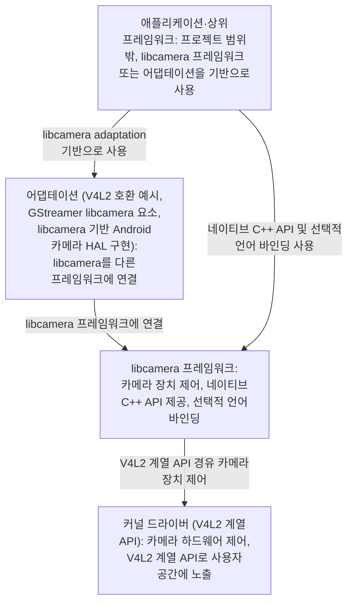
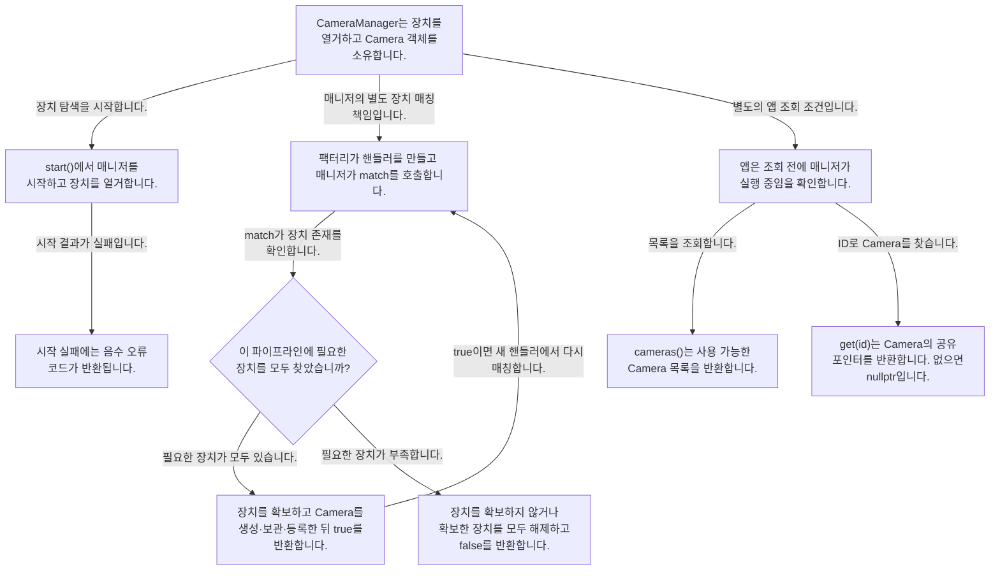
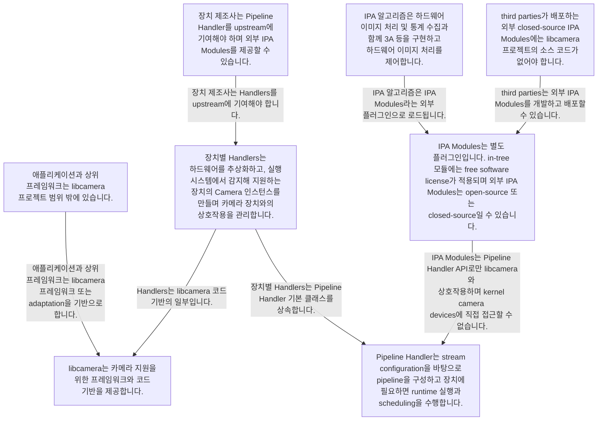

# Architecture

카메라 스택의 계층과 각 구성 요소의 역할, 카메라 탐색 과정과 구성 요소 사이의 경계를 살펴보세요.

## 카메라 스택의 네 계층

[Mermaid 원문](https://ttolsun.github.io/libcamera-sdd/index.camera-stack.mmd)

그림 근거와 확인 범위

애플리케이션부터 커널 드라이버까지 네 소프트웨어 계층은 각각 어떤 역할을 맡습니까? 카메라 하드웨어 자체, 지원 기종, 성능은 이 그림의 범위가 아닙니다.

소스 연결 해석 · 자동 연결 검사만 통과 · 의미와 기기 실행은 검증 전

| 요소·전이 | 소스 근거 |
| --- | --- |
| 애플리케이션·상위 프레임워크: 프로젝트 범위 밖, libcamera 프레임워크 또는 어댑테이션을 기반으로 사용 | [Documentation/introduction.rst:137](https://ttolsun.github.io/libcamera-sdd/reader-archive/vendor-overview.html#source-e3b563f549a8c46d) |
| 어댑테이션 (V4L2 호환 예시, GStreamer libcamera 요소, libcamera 기반 Android 카메라 HAL 구현): libcamera를 다른 프레임워크에 연결 | [Documentation/introduction.rst:137](https://ttolsun.github.io/libcamera-sdd/reader-archive/vendor-overview.html#source-e3b563f549a8c46d) |
| libcamera 프레임워크: 카메라 장치 제어, 네이티브 C++ API 제공, 선택적 언어 바인딩 | [Documentation/introduction.rst:137](https://ttolsun.github.io/libcamera-sdd/reader-archive/vendor-overview.html#source-e3b563f549a8c46d) |
| 커널 드라이버 (V4L2 계열 API): 카메라 하드웨어 제어, V4L2 계열 API로 사용자 공간에 노출 | [Documentation/introduction.rst:137](https://ttolsun.github.io/libcamera-sdd/reader-archive/vendor-overview.html#source-e3b563f549a8c46d) |
| libcamera adaptation 기반으로 사용 | [Documentation/introduction.rst:137](https://ttolsun.github.io/libcamera-sdd/reader-archive/vendor-overview.html#source-e3b563f549a8c46d) |
| libcamera 프레임워크에 연결 | [Documentation/introduction.rst:137](https://ttolsun.github.io/libcamera-sdd/reader-archive/vendor-overview.html#source-e3b563f549a8c46d) |
| V4L2 계열 API 경유 카메라 장치 제어 | [Documentation/introduction.rst:137](https://ttolsun.github.io/libcamera-sdd/reader-archive/vendor-overview.html#source-e3b563f549a8c46d) |
| 네이티브 C++ API 및 선택적 언어 바인딩 사용 | [Documentation/introduction.rst:137](https://ttolsun.github.io/libcamera-sdd/reader-archive/vendor-overview.html#source-e3b563f549a8c46d) |

## 컴포넌트별 책임

`Camera`는 하나의 이미지 소스에서 하나 이상의 이미지 스트림을 생성할 수 있는 카메라를 모델링하며, 장치 설정과 제어 및 이미지 스트림 캡처를 위한 주 인터페이스를 제공하는 libcamera의 중심 객체입니다. libcamera는 카메라 인스턴스의 수명을 `std::shared_ptr<>`로 관리하며, 인스턴스는 공유 포인터를 반환하는 `create()` 함수로 생성해야 합니다. `Camera`의 생성자와 소멸자는 비공개이므로 인스턴스를 수동으로 생성하거나 파괴할 수 없습니다.

절 전체 근거 1개

- `src/libcamera/camera.cpp`[`L758` 발췌](https://ttolsun.github.io/libcamera-sdd/reader-archive/overview.html#source-6c066281dcce33d6) · [전체 소스 `L758`](https://github.com/TTolsun/libcamera-sdd/blob/adfa719f8ed67d18fd8a0739fc088a1f8b9e7252/src/libcamera/camera.cpp#L758)

## 탐색과 파이프라인 선택

`CameraManager`는 libcamera의 진입점으로, 장치를 열거하고 파이프라인과 연결하며 애플리케이션이 시스템의 카메라에 접근할 수 있게 합니다. `CameraManager::Private::pipelineFactoryMatch`는 팩토리에서 `PipelineHandler`를 반복해서 생성하고 `enumerator_`로 일치를 확인하며, 일치하지 않으면 반복을 끝냅니다. `CameraManager` 인스턴스는 동시에 하나만 존재할 수 있습니다. 기존 인스턴스를 삭제하지 않고 두 번째 인스턴스를 생성하려고 하면 동작이 정의되지 않습니다.

### 장치 탐색에서 Camera 접근까지

[Mermaid 원문](https://ttolsun.github.io/libcamera-sdd/overview.discovery-map.mmd)

그림 근거와 확인 범위

CameraManager는 어떻게 장치를 매칭하고 카메라를 등록하며, 앱은 어떤 조건에서 카메라를 조회할 수 있습니까?

소스 연결 해석 · 자동 연결 검사만 통과 · 의미와 기기 실행은 검증 전

| 요소·전이 | 소스 근거 |
| --- | --- |
| CameraManager는 장치를 열거하고 Camera 객체를 소유합니다. | [src/libcamera/camera_manager.cpp:283](https://ttolsun.github.io/libcamera-sdd/reader-archive/overview.html#source-f75d22cf73f3402d) |
| start()에서 매니저를 시작하고 장치를 열거합니다. | [src/libcamera/camera_manager.cpp:329](https://ttolsun.github.io/libcamera-sdd/reader-archive/overview.html#source-f58d94d893e03971) |
| 시작 실패에는 음수 오류 코드가 반환됩니다. | [src/libcamera/camera_manager.cpp:329](https://ttolsun.github.io/libcamera-sdd/reader-archive/overview.html#source-f58d94d893e03971) |
| 팩터리가 핸들러를 만들고 매니저가 match를 호출합니다. | [src/libcamera/camera_manager.cpp:154](https://ttolsun.github.io/libcamera-sdd/reader-archive/overview.html#source-0c01857bf49370e2) |
| 이 파이프라인에 필요한 장치를 모두 찾았습니까? | [src/libcamera/pipeline_handler.cpp:86](https://ttolsun.github.io/libcamera-sdd/reader-archive/overview.html#source-5bbd41c1e725138c) |
| 장치를 확보하고 Camera를 생성·보관·등록한 뒤 true를 반환합니다. | [src/libcamera/pipeline_handler.cpp:86](https://ttolsun.github.io/libcamera-sdd/reader-archive/overview.html#source-5bbd41c1e725138c) |
| 장치를 확보하지 않거나 확보한 장치를 모두 해제하고 false를 반환합니다. | [src/libcamera/pipeline_handler.cpp:86](https://ttolsun.github.io/libcamera-sdd/reader-archive/overview.html#source-5bbd41c1e725138c) |
| 앱은 조회 전에 매니저가 실행 중임을 확인합니다. | [src/libcamera/camera_manager.cpp:329](https://ttolsun.github.io/libcamera-sdd/reader-archive/overview.html#source-f58d94d893e03971) · [src/libcamera/camera_manager.cpp:368](https://ttolsun.github.io/libcamera-sdd/reader-archive/overview.html#source-0c733673790ad84f) |
| cameras()는 사용 가능한 Camera 목록을 반환합니다. | [src/libcamera/camera_manager.cpp:368](https://ttolsun.github.io/libcamera-sdd/reader-archive/overview.html#source-0c733673790ad84f) |
| get(id)는 Camera의 공유 포인터를 반환합니다. 없으면 nullptr입니다. | [src/libcamera/camera_manager.cpp:368](https://ttolsun.github.io/libcamera-sdd/reader-archive/overview.html#source-0c733673790ad84f) |
| 장치 탐색을 시작합니다. | [src/libcamera/camera_manager.cpp:283](https://ttolsun.github.io/libcamera-sdd/reader-archive/overview.html#source-f75d22cf73f3402d) · [src/libcamera/camera_manager.cpp:329](https://ttolsun.github.io/libcamera-sdd/reader-archive/overview.html#source-f58d94d893e03971) |
| 매니저의 별도 장치 매칭 책임입니다. | [src/libcamera/camera_manager.cpp:283](https://ttolsun.github.io/libcamera-sdd/reader-archive/overview.html#source-f75d22cf73f3402d) · [src/libcamera/camera_manager.cpp:154](https://ttolsun.github.io/libcamera-sdd/reader-archive/overview.html#source-0c01857bf49370e2) |
| 시작 결과가 실패입니다. | [src/libcamera/camera_manager.cpp:329](https://ttolsun.github.io/libcamera-sdd/reader-archive/overview.html#source-f58d94d893e03971) |
| match가 장치 존재를 확인합니다. | [src/libcamera/camera_manager.cpp:154](https://ttolsun.github.io/libcamera-sdd/reader-archive/overview.html#source-0c01857bf49370e2) · [src/libcamera/pipeline_handler.cpp:86](https://ttolsun.github.io/libcamera-sdd/reader-archive/overview.html#source-5bbd41c1e725138c) |
| 필요한 장치가 모두 있습니다. | [src/libcamera/pipeline_handler.cpp:86](https://ttolsun.github.io/libcamera-sdd/reader-archive/overview.html#source-5bbd41c1e725138c) |
| 필요한 장치가 부족합니다. | [src/libcamera/pipeline_handler.cpp:86](https://ttolsun.github.io/libcamera-sdd/reader-archive/overview.html#source-5bbd41c1e725138c) |
| true이면 새 핸들러에서 다시 매칭합니다. | [src/libcamera/pipeline_handler.cpp:86](https://ttolsun.github.io/libcamera-sdd/reader-archive/overview.html#source-5bbd41c1e725138c) · [src/libcamera/camera_manager.cpp:154](https://ttolsun.github.io/libcamera-sdd/reader-archive/overview.html#source-0c01857bf49370e2) |
| 별도의 앱 조회 조건입니다. | [src/libcamera/camera_manager.cpp:283](https://ttolsun.github.io/libcamera-sdd/reader-archive/overview.html#source-f75d22cf73f3402d) · [src/libcamera/camera_manager.cpp:329](https://ttolsun.github.io/libcamera-sdd/reader-archive/overview.html#source-f58d94d893e03971) · [src/libcamera/camera_manager.cpp:368](https://ttolsun.github.io/libcamera-sdd/reader-archive/overview.html#source-0c733673790ad84f) |
| 목록을 조회합니다. | [src/libcamera/camera_manager.cpp:329](https://ttolsun.github.io/libcamera-sdd/reader-archive/overview.html#source-f58d94d893e03971) · [src/libcamera/camera_manager.cpp:368](https://ttolsun.github.io/libcamera-sdd/reader-archive/overview.html#source-0c733673790ad84f) |
| ID로 Camera를 찾습니다. | [src/libcamera/camera_manager.cpp:329](https://ttolsun.github.io/libcamera-sdd/reader-archive/overview.html#source-f58d94d893e03971) · [src/libcamera/camera_manager.cpp:368](https://ttolsun.github.io/libcamera-sdd/reader-archive/overview.html#source-0c733673790ad84f) |

애플리케이션은 `CameraManager::start()`의 시작이 확인된 뒤부터 카메라 관리자가 중지되거나 해당 카메라가 시스템에서 분리될 때까지 카메라를 나열하고 사용할 수 있습니다. 호출자는 `CameraManager::cameras()`와 `CameraManager::get()`을 호출하기 전에 카메라 매니저가 실행 중인지 확인해야 합니다. `PipelineHandler::match()` 구현자는 필요한 미디어 장치를 모두 찾으면 각 장치를 `MediaDevice::acquire()`로 획득하고, 해당 `Camera` 인스턴스를 생성해 내부에 저장하고 카메라 관리자에 등록한 뒤 `true`를 반환해야 합니다. 필요한 장치를 모두 찾지 못하면 `match()` 구현자는 어떤 미디어 장치도 획득하지 않거나 이미 획득한 장치를 `MediaDevice::release()`로 모두 해제하고 `false`를 반환해야 합니다.

절 전체 근거 5개

- `src/libcamera/camera_manager.cpp`[`L283` 발췌](https://ttolsun.github.io/libcamera-sdd/reader-archive/overview.html#source-f75d22cf73f3402d) · [전체 소스 `L283`](https://github.com/TTolsun/libcamera-sdd/blob/adfa719f8ed67d18fd8a0739fc088a1f8b9e7252/src/libcamera/camera_manager.cpp#L283) · [`L154` 발췌](https://ttolsun.github.io/libcamera-sdd/reader-archive/overview.html#source-0c01857bf49370e2) · [전체 소스 `L154`](https://github.com/TTolsun/libcamera-sdd/blob/adfa719f8ed67d18fd8a0739fc088a1f8b9e7252/src/libcamera/camera_manager.cpp#L154) · [`L329` 발췌](https://ttolsun.github.io/libcamera-sdd/reader-archive/overview.html#source-f58d94d893e03971) · [전체 소스 `L329`](https://github.com/TTolsun/libcamera-sdd/blob/adfa719f8ed67d18fd8a0739fc088a1f8b9e7252/src/libcamera/camera_manager.cpp#L329) · [`L368` 발췌](https://ttolsun.github.io/libcamera-sdd/reader-archive/overview.html#source-0c733673790ad84f) · [전체 소스 `L368`](https://github.com/TTolsun/libcamera-sdd/blob/adfa719f8ed67d18fd8a0739fc088a1f8b9e7252/src/libcamera/camera_manager.cpp#L368)
- `src/libcamera/pipeline_handler.cpp`[`L86` 발췌](https://ttolsun.github.io/libcamera-sdd/reader-archive/overview.html#source-5bbd41c1e725138c) · [전체 소스 `L86`](https://github.com/TTolsun/libcamera-sdd/blob/adfa719f8ed67d18fd8a0739fc088a1f8b9e7252/src/libcamera/pipeline_handler.cpp#L86)

## 다른 팀·계층과의 경계

libcamera 프레임워크(소프트웨어 개발의 기반 구조) 또는 libcamera를 맞춰 적용한 것을 기반으로 하는 애플리케이션(응용 프로그램)과 상위 수준 프레임워크는 libcamera 프로젝트의 범위 밖에 있습니다.

### 다른 팀·계층과의 경계의 관계와 경계

[Mermaid 원문](https://ttolsun.github.io/libcamera-sdd/team-overview.item-boundaries.mmd)

그림 근거와 확인 범위

애플리케이션, libcamera, 장치 제조사, Pipeline Handler와 IPA Module 사이에서 프로젝트 범위와 책임은 어떻게 나뉩니까?

소스 연결 해석 · 자동 연결 검사만 통과 · 의미와 기기 실행은 검증 전

| 요소·전이 | 소스 근거 |
| --- | --- |
| 애플리케이션과 상위 프레임워크는 libcamera 프로젝트 범위 밖에 있습니다. | [Documentation/introduction.rst:163](https://ttolsun.github.io/libcamera-sdd/reader-archive/team-overview.html#source-9e653b8ff755db78) |
| libcamera는 카메라 지원을 위한 프레임워크와 코드 기반을 제공합니다. | [Documentation/introduction.rst:163](https://ttolsun.github.io/libcamera-sdd/reader-archive/team-overview.html#source-9e653b8ff755db78) · [Documentation/introduction.rst:200](https://ttolsun.github.io/libcamera-sdd/reader-archive/team-overview.html#source-341442e08591ef50) |
| 장치 제조사는 Pipeline Handler를 upstream에 기여해야 하며 외부 IPA Modules를 제공할 수 있습니다. | [Documentation/introduction.rst:200](https://ttolsun.github.io/libcamera-sdd/reader-archive/team-overview.html#source-341442e08591ef50) · [Documentation/libcamera_architecture.rst:109](https://ttolsun.github.io/libcamera-sdd/reader-archive/team-overview.html#source-1f130cc8640ef810) |
| 장치별 Handlers는 하드웨어를 추상화하고, 실행 시스템에서 감지해 지원하는 장치의 Camera 인스턴스를 만들며 카메라 장치와의 상호작용을 관리합니다. | [Documentation/libcamera_architecture.rst:87](https://ttolsun.github.io/libcamera-sdd/reader-archive/team-overview.html#source-8bd888bd0473995e) |
| Pipeline Handler는 stream configuration을 바탕으로 pipeline을 구성하고 장치에 필요하면 runtime 실행과 scheduling을 수행합니다. | [Documentation/libcamera_architecture.rst:87](https://ttolsun.github.io/libcamera-sdd/reader-archive/team-overview.html#source-8bd888bd0473995e) |
| IPA 알고리즘은 하드웨어 이미지 처리 및 통계 수집과 함께 3A 등을 구현하고 하드웨어 이미지 처리를 제어합니다. | [Documentation/libcamera_architecture.rst:109](https://ttolsun.github.io/libcamera-sdd/reader-archive/team-overview.html#source-1f130cc8640ef810) |
| IPA Modules는 별도 플러그인입니다. in-tree 모듈에는 free software license가 적용되며 외부 IPA Modules는 open-source 또는 closed-source일 수 있습니다. | [Documentation/libcamera_architecture.rst:109](https://ttolsun.github.io/libcamera-sdd/reader-archive/team-overview.html#source-1f130cc8640ef810) · [Documentation/introduction.rst:200](https://ttolsun.github.io/libcamera-sdd/reader-archive/team-overview.html#source-341442e08591ef50) |
| third parties가 배포하는 외부 closed-source IPA Modules에는 libcamera 프로젝트의 소스 코드가 없어야 합니다. | [Documentation/introduction.rst:200](https://ttolsun.github.io/libcamera-sdd/reader-archive/team-overview.html#source-341442e08591ef50) |
| 애플리케이션과 상위 프레임워크는 libcamera 프레임워크 또는 adaptation을 기반으로 합니다. | [Documentation/introduction.rst:163](https://ttolsun.github.io/libcamera-sdd/reader-archive/team-overview.html#source-9e653b8ff755db78) |
| Handlers는 libcamera 코드 기반의 일부입니다. | [Documentation/introduction.rst:200](https://ttolsun.github.io/libcamera-sdd/reader-archive/team-overview.html#source-341442e08591ef50) |
| 장치 제조사는 Handlers를 upstream에 기여해야 합니다. | [Documentation/introduction.rst:200](https://ttolsun.github.io/libcamera-sdd/reader-archive/team-overview.html#source-341442e08591ef50) |
| 장치별 Handlers는 Pipeline Handler 기본 클래스를 상속합니다. | [Documentation/libcamera_architecture.rst:87](https://ttolsun.github.io/libcamera-sdd/reader-archive/team-overview.html#source-8bd888bd0473995e) |
| IPA 알고리즘은 IPA Modules라는 외부 플러그인으로 로드됩니다. | [Documentation/libcamera_architecture.rst:109](https://ttolsun.github.io/libcamera-sdd/reader-archive/team-overview.html#source-1f130cc8640ef810) |
| third parties는 외부 IPA Modules를 개발하고 배포할 수 있습니다. | [Documentation/introduction.rst:200](https://ttolsun.github.io/libcamera-sdd/reader-archive/team-overview.html#source-341442e08591ef50) |
| IPA Modules는 Pipeline Handler API로만 libcamera와 상호작용하며 kernel camera devices에 직접 접근할 수 없습니다. | [Documentation/libcamera_architecture.rst:120](https://ttolsun.github.io/libcamera-sdd/reader-archive/team-overview.html#source-6c10d5aeb8fc7ca9) · [Documentation/libcamera_architecture.rst:109](https://ttolsun.github.io/libcamera-sdd/reader-archive/team-overview.html#source-1f130cc8640ef810) |

Pipeline Handler(파이프라인 처리기)는 장치별 파이프라인을 관리하며, 장치 제조사는 이를 libcamera에 기여해야 합니다. 이미지 처리 알고리즘(`Image` Processing Algorithms, IPA)은 상위 계층의 매개변수를 바탕으로 하드웨어 이미지 처리를 제어하며, IPA `Module`(IPA 모듈)은 외부에서 별도로 제공할 수 있습니다. libcamera에 포함된 IPA `Module`에는 자유 소프트웨어 라이선스가 적용되며, 외부 모듈은 libcamera 프로젝트의 소스 코드를 포함하지 않는 조건으로 비공개 소스 라이선스로 배포할 수 있습니다. IPA `Module`은 libcamera와 Pipeline Handler가 제공하는 API(응용 프로그램 인터페이스)로만 상호작용하며 kernel camera devices(커널 카메라 장치)에 직접 접근할 수 없습니다.

절 전체 근거 5개

- `Documentation/introduction.rst`[`L163` 발췌](https://ttolsun.github.io/libcamera-sdd/reader-archive/team-overview.html#source-9e653b8ff755db78) · [전체 소스 `L163`](https://github.com/TTolsun/libcamera-sdd/blob/adfa719f8ed67d18fd8a0739fc088a1f8b9e7252/Documentation/introduction.rst#L163) · [`L200` 발췌](https://ttolsun.github.io/libcamera-sdd/reader-archive/team-overview.html#source-341442e08591ef50) · [전체 소스 `L200`](https://github.com/TTolsun/libcamera-sdd/blob/adfa719f8ed67d18fd8a0739fc088a1f8b9e7252/Documentation/introduction.rst#L200)
- `Documentation/libcamera_architecture.rst`[`L87` 발췌](https://ttolsun.github.io/libcamera-sdd/reader-archive/team-overview.html#source-8bd888bd0473995e) · [전체 소스 `L87`](https://github.com/TTolsun/libcamera-sdd/blob/adfa719f8ed67d18fd8a0739fc088a1f8b9e7252/Documentation/libcamera_architecture.rst#L87) · [`L109` 발췌](https://ttolsun.github.io/libcamera-sdd/reader-archive/team-overview.html#source-1f130cc8640ef810) · [전체 소스 `L109`](https://github.com/TTolsun/libcamera-sdd/blob/adfa719f8ed67d18fd8a0739fc088a1f8b9e7252/Documentation/libcamera_architecture.rst#L109) · [`L120` 발췌](https://ttolsun.github.io/libcamera-sdd/reader-archive/team-overview.html#source-6c10d5aeb8fc7ca9) · [전체 소스 `L120`](https://github.com/TTolsun/libcamera-sdd/blob/adfa719f8ed67d18fd8a0739fc088a1f8b9e7252/Documentation/libcamera_architecture.rst#L120)

## 선택한 시나리오의 코드 읽기 순서

1. 진입점 `Camera::queueRequest(Request *)`의 입력 검사와 반환 조건을 확인합니다.
2. [요청 제출 (Camera::queueRequest)](https://ttolsun.github.io/libcamera-sdd/request-flow.html)에서 주요 호출과 추적 경계를 확인합니다.
3. 예약된 호출과 완료 통지를 구분하고, 실행 스레드는 연결 코드와 대조합니다.

## 원고와 검토 기록

libcamera 설계 문서

- **문서 간 계약**: [자동 대조 보고서](https://ttolsun.github.io/libcamera-sdd/contract-consistency.json) · 사람 검토 전

[이전 주소의 상세 내용 열기](https://ttolsun.github.io/libcamera-sdd/reader-archive/index.html#page-evidence)

시스템 개요

- **생성 방식**: 추출 사실과 LLM 설명
- **검증 범위**: 표·그림은 facts로 만들고 설명은 LLM이 작성합니다. 인용·문장 및 설정된 구조 검사를 적용합니다.
- **자동 검사**: 통과 (`ok`). 검사한 항목은 검증 범위에 적혀 있습니다. 설명 내용이 맞는지는 사람이 확인합니다.
- **사람 검토**: 사람 검토 전
- **분석 기준 커밋**: `adfa719f8ed67d18fd8a0739fc088a1f8b9e7252`
- **문서 생성 시각**: `2026-11-20 17:39:13+00:00`
- **문장 생성 모델**: `cli/codex/gpt-6.1-terra`
- **문서 간 계약**: [자동 대조 보고서](https://ttolsun.github.io/libcamera-sdd/contract-consistency.json) · 사람 검토 전
- **독자 범위**: [과업별 답변과 미검토 범위](https://ttolsun.github.io/libcamera-sdd/reader-scope.json)

원고 작성 당시 기록

원고에 저장된 당시 기록입니다. 현재 문서의 기준과 다를 수 있습니다.

- 근거 파일: `include/libcamera/camera.h`, `include/libcamera/camera_manager.h`, `include/libcamera/internal/ipa_manager.h`, `include/libcamera/internal/pipeline_handler.h`, `include/libcamera/request.h`, `src/libcamera/base/log.cpp`, `src/libcamera/camera.cpp`, `src/libcamera/camera_manager.cpp`, `src/libcamera/controls.cpp`, `src/libcamera/ipa_manager.cpp`, `src/libcamera/pipeline_handler.cpp`, `src/libcamera/request.cpp`
- 근거 수준: 코드 확인 (정적 분석, simple_compdb 구성, commit `adfa719f8e`)
- 자동 검사 (인용·문장 및 설정된 구조 검사): 통과
- 검토 상태 기록일: 2026-11-21 · 사람 검토 전

[Markdown 원문 ↗](https://ttolsun.github.io/libcamera-sdd/overview.md) [Mermaid 원문 ↗](https://ttolsun.github.io/libcamera-sdd/overview.mmd)

[이전 주소의 상세 내용 열기](https://ttolsun.github.io/libcamera-sdd/reader-archive/overview.html#page-evidence)

이 프로젝트가 하는 일

- **생성 방식**: 추출 사실과 LLM 설명
- **검증 범위**: 표·그림은 facts로 만들고 설명은 LLM이 작성합니다. 인용·문장 및 설정된 구조 검사를 적용합니다.
- **자동 검사**: 통과 (`ok`). 검사한 항목은 검증 범위에 적혀 있습니다. 설명 내용이 맞는지는 사람이 확인합니다.
- **사람 검토**: 사람 검토 전
- **분석 기준 커밋**: `adfa719f8ed67d18fd8a0739fc088a1f8b9e7252`
- **문서 생성 시각**: `2026-11-11 20:35:47+00:00`
- **문장 생성 모델**: `cli/codex/gpt-6.1-terra`
- **문서 간 계약**: [자동 대조 보고서](https://ttolsun.github.io/libcamera-sdd/contract-consistency.json) · 사람 검토 전
- **독자 범위**: [과업별 답변과 미검토 범위](https://ttolsun.github.io/libcamera-sdd/reader-scope.json)

원고 작성 당시 기록

원고에 저장된 당시 기록입니다. 현재 문서의 기준과 다를 수 있습니다.

- 근거 파일: `Documentation/introduction.rst`, `Documentation/libcamera_architecture.rst`, `include/libcamera/camera.h`, `include/libcamera/camera_manager.h`, `include/libcamera/internal/pipeline_handler.h`, `src/libcamera/camera.cpp`, `src/libcamera/camera_manager.cpp`, `src/libcamera/pipeline_handler.cpp`
- 근거 수준: 코드 확인 (정적 분석, simple_compdb 구성, commit `c19d05128f`)
- 자동 검사 (인용·문장 및 설정된 구조 검사): 통과
- 검토 상태 기록일: 2026-11-12 · 사람 검토 전

[Markdown 원문 ↗](https://ttolsun.github.io/libcamera-sdd/team-overview.md)

[이전 주소의 상세 내용 열기](https://ttolsun.github.io/libcamera-sdd/reader-archive/team-overview.html#page-evidence)

[이 페이지 Markdown 받기](https://ttolsun.github.io/libcamera-sdd/architecture.md) · [독자용 문서의 원본 위치](https://ttolsun.github.io/libcamera-sdd/reader-edition.json)
