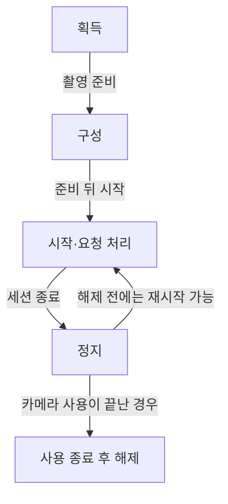
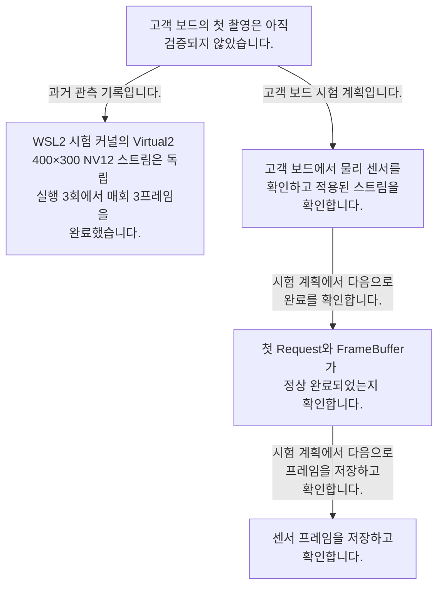
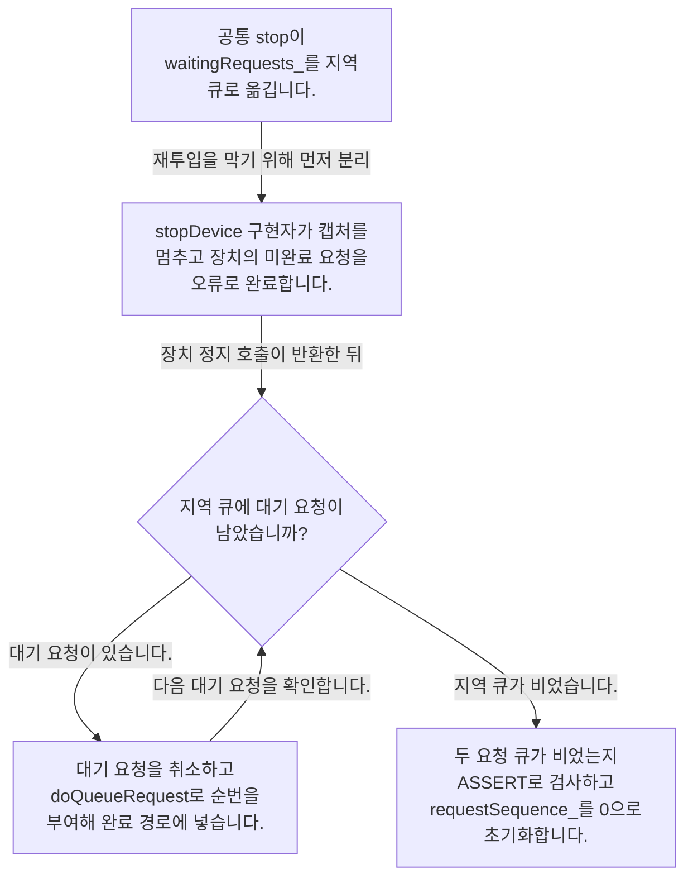
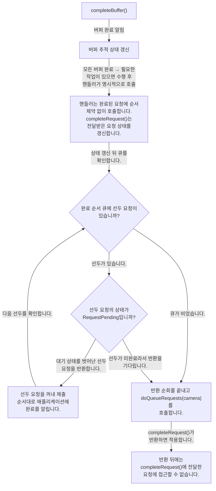

# 장치 연동과 검증

장치를 연동한 뒤 첫 촬영과 미완료 요청이 있는 상태에서의 정지를 각각 시험하세요. 공개 가상 카메라에서 관찰한 결과와 대상 보드에서 확인할 항목을 구분해 기록하세요.

- [정지 뒤 완료 알림과 상태 판정](https://ttolsun.github.io/libcamera-sdd/request-flow.html#stop-and-disconnect)

## 연동 순서와 책임

애플리케이션은 촬영을 준비하려면 카메라를 확보하고 구성해야 하며, 카메라를 시작하면 정지할 때까지 요청을 처리할 수 있고, 사용을 마치면 카메라를 해제해야 합니다. 애플리케이션은 카메라를 해제하지 않은 동안 여러 번 시작하고 정지할 수 있으며, 카메라를 재구성할 수도 있습니다. `Camera` 클래스는 카메라 상태에 영향을 주는 함수들을 일반적으로 서로 동기화하지 않으므로, 필요한 경우 호출자가 동기화해야 합니다.

### 획득부터 해제까지의 연동 순서

[Mermaid 원문](https://ttolsun.github.io/libcamera-sdd/vendor-integration.integration-stages.mmd)

그림 근거와 확인 범위

애플리케이션의 세션 준비와 종료 순서입니다. 시작·정지는 해제 전까지 반복할 수 있습니다.

소스 연결 해석 · 자동 연결 검사만 통과 · 의미와 기기 실행은 검증 전

| 요소·전이 | 소스 근거 |
| --- | --- |
| 획득 | [src/libcamera/camera.cpp:771](https://ttolsun.github.io/libcamera-sdd/reader-archive/vendor-integration.html#source-2683b4a5a1dbfee9) |
| 구성 | [src/libcamera/camera.cpp:771](https://ttolsun.github.io/libcamera-sdd/reader-archive/vendor-integration.html#source-2683b4a5a1dbfee9) |
| 시작·요청 처리 | [src/libcamera/camera.cpp:771](https://ttolsun.github.io/libcamera-sdd/reader-archive/vendor-integration.html#source-2683b4a5a1dbfee9) |
| 정지 | [src/libcamera/camera.cpp:771](https://ttolsun.github.io/libcamera-sdd/reader-archive/vendor-integration.html#source-2683b4a5a1dbfee9) |
| 사용 종료 후 해제 | [src/libcamera/camera.cpp:771](https://ttolsun.github.io/libcamera-sdd/reader-archive/vendor-integration.html#source-2683b4a5a1dbfee9) |
| 촬영 준비 | [src/libcamera/camera.cpp:771](https://ttolsun.github.io/libcamera-sdd/reader-archive/vendor-integration.html#source-2683b4a5a1dbfee9) |
| 준비 뒤 시작 | [src/libcamera/camera.cpp:771](https://ttolsun.github.io/libcamera-sdd/reader-archive/vendor-integration.html#source-2683b4a5a1dbfee9) |
| 세션 종료 | [src/libcamera/camera.cpp:771](https://ttolsun.github.io/libcamera-sdd/reader-archive/vendor-integration.html#source-2683b4a5a1dbfee9) |
| 카메라 사용이 끝난 경우 | [src/libcamera/camera.cpp:771](https://ttolsun.github.io/libcamera-sdd/reader-archive/vendor-integration.html#source-2683b4a5a1dbfee9) |
| 해제 전에는 재시작 가능 | [src/libcamera/camera.cpp:777](https://ttolsun.github.io/libcamera-sdd/reader-archive/vendor-integration.html#source-948bd80fa1136291) |

절 전체 근거 4개

- `src/libcamera/camera.cpp`[`L771` 발췌](https://ttolsun.github.io/libcamera-sdd/reader-archive/vendor-integration.html#source-2683b4a5a1dbfee9) · [전체 소스 `L771`](https://github.com/TTolsun/libcamera-sdd/blob/adfa719f8ed67d18fd8a0739fc088a1f8b9e7252/src/libcamera/camera.cpp#L771) · [`L777` 발췌](https://ttolsun.github.io/libcamera-sdd/reader-archive/vendor-integration.html#source-948bd80fa1136291) · [전체 소스 `L777`](https://github.com/TTolsun/libcamera-sdd/blob/adfa719f8ed67d18fd8a0739fc088a1f8b9e7252/src/libcamera/camera.cpp#L777) · [`L780` 발췌](https://ttolsun.github.io/libcamera-sdd/reader-archive/vendor-integration.html#source-cc6c66b57cf028e6) · [전체 소스 `L780`](https://github.com/TTolsun/libcamera-sdd/blob/adfa719f8ed67d18fd8a0739fc088a1f8b9e7252/src/libcamera/camera.cpp#L780) · [`L1032`](https://ttolsun.github.io/libcamera-sdd/reader-archive/vendor-integration.html#source-492118d913b10361)

## 고객 보드의 첫 촬영을 검증했습니까?

이 기록으로 고객 보드의 첫 촬영을 검증했다고 보고할 수 없습니다. WSL2 시험 구성에서 물리 센서 대신 가상 카메라 Virtual2를 사용했으며, 고객 보드의 물리 센서로 촬영한 기록은 없습니다.

### 가상 캡처 관측과 고객 보드 시험

[Mermaid 원문](https://ttolsun.github.io/libcamera-sdd/vendor-assurance.first-capture-boundary.mmd)

그림 근거와 확인 범위

WSL2에서 확인한 범위는 어디까지이며 고객 보드에서는 어떤 순서로 첫 촬영을 확인합니까?

소스 연결 해석 · 자동 연결 검사만 통과 · 의미와 기기 실행은 검증 전

LLM 그림 초안 · 사람 검토 전

작성 모델: `cli/codex/gpt-6.1-terra`

| 요소·전이 | 소스 근거 |
| --- | --- |
| 고객 보드의 첫 촬영은 아직 검증되지 않았습니다. | [product-evidence/libcamera-first-capture-trial/virtual-first-capture-run.txt:1](https://ttolsun.github.io/libcamera-sdd/reader-archive/vendor-assurance.html#source-3c4ba1aba4901083) |
| WSL2 시험 커널의 Virtual2 400×300 NV12 스트림은 독립 실행 3회에서 매회 3프레임을 완료했습니다. | [product-evidence/libcamera-first-capture-trial/virtual-first-capture-run.txt:1](https://ttolsun.github.io/libcamera-sdd/reader-archive/vendor-assurance.html#source-3c4ba1aba4901083) |
| 고객 보드에서 물리 센서를 확인하고 적용된 스트림을 확인합니다. | [product-evidence/libcamera-first-capture-trial/virtual-first-capture-run.txt:1](https://ttolsun.github.io/libcamera-sdd/reader-archive/vendor-assurance.html#source-3c4ba1aba4901083) · [README.rst:107](https://ttolsun.github.io/libcamera-sdd/reader-archive/vendor-assurance.html#source-ce71f2f0de50caf3) · [include/libcamera/camera.h:126](https://ttolsun.github.io/libcamera-sdd/reader-archive/vendor-assurance.html#source-aba605be681da98e) |
| 첫 Request와 FrameBuffer가 정상 완료되었는지 확인합니다. | [include/libcamera/camera.h:126](https://ttolsun.github.io/libcamera-sdd/reader-archive/vendor-assurance.html#source-aba605be681da98e) · [include/libcamera/request.h:34](https://ttolsun.github.io/libcamera-sdd/reader-archive/vendor-assurance.html#source-cb2be6f3ec7f91fc) · [include/libcamera/framebuffer.h:25](https://ttolsun.github.io/libcamera-sdd/reader-archive/vendor-assurance.html#source-094e6fd7ddda824a) |
| 센서 프레임을 저장하고 확인합니다. | [include/libcamera/camera.h:126](https://ttolsun.github.io/libcamera-sdd/reader-archive/vendor-assurance.html#source-aba605be681da98e) · [README.rst:107](https://ttolsun.github.io/libcamera-sdd/reader-archive/vendor-assurance.html#source-ce71f2f0de50caf3) |
| 과거 관측 기록입니다. | [product-evidence/libcamera-first-capture-trial/virtual-first-capture-run.txt:1](https://ttolsun.github.io/libcamera-sdd/reader-archive/vendor-assurance.html#source-3c4ba1aba4901083) |
| 고객 보드 시험 계획입니다. | [product-evidence/libcamera-first-capture-trial/virtual-first-capture-run.txt:1](https://ttolsun.github.io/libcamera-sdd/reader-archive/vendor-assurance.html#source-3c4ba1aba4901083) · [README.rst:107](https://ttolsun.github.io/libcamera-sdd/reader-archive/vendor-assurance.html#source-ce71f2f0de50caf3) |
| 시험 계획에서 다음으로 완료를 확인합니다. | [include/libcamera/camera.h:126](https://ttolsun.github.io/libcamera-sdd/reader-archive/vendor-assurance.html#source-aba605be681da98e) · [README.rst:107](https://ttolsun.github.io/libcamera-sdd/reader-archive/vendor-assurance.html#source-ce71f2f0de50caf3) |
| 시험 계획에서 다음으로 프레임을 저장하고 확인합니다. | [include/libcamera/camera.h:126](https://ttolsun.github.io/libcamera-sdd/reader-archive/vendor-assurance.html#source-aba605be681da98e) · [README.rst:107](https://ttolsun.github.io/libcamera-sdd/reader-archive/vendor-assurance.html#source-ce71f2f0de50caf3) |

libcamera 공식 프로젝트 문서에서 확인할 수 있는 범위에서, Virtual Pipeline Handler는 테스트용 가상 외부 카메라를 모사합니다. 예제 YAML은 Virtual2에 400×300 크기와 `lines` 테스트 패턴을 지정합니다.

2026년 10월 31일의 가상 캡처 시험에서는 소스 커밋 293d751a814e0d4c34e85ad457ccd9d5eefd1a61과 내장 udmabuf를 갖춘 WSL2 시험 커널 6.18.33.2-microsoft-standard-WSL2-issue211을 사용했습니다. Virtual2에서 400×300 NV12로 별도 프로세스마다 실행한 3회 모두 각각 3프레임을 완료했습니다. 이 관측은 물리 카메라나 보드 DMA의 검증을 의미하지 않습니다.

고객 보드의 첫 촬영 시험에서는 보드와 물리 센서, 커널·드라이버, libcamera 빌드 및 대상 애플리케이션을 기록하고 실제 센서를 열어 적용된 스트림 형식과 크기를 확인합니다. 첫 요청의 RequestComplete와 버퍼의 FrameSuccess를 확인하고 센서에서 들어온 프레임을 저장해 확인하며, 기본 시험 도구의 저장 기능 예시로 cam을 사용할 수 있습니다. 기존 기록은 WSL2 시험 커널의 udmabuf와 Virtual2를 사용한 시험 구성에 한정되며 물리 카메라, 물리 DMA 및 제품 애플리케이션은 검증되지 않았습니다.

절 전체 근거 7개

- `product-evidence/libcamera-first-capture-trial/virtual-first-capture-run.txt`[`L1`](https://ttolsun.github.io/libcamera-sdd/reader-archive/vendor-assurance.html#source-3c4ba1aba4901083)
- `src/libcamera/pipeline/virtual/README.md`[`L3` 발췌](https://ttolsun.github.io/libcamera-sdd/reader-archive/vendor-assurance.html#source-eb7d1ae4ac9df3f9) · [전체 소스 `L3`](https://github.com/TTolsun/libcamera-sdd/blob/adfa719f8ed67d18fd8a0739fc088a1f8b9e7252/src/libcamera/pipeline/virtual/README.md#L3)
- `src/libcamera/pipeline/virtual/data/virtual.yaml`[`L28` 발췌](https://ttolsun.github.io/libcamera-sdd/reader-archive/vendor-assurance.html#source-fb6397b1c5827be7) · [전체 소스 `L28`](https://github.com/TTolsun/libcamera-sdd/blob/adfa719f8ed67d18fd8a0739fc088a1f8b9e7252/src/libcamera/pipeline/virtual/data/virtual.yaml#L28)
- `include/libcamera/request.h`[`L34` 발췌](https://ttolsun.github.io/libcamera-sdd/reader-archive/vendor-assurance.html#source-cb2be6f3ec7f91fc) · [전체 소스 `L34`](https://github.com/TTolsun/libcamera-sdd/blob/adfa719f8ed67d18fd8a0739fc088a1f8b9e7252/include/libcamera/request.h#L34)
- `include/libcamera/framebuffer.h`[`L25` 발췌](https://ttolsun.github.io/libcamera-sdd/reader-archive/vendor-assurance.html#source-094e6fd7ddda824a) · [전체 소스 `L25`](https://github.com/TTolsun/libcamera-sdd/blob/adfa719f8ed67d18fd8a0739fc088a1f8b9e7252/include/libcamera/framebuffer.h#L25)
- `README.rst`[`L107` 발췌](https://ttolsun.github.io/libcamera-sdd/reader-archive/vendor-assurance.html#source-ce71f2f0de50caf3) · [전체 소스 `L107`](https://github.com/TTolsun/libcamera-sdd/blob/adfa719f8ed67d18fd8a0739fc088a1f8b9e7252/README.rst#L107)
- `include/libcamera/camera.h`[`L126` 발췌](https://ttolsun.github.io/libcamera-sdd/reader-archive/vendor-assurance.html#source-aba605be681da98e) · [전체 소스 `L126`](https://github.com/TTolsun/libcamera-sdd/blob/adfa719f8ed67d18fd8a0739fc088a1f8b9e7252/include/libcamera/camera.h#L126)

## 공개 WSL 가상 카메라 첫 촬영 시험 재현

1. **준비 (1–3)** 호스트 상태를 바꾸지 않고 사용할 커널의 Kconfig와 의존 조건을 조사하세요.
2. **DMA-BUF 할당기 선택:** 선택한 커널의 Kconfig, 의존성, 실제 사용 가능한 모듈과 할당기 후보를 조사하고 결과에 맞는 할당기 하나를 선택하세요. 이 기록과 같은 조건으로 재현하려면 udmabuf를 사용하세요.
3. 선택한 커널과 할당기에 필요한 모듈만 설치 여부와 커널 버전 일치를 조사하세요. 기록된 udmabuf 시험에서는 드라이버가 내장되어 있었고 별도 모듈을 설치하지 않았습니다.
4. **호스트 변경 (4–5)** 변경안, 부팅할 커널과 이미지 SHA-256, 영향, 정확한 백업 경로, 부팅 및 복구 절차가 포함된 호스트 변경 계획에 대해 실행 직전에 별도 승인을 받으세요.
5. 승인된 계획에 따라 시험 커널을 설치하고 부팅하세요.
6. **실행 전 검사 (6–11)** 실행 중인 커널 버전이 `6.18.33.2-microsoft-standard-WSL2-issue211`인지 확인하세요.
7. WSL root 자식 컨텍스트에서 `/dev/udmabuf`을 열 수 있는 권한을 확인하세요.
8. 사용할 Virtual2 YAML에서 크기 400x300과 패턴 값 lines를 하나의 구성 조합으로 대조하세요.
9. 사용할 cam 명령의 카메라 선택 인자가 `Virtual2`인지 확인하세요.
10. 사용할 cam 스트림 인자가 400x300 NV12를 요청하는지 확인하세요.
11. 실행할 공식 cam 명령에 3프레임을 요청하는 `--capture=3` 인자가 지정되어 있는지 확인합니다.
12. **실행·검증 (12–13)** 연결된 실행 절차에 따라 수정하지 않은 공식 cam을 세 독립 프로세스로 실행합니다.
13. 새 실행의 증거를 카메라 Virtual2, 실제 적용 스트림 400x300 NV12, 각 독립 실행의 정상 3프레임 처리와 종료 코드 0이라는 기대 결과 조합과 대조하세요.

### 환경 확인에서 재현 실행까지

```mermaid
flowchart TB
%% sdd:translations {"YAML은 400×300 lines. cam <br/>인자를 확인합니다. --camera <br/>Virtual2 --capture#61;3 <br/>--stream <br/>role#61;video,width#61;400,height#61;<br/>300,pixelformat#61;NV12": "YAML uses 400×300 lines. <br/>Check cam arguments: <br/>--camera Virtual2 <br/>--capture#61;3 --stream <br/>role#61;video,width#61;400,height#61;<br/>300,pixelformat#61;NV12", "각 실행의 실제 적용값 대조: <br/>Virtual2, 400×300 <br/>NV12/SMPTE170M. 시퀀스 0–2, <br/>요청 상태 1, 버퍼 상태 0, <br/>종료 코드 0": "Compare each run with <br/>expected Virtual2 and <br/>400×300 NV12/SMPTE170M. <br/>Check sequences 0–2, <br/>request status 1, buffer <br/>status 0, and exit code 0.", "격리된 환경에서 호스트 변경 <br/>없이 조사합니다. Kconfig, <br/>의존성, 사용 가능한 모듈을 <br/>확인하고 DMA-BUF 할당기 <br/>하나를 선택합니다.": "Start read-only in an <br/>isolated test environment. <br/>Check Kconfig support, <br/>dependencies, and available <br/>modules. Choose one DMA-BUF <br/>allocator.", "계획에 Docker 중지가 있는가?": "Does the plan require <br/>stopping Docker?", "고정 소스와 빌드 확인 뒤 <br/>실행": "Run after checking the <br/>pinned source and build", "공식 cam을 세 독립 <br/>프로세스로 실행": "Run official cam in three <br/>independent processes", "그 다음 부팅": "Then boot", "두 조건이 일치": "Both checks pass", "변경 불필요": "No host change needed", "부팅 뒤 실제 환경 확인": "Check the running <br/>environment", "새 경로에서 실행별 기록 확인": "Check each run in the new <br/>evidence directory", "생략": "Skip", "수정하지 않은 293d751a, <br/>디버그 Meson 빌드, GDB 도구 <br/>경로, 컴파일된 DMA-BUF <br/>프로브 확인": "Check unmodified 293d751a, <br/>its debug Meson build, the <br/>GDB tools prefix, and the <br/>compiled DMA-BUF probe", "승인을 받은 뒤 Docker 중지": "Stop Docker after approval", "승인한 계획 확인": "Check the approved plan", "승인한 시험 커널로 부팅": "Boot the approved test <br/>kernel", "시험 소스와 빌드도 확인": "Also check the test source <br/>and build", "시험 환경 선택": "Choose the test environment", "실행 중인 커널이 <br/>6.18.33.2-microsoft-standard<br/>-WSL2-issue211이고 root가 <br/>/dev/udmabuf을 열 수 있는가?": "Is the running kernel <br/>6.18.33.2-microsoft-standard<br/>-WSL2-issue211 and can root <br/>open /dev/udmabuf?", "영향·백업 경로·커널 <br/>이미지와 SHA-256·부팅·복구 <br/>절차를 기록하고 별도 승인": "Document impact, backup <br/>path, kernel image and <br/>SHA-256, boot and recovery. <br/>Get separate approval", "캡처 중단": "Stop before capture", "필요": "Required", "하나라도 다름": "Either check fails", "호스트 변경이 필요한가?": "Does the test require host <br/>changes?"}
  v_survey["격리된 환경에서 호스트 변경 <br/>없이 조사합니다. Kconfig, <br/>의존성, 사용 가능한 모듈을 <br/>확인하고 DMA-BUF 할당기 <br/>하나를 선택합니다."]
  v_host{"호스트 변경이 필요한가?"}
  v_approval["영향·백업 경로·커널 <br/>이미지와 SHA-256·부팅·복구 <br/>절차를 기록하고 별도 승인"]
  v_docker{"계획에 Docker 중지가 있는가?"}
  v_stop_docker["승인을 받은 뒤 Docker 중지"]
  v_boot["승인한 시험 커널로 부팅"]
  v_device{"실행 중인 커널이 <br/>6.18.33.2-microsoft-standard<br/>-WSL2-issue211이고 root가 <br/>/dev/udmabuf을 열 수 있는가?"}
  v_stop["캡처 중단"]
  v_run["공식 cam을 세 독립 <br/>프로세스로 실행"]
  v_confirm["각 실행의 실제 적용값 대조: <br/>Virtual2, 400×300 <br/>NV12/SMPTE170M. 시퀀스 0–2, <br/>요청 상태 1, 버퍼 상태 0, <br/>종료 코드 0"]
  v_options["YAML은 400×300 lines. cam <br/>인자를 확인합니다. --camera <br/>Virtual2 --capture#61;3 <br/>--stream <br/>role#61;video,width#61;400,height#61;<br/>300,pixelformat#61;NV12"]
  v_build["수정하지 않은 293d751a, <br/>디버그 Meson 빌드, GDB 도구 <br/>경로, 컴파일된 DMA-BUF <br/>프로브 확인"]
  v_survey -->|"시험 환경 선택"| v_host
  v_host -->|"필요"| v_approval
  v_host -->|"변경 불필요"| v_device
  v_approval -->|"승인한 계획 확인"| v_docker
  v_docker -->|"필요"| v_stop_docker
  v_docker -->|"생략"| v_boot
  v_stop_docker -->|"그 다음 부팅"| v_boot
  v_boot -->|"부팅 뒤 실제 환경 확인"| v_device
  v_device -->|"하나라도 다름"| v_stop
  v_device -->|"두 조건이 일치"| v_options
  v_run -->|"새 경로에서 실행별 기록 확인"| v_confirm
  v_options -->|"시험 소스와 빌드도 확인"| v_build
  v_build -->|"고정 소스와 빌드 확인 뒤 <br/>실행"| v_run
```

[Mermaid 원문](https://ttolsun.github.io/libcamera-sdd/official-cam-validation.reproduction-flow.mmd)

그림 근거와 확인 범위

기존 WSL에 기록된 시험 커널을 설치하는 호스트 변경이 필요한 경우, 승인과 실행 전 검사를 거쳐 어떤 조건에서 재현을 진행합니까?

소스 연결 해석 · 자동 연결 검사만 통과 · 의미와 기기 실행은 검증 전

| 요소·전이 | 소스 근거 |
| --- | --- |
| 격리된 환경에서 호스트 변경 없이 조사합니다. Kconfig, 의존성, 사용 가능한 모듈을 확인하고 DMA-BUF 할당기 하나를 선택합니다. | [product-evidence/libcamera-official-cam-trial/invocation-reproduction-procedure.txt:1](https://ttolsun.github.io/libcamera-sdd/reader-archive/official-cam-validation.html#source-5a006a90fe9f46ad) |
| 호스트 변경이 필요한가? | [product-evidence/libcamera-official-cam-trial/invocation-reproduction-procedure.txt:1](https://ttolsun.github.io/libcamera-sdd/reader-archive/official-cam-validation.html#source-5a006a90fe9f46ad) |
| 영향·백업 경로·커널 이미지와 SHA-256·부팅·복구 절차를 기록하고 별도 승인 | [product-evidence/libcamera-official-cam-trial/invocation-reproduction-procedure.txt:1](https://ttolsun.github.io/libcamera-sdd/reader-archive/official-cam-validation.html#source-5a006a90fe9f46ad) |
| 계획에 Docker 중지가 있는가? | [product-evidence/libcamera-official-cam-trial/invocation-reproduction-procedure.txt:1](https://ttolsun.github.io/libcamera-sdd/reader-archive/official-cam-validation.html#source-5a006a90fe9f46ad) |
| 승인을 받은 뒤 Docker 중지 | [product-evidence/libcamera-official-cam-trial/invocation-reproduction-procedure.txt:1](https://ttolsun.github.io/libcamera-sdd/reader-archive/official-cam-validation.html#source-5a006a90fe9f46ad) |
| 승인한 시험 커널로 부팅 | [product-evidence/libcamera-official-cam-trial/invocation-reproduction-procedure.txt:1](https://ttolsun.github.io/libcamera-sdd/reader-archive/official-cam-validation.html#source-5a006a90fe9f46ad) |
| 실행 중인 커널이 6.18.33.2-microsoft-standard-WSL2-issue211이고 root가 /dev/udmabuf을 열 수 있는가? | [product-evidence/libcamera-official-cam-trial/invocation-reproduction-procedure.txt:1](https://ttolsun.github.io/libcamera-sdd/reader-archive/official-cam-validation.html#source-5a006a90fe9f46ad) |
| 캡처 중단 | [product-evidence/libcamera-official-cam-trial/invocation-reproduction-procedure.txt:1](https://ttolsun.github.io/libcamera-sdd/reader-archive/official-cam-validation.html#source-5a006a90fe9f46ad) |
| 공식 cam을 세 독립 프로세스로 실행 | [product-evidence/libcamera-official-cam-trial/invocation-reproduction-procedure.txt:1](https://ttolsun.github.io/libcamera-sdd/reader-archive/official-cam-validation.html#source-5a006a90fe9f46ad) |
| 각 실행의 실제 적용값 대조: Virtual2, 400×300 NV12/SMPTE170M. 시퀀스 0–2, 요청 상태 1, 버퍼 상태 0, 종료 코드 0 | [product-evidence/libcamera-official-cam-trial/invocation-reproduction-procedure.txt:1](https://ttolsun.github.io/libcamera-sdd/reader-archive/official-cam-validation.html#source-5a006a90fe9f46ad) · [product-evidence/libcamera-official-cam-trial/invocation-official-cam-reader.txt:1](https://ttolsun.github.io/libcamera-sdd/reader-archive/official-cam-validation.html#source-e326d2b05d8f4ef8) · [product-evidence/libcamera-official-cam-trial/invocation-options.txt:1](https://ttolsun.github.io/libcamera-sdd/reader-archive/official-cam-validation.html#source-077dc6a73bad3108) |
| YAML은 400×300 lines. cam 인자를 확인합니다. --camera Virtual2 --capture=3 --stream role=video,width=400,height=300,pixelformat=NV12 | [src/libcamera/pipeline/virtual/data/virtual.yaml:28](https://ttolsun.github.io/libcamera-sdd/reader-archive/official-cam-validation.html#source-9858e22e2225cc10) · [product-evidence/libcamera-official-cam-trial/invocation-options.txt:1](https://ttolsun.github.io/libcamera-sdd/reader-archive/official-cam-validation.html#source-077dc6a73bad3108) |
| 수정하지 않은 293d751a, 디버그 Meson 빌드, GDB 도구 경로, 컴파일된 DMA-BUF 프로브 확인 | [product-evidence/libcamera-official-cam-trial/invocation-reproduction-procedure.txt:1](https://ttolsun.github.io/libcamera-sdd/reader-archive/official-cam-validation.html#source-5a006a90fe9f46ad) |
| 시험 환경 선택 | [product-evidence/libcamera-official-cam-trial/invocation-reproduction-procedure.txt:1](https://ttolsun.github.io/libcamera-sdd/reader-archive/official-cam-validation.html#source-5a006a90fe9f46ad) |
| 필요 | [product-evidence/libcamera-official-cam-trial/invocation-reproduction-procedure.txt:1](https://ttolsun.github.io/libcamera-sdd/reader-archive/official-cam-validation.html#source-5a006a90fe9f46ad) |
| 변경 불필요 | [product-evidence/libcamera-official-cam-trial/invocation-reproduction-procedure.txt:1](https://ttolsun.github.io/libcamera-sdd/reader-archive/official-cam-validation.html#source-5a006a90fe9f46ad) |
| 승인한 계획 확인 | [product-evidence/libcamera-official-cam-trial/invocation-reproduction-procedure.txt:1](https://ttolsun.github.io/libcamera-sdd/reader-archive/official-cam-validation.html#source-5a006a90fe9f46ad) |
| 필요 | [product-evidence/libcamera-official-cam-trial/invocation-reproduction-procedure.txt:1](https://ttolsun.github.io/libcamera-sdd/reader-archive/official-cam-validation.html#source-5a006a90fe9f46ad) |
| 생략 | [product-evidence/libcamera-official-cam-trial/invocation-reproduction-procedure.txt:1](https://ttolsun.github.io/libcamera-sdd/reader-archive/official-cam-validation.html#source-5a006a90fe9f46ad) |
| 그 다음 부팅 | [product-evidence/libcamera-official-cam-trial/invocation-reproduction-procedure.txt:1](https://ttolsun.github.io/libcamera-sdd/reader-archive/official-cam-validation.html#source-5a006a90fe9f46ad) |
| 부팅 뒤 실제 환경 확인 | [product-evidence/libcamera-official-cam-trial/invocation-reproduction-procedure.txt:1](https://ttolsun.github.io/libcamera-sdd/reader-archive/official-cam-validation.html#source-5a006a90fe9f46ad) |
| 하나라도 다름 | [product-evidence/libcamera-official-cam-trial/invocation-reproduction-procedure.txt:1](https://ttolsun.github.io/libcamera-sdd/reader-archive/official-cam-validation.html#source-5a006a90fe9f46ad) |
| 두 조건이 일치 | [product-evidence/libcamera-official-cam-trial/invocation-reproduction-procedure.txt:1](https://ttolsun.github.io/libcamera-sdd/reader-archive/official-cam-validation.html#source-5a006a90fe9f46ad) · [src/libcamera/pipeline/virtual/data/virtual.yaml:28](https://ttolsun.github.io/libcamera-sdd/reader-archive/official-cam-validation.html#source-9858e22e2225cc10) · [product-evidence/libcamera-official-cam-trial/invocation-options.txt:1](https://ttolsun.github.io/libcamera-sdd/reader-archive/official-cam-validation.html#source-077dc6a73bad3108) |
| 새 경로에서 실행별 기록 확인 | [product-evidence/libcamera-official-cam-trial/invocation-reproduction-procedure.txt:1](https://ttolsun.github.io/libcamera-sdd/reader-archive/official-cam-validation.html#source-5a006a90fe9f46ad) |
| 시험 소스와 빌드도 확인 | [src/libcamera/pipeline/virtual/data/virtual.yaml:28](https://ttolsun.github.io/libcamera-sdd/reader-archive/official-cam-validation.html#source-9858e22e2225cc10) · [product-evidence/libcamera-official-cam-trial/invocation-options.txt:1](https://ttolsun.github.io/libcamera-sdd/reader-archive/official-cam-validation.html#source-077dc6a73bad3108) · [product-evidence/libcamera-official-cam-trial/invocation-reproduction-procedure.txt:1](https://ttolsun.github.io/libcamera-sdd/reader-archive/official-cam-validation.html#source-5a006a90fe9f46ad) |
| 고정 소스와 빌드 확인 뒤 실행 | [product-evidence/libcamera-official-cam-trial/invocation-reproduction-procedure.txt:1](https://ttolsun.github.io/libcamera-sdd/reader-archive/official-cam-validation.html#source-5a006a90fe9f46ad) |

실행 확인 항목: 이 결과는 WSL 가상 카메라의 시뮬레이션 구성에만 해당하며, 물리 DMA·카메라·제품 앱·사내 HAL은 검증하지 않았습니다. GDB는 타이밍에 영향을 주므로 콜백 반환 명령과 성능은 검증하지 않았습니다.

절 전체 근거 5개

- `product-evidence/libcamera-official-cam-trial/invocation-reproduction-procedure.txt`[`L1`](https://ttolsun.github.io/libcamera-sdd/reader-archive/official-cam-validation.html#source-5a006a90fe9f46ad)
- `product-evidence/libcamera-official-cam-trial/invocation-execution-contract.txt`[`L1`](https://ttolsun.github.io/libcamera-sdd/reader-archive/official-cam-validation.html#source-67134777ea4213e0)
- `product-evidence/libcamera-official-cam-trial/invocation-official-cam-reader.txt`[`L1`](https://ttolsun.github.io/libcamera-sdd/reader-archive/official-cam-validation.html#source-e326d2b05d8f4ef8)
- `src/libcamera/pipeline/virtual/data/virtual.yaml`[`L28` 발췌](https://ttolsun.github.io/libcamera-sdd/reader-archive/official-cam-validation.html#source-9858e22e2225cc10) · [전체 소스 `L28`](https://github.com/TTolsun/libcamera-sdd/blob/adfa719f8ed67d18fd8a0739fc088a1f8b9e7252/src/libcamera/pipeline/virtual/data/virtual.yaml#L28)
- `product-evidence/libcamera-official-cam-trial/invocation-options.txt`[`L1`](https://ttolsun.github.io/libcamera-sdd/reader-archive/official-cam-validation.html#source-077dc6a73bad3108)

가상 시험의 검증 범위

**가상 시험 구성입니다. 실제 제품의 지원·성능 주장으로 사용하지 마세요.**

- [할당기를 준비하자 공식 cam 캡처가 완료됐습니다](https://ttolsun.github.io/libcamera-sdd/reader-archive/official-cam-validation.html#할당기를-준비하자-공식-cam-캡처가-완료됐습니다)
- [여러 초기 요청을 단일 스트림에 맞춰 준비합니다](https://ttolsun.github.io/libcamera-sdd/reader-archive/official-cam-validation.html#여러-초기-요청을-단일-스트림에-맞춰-준비합니다)
- [준비된 초기 요청을 한도 안에서 제출합니다](https://ttolsun.github.io/libcamera-sdd/reader-archive/official-cam-validation.html#준비된-초기-요청을-한도-안에서-제출합니다)
- [cam이 완료 알림을 받아 이벤트 루프에서 프레임을 처리합니다.](https://ttolsun.github.io/libcamera-sdd/reader-archive/official-cam-validation.html#cam이-완료-알림을-받아-이벤트-루프에서-프레임을-처리합니다)
- [지원 커널과 장치 접근을 확인한 뒤 재현합니다](#d1-virtual-reproduction)

## 정지와 오류 처리의 책임

`PipelineHandler::stop()`은 먼저 `waitingRequests.swap(data->waitingRequests_)`를 실행한 다음 `stopDevice(camera)`를 호출합니다. `PipelineHandler::stop()`은 `stopDevice()` 내부에서 `completeRequest()`가 호출될 때 대기 중인 요청이 다시 큐에 들어가지 않도록 이 요청들을 따로 옮깁니다. `stopDevice()` 구현자는 실행 중인 모든 스트림의 캡처와 요청 처리를 즉시 중단하고, 해당 장치의 미완료 요청을 모두 취소해 즉시 오류 상태로 완료해야 합니다.

### 장치 정지와 대기 요청의 반환 순서

[Mermaid 원문](https://ttolsun.github.io/libcamera-sdd/vendor-integration.shutdown-device-and-waiting-requests.mmd)

그림 근거와 확인 범위

공통 stop과 stopDevice 구현자가 각각 어떤 요청을 언제 처리합니까?

소스 연결 해석 · 자동 연결 검사만 통과 · 의미와 기기 실행은 검증 전

| 요소·전이 | 소스 근거 |
| --- | --- |
| 공통 stop이 waitingRequests\_를 지역 큐로 옮깁니다. | [src/libcamera/pipeline_handler.cpp:367](https://ttolsun.github.io/libcamera-sdd/reader-archive/vendor-integration.html#source-1cc522721d2c5142) · [src/libcamera/pipeline_handler.cpp:370](https://ttolsun.github.io/libcamera-sdd/reader-archive/vendor-integration.html#source-486f3f81acba3c1f) |
| stopDevice 구현자가 캡처를 멈추고 장치의 미완료 요청을 오류로 완료합니다. | [src/libcamera/pipeline_handler.cpp:367](https://ttolsun.github.io/libcamera-sdd/reader-archive/vendor-integration.html#source-7097caa35d0e97c8) · [src/libcamera/pipeline_handler.cpp:405](https://ttolsun.github.io/libcamera-sdd/reader-archive/vendor-integration.html#source-a1eeb263fc114d2f) |
| 지역 큐에 대기 요청이 남았습니까? | [src/libcamera/pipeline_handler.cpp:367](https://ttolsun.github.io/libcamera-sdd/reader-archive/vendor-integration.html#source-1cc522721d2c5142) |
| 대기 요청을 취소하고 doQueueRequest로 순번을 부여해 완료 경로에 넣습니다. | [src/libcamera/pipeline_handler.cpp:367](https://ttolsun.github.io/libcamera-sdd/reader-archive/vendor-integration.html#source-1cc522721d2c5142) |
| 두 요청 큐가 비었는지 ASSERT로 검사하고 requestSequence\_를 0으로 초기화합니다. | [src/libcamera/pipeline_handler.cpp:367](https://ttolsun.github.io/libcamera-sdd/reader-archive/vendor-integration.html#source-1cc522721d2c5142) |
| 재투입을 막기 위해 먼저 분리 | [src/libcamera/pipeline_handler.cpp:370](https://ttolsun.github.io/libcamera-sdd/reader-archive/vendor-integration.html#source-486f3f81acba3c1f) · [src/libcamera/pipeline_handler.cpp:367](https://ttolsun.github.io/libcamera-sdd/reader-archive/vendor-integration.html#source-1cc522721d2c5142) · [src/libcamera/pipeline_handler.cpp:367](https://ttolsun.github.io/libcamera-sdd/reader-archive/vendor-integration.html#source-7097caa35d0e97c8) |
| 장치 정지 호출이 반환한 뒤 | [src/libcamera/pipeline_handler.cpp:367](https://ttolsun.github.io/libcamera-sdd/reader-archive/vendor-integration.html#source-7097caa35d0e97c8) · [src/libcamera/pipeline_handler.cpp:367](https://ttolsun.github.io/libcamera-sdd/reader-archive/vendor-integration.html#source-1cc522721d2c5142) |
| 대기 요청이 있습니다. | [src/libcamera/pipeline_handler.cpp:367](https://ttolsun.github.io/libcamera-sdd/reader-archive/vendor-integration.html#source-1cc522721d2c5142) |
| 다음 대기 요청을 확인합니다. | [src/libcamera/pipeline_handler.cpp:367](https://ttolsun.github.io/libcamera-sdd/reader-archive/vendor-integration.html#source-1cc522721d2c5142) |
| 지역 큐가 비었습니다. | [src/libcamera/pipeline_handler.cpp:367](https://ttolsun.github.io/libcamera-sdd/reader-archive/vendor-integration.html#source-1cc522721d2c5142) |

`PipelineHandler::stop()`은 대기 요청을 따로 꺼낸 뒤 `stopDevice()`를 호출하고, 각 대기 요청을 취소한 후 `doQueueRequest()`로 전달하여 순번을 부여하고 `queuedRequests_`에 임시로 추가해 `completeRequest()`에서 완료할 수 있게 합니다. `PipelineHandler::stop()`은 대기 요청을 처리한 뒤 두 `ASSERT`로 `queuedRequests_`와 `waitingRequests_`가 비어 있는지 확인하고, `requestSequence_`에 `0`을 저장합니다.

절 전체 근거 3개

- `src/libcamera/pipeline_handler.cpp`[`L367`](https://github.com/TTolsun/libcamera-sdd/blob/adfa719f8ed67d18fd8a0739fc088a1f8b9e7252/src/libcamera/pipeline_handler.cpp#L367) · [`L370` 발췌](https://ttolsun.github.io/libcamera-sdd/reader-archive/vendor-integration.html#source-486f3f81acba3c1f) · [전체 소스 `L370`](https://github.com/TTolsun/libcamera-sdd/blob/adfa719f8ed67d18fd8a0739fc088a1f8b9e7252/src/libcamera/pipeline_handler.cpp#L370) · [`L405` 발췌](https://ttolsun.github.io/libcamera-sdd/reader-archive/vendor-integration.html#source-a1eeb263fc114d2f) · [전체 소스 `L405`](https://github.com/TTolsun/libcamera-sdd/blob/adfa719f8ed67d18fd8a0739fc088a1f8b9e7252/src/libcamera/pipeline_handler.cpp#L405) · [`L367`](https://ttolsun.github.io/libcamera-sdd/reader-archive/vendor-integration.html#source-1cc522721d2c5142) · [`L367`](https://ttolsun.github.io/libcamera-sdd/reader-archive/vendor-integration.html#source-7097caa35d0e97c8)

## 버퍼 완료와 요청 반환

함께 확인: [마지막 버퍼가 끝났는데 요청 완료 통지가 오지 않을 때](https://ttolsun.github.io/libcamera-sdd/troubleshooting.html#failure-location)

파이프라인 핸들러는 일반 버퍼 완료 경로에서 요청의 버퍼 완료를 알리기 위해 completeBuffer를 호출해야 합니다. 이 함수는 애플리케이션에 버퍼 완료를 알리고 요청의 내부 버퍼 추적 정보를 갱신합니다. 마지막 버퍼가 완료되어도 요청은 자동으로 완료되지 않으므로 파이프라인 핸들러가 completeRequest()로 명시적으로 완료해야 합니다. 일반 완료 경로에서 마지막 버퍼 처리가 끝나도 요청은 자동으로 완료되지 않으므로, 구현자는 completeRequest()를 명시적으로 호출하여 요청을 완료해야 합니다.

### 일반적인 버퍼 완료에서 요청 반환까지

[Mermaid 원문](https://ttolsun.github.io/libcamera-sdd/pipeline-requests.buffer-request-completion.mmd)

그림 근거와 확인 범위

버퍼가 완료된 뒤 요청은 어떤 순서로 반환되며, 파이프라인 핸들러의 요청 접근은 언제 끝납니까?

소스 연결 해석 · 자동 연결 검사만 통과 · 의미와 기기 실행은 검증 전

| 요소·전이 | 소스 근거 |
| --- | --- |
| completeBuffer() | [src/libcamera/pipeline_handler.cpp:547](https://ttolsun.github.io/libcamera-sdd/reader-archive/pipeline-requests.html#source-01ad7c6605c3296a) |
| 버퍼 추적 상태 갱신 | [src/libcamera/pipeline_handler.cpp:547](https://ttolsun.github.io/libcamera-sdd/reader-archive/pipeline-requests.html#source-01ad7c6605c3296a) |
| 핸들러는 완료된 요청에 순서 제약 없이 호출합니다. completeRequest()는 전달받은 요청 상태를 갱신합니다. | [src/libcamera/pipeline_handler.cpp:571](https://ttolsun.github.io/libcamera-sdd/reader-archive/pipeline-requests.html#source-236c920e906cb6fd) |
| 선두 요청을 꺼내 제출 순서대로 애플리케이션에 완료를 알립니다. | [src/libcamera/pipeline_handler.cpp:571](https://ttolsun.github.io/libcamera-sdd/reader-archive/pipeline-requests.html#source-236c920e906cb6fd) |
| 반환 뒤에는 completeRequest()에 전달한 요청에 접근할 수 없습니다. | [src/libcamera/pipeline_handler.cpp:571](https://ttolsun.github.io/libcamera-sdd/reader-archive/pipeline-requests.html#source-236c920e906cb6fd) |
| 완료 순서 큐에 선두 요청이 있습니까? | [src/libcamera/pipeline_handler.cpp:571](https://ttolsun.github.io/libcamera-sdd/reader-archive/pipeline-requests.html#source-236c920e906cb6fd) |
| 선두 요청의 상태가 RequestPending입니까? | [src/libcamera/pipeline_handler.cpp:571](https://ttolsun.github.io/libcamera-sdd/reader-archive/pipeline-requests.html#source-236c920e906cb6fd) |
| 반환 순회를 끝내고 doQueueRequests(camera)를 호출합니다. | [src/libcamera/pipeline_handler.cpp:571](https://ttolsun.github.io/libcamera-sdd/reader-archive/pipeline-requests.html#source-236c920e906cb6fd) |
| 버퍼 완료 알림 | [src/libcamera/pipeline_handler.cpp:547](https://ttolsun.github.io/libcamera-sdd/reader-archive/pipeline-requests.html#source-01ad7c6605c3296a) |
| 모든 버퍼 완료 → 필요한 작업이 있으면 수행 후 핸들러가 명시적으로 호출 | [src/libcamera/pipeline_handler.cpp:547](https://ttolsun.github.io/libcamera-sdd/reader-archive/pipeline-requests.html#source-01ad7c6605c3296a) |
| 상태 갱신 뒤 큐를 확인합니다. | [src/libcamera/pipeline_handler.cpp:571](https://ttolsun.github.io/libcamera-sdd/reader-archive/pipeline-requests.html#source-236c920e906cb6fd) |
| 선두가 있습니다. | [src/libcamera/pipeline_handler.cpp:571](https://ttolsun.github.io/libcamera-sdd/reader-archive/pipeline-requests.html#source-236c920e906cb6fd) |
| 큐가 비었습니다. | [src/libcamera/pipeline_handler.cpp:571](https://ttolsun.github.io/libcamera-sdd/reader-archive/pipeline-requests.html#source-236c920e906cb6fd) |
| 선두가 미완료라서 반환을 기다립니다. | [src/libcamera/pipeline_handler.cpp:571](https://ttolsun.github.io/libcamera-sdd/reader-archive/pipeline-requests.html#source-236c920e906cb6fd) |
| 대기 상태를 벗어난 선두 요청을 반환합니다. | [src/libcamera/pipeline_handler.cpp:571](https://ttolsun.github.io/libcamera-sdd/reader-archive/pipeline-requests.html#source-236c920e906cb6fd) |
| 다음 선두를 확인합니다. | [src/libcamera/pipeline_handler.cpp:571](https://ttolsun.github.io/libcamera-sdd/reader-archive/pipeline-requests.html#source-236c920e906cb6fd) |
| completeRequest()가 반환하면 적용합니다. | [src/libcamera/pipeline_handler.cpp:571](https://ttolsun.github.io/libcamera-sdd/reader-archive/pipeline-requests.html#source-236c920e906cb6fd) |

completeRequest가 반환된 뒤에는 파이프라인 핸들러가 해당 요청에 접근해서는 안 됩니다. completeRequest는 요청이 애플리케이션에 제출 순서대로 반환되도록 보장합니다. 파이프라인 핸들러는 완료된 요청에 대해 순서 제약 없이 completeRequest를 호출할 수 있습니다. while 루프는 맨 앞 요청이 RequestPending 상태이면 break를 실행하여 반복을 중단합니다.

completeRequest는 대기 중인 요청을 파이프라인에 큐잉할 수 있도록 마지막에 doQueueRequests(camera)를 호출합니다. completeBuffer와 completeRequest는 모두 `CameraManager` 스레드에서 호출해야 합니다.

cancelRequest는 내부 취소를 호출하여 각 대기 버퍼를 취소하고 해당 버퍼마다 bufferCompleted 신호를 발생시킵니다. 내부 취소는 모든 대기 버퍼를 처리한 뒤 `cancelled_`를 true로 설정하고 대기 버퍼 목록을 비웁니다. 이후 cancelRequest가 completeRequest를 호출하면 `Request::Private::complete()`는 `cancelled_` 값에 따라 요청 상태에 RequestCancelled를 대입합니다.

절 전체 근거 8개

- `src/libcamera/pipeline_handler.cpp`[`L547`](https://github.com/TTolsun/libcamera-sdd/blob/adfa719f8ed67d18fd8a0739fc088a1f8b9e7252/src/libcamera/pipeline_handler.cpp#L547) · [`L553` 발췌](https://ttolsun.github.io/libcamera-sdd/reader-archive/pipeline-requests.html#source-5b0ae08604dff588) · [전체 소스 `L553`](https://github.com/TTolsun/libcamera-sdd/blob/adfa719f8ed67d18fd8a0739fc088a1f8b9e7252/src/libcamera/pipeline_handler.cpp#L553) · [`L571` 발췌](https://ttolsun.github.io/libcamera-sdd/reader-archive/pipeline-requests.html#source-236c920e906cb6fd) · [전체 소스 `L571`](https://github.com/TTolsun/libcamera-sdd/blob/adfa719f8ed67d18fd8a0739fc088a1f8b9e7252/src/libcamera/pipeline_handler.cpp#L571) · [`L578` 발췌](https://ttolsun.github.io/libcamera-sdd/reader-archive/pipeline-requests.html#source-16187edaf24c09f5) · [전체 소스 `L578`](https://github.com/TTolsun/libcamera-sdd/blob/adfa719f8ed67d18fd8a0739fc088a1f8b9e7252/src/libcamera/pipeline_handler.cpp#L578) · [`L584` 발췌](https://ttolsun.github.io/libcamera-sdd/reader-archive/pipeline-requests.html#source-b6dd86e931d905ed) · [전체 소스 `L584`](https://github.com/TTolsun/libcamera-sdd/blob/adfa719f8ed67d18fd8a0739fc088a1f8b9e7252/src/libcamera/pipeline_handler.cpp#L584) · [`L607` 발췌](https://ttolsun.github.io/libcamera-sdd/reader-archive/pipeline-requests.html#source-27cb6869fd89d13d) · [전체 소스 `L607`](https://github.com/TTolsun/libcamera-sdd/blob/adfa719f8ed67d18fd8a0739fc088a1f8b9e7252/src/libcamera/pipeline_handler.cpp#L607) · [`L547`](https://ttolsun.github.io/libcamera-sdd/reader-archive/pipeline-requests.html#source-01ad7c6605c3296a) · [`L547`](https://ttolsun.github.io/libcamera-sdd/reader-archive/pipeline-requests.html#source-f389c6ca68ade3da)
- `src/libcamera/request.cpp`[`L139`](https://github.com/TTolsun/libcamera-sdd/blob/adfa719f8ed67d18fd8a0739fc088a1f8b9e7252/src/libcamera/request.cpp#L139) · [`L125` 발췌](https://ttolsun.github.io/libcamera-sdd/reader-archive/pipeline-requests.html#source-0626196def047e5c) · [전체 소스 `L125`](https://github.com/TTolsun/libcamera-sdd/blob/adfa719f8ed67d18fd8a0739fc088a1f8b9e7252/src/libcamera/request.cpp#L125) · [`L139`](https://ttolsun.github.io/libcamera-sdd/reader-archive/pipeline-requests.html#source-906fe48d2b97450b)

## 원고와 검토 기록

연동 가이드

- **생성 방식**: 추출 사실과 LLM 설명
- **검증 범위**: 표·그림은 facts로 만들고 설명은 LLM이 작성합니다. 인용·문장 및 설정된 구조 검사를 적용합니다.
- **자동 검사**: 통과 (`ok`). 검사한 항목은 검증 범위에 적혀 있습니다. 설명 내용이 맞는지는 사람이 확인합니다.
- **사람 검토**: 사람 검토 전
- **분석 기준 커밋**: `adfa719f8ed67d18fd8a0739fc088a1f8b9e7252`
- **문서 생성 시각**: `2026-11-20 16:39:26+00:00`
- **문장 생성 모델**: `cli/codex/gpt-6.1-terra`
- **문서 간 계약**: [자동 대조 보고서](https://ttolsun.github.io/libcamera-sdd/contract-consistency.json) · 사람 검토 전

원고 작성 당시 기록

원고에 저장된 당시 기록입니다. 현재 문서의 기준과 다를 수 있습니다.

- 근거 파일: `include/libcamera/camera.h`, `include/libcamera/internal/ipa_manager.h`, `include/libcamera/internal/pipeline_handler.h`, `src/libcamera/camera.cpp`, `src/libcamera/ipa_manager.cpp`, `src/libcamera/pipeline/ipu3/ipu3.cpp`, `src/libcamera/pipeline/rkisp1/rkisp1.cpp`, `src/libcamera/pipeline_handler.cpp`
- 근거 수준: 코드 확인 (정적 분석, simple_compdb 구성, commit `adfa719f8e`)
- 자동 검사 (인용·문장 및 설정된 구조 검사): 통과
- 검토 상태 기록일: 2026-11-21 · 사람 검토 전

[Markdown 원문 ↗](https://ttolsun.github.io/libcamera-sdd/vendor-integration.md) [Mermaid 원문 ↗](https://ttolsun.github.io/libcamera-sdd/vendor-integration.mmd)

[이전 주소의 상세 내용 열기](https://ttolsun.github.io/libcamera-sdd/reader-archive/vendor-integration.html#page-evidence)

지원 범위와 검증

- **생성 방식**: 추출 사실과 LLM 설명
- **검증 범위**: 표·그림은 facts로 만들고 설명은 LLM이 작성합니다. 인용·문장 및 설정된 구조 검사를 적용합니다.
- **자동 검사**: 통과 (`ok`). 검사한 항목은 검증 범위에 적혀 있습니다. 설명 내용이 맞는지는 사람이 확인합니다.
- **사람 검토**: 사람 검토 전
- **분석 기준 커밋**: `adfa719f8ed67d18fd8a0739fc088a1f8b9e7252`
- **문서 생성 시각**: `2026-11-20 16:39:19+00:00`
- **문장 생성 모델**: `cli/codex/gpt-6.1-terra`
- **문서 간 계약**: [자동 대조 보고서](https://ttolsun.github.io/libcamera-sdd/contract-consistency.json) · 사람 검토 전
- **제품 설명 입력**: [적용 범위·조건·자료](https://ttolsun.github.io/libcamera-sdd/product-context.json)

원고 작성 당시 기록

원고에 저장된 당시 기록입니다. 현재 문서의 기준과 다를 수 있습니다.

- 근거 파일: `Documentation/software-isp-benchmarking.rst`, `README.rst`, `include/libcamera/camera.h`, `include/libcamera/framebuffer.h`, `include/libcamera/internal/ipa_manager.h`, `include/libcamera/internal/pipeline_handler.h`, `include/libcamera/request.h`, `product-evidence/libcamera-first-capture-trial/virtual-first-capture-run.txt`, `src/libcamera/camera.cpp`, `src/libcamera/ipa_manager.cpp`, `src/libcamera/pipeline/ipu3/ipu3.cpp`, `src/libcamera/pipeline/rkisp1/rkisp1.cpp`, `src/libcamera/pipeline/virtual/README.md`, `src/libcamera/pipeline/virtual/data/virtual.yaml`, `src/libcamera/pipeline_handler.cpp`
- 근거 수준: 코드 확인 (정적 분석, simple_compdb 구성, commit `adfa719f8e`)
- 자동 검사 (인용·문장 및 설정된 구조 검사): 통과
- 검토 상태 기록일: 2026-11-21 · 사람 검토 전

[Markdown 원문 ↗](https://ttolsun.github.io/libcamera-sdd/vendor-assurance.md) [Mermaid 원문 ↗](https://ttolsun.github.io/libcamera-sdd/vendor-assurance.mmd)

[이전 주소의 상세 내용 열기](https://ttolsun.github.io/libcamera-sdd/reader-archive/vendor-assurance.html#page-evidence)

WSL 공식 cam 가상 캡처 확인

- **생성 방식**: 추출 사실과 LLM 설명
- **검증 범위**: 표·그림은 facts로 만들고 설명은 LLM이 작성합니다. 인용·문장 및 설정된 구조 검사를 적용합니다.
- **자동 검사**: 통과 (`ok`). 검사한 항목은 검증 범위에 적혀 있습니다. 설명 내용이 맞는지는 사람이 확인합니다.
- **사람 검토**: 사람 검토 전
- **분석 기준 커밋**: `adfa719f8ed67d18fd8a0739fc088a1f8b9e7252`
- **문서 생성 시각**: `2026-11-20 20:07:34+00:00`
- **문장 생성 모델**: `cli/codex/gpt-6.1-terra`
- **문서 간 계약**: [자동 대조 보고서](https://ttolsun.github.io/libcamera-sdd/contract-consistency.json) · 사람 검토 전
- **제품 설명 입력**: [적용 범위·조건·자료](https://ttolsun.github.io/libcamera-sdd/product-context.json)

원고 작성 당시 기록

원고에 저장된 당시 기록입니다. 현재 문서의 기준과 다를 수 있습니다.

- 근거 파일: `product-evidence/libcamera-official-cam-trial/execution-contract.txt`, `product-evidence/libcamera-official-cam-trial/invocation-execution-contract.txt`, `product-evidence/libcamera-official-cam-trial/invocation-official-cam-reader.txt`, `product-evidence/libcamera-official-cam-trial/invocation-options.txt`, `product-evidence/libcamera-official-cam-trial/invocation-reproduction-procedure.txt`, `product-evidence/libcamera-official-cam-trial/official-cam-reader.txt`, `product-evidence/libcamera-official-cam-trial/reproduction-procedure.txt`, `src/apps/cam/camera_session.cpp`, `src/apps/cam/camera_session.h`, `src/libcamera/camera.cpp`, `src/libcamera/framebuffer_allocator.cpp`, `src/libcamera/pipeline/virtual/README.md`, `src/libcamera/pipeline/virtual/data/virtual.yaml`, `src/libcamera/pipeline/virtual/test_pattern_generator.cpp`, `src/libcamera/pipeline/virtual/virtual.cpp`, `src/libcamera/pipeline_handler.cpp`, `src/libcamera/request.cpp`
- 근거 수준: 코드 확인 (정적 분석, simple_compdb 구성, commit `adfa719f8e`)
- 자동 검사 (인용·문장 및 설정된 구조 검사): 통과
- 검토 상태 기록일: 2026-11-21 · 사람 검토 전

[Markdown 원문 ↗](https://ttolsun.github.io/libcamera-sdd/official-cam-validation.md)

[이전 주소의 상세 내용 열기](https://ttolsun.github.io/libcamera-sdd/reader-archive/official-cam-validation.html#page-evidence)

Pipeline 요청 제출과 완료

- **생성 방식**: 추출 사실과 LLM 설명
- **검증 범위**: 표·그림은 facts로 만들고 설명은 LLM이 작성합니다. 인용·문장 및 설정된 구조 검사를 적용합니다.
- **자동 검사**: 통과 (`ok`). 검사한 항목은 검증 범위에 적혀 있습니다. 설명 내용이 맞는지는 사람이 확인합니다.
- **사람 검토**: 사람 검토 전
- **분석 기준 커밋**: `adfa719f8ed67d18fd8a0739fc088a1f8b9e7252`
- **문서 생성 시각**: `2026-11-20 17:39:07+00:00`
- **문장 생성 모델**: `cli/codex/gpt-6.1-terra`
- **문서 간 계약**: [자동 대조 보고서](https://ttolsun.github.io/libcamera-sdd/contract-consistency.json) · 사람 검토 전

원고 작성 당시 기록

원고에 저장된 당시 기록입니다. 현재 문서의 기준과 다를 수 있습니다.

- 근거 파일: `include/libcamera/internal/pipeline_handler.h`, `src/libcamera/pipeline/imx8-isi/imx8-isi.cpp`, `src/libcamera/pipeline/ipu3/ipu3.cpp`, `src/libcamera/pipeline/mali-c55/mali-c55.cpp`, `src/libcamera/pipeline/rkisp1/rkisp1.cpp`, `src/libcamera/pipeline/rpi/pisp/pisp.cpp`, `src/libcamera/pipeline/rpi/vc4/vc4.cpp`, `src/libcamera/pipeline/uvcvideo/uvcvideo.cpp`, `src/libcamera/pipeline/vimc/vimc.cpp`, `src/libcamera/pipeline/virtual/virtual.cpp`, `src/libcamera/pipeline_handler.cpp`, `src/libcamera/request.cpp`
- 근거 수준: 코드 확인 (정적 분석, simple_compdb 구성, commit `adfa719f8e`)
- 자동 검사 (인용·문장 및 설정된 구조 검사): 통과
- 검토 상태 기록일: 2026-11-21 · 사람 검토 전

[Markdown 원문 ↗](https://ttolsun.github.io/libcamera-sdd/pipeline-requests.md) [Mermaid 원문 ↗](https://ttolsun.github.io/libcamera-sdd/pipeline-requests.mmd)

[이전 주소의 상세 내용 열기](https://ttolsun.github.io/libcamera-sdd/reader-archive/pipeline-requests.html#page-evidence)

[이 페이지 Markdown 받기](https://ttolsun.github.io/libcamera-sdd/device-integration.md) · [독자용 문서의 원본 위치](https://ttolsun.github.io/libcamera-sdd/reader-edition.json)
