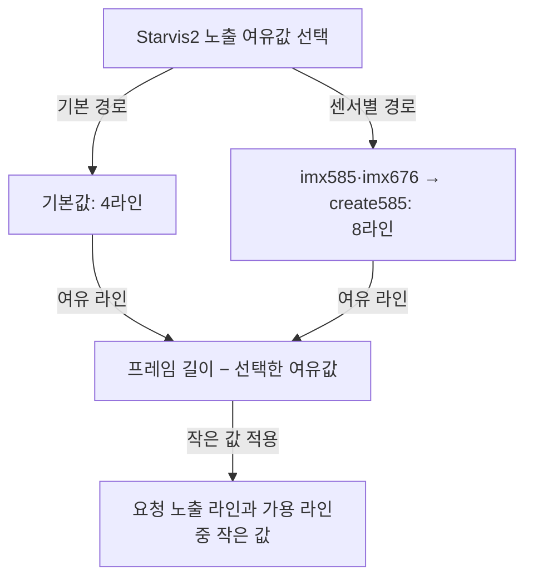
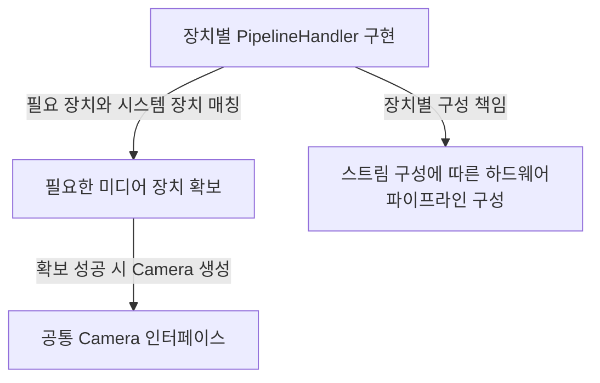
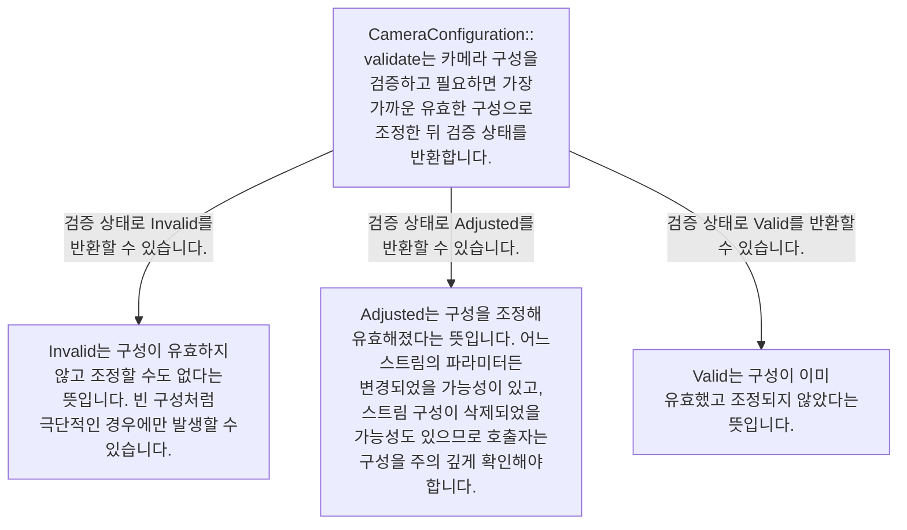
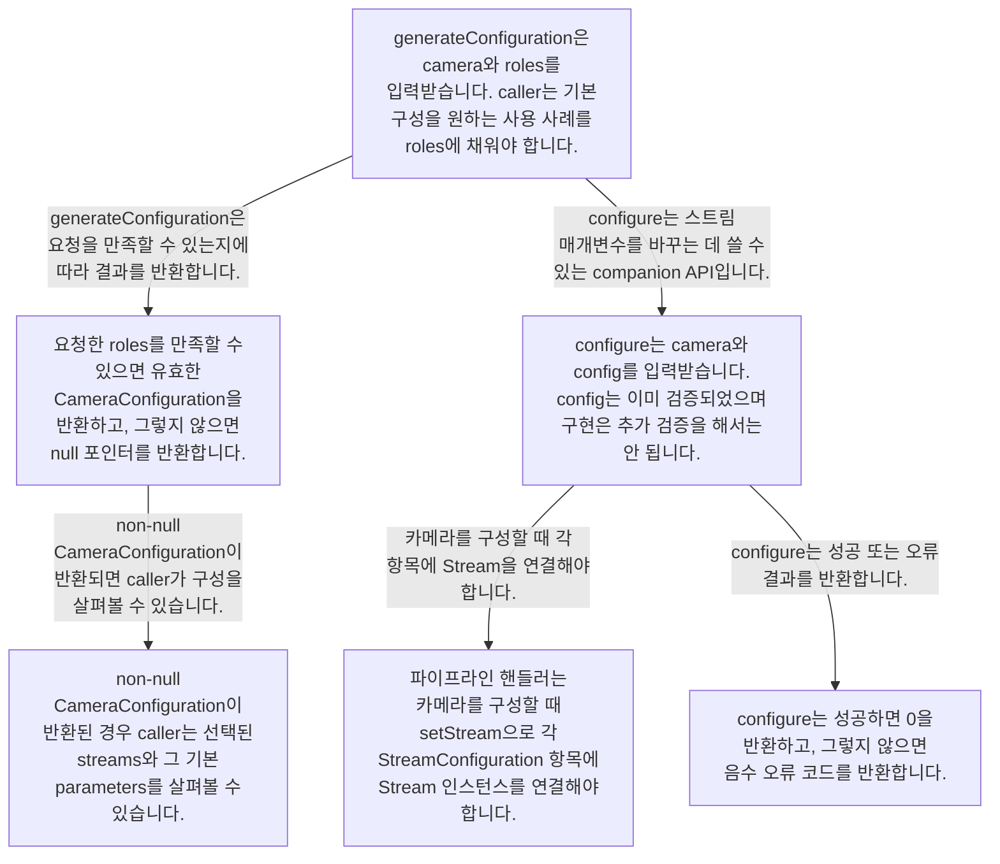

# 기능·지원 범위

아래 대표 예시에서 대상 하드웨어와 관련된 핸들러를 확인하세요. 더 많은 장치가 포함된 플랫폼 목록을 살펴보고 빌드 선택과 구성 결과도 따로 점검하세요.

- [전체 플랫폼과 빌드 선택 근거](#d1-platform-support)
- [대상 보드 검증 절차](https://ttolsun.github.io/libcamera-sdd/device-integration.html)

| 지원 범주 | 대표 하드웨어 또는 용도 | 확인할 핸들러 |
| --- | --- | --- |
| 전용 | Intel IPU3 | ipu3 |
| 전용 | NXP i.MX8MP | imx8-isi 및 rkisp1 |
| 전용 | Rockchip RK3399 | rkisp1 |
| 범용 | USB 비디오 장치 클래스 카메라 | uvcvideo |
| 범용 | iMX7·IPU6·Allwinner Sun6i | simple |
| 테스트 | 가상 미디어 컨트롤러 | vimc |

## 지원하는 하드웨어와 빌드 선택

문서에는 라이브러리가 현재 전용 파이프라인 핸들러로 지원하는 하드웨어 플랫폼으로 Arm Mali-C55, Intel IPU3 (`ipu3`), NXP i.MX8MP (`imx8-isi` 및 `rkisp1`), RaspberryPi 3, 4 및 zero (`rpi/vc4`), Rockchip RK3399 (`rkisp1`)가 나열되어 있습니다. libcamera가 범용으로 지원한다고 문서에 명시한 대상은 USB 비디오 장치 클래스 카메라(`uvcvideo`), iMX7, IPU6, Allwinner Sun6i(`simple`), 테스트 용도의 가상 미디어 컨트롤러 드라이버(`vimc`)입니다.

빌드할 파이프라인 핸들러는 배열 옵션인 `pipelines`에서 선택하며, 기본값은 `auto`입니다. `auto`를 선택하면 대상 아키텍처에 적용되는 모든 파이프라인을 빌드하고, `all`을 선택하면 모든 파이프라인을 빌드합니다. 두 값을 함께 선택하면 `all`이 우선합니다. 개별 선택지는 `imx8-isi`, `ipu3`, `mali-c55`, `rkisp1`, `rpi/pisp`, `rpi/vc4`, `simple`, `uvcvideo`, `vimc`, `virtual`입니다.

### Raspberry Pi 센서의 연동 조건

`CamHelperStarvis2`의 프레임 길이와 적분 시간 사이 최소 여유는 기본 4라인입니다. `imx585`와 `imx676`은 8라인을 전달하는 `create585`로 등록되며, 헬퍼 코드 주석은 두 센서의 매뉴얼이 `SHR0`의 최솟값을 8라인으로 명시한다고 설명합니다. 노출 제한 계산은 이 여유를 프레임 길이에 반영하고, 프레임 길이에서 여유를 뺀 값과 요청 노출의 라인 수 중 작은 값으로 노출 라인 수를 제한합니다.

#### Starvis2 노출 제한

[Mermaid 원문](https://ttolsun.github.io/libcamera-sdd/vendor-overview.starvis2-exposure-limit.mmd)

그림 근거와 확인 범위

노출 여유값으로 요청 노출을 어떻게 제한할까?

소스 연결 해석 · 자동 연결 검사만 통과 · 의미와 기기 실행은 검증 전

| 요소·전이 | 소스 근거 |
| --- | --- |
| Starvis2 노출 여유값 선택 | [src/ipa/rpi/cam_helper/cam_helper_starvis2.cpp:17](https://ttolsun.github.io/libcamera-sdd/reader-archive/vendor-overview.html#source-a24a98731281b4ed) |
| 기본값: 4라인 | [src/ipa/rpi/cam_helper/cam_helper_starvis2.cpp:17](https://ttolsun.github.io/libcamera-sdd/reader-archive/vendor-overview.html#source-a24a98731281b4ed) |
| imx585·imx676 → create585: 8라인 | [src/ipa/rpi/cam_helper/cam_helper_starvis2.cpp:17](https://ttolsun.github.io/libcamera-sdd/reader-archive/vendor-overview.html#source-a24a98731281b4ed) |
| 프레임 길이 − 선택한 여유값 | [src/ipa/rpi/cam_helper/cam_helper.cpp:105](https://ttolsun.github.io/libcamera-sdd/reader-archive/vendor-overview.html#source-74499d75cde7fa55) |
| 요청 노출 라인과 가용 라인 중 작은 값 | [src/ipa/rpi/cam_helper/cam_helper.cpp:105](https://ttolsun.github.io/libcamera-sdd/reader-archive/vendor-overview.html#source-74499d75cde7fa55) |
| 기본 경로 | [src/ipa/rpi/cam_helper/cam_helper_starvis2.cpp:17](https://ttolsun.github.io/libcamera-sdd/reader-archive/vendor-overview.html#source-a24a98731281b4ed) |
| 센서별 경로 | [src/ipa/rpi/cam_helper/cam_helper_starvis2.cpp:17](https://ttolsun.github.io/libcamera-sdd/reader-archive/vendor-overview.html#source-a24a98731281b4ed) |
| 여유 라인 | [src/ipa/rpi/cam_helper/cam_helper.cpp:105](https://ttolsun.github.io/libcamera-sdd/reader-archive/vendor-overview.html#source-74499d75cde7fa55) |
| 여유 라인 | [src/ipa/rpi/cam_helper/cam_helper.cpp:105](https://ttolsun.github.io/libcamera-sdd/reader-archive/vendor-overview.html#source-74499d75cde7fa55) |
| 작은 값 적용 | [src/ipa/rpi/cam_helper/cam_helper.cpp:105](https://ttolsun.github.io/libcamera-sdd/reader-archive/vendor-overview.html#source-74499d75cde7fa55) |

실행 확인 항목: `RegisterCamHelper`에 센서 이름과 헬퍼 생성 함수가 등록되어 있고 프레임 및 노출 제한 코드가 있지만, 대상 보드에서 실제 촬영과 노출이 동작하는지는 대상 파이프라인과 커널 드라이버의 센서 모드에서 해당 제약을 확인해야 합니다.

절 전체 근거 4개

- `Documentation/platform_support.rst`[`L6` 발췌](https://ttolsun.github.io/libcamera-sdd/reader-archive/vendor-overview.html#source-9d6502e234c4647d) · [전체 소스 `L6`](https://github.com/TTolsun/libcamera-sdd/blob/adfa719f8ed67d18fd8a0739fc088a1f8b9e7252/Documentation/platform_support.rst#L6)
- `meson_options.txt`[`L75` 발췌](https://ttolsun.github.io/libcamera-sdd/reader-archive/vendor-overview.html#source-691389506fe87b32) · [전체 소스 `L75`](https://github.com/TTolsun/libcamera-sdd/blob/adfa719f8ed67d18fd8a0739fc088a1f8b9e7252/meson_options.txt#L75)
- `src/ipa/rpi/cam_helper/cam_helper_starvis2.cpp`[`L17` 발췌](https://ttolsun.github.io/libcamera-sdd/reader-archive/vendor-overview.html#source-a24a98731281b4ed) · [전체 소스 `L17`](https://github.com/TTolsun/libcamera-sdd/blob/adfa719f8ed67d18fd8a0739fc088a1f8b9e7252/src/ipa/rpi/cam_helper/cam_helper_starvis2.cpp#L17)
- `src/ipa/rpi/cam_helper/cam_helper.cpp`[`L105` 발췌](https://ttolsun.github.io/libcamera-sdd/reader-archive/vendor-overview.html#source-74499d75cde7fa55) · [전체 소스 `L105`](https://github.com/TTolsun/libcamera-sdd/blob/adfa719f8ed67d18fd8a0739fc088a1f8b9e7252/src/ipa/rpi/cam_helper/cam_helper.cpp#L105)

## 제공 기능과 지원 범위

`Camera`는 하나의 이미지 소스에서 하나 이상의 이미지 스트림을 생성할 수 있는 카메라를 모델링합니다. 기기를 구성하고 제어하며 이미지 스트림을 캡처하는 주요 인터페이스를 제공하는 libcamera의 중심 객체입니다. 장치별 `PipelineHandler`는 스트림 구성에 따라 하드웨어 파이프라인을 구성합니다. `PipelineHandler` 구현은 필요한 미디어 장치를 시스템의 장치와 대응시키고 모두 확보할 수 있게 되면 해당 `Camera` 인스턴스를 생성해야 하며, 모든 `PipelineHandler` 하위 클래스는 `REGISTER_PIPELINE_HANDLER()` 매크로로 libcamera에 등록해야 합니다.

### 공통 Camera와 장치별 구현의 경계

[Mermaid 원문](https://ttolsun.github.io/libcamera-sdd/vendor-overview.hardware-boundary.mmd)

그림 근거와 확인 범위

공통 Camera와 장치별 PipelineHandler의 책임 연결입니다. 스트림 구성에 따른 하드웨어 구성과 장치 매칭·Camera 생성 책임을 구분하며 전체 실행 순서·지원 기종·성능을 보장하지 않습니다.

소스 연결 해석 · 자동 연결 검사만 통과 · 의미와 기기 실행은 검증 전

| 요소·전이 | 소스 근거 |
| --- | --- |
| 장치별 PipelineHandler 구현 | [src/libcamera/pipeline_handler.cpp:30](https://ttolsun.github.io/libcamera-sdd/reader-archive/vendor-overview.html#source-05721740b01bcd0e) |
| 필요한 미디어 장치 확보 | [src/libcamera/pipeline_handler.cpp:30](https://ttolsun.github.io/libcamera-sdd/reader-archive/vendor-overview.html#source-05721740b01bcd0e) |
| 공통 Camera 인터페이스 | [src/libcamera/camera.cpp:752](https://ttolsun.github.io/libcamera-sdd/reader-archive/vendor-overview.html#source-8264067114dccdee) |
| 스트림 구성에 따른 하드웨어 파이프라인 구성 | [Documentation/libcamera_architecture.rst:86](https://ttolsun.github.io/libcamera-sdd/reader-archive/vendor-overview.html#source-94ac8aab4dea2a65) |
| 장치별 구성 책임 | [Documentation/libcamera_architecture.rst:86](https://ttolsun.github.io/libcamera-sdd/reader-archive/vendor-overview.html#source-94ac8aab4dea2a65) |
| 필요 장치와 시스템 장치 매칭 | [src/libcamera/pipeline_handler.cpp:30](https://ttolsun.github.io/libcamera-sdd/reader-archive/vendor-overview.html#source-05721740b01bcd0e) |
| 확보 성공 시 Camera 생성 | [src/libcamera/pipeline_handler.cpp:30](https://ttolsun.github.io/libcamera-sdd/reader-archive/vendor-overview.html#source-05721740b01bcd0e) |

절 전체 근거 3개

- `src/libcamera/camera.cpp`[`L752` 발췌](https://ttolsun.github.io/libcamera-sdd/reader-archive/vendor-overview.html#source-8264067114dccdee) · [전체 소스 `L752`](https://github.com/TTolsun/libcamera-sdd/blob/adfa719f8ed67d18fd8a0739fc088a1f8b9e7252/src/libcamera/camera.cpp#L752)
- `src/libcamera/pipeline_handler.cpp`[`L30` 발췌](https://ttolsun.github.io/libcamera-sdd/reader-archive/vendor-overview.html#source-05721740b01bcd0e) · [전체 소스 `L30`](https://github.com/TTolsun/libcamera-sdd/blob/adfa719f8ed67d18fd8a0739fc088a1f8b9e7252/src/libcamera/pipeline_handler.cpp#L30)
- `Documentation/libcamera_architecture.rst`[`L86` 발췌](https://ttolsun.github.io/libcamera-sdd/reader-archive/vendor-overview.html#source-94ac8aab4dea2a65) · [전체 소스 `L86`](https://github.com/TTolsun/libcamera-sdd/blob/adfa719f8ed67d18fd8a0739fc088a1f8b9e7252/Documentation/libcamera_architecture.rst#L86)

## 지원 조건과 제약

`CameraConfiguration::Invalid`는 구성이 유효하지 않고 조정할 수 없음을 뜻하며, 구성이 비어 있는 경우와 같은 극단적인 경우에만 발생할 수 있습니다. `CameraConfiguration::Adjusted`는 구성이 조정되었으며 조정 후 유효함을 나타냅니다. `CameraConfiguration::validate()`가 `Adjusted`를 반환하면 어느 스트림이든 파라미터가 바뀌었을 수 있고 일부 스트림만 바뀌었을 수도 있으며, 스트림 구성이 삭제되었을 수도 있습니다. `CameraConfiguration::Adjusted`일 때 호출자는 구성을 주의 깊게 확인해야 합니다.

### validate() 결과별 호출자의 책임

[Mermaid 원문](https://ttolsun.github.io/libcamera-sdd/vendor-assurance.validation-results.mmd)

그림 근거와 확인 범위

validate()의 Invalid·Adjusted·Valid는 무엇을 뜻하며, Adjusted이면 호출자는 무엇을 다시 확인해야 합니까?

소스 연결 해석 · 자동 연결 검사만 통과 · 의미와 기기 실행은 검증 전

LLM 그림 초안 · 사람 검토 전

작성 모델: `cli/codex/gpt-6.1-terra`

| 요소·전이 | 소스 근거 |
| --- | --- |
| CameraConfiguration::validate는 카메라 구성을 검증하고 필요하면 가장 가까운 유효한 구성으로 조정한 뒤 검증 상태를 반환합니다. | [src/libcamera/camera.cpp:323](https://ttolsun.github.io/libcamera-sdd/reader-archive/vendor-assurance.html#source-2b31e92e3fb3f083) |
| Invalid는 구성이 유효하지 않고 조정할 수도 없다는 뜻입니다. 빈 구성처럼 극단적인 경우에만 발생할 수 있습니다. | [src/libcamera/camera.cpp:323](https://ttolsun.github.io/libcamera-sdd/reader-archive/vendor-assurance.html#source-2b31e92e3fb3f083) |
| Adjusted는 구성을 조정해 유효해졌다는 뜻입니다. 어느 스트림의 파라미터든 변경되었을 가능성이 있고, 스트림 구성이 삭제되었을 가능성도 있으므로 호출자는 구성을 주의 깊게 확인해야 합니다. | [src/libcamera/camera.cpp:323](https://ttolsun.github.io/libcamera-sdd/reader-archive/vendor-assurance.html#source-2b31e92e3fb3f083) |
| Valid는 구성이 이미 유효했고 조정되지 않았다는 뜻입니다. | [src/libcamera/camera.cpp:323](https://ttolsun.github.io/libcamera-sdd/reader-archive/vendor-assurance.html#source-2b31e92e3fb3f083) |
| 검증 상태로 Invalid를 반환할 수 있습니다. | [src/libcamera/camera.cpp:323](https://ttolsun.github.io/libcamera-sdd/reader-archive/vendor-assurance.html#source-2b31e92e3fb3f083) |
| 검증 상태로 Adjusted를 반환할 수 있습니다. | [src/libcamera/camera.cpp:323](https://ttolsun.github.io/libcamera-sdd/reader-archive/vendor-assurance.html#source-2b31e92e3fb3f083) |
| 검증 상태로 Valid를 반환할 수 있습니다. | [src/libcamera/camera.cpp:323](https://ttolsun.github.io/libcamera-sdd/reader-archive/vendor-assurance.html#source-2b31e92e3fb3f083) |

## 구현할 설정 인터페이스

`generateConfiguration`의 호출자는 기본 구성을 가져오려는 사용 사례를 `roles`에 채워야 합니다. `generateConfiguration()`이 반환하는 구성은 선택된 스트림과 그 스트림의 기본 파라미터를 호출자가 확인할 수 있는 정보를 포함합니다. `PipelineHandler::generateConfiguration()`은 요청된 `roles`를 충족할 수 있으면 유효한 `CameraConfiguration`을 반환하고, 그렇지 않으면 `null` 포인터를 반환해야 합니다. `PipelineHandler::generateConfiguration()` 구현은 어떤 스레드에서든 호출될 수 있으므로 스레드 안전성을 갖춰야 합니다.

### 설정 인터페이스별 입력과 결과

[Mermaid 원문](https://ttolsun.github.io/libcamera-sdd/vendor-integration.handler-configuration-contracts.mmd)

그림 근거와 확인 범위

generateConfiguration과 configure의 입력·반환 및 성공 시 Stream 연결 의무는 무엇입니까?

소스 연결 해석 · 자동 연결 검사만 통과 · 의미와 기기 실행은 검증 전

LLM 그림 초안 · 사람 검토 전

작성 모델: `cli/codex/gpt-6.1-terra`

| 요소·전이 | 소스 근거 |
| --- | --- |
| generateConfiguration은 camera와 roles를 입력받습니다. caller는 기본 구성을 원하는 사용 사례를 roles에 채워야 합니다. | [src/libcamera/pipeline_handler.cpp:271](https://ttolsun.github.io/libcamera-sdd/reader-archive/vendor-integration.html#source-23ff032cd1152d56) |
| 요청한 roles를 만족할 수 있으면 유효한 CameraConfiguration을 반환하고, 그렇지 않으면 null 포인터를 반환합니다. | [src/libcamera/pipeline_handler.cpp:271](https://ttolsun.github.io/libcamera-sdd/reader-archive/vendor-integration.html#source-23ff032cd1152d56) |
| non-null CameraConfiguration이 반환된 경우 caller는 선택된 streams와 그 기본 parameters를 살펴볼 수 있습니다. | [src/libcamera/pipeline_handler.cpp:271](https://ttolsun.github.io/libcamera-sdd/reader-archive/vendor-integration.html#source-23ff032cd1152d56) |
| configure는 camera와 config를 입력받습니다. config는 이미 검증되었으며 구현은 추가 검증을 해서는 안 됩니다. | [src/libcamera/pipeline_handler.cpp:294](https://ttolsun.github.io/libcamera-sdd/reader-archive/vendor-integration.html#source-4255f8449e37ebb8) |
| configure는 성공하면 0을 반환하고, 그렇지 않으면 음수 오류 코드를 반환합니다. | [src/libcamera/pipeline_handler.cpp:294](https://ttolsun.github.io/libcamera-sdd/reader-archive/vendor-integration.html#source-4255f8449e37ebb8) |
| 파이프라인 핸들러는 카메라를 구성할 때 setStream으로 각 StreamConfiguration 항목에 Stream 인스턴스를 연결해야 합니다. | [src/libcamera/pipeline_handler.cpp:294](https://ttolsun.github.io/libcamera-sdd/reader-archive/vendor-integration.html#source-4255f8449e37ebb8) |
| generateConfiguration은 요청을 만족할 수 있는지에 따라 결과를 반환합니다. | [src/libcamera/pipeline_handler.cpp:271](https://ttolsun.github.io/libcamera-sdd/reader-archive/vendor-integration.html#source-23ff032cd1152d56) |
| non-null CameraConfiguration이 반환되면 caller가 구성을 살펴볼 수 있습니다. | [src/libcamera/pipeline_handler.cpp:271](https://ttolsun.github.io/libcamera-sdd/reader-archive/vendor-integration.html#source-23ff032cd1152d56) |
| configure는 스트림 매개변수를 바꾸는 데 쓸 수 있는 companion API입니다. | [src/libcamera/pipeline_handler.cpp:271](https://ttolsun.github.io/libcamera-sdd/reader-archive/vendor-integration.html#source-23ff032cd1152d56) |
| 카메라를 구성할 때 각 항목에 Stream을 연결해야 합니다. | [src/libcamera/pipeline_handler.cpp:294](https://ttolsun.github.io/libcamera-sdd/reader-archive/vendor-integration.html#source-4255f8449e37ebb8) |
| configure는 성공 또는 오류 결과를 반환합니다. | [src/libcamera/pipeline_handler.cpp:294](https://ttolsun.github.io/libcamera-sdd/reader-archive/vendor-integration.html#source-4255f8449e37ebb8) |

`PipelineHandler::generateConfiguration()` 구현자는 파이프라인 핸들러 내에서 `camera`의 상태를 변경해서는 안 됩니다. `PipelineHandler::configure()`에 전달되는 설정은 `CameraConfiguration::validate()`로 검증되었음이 보장되므로, 파이프라인 핸들러 구현은 추가 검증을 해서는 안 됩니다. `PipelineHandler::configure()` 구현은 자체 `CameraConfiguration` 파생 클래스에 저장된 모든 사용자 정의 필드에 의존할 수 있습니다. `PipelineHandler::configure()` 구현자는 카메라를 구성할 때 `StreamConfiguration::setStream()`을 사용해 `CameraConfiguration`의 각 `StreamConfiguration` 항목에 `Stream` 인스턴스를 연결해야 합니다.

`PipelineHandler::configure()`는 `CameraManager` 스레드에서 호출되며, 구현은 성공 시 `0`을, 실패 시 음수 오류 코드를 반환해야 합니다.

절 전체 근거 11개

- `src/libcamera/pipeline_handler.cpp`[`L276` 발췌](https://ttolsun.github.io/libcamera-sdd/reader-archive/vendor-integration.html#source-924d43ea4bcaf94b) · [전체 소스 `L276`](https://github.com/TTolsun/libcamera-sdd/blob/adfa719f8ed67d18fd8a0739fc088a1f8b9e7252/src/libcamera/pipeline_handler.cpp#L276) · [`L289` 발췌](https://ttolsun.github.io/libcamera-sdd/reader-archive/vendor-integration.html#source-4abbe39594a1bd27) · [전체 소스 `L289`](https://github.com/TTolsun/libcamera-sdd/blob/adfa719f8ed67d18fd8a0739fc088a1f8b9e7252/src/libcamera/pipeline_handler.cpp#L289) · [`L285` 발췌](https://ttolsun.github.io/libcamera-sdd/reader-archive/vendor-integration.html#source-2eae247c4c37371c) · [전체 소스 `L285`](https://github.com/TTolsun/libcamera-sdd/blob/adfa719f8ed67d18fd8a0739fc088a1f8b9e7252/src/libcamera/pipeline_handler.cpp#L285) · [`L286` 발췌](https://ttolsun.github.io/libcamera-sdd/reader-archive/vendor-integration.html#source-25fb9495d4ab94a1) · [전체 소스 `L286`](https://github.com/TTolsun/libcamera-sdd/blob/adfa719f8ed67d18fd8a0739fc088a1f8b9e7252/src/libcamera/pipeline_handler.cpp#L286) · [`L304` 발췌](https://ttolsun.github.io/libcamera-sdd/reader-archive/vendor-integration.html#source-31c5407347b4d0d8) · [전체 소스 `L304`](https://github.com/TTolsun/libcamera-sdd/blob/adfa719f8ed67d18fd8a0739fc088a1f8b9e7252/src/libcamera/pipeline_handler.cpp#L304) · [`L306` 발췌](https://ttolsun.github.io/libcamera-sdd/reader-archive/vendor-integration.html#source-71079779113f431c) · [전체 소스 `L306`](https://github.com/TTolsun/libcamera-sdd/blob/adfa719f8ed67d18fd8a0739fc088a1f8b9e7252/src/libcamera/pipeline_handler.cpp#L306) · [`L309` 발췌](https://ttolsun.github.io/libcamera-sdd/reader-archive/vendor-integration.html#source-f3cf94b1dc7b9457) · [전체 소스 `L309`](https://github.com/TTolsun/libcamera-sdd/blob/adfa719f8ed67d18fd8a0739fc088a1f8b9e7252/src/libcamera/pipeline_handler.cpp#L309) · [`L313` 발췌](https://ttolsun.github.io/libcamera-sdd/reader-archive/vendor-integration.html#source-f87ceb096b9f931d) · [전체 소스 `L313`](https://github.com/TTolsun/libcamera-sdd/blob/adfa719f8ed67d18fd8a0739fc088a1f8b9e7252/src/libcamera/pipeline_handler.cpp#L313) · [`L271`](https://ttolsun.github.io/libcamera-sdd/reader-archive/vendor-integration.html#source-23ff032cd1152d56) · [`L294`](https://ttolsun.github.io/libcamera-sdd/reader-archive/vendor-integration.html#source-4255f8449e37ebb8)
- `src/libcamera/camera.cpp`[`L1191`](https://ttolsun.github.io/libcamera-sdd/reader-archive/vendor-integration.html#source-603af0dd7fa357d0)

## 성능 근거를 읽는 기준

`DebayerCpu`의 내장 벤치마크는 통계를 수집하고 디베이어링하는 처리에 걸린 시간만 측정합니다. 프레임을 캡처하거나 출력하는 데 걸린 시간은 포함하지 않습니다. Software ISP를 사용하는 파이프라인에서 `cam` 또는 `qcam`을 실행하면 내장 벤치마크를 사용할 수 있습니다.

절 전체 근거 1개

- `Documentation/software-isp-benchmarking.rst`[`L15` 발췌](https://ttolsun.github.io/libcamera-sdd/reader-archive/vendor-assurance.html#source-551d2b5944a36d19) · [전체 소스 `L15`](https://github.com/TTolsun/libcamera-sdd/blob/adfa719f8ed67d18fd8a0739fc088a1f8b9e7252/Documentation/software-isp-benchmarking.rst#L15)

## 원고와 검토 기록

libcamera 제품 개요

- **생성 방식**: 추출 사실과 LLM 설명
- **검증 범위**: 표·그림은 facts로 만들고 설명은 LLM이 작성합니다. 인용·문장 및 설정된 구조 검사를 적용합니다.
- **자동 검사**: 통과 (`ok`). 검사한 항목은 검증 범위에 적혀 있습니다. 설명 내용이 맞는지는 사람이 확인합니다.
- **사람 검토**: 사람 검토 전
- **분석 기준 커밋**: `adfa719f8ed67d18fd8a0739fc088a1f8b9e7252`
- **문서 생성 시각**: `2026-11-21 20:16:03+00:00`
- **문장 생성 모델**: `cli/codex/gpt-6.1-terra`
- **문서 간 계약**: [자동 대조 보고서](https://ttolsun.github.io/libcamera-sdd/contract-consistency.json) · 사람 검토 전
- **독자 범위**: [과업별 답변과 미검토 범위](https://ttolsun.github.io/libcamera-sdd/reader-scope.json)
- **제품 설명 입력**: [적용 범위·조건·자료](https://ttolsun.github.io/libcamera-sdd/product-context.json)

원고 작성 당시 기록

원고에 저장된 당시 기록입니다. 현재 문서의 기준과 다를 수 있습니다.

- 근거 파일: `Documentation/introduction.rst`, `Documentation/libcamera_architecture.rst`, `Documentation/platform_support.rst`, `include/libcamera/camera.h`, `include/libcamera/internal/ipa_manager.h`, `include/libcamera/internal/pipeline_handler.h`, `meson_options.txt`, `product-evidence/libcamera/official-stack.txt`, `src/ipa/rpi/cam_helper/cam_helper.cpp`, `src/ipa/rpi/cam_helper/cam_helper_starvis2.cpp`, `src/libcamera/camera.cpp`, `src/libcamera/ipa_manager.cpp`, `src/libcamera/pipeline/ipu3/ipu3.cpp`, `src/libcamera/pipeline/rkisp1/rkisp1.cpp`, `src/libcamera/pipeline_handler.cpp`
- 근거 수준: 코드 확인 (정적 분석, simple_compdb 구성, commit `adfa719f8e`)
- 자동 검사 (인용·문장 및 설정된 구조 검사): 통과
- 검토 상태 기록일: 2026-11-22 · 사람 검토 전

[Markdown 원문 ↗](https://ttolsun.github.io/libcamera-sdd/vendor-overview.md) [Mermaid 원문 ↗](https://ttolsun.github.io/libcamera-sdd/vendor-overview.mmd)

[이전 주소의 상세 내용 열기](https://ttolsun.github.io/libcamera-sdd/reader-archive/vendor-overview.html#page-evidence)

지원 범위와 검증

- **생성 방식**: 추출 사실과 LLM 설명
- **검증 범위**: 표·그림은 facts로 만들고 설명은 LLM이 작성합니다. 인용·문장 및 설정된 구조 검사를 적용합니다.
- **자동 검사**: 통과 (`ok`). 검사한 항목은 검증 범위에 적혀 있습니다. 설명 내용이 맞는지는 사람이 확인합니다.
- **사람 검토**: 사람 검토 전
- **분석 기준 커밋**: `adfa719f8ed67d18fd8a0739fc088a1f8b9e7252`
- **문서 생성 시각**: `2026-11-20 16:39:19+00:00`
- **문장 생성 모델**: `cli/codex/gpt-6.1-terra`
- **문서 간 계약**: [자동 대조 보고서](https://ttolsun.github.io/libcamera-sdd/contract-consistency.json) · 사람 검토 전
- **제품 설명 입력**: [적용 범위·조건·자료](https://ttolsun.github.io/libcamera-sdd/product-context.json)

원고 작성 당시 기록

원고에 저장된 당시 기록입니다. 현재 문서의 기준과 다를 수 있습니다.

- 근거 파일: `Documentation/software-isp-benchmarking.rst`, `README.rst`, `include/libcamera/camera.h`, `include/libcamera/framebuffer.h`, `include/libcamera/internal/ipa_manager.h`, `include/libcamera/internal/pipeline_handler.h`, `include/libcamera/request.h`, `product-evidence/libcamera-first-capture-trial/virtual-first-capture-run.txt`, `src/libcamera/camera.cpp`, `src/libcamera/ipa_manager.cpp`, `src/libcamera/pipeline/ipu3/ipu3.cpp`, `src/libcamera/pipeline/rkisp1/rkisp1.cpp`, `src/libcamera/pipeline/virtual/README.md`, `src/libcamera/pipeline/virtual/data/virtual.yaml`, `src/libcamera/pipeline_handler.cpp`
- 근거 수준: 코드 확인 (정적 분석, simple_compdb 구성, commit `adfa719f8e`)
- 자동 검사 (인용·문장 및 설정된 구조 검사): 통과
- 검토 상태 기록일: 2026-11-21 · 사람 검토 전

[Markdown 원문 ↗](https://ttolsun.github.io/libcamera-sdd/vendor-assurance.md) [Mermaid 원문 ↗](https://ttolsun.github.io/libcamera-sdd/vendor-assurance.mmd)

[이전 주소의 상세 내용 열기](https://ttolsun.github.io/libcamera-sdd/reader-archive/vendor-assurance.html#page-evidence)

연동 가이드

- **생성 방식**: 추출 사실과 LLM 설명
- **검증 범위**: 표·그림은 facts로 만들고 설명은 LLM이 작성합니다. 인용·문장 및 설정된 구조 검사를 적용합니다.
- **자동 검사**: 통과 (`ok`). 검사한 항목은 검증 범위에 적혀 있습니다. 설명 내용이 맞는지는 사람이 확인합니다.
- **사람 검토**: 사람 검토 전
- **분석 기준 커밋**: `adfa719f8ed67d18fd8a0739fc088a1f8b9e7252`
- **문서 생성 시각**: `2026-11-20 16:39:26+00:00`
- **문장 생성 모델**: `cli/codex/gpt-6.1-terra`
- **문서 간 계약**: [자동 대조 보고서](https://ttolsun.github.io/libcamera-sdd/contract-consistency.json) · 사람 검토 전

원고 작성 당시 기록

원고에 저장된 당시 기록입니다. 현재 문서의 기준과 다를 수 있습니다.

- 근거 파일: `include/libcamera/camera.h`, `include/libcamera/internal/ipa_manager.h`, `include/libcamera/internal/pipeline_handler.h`, `src/libcamera/camera.cpp`, `src/libcamera/ipa_manager.cpp`, `src/libcamera/pipeline/ipu3/ipu3.cpp`, `src/libcamera/pipeline/rkisp1/rkisp1.cpp`, `src/libcamera/pipeline_handler.cpp`
- 근거 수준: 코드 확인 (정적 분석, simple_compdb 구성, commit `adfa719f8e`)
- 자동 검사 (인용·문장 및 설정된 구조 검사): 통과
- 검토 상태 기록일: 2026-11-21 · 사람 검토 전

[Markdown 원문 ↗](https://ttolsun.github.io/libcamera-sdd/vendor-integration.md) [Mermaid 원문 ↗](https://ttolsun.github.io/libcamera-sdd/vendor-integration.mmd)

[이전 주소의 상세 내용 열기](https://ttolsun.github.io/libcamera-sdd/reader-archive/vendor-integration.html#page-evidence)

[이 페이지 Markdown 받기](https://ttolsun.github.io/libcamera-sdd/features-and-support.md) · [독자용 문서의 원본 위치](https://ttolsun.github.io/libcamera-sdd/reader-edition.json)
