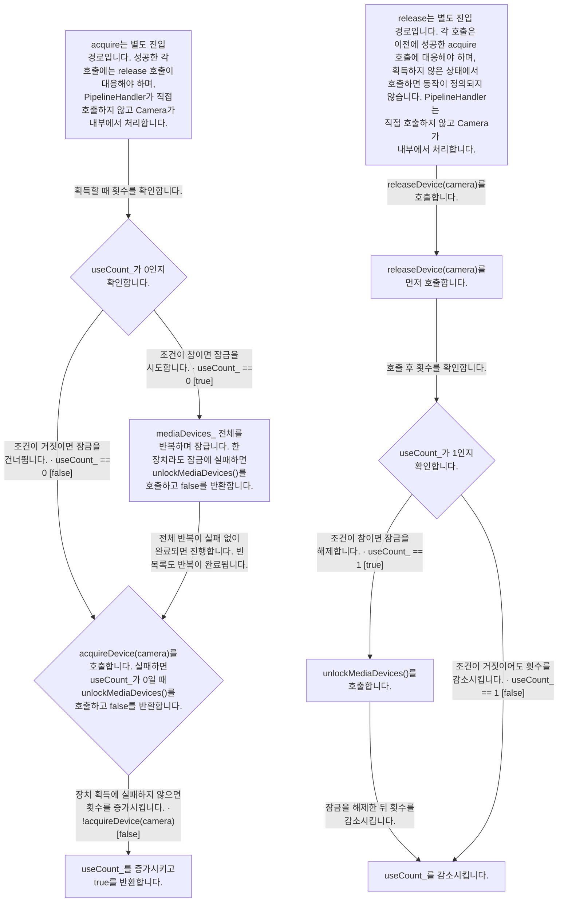
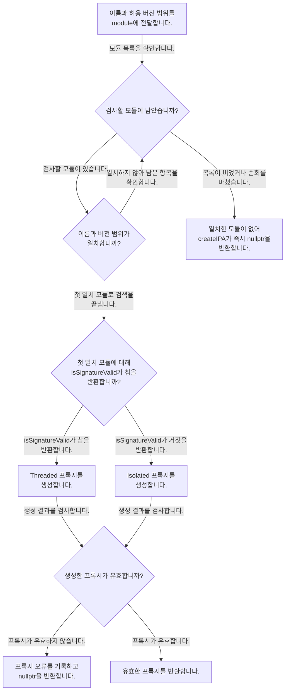
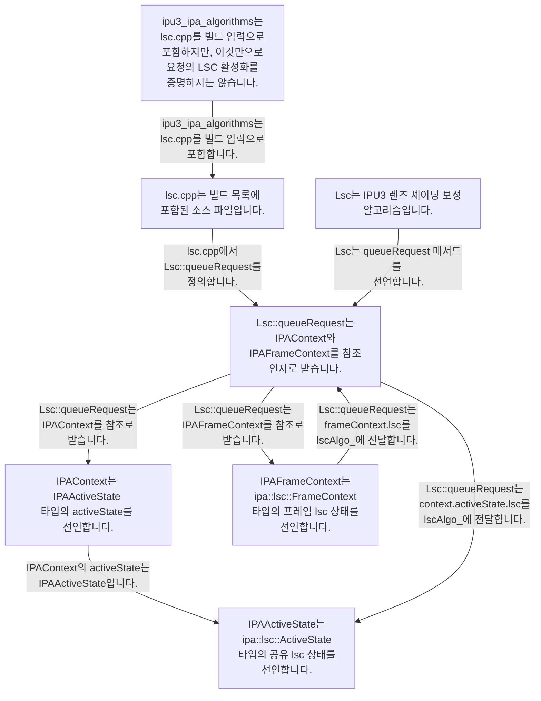
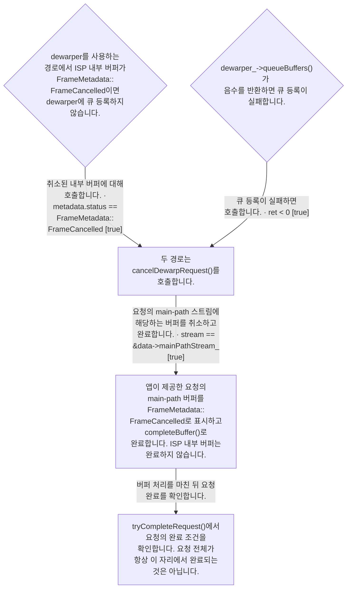

# 구현·확장 지점

장치 매칭과 큐 계약을 확인한 뒤 변경 대상에 따라 IPA 모듈이나 장치별 보정 구현으로 이동하세요.

## 장치 매칭과 객체 수명

`PipelineHandler`는 `DeviceEnumerator`의 미디어 장치를 지원하는 파이프라인과 일치시켜 `Camera`를 생성하고 관리합니다. 인스턴스는 수동으로 생성해서는 안 되며 `PipelineHandlerFactoryBase::create()`로 생성해야 하고, `std::shared_ptr`로 참조 횟수를 관리하며 멤버 함수에서 this만 사용할 수 있을 때 새 `shared_ptr`를 만들도록 `std::enable_shared_from_this`를 구현합니다. match()는 한 파이프라인에 필요한 장치를 모두 찾으면 모두 확보하고 하나 이상의 `Camera`를 생성해 내부에 저장하고 camera manager에 등록한 뒤 true를 반환해야 합니다. 필요한 장치를 모두 찾지 못하면 장치를 확보하지 않거나 이미 확보한 장치를 모두 해제하고 false를 반환해야 하며, 성공할 때마다 새 핸들러 인스턴스의 match()를 호출해 호환 장치가 소진될 때까지 각 호출이 한 파이프라인의 장치를 확보해야 합니다.

### 핸들러 생성과 장치 획득·반납의 책임

```mermaid
flowchart TB
%% sdd:translations {"PipelineHandler 인스턴스는 <br/>std::shared#95;ptr로 참조 수를 <br/>관리합니다. 멤버 함수에서 <br/>this만 사용할 수 있는 <br/>경로에서 새 <br/>std::shared#95;ptr를 만들 수 <br/>있도록 <br/>std::<br/>enable#95;shared#95;from#95;this를 <br/>구현합니다.": "PipelineHandler instances <br/>are reference-counted <br/>through std::shared#95;ptr. <br/>They implement <br/>std::<br/>enable#95;shared#95;from#95;this to <br/>create new std::shared#95;ptr <br/>instances in <br/>member-function paths where <br/>only this is available.", "PipelineHandler 인스턴스는 <br/>수동으로 만들지 말고 항상 <br/>PipelineHandlerFactoryBase::<br/>create#40;#41;로 만들어야 합니다.": "PipelineHandler instances <br/>must always be constructed <br/>through <br/>PipelineHandlerFactoryBase::<br/>create#40;#41; and never manually.", "PipelineHandler::match <br/>구현은 한 파이프라인에 <br/>필요한 장치를 모두 찾으면 <br/>MediaDevice::acquire#40;#41;로 <br/>모두 획득하고 Camera를 하나 <br/>이상 만들어 내부에 저장하고 <br/>카메라 관리자에 등록한 뒤 <br/>true를 반환해야 합니다. <br/>그렇지 않으면 장치를 <br/>획득하지 않거나 이미 획득한 <br/>장치를 <br/>MediaDevice::release#40;#41;로 <br/>모두 해제하고 false를 <br/>반환해야 합니다.": "If all devices needed for <br/>one pipeline are found, the <br/>PipelineHandler::match <br/>implementation must acquire <br/>them all with <br/>MediaDevice::acquire#40;#41;, <br/>create one or more Camera <br/>instances, store them <br/>internally, register them <br/>with the camera manager, <br/>and return true. Otherwise, <br/>it must acquire no devices <br/>or release all devices <br/>already acquired with <br/>MediaDevice::release#40;#41;, and <br/>return false.", "PipelineHandlerFactoryBase::<br/>create#40;#41;는 <br/>PipelineHandler의 필수 생성 <br/>경로입니다.": "PipelineHandlerFactoryBase::<br/>create#40;#41; is the required <br/>construction path for <br/>PipelineHandler instances.", "PipelineHandler는 <br/>mediaDevices#95;에 장치의 공유 <br/>포인터를 보관합니다.": "PipelineHandler stores <br/>shared pointers to devices <br/>in mediaDevices#95;.", "acquireMediaDevice#40;#41;가 <br/>획득한 장치는 핸들러의 <br/>mediaDevices#95;에 보관됩니다.": "A device acquired by <br/>acquireMediaDevice#40;#41; is <br/>stored in the handler#39;s <br/>mediaDevices#95;.", "acquireMediaDevice#40;#41;는 <br/>이전에 획득된 장치를 <br/>제외하고 일치하는 사용 <br/>가능한 장치를 찾아 획득한 <br/>뒤 공유 포인터를 <br/>반환합니다. 일치하는 장치가 <br/>없거나 획득에 실패하면 <br/>nullptr을 반환합니다. <br/>호출자는 장치를 직접 <br/>해제하면 안 되며, 장치는 <br/>핸들러가 소멸할 때 자동으로 <br/>해제됩니다.": "acquireMediaDevice#40;#41; finds <br/>and acquires an available <br/>matching device, excluding <br/>devices already acquired, <br/>and returns a shared <br/>pointer. It returns nullptr <br/>if no match is found or <br/>acquisition fails. The <br/>caller must not release the <br/>device explicitly; it is <br/>released automatically when <br/>the handler is destroyed.", "acquireMediaDevice#40;#41;는 <br/>획득한 장치를 <br/>mediaDevices#95;에 보관합니다. <br/>· #33;media-#62;acquire#40;#41; #91;false#93;": "acquireMediaDevice#40;#41; stores <br/>the acquired device in <br/>mediaDevices#95;. · <br/>#33;media-#62;acquire#40;#41; #91;false#93;", "카메라 관리자는 <br/>PipelineHandler의 match#40;#41;를 <br/>호출합니다. match#40;#41;가 <br/>true를 반환하면 새 핸들러 <br/>인스턴스가 생성되고 그 <br/>인스턴스의 match#40;#41;가 <br/>호출됩니다.": "The camera manager calls <br/>the PipelineHandler#39;s <br/>match#40;#41;. If match#40;#41; returns <br/>true, a new handler <br/>instance is created and its <br/>match#40;#41; is called.", "핸들러 소멸자는 <br/>mediaDevices#95;에 보관된 각 <br/>장치를 <br/>MediaDevice::release#40;#41;로 <br/>해제합니다.": "The handler destructor <br/>releases each device stored <br/>in mediaDevices#95; using <br/>MediaDevice::release#40;#41;.", "핸들러가 소멸하면 <br/>mediaDevices#95;의 각 장치를 <br/>해제합니다.": "When the handler is <br/>destroyed, it releases each <br/>device in mediaDevices#95;."}
  v_factory["PipelineHandler 인스턴스는 <br/>수동으로 만들지 말고 항상 <br/>PipelineHandlerFactoryBase::<br/>create#40;#41;로 만들어야 합니다."]
  v_handler["PipelineHandler 인스턴스는 <br/>std::shared#95;ptr로 참조 수를 <br/>관리합니다. 멤버 함수에서 <br/>this만 사용할 수 있는 <br/>경로에서 새 <br/>std::shared#95;ptr를 만들 수 <br/>있도록 <br/>std::<br/>enable#95;shared#95;from#95;this를 <br/>구현합니다."]
  v_match["PipelineHandler::match <br/>구현은 한 파이프라인에 <br/>필요한 장치를 모두 찾으면 <br/>MediaDevice::acquire#40;#41;로 <br/>모두 획득하고 Camera를 하나 <br/>이상 만들어 내부에 저장하고 <br/>카메라 관리자에 등록한 뒤 <br/>true를 반환해야 합니다. <br/>그렇지 않으면 장치를 <br/>획득하지 않거나 이미 획득한 <br/>장치를 <br/>MediaDevice::release#40;#41;로 <br/>모두 해제하고 false를 <br/>반환해야 합니다."]
  v_search["acquireMediaDevice#40;#41;는 <br/>이전에 획득된 장치를 <br/>제외하고 일치하는 사용 <br/>가능한 장치를 찾아 획득한 <br/>뒤 공유 포인터를 <br/>반환합니다. 일치하는 장치가 <br/>없거나 획득에 실패하면 <br/>nullptr을 반환합니다. <br/>호출자는 장치를 직접 <br/>해제하면 안 되며, 장치는 <br/>핸들러가 소멸할 때 자동으로 <br/>해제됩니다."]
  v_devices["acquireMediaDevice#40;#41;가 <br/>획득한 장치는 핸들러의 <br/>mediaDevices#95;에 보관됩니다."]
  v_release["핸들러 소멸자는 <br/>mediaDevices#95;에 보관된 각 <br/>장치를 <br/>MediaDevice::release#40;#41;로 <br/>해제합니다."]
  v_factory -->|"PipelineHandlerFactoryBase::<br/>create#40;#41;는 <br/>PipelineHandler의 필수 생성 <br/>경로입니다."| v_handler
  v_handler -->|"카메라 관리자는 <br/>PipelineHandler의 match#40;#41;를 <br/>호출합니다. match#40;#41;가 <br/>true를 반환하면 새 핸들러 <br/>인스턴스가 생성되고 그 <br/>인스턴스의 match#40;#41;가 <br/>호출됩니다."| v_match
  v_handler -->|"PipelineHandler는 <br/>mediaDevices#95;에 장치의 공유 <br/>포인터를 보관합니다."| v_devices
  v_search -->|"acquireMediaDevice#40;#41;는 <br/>획득한 장치를 <br/>mediaDevices#95;에 보관합니다. <br/>· #33;media-#62;acquire#40;#41; #91;false#93;"| v_devices
  v_devices -->|"핸들러가 소멸하면 <br/>mediaDevices#95;의 각 장치를 <br/>해제합니다."| v_release
```

[Mermaid 원문](https://ttolsun.github.io/libcamera-sdd/pipeline-handler.handler-device-ownership.mmd)

그림 근거와 확인 범위

팩토리 생성·참조 수명과 match 계약은 어떻게 이어지며, acquireMediaDevice로 확보한 장치는 어디에 보관하고 핸들러 소멸 시 어떻게 해제합니까? acquire·release의 잠금 조건은 별도 그림에서 확인하세요.

소스 연결 해석 · 자동 연결 검사만 통과 · 의미와 기기 실행은 검증 전

LLM 그림 초안 · 사람 검토 전

작성 모델: `cli/codex/gpt-6.1-terra`

| 요소·전이 | 소스 근거 |
| --- | --- |
| PipelineHandler 인스턴스는 수동으로 만들지 말고 항상 PipelineHandlerFactoryBase::create()로 만들어야 합니다. | [src/libcamera/pipeline_handler.cpp:50](https://ttolsun.github.io/libcamera-sdd/reader-archive/pipeline-handler.html#source-69bfa9568cf8b5c5) |
| PipelineHandler 인스턴스는 std::shared_ptr로 참조 수를 관리합니다. 멤버 함수에서 this만 사용할 수 있는 경로에서 새 std::shared_ptr를 만들 수 있도록 std::enable_shared_from_this를 구현합니다. | [src/libcamera/pipeline_handler.cpp:50](https://ttolsun.github.io/libcamera-sdd/reader-archive/pipeline-handler.html#source-69bfa9568cf8b5c5) |
| PipelineHandler::match 구현은 한 파이프라인에 필요한 장치를 모두 찾으면 MediaDevice::acquire()로 모두 획득하고 Camera를 하나 이상 만들어 내부에 저장하고 카메라 관리자에 등록한 뒤 true를 반환해야 합니다. 그렇지 않으면 장치를 획득하지 않거나 이미 획득한 장치를 MediaDevice::release()로 모두 해제하고 false를 반환해야 합니다. | [src/libcamera/pipeline_handler.cpp:50](https://ttolsun.github.io/libcamera-sdd/reader-archive/pipeline-handler.html#source-69bfa9568cf8b5c5) |
| acquireMediaDevice()는 이전에 획득된 장치를 제외하고 일치하는 사용 가능한 장치를 찾아 획득한 뒤 공유 포인터를 반환합니다. 일치하는 장치가 없거나 획득에 실패하면 nullptr을 반환합니다. 호출자는 장치를 직접 해제하면 안 되며, 장치는 핸들러가 소멸할 때 자동으로 해제됩니다. | [src/libcamera/pipeline_handler.cpp:119](https://ttolsun.github.io/libcamera-sdd/reader-archive/pipeline-handler.html#source-a3caf1625bc18d64) |
| acquireMediaDevice()가 획득한 장치는 핸들러의 mediaDevices\_에 보관됩니다. | [src/libcamera/pipeline_handler.cpp:119](https://ttolsun.github.io/libcamera-sdd/reader-archive/pipeline-handler.html#source-a3caf1625bc18d64) · [src/libcamera/pipeline_handler.cpp:50](https://ttolsun.github.io/libcamera-sdd/reader-archive/pipeline-handler.html#source-69bfa9568cf8b5c5) |
| 핸들러 소멸자는 mediaDevices\_에 보관된 각 장치를 MediaDevice::release()로 해제합니다. | [src/libcamera/pipeline_handler.cpp:50](https://ttolsun.github.io/libcamera-sdd/reader-archive/pipeline-handler.html#source-69bfa9568cf8b5c5) |
| PipelineHandlerFactoryBase::create()는 PipelineHandler의 필수 생성 경로입니다. | [src/libcamera/pipeline_handler.cpp:50](https://ttolsun.github.io/libcamera-sdd/reader-archive/pipeline-handler.html#source-69bfa9568cf8b5c5) |
| 카메라 관리자는 PipelineHandler의 match()를 호출합니다. match()가 true를 반환하면 새 핸들러 인스턴스가 생성되고 그 인스턴스의 match()가 호출됩니다. | [src/libcamera/pipeline_handler.cpp:50](https://ttolsun.github.io/libcamera-sdd/reader-archive/pipeline-handler.html#source-69bfa9568cf8b5c5) |
| PipelineHandler는 mediaDevices\_에 장치의 공유 포인터를 보관합니다. | [src/libcamera/pipeline_handler.cpp:50](https://ttolsun.github.io/libcamera-sdd/reader-archive/pipeline-handler.html#source-69bfa9568cf8b5c5) |
| acquireMediaDevice()는 획득한 장치를 mediaDevices\_에 보관합니다. · !media-\>acquire() \[false\] | [src/libcamera/pipeline_handler.cpp:119](https://ttolsun.github.io/libcamera-sdd/reader-archive/pipeline-handler.html#source-a3caf1625bc18d64) |
| 핸들러가 소멸하면 mediaDevices\_의 각 장치를 해제합니다. | [src/libcamera/pipeline_handler.cpp:50](https://ttolsun.github.io/libcamera-sdd/reader-archive/pipeline-handler.html#source-69bfa9568cf8b5c5) |

### 획득·반납의 잠금 조건과 해제 순서

[Mermaid 원문](https://ttolsun.github.io/libcamera-sdd/pipeline-handler.acquire-release-locks.mmd)

그림 근거와 확인 범위

acquire와 release를 별도 진입 경로로 두고 useCount\_ 조건, 실패 반환, releaseDevice·조건부 잠금 해제·감소의 순서를 구분하세요.

소스 연결 해석 · 자동 연결 검사만 통과 · 의미와 기기 실행은 검증 전

LLM 그림 초안 · 사람 검토 전

작성 모델: `cli/codex/gpt-6.1-terra`

| 요소·전이 | 소스 근거 |
| --- | --- |
| acquire는 별도 진입 경로입니다. 성공한 각 호출에는 release 호출이 대응해야 하며, PipelineHandler가 직접 호출하지 않고 Camera가 내부에서 처리합니다. | [src/libcamera/pipeline_handler.cpp:119](https://ttolsun.github.io/libcamera-sdd/reader-archive/pipeline-handler.html#source-a3caf1625bc18d64) |
| useCount\_가 0인지 확인합니다. | [src/libcamera/pipeline_handler.cpp:119](https://ttolsun.github.io/libcamera-sdd/reader-archive/pipeline-handler.html#source-a3caf1625bc18d64) |
| mediaDevices\_ 전체를 반복하며 잠급니다. 한 장치라도 잠금에 실패하면 unlockMediaDevices()를 호출하고 false를 반환합니다. | [src/libcamera/pipeline_handler.cpp:119](https://ttolsun.github.io/libcamera-sdd/reader-archive/pipeline-handler.html#source-a3caf1625bc18d64) |
| acquireDevice(camera)를 호출합니다. 실패하면 useCount\_가 0일 때 unlockMediaDevices()를 호출하고 false를 반환합니다. | [src/libcamera/pipeline_handler.cpp:119](https://ttolsun.github.io/libcamera-sdd/reader-archive/pipeline-handler.html#source-a3caf1625bc18d64) |
| useCount\_를 증가시키고 true를 반환합니다. | [src/libcamera/pipeline_handler.cpp:119](https://ttolsun.github.io/libcamera-sdd/reader-archive/pipeline-handler.html#source-a3caf1625bc18d64) |
| release는 별도 진입 경로입니다. 각 호출은 이전에 성공한 acquire 호출에 대응해야 하며, 획득하지 않은 상태에서 호출하면 동작이 정의되지 않습니다. PipelineHandler는 직접 호출하지 않고 Camera가 내부에서 처리합니다. | [src/libcamera/pipeline_handler.cpp:119](https://ttolsun.github.io/libcamera-sdd/reader-archive/pipeline-handler.html#source-a3caf1625bc18d64) |
| releaseDevice(camera)를 먼저 호출합니다. | [src/libcamera/pipeline_handler.cpp:119](https://ttolsun.github.io/libcamera-sdd/reader-archive/pipeline-handler.html#source-a3caf1625bc18d64) |
| useCount\_가 1인지 확인합니다. | [src/libcamera/pipeline_handler.cpp:119](https://ttolsun.github.io/libcamera-sdd/reader-archive/pipeline-handler.html#source-a3caf1625bc18d64) |
| unlockMediaDevices()를 호출합니다. | [src/libcamera/pipeline_handler.cpp:119](https://ttolsun.github.io/libcamera-sdd/reader-archive/pipeline-handler.html#source-a3caf1625bc18d64) |
| useCount\_를 감소시킵니다. | [src/libcamera/pipeline_handler.cpp:119](https://ttolsun.github.io/libcamera-sdd/reader-archive/pipeline-handler.html#source-a3caf1625bc18d64) |
| 획득할 때 횟수를 확인합니다. | [src/libcamera/pipeline_handler.cpp:119](https://ttolsun.github.io/libcamera-sdd/reader-archive/pipeline-handler.html#source-a3caf1625bc18d64) |
| 조건이 참이면 잠금을 시도합니다. · useCount\_ == 0 \[true\] | [src/libcamera/pipeline_handler.cpp:119](https://ttolsun.github.io/libcamera-sdd/reader-archive/pipeline-handler.html#source-a3caf1625bc18d64) |
| 조건이 거짓이면 잠금을 건너뜁니다. · useCount\_ == 0 \[false\] | [src/libcamera/pipeline_handler.cpp:119](https://ttolsun.github.io/libcamera-sdd/reader-archive/pipeline-handler.html#source-a3caf1625bc18d64) |
| 전체 반복이 실패 없이 완료되면 진행합니다. 빈 목록도 반복이 완료됩니다. | [src/libcamera/pipeline_handler.cpp:119](https://ttolsun.github.io/libcamera-sdd/reader-archive/pipeline-handler.html#source-a3caf1625bc18d64) |
| 장치 획득에 실패하지 않으면 횟수를 증가시킵니다. · !acquireDevice(camera) \[false\] | [src/libcamera/pipeline_handler.cpp:119](https://ttolsun.github.io/libcamera-sdd/reader-archive/pipeline-handler.html#source-a3caf1625bc18d64) |
| releaseDevice(camera)를 호출합니다. | [src/libcamera/pipeline_handler.cpp:119](https://ttolsun.github.io/libcamera-sdd/reader-archive/pipeline-handler.html#source-a3caf1625bc18d64) |
| 호출 후 횟수를 확인합니다. | [src/libcamera/pipeline_handler.cpp:119](https://ttolsun.github.io/libcamera-sdd/reader-archive/pipeline-handler.html#source-a3caf1625bc18d64) |
| 조건이 참이면 잠금을 해제합니다. · useCount\_ == 1 \[true\] | [src/libcamera/pipeline_handler.cpp:119](https://ttolsun.github.io/libcamera-sdd/reader-archive/pipeline-handler.html#source-a3caf1625bc18d64) |
| 잠금을 해제한 뒤 횟수를 감소시킵니다. | [src/libcamera/pipeline_handler.cpp:119](https://ttolsun.github.io/libcamera-sdd/reader-archive/pipeline-handler.html#source-a3caf1625bc18d64) |
| 조건이 거짓이어도 횟수를 감소시킵니다. · useCount\_ == 1 \[false\] | [src/libcamera/pipeline_handler.cpp:119](https://ttolsun.github.io/libcamera-sdd/reader-archive/pipeline-handler.html#source-a3caf1625bc18d64) |

acquireMediaDevice()는 이전에 확보된 장치를 제외하고 일치하는 장치를 찾아 확보하면 `mediaDevices_`에 보관하며, 호출자는 명시적으로 해제해서는 안 되고 핸들러 소멸자가 `MediaDevice::release()`를 호출합니다. acquire()는 `useCount_` == 0일 때만 미디어 장치를 잠그고, 장치 잠금이 실패하면 잠금을 해제하고 false를 반환하며 acquireDevice()가 실패하면 `useCount_` == 0인 경우 잠금을 해제하고 false를 반환합니다. 성공한 acquire()마다 release()가 짝을 이뤄야 하며, release()는 releaseDevice()를 호출한 뒤 `useCount_` == 1이면 장치 잠금을 풀고 카운트를 줄입니다. 여러 카메라가 공유하는 자원은 이전에 확보한 모든 카메라에 대해 releaseDevice()가 호출될 때까지 반납하지 않아야 합니다.

절 전체 근거 2개

- `src/libcamera/pipeline_handler.cpp`[`L50` 발췌](https://ttolsun.github.io/libcamera-sdd/reader-archive/pipeline-handler.html#source-69bfa9568cf8b5c5) · [전체 소스 `L50`](https://github.com/TTolsun/libcamera-sdd/blob/adfa719f8ed67d18fd8a0739fc088a1f8b9e7252/src/libcamera/pipeline_handler.cpp#L50) · [`L119` 발췌](https://ttolsun.github.io/libcamera-sdd/reader-archive/pipeline-handler.html#source-a3caf1625bc18d64) · [전체 소스 `L119`](https://github.com/TTolsun/libcamera-sdd/blob/adfa719f8ed67d18fd8a0739fc088a1f8b9e7252/src/libcamera/pipeline_handler.cpp#L119)

## 장치 요청 한도와 대기 큐

`PipelineHandler` 생성자 선언에서 maxQueuedRequestsDevice의 기본값은 32입니다. `maxQueuedRequestsDevice_`는 파이프라인 핸들러가 한 시점에 하드웨어에 큐잉하는 요청 수를 제한합니다. 나머지 요청은 나중에 대기열에 추가될 때까지 내부 대기 큐에서 기다립니다.

절 전체 근거 2개

- `include/libcamera/internal/pipeline_handler.h`[`L38` 발췌](https://ttolsun.github.io/libcamera-sdd/reader-archive/pipeline-requests.html#source-0cf3f7eced88f3df) · [전체 소스 `L38`](https://github.com/TTolsun/libcamera-sdd/blob/adfa719f8ed67d18fd8a0739fc088a1f8b9e7252/include/libcamera/internal/pipeline_handler.h#L38)
- `src/libcamera/pipeline_handler.cpp`[`L805` 발췌](https://ttolsun.github.io/libcamera-sdd/reader-archive/pipeline-requests.html#source-bf25a409490e6fa9) · [전체 소스 `L805`](https://github.com/TTolsun/libcamera-sdd/blob/adfa719f8ed67d18fd8a0739fc088a1f8b9e7252/src/libcamera/pipeline_handler.cpp#L805)

## 프레임 입력과 결과 인터페이스

`IPAIPU3Interface`는 `[async]` 메서드로 `queueRequest(frame, controls)`, `computeParams(frame, bufferId)`, `processStats(frame, frameTimestamp, bufferId, sensorControls)`를 선언합니다. `IPAIPU3EventInterface`는 `paramsComputed(frame)`, `metadataReady(frame, metadata)`, `setSensorControls(frame, sensorControls, lensControls)`를 선언합니다.

`IPARkISP1Interface`는 `[async]` 메서드로 `queueRequest(frame, reqControls)`, `computeParams(frame, bufferId)`, `processStats(frame, bufferId, sensorControls)`를 선언합니다. `IPARkISP1EventInterface`는 `paramsComputed(frame, bytesused)`, `metadataReady(frame, metadata)`, `setSensorControls(frame, sensorControls)`를 선언합니다.

절 전체 근거 2개

- `include/libcamera/ipa/ipu3.mojom`[`L19` 발췌](https://ttolsun.github.io/libcamera-sdd/reader-archive/ipa.html#source-5a4a0da4800968a4) · [전체 소스 `L19`](https://github.com/TTolsun/libcamera-sdd/blob/adfa719f8ed67d18fd8a0739fc088a1f8b9e7252/include/libcamera/ipa/ipu3.mojom#L19)
- `include/libcamera/ipa/rkisp1.mojom`[`L17` 발췌](https://ttolsun.github.io/libcamera-sdd/reader-archive/ipa.html#source-7a01de2477d6466e) · [전체 소스 `L17`](https://github.com/TTolsun/libcamera-sdd/blob/adfa719f8ed67d18fd8a0739fc088a1f8b9e7252/include/libcamera/ipa/rkisp1.mojom#L17)

## IPA 모듈 선택과 실패 조건

`createIPA`는 `module`을 호출할 때 이름을 나타내는 `name`, 최소 버전을 나타내는 `minVersion`, 최대 버전을 나타내는 `maxVersion`을 순서대로 전달합니다. `IPAManager::module`은 모듈을 순회하며 이름과 허용 버전 범위에 대해 첫 `match`가 성립하면 해당 모듈을 반환하고 검색을 끝냅니다. 끝까지 일치하는 모듈이 없으면 `nullptr`을 반환합니다. `createIPA`는 `module`의 결과를 `m`에 받고, `!m`이면 `nullptr`을 반환합니다.

### IPA 모듈 검색과 프록시 반환 분기

[Mermaid 원문](https://ttolsun.github.io/libcamera-sdd/vendor-integration.item-algorithm.mmd)

그림 근거와 확인 범위

createIPA는 일치하는 모듈과 프록시 종류를 어떻게 선택하며 어느 분기에서 nullptr을 반환합니까?

소스 연결 해석 · 자동 연결 검사만 통과 · 의미와 기기 실행은 검증 전

| 요소·전이 | 소스 근거 |
| --- | --- |
| 이름과 허용 버전 범위를 module에 전달합니다. | [include/libcamera/internal/ipa_manager.h:35](https://ttolsun.github.io/libcamera-sdd/reader-archive/vendor-integration.html#source-1bc92c4993a1c4dc) |
| 검사할 모듈이 남았습니까? | [src/libcamera/ipa_manager.cpp:249](https://ttolsun.github.io/libcamera-sdd/reader-archive/vendor-integration.html#source-f61e5a9ff79a97a8) |
| 이름과 버전 범위가 일치합니까? | [src/libcamera/ipa_manager.cpp:249](https://ttolsun.github.io/libcamera-sdd/reader-archive/vendor-integration.html#source-f61e5a9ff79a97a8) |
| 일치한 모듈이 없어 createIPA가 즉시 nullptr을 반환합니다. | [src/libcamera/ipa_manager.cpp:249](https://ttolsun.github.io/libcamera-sdd/reader-archive/vendor-integration.html#source-f61e5a9ff79a97a8) · [include/libcamera/internal/ipa_manager.h:35](https://ttolsun.github.io/libcamera-sdd/reader-archive/vendor-integration.html#source-1bc92c4993a1c4dc) |
| 첫 일치 모듈에 대해 isSignatureValid가 참을 반환합니까? | [src/libcamera/ipa_manager.cpp:249](https://ttolsun.github.io/libcamera-sdd/reader-archive/vendor-integration.html#source-f61e5a9ff79a97a8) · [include/libcamera/internal/ipa_manager.h:35](https://ttolsun.github.io/libcamera-sdd/reader-archive/vendor-integration.html#source-1bc92c4993a1c4dc) |
| Threaded 프록시를 생성합니다. | [include/libcamera/internal/ipa_manager.h:35](https://ttolsun.github.io/libcamera-sdd/reader-archive/vendor-integration.html#source-1bc92c4993a1c4dc) |
| Isolated 프록시를 생성합니다. | [include/libcamera/internal/ipa_manager.h:35](https://ttolsun.github.io/libcamera-sdd/reader-archive/vendor-integration.html#source-1bc92c4993a1c4dc) |
| 생성한 프록시가 유효합니까? | [include/libcamera/internal/ipa_manager.h:35](https://ttolsun.github.io/libcamera-sdd/reader-archive/vendor-integration.html#source-1bc92c4993a1c4dc) |
| 프록시 오류를 기록하고 nullptr을 반환합니다. | [include/libcamera/internal/ipa_manager.h:35](https://ttolsun.github.io/libcamera-sdd/reader-archive/vendor-integration.html#source-1bc92c4993a1c4dc) |
| 유효한 프록시를 반환합니다. | [include/libcamera/internal/ipa_manager.h:35](https://ttolsun.github.io/libcamera-sdd/reader-archive/vendor-integration.html#source-1bc92c4993a1c4dc) |
| 모듈 목록을 확인합니다. | [include/libcamera/internal/ipa_manager.h:35](https://ttolsun.github.io/libcamera-sdd/reader-archive/vendor-integration.html#source-1bc92c4993a1c4dc) · [src/libcamera/ipa_manager.cpp:249](https://ttolsun.github.io/libcamera-sdd/reader-archive/vendor-integration.html#source-f61e5a9ff79a97a8) |
| 검사할 모듈이 있습니다. | [src/libcamera/ipa_manager.cpp:249](https://ttolsun.github.io/libcamera-sdd/reader-archive/vendor-integration.html#source-f61e5a9ff79a97a8) |
| 목록이 비었거나 순회를 마쳤습니다. | [src/libcamera/ipa_manager.cpp:249](https://ttolsun.github.io/libcamera-sdd/reader-archive/vendor-integration.html#source-f61e5a9ff79a97a8) · [include/libcamera/internal/ipa_manager.h:35](https://ttolsun.github.io/libcamera-sdd/reader-archive/vendor-integration.html#source-1bc92c4993a1c4dc) |
| 일치하지 않아 남은 항목을 확인합니다. | [src/libcamera/ipa_manager.cpp:249](https://ttolsun.github.io/libcamera-sdd/reader-archive/vendor-integration.html#source-f61e5a9ff79a97a8) |
| 첫 일치 모듈로 검색을 끝냅니다. | [src/libcamera/ipa_manager.cpp:249](https://ttolsun.github.io/libcamera-sdd/reader-archive/vendor-integration.html#source-f61e5a9ff79a97a8) · [include/libcamera/internal/ipa_manager.h:35](https://ttolsun.github.io/libcamera-sdd/reader-archive/vendor-integration.html#source-1bc92c4993a1c4dc) |
| isSignatureValid가 참을 반환합니다. | [src/libcamera/ipa_manager.cpp:249](https://ttolsun.github.io/libcamera-sdd/reader-archive/vendor-integration.html#source-f61e5a9ff79a97a8) · [include/libcamera/internal/ipa_manager.h:35](https://ttolsun.github.io/libcamera-sdd/reader-archive/vendor-integration.html#source-1bc92c4993a1c4dc) |
| isSignatureValid가 거짓을 반환합니다. | [src/libcamera/ipa_manager.cpp:249](https://ttolsun.github.io/libcamera-sdd/reader-archive/vendor-integration.html#source-f61e5a9ff79a97a8) · [include/libcamera/internal/ipa_manager.h:35](https://ttolsun.github.io/libcamera-sdd/reader-archive/vendor-integration.html#source-1bc92c4993a1c4dc) |
| 생성 결과를 검사합니다. | [include/libcamera/internal/ipa_manager.h:35](https://ttolsun.github.io/libcamera-sdd/reader-archive/vendor-integration.html#source-1bc92c4993a1c4dc) |
| 생성 결과를 검사합니다. | [include/libcamera/internal/ipa_manager.h:35](https://ttolsun.github.io/libcamera-sdd/reader-archive/vendor-integration.html#source-1bc92c4993a1c4dc) |
| 프록시가 유효하지 않습니다. | [include/libcamera/internal/ipa_manager.h:35](https://ttolsun.github.io/libcamera-sdd/reader-archive/vendor-integration.html#source-1bc92c4993a1c4dc) |
| 프록시가 유효합니다. | [include/libcamera/internal/ipa_manager.h:35](https://ttolsun.github.io/libcamera-sdd/reader-archive/vendor-integration.html#source-1bc92c4993a1c4dc) |

`createIPA` 내부 람다는 `isSignatureValid(m)`이 참이면 `T::Threaded` 프록시 객체를 생성하고, 거짓이면 `T::Isolated` 프록시 객체를 생성합니다. `createIPA`는 생성한 프록시의 `isValid` 검사가 실패하면 `Failed to load proxy` 오류를 기록하고 `nullptr`을 반환합니다. `createIPA`는 생성한 프록시가 유효성 검사를 통과하면 해당 프록시를 반환합니다.

절 전체 근거 4개

- `include/libcamera/internal/ipa_manager.h`[`L39`](https://github.com/TTolsun/libcamera-sdd/blob/adfa719f8ed67d18fd8a0739fc088a1f8b9e7252/include/libcamera/internal/ipa_manager.h#L39) · [`L43` 발췌](https://ttolsun.github.io/libcamera-sdd/reader-archive/vendor-integration.html#source-6dc4133d5797f19b) · [전체 소스 `L43`](https://github.com/TTolsun/libcamera-sdd/blob/adfa719f8ed67d18fd8a0739fc088a1f8b9e7252/include/libcamera/internal/ipa_manager.h#L43) · [`L35` 발췌](https://ttolsun.github.io/libcamera-sdd/reader-archive/vendor-integration.html#source-1bc92c4993a1c4dc) · [전체 소스 `L35`](https://github.com/TTolsun/libcamera-sdd/blob/adfa719f8ed67d18fd8a0739fc088a1f8b9e7252/include/libcamera/internal/ipa_manager.h#L35) · [`L39`](https://ttolsun.github.io/libcamera-sdd/reader-archive/vendor-integration.html#source-88cede73f337db67) · [`L39`](https://ttolsun.github.io/libcamera-sdd/reader-archive/vendor-integration.html#source-da860180dc9199e6)
- `src/libcamera/ipa_manager.cpp`[`L249` 발췌](https://ttolsun.github.io/libcamera-sdd/reader-archive/vendor-integration.html#source-f61e5a9ff79a97a8) · [전체 소스 `L249`](https://github.com/TTolsun/libcamera-sdd/blob/adfa719f8ed67d18fd8a0739fc088a1f8b9e7252/src/libcamera/ipa_manager.cpp#L249)

## 빌드와 상태 연결

Meson의 `ipu3_ipa_algorithms` 목록은 `lsc.cpp`를 빌드 입력에 포함하며, 이 파일은 `Lsc` 클래스를 IPU3 렌즈 음영 보정 알고리즘으로 소개합니다. `IPAActiveState`의 `lsc` 필드는 `ipa::lsc::ActiveState` 타입으로 선언되어 있습니다. `IPAFrameContext`는 `FrameContext`를 상속하며, `lsc` 필드를 `ipa::lsc::FrameContext` 타입으로 선언합니다. `IPAContext`의 `frameContexts` 필드 타입은 `FCQueue<IPAFrameContext>`입니다.

### LSC 빌드와 메서드 상태 입력

[Mermaid 원문](https://ttolsun.github.io/libcamera-sdd/ipu3-lsc-flow.lsc-build-state-integration.mmd)

그림 근거와 확인 범위

빌드 목록의 lsc.cpp와 Lsc 메서드의 IPAContext·IPAFrameContext 입력, 공유 lsc 상태·프레임 lsc 상태 선언은 어떻게 연결됩니까?

소스 연결 해석 · 자동 연결 검사만 통과 · 의미와 기기 실행은 검증 전

LLM 그림 초안 · 사람 검토 전

작성 모델: `cli/codex/gpt-6.1-terra`

| 요소·전이 | 소스 근거 |
| --- | --- |
| ipu3_ipa_algorithms는 lsc.cpp를 빌드 입력으로 포함하지만, 이것만으로 요청의 LSC 활성화를 증명하지는 않습니다. | [src/ipa/ipu3/algorithms/meson.build:3](https://ttolsun.github.io/libcamera-sdd/reader-archive/ipu3-lsc-flow.html#source-914bc0dd95a64016) |
| lsc.cpp는 빌드 목록에 포함된 소스 파일입니다. | [src/ipa/ipu3/algorithms/meson.build:3](https://ttolsun.github.io/libcamera-sdd/reader-archive/ipu3-lsc-flow.html#source-914bc0dd95a64016) |
| Lsc는 IPU3 렌즈 셰이딩 보정 알고리즘입니다. | [src/ipa/ipu3/algorithms/lsc.cpp:25](https://ttolsun.github.io/libcamera-sdd/reader-archive/ipu3-lsc-flow.html#source-724bb41a4f6f5bae) |
| Lsc::queueRequest는 IPAContext와 IPAFrameContext를 참조 인자로 받습니다. | [src/ipa/ipu3/algorithms/lsc.cpp:121](https://ttolsun.github.io/libcamera-sdd/reader-archive/ipu3-lsc-flow.html#source-fb65fafe64a3b61f) |
| IPAContext는 IPAActiveState 타입의 activeState를 선언합니다. | [src/ipa/ipu3/ipa_context.h:32](https://ttolsun.github.io/libcamera-sdd/reader-archive/ipu3-lsc-flow.html#source-47a8aa55a4a846f4) |
| IPAActiveState는 ipa::lsc::ActiveState 타입의 공유 lsc 상태를 선언합니다. | [src/ipa/ipu3/ipa_context.h:32](https://ttolsun.github.io/libcamera-sdd/reader-archive/ipu3-lsc-flow.html#source-47a8aa55a4a846f4) |
| IPAFrameContext는 ipa::lsc::FrameContext 타입의 프레임 lsc 상태를 선언합니다. | [src/ipa/ipu3/ipa_context.h:32](https://ttolsun.github.io/libcamera-sdd/reader-archive/ipu3-lsc-flow.html#source-47a8aa55a4a846f4) |
| ipu3_ipa_algorithms는 lsc.cpp를 빌드 입력으로 포함합니다. | [src/ipa/ipu3/algorithms/meson.build:3](https://ttolsun.github.io/libcamera-sdd/reader-archive/ipu3-lsc-flow.html#source-914bc0dd95a64016) |
| lsc.cpp에서 Lsc::queueRequest를 정의합니다. | [src/ipa/ipu3/algorithms/meson.build:3](https://ttolsun.github.io/libcamera-sdd/reader-archive/ipu3-lsc-flow.html#source-914bc0dd95a64016) · [src/ipa/ipu3/algorithms/lsc.cpp:121](https://ttolsun.github.io/libcamera-sdd/reader-archive/ipu3-lsc-flow.html#source-fb65fafe64a3b61f) |
| Lsc는 queueRequest 메서드를 선언합니다. | [src/ipa/ipu3/algorithms/lsc.h:21](https://ttolsun.github.io/libcamera-sdd/reader-archive/ipu3-lsc-flow.html#source-1c0b8c6b923ea225) · [src/ipa/ipu3/algorithms/lsc.cpp:121](https://ttolsun.github.io/libcamera-sdd/reader-archive/ipu3-lsc-flow.html#source-fb65fafe64a3b61f) |
| Lsc::queueRequest는 IPAContext를 참조로 받습니다. | [src/ipa/ipu3/algorithms/lsc.cpp:121](https://ttolsun.github.io/libcamera-sdd/reader-archive/ipu3-lsc-flow.html#source-fb65fafe64a3b61f) |
| Lsc::queueRequest는 IPAFrameContext를 참조로 받습니다. | [src/ipa/ipu3/algorithms/lsc.cpp:121](https://ttolsun.github.io/libcamera-sdd/reader-archive/ipu3-lsc-flow.html#source-fb65fafe64a3b61f) |
| IPAContext의 activeState는 IPAActiveState입니다. | [src/ipa/ipu3/ipa_context.h:32](https://ttolsun.github.io/libcamera-sdd/reader-archive/ipu3-lsc-flow.html#source-47a8aa55a4a846f4) |
| Lsc::queueRequest는 context.activeState.lsc를 lscAlgo\_에 전달합니다. | [src/ipa/ipu3/algorithms/lsc.cpp:121](https://ttolsun.github.io/libcamera-sdd/reader-archive/ipu3-lsc-flow.html#source-fb65fafe64a3b61f) · [src/ipa/ipu3/ipa_context.h:32](https://ttolsun.github.io/libcamera-sdd/reader-archive/ipu3-lsc-flow.html#source-47a8aa55a4a846f4) |
| Lsc::queueRequest는 frameContext.lsc를 lscAlgo\_에 전달합니다. | [src/ipa/ipu3/algorithms/lsc.cpp:121](https://ttolsun.github.io/libcamera-sdd/reader-archive/ipu3-lsc-flow.html#source-fb65fafe64a3b61f) · [src/ipa/ipu3/ipa_context.h:32](https://ttolsun.github.io/libcamera-sdd/reader-archive/ipu3-lsc-flow.html#source-47a8aa55a4a846f4) |

절 전체 근거 5개

- `src/ipa/ipu3/algorithms/meson.build`[`L3` 발췌](https://ttolsun.github.io/libcamera-sdd/reader-archive/ipu3-lsc-flow.html#source-914bc0dd95a64016) · [전체 소스 `L3`](https://github.com/TTolsun/libcamera-sdd/blob/adfa719f8ed67d18fd8a0739fc088a1f8b9e7252/src/ipa/ipu3/algorithms/meson.build#L3)
- `src/ipa/ipu3/algorithms/lsc.cpp`[`L25` 발췌](https://ttolsun.github.io/libcamera-sdd/reader-archive/ipu3-lsc-flow.html#source-724bb41a4f6f5bae) · [전체 소스 `L25`](https://github.com/TTolsun/libcamera-sdd/blob/adfa719f8ed67d18fd8a0739fc088a1f8b9e7252/src/ipa/ipu3/algorithms/lsc.cpp#L25) · [`L121`](https://ttolsun.github.io/libcamera-sdd/reader-archive/ipu3-lsc-flow.html#source-fb65fafe64a3b61f)
- `src/ipa/ipu3/ipa_context.h`[`L32` 발췌](https://ttolsun.github.io/libcamera-sdd/reader-archive/ipu3-lsc-flow.html#source-47a8aa55a4a846f4) · [전체 소스 `L32`](https://github.com/TTolsun/libcamera-sdd/blob/adfa719f8ed67d18fd8a0739fc088a1f8b9e7252/src/ipa/ipu3/ipa_context.h#L32)
- `src/ipa/ipu3/algorithms/lsc.h`[`L21`](https://ttolsun.github.io/libcamera-sdd/reader-archive/ipu3-lsc-flow.html#source-1c0b8c6b923ea225)

## 스트림 적용과 실행 확인 범위

`ConverterDW100Module::configure`는 `outputCfgs`의 각 출력 설정을 순회하면서 해당 스트림의 `vertexMap`에 `inputCfg.size`를 `setInputSize`로, `outputCfg.size`를 `setOutputSize`로, `sensorCrop_`을 `setSensorCrop`으로 전달합니다. `ConverterDW100Module::configure`는 출력 스트림을 순회하면서 `dewarpParams`에 값이 있으면 해당 스트림의 `vertexMap.setDewarpParams`를 호출하고 `*dewarpParams`를 전달합니다.

### 출력별 맵과 선택적 보정값

```mermaid
flowchart TB
%% sdd:translations {"converter#95;.configure#40;<br/>inputCfg, outputCfgs#41;의 <br/>결과를 ret에 저장합니다.": "The function stores the <br/>result of <br/>converter#95;.configure#40;<br/>inputCfg, outputCfgs#41; in <br/>ret.", "for #40;auto #38;ref : <br/>outputCfgs#41;에서 각 출력을 <br/>순회합니다.": "The function iterates over <br/>each output in for #40;auto <br/>#38;ref : outputCfgs#41;.", "if #40;dewarpParams#41;": "The function checks <br/>dewarpParams: if <br/>#40;dewarpParams#41;.", "if #40;ret#41;": "The function checks ret: if <br/>#40;ret#41;.", "info.update에 true를 <br/>저장합니다.": "The function sets <br/>info.update to true.", "inputBufferCount#95;에 <br/>inputCfg.bufferCount를, <br/>hasDewarpParams#95;에 <br/>dewarpParams.has#95;value#40;#41;를 <br/>저장합니다.": "The function stores <br/>inputCfg.bufferCount in <br/>inputBufferCount#95; and <br/>dewarpParams.has#95;value#40;#41; in <br/>hasDewarpParams#95;.", "ret을 반환합니다.": "The function returns ret.", "vertexMap.setDewarpParams#40;#42;<br/>dewarpParams#41;를 호출합니다.": "The function calls <br/>vertexMap.setDewarpParams#40;#42;<br/>dewarpParams#41;.", "vertexMaps#95;.clear#40;#41;로 기존 <br/>맵을 지웁니다.": "vertexMaps#95;.clear#40;#41; clears <br/>the existing maps.", "각 stream의 info.map에 입력 <br/>크기, 출력 크기와 <br/>sensorCrop#95;을 설정합니다.": "The function sets the input <br/>size, output size, and <br/>sensorCrop#95; on each <br/>stream#39;s info.map.", "거짓이면 보정값 설정을 <br/>건너뜁니다. · dewarpParams <br/>#91;false#93;": "If false, the function <br/>skips setting the dewarp <br/>parameters. · dewarpParams <br/>#91;false#93;", "거짓이면 입력 버퍼 수와 <br/>보정값 유무를 저장합니다. · <br/>ret #91;false#93;": "If false, the function <br/>stores the input buffer <br/>count and parameter <br/>presence. · ret #91;false#93;", "다음 출력이 있는지 <br/>확인합니다.": "The function checks for the <br/>next output.", "맵 설정 호출이 정상 <br/>복귀하면 보정값을 <br/>확인합니다.": "After the map setup calls <br/>return normally, the <br/>function checks the <br/>parameters.", "맵을 지운 뒤 기저 구성을 <br/>호출합니다.": "After clearing the maps, <br/>the function calls the base <br/>configuration.", "모든 출력을 처리하면 0을 <br/>반환합니다. 보정값이 없어도 <br/>성공할 수 있습니다.": "The function returns 0 <br/>after processing all <br/>outputs. It can succeed <br/>without dewarp parameters.", "저장한 뒤 출력을 순회합니다.": "After storing the values, <br/>the function iterates over <br/>the outputs.", "참이면 ret을 반환합니다. · <br/>ret #91;true#93;": "If true, the function <br/>returns ret. · ret #91;true#93;", "참이면 보정값을 설정합니다. <br/>· dewarpParams #91;true#93;": "If true, the function sets <br/>the dewarp parameters. · <br/>dewarpParams #91;true#93;", "처리할 출력이 있으면 해당 <br/>맵을 설정합니다.": "If an output remains, the <br/>function configures its map.", "출력이 없거나 순회가 끝나면 <br/>0을 반환합니다.": "If there are no outputs or <br/>iteration is complete, the <br/>function returns 0.", "호출이 정상 복귀하면 <br/>update를 설정합니다.": "After the call returns <br/>normally, the function sets <br/>update.", "호출이 정상 복귀하면 ret을 <br/>확인합니다.": "After the call returns <br/>normally, the function <br/>checks ret."}
  v_clear["vertexMaps#95;.clear#40;#41;로 기존 <br/>맵을 지웁니다."]
  v_configure["converter#95;.configure#40;<br/>inputCfg, outputCfgs#41;의 <br/>결과를 ret에 저장합니다."]
  v_ret_check{"if #40;ret#41;"}
  v_return_ret["ret을 반환합니다."]
  v_store["inputBufferCount#95;에 <br/>inputCfg.bufferCount를, <br/>hasDewarpParams#95;에 <br/>dewarpParams.has#95;value#40;#41;를 <br/>저장합니다."]
  v_loop{"for #40;auto #38;ref : <br/>outputCfgs#41;에서 각 출력을 <br/>순회합니다."}
  v_map["각 stream의 info.map에 입력 <br/>크기, 출력 크기와 <br/>sensorCrop#95;을 설정합니다."]
  v_params_check{"if #40;dewarpParams#41;"}
  v_set_params["vertexMap.setDewarpParams#40;#42;<br/>dewarpParams#41;를 호출합니다."]
  v_update["info.update에 true를 <br/>저장합니다."]
  v_return_zero["모든 출력을 처리하면 0을 <br/>반환합니다. 보정값이 없어도 <br/>성공할 수 있습니다."]
  v_clear -->|"맵을 지운 뒤 기저 구성을 <br/>호출합니다."| v_configure
  v_configure -->|"호출이 정상 복귀하면 ret을 <br/>확인합니다."| v_ret_check
  v_ret_check -->|"참이면 ret을 반환합니다. · <br/>ret #91;true#93;"| v_return_ret
  v_ret_check -->|"거짓이면 입력 버퍼 수와 <br/>보정값 유무를 저장합니다. · <br/>ret #91;false#93;"| v_store
  v_store -->|"저장한 뒤 출력을 순회합니다."| v_loop
  v_loop -->|"처리할 출력이 있으면 해당 <br/>맵을 설정합니다."| v_map
  v_loop -->|"출력이 없거나 순회가 끝나면 <br/>0을 반환합니다."| v_return_zero
  v_map -->|"맵 설정 호출이 정상 <br/>복귀하면 보정값을 <br/>확인합니다."| v_params_check
  v_params_check -->|"참이면 보정값을 설정합니다. <br/>· dewarpParams #91;true#93;"| v_set_params
  v_params_check -->|"거짓이면 보정값 설정을 <br/>건너뜁니다. · dewarpParams <br/>#91;false#93;"| v_update
  v_set_params -->|"호출이 정상 복귀하면 <br/>update를 설정합니다."| v_update
  v_update -->|"다음 출력이 있는지 <br/>확인합니다."| v_loop
```

[Mermaid 원문](https://ttolsun.github.io/libcamera-sdd/rkisp1-dewarp.per-output-vertex-map.mmd)

그림 근거와 확인 범위

ConverterDW100Module::configure는 기저 구성 결과에 따라 무엇을 반환하며 각 출력의 맵을 어떻게 초기화합니까?

소스 연결 해석 · 자동 연결 검사만 통과 · 의미와 기기 실행은 검증 전

LLM 그림 초안 · 사람 검토 전

작성 모델: `cli/codex/gpt-6.1-terra`

| 요소·전이 | 소스 근거 |
| --- | --- |
| vertexMaps\_.clear()로 기존 맵을 지웁니다. | [src/libcamera/converter/converter_dw100.cpp:178](https://ttolsun.github.io/libcamera-sdd/reader-archive/rkisp1-dewarp.html#source-25d871212cbd755c) |
| converter\_.configure(inputCfg, outputCfgs)의 결과를 ret에 저장합니다. | [src/libcamera/converter/converter_dw100.cpp:178](https://ttolsun.github.io/libcamera-sdd/reader-archive/rkisp1-dewarp.html#source-25d871212cbd755c) |
| if (ret) | [src/libcamera/converter/converter_dw100.cpp:178](https://ttolsun.github.io/libcamera-sdd/reader-archive/rkisp1-dewarp.html#source-25d871212cbd755c) |
| ret을 반환합니다. | [src/libcamera/converter/converter_dw100.cpp:178](https://ttolsun.github.io/libcamera-sdd/reader-archive/rkisp1-dewarp.html#source-25d871212cbd755c) |
| inputBufferCount\_에 inputCfg.bufferCount를, hasDewarpParams\_에 dewarpParams.has_value()를 저장합니다. | [src/libcamera/converter/converter_dw100.cpp:178](https://ttolsun.github.io/libcamera-sdd/reader-archive/rkisp1-dewarp.html#source-25d871212cbd755c) |
| for (auto &ref : outputCfgs)에서 각 출력을 순회합니다. | [src/libcamera/converter/converter_dw100.cpp:178](https://ttolsun.github.io/libcamera-sdd/reader-archive/rkisp1-dewarp.html#source-25d871212cbd755c) |
| 각 stream의 info.map에 입력 크기, 출력 크기와 sensorCrop\_을 설정합니다. | [src/libcamera/converter/converter_dw100.cpp:178](https://ttolsun.github.io/libcamera-sdd/reader-archive/rkisp1-dewarp.html#source-25d871212cbd755c) |
| if (dewarpParams) | [src/libcamera/converter/converter_dw100.cpp:178](https://ttolsun.github.io/libcamera-sdd/reader-archive/rkisp1-dewarp.html#source-25d871212cbd755c) |
| vertexMap.setDewarpParams(\*dewarpParams)를 호출합니다. | [src/libcamera/converter/converter_dw100.cpp:178](https://ttolsun.github.io/libcamera-sdd/reader-archive/rkisp1-dewarp.html#source-25d871212cbd755c) |
| info.update에 true를 저장합니다. | [src/libcamera/converter/converter_dw100.cpp:178](https://ttolsun.github.io/libcamera-sdd/reader-archive/rkisp1-dewarp.html#source-25d871212cbd755c) |
| 모든 출력을 처리하면 0을 반환합니다. 보정값이 없어도 성공할 수 있습니다. | [src/libcamera/converter/converter_dw100.cpp:178](https://ttolsun.github.io/libcamera-sdd/reader-archive/rkisp1-dewarp.html#source-25d871212cbd755c) |
| 맵을 지운 뒤 기저 구성을 호출합니다. | [src/libcamera/converter/converter_dw100.cpp:178](https://ttolsun.github.io/libcamera-sdd/reader-archive/rkisp1-dewarp.html#source-25d871212cbd755c) |
| 호출이 정상 복귀하면 ret을 확인합니다. | [src/libcamera/converter/converter_dw100.cpp:178](https://ttolsun.github.io/libcamera-sdd/reader-archive/rkisp1-dewarp.html#source-25d871212cbd755c) |
| 참이면 ret을 반환합니다. · ret \[true\] | [src/libcamera/converter/converter_dw100.cpp:178](https://ttolsun.github.io/libcamera-sdd/reader-archive/rkisp1-dewarp.html#source-25d871212cbd755c) |
| 거짓이면 입력 버퍼 수와 보정값 유무를 저장합니다. · ret \[false\] | [src/libcamera/converter/converter_dw100.cpp:178](https://ttolsun.github.io/libcamera-sdd/reader-archive/rkisp1-dewarp.html#source-25d871212cbd755c) |
| 저장한 뒤 출력을 순회합니다. | [src/libcamera/converter/converter_dw100.cpp:178](https://ttolsun.github.io/libcamera-sdd/reader-archive/rkisp1-dewarp.html#source-25d871212cbd755c) |
| 처리할 출력이 있으면 해당 맵을 설정합니다. | [src/libcamera/converter/converter_dw100.cpp:178](https://ttolsun.github.io/libcamera-sdd/reader-archive/rkisp1-dewarp.html#source-25d871212cbd755c) |
| 출력이 없거나 순회가 끝나면 0을 반환합니다. | [src/libcamera/converter/converter_dw100.cpp:178](https://ttolsun.github.io/libcamera-sdd/reader-archive/rkisp1-dewarp.html#source-25d871212cbd755c) |
| 맵 설정 호출이 정상 복귀하면 보정값을 확인합니다. | [src/libcamera/converter/converter_dw100.cpp:178](https://ttolsun.github.io/libcamera-sdd/reader-archive/rkisp1-dewarp.html#source-25d871212cbd755c) |
| 참이면 보정값을 설정합니다. · dewarpParams \[true\] | [src/libcamera/converter/converter_dw100.cpp:178](https://ttolsun.github.io/libcamera-sdd/reader-archive/rkisp1-dewarp.html#source-25d871212cbd755c) |
| 거짓이면 보정값 설정을 건너뜁니다. · dewarpParams \[false\] | [src/libcamera/converter/converter_dw100.cpp:178](https://ttolsun.github.io/libcamera-sdd/reader-archive/rkisp1-dewarp.html#source-25d871212cbd755c) |
| 호출이 정상 복귀하면 update를 설정합니다. | [src/libcamera/converter/converter_dw100.cpp:178](https://ttolsun.github.io/libcamera-sdd/reader-archive/rkisp1-dewarp.html#source-25d871212cbd755c) |
| 다음 출력이 있는지 확인합니다. | [src/libcamera/converter/converter_dw100.cpp:178](https://ttolsun.github.io/libcamera-sdd/reader-archive/rkisp1-dewarp.html#source-25d871212cbd755c) |

### 보정 경로가 앱 버퍼를 취소하는 두 경우

[Mermaid 원문](https://ttolsun.github.io/libcamera-sdd/rkisp1-dewarp.cancelled-main-path-buffer.mmd)

그림 근거와 확인 범위

ISP가 취소한 버퍼와 dewarper 큐 등록 실패는 앱의 main-path 버퍼에 어떻게 전달됩니까?

소스 연결 해석 · 자동 연결 검사만 통과 · 의미와 기기 실행은 검증 전

LLM 그림 초안 · 사람 검토 전

작성 모델: `cli/codex/gpt-6.1-terra`

| 요소·전이 | 소스 근거 |
| --- | --- |
| dewarper를 사용하는 경로에서 ISP 내부 버퍼가 FrameMetadata::FrameCancelled이면 dewarper에 큐 등록하지 않습니다. | [src/libcamera/pipeline/rkisp1/rkisp1.cpp:1630](https://ttolsun.github.io/libcamera-sdd/reader-archive/rkisp1-dewarp.html#source-ac82e844328c94fc) · [src/libcamera/pipeline/rkisp1/rkisp1.cpp:1605](https://ttolsun.github.io/libcamera-sdd/reader-archive/rkisp1-dewarp.html#source-6f7ca94446a01328) |
| dewarper\_-\>queueBuffers()가 음수를 반환하면 큐 등록이 실패합니다. | [src/libcamera/pipeline/rkisp1/rkisp1.cpp:1630](https://ttolsun.github.io/libcamera-sdd/reader-archive/rkisp1-dewarp.html#source-ac82e844328c94fc) |
| 두 경로는 cancelDewarpRequest()를 호출합니다. | [src/libcamera/pipeline/rkisp1/rkisp1.cpp:1630](https://ttolsun.github.io/libcamera-sdd/reader-archive/rkisp1-dewarp.html#source-ac82e844328c94fc) |
| 앱이 제공한 요청의 main-path 버퍼를 FrameMetadata::FrameCancelled로 표시하고 completeBuffer()로 완료합니다. ISP 내부 버퍼는 완료하지 않습니다. | [src/libcamera/pipeline/rkisp1/rkisp1.cpp:1630](https://ttolsun.github.io/libcamera-sdd/reader-archive/rkisp1-dewarp.html#source-ac82e844328c94fc) · [src/libcamera/pipeline/rkisp1/rkisp1.cpp:1605](https://ttolsun.github.io/libcamera-sdd/reader-archive/rkisp1-dewarp.html#source-6f7ca94446a01328) · [include/libcamera/internal/framebuffer.h:36](https://ttolsun.github.io/libcamera-sdd/reader-archive/rkisp1-dewarp.html#source-f22474612903b58b) |
| tryCompleteRequest()에서 요청의 완료 조건을 확인합니다. 요청 전체가 항상 이 자리에서 완료되는 것은 아닙니다. | [src/libcamera/pipeline/rkisp1/rkisp1.cpp:1605](https://ttolsun.github.io/libcamera-sdd/reader-archive/rkisp1-dewarp.html#source-6f7ca94446a01328) |
| 취소된 내부 버퍼에 대해 호출합니다. · metadata.status == FrameMetadata::FrameCancelled \[true\] | [src/libcamera/pipeline/rkisp1/rkisp1.cpp:1630](https://ttolsun.github.io/libcamera-sdd/reader-archive/rkisp1-dewarp.html#source-ac82e844328c94fc) |
| 큐 등록이 실패하면 호출합니다. · ret \< 0 \[true\] | [src/libcamera/pipeline/rkisp1/rkisp1.cpp:1630](https://ttolsun.github.io/libcamera-sdd/reader-archive/rkisp1-dewarp.html#source-ac82e844328c94fc) |
| 요청의 main-path 스트림에 해당하는 버퍼를 취소하고 완료합니다. · stream == &data-\>mainPathStream\_ \[true\] | [src/libcamera/pipeline/rkisp1/rkisp1.cpp:1605](https://ttolsun.github.io/libcamera-sdd/reader-archive/rkisp1-dewarp.html#source-6f7ca94446a01328) |
| 버퍼 처리를 마친 뒤 요청 완료를 확인합니다. | [src/libcamera/pipeline/rkisp1/rkisp1.cpp:1605](https://ttolsun.github.io/libcamera-sdd/reader-archive/rkisp1-dewarp.html#source-6f7ca94446a01328) |

`ConverterDW100Module::updateControlInfos`는 `hasDewarpParams_`가 참이면 `controls::LensDewarpEnable`을 `controls`에 등록하고, 제어 정보의 최솟값을 `false`, 최댓값과 기본값을 `true`로 설정합니다. `setControls`는 `isConfigured(stream)`이 거짓이면 `return`으로 종료합니다. 구성된 스트림에서 `setControls`는 `info.update`와 `running_`이 참이고 `converter_.supportsRequests()`가 거짓이면 동적 제어 오류 로그를 기록합니다. `populateMetadata`는 `isConfigured(stream)` 검사에서 스트림이 설정되지 않은 것으로 확인되면 즉시 반환합니다.

`ConverterDW100Module::populateMetadata`는 구성된 스트림의 `vertexMap.effectiveScalerCrop()` 값을 `controls::ScalerCrop`에 기록합니다. 이어서 `hasDewarpParams_`가 참이면 `vertexMap.lensDewarpEnable()` 값을 `controls::LensDewarpEnable`에 기록합니다.

dewarper를 사용하는 RKISP1 보드에서 `imageBufferReady()`는 ISP 반환 버퍼가 `FrameCancelled`이거나 dewarper의 `queueBuffers()`가 실패하면 `cancelDewarpRequest()`를 호출합니다. 보드에서 이 경로를 확인할 때 `cancelDewarpRequest()`는 ISP와 dewarper 사이의 내부 버퍼 대신 요청에 연결된 앱의 `main-path` 버퍼를 `FrameCancelled`로 표시하고 `completeBuffer()`로 완료한 뒤 `tryCompleteRequest()`를 호출합니다.

절 전체 근거 15개

- `src/libcamera/converter/converter_dw100.cpp`[`L178`](https://github.com/TTolsun/libcamera-sdd/blob/adfa719f8ed67d18fd8a0739fc088a1f8b9e7252/src/libcamera/converter/converter_dw100.cpp#L178) · [`L369`](https://github.com/TTolsun/libcamera-sdd/blob/adfa719f8ed67d18fd8a0739fc088a1f8b9e7252/src/libcamera/converter/converter_dw100.cpp#L369) · [`L402` 발췌](https://ttolsun.github.io/libcamera-sdd/reader-archive/rkisp1-dewarp.html#source-ec47236059d2723f) · [전체 소스 `L402`](https://github.com/TTolsun/libcamera-sdd/blob/adfa719f8ed67d18fd8a0739fc088a1f8b9e7252/src/libcamera/converter/converter_dw100.cpp#L402) · [`L400` 발췌](https://ttolsun.github.io/libcamera-sdd/reader-archive/rkisp1-dewarp.html#source-3b37038ea14e4a3f) · [전체 소스 `L400`](https://github.com/TTolsun/libcamera-sdd/blob/adfa719f8ed67d18fd8a0739fc088a1f8b9e7252/src/libcamera/converter/converter_dw100.cpp#L400) · [`L434`](https://github.com/TTolsun/libcamera-sdd/blob/adfa719f8ed67d18fd8a0739fc088a1f8b9e7252/src/libcamera/converter/converter_dw100.cpp#L434) · [`L443` 발췌](https://ttolsun.github.io/libcamera-sdd/reader-archive/rkisp1-dewarp.html#source-aebf4a59ba423b05) · [전체 소스 `L443`](https://github.com/TTolsun/libcamera-sdd/blob/adfa719f8ed67d18fd8a0739fc088a1f8b9e7252/src/libcamera/converter/converter_dw100.cpp#L443) · [`L441` 발췌](https://ttolsun.github.io/libcamera-sdd/reader-archive/rkisp1-dewarp.html#source-6fc7fca6e9842fbd) · [전체 소스 `L441`](https://github.com/TTolsun/libcamera-sdd/blob/adfa719f8ed67d18fd8a0739fc088a1f8b9e7252/src/libcamera/converter/converter_dw100.cpp#L441) · [`L178`](https://ttolsun.github.io/libcamera-sdd/reader-archive/rkisp1-dewarp.html#source-167e93a77fbf4931) · [`L369`](https://ttolsun.github.io/libcamera-sdd/reader-archive/rkisp1-dewarp.html#source-fc0e25ddead912f1) · [`L434`](https://ttolsun.github.io/libcamera-sdd/reader-archive/rkisp1-dewarp.html#source-3a4c4ed7cee81158) · [`L197`](https://ttolsun.github.io/libcamera-sdd/reader-archive/rkisp1-dewarp.html#source-fff6050000b728bd) · [`L198`](https://ttolsun.github.io/libcamera-sdd/reader-archive/rkisp1-dewarp.html#source-a6496a0f6db3636a) · [`L199`](https://ttolsun.github.io/libcamera-sdd/reader-archive/rkisp1-dewarp.html#source-a92725ea0f81f8d7) · [`L178`](https://ttolsun.github.io/libcamera-sdd/reader-archive/rkisp1-dewarp.html#source-25d871212cbd755c) · [`L212`](https://ttolsun.github.io/libcamera-sdd/reader-archive/rkisp1-dewarp.html#source-3c3967c227d1109c) · [`L369`](https://ttolsun.github.io/libcamera-sdd/reader-archive/rkisp1-dewarp.html#source-d069b98fadac2d0c) · [`L434`](https://ttolsun.github.io/libcamera-sdd/reader-archive/rkisp1-dewarp.html#source-91482028dd941751)
- `src/libcamera/pipeline/rkisp1/rkisp1.cpp`[`L1605` 발췌](https://ttolsun.github.io/libcamera-sdd/reader-archive/rkisp1-dewarp.html#source-6f7ca94446a01328) · [전체 소스 `L1605`](https://github.com/TTolsun/libcamera-sdd/blob/adfa719f8ed67d18fd8a0739fc088a1f8b9e7252/src/libcamera/pipeline/rkisp1/rkisp1.cpp#L1605) · [`L1630` 발췌](https://ttolsun.github.io/libcamera-sdd/reader-archive/rkisp1-dewarp.html#source-ac82e844328c94fc) · [전체 소스 `L1630`](https://github.com/TTolsun/libcamera-sdd/blob/adfa719f8ed67d18fd8a0739fc088a1f8b9e7252/src/libcamera/pipeline/rkisp1/rkisp1.cpp#L1630) · [`L914`](https://ttolsun.github.io/libcamera-sdd/reader-archive/rkisp1-dewarp.html#source-36de5a75453d86c6)
- `include/libcamera/internal/framebuffer.h`[`L36` 발췌](https://ttolsun.github.io/libcamera-sdd/reader-archive/rkisp1-dewarp.html#source-f22474612903b58b) · [전체 소스 `L36`](https://github.com/TTolsun/libcamera-sdd/blob/adfa719f8ed67d18fd8a0739fc088a1f8b9e7252/include/libcamera/internal/framebuffer.h#L36)

## 원고와 검토 기록

Pipeline Handler

- **생성 방식**: 추출 사실과 LLM 설명
- **검증 범위**: 표·그림은 facts로 만들고 설명은 LLM이 작성합니다. 인용·문장 및 설정된 구조 검사를 적용합니다.
- **자동 검사**: 통과 (`ok`). 검사한 항목은 검증 범위에 적혀 있습니다. 설명 내용이 맞는지는 사람이 확인합니다.
- **사람 검토**: 사람 검토 전
- **분석 기준 커밋**: `adfa719f8ed67d18fd8a0739fc088a1f8b9e7252`
- **문서 생성 시각**: `2026-11-20 18:11:25+00:00`
- **문장 생성 모델**: `cli/codex/gpt-6.1-terra`
- **문서 간 계약**: [자동 대조 보고서](https://ttolsun.github.io/libcamera-sdd/contract-consistency.json) · 사람 검토 전

원고 작성 당시 기록

원고에 저장된 당시 기록입니다. 현재 문서의 기준과 다를 수 있습니다.

- 근거 파일: `include/libcamera/internal/pipeline_handler.h`, `src/libcamera/pipeline/imx8-isi/imx8-isi.cpp`, `src/libcamera/pipeline/ipu3/imgu.cpp`, `src/libcamera/pipeline/ipu3/ipu3.cpp`, `src/libcamera/pipeline/mali-c55/mali-c55.cpp`, `src/libcamera/pipeline/rkisp1/rkisp1.cpp`, `src/libcamera/pipeline/rpi/pisp/pisp.cpp`, `src/libcamera/pipeline/rpi/vc4/vc4.cpp`, `src/libcamera/pipeline/uvcvideo/uvcvideo.cpp`, `src/libcamera/pipeline/vimc/vimc.cpp`, `src/libcamera/pipeline/virtual/virtual.cpp`, `src/libcamera/pipeline_handler.cpp`
- 근거 수준: 코드 확인 (정적 분석, simple_compdb 구성, commit `adfa719f8e`)
- 자동 검사 (인용·문장 및 설정된 구조 검사): 통과
- 검토 상태 기록일: 2026-11-21 · 사람 검토 전

[Markdown 원문 ↗](https://ttolsun.github.io/libcamera-sdd/pipeline-handler.md) [Mermaid 원문 ↗](https://ttolsun.github.io/libcamera-sdd/pipeline-handler.mmd)

[이전 주소의 상세 내용 열기](https://ttolsun.github.io/libcamera-sdd/reader-archive/pipeline-handler.html#page-evidence)

Pipeline 요청 제출과 완료

- **생성 방식**: 추출 사실과 LLM 설명
- **검증 범위**: 표·그림은 facts로 만들고 설명은 LLM이 작성합니다. 인용·문장 및 설정된 구조 검사를 적용합니다.
- **자동 검사**: 통과 (`ok`). 검사한 항목은 검증 범위에 적혀 있습니다. 설명 내용이 맞는지는 사람이 확인합니다.
- **사람 검토**: 사람 검토 전
- **분석 기준 커밋**: `adfa719f8ed67d18fd8a0739fc088a1f8b9e7252`
- **문서 생성 시각**: `2026-11-20 17:39:07+00:00`
- **문장 생성 모델**: `cli/codex/gpt-6.1-terra`
- **문서 간 계약**: [자동 대조 보고서](https://ttolsun.github.io/libcamera-sdd/contract-consistency.json) · 사람 검토 전

원고 작성 당시 기록

원고에 저장된 당시 기록입니다. 현재 문서의 기준과 다를 수 있습니다.

- 근거 파일: `include/libcamera/internal/pipeline_handler.h`, `src/libcamera/pipeline/imx8-isi/imx8-isi.cpp`, `src/libcamera/pipeline/ipu3/ipu3.cpp`, `src/libcamera/pipeline/mali-c55/mali-c55.cpp`, `src/libcamera/pipeline/rkisp1/rkisp1.cpp`, `src/libcamera/pipeline/rpi/pisp/pisp.cpp`, `src/libcamera/pipeline/rpi/vc4/vc4.cpp`, `src/libcamera/pipeline/uvcvideo/uvcvideo.cpp`, `src/libcamera/pipeline/vimc/vimc.cpp`, `src/libcamera/pipeline/virtual/virtual.cpp`, `src/libcamera/pipeline_handler.cpp`, `src/libcamera/request.cpp`
- 근거 수준: 코드 확인 (정적 분석, simple_compdb 구성, commit `adfa719f8e`)
- 자동 검사 (인용·문장 및 설정된 구조 검사): 통과
- 검토 상태 기록일: 2026-11-21 · 사람 검토 전

[Markdown 원문 ↗](https://ttolsun.github.io/libcamera-sdd/pipeline-requests.md) [Mermaid 원문 ↗](https://ttolsun.github.io/libcamera-sdd/pipeline-requests.mmd)

[이전 주소의 상세 내용 열기](https://ttolsun.github.io/libcamera-sdd/reader-archive/pipeline-requests.html#page-evidence)

IPA 관리와 구현 진입점

- **생성 방식**: 추출 사실과 LLM 설명
- **검증 범위**: 표·그림은 facts로 만들고 설명은 LLM이 작성합니다. 인용·문장 및 설정된 구조 검사를 적용합니다.
- **자동 검사**: 통과 (`ok`). 검사한 항목은 검증 범위에 적혀 있습니다. 설명 내용이 맞는지는 사람이 확인합니다.
- **사람 검토**: 사람 검토 전
- **분석 기준 커밋**: `adfa719f8ed67d18fd8a0739fc088a1f8b9e7252`
- **문서 생성 시각**: `2026-11-20 19:31:13+00:00`
- **문장 생성 모델**: `cli/codex/gpt-6.1-terra`
- **문서 간 계약**: [자동 대조 보고서](https://ttolsun.github.io/libcamera-sdd/contract-consistency.json) · 사람 검토 전

원고 작성 당시 기록

원고에 저장된 당시 기록입니다. 현재 문서의 기준과 다를 수 있습니다.

- 근거 파일: `include/libcamera/internal/ipa_manager.h`, `include/libcamera/internal/ipa_module.h`, `include/libcamera/internal/ipa_proxy.h`, `include/libcamera/ipa/ipu3.mojom`, `include/libcamera/ipa/rkisp1.mojom`, `src/ipa/ipu3/ipu3.cpp`, `src/ipa/rkisp1/rkisp1.cpp`, `src/libcamera/base/log.cpp`, `src/libcamera/ipa_manager.cpp`, `src/libcamera/ipa_module.cpp`, `src/libcamera/ipa_proxy.cpp`, `src/libcamera/ipc_pipe_unixsocket.cpp`, `utils/codegen/ipc/generators/libcamera_templates/module_ipa_proxy.cpp.tmpl`, `utils/codegen/ipc/generators/libcamera_templates/proxy_functions.tmpl`
- 근거 수준: 코드 확인 (정적 분석, simple_compdb 구성, commit `adfa719f8e`)
- 자동 검사 (인용·문장 및 설정된 구조 검사): 통과
- 검토 상태 기록일: 2026-11-21 · 사람 검토 전

[Markdown 원문 ↗](https://ttolsun.github.io/libcamera-sdd/ipa.md) [Mermaid 원문 ↗](https://ttolsun.github.io/libcamera-sdd/ipa.mmd)

[이전 주소의 상세 내용 열기](https://ttolsun.github.io/libcamera-sdd/reader-archive/ipa.html#page-evidence)

연동 가이드

- **생성 방식**: 추출 사실과 LLM 설명
- **검증 범위**: 표·그림은 facts로 만들고 설명은 LLM이 작성합니다. 인용·문장 및 설정된 구조 검사를 적용합니다.
- **자동 검사**: 통과 (`ok`). 검사한 항목은 검증 범위에 적혀 있습니다. 설명 내용이 맞는지는 사람이 확인합니다.
- **사람 검토**: 사람 검토 전
- **분석 기준 커밋**: `adfa719f8ed67d18fd8a0739fc088a1f8b9e7252`
- **문서 생성 시각**: `2026-11-20 16:39:26+00:00`
- **문장 생성 모델**: `cli/codex/gpt-6.1-terra`
- **문서 간 계약**: [자동 대조 보고서](https://ttolsun.github.io/libcamera-sdd/contract-consistency.json) · 사람 검토 전

원고 작성 당시 기록

원고에 저장된 당시 기록입니다. 현재 문서의 기준과 다를 수 있습니다.

- 근거 파일: `include/libcamera/camera.h`, `include/libcamera/internal/ipa_manager.h`, `include/libcamera/internal/pipeline_handler.h`, `src/libcamera/camera.cpp`, `src/libcamera/ipa_manager.cpp`, `src/libcamera/pipeline/ipu3/ipu3.cpp`, `src/libcamera/pipeline/rkisp1/rkisp1.cpp`, `src/libcamera/pipeline_handler.cpp`
- 근거 수준: 코드 확인 (정적 분석, simple_compdb 구성, commit `adfa719f8e`)
- 자동 검사 (인용·문장 및 설정된 구조 검사): 통과
- 검토 상태 기록일: 2026-11-21 · 사람 검토 전

[Markdown 원문 ↗](https://ttolsun.github.io/libcamera-sdd/vendor-integration.md) [Mermaid 원문 ↗](https://ttolsun.github.io/libcamera-sdd/vendor-integration.mmd)

[이전 주소의 상세 내용 열기](https://ttolsun.github.io/libcamera-sdd/reader-archive/vendor-integration.html#page-evidence)

IPU3 LSC의 설정과 프레임 처리

- **생성 방식**: 추출 사실과 LLM 설명
- **검증 범위**: 표·그림은 facts로 만들고 설명은 LLM이 작성합니다. 인용·문장 및 설정된 구조 검사를 적용합니다.
- **자동 검사**: 통과 (`ok`). 검사한 항목은 검증 범위에 적혀 있습니다. 설명 내용이 맞는지는 사람이 확인합니다.
- **사람 검토**: 사람 검토 전
- **분석 기준 커밋**: `adfa719f8ed67d18fd8a0739fc088a1f8b9e7252`
- **문서 생성 시각**: `2026-11-11 20:17:55+00:00`
- **문장 생성 모델**: `cli/codex/gpt-6.1-terra`
- **문서 간 계약**: [자동 대조 보고서](https://ttolsun.github.io/libcamera-sdd/contract-consistency.json) · 사람 검토 전

원고 작성 당시 기록

원고에 저장된 당시 기록입니다. 현재 문서의 기준과 다를 수 있습니다.

- 근거 파일: `src/ipa/ipu3/algorithms/lsc.cpp`, `src/ipa/ipu3/algorithms/lsc.h`, `src/ipa/ipu3/algorithms/meson.build`, `src/ipa/ipu3/ipa_context.h`, `src/ipa/libipa/lsc.h`
- 근거 수준: 코드 확인 (정적 분석, simple_compdb 구성, commit `c19d05128f`)
- 자동 검사 (인용·문장 및 설정된 구조 검사): 통과
- 검토 상태 기록일: 2026-11-12 · 사람 검토 전

[Markdown 원문 ↗](https://ttolsun.github.io/libcamera-sdd/ipu3-lsc-flow.md) [Mermaid 원문 ↗](https://ttolsun.github.io/libcamera-sdd/ipu3-lsc-flow.mmd)

[이전 주소의 상세 내용 열기](https://ttolsun.github.io/libcamera-sdd/reader-archive/ipu3-lsc-flow.html#page-evidence)

RKISP1 카메라별 왜곡 보정

- **생성 방식**: 추출 사실과 LLM 설명
- **검증 범위**: 표·그림은 facts로 만들고 설명은 LLM이 작성합니다. 인용·문장 및 설정된 구조 검사를 적용합니다.
- **자동 검사**: 통과 (`ok`). 검사한 항목은 검증 범위에 적혀 있습니다. 설명 내용이 맞는지는 사람이 확인합니다.
- **사람 검토**: 사람 검토 전
- **분석 기준 커밋**: `adfa719f8ed67d18fd8a0739fc088a1f8b9e7252`
- **문서 생성 시각**: `2026-11-21 13:36:35+00:00`
- **문장 생성 모델**: `cli/codex/gpt-6.1-terra`
- **문서 간 계약**: [자동 대조 보고서](https://ttolsun.github.io/libcamera-sdd/contract-consistency.json) · 사람 검토 전

원고 작성 당시 기록

원고에 저장된 당시 기록입니다. 현재 문서의 기준과 다를 수 있습니다.

- 근거 파일: `include/libcamera/internal/converter.h`, `include/libcamera/internal/converter/converter_dw100.h`, `include/libcamera/internal/converter/converter_dw100_vertexmap.h`, `include/libcamera/internal/framebuffer.h`, `src/libcamera/converter.cpp`, `src/libcamera/converter/converter_dw100.cpp`, `src/libcamera/converter/converter_dw100_vertexmap.cpp`, `src/libcamera/pipeline/rkisp1/rkisp1.cpp`
- 근거 수준: 코드 확인 (정적 분석, simple_compdb 구성, commit `adfa719f8e`)
- 자동 검사 (인용·문장 및 설정된 구조 검사): 통과
- 검토 상태 기록일: 2026-11-21 · 사람 검토 전

[Markdown 원문 ↗](https://ttolsun.github.io/libcamera-sdd/rkisp1-dewarp.md)

[이전 주소의 상세 내용 열기](https://ttolsun.github.io/libcamera-sdd/reader-archive/rkisp1-dewarp.html#page-evidence)

[이 페이지 Markdown 받기](https://ttolsun.github.io/libcamera-sdd/implementation.md) · [독자용 문서의 원본 위치](https://ttolsun.github.io/libcamera-sdd/reader-edition.json)
