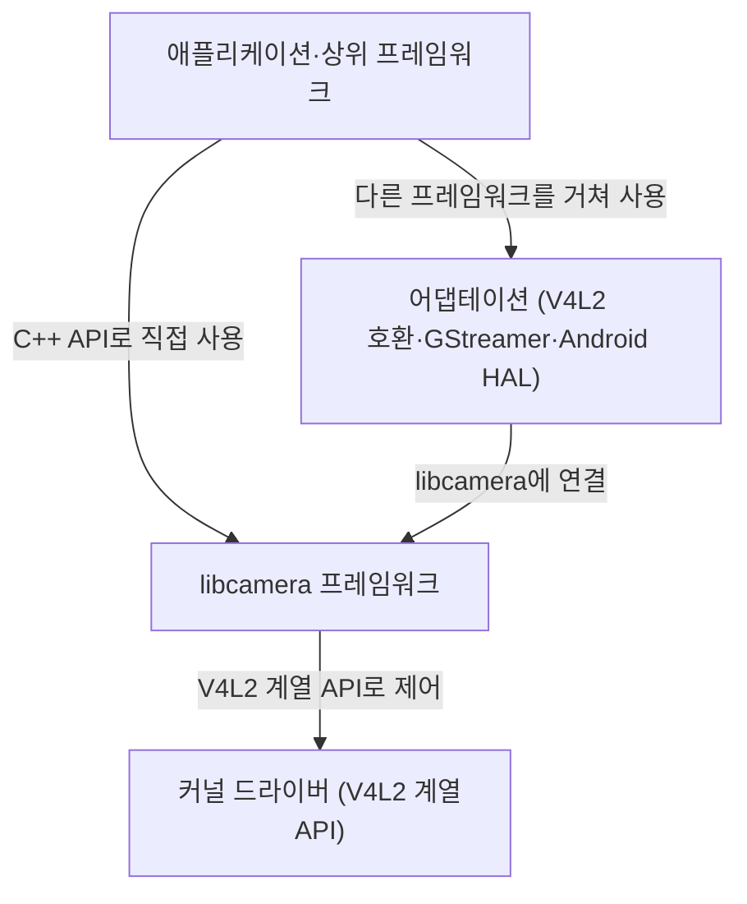

# 시작하기

장치를 처음 연동한다면 ForVendor에서 첫 촬영과 정지를 어떻게 시험할지 살펴보세요. 촬영을 멈춘 뒤에도 완료 알림이 온다면 ForDeveloper에서 요청의 취소 상태를 확인하는 코드를 따라가세요.

[ForVendor](https://ttolsun.github.io/libcamera-sdd/for-vendor.html)

[ForDeveloper](https://ttolsun.github.io/libcamera-sdd/for-developer.html)

## 하는 일

libcamera는 Linux, Android, ChromeOS를 위한 오픈 소스 복합 카메라 지원 라이브러리입니다. Linux 커널 장치 드라이버와 연결하고 개발자에게 직관적인 API를 제공하여 Linux 시스템에서 복합 카메라로 이미지를 캡처하는 과정의 복잡성을 줄입니다. 드라이버를 사용하여 동작하는 카메라 스택을 제공할 책임은 사용자 공간에 있으며, 벤더가 보통 이를 각각 구현합니다. 이러한 구현에는 응용 프로그램 개발자를 위한 공통 아키텍처나 API가 없으며, 하드웨어 파이프라인과 커널 API에서의 표현 방식이 서로 다르기 때문에 맞춤 처리가 필요한 경우가 많습니다.

### 카메라 스택의 네 계층

[Mermaid 원문](https://ttolsun.github.io/libcamera-sdd/team-overview.camera-stack.mmd)

그림 근거와 확인 범위

애플리케이션에서 카메라 하드웨어까지 어떤 계층을 지납니까? 지원 기종이나 성능을 보장하는 그림은 아닙니다.

소스 연결 해석 · 자동 연결 검사만 통과 · 의미와 기기 실행은 검증 전

| 요소·전이 | 소스 근거 |
| --- | --- |
| 애플리케이션·상위 프레임워크 | [Documentation/introduction.rst:137](https://ttolsun.github.io/libcamera-sdd/reader-archive/team-overview.html#source-e3b563f549a8c46d) |
| 어댑테이션 (V4L2 호환·GStreamer·Android HAL) | [Documentation/introduction.rst:137](https://ttolsun.github.io/libcamera-sdd/reader-archive/team-overview.html#source-e3b563f549a8c46d) |
| libcamera 프레임워크 | [Documentation/introduction.rst:137](https://ttolsun.github.io/libcamera-sdd/reader-archive/team-overview.html#source-e3b563f549a8c46d) |
| 커널 드라이버 (V4L2 계열 API) | [Documentation/introduction.rst:137](https://ttolsun.github.io/libcamera-sdd/reader-archive/team-overview.html#source-e3b563f549a8c46d) |
| C++ API로 직접 사용 | [Documentation/introduction.rst:137](https://ttolsun.github.io/libcamera-sdd/reader-archive/team-overview.html#source-e3b563f549a8c46d) |
| 다른 프레임워크를 거쳐 사용 | [Documentation/introduction.rst:137](https://ttolsun.github.io/libcamera-sdd/reader-archive/team-overview.html#source-e3b563f549a8c46d) |
| libcamera에 연결 | [Documentation/introduction.rst:137](https://ttolsun.github.io/libcamera-sdd/reader-archive/team-overview.html#source-e3b563f549a8c46d) |
| V4L2 계열 API로 제어 | [Documentation/introduction.rst:137](https://ttolsun.github.io/libcamera-sdd/reader-archive/team-overview.html#source-e3b563f549a8c46d) |

libcamera는 Linux 기반 시스템에 카메라 스택을 제공하여, 카메라에서 원하는 결과를 얻는 데 필요한 하드웨어 설정과 이미지 제어 알고리즘을 커널 API를 통해 처리하는 작업을 추상화합니다. 이를 통해 개발자는 해당 작업을 간단하고 일관된 방식으로 수행할 수 있습니다. 카메라 스택은 아래에서 위로 커널 드라이버, libcamera 프레임워크, libcamera 적응 계층, 애플리케이션·상위 프레임워크의 네 계층으로 구성됩니다.

절 전체 근거 4개

- `Documentation/introduction.rst`[`L10` 발췌](https://ttolsun.github.io/libcamera-sdd/reader-archive/team-overview.html#source-34fda84500757231) · [전체 소스 `L10`](https://github.com/TTolsun/libcamera-sdd/blob/adfa719f8ed67d18fd8a0739fc088a1f8b9e7252/Documentation/introduction.rst#L10) · [`L35` 발췌](https://ttolsun.github.io/libcamera-sdd/reader-archive/team-overview.html#source-de476c940b030e4a) · [전체 소스 `L35`](https://github.com/TTolsun/libcamera-sdd/blob/adfa719f8ed67d18fd8a0739fc088a1f8b9e7252/Documentation/introduction.rst#L35) · [`L45` 발췌](https://ttolsun.github.io/libcamera-sdd/reader-archive/team-overview.html#source-f350cabac0db8343) · [전체 소스 `L45`](https://github.com/TTolsun/libcamera-sdd/blob/adfa719f8ed67d18fd8a0739fc088a1f8b9e7252/Documentation/introduction.rst#L45) · [`L137` 발췌](https://ttolsun.github.io/libcamera-sdd/reader-archive/team-overview.html#source-e3b563f549a8c46d) · [전체 소스 `L137`](https://github.com/TTolsun/libcamera-sdd/blob/adfa719f8ed67d18fd8a0739fc088a1f8b9e7252/Documentation/introduction.rst#L137)

## 문서를 읽는 방법

절 전체 근거에서 **발췌**를 누르면 문서 안에서 원문이 펼쳐집니다. **전체 소스**를 누르면 분석한 커밋의 파일과 줄로 이동합니다. 용어는 [용어집](https://ttolsun.github.io/libcamera-sdd/glossary.html)에서 확인하세요.

그림을 누르면 확대와 요소 검색을 사용할 수 있습니다. 관계 그림과 정적 호출 추적은 실제 실행 순서를 보장하지 않습니다. 전체 클래스는 [구성 요소 색인](https://ttolsun.github.io/libcamera-sdd/implementation.html), 주요 호출과 추적 경계는 [핵심 시나리오](https://ttolsun.github.io/libcamera-sdd/architecture.html)에 있습니다.

검증 범위와 문서 상태

"자동 검사 통과"는 인용한 코드 위치와 문장 형식을 기계로 확인했다는 뜻이며, 사람의 내용 승인이 아닙니다. 문서 상단에 검토 상태를, 아래 생성 근거에 분석 커밋과 자동 검사 결과를 표시합니다. 코드 발췌와 대조한 설명도 내용이 맞는지 사람이 검토해야 합니다.

이 사이트는 공개 libcamera의 정적 분석 결과입니다. 실제 기기의 촬영·성능·오류 복구와 사내 HAL은 검증하지 않았습니다. 설계 선택의 이유와 성능 예산은 코드에 근거가 있을 때만 설명할 수 있습니다.

[모델 비교 기록](https://github.com/TTolsun/camera-hal-sdd-generator/blob/main/docs/libcamera/records/model-comparison.md)의 4B·9B 초안은 내용 오류가 남아 채택하지 않았습니다.

생성과 배포

[생성기](https://github.com/TTolsun/camera-hal-sdd-generator)가 추출·검증·화면 구성을 담당하고, [공개 문서 저장소](https://github.com/TTolsun/libcamera-sdd)가 공개 입력의 이력과 산출물을 보관합니다. 공개 환경에는 정기 예약을 설치하지 않습니다.

원래 라이브러리 사용법은 [libcamera 공식 문서](https://docs.libcamera.org/master/)에서 확인하세요.

## 원고와 검토 기록

이 프로젝트가 하는 일

- **생성 방식**: 추출 사실과 LLM 설명
- **검증 범위**: 표·그림은 facts로 만들고 설명은 LLM이 작성합니다. 인용·문장 및 설정된 구조 검사를 적용합니다.
- **자동 검사**: 통과 (`ok`). 검사한 항목은 검증 범위에 적혀 있습니다. 설명 내용이 맞는지는 사람이 확인합니다.
- **사람 검토**: 사람 검토 전
- **분석 기준 커밋**: `adfa719f8ed67d18fd8a0739fc088a1f8b9e7252`
- **문서 생성 시각**: `2026-11-11 20:35:47+00:00`
- **문장 생성 모델**: `cli/codex/gpt-6.1-terra`
- **문서 간 계약**: [자동 대조 보고서](https://ttolsun.github.io/libcamera-sdd/contract-consistency.json) · 사람 검토 전
- **독자 범위**: [과업별 답변과 미검토 범위](https://ttolsun.github.io/libcamera-sdd/reader-scope.json)

원고 작성 당시 기록

원고에 저장된 당시 기록입니다. 현재 문서의 기준과 다를 수 있습니다.

- 근거 파일: `Documentation/introduction.rst`, `Documentation/libcamera_architecture.rst`, `include/libcamera/camera.h`, `include/libcamera/camera_manager.h`, `include/libcamera/internal/pipeline_handler.h`, `src/libcamera/camera.cpp`, `src/libcamera/camera_manager.cpp`, `src/libcamera/pipeline_handler.cpp`
- 근거 수준: 코드 확인 (정적 분석, simple_compdb 구성, commit `c19d05128f`)
- 자동 검사 (인용·문장 및 설정된 구조 검사): 통과
- 검토 상태 기록일: 2026-11-12 · 사람 검토 전

[Markdown 원문 ↗](https://ttolsun.github.io/libcamera-sdd/team-overview.md)

[이전 주소의 상세 내용 열기](https://ttolsun.github.io/libcamera-sdd/reader-archive/team-overview.html#page-evidence)

libcamera 설계 문서

- **문서 간 계약**: [자동 대조 보고서](https://ttolsun.github.io/libcamera-sdd/contract-consistency.json) · 사람 검토 전

[이전 주소의 상세 내용 열기](https://ttolsun.github.io/libcamera-sdd/reader-archive/index.html#page-evidence)

[이 페이지 Markdown 받기](https://ttolsun.github.io/libcamera-sdd/index.md) · [독자용 문서의 원본 위치](https://ttolsun.github.io/libcamera-sdd/reader-edition.json)
