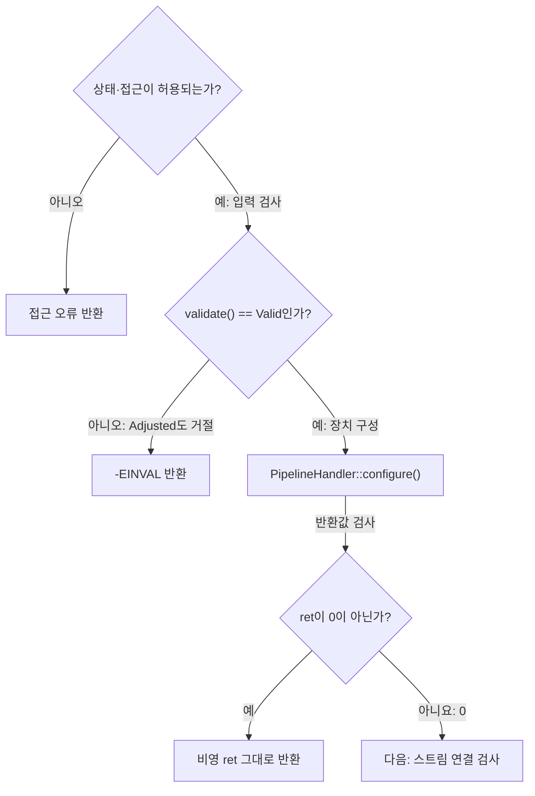
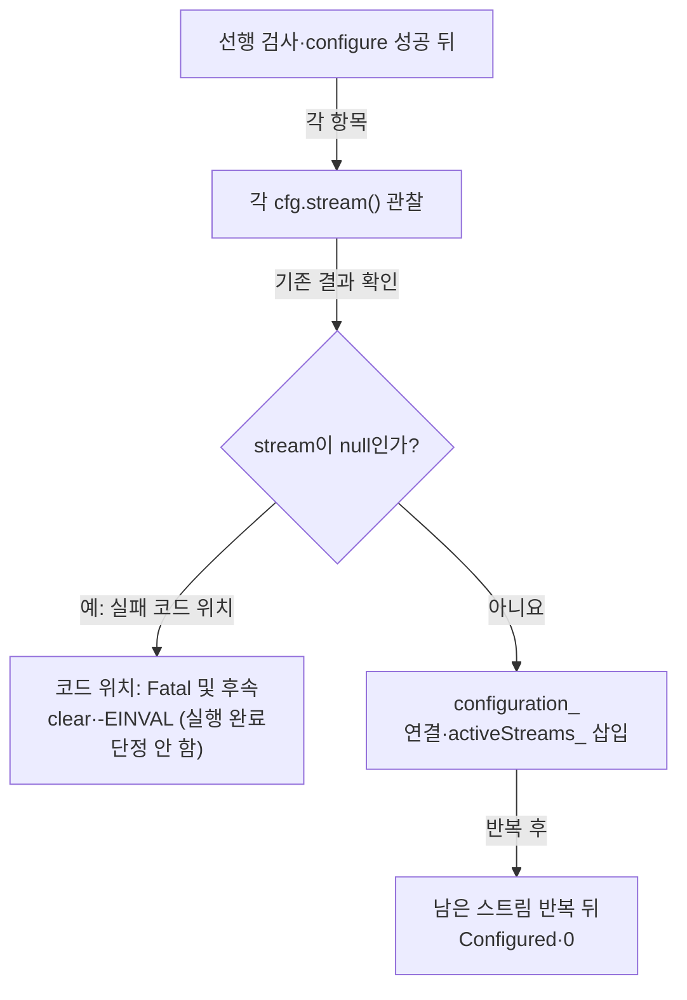
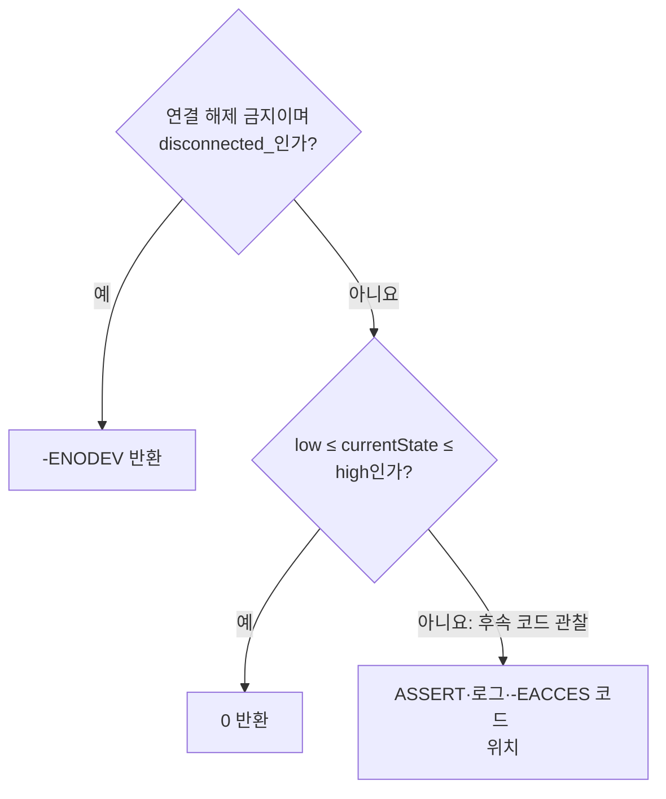
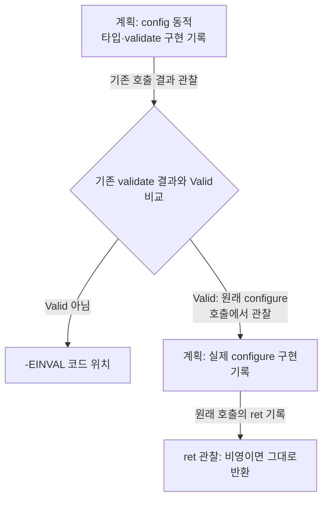
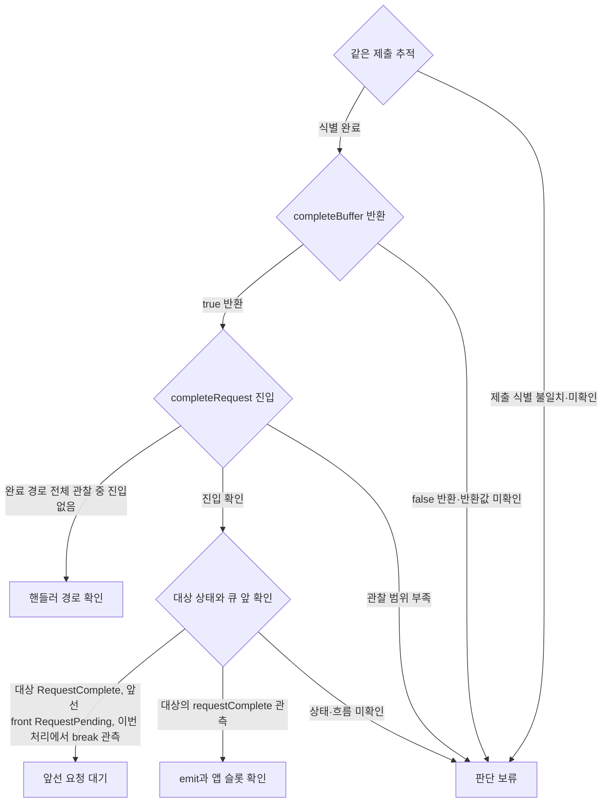
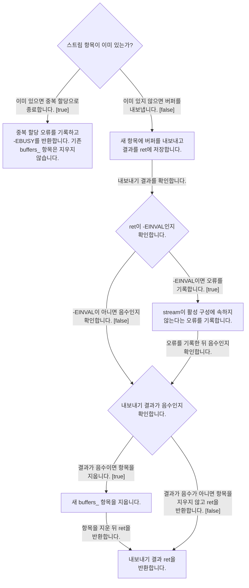
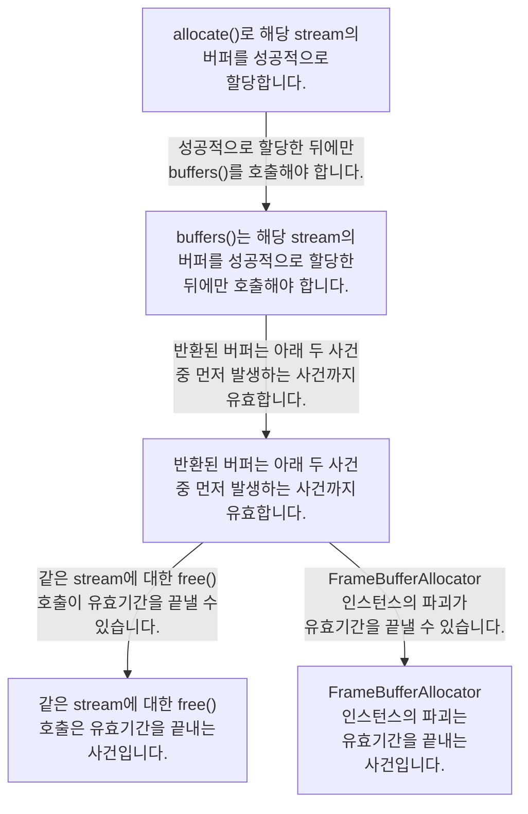

# 주의점과 문제 진단

마지막으로 성공한 호출이나 알림부터 확인하세요. 구성, 제출, 완료, 자원 참조, 모듈 로드 가운데 어느 단계에서 기대한 결과와 달라졌는지 좁혀 보세요.

## 구성 실패를 좁히는 순서

조사할 때는 `Camera::configure` 안에서 `Private::CameraAcquired`와 `Private::CameraConfigured`를 인자로 전달하는 기존 `isAccessAllowed` 호출의 반환값 `ret`를 관찰합니다. `ret < 0`이면 `Camera::configure`가 같은 `ret`를 반환하는 실패 분기를 기록합니다. 기존 `Camera::Private::isAccessAllowed` 호출의 조사에서는 먼저 `allowDisconnected`가 거짓이고 `disconnected_`가 참일 때 `-ENODEV`를 반환하는 선행 분기를 구분합니다. 그 밖에는 `currentState`와 `low`, `high`의 범위 비교 및 범위 안의 `0` 반환을 살펴보고, 범위 밖에서는 `ASSERT`, 오류 로그, `-EACCES` 반환의 코드 위치를 순서대로 확인합니다.

### 구성 실패를 좁히는 분기

[Mermaid 원문](https://ttolsun.github.io/libcamera-sdd/request-diagnosis.configure-failures.mmd)

그림 근거와 확인 범위

입력 검사와 장치 구현 실패를 순서대로 구분하세요. 아래 그림의 성공 경로에서도 스트림 연결 검사가 남습니다.

소스 연결 해석 · 자동 연결 검사만 통과 · 의미와 기기 실행은 검증 전

| 요소·전이 | 소스 근거 |
| --- | --- |
| 상태·접근이 허용되는가? | [src/libcamera/camera.cpp:1163](https://ttolsun.github.io/libcamera-sdd/reader-archive/request-diagnosis.html#source-4e218db5e20840dc) |
| 접근 오류 반환 | [src/libcamera/camera.cpp:1163](https://ttolsun.github.io/libcamera-sdd/reader-archive/request-diagnosis.html#source-4e218db5e20840dc) |
| validate() == Valid인가? | [src/libcamera/camera.cpp:1163](https://ttolsun.github.io/libcamera-sdd/reader-archive/request-diagnosis.html#source-4e218db5e20840dc) |
| -EINVAL 반환 | [src/libcamera/camera.cpp:1163](https://ttolsun.github.io/libcamera-sdd/reader-archive/request-diagnosis.html#source-4e218db5e20840dc) |
| PipelineHandler::configure() | [src/libcamera/camera.cpp:1163](https://ttolsun.github.io/libcamera-sdd/reader-archive/request-diagnosis.html#source-4e218db5e20840dc) |
| ret이 0이 아닌가? | [src/libcamera/camera.cpp:1191](https://ttolsun.github.io/libcamera-sdd/reader-archive/request-diagnosis.html#source-846c5a830281fa6a) |
| 비영 ret 그대로 반환 | [src/libcamera/camera.cpp:1191](https://ttolsun.github.io/libcamera-sdd/reader-archive/request-diagnosis.html#source-846c5a830281fa6a) |
| 다음: 스트림 연결 검사 | [src/libcamera/camera.cpp:1191](https://ttolsun.github.io/libcamera-sdd/reader-archive/request-diagnosis.html#source-846c5a830281fa6a) |
| 아니오 | [src/libcamera/camera.cpp:1163](https://ttolsun.github.io/libcamera-sdd/reader-archive/request-diagnosis.html#source-4e218db5e20840dc) |
| 예: 입력 검사 | [src/libcamera/camera.cpp:1163](https://ttolsun.github.io/libcamera-sdd/reader-archive/request-diagnosis.html#source-4e218db5e20840dc) |
| 아니오: Adjusted도 거절 | [src/libcamera/camera.cpp:1163](https://ttolsun.github.io/libcamera-sdd/reader-archive/request-diagnosis.html#source-4e218db5e20840dc) |
| 예: 장치 구성 | [src/libcamera/camera.cpp:1163](https://ttolsun.github.io/libcamera-sdd/reader-archive/request-diagnosis.html#source-4e218db5e20840dc) |
| 반환값 검사 | [src/libcamera/camera.cpp:1163](https://ttolsun.github.io/libcamera-sdd/reader-archive/request-diagnosis.html#source-4e218db5e20840dc) |
| 예 | [src/libcamera/camera.cpp:1191](https://ttolsun.github.io/libcamera-sdd/reader-archive/request-diagnosis.html#source-846c5a830281fa6a) |
| 아니요: 0 | [src/libcamera/camera.cpp:1191](https://ttolsun.github.io/libcamera-sdd/reader-archive/request-diagnosis.html#source-846c5a830281fa6a) |

### 구성 성공 뒤 스트림 연결을 확인하는 분기

[Mermaid 원문](https://ttolsun.github.io/libcamera-sdd/request-diagnosis.configuration-stream-link.mmd)

그림 근거와 확인 범위

상태 검사·검증과 PipelineHandler::configure 성공 뒤 cfg.stream()이 null인 경우 어떤 코드 위치를 관찰합니까?

소스 연결 해석 · 자동 연결 검사만 통과 · 의미와 기기 실행은 검증 전

| 요소·전이 | 소스 근거 |
| --- | --- |
| 선행 검사·configure 성공 뒤 | [src/libcamera/camera.cpp:1163](https://ttolsun.github.io/libcamera-sdd/reader-archive/request-diagnosis.html#source-4e218db5e20840dc) |
| 각 cfg.stream() 관찰 | [src/libcamera/camera.cpp:1163](https://ttolsun.github.io/libcamera-sdd/reader-archive/request-diagnosis.html#source-4e218db5e20840dc) |
| stream이 null인가? | [src/libcamera/camera.cpp:1163](https://ttolsun.github.io/libcamera-sdd/reader-archive/request-diagnosis.html#source-4e218db5e20840dc) |
| 코드 위치: Fatal 및 후속 clear·-EINVAL (실행 완료 단정 안 함) | [src/libcamera/camera.cpp:1163](https://ttolsun.github.io/libcamera-sdd/reader-archive/request-diagnosis.html#source-4e218db5e20840dc) |
| configuration\_ 연결·activeStreams\_ 삽입 | [src/libcamera/camera.cpp:1163](https://ttolsun.github.io/libcamera-sdd/reader-archive/request-diagnosis.html#source-4e218db5e20840dc) |
| 남은 스트림 반복 뒤 Configured·0 | [src/libcamera/camera.cpp:1163](https://ttolsun.github.io/libcamera-sdd/reader-archive/request-diagnosis.html#source-4e218db5e20840dc) |
| 각 항목 | [src/libcamera/camera.cpp:1163](https://ttolsun.github.io/libcamera-sdd/reader-archive/request-diagnosis.html#source-4e218db5e20840dc) |
| 기존 결과 확인 | [src/libcamera/camera.cpp:1163](https://ttolsun.github.io/libcamera-sdd/reader-archive/request-diagnosis.html#source-4e218db5e20840dc) |
| 예: 실패 코드 위치 | [src/libcamera/camera.cpp:1163](https://ttolsun.github.io/libcamera-sdd/reader-archive/request-diagnosis.html#source-4e218db5e20840dc) |
| 아니요 | [src/libcamera/camera.cpp:1163](https://ttolsun.github.io/libcamera-sdd/reader-archive/request-diagnosis.html#source-4e218db5e20840dc) |
| 반복 후 | [src/libcamera/camera.cpp:1163](https://ttolsun.github.io/libcamera-sdd/reader-archive/request-diagnosis.html#source-4e218db5e20840dc) |

### 구성 접근 검사에서 관찰할 분기

[Mermaid 원문](https://ttolsun.github.io/libcamera-sdd/request-diagnosis.configuration-access-branches.mmd)

그림 근거와 확인 범위

연결 해제를 먼저 확인한 뒤 상태 범위를 검사합니다. 단언과 로그 뒤의 코드는 실제 실행 결과로 단정하지 않습니다.

소스 연결 해석 · 자동 연결 검사만 통과 · 의미와 기기 실행은 검증 전

| 요소·전이 | 소스 근거 |
| --- | --- |
| 연결 해제 금지이며 disconnected\_인가? | [src/libcamera/camera.cpp:709](https://ttolsun.github.io/libcamera-sdd/reader-archive/request-diagnosis.html#source-1e64f4ece8808997) |
| -ENODEV 반환 | [src/libcamera/camera.cpp:709](https://ttolsun.github.io/libcamera-sdd/reader-archive/request-diagnosis.html#source-1e64f4ece8808997) |
| low ≤ currentState ≤ high인가? | [src/libcamera/camera.cpp:709](https://ttolsun.github.io/libcamera-sdd/reader-archive/request-diagnosis.html#source-1e64f4ece8808997) |
| 0 반환 | [src/libcamera/camera.cpp:709](https://ttolsun.github.io/libcamera-sdd/reader-archive/request-diagnosis.html#source-1e64f4ece8808997) |
| ASSERT·로그·-EACCES 코드 위치 | [src/libcamera/camera.cpp:709](https://ttolsun.github.io/libcamera-sdd/reader-archive/request-diagnosis.html#source-1e64f4ece8808997) |
| 예 | [src/libcamera/camera.cpp:709](https://ttolsun.github.io/libcamera-sdd/reader-archive/request-diagnosis.html#source-1e64f4ece8808997) |
| 아니요 | [src/libcamera/camera.cpp:709](https://ttolsun.github.io/libcamera-sdd/reader-archive/request-diagnosis.html#source-1e64f4ece8808997) |
| 예 | [src/libcamera/camera.cpp:709](https://ttolsun.github.io/libcamera-sdd/reader-archive/request-diagnosis.html#source-1e64f4ece8808997) |
| 아니요: 후속 코드 관찰 | [src/libcamera/camera.cpp:709](https://ttolsun.github.io/libcamera-sdd/reader-archive/request-diagnosis.html#source-1e64f4ece8808997) |

### 구성 호출의 실제 구현을 확인하는 조사 계획

[Mermaid 원문](https://ttolsun.github.io/libcamera-sdd/request-diagnosis.configuration-implementation-observation.mmd)

그림 근거와 확인 범위

상태 검사를 통과한 기존 호출에서 타입·구현·반환값을 관찰하는 계획입니다. 검증이나 구성을 다시 호출하지 않습니다.

소스 연결 해석 · 자동 연결 검사만 통과 · 의미와 기기 실행은 검증 전

| 요소·전이 | 소스 근거 |
| --- | --- |
| 계획: config 동적 타입·validate 구현 기록 | [src/libcamera/camera.cpp:1191](https://ttolsun.github.io/libcamera-sdd/reader-archive/request-diagnosis.html#source-846c5a830281fa6a) |
| 기존 validate 결과와 Valid 비교 | [src/libcamera/camera.cpp:1191](https://ttolsun.github.io/libcamera-sdd/reader-archive/request-diagnosis.html#source-846c5a830281fa6a) |
| -EINVAL 코드 위치 | [src/libcamera/camera.cpp:1203](https://ttolsun.github.io/libcamera-sdd/reader-archive/request-diagnosis.html#source-fcc2510602fe412b) |
| 계획: 실제 configure 구현 기록 | [src/libcamera/camera.cpp:1191](https://ttolsun.github.io/libcamera-sdd/reader-archive/request-diagnosis.html#source-846c5a830281fa6a) |
| ret 관찰: 비영이면 그대로 반환 | [src/libcamera/camera.cpp:1191](https://ttolsun.github.io/libcamera-sdd/reader-archive/request-diagnosis.html#source-846c5a830281fa6a) |
| 기존 호출 결과 관찰 | [src/libcamera/camera.cpp:1191](https://ttolsun.github.io/libcamera-sdd/reader-archive/request-diagnosis.html#source-846c5a830281fa6a) |
| Valid 아님 | [src/libcamera/camera.cpp:1203](https://ttolsun.github.io/libcamera-sdd/reader-archive/request-diagnosis.html#source-fcc2510602fe412b) |
| Valid: 원래 configure 호출에서 관찰 | [src/libcamera/camera.cpp:1191](https://ttolsun.github.io/libcamera-sdd/reader-archive/request-diagnosis.html#source-846c5a830281fa6a) |
| 원래 호출의 ret 기록 | [src/libcamera/camera.cpp:1191](https://ttolsun.github.io/libcamera-sdd/reader-archive/request-diagnosis.html#source-846c5a830281fa6a) |

`CameraConfiguration::validate()`의 `Adjusted`는 구성이 유효하도록 조정된 상태이며, 임의의 스트림에서 파라미터가 변경되거나 스트림 구성이 삭제될 수 있습니다. `Adjusted`를 받은 호출자는 구성을 주의 깊게 확인해야 합니다.

실행 확인 항목: 조사 계획에서는 `Camera::configure`의 `config->validate()` 결과를 `CameraConfiguration::Valid`와 비교하고, 결과가 다를 때 `-EINVAL`을 반환하는지 함께 기록할 수 있습니다.

기존 호출 스택에서 `config`의 실제 동적 타입과 실행되는 `validate` 구현을 기록하는 조사 계획입니다. 상태 확인과 검증을 통과한 경우 `pipe_`의 `invokeMethod`를 거쳐 호출되는 `PipelineHandler::configure`의 구체 구현과 반환값을 관찰하고, 반환값이 0이 아니면 `Camera::configure`가 그 값을 그대로 반환하는 분기를 기록합니다.

조사할 때 `Camera::configure()`에서 접근 검사와 설정 검증을 통과한 뒤 `PipelineHandler::configure`의 반환값이 0인 경우, 각 `cfg.stream()`의 결과인 `stream`과 null 검사 결과를 관찰합니다. `stream`이 null이면 Fatal 로그 `Pipeline handler failed to update stream configuration`과 `activeStreams_.clear()` 다음의 `-EINVAL` 반환 경로를 확인합니다.

절 전체 근거 10개

- `src/libcamera/camera.cpp`[`L1195` 발췌](https://ttolsun.github.io/libcamera-sdd/reader-archive/request-diagnosis.html#source-2da795dd561f56ec) · [전체 소스 `L1195`](https://github.com/TTolsun/libcamera-sdd/blob/adfa719f8ed67d18fd8a0739fc088a1f8b9e7252/src/libcamera/camera.cpp#L1195) · [`L716` 발췌](https://ttolsun.github.io/libcamera-sdd/reader-archive/request-diagnosis.html#source-9328b9e82bc716a1) · [전체 소스 `L716`](https://github.com/TTolsun/libcamera-sdd/blob/adfa719f8ed67d18fd8a0739fc088a1f8b9e7252/src/libcamera/camera.cpp#L716) · [`L709` 발췌](https://ttolsun.github.io/libcamera-sdd/reader-archive/request-diagnosis.html#source-1e64f4ece8808997) · [전체 소스 `L709`](https://github.com/TTolsun/libcamera-sdd/blob/adfa719f8ed67d18fd8a0739fc088a1f8b9e7252/src/libcamera/camera.cpp#L709) · [`L323` 발췌](https://ttolsun.github.io/libcamera-sdd/reader-archive/request-diagnosis.html#source-cb5242e98ac1e72c) · [전체 소스 `L323`](https://github.com/TTolsun/libcamera-sdd/blob/adfa719f8ed67d18fd8a0739fc088a1f8b9e7252/src/libcamera/camera.cpp#L323) · [`L343` 발췌](https://ttolsun.github.io/libcamera-sdd/reader-archive/request-diagnosis.html#source-e5758fc43bf244cd) · [전체 소스 `L343`](https://github.com/TTolsun/libcamera-sdd/blob/adfa719f8ed67d18fd8a0739fc088a1f8b9e7252/src/libcamera/camera.cpp#L343) · [`L1203` 발췌](https://ttolsun.github.io/libcamera-sdd/reader-archive/request-diagnosis.html#source-fcc2510602fe412b) · [전체 소스 `L1203`](https://github.com/TTolsun/libcamera-sdd/blob/adfa719f8ed67d18fd8a0739fc088a1f8b9e7252/src/libcamera/camera.cpp#L1203) · [`L1191` 발췌](https://ttolsun.github.io/libcamera-sdd/reader-archive/request-diagnosis.html#source-846c5a830281fa6a) · [전체 소스 `L1191`](https://github.com/TTolsun/libcamera-sdd/blob/adfa719f8ed67d18fd8a0739fc088a1f8b9e7252/src/libcamera/camera.cpp#L1191) · [`L1225` 발췌](https://ttolsun.github.io/libcamera-sdd/reader-archive/request-diagnosis.html#source-fa2c87e2c2f4e322) · [전체 소스 `L1225`](https://github.com/TTolsun/libcamera-sdd/blob/adfa719f8ed67d18fd8a0739fc088a1f8b9e7252/src/libcamera/camera.cpp#L1225) · [`L1163`](https://ttolsun.github.io/libcamera-sdd/reader-archive/request-diagnosis.html#source-4e218db5e20840dc) · [`L342`](https://ttolsun.github.io/libcamera-sdd/reader-archive/request-diagnosis.html#source-e13fede0aa40ada1)

## 요청 제출 실패와 완료 알림 누락

함께 확인: [준비 대기와 타임아웃 확인](https://ttolsun.github.io/libcamera-sdd/reader-archive/pipeline-requests.html#%EC%9A%94%EC%B2%AD-%EC%A4%80%EB%B9%84%EC%99%80-%EC%9E%A5%EC%B9%98-%ED%81%90) · [요청 접수와 완료 통지 구분](https://ttolsun.github.io/libcamera-sdd/reader-archive/request-lifecycle.html#%EC%A0%9C%EC%B6%9C%EC%97%90%EC%84%9C-%EC%99%84%EB%A3%8C%EA%B9%8C%EC%A7%80) · [앱 콜백 연결·스레드의 관찰 계획](https://ttolsun.github.io/libcamera-sdd/request-flow.html#stop-and-disconnect)

**중단 전에 메모를 남기세요.**

아래 틀을 복사해 빈칸을 채우고, 재개할 때 원래 메모와 대조하세요.

- 제보된 증상과 조건을 적으세요: \_\_\_\_.
- 직접 관측한 값과 확인 위치를 적으세요: \_\_\_\_.
- 문서로 해석한 내용과 임시 가정을 적으세요: \_\_\_\_.
- 아직 확인하지 못한 점을 적으세요: \_\_\_\_.
- 다음 확인과 결과에 따른 분기를 적으세요: \_\_\_\_.
- 근거 문서의 URL과 절 위치를 적으세요: \_\_\_\_.

관측하지 않은 값은 미확인으로 남기고, 관측하려고 상태 변경 함수를 다시 호출하지 마세요.

재개할 때 제보·관측·해석이 서로 섞이지 않았는지 원래 메모와 대조하세요.

첫 조사 항목으로 원래 `queueRequest` 호출의 반환값과 호출 파일을 기록해, 반환값이 0이면 정상 접수로, 음수이면 제출 오류로 구분하도록 합니다. 정상 접수는 촬영 완료와 구분해 기록하도록 합니다.

### 마지막 버퍼가 끝났는데 요청 완료 통지가 오지 않을 때

다음은 소스 기반 조사 예시입니다. 각 제출을 camera, stop/start로 구분한 run, 제출마다 새로 부여한 generation, Request\*로 추적하세요. doQueueRequest에서 sequence\_를 할당한 뒤에는 Request::sequence()도 기록하세요. sequence는 run 사이에 초기화되고 오버플로로 순환합니다. Request::reuse()로 같은 객체를 다시 제출할 수 있으므로 cookie나 주소만으로 제출을 구분하지 마세요. 예시 A: 대상 제출 42의 마지막 completeBuffer가 true를 반환했습니다. 핸들러가 의도한 완료 경로를 지연된 분기까지 빠진 기록 없이 계속 관찰했는데도 completeRequest 진입이 없었다면, 콜백 분기와 조건을 살펴보고 메타데이터 처리나 완료 작업을 미루는 경로가 있는지 확인하세요. 특정 핸들러에 그런 경로가 반드시 있다고 가정하지 마세요. bufferCompleted.emit만으로 completeBuffer의 반환값을 판단하지 마세요. 예시 B: 대상 제출 42가 completeRequest에 진입하고 complete() 후 RequestComplete가 되었지만, queuedRequests\_.front()의 앞선 제출 41은 RequestPending입니다. 관측된 break는 이번 큐 처리에서 대상이 큐에 남게 할 뿐, 영원히 남는다는 뜻은 아닙니다. 제출 41의 남은 버퍼와 완료 경로를 추적하고, 이후 큐 앞을 다시 확인하면서 대상의 Camera::requestComplete 호출을 관찰하세요. 이어 실제 requestCompleted.emit 발생과 앱 슬롯 진입을 각각 확인하세요. 대상이 이미 큐 앞에 있다면 대상의 상태와 큐 처리 흐름을 확인하세요. RequestCancelled는 별도로 구분하세요. 제출의 식별이나 필요한 관찰 범위가 불완전하면 판단을 보류하세요. 관찰을 위해 상태를 바꾸는 함수를 다시 호출하지 마세요. [`pipeline_handler.cpp:491`](https://github.com/TTolsun/libcamera-sdd/blob/adfa719f8ed67d18fd8a0739fc088a1f8b9e7252/src/libcamera/pipeline_handler.cpp#L491) · [`pipeline_handler.cpp:401`](https://github.com/TTolsun/libcamera-sdd/blob/adfa719f8ed67d18fd8a0739fc088a1f8b9e7252/src/libcamera/pipeline_handler.cpp#L401) · [`request.cpp:385`](https://github.com/TTolsun/libcamera-sdd/blob/adfa719f8ed67d18fd8a0739fc088a1f8b9e7252/src/libcamera/request.cpp#L385) · [`pipeline_handler.cpp:567`](https://github.com/TTolsun/libcamera-sdd/blob/adfa719f8ed67d18fd8a0739fc088a1f8b9e7252/src/libcamera/pipeline_handler.cpp#L567) · [`pipeline_handler.cpp:566`](https://github.com/TTolsun/libcamera-sdd/blob/adfa719f8ed67d18fd8a0739fc088a1f8b9e7252/src/libcamera/pipeline_handler.cpp#L566) · [`pipeline_handler.cpp:584`](https://github.com/TTolsun/libcamera-sdd/blob/adfa719f8ed67d18fd8a0739fc088a1f8b9e7252/src/libcamera/pipeline_handler.cpp#L584) · [`pipeline_handler.cpp:556`](https://github.com/TTolsun/libcamera-sdd/blob/adfa719f8ed67d18fd8a0739fc088a1f8b9e7252/src/libcamera/pipeline_handler.cpp#L556) · [`pipeline_handler.cpp:588`](https://github.com/TTolsun/libcamera-sdd/blob/adfa719f8ed67d18fd8a0739fc088a1f8b9e7252/src/libcamera/pipeline_handler.cpp#L588) · [`request.cpp:132`](https://github.com/TTolsun/libcamera-sdd/blob/adfa719f8ed67d18fd8a0739fc088a1f8b9e7252/src/libcamera/request.cpp#L132) · [`pipeline_handler.cpp:593`](https://github.com/TTolsun/libcamera-sdd/blob/adfa719f8ed67d18fd8a0739fc088a1f8b9e7252/src/libcamera/pipeline_handler.cpp#L593) · [`pipeline_handler.cpp:594`](https://github.com/TTolsun/libcamera-sdd/blob/adfa719f8ed67d18fd8a0739fc088a1f8b9e7252/src/libcamera/pipeline_handler.cpp#L594) · [`pipeline_handler.cpp:599`](https://github.com/TTolsun/libcamera-sdd/blob/adfa719f8ed67d18fd8a0739fc088a1f8b9e7252/src/libcamera/pipeline_handler.cpp#L599) · [`camera.cpp:1488`](https://github.com/TTolsun/libcamera-sdd/blob/adfa719f8ed67d18fd8a0739fc088a1f8b9e7252/src/libcamera/camera.cpp#L1488) · [`bound_method.cpp:40`](https://github.com/TTolsun/libcamera-sdd/blob/adfa719f8ed67d18fd8a0739fc088a1f8b9e7252/src/libcamera/base/bound_method.cpp#L40)

| 현재 확인 지점 | 관찰 결과 | 다음 확인 지점 |
| --- | --- | --- |
| 같은 제출 추적 | 식별 완료 | completeBuffer 반환 [`pipeline_handler.cpp:491`](https://github.com/TTolsun/libcamera-sdd/blob/adfa719f8ed67d18fd8a0739fc088a1f8b9e7252/src/libcamera/pipeline_handler.cpp#L491) · [`pipeline_handler.cpp:567`](https://github.com/TTolsun/libcamera-sdd/blob/adfa719f8ed67d18fd8a0739fc088a1f8b9e7252/src/libcamera/pipeline_handler.cpp#L567) · [`pipeline_handler.cpp:566`](https://github.com/TTolsun/libcamera-sdd/blob/adfa719f8ed67d18fd8a0739fc088a1f8b9e7252/src/libcamera/pipeline_handler.cpp#L566) |
| 같은 제출 추적 | 제출 식별 불일치·미확인 | 판단 보류 [`pipeline_handler.cpp:491`](https://github.com/TTolsun/libcamera-sdd/blob/adfa719f8ed67d18fd8a0739fc088a1f8b9e7252/src/libcamera/pipeline_handler.cpp#L491) · [`pipeline_handler.cpp:584`](https://github.com/TTolsun/libcamera-sdd/blob/adfa719f8ed67d18fd8a0739fc088a1f8b9e7252/src/libcamera/pipeline_handler.cpp#L584) · [`pipeline_handler.cpp:593`](https://github.com/TTolsun/libcamera-sdd/blob/adfa719f8ed67d18fd8a0739fc088a1f8b9e7252/src/libcamera/pipeline_handler.cpp#L593) |
| completeBuffer 반환 | true 반환 | completeRequest 진입 [`pipeline_handler.cpp:567`](https://github.com/TTolsun/libcamera-sdd/blob/adfa719f8ed67d18fd8a0739fc088a1f8b9e7252/src/libcamera/pipeline_handler.cpp#L567) · [`pipeline_handler.cpp:556`](https://github.com/TTolsun/libcamera-sdd/blob/adfa719f8ed67d18fd8a0739fc088a1f8b9e7252/src/libcamera/pipeline_handler.cpp#L556) · [`pipeline_handler.cpp:584`](https://github.com/TTolsun/libcamera-sdd/blob/adfa719f8ed67d18fd8a0739fc088a1f8b9e7252/src/libcamera/pipeline_handler.cpp#L584) |
| completeBuffer 반환 | false 반환·반환값 미확인 | 판단 보류 [`pipeline_handler.cpp:567`](https://github.com/TTolsun/libcamera-sdd/blob/adfa719f8ed67d18fd8a0739fc088a1f8b9e7252/src/libcamera/pipeline_handler.cpp#L567) · [`pipeline_handler.cpp:584`](https://github.com/TTolsun/libcamera-sdd/blob/adfa719f8ed67d18fd8a0739fc088a1f8b9e7252/src/libcamera/pipeline_handler.cpp#L584) · [`pipeline_handler.cpp:593`](https://github.com/TTolsun/libcamera-sdd/blob/adfa719f8ed67d18fd8a0739fc088a1f8b9e7252/src/libcamera/pipeline_handler.cpp#L593) |
| completeRequest 진입 | 완료 경로 전체 관찰 중 진입 없음 | 핸들러 경로 확인 [`pipeline_handler.cpp:584`](https://github.com/TTolsun/libcamera-sdd/blob/adfa719f8ed67d18fd8a0739fc088a1f8b9e7252/src/libcamera/pipeline_handler.cpp#L584) · [`pipeline_handler.cpp:556`](https://github.com/TTolsun/libcamera-sdd/blob/adfa719f8ed67d18fd8a0739fc088a1f8b9e7252/src/libcamera/pipeline_handler.cpp#L556) |
| completeRequest 진입 | 진입 확인 | 대상 상태와 큐 앞 확인 [`pipeline_handler.cpp:584`](https://github.com/TTolsun/libcamera-sdd/blob/adfa719f8ed67d18fd8a0739fc088a1f8b9e7252/src/libcamera/pipeline_handler.cpp#L584) · [`pipeline_handler.cpp:588`](https://github.com/TTolsun/libcamera-sdd/blob/adfa719f8ed67d18fd8a0739fc088a1f8b9e7252/src/libcamera/pipeline_handler.cpp#L588) · [`pipeline_handler.cpp:593`](https://github.com/TTolsun/libcamera-sdd/blob/adfa719f8ed67d18fd8a0739fc088a1f8b9e7252/src/libcamera/pipeline_handler.cpp#L593) |
| completeRequest 진입 | 관찰 범위 부족 | 판단 보류 [`pipeline_handler.cpp:584`](https://github.com/TTolsun/libcamera-sdd/blob/adfa719f8ed67d18fd8a0739fc088a1f8b9e7252/src/libcamera/pipeline_handler.cpp#L584) · [`pipeline_handler.cpp:593`](https://github.com/TTolsun/libcamera-sdd/blob/adfa719f8ed67d18fd8a0739fc088a1f8b9e7252/src/libcamera/pipeline_handler.cpp#L593) |
| 대상 상태와 큐 앞 확인 | 대상 RequestComplete, 앞선 front RequestPending, 이번 처리에서 break 관측 | 앞선 요청 대기 [`pipeline_handler.cpp:593`](https://github.com/TTolsun/libcamera-sdd/blob/adfa719f8ed67d18fd8a0739fc088a1f8b9e7252/src/libcamera/pipeline_handler.cpp#L593) · [`pipeline_handler.cpp:594`](https://github.com/TTolsun/libcamera-sdd/blob/adfa719f8ed67d18fd8a0739fc088a1f8b9e7252/src/libcamera/pipeline_handler.cpp#L594) |
| 대상 상태와 큐 앞 확인 | 대상의 requestComplete 관측 | emit과 앱 슬롯 확인 [`pipeline_handler.cpp:599`](https://github.com/TTolsun/libcamera-sdd/blob/adfa719f8ed67d18fd8a0739fc088a1f8b9e7252/src/libcamera/pipeline_handler.cpp#L599) |
| 대상 상태와 큐 앞 확인 | 상태·흐름 미확인 | 판단 보류 [`pipeline_handler.cpp:593`](https://github.com/TTolsun/libcamera-sdd/blob/adfa719f8ed67d18fd8a0739fc088a1f8b9e7252/src/libcamera/pipeline_handler.cpp#L593) · [`pipeline_handler.cpp:594`](https://github.com/TTolsun/libcamera-sdd/blob/adfa719f8ed67d18fd8a0739fc088a1f8b9e7252/src/libcamera/pipeline_handler.cpp#L594) · [`pipeline_handler.cpp:584`](https://github.com/TTolsun/libcamera-sdd/blob/adfa719f8ed67d18fd8a0739fc088a1f8b9e7252/src/libcamera/pipeline_handler.cpp#L584) |

[Mermaid 원문](https://ttolsun.github.io/libcamera-sdd/request-diagnosis.completion-notice-diagnosis.mmd)

그림 근거와 확인 범위

마지막 버퍼 완료 후 어디에서 멈췄나요?

소스 연결 해석 · 자동 연결 검사만 통과 · 의미와 기기 실행은 검증 전

| 요소·전이 | 소스 근거 |
| --- | --- |
| 같은 제출 추적 | [src/libcamera/pipeline_handler.cpp:428](https://ttolsun.github.io/libcamera-sdd/reader-archive/request-diagnosis.html#source-789eafedfaa7f3c5) |
| completeBuffer 반환 | [src/libcamera/pipeline_handler.cpp:547](https://ttolsun.github.io/libcamera-sdd/reader-archive/request-diagnosis.html#source-01ad7c6605c3296a) |
| completeRequest 진입 | [src/libcamera/pipeline_handler.cpp:547](https://ttolsun.github.io/libcamera-sdd/reader-archive/request-diagnosis.html#source-01ad7c6605c3296a) |
| 핸들러 경로 확인 | [src/libcamera/pipeline_handler.cpp:547](https://ttolsun.github.io/libcamera-sdd/reader-archive/request-diagnosis.html#source-01ad7c6605c3296a) |
| 대상 상태와 큐 앞 확인 | [src/libcamera/pipeline_handler.cpp:547](https://ttolsun.github.io/libcamera-sdd/reader-archive/request-diagnosis.html#source-01ad7c6605c3296a) |
| 앞선 요청 대기 | [src/libcamera/pipeline_handler.cpp:547](https://ttolsun.github.io/libcamera-sdd/reader-archive/request-diagnosis.html#source-01ad7c6605c3296a) |
| emit과 앱 슬롯 확인 | [src/libcamera/pipeline_handler.cpp:547](https://ttolsun.github.io/libcamera-sdd/reader-archive/request-diagnosis.html#source-01ad7c6605c3296a) |
| 판단 보류 | [src/libcamera/pipeline_handler.cpp:547](https://ttolsun.github.io/libcamera-sdd/reader-archive/request-diagnosis.html#source-01ad7c6605c3296a) |
| 식별 완료 | [src/libcamera/pipeline_handler.cpp:428](https://ttolsun.github.io/libcamera-sdd/reader-archive/request-diagnosis.html#source-789eafedfaa7f3c5) |
| 제출 식별 불일치·미확인 | [src/libcamera/pipeline_handler.cpp:428](https://ttolsun.github.io/libcamera-sdd/reader-archive/request-diagnosis.html#source-789eafedfaa7f3c5) |
| true 반환 | [src/libcamera/pipeline_handler.cpp:547](https://ttolsun.github.io/libcamera-sdd/reader-archive/request-diagnosis.html#source-01ad7c6605c3296a) |
| false 반환·반환값 미확인 | [src/libcamera/pipeline_handler.cpp:547](https://ttolsun.github.io/libcamera-sdd/reader-archive/request-diagnosis.html#source-01ad7c6605c3296a) |
| 완료 경로 전체 관찰 중 진입 없음 | [src/libcamera/pipeline_handler.cpp:547](https://ttolsun.github.io/libcamera-sdd/reader-archive/request-diagnosis.html#source-01ad7c6605c3296a) |
| 진입 확인 | [src/libcamera/pipeline_handler.cpp:547](https://ttolsun.github.io/libcamera-sdd/reader-archive/request-diagnosis.html#source-01ad7c6605c3296a) |
| 관찰 범위 부족 | [src/libcamera/pipeline_handler.cpp:547](https://ttolsun.github.io/libcamera-sdd/reader-archive/request-diagnosis.html#source-01ad7c6605c3296a) |
| 대상 RequestComplete, 앞선 front RequestPending, 이번 처리에서 break 관측 | [src/libcamera/pipeline_handler.cpp:547](https://ttolsun.github.io/libcamera-sdd/reader-archive/request-diagnosis.html#source-01ad7c6605c3296a) |
| 대상의 requestComplete 관측 | [src/libcamera/pipeline_handler.cpp:547](https://ttolsun.github.io/libcamera-sdd/reader-archive/request-diagnosis.html#source-01ad7c6605c3296a) |
| 상태·흐름 미확인 | [src/libcamera/pipeline_handler.cpp:547](https://ttolsun.github.io/libcamera-sdd/reader-archive/request-diagnosis.html#source-01ad7c6605c3296a) |

## 중복 할당과 내보내기 실패를 구분하기

`FrameBufferAllocator::allocate`는 `try_emplace`의 `inserted`가 false이면 버퍼가 이미 할당되었다는 오류를 기록하고 `-EBUSY`를 반환합니다. `FrameBufferAllocator::allocate()`는 `exportFrameBuffers()`의 반환값을 `ret`에 저장하고, `ret`가 음수이면 `buffers_.erase(it)`로 해당 `buffers_` 항목을 제거합니다. `FrameBufferAllocator::allocate`는 `exportFrameBuffers`를 호출한 경우 그 결과인 `ret`를 음수 여부와 관계없이 반환합니다.

### 중복 할당과 내보내기 실패를 구분하기의 관계와 경계

[Mermaid 원문](https://ttolsun.github.io/libcamera-sdd/framebuffer-allocator.item-allocation-failure.mmd)

그림 근거와 확인 범위

중복 할당과 내보내기 실패는 처리 흐름, 반환값 및 buffers\_ 항목 처리에서 어떻게 다른가?

소스 연결 해석 · 자동 연결 검사만 통과 · 의미와 기기 실행은 검증 전

LLM 그림 초안 · 사람 검토 전

작성 모델: `cli/codex/gpt-6.1-terra`

| 요소·전이 | 소스 근거 |
| --- | --- |
| 스트림 항목이 이미 있는가? | [src/libcamera/framebuffer_allocator.cpp:86](https://ttolsun.github.io/libcamera-sdd/reader-archive/framebuffer-allocator.html#source-78a6c2f7dbdebb0f) |
| 중복 할당 오류를 기록하고 -EBUSY를 반환합니다. 기존 buffers\_ 항목은 지우지 않습니다. | [src/libcamera/framebuffer_allocator.cpp:86](https://ttolsun.github.io/libcamera-sdd/reader-archive/framebuffer-allocator.html#source-78a6c2f7dbdebb0f) |
| 새 항목에 버퍼를 내보내고 결과를 ret에 저장합니다. | [src/libcamera/framebuffer_allocator.cpp:86](https://ttolsun.github.io/libcamera-sdd/reader-archive/framebuffer-allocator.html#source-78a6c2f7dbdebb0f) |
| ret이 -EINVAL인지 확인합니다. | [src/libcamera/framebuffer_allocator.cpp:86](https://ttolsun.github.io/libcamera-sdd/reader-archive/framebuffer-allocator.html#source-78a6c2f7dbdebb0f) |
| stream이 활성 구성에 속하지 않는다는 오류를 기록합니다. | [src/libcamera/framebuffer_allocator.cpp:86](https://ttolsun.github.io/libcamera-sdd/reader-archive/framebuffer-allocator.html#source-78a6c2f7dbdebb0f) |
| 내보내기 결과가 음수인지 확인합니다. | [src/libcamera/framebuffer_allocator.cpp:86](https://ttolsun.github.io/libcamera-sdd/reader-archive/framebuffer-allocator.html#source-78a6c2f7dbdebb0f) |
| 새 buffers\_ 항목을 지웁니다. | [src/libcamera/framebuffer_allocator.cpp:86](https://ttolsun.github.io/libcamera-sdd/reader-archive/framebuffer-allocator.html#source-78a6c2f7dbdebb0f) |
| 내보내기 결과 ret을 반환합니다. | [src/libcamera/framebuffer_allocator.cpp:86](https://ttolsun.github.io/libcamera-sdd/reader-archive/framebuffer-allocator.html#source-78a6c2f7dbdebb0f) |
| 이미 있으면 중복 할당으로 종료합니다. · !inserted \[true\] | [src/libcamera/framebuffer_allocator.cpp:86](https://ttolsun.github.io/libcamera-sdd/reader-archive/framebuffer-allocator.html#source-78a6c2f7dbdebb0f) |
| 이미 있지 않으면 버퍼를 내보냅니다. · !inserted \[false\] | [src/libcamera/framebuffer_allocator.cpp:86](https://ttolsun.github.io/libcamera-sdd/reader-archive/framebuffer-allocator.html#source-78a6c2f7dbdebb0f) |
| 내보내기 결과를 확인합니다. | [src/libcamera/framebuffer_allocator.cpp:86](https://ttolsun.github.io/libcamera-sdd/reader-archive/framebuffer-allocator.html#source-78a6c2f7dbdebb0f) |
| -EINVAL이면 오류를 기록합니다. · ret == -EINVAL \[true\] | [src/libcamera/framebuffer_allocator.cpp:86](https://ttolsun.github.io/libcamera-sdd/reader-archive/framebuffer-allocator.html#source-78a6c2f7dbdebb0f) |
| -EINVAL이 아니면 음수인지 확인합니다. · ret == -EINVAL \[false\] | [src/libcamera/framebuffer_allocator.cpp:86](https://ttolsun.github.io/libcamera-sdd/reader-archive/framebuffer-allocator.html#source-78a6c2f7dbdebb0f) |
| 오류를 기록한 뒤 음수인지 확인합니다. | [src/libcamera/framebuffer_allocator.cpp:86](https://ttolsun.github.io/libcamera-sdd/reader-archive/framebuffer-allocator.html#source-78a6c2f7dbdebb0f) |
| 결과가 음수이면 항목을 지웁니다. · ret \< 0 \[true\] | [src/libcamera/framebuffer_allocator.cpp:86](https://ttolsun.github.io/libcamera-sdd/reader-archive/framebuffer-allocator.html#source-78a6c2f7dbdebb0f) |
| 항목을 지운 뒤 ret을 반환합니다. | [src/libcamera/framebuffer_allocator.cpp:86](https://ttolsun.github.io/libcamera-sdd/reader-archive/framebuffer-allocator.html#source-78a6c2f7dbdebb0f) |
| 결과가 음수가 아니면 항목을 지우지 않고 ret을 반환합니다. · ret \< 0 \[false\] | [src/libcamera/framebuffer_allocator.cpp:86](https://ttolsun.github.io/libcamera-sdd/reader-archive/framebuffer-allocator.html#source-78a6c2f7dbdebb0f) |

절 전체 근거 2개

- `src/libcamera/framebuffer_allocator.cpp`[`L86` 발췌](https://ttolsun.github.io/libcamera-sdd/reader-archive/framebuffer-allocator.html#source-78a6c2f7dbdebb0f) · [전체 소스 `L86`](https://github.com/TTolsun/libcamera-sdd/blob/adfa719f8ed67d18fd8a0739fc088a1f8b9e7252/src/libcamera/framebuffer_allocator.cpp#L86) · [`L95` 발췌](https://ttolsun.github.io/libcamera-sdd/reader-archive/framebuffer-allocator.html#source-c091763d679ea029) · [전체 소스 `L95`](https://github.com/TTolsun/libcamera-sdd/blob/adfa719f8ed67d18fd8a0739fc088a1f8b9e7252/src/libcamera/framebuffer_allocator.cpp#L95)

## buffers 반환 참조의 유효기간

`buffers()`는 해당 스트림에 대해 `allocate()`로 버퍼를 성공적으로 할당한 후에만 호출해야 합니다. `buffers()`가 반환하는 버퍼는 같은 스트림에 대해 `free()`가 호출되거나 `FrameBufferAllocator` 인스턴스가 파괴될 때까지 유효합니다.

### buffers 반환 참조의 유효기간의 관계와 경계

[Mermaid 원문](https://ttolsun.github.io/libcamera-sdd/framebuffer-allocator.item-reference-lifetime.mmd)

그림 근거와 확인 범위

buffers()는 언제 호출할 수 있으며, 반환 버퍼의 유효기간은 어떤 사건으로 끝나는가?

소스 연결 해석 · 자동 연결 검사만 통과 · 의미와 기기 실행은 검증 전

LLM 그림 초안 · 사람 검토 전

작성 모델: `cli/codex/gpt-6.1-terra`

| 요소·전이 | 소스 근거 |
| --- | --- |
| allocate()로 해당 stream의 버퍼를 성공적으로 할당합니다. | [src/libcamera/framebuffer_allocator.cpp:141](https://ttolsun.github.io/libcamera-sdd/reader-archive/framebuffer-allocator.html#source-68023250094ce1a8) |
| buffers()는 해당 stream의 버퍼를 성공적으로 할당한 뒤에만 호출해야 합니다. | [src/libcamera/framebuffer_allocator.cpp:141](https://ttolsun.github.io/libcamera-sdd/reader-archive/framebuffer-allocator.html#source-68023250094ce1a8) |
| 반환된 버퍼는 아래 두 사건 중 먼저 발생하는 사건까지 유효합니다. | [src/libcamera/framebuffer_allocator.cpp:142](https://ttolsun.github.io/libcamera-sdd/reader-archive/framebuffer-allocator.html#source-d60c5ad57e6699de) |
| 같은 stream에 대한 free() 호출은 유효기간을 끝내는 사건입니다. | [src/libcamera/framebuffer_allocator.cpp:142](https://ttolsun.github.io/libcamera-sdd/reader-archive/framebuffer-allocator.html#source-d60c5ad57e6699de) |
| FrameBufferAllocator 인스턴스의 파괴는 유효기간을 끝내는 사건입니다. | [src/libcamera/framebuffer_allocator.cpp:142](https://ttolsun.github.io/libcamera-sdd/reader-archive/framebuffer-allocator.html#source-d60c5ad57e6699de) |
| 성공적으로 할당한 뒤에만 buffers()를 호출해야 합니다. | [src/libcamera/framebuffer_allocator.cpp:141](https://ttolsun.github.io/libcamera-sdd/reader-archive/framebuffer-allocator.html#source-68023250094ce1a8) |
| 반환된 버퍼는 아래 두 사건 중 먼저 발생하는 사건까지 유효합니다. | [src/libcamera/framebuffer_allocator.cpp:142](https://ttolsun.github.io/libcamera-sdd/reader-archive/framebuffer-allocator.html#source-d60c5ad57e6699de) |
| 같은 stream에 대한 free() 호출이 유효기간을 끝낼 수 있습니다. | [src/libcamera/framebuffer_allocator.cpp:142](https://ttolsun.github.io/libcamera-sdd/reader-archive/framebuffer-allocator.html#source-d60c5ad57e6699de) |
| FrameBufferAllocator 인스턴스의 파괴가 유효기간을 끝낼 수 있습니다. | [src/libcamera/framebuffer_allocator.cpp:142](https://ttolsun.github.io/libcamera-sdd/reader-archive/framebuffer-allocator.html#source-d60c5ad57e6699de) |

절 전체 근거 2개

- `src/libcamera/framebuffer_allocator.cpp`[`L141` 발췌](https://ttolsun.github.io/libcamera-sdd/reader-archive/framebuffer-allocator.html#source-68023250094ce1a8) · [전체 소스 `L141`](https://github.com/TTolsun/libcamera-sdd/blob/adfa719f8ed67d18fd8a0739fc088a1f8b9e7252/src/libcamera/framebuffer_allocator.cpp#L141) · [`L142` 발췌](https://ttolsun.github.io/libcamera-sdd/reader-archive/framebuffer-allocator.html#source-d60c5ad57e6699de) · [전체 소스 `L142`](https://github.com/TTolsun/libcamera-sdd/blob/adfa719f8ed67d18fd8a0739fc088a1f8b9e7252/src/libcamera/framebuffer_allocator.cpp#L142)

## 메타데이터 오류를 구분하기

ipaModuleInfo의 크기가 sizeof(`info_`)보다 작으면 또는 moduleAPIVersion이 `IPA_MODULE_API_VERSION`과 일치하지 않으면 -EINVAL을 반환합니다.

절 전체 근거 1개

- `src/libcamera/ipa_module.cpp`[`L268` 발췌](https://ttolsun.github.io/libcamera-sdd/reader-archive/ipa-module-validation.html#source-c87048bf1f3594a3) · [전체 소스 `L268`](https://github.com/TTolsun/libcamera-sdd/blob/adfa719f8ed67d18fd8a0739fc088a1f8b9e7252/src/libcamera/ipa_module.cpp#L268)

## 서명 파일을 열지 못한 경우

서명 파일을 열지 못하면 `loadIPAModuleInfo`는 0을 반환합니다.

절 전체 근거 1개

- `src/libcamera/ipa_module.cpp`[`L316` 발췌](https://ttolsun.github.io/libcamera-sdd/reader-archive/ipa-module-validation.html#source-c7597f31f03901e3) · [전체 소스 `L316`](https://github.com/TTolsun/libcamera-sdd/blob/adfa719f8ed67d18fd8a0739fc088a1f8b9e7252/src/libcamera/ipa_module.cpp#L316)

## 원고와 검토 기록

구성과 요청 오류 조사

- **생성 방식**: 추출 사실과 LLM 설명
- **검증 범위**: 표·그림은 facts로 만들고 설명은 LLM이 작성합니다. 인용·문장 및 설정된 구조 검사를 적용합니다.
- **자동 검사**: 통과 (`ok`). 검사한 항목은 검증 범위에 적혀 있습니다. 설명 내용이 맞는지는 사람이 확인합니다.
- **사람 검토**: 사람 검토 전
- **분석 기준 커밋**: `adfa719f8ed67d18fd8a0739fc088a1f8b9e7252`
- **문서 생성 시각**: `2026-11-11 17:00:45+00:00`
- **문장 생성 모델**: `cli/codex/gpt-6.1-terra`
- **문서 간 계약**: [자동 대조 보고서](https://ttolsun.github.io/libcamera-sdd/contract-consistency.json) · 사람 검토 전

원고 작성 당시 기록

원고에 저장된 당시 기록입니다. 현재 문서의 기준과 다를 수 있습니다.

- 근거 파일: `include/libcamera/camera.h`, `include/libcamera/internal/pipeline_handler.h`, `include/libcamera/request.h`, `src/libcamera/camera.cpp`, `src/libcamera/pipeline_handler.cpp`, `src/libcamera/request.cpp`
- 근거 수준: 코드 확인 (정적 분석, simple_compdb 구성, commit `be7e83e913`)
- 자동 검사 (인용·문장 및 설정된 구조 검사): 통과
- 검토 상태 기록일: 2026-11-12 · 사람 검토 전

[Markdown 원문 ↗](https://ttolsun.github.io/libcamera-sdd/request-diagnosis.md)

[이전 주소의 상세 내용 열기](https://ttolsun.github.io/libcamera-sdd/reader-archive/request-diagnosis.html#page-evidence)

FrameBufferAllocator의 실패와 참조 수명

- **생성 방식**: 추출 사실과 LLM 설명
- **검증 범위**: 표·그림은 facts로 만들고 설명은 LLM이 작성합니다. 인용·문장 및 설정된 구조 검사를 적용합니다.
- **자동 검사**: 통과 (`ok`). 검사한 항목은 검증 범위에 적혀 있습니다. 설명 내용이 맞는지는 사람이 확인합니다.
- **사람 검토**: 사람 검토 전
- **분석 기준 커밋**: `adfa719f8ed67d18fd8a0739fc088a1f8b9e7252`
- **문서 생성 시각**: `2026-11-20 18:07:38+00:00`
- **문장 생성 모델**: `cli/codex/gpt-6.1-terra`
- **문서 간 계약**: [자동 대조 보고서](https://ttolsun.github.io/libcamera-sdd/contract-consistency.json) · 사람 검토 전

원고 작성 당시 기록

원고에 저장된 당시 기록입니다. 현재 문서의 기준과 다를 수 있습니다.

- 근거 파일: `src/libcamera/framebuffer_allocator.cpp`
- 근거 수준: 코드 확인 (정적 분석, simple_compdb 구성, commit `adfa719f8e`)
- 자동 검사 (인용·문장 및 설정된 구조 검사): 통과
- 검토 상태 기록일: 2026-11-21 · 사람 검토 전

[Markdown 원문 ↗](https://ttolsun.github.io/libcamera-sdd/framebuffer-allocator.md)

[이전 주소의 상세 내용 열기](https://ttolsun.github.io/libcamera-sdd/reader-archive/framebuffer-allocator.html#page-evidence)

IPA 모듈 정보 검사와 서명 파일 누락

- **생성 방식**: 추출 사실과 LLM 설명
- **검증 범위**: 표·그림은 facts로 만들고 설명은 LLM이 작성합니다. 인용·문장 및 설정된 구조 검사를 적용합니다.
- **자동 검사**: 통과 (`ok`). 검사한 항목은 검증 범위에 적혀 있습니다. 설명 내용이 맞는지는 사람이 확인합니다.
- **사람 검토**: 사람 검토 전
- **분석 기준 커밋**: `adfa719f8ed67d18fd8a0739fc088a1f8b9e7252`
- **문서 생성 시각**: `2026-10-29 20:32:19+00:00`
- **문장 생성 모델**: `cli/codex/gpt-6.1-terra`
- **문서 간 계약**: [자동 대조 보고서](https://ttolsun.github.io/libcamera-sdd/contract-consistency.json) · 사람 검토 전

원고 작성 당시 기록

원고에 저장된 당시 기록입니다. 현재 문서의 기준과 다를 수 있습니다.

- 근거 파일: `src/libcamera/ipa_module.cpp`
- 근거 수준: 코드 확인 (정적 분석, simple_compdb 구성, commit `212c689fcf`)
- 자동 검사 (인용·문장 및 설정된 구조 검사): 통과
- 검토 상태 기록일: 2026-10-30 · 사람 검토 전

[Markdown 원문 ↗](https://ttolsun.github.io/libcamera-sdd/ipa-module-validation.md)

[이전 주소의 상세 내용 열기](https://ttolsun.github.io/libcamera-sdd/reader-archive/ipa-module-validation.html#page-evidence)

[이 페이지 Markdown 받기](https://ttolsun.github.io/libcamera-sdd/troubleshooting.md) · [독자용 문서의 원본 위치](https://ttolsun.github.io/libcamera-sdd/reader-edition.json)
