# libcamera Design Document · Whole document

31 pages

- **Analyzed source commit**: `adfa719f8ed67d18fd8a0739fc088a1f8b9e7252`
- **Source site**: [https://ttolsun.github.io/libcamera-sdd/en/](https://ttolsun.github.io/libcamera-sdd/en/)

This file combines every page of the site into one copy. Code and documents changed after it was made are not included, so check the analyzed source commit. Automated checks such as citation checks are not human review approval. Each page ends with its generation and review record.

## Contents

1. Get started

   1. [libcamera design document](#doc-1)
   2. [Glossary](#doc-2)
2. For Vendor

   1. [libcamera product overview](#doc-3)
   2. [Support scope and validation](#doc-4)
   3. [Integration guide](#doc-5)
   4. [Pipeline Handler](#doc-6)
   5. [Pipeline Request Submission and Completion](#doc-7)
   6. [IPA management and implementation entry points](#doc-8)
   7. [IPA Tuning and Software ISP](#doc-9)
   8. [IPU3 LSC Configuration and Frame Processing](#doc-10)
   9. [IPU3 Lens Correction Table Preparation](#doc-11)
   10. [RKISP1 Per-Camera Distortion Correction](#doc-12)
3. For Developer

   1. [What this project does](#doc-13)
   2. [System overview](#doc-14)
   3. [Run it and read the design rationale](#doc-15)
   4. [Camera and request model](#doc-16)
   5. [Request object and buffer lifetime](#doc-17)
   6. [Request handling and problem diagnosis](#doc-18)
   7. [Investigation of configuration and request errors](#doc-19)
   8. [Key scenario](#doc-20)
   9. [Camera discovery](#doc-21)
   10. [Stream configuration](#doc-22)
   11. [Capture start](#doc-23)
   12. [Request submission](#doc-24)
   13. [Request completion notification](#doc-25)
   14. [Request to end capture](#doc-26)
   15. [IPA module information check and missing signature file](#doc-27)
   16. [FrameBufferAllocator Failures and Reference Lifetime](#doc-28)
   17. [Verifying virtual capture with the official cam in WSL](#doc-29)
   18. [Component index](#doc-30)
   19. [IPU3 LSC and State Connection](#doc-31)

<a id="doc-1"></a>

Get started

# libcamera design document

Review document

English translation · human review pending. Review states below refer to the Korean source.

libcamera brings device-specific controls for Linux cameras together under a common API. This document connects the design rationale to the code.

## Where should we start?

### For Vendor

[What should we verify on our device?](#d1-vendor가-먼저-확인할-내용)

### For Developer

[Where in the code is the cancellation state checked?](#d1-처음-읽는-개발자의-순서)

<details open>
<summary>Terms in this document: Pipeline Handler, IPA, IPU3, LSC, and 5 others</summary>

- **Pipeline Handler**: A libcamera component that finds the media device of a specific hardware platform (IPU3, RKISP1, etc.), creates cameras, passes requests to the device, and returns their completion. There is one per platform.
- **IPA** (Image Processing Algorithms): A separate module (.so) that contains image quality algorithms. It reads the statistics sent by the ISP and calculates the ISP settings to use for the next frame. It is separated from the libcamera core so that manufacturers can provide it without publishing its source.
- **IPU3** (Intel Image Processing Unit 3): A camera ISP included in some Intel laptop processors. libcamera has a Pipeline Handler and an IPA for this device.
- **LSC** (Lens Shading Correction): Processing that corrects lens shading, the phenomenon in which the edges of an image are darker than the center or colors are distorted due to lens characteristics. It is applied by multiplying by a correction table that divides the image into a grid.
- **RKISP1** (Rockchip Image Signal Processor 1): A camera ISP included in Rockchip SoCs, the NXP i.MX8MP, and others. libcamera has a Pipeline Handler and an IPA for this device.
- **Distortion correction**: A process that straightens an image bent by the lens. The RKISP1 pipeline performs it by supplying a vertex map to the DW100 device.
- **Software ISP**: A libcamera component that performs ISP processing on the CPU or GPU in place of a hardware ISP on devices without one. In the source, it is named software_isp or softisp.
- **ISP** (Image Signal Processor): A processing unit that converts raw (Bayer) data output by the sensor into an image that can be displayed on screen. It performs operations such as black level correction, lens shading correction, white balance, and debayering.
- **WSL** (Windows Subsystem for Linux): A Windows feature that lets you run a Linux environment on a Windows computer.

Other terms can be found in [Glossary](#doc-2).

</details>

## Four layers of the camera stack

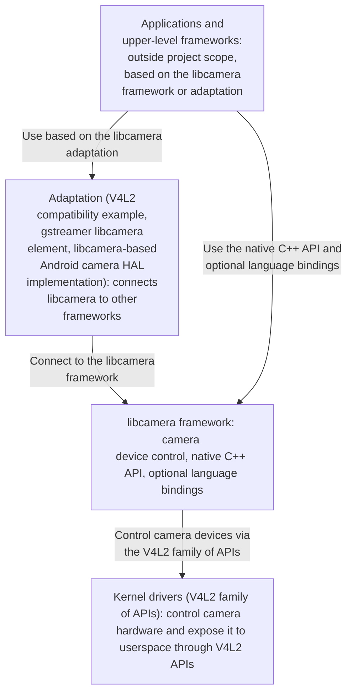

[Mermaid source](https://ttolsun.github.io/libcamera-sdd/en/index.camera-stack.mmd)

<details open>
<summary>Diagram evidence and verification scope</summary>

What role does each of the four software layers, from the application to the kernel driver, play? Camera hardware itself, supported models, and performance are outside the scope of this diagram.

Source-linked interpretation · automatic link check only · meaning and device execution not yet verified

| Elements and transitions | Source evidence |
| --- | --- |
| Applications and upper-level frameworks: outside project scope, based on the libcamera framework or adaptation | [Documentation/introduction.rst:137](#d3-source-e3b563f549a8c46d) |
| Adaptation (V4L2 compatibility example, gstreamer libcamera element, libcamera-based Android camera HAL implementation): connects libcamera to other frameworks | [Documentation/introduction.rst:137](#d3-source-e3b563f549a8c46d) |
| libcamera framework: camera device control, native C++ API, optional language bindings | [Documentation/introduction.rst:137](#d3-source-e3b563f549a8c46d) |
| Kernel drivers (V4L2 family of APIs): control camera hardware and expose it to userspace through V4L2 APIs | [Documentation/introduction.rst:137](#d3-source-e3b563f549a8c46d) |
| Use based on the libcamera adaptation | [Documentation/introduction.rst:137](#d3-source-e3b563f549a8c46d) |
| Connect to the libcamera framework | [Documentation/introduction.rst:137](#d3-source-e3b563f549a8c46d) |
| Control camera devices via the V4L2 family of APIs | [Documentation/introduction.rst:137](#d3-source-e3b563f549a8c46d) |
| Use the native C++ API and optional language bindings | [Documentation/introduction.rst:137](#d3-source-e3b563f549a8c46d) |

</details>

## <a id="d1-vendor가-먼저-확인할-내용"></a>Items to check on the device

On the target device, test normal capture and stopping with incomplete requests separately. For each submission, record the number of completion callbacks, the request status, and the status of each buffer. Determine separately whether the request was canceled and whether capture succeeded for each frame. Check [Contract and evidence for completion notification after stopping](#d18-%EC%A0%95%EC%A7%80%EC%99%80-%EC%97%B0%EA%B2%B0-%ED%95%B4%EC%A0%9C%EB%A5%BC-%EA%B5%AC%EB%B6%84%ED%95%98%EA%B8%B0).

Compare [Benefits of adopting a common API](#d3-%EC%9E%A5%EC%B9%98-%EA%B5%AC%ED%98%84%EC%9E%90%EA%B0%80-%EA%B3%B5%ED%86%B5-%EA%B3%84%EC%B8%B5%EC%97%90%EC%84%9C-%EC%96%BB%EB%8A%94-%EA%B2%83) and [Hardware and build conditions](#d3-%EC%A7%80%EC%9B%90%ED%95%98%EB%8A%94-%ED%95%98%EB%93%9C%EC%9B%A8%EC%96%B4%EC%99%80-%EB%B9%8C%EB%93%9C-%EC%84%A0%ED%83%9D), then check the device-specific implementation responsibilities in [Integration guide](#doc-5). [Support scope and validation](#doc-4) covers the first capture on a customer board, configuration constraints, and performance evidence.

## <a id="d1-처음-읽는-개발자의-순서"></a>Code to check the cancellation state

Open the callback connected to `Camera::requestCompleted` in the app and find the branch that reads `Request::status()` and handles `RequestCancelled`. Before using the image, check that each `FrameBuffer::metadata().status` is `FrameSuccess`. Follow [Status determination and code for completion notification after stopping](#d18-%EC%A0%95%EC%A7%80%EC%99%80-%EC%97%B0%EA%B2%B0-%ED%95%B4%EC%A0%9C%EB%A5%BC-%EA%B5%AC%EB%B6%84%ED%95%98%EA%B8%B0).

In [System overview](#d14-%ED%83%90%EC%83%89%EA%B3%BC-%ED%8C%8C%EC%9D%B4%ED%94%84%EB%9D%BC%EC%9D%B8-%EC%84%A0%ED%83%9D), you can find CameraManager's discovery entry point and the role of each component. Before modifying callback or request-processing code, check [Request submission and completion](#d14-%EC%9A%94%EC%B2%AD-%EC%A0%9C%EC%B6%9C%EA%B3%BC-%EC%99%84%EB%A3%8C), [Session state and resources](#d14-%EC%BA%A1%EC%B2%98-%EC%84%B8%EC%85%98%EC%9D%98-%EC%83%81%ED%83%9C%EC%99%80-%EC%9E%90%EC%9B%90), and [Thread boundaries](#d14-%EC%8A%A4%EB%A0%88%EB%93%9C-%EA%B2%BD%EA%B3%84%EC%99%80-%EB%8F%99%EA%B8%B0%ED%99%94).

## Documents needed now

| What you want to do | Documents to start with |
| --- | --- |
| Readers understand what this project takes in and what it produces. | [What this project does](#doc-13) |
| Run the camera directly and read the design rationale. | [Run it and read the design rationale](#doc-15) |
| Narrows down the cause of configuration failures. | [Order for narrowing down configuration failures](#d19-%EA%B5%AC%EC%84%B1-%EC%8B%A4%ED%8C%A8%EB%A5%BC-%EC%A2%81%ED%9E%88%EB%8A%94-%EC%88%9C%EC%84%9C) |
| Implements pipeline configuration, completion, and stopping. | [Pipeline Handler](#doc-6) |
| Modify module selection and the algorithm interface. | [IPA management and implementation entry points](#doc-8) |
| Check object lifetime and state transitions. | [Camera and request model](#doc-16) |

## Find reference description

Request and buffer ownership and reuse rules are maintained in **[Request object and buffer lifetime](#doc-17)**, while implementation rules for the device queue and completion order are maintained in **[Pipeline Request Submission and Completion](#doc-7)**. The diagnostic document links these contracts and guides the order of checks for each symptom.

To follow the algorithm, open [IPU3 LSC Configuration and Frame Processing](#doc-10). Camera-specific tuning and kernel support conditions are confirmed in [RKISP1 Per-Camera Distortion Correction](#doc-12).

## How to read this document

Clicking **Excerpt** in the section-wide evidence expands the original text in the document. Clicking **Full source** takes you to the file and line in the analyzed commit. See [Glossary](#doc-2) for terminology.

Clicking a diagram lets you zoom in and search for elements. Relationship diagrams and static call tracing do not guarantee the actual execution order. All classes are in [Component index](#doc-30), and main calls and trace boundaries are in [Key scenario](#doc-20).

<details open>
<summary>Validation scope and document status</summary>

"Automated check passed" means that the cited code locations and sentence format were verified by machine. It is not human approval of the content. The review status is shown at the top of the document, and the analysis commit and automated check results are shown in the generation evidence below. Explanations checked against code excerpts must also be reviewed by a person to confirm that their content is correct.

This site is a static analysis result of public libcamera. Actual device capture, performance, and error recovery, as well as the in-house HAL, were not verified. Reasons for design choices and performance budgets can be explained only when the code provides evidence.

The 4B and 9B drafts of [Model comparison record](https://github.com/TTolsun/camera-hal-sdd-generator/blob/main/docs/libcamera/records/model-comparison.md) were not adopted because content errors remained.

</details>

<details open>
<summary>Generation and deployment</summary>

[Generator](https://github.com/TTolsun/camera-hal-sdd-generator) handles extraction, validation, and screen composition, and [Public documentation repository](https://github.com/TTolsun/libcamera-sdd) stores the history and artifacts of public inputs. In the public environment, a recurring schedule is not installed.

For the original library usage, check [libcamera official documentation](https://docs.libcamera.org/master/).

</details>

## Document verification status

<details open>
<summary>Automated check passed · Before human review (29)</summary>

- [libcamera product overview](#doc-3)
- [Support scope and validation](#doc-4)
- [Integration guide](#doc-5)
- [Pipeline Handler](#doc-6)
- [Pipeline Request Submission and Completion](#doc-7)
- [IPA management and implementation entry points](#doc-8)
- [IPA Tuning and Software ISP](#doc-9)
- [IPU3 LSC Configuration and Frame Processing](#doc-10)
- [IPU3 Lens Correction Table Preparation](#doc-11)
- [RKISP1 Per-Camera Distortion Correction](#doc-12)
- [What this project does](#doc-13)
- [System overview](#doc-14)
- [Run it and read the design rationale](#doc-15)
- [Camera and request model](#doc-16)
- [Request object and buffer lifetime](#doc-17)
- [Request handling and problem diagnosis](#doc-18)
- [Investigation of configuration and request errors](#doc-19)
- [Key scenario](#doc-20)
- [Camera discovery](#doc-21)
- [Stream configuration](#doc-22)
- [Capture start](#doc-23)
- [Request submission](#doc-24)
- [Request completion notification](#doc-25)
- [Request to end capture](#doc-26)
- [IPA module information check and missing signature file](#doc-27)
- [FrameBufferAllocator Failures and Reference Lifetime](#doc-28)
- [Verifying virtual capture with the official cam in WSL](#doc-29)
- [Component index](#doc-30)
- [IPU3 LSC and State Connection](#doc-31)

</details>

## Document generation and review information

- **Contracts between documents**: [Automated comparison report](https://ttolsun.github.io/libcamera-sdd/contract-consistency.json) · Before human review

<a id="doc-2"></a>

Get started

# Glossary

Review document

English translation · human review pending. Review states below refer to the Korean source.

**Collects the meanings of abbreviations and domain terms that appear in the document.**

Select an underlined term in the body text to see its meaning in place. You can also search for the term by name in document search.

Quick links: [0–9](#d2-term-3a) · [A](#d2-term-af) · [B](#d2-term-bayer) · [C](#d2-term-ccm) · [D](#d2-term-debug) · [E](#d2-term-ebusy) · [F](#d2-term-fbo) · [G](#d2-term-gb) · [H](#d2-term-hal) · [I](#d2-term-ipa) · [L](#d2-term-log) · [M](#d2-term-mali-c55) · [N](#d2-term-nv12) · [O](#d2-term-omm) · [P](#d2-term-pending) · [Q](#d2-term-qbuf) · [R](#d2-term-raw) · [S](#d2-term-streamoff) · [T](#d2-term-tid) · [U](#d2-term-udmabuf) · [V](#d2-term-v4l2) · [W](#d2-term-wsl) · [ㄷ](#d2-term-디베이어) · [ㅁ](#d2-term-메타데이터) · [ㅂ](#d2-term-블랙-레벨) · [ㅅ](#d2-term-셰이더) · [ㅇ](#d2-term-왜곡-보정) · [ㅋ](#d2-term-컨트롤-정보-맵) · [ㅌ](#d2-term-튜닝-파일) · [ㅍ](#d2-term-프레임-버퍼) · [ㅎ](#d2-term-활성-스트림)

- <a id="d2-term-3a"></a>**3A**: A collective term for auto exposure (AE/AGC), auto white balance (AWB), and auto focus (AF). These are representative algorithms that the IPA computes.
- <a id="d2-term-af"></a>**AF** (Auto Focus): An algorithm that moves the lens position to bring the image into focus.
- **AGC** (Automatic Gain Control): An automatic exposure algorithm that sets the exposure time and sensor gain to match scene brightness.
- **ASSERT**: libcamera's debug-check macro. In debug builds, if the condition is false, it logs a fatal message and aborts execution.
- **AWB** (Auto White Balance): An algorithm that estimates the color temperature of the illumination and sets per-channel R, G, and B gains so that white appears white.
- <a id="d2-term-bayer"></a>**bayer**: A color filter array in which each pixel of the sensor records only one color among R, G, and B. Raw data in this format must go through demosaicing before each pixel has RGB values.
- <a id="d2-term-ccm"></a>**CCM**: Means the IPU3 color correction matrix algorithm.
- <a id="d2-term-debug"></a>**DEBUG**: The name of the most verbose diagnostic level among log severity levels. Setting the log level environment variable to \`DEBUG\` yields detailed logs.
- **DMA** (Direct Memory Access): DMA (Direct Memory Access) is a term for a method in which an I/O device reads from or writes to system memory directly.
- **DQBUF**: DQBUF is an ioctl command that requests the next available buffer to be dequeued from a V4L2 device.
- **DRM** (Direct Rendering Manager): A kernel subsystem that manages Linux graphics devices. DRM pixel formats identify the channel layout within a buffer.
- **DW100**: A separate hardware device that corrects distortion by remapping the image according to a coordinate table. It is included in the NXP i.MX8MP and similar parts.
- <a id="d2-term-ebusy"></a>**EBUSY**: If FrameBufferAllocator::allocate() is called again for a stream that already has buffers allocated, it returns -EBUSY.
- **EEXIST**: Returns the -EEXIST error when a buffer still has an unreleased fence or a buffer is already registered on the same stream.
- **EGL**: An interface that connects the graphics API with the display, image, and buffer of the operating environment. This document covers the boundary where shared buffers are imported as graphics images.
- **errno**: The standard error number that Linux functions use to report the cause of a failure. libcamera functions return this value as a negative number. For example, -ENODEV means no device, -EACCES means access denied, -EINVAL means invalid argument, -ENOMEM means out of memory, and -EXDEV means a resource that belongs to another object.
- **ETIMEDOUT**: An error code indicating that the IPC response wait timer has expired. The timer setting value in this document is 2000ms.
- <a id="d2-term-fbo"></a>**FBO**: Refers to a frame buffer object to which a texture is to be attached.
- **fence**: A synchronization signal that indicates when a buffer may be used. If a valid fence is attached to a request, the request waits for this signal in the preparation stage. It is different from the request completion signal.
- **FPS**: The number of frames per second.
- <a id="d2-term-gb"></a>**GB**: Means the green B shading coefficient in the lens shading correction table.
- **GCC** (GNU Compiler Collection): A collection of GNU compilers that includes front ends for C, C++, and other languages.
- **GDB** (GNU Project Debugger): A GNU debugger that stops a program under specified conditions and lets you examine its execution state after it stops.
- **GL**: A prefix used in identifiers of OpenGL-family graphics APIs. In this document, GL formats indicate the channel composition of a texture.
- **GNU** (GNU's Not Unix): GNU is an operating system composed of free software. The name is a recursive acronym meaning GNU's Not Unix.
- **GR**: Means the green R shading coefficient in the lens shading correction table.
- <a id="d2-term-hal"></a>**HAL** (Hardware Abstraction Layer): A layer that lets the operating system handle hardware that differs by manufacturer through the same interface. The final deployment target of this project is the in-house Android Camera HAL.
- <a id="d2-term-ipa"></a>**IPA** (Image Processing Algorithms): A separate module (.so) that contains image quality algorithms. It reads the statistics sent by the ISP and calculates the ISP settings to use for the next frame. It is separated from the libcamera core so that manufacturers can provide it without publishing its source.
- **IPC** (Inter-Process Communication): A method by which separate processes exchange messages. Because an unsigned IPA module runs in a separate process, libcamera calls it through IPC.
- **IPU** (Image Processing Unit): The name of Intel's family of image processing units. Generation numbers are attached to the name, as in IPU3 and IPU6.
- **IPU3** (Intel Image Processing Unit 3): A camera ISP included in some Intel laptop processors. libcamera has a Pipeline Handler and an IPA for this device.
- **IPU6**: One generation of the Intel Image Processing Unit (IPU). The official documentation lists it as a supported target of the simple pipeline handler instead of a dedicated handler.
- **ISP** (Image Signal Processor): A processing unit that converts raw (Bayer) data output by the sensor into an image that can be displayed on screen. It performs operations such as black level correction, lens shading correction, white balance, and debayering.
- <a id="d2-term-log"></a>**LOG**: Uses the category and severity level specified by the caller.
- **LSC** (Lens Shading Correction): Processing that corrects lens shading, the phenomenon in which the edges of an image are darker than the center or colors are distorted due to lens characteristics. It is applied by multiplying by a correction table that divides the image into a grid.
- **LUT** (Look-Up Table): A method that precomputes calculation results into a table and retrieves them directly by input value. The LSC correction table falls into this category.
- <a id="d2-term-mali-c55"></a>**mali-c55**: Arm Mali-C55 camera ISP. libcamera has a Pipeline Handler and an IPA for this device.
- **mojom**: A file format that defines the functions and data types of the IPA interface. Proxy code is generated from this definition at build time.
- <a id="d2-term-nv12"></a>**NV12** (NV12): A 4:2:0 format that uses 8 bits per component. The first plane is luminance (Y). The second plane contains interleaved chroma data, in which Cb and Cr values are stored alternately, one each. The whole layout is placed in linearly contiguous memory.
- <a id="d2-term-omm"></a>**OMM**: An external documentation tool referenced by this site's reading-layout, figure zoom, and search rules. Only the rules were applied; the tool's runner was not used.
- <a id="d2-term-pending"></a>**Pending**: The request state in which the request has not yet changed to completed or canceled. It does not mean device processing has started, and if a preceding request is in this state, the return of a following request may also have to wait.
- **Pipeline Handler**: A libcamera component that finds the media device of a specific hardware platform (IPU3, RKISP1, etc.), creates cameras, passes requests to the device, and returns their completion. There is one per platform.
- **PR** (Pull Request): A request proposing that code changes be merged into the project.
- <a id="d2-term-qbuf"></a>**QBUF**: An ioctl that requests the addition of a buffer to the V4L2 device's queue.
- <a id="d2-term-raw"></a>**RAW**: RAW is a pixel color-encoding classification and is distinguished from StreamRole::Raw, a separate stream role for capturing raw sensor frames.
- **RK3399**: Rockchip's system-on-chip (SoC). The official documentation lists it as a supported target of the rkisp1 pipeline handler.
- **RKISP1** (Rockchip Image Signal Processor 1): A camera ISP included in Rockchip SoCs, the NXP i.MX8MP, and others. libcamera has a Pipeline Handler and an IPA for this device.
- **ROI** (Return on Investment): ROI is a concept that compares returns with investment costs, and it is not measured in this example from the public libcamera documentation.
- <a id="d2-term-streamoff"></a>**STREAMOFF**: An ioctl that requests streaming to be stopped for the specified buffer type on a V4L2 device.
- <a id="d2-term-tid"></a>**TID** (Linux thread ID): A TID is the Linux thread ID returned by the gettid system call.
- <a id="d2-term-udmabuf"></a>**UDMABUF** (userspace dmabuf misc driver): A Linux kernel driver name for a driver that converts a userspace memfd region into a dma-buf.
- **UQ**: An unsigned fixed-point format. UQ\<m, n\> represents a value with m bits for the integer part and n bits for the fractional part.
- **UVC** (USB Video Class): The standard that USB webcams follow. libcamera handles this device with the uvcvideo Pipeline Handler.
- <a id="d2-term-v4l2"></a>**V4L2** (Video4Linux2): The API through which the Linux kernel handles cameras and video devices. libcamera uses this API to control the sensor and ISP devices.
- **VM** (Virtual Machine): A virtual machine is a computer implemented in software by virtualizing the resources of a physical computer, and it runs its own operating system and applications. It is not limited to cloud servers and can also be created on a personal physical computer.
- <a id="d2-term-wsl"></a>**WSL** (Windows Subsystem for Linux): A Windows feature that lets you run a Linux environment on a Windows computer.
- **WSL2** (Windows Subsystem for Linux 2): An environment for running Linux on Windows. This site is built from the results of building and extracting libcamera on WSL2.
- <a id="d2-term-디베이어"></a>**Debayer**: A process that interpolates the missing colors of each pixel from neighboring pixels in bayer raw data to create an RGB image. Also called demosaicing.
- <a id="d2-term-메타데이터"></a>**Metadata**: Capture information checked alongside the image pixels. The metadata of a Request is provided as a ControlList, and the FrameMetadata of a FrameBuffer holds capture status, timestamp, bytes used, and so on. Whether the other fields of FrameMetadata are valid depends on the capture status.
- <a id="d2-term-블랙-레벨"></a>**Black level**: The reference value the sensor outputs even when there is no light at all. The first stage of ISP processing subtracts this value.
- <a id="d2-term-셰이더"></a>**Shader**: A small program that runs on the GPU. A software ISP may perform debayering and color correction with GPU shaders.
- **Software ISP**: A libcamera component that performs ISP processing on the CPU or GPU in place of a hardware ISP on devices without one. In the source, it is named software_isp or softisp.
- <a id="d2-term-왜곡-보정"></a>**Distortion correction**: A process that straightens an image bent by the lens. The RKISP1 pipeline performs it by supplying a vertex map to the DW100 device.
- <a id="d2-term-컨트롤-정보-맵"></a>**Control information map**: Information that indicates the control items and ranges to be used with the camera. The control list of a request must refer to that camera's information map.
- <a id="d2-term-튜닝-파일"></a>**Tuning file**: A YAML file containing sensor- and platform-specific algorithm parameters (calibration tables, color matrices, etc.). IPA reads it when it starts.
- <a id="d2-term-프레임-버퍼"></a>**Frame buffer**: A FrameBuffer object that represents the memory region storing image data. It provides the file descriptor, offset, and length of each memory plane, along with per-frame metadata. The valid scope of the data and metadata differs depending on whether capture succeeds, fails, or is canceled.
- **Proxy**: A proxy object that does not call the IPA module directly. It receives calls through the same interface and forwards them to an IPA thread or a separate process. It is automatically generated from mojom definitions at build time.
- <a id="d2-term-활성-스트림"></a>**Active streams**: A Stream connected to the current camera configuration. If a request buffer refers to a stream of a different configuration, the submission check rejects it.

## Document generation and review information

- **Contracts between documents**: [Automated comparison report](https://ttolsun.github.io/libcamera-sdd/contract-consistency.json) · Before human review

<a id="doc-3"></a>

For Vendor

# libcamera product overview

Before human reviewAutomated check passedAuthored: extracted structure and draft written by the model[State description ↓](#d3-page-evidence)

English translation · human review pending. Review states below refer to the Korean source.

**Check what the product is and how far it supports, what the common design does for implementers, and judge the scope of adoption.**

<details open>
<summary>Design questions and validation scope</summary>

The answers to each question and their evidence links were checked. The meaning and execution results require human review.

- Which customer problems does it solve, and which environments does it target?

  [What it is, and whose what problem it solves](#d3-무엇이며-누구의-어떤-문제를-푸는가)
- What is the scope of support, and how are supported targets selected?

  [Supported hardware and build selection](#d3-지원하는-하드웨어와-빌드-선택)
- Which features are provided, and on which implementation does the scope of support depend?

  [Provided functionality and supported scope](#d3-제공-기능과-지원-범위)
- What are the strengths of reusing the common implementation, and under what conditions?

  [What device implementers gain from the common layer](#d3-장치-구현자가-공통-계층에서-얻는-것)

Verification scope: Linking code evidence to explanations

</details>

<details open>
<summary>Terms in this document: WSL2, Pipeline Handler, V4L2, HAL, and 3 others</summary>

- **WSL2** (Windows Subsystem for Linux 2): An environment for running Linux on Windows. This site is built from the results of building and extracting libcamera on WSL2.
- **Pipeline Handler**: A libcamera component that finds the media device of a specific hardware platform (IPU3, RKISP1, etc.), creates cameras, passes requests to the device, and returns their completion. There is one per platform.
- **V4L2** (Video4Linux2): The API through which the Linux kernel handles cameras and video devices. libcamera uses this API to control the sensor and ISP devices.
- **HAL** (Hardware Abstraction Layer): A layer that lets the operating system handle hardware that differs by manufacturer through the same interface. The final deployment target of this project is the in-house Android Camera HAL.
- **IPU3** (Intel Image Processing Unit 3): A camera ISP included in some Intel laptop processors. libcamera has a Pipeline Handler and an IPA for this device.
- **RK3399**: Rockchip's system-on-chip (SoC). The official documentation lists it as a supported target of the rkisp1 pipeline handler.
- **IPU6**: One generation of the Intel Image Processing Unit (IPU). The official documentation lists it as a supported target of the simple pipeline handler instead of a dedicated handler.

Other terms can be found in [Glossary](#doc-2).

</details>

Destination of the previous link

[Pipeline Request Submission and Completion](#d7-%EC%9E%A5%EC%B9%98-%EC%9A%94%EC%B2%AD-%ED%95%9C%EB%8F%84%EC%99%80-%EB%8C%80%EA%B8%B0-%ED%81%90)

## <a id="d3-무엇이며-누구의-어떤-문제를-푸는가"></a>What it is, and whose what problem it solves

libcamera is an open-source complex camera support library for Linux, Android, and ChromeOS. It interfaces with Linux kernel device drivers and provides developers with an API to simplify image capture from complex cameras on Linux systems. libcamera provides a complete camera stack for Linux-based systems. The stack abstracts the hardware configuration and image control algorithms needed to obtain the desired results from a camera through kernel APIs, allowing developers to handle these tasks in a simple and consistent way.

### Four layers of the camera stack


[Mermaid source](https://ttolsun.github.io/libcamera-sdd/en/vendor-overview.camera-stack.mmd)

<details open>
<summary>Diagram evidence and verification scope</summary>

What role does each of the four software layers, from the application to the kernel driver, play? Camera hardware itself, supported models, and performance are outside the scope of this diagram.

Source-linked interpretation · automatic link check only · meaning and device execution not yet verified

| Elements and transitions | Source evidence |
| --- | --- |
| Applications and upper-level frameworks: outside project scope, based on the libcamera framework or adaptation | [Documentation/introduction.rst:137](#d3-source-e3b563f549a8c46d) |
| Adaptation (V4L2 compatibility example, gstreamer libcamera element, libcamera-based Android camera HAL implementation): connects libcamera to other frameworks | [Documentation/introduction.rst:137](#d3-source-e3b563f549a8c46d) |
| libcamera framework: camera device control, native C++ API, optional language bindings | [Documentation/introduction.rst:137](#d3-source-e3b563f549a8c46d) |
| Kernel drivers (V4L2 family of APIs): control camera hardware and expose it to userspace through V4L2 APIs | [Documentation/introduction.rst:137](#d3-source-e3b563f549a8c46d) |
| Use based on the libcamera adaptation | [Documentation/introduction.rst:137](#d3-source-e3b563f549a8c46d) |
| Connect to the libcamera framework | [Documentation/introduction.rst:137](#d3-source-e3b563f549a8c46d) |
| Control camera devices via the V4L2 family of APIs | [Documentation/introduction.rst:137](#d3-source-e3b563f549a8c46d) |
| Use the native C++ API and optional language bindings | [Documentation/introduction.rst:137](#d3-source-e3b563f549a8c46d) |

</details>

Providing a functioning camera stack using the drivers is the responsibility of userspace, and vendors commonly implement it separately without a common architecture or API for application developers. Differences in hardware pipelines and how they are represented in kernel APIs often require custom handling, making the task more complex. The kernel drivers in the lowest layer control the camera hardware and provide a low-level interface to userspace. This interface uses the Media `Controller` API, V4L2 Video `Device` API, and V4L2 Subdev API, which belong to the Linux kernel's `V4L2` family of APIs.

Above that, the libcamera framework handles all control of camera devices in its core component, libcamera, and provides a native `C++ API` to upper layers. Optional language bindings allow other programming languages to interface with libcamera. Above that, libcamera adaptation refers to components that interface with libcamera in other frameworks. Examples include a `V4L2` compatibility layer, a gstreamer libcamera element, and a libcamera-based Android camera HAL implementation.

The applications and upper-level frameworks at the top are based on the libcamera framework or libcamera adaptation. This layer is outside the scope of the libcamera project.

<details open>
<summary>Section-wide evidence: 5</summary>

- `Documentation/introduction.rst`[`L10` excerpt](#d3-source-34fda84500757231) · [Full source `L10`](https://github.com/TTolsun/libcamera-sdd/blob/adfa719f8ed67d18fd8a0739fc088a1f8b9e7252/Documentation/introduction.rst#L10) · [`L45` excerpt](#d3-source-f350cabac0db8343) · [Full source `L45`](https://github.com/TTolsun/libcamera-sdd/blob/adfa719f8ed67d18fd8a0739fc088a1f8b9e7252/Documentation/introduction.rst#L45) · [`L35` excerpt](#d3-source-de476c940b030e4a) · [Full source `L35`](https://github.com/TTolsun/libcamera-sdd/blob/adfa719f8ed67d18fd8a0739fc088a1f8b9e7252/Documentation/introduction.rst#L35) · [`L137` excerpt](#d3-source-e3b563f549a8c46d) · [Full source `L137`](https://github.com/TTolsun/libcamera-sdd/blob/adfa719f8ed67d18fd8a0739fc088a1f8b9e7252/Documentation/introduction.rst#L137)
- `product-evidence/libcamera/official-stack.txt`[`L1`](#d3-source-a43b9ee967d1a5db)

</details>

## <a id="d3-지원하는-하드웨어와-빌드-선택"></a>Supported hardware and build selection

The documentation lists Arm Mali-C55, Intel IPU3 (`ipu3`), NXP i.MX8MP (`imx8-isi` and `rkisp1`), RaspberryPi 3, 4 and zero (`rpi/vc4`), and Rockchip RK3399 (`rkisp1`) as hardware platforms currently supported by the library with dedicated pipeline handlers. The documentation identifies USB video device class cameras (`uvcvideo`), iMX7, IPU6, Allwinner Sun6i (`simple`), and the virtual media controller driver for testing (`vimc`) as targets for which libcamera provides generic support.

The pipeline handlers to build are selected in the array option `pipelines`, whose default is `auto`. Selecting `auto` builds all pipelines applicable to the target architecture, while selecting `all` builds all pipelines. If both values are selected, `all` takes precedence. The individual choices are `imx8-isi`, `ipu3`, `mali-c55`, `rkisp1`, `rpi/pisp`, `rpi/vc4`, `simple`, `uvcvideo`, `vimc`, and `virtual`.

<details open>
<summary>Section-wide evidence: 2</summary>

- `Documentation/platform_support.rst`[`L6` excerpt](#d3-source-9d6502e234c4647d) · [Full source `L6`](https://github.com/TTolsun/libcamera-sdd/blob/adfa719f8ed67d18fd8a0739fc088a1f8b9e7252/Documentation/platform_support.rst#L6)
- `meson_options.txt`[`L75` excerpt](#d3-source-691389506fe87b32) · [Full source `L75`](https://github.com/TTolsun/libcamera-sdd/blob/adfa719f8ed67d18fd8a0739fc088a1f8b9e7252/meson_options.txt#L75)

</details>

## <a id="d3-제공-기능과-지원-범위"></a>Provided functionality and supported scope

`Camera` models a camera capable of producing one or more image streams from a single image source. It is the central object in libcamera, providing the main interface for configuring and controlling the device and capturing image streams. The device-specific `PipelineHandler` configures the hardware pipeline according to the stream configuration. A `PipelineHandler` implementation must match the required media devices with devices in the system and create the corresponding `Camera` instances once all of them can be acquired, and every `PipelineHandler` subclass must be registered with libcamera using the `REGISTER_PIPELINE_HANDLER()` macro.

### Boundary between the common Camera and device-specific implementations

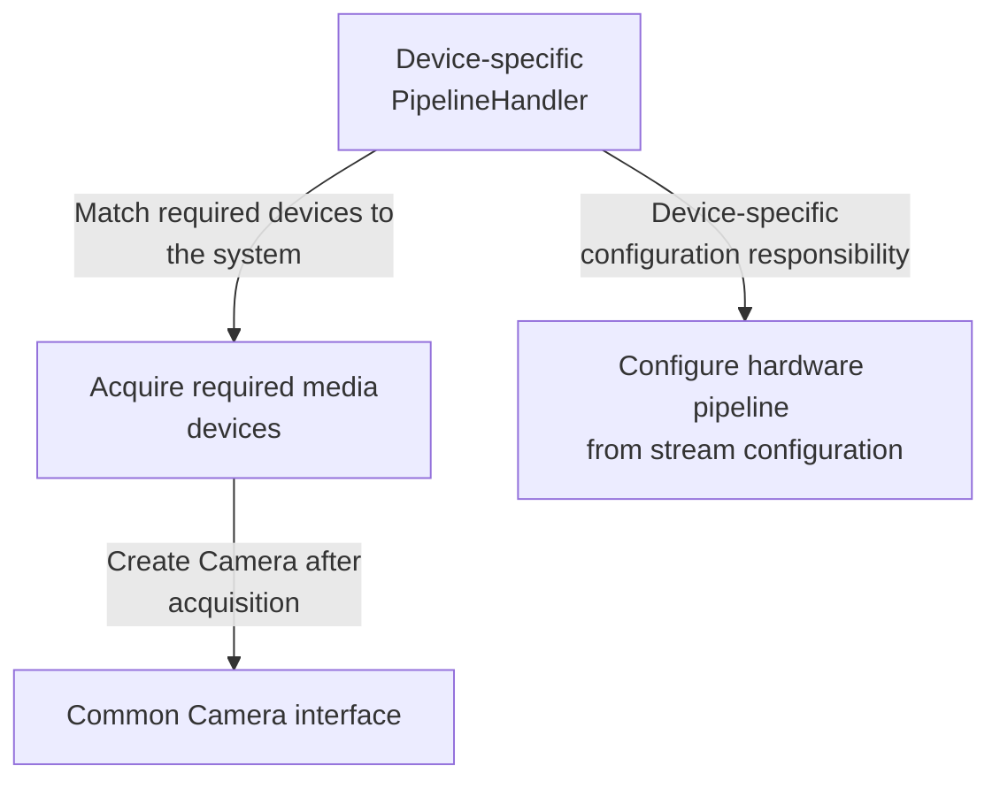

[Mermaid source](https://ttolsun.github.io/libcamera-sdd/en/vendor-overview.hardware-boundary.mmd)

<details open>
<summary>Diagram evidence and verification scope</summary>

This shows how responsibilities are connected between the common Camera and device-specific PipelineHandler. It distinguishes hardware configuration based on stream configuration from responsibility for device matching and Camera creation, and does not guarantee the complete execution order, supported models, or performance.

Source-linked interpretation · automatic link check only · meaning and device execution not yet verified

| Elements and transitions | Source evidence |
| --- | --- |
| Device-specific PipelineHandler | [src/libcamera/pipeline_handler.cpp:30](#d3-source-05721740b01bcd0e) |
| Acquire required media devices | [src/libcamera/pipeline_handler.cpp:30](#d3-source-05721740b01bcd0e) |
| Common Camera interface | [src/libcamera/camera.cpp:752](#d3-source-8264067114dccdee) |
| Configure hardware pipeline from stream configuration | [Documentation/libcamera_architecture.rst:86](#d3-source-94ac8aab4dea2a65) |
| Device-specific configuration responsibility | [Documentation/libcamera_architecture.rst:86](#d3-source-94ac8aab4dea2a65) |
| Match required devices to the system | [src/libcamera/pipeline_handler.cpp:30](#d3-source-05721740b01bcd0e) |
| Create Camera after acquisition | [src/libcamera/pipeline_handler.cpp:30](#d3-source-05721740b01bcd0e) |

</details>

<details open>
<summary>Section-wide evidence: 3</summary>

- `src/libcamera/camera.cpp`[`L752` excerpt](#d3-source-8264067114dccdee) · [Full source `L752`](https://github.com/TTolsun/libcamera-sdd/blob/adfa719f8ed67d18fd8a0739fc088a1f8b9e7252/src/libcamera/camera.cpp#L752)
- `src/libcamera/pipeline_handler.cpp`[`L30` excerpt](#d3-source-05721740b01bcd0e) · [Full source `L30`](https://github.com/TTolsun/libcamera-sdd/blob/adfa719f8ed67d18fd8a0739fc088a1f8b9e7252/src/libcamera/pipeline_handler.cpp#L30)
- `Documentation/libcamera_architecture.rst`[`L86` excerpt](#d3-source-94ac8aab4dea2a65) · [Full source `L86`](https://github.com/TTolsun/libcamera-sdd/blob/adfa719f8ed67d18fd8a0739fc088a1f8b9e7252/Documentation/libcamera_architecture.rst#L86)

</details>

## <a id="d3-장치-구현자가-공통-계층에서-얻는-것"></a>What device implementers gain from the common layer

`PipelineHandler::queueRequest()` adds the request to the waiting list and then begins preparation. `registerRequest()` connects the request's `prepared` signal to a call to `doQueueRequests()`. `doQueueRequests()` stops iterating if the request at the front of the waiting list is not prepared or the number of elements in `queuedRequests_` equals `maxQueuedRequestsDevice_`. Otherwise, it removes the front request from the list and processes it, so prepared requests are processed in submission order.

### Conditions for forwarding the front request or stopping the loop

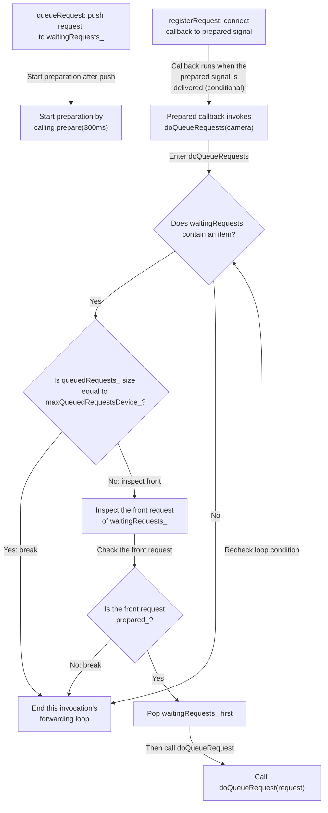

[Mermaid source](https://ttolsun.github.io/libcamera-sdd/en/vendor-overview.vendor-waiting-queue-conditions.mmd)

<details open>
<summary>Diagram evidence and verification scope</summary>

During the iteration over waitingRequests\_, how do the ready state and the software queue size of queuedRequests\_ limit forwarding?

Source-linked interpretation · automatic link check only · meaning and device execution not yet verified

| Elements and transitions | Source evidence |
| --- | --- |
| queueRequest: push request to waitingRequests\_ | [src/libcamera/pipeline_handler.cpp:428](#d3-source-789eafedfaa7f3c5) |
| Start preparation by calling prepare(300ms) | [src/libcamera/pipeline_handler.cpp:428](#d3-source-789eafedfaa7f3c5) |
| registerRequest: connect callback to prepared signal | [src/libcamera/pipeline_handler.cpp:428](#d3-source-789eafedfaa7f3c5) |
| Prepared callback invokes doQueueRequests(camera) | [src/libcamera/pipeline_handler.cpp:428](#d3-source-789eafedfaa7f3c5) |
| Does waitingRequests\_ contain an item? | [src/libcamera/pipeline_handler.cpp:428](#d3-source-789eafedfaa7f3c5) |
| Is queuedRequests\_ size equal to maxQueuedRequestsDevice\_? | [src/libcamera/pipeline_handler.cpp:428](#d3-source-789eafedfaa7f3c5) |
| Inspect the front request of waitingRequests\_ | [src/libcamera/pipeline_handler.cpp:428](#d3-source-789eafedfaa7f3c5) |
| Is the front request prepared\_? | [src/libcamera/pipeline_handler.cpp:428](#d3-source-789eafedfaa7f3c5) |
| Pop waitingRequests\_ first | [src/libcamera/pipeline_handler.cpp:428](#d3-source-789eafedfaa7f3c5) |
| Call doQueueRequest(request) | [src/libcamera/pipeline_handler.cpp:428](#d3-source-789eafedfaa7f3c5) |
| End this invocation's forwarding loop | [src/libcamera/pipeline_handler.cpp:428](#d3-source-789eafedfaa7f3c5) |
| Start preparation after push | [src/libcamera/pipeline_handler.cpp:428](#d3-source-789eafedfaa7f3c5) |
| Callback runs when the prepared signal is delivered (conditional) | [src/libcamera/pipeline_handler.cpp:428](#d3-source-789eafedfaa7f3c5) |
| Enter doQueueRequests | [src/libcamera/pipeline_handler.cpp:428](#d3-source-789eafedfaa7f3c5) |
| Yes | [src/libcamera/pipeline_handler.cpp:428](#d3-source-789eafedfaa7f3c5) |
| No | [src/libcamera/pipeline_handler.cpp:428](#d3-source-789eafedfaa7f3c5) |
| Yes: break | [src/libcamera/pipeline_handler.cpp:428](#d3-source-789eafedfaa7f3c5) |
| No: inspect front | [src/libcamera/pipeline_handler.cpp:428](#d3-source-789eafedfaa7f3c5) |
| Check the front request | [src/libcamera/pipeline_handler.cpp:428](#d3-source-789eafedfaa7f3c5) |
| No: break | [src/libcamera/pipeline_handler.cpp:428](#d3-source-789eafedfaa7f3c5) |
| Yes | [src/libcamera/pipeline_handler.cpp:428](#d3-source-789eafedfaa7f3c5) |
| Then call doQueueRequest | [src/libcamera/pipeline_handler.cpp:428](#d3-source-789eafedfaa7f3c5) |
| Recheck loop condition | [src/libcamera/pipeline_handler.cpp:428](#d3-source-789eafedfaa7f3c5) |

</details>

### Boundary between buffer completion and explicit request completion

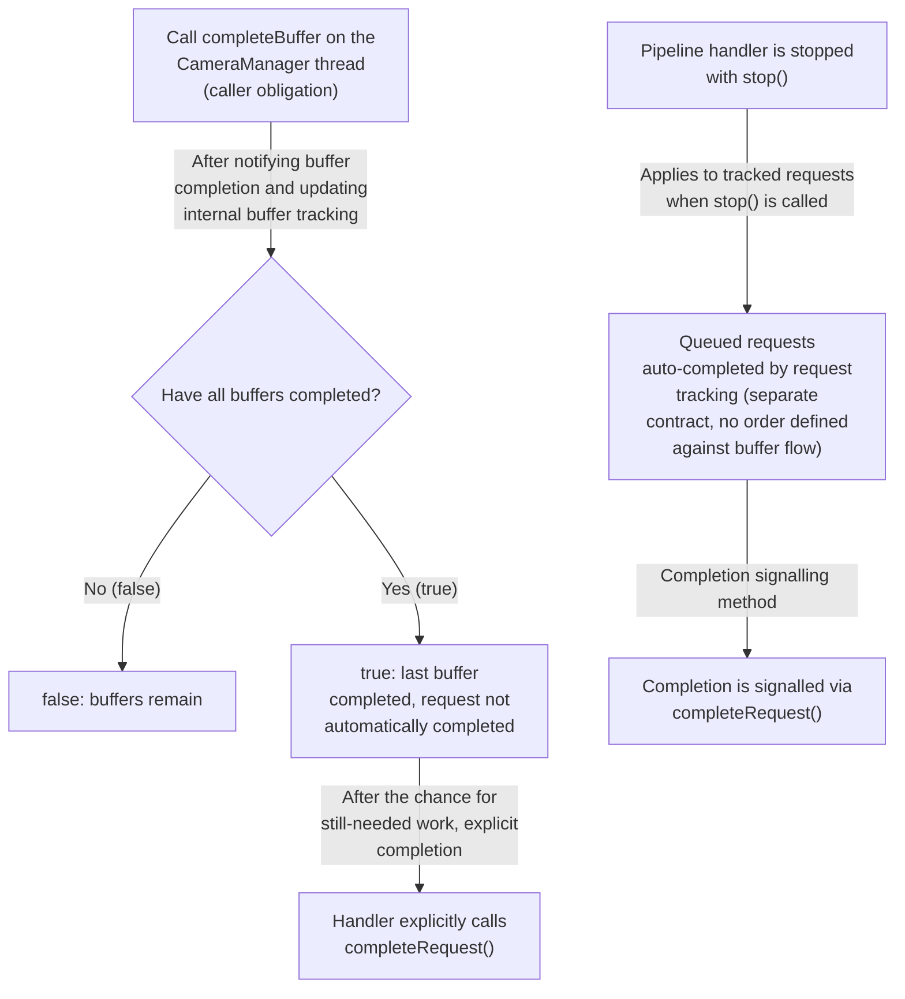

[Mermaid source](https://ttolsun.github.io/libcamera-sdd/en/vendor-overview.vendor-buffer-and-request-completion.mmd)

<details open>
<summary>Diagram evidence and verification scope</summary>

When the last buffer completes, how is the return value of completeBuffer distinguished from the handler's obligation to complete the request?

Source-linked interpretation · automatic link check only · meaning and device execution not yet verified

| Elements and transitions | Source evidence |
| --- | --- |
| Call completeBuffer on the CameraManager thread (caller obligation) | [src/libcamera/pipeline_handler.cpp:547](#d3-source-ab8710f8a8a7905d) |
| Have all buffers completed? | [src/libcamera/pipeline_handler.cpp:547](#d3-source-ab8710f8a8a7905d) |
| false: buffers remain | [src/libcamera/pipeline_handler.cpp:547](#d3-source-ab8710f8a8a7905d) |
| true: last buffer completed, request not automatically completed | [src/libcamera/pipeline_handler.cpp:547](#d3-source-ab8710f8a8a7905d) |
| Handler explicitly calls completeRequest() | [src/libcamera/pipeline_handler.cpp:547](#d3-source-ab8710f8a8a7905d) |
| Pipeline handler is stopped with stop() | [src/libcamera/pipeline_handler.cpp:463](#d3-source-35ab684c1adef175) |
| Queued requests auto-completed by request tracking (separate contract, no order defined against buffer flow) | [src/libcamera/pipeline_handler.cpp:463](#d3-source-35ab684c1adef175) |
| Completion is signalled via completeRequest() | [src/libcamera/pipeline_handler.cpp:463](#d3-source-35ab684c1adef175) |
| After notifying buffer completion and updating internal buffer tracking | [src/libcamera/pipeline_handler.cpp:547](#d3-source-ab8710f8a8a7905d) |
| No (false) | [src/libcamera/pipeline_handler.cpp:547](#d3-source-ab8710f8a8a7905d) |
| Yes (true) | [src/libcamera/pipeline_handler.cpp:547](#d3-source-ab8710f8a8a7905d) |
| After the chance for still-needed work, explicit completion | [src/libcamera/pipeline_handler.cpp:547](#d3-source-ab8710f8a8a7905d) |
| Applies to tracked requests when stop() is called | [src/libcamera/pipeline_handler.cpp:463](#d3-source-35ab684c1adef175) |
| Completion signalling method | [src/libcamera/pipeline_handler.cpp:463](#d3-source-35ab684c1adef175) |

</details>

If request preparation fails or the pipeline handler fails to queue the request to the device, the request is cancelled. Tracking queued requests ensures that all requests are automatically completed when the pipeline handler is stopped with `stop()`, and the pipeline handler must signal request completion using `completeRequest()`. If a request fails during the preparation phase or the pipeline handler fails to queue the request to the hardware, that request is cancelled.

Because queued requests are tracked, all requests are automatically completed when the pipeline handler is stopped with `stop()`. The pipeline handler must call `completeBuffer()` from the `CameraManager` thread to notify the application of buffer completion and update the request's internal buffer tracking. Even when the last buffer completes, the request is not completed automatically, so the pipeline handler must explicitly call `completeRequest()`.

<details open>
<summary>Section-wide evidence: 5</summary>

- `src/libcamera/pipeline_handler.cpp`[`L447` excerpt](#d3-source-106682bf83e3416a) · [Full source `L447`](https://github.com/TTolsun/libcamera-sdd/blob/adfa719f8ed67d18fd8a0739fc088a1f8b9e7252/src/libcamera/pipeline_handler.cpp#L447) · [`L428` excerpt](#d3-source-789eafedfaa7f3c5) · [Full source `L428`](https://github.com/TTolsun/libcamera-sdd/blob/adfa719f8ed67d18fd8a0739fc088a1f8b9e7252/src/libcamera/pipeline_handler.cpp#L428) · [`L460` excerpt](#d3-source-0a5bda976f5815de) · [Full source `L460`](https://github.com/TTolsun/libcamera-sdd/blob/adfa719f8ed67d18fd8a0739fc088a1f8b9e7252/src/libcamera/pipeline_handler.cpp#L460) · [`L463` excerpt](#d3-source-35ab684c1adef175) · [Full source `L463`](https://github.com/TTolsun/libcamera-sdd/blob/adfa719f8ed67d18fd8a0739fc088a1f8b9e7252/src/libcamera/pipeline_handler.cpp#L463) · [`L547` excerpt](#d3-source-ab8710f8a8a7905d) · [Full source `L547`](https://github.com/TTolsun/libcamera-sdd/blob/adfa719f8ed67d18fd8a0739fc088a1f8b9e7252/src/libcamera/pipeline_handler.cpp#L547)

</details>

## Class relationships

Arrow labels show the extracted relationship, and dashed lines indicate inheritance. Arrows point to the referenced target or base class. They do not indicate call order.

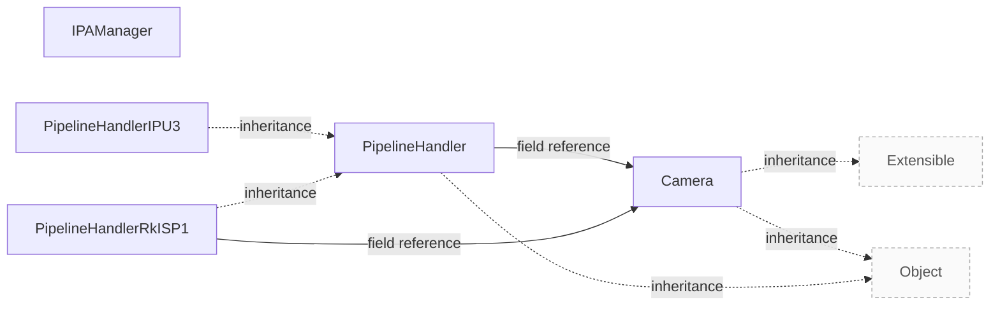

## Source evidence

<details open>
<summary>Source excerpts: 15</summary>

Include each excerpt only once. Expand the needed original text and check it against the explanation.

<a id="d3-source-34fda84500757231"></a>

<details open>
<summary>Source evidence: Documentation/introduction.rst:10</summary>

Excerpt range: [`Documentation/introduction.rst:10`](https://github.com/TTolsun/libcamera-sdd/blob/adfa719f8ed67d18fd8a0739fc088a1f8b9e7252/Documentation/introduction.rst#L10) to `13`

SHA-256: `84621541899cba7430b844bc03d13fc8e6f3f03e7c30556df0bf1cd11007494c`

```
libcamera is an open source complex camera support library for Linux, Android
and ChromeOS. The library interfaces with Linux kernel device drivers and
provides an intuitive API to developers in order to simplify the complexity
involved in capturing images from complex cameras on Linux systems.
```

</details>

<a id="d3-source-de476c940b030e4a"></a>

<details open>
<summary>Source evidence: Documentation/introduction.rst:35</summary>

Excerpt range: [`Documentation/introduction.rst:35`](https://github.com/TTolsun/libcamera-sdd/blob/adfa719f8ed67d18fd8a0739fc088a1f8b9e7252/Documentation/introduction.rst#L35) to `40`

SHA-256: `0c6b72f4ffe9e608101639096b5597a61f41f776e4f5ac4aaa43229c744db3f0`

```
The usage of these drivers to provide a functioning camera stack is a
responsibility that lies in userspace, and is commonly implemented separately
by vendors without a common architecture or API for application developers. This
adds a lot of complexity to the task, particularly when considering that the
differences in hardware pipelines and their representation in the kernel's APIs
often necessitate bespoke handling.
```

</details>

<a id="d3-source-f350cabac0db8343"></a>

<details open>
<summary>Source evidence: Documentation/introduction.rst:45</summary>

Excerpt range: [`Documentation/introduction.rst:45`](https://github.com/TTolsun/libcamera-sdd/blob/adfa719f8ed67d18fd8a0739fc088a1f8b9e7252/Documentation/introduction.rst#L45) to `49`

SHA-256: `56f623776b7eab9511de1f32c1f3080c4eab37239185f5134db6b2644760b1f5`

```
libcamera provides a complete camera stack for Linux-based systems to abstract
the configuration of hardware and image control algorithms required to obtain
desirable results from the camera through the kernel's APIs, reducing those
operations to a simple and consistent method for developers. In short instead of
having to deal with this:
```

</details>

<a id="d3-source-e3b563f549a8c46d"></a>

<details open>
<summary>Source evidence: Documentation/introduction.rst:137</summary>

Excerpt range: [`Documentation/introduction.rst:137`](https://github.com/TTolsun/libcamera-sdd/blob/adfa719f8ed67d18fd8a0739fc088a1f8b9e7252/Documentation/introduction.rst#L137) to `165`

SHA-256: `750a623b45ad76fbd899b56427ad76ef91bdc922497972317df868fe538c3b03`

```
The camera stack comprises four software layers. From bottom to top:

* The kernel drivers control the camera hardware and expose a
  low-level interface to userspace through the Linux kernel V4L2
  family of APIs (Media Controller API, V4L2 Video Device API and
  V4L2 Subdev API).

* The libcamera framework is the core part of the stack. It
  handles all control of the camera devices in its core component,
  libcamera, and exposes a native C++ API to upper layers. Optional
  language bindings allow interfacing to libcamera from other
  programming languages.

  Those components live in the same source code repository and
  all together constitute the libcamera framework.

* The libcamera adaptation is an umbrella term designating the
  components that interface to libcamera in other frameworks.
  Notable examples are a V4L2 compatibility layer, a gstreamer
  libcamera element, and an Android camera HAL implementation based
  on libcamera.

  Those components can live in the libcamera project source code
  in separate repositories, or move to their respective project's
  repository (for instance the gstreamer libcamera element).

* The applications and upper level frameworks are based on the
  libcamera framework or libcamera adaptation, and are outside of
  the scope of the libcamera project.
```

</details>

<a id="d3-source-a43b9ee967d1a5db"></a>

<details open>
<summary>Product material: product-evidence/libcamera/official-stack.txt:1</summary>

This material is provided separately from the source. Check the provider, version, and scope of application in the record below. Automatic checks are not human approval.

Excerpt range: `product-evidence/libcamera/official-stack.txt:1` to `10`

SHA-256: `fdd39a9c11328e6bb549203a2395b3f9331fa15d5e2da711b703643e299f8fc0`

```
.. SPDX-License-Identifier: CC-BY-SA-4.0
.. Source: https://gitlab.freedesktop.org/camera/libcamera/-/blob/212c689fcf2450bbfbaab25c7472895ac277b5d6/Documentation/introduction.rst
.. Unmodified excerpt; project documentation, not a commercial product specification.

libcamera provides a complete camera stack for Linux-based systems to abstract
the configuration of hardware and image control algorithms required to obtain
desirable results from the camera through the kernel's APIs, reducing those
operations to a simple and consistent method for developers. In short instead of
having to deal with this:
```

```
{
  "type": "project-document",
  "supplier": "libcamera official upstream; CC-BY-SA-4.0; URL in local material",
  "version": "212c689fcf2450bbfbaab25c7472895ac277b5d6",
  "date": "2026-10-30",
  "valid_until": "2026-10-30",
  "product": "libcamera",
  "release": "212c689fcf2450bbfbaab25c7472895ac277b5d6",
  "configuration": "public-source-documentation",
  "feature": "camera-stack",
  "conditions": [
    "Linux-based systems",
    "Kernel drivers and the relevant pipeline implementation are required."
  ],
  "sha256": "fdd39a9c11328e6bb549203a2395b3f9331fa15d5e2da711b703643e299f8fc0"
}
```

</details>

<a id="d3-source-9d6502e234c4647d"></a>

<details open>
<summary>Source evidence: Documentation/platform_support.rst:6</summary>

Excerpt range: [`Documentation/platform_support.rst:6`](https://github.com/TTolsun/libcamera-sdd/blob/adfa719f8ed67d18fd8a0739fc088a1f8b9e7252/Documentation/platform_support.rst#L6) to `19`

SHA-256: `c3521ec69316b30bbb021a31f90ae53cd0d641f77c91a13ed2d6fa0f7266f2bb`

```
The library currently supports the following hardware platforms specifically
with dedicated pipeline handlers:

   - Arm Mali-C55
   - Intel IPU3 (ipu3)
   - NXP i.MX8MP (imx8-isi and rkisp1)
   - RaspberryPi 3, 4 and zero (rpi/vc4)
   - Rockchip RK3399 (rkisp1)

Furthermore, generic platform support is provided for the following:

   - USB video device class cameras (uvcvideo)
   - iMX7, IPU6, Allwinner Sun6i (simple)
   - Virtual media controller driver for test use cases (vimc)
```

</details>

<a id="d3-source-691389506fe87b32"></a>

<details open>
<summary>Source evidence: meson_options.txt:75</summary>

Excerpt range: [`meson_options.txt:75`](https://github.com/TTolsun/libcamera-sdd/blob/adfa719f8ed67d18fd8a0739fc088a1f8b9e7252/meson_options.txt#L75) to `92`

SHA-256: `6884c14e5ebb9b81b76a500c4890a7c14db2e86c34395d71c496a6c86bf0b58d`

```
option('pipelines',
        type : 'array',
        value : ['auto'],
        choices : [
            'all',
            'auto',
            'imx8-isi',
            'ipu3',
            'mali-c55',
            'rkisp1',
            'rpi/pisp',
            'rpi/vc4',
            'simple',
            'uvcvideo',
            'vimc',
            'virtual'
        ],
        description : 'Select which pipeline handlers to build. If this is set to "auto", all the pipelines applicable to the target architecture will be built. If this is set to "all", all the pipelines will be built. If both are selected then "all" will take precedence.')
```

</details>

<a id="d3-source-8264067114dccdee"></a>

<details open>
<summary>Source evidence: src/libcamera/camera.cpp:752</summary>

Excerpt range: [`src/libcamera/camera.cpp:752`](https://github.com/TTolsun/libcamera-sdd/blob/adfa719f8ed67d18fd8a0739fc088a1f8b9e7252/src/libcamera/camera.cpp#L752) to `784`

SHA-256: `325c2af6569c185be1bc686e1fb6d161782dcbc8db34a0fbb719cff005ba7625`

```
\class Camera
 * \brief Camera device
 *
 * \todo Add documentation for camera start timings. What exactly does the
 * camera expect the pipeline handler to do when start() is called?
 *
 * The Camera class models a camera capable of producing one or more image
 * streams from a single image source. It provides the main interface to
 * configuring and controlling the device, and capturing image streams. It is
 * the central object exposed by libcamera.
 *
 * To support the central nature of Camera objects, libcamera manages the
 * lifetime of camera instances with std::shared_ptr<>. Instances shall be
 * created with the create() function which returns a shared pointer. The
 * Camera constructors and destructor are private, to prevent instances from
 * being constructed and destroyed manually.
 *
 * \section camera_operation Operating the Camera
 *
 * An application needs to perform a sequence of operations on a camera before
 * it is ready to process requests. The camera needs to be acquired and
 * configured to prepare the camera for capture. Once started the camera can
 * process requests until it is stopped. When an application is done with a
 * camera, the camera needs to be released.
 *
 * An application may start and stop a camera multiple times as long as it is
 * not released. The camera may also be reconfigured.
 *
 * Functions that affect the camera state as defined below are generally not
 * synchronized with each other by the Camera class. The caller is responsible
 * for ensuring their synchronization if necessary.
 *
 * \subsection Camera States
```

</details>

<a id="d3-source-05721740b01bcd0e"></a>

<details open>
<summary>Source evidence: src/libcamera/pipeline_handler.cpp:30</summary>

Excerpt range: [`src/libcamera/pipeline_handler.cpp:30`](https://github.com/TTolsun/libcamera-sdd/blob/adfa719f8ed67d18fd8a0739fc088a1f8b9e7252/src/libcamera/pipeline_handler.cpp#L30) to `43`

SHA-256: `2ba321cd394e987c2851002e9db5df0634635d71c749580c066e5556df90a715`

```
\file pipeline_handler.h
 * \brief Create pipelines and cameras from a set of media devices
 *
 * Each pipeline supported by libcamera needs to be backed by a pipeline
 * handler implementation that operate on a set of media devices. The pipeline
 * handler is responsible for matching the media devices it requires with the
 * devices present in the system, and once all those devices can be acquired,
 * create corresponding Camera instances.
 *
 * Every subclass of PipelineHandler shall be registered with libcamera using
 * the REGISTER_PIPELINE_HANDLER() macro.
 */

using namespace std::chrono_literals;
```

</details>

<a id="d3-source-94ac8aab4dea2a65"></a>

<details open>
<summary>Source evidence: Documentation/libcamera_architecture.rst:86</summary>

Excerpt range: [`Documentation/libcamera_architecture.rst:86`](https://github.com/TTolsun/libcamera-sdd/blob/adfa719f8ed67d18fd8a0739fc088a1f8b9e7252/Documentation/libcamera_architecture.rst#L86) to `108`

SHA-256: `ebb7ebff27e91e71edc64f2b4e2399eb13abcbf5877787c922ba4f4146c85e7e`

```
Pipeline Handler
  The Pipeline Handler manages the complex pipelines exposed by the kernel
  drivers through the Media Controller and V4L2 APIs. It abstracts pipeline
  handling to hide device-specific details from the rest of the library, and
  implements both pipeline configuration based on stream configuration, and
  pipeline runtime execution and scheduling when needed by the device.

  The Pipeline Handler lives in the same process as the rest of the library, and
  has access to all helpers and kernel camera-related devices.

  Hardware abstraction is handled by device specific Pipeline Handlers which are
  derived from the Pipeline Handler base class allowing commonality to be shared
  among the implementations.

  Derived pipeline handlers create Camera device instances based on the devices
  they detect and support on the running system, and are responsible for
  managing the interactions with a camera device.

  More details can be found in the :doxy-int:`PipelineHandler` API
  documentation, and the
  :doc:`Pipeline Handler Writers Guide <guides/pipeline-handler>`.

Image Processing Algorithms
```

</details>

<a id="d3-source-106682bf83e3416a"></a>

<details open>
<summary>Source evidence: src/libcamera/pipeline_handler.cpp:447</summary>

Excerpt range: [`src/libcamera/pipeline_handler.cpp:447`](https://github.com/TTolsun/libcamera-sdd/blob/adfa719f8ed67d18fd8a0739fc088a1f8b9e7252/src/libcamera/pipeline_handler.cpp#L447) to `458`

SHA-256: `93b81531d0a6f65b242cd4cfe014e0a861502c2fc2ad1d5e1f593dda7564c17d`

```
\fn PipelineHandler::queueRequest()
 * \brief Queue a request
 * \param[in] request The request to queue
 *
 * This function queues a capture request to the pipeline handler for
 * processing. The request is first added to the internal list of waiting
 * requests which have to be prepared to make sure they are ready for being
 * queued to the pipeline handler.
 *
 * The queue of waiting requests is iterated and up to \a
 * maxQueuedRequestsDevice_ prepared requests are passed to the pipeline handler
 * in the same order they have been queued by calling this function.
```

</details>

<a id="d3-source-0a5bda976f5815de"></a>

<details open>
<summary>Source evidence: src/libcamera/pipeline_handler.cpp:460</summary>

Excerpt range: [`src/libcamera/pipeline_handler.cpp:460`](https://github.com/TTolsun/libcamera-sdd/blob/adfa719f8ed67d18fd8a0739fc088a1f8b9e7252/src/libcamera/pipeline_handler.cpp#L460) to `461`

SHA-256: `06067fbd4ead51418e85617bc3d67c04439619836e4f024497d1583f6ac0787c`

```
If a Request fails during the preparation phase or if the pipeline handler
 * fails in queuing the request to the hardware the request is cancelled.
```

</details>

<a id="d3-source-35ab684c1adef175"></a>

<details open>
<summary>Source evidence: src/libcamera/pipeline_handler.cpp:463</summary>

Excerpt range: [`src/libcamera/pipeline_handler.cpp:463`](https://github.com/TTolsun/libcamera-sdd/blob/adfa719f8ed67d18fd8a0739fc088a1f8b9e7252/src/libcamera/pipeline_handler.cpp#L463) to `465`

SHA-256: `c3d1253c0ef92dd7f0ef5fd41450b788e9aa00145ac2f65bf727bf6a11e08863`

```
Keeping track of queued requests ensures automatic completion of all requests
 * when the pipeline handler is stopped with stop(). Request completion shall be
 * signalled by the pipeline handler using the completeRequest() function.
```

</details>

<a id="d3-source-ab8710f8a8a7905d"></a>

<details open>
<summary>Source evidence: src/libcamera/pipeline_handler.cpp:547</summary>

Excerpt range: [`src/libcamera/pipeline_handler.cpp:547`](https://github.com/TTolsun/libcamera-sdd/blob/adfa719f8ed67d18fd8a0739fc088a1f8b9e7252/src/libcamera/pipeline_handler.cpp#L547) to `563`

SHA-256: `096784b4798b3156e88e3acf84577f60a27f0bf0e2422ae7850e44b081eb9d3a`

```
\brief Complete a buffer for a request
 * \param[in] request The request the buffer belongs to
 * \param[in] buffer The buffer that has completed
 *
 * This function shall be called by pipeline handlers to signal completion of
 * the \a buffer part of the \a request. It notifies applications of buffer
 * completion and updates the request's internal buffer tracking. The request
 * is not completed automatically when the last buffer completes to give
 * pipeline handlers a chance to perform any operation that may still be
 * needed. They shall complete requests explicitly with completeRequest().
 *
 * \context This function shall be called from the CameraManager thread.
 *
 * \return True if all buffers contained in the request have completed, false
 * otherwise
 */
bool PipelineHandler::completeBuffer(Request *request, FrameBuffer *buffer)
```

</details>

<a id="d3-source-789eafedfaa7f3c5"></a>

<details open>
<summary>Source evidence: src/libcamera/pipeline_handler.cpp:428</summary>

Excerpt range: [`src/libcamera/pipeline_handler.cpp:428`](https://github.com/TTolsun/libcamera-sdd/blob/adfa719f8ed67d18fd8a0739fc088a1f8b9e7252/src/libcamera/pipeline_handler.cpp#L428) to `547`

SHA-256: `5a7a3397a6034a73fe348ae44eb1e2568d2823e95542fe43386e16359d627180`

```
\fn PipelineHandler::registerRequest()
 * \brief Register a request for use by the pipeline handler
 * \param[in] request The request to register
 *
 * This function is called when the request is created, and allows the pipeline
 * handler to perform any one-time initialization it requries for the request.
 */
void PipelineHandler::registerRequest(Request *request)
{
    /*
     * Connect the request prepared signal to notify the pipeline handler
     * when a request is ready to be processed.
     */
    request->_d()->prepared.connect(this, [this, request]() {
        doQueueRequests(request->_d()->camera());
    });
}

/**
 * \fn PipelineHandler::queueRequest()
 * \brief Queue a request
 * \param[in] request The request to queue
 *
 * This function queues a capture request to the pipeline handler for
 * processing. The request is first added to the internal list of waiting
 * requests which have to be prepared to make sure they are ready for being
 * queued to the pipeline handler.
 *
 * The queue of waiting requests is iterated and up to \a
 * maxQueuedRequestsDevice_ prepared requests are passed to the pipeline handler
 * in the same order they have been queued by calling this function.
 *
 * If a Request fails during the preparation phase or if the pipeline handler
 * fails in queuing the request to the hardware the request is cancelled.
 *
 * Keeping track of queued requests ensures automatic completion of all requests
 * when the pipeline handler is stopped with stop(). Request completion shall be
 * signalled by the pipeline handler using the completeRequest() function.
 *
 * \context This function is called from the CameraManager thread.
 */
void PipelineHandler::queueRequest(Request *request)
{
    LIBCAMERA_TRACEPOINT(request_queue, request);

    Camera *camera = request->_d()->camera();
    Camera::Private *data = camera->_d();
    data->waitingRequests_.push(request);

    request->_d()->prepare(300ms);
}

/**
 * \brief Queue one requests to the device
 */
void PipelineHandler::doQueueRequest(Request *request)
{
    LIBCAMERA_TRACEPOINT(request_device_queue, request);

    Camera *camera = request->_d()->camera();
    Camera::Private *data = camera->_d();
    data->queuedRequests_.push_back(request);

    request->_d()->sequence_ = data->requestSequence_++;

    if (request->_d()->cancelled_) {
        completeRequest(request);
        return;
    }

    int ret = queueRequestDevice(camera, request);
    if (ret)
        cancelRequest(request);
}

/**
 * \brief Queue prepared requests to the device
 *
 * Iterate the list of waiting requests and queue them to the device one
 * by one if they have been prepared.
 */
void PipelineHandler::doQueueRequests(Camera *camera)
{
    Camera::Private *data = camera->_d();
    while (!data->waitingRequests_.empty()) {
        if (data->queuedRequests_.size() == maxQueuedRequestsDevice_)
            break;

        Request *request = data->waitingRequests_.front();
        if (!request->_d()->prepared_)
            break;

        /*
         * Pop the request first, in case doQueueRequests() is called
         * recursively from within doQueueRequest()
         */
        data->waitingRequests_.pop();
        doQueueRequest(request);
    }
}

/**
 * \fn PipelineHandler::queueRequestDevice()
 * \brief Queue a request to the device
 * \param[in] camera The camera to queue the request to
 * \param[in] request The request to queue
 *
 * This function queues a capture request to the device for processing. The
 * request contains a set of buffers associated with streams and a set of
 * parameters. The pipeline handler shall program the device to ensure that the
 * parameters will be applied to the frames captured in the buffers provided in
 * the request.
 *
 * \context This function is called from the CameraManager thread.
 *
 * \return 0 on success or a negative error code otherwise
 */

/**
 * \brief Complete a buffer for a request
```

</details>

</details>

## <a id="d3-page-evidence"></a>Document generation and review information

- **Generation method**: Extracted facts and LLM explanation
- **Validation scope**: Tables and figures are created from facts, and the explanations are written by the LLM. Citation, sentence, and configured structure checks are applied.
- **Automated check**: Passed (`ok`). The items checked are listed in the verification scope. Whether the explanation content is correct is checked by a human reviewer.
- **Human review**: Before human review
- **Analysis baseline commit**: `adfa719f8ed67d18fd8a0739fc088a1f8b9e7252`
- **Document generation time**: `2026-11-20 16:39:16+00:00`
- **Sentence generation model**: `cli/codex/gpt-6.1-terra`
- **Contracts between documents**: [Automated comparison report](https://ttolsun.github.io/libcamera-sdd/contract-consistency.json) · Before human review
- **Reader scope**: [Answers by task and unreviewed scope](https://ttolsun.github.io/libcamera-sdd/reader-scope.json)
- **Enter product description**: [Scope, conditions, and sources](https://ttolsun.github.io/libcamera-sdd/product-context.json)

<details open>
<summary>Record from when the manuscript was written</summary>

This is a record saved in the manuscript as of that time. It may differ from the current document's standards.

- Evidence files: `Documentation/introduction.rst`, `Documentation/libcamera_architecture.rst`, `Documentation/platform_support.rst`, `include/libcamera/camera.h`, `include/libcamera/internal/ipa_manager.h`, `include/libcamera/internal/pipeline_handler.h`, `meson_options.txt`, `product-evidence/libcamera/official-stack.txt`, `src/libcamera/camera.cpp`, `src/libcamera/ipa_manager.cpp`, `src/libcamera/pipeline/ipu3/ipu3.cpp`, `src/libcamera/pipeline/rkisp1/rkisp1.cpp`, `src/libcamera/pipeline_handler.cpp`
- Evidence level: code verified (static analysis, simple_compdb configuration, commit `adfa719f8e`)
- Automated check (citation, sentence, and configured structure checks): passed
- Review status recorded on: 2026-11-21 · Awaiting human review

</details>

[Markdown source ↗](https://ttolsun.github.io/libcamera-sdd/vendor-overview.md) [Mermaid source ↗](https://ttolsun.github.io/libcamera-sdd/en/vendor-overview.mmd)

<a id="doc-4"></a>

For Vendor

# Support scope and validation

Before human reviewAutomated check passedAuthored: extracted structure and draft written by the model[State description ↓](#d4-page-evidence)

English translation · human review pending. Review states below refer to the Korean source.

**Read the WSL2 virtual capture record and determine the remaining first capture test on the customer board. The commit currently analyzed is listed in the document generation and review information at the bottom of the page.**

<details open>
<summary>Design questions and validation scope</summary>

The answers to each question and their evidence links were checked. The meaning and execution results require human review.

- Can this record be used to report that the first capture on the customer board has been validated?

  [Has the first capture on the customer board been validated?](#d4-고객-보드의-첫-촬영을-검증했습니까)
- What are the support prerequisites and constraints, and what items require separate validation?

  [Support conditions and constraints](#d4-지원-조건과-제약)
- What scope does the reference benchmark measure, and what scope is covered by separate product validation?

  [Criteria for reading performance evidence](#d4-성능-근거를-읽는-기준)

Verification scope: Linking code evidence to explanations

</details>

<details open>
<summary>Terms in this document: WSL2, Pipeline Handler, NV12, DMA, and 3 others</summary>

- **WSL2** (Windows Subsystem for Linux 2): An environment for running Linux on Windows. This site is built from the results of building and extracting libcamera on WSL2.
- **Pipeline Handler**: A libcamera component that finds the media device of a specific hardware platform (IPU3, RKISP1, etc.), creates cameras, passes requests to the device, and returns their completion. There is one per platform.
- **NV12** (NV12): A 4:2:0 format that uses 8 bits per component. The first plane is luminance (Y). The second plane contains interleaved chroma data, in which Cb and Cr values are stored alternately, one each. The whole layout is placed in linearly contiguous memory.
- **DMA** (Direct Memory Access): DMA (Direct Memory Access) is a term for a method in which an I/O device reads from or writes to system memory directly.
- **Debayer**: A process that interpolates the missing colors of each pixel from neighboring pixels in bayer raw data to create an RGB image. Also called demosaicing.
- **bayer**: A color filter array in which each pixel of the sensor records only one color among R, G, and B. Raw data in this format must go through demosaicing before each pixel has RGB values.
- **ISP** (Image Signal Processor): A processing unit that converts raw (Bayer) data output by the sensor into an image that can be displayed on screen. It performs operations such as black level correction, lens shading correction, white balance, and debayering.

Other terms can be found in [Glossary](#doc-2).

</details>

## <a id="d4-고객-보드의-첫-촬영을-검증했습니까"></a>Has the first capture on the customer board been validated?

This record cannot be used to report that the first capture on the customer board has been validated. The WSL2 test configuration used the Virtual2 virtual camera instead of a physical sensor, and there is no record of a capture using the customer board's physical sensor.

### Virtual capture observation and customer board testing

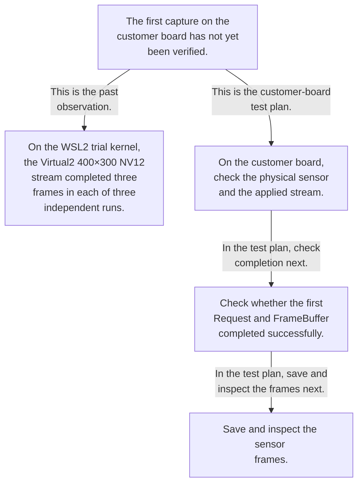

[Mermaid source](https://ttolsun.github.io/libcamera-sdd/en/vendor-assurance.first-capture-boundary.mmd)

<details open>
<summary>Diagram evidence and verification scope</summary>

What was verified in WSL2, and in what order is the first capture checked on the customer board?

Source-linked interpretation · automatic link check only · meaning and device execution not yet verified

LLM diagram draft · before human review

Authoring model: `cli/codex/gpt-6.1-terra`

| Elements and transitions | Source evidence |
| --- | --- |
| The first capture on the customer board has not yet been verified. | [product-evidence/libcamera-first-capture-trial/virtual-first-capture-run.txt:1](#d4-source-3c4ba1aba4901083) |
| On the WSL2 trial kernel, the Virtual2 400×300 NV12 stream completed three frames in each of three independent runs. | [product-evidence/libcamera-first-capture-trial/virtual-first-capture-run.txt:1](#d4-source-3c4ba1aba4901083) |
| On the customer board, check the physical sensor and the applied stream. | [product-evidence/libcamera-first-capture-trial/virtual-first-capture-run.txt:1](#d4-source-3c4ba1aba4901083) · [README.rst:107](#d4-source-ce71f2f0de50caf3) · [include/libcamera/camera.h:126](#d4-source-aba605be681da98e) |
| Check whether the first Request and FrameBuffer completed successfully. | [include/libcamera/camera.h:126](#d4-source-aba605be681da98e) · [include/libcamera/request.h:34](#d4-source-cb2be6f3ec7f91fc) · [include/libcamera/framebuffer.h:25](#d4-source-094e6fd7ddda824a) |
| Save and inspect the sensor frames. | [include/libcamera/camera.h:126](#d4-source-aba605be681da98e) · [README.rst:107](#d4-source-ce71f2f0de50caf3) |
| This is the past observation. | [product-evidence/libcamera-first-capture-trial/virtual-first-capture-run.txt:1](#d4-source-3c4ba1aba4901083) |
| This is the customer-board test plan. | [product-evidence/libcamera-first-capture-trial/virtual-first-capture-run.txt:1](#d4-source-3c4ba1aba4901083) · [README.rst:107](#d4-source-ce71f2f0de50caf3) |
| In the test plan, check completion next. | [include/libcamera/camera.h:126](#d4-source-aba605be681da98e) · [README.rst:107](#d4-source-ce71f2f0de50caf3) |
| In the test plan, save and inspect the frames next. | [include/libcamera/camera.h:126](#d4-source-aba605be681da98e) · [README.rst:107](#d4-source-ce71f2f0de50caf3) |

</details>

As far as can be confirmed from the official libcamera project documentation, the Virtual Pipeline Handler emulates a virtual external camera for testing. The example YAML specifies a 400×300 size and the `lines` test pattern for Virtual2.

The virtual capture test on October 31, 2026 used source commit 293d751a814e0d4c34e85ad457ccd9d5eefd1a61 and the WSL2 trial kernel 6.18.33.2-microsoft-standard-WSL2-issue211 with udmabuf built in. All three runs on Virtual2 at 400×300 NV12, each in a separate process, completed three frames each. This observation does not constitute validation of a physical camera or board DMA.

In the first capture test on the customer board, the board, physical sensor, kernel and driver, libcamera build, and target application are recorded, and the actual sensor is opened to check the applied stream format and size. The first request's RequestComplete and the buffer's FrameSuccess are checked, and frames from the sensor are saved and inspected. cam can be used as an example of a basic test tool's save functionality. Existing records are limited to a test configuration using udmabuf and Virtual2 on a WSL2 test kernel; the physical camera, physical DMA, and product application have not been validated.

<details open>
<summary>Section-wide evidence: 7</summary>

- `product-evidence/libcamera-first-capture-trial/virtual-first-capture-run.txt`[`L1`](#d4-source-3c4ba1aba4901083)
- `src/libcamera/pipeline/virtual/README.md`[`L3` excerpt](#d4-source-eb7d1ae4ac9df3f9) · [Full source `L3`](https://github.com/TTolsun/libcamera-sdd/blob/adfa719f8ed67d18fd8a0739fc088a1f8b9e7252/src/libcamera/pipeline/virtual/README.md#L3)
- `src/libcamera/pipeline/virtual/data/virtual.yaml`[`L28` excerpt](#d4-source-fb6397b1c5827be7) · [Full source `L28`](https://github.com/TTolsun/libcamera-sdd/blob/adfa719f8ed67d18fd8a0739fc088a1f8b9e7252/src/libcamera/pipeline/virtual/data/virtual.yaml#L28)
- `include/libcamera/request.h`[`L34` excerpt](#d4-source-cb2be6f3ec7f91fc) · [Full source `L34`](https://github.com/TTolsun/libcamera-sdd/blob/adfa719f8ed67d18fd8a0739fc088a1f8b9e7252/include/libcamera/request.h#L34)
- `include/libcamera/framebuffer.h`[`L25` excerpt](#d4-source-094e6fd7ddda824a) · [Full source `L25`](https://github.com/TTolsun/libcamera-sdd/blob/adfa719f8ed67d18fd8a0739fc088a1f8b9e7252/include/libcamera/framebuffer.h#L25)
- `README.rst`[`L107` excerpt](#d4-source-ce71f2f0de50caf3) · [Full source `L107`](https://github.com/TTolsun/libcamera-sdd/blob/adfa719f8ed67d18fd8a0739fc088a1f8b9e7252/README.rst#L107)
- `include/libcamera/camera.h`[`L126` excerpt](#d4-source-aba605be681da98e) · [Full source `L126`](https://github.com/TTolsun/libcamera-sdd/blob/adfa719f8ed67d18fd8a0739fc088a1f8b9e7252/include/libcamera/camera.h#L126)

</details>

## <a id="d4-지원-조건과-제약"></a>Support conditions and constraints

`CameraConfiguration::Invalid` means that the configuration is invalid and cannot be adjusted, and may occur only in extreme cases such as when the configuration is empty. `CameraConfiguration::Adjusted` indicates that the configuration has been adjusted and is valid after adjustment. If `CameraConfiguration::validate()` returns `Adjusted`, parameters may have changed for any stream, only some streams may have changed, and stream configurations may have been removed. When the status is `CameraConfiguration::Adjusted`, the caller must check the configuration carefully.

### Caller responsibilities by validate() result.

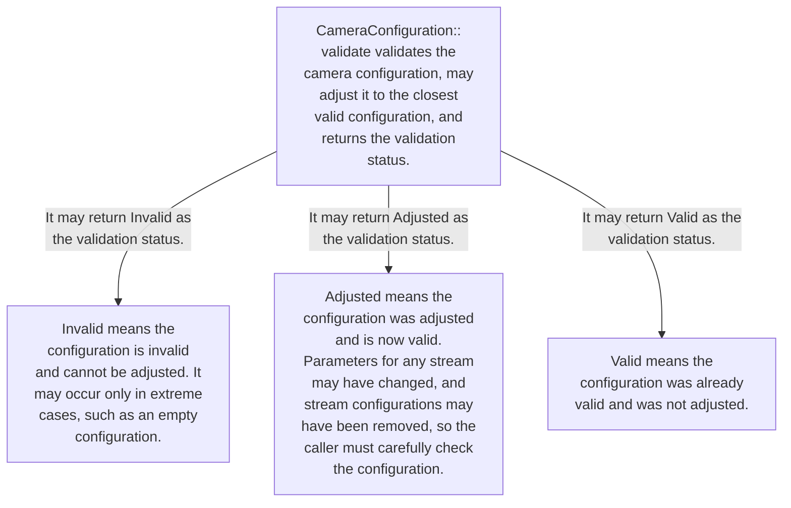

[Mermaid source](https://ttolsun.github.io/libcamera-sdd/en/vendor-assurance.validation-results.mmd)

<details open>
<summary>Diagram evidence and verification scope</summary>

What do Invalid, Adjusted, and Valid mean for validate()? If the result is Adjusted, what must the caller check again?

Source-linked interpretation · automatic link check only · meaning and device execution not yet verified

LLM diagram draft · before human review

Authoring model: `cli/codex/gpt-6.1-terra`

| Elements and transitions | Source evidence |
| --- | --- |
| CameraConfiguration::validate validates the camera configuration, may adjust it to the closest valid configuration, and returns the validation status. | [src/libcamera/camera.cpp:323](#d4-source-2b31e92e3fb3f083) |
| Invalid means the configuration is invalid and cannot be adjusted. It may occur only in extreme cases, such as an empty configuration. | [src/libcamera/camera.cpp:323](#d4-source-2b31e92e3fb3f083) |
| Adjusted means the configuration was adjusted and is now valid. Parameters for any stream may have changed, and stream configurations may have been removed, so the caller must carefully check the configuration. | [src/libcamera/camera.cpp:323](#d4-source-2b31e92e3fb3f083) |
| Valid means the configuration was already valid and was not adjusted. | [src/libcamera/camera.cpp:323](#d4-source-2b31e92e3fb3f083) |
| It may return Invalid as the validation status. | [src/libcamera/camera.cpp:323](#d4-source-2b31e92e3fb3f083) |
| It may return Adjusted as the validation status. | [src/libcamera/camera.cpp:323](#d4-source-2b31e92e3fb3f083) |
| It may return Valid as the validation status. | [src/libcamera/camera.cpp:323](#d4-source-2b31e92e3fb3f083) |

</details>

### Return contract for role-based configuration generation

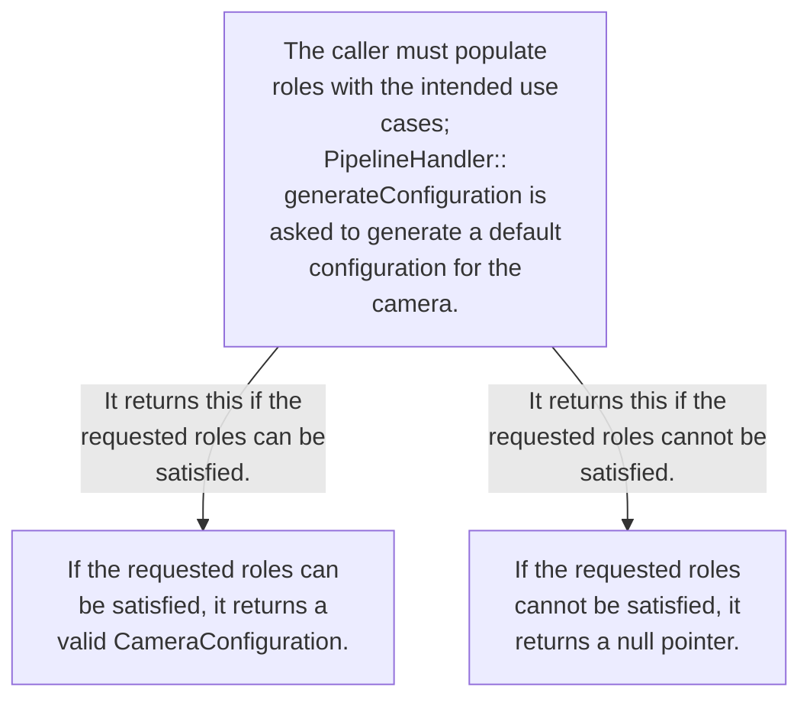

[Mermaid source](https://ttolsun.github.io/libcamera-sdd/en/vendor-assurance.configuration-contract-validity.mmd)

<details open>
<summary>Diagram evidence and verification scope</summary>

What does PipelineHandler::generateConfiguration return when it can and cannot satisfy the requested roles?

Source-linked interpretation · automatic link check only · meaning and device execution not yet verified

LLM diagram draft · before human review

Authoring model: `cli/codex/gpt-6.1-terra`

| Elements and transitions | Source evidence |
| --- | --- |
| The caller must populate roles with the intended use cases; PipelineHandler::generateConfiguration is asked to generate a default configuration for the camera. | [src/libcamera/pipeline_handler.cpp:271](#d4-source-23ff032cd1152d56) |
| If the requested roles can be satisfied, it returns a valid CameraConfiguration. | [src/libcamera/pipeline_handler.cpp:271](#d4-source-23ff032cd1152d56) |
| If the requested roles cannot be satisfied, it returns a null pointer. | [src/libcamera/pipeline_handler.cpp:271](#d4-source-23ff032cd1152d56) |
| It returns this if the requested roles can be satisfied. | [src/libcamera/pipeline_handler.cpp:271](#d4-source-23ff032cd1152d56) |
| It returns this if the requested roles cannot be satisfied. | [src/libcamera/pipeline_handler.cpp:271](#d4-source-23ff032cd1152d56) |

</details>

If `CameraConfiguration::validate()` returns `CameraConfiguration::Valid`, the original configuration was already valid and has not been adjusted. `PipelineHandler::generateConfiguration()` takes `roles`, a list of stream roles, and returns a valid `CameraConfiguration` if the requested roles can be satisfied, or a `null` pointer otherwise. The configuration passed to `PipelineHandler::configure()` is guaranteed to have been validated by `CameraConfiguration::validate()`, and pipeline handler implementers must not perform additional validation. The implementer of `PipelineHandler::configure()` must return `0` if configuration succeeds and a negative error code if it fails.

<details open>
<summary>Section-wide evidence: 9</summary>

- `src/libcamera/camera.cpp`[`L338` excerpt](#d4-source-60ab47044c6107c5) · [Full source `L338`](https://github.com/TTolsun/libcamera-sdd/blob/adfa719f8ed67d18fd8a0739fc088a1f8b9e7252/src/libcamera/camera.cpp#L338) · [`L341` excerpt](#d4-source-8b6aa81367245db5) · [Full source `L341`](https://github.com/TTolsun/libcamera-sdd/blob/adfa719f8ed67d18fd8a0739fc088a1f8b9e7252/src/libcamera/camera.cpp#L341) · [`L342` excerpt](#d4-source-e13fede0aa40ada1) · [Full source `L342`](https://github.com/TTolsun/libcamera-sdd/blob/adfa719f8ed67d18fd8a0739fc088a1f8b9e7252/src/libcamera/camera.cpp#L342) · [`L343` excerpt](#d4-source-e5758fc43bf244cd) · [Full source `L343`](https://github.com/TTolsun/libcamera-sdd/blob/adfa719f8ed67d18fd8a0739fc088a1f8b9e7252/src/libcamera/camera.cpp#L343) · [`L323` excerpt](#d4-source-2b31e92e3fb3f083) · [Full source `L323`](https://github.com/TTolsun/libcamera-sdd/blob/adfa719f8ed67d18fd8a0739fc088a1f8b9e7252/src/libcamera/camera.cpp#L323)
- `src/libcamera/pipeline_handler.cpp`[`L271` excerpt](#d4-source-23ff032cd1152d56) · [Full source `L271`](https://github.com/TTolsun/libcamera-sdd/blob/adfa719f8ed67d18fd8a0739fc088a1f8b9e7252/src/libcamera/pipeline_handler.cpp#L271) · [`L304` excerpt](#d4-source-31c5407347b4d0d8) · [Full source `L304`](https://github.com/TTolsun/libcamera-sdd/blob/adfa719f8ed67d18fd8a0739fc088a1f8b9e7252/src/libcamera/pipeline_handler.cpp#L304) · [`L313` excerpt](#d4-source-f87ceb096b9f931d) · [Full source `L313`](https://github.com/TTolsun/libcamera-sdd/blob/adfa719f8ed67d18fd8a0739fc088a1f8b9e7252/src/libcamera/pipeline_handler.cpp#L313) · [`L289`](#d4-source-4abbe39594a1bd27)

</details>

## <a id="d4-성능-근거를-읽는-기준"></a>Criteria for reading performance evidence

The built-in benchmark in `DebayerCpu` measures only the time spent processing statistics collection and debayering. It does not include the time spent capturing or outputting frames. The built-in benchmark can be used by running `cam` or `qcam` with a pipeline that uses the Software ISP.

<details open>
<summary>Section-wide evidence: 1</summary>

- `Documentation/software-isp-benchmarking.rst`[`L15` excerpt](#d4-source-551d2b5944a36d19) · [Full source `L15`](https://github.com/TTolsun/libcamera-sdd/blob/adfa719f8ed67d18fd8a0739fc088a1f8b9e7252/Documentation/software-isp-benchmarking.rst#L15)

</details>

## Class relationships

Arrow labels show the extracted relationship, and dashed lines indicate inheritance. Arrows point to the referenced target or base class. They do not indicate call order.


<details open>
<summary>Verification scope of the virtual test</summary>

**This is a virtual test configuration. It must not be used as a support or performance claim for an actual product.**

- [Has the first capture on the customer board been validated?](#d4-고객-보드의-첫-촬영을-검증했습니까)

</details>

## Source evidence

<details open>
<summary>Source excerpts: 17</summary>

Include each excerpt only once. Expand the needed original text and check it against the explanation.

<a id="d4-source-eb7d1ae4ac9df3f9"></a>

<details open>
<summary>Source evidence: src/libcamera/pipeline/virtual/README.md:3</summary>

Excerpt range: [`src/libcamera/pipeline/virtual/README.md:3`](https://github.com/TTolsun/libcamera-sdd/blob/adfa719f8ed67d18fd8a0739fc088a1f8b9e7252/src/libcamera/pipeline/virtual/README.md#L3) to `5`

SHA-256: `493f7417e35aff44c5d8402be054cedfa0cf3d5cfa6007789c2a3bbc1d359491`

```
# Virtual Pipeline Handler

Virtual pipeline handler emulates fake external camera(s) for testing.
```

</details>

<a id="d4-source-fb6397b1c5827be7"></a>

<details open>
<summary>Source evidence: src/libcamera/pipeline/virtual/data/virtual.yaml:28</summary>

Excerpt range: [`src/libcamera/pipeline/virtual/data/virtual.yaml:28`](https://github.com/TTolsun/libcamera-sdd/blob/adfa719f8ed67d18fd8a0739fc088a1f8b9e7252/src/libcamera/pipeline/virtual/data/virtual.yaml#L28) to `34`

SHA-256: `4b1c7d6a7ad0a5de6e033d508a6a85e6e166dcabdca7866b1b61b23657d91c8d`

```
"Virtual2":
  supported_formats:
  - width: 400
    height: 300
  test_pattern: "lines"
  location: "Front"
  model: "Virtual Video Device2"
```

</details>

<a id="d4-source-aba605be681da98e"></a>

<details open>
<summary>Source evidence: include/libcamera/camera.h:126</summary>

Excerpt range: [`include/libcamera/camera.h:126`](https://github.com/TTolsun/libcamera-sdd/blob/adfa719f8ed67d18fd8a0739fc088a1f8b9e7252/include/libcamera/camera.h#L126) to `153`

SHA-256: `5c3c69878cf992146820a6ecf3d639f1b4d9cf15b6626a6adf39fbaa15fa8a87`

```
Signal<Request *, FrameBuffer *> bufferCompleted;
    Signal<Request *> requestCompleted;
    Signal<> disconnected;

    int acquire();
    int release();

    const ControlInfoMap &controls() const;
    const ControlList &properties() const;

    const std::set<Stream *> &streams() const;

    std::unique_ptr<CameraConfiguration>
    generateConfiguration(std::span<const StreamRole> roles = {});

    std::unique_ptr<CameraConfiguration>
    generateConfiguration(std::initializer_list<StreamRole> roles)
    {
        return generateConfiguration(std::span(roles.begin(), roles.end()));
    }

    int configure(CameraConfiguration *config);

    std::unique_ptr<Request> createRequest(uint64_t cookie = 0);
    int queueRequest(Request *request);

    int start(const ControlList *controls = nullptr);
    int stop();
```

</details>

<a id="d4-source-cb2be6f3ec7f91fc"></a>

<details open>
<summary>Source evidence: include/libcamera/request.h:34</summary>

Excerpt range: [`include/libcamera/request.h:34`](https://github.com/TTolsun/libcamera-sdd/blob/adfa719f8ed67d18fd8a0739fc088a1f8b9e7252/include/libcamera/request.h#L34) to `37`

SHA-256: `eaa5d321971fa026c205d6687465279a50cccbeec286ccbaecd1a8ff149652f0`

```
enum Status {
        RequestPending,
        RequestComplete,
        RequestCancelled,
```

</details>

<a id="d4-source-094e6fd7ddda824a"></a>

<details open>
<summary>Source evidence: include/libcamera/framebuffer.h:25</summary>

Excerpt range: [`include/libcamera/framebuffer.h:25`](https://github.com/TTolsun/libcamera-sdd/blob/adfa719f8ed67d18fd8a0739fc088a1f8b9e7252/include/libcamera/framebuffer.h#L25) to `28`

SHA-256: `dc2d776d3644c8251b2b5c814b24afbe1669453df099ff38f2948283af83b987`

```
enum Status {
        FrameSuccess,
        FrameError,
        FrameCancelled,
```

</details>

<a id="d4-source-ce71f2f0de50caf3"></a>

<details open>
<summary>Source evidence: README.rst:107</summary>

Excerpt range: [`README.rst:107`](https://github.com/TTolsun/libcamera-sdd/blob/adfa719f8ed67d18fd8a0739fc088a1f8b9e7252/README.rst#L107) to `110`

SHA-256: `ef4dcb6f295c819bccc9abda78c8416492644df33013d7602ab5f5bb170c4b05`

```
The ``cam`` utility can be used for basic testing. You can list the cameras
detected on the system with ``cam -l``, and capture ten frames from the first
camera and save them to disk with ``cam -c 1 --capture=10 --file``. See
``cam -h`` for more information about the ``cam`` tool.
```

</details>

<a id="d4-source-3c4ba1aba4901083"></a>

<details open>
<summary>Product evidence: product-evidence/libcamera-first-capture-trial/virtual-first-capture-run.txt:1</summary>

This material is provided separately from the source. Check the provider, version, and scope of application in the record below. Automatic checks are not human approval.

Excerpt range: `product-evidence/libcamera-first-capture-trial/virtual-first-capture-run.txt:1` to `49`

SHA-256: `2284397098a8a2871f76f695264af00a36c57a8fc324630367a26e598ee165e8`

```
{
  "archive": "https://github.com/TTolsun/camera-hal-sdd-generator/tree/6adb29515c6a250d05e06ad0cf3b047205380be9/examples/libcamera/validation/issue211/runs/20261031-wsl-cam-3",
  "date": "2026-10-31",
  "source_commit": "293d751a814e0d4c34e85ad457ccd9d5eefd1a61",
  "source_tracked_clean": true,
  "kernel": "6.18.33.2-microsoft-standard-WSL2-issue211",
  "allocator": "udmabuf (built into the WSL2 trial kernel, CONFIG_UDMABUF=y)",
  "camera": "Virtual2",
  "requested_stream": "role=video,width=400,height=300,pixelformat=NV12",
  "runs": [
    {
      "pid": 434,
      "completed_frames": 3,
      "successful_buffer_sequences": [
        0,
        1,
        2
      ],
      "exit_code": 0
    },
    {
      "pid": 449,
      "completed_frames": 3,
      "successful_buffer_sequences": [
        0,
        1,
        2
      ],
      "exit_code": 0
    },
    {
      "pid": 464,
      "completed_frames": 3,
      "successful_buffer_sequences": [
        0,
        1,
        2
      ],
      "exit_code": 0
    }
  ],
  "physical_camera": "not-run",
  "physical_dma": "not-validated",
  "production_application": "not-run",
  "internal_hal": "not-run",
  "applied_stream": "(0) 400x300-NV12/SMPTE170M",
  "kernel_evidence": "https://github.com/TTolsun/camera-hal-sdd-generator/blob/6adb29515c6a250d05e06ad0cf3b047205380be9/examples/libcamera/validation/issue211/runs/20261031-after-kernel-inventory/stdout"
}
```

```
{
  "type": "measurement",
  "supplier": "Public official cam trial archive, selected run fields",
  "version": "2026-10-31",
  "date": "2026-10-31",
  "valid_until": "2026-10-31",
  "product": "libcamera-first-capture-trial",
  "release": "293d751a814e0d4c34e85ad457ccd9d5eefd1a61",
  "configuration": "wsl2-virtual2-official-cam-udmabuf",
  "feature": "virtual-first-capture",
  "conditions": [
    "WSL2 trial kernel with built-in udmabuf",
    "Unmodified official cam at the recorded source commit",
    "Virtual2, 400x300 NV12"
  ],
  "sha256": "2284397098a8a2871f76f695264af00a36c57a8fc324630367a26e598ee165e8"
}
```

</details>

<a id="d4-source-60ab47044c6107c5"></a>

<details open>
<summary>Source evidence: src/libcamera/camera.cpp:338</summary>

Excerpt range: [`src/libcamera/camera.cpp:338`](https://github.com/TTolsun/libcamera-sdd/blob/adfa719f8ed67d18fd8a0739fc088a1f8b9e7252/src/libcamera/camera.cpp#L338) to `340`

SHA-256: `2247db4a7b9353362f9df6c84aaa5c2810dec4eaaae4b3b36d19c57e427f5790`

```
\retval CameraConfiguration::Invalid The configuration is invalid and can't
 * be adjusted. This may only occur in extreme cases such as when the
 * configuration is empty.
```

</details>

<a id="d4-source-e5758fc43bf244cd"></a>

<details open>
<summary>Source evidence: src/libcamera/camera.cpp:343</summary>

Excerpt range: [`src/libcamera/camera.cpp:343`](https://github.com/TTolsun/libcamera-sdd/blob/adfa719f8ed67d18fd8a0739fc088a1f8b9e7252/src/libcamera/camera.cpp#L343) to `344`

SHA-256: `f2efdb13d4f1bd8dd432fb0badb987eab0cc484fe8ecb30b7ea9d47c0126590c`

```
The caller shall check the
 * configuration carefully.
```

</details>

<a id="d4-source-2b31e92e3fb3f083"></a>

<details open>
<summary>Source evidence: src/libcamera/camera.cpp:323</summary>

Excerpt range: [`src/libcamera/camera.cpp:323`](https://github.com/TTolsun/libcamera-sdd/blob/adfa719f8ed67d18fd8a0739fc088a1f8b9e7252/src/libcamera/camera.cpp#L323) to `346`

SHA-256: `86bf9109257512866bf70a5d42cd3da29c70d851d871f0e496058141ba377623`

```
\fn CameraConfiguration::validate()
 * \brief Validate and possibly adjust the camera configuration
 *
 * This function adjusts the camera configuration to the closest valid
 * configuration and returns the validation status.
 *
 * \todo Define exactly when to return each status code. Should stream
 * parameters set to 0 by the caller be adjusted without returning Adjusted ?
 * This would potentially be useful for applications but would get in the way
 * in Camera::configure(). Do we need an extra status code to signal this ?
 *
 * \todo Handle validation of buffers count when refactoring the buffers API.
 *
 * \return A CameraConfiguration::Status value that describes the validation
 * status.
 * \retval CameraConfiguration::Invalid The configuration is invalid and can't
 * be adjusted. This may only occur in extreme cases such as when the
 * configuration is empty.
 * \retval CameraConfiguration::Adjusted The configuration has been adjusted
 * and is now valid. Parameters may have changed for any stream, and stream
 * configurations may have been removed. The caller shall check the
 * configuration carefully.
 * \retval CameraConfiguration::Valid The configuration was already valid and
 * hasn't been adjusted.
```

</details>

<a id="d4-source-4abbe39594a1bd27"></a>

<details open>
<summary>Source evidence: src/libcamera/pipeline_handler.cpp:289</summary>

Excerpt range: [`src/libcamera/pipeline_handler.cpp:289`](https://github.com/TTolsun/libcamera-sdd/blob/adfa719f8ed67d18fd8a0739fc088a1f8b9e7252/src/libcamera/pipeline_handler.cpp#L289) to `290`

SHA-256: `b86c8678b02e96936d80626cefebf3811b6a991b459074e51c9f0e08457ff369`

```
\return A valid CameraConfiguration if the requested roles can be satisfied,
 * or a null pointer otherwise.
```

</details>

<a id="d4-source-31c5407347b4d0d8"></a>

<details open>
<summary>Source evidence: src/libcamera/pipeline_handler.cpp:304</summary>

Excerpt range: [`src/libcamera/pipeline_handler.cpp:304`](https://github.com/TTolsun/libcamera-sdd/blob/adfa719f8ed67d18fd8a0739fc088a1f8b9e7252/src/libcamera/pipeline_handler.cpp#L304) to `306`

SHA-256: `625bd787da81f9407ba9e746d4939d93b7172a26642429bcfd3300aa6187675f`

```
The configuration is guaranteed to have been validated with
 * CameraConfiguration::validate(). The pipeline handler implementation shall
 * not perform further validation
```

</details>

<a id="d4-source-f87ceb096b9f931d"></a>

<details open>
<summary>Source evidence: src/libcamera/pipeline_handler.cpp:313</summary>

Excerpt range: [`src/libcamera/pipeline_handler.cpp:313`](https://github.com/TTolsun/libcamera-sdd/blob/adfa719f8ed67d18fd8a0739fc088a1f8b9e7252/src/libcamera/pipeline_handler.cpp#L313) to `315`

SHA-256: `6e139b3c50660a7111d84bd00cfd17078b8b45d4a07688fa64b2d8af9ce52a22`

```
\context This function is called from the CameraManager thread.
 *
 * \return 0 on success or a negative error code otherwise
```

</details>

<a id="d4-source-8b6aa81367245db5"></a>

<details open>
<summary>Source evidence: src/libcamera/camera.cpp:341</summary>

Excerpt range: [`src/libcamera/camera.cpp:341`](https://github.com/TTolsun/libcamera-sdd/blob/adfa719f8ed67d18fd8a0739fc088a1f8b9e7252/src/libcamera/camera.cpp#L341) to `342`

SHA-256: `bc530fdf77cefda77bfd8ae1cadf7df4edea81ddfce01bef24867681b29655f6`

```
\retval CameraConfiguration::Adjusted The configuration has been adjusted
 * and is now valid.
```

</details>

<a id="d4-source-e13fede0aa40ada1"></a>

<details open>
<summary>Source evidence: src/libcamera/camera.cpp:342</summary>

Excerpt range: [`src/libcamera/camera.cpp:342`](https://github.com/TTolsun/libcamera-sdd/blob/adfa719f8ed67d18fd8a0739fc088a1f8b9e7252/src/libcamera/camera.cpp#L342) to `343`

SHA-256: `7c0debb896b6072c0bc59cf3589fbc49b607f915d96f30182d4e02038b94c156`

```
Parameters may have changed for any stream, and stream
 * configurations may have been removed.
```

</details>

<a id="d4-source-23ff032cd1152d56"></a>

<details open>
<summary>Source evidence: src/libcamera/pipeline_handler.cpp:271</summary>

Excerpt range: [`src/libcamera/pipeline_handler.cpp:271`](https://github.com/TTolsun/libcamera-sdd/blob/adfa719f8ed67d18fd8a0739fc088a1f8b9e7252/src/libcamera/pipeline_handler.cpp#L271) to `291`

SHA-256: `c1f4cc7aeedfc57e2bc5ebd6825a77f605173b44f7fde564aebc01bb013119cf`

```
\fn PipelineHandler::generateConfiguration()
 * \brief Generate a camera configuration for a specified camera
 * \param[in] camera The camera to generate a default configuration for
 * \param[in] roles A list of stream roles
 *
 * Generate a default configuration for the \a camera for a specified list of
 * stream roles. The caller shall populate the \a roles with the use-cases it
 * wishes to fetch the default configuration for. The returned configuration
 * can then be examined by the caller to learn about the selected streams and
 * their default parameters.
 *
 * The intended companion to this is \a configure() which can be used to change
 * the group of streams parameters.
 *
 * \context This function may be called from any thread and shall be
 * \threadsafe. It shall not modify the state of the \a camera in the pipeline
 * handler.
 *
 * \return A valid CameraConfiguration if the requested roles can be satisfied,
 * or a null pointer otherwise.
 */
```

</details>

<a id="d4-source-551d2b5944a36d19"></a>

<details open>
<summary>Source evidence: Documentation/software-isp-benchmarking.rst:15</summary>

Excerpt range: [`Documentation/software-isp-benchmarking.rst:15`](https://github.com/TTolsun/libcamera-sdd/blob/adfa719f8ed67d18fd8a0739fc088a1f8b9e7252/Documentation/software-isp-benchmarking.rst#L15) to `20`

SHA-256: `907d979f60258b4572a0557b6054ec814990084ca3e69a291317855a3b27084d`

```
The DebayerCpu class has a builtin benchmark. This benchmark measures the time
spent on processing (collecting statistics and debayering) only, it does not
measure the time spent on capturing or outputting the frames.

The builtin benchmark always runs. So this can be used by simply running "cam"
or "qcam" with a pipeline using the Software ISP.
```

</details>

</details>

## <a id="d4-page-evidence"></a>Document generation and review information

- **Generation method**: Extracted facts and LLM explanation
- **Validation scope**: Tables and figures are created from facts, and the explanations are written by the LLM. Citation, sentence, and configured structure checks are applied.
- **Automated check**: Passed (`ok`). The items checked are listed in the verification scope. Whether the explanation content is correct is checked by a human reviewer.
- **Human review**: Before human review
- **Analysis baseline commit**: `adfa719f8ed67d18fd8a0739fc088a1f8b9e7252`
- **Document generation time**: `2026-11-20 16:39:19+00:00`
- **Sentence generation model**: `cli/codex/gpt-6.1-terra`
- **Contracts between documents**: [Automated comparison report](https://ttolsun.github.io/libcamera-sdd/contract-consistency.json) · Before human review
- **Enter product description**: [Scope, conditions, and sources](https://ttolsun.github.io/libcamera-sdd/product-context.json)

<details open>
<summary>Record from when the manuscript was written</summary>

This is a record saved in the manuscript as of that time. It may differ from the current document's standards.

- Evidence files: `Documentation/software-isp-benchmarking.rst`, `README.rst`, `include/libcamera/camera.h`, `include/libcamera/framebuffer.h`, `include/libcamera/internal/ipa_manager.h`, `include/libcamera/internal/pipeline_handler.h`, `include/libcamera/request.h`, `product-evidence/libcamera-first-capture-trial/virtual-first-capture-run.txt`, `src/libcamera/camera.cpp`, `src/libcamera/ipa_manager.cpp`, `src/libcamera/pipeline/ipu3/ipu3.cpp`, `src/libcamera/pipeline/rkisp1/rkisp1.cpp`, `src/libcamera/pipeline/virtual/README.md`, `src/libcamera/pipeline/virtual/data/virtual.yaml`, `src/libcamera/pipeline_handler.cpp`
- Evidence level: code verified (static analysis, simple_compdb configuration, commit `adfa719f8e`)
- Automated check (citation, sentence, and configured structure checks): passed
- Review status recorded on: 2026-11-21 · Awaiting human review

</details>

[Markdown source ↗](https://ttolsun.github.io/libcamera-sdd/vendor-assurance.md) [Mermaid source ↗](https://ttolsun.github.io/libcamera-sdd/en/vendor-assurance.mmd)

<a id="doc-5"></a>

For Vendor

# Integration guide

Before human reviewAutomated check passedAuthored: extracted structure and draft written by the model[State description ↓](#d5-page-evidence)

English translation · human review pending. Review states below refer to the Korean source.

**Review the integration order and implementation responsibilities, and apply the configuration, request, and stop contracts.**

<details open>
<summary>Design questions and validation scope</summary>

The answers to each question and their evidence links were checked. The meaning and execution results require human review.

- What is the order in which integration should start, and what are the implementation responsibilities of the providing side and the Vendor?

  [Integration order and responsibilities](#d5-연동-순서와-책임)
- Who implements device matching and camera registration for the hardware?

  [Boundary between hardware and the common layer](#d5-하드웨어와-공통-계층의-경계)
- Which input and output contracts does the stream configuration implementation uphold?

  [Configuration interface to implement](#d5-구현할-설정-인터페이스)
- How do the common queue and the hardware implementation divide request-handling responsibilities?

  [Passing a request to the device and returning it](#d5-요청을-장치에-전달하고-반환하기)
- How are the IPA module and execution mode selected, and when does creation fail?

  [IPA module selection and failure conditions](#d5-ipa-모듈-선택과-실패-조건)
- What must common code and the hardware implementation finish when stopping?

  [Responsibility for stop and error handling](#d5-정지와-오류-처리의-책임)
- What are the code contracts and the separate runtime verification items?

  [Contracts and execution limits to check after implementation](#d5-구현-뒤-확인할-계약과-실행-한계)

Verification scope: Linking code evidence to explanations

</details>

<details open>
<summary>Terms in this document: WSL2, Pipeline Handler, IPA, proxy</summary>

- **WSL2** (Windows Subsystem for Linux 2): An environment for running Linux on Windows. This site is built from the results of building and extracting libcamera on WSL2.
- **Pipeline Handler**: A libcamera component that finds the media device of a specific hardware platform (IPU3, RKISP1, etc.), creates cameras, passes requests to the device, and returns their completion. There is one per platform.
- **IPA** (Image Processing Algorithms): A separate module (.so) that contains image quality algorithms. It reads the statistics sent by the ISP and calculates the ISP settings to use for the next frame. It is separated from the libcamera core so that manufacturers can provide it without publishing its source.
- **Proxy**: A proxy object that does not call the IPA module directly. It receives calls through the same interface and forwards them to an IPA thread or a separate process. It is automatically generated from mojom definitions at build time.

Other terms can be found in [Glossary](#doc-2).

</details>

## <a id="d5-연동-순서와-책임"></a>Integration order and responsibilities

To prepare for capture, the application must acquire and configure the camera. Once the camera is started, it can process requests until stopped, and the application must release it when finished using it. The application may start and stop the camera multiple times while it remains acquired, and may also reconfigure it. The `Camera` class generally does not synchronize functions that affect camera state with one another, so the caller must synchronize them when necessary.

### Integration order from acquisition to release

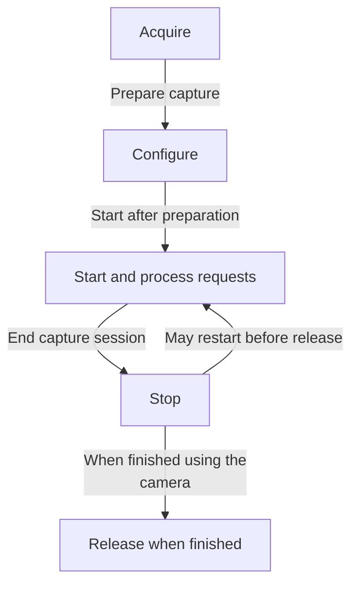

[Mermaid source](https://ttolsun.github.io/libcamera-sdd/en/vendor-integration.integration-stages.mmd)

<details open>
<summary>Diagram evidence and verification scope</summary>

This is the order of session preparation and teardown for the application. Start and stop may be repeated until the camera is released.

Source-linked interpretation · automatic link check only · meaning and device execution not yet verified

| Elements and transitions | Source evidence |
| --- | --- |
| Acquire | [src/libcamera/camera.cpp:771](#d5-source-2683b4a5a1dbfee9) |
| Configure | [src/libcamera/camera.cpp:771](#d5-source-2683b4a5a1dbfee9) |
| Start and process requests | [src/libcamera/camera.cpp:771](#d5-source-2683b4a5a1dbfee9) |
| Stop | [src/libcamera/camera.cpp:771](#d5-source-2683b4a5a1dbfee9) |
| Release when finished | [src/libcamera/camera.cpp:771](#d5-source-2683b4a5a1dbfee9) |
| Prepare capture | [src/libcamera/camera.cpp:771](#d5-source-2683b4a5a1dbfee9) |
| Start after preparation | [src/libcamera/camera.cpp:771](#d5-source-2683b4a5a1dbfee9) |
| End capture session | [src/libcamera/camera.cpp:771](#d5-source-2683b4a5a1dbfee9) |
| When finished using the camera | [src/libcamera/camera.cpp:771](#d5-source-2683b4a5a1dbfee9) |
| May restart before release | [src/libcamera/camera.cpp:777](#d5-source-948bd80fa1136291) |

</details>

<details open>
<summary>Section-wide evidence: 4</summary>

- `src/libcamera/camera.cpp`[`L771` excerpt](#d5-source-2683b4a5a1dbfee9) · [Full source `L771`](https://github.com/TTolsun/libcamera-sdd/blob/adfa719f8ed67d18fd8a0739fc088a1f8b9e7252/src/libcamera/camera.cpp#L771) · [`L777` excerpt](#d5-source-948bd80fa1136291) · [Full source `L777`](https://github.com/TTolsun/libcamera-sdd/blob/adfa719f8ed67d18fd8a0739fc088a1f8b9e7252/src/libcamera/camera.cpp#L777) · [`L780` excerpt](#d5-source-cc6c66b57cf028e6) · [Full source `L780`](https://github.com/TTolsun/libcamera-sdd/blob/adfa719f8ed67d18fd8a0739fc088a1f8b9e7252/src/libcamera/camera.cpp#L780) · [`L1032`](#d5-source-492118d913b10361)

</details>

## <a id="d5-하드웨어와-공통-계층의-경계"></a>Boundary between hardware and the common layer

When all media devices needed for a single pipeline are found, the implementer of `PipelineHandler::match()` must call `MediaDevice::acquire()` to acquire each device, then create one or more corresponding `Camera` instances, store them internally, register them with the camera manager, and return `true`. When not all required media devices are found, the implementer of `PipelineHandler::match()` must not acquire any devices if none have yet been acquired; if some have already been acquired, the implementer must call `MediaDevice::release()` to release all acquired devices and return `false`. `PipelineHandler::match()` is called on the `CameraManager` thread and, if it returns `true`, a new `PipelineHandler` instance is created and that instance's `match()` is called.

### Acquisition and registration for device matching and cleanup on failure

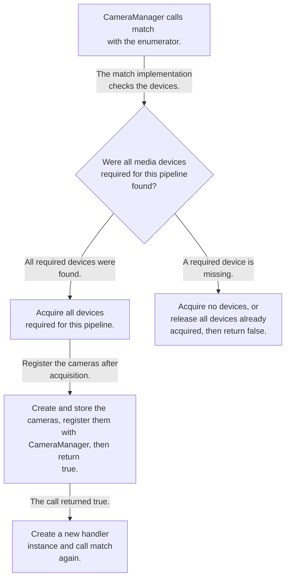

[Mermaid source](https://ttolsun.github.io/libcamera-sdd/en/vendor-integration.item-boundary.mmd)

<details open>
<summary>Diagram evidence and verification scope</summary>

Who matches devices and registers cameras, and how are the acquired devices handled depending on the match result?

Source-linked interpretation · automatic link check only · meaning and device execution not yet verified

| Elements and transitions | Source evidence |
| --- | --- |
| CameraManager calls match with the enumerator. | [src/libcamera/pipeline_handler.cpp:91](#d5-source-5109302527925a6a) |
| Were all media devices required for this pipeline found? | [src/libcamera/pipeline_handler.cpp:91](#d5-source-5109302527925a6a) |
| Acquire all devices required for this pipeline. | [src/libcamera/pipeline_handler.cpp:91](#d5-source-5109302527925a6a) |
| Create and store the cameras, register them with CameraManager, then return true. | [src/libcamera/pipeline_handler.cpp:91](#d5-source-5109302527925a6a) |
| Create a new handler instance and call match again. | [src/libcamera/pipeline_handler.cpp:109](#d5-source-1afff120b5d66b3c) |
| Acquire no devices, or release all devices already acquired, then return false. | [src/libcamera/pipeline_handler.cpp:97](#d5-source-293bf5d4775550d0) |
| The match implementation checks the devices. | [src/libcamera/pipeline_handler.cpp:91](#d5-source-5109302527925a6a) |
| All required devices were found. | [src/libcamera/pipeline_handler.cpp:91](#d5-source-5109302527925a6a) |
| A required device is missing. | [src/libcamera/pipeline_handler.cpp:91](#d5-source-5109302527925a6a) · [src/libcamera/pipeline_handler.cpp:97](#d5-source-293bf5d4775550d0) |
| Register the cameras after acquisition. | [src/libcamera/pipeline_handler.cpp:91](#d5-source-5109302527925a6a) |
| The call returned true. | [src/libcamera/pipeline_handler.cpp:91](#d5-source-5109302527925a6a) · [src/libcamera/pipeline_handler.cpp:109](#d5-source-1afff120b5d66b3c) |

</details>

<details open>
<summary>Section-wide evidence: 3</summary>

- `src/libcamera/pipeline_handler.cpp`[`L91` excerpt](#d5-source-5109302527925a6a) · [Full source `L91`](https://github.com/TTolsun/libcamera-sdd/blob/adfa719f8ed67d18fd8a0739fc088a1f8b9e7252/src/libcamera/pipeline_handler.cpp#L91) · [`L97` excerpt](#d5-source-293bf5d4775550d0) · [Full source `L97`](https://github.com/TTolsun/libcamera-sdd/blob/adfa719f8ed67d18fd8a0739fc088a1f8b9e7252/src/libcamera/pipeline_handler.cpp#L97) · [`L109` excerpt](#d5-source-1afff120b5d66b3c) · [Full source `L109`](https://github.com/TTolsun/libcamera-sdd/blob/adfa719f8ed67d18fd8a0739fc088a1f8b9e7252/src/libcamera/pipeline_handler.cpp#L109)

</details>

## <a id="d5-구현할-설정-인터페이스"></a>Configuration interface to implement

The caller of `generateConfiguration` must populate `roles` with the use cases for which it wants to obtain a default configuration. The configuration returned by `generateConfiguration()` contains information that allows the caller to identify the selected streams and their default parameters. `PipelineHandler::generateConfiguration()` must return a valid `CameraConfiguration` if the requested `roles` can be satisfied, and otherwise must return a `null` pointer. The implementation of `PipelineHandler::generateConfiguration()` may be called from any thread and therefore must be thread-safe.

### Inputs and results by configuration interface

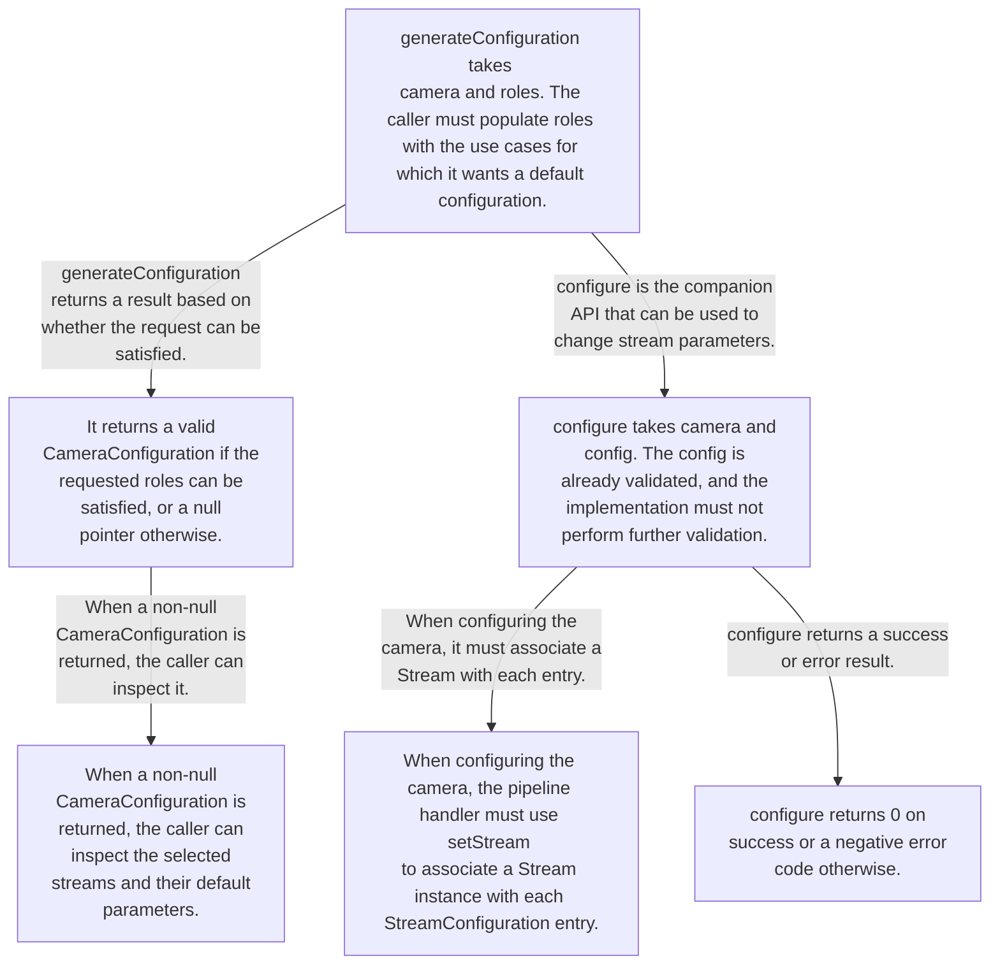

[Mermaid source](https://ttolsun.github.io/libcamera-sdd/en/vendor-integration.handler-configuration-contracts.mmd)

<details open>
<summary>Diagram evidence and verification scope</summary>

What are the inputs and return values of generateConfiguration and configure, and what is the obligation to connect Streams on success?

Source-linked interpretation · automatic link check only · meaning and device execution not yet verified

LLM diagram draft · before human review

Authoring model: `cli/codex/gpt-6.1-terra`

| Elements and transitions | Source evidence |
| --- | --- |
| generateConfiguration takes camera and roles. The caller must populate roles with the use cases for which it wants a default configuration. | [src/libcamera/pipeline_handler.cpp:271](#d5-source-23ff032cd1152d56) |
| It returns a valid CameraConfiguration if the requested roles can be satisfied, or a null pointer otherwise. | [src/libcamera/pipeline_handler.cpp:271](#d5-source-23ff032cd1152d56) |
| When a non-null CameraConfiguration is returned, the caller can inspect the selected streams and their default parameters. | [src/libcamera/pipeline_handler.cpp:271](#d5-source-23ff032cd1152d56) |
| configure takes camera and config. The config is already validated, and the implementation must not perform further validation. | [src/libcamera/pipeline_handler.cpp:294](#d5-source-4255f8449e37ebb8) |
| configure returns 0 on success or a negative error code otherwise. | [src/libcamera/pipeline_handler.cpp:294](#d5-source-4255f8449e37ebb8) |
| When configuring the camera, the pipeline handler must use setStream to associate a Stream instance with each StreamConfiguration entry. | [src/libcamera/pipeline_handler.cpp:294](#d5-source-4255f8449e37ebb8) |
| generateConfiguration returns a result based on whether the request can be satisfied. | [src/libcamera/pipeline_handler.cpp:271](#d5-source-23ff032cd1152d56) |
| When a non-null CameraConfiguration is returned, the caller can inspect it. | [src/libcamera/pipeline_handler.cpp:271](#d5-source-23ff032cd1152d56) |
| configure is the companion API that can be used to change stream parameters. | [src/libcamera/pipeline_handler.cpp:271](#d5-source-23ff032cd1152d56) |
| When configuring the camera, it must associate a Stream with each entry. | [src/libcamera/pipeline_handler.cpp:294](#d5-source-4255f8449e37ebb8) |
| configure returns a success or error result. | [src/libcamera/pipeline_handler.cpp:294](#d5-source-4255f8449e37ebb8) |

</details>

Implementers of `PipelineHandler::generateConfiguration()` must not change the state of `camera` in the pipeline handler. The configuration passed to `PipelineHandler::configure()` is guaranteed to have been validated by `CameraConfiguration::validate()`, so the pipeline handler implementation must not perform additional validation. The `PipelineHandler::configure()` implementation may rely on all custom fields stored in its own `CameraConfiguration`-derived class. When configuring the camera, implementers of `PipelineHandler::configure()` must use `StreamConfiguration::setStream()` to associate a `Stream` instance with each `StreamConfiguration` entry in `CameraConfiguration`.

`PipelineHandler::configure()` is called on the `CameraManager` thread, and the implementation must return `0` on success and a negative error code on failure.

<details open>
<summary>Section-wide evidence: 11</summary>

- `src/libcamera/pipeline_handler.cpp`[`L276` excerpt](#d5-source-924d43ea4bcaf94b) · [Full source `L276`](https://github.com/TTolsun/libcamera-sdd/blob/adfa719f8ed67d18fd8a0739fc088a1f8b9e7252/src/libcamera/pipeline_handler.cpp#L276) · [`L289` excerpt](#d5-source-4abbe39594a1bd27) · [Full source `L289`](https://github.com/TTolsun/libcamera-sdd/blob/adfa719f8ed67d18fd8a0739fc088a1f8b9e7252/src/libcamera/pipeline_handler.cpp#L289) · [`L285` excerpt](#d5-source-2eae247c4c37371c) · [Full source `L285`](https://github.com/TTolsun/libcamera-sdd/blob/adfa719f8ed67d18fd8a0739fc088a1f8b9e7252/src/libcamera/pipeline_handler.cpp#L285) · [`L286` excerpt](#d5-source-25fb9495d4ab94a1) · [Full source `L286`](https://github.com/TTolsun/libcamera-sdd/blob/adfa719f8ed67d18fd8a0739fc088a1f8b9e7252/src/libcamera/pipeline_handler.cpp#L286) · [`L304` excerpt](#d5-source-31c5407347b4d0d8) · [Full source `L304`](https://github.com/TTolsun/libcamera-sdd/blob/adfa719f8ed67d18fd8a0739fc088a1f8b9e7252/src/libcamera/pipeline_handler.cpp#L304) · [`L306` excerpt](#d5-source-71079779113f431c) · [Full source `L306`](https://github.com/TTolsun/libcamera-sdd/blob/adfa719f8ed67d18fd8a0739fc088a1f8b9e7252/src/libcamera/pipeline_handler.cpp#L306) · [`L309` excerpt](#d5-source-f3cf94b1dc7b9457) · [Full source `L309`](https://github.com/TTolsun/libcamera-sdd/blob/adfa719f8ed67d18fd8a0739fc088a1f8b9e7252/src/libcamera/pipeline_handler.cpp#L309) · [`L313` excerpt](#d5-source-f87ceb096b9f931d) · [Full source `L313`](https://github.com/TTolsun/libcamera-sdd/blob/adfa719f8ed67d18fd8a0739fc088a1f8b9e7252/src/libcamera/pipeline_handler.cpp#L313) · [`L271`](#d5-source-23ff032cd1152d56) · [`L294`](#d5-source-4255f8449e37ebb8)
- `src/libcamera/camera.cpp`[`L1191`](#d5-source-603af0dd7fa357d0)

</details>

## <a id="d5-요청을-장치에-전달하고-반환하기"></a>Passing a request to the device and returning it

See also: [When the last buffer has completed but no request completion notification arrives](#d19-%EC%8B%A4%ED%8C%A8-%EC%9C%84%EC%B9%98%EB%B3%84-%ED%99%95%EC%9D%B8-%EC%88%9C%EC%84%9C) · [Completion notifications and device verification when capture stops](#d18-%EC%A0%95%EC%A7%80%EC%99%80-%EC%97%B0%EA%B2%B0-%ED%95%B4%EC%A0%9C%EB%A5%BC-%EA%B5%AC%EB%B6%84%ED%95%98%EA%B8%B0) · [Thread calling completeRequest and prohibition on accessing the request after the function returns](#d5-%EA%B5%AC%ED%98%84-%EB%92%A4-%ED%99%95%EC%9D%B8%ED%95%A0-%EA%B3%84%EC%95%BD%EA%B3%BC-%EC%8B%A4%ED%96%89-%ED%95%9C%EA%B3%84)

The request contains a set of buffers, which are associated with streams. The request also contains a set of parameters. The `queueRequestDevice` implementer must program the device so that the parameters are applied to the frames captured in the buffers provided in the request. The `queueRequestDevice` implementer must return `0` on success and a negative error code on failure.

### Responsibility for device queueing and completion of buffers and requests

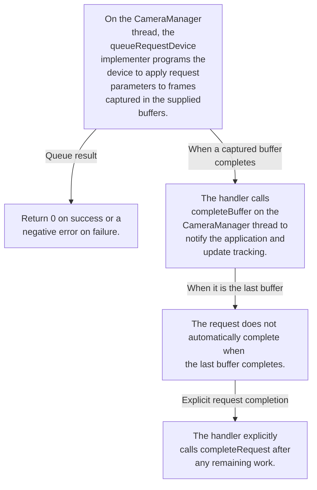

[Mermaid source](https://ttolsun.github.io/libcamera-sdd/en/vendor-integration.device-queue-and-completion.mmd)

<details open>
<summary>Diagram evidence and verification scope</summary>

Who applies the request parameters to the device and completes buffers and requests, respectively?

Source-linked interpretation · automatic link check only · meaning and device execution not yet verified

| Elements and transitions | Source evidence |
| --- | --- |
| On the CameraManager thread, the queueRequestDevice implementer programs the device to apply request parameters to frames captured in the supplied buffers. | [src/libcamera/pipeline_handler.cpp:535](#d5-source-a9ed7dcbf54ccaff) · [src/libcamera/pipeline_handler.cpp:541](#d5-source-974203a2566eb6a7) |
| Return 0 on success or a negative error on failure. | [src/libcamera/pipeline_handler.cpp:541](#d5-source-974203a2566eb6a7) |
| The handler calls completeBuffer on the CameraManager thread to notify the application and update tracking. | [src/libcamera/pipeline_handler.cpp:551](#d5-source-2c79d29bf7fe6699) · [src/libcamera/pipeline_handler.cpp:558](#d5-source-699c5b0f43c595cf) |
| The request does not automatically complete when the last buffer completes. | [src/libcamera/pipeline_handler.cpp:553](#d5-source-7b871a70bfc9aa8f) |
| The handler explicitly calls completeRequest after any remaining work. | [src/libcamera/pipeline_handler.cpp:553](#d5-source-7b871a70bfc9aa8f) · [src/libcamera/pipeline_handler.cpp:556](#d5-source-e1c3bfd748ad8a33) |
| Queue result | [src/libcamera/pipeline_handler.cpp:535](#d5-source-a9ed7dcbf54ccaff) · [src/libcamera/pipeline_handler.cpp:541](#d5-source-974203a2566eb6a7) |
| When a captured buffer completes | [src/libcamera/pipeline_handler.cpp:535](#d5-source-a9ed7dcbf54ccaff) · [src/libcamera/pipeline_handler.cpp:551](#d5-source-2c79d29bf7fe6699) |
| When it is the last buffer | [src/libcamera/pipeline_handler.cpp:551](#d5-source-2c79d29bf7fe6699) · [src/libcamera/pipeline_handler.cpp:553](#d5-source-7b871a70bfc9aa8f) |
| Explicit request completion | [src/libcamera/pipeline_handler.cpp:553](#d5-source-7b871a70bfc9aa8f) · [src/libcamera/pipeline_handler.cpp:556](#d5-source-e1c3bfd748ad8a33) |

</details>

`PipelineHandler::queueRequestDevice()` is called on the `CameraManager` thread. The pipeline handler must call `completeBuffer` on the `CameraManager` thread to signal completion of a buffer in the request. `completeBuffer` notifies the application of buffer completion and updates the request's internal buffer tracking. The request is not completed automatically even when the last buffer completes, so the pipeline handler must explicitly call `completeRequest()` to complete the request.

<details open>
<summary>Section-wide evidence: 6</summary>

- `src/libcamera/pipeline_handler.cpp`[`L535` excerpt](#d5-source-a9ed7dcbf54ccaff) · [Full source `L535`](https://github.com/TTolsun/libcamera-sdd/blob/adfa719f8ed67d18fd8a0739fc088a1f8b9e7252/src/libcamera/pipeline_handler.cpp#L535) · [`L541` excerpt](#d5-source-974203a2566eb6a7) · [Full source `L541`](https://github.com/TTolsun/libcamera-sdd/blob/adfa719f8ed67d18fd8a0739fc088a1f8b9e7252/src/libcamera/pipeline_handler.cpp#L541) · [`L551` excerpt](#d5-source-2c79d29bf7fe6699) · [Full source `L551`](https://github.com/TTolsun/libcamera-sdd/blob/adfa719f8ed67d18fd8a0739fc088a1f8b9e7252/src/libcamera/pipeline_handler.cpp#L551) · [`L558` excerpt](#d5-source-699c5b0f43c595cf) · [Full source `L558`](https://github.com/TTolsun/libcamera-sdd/blob/adfa719f8ed67d18fd8a0739fc088a1f8b9e7252/src/libcamera/pipeline_handler.cpp#L558) · [`L553` excerpt](#d5-source-7b871a70bfc9aa8f) · [Full source `L553`](https://github.com/TTolsun/libcamera-sdd/blob/adfa719f8ed67d18fd8a0739fc088a1f8b9e7252/src/libcamera/pipeline_handler.cpp#L553) · [`L556` excerpt](#d5-source-e1c3bfd748ad8a33) · [Full source `L556`](https://github.com/TTolsun/libcamera-sdd/blob/adfa719f8ed67d18fd8a0739fc088a1f8b9e7252/src/libcamera/pipeline_handler.cpp#L556)

</details>

## <a id="d5-ipa-모듈-선택과-실패-조건"></a>IPA module selection and failure conditions

When calling `module`, `createIPA` passes `name`, representing the name, `minVersion`, representing the minimum version, and `maxVersion`, representing the maximum version, in that order. `IPAManager::module` iterates through the modules and returns the first module for which `match` holds for the name and allowed version range, ending the search; if no module matches by the end, the function returns `nullptr`. `createIPA` receives the result of `module` in `m` and, if `!m`, returns `nullptr`.

### IPA module search and proxy return branches

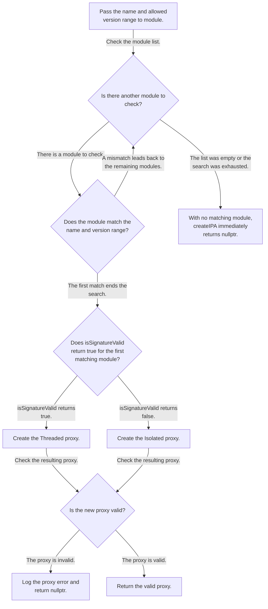

[Mermaid source](https://ttolsun.github.io/libcamera-sdd/en/vendor-integration.item-algorithm.mmd)

<details open>
<summary>Diagram evidence and verification scope</summary>

How does createIPA select a matching module and proxy type, and in which branches does createIPA return nullptr?

Source-linked interpretation · automatic link check only · meaning and device execution not yet verified

| Elements and transitions | Source evidence |
| --- | --- |
| Pass the name and allowed version range to module. | [include/libcamera/internal/ipa_manager.h:35](#d5-source-1bc92c4993a1c4dc) |
| Is there another module to check? | [src/libcamera/ipa_manager.cpp:249](#d5-source-f61e5a9ff79a97a8) |
| Does the module match the name and version range? | [src/libcamera/ipa_manager.cpp:249](#d5-source-f61e5a9ff79a97a8) |
| With no matching module, createIPA immediately returns nullptr. | [src/libcamera/ipa_manager.cpp:249](#d5-source-f61e5a9ff79a97a8) · [include/libcamera/internal/ipa_manager.h:35](#d5-source-1bc92c4993a1c4dc) |
| Does isSignatureValid return true for the first matching module? | [src/libcamera/ipa_manager.cpp:249](#d5-source-f61e5a9ff79a97a8) · [include/libcamera/internal/ipa_manager.h:35](#d5-source-1bc92c4993a1c4dc) |
| Create the Threaded proxy. | [include/libcamera/internal/ipa_manager.h:35](#d5-source-1bc92c4993a1c4dc) |
| Create the Isolated proxy. | [include/libcamera/internal/ipa_manager.h:35](#d5-source-1bc92c4993a1c4dc) |
| Is the new proxy valid? | [include/libcamera/internal/ipa_manager.h:35](#d5-source-1bc92c4993a1c4dc) |
| Log the proxy error and return nullptr. | [include/libcamera/internal/ipa_manager.h:35](#d5-source-1bc92c4993a1c4dc) |
| Return the valid proxy. | [include/libcamera/internal/ipa_manager.h:35](#d5-source-1bc92c4993a1c4dc) |
| Check the module list. | [include/libcamera/internal/ipa_manager.h:35](#d5-source-1bc92c4993a1c4dc) · [src/libcamera/ipa_manager.cpp:249](#d5-source-f61e5a9ff79a97a8) |
| There is a module to check. | [src/libcamera/ipa_manager.cpp:249](#d5-source-f61e5a9ff79a97a8) |
| The list was empty or the search was exhausted. | [src/libcamera/ipa_manager.cpp:249](#d5-source-f61e5a9ff79a97a8) · [include/libcamera/internal/ipa_manager.h:35](#d5-source-1bc92c4993a1c4dc) |
| A mismatch leads back to the remaining modules. | [src/libcamera/ipa_manager.cpp:249](#d5-source-f61e5a9ff79a97a8) |
| The first match ends the search. | [src/libcamera/ipa_manager.cpp:249](#d5-source-f61e5a9ff79a97a8) · [include/libcamera/internal/ipa_manager.h:35](#d5-source-1bc92c4993a1c4dc) |
| isSignatureValid returns true. | [src/libcamera/ipa_manager.cpp:249](#d5-source-f61e5a9ff79a97a8) · [include/libcamera/internal/ipa_manager.h:35](#d5-source-1bc92c4993a1c4dc) |
| isSignatureValid returns false. | [src/libcamera/ipa_manager.cpp:249](#d5-source-f61e5a9ff79a97a8) · [include/libcamera/internal/ipa_manager.h:35](#d5-source-1bc92c4993a1c4dc) |
| Check the resulting proxy. | [include/libcamera/internal/ipa_manager.h:35](#d5-source-1bc92c4993a1c4dc) |
| Check the resulting proxy. | [include/libcamera/internal/ipa_manager.h:35](#d5-source-1bc92c4993a1c4dc) |
| The proxy is invalid. | [include/libcamera/internal/ipa_manager.h:35](#d5-source-1bc92c4993a1c4dc) |
| The proxy is valid. | [include/libcamera/internal/ipa_manager.h:35](#d5-source-1bc92c4993a1c4dc) |

</details>

The lambda inside `createIPA` creates a `T::Threaded` proxy object if `isSignatureValid(m)` is true, and a `T::Isolated` proxy object if it is false. `createIPA` logs the `Failed to load proxy` error and returns `nullptr` if the created proxy fails the `isValid` check. `createIPA` returns the created proxy if it passes validation.

<details open>
<summary>Section-wide evidence: 4</summary>

- `include/libcamera/internal/ipa_manager.h`[`L39`](https://github.com/TTolsun/libcamera-sdd/blob/adfa719f8ed67d18fd8a0739fc088a1f8b9e7252/include/libcamera/internal/ipa_manager.h#L39) · [`L43` excerpt](#d5-source-6dc4133d5797f19b) · [Full source `L43`](https://github.com/TTolsun/libcamera-sdd/blob/adfa719f8ed67d18fd8a0739fc088a1f8b9e7252/include/libcamera/internal/ipa_manager.h#L43) · [`L35` excerpt](#d5-source-1bc92c4993a1c4dc) · [Full source `L35`](https://github.com/TTolsun/libcamera-sdd/blob/adfa719f8ed67d18fd8a0739fc088a1f8b9e7252/include/libcamera/internal/ipa_manager.h#L35) · [`L39`](#d5-source-88cede73f337db67) · [`L39`](#d5-source-da860180dc9199e6)
- `src/libcamera/ipa_manager.cpp`[`L249` excerpt](#d5-source-f61e5a9ff79a97a8) · [Full source `L249`](https://github.com/TTolsun/libcamera-sdd/blob/adfa719f8ed67d18fd8a0739fc088a1f8b9e7252/src/libcamera/ipa_manager.cpp#L249)

</details>

## <a id="d5-정지와-오류-처리의-책임"></a>Responsibility for stop and error handling

`PipelineHandler::stop()` first executes `waitingRequests.swap(data->waitingRequests_)` and then calls `stopDevice(camera)`. `PipelineHandler::stop()` moves the waiting requests aside so that they are not requeued when `completeRequest()` is called inside `stopDevice()`. The implementer of `stopDevice()` must immediately stop capture from all running streams and stop processing requests, and must cancel all pending requests for the device and complete them immediately in an error state.

### Order of stopping the device and returning waiting requests

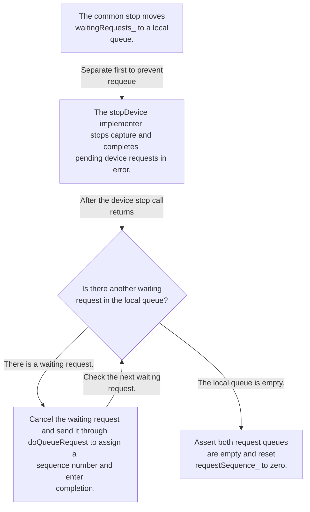

[Mermaid source](https://ttolsun.github.io/libcamera-sdd/en/vendor-integration.shutdown-device-and-waiting-requests.mmd)

<details open>
<summary>Diagram evidence and verification scope</summary>

Which requests do the common stop and stopDevice implementers each handle, and when?

Source-linked interpretation · automatic link check only · meaning and device execution not yet verified

| Elements and transitions | Source evidence |
| --- | --- |
| The common stop moves waitingRequests\_ to a local queue. | [src/libcamera/pipeline_handler.cpp:367](#d5-source-1cc522721d2c5142) · [src/libcamera/pipeline_handler.cpp:370](#d5-source-486f3f81acba3c1f) |
| The stopDevice implementer stops capture and completes pending device requests in error. | [src/libcamera/pipeline_handler.cpp:367](#d5-source-7097caa35d0e97c8) · [src/libcamera/pipeline_handler.cpp:405](#d5-source-a1eeb263fc114d2f) |
| Is there another waiting request in the local queue? | [src/libcamera/pipeline_handler.cpp:367](#d5-source-1cc522721d2c5142) |
| Cancel the waiting request and send it through doQueueRequest to assign a sequence number and enter completion. | [src/libcamera/pipeline_handler.cpp:367](#d5-source-1cc522721d2c5142) |
| Assert both request queues are empty and reset requestSequence\_ to zero. | [src/libcamera/pipeline_handler.cpp:367](#d5-source-1cc522721d2c5142) |
| Separate first to prevent requeue | [src/libcamera/pipeline_handler.cpp:370](#d5-source-486f3f81acba3c1f) · [src/libcamera/pipeline_handler.cpp:367](#d5-source-1cc522721d2c5142) · [src/libcamera/pipeline_handler.cpp:367](#d5-source-7097caa35d0e97c8) |
| After the device stop call returns | [src/libcamera/pipeline_handler.cpp:367](#d5-source-7097caa35d0e97c8) · [src/libcamera/pipeline_handler.cpp:367](#d5-source-1cc522721d2c5142) |
| There is a waiting request. | [src/libcamera/pipeline_handler.cpp:367](#d5-source-1cc522721d2c5142) |
| Check the next waiting request. | [src/libcamera/pipeline_handler.cpp:367](#d5-source-1cc522721d2c5142) |
| The local queue is empty. | [src/libcamera/pipeline_handler.cpp:367](#d5-source-1cc522721d2c5142) |

</details>

`PipelineHandler::stop()` takes the waiting requests aside, then calls `stopDevice()`. After canceling each waiting request, it passes the request to `doQueueRequest()` so that it receives a sequence number and is temporarily added to `queuedRequests_` for completion in `completeRequest()`. After processing the waiting requests, `PipelineHandler::stop()` uses two `ASSERT` statements to check that `queuedRequests_` and `waitingRequests_` are empty, and stores `0` in `requestSequence_`.

<details open>
<summary>Section-wide evidence: 3</summary>

- `src/libcamera/pipeline_handler.cpp`[`L367`](https://github.com/TTolsun/libcamera-sdd/blob/adfa719f8ed67d18fd8a0739fc088a1f8b9e7252/src/libcamera/pipeline_handler.cpp#L367) · [`L370` excerpt](#d5-source-486f3f81acba3c1f) · [Full source `L370`](https://github.com/TTolsun/libcamera-sdd/blob/adfa719f8ed67d18fd8a0739fc088a1f8b9e7252/src/libcamera/pipeline_handler.cpp#L370) · [`L405` excerpt](#d5-source-a1eeb263fc114d2f) · [Full source `L405`](https://github.com/TTolsun/libcamera-sdd/blob/adfa719f8ed67d18fd8a0739fc088a1f8b9e7252/src/libcamera/pipeline_handler.cpp#L405) · [`L367`](#d5-source-1cc522721d2c5142) · [`L367`](#d5-source-7097caa35d0e97c8)

</details>

## <a id="d5-구현-뒤-확인할-계약과-실행-한계"></a>Contracts and execution limits to check after implementation

Pipeline handler implementers must not access the request after `completeRequest` returns. The pipeline handler may pass completed requests to `completeRequest` without any ordering constraint, and this function returns requests to the application in submission order. The pipeline handler must call `completeRequest` from the `CameraManager` thread.

<details open>
<summary>Section-wide evidence: 3</summary>

- `src/libcamera/pipeline_handler.cpp`[`L571` excerpt](#d5-source-7ac40780a56ae3a9) · [Full source `L571`](https://github.com/TTolsun/libcamera-sdd/blob/adfa719f8ed67d18fd8a0739fc088a1f8b9e7252/src/libcamera/pipeline_handler.cpp#L571) · [`L578` excerpt](#d5-source-16187edaf24c09f5) · [Full source `L578`](https://github.com/TTolsun/libcamera-sdd/blob/adfa719f8ed67d18fd8a0739fc088a1f8b9e7252/src/libcamera/pipeline_handler.cpp#L578) · [`L582` excerpt](#d5-source-72e48606b2a92dcc) · [Full source `L582`](https://github.com/TTolsun/libcamera-sdd/blob/adfa719f8ed67d18fd8a0739fc088a1f8b9e7252/src/libcamera/pipeline_handler.cpp#L582)

</details>

## Class relationships

Arrow labels show the extracted relationship, and dashed lines indicate inheritance. Arrows point to the referenced target or base class. They do not indicate call order.


## Source evidence

<details open>
<summary>Source excerpts: 36</summary>

Include each excerpt only once. Expand the needed original text and check it against the explanation.

<a id="d5-source-2683b4a5a1dbfee9"></a>

<details open>
<summary>Source evidence: src/libcamera/camera.cpp:771</summary>

Excerpt range: [`src/libcamera/camera.cpp:771`](https://github.com/TTolsun/libcamera-sdd/blob/adfa719f8ed67d18fd8a0739fc088a1f8b9e7252/src/libcamera/camera.cpp#L771) to `775`

SHA-256: `2727ed2082026463f6e5fe4b907fefa46749d0ff9d9122ad2d578b6440c206a0`

```
An application needs to perform a sequence of operations on a camera before
 * it is ready to process requests. The camera needs to be acquired and
 * configured to prepare the camera for capture. Once started the camera can
 * process requests until it is stopped. When an application is done with a
 * camera, the camera needs to be released.
```

</details>

<a id="d5-source-cc6c66b57cf028e6"></a>

<details open>
<summary>Source evidence: src/libcamera/camera.cpp:780</summary>

Excerpt range: [`src/libcamera/camera.cpp:780`](https://github.com/TTolsun/libcamera-sdd/blob/adfa719f8ed67d18fd8a0739fc088a1f8b9e7252/src/libcamera/camera.cpp#L780) to `782`

SHA-256: `de3ba7a26c3bbaf6bbb33d1749b99829fdc58e13718068d149c849d0b2c43388`

```
Functions that affect the camera state as defined below are generally not
 * synchronized with each other by the Camera class. The caller is responsible
 * for ensuring their synchronization if necessary.
```

</details>

<a id="d5-source-948bd80fa1136291"></a>

<details open>
<summary>Source evidence: src/libcamera/camera.cpp:777</summary>

Excerpt range: [`src/libcamera/camera.cpp:777`](https://github.com/TTolsun/libcamera-sdd/blob/adfa719f8ed67d18fd8a0739fc088a1f8b9e7252/src/libcamera/camera.cpp#L777) to `778`

SHA-256: `4af35cfde252bae9391fc55c13025c02f8bd98084b9f53807de39707feb33377`

```
An application may start and stop a camera multiple times as long as it is
 * not released. The camera may also be reconfigured.
```

</details>

<a id="d5-source-492118d913b10361"></a>

<details open>
<summary>Source evidence: src/libcamera/camera.cpp:1032</summary>

Excerpt range: [`src/libcamera/camera.cpp:1032`](https://github.com/TTolsun/libcamera-sdd/blob/adfa719f8ed67d18fd8a0739fc088a1f8b9e7252/src/libcamera/camera.cpp#L1032) to `1062`

SHA-256: `734a942c1c3483d82cacc5da96ae3bd47ee8fe8d38d223c41777fbe244ccad1c`

```
\brief Release exclusive access to the camera device
 *
 * Releasing the camera device allows other users to acquire exclusive access
 * with the acquire() function.
 *
 * \context This function may only be called when the camera is in the
 * Available or Configured state as defined in \ref camera_operation, and shall
 * be synchronized by the caller with other functions that affect the camera
 * state.
 *
 * \return 0 on success or a negative error code otherwise
 * \retval -EBUSY The camera is running and can't be released
 */
int Camera::release()
{
    Private *const d = _d();

    int ret = d->isAccessAllowed(Private::CameraAvailable,
                     Private::CameraConfigured, true);
    if (ret < 0)
        return ret == -EACCES ? -EBUSY : ret;

    if (d->isAcquired())
        d->pipe_->invokeMethod(&PipelineHandler::release,
                       ConnectionTypeBlocking, this);

    d->setState(Private::CameraAvailable);

    return 0;
}
```

</details>

<a id="d5-source-5109302527925a6a"></a>

<details open>
<summary>Source evidence: src/libcamera/pipeline_handler.cpp:91</summary>

Excerpt range: [`src/libcamera/pipeline_handler.cpp:91`](https://github.com/TTolsun/libcamera-sdd/blob/adfa719f8ed67d18fd8a0739fc088a1f8b9e7252/src/libcamera/pipeline_handler.cpp#L91) to `103`

SHA-256: `f71446293f48c042c9685cc078c8474d78182a065365d2c02185640d8bdb385c`

```
This function is the main entry point of the pipeline handler. It is called
 * by the camera manager with the \a enumerator passed as an argument. It shall
 * acquire from the \a enumerator all the media devices it needs for a single
 * pipeline, create one or multiple Camera instances and register them with the
 * camera manager.
 *
 * If all media devices needed by the pipeline handler are found, they must all
 * be acquired by a call to MediaDevice::acquire(). This function shall then
 * create the corresponding Camera instances, store them internally, and return
 * true. Otherwise it shall not acquire any media device (or shall release all
 * the media devices is has acquired by calling MediaDevice::release()) and
 * return false.
 *
```

</details>

<a id="d5-source-1afff120b5d66b3c"></a>

<details open>
<summary>Source evidence: src/libcamera/pipeline_handler.cpp:109</summary>

Excerpt range: [`src/libcamera/pipeline_handler.cpp:109`](https://github.com/TTolsun/libcamera-sdd/blob/adfa719f8ed67d18fd8a0739fc088a1f8b9e7252/src/libcamera/pipeline_handler.cpp#L109) to `112`

SHA-256: `3e2c9aaca45aae2be928349e1a9f3eaa34c12a0a9ba701fe08112f604927640a`

```
If this function returns true, a new instance of the pipeline handler will
 * be created and its match() function called.
 *
 * \context This function is called from the CameraManager thread.
```

</details>

<a id="d5-source-293bf5d4775550d0"></a>

<details open>
<summary>Source evidence: src/libcamera/pipeline_handler.cpp:97</summary>

Excerpt range: [`src/libcamera/pipeline_handler.cpp:97`](https://github.com/TTolsun/libcamera-sdd/blob/adfa719f8ed67d18fd8a0739fc088a1f8b9e7252/src/libcamera/pipeline_handler.cpp#L97) to `103`

SHA-256: `55f330a97aaa4bc7d7e5d20f1afe49867ececda542794b11da4c861513563745`

```
If all media devices needed by the pipeline handler are found, they must all
 * be acquired by a call to MediaDevice::acquire(). This function shall then
 * create the corresponding Camera instances, store them internally, and return
 * true. Otherwise it shall not acquire any media device (or shall release all
 * the media devices is has acquired by calling MediaDevice::release()) and
 * return false.
 *
```

</details>

<a id="d5-source-924d43ea4bcaf94b"></a>

<details open>
<summary>Source evidence: src/libcamera/pipeline_handler.cpp:276</summary>

Excerpt range: [`src/libcamera/pipeline_handler.cpp:276`](https://github.com/TTolsun/libcamera-sdd/blob/adfa719f8ed67d18fd8a0739fc088a1f8b9e7252/src/libcamera/pipeline_handler.cpp#L276) to `280`

SHA-256: `38af3c19eb234dbcc39befcd4bafc97cb1029422310cc38e47bad37f84940db5`

```
Generate a default configuration for the \a camera for a specified list of
 * stream roles. The caller shall populate the \a roles with the use-cases it
 * wishes to fetch the default configuration for. The returned configuration
 * can then be examined by the caller to learn about the selected streams and
 * their default parameters.
```

</details>

<a id="d5-source-4abbe39594a1bd27"></a>

<details open>
<summary>Source evidence: src/libcamera/pipeline_handler.cpp:289</summary>

Excerpt range: [`src/libcamera/pipeline_handler.cpp:289`](https://github.com/TTolsun/libcamera-sdd/blob/adfa719f8ed67d18fd8a0739fc088a1f8b9e7252/src/libcamera/pipeline_handler.cpp#L289) to `290`

SHA-256: `b86c8678b02e96936d80626cefebf3811b6a991b459074e51c9f0e08457ff369`

```
\return A valid CameraConfiguration if the requested roles can be satisfied,
 * or a null pointer otherwise.
```

</details>

<a id="d5-source-2eae247c4c37371c"></a>

<details open>
<summary>Source evidence: src/libcamera/pipeline_handler.cpp:285</summary>

Excerpt range: [`src/libcamera/pipeline_handler.cpp:285`](https://github.com/TTolsun/libcamera-sdd/blob/adfa719f8ed67d18fd8a0739fc088a1f8b9e7252/src/libcamera/pipeline_handler.cpp#L285) to `286`

SHA-256: `dcef1582ffd11183a0765511757597c9619de8b015f123e92622a389a4bebd26`

```
\context This function may be called from any thread and shall be
 * \threadsafe.
```

</details>

<a id="d5-source-31c5407347b4d0d8"></a>

<details open>
<summary>Source evidence: src/libcamera/pipeline_handler.cpp:304</summary>

Excerpt range: [`src/libcamera/pipeline_handler.cpp:304`](https://github.com/TTolsun/libcamera-sdd/blob/adfa719f8ed67d18fd8a0739fc088a1f8b9e7252/src/libcamera/pipeline_handler.cpp#L304) to `306`

SHA-256: `625bd787da81f9407ba9e746d4939d93b7172a26642429bcfd3300aa6187675f`

```
The configuration is guaranteed to have been validated with
 * CameraConfiguration::validate(). The pipeline handler implementation shall
 * not perform further validation
```

</details>

<a id="d5-source-f3cf94b1dc7b9457"></a>

<details open>
<summary>Source evidence: src/libcamera/pipeline_handler.cpp:309</summary>

Excerpt range: [`src/libcamera/pipeline_handler.cpp:309`](https://github.com/TTolsun/libcamera-sdd/blob/adfa719f8ed67d18fd8a0739fc088a1f8b9e7252/src/libcamera/pipeline_handler.cpp#L309) to `311`

SHA-256: `7fb65d00aa32892f805904a4ada55b8f63566b0efc49ff0c5503bb821d3b79e0`

```
When configuring the camera the pipeline handler shall associate a Stream
 * instance to each StreamConfiguration entry in the CameraConfiguration using
 * the StreamConfiguration::setStream() function.
```

</details>

<a id="d5-source-f87ceb096b9f931d"></a>

<details open>
<summary>Source evidence: src/libcamera/pipeline_handler.cpp:313</summary>

Excerpt range: [`src/libcamera/pipeline_handler.cpp:313`](https://github.com/TTolsun/libcamera-sdd/blob/adfa719f8ed67d18fd8a0739fc088a1f8b9e7252/src/libcamera/pipeline_handler.cpp#L313) to `315`

SHA-256: `6e139b3c50660a7111d84bd00cfd17078b8b45d4a07688fa64b2d8af9ce52a22`

```
\context This function is called from the CameraManager thread.
 *
 * \return 0 on success or a negative error code otherwise
```

</details>

<a id="d5-source-71079779113f431c"></a>

<details open>
<summary>Source evidence: src/libcamera/pipeline_handler.cpp:306</summary>

Excerpt range: [`src/libcamera/pipeline_handler.cpp:306`](https://github.com/TTolsun/libcamera-sdd/blob/adfa719f8ed67d18fd8a0739fc088a1f8b9e7252/src/libcamera/pipeline_handler.cpp#L306) to `307`

SHA-256: `8436da4de01d0e01f9c5763f9e9df0210c59e6b1efb703f1eff1107afc3186b8`

```
may rely on any custom field stored in its
 * custom CameraConfiguration derived class.
```

</details>

<a id="d5-source-25fb9495d4ab94a1"></a>

<details open>
<summary>Source evidence: src/libcamera/pipeline_handler.cpp:286</summary>

Excerpt range: [`src/libcamera/pipeline_handler.cpp:286`](https://github.com/TTolsun/libcamera-sdd/blob/adfa719f8ed67d18fd8a0739fc088a1f8b9e7252/src/libcamera/pipeline_handler.cpp#L286) to `287`

SHA-256: `19e8cba75821e7582a759ecb13aaa7ec1439b76f0acf0aaa6b4bdcead0636ab6`

```
It shall not modify the state of the \a camera in the pipeline
 * handler.
```

</details>

<a id="d5-source-23ff032cd1152d56"></a>

<details open>
<summary>Source evidence: src/libcamera/pipeline_handler.cpp:271</summary>

Excerpt range: [`src/libcamera/pipeline_handler.cpp:271`](https://github.com/TTolsun/libcamera-sdd/blob/adfa719f8ed67d18fd8a0739fc088a1f8b9e7252/src/libcamera/pipeline_handler.cpp#L271) to `291`

SHA-256: `c1f4cc7aeedfc57e2bc5ebd6825a77f605173b44f7fde564aebc01bb013119cf`

```
\fn PipelineHandler::generateConfiguration()
 * \brief Generate a camera configuration for a specified camera
 * \param[in] camera The camera to generate a default configuration for
 * \param[in] roles A list of stream roles
 *
 * Generate a default configuration for the \a camera for a specified list of
 * stream roles. The caller shall populate the \a roles with the use-cases it
 * wishes to fetch the default configuration for. The returned configuration
 * can then be examined by the caller to learn about the selected streams and
 * their default parameters.
 *
 * The intended companion to this is \a configure() which can be used to change
 * the group of streams parameters.
 *
 * \context This function may be called from any thread and shall be
 * \threadsafe. It shall not modify the state of the \a camera in the pipeline
 * handler.
 *
 * \return A valid CameraConfiguration if the requested roles can be satisfied,
 * or a null pointer otherwise.
 */
```

</details>

<a id="d5-source-4255f8449e37ebb8"></a>

<details open>
<summary>Source evidence: src/libcamera/pipeline_handler.cpp:294</summary>

Excerpt range: [`src/libcamera/pipeline_handler.cpp:294`](https://github.com/TTolsun/libcamera-sdd/blob/adfa719f8ed67d18fd8a0739fc088a1f8b9e7252/src/libcamera/pipeline_handler.cpp#L294) to `316`

SHA-256: `5b219c0d287985da85343ebfed58f2c0ab7fc65635129141016b21bd45969a40`

```
\fn PipelineHandler::configure()
 * \brief Configure a group of streams for capture
 * \param[in] camera The camera to configure
 * \param[in] config The camera configurations to setup
 *
 * Configure the specified group of streams for \a camera according to the
 * configuration specified in \a config. The intended caller of this interface
 * is the Camera class which will receive configuration to apply from the
 * application.
 *
 * The configuration is guaranteed to have been validated with
 * CameraConfiguration::validate(). The pipeline handler implementation shall
 * not perform further validation and may rely on any custom field stored in its
 * custom CameraConfiguration derived class.
 *
 * When configuring the camera the pipeline handler shall associate a Stream
 * instance to each StreamConfiguration entry in the CameraConfiguration using
 * the StreamConfiguration::setStream() function.
 *
 * \context This function is called from the CameraManager thread.
 *
 * \return 0 on success or a negative error code otherwise
 */
```

</details>

<a id="d5-source-603af0dd7fa357d0"></a>

<details open>
<summary>Source evidence: src/libcamera/camera.cpp:1191</summary>

Excerpt range: [`src/libcamera/camera.cpp:1191`](https://github.com/TTolsun/libcamera-sdd/blob/adfa719f8ed67d18fd8a0739fc088a1f8b9e7252/src/libcamera/camera.cpp#L1191) to `1240`

SHA-256: `ff6ceda14768503bdfe753d462853457743d5b46a80e0808a97375632403cd36`

```
int Camera::configure(CameraConfiguration *config)
{
    Private *const d = _d();

    int ret = d->isAccessAllowed(Private::CameraAcquired,
                     Private::CameraConfigured);
    if (ret < 0)
        return ret;

    for (auto &cfg : *config)
        cfg.setStream(nullptr);

    if (config->validate() != CameraConfiguration::Valid) {
        LOG(Camera, Error)
            << "Can't configure camera with invalid configuration";
        return -EINVAL;
    }

    std::ostringstream msg("configuring streams:", std::ios_base::ate);

    for (unsigned int index = 0; index < config->size(); ++index) {
        StreamConfiguration &cfg = config->at(index);
        msg << " (" << index << ") " << cfg.toString();
    }

    LOG(Camera, Info) << msg.str();

    ret = d->pipe_->invokeMethod(&PipelineHandler::configure,
                     ConnectionTypeBlocking, this, config);
    if (ret)
        return ret;

    d->activeStreams_.clear();
    for (const StreamConfiguration &cfg : *config) {
        Stream *stream = cfg.stream();
        if (!stream) {
            LOG(Camera, Fatal)
                << "Pipeline handler failed to update stream configuration";
            d->activeStreams_.clear();
            return -EINVAL;
        }

        stream->configuration_ = cfg;
        d->activeStreams_.insert(stream);
    }

    d->setState(Private::CameraConfigured);

    return 0;
}
```

</details>

<a id="d5-source-a9ed7dcbf54ccaff"></a>

<details open>
<summary>Source evidence: src/libcamera/pipeline_handler.cpp:535</summary>

Excerpt range: [`src/libcamera/pipeline_handler.cpp:535`](https://github.com/TTolsun/libcamera-sdd/blob/adfa719f8ed67d18fd8a0739fc088a1f8b9e7252/src/libcamera/pipeline_handler.cpp#L535) to `540`

SHA-256: `90f059dc331718ad68e3644501e4aec3dddc1fa95977d61cb36f32ed7d9722fd`

```
This function queues a capture request to the device for processing. The
 * request contains a set of buffers associated with streams and a set of
 * parameters. The pipeline handler shall program the device to ensure that the
 * parameters will be applied to the frames captured in the buffers provided in
 * the request.
 *
```

</details>

<a id="d5-source-974203a2566eb6a7"></a>

<details open>
<summary>Source evidence: src/libcamera/pipeline_handler.cpp:541</summary>

Excerpt range: [`src/libcamera/pipeline_handler.cpp:541`](https://github.com/TTolsun/libcamera-sdd/blob/adfa719f8ed67d18fd8a0739fc088a1f8b9e7252/src/libcamera/pipeline_handler.cpp#L541) to `543`

SHA-256: `6e139b3c50660a7111d84bd00cfd17078b8b45d4a07688fa64b2d8af9ce52a22`

```
\context This function is called from the CameraManager thread.
 *
 * \return 0 on success or a negative error code otherwise
```

</details>

<a id="d5-source-2c79d29bf7fe6699"></a>

<details open>
<summary>Source evidence: src/libcamera/pipeline_handler.cpp:551</summary>

Excerpt range: [`src/libcamera/pipeline_handler.cpp:551`](https://github.com/TTolsun/libcamera-sdd/blob/adfa719f8ed67d18fd8a0739fc088a1f8b9e7252/src/libcamera/pipeline_handler.cpp#L551) to `553`

SHA-256: `60f0e467f8ae13c4ddb878bc507741645fdc3e4ac08fd4975645667c0973c7f7`

```
This function shall be called by pipeline handlers to signal completion of
 * the \a buffer part of the \a request. It notifies applications of buffer
 * completion and updates the request's internal buffer tracking.
```

</details>

<a id="d5-source-7b871a70bfc9aa8f"></a>

<details open>
<summary>Source evidence: src/libcamera/pipeline_handler.cpp:553</summary>

Excerpt range: [`src/libcamera/pipeline_handler.cpp:553`](https://github.com/TTolsun/libcamera-sdd/blob/adfa719f8ed67d18fd8a0739fc088a1f8b9e7252/src/libcamera/pipeline_handler.cpp#L553) to `556`

SHA-256: `6fd257c0a3f4e1d654e13a7de0624813b3e9153b824e4ae5e09f36da87950627`

```
The request
 * is not completed automatically when the last buffer completes to give
 * pipeline handlers a chance to perform any operation that may still be
 * needed.
```

</details>

<a id="d5-source-699c5b0f43c595cf"></a>

<details open>
<summary>Source evidence: src/libcamera/pipeline_handler.cpp:558</summary>

Excerpt range: [`src/libcamera/pipeline_handler.cpp:558`](https://github.com/TTolsun/libcamera-sdd/blob/adfa719f8ed67d18fd8a0739fc088a1f8b9e7252/src/libcamera/pipeline_handler.cpp#L558) to `558`

SHA-256: `0f7e50ba80f907cc3c696082a4898c3540fbe4390ac47fc4f4cceabf5644df8d`

```
\context This function shall be called from the CameraManager thread.
```

</details>

<a id="d5-source-e1c3bfd748ad8a33"></a>

<details open>
<summary>Source evidence: src/libcamera/pipeline_handler.cpp:556</summary>

Excerpt range: [`src/libcamera/pipeline_handler.cpp:556`](https://github.com/TTolsun/libcamera-sdd/blob/adfa719f8ed67d18fd8a0739fc088a1f8b9e7252/src/libcamera/pipeline_handler.cpp#L556) to `556`

SHA-256: `53620638ce4f05ea0ffdbf203d2e1c4689c6fc325aae57af105a88f01af48dc5`

```
They shall complete requests explicitly with completeRequest().
```

</details>

<a id="d5-source-1bc92c4993a1c4dc"></a>

<details open>
<summary>Source evidence: include/libcamera/internal/ipa_manager.h:35</summary>

Excerpt range: [`include/libcamera/internal/ipa_manager.h:35`](https://github.com/TTolsun/libcamera-sdd/blob/adfa719f8ed67d18fd8a0739fc088a1f8b9e7252/include/libcamera/internal/ipa_manager.h#L35) to `56`

SHA-256: `a8677961db1bb04a435196457a57d7f77bfdce934023d68a657a72bf3d468abf`

```
template<typename T>
    std::unique_ptr<T> createIPA(const char *name, uint32_t minVersion,
                     uint32_t maxVersion)
    {
        IPAModule *m = module(name, minVersion, maxVersion);
        if (!m)
            return nullptr;

        auto proxy = [&]() -> std::unique_ptr<T> {
            if (isSignatureValid(m))
                return std::make_unique<typename T::Threaded>(m, cm_);
            else
                return std::make_unique<typename T::Isolated>(m, cm_);
        }();

        if (!proxy->isValid()) {
            LOG(IPAManager, Error) << "Failed to load proxy";
            return nullptr;
        }

        return proxy;
    }
```

</details>

<a id="d5-source-6dc4133d5797f19b"></a>

<details open>
<summary>Source evidence: include/libcamera/internal/ipa_manager.h:43</summary>

Excerpt range: [`include/libcamera/internal/ipa_manager.h:43`](https://github.com/TTolsun/libcamera-sdd/blob/adfa719f8ed67d18fd8a0739fc088a1f8b9e7252/include/libcamera/internal/ipa_manager.h#L43) to `48`

SHA-256: `8dd07139188ee0ecf096f7b10adb371325923fd96667ed987098ba80c3cea94f`

```
auto proxy = [&]() -> std::unique_ptr<T> {
            if (isSignatureValid(m))
                return std::make_unique<typename T::Threaded>(m, cm_);
            else
                return std::make_unique<typename T::Isolated>(m, cm_);
        }();
```

</details>

<a id="d5-source-88cede73f337db67"></a>

<details open>
<summary>Source evidence: include/libcamera/internal/ipa_manager.h:39</summary>

Excerpt range: [`include/libcamera/internal/ipa_manager.h:39`](https://github.com/TTolsun/libcamera-sdd/blob/adfa719f8ed67d18fd8a0739fc088a1f8b9e7252/include/libcamera/internal/ipa_manager.h#L39) to `39`

SHA-256: `abe3700a1da7f3f2eb981affc5f0e293b2e1acc38b3566ae91bb3dd5283f2e4c`

```
IPAModule *m = module(name, minVersion, maxVersion);
```

</details>

<a id="d5-source-da860180dc9199e6"></a>

<details open>
<summary>Source evidence: include/libcamera/internal/ipa_manager.h:39</summary>

Excerpt range: [`include/libcamera/internal/ipa_manager.h:39`](https://github.com/TTolsun/libcamera-sdd/blob/adfa719f8ed67d18fd8a0739fc088a1f8b9e7252/include/libcamera/internal/ipa_manager.h#L39) to `41`

SHA-256: `177bd03308c1f0c5ca690d6960c7defda327b0c9bec1228cb75851a3ed5a9100`

```
IPAModule *m = module(name, minVersion, maxVersion);
        if (!m)
            return nullptr;
```

</details>

<a id="d5-source-f61e5a9ff79a97a8"></a>

<details open>
<summary>Source evidence: src/libcamera/ipa_manager.cpp:249</summary>

Excerpt range: [`src/libcamera/ipa_manager.cpp:249`](https://github.com/TTolsun/libcamera-sdd/blob/adfa719f8ed67d18fd8a0739fc088a1f8b9e7252/src/libcamera/ipa_manager.cpp#L249) to `263`

SHA-256: `2921c9966e20f365d405810ba3d0ea3b95298348355fd8a51631b5a163846dfb`

```
\brief Retrieve an IPA module that matches a given pipeline handler
 * \param[in] name The IPA module string identifier
 * \param[in] minVersion Minimum acceptable version of IPA module
 * \param[in] maxVersion Maximum acceptable version of IPA module
 */
IPAModule *IPAManager::module(const char *name, uint32_t minVersion,
                  uint32_t maxVersion)
{
    for (const auto &module : modules_) {
        if (module->match(name, minVersion, maxVersion))
            return module.get();
    }

    return nullptr;
}
```

</details>

<a id="d5-source-1cc522721d2c5142"></a>

<details open>
<summary>Source evidence: src/libcamera/pipeline_handler.cpp:367</summary>

Excerpt range: [`src/libcamera/pipeline_handler.cpp:367`](https://github.com/TTolsun/libcamera-sdd/blob/adfa719f8ed67d18fd8a0739fc088a1f8b9e7252/src/libcamera/pipeline_handler.cpp#L367) to `402`

SHA-256: `43962342db73d223e196b6bae1c49c79db3d3a68de4893cba3ddad50945c23d2`

```
void PipelineHandler::stop(Camera *camera)
{
    /*
     * Take all waiting requests so that they are not requeued in response
     * to completeRequest() being called inside stopDevice(). Cancel them
     * after the device to keep them in order.
     */
    Camera::Private *data = camera->_d();
    std::queue<Request *> waitingRequests;
    waitingRequests.swap(data->waitingRequests_);

    /* Stop the pipeline handler and let the queued requests complete. */
    stopDevice(camera);

    /* Cancel and signal as complete all waiting requests. */
    while (!waitingRequests.empty()) {
        Request *request = waitingRequests.front();
        waitingRequests.pop();

        /*
         * Cancel all requests by marking them as cancelled and calling
         * doQueueRequest() instead of cancelRequest(). This ensures
         * that the requests get a sequence number and are temporarily
         * added to queuedRequests_ so they can be properly completed in
         * completeRequest().
         */
        request->_d()->cancel();
        doQueueRequest(request);
    }

    /* Make sure no requests are pending. */
    ASSERT(data->queuedRequests_.empty());
    ASSERT(data->waitingRequests_.empty());

    data->requestSequence_ = 0;
}
```

</details>

<a id="d5-source-a1eeb263fc114d2f"></a>

<details open>
<summary>Source evidence: src/libcamera/pipeline_handler.cpp:405</summary>

Excerpt range: [`src/libcamera/pipeline_handler.cpp:405`](https://github.com/TTolsun/libcamera-sdd/blob/adfa719f8ed67d18fd8a0739fc088a1f8b9e7252/src/libcamera/pipeline_handler.cpp#L405) to `411`

SHA-256: `10e65d81029b39b67e5a3a0b9f6502965f8444fd0cfc459af29fbc511644930b`

```
\fn PipelineHandler::stopDevice()
 * \brief Stop capturing from all running streams
 * \param[in] camera The camera to stop
 *
 * This function stops capturing and processing requests immediately. All
 * pending requests are cancelled and complete immediately in an error state.
 */
```

</details>

<a id="d5-source-7097caa35d0e97c8"></a>

<details open>
<summary>Source evidence: src/libcamera/pipeline_handler.cpp:367</summary>

Excerpt range: [`src/libcamera/pipeline_handler.cpp:367`](https://github.com/TTolsun/libcamera-sdd/blob/adfa719f8ed67d18fd8a0739fc088a1f8b9e7252/src/libcamera/pipeline_handler.cpp#L367) to `379`

SHA-256: `3c6cff12988571819f87137599bce3e890430991f6cef0f7428d891073c6d6be`

```
void PipelineHandler::stop(Camera *camera)
{
    /*
     * Take all waiting requests so that they are not requeued in response
     * to completeRequest() being called inside stopDevice(). Cancel them
     * after the device to keep them in order.
     */
    Camera::Private *data = camera->_d();
    std::queue<Request *> waitingRequests;
    waitingRequests.swap(data->waitingRequests_);

    /* Stop the pipeline handler and let the queued requests complete. */
    stopDevice(camera);
```

</details>

<a id="d5-source-486f3f81acba3c1f"></a>

<details open>
<summary>Source evidence: src/libcamera/pipeline_handler.cpp:370</summary>

Excerpt range: [`src/libcamera/pipeline_handler.cpp:370`](https://github.com/TTolsun/libcamera-sdd/blob/adfa719f8ed67d18fd8a0739fc088a1f8b9e7252/src/libcamera/pipeline_handler.cpp#L370) to `371`

SHA-256: `8c2bdec1e95f13a806ecac8a21da815c448c76042bab9658999a4a7636fe96b1`

```
Take all waiting requests so that they are not requeued in response
     * to completeRequest() being called inside stopDevice().
```

</details>

<a id="d5-source-7ac40780a56ae3a9"></a>

<details open>
<summary>Source evidence: src/libcamera/pipeline_handler.cpp:571</summary>

Excerpt range: [`src/libcamera/pipeline_handler.cpp:571`](https://github.com/TTolsun/libcamera-sdd/blob/adfa719f8ed67d18fd8a0739fc088a1f8b9e7252/src/libcamera/pipeline_handler.cpp#L571) to `584`

SHA-256: `25903b4c6a305017b96bfe9117fe2b7b917b51fbeb2fd21139700b1fbf6a4fe2`

```
\brief Signal request completion
 * \param[in] request The request that has completed
 *
 * The pipeline handler shall call this function to notify the \a camera that
 * the request has completed. The request is no longer managed by the pipeline
 * handler and shall not be accessed once this function returns.
 *
 * This function ensures that requests will be returned to the application in
 * submission order, the pipeline handler may call it on any complete request
 * without any ordering constraint.
 *
 * \context This function shall be called from the CameraManager thread.
 */
void PipelineHandler::completeRequest
```

</details>

<a id="d5-source-16187edaf24c09f5"></a>

<details open>
<summary>Source evidence: src/libcamera/pipeline_handler.cpp:578</summary>

Excerpt range: [`src/libcamera/pipeline_handler.cpp:578`](https://github.com/TTolsun/libcamera-sdd/blob/adfa719f8ed67d18fd8a0739fc088a1f8b9e7252/src/libcamera/pipeline_handler.cpp#L578) to `580`

SHA-256: `559a88834ae3bb13ac9f2d1844e5b87f1d863fd91b1c8ed252704bf1974adac6`

```
This function ensures that requests will be returned to the application in
 * submission order, the pipeline handler may call it on any complete request
 * without any ordering constraint.
```

</details>

<a id="d5-source-72e48606b2a92dcc"></a>

<details open>
<summary>Source evidence: src/libcamera/pipeline_handler.cpp:582</summary>

Excerpt range: [`src/libcamera/pipeline_handler.cpp:582`](https://github.com/TTolsun/libcamera-sdd/blob/adfa719f8ed67d18fd8a0739fc088a1f8b9e7252/src/libcamera/pipeline_handler.cpp#L582) to `583`

SHA-256: `57320fd2a94f3a559970ad0de0160f8f6bd1373d83f964ff7ecd5c6a51485d7c`

```
\context This function shall be called from the CameraManager thread.
 */
```

</details>

</details>

## <a id="d5-page-evidence"></a>Document generation and review information

- **Generation method**: Extracted facts and LLM explanation
- **Validation scope**: Tables and figures are created from facts, and the explanations are written by the LLM. Citation, sentence, and configured structure checks are applied.
- **Automated check**: Passed (`ok`). The items checked are listed in the verification scope. Whether the explanation content is correct is checked by a human reviewer.
- **Human review**: Before human review
- **Analysis baseline commit**: `adfa719f8ed67d18fd8a0739fc088a1f8b9e7252`
- **Document generation time**: `2026-11-20 16:39:26+00:00`
- **Sentence generation model**: `cli/codex/gpt-6.1-terra`
- **Contracts between documents**: [Automated comparison report](https://ttolsun.github.io/libcamera-sdd/contract-consistency.json) · Before human review

<details open>
<summary>Record from when the manuscript was written</summary>

This is a record saved in the manuscript as of that time. It may differ from the current document's standards.

- Evidence files: `include/libcamera/camera.h`, `include/libcamera/internal/ipa_manager.h`, `include/libcamera/internal/pipeline_handler.h`, `src/libcamera/camera.cpp`, `src/libcamera/ipa_manager.cpp`, `src/libcamera/pipeline/ipu3/ipu3.cpp`, `src/libcamera/pipeline/rkisp1/rkisp1.cpp`, `src/libcamera/pipeline_handler.cpp`
- Evidence level: code verified (static analysis, simple_compdb configuration, commit `adfa719f8e`)
- Automated check (citation, sentence, and configured structure checks): passed
- Review status recorded on: 2026-11-21 · Awaiting human review

</details>

[Markdown source ↗](https://ttolsun.github.io/libcamera-sdd/vendor-integration.md) [Mermaid source ↗](https://ttolsun.github.io/libcamera-sdd/en/vendor-integration.mmd)

<a id="doc-6"></a>

For Vendor

# Pipeline Handler

Before human reviewAutomated check passedAuthored: extracted structure and draft written by the model[State description ↓](#d6-page-evidence)

English translation · human review pending. Review states below refer to the Korean source.

**Check the configuration, request, completion, and shutdown contracts that the pipeline implementation must follow.**

<details open>
<summary>Design questions and validation scope</summary>

The answers to each question and their evidence links were checked. The meaning and execution results require human review.

- Which objects and devices does the handler create and manage?

  [Device matching and object lifetime](#d6-장치-매칭과-객체-수명)
- What are the responsibilities of the caller and the implementation in the default configuration and in the actual configuration?

  [Responsibility for configuration input and validation](#d6-구성의-입력과-검증-책임)
- What is the method for preventing requeuing and returning waiting requests during stop?

  [Stop and incomplete requests](#d6-정지와-미완료-요청)
- In IPU3, how do the two loops that search for the input size calculate the minimum width and height, and what is the relationship between the operation that clips the height and the unsigned boundary? Distinguish the expressions and conditions in the source, and do not guarantee device behavior or performance.

  [Boundaries of IPU3 Input Size Search](#d6-ipu3-입력-크기-탐색의-경계)

Verification scope: Linking code evidence to explanations

</details>

<details open>
<summary>Terms in this document: Pipeline Handler, ASSERT, IPU3</summary>

- **Pipeline Handler**: A libcamera component that finds the media device of a specific hardware platform (IPU3, RKISP1, etc.), creates cameras, passes requests to the device, and returns their completion. There is one per platform.
- **ASSERT**: libcamera's debug-check macro. In debug builds, if the condition is false, it logs a fatal message and aborts execution.
- **IPU3** (Intel Image Processing Unit 3): A camera ISP included in some Intel laptop processors. libcamera has a Pipeline Handler and an IPA for this device.

Other terms can be found in [Glossary](#doc-2).

</details>

Destination of the previous link

[Pipeline Request Submission and Completion](#d7-%EC%9A%94%EC%B2%AD-%EC%A4%80%EB%B9%84%EC%99%80-%EC%9E%A5%EC%B9%98-%ED%81%90)

Destination of the previous link

[Pipeline Request Submission and Completion](#d7-%EB%B2%84%ED%8D%BC-%EC%99%84%EB%A3%8C%EC%99%80-%EC%9A%94%EC%B2%AD-%EB%B0%98%ED%99%98)

Destination of the previous link

[Pipeline Request Submission and Completion](#d7-%EC%9A%94%EC%B2%AD%EC%9D%B4-%EB%8C%80%EA%B8%B0%ED%95%98%EA%B1%B0%EB%82%98-%EC%9E%A5%EC%B9%98%EB%A1%9C-%EA%B0%80%EB%8A%94-%EC%A1%B0%EA%B1%B4)

Destination of the previous link

[Pipeline Request Submission and Completion](#d7-%EB%B2%84%ED%8D%BC-%EC%99%84%EB%A3%8C%EC%97%90%EC%84%9C-%EC%9A%94%EC%B2%AD-%EB%B0%98%ED%99%98%EA%B9%8C%EC%A7%80)

## <a id="d6-장치-매칭과-객체-수명"></a>Device matching and object lifetime

`PipelineHandler` creates and manages `Camera` devices by matching the media devices from `DeviceEnumerator` with supported pipelines. Instances must not be created manually and must be created using `PipelineHandlerFactoryBase::create()`. Their reference counts are managed with `std::shared_ptr`, and they implement `std::enable_shared_from_this` to create a new `shared_ptr` when only this is available in a member function. If match() finds all devices needed for one pipeline, match() must acquire them all, create one or more `Camera` instances, store them internally, register them with the camera manager, and then return true. If match() cannot find all the required devices, match() must either acquire no devices or release all devices already acquired, and return false. After each success, match() must be called on a new handler instance, and each call must acquire the devices for one pipeline until compatible devices are exhausted.

### Responsibility for handler creation and device acquisition and release

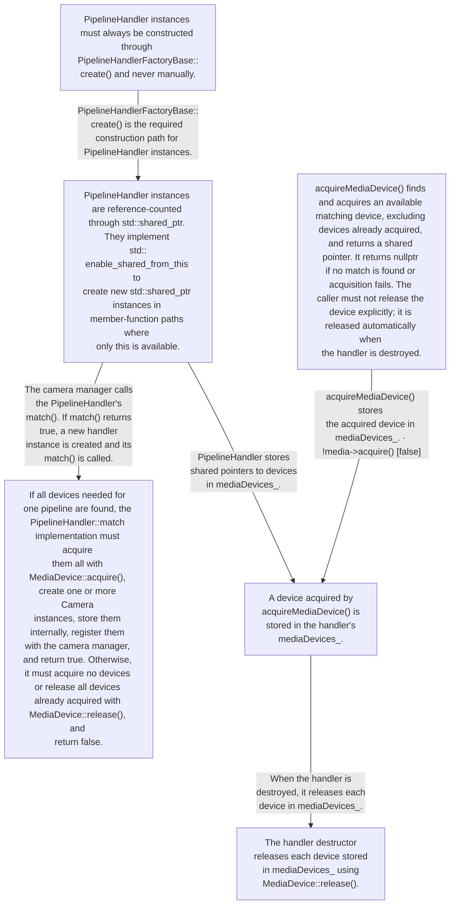

[Mermaid source](https://ttolsun.github.io/libcamera-sdd/en/pipeline-handler.handler-device-ownership.mmd)

<details open>
<summary>Diagram evidence and verification scope</summary>

How are factory creation, reference lifetime, and the match contract connected, and where is the device acquired through acquireMediaDevice stored and how is it released when the handler is destroyed? See the separate diagram for the locking conditions for acquire and release.

Source-linked interpretation · automatic link check only · meaning and device execution not yet verified

LLM diagram draft · before human review

Authoring model: `cli/codex/gpt-6.1-terra`

| Elements and transitions | Source evidence |
| --- | --- |
| PipelineHandler instances must always be constructed through PipelineHandlerFactoryBase::create() and never manually. | [src/libcamera/pipeline_handler.cpp:50](#d6-source-69bfa9568cf8b5c5) |
| PipelineHandler instances are reference-counted through std::shared_ptr. They implement std::enable_shared_from_this to create new std::shared_ptr instances in member-function paths where only this is available. | [src/libcamera/pipeline_handler.cpp:50](#d6-source-69bfa9568cf8b5c5) |
| If all devices needed for one pipeline are found, the PipelineHandler::match implementation must acquire them all with MediaDevice::acquire(), create one or more Camera instances, store them internally, register them with the camera manager, and return true. Otherwise, it must acquire no devices or release all devices already acquired with MediaDevice::release(), and return false. | [src/libcamera/pipeline_handler.cpp:50](#d6-source-69bfa9568cf8b5c5) |
| acquireMediaDevice() finds and acquires an available matching device, excluding devices already acquired, and returns a shared pointer. It returns nullptr if no match is found or acquisition fails. The caller must not release the device explicitly; it is released automatically when the handler is destroyed. | [src/libcamera/pipeline_handler.cpp:119](#d6-source-a3caf1625bc18d64) |
| A device acquired by acquireMediaDevice() is stored in the handler's mediaDevices\_. | [src/libcamera/pipeline_handler.cpp:119](#d6-source-a3caf1625bc18d64) · [src/libcamera/pipeline_handler.cpp:50](#d6-source-69bfa9568cf8b5c5) |
| The handler destructor releases each device stored in mediaDevices\_ using MediaDevice::release(). | [src/libcamera/pipeline_handler.cpp:50](#d6-source-69bfa9568cf8b5c5) |
| PipelineHandlerFactoryBase::create() is the required construction path for PipelineHandler instances. | [src/libcamera/pipeline_handler.cpp:50](#d6-source-69bfa9568cf8b5c5) |
| The camera manager calls the PipelineHandler's match(). If match() returns true, a new handler instance is created and its match() is called. | [src/libcamera/pipeline_handler.cpp:50](#d6-source-69bfa9568cf8b5c5) |
| PipelineHandler stores shared pointers to devices in mediaDevices\_. | [src/libcamera/pipeline_handler.cpp:50](#d6-source-69bfa9568cf8b5c5) |
| acquireMediaDevice() stores the acquired device in mediaDevices\_. · !media-\>acquire() \[false\] | [src/libcamera/pipeline_handler.cpp:119](#d6-source-a3caf1625bc18d64) |
| When the handler is destroyed, it releases each device in mediaDevices\_. | [src/libcamera/pipeline_handler.cpp:50](#d6-source-69bfa9568cf8b5c5) |

</details>

### Locking conditions and release order for acquisition and return

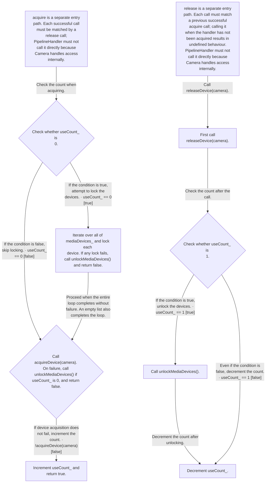

[Mermaid source](https://ttolsun.github.io/libcamera-sdd/en/pipeline-handler.acquire-release-locks.mmd)

<details open>
<summary>Diagram evidence and verification scope</summary>

Treat acquire and release as separate entry paths, and distinguish the useCount\_ conditions, failure returns, and the order of releaseDevice, conditional unlocking, and decrementing.

Source-linked interpretation · automatic link check only · meaning and device execution not yet verified

LLM diagram draft · before human review

Authoring model: `cli/codex/gpt-6.1-terra`

| Elements and transitions | Source evidence |
| --- | --- |
| acquire is a separate entry path. Each successful call must be matched by a release call; PipelineHandler must not call it directly because Camera handles access internally. | [src/libcamera/pipeline_handler.cpp:119](#d6-source-a3caf1625bc18d64) |
| Check whether useCount\_ is 0. | [src/libcamera/pipeline_handler.cpp:119](#d6-source-a3caf1625bc18d64) |
| Iterate over all of mediaDevices\_ and lock each device. If any lock fails, call unlockMediaDevices() and return false. | [src/libcamera/pipeline_handler.cpp:119](#d6-source-a3caf1625bc18d64) |
| Call acquireDevice(camera). On failure, call unlockMediaDevices() if useCount\_ is 0, and return false. | [src/libcamera/pipeline_handler.cpp:119](#d6-source-a3caf1625bc18d64) |
| Increment useCount\_ and return true. | [src/libcamera/pipeline_handler.cpp:119](#d6-source-a3caf1625bc18d64) |
| release is a separate entry path. Each call must match a previous successful acquire call; calling it when the handler has not been acquired results in undefined behaviour. PipelineHandler must not call it directly because Camera handles access internally. | [src/libcamera/pipeline_handler.cpp:119](#d6-source-a3caf1625bc18d64) |
| First call releaseDevice(camera). | [src/libcamera/pipeline_handler.cpp:119](#d6-source-a3caf1625bc18d64) |
| Check whether useCount\_ is 1. | [src/libcamera/pipeline_handler.cpp:119](#d6-source-a3caf1625bc18d64) |
| Call unlockMediaDevices(). | [src/libcamera/pipeline_handler.cpp:119](#d6-source-a3caf1625bc18d64) |
| Decrement useCount\_. | [src/libcamera/pipeline_handler.cpp:119](#d6-source-a3caf1625bc18d64) |
| Check the count when acquiring. | [src/libcamera/pipeline_handler.cpp:119](#d6-source-a3caf1625bc18d64) |
| If the condition is true, attempt to lock the devices. · useCount\_ == 0 \[true\] | [src/libcamera/pipeline_handler.cpp:119](#d6-source-a3caf1625bc18d64) |
| If the condition is false, skip locking. · useCount\_ == 0 \[false\] | [src/libcamera/pipeline_handler.cpp:119](#d6-source-a3caf1625bc18d64) |
| Proceed when the entire loop completes without failure. An empty list also completes the loop. | [src/libcamera/pipeline_handler.cpp:119](#d6-source-a3caf1625bc18d64) |
| If device acquisition does not fail, increment the count. · !acquireDevice(camera) \[false\] | [src/libcamera/pipeline_handler.cpp:119](#d6-source-a3caf1625bc18d64) |
| Call releaseDevice(camera). | [src/libcamera/pipeline_handler.cpp:119](#d6-source-a3caf1625bc18d64) |
| Check the count after the call. | [src/libcamera/pipeline_handler.cpp:119](#d6-source-a3caf1625bc18d64) |
| If the condition is true, unlock the devices. · useCount\_ == 1 \[true\] | [src/libcamera/pipeline_handler.cpp:119](#d6-source-a3caf1625bc18d64) |
| Decrement the count after unlocking. | [src/libcamera/pipeline_handler.cpp:119](#d6-source-a3caf1625bc18d64) |
| Even if the condition is false, decrement the count. · useCount\_ == 1 \[false\] | [src/libcamera/pipeline_handler.cpp:119](#d6-source-a3caf1625bc18d64) |

</details>

acquireMediaDevice() searches for a matching device, excluding previously acquired devices, and stores it in `mediaDevices_` if found and acquired. The caller must not release the device explicitly; the handler destructor calls `MediaDevice::release()`. acquire() locks the media devices only when `useCount_` == 0. If a device lock fails, acquire() unlocks the devices and returns false; if acquireDevice() fails, acquire() unlocks the devices when `useCount_` == 0 and returns false. Every successful acquire() must be paired with a release(). After calling releaseDevice(), release() unlocks the devices if `useCount_` == 1, then decrements the count. Resources shared by multiple cameras must not be released until releaseDevice() has been called for all previously acquired cameras.

<details open>
<summary>Section-wide evidence: 2</summary>

- `src/libcamera/pipeline_handler.cpp`[`L50` excerpt](#d6-source-69bfa9568cf8b5c5) · [Full source `L50`](https://github.com/TTolsun/libcamera-sdd/blob/adfa719f8ed67d18fd8a0739fc088a1f8b9e7252/src/libcamera/pipeline_handler.cpp#L50) · [`L119` excerpt](#d6-source-a3caf1625bc18d64) · [Full source `L119`](https://github.com/TTolsun/libcamera-sdd/blob/adfa719f8ed67d18fd8a0739fc088a1f8b9e7252/src/libcamera/pipeline_handler.cpp#L119)

</details>

## <a id="d6-구성의-입력과-검증-책임"></a>Responsibility for configuration input and validation

The caller of generateConfiguration() must populate roles with a list of stream roles for the use cases for which it wants a default configuration, and may examine the returned configuration to identify the selected streams and their default parameters. If the requested roles can be satisfied, generateConfiguration() returns a valid `CameraConfiguration`; otherwise, generateConfiguration() returns a null pointer. generateConfiguration() may be called from any thread, must be thread-safe, and must not change the camera's state in the pipeline handler.

### The call contract for requesting a default configuration and applying a configuration

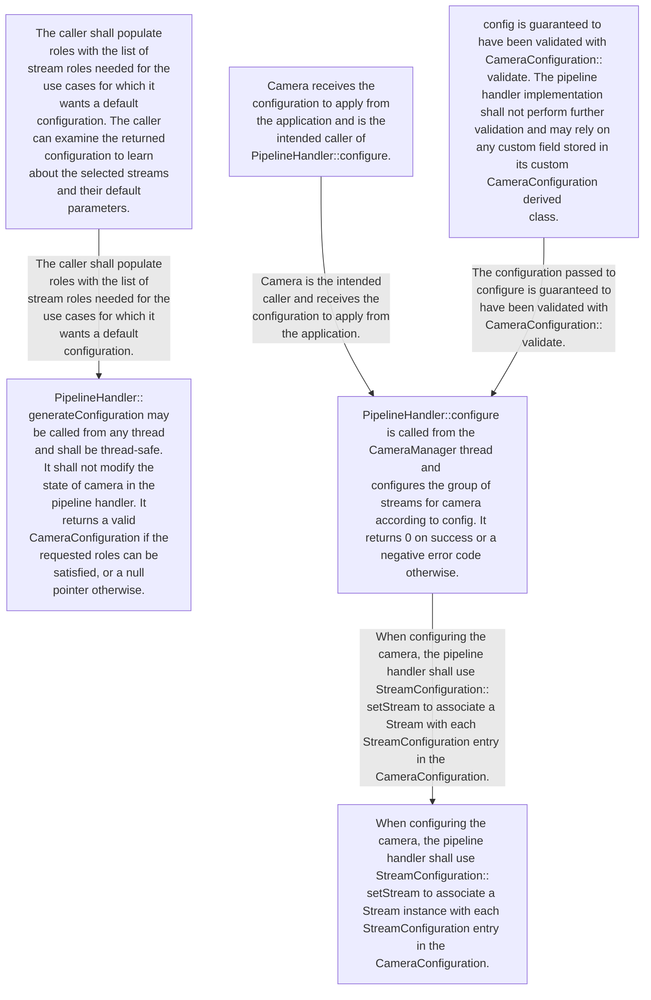

[Mermaid source](https://ttolsun.github.io/libcamera-sdd/en/pipeline-handler.configuration-contracts.mmd)

<details open>
<summary>Diagram evidence and verification scope</summary>

Distinguish the caller requesting a default configuration through roles from the validated configuration passed by Camera, and show each function's calling context, validation, and Stream association obligations.

Source-linked interpretation · automatic link check only · meaning and device execution not yet verified

LLM diagram draft · before human review

Authoring model: `cli/codex/gpt-6.1-terra`

| Elements and transitions | Source evidence |
| --- | --- |
| The caller shall populate roles with the list of stream roles needed for the use cases for which it wants a default configuration. The caller can examine the returned configuration to learn about the selected streams and their default parameters. | [src/libcamera/pipeline_handler.cpp:271](#d6-source-8cd14a802c5b1782) |
| PipelineHandler::generateConfiguration may be called from any thread and shall be thread-safe. It shall not modify the state of camera in the pipeline handler. It returns a valid CameraConfiguration if the requested roles can be satisfied, or a null pointer otherwise. | [src/libcamera/pipeline_handler.cpp:271](#d6-source-8cd14a802c5b1782) |
| Camera receives the configuration to apply from the application and is the intended caller of PipelineHandler::configure. | [src/libcamera/pipeline_handler.cpp:271](#d6-source-8cd14a802c5b1782) |
| config is guaranteed to have been validated with CameraConfiguration::validate. The pipeline handler implementation shall not perform further validation and may rely on any custom field stored in its custom CameraConfiguration derived class. | [src/libcamera/pipeline_handler.cpp:271](#d6-source-8cd14a802c5b1782) |
| PipelineHandler::configure is called from the CameraManager thread and configures the group of streams for camera according to config. It returns 0 on success or a negative error code otherwise. | [src/libcamera/pipeline_handler.cpp:271](#d6-source-8cd14a802c5b1782) |
| When configuring the camera, the pipeline handler shall use StreamConfiguration::setStream to associate a Stream instance with each StreamConfiguration entry in the CameraConfiguration. | [src/libcamera/pipeline_handler.cpp:271](#d6-source-8cd14a802c5b1782) |
| The caller shall populate roles with the list of stream roles needed for the use cases for which it wants a default configuration. | [src/libcamera/pipeline_handler.cpp:271](#d6-source-8cd14a802c5b1782) |
| Camera is the intended caller and receives the configuration to apply from the application. | [src/libcamera/pipeline_handler.cpp:271](#d6-source-8cd14a802c5b1782) |
| The configuration passed to configure is guaranteed to have been validated with CameraConfiguration::validate. | [src/libcamera/pipeline_handler.cpp:271](#d6-source-8cd14a802c5b1782) |
| When configuring the camera, the pipeline handler shall use StreamConfiguration::setStream to associate a Stream with each StreamConfiguration entry in the CameraConfiguration. | [src/libcamera/pipeline_handler.cpp:271](#d6-source-8cd14a802c5b1782) |

</details>

The intended caller of configure() is `Camera`, which receives the configuration to apply from the application. configure() is called on the `CameraManager` thread. The configuration is guaranteed to have been validated by `CameraConfiguration::validate()`, so the pipeline handler implementation must not perform further validation and may rely on custom fields stored in its own `CameraConfiguration` derived class. When configuring the camera, the implementation must use `StreamConfiguration::setStream()` to associate a `Stream` instance with each `StreamConfiguration` entry in the `CameraConfiguration`. configure() returns 0 on success or a negative error code otherwise.

<details open>
<summary>Section-wide evidence: 1</summary>

- `src/libcamera/pipeline_handler.cpp`[`L271` excerpt](#d6-source-8cd14a802c5b1782) · [Full source `L271`](https://github.com/TTolsun/libcamera-sdd/blob/adfa719f8ed67d18fd8a0739fc088a1f8b9e7252/src/libcamera/pipeline_handler.cpp#L271)

</details>

## <a id="d6-정지와-미완료-요청"></a>Stop and incomplete requests

`PipelineHandler::stop` swaps the camera's `waitingRequests_` with an empty local queue to separate the waiting requests. This prevents the waiting requests from being requeued when completeRequest() is called inside stopDevice(). Immediately afterward, it calls the device stop function stopDevice(camera).

### Passing on waiting requests on normal completion and detaching the list on stop

```mermaid
flowchart TB

  v_complete["The pipeline handler must <br/>call completeRequest from <br/>the CameraManager thread to <br/>signal completion. It may <br/>pass completed requests in <br/>any order, and the function <br/>returns them to the <br/>application in submission <br/>order. The request must not <br/>be accessed after the <br/>function returns."]
  v_dispatch["doQueueRequests ends when <br/>the waiting list is empty. <br/>Even when the list is not <br/>empty, it stops the loop if <br/>the size of queuedRequests#95; <br/>equals <br/>maxQueuedRequestsDevice#95; or <br/>the front request is not <br/>prepared."]
  v_queue["On the normal path, the <br/>request is removed from the <br/>waiting list before it is <br/>passed to doQueueRequest. <br/>On the stop path, after <br/>stopDevice returns, a <br/>detached request is marked <br/>cancelled and passed to it."]
  v_stop["stop is called from the <br/>CameraManager thread. Its <br/>contract requires it to <br/>stop capture and request <br/>processing immediately, <br/>cancel unfinished requests, <br/>and complete them <br/>immediately in an error <br/>state."]
  v_stopdevice["The stopDevice implementer <br/>must immediately stop <br/>capture on all running <br/>streams and request <br/>processing, cancel already <br/>submitted unfinished <br/>requests, and complete them <br/>immediately in an error <br/>state. stop handles the <br/>detached waiting requests <br/>after stopDevice returns."]
  v_complete -->|"After handling completions, <br/>completeRequest calls <br/>doQueueRequests to allow <br/>waiting requests to proceed."| v_dispatch
  v_dispatch -->|"If the waiting list is not <br/>empty, the size of <br/>queuedRequests#95; differs <br/>from <br/>maxQueuedRequestsDevice#95;, <br/>and the front request is <br/>prepared, doQueueRequests <br/>removes the request before <br/>calling doQueueRequest in <br/>case of a recursive call. · <br/>#33;request-#62;#95;d#40;#41;-#62;prepared#95; <br/>#91;false#93;"| v_queue
  v_stop -->|"stop separates <br/>waitingRequests#95; into <br/>waitingRequests, then calls <br/>stopDevice. This separation <br/>prevents waiting requests <br/>from being requeued in <br/>response to a <br/>completeRequest call inside <br/>stopDevice."| v_stopdevice
  v_stop -->|"After stopDevice returns, <br/>stop removes each detached <br/>request, marks it <br/>cancelled, and calls <br/>doQueueRequest to preserve <br/>order. This gives each <br/>request a sequence number <br/>and temporarily adds it to <br/>queuedRequests#95; so <br/>completeRequest can <br/>complete it properly."| v_queue
```

[Mermaid source](https://ttolsun.github.io/libcamera-sdd/en/pipeline-handler.normal-dispatch-and-stop.mmd)

<details open>
<summary>Diagram evidence and verification scope</summary>

Distinguish the exact conditions under which doQueueRequests passes on waiting requests or stops during normal completion from the sequence in which stop detaches the waiting list before stopDevice and cancels the requests afterward.

Source-linked interpretation · automatic link check only · meaning and device execution not yet verified

LLM diagram draft · before human review

Authoring model: `cli/codex/gpt-6.1-terra`

| Elements and transitions | Source evidence |
| --- | --- |
| The pipeline handler must call completeRequest from the CameraManager thread to signal completion. It may pass completed requests in any order, and the function returns them to the application in submission order. The request must not be accessed after the function returns. | [src/libcamera/pipeline_handler.cpp:547](#d6-source-01ad7c6605c3296a) |
| doQueueRequests ends when the waiting list is empty. Even when the list is not empty, it stops the loop if the size of queuedRequests\_ equals maxQueuedRequestsDevice\_ or the front request is not prepared. | [src/libcamera/pipeline_handler.cpp:509](#d6-source-d63c9e57bcf862b0) |
| On the normal path, the request is removed from the waiting list before it is passed to doQueueRequest. On the stop path, after stopDevice returns, a detached request is marked cancelled and passed to it. | [src/libcamera/pipeline_handler.cpp:509](#d6-source-d63c9e57bcf862b0) · [src/libcamera/pipeline_handler.cpp:359](#d6-source-eefd1bbecb1aad0a) |
| stop is called from the CameraManager thread. Its contract requires it to stop capture and request processing immediately, cancel unfinished requests, and complete them immediately in an error state. | [src/libcamera/pipeline_handler.cpp:359](#d6-source-eefd1bbecb1aad0a) |
| The stopDevice implementer must immediately stop capture on all running streams and request processing, cancel already submitted unfinished requests, and complete them immediately in an error state. stop handles the detached waiting requests after stopDevice returns. | [src/libcamera/pipeline_handler.cpp:359](#d6-source-eefd1bbecb1aad0a) |
| After handling completions, completeRequest calls doQueueRequests to allow waiting requests to proceed. | [src/libcamera/pipeline_handler.cpp:547](#d6-source-01ad7c6605c3296a) |
| If the waiting list is not empty, the size of queuedRequests\_ differs from maxQueuedRequestsDevice\_, and the front request is prepared, doQueueRequests removes the request before calling doQueueRequest in case of a recursive call. · !request-\>\_d()-\>prepared\_ \[false\] | [src/libcamera/pipeline_handler.cpp:509](#d6-source-d63c9e57bcf862b0) |
| stop separates waitingRequests\_ into waitingRequests, then calls stopDevice. This separation prevents waiting requests from being requeued in response to a completeRequest call inside stopDevice. | [src/libcamera/pipeline_handler.cpp:359](#d6-source-eefd1bbecb1aad0a) |
| After stopDevice returns, stop removes each detached request, marks it cancelled, and calls doQueueRequest to preserve order. This gives each request a sequence number and temporarily adds it to queuedRequests\_ so completeRequest can complete it properly. | [src/libcamera/pipeline_handler.cpp:359](#d6-source-eefd1bbecb1aad0a) |

</details>

When stopDevice returns, stop removes the detached waiting requests one at a time from the front of the queue, marks them as cancelled, and processes them through doQueueRequest. In this process, each request is assigned a sequence number, temporarily added to `queuedRequests_`, and completed by completeRequest. The stopDevice implementer must immediately stop capture from all running streams and request processing, and must cancel unfinished requests already submitted to the device and immediately complete them in an error state. After stopDevice returns, stop cancels and completes the waiting requests from `waitingRequests_` that stop detached beforehand, in order.

At the end of stop, ASSERT checks that `queuedRequests_` and `waitingRequests_` are each empty. It then initializes `requestSequence_` to 0. On normal completion, completeRequest calls doQueueRequests at the end. While `waitingRequests_` is not empty, doQueueRequests stops the loop if `queuedRequests_`.size() == `maxQueuedRequestsDevice_` or if the leading request's `prepared_` is false; otherwise, doQueueRequests removes the leading request and passes it to doQueueRequest. During stopping, stop detaches `waitingRequests_` before calling stopDevice, so the original waiting requests are not resubmitted even if doQueueRequests is reentered during completion handling inside stopDevice.

<details open>
<summary>Section-wide evidence: 3</summary>

- `src/libcamera/pipeline_handler.cpp`[`L359` excerpt](#d6-source-eefd1bbecb1aad0a) · [Full source `L359`](https://github.com/TTolsun/libcamera-sdd/blob/adfa719f8ed67d18fd8a0739fc088a1f8b9e7252/src/libcamera/pipeline_handler.cpp#L359) · [`L547` excerpt](#d6-source-01ad7c6605c3296a) · [Full source `L547`](https://github.com/TTolsun/libcamera-sdd/blob/adfa719f8ed67d18fd8a0739fc088a1f8b9e7252/src/libcamera/pipeline_handler.cpp#L547) · [`L509` excerpt](#d6-source-d63c9e57bcf862b0) · [Full source `L509`](https://github.com/TTolsun/libcamera-sdd/blob/adfa719f8ed67d18fd8a0739fc088a1f8b9e7252/src/libcamera/pipeline_handler.cpp#L509)

</details>

## <a id="d6-ipu3-입력-크기-탐색의-경계"></a>Boundaries of IPU3 Input Size Search

minIfWidth is calculated as std::max(in.width - `ImgUDevice::kIFMaxCropWidth`, `ImgUDevice::kIFMaxCropWidth`). minIfHeight is calculated as std::max(in.height - `ImgUDevice::kIFMaxCropHeight`, `ImgUDevice::kIFMaxCropHeight`).

### The nested structure of the two searches and the separate height subtraction expression

```mermaid
flowchart TB

  v_first_width["The first search#39;s outer <br/>loop runs while ifWidth is <br/>at least minIfWidth. After <br/>each inner loop finishes, <br/>it subtracts <br/>ImgUDevice::kIFAlignWidth <br/>from ifWidth and does not <br/>reset the inner ifHeight."]
  v_first_height["The first search#39;s inner <br/>loop runs while ifHeight is <br/>at least minIfHeight and <br/>subtracts <br/>ImgUDevice::kIFAlignHeight <br/>from ifHeight on each <br/>iteration."]
  v_bounds["The unsigned int bound <br/>minIfWidth is calculated <br/>with std::max#40;in.width - <br/>ImgUDevice::<br/>kIFMaxCropWidth, <br/>ImgUDevice::<br/>kIFMaxCropWidth#41;, and <br/>minIfHeight with <br/>std::max#40;in.height - <br/>ImgUDevice::<br/>kIFMaxCropHeight, <br/>ImgUDevice::<br/>kIFMaxCropHeight#41;. The loop <br/>conditions compare the <br/>unsigned variables with <br/>these bounds. The comment <br/>explains that <br/>calculateBDSHeight crops up <br/>to kIFMaxCropHeight lines <br/>from the height, so going <br/>below that makes the <br/>minimum input formatter <br/>height wrap."]
  v_reset["After the entire first <br/>search finishes and before <br/>the second search, ifWidth <br/>and ifHeight are restored <br/>to utils::alignUp#40;in.width, <br/>ImgUDevice::kIFAlignWidth#41; <br/>and <br/>utils::alignUp#40;in.height, <br/>ImgUDevice::<br/>kIFAlignHeight#41;, <br/>respectively."]
  v_second_height["The second search#39;s outer <br/>loop runs while ifHeight is <br/>at least minIfHeight. After <br/>each inner loop finishes, <br/>it subtracts <br/>ImgUDevice::kIFAlignHeight <br/>from ifHeight and does not <br/>reset the inner ifWidth."]
  v_second_width["The second search#39;s inner <br/>loop runs while ifWidth is <br/>at least minIfWidth and <br/>subtracts <br/>ImgUDevice::kIFAlignWidth <br/>from ifWidth on each <br/>iteration. The source marks <br/>this procedure as probably <br/>broken."]
  v_input_height["The separate height <br/>calculation function uses <br/>iif.height."]
  v_minimum_height["In the separate function <br/>calculateBDSHeight, the <br/>minimum input formatter <br/>height minIFHeight is an <br/>unsigned int calculated by <br/>subtracting <br/>ImgUDevice::<br/>kIFMaxCropHeight from <br/>iif.height. If iif.height <br/>is smaller than that <br/>constant, the unsigned <br/>subtraction wraps."]
  v_first_width -->|"In the first search, the <br/>ifHeight loop is nested <br/>inside the ifWidth loop."| v_first_height
  v_first_width -->|"Both variables are restored <br/>only after the first <br/>search#39;s outer ifWidth loop <br/>and its nested ifHeight <br/>loop have both finished."| v_reset
  v_reset -->|"The second search#39;s <br/>ifHeight loop follows the <br/>restoration of both <br/>variables."| v_second_height
  v_second_height -->|"In the second search, the <br/>ifWidth loop is nested <br/>inside the ifHeight loop."| v_second_width
  v_input_height -->|"The separate height <br/>calculation uses iif.height <br/>to calculate minIFHeight."| v_minimum_height
```

[Mermaid source](https://ttolsun.github.io/libcamera-sdd/en/pipeline-handler.input-search-loops.mmd)

<details open>
<summary>Diagram evidence and verification scope</summary>

In each of the two searches, where are the outer and inner loop variables decremented, respectively, and how is reinitialization before the second search distinguished from the unsigned height subtraction expression?

Source-linked interpretation · automatic link check only · meaning and device execution not yet verified

LLM diagram draft · before human review

Authoring model: `cli/codex/gpt-6.1-terra`

| Elements and transitions | Source evidence |
| --- | --- |
| The first search's outer loop runs while ifWidth is at least minIfWidth. After each inner loop finishes, it subtracts ImgUDevice::kIFAlignWidth from ifWidth and does not reset the inner ifHeight. | [src/libcamera/pipeline/ipu3/imgu.cpp:407](#d6-source-2494b74f28e1b200) |
| The first search's inner loop runs while ifHeight is at least minIfHeight and subtracts ImgUDevice::kIFAlignHeight from ifHeight on each iteration. | [src/libcamera/pipeline/ipu3/imgu.cpp:407](#d6-source-2494b74f28e1b200) |
| The unsigned int bound minIfWidth is calculated with std::max(in.width - ImgUDevice::kIFMaxCropWidth, ImgUDevice::kIFMaxCropWidth), and minIfHeight with std::max(in.height - ImgUDevice::kIFMaxCropHeight, ImgUDevice::kIFMaxCropHeight). The loop conditions compare the unsigned variables with these bounds. The comment explains that calculateBDSHeight crops up to kIFMaxCropHeight lines from the height, so going below that makes the minimum input formatter height wrap. | [src/libcamera/pipeline/ipu3/imgu.cpp:407](#d6-source-2494b74f28e1b200) |
| After the entire first search finishes and before the second search, ifWidth and ifHeight are restored to utils::alignUp(in.width, ImgUDevice::kIFAlignWidth) and utils::alignUp(in.height, ImgUDevice::kIFAlignHeight), respectively. | [src/libcamera/pipeline/ipu3/imgu.cpp:407](#d6-source-2494b74f28e1b200) |
| The second search's outer loop runs while ifHeight is at least minIfHeight. After each inner loop finishes, it subtracts ImgUDevice::kIFAlignHeight from ifHeight and does not reset the inner ifWidth. | [src/libcamera/pipeline/ipu3/imgu.cpp:407](#d6-source-2494b74f28e1b200) |
| The second search's inner loop runs while ifWidth is at least minIfWidth and subtracts ImgUDevice::kIFAlignWidth from ifWidth on each iteration. The source marks this procedure as probably broken. | [src/libcamera/pipeline/ipu3/imgu.cpp:407](#d6-source-2494b74f28e1b200) |
| The separate height calculation function uses iif.height. | [src/libcamera/pipeline/ipu3/imgu.cpp:111](#d6-source-e95802b61093a795) · [src/libcamera/pipeline/ipu3/imgu.cpp:407](#d6-source-2494b74f28e1b200) |
| In the separate function calculateBDSHeight, the minimum input formatter height minIFHeight is an unsigned int calculated by subtracting ImgUDevice::kIFMaxCropHeight from iif.height. If iif.height is smaller than that constant, the unsigned subtraction wraps. | [src/libcamera/pipeline/ipu3/imgu.cpp:407](#d6-source-2494b74f28e1b200) · [src/libcamera/pipeline/ipu3/imgu.cpp:111](#d6-source-e95802b61093a795) |
| In the first search, the ifHeight loop is nested inside the ifWidth loop. | [src/libcamera/pipeline/ipu3/imgu.cpp:407](#d6-source-2494b74f28e1b200) |
| Both variables are restored only after the first search's outer ifWidth loop and its nested ifHeight loop have both finished. | [src/libcamera/pipeline/ipu3/imgu.cpp:407](#d6-source-2494b74f28e1b200) |
| The second search's ifHeight loop follows the restoration of both variables. | [src/libcamera/pipeline/ipu3/imgu.cpp:407](#d6-source-2494b74f28e1b200) |
| In the second search, the ifWidth loop is nested inside the ifHeight loop. | [src/libcamera/pipeline/ipu3/imgu.cpp:407](#d6-source-2494b74f28e1b200) |
| The separate height calculation uses iif.height to calculate minIFHeight. | [src/libcamera/pipeline/ipu3/imgu.cpp:111](#d6-source-e95802b61093a795) |

</details>

The first search iterates over the input formatter width in the outer loop and height in the inner loop, while the second search iterates over height in the outer loop and width in the inner loop, continuing while the width and height are at least minIfWidth and minIfHeight, respectively. In the first search, the inner height is decreased by kIFAlignHeight and the outer width by kIFAlignWidth; in the second search, the inner width is decreased by kIFAlignWidth and the outer height by kIFAlignHeight. Both values are reinitialized using alignUp before the second search, and the inner variable is not reinitialized on each outer iteration. The comment in the search section explains that calculateBDSHeight crops up to kIFMaxCropHeight lines from the input formatter height, so the height should not go below that; in unsigned int minIFHeight = iif.height - `ImgUDevice::kIFMaxCropHeight`;, the minimum value wraps if iif.height is less than kIFMaxCropHeight.

<details open>
<summary>Section-wide evidence: 2</summary>

- `src/libcamera/pipeline/ipu3/imgu.cpp`[`L407` excerpt](#d6-source-2494b74f28e1b200) · [Full source `L407`](https://github.com/TTolsun/libcamera-sdd/blob/adfa719f8ed67d18fd8a0739fc088a1f8b9e7252/src/libcamera/pipeline/ipu3/imgu.cpp#L407) · [`L111` excerpt](#d6-source-e95802b61093a795) · [Full source `L111`](https://github.com/TTolsun/libcamera-sdd/blob/adfa719f8ed67d18fd8a0739fc088a1f8b9e7252/src/libcamera/pipeline/ipu3/imgu.cpp#L111)

</details>

## Class relationships

Arrow labels show the extracted relationship, and dashed lines indicate inheritance. Arrows point to the referenced target or base class. They do not indicate call order.

```mermaid
flowchart LR
  c0["Object"]:::context
  c1["PipelineHandler"]
  c2["PipelineHandlerFactory"]
  c3["PipelineHandlerFactoryBase"]
  c4["PipelineHandlerIPU3"]
  c5["PipelineHandlerIPU3::IPU3PipeModes"]
  c6["PipelineHandlerISI"]
  c7["PipelineHandlerISI::Pipe"]
  c8["PipelineHandlerMaliC55"]
  c9["PipelineHandlerMaliC55::#40;unnamed enum at src/libcamera/pipeline/mali-c55/mali-c55.cpp:712:2#41;"]
  c10["PipelineHandlerMaliC55::MaliC55Pipe"]
  c11["PipelineHandlerPiSP"]
  c12["PipelineHandlerRkISP1"]
  c13["PipelineHandlerUVC"]
  c14["PipelineHandlerVc4"]
  c15["PipelineHandlerVimc"]
  c16["PipelineHandlerVirtual"]
  c17["RPi::PipelineHandlerBase"]:::context
  c1 -.->|inheritance| c0
  c2 -.->|inheritance| c3
  c4 -.->|inheritance| c1
  c6 -.->|inheritance| c1
  c6 -->|field reference| c7
  c8 -.->|inheritance| c1
  c8 -->|field reference| c10
  c11 -.->|inheritance| c17
  c12 -.->|inheritance| c1
  c13 -.->|inheritance| c1
  c14 -.->|inheritance| c17
  c15 -.->|inheritance| c1
  c16 -.->|inheritance| c1
  classDef context fill:#fafafa,stroke:#aaa,stroke-dasharray:4 3,color:#555
```

## Source evidence

<details open>
<summary>Source excerpts: 8</summary>

Include each excerpt only once. Expand the needed original text and check it against the explanation.

<a id="d6-source-69bfa9568cf8b5c5"></a>

<details open>
<summary>Source evidence: src/libcamera/pipeline_handler.cpp:50</summary>

Excerpt range: [`src/libcamera/pipeline_handler.cpp:50`](https://github.com/TTolsun/libcamera-sdd/blob/adfa719f8ed67d18fd8a0739fc088a1f8b9e7252/src/libcamera/pipeline_handler.cpp#L50) to `119`

SHA-256: `e05278df0a06cb963fe79f772e62d4560b62df15c1411a6b49e32f7ca84d9e74`

```
\class PipelineHandler
 * \brief Create and manage cameras based on a set of media devices
 *
 * The PipelineHandler matches the media devices provided by a DeviceEnumerator
 * with the pipelines it supports and creates corresponding Camera devices.
 *
 * Pipeline handler instances are reference-counted through std::shared_ptr<>.
 * They implement std::enable_shared_from_this<> in order to create new
 * std::shared_ptr<> in code paths originating from member functions of the
 * PipelineHandler class where only the 'this' pointer is available.
 */

/**
 * \brief Construct a PipelineHandler instance
 * \param[in] manager The camera manager
 * \param[in] maxQueuedRequestsDevice The maximum number of requests queued to
 * the device
 *
 * In order to honour the std::enable_shared_from_this<> contract,
 * PipelineHandler instances shall never be constructed manually, but always
 * through the PipelineHandlerFactoryBase::create() function.
 */
PipelineHandler::PipelineHandler(CameraManager *manager,
                 unsigned int maxQueuedRequestsDevice)
    : manager_(manager), maxQueuedRequestsDevice_(maxQueuedRequestsDevice),
      useCount_(0)
{
}

PipelineHandler::~PipelineHandler()
{
    for (std::shared_ptr<MediaDevice> &media : mediaDevices_)
        media->release();
}

/**
 * \fn PipelineHandler::match(DeviceEnumerator *enumerator)
 * \brief Match media devices and create camera instances
 * \param[in] enumerator The enumerator providing all media devices found in the
 * system
 *
 * This function is the main entry point of the pipeline handler. It is called
 * by the camera manager with the \a enumerator passed as an argument. It shall
 * acquire from the \a enumerator all the media devices it needs for a single
 * pipeline, create one or multiple Camera instances and register them with the
 * camera manager.
 *
 * If all media devices needed by the pipeline handler are found, they must all
 * be acquired by a call to MediaDevice::acquire(). This function shall then
 * create the corresponding Camera instances, store them internally, and return
 * true. Otherwise it shall not acquire any media device (or shall release all
 * the media devices is has acquired by calling MediaDevice::release()) and
 * return false.
 *
 * If multiple instances of a pipeline are available in the system, the
 * PipelineHandler class will be instantiated once per instance, and its match()
 * function called for every instance. Each call shall acquire media devices for
 * one pipeline instance, until all compatible media devices are exhausted.
 *
 * If this function returns true, a new instance of the pipeline handler will
 * be created and its match() function called.
 *
 * \context This function is called from the CameraManager thread.
 *
 * \return true if media devices have been acquired and camera instances
 * created, or false otherwise
 */

/**
 * \brief Search and acquire a MediaDevice
```

</details>

<a id="d6-source-a3caf1625bc18d64"></a>

<details open>
<summary>Source evidence: src/libcamera/pipeline_handler.cpp:119</summary>

Excerpt range: [`src/libcamera/pipeline_handler.cpp:119`](https://github.com/TTolsun/libcamera-sdd/blob/adfa719f8ed67d18fd8a0739fc088a1f8b9e7252/src/libcamera/pipeline_handler.cpp#L119) to `271`

SHA-256: `379b17c52a1e97055bf78aaabd964595fb3ec506c568d112e552ed1c29235591`

```
\brief Search and acquire a MediaDevice matching a device pattern
 * \param[in] enumerator Enumerator containing all media devices in the system
 * \param[in] dm Device match pattern
 *
 * Search the device \a enumerator for an available media device matching the
 * device match pattern \a dm. Matching media device that have previously been
 * acquired by MediaDevice::acquire() are not considered. If a match is found,
 * the media device is acquired and returned. The caller shall not release the
 * device explicitly, it will be automatically released when the pipeline
 * handler is destroyed.
 *
 * \context This function shall be called from the CameraManager thread.
 *
 * \return A shared pointer to the matching MediaDevice, or nullptr if no match
 * is found
 */
std::shared_ptr<MediaDevice>
PipelineHandler::acquireMediaDevice(DeviceEnumerator *enumerator,
                    const DeviceMatch &dm)
{
    std::shared_ptr<MediaDevice> media = enumerator->search(dm);
    if (!media)
        return nullptr;

    if (!media->acquire())
        return nullptr;

    mediaDevices_.push_back(media);

    return media;
}

/**
 * \brief Acquire exclusive access to the pipeline handler for the process
 *
 * This function locks all the media devices used by the pipeline to ensure
 * that no other process can access them concurrently.
 *
 * Access to a pipeline handler may be acquired recursively from within the
 * same process. Every successful acquire() call shall be matched with a
 * release() call. This allows concurrent access to the same pipeline handler
 * from different cameras within the same process.
 *
 * Pipeline handlers shall not call this function directly as the Camera class
 * handles access internally.
 *
 * \context This function is called from the CameraManager thread.
 *
 * \return True if the pipeline handler was acquired, false if another process
 * has already acquired it
 * \sa release()
 */
bool PipelineHandler::acquire(Camera *camera)
{
    if (useCount_ == 0) {
        for (std::shared_ptr<MediaDevice> &media : mediaDevices_) {
            if (!media->lock()) {
                unlockMediaDevices();
                return false;
            }
        }
    }

    if (!acquireDevice(camera)) {
        if (useCount_ == 0)
            unlockMediaDevices();

        return false;
    }

    ++useCount_;
    return true;
}

/**
 * \brief Release exclusive access to the pipeline handler
 * \param[in] camera The camera for which to release data
 *
 * This function releases access to the pipeline handler previously acquired by
 * a call to acquire(). Every release() call shall match a previous successful
 * acquire() call. Calling this function on a pipeline handler that hasn't been
 * acquired results in undefined behaviour.
 *
 * Pipeline handlers shall not call this function directly as the Camera class
 * handles access internally.
 *
 * \context This function is called from the CameraManager thread.
 *
 * \sa acquire()
 */
void PipelineHandler::release(Camera *camera)
{
    ASSERT(useCount_);

    releaseDevice(camera);

    if (useCount_ == 1)
        unlockMediaDevices();

    --useCount_;
}

/**
 * \brief Acquire resources associated with this camera
 * \param[in] camera The camera for which to acquire resources
 *
 * Pipeline handlers may override this in order to get resources such as opening
 * devices and allocating buffers when a camera is acquired.
 *
 * This is used by the uvcvideo pipeline handler to delay opening /dev/video#
 * until the camera is acquired to avoid excess power consumption. The delayed
 * opening of /dev/video# is a special case because the kernel uvcvideo driver
 * powers on the USB device as soon as /dev/video# is opened. This behavior
 * should *not* be copied by other pipeline handlers.
 *
 * \context This function is called from the CameraManager thread.
 *
 * \return True on success, false on failure
 * \sa releaseDevice()
 */
bool PipelineHandler::acquireDevice([[maybe_unused]] Camera *camera)
{
    return true;
}

/**
 * \brief Release resources associated with this camera
 * \param[in] camera The camera for which to release resources
 *
 * Pipeline handlers may override this in order to perform cleanup operations
 * when a camera is released, such as freeing memory.
 *
 * This is called once for every camera that is released. If there are resources
 * shared by multiple cameras then the pipeline handler must take care to not
 * release them until releaseDevice() has been called for all previously
 * acquired cameras.
 *
 * \context This function is called from the CameraManager thread.
 *
 * \sa acquireDevice()
 */
void PipelineHandler::releaseDevice([[maybe_unused]] Camera *camera)
{
}

void PipelineHandler::unlockMediaDevices()
{
    for (std::shared_ptr<MediaDevice> &media : mediaDevices_)
        media->unlock();
}

/**
 * \fn PipelineHandler::generateConfiguration()
```

</details>

<a id="d6-source-8cd14a802c5b1782"></a>

<details open>
<summary>Source evidence: src/libcamera/pipeline_handler.cpp:271</summary>

Excerpt range: [`src/libcamera/pipeline_handler.cpp:271`](https://github.com/TTolsun/libcamera-sdd/blob/adfa719f8ed67d18fd8a0739fc088a1f8b9e7252/src/libcamera/pipeline_handler.cpp#L271) to `315`

SHA-256: `56e3a59872a70fc01b1bfdea1601201880929f47ae90d7888c2cf4c080085ea6`

```
\fn PipelineHandler::generateConfiguration()
 * \brief Generate a camera configuration for a specified camera
 * \param[in] camera The camera to generate a default configuration for
 * \param[in] roles A list of stream roles
 *
 * Generate a default configuration for the \a camera for a specified list of
 * stream roles. The caller shall populate the \a roles with the use-cases it
 * wishes to fetch the default configuration for. The returned configuration
 * can then be examined by the caller to learn about the selected streams and
 * their default parameters.
 *
 * The intended companion to this is \a configure() which can be used to change
 * the group of streams parameters.
 *
 * \context This function may be called from any thread and shall be
 * \threadsafe. It shall not modify the state of the \a camera in the pipeline
 * handler.
 *
 * \return A valid CameraConfiguration if the requested roles can be satisfied,
 * or a null pointer otherwise.
 */

/**
 * \fn PipelineHandler::configure()
 * \brief Configure a group of streams for capture
 * \param[in] camera The camera to configure
 * \param[in] config The camera configurations to setup
 *
 * Configure the specified group of streams for \a camera according to the
 * configuration specified in \a config. The intended caller of this interface
 * is the Camera class which will receive configuration to apply from the
 * application.
 *
 * The configuration is guaranteed to have been validated with
 * CameraConfiguration::validate(). The pipeline handler implementation shall
 * not perform further validation and may rely on any custom field stored in its
 * custom CameraConfiguration derived class.
 *
 * When configuring the camera the pipeline handler shall associate a Stream
 * instance to each StreamConfiguration entry in the CameraConfiguration using
 * the StreamConfiguration::setStream() function.
 *
 * \context This function is called from the CameraManager thread.
 *
 * \return 0 on success or a negative error code otherwise
```

</details>

<a id="d6-source-eefd1bbecb1aad0a"></a>

<details open>
<summary>Source evidence: src/libcamera/pipeline_handler.cpp:359</summary>

Excerpt range: [`src/libcamera/pipeline_handler.cpp:359`](https://github.com/TTolsun/libcamera-sdd/blob/adfa719f8ed67d18fd8a0739fc088a1f8b9e7252/src/libcamera/pipeline_handler.cpp#L359) to `414`

SHA-256: `108b1bea5a8314ba57213d15c1e3ba01abe2b3f8a9e0e1e1281864b5492c7304`

```
\brief Stop capturing from all running streams and cancel pending requests
 * \param[in] camera The camera to stop
 *
 * This function stops capturing and processing requests immediately. All
 * pending requests are cancelled and complete immediately in an error state.
 *
 * \context This function is called from the CameraManager thread.
 */
void PipelineHandler::stop(Camera *camera)
{
    /*
     * Take all waiting requests so that they are not requeued in response
     * to completeRequest() being called inside stopDevice(). Cancel them
     * after the device to keep them in order.
     */
    Camera::Private *data = camera->_d();
    std::queue<Request *> waitingRequests;
    waitingRequests.swap(data->waitingRequests_);

    /* Stop the pipeline handler and let the queued requests complete. */
    stopDevice(camera);

    /* Cancel and signal as complete all waiting requests. */
    while (!waitingRequests.empty()) {
        Request *request = waitingRequests.front();
        waitingRequests.pop();

        /*
         * Cancel all requests by marking them as cancelled and calling
         * doQueueRequest() instead of cancelRequest(). This ensures
         * that the requests get a sequence number and are temporarily
         * added to queuedRequests_ so they can be properly completed in
         * completeRequest().
         */
        request->_d()->cancel();
        doQueueRequest(request);
    }

    /* Make sure no requests are pending. */
    ASSERT(data->queuedRequests_.empty());
    ASSERT(data->waitingRequests_.empty());

    data->requestSequence_ = 0;
}

/**
 * \fn PipelineHandler::stopDevice()
 * \brief Stop capturing from all running streams
 * \param[in] camera The camera to stop
 *
 * This function stops capturing and processing requests immediately. All
 * pending requests are cancelled and complete immediately in an error state.
 */

/**
 * \brief Determine if the camera has any requests pending
```

</details>

<a id="d6-source-01ad7c6605c3296a"></a>

<details open>
<summary>Source evidence: src/libcamera/pipeline_handler.cpp:547</summary>

Excerpt range: [`src/libcamera/pipeline_handler.cpp:547`](https://github.com/TTolsun/libcamera-sdd/blob/adfa719f8ed67d18fd8a0739fc088a1f8b9e7252/src/libcamera/pipeline_handler.cpp#L547) to `620`

SHA-256: `514288cc958de9ff5fd19d46393cec3bb3088f4f08486528d4559071138638c9`

```
\brief Complete a buffer for a request
 * \param[in] request The request the buffer belongs to
 * \param[in] buffer The buffer that has completed
 *
 * This function shall be called by pipeline handlers to signal completion of
 * the \a buffer part of the \a request. It notifies applications of buffer
 * completion and updates the request's internal buffer tracking. The request
 * is not completed automatically when the last buffer completes to give
 * pipeline handlers a chance to perform any operation that may still be
 * needed. They shall complete requests explicitly with completeRequest().
 *
 * \context This function shall be called from the CameraManager thread.
 *
 * \return True if all buffers contained in the request have completed, false
 * otherwise
 */
bool PipelineHandler::completeBuffer(Request *request, FrameBuffer *buffer)
{
    Camera *camera = request->_d()->camera();
    camera->bufferCompleted.emit(request, buffer);
    return request->_d()->completeBuffer(buffer);
}

/**
 * \brief Signal request completion
 * \param[in] request The request that has completed
 *
 * The pipeline handler shall call this function to notify the \a camera that
 * the request has completed. The request is no longer managed by the pipeline
 * handler and shall not be accessed once this function returns.
 *
 * This function ensures that requests will be returned to the application in
 * submission order, the pipeline handler may call it on any complete request
 * without any ordering constraint.
 *
 * \context This function shall be called from the CameraManager thread.
 */
void PipelineHandler::completeRequest(Request *request)
{
    Camera *camera = request->_d()->camera();

    request->_d()->complete();

    Camera::Private *data = camera->_d();

    while (!data->queuedRequests_.empty()) {
        Request *req = data->queuedRequests_.front();
        if (req->status() == Request::RequestPending)
            break;

        ASSERT(!req->hasPendingBuffers());
        data->queuedRequests_.pop_front();
        camera->requestComplete(req);
    }

    /* Allow any waiting requests to be queued to the pipeline. */
    doQueueRequests(camera);
}

/**
 * \brief Cancel request and signal its completion
 * \param[in] request The request to cancel
 *
 * This function cancels and completes the request. The same rules as for
 * completeRequest() apply.
 */
void PipelineHandler::cancelRequest(Request *request)
{
    request->_d()->cancel();
    completeRequest(request);
}

/**
 * \brief Retrieve the absolute path to a platform configuration file
```

</details>

<a id="d6-source-d63c9e57bcf862b0"></a>

<details open>
<summary>Source evidence: src/libcamera/pipeline_handler.cpp:509</summary>

Excerpt range: [`src/libcamera/pipeline_handler.cpp:509`](https://github.com/TTolsun/libcamera-sdd/blob/adfa719f8ed67d18fd8a0739fc088a1f8b9e7252/src/libcamera/pipeline_handler.cpp#L509) to `530`

SHA-256: `b2d2d134eaa639300cae5e7660d8453da545646bcc100bf640a981fa1371899d`

```
void PipelineHandler::doQueueRequests(Camera *camera)
{
    Camera::Private *data = camera->_d();
    while (!data->waitingRequests_.empty()) {
        if (data->queuedRequests_.size() == maxQueuedRequestsDevice_)
            break;

        Request *request = data->waitingRequests_.front();
        if (!request->_d()->prepared_)
            break;

        /*
         * Pop the request first, in case doQueueRequests() is called
         * recursively from within doQueueRequest()
         */
        data->waitingRequests_.pop();
        doQueueRequest(request);
    }
}

/**
 * \fn PipelineHandler::queueRequestDevice()
```

</details>

<a id="d6-source-2494b74f28e1b200"></a>

<details open>
<summary>Source evidence: src/libcamera/pipeline/ipu3/imgu.cpp:407</summary>

Excerpt range: [`src/libcamera/pipeline/ipu3/imgu.cpp:407`](https://github.com/TTolsun/libcamera-sdd/blob/adfa719f8ed67d18fd8a0739fc088a1f8b9e7252/src/libcamera/pipeline/ipu3/imgu.cpp#L407) to `449`

SHA-256: `dff1dd0c4b791141aa7e60ba45e759e6cb4c6e69877280a629dc9250cf9b42dd`

```
float bdsSF = static_cast<float>(in.width) / gdc.width;
    float sf = findScaleFactor(bdsSF, bdsScalingFactors, true);

    /*
     * Populate the configurations vector by scaling width and height.
     *
     * calculateBDSHeight() crops up to kIFMaxCropHeight lines from the IF
     * height, so don't go below that, or its minimum IF height wraps.
     */
    unsigned int ifWidth = utils::alignUp(in.width, ImgUDevice::kIFAlignWidth);
    unsigned int ifHeight = utils::alignUp(in.height, ImgUDevice::kIFAlignHeight);
    unsigned int minIfWidth = std::max(in.width - ImgUDevice::kIFMaxCropWidth,
                       ImgUDevice::kIFMaxCropWidth);
    unsigned int minIfHeight = std::max(in.height - ImgUDevice::kIFMaxCropHeight,
                        ImgUDevice::kIFMaxCropHeight);
    while (ifWidth >= minIfWidth) {
        while (ifHeight >= minIfHeight) {
            Size iif{ ifWidth, ifHeight };
            calculateBDS(pipe, iif, gdc, sf);
            ifHeight -= ImgUDevice::kIFAlignHeight;
        }

        ifWidth -= ImgUDevice::kIFAlignWidth;
    }

    /* Repeat search by scaling width first. */
    ifWidth = utils::alignUp(in.width, ImgUDevice::kIFAlignWidth);
    ifHeight = utils::alignUp(in.height, ImgUDevice::kIFAlignHeight);
    while (ifHeight >= minIfHeight) {
        /*
         * \todo This procedure is probably broken:
         * https://github.com/intel/intel-ipu3-pipecfg/issues/2
         */
        while (ifWidth >= minIfWidth) {
            Size iif{ ifWidth, ifHeight };
            calculateBDS(pipe, iif, gdc, sf);
            ifWidth -= ImgUDevice::kIFAlignWidth;
        }

        ifHeight -= ImgUDevice::kIFAlignHeight;
    }

    if (pipeConfigs.size() == 0) {
```

</details>

<a id="d6-source-e95802b61093a795"></a>

<details open>
<summary>Source evidence: src/libcamera/pipeline/ipu3/imgu.cpp:111</summary>

Excerpt range: [`src/libcamera/pipeline/ipu3/imgu.cpp:111`](https://github.com/TTolsun/libcamera-sdd/blob/adfa719f8ed67d18fd8a0739fc088a1f8b9e7252/src/libcamera/pipeline/ipu3/imgu.cpp#L111) to `112`

SHA-256: `095e890fbc9265784421e7c5bffa38c5c482fbea73289f56889e877d24b817c3`

```
unsigned int minIFHeight = iif.height - ImgUDevice::kIFMaxCropHeight;
    unsigned int minBDSHeight = gdc.height + ImgUDevice::kFilterHeight * 2;
```

</details>

</details>

## Related classes

Check declarations, inheritance, and comments at each class link.

- [`libcamera::PipelineHandler`](#d30-symbol-3314f2db823b9670)
- [`libcamera::PipelineHandlerFactory`](#d30-symbol-3ee1a13b17f9a60e)
- [`libcamera::PipelineHandlerFactoryBase`](#d30-symbol-4ac8f526d012f414)
- [`libcamera::PipelineHandlerIPU3`](#d30-symbol-0093e4c6a0107db9)
- [`libcamera::PipelineHandlerIPU3::IPU3PipeModes`](#d30-symbol-d4eeaf6faebe0347)
- [`libcamera::PipelineHandlerISI`](#d30-symbol-552c2fdf3ace4cc0)
- [`libcamera::PipelineHandlerISI::Pipe`](#d30-symbol-573bcc95fb09d5fb)
- [`libcamera::PipelineHandlerMaliC55`](#d30-symbol-a033d7bcdd2993e7)
- [`libcamera::PipelineHandlerMaliC55::(unnamed enum at src/libcamera/pipeline/mali-c55/mali-c55.cpp:712:2)`](#d30-symbol-84e588f06630d6bf)
- [`libcamera::PipelineHandlerMaliC55::MaliC55Pipe`](#d30-symbol-ed255261a244b359)
- [`libcamera::PipelineHandlerPiSP`](#d30-symbol-ff0d47857340b804)
- [`libcamera::PipelineHandlerRkISP1`](#d30-symbol-71d255269b19bbd0)
- [`libcamera::PipelineHandlerUVC`](#d30-symbol-96fae215efbde66b)
- [`libcamera::PipelineHandlerVc4`](#d30-symbol-1580cfcca5e21b09)
- [`libcamera::PipelineHandlerVimc`](#d30-symbol-56224033014a4273)
- [`libcamera::PipelineHandlerVirtual`](#d30-symbol-6fa0a9ba3419dd6f)

## <a id="d6-page-evidence"></a>Document generation and review information

- **Generation method**: Extracted facts and LLM explanation
- **Validation scope**: Tables and figures are created from facts, and the explanations are written by the LLM. Citation, sentence, and configured structure checks are applied.
- **Automated check**: Passed (`ok`). The items checked are listed in the verification scope. Whether the explanation content is correct is checked by a human reviewer.
- **Human review**: Before human review
- **Analysis baseline commit**: `adfa719f8ed67d18fd8a0739fc088a1f8b9e7252`
- **Document generation time**: `2026-11-20 18:11:25+00:00`
- **Sentence generation model**: `cli/codex/gpt-6.1-terra`
- **Contracts between documents**: [Automated comparison report](https://ttolsun.github.io/libcamera-sdd/contract-consistency.json) · Before human review

<details open>
<summary>Record from when the manuscript was written</summary>

This is a record saved in the manuscript as of that time. It may differ from the current document's standards.

- Evidence files: `include/libcamera/internal/pipeline_handler.h`, `src/libcamera/pipeline/imx8-isi/imx8-isi.cpp`, `src/libcamera/pipeline/ipu3/imgu.cpp`, `src/libcamera/pipeline/ipu3/ipu3.cpp`, `src/libcamera/pipeline/mali-c55/mali-c55.cpp`, `src/libcamera/pipeline/rkisp1/rkisp1.cpp`, `src/libcamera/pipeline/rpi/pisp/pisp.cpp`, `src/libcamera/pipeline/rpi/vc4/vc4.cpp`, `src/libcamera/pipeline/uvcvideo/uvcvideo.cpp`, `src/libcamera/pipeline/vimc/vimc.cpp`, `src/libcamera/pipeline/virtual/virtual.cpp`, `src/libcamera/pipeline_handler.cpp`
- Evidence level: code verified (static analysis, simple_compdb configuration, commit `adfa719f8e`)
- Automated check (citation, sentence, and configured structure checks): passed
- Review status recorded on: 2026-11-21 · Awaiting human review

</details>

[Markdown source ↗](https://ttolsun.github.io/libcamera-sdd/pipeline-handler.md) [Mermaid source ↗](https://ttolsun.github.io/libcamera-sdd/en/pipeline-handler.mmd)

<a id="doc-7"></a>

For Vendor

# Pipeline Request Submission and Completion

Before human reviewAutomated check passedAuthored: extracted structure and draft written by the model[State description ↓](#d7-page-evidence)

English translation · human review pending. Review states below refer to the Korean source.

**Follow the request queue's waiting, device delivery, and completion boundaries to confirm the implementer's responsibilities.**

<details open>
<summary>Design questions and validation scope</summary>

The answers to each question and their evidence links were checked. The meaning and execution results require human review.

- What are the conditions for passing a request to the device, and how are failures handled?

  [Request preparation and device queue](#d7-요청-준비와-장치-큐)
- How are buffer completion, request completion, and accessible lifetime distinguished?

  [Buffer completion and request return](#d7-버퍼-완료와-요청-반환)
- What is the default limit on the number of requests submitted to a device concurrently, and how are waiting requests handled?

  [Device request limit and waiting queue](#d7-장치-요청-한도와-대기-큐)

Verification scope: Linking code evidence to explanations

</details>

<details open>
<summary>Terms in this document: Pipeline Handler, frame buffer, Pending</summary>

- **Pipeline Handler**: A libcamera component that finds the media device of a specific hardware platform (IPU3, RKISP1, etc.), creates cameras, passes requests to the device, and returns their completion. There is one per platform.
- **Frame buffer**: A FrameBuffer object that represents the memory region storing image data. It provides the file descriptor, offset, and length of each memory plane, along with per-frame metadata. The valid scope of the data and metadata differs depending on whether capture succeeds, fails, or is canceled.
- **Pending**: The request state in which the request has not yet changed to completed or canceled. It does not mean device processing has started, and if a preceding request is in this state, the return of a following request may also have to wait.

Other terms can be found in [Glossary](#doc-2).

</details>

## <a id="d7-요청-준비와-장치-큐"></a>Request preparation and device queue

registerRequest is called when a request is created, giving the pipeline handler an opportunity to perform any one-time initialization needed for that request. The callback connected to the prepared signal calls the doQueueRequests function. `PipelineHandler::queueRequest` adds the request to the internal `waitingRequests_` of the camera referenced by the request, then passes the time argument 300ms to prepare.

### <a id="d7-요청이-대기하거나-장치로-가는-조건"></a>Conditions under which a request waits or is sent to the device

```mermaid
flowchart TB

  v_wait["waitingRequests#95;"]
  v_ready{"Is the front request <br/>prepared?"}
  v_limit{"Device queue at its limit?"}
  v_hold["Stay in waiting queue"]
  v_device["queueRequestDevice#40;#41;"]
  v_cancel["Cancellation and completion"]
  v_wait -->|"Check in doQueueRequests#40;#41;"| v_limit
  v_limit -->|"Yes: stop forwarding"| v_hold
  v_limit -->|"No: inspect front request"| v_ready
  v_ready -->|"No: wait for preparation"| v_hold
  v_ready -->|"Yes: unless cancelled <br/>during preparation"| v_device
  v_device -->|"Device queue failure"| v_cancel
  v_ready -->|"Skip device for cancelled <br/>request"| v_cancel
```

[Mermaid source](https://ttolsun.github.io/libcamera-sdd/en/pipeline-requests.queue-gates.mmd)

<details open>
<summary>Diagram evidence and verification scope</summary>

Distinguish the preparation wait from the device queue limit. Preparation failures and device submission failures lead to the cancellation path.

Source-linked interpretation · automatic link check only · meaning and device execution not yet verified

| Elements and transitions | Source evidence |
| --- | --- |
| waitingRequests\_ | [src/libcamera/pipeline_handler.cpp:428](#d7-source-789eafedfaa7f3c5) |
| Is the front request prepared? | [src/libcamera/pipeline_handler.cpp:428](#d7-source-789eafedfaa7f3c5) |
| Device queue at its limit? | [src/libcamera/pipeline_handler.cpp:428](#d7-source-789eafedfaa7f3c5) |
| Stay in waiting queue | [src/libcamera/pipeline_handler.cpp:428](#d7-source-789eafedfaa7f3c5) |
| queueRequestDevice() | [src/libcamera/pipeline_handler.cpp:428](#d7-source-789eafedfaa7f3c5) |
| Cancellation and completion | [src/libcamera/pipeline_handler.cpp:428](#d7-source-789eafedfaa7f3c5) |
| Check in doQueueRequests() | [src/libcamera/pipeline_handler.cpp:428](#d7-source-789eafedfaa7f3c5) |
| Yes: stop forwarding | [src/libcamera/pipeline_handler.cpp:428](#d7-source-789eafedfaa7f3c5) |
| No: inspect front request | [src/libcamera/pipeline_handler.cpp:428](#d7-source-789eafedfaa7f3c5) |
| No: wait for preparation | [src/libcamera/pipeline_handler.cpp:428](#d7-source-789eafedfaa7f3c5) |
| Yes: unless cancelled during preparation | [src/libcamera/pipeline_handler.cpp:428](#d7-source-789eafedfaa7f3c5) |
| Device queue failure | [src/libcamera/pipeline_handler.cpp:428](#d7-source-789eafedfaa7f3c5) |
| Skip device for cancelled request | [src/libcamera/pipeline_handler.cpp:428](#d7-source-789eafedfaa7f3c5) |

</details>

### Fences and timers before entry into the device queue

```mermaid
flowchart TB

  v_prepare["Prepares the request by <br/>waiting for each acquire <br/>fence."]
  v_request["Preparation and stop <br/>cancellation act on <br/>requests."]
  v_prepared["This signal reports that <br/>preparation is complete."]
  v_timeout["This timeout handler is <br/>connected to the optional <br/>timer."]
  v_stop["After device stop, cancels <br/>and completes waiting <br/>requests."]
  v_prepare -->|"Prepares the request for <br/>the device."| v_request
  v_prepare -->|"Signals immediately if no <br/>fences need waiting. · <br/>notifiers#95;.empty#40;#41; #91;true#93;"| v_prepared
  v_prepare -->|"Signals when all fences <br/>have signalled."| v_prepared
  v_prepare -->|"On timeout, cancels the <br/>request and signals."| v_prepared
  v_prepare -->|"While waiting, connects the <br/>specified timer. · timeout <br/>#33;#61; 0ms #91;true#93;"| v_timeout
  v_stop -->|"Cancels and queues waiting <br/>requests to finish."| v_request
```

[Mermaid source](https://ttolsun.github.io/libcamera-sdd/en/pipeline-requests.request-preparation-notifiers.mmd)

<details open>
<summary>Diagram evidence and verification scope</summary>

When the preparation function observes fences, which path signals readiness, and where do a timeout or cancellation on stop take effect?

Source-linked interpretation · automatic link check only · meaning and device execution not yet verified

LLM diagram draft · before human review

Authoring model: `cli/codex/gpt-6.1-terra`

| Elements and transitions | Source evidence |
| --- | --- |
| Prepares the request by waiting for each acquire fence. | [src/libcamera/request.cpp:199](#d7-source-4f52447929ee8da9) |
| Preparation and stop cancellation act on requests. | [src/libcamera/request.cpp:199](#d7-source-4f52447929ee8da9) · [src/libcamera/pipeline_handler.cpp:359](#d7-source-eefd1bbecb1aad0a) |
| This signal reports that preparation is complete. | [src/libcamera/request.cpp:199](#d7-source-4f52447929ee8da9) |
| This timeout handler is connected to the optional timer. | [src/libcamera/request.cpp:199](#d7-source-4f52447929ee8da9) |
| After device stop, cancels and completes waiting requests. | [src/libcamera/pipeline_handler.cpp:359](#d7-source-eefd1bbecb1aad0a) |
| Prepares the request for the device. | [src/libcamera/request.cpp:199](#d7-source-4f52447929ee8da9) |
| Signals immediately if no fences need waiting. · notifiers\_.empty() \[true\] | [src/libcamera/request.cpp:199](#d7-source-4f52447929ee8da9) |
| Signals when all fences have signalled. | [src/libcamera/request.cpp:199](#d7-source-4f52447929ee8da9) |
| On timeout, cancels the request and signals. | [src/libcamera/request.cpp:199](#d7-source-4f52447929ee8da9) |
| While waiting, connects the specified timer. · timeout != 0ms \[true\] | [src/libcamera/request.cpp:199](#d7-source-4f52447929ee8da9) |
| Cancels and queues waiting requests to finish. | [src/libcamera/pipeline_handler.cpp:359](#d7-source-eefd1bbecb1aad0a) |

</details>

On the normal path where stop cancellation has not interrupted the preparation wait, `Request::Private::prepare` waits for each frame buffer's acquire fence to be signaled before queuing the request to the device. If there are no fences to wait for, the function returns early; it creates and starts a timer only if there are fences and the optional timeout is nonzero. If there are no fences to wait for or the last waiting fence is signaled, the function emits the prepared signal regardless of whether a timer was set. If the timer expires, the function cancels the request and then emits the prepared signal. A separate stop cancellation cleans up the timer and notifiers; whether the prepared signal is not emitted on that cancellation path has not been confirmed.

doQueueRequests stops iterating with break if the size of `queuedRequests_` equals `maxQueuedRequestsDevice_`. In doQueueRequests, if `prepared_` is false for the first request in `waitingRequests_`, the while loop is stopped by executing a break statement. After adding the request to `queuedRequests_`, doQueueRequest assigns the pre-increment value of `requestSequence_` to `sequence_` and increments `requestSequence_`. In doQueueRequest, if the `cancelled_` condition is true for an already cancelled request, doQueueRequest completes the request by calling completeRequest(request) and returns immediately from doQueueRequest.

doQueueRequest calls queueRequestDevice and stores the result in ret only if the request has not already been cancelled. In doQueueRequest, if ret is not 0, doQueueRequest calls cancelRequest(request). The implementer of queueRequestDevice must configure the device so that the request's parameters are applied to frames captured in the buffers provided in the request.

<details open>
<summary>Section-wide evidence: 13</summary>

- `src/libcamera/pipeline_handler.cpp`[`L428` excerpt](#d7-source-789eafedfaa7f3c5) · [Full source `L428`](https://github.com/TTolsun/libcamera-sdd/blob/adfa719f8ed67d18fd8a0739fc088a1f8b9e7252/src/libcamera/pipeline_handler.cpp#L428) · [`L435` excerpt](#d7-source-2e194e2fc68579c3) · [Full source `L435`](https://github.com/TTolsun/libcamera-sdd/blob/adfa719f8ed67d18fd8a0739fc088a1f8b9e7252/src/libcamera/pipeline_handler.cpp#L435) · [`L469` excerpt](#d7-source-c86b50cadd8a5947) · [Full source `L469`](https://github.com/TTolsun/libcamera-sdd/blob/adfa719f8ed67d18fd8a0739fc088a1f8b9e7252/src/libcamera/pipeline_handler.cpp#L469) · [`L359` excerpt](#d7-source-eefd1bbecb1aad0a) · [Full source `L359`](https://github.com/TTolsun/libcamera-sdd/blob/adfa719f8ed67d18fd8a0739fc088a1f8b9e7252/src/libcamera/pipeline_handler.cpp#L359) · [`L513` excerpt](#d7-source-819fe99ec52b734f) · [Full source `L513`](https://github.com/TTolsun/libcamera-sdd/blob/adfa719f8ed67d18fd8a0739fc088a1f8b9e7252/src/libcamera/pipeline_handler.cpp#L513) · [`L509` excerpt](#d7-source-d63c9e57bcf862b0) · [Full source `L509`](https://github.com/TTolsun/libcamera-sdd/blob/adfa719f8ed67d18fd8a0739fc088a1f8b9e7252/src/libcamera/pipeline_handler.cpp#L509) · [`L489` excerpt](#d7-source-ce717689071a887f) · [Full source `L489`](https://github.com/TTolsun/libcamera-sdd/blob/adfa719f8ed67d18fd8a0739fc088a1f8b9e7252/src/libcamera/pipeline_handler.cpp#L489) · [`L491` excerpt](#d7-source-a8f47a79aca791ea) · [Full source `L491`](https://github.com/TTolsun/libcamera-sdd/blob/adfa719f8ed67d18fd8a0739fc088a1f8b9e7252/src/libcamera/pipeline_handler.cpp#L491) · [`L483` excerpt](#d7-source-8bf901f3faef18e5) · [Full source `L483`](https://github.com/TTolsun/libcamera-sdd/blob/adfa719f8ed67d18fd8a0739fc088a1f8b9e7252/src/libcamera/pipeline_handler.cpp#L483) · [`L498` excerpt](#d7-source-1e06e477d10056b7) · [Full source `L498`](https://github.com/TTolsun/libcamera-sdd/blob/adfa719f8ed67d18fd8a0739fc088a1f8b9e7252/src/libcamera/pipeline_handler.cpp#L498) · [`L475`](#d7-source-3ad79b52195fbc58)
- `src/libcamera/request.cpp`[`L199` excerpt](#d7-source-4f52447929ee8da9) · [Full source `L199`](https://github.com/TTolsun/libcamera-sdd/blob/adfa719f8ed67d18fd8a0739fc088a1f8b9e7252/src/libcamera/request.cpp#L199) · [`L139`](https://github.com/TTolsun/libcamera-sdd/blob/adfa719f8ed67d18fd8a0739fc088a1f8b9e7252/src/libcamera/request.cpp#L139) · [`L139`](#d7-source-c98dc1442538e903)

</details>

## <a id="d7-버퍼-완료와-요청-반환"></a>Buffer completion and request return

See also: [When the last buffer has completed but no request completion notification arrives](#d19-%EC%8B%A4%ED%8C%A8-%EC%9C%84%EC%B9%98%EB%B3%84-%ED%99%95%EC%9D%B8-%EC%88%9C%EC%84%9C)

The pipeline handler must call completeBuffer in the normal buffer completion path to signal completion of a request's buffer. This function notifies the application of buffer completion and updates the request's internal buffer tracking information. The request is not completed automatically even when the last buffer completes, so the pipeline handler must explicitly complete the request with completeRequest(). In the normal completion path, the request is not completed automatically even after processing of the last buffer finishes, so the implementer must explicitly call completeRequest() to complete the request.

### <a id="d7-버퍼-완료에서-요청-반환까지"></a>From normal buffer completion to request return

```mermaid
flowchart TB

  v_buffer["completeBuffer#40;#41;"]
  v_remaining["Update buffer completion <br/>tracking"]
  v_request["Handlers may call <br/>completeRequest#40;#41; on any <br/>completed request in any <br/>order. It updates the <br/>supplied request status."]
  v_application["Pop the head and notify the <br/>application in submission <br/>order."]
  v_access-ends["After return, the handler <br/>must no longer access the <br/>request passed to <br/>completeRequest#40;#41;."]
  v_head{"Is there a request at the <br/>queue head?"}
  v_pending{"Is the head request still <br/>RequestPending?"}
  v_dispatch["End the return loop and <br/>call <br/>doQueueRequests#40;camera#41;."]
  v_buffer -->|"Notify buffer completion"| v_remaining
  v_remaining -->|"All buffers complete → <br/>handler performs any <br/>remaining work if needed, <br/>then explicitly calls"| v_request
  v_request -->|"Check the queue after the <br/>status update."| v_head
  v_head -->|"The queue has a head <br/>request."| v_pending
  v_head -->|"The queue is empty."| v_dispatch
  v_pending -->|"A pending head blocks <br/>return from the queue."| v_dispatch
  v_pending -->|"Return the non-pending head <br/>request."| v_application
  v_application -->|"Check the next queue head."| v_head
  v_dispatch -->|"This applies when <br/>completeRequest#40;#41; returns."| v_access-ends
```

[Mermaid source](https://ttolsun.github.io/libcamera-sdd/en/pipeline-requests.buffer-request-completion.mmd)

<details open>
<summary>Diagram evidence and verification scope</summary>

In what order are requests returned after buffers are completed, and when does the pipeline handler's access to a request end?

Source-linked interpretation · automatic link check only · meaning and device execution not yet verified

| Elements and transitions | Source evidence |
| --- | --- |
| completeBuffer() | [src/libcamera/pipeline_handler.cpp:547](#d7-source-01ad7c6605c3296a) |
| Update buffer completion tracking | [src/libcamera/pipeline_handler.cpp:547](#d7-source-01ad7c6605c3296a) |
| Handlers may call completeRequest() on any completed request in any order. It updates the supplied request status. | [src/libcamera/pipeline_handler.cpp:571](#d7-source-236c920e906cb6fd) |
| Pop the head and notify the application in submission order. | [src/libcamera/pipeline_handler.cpp:571](#d7-source-236c920e906cb6fd) |
| After return, the handler must no longer access the request passed to completeRequest(). | [src/libcamera/pipeline_handler.cpp:571](#d7-source-236c920e906cb6fd) |
| Is there a request at the queue head? | [src/libcamera/pipeline_handler.cpp:571](#d7-source-236c920e906cb6fd) |
| Is the head request still RequestPending? | [src/libcamera/pipeline_handler.cpp:571](#d7-source-236c920e906cb6fd) |
| End the return loop and call doQueueRequests(camera). | [src/libcamera/pipeline_handler.cpp:571](#d7-source-236c920e906cb6fd) |
| Notify buffer completion | [src/libcamera/pipeline_handler.cpp:547](#d7-source-01ad7c6605c3296a) |
| All buffers complete → handler performs any remaining work if needed, then explicitly calls | [src/libcamera/pipeline_handler.cpp:547](#d7-source-01ad7c6605c3296a) |
| Check the queue after the status update. | [src/libcamera/pipeline_handler.cpp:571](#d7-source-236c920e906cb6fd) |
| The queue has a head request. | [src/libcamera/pipeline_handler.cpp:571](#d7-source-236c920e906cb6fd) |
| The queue is empty. | [src/libcamera/pipeline_handler.cpp:571](#d7-source-236c920e906cb6fd) |
| A pending head blocks return from the queue. | [src/libcamera/pipeline_handler.cpp:571](#d7-source-236c920e906cb6fd) |
| Return the non-pending head request. | [src/libcamera/pipeline_handler.cpp:571](#d7-source-236c920e906cb6fd) |
| Check the next queue head. | [src/libcamera/pipeline_handler.cpp:571](#d7-source-236c920e906cb6fd) |
| This applies when completeRequest() returns. | [src/libcamera/pipeline_handler.cpp:571](#d7-source-236c920e906cb6fd) |

</details>

After completeRequest returns, the pipeline handler must not access the request. completeRequest ensures that requests are returned to the application in submission order. The pipeline handler may call completeRequest on any completed request without ordering constraints. If the first request has RequestPending status, the while loop executes break to stop iterating.

completeRequest calls doQueueRequests(camera) at the end so that waiting requests can be queued to the pipeline. Both completeBuffer and completeRequest must be called from the `CameraManager` thread.

cancelRequest calls the internal cancellation function, which cancels each pending buffer and emits a bufferCompleted signal for each buffer. After processing all pending buffers, the internal cancellation function sets `cancelled_` to true and clears the pending buffer list. When cancelRequest subsequently calls completeRequest, `Request::Private::complete()` assigns RequestCancelled to the request status according to the value of `cancelled_`.

<details open>
<summary>Section-wide evidence: 8</summary>

- `src/libcamera/pipeline_handler.cpp`[`L547`](https://github.com/TTolsun/libcamera-sdd/blob/adfa719f8ed67d18fd8a0739fc088a1f8b9e7252/src/libcamera/pipeline_handler.cpp#L547) · [`L553` excerpt](#d7-source-5b0ae08604dff588) · [Full source `L553`](https://github.com/TTolsun/libcamera-sdd/blob/adfa719f8ed67d18fd8a0739fc088a1f8b9e7252/src/libcamera/pipeline_handler.cpp#L553) · [`L571` excerpt](#d7-source-236c920e906cb6fd) · [Full source `L571`](https://github.com/TTolsun/libcamera-sdd/blob/adfa719f8ed67d18fd8a0739fc088a1f8b9e7252/src/libcamera/pipeline_handler.cpp#L571) · [`L578` excerpt](#d7-source-16187edaf24c09f5) · [Full source `L578`](https://github.com/TTolsun/libcamera-sdd/blob/adfa719f8ed67d18fd8a0739fc088a1f8b9e7252/src/libcamera/pipeline_handler.cpp#L578) · [`L584` excerpt](#d7-source-b6dd86e931d905ed) · [Full source `L584`](https://github.com/TTolsun/libcamera-sdd/blob/adfa719f8ed67d18fd8a0739fc088a1f8b9e7252/src/libcamera/pipeline_handler.cpp#L584) · [`L607` excerpt](#d7-source-27cb6869fd89d13d) · [Full source `L607`](https://github.com/TTolsun/libcamera-sdd/blob/adfa719f8ed67d18fd8a0739fc088a1f8b9e7252/src/libcamera/pipeline_handler.cpp#L607) · [`L547`](#d7-source-01ad7c6605c3296a) · [`L547`](#d7-source-f389c6ca68ade3da)
- `src/libcamera/request.cpp`[`L139`](https://github.com/TTolsun/libcamera-sdd/blob/adfa719f8ed67d18fd8a0739fc088a1f8b9e7252/src/libcamera/request.cpp#L139) · [`L125` excerpt](#d7-source-0626196def047e5c) · [Full source `L125`](https://github.com/TTolsun/libcamera-sdd/blob/adfa719f8ed67d18fd8a0739fc088a1f8b9e7252/src/libcamera/request.cpp#L125) · [`L139`](#d7-source-906fe48d2b97450b)

</details>

## <a id="d7-장치-요청-한도와-대기-큐"></a>Device request limit and waiting queue

In the `PipelineHandler` constructor declaration, the default value of maxQueuedRequestsDevice is 32. `maxQueuedRequestsDevice_` limits the number of requests the pipeline handler queues to the hardware at a given time. The remaining requests wait in the internal waiting queue until they are queued later.

<details open>
<summary>Section-wide evidence: 2</summary>

- `include/libcamera/internal/pipeline_handler.h`[`L38` excerpt](#d7-source-0cf3f7eced88f3df) · [Full source `L38`](https://github.com/TTolsun/libcamera-sdd/blob/adfa719f8ed67d18fd8a0739fc088a1f8b9e7252/include/libcamera/internal/pipeline_handler.h#L38)
- `src/libcamera/pipeline_handler.cpp`[`L805` excerpt](#d7-source-bf25a409490e6fa9) · [Full source `L805`](https://github.com/TTolsun/libcamera-sdd/blob/adfa719f8ed67d18fd8a0739fc088a1f8b9e7252/src/libcamera/pipeline_handler.cpp#L805)

</details>

## Class relationships

Arrow labels show the extracted relationship, and dashed lines indicate inheritance. Arrows point to the referenced target or base class. They do not indicate call order.

```mermaid
flowchart LR
  c0["Object"]:::context
  c1["PipelineHandler"]
  c2["PipelineHandlerFactory"]
  c3["PipelineHandlerFactoryBase"]
  c4["PipelineHandlerIPU3"]
  c5["PipelineHandlerIPU3::IPU3PipeModes"]
  c6["PipelineHandlerISI"]
  c7["PipelineHandlerISI::Pipe"]
  c8["PipelineHandlerMaliC55"]
  c9["PipelineHandlerMaliC55::#40;unnamed enum at src/libcamera/pipeline/mali-c55/mali-c55.cpp:712:2#41;"]
  c10["PipelineHandlerMaliC55::MaliC55Pipe"]
  c11["PipelineHandlerPiSP"]
  c12["PipelineHandlerRkISP1"]
  c13["PipelineHandlerUVC"]
  c14["PipelineHandlerVc4"]
  c15["PipelineHandlerVimc"]
  c16["PipelineHandlerVirtual"]
  c17["RPi::PipelineHandlerBase"]:::context
  c1 -.->|inheritance| c0
  c2 -.->|inheritance| c3
  c4 -.->|inheritance| c1
  c6 -.->|inheritance| c1
  c6 -->|field reference| c7
  c8 -.->|inheritance| c1
  c8 -->|field reference| c10
  c11 -.->|inheritance| c17
  c12 -.->|inheritance| c1
  c13 -.->|inheritance| c1
  c14 -.->|inheritance| c17
  c15 -.->|inheritance| c1
  c16 -.->|inheritance| c1
  classDef context fill:#fafafa,stroke:#aaa,stroke-dasharray:4 3,color:#555
```

## Source evidence

<details open>
<summary>Source excerpts: 24</summary>

Include each excerpt only once. Expand the needed original text and check it against the explanation.

<a id="d7-source-789eafedfaa7f3c5"></a>

<details open>
<summary>Source evidence: src/libcamera/pipeline_handler.cpp:428</summary>

Excerpt range: [`src/libcamera/pipeline_handler.cpp:428`](https://github.com/TTolsun/libcamera-sdd/blob/adfa719f8ed67d18fd8a0739fc088a1f8b9e7252/src/libcamera/pipeline_handler.cpp#L428) to `547`

SHA-256: `5a7a3397a6034a73fe348ae44eb1e2568d2823e95542fe43386e16359d627180`

```
\fn PipelineHandler::registerRequest()
 * \brief Register a request for use by the pipeline handler
 * \param[in] request The request to register
 *
 * This function is called when the request is created, and allows the pipeline
 * handler to perform any one-time initialization it requries for the request.
 */
void PipelineHandler::registerRequest(Request *request)
{
    /*
     * Connect the request prepared signal to notify the pipeline handler
     * when a request is ready to be processed.
     */
    request->_d()->prepared.connect(this, [this, request]() {
        doQueueRequests(request->_d()->camera());
    });
}

/**
 * \fn PipelineHandler::queueRequest()
 * \brief Queue a request
 * \param[in] request The request to queue
 *
 * This function queues a capture request to the pipeline handler for
 * processing. The request is first added to the internal list of waiting
 * requests which have to be prepared to make sure they are ready for being
 * queued to the pipeline handler.
 *
 * The queue of waiting requests is iterated and up to \a
 * maxQueuedRequestsDevice_ prepared requests are passed to the pipeline handler
 * in the same order they have been queued by calling this function.
 *
 * If a Request fails during the preparation phase or if the pipeline handler
 * fails in queuing the request to the hardware the request is cancelled.
 *
 * Keeping track of queued requests ensures automatic completion of all requests
 * when the pipeline handler is stopped with stop(). Request completion shall be
 * signalled by the pipeline handler using the completeRequest() function.
 *
 * \context This function is called from the CameraManager thread.
 */
void PipelineHandler::queueRequest(Request *request)
{
    LIBCAMERA_TRACEPOINT(request_queue, request);

    Camera *camera = request->_d()->camera();
    Camera::Private *data = camera->_d();
    data->waitingRequests_.push(request);

    request->_d()->prepare(300ms);
}

/**
 * \brief Queue one requests to the device
 */
void PipelineHandler::doQueueRequest(Request *request)
{
    LIBCAMERA_TRACEPOINT(request_device_queue, request);

    Camera *camera = request->_d()->camera();
    Camera::Private *data = camera->_d();
    data->queuedRequests_.push_back(request);

    request->_d()->sequence_ = data->requestSequence_++;

    if (request->_d()->cancelled_) {
        completeRequest(request);
        return;
    }

    int ret = queueRequestDevice(camera, request);
    if (ret)
        cancelRequest(request);
}

/**
 * \brief Queue prepared requests to the device
 *
 * Iterate the list of waiting requests and queue them to the device one
 * by one if they have been prepared.
 */
void PipelineHandler::doQueueRequests(Camera *camera)
{
    Camera::Private *data = camera->_d();
    while (!data->waitingRequests_.empty()) {
        if (data->queuedRequests_.size() == maxQueuedRequestsDevice_)
            break;

        Request *request = data->waitingRequests_.front();
        if (!request->_d()->prepared_)
            break;

        /*
         * Pop the request first, in case doQueueRequests() is called
         * recursively from within doQueueRequest()
         */
        data->waitingRequests_.pop();
        doQueueRequest(request);
    }
}

/**
 * \fn PipelineHandler::queueRequestDevice()
 * \brief Queue a request to the device
 * \param[in] camera The camera to queue the request to
 * \param[in] request The request to queue
 *
 * This function queues a capture request to the device for processing. The
 * request contains a set of buffers associated with streams and a set of
 * parameters. The pipeline handler shall program the device to ensure that the
 * parameters will be applied to the frames captured in the buffers provided in
 * the request.
 *
 * \context This function is called from the CameraManager thread.
 *
 * \return 0 on success or a negative error code otherwise
 */

/**
 * \brief Complete a buffer for a request
```

</details>

<a id="d7-source-4f52447929ee8da9"></a>

<details open>
<summary>Source evidence: src/libcamera/request.cpp:199</summary>

Excerpt range: [`src/libcamera/request.cpp:199`](https://github.com/TTolsun/libcamera-sdd/blob/adfa719f8ed67d18fd8a0739fc088a1f8b9e7252/src/libcamera/request.cpp#L199) to `263`

SHA-256: `97d311c371577c108a7c9e936dc85fca0cbcc912ac3de743229c1d2647590bd3`

```
\brief Prepare the Request to be queued to the device
 * \param[in] timeout Optional expiration timeout
 *
 * Prepare a Request to be queued to the hardware device by ensuring it is
 * ready for the incoming memory transfers.
 *
 * This currently means waiting on each frame buffer acquire fence to be
 * signalled. An optional expiration timeout can be specified. If not all the
 * fences have been signalled correctly before the timeout expires the Request
 * is cancelled.
 *
 * The function immediately emits the prepared signal if all the prepare
 * operations have been completed synchronously. If instead the prepare
 * operations require to wait the completion of asynchronous events, such as
 * fences notifications or timer expiration, the prepared signal is emitted upon
 * the asynchronous event completion.
 *
 * As we currently only handle fences, the function emits the prepared signal
 * immediately if there are no fences to wait on. Otherwise the prepared signal
 * is emitted when all fences have been signalled or the optional timeout has
 * expired.
 *
 * If not all the fences have been correctly signalled or the optional timeout
 * has expired the Request will be cancelled and the Request::prepared signal
 * emitted.
 *
 * The intended user of this function is the PipelineHandler base class, which
 * 'prepares' a Request before queuing it to the hardware device.
 */
void Request::Private::prepare(std::chrono::milliseconds timeout)
{
    /* Create and connect one notifier for each synchronization fence. */
    for (FrameBuffer *buffer : pending_) {
        const Fence *fence = buffer->_d()->fence();
        if (!fence)
            continue;

        auto [it, inserted] = notifiers_.try_emplace(buffer, fence->fd().get(), EventNotifier::Type::Read);
        ASSERT(inserted);

        it->second.activated.connect(this, [this, buffer] {
            notifierActivated(buffer);
        });
    }

    if (notifiers_.empty()) {
        emitPrepareCompleted();
        return;
    }

    /*
     * In case a timeout is specified, create a timer and set it up.
     *
     * The timer must be created here instead of in the Request constructor,
     * in order to be bound to the pipeline handler thread.
     */
    if (timeout != 0ms) {
        timer_ = std::make_unique<Timer>();
        timer_->timeout.connect(this, &Request::Private::timeout);
        timer_->start(timeout);
    }
}

/**
 * \var Request::Private::prepared
```

</details>

<a id="d7-source-2e194e2fc68579c3"></a>

<details open>
<summary>Source evidence: src/libcamera/pipeline_handler.cpp:435</summary>

Excerpt range: [`src/libcamera/pipeline_handler.cpp:435`](https://github.com/TTolsun/libcamera-sdd/blob/adfa719f8ed67d18fd8a0739fc088a1f8b9e7252/src/libcamera/pipeline_handler.cpp#L435) to `444`

SHA-256: `ceadd0f83ea31d5d8a39a1673cb0e9b9b4f0f9d212cb5161241a6eec94b0c193`

```
void PipelineHandler::registerRequest(Request *request)
{
    /*
     * Connect the request prepared signal to notify the pipeline handler
     * when a request is ready to be processed.
     */
    request->_d()->prepared.connect(this, [this, request]() {
        doQueueRequests(request->_d()->camera());
    });
}
```

</details>

<a id="d7-source-c86b50cadd8a5947"></a>

<details open>
<summary>Source evidence: src/libcamera/pipeline_handler.cpp:469</summary>

Excerpt range: [`src/libcamera/pipeline_handler.cpp:469`](https://github.com/TTolsun/libcamera-sdd/blob/adfa719f8ed67d18fd8a0739fc088a1f8b9e7252/src/libcamera/pipeline_handler.cpp#L469) to `483`

SHA-256: `e407d584d54cee2098dd5730446a692093cc16cc54785bd294c39457e562a622`

```
void PipelineHandler::queueRequest(Request *request)
{
    LIBCAMERA_TRACEPOINT(request_queue, request);

    Camera *camera = request->_d()->camera();
    Camera::Private *data = camera->_d();
    data->waitingRequests_.push(request);

    request->_d()->prepare(300ms);
}

/**
 * \brief Queue one requests to the device
 */
void PipelineHandler::doQueueRequest(Request *request)
```

</details>

<a id="d7-source-8bf901f3faef18e5"></a>

<details open>
<summary>Source evidence: src/libcamera/pipeline_handler.cpp:483</summary>

Excerpt range: [`src/libcamera/pipeline_handler.cpp:483`](https://github.com/TTolsun/libcamera-sdd/blob/adfa719f8ed67d18fd8a0739fc088a1f8b9e7252/src/libcamera/pipeline_handler.cpp#L483) to `504`

SHA-256: `6c0fefadbc69b9bb9371953979a07a38024dc18cb648266d81168f15d8e9e4fb`

```
void PipelineHandler::doQueueRequest(Request *request)
{
    LIBCAMERA_TRACEPOINT(request_device_queue, request);

    Camera *camera = request->_d()->camera();
    Camera::Private *data = camera->_d();
    data->queuedRequests_.push_back(request);

    request->_d()->sequence_ = data->requestSequence_++;

    if (request->_d()->cancelled_) {
        completeRequest(request);
        return;
    }

    int ret = queueRequestDevice(camera, request);
    if (ret)
        cancelRequest(request);
}

/**
 * \brief Queue prepared requests to the device
```

</details>

<a id="d7-source-d63c9e57bcf862b0"></a>

<details open>
<summary>Source evidence: src/libcamera/pipeline_handler.cpp:509</summary>

Excerpt range: [`src/libcamera/pipeline_handler.cpp:509`](https://github.com/TTolsun/libcamera-sdd/blob/adfa719f8ed67d18fd8a0739fc088a1f8b9e7252/src/libcamera/pipeline_handler.cpp#L509) to `530`

SHA-256: `b2d2d134eaa639300cae5e7660d8453da545646bcc100bf640a981fa1371899d`

```
void PipelineHandler::doQueueRequests(Camera *camera)
{
    Camera::Private *data = camera->_d();
    while (!data->waitingRequests_.empty()) {
        if (data->queuedRequests_.size() == maxQueuedRequestsDevice_)
            break;

        Request *request = data->waitingRequests_.front();
        if (!request->_d()->prepared_)
            break;

        /*
         * Pop the request first, in case doQueueRequests() is called
         * recursively from within doQueueRequest()
         */
        data->waitingRequests_.pop();
        doQueueRequest(request);
    }
}

/**
 * \fn PipelineHandler::queueRequestDevice()
```

</details>

<a id="d7-source-ce717689071a887f"></a>

<details open>
<summary>Source evidence: src/libcamera/pipeline_handler.cpp:489</summary>

Excerpt range: [`src/libcamera/pipeline_handler.cpp:489`](https://github.com/TTolsun/libcamera-sdd/blob/adfa719f8ed67d18fd8a0739fc088a1f8b9e7252/src/libcamera/pipeline_handler.cpp#L489) to `489`

SHA-256: `6f7b414922ac8aa5b1145605d838f7188794abfdb44ae70d5272c3290753a50d`

```
data->queuedRequests_.push_back(request);
```

</details>

<a id="d7-source-a8f47a79aca791ea"></a>

<details open>
<summary>Source evidence: src/libcamera/pipeline_handler.cpp:491</summary>

Excerpt range: [`src/libcamera/pipeline_handler.cpp:491`](https://github.com/TTolsun/libcamera-sdd/blob/adfa719f8ed67d18fd8a0739fc088a1f8b9e7252/src/libcamera/pipeline_handler.cpp#L491) to `491`

SHA-256: `852f648a05b063e1893e4b06b763725a1c14963c9f76c4a5b38eacf57852f05f`

```
request->_d()->sequence_ = data->requestSequence_++;
```

</details>

<a id="d7-source-3ad79b52195fbc58"></a>

<details open>
<summary>Source evidence: src/libcamera/pipeline_handler.cpp:475</summary>

Excerpt range: [`src/libcamera/pipeline_handler.cpp:475`](https://github.com/TTolsun/libcamera-sdd/blob/adfa719f8ed67d18fd8a0739fc088a1f8b9e7252/src/libcamera/pipeline_handler.cpp#L475) to `475`

SHA-256: `1814c6100eba91f737fab4e000863c03e533260a921598e99fc69298b94f5ddb`

```
data->waitingRequests_.push(request);
```

</details>

<a id="d7-source-819fe99ec52b734f"></a>

<details open>
<summary>Source evidence: src/libcamera/pipeline_handler.cpp:513</summary>

Excerpt range: [`src/libcamera/pipeline_handler.cpp:513`](https://github.com/TTolsun/libcamera-sdd/blob/adfa719f8ed67d18fd8a0739fc088a1f8b9e7252/src/libcamera/pipeline_handler.cpp#L513) to `514`

SHA-256: `0e91fc5bcfd16b461ea572e903ca063877d267a641ad5e6018b4b13d89723143`

```
if (data->queuedRequests_.size() == maxQueuedRequestsDevice_)
            break;
```

</details>

<a id="d7-source-1e06e477d10056b7"></a>

<details open>
<summary>Source evidence: src/libcamera/pipeline_handler.cpp:498</summary>

Excerpt range: [`src/libcamera/pipeline_handler.cpp:498`](https://github.com/TTolsun/libcamera-sdd/blob/adfa719f8ed67d18fd8a0739fc088a1f8b9e7252/src/libcamera/pipeline_handler.cpp#L498) to `500`

SHA-256: `474a449d8915b2098739e2f25079a56e132930340a353c2538de1f3ca84c3a1e`

```
int ret = queueRequestDevice(camera, request);
    if (ret)
        cancelRequest(request);
```

</details>

<a id="d7-source-c98dc1442538e903"></a>

<details open>
<summary>Source evidence: src/libcamera/request.cpp:139</summary>

Excerpt range: [`src/libcamera/request.cpp:139`](https://github.com/TTolsun/libcamera-sdd/blob/adfa719f8ed67d18fd8a0739fc088a1f8b9e7252/src/libcamera/request.cpp#L139) to `173`

SHA-256: `ab2c12813c3b84e720851c664946cf0fcf11cdf0816324ec446013b3ab51b342`

```
void Request::Private::doCancelRequest()
{
    Request *request = _o<Request>();

    for (FrameBuffer *buffer : pending_) {
        buffer->_d()->cancel();
        camera_->bufferCompleted.emit(request, buffer);
    }

    cancelled_ = true;
    pending_.clear();
    notifiers_.clear();
    timer_.reset();
}

/**
 * \brief Cancel a queued request
 *
 * Mark the request and its associated buffers as cancelled and complete it.
 *
 * Set each pending buffer in error state and emit the buffer completion signal
 * before completing the Request.
 */
void Request::Private::cancel()
{
    LIBCAMERA_TRACEPOINT(request_cancel, this);

    Request *request = _o<Request>();
    ASSERT(request->status() == RequestPending);

    doCancelRequest();
}

/**
 * \brief Reset the request internal data
```

</details>

<a id="d7-source-eefd1bbecb1aad0a"></a>

<details open>
<summary>Source evidence: src/libcamera/pipeline_handler.cpp:359</summary>

Excerpt range: [`src/libcamera/pipeline_handler.cpp:359`](https://github.com/TTolsun/libcamera-sdd/blob/adfa719f8ed67d18fd8a0739fc088a1f8b9e7252/src/libcamera/pipeline_handler.cpp#L359) to `414`

SHA-256: `108b1bea5a8314ba57213d15c1e3ba01abe2b3f8a9e0e1e1281864b5492c7304`

```
\brief Stop capturing from all running streams and cancel pending requests
 * \param[in] camera The camera to stop
 *
 * This function stops capturing and processing requests immediately. All
 * pending requests are cancelled and complete immediately in an error state.
 *
 * \context This function is called from the CameraManager thread.
 */
void PipelineHandler::stop(Camera *camera)
{
    /*
     * Take all waiting requests so that they are not requeued in response
     * to completeRequest() being called inside stopDevice(). Cancel them
     * after the device to keep them in order.
     */
    Camera::Private *data = camera->_d();
    std::queue<Request *> waitingRequests;
    waitingRequests.swap(data->waitingRequests_);

    /* Stop the pipeline handler and let the queued requests complete. */
    stopDevice(camera);

    /* Cancel and signal as complete all waiting requests. */
    while (!waitingRequests.empty()) {
        Request *request = waitingRequests.front();
        waitingRequests.pop();

        /*
         * Cancel all requests by marking them as cancelled and calling
         * doQueueRequest() instead of cancelRequest(). This ensures
         * that the requests get a sequence number and are temporarily
         * added to queuedRequests_ so they can be properly completed in
         * completeRequest().
         */
        request->_d()->cancel();
        doQueueRequest(request);
    }

    /* Make sure no requests are pending. */
    ASSERT(data->queuedRequests_.empty());
    ASSERT(data->waitingRequests_.empty());

    data->requestSequence_ = 0;
}

/**
 * \fn PipelineHandler::stopDevice()
 * \brief Stop capturing from all running streams
 * \param[in] camera The camera to stop
 *
 * This function stops capturing and processing requests immediately. All
 * pending requests are cancelled and complete immediately in an error state.
 */

/**
 * \brief Determine if the camera has any requests pending
```

</details>

<a id="d7-source-01ad7c6605c3296a"></a>

<details open>
<summary>Source evidence: src/libcamera/pipeline_handler.cpp:547</summary>

Excerpt range: [`src/libcamera/pipeline_handler.cpp:547`](https://github.com/TTolsun/libcamera-sdd/blob/adfa719f8ed67d18fd8a0739fc088a1f8b9e7252/src/libcamera/pipeline_handler.cpp#L547) to `620`

SHA-256: `514288cc958de9ff5fd19d46393cec3bb3088f4f08486528d4559071138638c9`

```
\brief Complete a buffer for a request
 * \param[in] request The request the buffer belongs to
 * \param[in] buffer The buffer that has completed
 *
 * This function shall be called by pipeline handlers to signal completion of
 * the \a buffer part of the \a request. It notifies applications of buffer
 * completion and updates the request's internal buffer tracking. The request
 * is not completed automatically when the last buffer completes to give
 * pipeline handlers a chance to perform any operation that may still be
 * needed. They shall complete requests explicitly with completeRequest().
 *
 * \context This function shall be called from the CameraManager thread.
 *
 * \return True if all buffers contained in the request have completed, false
 * otherwise
 */
bool PipelineHandler::completeBuffer(Request *request, FrameBuffer *buffer)
{
    Camera *camera = request->_d()->camera();
    camera->bufferCompleted.emit(request, buffer);
    return request->_d()->completeBuffer(buffer);
}

/**
 * \brief Signal request completion
 * \param[in] request The request that has completed
 *
 * The pipeline handler shall call this function to notify the \a camera that
 * the request has completed. The request is no longer managed by the pipeline
 * handler and shall not be accessed once this function returns.
 *
 * This function ensures that requests will be returned to the application in
 * submission order, the pipeline handler may call it on any complete request
 * without any ordering constraint.
 *
 * \context This function shall be called from the CameraManager thread.
 */
void PipelineHandler::completeRequest(Request *request)
{
    Camera *camera = request->_d()->camera();

    request->_d()->complete();

    Camera::Private *data = camera->_d();

    while (!data->queuedRequests_.empty()) {
        Request *req = data->queuedRequests_.front();
        if (req->status() == Request::RequestPending)
            break;

        ASSERT(!req->hasPendingBuffers());
        data->queuedRequests_.pop_front();
        camera->requestComplete(req);
    }

    /* Allow any waiting requests to be queued to the pipeline. */
    doQueueRequests(camera);
}

/**
 * \brief Cancel request and signal its completion
 * \param[in] request The request to cancel
 *
 * This function cancels and completes the request. The same rules as for
 * completeRequest() apply.
 */
void PipelineHandler::cancelRequest(Request *request)
{
    request->_d()->cancel();
    completeRequest(request);
}

/**
 * \brief Retrieve the absolute path to a platform configuration file
```

</details>

<a id="d7-source-f389c6ca68ade3da"></a>

<details open>
<summary>Source evidence: src/libcamera/pipeline_handler.cpp:547</summary>

Excerpt range: [`src/libcamera/pipeline_handler.cpp:547`](https://github.com/TTolsun/libcamera-sdd/blob/adfa719f8ed67d18fd8a0739fc088a1f8b9e7252/src/libcamera/pipeline_handler.cpp#L547) to `571`

SHA-256: `ef4ebb9cfbf4b1330b1023d5fa7a790ab8fb13be2793adb41c2e41f01cbf107a`

```
\brief Complete a buffer for a request
 * \param[in] request The request the buffer belongs to
 * \param[in] buffer The buffer that has completed
 *
 * This function shall be called by pipeline handlers to signal completion of
 * the \a buffer part of the \a request. It notifies applications of buffer
 * completion and updates the request's internal buffer tracking. The request
 * is not completed automatically when the last buffer completes to give
 * pipeline handlers a chance to perform any operation that may still be
 * needed. They shall complete requests explicitly with completeRequest().
 *
 * \context This function shall be called from the CameraManager thread.
 *
 * \return True if all buffers contained in the request have completed, false
 * otherwise
 */
bool PipelineHandler::completeBuffer(Request *request, FrameBuffer *buffer)
{
    Camera *camera = request->_d()->camera();
    camera->bufferCompleted.emit(request, buffer);
    return request->_d()->completeBuffer(buffer);
}

/**
 * \brief Signal request completion
```

</details>

<a id="d7-source-236c920e906cb6fd"></a>

<details open>
<summary>Source evidence: src/libcamera/pipeline_handler.cpp:571</summary>

Excerpt range: [`src/libcamera/pipeline_handler.cpp:571`](https://github.com/TTolsun/libcamera-sdd/blob/adfa719f8ed67d18fd8a0739fc088a1f8b9e7252/src/libcamera/pipeline_handler.cpp#L571) to `607`

SHA-256: `6ad80c6800e8b980c2a6146d7dcc5648de9db2b0ca408711a896c4e46a624684`

```
\brief Signal request completion
 * \param[in] request The request that has completed
 *
 * The pipeline handler shall call this function to notify the \a camera that
 * the request has completed. The request is no longer managed by the pipeline
 * handler and shall not be accessed once this function returns.
 *
 * This function ensures that requests will be returned to the application in
 * submission order, the pipeline handler may call it on any complete request
 * without any ordering constraint.
 *
 * \context This function shall be called from the CameraManager thread.
 */
void PipelineHandler::completeRequest(Request *request)
{
    Camera *camera = request->_d()->camera();

    request->_d()->complete();

    Camera::Private *data = camera->_d();

    while (!data->queuedRequests_.empty()) {
        Request *req = data->queuedRequests_.front();
        if (req->status() == Request::RequestPending)
            break;

        ASSERT(!req->hasPendingBuffers());
        data->queuedRequests_.pop_front();
        camera->requestComplete(req);
    }

    /* Allow any waiting requests to be queued to the pipeline. */
    doQueueRequests(camera);
}

/**
 * \brief Cancel request and signal its completion
```

</details>

<a id="d7-source-b6dd86e931d905ed"></a>

<details open>
<summary>Source evidence: src/libcamera/pipeline_handler.cpp:584</summary>

Excerpt range: [`src/libcamera/pipeline_handler.cpp:584`](https://github.com/TTolsun/libcamera-sdd/blob/adfa719f8ed67d18fd8a0739fc088a1f8b9e7252/src/libcamera/pipeline_handler.cpp#L584) to `613`

SHA-256: `1c316a2c8c85330805c7dd48fd785dbda88c6cc8e60e9ff0b63039b0205c5577`

```
void PipelineHandler::completeRequest(Request *request)
{
    Camera *camera = request->_d()->camera();

    request->_d()->complete();

    Camera::Private *data = camera->_d();

    while (!data->queuedRequests_.empty()) {
        Request *req = data->queuedRequests_.front();
        if (req->status() == Request::RequestPending)
            break;

        ASSERT(!req->hasPendingBuffers());
        data->queuedRequests_.pop_front();
        camera->requestComplete(req);
    }

    /* Allow any waiting requests to be queued to the pipeline. */
    doQueueRequests(camera);
}

/**
 * \brief Cancel request and signal its completion
 * \param[in] request The request to cancel
 *
 * This function cancels and completes the request. The same rules as for
 * completeRequest() apply.
 */
void PipelineHandler::cancelRequest(Request *request)
```

</details>

<a id="d7-source-27cb6869fd89d13d"></a>

<details open>
<summary>Source evidence: src/libcamera/pipeline_handler.cpp:607</summary>

Excerpt range: [`src/libcamera/pipeline_handler.cpp:607`](https://github.com/TTolsun/libcamera-sdd/blob/adfa719f8ed67d18fd8a0739fc088a1f8b9e7252/src/libcamera/pipeline_handler.cpp#L607) to `620`

SHA-256: `1fa9cc6547bd09cc36ec17572eec6ed2a69b261e1d9c9e5bd9cf58e24edd7d18`

```
\brief Cancel request and signal its completion
 * \param[in] request The request to cancel
 *
 * This function cancels and completes the request. The same rules as for
 * completeRequest() apply.
 */
void PipelineHandler::cancelRequest(Request *request)
{
    request->_d()->cancel();
    completeRequest(request);
}

/**
 * \brief Retrieve the absolute path to a platform configuration file
```

</details>

<a id="d7-source-0626196def047e5c"></a>

<details open>
<summary>Source evidence: src/libcamera/request.cpp:125</summary>

Excerpt range: [`src/libcamera/request.cpp:125`](https://github.com/TTolsun/libcamera-sdd/blob/adfa719f8ed67d18fd8a0739fc088a1f8b9e7252/src/libcamera/request.cpp#L125) to `139`

SHA-256: `2efec13b708bff2ca232445ef868877a30facef1b6fa17ddcff47bfd013e2289`

```
void Request::Private::complete()
{
    Request *request = _o<Request>();

    ASSERT(request->status() == RequestPending);
    ASSERT(!hasPendingBuffers());

    request->status_ = cancelled_ ? RequestCancelled : RequestComplete;

    LOG(Request, Debug) << request->toString();

    LIBCAMERA_TRACEPOINT(request_complete, this);
}

void Request::Private::doCancelRequest()
```

</details>

<a id="d7-source-16187edaf24c09f5"></a>

<details open>
<summary>Source evidence: src/libcamera/pipeline_handler.cpp:578</summary>

Excerpt range: [`src/libcamera/pipeline_handler.cpp:578`](https://github.com/TTolsun/libcamera-sdd/blob/adfa719f8ed67d18fd8a0739fc088a1f8b9e7252/src/libcamera/pipeline_handler.cpp#L578) to `580`

SHA-256: `559a88834ae3bb13ac9f2d1844e5b87f1d863fd91b1c8ed252704bf1974adac6`

```
This function ensures that requests will be returned to the application in
 * submission order, the pipeline handler may call it on any complete request
 * without any ordering constraint.
```

</details>

<a id="d7-source-906fe48d2b97450b"></a>

<details open>
<summary>Source evidence: src/libcamera/request.cpp:139</summary>

Excerpt range: [`src/libcamera/request.cpp:139`](https://github.com/TTolsun/libcamera-sdd/blob/adfa719f8ed67d18fd8a0739fc088a1f8b9e7252/src/libcamera/request.cpp#L139) to `173`

SHA-256: `b74bd2ff612eb08a3fcb85d16630e0f6d54c5068a2309d9ae192f3308a9a3780`

```
void Request::Private::doCancelRequest()
{
    Request *request = _o<Request>();

    for (FrameBuffer *buffer : pending_) {
        buffer->_d()->cancel();
        camera_->bufferCompleted.emit(request, buffer);
    }

    cancelled_ = true;
    pending_.clear();
    notifiers_.clear();
    timer_.reset();
}

/**
 * \brief Cancel a queued request
 *
 * Mark the request and its associated buffers as cancelled and complete it.
 *
 * Set each pending buffer in error state and emit the buffer completion signal
 * before completing the Request.
 */
void Request::Private::cancel()
{
    LIBCAMERA_TRACEPOINT(request_cancel, this);

    Request *request = _o<Request>();
    ASSERT(request->status() == RequestPending);

    doCancelRequest();
}

/**
 * \brief Reset the request internal data to default values
```

</details>

<a id="d7-source-5b0ae08604dff588"></a>

<details open>
<summary>Source evidence: src/libcamera/pipeline_handler.cpp:553</summary>

Excerpt range: [`src/libcamera/pipeline_handler.cpp:553`](https://github.com/TTolsun/libcamera-sdd/blob/adfa719f8ed67d18fd8a0739fc088a1f8b9e7252/src/libcamera/pipeline_handler.cpp#L553) to `556`

SHA-256: `957ec8f5090b25e8e97e61a6390c77c799eb5e696028a5674ca4717473b6d42d`

```
The request
 * is not completed automatically when the last buffer completes to give
 * pipeline handlers a chance to perform any operation that may still be
 * needed. They shall complete requests explicitly with completeRequest().
```

</details>

<a id="d7-source-0cf3f7eced88f3df"></a>

<details open>
<summary>Source evidence: include/libcamera/internal/pipeline_handler.h:38</summary>

Excerpt range: [`include/libcamera/internal/pipeline_handler.h:38`](https://github.com/TTolsun/libcamera-sdd/blob/adfa719f8ed67d18fd8a0739fc088a1f8b9e7252/include/libcamera/internal/pipeline_handler.h#L38) to `40`

SHA-256: `192dbd8152727ba28535110f878eaf807b85e7b9e7be25d58355dd1e0a94690a`

```
PipelineHandler(CameraManager *manager,
            unsigned int maxQueuedRequestsDevice = 32);
    virtual ~PipelineHandler();
```

</details>

<a id="d7-source-bf25a409490e6fa9"></a>

<details open>
<summary>Source evidence: src/libcamera/pipeline_handler.cpp:805</summary>

Excerpt range: [`src/libcamera/pipeline_handler.cpp:805`](https://github.com/TTolsun/libcamera-sdd/blob/adfa719f8ed67d18fd8a0739fc088a1f8b9e7252/src/libcamera/pipeline_handler.cpp#L805) to `819`

SHA-256: `bebb0d8c2cd1119a344011aa4263c60740456a685b32ed3f02cd6f49c1d6101e`

```
\var PipelineHandler::maxQueuedRequestsDevice_
 * \brief The maximum number of requests the pipeline handler shall queue to the
 * device
 *
 * maxQueuedRequestsDevice_ limits the number of request that the
 * pipeline handler shall queue to the underlying hardware, in order to
 * saturate the pipeline with requests. The application may choose to queue
 * as many requests as it desires, however only maxQueuedRequestsDevice_
 * requests will be queued to the hardware at a given point in time. The
 * remaining requests will be kept waiting in the internal waiting
 * queue, to be queued at a later stage.
 */

/**
 * \fn PipelineHandler::name()
```

</details>

</details>

## Related classes

Check declarations, inheritance, and comments at each class link.

- [`libcamera::PipelineHandler`](#d30-symbol-3314f2db823b9670)
- [`libcamera::PipelineHandlerFactory`](#d30-symbol-3ee1a13b17f9a60e)
- [`libcamera::PipelineHandlerFactoryBase`](#d30-symbol-4ac8f526d012f414)
- [`libcamera::PipelineHandlerIPU3`](#d30-symbol-0093e4c6a0107db9)
- [`libcamera::PipelineHandlerIPU3::IPU3PipeModes`](#d30-symbol-d4eeaf6faebe0347)
- [`libcamera::PipelineHandlerISI`](#d30-symbol-552c2fdf3ace4cc0)
- [`libcamera::PipelineHandlerISI::Pipe`](#d30-symbol-573bcc95fb09d5fb)
- [`libcamera::PipelineHandlerMaliC55`](#d30-symbol-a033d7bcdd2993e7)
- [`libcamera::PipelineHandlerMaliC55::(unnamed enum at src/libcamera/pipeline/mali-c55/mali-c55.cpp:712:2)`](#d30-symbol-84e588f06630d6bf)
- [`libcamera::PipelineHandlerMaliC55::MaliC55Pipe`](#d30-symbol-ed255261a244b359)
- [`libcamera::PipelineHandlerPiSP`](#d30-symbol-ff0d47857340b804)
- [`libcamera::PipelineHandlerRkISP1`](#d30-symbol-71d255269b19bbd0)
- [`libcamera::PipelineHandlerUVC`](#d30-symbol-96fae215efbde66b)
- [`libcamera::PipelineHandlerVc4`](#d30-symbol-1580cfcca5e21b09)
- [`libcamera::PipelineHandlerVimc`](#d30-symbol-56224033014a4273)
- [`libcamera::PipelineHandlerVirtual`](#d30-symbol-6fa0a9ba3419dd6f)

## <a id="d7-page-evidence"></a>Document generation and review information

- **Generation method**: Extracted facts and LLM explanation
- **Validation scope**: Tables and figures are created from facts, and the explanations are written by the LLM. Citation, sentence, and configured structure checks are applied.
- **Automated check**: Passed (`ok`). The items checked are listed in the verification scope. Whether the explanation content is correct is checked by a human reviewer.
- **Human review**: Before human review
- **Analysis baseline commit**: `adfa719f8ed67d18fd8a0739fc088a1f8b9e7252`
- **Document generation time**: `2026-11-20 17:39:07+00:00`
- **Sentence generation model**: `cli/codex/gpt-6.1-terra`
- **Contracts between documents**: [Automated comparison report](https://ttolsun.github.io/libcamera-sdd/contract-consistency.json) · Before human review

<details open>
<summary>Record from when the manuscript was written</summary>

This is a record saved in the manuscript as of that time. It may differ from the current document's standards.

- Evidence files: `include/libcamera/internal/pipeline_handler.h`, `src/libcamera/pipeline/imx8-isi/imx8-isi.cpp`, `src/libcamera/pipeline/ipu3/ipu3.cpp`, `src/libcamera/pipeline/mali-c55/mali-c55.cpp`, `src/libcamera/pipeline/rkisp1/rkisp1.cpp`, `src/libcamera/pipeline/rpi/pisp/pisp.cpp`, `src/libcamera/pipeline/rpi/vc4/vc4.cpp`, `src/libcamera/pipeline/uvcvideo/uvcvideo.cpp`, `src/libcamera/pipeline/vimc/vimc.cpp`, `src/libcamera/pipeline/virtual/virtual.cpp`, `src/libcamera/pipeline_handler.cpp`, `src/libcamera/request.cpp`
- Evidence level: code verified (static analysis, simple_compdb configuration, commit `adfa719f8e`)
- Automated check (citation, sentence, and configured structure checks): passed
- Review status recorded on: 2026-11-21 · Awaiting human review

</details>

[Markdown source ↗](https://ttolsun.github.io/libcamera-sdd/pipeline-requests.md) [Mermaid source ↗](https://ttolsun.github.io/libcamera-sdd/en/pipeline-requests.mmd)

<a id="doc-8"></a>

For Vendor

# IPA management and implementation entry points

Before human reviewAutomated check passedAuthored: extracted structure and draft written by the model[State description ↓](#d8-page-evidence)

English translation · human review pending. Review states below refer to the Korean source.

**Use the implementation as evidence to verify the IPA module selection, the thread and process boundaries, and the request and result interfaces.**

<details open>
<summary>Design questions and validation scope</summary>

The answers to each question and their evidence links were checked. The meaning and execution results require human review.

- Which IPA module and execution mode are selected?

  [Module discovery and isolation conditions](#d8-모듈-탐색과-격리-조건)
- Where are synchronous and asynchronous calls executed?

  [Thread and process boundaries](#d8-스레드와-프로세스-경계)
- What inputs and results do the pipeline and the algorithm exchange?

  [Frame input and result interface](#d8-프레임-입력과-결과-인터페이스)
- What is the contract for creating the interface and completing asynchronous processing?

  [IPA object and shutdown order](#d8-ipa-객체와-종료-순서)
- How are module creation and IPC errors observed?

  [Generation and IPC failure](#d8-생성과-ipc-실패)

Verification scope: Linking code evidence to explanations

</details>

<details open>
<summary>Terms in this document: IPA, IPC, tuning file, software ISP, and 6 others</summary>

- **IPA** (Image Processing Algorithms): A separate module (.so) that contains image quality algorithms. It reads the statistics sent by the ISP and calculates the ISP settings to use for the next frame. It is separated from the libcamera core so that manufacturers can provide it without publishing its source.
- **IPC** (Inter-Process Communication): A method by which separate processes exchange messages. Because an unsigned IPA module runs in a separate process, libcamera calls it through IPC.
- **Tuning file**: A YAML file containing sensor- and platform-specific algorithm parameters (calibration tables, color matrices, etc.). IPA reads it when it starts.
- **Software ISP**: A libcamera component that performs ISP processing on the CPU or GPU in place of a hardware ISP on devices without one. In the source, it is named software_isp or softisp.
- **ISP** (Image Signal Processor): A processing unit that converts raw (Bayer) data output by the sensor into an image that can be displayed on screen. It performs operations such as black level correction, lens shading correction, white balance, and debayering.
- **Shader**: A small program that runs on the GPU. A software ISP may perform debayering and color correction with GPU shaders.
- **LSC** (Lens Shading Correction): Processing that corrects lens shading, the phenomenon in which the edges of an image are darker than the center or colors are distorted due to lens characteristics. It is applied by multiplying by a correction table that divides the image into a grid.
- **Proxy**: A proxy object that does not call the IPA module directly. It receives calls through the same interface and forwards them to an IPA thread or a separate process. It is automatically generated from mojom definitions at build time.
- **RKISP1** (Rockchip Image Signal Processor 1): A camera ISP included in Rockchip SoCs, the NXP i.MX8MP, and others. libcamera has a Pipeline Handler and an IPA for this device.
- **IPU3** (Intel Image Processing Unit 3): A camera ISP included in some Intel laptop processors. libcamera has a Pipeline Handler and an IPA for this device.

Other terms can be found in [Glossary](#doc-2).

</details>

Destination of the previous link

[IPA Tuning and Software ISP](#d9-%EB%B3%B4%EC%A0%95-%EC%A0%84-%ED%8A%9C%EB%8B%9D-%ED%8C%8C%EC%9D%BC)

Destination of the previous link

[IPA Tuning and Software ISP](#d9-%EC%86%8C%ED%94%84%ED%8A%B8%EC%9B%A8%EC%96%B4-isp-%EC%9E%85%EB%A0%A5-%EB%B2%84%ED%8D%BC%EC%9D%98-%ED%85%8D%EC%8A%A4%EC%B2%98-%ED%98%95%EC%8B%9D)

Destination of the previous link

[IPA Tuning and Software ISP](#d9-%EC%86%8C%ED%94%84%ED%8A%B8%EC%9B%A8%EC%96%B4-isp-%EC%85%B0%EC%9D%B4%EB%8D%94%EC%9D%98-%EB%A0%8C%EC%A6%88-%EC%9D%8C%EC%98%81-%EB%B3%B4%EC%A0%95)

## <a id="d8-모듈-탐색과-격리-조건"></a>Module discovery and isolation conditions

`IPAManager::IPAManager` first searches the user-specified `ipa.module_paths`, skipping empty paths and calling `addDir()` for each remaining path. If the list of specified paths is not empty but no IPAs are found, the constructor logs a warning. Next, if `utils::libcameraBuildPath()` is not an empty string, the constructor appends `src/ipa` to that path and calls `addDir()` with a maximum depth of 2. Finally, the constructor calls `addDir()` on the installed system path `IPA_MODULE_DIR` and logs a warning if no IPAs are found in the entire search.

### IPA module selection and execution boundaries

```mermaid
flowchart TB

  v_module{"Module matching name and <br/>version?"}
  v_signature{"isSignatureValid#40;m#41;?"}
  v_threaded["Threaded proxy"]
  v_isolated["Isolated proxy"]
  v_valid{"Is the proxy valid?"}
  v_failure["nullptr: creation failed"]
  v_success["Return proxy"]
  v_module -->|"No"| v_failure
  v_module -->|"Yes"| v_signature
  v_signature -->|"true"| v_threaded
  v_signature -->|"false"| v_isolated
  v_threaded -->|"Check after construction"| v_valid
  v_isolated -->|"Check after construction"| v_valid
  v_valid -->|"No"| v_failure
  v_valid -->|"Yes"| v_success
```

[Mermaid source](https://ttolsun.github.io/libcamera-sdd/en/ipa.proxy-selection.mmd)

<details open>
<summary>Diagram evidence and verification scope</summary>

Distinguish the branches for module selection, signature determination, and proxy validity. The configuration conditions for signature determination are checked in the following explanation.

Source-linked interpretation · automatic link check only · meaning and device execution not yet verified

| Elements and transitions | Source evidence |
| --- | --- |
| Module matching name and version? | [include/libcamera/internal/ipa_manager.h:35](#d8-source-2a1bbbc8623a516f) |
| isSignatureValid(m)? | [include/libcamera/internal/ipa_manager.h:35](#d8-source-2a1bbbc8623a516f) |
| Threaded proxy | [include/libcamera/internal/ipa_manager.h:35](#d8-source-2a1bbbc8623a516f) |
| Isolated proxy | [include/libcamera/internal/ipa_manager.h:35](#d8-source-2a1bbbc8623a516f) |
| Is the proxy valid? | [include/libcamera/internal/ipa_manager.h:35](#d8-source-2a1bbbc8623a516f) |
| nullptr: creation failed | [include/libcamera/internal/ipa_manager.h:35](#d8-source-2a1bbbc8623a516f) |
| Return proxy | [include/libcamera/internal/ipa_manager.h:35](#d8-source-2a1bbbc8623a516f) |
| No | [include/libcamera/internal/ipa_manager.h:35](#d8-source-2a1bbbc8623a516f) |
| Yes | [include/libcamera/internal/ipa_manager.h:35](#d8-source-2a1bbbc8623a516f) |
| true | [include/libcamera/internal/ipa_manager.h:35](#d8-source-2a1bbbc8623a516f) |
| false | [include/libcamera/internal/ipa_manager.h:35](#d8-source-2a1bbbc8623a516f) |
| Check after construction | [include/libcamera/internal/ipa_manager.h:35](#d8-source-2a1bbbc8623a516f) |
| Check after construction | [include/libcamera/internal/ipa_manager.h:35](#d8-source-2a1bbbc8623a516f) |
| No | [include/libcamera/internal/ipa_manager.h:35](#d8-source-2a1bbbc8623a516f) |
| Yes | [include/libcamera/internal/ipa_manager.h:35](#d8-source-2a1bbbc8623a516f) |

</details>

`IPAModule::match` returns `true` if `info_.pipelineVersion` is greater than or equal to `minVersion` and less than or equal to `maxVersion`, and the result of `strcmp` comparing `info_.name` and `name` is 0; if any of these conditions is not met, the function returns `false`.

`createIPA` first searches for a module using `module(name, minVersion, maxVersion)` and returns `nullptr` if no module is found. If a module is found, the function creates a `T::Threaded` proxy when `isSignatureValid(m)` is true and a `T::Isolated` proxy when it is false. If `isValid()` on the created proxy is false, the function logs an error and returns `nullptr`; if it is true, the function returns the proxy.

`IPAManager::isSignatureValid` returns `false` if `HAVE_IPA_PUBKEY` is not enabled. If it is enabled, the function returns `false` if `forceIsolation_` is true; otherwise, the function opens the IPA module file read-only. If the file cannot be opened or the file mapping result is empty, the function returns `false`. If both steps pass, the function passes the mapped data and IPA signature to `pubKey_.verify`, logs the verification result, and then returns that result.

<details open>
<summary>Section-wide evidence: 4</summary>

- `src/libcamera/ipa_manager.cpp`[`L107` excerpt](#d8-source-7603cbafe8eef490) · [Full source `L107`](https://github.com/TTolsun/libcamera-sdd/blob/adfa719f8ed67d18fd8a0739fc088a1f8b9e7252/src/libcamera/ipa_manager.cpp#L107) · [`L289` excerpt](#d8-source-532f8ffa194bd319) · [Full source `L289`](https://github.com/TTolsun/libcamera-sdd/blob/adfa719f8ed67d18fd8a0739fc088a1f8b9e7252/src/libcamera/ipa_manager.cpp#L289)
- `src/libcamera/ipa_module.cpp`[`L460` excerpt](#d8-source-6e1525c1fc1aa55e) · [Full source `L460`](https://github.com/TTolsun/libcamera-sdd/blob/adfa719f8ed67d18fd8a0739fc088a1f8b9e7252/src/libcamera/ipa_module.cpp#L460)
- `include/libcamera/internal/ipa_manager.h`[`L35` excerpt](#d8-source-2a1bbbc8623a516f) · [Full source `L35`](https://github.com/TTolsun/libcamera-sdd/blob/adfa719f8ed67d18fd8a0739fc088a1f8b9e7252/include/libcamera/internal/ipa_manager.h#L35)

</details>

## <a id="d8-스레드와-프로세스-경계"></a>Thread and process boundaries

The Threaded `init` template directly calls `ipa_->init()` with the supplied parameters. If the return type is not `void`, the template stores the call result in `_ret` and returns it; if the return type is `void`, the template returns no value. In the `init` branch, after calling the IPA method, the template passes the address of the thread object `thread_` to `proxy_.moveToThread`.

### The call context of Threaded init and start

```mermaid
flowchart TB

  v_threaded["The Threaded template <br/>generates separate init and <br/>start branches when those <br/>methods exist in the <br/>interface."]
  v_init["init directly calls the <br/>init method on ipa#95;."]
  v_move["Call <br/>proxy#95;.moveToThread#40;#38;thread#95;<br/>#41;."]
  v_init_return["It returns the direct call <br/>result for a non-void <br/>return type, or returns <br/>without a value for void."]
  v_start["start runs a separate <br/>startup path."]
  v_state["start stores ProxyRunning <br/>in state#95;."]
  v_thread["Call thread#95;.start#40;#41;."]
  v_invoke["invokeMethod on proxy#95; <br/>calls ThreadProxy::start <br/>with ConnectionTypeBlocking."]
  v_start_return["start returns the result of <br/>invokeMethod."]
  v_threaded -->|"It generates the init <br/>branch when the method <br/>exists."| v_init
  v_threaded -->|"It generates the start <br/>branch when the method <br/>exists."| v_start
  v_init -->|"Continue after the direct <br/>call returns normally."| v_move
  v_move -->|"It returns after the move <br/>call returns normally."| v_init_return
  v_start -->|"start first stores the <br/>state."| v_state
  v_state -->|"Make the call after storing <br/>the state."| v_thread
  v_thread -->|"After thread#95;.start returns <br/>normally, it makes the <br/>Blocking call."| v_invoke
  v_invoke -->|"It returns the result after <br/>invokeMethod returns <br/>normally."| v_start_return
```

[Mermaid source](https://ttolsun.github.io/libcamera-sdd/en/ipa.threaded-init-start.mmd)

<details open>
<summary>Diagram evidence and verification scope</summary>

How do Threaded init and start each arrange direct calls, moving to a thread, starting a worker thread, Blocking calls, and returns?

Source-linked interpretation · automatic link check only · meaning and device execution not yet verified

| Elements and transitions | Source evidence |
| --- | --- |
| The Threaded template generates separate init and start branches when those methods exist in the interface. | [utils/codegen/ipc/generators/libcamera_templates/module_ipa_proxy.cpp.tmpl:48](#d8-source-c7fd6e52f2c537b5) |
| init directly calls the init method on ipa\_. | [utils/codegen/ipc/generators/libcamera_templates/module_ipa_proxy.cpp.tmpl:82](#d8-source-9d9c3049e90e4238) |
| Call proxy\_.moveToThread(&thread\_). | [utils/codegen/ipc/generators/libcamera_templates/module_ipa_proxy.cpp.tmpl:82](#d8-source-9d9c3049e90e4238) |
| It returns the direct call result for a non-void return type, or returns without a value for void. | [utils/codegen/ipc/generators/libcamera_templates/module_ipa_proxy.cpp.tmpl:82](#d8-source-9d9c3049e90e4238) |
| start runs a separate startup path. | [utils/codegen/ipc/generators/libcamera_templates/module_ipa_proxy.cpp.tmpl:93](#d8-source-7670edf527118b0e) |
| start stores ProxyRunning in state\_. | [utils/codegen/ipc/generators/libcamera_templates/module_ipa_proxy.cpp.tmpl:93](#d8-source-7670edf527118b0e) |
| Call thread\_.start(). | [utils/codegen/ipc/generators/libcamera_templates/module_ipa_proxy.cpp.tmpl:93](#d8-source-7670edf527118b0e) |
| invokeMethod on proxy\_ calls ThreadProxy::start with ConnectionTypeBlocking. | [utils/codegen/ipc/generators/libcamera_templates/module_ipa_proxy.cpp.tmpl:93](#d8-source-7670edf527118b0e) |
| start returns the result of invokeMethod. | [utils/codegen/ipc/generators/libcamera_templates/module_ipa_proxy.cpp.tmpl:93](#d8-source-7670edf527118b0e) |
| It generates the init branch when the method exists. | [utils/codegen/ipc/generators/libcamera_templates/module_ipa_proxy.cpp.tmpl:48](#d8-source-c7fd6e52f2c537b5) · [utils/codegen/ipc/generators/libcamera_templates/module_ipa_proxy.cpp.tmpl:82](#d8-source-9d9c3049e90e4238) |
| It generates the start branch when the method exists. | [utils/codegen/ipc/generators/libcamera_templates/module_ipa_proxy.cpp.tmpl:48](#d8-source-c7fd6e52f2c537b5) · [utils/codegen/ipc/generators/libcamera_templates/module_ipa_proxy.cpp.tmpl:93](#d8-source-7670edf527118b0e) |
| Continue after the direct call returns normally. | [utils/codegen/ipc/generators/libcamera_templates/module_ipa_proxy.cpp.tmpl:82](#d8-source-9d9c3049e90e4238) |
| It returns after the move call returns normally. | [utils/codegen/ipc/generators/libcamera_templates/module_ipa_proxy.cpp.tmpl:82](#d8-source-9d9c3049e90e4238) |
| start first stores the state. | [utils/codegen/ipc/generators/libcamera_templates/module_ipa_proxy.cpp.tmpl:93](#d8-source-7670edf527118b0e) |
| Make the call after storing the state. | [utils/codegen/ipc/generators/libcamera_templates/module_ipa_proxy.cpp.tmpl:93](#d8-source-7670edf527118b0e) |
| After thread\_.start returns normally, it makes the Blocking call. | [utils/codegen/ipc/generators/libcamera_templates/module_ipa_proxy.cpp.tmpl:93](#d8-source-7670edf527118b0e) |
| It returns the result after invokeMethod returns normally. | [utils/codegen/ipc/generators/libcamera_templates/module_ipa_proxy.cpp.tmpl:93](#d8-source-7670edf527118b0e) |

</details>

### Interface retention in the Threaded constructor

```mermaid
flowchart TB

  v_load{"The constructor calls load <br/>on ipam and checks the <br/>result."}
  v_load_return["The constructor returns <br/>immediately."]
  v_interface{"The constructor calls <br/>createInterface and checks <br/>ipai."}
  v_error_return["The constructor logs an <br/>error and returns."]
  v_own["ipa#95; owns the cast <br/>interface through a <br/>std::unique#95;ptr."]
  v_pointer["The constructor passes the <br/>pointer from ipa#95;.get#40;#41; to <br/>proxy#95;.setIPA."]
  v_events["The constructor uses <br/>connect to link each <br/>interface event to its <br/>corresponding Handler on <br/>this."]
  v_valid["The constructor stores true <br/>in valid#95; and finishes <br/>normally."]
  v_load -->|"If the condition is true, <br/>the constructor returns <br/>immediately. · <br/>#33;ipam-#62;load#40;#41; #91;true#93;"| v_load_return
  v_load -->|"If the condition is false, <br/>the constructor calls <br/>createInterface. · <br/>#33;ipam-#62;load#40;#41; #91;false#93;"| v_interface
  v_interface -->|"If the condition is true, <br/>the constructor logs an <br/>error and returns. · #33;ipai <br/>#91;true#93;"| v_error_return
  v_interface -->|"If the condition is false, <br/>ipa#95; owns the interface. · <br/>#33;ipai #91;false#93;"| v_own
  v_own -->|"The constructor passes a <br/>pointer to the owned <br/>interface to setIPA."| v_pointer
  v_pointer -->|"After setIPA returns <br/>normally, the constructor <br/>connects each event."| v_events
  v_events -->|"After connecting the <br/>events, the constructor <br/>stores true in valid#95;."| v_valid
```

[Mermaid source](https://ttolsun.github.io/libcamera-sdd/en/ipa.interface-creation-outcomes.mmd)

<details open>
<summary>Diagram evidence and verification scope</summary>

When does the Threaded constructor return based on the results of load and createInterface, and how does it retain and connect the interface?

Source-linked interpretation · automatic link check only · meaning and device execution not yet verified

LLM diagram draft · before human review

Authoring model: `cli/codex/gpt-6.1-terra`

| Elements and transitions | Source evidence |
| --- | --- |
| The constructor calls load on ipam and checks the result. | [utils/codegen/ipc/generators/libcamera_templates/module_ipa_proxy.cpp.tmpl:48](#d8-source-c7fd6e52f2c537b5) |
| The constructor returns immediately. | [utils/codegen/ipc/generators/libcamera_templates/module_ipa_proxy.cpp.tmpl:48](#d8-source-c7fd6e52f2c537b5) |
| The constructor calls createInterface and checks ipai. | [utils/codegen/ipc/generators/libcamera_templates/module_ipa_proxy.cpp.tmpl:48](#d8-source-c7fd6e52f2c537b5) |
| The constructor logs an error and returns. | [utils/codegen/ipc/generators/libcamera_templates/module_ipa_proxy.cpp.tmpl:48](#d8-source-c7fd6e52f2c537b5) |
| ipa\_ owns the cast interface through a std::unique_ptr. | [utils/codegen/ipc/generators/libcamera_templates/module_ipa_proxy.cpp.tmpl:48](#d8-source-c7fd6e52f2c537b5) |
| The constructor passes the pointer from ipa\_.get() to proxy\_.setIPA. | [utils/codegen/ipc/generators/libcamera_templates/module_ipa_proxy.cpp.tmpl:48](#d8-source-c7fd6e52f2c537b5) |
| The constructor uses connect to link each interface event to its corresponding Handler on this. | [utils/codegen/ipc/generators/libcamera_templates/module_ipa_proxy.cpp.tmpl:48](#d8-source-c7fd6e52f2c537b5) |
| The constructor stores true in valid\_ and finishes normally. | [utils/codegen/ipc/generators/libcamera_templates/module_ipa_proxy.cpp.tmpl:48](#d8-source-c7fd6e52f2c537b5) |
| If the condition is true, the constructor returns immediately. · !ipam-\>load() \[true\] | [utils/codegen/ipc/generators/libcamera_templates/module_ipa_proxy.cpp.tmpl:48](#d8-source-c7fd6e52f2c537b5) |
| If the condition is false, the constructor calls createInterface. · !ipam-\>load() \[false\] | [utils/codegen/ipc/generators/libcamera_templates/module_ipa_proxy.cpp.tmpl:48](#d8-source-c7fd6e52f2c537b5) |
| If the condition is true, the constructor logs an error and returns. · !ipai \[true\] | [utils/codegen/ipc/generators/libcamera_templates/module_ipa_proxy.cpp.tmpl:48](#d8-source-c7fd6e52f2c537b5) |
| If the condition is false, ipa\_ owns the interface. · !ipai \[false\] | [utils/codegen/ipc/generators/libcamera_templates/module_ipa_proxy.cpp.tmpl:48](#d8-source-c7fd6e52f2c537b5) |
| The constructor passes a pointer to the owned interface to setIPA. | [utils/codegen/ipc/generators/libcamera_templates/module_ipa_proxy.cpp.tmpl:48](#d8-source-c7fd6e52f2c537b5) |
| After setIPA returns normally, the constructor connects each event. | [utils/codegen/ipc/generators/libcamera_templates/module_ipa_proxy.cpp.tmpl:48](#d8-source-c7fd6e52f2c537b5) |
| After connecting the events, the constructor stores true in valid\_. | [utils/codegen/ipc/generators/libcamera_templates/module_ipa_proxy.cpp.tmpl:48](#d8-source-c7fd6e52f2c537b5) |

</details>

### Connection branches and IPC ownership in the isolated IPA proxy

```mermaid
flowchart TB

  v_resolve["Pass <br/>#34;{{module#95;name}}#95;ipa#95;proxy#34; <br/>to resolvePath to find the <br/>worker path."]
  v_path_check{"Check whether <br/>proxyWorkerPath is empty."}
  v_path_failure["Log the failure to get the <br/>worker path and return."]
  v_create["Pass the module path and <br/>worker path to <br/>IPCPipeUnixSocket."]
  v_connection_check{"Check the connection with <br/>isConnected."}
  v_connection_failure["Log a separate error for <br/>the failure to create <br/>IPCPipe and return."]
  v_connect["Connect recv using this and <br/>#38;{{proxy#95;name}}Isolated::<br/>recvMessage."]
  v_transfer["Transfer ownership of the <br/>connection to ipc#95; with <br/>std::move#40;ipc#41;."]
  v_valid["Store true in valid#95;."]
  v_resolve -->|"Check the resolved path."| v_path_check
  v_path_check -->|"Handle the error if the <br/>path is empty. · <br/>proxyWorkerPath.empty#40;#41; <br/>#91;true#93;"| v_path_failure
  v_path_check -->|"Create IPCPipeUnixSocket if <br/>the path is not empty. · <br/>proxyWorkerPath.empty#40;#41; <br/>#91;false#93;"| v_create
  v_create -->|"Check the connection of the <br/>created ipc."| v_connection_check
  v_connection_check -->|"Handle the error if it is <br/>not connected. · <br/>#33;ipc-#62;isConnected#40;#41; #91;true#93;"| v_connection_failure
  v_connection_check -->|"Connect the receive handler <br/>if the check reports a <br/>connection. · <br/>#33;ipc-#62;isConnected#40;#41; #91;false#93;"| v_connect
  v_connect -->|"Transfer ownership after <br/>connecting the receive <br/>handler."| v_transfer
  v_transfer -->|"Set valid#95; after <br/>transferring ownership."| v_valid
```

[Mermaid source](https://ttolsun.github.io/libcamera-sdd/en/ipa.isolated-constructor-connection.mmd)

<details open>
<summary>Diagram evidence and verification scope</summary>

How does the Isolated constructor handle failures in the worker path and IPC connection, and how does it transfer ownership of a successful connection?

Source-linked interpretation · automatic link check only · meaning and device execution not yet verified

LLM diagram draft · before human review

Authoring model: `cli/codex/gpt-6.1-terra`

| Elements and transitions | Source evidence |
| --- | --- |
| Pass "{{module_name}}\_ipa_proxy" to resolvePath to find the worker path. | [utils/codegen/ipc/generators/libcamera_templates/module_ipa_proxy.cpp.tmpl:130](#d8-source-9ff6047b0a70ce66) |
| Check whether proxyWorkerPath is empty. | [utils/codegen/ipc/generators/libcamera_templates/module_ipa_proxy.cpp.tmpl:130](#d8-source-9ff6047b0a70ce66) |
| Log the failure to get the worker path and return. | [utils/codegen/ipc/generators/libcamera_templates/module_ipa_proxy.cpp.tmpl:130](#d8-source-9ff6047b0a70ce66) |
| Pass the module path and worker path to IPCPipeUnixSocket. | [utils/codegen/ipc/generators/libcamera_templates/module_ipa_proxy.cpp.tmpl:130](#d8-source-9ff6047b0a70ce66) |
| Check the connection with isConnected. | [utils/codegen/ipc/generators/libcamera_templates/module_ipa_proxy.cpp.tmpl:130](#d8-source-9ff6047b0a70ce66) |
| Log a separate error for the failure to create IPCPipe and return. | [utils/codegen/ipc/generators/libcamera_templates/module_ipa_proxy.cpp.tmpl:130](#d8-source-9ff6047b0a70ce66) |
| Connect recv using this and &{{proxy_name}}Isolated::recvMessage. | [utils/codegen/ipc/generators/libcamera_templates/module_ipa_proxy.cpp.tmpl:130](#d8-source-9ff6047b0a70ce66) |
| Transfer ownership of the connection to ipc\_ with std::move(ipc). | [utils/codegen/ipc/generators/libcamera_templates/module_ipa_proxy.cpp.tmpl:130](#d8-source-9ff6047b0a70ce66) |
| Store true in valid\_. | [utils/codegen/ipc/generators/libcamera_templates/module_ipa_proxy.cpp.tmpl:130](#d8-source-9ff6047b0a70ce66) |
| Check the resolved path. | [utils/codegen/ipc/generators/libcamera_templates/module_ipa_proxy.cpp.tmpl:130](#d8-source-9ff6047b0a70ce66) |
| Handle the error if the path is empty. · proxyWorkerPath.empty() \[true\] | [utils/codegen/ipc/generators/libcamera_templates/module_ipa_proxy.cpp.tmpl:130](#d8-source-9ff6047b0a70ce66) |
| Create IPCPipeUnixSocket if the path is not empty. · proxyWorkerPath.empty() \[false\] | [utils/codegen/ipc/generators/libcamera_templates/module_ipa_proxy.cpp.tmpl:130](#d8-source-9ff6047b0a70ce66) |
| Check the connection of the created ipc. | [utils/codegen/ipc/generators/libcamera_templates/module_ipa_proxy.cpp.tmpl:130](#d8-source-9ff6047b0a70ce66) |
| Handle the error if it is not connected. · !ipc-\>isConnected() \[true\] | [utils/codegen/ipc/generators/libcamera_templates/module_ipa_proxy.cpp.tmpl:130](#d8-source-9ff6047b0a70ce66) |
| Connect the receive handler if the check reports a connection. · !ipc-\>isConnected() \[false\] | [utils/codegen/ipc/generators/libcamera_templates/module_ipa_proxy.cpp.tmpl:130](#d8-source-9ff6047b0a70ce66) |
| Transfer ownership after connecting the receive handler. | [utils/codegen/ipc/generators/libcamera_templates/module_ipa_proxy.cpp.tmpl:130](#d8-source-9ff6047b0a70ce66) |
| Set valid\_ after transferring ownership. | [utils/codegen/ipc/generators/libcamera_templates/module_ipa_proxy.cpp.tmpl:130](#d8-source-9ff6047b0a70ce66) |

</details>

### Call path of a typical IPA method

```mermaid
flowchart TB

  v_calls["Two proxies for ordinary <br/>IPA methods"]
  v_threaded{"Is the Threaded method <br/>asynchronous?"}
  v_direct["Call the IPA method directly"]
  v_queued["Check ProxyRunning and <br/>enqueue the call"]
  v_isolated{"Serialize inputs. Is this <br/>an async call?"}
  v_transfer{"Did the synchronous send <br/>return an error?"}
  v_error["Non-void: cast error. Void: <br/>return."]
  v_value["Decode the non-void return <br/>value first"]
  v_outputs["Decode output arguments <br/>when present"]
  v_done["Return the decoded non-void <br/>value"]
  v_done_void["A void call returns without <br/>a value"]
  v_async_done["sendAsync sends without <br/>waiting for a sync reply."]
  v_calls -->|"Threaded"| v_threaded
  v_threaded -->|"Synchronous"| v_direct
  v_threaded -->|"Asynchronous"| v_queued
  v_calls -->|"Isolated"| v_isolated
  v_isolated -->|"Sync: sendSync. Use a <br/>response when needed."| v_transfer
  v_transfer -->|"Yes"| v_error
  v_transfer -->|"No. Non-void response"| v_value
  v_transfer -->|"No. Void with output <br/>arguments"| v_outputs
  v_transfer -->|"No. Void with no outputs"| v_done_void
  v_value -->|"Decode output arguments <br/>after the return value"| v_outputs
  v_outputs -->|"Return from the non-void <br/>branch"| v_done
  v_outputs -->|"Finish the void branch"| v_done_void
  v_isolated -->|"Async branch"| v_async_done
```

[Mermaid source](https://ttolsun.github.io/libcamera-sdd/en/ipa.ordinary-proxy-call-paths.mmd)

<details open>
<summary>Diagram evidence and verification scope</summary>

For ordinary IPA methods, in what order do the two proxies forward synchronous and asynchronous calls and handle the results of Isolated responses?

Source-linked interpretation · automatic link check only · meaning and device execution not yet verified

| Elements and transitions | Source evidence |
| --- | --- |
| Two proxies for ordinary IPA methods | [utils/codegen/ipc/generators/libcamera_templates/module_ipa_proxy.cpp.tmpl:75](#d8-source-542f7efc12af7917) · [utils/codegen/ipc/generators/libcamera_templates/module_ipa_proxy.cpp.tmpl:130](#d8-source-9ff6047b0a70ce66) |
| Is the Threaded method asynchronous? | [utils/codegen/ipc/generators/libcamera_templates/module_ipa_proxy.cpp.tmpl:75](#d8-source-542f7efc12af7917) · [utils/codegen/ipc/generators/libcamera_templates/module_ipa_proxy.cpp.tmpl:109](#d8-source-f6afc431ed47a72a) |
| Call the IPA method directly | [utils/codegen/ipc/generators/libcamera_templates/module_ipa_proxy.cpp.tmpl:75](#d8-source-542f7efc12af7917) |
| Check ProxyRunning and enqueue the call | [utils/codegen/ipc/generators/libcamera_templates/module_ipa_proxy.cpp.tmpl:109](#d8-source-f6afc431ed47a72a) |
| Serialize inputs. Is this an async call? | [utils/codegen/ipc/generators/libcamera_templates/module_ipa_proxy.cpp.tmpl:130](#d8-source-9ff6047b0a70ce66) |
| Did the synchronous send return an error? | [utils/codegen/ipc/generators/libcamera_templates/module_ipa_proxy.cpp.tmpl:130](#d8-source-9ff6047b0a70ce66) |
| Non-void: cast error. Void: return. | [utils/codegen/ipc/generators/libcamera_templates/module_ipa_proxy.cpp.tmpl:130](#d8-source-9ff6047b0a70ce66) |
| Decode the non-void return value first | [utils/codegen/ipc/generators/libcamera_templates/module_ipa_proxy.cpp.tmpl:130](#d8-source-9ff6047b0a70ce66) |
| Decode output arguments when present | [utils/codegen/ipc/generators/libcamera_templates/module_ipa_proxy.cpp.tmpl:130](#d8-source-9ff6047b0a70ce66) |
| Return the decoded non-void value | [utils/codegen/ipc/generators/libcamera_templates/module_ipa_proxy.cpp.tmpl:130](#d8-source-9ff6047b0a70ce66) |
| A void call returns without a value | [utils/codegen/ipc/generators/libcamera_templates/module_ipa_proxy.cpp.tmpl:130](#d8-source-9ff6047b0a70ce66) |
| sendAsync sends without waiting for a sync reply. | [utils/codegen/ipc/generators/libcamera_templates/module_ipa_proxy.cpp.tmpl:130](#d8-source-9ff6047b0a70ce66) · [src/libcamera/ipc_pipe_unixsocket.cpp:73](#d8-source-6fafe97ae651cb83) |
| Threaded | [utils/codegen/ipc/generators/libcamera_templates/module_ipa_proxy.cpp.tmpl:75](#d8-source-542f7efc12af7917) · [utils/codegen/ipc/generators/libcamera_templates/module_ipa_proxy.cpp.tmpl:109](#d8-source-f6afc431ed47a72a) |
| Synchronous | [utils/codegen/ipc/generators/libcamera_templates/module_ipa_proxy.cpp.tmpl:75](#d8-source-542f7efc12af7917) |
| Asynchronous | [utils/codegen/ipc/generators/libcamera_templates/module_ipa_proxy.cpp.tmpl:109](#d8-source-f6afc431ed47a72a) |
| Isolated | [utils/codegen/ipc/generators/libcamera_templates/module_ipa_proxy.cpp.tmpl:130](#d8-source-9ff6047b0a70ce66) |
| Sync: sendSync. Use a response when needed. | [utils/codegen/ipc/generators/libcamera_templates/module_ipa_proxy.cpp.tmpl:130](#d8-source-9ff6047b0a70ce66) |
| Yes | [utils/codegen/ipc/generators/libcamera_templates/module_ipa_proxy.cpp.tmpl:130](#d8-source-9ff6047b0a70ce66) |
| No. Non-void response | [utils/codegen/ipc/generators/libcamera_templates/module_ipa_proxy.cpp.tmpl:130](#d8-source-9ff6047b0a70ce66) |
| No. Void with output arguments | [utils/codegen/ipc/generators/libcamera_templates/module_ipa_proxy.cpp.tmpl:130](#d8-source-9ff6047b0a70ce66) |
| No. Void with no outputs | [utils/codegen/ipc/generators/libcamera_templates/module_ipa_proxy.cpp.tmpl:130](#d8-source-9ff6047b0a70ce66) |
| Decode output arguments after the return value | [utils/codegen/ipc/generators/libcamera_templates/module_ipa_proxy.cpp.tmpl:130](#d8-source-9ff6047b0a70ce66) |
| Return from the non-void branch | [utils/codegen/ipc/generators/libcamera_templates/module_ipa_proxy.cpp.tmpl:130](#d8-source-9ff6047b0a70ce66) |
| Finish the void branch | [utils/codegen/ipc/generators/libcamera_templates/module_ipa_proxy.cpp.tmpl:130](#d8-source-9ff6047b0a70ce66) |
| Async branch | [utils/codegen/ipc/generators/libcamera_templates/module_ipa_proxy.cpp.tmpl:130](#d8-source-9ff6047b0a70ce66) · [src/libcamera/ipc_pipe_unixsocket.cpp:73](#d8-source-6fafe97ae651cb83) |

</details>

The Threaded `start` template branch sets `state_` to `ProxyRunning`, then calls `thread_.start()` to start the worker thread. It then uses `proxy_.invokeMethod()` to call `ThreadProxy::start` with the `ConnectionTypeBlocking` connection type and the generated parameters, and returns the call's return value. In the methods of `{{proxy_name}}Threaded`, the ordinary synchronous branch, excluding `init`, `start`, and `stop`, directly calls the method of the same name on `ipa_` with the arguments it received and returns the call's return value.

The asynchronous method branch passes the check expression `state_ == ProxyRunning` to the `ASSERT` macro. If the check expression is false, `ASSERT` logs an error message at the `Fatal` level and aborts program execution. If `NDEBUG` is defined before including `log.h`, `ASSERT` generates no code. In the Threaded asynchronous branch, `proxy_.invokeMethod` uses `ConnectionTypeQueued` as the connection type when passing a `ThreadProxy` method.

The `{{proxy_name}}Threaded` constructor calls `ipam->load()`. If `load()` returns false, the constructor returns immediately.

The `Threaded` constructor calls `createInterface()` only if `load()` succeeds. If no pointer is returned, the constructor logs an error containing `ipam->path()` and returns. If a pointer is present, the constructor owns the interface through `unique_ptr` and passes the pointer to `proxy_.setIPA(ipa_.get())`. It then uses `connect` to connect each event to the corresponding `Handler` method of receiver `this` and sets `valid_` to `true`.

The `{{proxy_name}}Isolated` constructor finds the worker path using `resolvePath("{{module_name}}_ipa_proxy")` and, if the path is empty, logs an error and returns. It then creates `IPCPipeUnixSocket` with `ipam->path().c_str()` and `proxyWorkerPath.c_str()` as arguments and, if `isConnected()` is false, logs an error and returns. If the connection succeeds, the constructor connects receiver `this` and callback `&{{proxy_name}}Isolated::recvMessage` to `recv.connect`, transfers ownership of `ipc` to `ipc_` using `std::move`, and then stores `true` in `valid_`.

`IPAProxy::resolvePath` first examines `execPaths_` in order, skipping empty directories, and returns the path if the path with `file` appended has execute permission. It then checks `src/libcamera/proxy/worker` in the build directory if `utils::libcameraBuildPath()` is not an empty string, or the installation directory `IPA_PROXY_DIR` if it is an empty string. If an executable path is found in the selected directory, the function returns that path; otherwise, the function returns an empty string.

`readyRead` logs an error and returns if an error occurs while receiving a payload from the socket. The function also logs an error and returns if the received data is shorter than `IPCMessage::Header`. It then looks for a waiting entry in `callData_` using the message's `cookie`; if a matching entry exists, the function moves the payload into the response, sets `done` to `true`, and returns.

`IPCPipeUnixSocket::sendAsync` sends `data.payload()` via `socket_->send` and stores the return value in `ret`. If `ret` is nonzero, the function logs an error and returns `ret`; otherwise, the function returns 0.

<details open>
<summary>Section-wide evidence: 12</summary>

- `utils/codegen/ipc/generators/libcamera_templates/module_ipa_proxy.cpp.tmpl`[`L82` excerpt](#d8-source-9d9c3049e90e4238) · [Full source `L82`](https://github.com/TTolsun/libcamera-sdd/blob/adfa719f8ed67d18fd8a0739fc088a1f8b9e7252/utils/codegen/ipc/generators/libcamera_templates/module_ipa_proxy.cpp.tmpl#L82) · [`L93` excerpt](#d8-source-7670edf527118b0e) · [Full source `L93`](https://github.com/TTolsun/libcamera-sdd/blob/adfa719f8ed67d18fd8a0739fc088a1f8b9e7252/utils/codegen/ipc/generators/libcamera_templates/module_ipa_proxy.cpp.tmpl#L93) · [`L75` excerpt](#d8-source-542f7efc12af7917) · [Full source `L75`](https://github.com/TTolsun/libcamera-sdd/blob/adfa719f8ed67d18fd8a0739fc088a1f8b9e7252/utils/codegen/ipc/generators/libcamera_templates/module_ipa_proxy.cpp.tmpl#L75) · [`L109` excerpt](#d8-source-f6afc431ed47a72a) · [Full source `L109`](https://github.com/TTolsun/libcamera-sdd/blob/adfa719f8ed67d18fd8a0739fc088a1f8b9e7252/utils/codegen/ipc/generators/libcamera_templates/module_ipa_proxy.cpp.tmpl#L109) · [`L55` excerpt](#d8-source-60c70cd011db2353) · [Full source `L55`](https://github.com/TTolsun/libcamera-sdd/blob/adfa719f8ed67d18fd8a0739fc088a1f8b9e7252/utils/codegen/ipc/generators/libcamera_templates/module_ipa_proxy.cpp.tmpl#L55) · [`L48` excerpt](#d8-source-c7fd6e52f2c537b5) · [Full source `L48`](https://github.com/TTolsun/libcamera-sdd/blob/adfa719f8ed67d18fd8a0739fc088a1f8b9e7252/utils/codegen/ipc/generators/libcamera_templates/module_ipa_proxy.cpp.tmpl#L48) · [`L130` excerpt](#d8-source-9ff6047b0a70ce66) · [Full source `L130`](https://github.com/TTolsun/libcamera-sdd/blob/adfa719f8ed67d18fd8a0739fc088a1f8b9e7252/utils/codegen/ipc/generators/libcamera_templates/module_ipa_proxy.cpp.tmpl#L130)
- `src/libcamera/base/log.cpp`[`L1044` excerpt](#d8-source-bae93ab8b66697ce) · [Full source `L1044`](https://github.com/TTolsun/libcamera-sdd/blob/adfa719f8ed67d18fd8a0739fc088a1f8b9e7252/src/libcamera/base/log.cpp#L1044)
- `src/libcamera/ipa_proxy.cpp`[`L204` excerpt](#d8-source-59a673fb7c43c0e0) · [Full source `L204`](https://github.com/TTolsun/libcamera-sdd/blob/adfa719f8ed67d18fd8a0739fc088a1f8b9e7252/src/libcamera/ipa_proxy.cpp#L204)
- `src/libcamera/ipc_pipe_unixsocket.cpp`[`L84` excerpt](#d8-source-7f9e84d5315c5882) · [Full source `L84`](https://github.com/TTolsun/libcamera-sdd/blob/adfa719f8ed67d18fd8a0739fc088a1f8b9e7252/src/libcamera/ipc_pipe_unixsocket.cpp#L84) · [`L73` excerpt](#d8-source-6fafe97ae651cb83) · [Full source `L73`](https://github.com/TTolsun/libcamera-sdd/blob/adfa719f8ed67d18fd8a0739fc088a1f8b9e7252/src/libcamera/ipc_pipe_unixsocket.cpp#L73) · [`L27`](#d8-source-f0268126d3f8c2bc)

</details>

## <a id="d8-프레임-입력과-결과-인터페이스"></a>Frame input and result interface

`IPAIPU3Interface` declares `queueRequest(frame, controls)`, `computeParams(frame, bufferId)`, and `processStats(frame, frameTimestamp, bufferId, sensorControls)` as `[async]` methods. `IPAIPU3EventInterface` declares `paramsComputed(frame)`, `metadataReady(frame, metadata)`, and `setSensorControls(frame, sensorControls, lensControls)`.

`IPARkISP1Interface` declares `queueRequest(frame, reqControls)`, `computeParams(frame, bufferId)`, and `processStats(frame, bufferId, sensorControls)` as `[async]` methods. `IPARkISP1EventInterface` declares `paramsComputed(frame, bytesused)`, `metadataReady(frame, metadata)`, and `setSensorControls(frame, sensorControls)`.

<details open>
<summary>Section-wide evidence: 2</summary>

- `include/libcamera/ipa/ipu3.mojom`[`L19` excerpt](#d8-source-5a4a0da4800968a4) · [Full source `L19`](https://github.com/TTolsun/libcamera-sdd/blob/adfa719f8ed67d18fd8a0739fc088a1f8b9e7252/include/libcamera/ipa/ipu3.mojom#L19)
- `include/libcamera/ipa/rkisp1.mojom`[`L17` excerpt](#d8-source-7a01de2477d6466e) · [Full source `L17`](https://github.com/TTolsun/libcamera-sdd/blob/adfa719f8ed67d18fd8a0739fc088a1f8b9e7252/include/libcamera/ipa/rkisp1.mojom#L17)

</details>

## <a id="d8-ipa-객체와-종료-순서"></a>IPA object and shutdown order

After successfully calling `load()` once on a valid module, the caller may call `createInterface()` as many times as the number of `IPAInterface` instances needed. The Threaded proxy's `stop` first asserts that the state is not `ProxyStopping` and returns if the state is not `ProxyRunning`. If the proxy is running, it changes the state to `ProxyStopping`, calls `ThreadProxy::stop` with `ConnectionTypeBlocking`, and then calls `thread_.exit()` and `thread_.wait()` in that order. It then dispatches this proxy's `InvokeMessage` on the current thread and changes the state to `ProxyStopped`.

### State and sequence of Threaded stop

```mermaid
flowchart TB

  v_assert["First, ASSERT checks that <br/>state#95; is not ProxyStopping."]
  v_check{"After ASSERT, check whether <br/>state#95; is not ProxyRunning."}
  v_return["If the condition is true, <br/>return immediately."]
  v_stopping["If the condition is false, <br/>set state#95; to ProxyStopping."]
  v_invoke["Call ThreadProxy::stop <br/>synchronously through <br/>proxy#95;#39;s invokeMethod with <br/>ConnectionTypeBlocking."]
  v_exit["When the synchronous call <br/>returns normally, call exit <br/>on thread#95;."]
  v_wait["Call wait on thread#95; to <br/>wait for the thread to <br/>finish."]
  v_dispatch["Call dispatchMessages on <br/>the current thread to <br/>process messages for this <br/>and <br/>Message::Type::<br/>InvokeMessage."]
  v_stopped["When dispatchMessages <br/>returns normally, update <br/>state#95; to ProxyStopped."]
  v_assert -->|"A separate state check <br/>follows ASSERT."| v_check
  v_check -->|"If the condition is true, <br/>return immediately. · <br/>state#95; #33;#61; ProxyRunning <br/>#91;true#93;"| v_return
  v_check -->|"If the condition is false, <br/>proceed with stopping. · <br/>state#95; #33;#61; ProxyRunning <br/>#91;false#93;"| v_stopping
  v_stopping -->|"After setting the state, <br/>make the synchronous call."| v_invoke
  v_invoke -->|"When the call returns <br/>normally, call exit."| v_exit
  v_exit -->|"When exit returns normally, <br/>call wait."| v_wait
  v_wait -->|"When wait returns normally, <br/>dispatch messages."| v_dispatch
  v_dispatch -->|"When message dispatch <br/>returns normally, update <br/>the state."| v_stopped
```

[Mermaid source](https://ttolsun.github.io/libcamera-sdd/en/ipa.threaded-stop-order.mmd)

<details open>
<summary>Diagram evidence and verification scope</summary>

What state checks, synchronous calls, and thread termination sequence cause Threaded stop to reach ProxyStopped?

Source-linked interpretation · automatic link check only · meaning and device execution not yet verified

LLM diagram draft · before human review

Authoring model: `cli/codex/gpt-6.1-terra`

| Elements and transitions | Source evidence |
| --- | --- |
| First, ASSERT checks that state\_ is not ProxyStopping. | [utils/codegen/ipc/generators/libcamera_templates/proxy_functions.tmpl:25](#d8-source-eb8f57d7452822da) |
| After ASSERT, check whether state\_ is not ProxyRunning. | [utils/codegen/ipc/generators/libcamera_templates/proxy_functions.tmpl:25](#d8-source-eb8f57d7452822da) |
| If the condition is true, return immediately. | [utils/codegen/ipc/generators/libcamera_templates/proxy_functions.tmpl:25](#d8-source-eb8f57d7452822da) |
| If the condition is false, set state\_ to ProxyStopping. | [utils/codegen/ipc/generators/libcamera_templates/proxy_functions.tmpl:25](#d8-source-eb8f57d7452822da) |
| Call ThreadProxy::stop synchronously through proxy\_'s invokeMethod with ConnectionTypeBlocking. | [utils/codegen/ipc/generators/libcamera_templates/proxy_functions.tmpl:25](#d8-source-eb8f57d7452822da) |
| When the synchronous call returns normally, call exit on thread\_. | [utils/codegen/ipc/generators/libcamera_templates/proxy_functions.tmpl:25](#d8-source-eb8f57d7452822da) |
| Call wait on thread\_ to wait for the thread to finish. | [utils/codegen/ipc/generators/libcamera_templates/proxy_functions.tmpl:25](#d8-source-eb8f57d7452822da) |
| Call dispatchMessages on the current thread to process messages for this and Message::Type::InvokeMessage. | [utils/codegen/ipc/generators/libcamera_templates/proxy_functions.tmpl:25](#d8-source-eb8f57d7452822da) |
| When dispatchMessages returns normally, update state\_ to ProxyStopped. | [utils/codegen/ipc/generators/libcamera_templates/proxy_functions.tmpl:25](#d8-source-eb8f57d7452822da) |
| A separate state check follows ASSERT. | [utils/codegen/ipc/generators/libcamera_templates/proxy_functions.tmpl:25](#d8-source-eb8f57d7452822da) |
| If the condition is true, return immediately. · state\_ != ProxyRunning \[true\] | [utils/codegen/ipc/generators/libcamera_templates/proxy_functions.tmpl:25](#d8-source-eb8f57d7452822da) |
| If the condition is false, proceed with stopping. · state\_ != ProxyRunning \[false\] | [utils/codegen/ipc/generators/libcamera_templates/proxy_functions.tmpl:25](#d8-source-eb8f57d7452822da) |
| After setting the state, make the synchronous call. | [utils/codegen/ipc/generators/libcamera_templates/proxy_functions.tmpl:25](#d8-source-eb8f57d7452822da) |
| When the call returns normally, call exit. | [utils/codegen/ipc/generators/libcamera_templates/proxy_functions.tmpl:25](#d8-source-eb8f57d7452822da) |
| When exit returns normally, call wait. | [utils/codegen/ipc/generators/libcamera_templates/proxy_functions.tmpl:25](#d8-source-eb8f57d7452822da) |
| When wait returns normally, dispatch messages. | [utils/codegen/ipc/generators/libcamera_templates/proxy_functions.tmpl:25](#d8-source-eb8f57d7452822da) |
| When message dispatch returns normally, update the state. | [utils/codegen/ipc/generators/libcamera_templates/proxy_functions.tmpl:25](#d8-source-eb8f57d7452822da) |

</details>

### The IPC branch of the Isolated destructor

```mermaid
flowchart TB

  v_check{"The Isolated destructor <br/>checks whether ipc#95; is <br/>present."}
  v_send["It builds header with Exit <br/>and seq#95;++, constructs msg, <br/>and calls <br/>ipc#95;-#62;sendAsync#40;msg#41;. It <br/>does not check the return <br/>value."]
  v_end["The Isolated destructor <br/>skips message construction <br/>and the sendAsync call, <br/>then reaches the end of its <br/>body. There is no return <br/>statement."]
  v_check -->|"If the condition is true, <br/>it attempts to send the <br/>Exit message. · ipc#95; #91;true#93;"| v_send
  v_check -->|"If the condition is false, <br/>it skips the if body. · <br/>ipc#95; #91;false#93;"| v_end
```

[Mermaid source](https://ttolsun.github.io/libcamera-sdd/en/ipa.isolated-destructor-guard.mmd)

<details open>
<summary>Diagram evidence and verification scope</summary>

What statement does the Isolated destructor skip if ipc\_ is absent, and what Exit transmission does the Isolated destructor attempt if ipc\_ is present?

Source-linked interpretation · automatic link check only · meaning and device execution not yet verified

LLM diagram draft · before human review

Authoring model: `cli/codex/gpt-6.1-terra`

| Elements and transitions | Source evidence |
| --- | --- |
| The Isolated destructor checks whether ipc\_ is present. | [utils/codegen/ipc/generators/libcamera_templates/module_ipa_proxy.cpp.tmpl:157](#d8-source-a230ed3065e7523d) |
| It builds header with Exit and seq\_++, constructs msg, and calls ipc\_-\>sendAsync(msg). It does not check the return value. | [utils/codegen/ipc/generators/libcamera_templates/module_ipa_proxy.cpp.tmpl:157](#d8-source-a230ed3065e7523d) |
| The Isolated destructor skips message construction and the sendAsync call, then reaches the end of its body. There is no return statement. | [utils/codegen/ipc/generators/libcamera_templates/module_ipa_proxy.cpp.tmpl:157](#d8-source-a230ed3065e7523d) |
| If the condition is true, it attempts to send the Exit message. · ipc\_ \[true\] | [utils/codegen/ipc/generators/libcamera_templates/module_ipa_proxy.cpp.tmpl:157](#d8-source-a230ed3065e7523d) |
| If the condition is false, it skips the if body. · ipc\_ \[false\] | [utils/codegen/ipc/generators/libcamera_templates/module_ipa_proxy.cpp.tmpl:157](#d8-source-a230ed3065e7523d) |

</details>

If `ipc_` is present, the Isolated proxy destructor creates a header with the `Exit` command and the value of `seq_` before incrementing it, then sends the message via `sendAsync()`.

<details open>
<summary>Section-wide evidence: 5</summary>

- `src/libcamera/ipa_module.cpp`[`L390` excerpt](#d8-source-fadefbb962b2fc44) · [Full source `L390`](https://github.com/TTolsun/libcamera-sdd/blob/adfa719f8ed67d18fd8a0739fc088a1f8b9e7252/src/libcamera/ipa_module.cpp#L390)
- `utils/codegen/ipc/generators/libcamera_templates/proxy_functions.tmpl`[`L25` excerpt](#d8-source-eb8f57d7452822da) · [Full source `L25`](https://github.com/TTolsun/libcamera-sdd/blob/adfa719f8ed67d18fd8a0739fc088a1f8b9e7252/utils/codegen/ipc/generators/libcamera_templates/proxy_functions.tmpl#L25)
- `utils/codegen/ipc/generators/libcamera_templates/module_ipa_proxy.cpp.tmpl`[`L48` excerpt](#d8-source-c7fd6e52f2c537b5) · [Full source `L48`](https://github.com/TTolsun/libcamera-sdd/blob/adfa719f8ed67d18fd8a0739fc088a1f8b9e7252/utils/codegen/ipc/generators/libcamera_templates/module_ipa_proxy.cpp.tmpl#L48) · [`L157` excerpt](#d8-source-a230ed3065e7523d) · [Full source `L157`](https://github.com/TTolsun/libcamera-sdd/blob/adfa719f8ed67d18fd8a0739fc088a1f8b9e7252/utils/codegen/ipc/generators/libcamera_templates/module_ipa_proxy.cpp.tmpl#L157) · [`L130`](#d8-source-9ff6047b0a70ce66)

</details>

## <a id="d8-생성과-ipc-실패"></a>Generation and IPC failure

`IPAModule::load()` returns `false` if `valid_` is false and returns `true` if already `loaded_`. If `dlopen` then fails, the function logs an error and returns `false`. If it cannot find `ipaCreate` using `dlsym`, the function logs an error, closes the handle with `dlclose`, sets `dlHandle_` to `nullptr`, and returns `false`. If it finds the symbol, the function stores the factory in `ipaCreate_`, sets `loaded_` to `true`, and returns `true`.

### Success and failure returns from module loading

```mermaid
flowchart TB

  v_valid{"Does #33;valid#95; mean the <br/>module is invalid? Calling <br/>this on an invalid module <br/>is an error."}
  v_invalid["Return false."]
  v_loaded{"Does loaded#95; mean the <br/>module is already loaded?"}
  v_already["Return true."]
  v_open{"For dlHandle#95; obtained by <br/>dlopen, does #33;dlHandle#95; <br/>mean opening failed?"}
  v_open_failure["Log the error and return <br/>false."]
  v_lookup{"For symbol obtained by <br/>dlsym, does #33;symbol mean <br/>the symbol lookup failed?"}
  v_lookup_failure["Log the error, close <br/>dlHandle#95; with dlclose, set <br/>it to nullptr, and return <br/>false."]
  v_success["Set ipaCreate#95; from symbol, <br/>set loaded#95; to true, and <br/>return true."]
  v_valid -->|"If true, return false. <br/>#91;true#93;"| v_invalid
  v_valid -->|"If false, check whether it <br/>is already loaded. #91;false#93;"| v_loaded
  v_loaded -->|"If true, return true. #91;true#93;"| v_already
  v_loaded -->|"If false, open the shared <br/>object with dlopen. #91;false#93;"| v_open
  v_open -->|"If true, log the error and <br/>return false. #91;true#93;"| v_open_failure
  v_open -->|"If false, look up ipaCreate <br/>with dlsym. #91;false#93;"| v_lookup
  v_lookup -->|"If true, clean up the <br/>handle and return false. <br/>#91;true#93;"| v_lookup_failure
  v_lookup -->|"If false, set the factory. <br/>#91;false#93;"| v_success
```

[Mermaid source](https://ttolsun.github.io/libcamera-sdd/en/ipa.module-load-error-branches.mmd)

<details open>
<summary>Diagram evidence and verification scope</summary>

What values does IPAModule::load return, and what does IPAModule::load clean up, depending on the existing state and the results of dlopen and dlsym?

Source-linked interpretation · automatic link check only · meaning and device execution not yet verified

LLM diagram draft · before human review

Authoring model: `cli/codex/gpt-6.1-terra`

| Elements and transitions | Source evidence |
| --- | --- |
| Does !valid\_ mean the module is invalid? Calling this on an invalid module is an error. | [src/libcamera/ipa_module.cpp:390](#d8-source-fadefbb962b2fc44) |
| Return false. | [src/libcamera/ipa_module.cpp:390](#d8-source-fadefbb962b2fc44) |
| Does loaded\_ mean the module is already loaded? | [src/libcamera/ipa_module.cpp:390](#d8-source-fadefbb962b2fc44) |
| Return true. | [src/libcamera/ipa_module.cpp:390](#d8-source-fadefbb962b2fc44) |
| For dlHandle\_ obtained by dlopen, does !dlHandle\_ mean opening failed? | [src/libcamera/ipa_module.cpp:390](#d8-source-fadefbb962b2fc44) |
| Log the error and return false. | [src/libcamera/ipa_module.cpp:390](#d8-source-fadefbb962b2fc44) |
| For symbol obtained by dlsym, does !symbol mean the symbol lookup failed? | [src/libcamera/ipa_module.cpp:390](#d8-source-fadefbb962b2fc44) |
| Log the error, close dlHandle\_ with dlclose, set it to nullptr, and return false. | [src/libcamera/ipa_module.cpp:390](#d8-source-fadefbb962b2fc44) |
| Set ipaCreate\_ from symbol, set loaded\_ to true, and return true. | [src/libcamera/ipa_module.cpp:390](#d8-source-fadefbb962b2fc44) |
| If true, return false. · !valid\_ \[true\] | [src/libcamera/ipa_module.cpp:390](#d8-source-fadefbb962b2fc44) |
| If false, check whether it is already loaded. · !valid\_ \[false\] | [src/libcamera/ipa_module.cpp:390](#d8-source-fadefbb962b2fc44) |
| If true, return true. · loaded\_ \[true\] | [src/libcamera/ipa_module.cpp:390](#d8-source-fadefbb962b2fc44) |
| If false, open the shared object with dlopen. · loaded\_ \[false\] | [src/libcamera/ipa_module.cpp:390](#d8-source-fadefbb962b2fc44) |
| If true, log the error and return false. · !dlHandle\_ \[true\] | [src/libcamera/ipa_module.cpp:390](#d8-source-fadefbb962b2fc44) |
| If false, look up ipaCreate with dlsym. · !dlHandle\_ \[false\] | [src/libcamera/ipa_module.cpp:390](#d8-source-fadefbb962b2fc44) |
| If true, clean up the handle and return false. · !symbol \[true\] | [src/libcamera/ipa_module.cpp:390](#d8-source-fadefbb962b2fc44) |
| If false, set the factory. · !symbol \[false\] | [src/libcamera/ipa_module.cpp:390](#d8-source-fadefbb962b2fc44) |

</details>

### Sending, waiting for, and cleaning up a synchronous call

```mermaid
flowchart TB

  v_insert["callData#95;.insert attempts <br/>to insert cookie as the key <br/>and {response, false} as <br/>the value."]
  v_iter["Use result.first as iter; <br/>do not test result.second. <br/>An existing cookie can make <br/>iter reference an existing <br/>entry."]
  v_send["The send method of socket#95; <br/>sends message and stores <br/>the result in ret."]
  v_ret{"Check whether ret is <br/>nonzero."}
  v_send_failure["The erase method of <br/>callData#95; removes the iter <br/>entry, then the function <br/>returns ret."]
  v_start["The start method of timeout <br/>starts a 2000ms timer."]
  v_done{"Check done in the iter <br/>entry."}
  v_timer{"Check whether the timer is <br/>running using the isRunning <br/>method of timeout."}
  v_timed_out["Log the timeout, erase the <br/>iter entry from callData#95;, <br/>and return -ETIMEDOUT."]
  v_events["The eventDispatcher of the <br/>current thread runs <br/>processEvents."]
  v_success["Erase the iter entry from <br/>callData#95; and return 0."]
  v_insert -->|"Select the iterator from <br/>the insertion attempt <br/>result."| v_iter
  v_iter -->|"Send message after the <br/>selection."| v_send
  v_send -->|"Check the send result."| v_ret
  v_ret -->|"If the send result is <br/>nonzero, clean up and <br/>return. · ret #91;true#93;"| v_send_failure
  v_ret -->|"If the send result is zero, <br/>start the timer. · ret <br/>#91;false#93;"| v_start
  v_start -->|"Check done after starting <br/>the timer."| v_done
  v_done -->|"If done is false, check the <br/>timer. · #33;iter-#62;second.done <br/>#91;true#93;"| v_timer
  v_done -->|"If done is true, clean up <br/>and return. · <br/>#33;iter-#62;second.done #91;false#93;"| v_success
  v_timer -->|"If the timer is not <br/>running, handle the <br/>timeout. · <br/>#33;timeout.isRunning#40;#41; #91;true#93;"| v_timed_out
  v_timer -->|"If the timer is running, <br/>process events. · <br/>#33;timeout.isRunning#40;#41; #91;false#93;"| v_events
  v_events -->|"Check done again after <br/>processing events."| v_done
```

[Mermaid source](https://ttolsun.github.io/libcamera-sdd/en/ipa.synchronous-ipc-outcomes.mmd)

<details open>
<summary>Diagram evidence and verification scope</summary>

What does call clean up and return depending on the attempt to insert a cookie entry, the send result, and the done and timer states?

Source-linked interpretation · automatic link check only · meaning and device execution not yet verified

LLM diagram draft · before human review

Authoring model: `cli/codex/gpt-6.1-terra`

| Elements and transitions | Source evidence |
| --- | --- |
| callData\_.insert attempts to insert cookie as the key and {response, false} as the value. | [src/libcamera/ipc_pipe_unixsocket.cpp:112](#d8-source-651cf5a1cd2457ca) |
| Use result.first as iter; do not test result.second. An existing cookie can make iter reference an existing entry. | [src/libcamera/ipc_pipe_unixsocket.cpp:112](#d8-source-651cf5a1cd2457ca) |
| The send method of socket\_ sends message and stores the result in ret. | [src/libcamera/ipc_pipe_unixsocket.cpp:112](#d8-source-651cf5a1cd2457ca) |
| Check whether ret is nonzero. | [src/libcamera/ipc_pipe_unixsocket.cpp:112](#d8-source-651cf5a1cd2457ca) |
| The erase method of callData\_ removes the iter entry, then the function returns ret. | [src/libcamera/ipc_pipe_unixsocket.cpp:112](#d8-source-651cf5a1cd2457ca) |
| The start method of timeout starts a 2000ms timer. | [src/libcamera/ipc_pipe_unixsocket.cpp:112](#d8-source-651cf5a1cd2457ca) |
| Check done in the iter entry. | [src/libcamera/ipc_pipe_unixsocket.cpp:112](#d8-source-651cf5a1cd2457ca) |
| Check whether the timer is running using the isRunning method of timeout. | [src/libcamera/ipc_pipe_unixsocket.cpp:112](#d8-source-651cf5a1cd2457ca) |
| Log the timeout, erase the iter entry from callData\_, and return -ETIMEDOUT. | [src/libcamera/ipc_pipe_unixsocket.cpp:112](#d8-source-651cf5a1cd2457ca) |
| The eventDispatcher of the current thread runs processEvents. | [src/libcamera/ipc_pipe_unixsocket.cpp:112](#d8-source-651cf5a1cd2457ca) |
| Erase the iter entry from callData\_ and return 0. | [src/libcamera/ipc_pipe_unixsocket.cpp:112](#d8-source-651cf5a1cd2457ca) |
| Select the iterator from the insertion attempt result. | [src/libcamera/ipc_pipe_unixsocket.cpp:112](#d8-source-651cf5a1cd2457ca) |
| Send message after the selection. | [src/libcamera/ipc_pipe_unixsocket.cpp:112](#d8-source-651cf5a1cd2457ca) |
| Check the send result. | [src/libcamera/ipc_pipe_unixsocket.cpp:112](#d8-source-651cf5a1cd2457ca) |
| If the send result is nonzero, clean up and return. · ret \[true\] | [src/libcamera/ipc_pipe_unixsocket.cpp:112](#d8-source-651cf5a1cd2457ca) |
| If the send result is zero, start the timer. · ret \[false\] | [src/libcamera/ipc_pipe_unixsocket.cpp:112](#d8-source-651cf5a1cd2457ca) |
| Check done after starting the timer. | [src/libcamera/ipc_pipe_unixsocket.cpp:112](#d8-source-651cf5a1cd2457ca) |
| If done is false, check the timer. · !iter-\>second.done \[true\] | [src/libcamera/ipc_pipe_unixsocket.cpp:112](#d8-source-651cf5a1cd2457ca) |
| If done is true, clean up and return. · !iter-\>second.done \[false\] | [src/libcamera/ipc_pipe_unixsocket.cpp:112](#d8-source-651cf5a1cd2457ca) |
| If the timer is not running, handle the timeout. · !timeout.isRunning() \[true\] | [src/libcamera/ipc_pipe_unixsocket.cpp:112](#d8-source-651cf5a1cd2457ca) |
| If the timer is running, process events. · !timeout.isRunning() \[false\] | [src/libcamera/ipc_pipe_unixsocket.cpp:112](#d8-source-651cf5a1cd2457ca) |
| Check done again after processing events. | [src/libcamera/ipc_pipe_unixsocket.cpp:112](#d8-source-651cf5a1cd2457ca) |

</details>

`IPAModule::createInterface()` returns `nullptr` if the module is invalid or not loaded; if both conditions are satisfied, the function calls `ipaCreate_()` and returns its return value.

`IPCPipeUnixSocket::sendSync` calls `call` with the input payload, the response storage location, and the cookie from the input header, and checks the return value. If the return value is nonzero, the function logs an error and returns that value unchanged. On success, the function stores a `IPCMessage` constructed from the response in `out` if `out` is not null, and returns 0.

`IPCPipeUnixSocket::call` attempts to insert into `callData_` using `cookie` as the key and `response` and `false` as the values. Without checking whether the insertion succeeded, the function uses the result's `first` field as `iter` to point to the entry. It passes `message`, not an iterator, to the socket's `send`; if the send fails, it uses `erase` to erase the entry pointed to by `iter` and returns the send's return value.

`IPCPipeUnixSocket::call` starts the timer at `2000ms` and waits until the entry's `done` becomes true. While waiting, the function calls `processEvents()` on the current thread's event dispatcher if the timer is running. If the timer expires, the function erases the entry using `erase` and returns `-ETIMEDOUT`. If `done` becomes true and the call completes normally, the function erases the entry using `erase` and returns 0.

<details open>
<summary>Section-wide evidence: 5</summary>

- `src/libcamera/ipa_module.cpp`[`L390` excerpt](#d8-source-fadefbb962b2fc44) · [Full source `L390`](https://github.com/TTolsun/libcamera-sdd/blob/adfa719f8ed67d18fd8a0739fc088a1f8b9e7252/src/libcamera/ipa_module.cpp#L390) · [`L451` excerpt](#d8-source-0ea8ec769af3a9cd) · [Full source `L451`](https://github.com/TTolsun/libcamera-sdd/blob/adfa719f8ed67d18fd8a0739fc088a1f8b9e7252/src/libcamera/ipa_module.cpp#L451)
- `src/libcamera/ipc_pipe_unixsocket.cpp`[`L57` excerpt](#d8-source-bd92cc1dba99926f) · [Full source `L57`](https://github.com/TTolsun/libcamera-sdd/blob/adfa719f8ed67d18fd8a0739fc088a1f8b9e7252/src/libcamera/ipc_pipe_unixsocket.cpp#L57) · [`L112` excerpt](#d8-source-651cf5a1cd2457ca) · [Full source `L112`](https://github.com/TTolsun/libcamera-sdd/blob/adfa719f8ed67d18fd8a0739fc088a1f8b9e7252/src/libcamera/ipc_pipe_unixsocket.cpp#L112) · [`L27`](#d8-source-f0268126d3f8c2bc)

</details>

## Class relationships

Arrow labels show the extracted relationship, and dashed lines indicate inheritance. Arrows point to the referenced target or base class. They do not indicate call order.

```mermaid
flowchart LR
  c0["IPAInterface"]:::context
  c1["IPAManager"]
  c2["IPAModule"]
  c3["IPAProxy"]
  c4["Loggable"]:::context
  c5["ipa::ipu3::IPAIPU3"]
  c6["ipa::ipu3::Module"]:::context
  c7["ipa::rkisp1::IPARkISP1"]
  c8["ipa::rkisp1::Module"]:::context
  c1 -->|field reference| c2
  c2 -.->|inheritance| c4
  c3 -.->|inheritance| c0
  c3 -->|field reference| c2
  c5 -.->|inheritance| c6
  c7 -.->|inheritance| c8
  classDef context fill:#fafafa,stroke:#aaa,stroke-dasharray:4 3,color:#555
```

## Source evidence

<details open>
<summary>Source excerpts: 24</summary>

Include each excerpt only once. Expand the needed original text and check it against the explanation.

<a id="d8-source-7603cbafe8eef490"></a>

<details open>
<summary>Source evidence: src/libcamera/ipa_manager.cpp:107</summary>

Excerpt range: [`src/libcamera/ipa_manager.cpp:107`](https://github.com/TTolsun/libcamera-sdd/blob/adfa719f8ed67d18fd8a0739fc088a1f8b9e7252/src/libcamera/ipa_manager.cpp#L107) to `162`

SHA-256: `ed1b15d5743b434eb29e34ba981de978ff4dd9bcb186859e4800931a525e766c`

```
IPAManager::IPAManager(const CameraManager &cm)
    : cm_(cm)
{
    const GlobalConfiguration &configuration = cm._d()->configuration();

#if HAVE_IPA_PUBKEY
    if (!pubKey_.isValid())
        LOG(IPAManager, Warning) << "Public key not valid";

    forceIsolation_ = configuration.option<bool>({ "ipa", "force_isolation" })
                       .value_or(false);
#endif

    unsigned int ipaCount = 0;

    /* User-specified paths take precedence. */
    const auto modulePaths =
        configuration.listOption({ "ipa", "module_paths" })
            .value_or(utils::defopt);
    for (const auto &dir : modulePaths) {
        if (dir.empty())
            continue;

        ipaCount += addDir(dir.c_str());
    }

    if (!modulePaths.empty() && !ipaCount)
        LOG(IPAManager, Warning) << "No IPA found in '"
                     << utils::join(modulePaths, ":")
                     << "'";

    /*
     * When libcamera is used before it is installed, load IPAs from the
     * same build directory as the libcamera library itself.
     */
    std::string root = utils::libcameraBuildPath();
    if (!root.empty()) {
        std::string ipaBuildPath = root + "src/ipa";
        constexpr int maxDepth = 2;

        LOG(IPAManager, Info)
            << "libcamera is not installed. Adding '"
            << ipaBuildPath << "' to the IPA search path";

        ipaCount += addDir(ipaBuildPath.c_str(), maxDepth);
    }

    /* Finally try to load IPAs from the installed system path. */
    ipaCount += addDir(IPA_MODULE_DIR);

    if (!ipaCount)
        LOG(IPAManager, Warning)
            << "No IPA found in '" IPA_MODULE_DIR "'";
}

IPAManager::~IPAManager() = default;
```

</details>

<a id="d8-source-6e1525c1fc1aa55e"></a>

<details open>
<summary>Source evidence: src/libcamera/ipa_module.cpp:460</summary>

Excerpt range: [`src/libcamera/ipa_module.cpp:460`](https://github.com/TTolsun/libcamera-sdd/blob/adfa719f8ed67d18fd8a0739fc088a1f8b9e7252/src/libcamera/ipa_module.cpp#L460) to `478`

SHA-256: `99940db9ea353ad0d8282b7c2148578f4c6054d785ef7aaf690d522b52bafb5b`

```
\brief Verify if the IPA module matches a given name
 * \param[in] name The IPA module name
 * \param[in] minVersion Minimum acceptable version of IPA module
 * \param[in] maxVersion Maximum acceptable version of IPA module
 *
 * This function checks if this IPA module matches the requested \a name
 * and the input version range.
 *
 * \return True if the IPA module matches, or false otherwise
 */
bool IPAModule::match(const char *name, uint32_t minVersion,
              uint32_t maxVersion) const
{
    return info_.pipelineVersion >= minVersion &&
           info_.pipelineVersion <= maxVersion &&
           !strcmp(info_.name, name);
}

std::string IPAModule::logPrefix()
```

</details>

<a id="d8-source-2a1bbbc8623a516f"></a>

<details open>
<summary>Source evidence: include/libcamera/internal/ipa_manager.h:35</summary>

Excerpt range: [`include/libcamera/internal/ipa_manager.h:35`](https://github.com/TTolsun/libcamera-sdd/blob/adfa719f8ed67d18fd8a0739fc088a1f8b9e7252/include/libcamera/internal/ipa_manager.h#L35) to `58`

SHA-256: `e0bd5192ea24a8b39d3df7b7b93c8b17614663a0144f6dd0741d410fa321d458`

```
template<typename T>
    std::unique_ptr<T> createIPA(const char *name, uint32_t minVersion,
                     uint32_t maxVersion)
    {
        IPAModule *m = module(name, minVersion, maxVersion);
        if (!m)
            return nullptr;

        auto proxy = [&]() -> std::unique_ptr<T> {
            if (isSignatureValid(m))
                return std::make_unique<typename T::Threaded>(m, cm_);
            else
                return std::make_unique<typename T::Isolated>(m, cm_);
        }();

        if (!proxy->isValid()) {
            LOG(IPAManager, Error) << "Failed to load proxy";
            return nullptr;
        }

        return proxy;
    }

#if HAVE_IPA_PUBKEY
```

</details>

<a id="d8-source-532f8ffa194bd319"></a>

<details open>
<summary>Source evidence: src/libcamera/ipa_manager.cpp:289</summary>

Excerpt range: [`src/libcamera/ipa_manager.cpp:289`](https://github.com/TTolsun/libcamera-sdd/blob/adfa719f8ed67d18fd8a0739fc088a1f8b9e7252/src/libcamera/ipa_manager.cpp#L289) to `319`

SHA-256: `f657ce54df77453510108b02060166edd7506c982d13d3e4868fadee4065a677`

```
bool IPAManager::isSignatureValid([[maybe_unused]] IPAModule *ipa) const
{
#if HAVE_IPA_PUBKEY
    if (forceIsolation_) {
        LOG(IPAManager, Debug)
            << "Isolation of IPA module " << ipa->path()
            << " forced through configuration";
        return false;
    }

    File file{ ipa->path() };
    if (!file.open(File::OpenModeFlag::ReadOnly))
        return false;

    std::span<uint8_t> data = file.map();
    if (data.empty())
        return false;

    bool valid = pubKey_.verify(data, ipa->signature());

    LOG(IPAManager, Debug)
        << "IPA module " << ipa->path() << " signature is "
        << (valid ? "valid" : "not valid");

    return valid;
#else
    return false;
#endif
}

} /* namespace libcamera */
```

</details>

<a id="d8-source-c7fd6e52f2c537b5"></a>

<details open>
<summary>Source evidence: utils/codegen/ipc/generators/libcamera_templates/module_ipa_proxy.cpp.tmpl:48</summary>

Excerpt range: [`utils/codegen/ipc/generators/libcamera_templates/module_ipa_proxy.cpp.tmpl:48`](https://github.com/TTolsun/libcamera-sdd/blob/adfa719f8ed67d18fd8a0739fc088a1f8b9e7252/utils/codegen/ipc/generators/libcamera_templates/module_ipa_proxy.cpp.tmpl#L48) to `128`

SHA-256: `af4b12c81ffee2e9979c01a7e7eb188f5568d258ba03e522b60a3608dc226abd`

```
{{proxy_name}}Threaded::{{proxy_name}}Threaded(IPAModule *ipam, const CameraManager &cm)
    : {{proxy_name}}(ipam, cm), thread_("{{proxy_name}}")
{
    LOG(IPAProxy, Debug)
        << "initializing {{module_name}} proxy in thread: loading IPA from "
        << ipam->path();

    if (!ipam->load())
        return;

    IPAInterface *ipai = ipam->createInterface();
    if (!ipai) {
        LOG(IPAProxy, Error)
            << "Failed to create IPA context for " << ipam->path();
        return;
    }

    ipa_ = std::unique_ptr<{{interface_name}}>(static_cast<{{interface_name}} *>(ipai));
    proxy_.setIPA(ipa_.get());


    ipa_->{{method.mojom_name}}.connect(this, &{{proxy_name}}Threaded::{{method.mojom_name}}Handler);


    valid_ = true;
}

{{proxy_name}}Threaded::~{{proxy_name}}Threaded() = default;


{{proxy_funcs.func_sig(proxy_name + "Threaded", method)}}
{

    {{proxy_funcs.stop_thread_body()}}

    {{ method|method_return_value + " _ret = " if method|method_return_value != "void" -}}
    ipa_->{{method.mojom_name}}(
    
        {{param}}{{- ", " if not loop.last}}
    
);

    proxy_.moveToThread(&thread_);

    return {{ "_ret" if method|method_return_value != "void" }};

    state_ = ProxyRunning;
    thread_.start();

    return proxy_.invokeMethod(&ThreadProxy::start, ConnectionTypeBlocking
    {{- ", " if method|method_param_names}}
    
        {{param}}{{- ", " if not loop.last}}
    
);

    return ipa_->{{method.mojom_name}}(
    
        {{param}}{{- ", " if not loop.last}}
    
);

    ASSERT(state_ == ProxyRunning);
    proxy_.invokeMethod(&ThreadProxy::{{method.mojom_name}}, ConnectionTypeQueued
    
        , {{param}}
    
);

}



{{proxy_funcs.func_sig(proxy_name + "Threaded", method, "Handler")}}
{
    ASSERT(state_ != ProxyStopped);
    {{method.mojom_name}}.emit({{method.parameters|params_comma_sep}});
}


/* ========================================================================== */
```

</details>

<a id="d8-source-9ff6047b0a70ce66"></a>

<details open>
<summary>Source evidence: utils/codegen/ipc/generators/libcamera_templates/module_ipa_proxy.cpp.tmpl:130</summary>

Excerpt range: [`utils/codegen/ipc/generators/libcamera_templates/module_ipa_proxy.cpp.tmpl:130`](https://github.com/TTolsun/libcamera-sdd/blob/adfa719f8ed67d18fd8a0739fc088a1f8b9e7252/utils/codegen/ipc/generators/libcamera_templates/module_ipa_proxy.cpp.tmpl#L130) to `212`

SHA-256: `dd0ba6e352ffacd6c27c6ff5bb447af14838d75ca6aed8d056855ec442a97744`

```
{{proxy_name}}Isolated::{{proxy_name}}Isolated(IPAModule *ipam, const CameraManager &cm)
    : {{proxy_name}}(ipam, cm),
      controlSerializer_(ControlSerializer::Role::Proxy), seq_(0)
{
    LOG(IPAProxy, Debug)
        << "initializing {{module_name}} proxy in isolation: loading IPA from "
        << ipam->path();

    const std::string proxyWorkerPath = resolvePath("{{module_name}}_ipa_proxy");
    if (proxyWorkerPath.empty()) {
        LOG(IPAProxy, Error) << "Failed to get proxy worker path";
        return;
    }

    auto ipc = std::make_unique<IPCPipeUnixSocket>(ipam->path().c_str(),
                               proxyWorkerPath.c_str());
    if (!ipc->isConnected()) {
        LOG(IPAProxy, Error) << "Failed to create IPCPipe";
        return;
    }

    ipc->recv.connect(this, &{{proxy_name}}Isolated::recvMessage);

    ipc_ = std::move(ipc);
    valid_ = true;
}

{{proxy_name}}Isolated::~{{proxy_name}}Isolated()
{
    if (ipc_) {
        IPCMessage::Header header =
            { static_cast<uint32_t>({{cmd_enum_name}}::Exit), seq_++ };
        IPCMessage msg(header);
        ipc_->sendAsync(msg);
    }
}


{{proxy_funcs.func_sig(proxy_name + "Isolated", method)}}
{

    controlSerializer_.reset();



    IPCMessage::Header _header = { static_cast<uint32_t>({{cmd}}), seq_++ };
    IPCMessage _ipcInputBuf(_header);

    IPCMessage _ipcOutputBuf;


{{proxy_funcs.serialize_call(method|method_param_inputs, '_ipcInputBuf.data()', '_ipcInputBuf.fds()')}}


    int _ret = ipc_->sendAsync(_ipcInputBuf);

    int _ret = ipc_->sendSync(_ipcInputBuf
{{- ", &_ipcOutputBuf" if has_output -}}
);

    if (_ret < 0) {
        LOG(IPAProxy, Error) << "Failed to call {{method.mojom_name}}: " << _ret;

        return static_cast<{{method|method_return_value}}>(_ret);

        return;

    }

    {{method|method_return_value}} _retValue = IPADataSerializer<{{method|method_return_value}}>::deserialize(_ipcOutputBuf.data(), 0);

{{proxy_funcs.deserialize_call(method|method_param_outputs, '_ipcOutputBuf.data()', '_ipcOutputBuf.fds()', init_offset = method|method_return_value|byte_width|int)}}

    return _retValue;


{{proxy_funcs.deserialize_call(method|method_param_outputs, '_ipcOutputBuf.data()', '_ipcOutputBuf.fds()')}}

}



void {{proxy_name}}Isolated::recvMessage(
```

</details>

<a id="d8-source-59a673fb7c43c0e0"></a>

<details open>
<summary>Source evidence: src/libcamera/ipa_proxy.cpp:204</summary>

Excerpt range: [`src/libcamera/ipa_proxy.cpp:204`](https://github.com/TTolsun/libcamera-sdd/blob/adfa719f8ed67d18fd8a0739fc088a1f8b9e7252/src/libcamera/ipa_proxy.cpp#L204) to `261`

SHA-256: `8cbcadf7036cdb391f4c48af8562cb637752242f9564f1118c949a62df9dbd77`

```
\brief Find a valid full path for a proxy worker for a given executable name
 * \param[in] file File name of proxy worker executable
 *
 * A proxy worker's executable could be found in either the global installation
 * directory, or in the paths specified by the environment variable
 * LIBCAMERA_IPA_PROXY_PATH. This function checks the global install directory
 * first, then LIBCAMERA_IPA_PROXY_PATH in order, and returns the full path to
 * the proxy worker executable that is specified by file. The proxy worker
 * executable shall have exec permission.
 *
 * \return The full path to the proxy worker executable, or an empty string if
 * no valid executable path
 */
std::string IPAProxy::resolvePath(const std::string &file) const
{
    std::string proxyFile = "/" + file;

    /* Try paths from the configuration first. */
    for (const auto &dir : execPaths_) {
        if (dir.empty())
            continue;

        std::string proxyPath = dir + proxyFile;
        if (!access(proxyPath.c_str(), X_OK))
            return proxyPath;
    }

    /*
     * When libcamera is used before it is installed, load proxy workers
     * from the same build directory as the libcamera directory itself.
     * This requires identifying the path of the libcamera.so, and
     * referencing a relative path for the proxy workers from that point.
     */
    std::string root = utils::libcameraBuildPath();
    if (!root.empty()) {
        std::string ipaProxyDir = root + "src/libcamera/proxy/worker";

        LOG(IPAProxy, Info)
            << "libcamera is not installed. Loading proxy workers from '"
            << ipaProxyDir << "'";

        std::string proxyPath = ipaProxyDir + proxyFile;
        if (!access(proxyPath.c_str(), X_OK))
            return proxyPath;

        return std::string();
    }

    /* Else try finding the exec target from the install directory. */
    std::string proxyPath = std::string(IPA_PROXY_DIR) + proxyFile;
    if (!access(proxyPath.c_str(), X_OK))
        return proxyPath;

    return std::string();
}

/**
 * \var IPAProxy::valid_
```

</details>

<a id="d8-source-f0268126d3f8c2bc"></a>

<details open>
<summary>Source evidence: src/libcamera/ipc_pipe_unixsocket.cpp:27</summary>

Excerpt range: [`src/libcamera/ipc_pipe_unixsocket.cpp:27`](https://github.com/TTolsun/libcamera-sdd/blob/adfa719f8ed67d18fd8a0739fc088a1f8b9e7252/src/libcamera/ipc_pipe_unixsocket.cpp#L27) to `144`

SHA-256: `0abe488ceae72cca0a5b96c7223ffc4cc412ab18f94765fd7f001dc450544f40`

```
IPCPipeUnixSocket::IPCPipeUnixSocket(const char *ipaModulePath,
                     const char *ipaProxyWorkerPath)
    : IPCPipe()
{
    socket_ = std::make_unique<IPCUnixSocket>();
    UniqueFD fd = socket_->create();
    if (!fd.isValid()) {
        LOG(IPCPipe, Error) << "Failed to create socket";
        return;
    }
    socket_->readyRead.connect(this, &IPCPipeUnixSocket::readyRead);

    std::array args{ std::string(ipaModulePath), std::to_string(fd.get()) };
    std::array fds{ fd.get() };

    proc_ = std::make_unique<Process>();
    int ret = proc_->start(ipaProxyWorkerPath, args, fds);
    if (ret) {
        LOG(IPCPipe, Error)
            << "Failed to start proxy worker process";
        return;
    }

    connected_ = true;
}

IPCPipeUnixSocket::~IPCPipeUnixSocket()
{
}

int IPCPipeUnixSocket::sendSync(const IPCMessage &in, IPCMessage *out)
{
    IPCUnixSocket::Payload response;

    int ret = call(in.payload(), &response, in.header().cookie);
    if (ret) {
        LOG(IPCPipe, Error) << "Failed to call sync";
        return ret;
    }

    if (out)
        *out = IPCMessage(response);

    return 0;
}

int IPCPipeUnixSocket::sendAsync(const IPCMessage &data)
{
    int ret = socket_->send(data.payload());
    if (ret) {
        LOG(IPCPipe, Error) << "Failed to call async";
        return ret;
    }

    return 0;
}

void IPCPipeUnixSocket::readyRead()
{
    IPCUnixSocket::Payload payload;
    int ret = socket_->receive(&payload);
    if (ret) {
        LOG(IPCPipe, Error) << "Receive message failed" << ret;
        return;
    }

    /* \todo Use span to avoid the double copy when callData is found. */
    if (payload.data.size() < sizeof(IPCMessage::Header)) {
        LOG(IPCPipe, Error) << "Not enough data received";
        return;
    }

    IPCMessage ipcMessage(payload);

    auto callData = callData_.find(ipcMessage.header().cookie);
    if (callData != callData_.end()) {
        *callData->second.response = std::move(payload);
        callData->second.done = true;
        return;
    }

    /* Received unexpected data, this means it's a call from the IPA. */
    recv.emit(ipcMessage);
}

int IPCPipeUnixSocket::call(const IPCUnixSocket::Payload &message,
                IPCUnixSocket::Payload *response, uint32_t cookie)
{
    Timer timeout;
    int ret;

    const auto result = callData_.insert({ cookie, { response, false } });
    const auto &iter = result.first;

    ret = socket_->send(message);
    if (ret) {
        callData_.erase(iter);
        return ret;
    }

    /* \todo Make this less dangerous, see IPCPipe::sendSync() */
    timeout.start(2000ms);
    while (!iter->second.done) {
        if (!timeout.isRunning()) {
            LOG(IPCPipe, Error) << "Call timeout!";
            callData_.erase(iter);
            return -ETIMEDOUT;
        }

        Thread::current()->eventDispatcher()->processEvents();
    }

    callData_.erase(iter);

    return 0;
}

} /* namespace libcamera */
```

</details>

<a id="d8-source-542f7efc12af7917"></a>

<details open>
<summary>Source evidence: utils/codegen/ipc/generators/libcamera_templates/module_ipa_proxy.cpp.tmpl:75</summary>

Excerpt range: [`utils/codegen/ipc/generators/libcamera_templates/module_ipa_proxy.cpp.tmpl:75`](https://github.com/TTolsun/libcamera-sdd/blob/adfa719f8ed67d18fd8a0739fc088a1f8b9e7252/utils/codegen/ipc/generators/libcamera_templates/module_ipa_proxy.cpp.tmpl#L75) to `128`

SHA-256: `229171bf11ad25715f66dce8118661d411ecb495b15b82548f9f9a8369e0fa0c`

```
{{proxy_name}}Threaded::~{{proxy_name}}Threaded() = default;


{{proxy_funcs.func_sig(proxy_name + "Threaded", method)}}
{

    {{proxy_funcs.stop_thread_body()}}

    {{ method|method_return_value + " _ret = " if method|method_return_value != "void" -}}
    ipa_->{{method.mojom_name}}(
    
        {{param}}{{- ", " if not loop.last}}
    
);

    proxy_.moveToThread(&thread_);

    return {{ "_ret" if method|method_return_value != "void" }};

    state_ = ProxyRunning;
    thread_.start();

    return proxy_.invokeMethod(&ThreadProxy::start, ConnectionTypeBlocking
    {{- ", " if method|method_param_names}}
    
        {{param}}{{- ", " if not loop.last}}
    
);

    return ipa_->{{method.mojom_name}}(
    
        {{param}}{{- ", " if not loop.last}}
    
);

    ASSERT(state_ == ProxyRunning);
    proxy_.invokeMethod(&ThreadProxy::{{method.mojom_name}}, ConnectionTypeQueued
    
        , {{param}}
    
);

}



{{proxy_funcs.func_sig(proxy_name + "Threaded", method, "Handler")}}
{
    ASSERT(state_ != ProxyStopped);
    {{method.mojom_name}}.emit({{method.parameters|params_comma_sep}});
}


/* ========================================================================== */
```

</details>

<a id="d8-source-7670edf527118b0e"></a>

<details open>
<summary>Source evidence: utils/codegen/ipc/generators/libcamera_templates/module_ipa_proxy.cpp.tmpl:93</summary>

Excerpt range: [`utils/codegen/ipc/generators/libcamera_templates/module_ipa_proxy.cpp.tmpl:93`](https://github.com/TTolsun/libcamera-sdd/blob/adfa719f8ed67d18fd8a0739fc088a1f8b9e7252/utils/codegen/ipc/generators/libcamera_templates/module_ipa_proxy.cpp.tmpl#L93) to `103`

SHA-256: `6d84fe1343442ab9a1a6b0a70cb1d00c03d0ed1af36ac3cfb8fe739590f517e1`

```

    state_ = ProxyRunning;
    thread_.start();

    return proxy_.invokeMethod(&ThreadProxy::start, ConnectionTypeBlocking
    {{- ", " if method|method_param_names}}
    
        {{param}}{{- ", " if not loop.last}}
    
);

```

</details>

<a id="d8-source-f6afc431ed47a72a"></a>

<details open>
<summary>Source evidence: utils/codegen/ipc/generators/libcamera_templates/module_ipa_proxy.cpp.tmpl:109</summary>

Excerpt range: [`utils/codegen/ipc/generators/libcamera_templates/module_ipa_proxy.cpp.tmpl:109`](https://github.com/TTolsun/libcamera-sdd/blob/adfa719f8ed67d18fd8a0739fc088a1f8b9e7252/utils/codegen/ipc/generators/libcamera_templates/module_ipa_proxy.cpp.tmpl#L109) to `118`

SHA-256: `9bffd86ebff514f6f8f34878e0f5b845ba9a15ccfc50b967619c8e9a9c90651d`

```

    ASSERT(state_ == ProxyRunning);
    proxy_.invokeMethod(&ThreadProxy::{{method.mojom_name}}, ConnectionTypeQueued
    
        , {{param}}
    
);

}

```

</details>

<a id="d8-source-9d9c3049e90e4238"></a>

<details open>
<summary>Source evidence: utils/codegen/ipc/generators/libcamera_templates/module_ipa_proxy.cpp.tmpl:82</summary>

Excerpt range: [`utils/codegen/ipc/generators/libcamera_templates/module_ipa_proxy.cpp.tmpl:82`](https://github.com/TTolsun/libcamera-sdd/blob/adfa719f8ed67d18fd8a0739fc088a1f8b9e7252/utils/codegen/ipc/generators/libcamera_templates/module_ipa_proxy.cpp.tmpl#L82) to `93`

SHA-256: `19c6c157aeb7f5b049df673ccd1c2792c2675800d870838db244a21f359738b9`

```

    {{ method|method_return_value + " _ret = " if method|method_return_value != "void" -}}
    ipa_->{{method.mojom_name}}(
    
        {{param}}{{- ", " if not loop.last}}
    
);

    proxy_.moveToThread(&thread_);

    return {{ "_ret" if method|method_return_value != "void" }};

```

</details>

<a id="d8-source-60c70cd011db2353"></a>

<details open>
<summary>Source evidence: utils/codegen/ipc/generators/libcamera_templates/module_ipa_proxy.cpp.tmpl:55</summary>

Excerpt range: [`utils/codegen/ipc/generators/libcamera_templates/module_ipa_proxy.cpp.tmpl:55`](https://github.com/TTolsun/libcamera-sdd/blob/adfa719f8ed67d18fd8a0739fc088a1f8b9e7252/utils/codegen/ipc/generators/libcamera_templates/module_ipa_proxy.cpp.tmpl#L55) to `56`

SHA-256: `487c09c1385700711ded6c5037d3c9d4d59b576e401dd378775c6d567c6b4dbe`

```
if (!ipam->load())
        return;
```

</details>

<a id="d8-source-6fafe97ae651cb83"></a>

<details open>
<summary>Source evidence: src/libcamera/ipc_pipe_unixsocket.cpp:73</summary>

Excerpt range: [`src/libcamera/ipc_pipe_unixsocket.cpp:73`](https://github.com/TTolsun/libcamera-sdd/blob/adfa719f8ed67d18fd8a0739fc088a1f8b9e7252/src/libcamera/ipc_pipe_unixsocket.cpp#L73) to `84`

SHA-256: `81f2c0648cc4ae69f0049dd2aef8d25e3fc1bc498706a15d41d76db29c865f61`

```
int IPCPipeUnixSocket::sendAsync(const IPCMessage &data)
{
    int ret = socket_->send(data.payload());
    if (ret) {
        LOG(IPCPipe, Error) << "Failed to call async";
        return ret;
    }

    return 0;
}

void IPCPipeUnixSocket::readyRead()
```

</details>

<a id="d8-source-7f9e84d5315c5882"></a>

<details open>
<summary>Source evidence: src/libcamera/ipc_pipe_unixsocket.cpp:84</summary>

Excerpt range: [`src/libcamera/ipc_pipe_unixsocket.cpp:84`](https://github.com/TTolsun/libcamera-sdd/blob/adfa719f8ed67d18fd8a0739fc088a1f8b9e7252/src/libcamera/ipc_pipe_unixsocket.cpp#L84) to `110`

SHA-256: `80db6c393d9adc09ed40ff8c4bf122abf5125ad8a36129134bcfd3b3fc3496d1`

```
void IPCPipeUnixSocket::readyRead()
{
    IPCUnixSocket::Payload payload;
    int ret = socket_->receive(&payload);
    if (ret) {
        LOG(IPCPipe, Error) << "Receive message failed" << ret;
        return;
    }

    /* \todo Use span to avoid the double copy when callData is found. */
    if (payload.data.size() < sizeof(IPCMessage::Header)) {
        LOG(IPCPipe, Error) << "Not enough data received";
        return;
    }

    IPCMessage ipcMessage(payload);

    auto callData = callData_.find(ipcMessage.header().cookie);
    if (callData != callData_.end()) {
        *callData->second.response = std::move(payload);
        callData->second.done = true;
        return;
    }

    /* Received unexpected data, this means it's a call from the IPA. */
    recv.emit(ipcMessage);
}
```

</details>

<a id="d8-source-bae93ab8b66697ce"></a>

<details open>
<summary>Source evidence: src/libcamera/base/log.cpp:1044</summary>

Excerpt range: [`src/libcamera/base/log.cpp:1044`](https://github.com/TTolsun/libcamera-sdd/blob/adfa719f8ed67d18fd8a0739fc088a1f8b9e7252/src/libcamera/base/log.cpp#L1044) to `1058`

SHA-256: `522875c26e54ef1cc9cce7c4797356dda57027e4fb9bd25ceb4b352ccc7bcefe`

```
\def ASSERT(condition)
 * \hideinitializer
 * \brief Abort program execution if assertion fails
 *
 * If \a condition is false, ASSERT() logs an error message with the Fatal log
 * level and aborts program execution.
 *
 * If the macro NDEBUG is defined before including log.h, ASSERT() generates no
 * code.
 *
 * Using conditions that have side effects with ASSERT() is not recommended, as
 * these effects would depend on whether NDEBUG is defined or not. Similarly,
 * ASSERT() should not be used to check for errors that can occur under normal
 * conditions as those checks would then be removed when compiling with NDEBUG.
 */
```

</details>

<a id="d8-source-5a4a0da4800968a4"></a>

<details open>
<summary>Source evidence: include/libcamera/ipa/ipu3.mojom:19</summary>

Excerpt range: [`include/libcamera/ipa/ipu3.mojom:19`](https://github.com/TTolsun/libcamera-sdd/blob/adfa719f8ed67d18fd8a0739fc088a1f8b9e7252/include/libcamera/ipa/ipu3.mojom#L19) to `44`

SHA-256: `f1969299336634cdd04e42402648a452126032a25540ad5c78bd2c804362a381`

```
interface IPAIPU3Interface {
    init(libcamera.IPASettings settings,
         libcamera.IPACameraSensorInfo sensorInfo,
         libcamera.ControlInfoMap sensorControls)
        => (int32 ret, libcamera.ControlInfoMap ipaControls);
    start() => (int32 ret);
    stop();

    configure(IPAConfigInfo configInfo)
        => (int32 ret, libcamera.ControlInfoMap ipaControls);

    mapBuffers(array<libcamera.IPABuffer> buffers);
    unmapBuffers(array<uint32> ids);

    [async] queueRequest(uint32 frame, libcamera.ControlList controls);
    [async] computeParams(uint32 frame, uint32 bufferId);
    [async] processStats(uint32 frame, int64 frameTimestamp,
                 uint32 bufferId, libcamera.ControlList sensorControls);
};

interface IPAIPU3EventInterface {
    setSensorControls(uint32 frame, libcamera.ControlList sensorControls,
              libcamera.ControlList lensControls);
    paramsComputed(uint32 frame);
    metadataReady(uint32 frame, libcamera.ControlList metadata);
};
```

</details>

<a id="d8-source-7a01de2477d6466e"></a>

<details open>
<summary>Source evidence: include/libcamera/ipa/rkisp1.mojom:17</summary>

Excerpt range: [`include/libcamera/ipa/rkisp1.mojom:17`](https://github.com/TTolsun/libcamera-sdd/blob/adfa719f8ed67d18fd8a0739fc088a1f8b9e7252/include/libcamera/ipa/rkisp1.mojom#L17) to `43`

SHA-256: `32d657315ff8eac800254f0a5d39462d55bb4b0ef6ee5717930f3d3b8504162b`

```
interface IPARkISP1Interface {
    init(libcamera.IPASettings settings,
         uint32 hwRevision, uint32 supportedBlocks,
         libcamera.IPACameraSensorInfo sensorInfo,
         libcamera.ControlInfoMap sensorControls)
        => (int32 ret, libcamera.ControlInfoMap ipaControls);
    start() => (int32 ret);
    stop();

    configure(IPAConfigInfo configInfo,
          map<uint32, libcamera.IPAStream> streamConfig)
        => (int32 ret, libcamera.ControlInfoMap ipaControls);

    mapBuffers(array<libcamera.IPABuffer> buffers);
    unmapBuffers(array<uint32> ids);

    [async] queueRequest(uint32 frame, libcamera.ControlList reqControls);
    [async] computeParams(uint32 frame, uint32 bufferId);
    [async] processStats(uint32 frame, uint32 bufferId,
                 libcamera.ControlList sensorControls);
};

interface IPARkISP1EventInterface {
    paramsComputed(uint32 frame, uint32 bytesused);
    setSensorControls(uint32 frame, libcamera.ControlList sensorControls);
    metadataReady(uint32 frame, libcamera.ControlList metadata);
};
```

</details>

<a id="d8-source-fadefbb962b2fc44"></a>

<details open>
<summary>Source evidence: src/libcamera/ipa_module.cpp:390</summary>

Excerpt range: [`src/libcamera/ipa_module.cpp:390`](https://github.com/TTolsun/libcamera-sdd/blob/adfa719f8ed67d18fd8a0739fc088a1f8b9e7252/src/libcamera/ipa_module.cpp#L390) to `460`

SHA-256: `a1e13344bfc27e191c6c24c682f3a088446d42c99b9497c6e831ab1b97b55619`

```
\brief Load the IPA implementation factory from the shared object
 *
 * The IPA module shared object implements an IPAInterface object to be used
 * by pipeline handlers. This function loads the factory function from the
 * shared object. Later, createInterface() can be called to instantiate the
 * IPAInterface.
 *
 * This function only needs to be called successfully once, after which
 * createInterface() can be called as many times as IPAInterface instances are
 * needed.
 *
 * Calling this function on an invalid module (as returned by isValid()) is
 * an error.
 *
 * \return True if load was successful, or already loaded, and false otherwise
 */
bool IPAModule::load()
{
    if (!valid_)
        return false;

    if (loaded_)
        return true;

    dlHandle_ = dlopen(libPath_.c_str(), RTLD_LAZY);
    if (!dlHandle_) {
        LOG(IPAModule, Error)
            << "Failed to open IPA module shared object: "
            << dlerror();
        return false;
    }

    void *symbol = dlsym(dlHandle_, "ipaCreate");
    if (!symbol) {
        LOG(IPAModule, Error)
            << "Failed to load ipaCreate() from IPA module shared object: "
            << dlerror();
        dlclose(dlHandle_);
        dlHandle_ = nullptr;
        return false;
    }

    ipaCreate_ = reinterpret_cast<IPAIntfFactory>(symbol);

    loaded_ = true;

    return true;
}

/**
 * \brief Instantiate an IPA interface
 *
 * After loading the IPA module with load(), this function creates an instance
 * of the IPA module interface.
 *
 * Calling this function on a module that has not yet been loaded, or an
 * invalid module (as returned by load() and isValid(), respectively) is
 * an error.
 *
 * \return The IPA interface on success, or nullptr on error
 */
IPAInterface *IPAModule::createInterface()
{
    if (!valid_ || !loaded_)
        return nullptr;

    return ipaCreate_();
}

/**
 * \brief Verify if the IPA module matches
```

</details>

<a id="d8-source-eb8f57d7452822da"></a>

<details open>
<summary>Source evidence: utils/codegen/ipc/generators/libcamera_templates/proxy_functions.tmpl:25</summary>

Excerpt range: [`utils/codegen/ipc/generators/libcamera_templates/proxy_functions.tmpl:25`](https://github.com/TTolsun/libcamera-sdd/blob/adfa719f8ed67d18fd8a0739fc088a1f8b9e7252/utils/codegen/ipc/generators/libcamera_templates/proxy_functions.tmpl#L25) to `40`

SHA-256: `40789903a76fad82ef27bf4ecd2c79ed2c47d0e0ad9d6583fba12e9cf072884b`

```

    ASSERT(state_ != ProxyStopping);
    if (state_ != ProxyRunning)
        return;

    state_ = ProxyStopping;

    proxy_.invokeMethod(&ThreadProxy::stop, ConnectionTypeBlocking);

    thread_.exit();
    thread_.wait();

    Thread::current()->dispatchMessages(Message::Type::InvokeMessage, this);

    state_ = ProxyStopped;

```

</details>

<a id="d8-source-a230ed3065e7523d"></a>

<details open>
<summary>Source evidence: utils/codegen/ipc/generators/libcamera_templates/module_ipa_proxy.cpp.tmpl:157</summary>

Excerpt range: [`utils/codegen/ipc/generators/libcamera_templates/module_ipa_proxy.cpp.tmpl:157`](https://github.com/TTolsun/libcamera-sdd/blob/adfa719f8ed67d18fd8a0739fc088a1f8b9e7252/utils/codegen/ipc/generators/libcamera_templates/module_ipa_proxy.cpp.tmpl#L157) to `165`

SHA-256: `134a6b2cd3ed0e858c49bb1f3872af60ba1d44b3a32e60f2d2d0642a68865851`

```
{{proxy_name}}Isolated::~{{proxy_name}}Isolated()
{
    if (ipc_) {
        IPCMessage::Header header =
            { static_cast<uint32_t>({{cmd_enum_name}}::Exit), seq_++ };
        IPCMessage msg(header);
        ipc_->sendAsync(msg);
    }
}
```

</details>

<a id="d8-source-651cf5a1cd2457ca"></a>

<details open>
<summary>Source evidence: src/libcamera/ipc_pipe_unixsocket.cpp:112</summary>

Excerpt range: [`src/libcamera/ipc_pipe_unixsocket.cpp:112`](https://github.com/TTolsun/libcamera-sdd/blob/adfa719f8ed67d18fd8a0739fc088a1f8b9e7252/src/libcamera/ipc_pipe_unixsocket.cpp#L112) to `142`

SHA-256: `c3014bf1773367a6cee381806d3e8c9d090d5422393863e184b6a0bd97b0ec79`

```
int IPCPipeUnixSocket::call(const IPCUnixSocket::Payload &message,
                IPCUnixSocket::Payload *response, uint32_t cookie)
{
    Timer timeout;
    int ret;

    const auto result = callData_.insert({ cookie, { response, false } });
    const auto &iter = result.first;

    ret = socket_->send(message);
    if (ret) {
        callData_.erase(iter);
        return ret;
    }

    /* \todo Make this less dangerous, see IPCPipe::sendSync() */
    timeout.start(2000ms);
    while (!iter->second.done) {
        if (!timeout.isRunning()) {
            LOG(IPCPipe, Error) << "Call timeout!";
            callData_.erase(iter);
            return -ETIMEDOUT;
        }

        Thread::current()->eventDispatcher()->processEvents();
    }

    callData_.erase(iter);

    return 0;
}
```

</details>

<a id="d8-source-bd92cc1dba99926f"></a>

<details open>
<summary>Source evidence: src/libcamera/ipc_pipe_unixsocket.cpp:57</summary>

Excerpt range: [`src/libcamera/ipc_pipe_unixsocket.cpp:57`](https://github.com/TTolsun/libcamera-sdd/blob/adfa719f8ed67d18fd8a0739fc088a1f8b9e7252/src/libcamera/ipc_pipe_unixsocket.cpp#L57) to `71`

SHA-256: `de13fb892859dee920a0aa332f3f6fbb4c8c01caf5500efc8e43567b0f9a49ee`

```
int IPCPipeUnixSocket::sendSync(const IPCMessage &in, IPCMessage *out)
{
    IPCUnixSocket::Payload response;

    int ret = call(in.payload(), &response, in.header().cookie);
    if (ret) {
        LOG(IPCPipe, Error) << "Failed to call sync";
        return ret;
    }

    if (out)
        *out = IPCMessage(response);

    return 0;
}
```

</details>

<a id="d8-source-0ea8ec769af3a9cd"></a>

<details open>
<summary>Source evidence: src/libcamera/ipa_module.cpp:451</summary>

Excerpt range: [`src/libcamera/ipa_module.cpp:451`](https://github.com/TTolsun/libcamera-sdd/blob/adfa719f8ed67d18fd8a0739fc088a1f8b9e7252/src/libcamera/ipa_module.cpp#L451) to `457`

SHA-256: `cc474ffc04763317d9b3d0f3b2a6a5fb3319eba3c6883c0e71ab952df7c94fbf`

```
IPAInterface *IPAModule::createInterface()
{
    if (!valid_ || !loaded_)
        return nullptr;

    return ipaCreate_();
}
```

</details>

</details>

## Related classes

Check declarations, inheritance, and comments at each class link.

- [`libcamera::IPAManager`](#d30-symbol-3238118080d7f2c1)
- [`libcamera::IPAModule`](#d30-symbol-28df0a797b776dc1)
- [`libcamera::IPAProxy`](#d30-symbol-b21b6c7500228c50)
- [`libcamera::ipa::ipu3::IPAIPU3`](#d30-symbol-5b59abd6ba8e81fe)
- [`libcamera::ipa::rkisp1::IPARkISP1`](#d30-symbol-6f72c63462844b08)

## <a id="d8-page-evidence"></a>Document generation and review information

- **Generation method**: Extracted facts and LLM explanation
- **Validation scope**: Tables and figures are created from facts, and the explanations are written by the LLM. Citation, sentence, and configured structure checks are applied.
- **Automated check**: Passed (`ok`). The items checked are listed in the verification scope. Whether the explanation content is correct is checked by a human reviewer.
- **Human review**: Before human review
- **Analysis baseline commit**: `adfa719f8ed67d18fd8a0739fc088a1f8b9e7252`
- **Document generation time**: `2026-11-20 19:31:13+00:00`
- **Sentence generation model**: `cli/codex/gpt-6.1-terra`
- **Contracts between documents**: [Automated comparison report](https://ttolsun.github.io/libcamera-sdd/contract-consistency.json) · Before human review

<details open>
<summary>Record from when the manuscript was written</summary>

This is a record saved in the manuscript as of that time. It may differ from the current document's standards.

- Evidence files: `include/libcamera/internal/ipa_manager.h`, `include/libcamera/internal/ipa_module.h`, `include/libcamera/internal/ipa_proxy.h`, `include/libcamera/ipa/ipu3.mojom`, `include/libcamera/ipa/rkisp1.mojom`, `src/ipa/ipu3/ipu3.cpp`, `src/ipa/rkisp1/rkisp1.cpp`, `src/libcamera/base/log.cpp`, `src/libcamera/ipa_manager.cpp`, `src/libcamera/ipa_module.cpp`, `src/libcamera/ipa_proxy.cpp`, `src/libcamera/ipc_pipe_unixsocket.cpp`, `utils/codegen/ipc/generators/libcamera_templates/module_ipa_proxy.cpp.tmpl`, `utils/codegen/ipc/generators/libcamera_templates/proxy_functions.tmpl`
- Evidence level: code verified (static analysis, simple_compdb configuration, commit `adfa719f8e`)
- Automated check (citation, sentence, and configured structure checks): passed
- Review status recorded on: 2026-11-21 · Awaiting human review

</details>

[Markdown source ↗](https://ttolsun.github.io/libcamera-sdd/ipa.md) [Mermaid source ↗](https://ttolsun.github.io/libcamera-sdd/en/ipa.mmd)

<a id="doc-9"></a>

For Vendor

# IPA Tuning and Software ISP

Before human reviewAutomated check passedAuthored: extracted structure and draft written by the model[State description ↓](#d9-page-evidence)

English translation · human review pending. Review states below refer to the Korean source.

**Check the tuning file path and the software ISP's lens correction and input buffer connections against the code.**

<details open>
<summary>Design questions and validation scope</summary>

The answers to each question and their evidence links were checked. The meaning and execution results require human review.

- If no sensor-specific tuning file exists, which file and algorithm are used?

  [Tuning file before calibration](#d9-보정-전-튜닝-파일)
- At which stage does the GPU shader of the software ISP apply lens shading correction?

  [Lens shading correction in the software ISP shader](#d9-소프트웨어-isp-셰이더의-렌즈-음영-보정)
- How are the format and failure handling connected when importing the software ISP's input buffer as a texture?

  [Texture format of the software ISP input buffer](#d9-소프트웨어-isp-입력-버퍼의-텍스처-형식)

Verification scope: Linking code evidence to explanations

</details>

<details open>
<summary>Terms in this document: IPA, software ISP, ISP, tuning file, and 7 others</summary>

- **IPA** (Image Processing Algorithms): A separate module (.so) that contains image quality algorithms. It reads the statistics sent by the ISP and calculates the ISP settings to use for the next frame. It is separated from the libcamera core so that manufacturers can provide it without publishing its source.
- **Software ISP**: A libcamera component that performs ISP processing on the CPU or GPU in place of a hardware ISP on devices without one. In the source, it is named software_isp or softisp.
- **ISP** (Image Signal Processor): A processing unit that converts raw (Bayer) data output by the sensor into an image that can be displayed on screen. It performs operations such as black level correction, lens shading correction, white balance, and debayering.
- **Tuning file**: A YAML file containing sensor- and platform-specific algorithm parameters (calibration tables, color matrices, etc.). IPA reads it when it starts.
- **RKISP1** (Rockchip Image Signal Processor 1): A camera ISP included in Rockchip SoCs, the NXP i.MX8MP, and others. libcamera has a Pipeline Handler and an IPA for this device.
- **mali-c55**: Arm Mali-C55 camera ISP. libcamera has a Pipeline Handler and an IPA for this device.
- **GL**: A prefix used in identifiers of OpenGL-family graphics APIs. In this document, GL formats indicate the channel composition of a texture.
- **EGL**: An interface that connects the graphics API with the display, image, and buffer of the operating environment. This document covers the boundary where shared buffers are imported as graphics images.
- **Shader**: A small program that runs on the GPU. A software ISP may perform debayering and color correction with GPU shaders.
- **LSC** (Lens Shading Correction): Processing that corrects lens shading, the phenomenon in which the edges of an image are darker than the center or colors are distorted due to lens characteristics. It is applied by multiplying by a correction table that divides the image into a grid.
- **IPU3** (Intel Image Processing Unit 3): A camera ISP included in some Intel laptop processors. libcamera has a Pipeline Handler and an IPA for this device.

Other terms can be found in [Glossary](#doc-2).

</details>

## <a id="d9-보정-전-튜닝-파일"></a>Tuning file before calibration

RKISP1 and Mali-C55 each pass a file name formed by appending `.yaml` to the sensor model name, along with the fallback name `uncalibrated.yaml`, to `IPAProxy::configurationFile()`. The function first searches for a configuration file using the IPA module name and the requested name, and returns the path if it is not empty. If the search result and the fallback name are both empty, the function logs an error and returns an empty string. If the fallback name is not empty, the function searches again using that name and logs a warning.

### IPA tuning file search order

```mermaid
flowchart TB

  v_lookup["Look up the requested name"]
  v_found{"Requested path found?"}
  v_requested["Return the requested path"]
  v_fallback{"Is the fallback name empty?"}
  v_missing["Log an error and return an <br/>empty path"]
  v_alternative["Look up the fallback name <br/>and log a warning"]
  v_lookup -->|"Check the result"| v_found
  v_found -->|"Yes"| v_requested
  v_found -->|"No"| v_fallback
  v_fallback -->|"Yes"| v_missing
  v_fallback -->|"No"| v_alternative
```

[Mermaid source](https://ttolsun.github.io/libcamera-sdd/en/ipa-algorithms.ipa-tuning-file-fallback.mmd)

<details open>
<summary>Diagram evidence and verification scope</summary>

If the requested tuning file cannot be found, under what conditions is an alternative name searched for?

Source-linked interpretation · automatic link check only · meaning and device execution not yet verified

| Elements and transitions | Source evidence |
| --- | --- |
| Look up the requested name | [src/libcamera/ipa_proxy.cpp:174](#d9-source-4000376c954f5327) |
| Requested path found? | [src/libcamera/ipa_proxy.cpp:174](#d9-source-4000376c954f5327) |
| Return the requested path | [src/libcamera/ipa_proxy.cpp:174](#d9-source-4000376c954f5327) |
| Is the fallback name empty? | [src/libcamera/ipa_proxy.cpp:174](#d9-source-4000376c954f5327) |
| Log an error and return an empty path | [src/libcamera/ipa_proxy.cpp:174](#d9-source-4000376c954f5327) |
| Look up the fallback name and log a warning | [src/libcamera/ipa_proxy.cpp:174](#d9-source-4000376c954f5327) |
| Check the result | [src/libcamera/ipa_proxy.cpp:174](#d9-source-4000376c954f5327) |
| Yes | [src/libcamera/ipa_proxy.cpp:174](#d9-source-4000376c954f5327) |
| No | [src/libcamera/ipa_proxy.cpp:174](#d9-source-4000376c954f5327) |
| Yes | [src/libcamera/ipa_proxy.cpp:174](#d9-source-4000376c954f5327) |
| No | [src/libcamera/ipa_proxy.cpp:174](#d9-source-4000376c954f5327) |

</details>

RKISP1's `uncalibrated.yaml` lists `Agc`, `Awb`, `BlackLevelCorrection`, `Ccm`, and `GammaOutCorrection`. RKISP1's IMX219 sensor-specific file also has a `GammaOutCorrection` entry. Mali-C55's `uncalibrated.yaml` lists `Agc`, `Awb`, `BlackLevelCorrection`, `Ccm`, and `Gamma`. Separately, the algorithm build list `mali_c55_ipa_algorithms` includes `gamma.cpp`.

<details open>
<summary>Section-wide evidence: 7</summary>

- `src/libcamera/pipeline/rkisp1/rkisp1.cpp`[`L406` excerpt](#d9-source-a117437c7ec61db3) · [Full source `L406`](https://github.com/TTolsun/libcamera-sdd/blob/adfa719f8ed67d18fd8a0739fc088a1f8b9e7252/src/libcamera/pipeline/rkisp1/rkisp1.cpp#L406)
- `src/libcamera/pipeline/mali-c55/mali-c55.cpp`[`L468` excerpt](#d9-source-efc0c3fc5cf7acef) · [Full source `L468`](https://github.com/TTolsun/libcamera-sdd/blob/adfa719f8ed67d18fd8a0739fc088a1f8b9e7252/src/libcamera/pipeline/mali-c55/mali-c55.cpp#L468)
- `src/libcamera/ipa_proxy.cpp`[`L174` excerpt](#d9-source-4000376c954f5327) · [Full source `L174`](https://github.com/TTolsun/libcamera-sdd/blob/adfa719f8ed67d18fd8a0739fc088a1f8b9e7252/src/libcamera/ipa_proxy.cpp#L174)
- `src/ipa/rkisp1/data/uncalibrated.yaml`[`L1` excerpt](#d9-source-c3d57577d02a4dc3) · [Full source `L1`](https://github.com/TTolsun/libcamera-sdd/blob/adfa719f8ed67d18fd8a0739fc088a1f8b9e7252/src/ipa/rkisp1/data/uncalibrated.yaml#L1)
- `src/ipa/rkisp1/data/imx219.yaml`[`L1` excerpt](#d9-source-ae07d96c1336aa7d) · [Full source `L1`](https://github.com/TTolsun/libcamera-sdd/blob/adfa719f8ed67d18fd8a0739fc088a1f8b9e7252/src/ipa/rkisp1/data/imx219.yaml#L1)
- `src/ipa/mali-c55/data/uncalibrated.yaml`[`L1` excerpt](#d9-source-2aca0607eacef985) · [Full source `L1`](https://github.com/TTolsun/libcamera-sdd/blob/adfa719f8ed67d18fd8a0739fc088a1f8b9e7252/src/ipa/mali-c55/data/uncalibrated.yaml#L1)
- `src/ipa/mali-c55/algorithms/meson.build`[`L1` excerpt](#d9-source-f8b760d0d191cbea) · [Full source `L1`](https://github.com/TTolsun/libcamera-sdd/blob/adfa719f8ed67d18fd8a0739fc088a1f8b9e7252/src/ipa/mali-c55/algorithms/meson.build#L1)

</details>

## <a id="d9-소프트웨어-isp-입력-버퍼의-텍스처-형식"></a>Texture format of the software ISP input buffer

`createDMABufTexture2D()` maps both `GL_RED` and `GL_LUMINANCE` to `DRM_FORMAT_R8`. `GL_RG` maps to `DRM_FORMAT_GR88`, and `GL_RGBA` maps to `DRM_FORMAT_ARGB8888`.

### DMA-BUF import branch

```mermaid
flowchart TB

  v_format{"Is the GL format supported?"}
  v_unknown["Return -ENODEV"]
  v_image{"Did EGL image creation fail?"}
  v_failed["Set the failure flag and <br/>return -ENODEV"]
  v_output{"Is this an output texture?"}
  v_attach["Return the framebuffer <br/>attachment result"]
  v_success["Return 0"]
  v_format -->|"No"| v_unknown
  v_format -->|"GL#95;RED·GL#95;LUMINANCE → <br/>DRM#95;FORMAT#95;R8, GL#95;RG → <br/>DRM#95;FORMAT#95;GR88, GL#95;RGBA → <br/>DRM#95;FORMAT#95;ARGB8888"| v_image
  v_image -->|"Yes"| v_failed
  v_image -->|"No"| v_output
  v_output -->|"Yes"| v_attach
  v_output -->|"No"| v_success
```

[Mermaid source](https://ttolsun.github.io/libcamera-sdd/en/ipa-algorithms.softisp-dmabuf-import-paths.mmd)

<details open>
<summary>Diagram evidence and verification scope</summary>

Which DRM format does each GL texture format select, and what does it return if EGL import fails?

Source-linked interpretation · automatic link check only · meaning and device execution not yet verified

| Elements and transitions | Source evidence |
| --- | --- |
| Is the GL format supported? | [src/libcamera/egl.cpp:174](#d9-source-8cc12a6ba8b0dced) |
| Return -ENODEV | [src/libcamera/egl.cpp:174](#d9-source-8cc12a6ba8b0dced) |
| Did EGL image creation fail? | [src/libcamera/egl.cpp:174](#d9-source-8cc12a6ba8b0dced) |
| Set the failure flag and return -ENODEV | [src/libcamera/egl.cpp:174](#d9-source-8cc12a6ba8b0dced) |
| Is this an output texture? | [src/libcamera/egl.cpp:174](#d9-source-8cc12a6ba8b0dced) |
| Return the framebuffer attachment result | [src/libcamera/egl.cpp:174](#d9-source-8cc12a6ba8b0dced) |
| Return 0 | [src/libcamera/egl.cpp:174](#d9-source-8cc12a6ba8b0dced) |
| No | [src/libcamera/egl.cpp:174](#d9-source-8cc12a6ba8b0dced) |
| GL_RED·GL_LUMINANCE → DRM_FORMAT_R8, GL_RG → DRM_FORMAT_GR88, GL_RGBA → DRM_FORMAT_ARGB8888 | [src/libcamera/egl.cpp:174](#d9-source-8cc12a6ba8b0dced) |
| Yes | [src/libcamera/egl.cpp:174](#d9-source-8cc12a6ba8b0dced) |
| No | [src/libcamera/egl.cpp:174](#d9-source-8cc12a6ba8b0dced) |
| Yes | [src/libcamera/egl.cpp:174](#d9-source-8cc12a6ba8b0dced) |
| No | [src/libcamera/egl.cpp:174](#d9-source-8cc12a6ba8b0dced) |

</details>

A format not handled by the `switch` in `createDMABufTexture2D()` goes to the `default` branch. This branch logs `unhandled GL format` at error level and returns `-ENODEV`. This branch contains no code that assigns a value to `dmabuf_import_failed_`.

`createDMABufTexture2D()` logs `eglCreateImageKHR fail` at debug level if the result of `eglCreateImageKHR()` is `EGL_NO_IMAGE_KHR`. It then assigns `true` to `eglImage.dmabuf_import_failed_` and returns `-ENODEV`. `createInputDMABufTexture2D()` passes `false` as the last argument to `createDMABufTexture2D()`. `createOutputDMABufTexture2D()` passes `true` as the last argument.

`createDMABufTexture2D()` returns `-ENODEV` early if the GL format cannot be handled or EGL image creation fails. On a path that does not return through these error branches, if `output` is true, it calls `attachTextureToFBO(eglImage)` to attach the texture to a framebuffer object and assigns the return value to `ret`. If `output` is false, `ret` retains its initial value of 0, and the function returns `ret` at the end.

<details open>
<summary>Section-wide evidence: 1</summary>

- `src/libcamera/egl.cpp`[`L174` excerpt](#d9-source-8cc12a6ba8b0dced) · [Full source `L174`](https://github.com/TTolsun/libcamera-sdd/blob/adfa719f8ed67d18fd8a0739fc088a1f8b9e7252/src/libcamera/egl.cpp#L174)

</details>

## <a id="d9-소프트웨어-isp-셰이더의-렌즈-음영-보정"></a>Lens shading correction in the software ISP shader

In both shaders, `main` subtracts `blacklevel` from the constructed `rgb` and divides the result by `1.0 - blacklevel`. If `APPLY_LSC` is defined, it then multiplies the RGB values read from `lsc_tex` by `4.0` and applies them to `rgb`. The packed shader uses `textureOut` as the texture coordinates, while the unpacked shader uses `center.xy`; `4.0` is the scale factor for converting `UQ<2, 6>` values to floating point.

### Location of lens shading correction in the shaders

```mermaid
flowchart TB

  v_black["Normalize the black level"]
  v_condition{"Is APPLY#95;LSC defined?"}
  v_lsc["Apply lsc#95;tex RGB scaled by <br/>4.0"]
  v_awb["Apply AWB gains and clamp"]
  v_color["CCM, clamp, contrast, then <br/>gamma"]
  v_black -->|"After black-level correction"| v_condition
  v_condition -->|"Yes"| v_lsc
  v_condition -->|"No"| v_awb
  v_lsc -->|"After lens shading <br/>correction"| v_awb
  v_awb -->|"After AWB"| v_color
```

[Mermaid source](https://ttolsun.github.io/libcamera-sdd/en/ipa-algorithms.softisp-lsc-shader-order.mmd)

<details open>
<summary>Diagram evidence and verification scope</summary>

Under what condition do the two shaders correct lens shading, and what do they process before and after it?

Source-linked interpretation · automatic link check only · meaning and device execution not yet verified

| Elements and transitions | Source evidence |
| --- | --- |
| Normalize the black level | [src/libcamera/shaders/bayer_1x_packed.frag:237](#d9-source-68d470282c445049) · [src/libcamera/shaders/bayer_unpacked.frag:140](#d9-source-86d4a7688119bd37) |
| Is APPLY_LSC defined? | [src/libcamera/shaders/bayer_1x_packed.frag:237](#d9-source-68d470282c445049) · [src/libcamera/shaders/bayer_unpacked.frag:140](#d9-source-86d4a7688119bd37) |
| Apply lsc_tex RGB scaled by 4.0 | [src/libcamera/shaders/bayer_1x_packed.frag:237](#d9-source-68d470282c445049) · [src/libcamera/shaders/bayer_unpacked.frag:140](#d9-source-86d4a7688119bd37) |
| Apply AWB gains and clamp | [src/libcamera/shaders/bayer_1x_packed.frag:237](#d9-source-68d470282c445049) · [src/libcamera/shaders/bayer_unpacked.frag:140](#d9-source-86d4a7688119bd37) |
| CCM, clamp, contrast, then gamma | [src/libcamera/shaders/bayer_1x_packed.frag:237](#d9-source-68d470282c445049) · [src/libcamera/shaders/bayer_unpacked.frag:140](#d9-source-86d4a7688119bd37) |
| After black-level correction | [src/libcamera/shaders/bayer_1x_packed.frag:237](#d9-source-68d470282c445049) · [src/libcamera/shaders/bayer_unpacked.frag:140](#d9-source-86d4a7688119bd37) |
| Yes | [src/libcamera/shaders/bayer_1x_packed.frag:237](#d9-source-68d470282c445049) · [src/libcamera/shaders/bayer_unpacked.frag:140](#d9-source-86d4a7688119bd37) |
| No | [src/libcamera/shaders/bayer_1x_packed.frag:237](#d9-source-68d470282c445049) · [src/libcamera/shaders/bayer_unpacked.frag:140](#d9-source-86d4a7688119bd37) |
| After lens shading correction | [src/libcamera/shaders/bayer_1x_packed.frag:237](#d9-source-68d470282c445049) · [src/libcamera/shaders/bayer_unpacked.frag:140](#d9-source-86d4a7688119bd37) |
| After AWB | [src/libcamera/shaders/bayer_1x_packed.frag:237](#d9-source-68d470282c445049) · [src/libcamera/shaders/bayer_unpacked.frag:140](#d9-source-86d4a7688119bd37) |

</details>

The `main` function in both shaders then multiplies by the `awb` gains, clamps each channel between 0 and 1, and applies `ccm` color correction. It then clamps the values between 0 and 1 again, applies `apply_contrast` to each channel, and raises the values to the `gamma` power. The `IPASoftIspInterface.init` declaration takes `fdStats` and `fdParams` as arguments and includes `lscEnabled` among its return values. The declaration does not specify a connection between these items and the shaders' `lsc_tex`.

<details open>
<summary>Section-wide evidence: 3</summary>

- `src/libcamera/shaders/bayer_1x_packed.frag`[`L237` excerpt](#d9-source-68d470282c445049) · [Full source `L237`](https://github.com/TTolsun/libcamera-sdd/blob/adfa719f8ed67d18fd8a0739fc088a1f8b9e7252/src/libcamera/shaders/bayer_1x_packed.frag#L237)
- `src/libcamera/shaders/bayer_unpacked.frag`[`L140` excerpt](#d9-source-86d4a7688119bd37) · [Full source `L140`](https://github.com/TTolsun/libcamera-sdd/blob/adfa719f8ed67d18fd8a0739fc088a1f8b9e7252/src/libcamera/shaders/bayer_unpacked.frag#L140)
- `include/libcamera/ipa/softisp.mojom`[`L1` excerpt](#d9-source-df8e8976167a0311) · [Full source `L1`](https://github.com/TTolsun/libcamera-sdd/blob/adfa719f8ed67d18fd8a0739fc088a1f8b9e7252/include/libcamera/ipa/softisp.mojom#L1)

</details>

## Class relationships

Arrow labels show the extracted relationship, and dashed lines indicate inheritance. Arrows point to the referenced target or base class. They do not indicate call order.

```mermaid
flowchart LR
  c0["IPAInterface"]:::context
  c1["IPAManager"]
  c2["IPAModule"]
  c3["IPAProxy"]
  c4["Loggable"]:::context
  c5["ipa::ipu3::IPAIPU3"]
  c6["ipa::ipu3::Module"]:::context
  c7["ipa::rkisp1::IPARkISP1"]
  c8["ipa::rkisp1::Module"]:::context
  c1 -->|field reference| c2
  c2 -.->|inheritance| c4
  c3 -.->|inheritance| c0
  c3 -->|field reference| c2
  c5 -.->|inheritance| c6
  c7 -.->|inheritance| c8
  classDef context fill:#fafafa,stroke:#aaa,stroke-dasharray:4 3,color:#555
```

## Source evidence

<details open>
<summary>Source excerpts: 11</summary>

Include each excerpt only once. Expand the needed original text and check it against the explanation.

<a id="d9-source-a117437c7ec61db3"></a>

<details open>
<summary>Source evidence: src/libcamera/pipeline/rkisp1/rkisp1.cpp:406</summary>

Excerpt range: [`src/libcamera/pipeline/rkisp1/rkisp1.cpp:406`](https://github.com/TTolsun/libcamera-sdd/blob/adfa719f8ed67d18fd8a0739fc088a1f8b9e7252/src/libcamera/pipeline/rkisp1/rkisp1.cpp#L406) to `408`

SHA-256: `5085c39368b264636b7bc7386979e019ea9cd60621335cc42d1e3ad28d810c6c`

```
/* The IPA tuning file is made from the sensor name. */
    std::string ipaTuningFile =
        ipa_->configurationFile(sensor_->model() + ".yaml", "uncalibrated.yaml");
```

</details>

<a id="d9-source-efc0c3fc5cf7acef"></a>

<details open>
<summary>Source evidence: src/libcamera/pipeline/mali-c55/mali-c55.cpp:468</summary>

Excerpt range: [`src/libcamera/pipeline/mali-c55/mali-c55.cpp:468`](https://github.com/TTolsun/libcamera-sdd/blob/adfa719f8ed67d18fd8a0739fc088a1f8b9e7252/src/libcamera/pipeline/mali-c55/mali-c55.cpp#L468) to `469`

SHA-256: `226c3c21c4b760c25b2a3323369bce67c92f92db80b9fcef19589a44af6eaa2a`

```
std::string ipaTuningFile = ipa_->configurationFile(sensor()->model() + ".yaml",
                                "uncalibrated.yaml");
```

</details>

<a id="d9-source-4000376c954f5327"></a>

<details open>
<summary>Source evidence: src/libcamera/ipa_proxy.cpp:174</summary>

Excerpt range: [`src/libcamera/ipa_proxy.cpp:174`](https://github.com/TTolsun/libcamera-sdd/blob/adfa719f8ed67d18fd8a0739fc088a1f8b9e7252/src/libcamera/ipa_proxy.cpp#L174) to `199`

SHA-256: `6c48d1f3994c22addbc1b338c87cf7b166f9fee0f9223ecf718a254be0aa93a8`

```
std::string IPAProxy::configurationFile(const std::string &name,
                    const std::string &fallbackName) const
{
    /*
     * The IPA module name can be used as-is to build directory names as it
     * has been validated when loading the module.
     */
    const std::string ipaName = ipam_->info().name;
    std::string confPath = ipaConfigurationFile(ipaName, name, configPaths_);
    if (!confPath.empty()) {
        LOG(IPAProxy, Info) << "Using tuning file " << confPath;
        return confPath;
    }

    if (fallbackName.empty()) {
        LOG(IPAProxy, Error)
            << "Configuration file '" << name
            << "' not found for IPA module '" << ipaName << "'";
        return std::string();
    }

    confPath = ipaConfigurationFile(ipaName, fallbackName, configPaths_);
    LOG(IPAProxy, Warning)
        << "Configuration file '" << name
        << "' not found for IPA module '" << ipaName
        << "', falling back to '" << confPath << "'";
```

</details>

<a id="d9-source-c3d57577d02a4dc3"></a>

<details open>
<summary>Source evidence: src/ipa/rkisp1/data/uncalibrated.yaml:1</summary>

Excerpt range: [`src/ipa/rkisp1/data/uncalibrated.yaml:1`](https://github.com/TTolsun/libcamera-sdd/blob/adfa719f8ed67d18fd8a0739fc088a1f8b9e7252/src/ipa/rkisp1/data/uncalibrated.yaml#L1) to `11`

SHA-256: `f3e8a3a6257b7fb82f16cf5c8239901d57bcc15023908c8994dcac3714e9e648`

```
# SPDX-License-Identifier: CC0-1.0
%YAML 1.1
---
version: 1
algorithms:
  - Agc:
  - Awb:
  - BlackLevelCorrection:
  - Ccm:
  - GammaOutCorrection:
...
```

</details>

<a id="d9-source-ae07d96c1336aa7d"></a>

<details open>
<summary>Source evidence: src/ipa/rkisp1/data/imx219.yaml:1</summary>

Excerpt range: [`src/ipa/rkisp1/data/imx219.yaml:1`](https://github.com/TTolsun/libcamera-sdd/blob/adfa719f8ed67d18fd8a0739fc088a1f8b9e7252/src/ipa/rkisp1/data/imx219.yaml#L1) to `115`

SHA-256: `481ce90625969b74388d6a4dfceb898e2595daa9a40ed271589fd7ae42c3f477`

```
# SPDX-License-Identifier: CC0-1.0
%YAML 1.1
---
version: 1
algorithms:
  - Agc:
  - Awb:
  - BlackLevelCorrection:
  - LensShadingCorrection:
      x-size: [ 0.0625, 0.0625, 0.0625, 0.0625, 0.0625, 0.0625, 0.0625, 0.0625 ]
      y-size: [ 0.0625, 0.0625, 0.0625, 0.0625, 0.0625, 0.0625, 0.0625, 0.0625 ]
      sets:
        - ct: 5800
          r: [
               1501, 1480, 1478, 1362, 1179, 1056, 1024, 1024, 1024, 1024, 1024, 1024, 1024,
               1030, 1053, 1134, 1185, 1520, 1480, 1463, 1179, 1056, 1024, 1024, 1024, 1024,
               1024, 1024, 1024, 1024, 1024, 1027, 1046, 1134, 1533, 1471, 1179, 1056, 1024,
               1024, 1024, 1024, 1024, 1024, 1024, 1024, 1024, 1024, 1024, 1025, 1039, 1471,
               1314, 1068, 1024, 1024, 1024, 1024, 1024, 1024, 1024, 1024, 1024, 1024, 1024,
               1024, 1024, 1025, 1314, 1150, 1028, 1024, 1024, 1024, 1024, 1024, 1024, 1024,
               1024, 1024, 1024, 1024, 1024, 1024, 1024, 1150, 1050, 1024, 1024, 1024, 1024,
               1024, 1024, 1024, 1024, 1024, 1024, 1024, 1024, 1024, 1024, 1024, 1076, 1026,
               1024, 1024, 1024, 1024, 1024, 1024, 1024, 1024, 1024, 1024, 1024, 1024, 1024,
               1024, 1024, 1052, 1024, 1024, 1024, 1024, 1024, 1024, 1024, 1024, 1024, 1024,
               1024, 1024, 1024, 1024, 1024, 1024, 1050, 1024, 1024, 1024, 1024, 1024, 1024,
               1024, 1024, 1024, 1024, 1024, 1024, 1024, 1024, 1024, 1024, 1050, 1024, 1024,
               1024, 1024, 1024, 1024, 1024, 1024, 1024, 1024, 1024, 1024, 1024, 1024, 1024,
               1024, 1050, 1024, 1024, 1024, 1024, 1024, 1024, 1024, 1024, 1024, 1024, 1024,
               1024, 1024, 1024, 1024, 1025, 1086, 1037, 1024, 1024, 1024, 1024, 1024, 1024,
               1024, 1024, 1024, 1024, 1024, 1024, 1024, 1025, 1057, 1182, 1071, 1024, 1024,
               1024, 1024, 1024, 1024, 1024, 1024, 1024, 1024, 1024, 1024, 1024, 1057, 1161,
               1345, 1146, 1027, 1024, 1024, 1024, 1024, 1024, 1024, 1024, 1024, 1024, 1024,
               1024, 1036, 1161, 1298, 1612, 1328, 1089, 1025, 1024, 1024, 1024, 1024, 1024,
               1024, 1024, 1024, 1025, 1036, 1161, 1324, 1463, 1884, 1651, 1339, 1103, 1032,
               1025, 1024, 1024, 1024, 1024, 1025, 1038, 1101, 1204, 1324, 1463, 1497, 1933,
               1884, 1587, 1275, 1079, 1052, 1046, 1046, 1046, 1046, 1055, 1101, 1204, 1336,
               1487, 1493, 1476,
             ]
          gr: [
                1262, 1250, 1094, 1027, 1024, 1024, 1024, 1024, 1024, 1024, 1024, 1024, 1024,
                1024, 1024, 1024, 1024, 1250, 1095, 1028, 1024, 1024, 1024, 1024, 1024, 1024,
                1024, 1024, 1024, 1024, 1024, 1024, 1024, 1024, 1095, 1030, 1024, 1024, 1024,
                1024, 1024, 1024, 1024, 1024, 1024, 1024, 1024, 1024, 1024, 1024, 1024, 1030,
                1024, 1024, 1024, 1024, 1024, 1024, 1024, 1024, 1024, 1024, 1024, 1024, 1024,
                1024, 1024, 1024, 1024, 1024, 1024, 1024, 1024, 1024, 1024, 1024, 1024, 1024,
                1024, 1024, 1024, 1024, 1024, 1024, 1024, 1024, 1024, 1024, 1024, 1024, 1024,
                1024, 1024, 1024, 1024, 1024, 1024, 1024, 1024, 1024, 1024, 1024, 1024, 1024,
                1024, 1024, 1024, 1024, 1024, 1024, 1024, 1024, 1024, 1024, 1024, 1024, 1024,
                1024, 1024, 1024, 1024, 1024, 1024, 1024, 1024, 1024, 1024, 1024, 1024, 1024,
                1024, 1024, 1024, 1024, 1024, 1024, 1024, 1024, 1024, 1024, 1024, 1024, 1024,
                1024, 1024, 1024, 1024, 1024, 1024, 1024, 1024, 1024, 1024, 1024, 1024, 1024,
                1024, 1024, 1024, 1024, 1024, 1024, 1024, 1024, 1024, 1024, 1024, 1024, 1024,
                1024, 1024, 1024, 1024, 1024, 1024, 1024, 1024, 1024, 1024, 1024, 1024, 1024,
                1024, 1024, 1024, 1024, 1024, 1024, 1024, 1024, 1024, 1024, 1024, 1024, 1024,
                1024, 1024, 1024, 1024, 1024, 1024, 1024, 1024, 1024, 1024, 1024, 1024, 1024,
                1024, 1024, 1024, 1024, 1024, 1024, 1024, 1024, 1024, 1024, 1024, 1024, 1024,
                1024, 1024, 1024, 1024, 1024, 1024, 1024, 1024, 1024, 1024, 1024, 1024, 1024,
                1024, 1024, 1024, 1024, 1025, 1024, 1024, 1024, 1024, 1024, 1024, 1024, 1024,
                1024, 1024, 1024, 1024, 1024, 1024, 1024, 1041, 1051, 1025, 1024, 1024, 1024,
                1024, 1024, 1024, 1024, 1024, 1024, 1024, 1024, 1024, 1024, 1051, 1165, 1088,
                1051, 1024, 1024, 1024, 1024, 1024, 1024, 1024, 1024, 1024, 1024, 1024, 1024,
                1051, 1165, 1261,
              ]
          gb: [
                1259, 1248, 1092, 1027, 1024, 1024, 1024, 1024, 1024, 1024, 1024, 1024, 1024,
                1024, 1024, 1024, 1024, 1248, 1092, 1027, 1024, 1024, 1024, 1024, 1024, 1024,
                1024, 1024, 1024, 1024, 1024, 1024, 1024, 1024, 1092, 1029, 1024, 1024, 1024,
                1024, 1024, 1024, 1024, 1024, 1024, 1024, 1024, 1024, 1024, 1024, 1024, 1029,
                1024, 1024, 1024, 1024, 1024, 1024, 1024, 1024, 1024, 1024, 1024, 1024, 1024,
                1024, 1024, 1024, 1024, 1024, 1024, 1024, 1024, 1024, 1024, 1024, 1024, 1024,
                1024, 1024, 1024, 1024, 1024, 1024, 1024, 1024, 1024, 1024, 1024, 1024, 1024,
                1024, 1024, 1024, 1024, 1024, 1024, 1024, 1024, 1024, 1024, 1024, 1024, 1024,
                1024, 1024, 1024, 1024, 1024, 1024, 1024, 1024, 1024, 1024, 1024, 1024, 1024,
                1024, 1024, 1024, 1024, 1024, 1024, 1024, 1024, 1024, 1024, 1024, 1024, 1024,
                1024, 1024, 1024, 1024, 1024, 1024, 1024, 1024, 1024, 1024, 1024, 1024, 1024,
                1024, 1024, 1024, 1024, 1024, 1024, 1024, 1024, 1024, 1024, 1024, 1024, 1024,
                1024, 1024, 1024, 1024, 1024, 1024, 1024, 1024, 1024, 1024, 1024, 1024, 1024,
                1024, 1024, 1024, 1024, 1024, 1024, 1024, 1024, 1024, 1024, 1024, 1024, 1024,
                1024, 1024, 1024, 1024, 1024, 1024, 1024, 1024, 1024, 1024, 1024, 1024, 1024,
                1024, 1024, 1024, 1024, 1024, 1024, 1024, 1024, 1024, 1024, 1024, 1024, 1024,
                1024, 1024, 1024, 1024, 1024, 1024, 1024, 1024, 1024, 1024, 1024, 1024, 1024,
                1024, 1024, 1024, 1024, 1024, 1024, 1024, 1024, 1024, 1024, 1024, 1024, 1024,
                1024, 1024, 1024, 1024, 1025, 1024, 1024, 1024, 1024, 1024, 1024, 1024, 1024,
                1024, 1024, 1024, 1024, 1024, 1024, 1024, 1041, 1051, 1025, 1024, 1024, 1024,
                1024, 1024, 1024, 1024, 1024, 1024, 1024, 1024, 1024, 1024, 1052, 1166, 1090,
                1051, 1024, 1024, 1024, 1024, 1024, 1024, 1024, 1024, 1024, 1024, 1024, 1024,
                1052, 1166, 1266,
              ]
          b: [
               1380, 1378, 1377, 1247, 1080, 1025, 1024, 1024, 1024, 1024, 1024, 1024, 1024,
               1024, 1024, 1024, 1030, 1406, 1378, 1284, 1092, 1027, 1024, 1024, 1024, 1024,
               1024, 1024, 1024, 1024, 1024, 1024, 1024, 1024, 1406, 1338, 1129, 1029, 1024,
               1024, 1024, 1024, 1024, 1024, 1024, 1024, 1024, 1024, 1024, 1024, 1024, 1338,
               1205, 1043, 1024, 1024, 1024, 1024, 1024, 1024, 1024, 1024, 1024, 1024, 1024,
               1024, 1024, 1024, 1205, 1094, 1024, 1024, 1024, 1024, 1024, 1024, 1024, 1024,
               1024, 1024, 1024, 1024, 1024, 1024, 1024, 1116, 1039, 1024, 1024, 1024, 1024,
               1024, 1024, 1024, 1024, 1024, 1024, 1024, 1024, 1024, 1024, 1024, 1070, 1025,
               1024, 1024, 1024, 1024, 1024, 1024, 1024, 1024, 1024, 1024, 1024, 1024, 1024,
               1024, 1024, 1052, 1024, 1024, 1024, 1024, 1024, 1024, 1024, 1024, 1024, 1024,
               1024, 1024, 1024, 1024, 1024, 1024, 1052, 1024, 1024, 1024, 1024, 1024, 1024,
               1024, 1024, 1024, 1024, 1024, 1024, 1024, 1024, 1024, 1024, 1052, 1024, 1024,
               1024, 1024, 1024, 1024, 1024, 1024, 1024, 1024, 1024, 1024, 1024, 1024, 1024,
               1024, 1052, 1024, 1024, 1024, 1024, 1024, 1024, 1024, 1024, 1024, 1024, 1024,
               1024, 1024, 1024, 1024, 1024, 1070, 1025, 1024, 1024, 1024, 1024, 1024, 1024,
               1024, 1024, 1024, 1024, 1024, 1024, 1024, 1024, 1025, 1109, 1036, 1024, 1024,
               1024, 1024, 1024, 1024, 1024, 1024, 1024, 1024, 1024, 1024, 1024, 1025, 1057,
               1175, 1082, 1024, 1024, 1024, 1024, 1024, 1024, 1024, 1024, 1024, 1024, 1024,
               1024, 1024, 1057, 1176, 1293, 1172, 1036, 1024, 1024, 1024, 1024, 1024, 1024,
               1024, 1024, 1024, 1024, 1024, 1054, 1185, 1334, 1438, 1294, 1099, 1025, 1024,
               1024, 1024, 1024, 1024, 1024, 1024, 1024, 1024, 1054, 1185, 1334, 1334, 1462,
               1438, 1226, 1059, 1024, 1024, 1024, 1024, 1024, 1024, 1024, 1025, 1054, 1185,
               1326, 1334, 1334,
             ]
  - GammaOutCorrection:
...
```

</details>

<a id="d9-source-2aca0607eacef985"></a>

<details open>
<summary>Source evidence: src/ipa/mali-c55/data/uncalibrated.yaml:1</summary>

Excerpt range: [`src/ipa/mali-c55/data/uncalibrated.yaml:1`](https://github.com/TTolsun/libcamera-sdd/blob/adfa719f8ed67d18fd8a0739fc088a1f8b9e7252/src/ipa/mali-c55/data/uncalibrated.yaml#L1) to `11`

SHA-256: `146853b0c8245c36b27863ac10c2edcaeed14bb5624c0eb523a0b75d226199e1`

```
# SPDX-License-Identifier: CC0-1.0
%YAML 1.1
---
version: 1
algorithms:
  - Agc:
  - Awb:
  - BlackLevelCorrection:
  - Ccm:
  - Gamma:
...
```

</details>

<a id="d9-source-f8b760d0d191cbea"></a>

<details open>
<summary>Source evidence: src/ipa/mali-c55/algorithms/meson.build:1</summary>

Excerpt range: [`src/ipa/mali-c55/algorithms/meson.build:1`](https://github.com/TTolsun/libcamera-sdd/blob/adfa719f8ed67d18fd8a0739fc088a1f8b9e7252/src/ipa/mali-c55/algorithms/meson.build#L1) to `10`

SHA-256: `3928a9bc4320438e89a6a3545559afe1f9b45195e24421219df8014c30f33778`

```
# SPDX-License-Identifier: CC0-1.0

mali_c55_ipa_algorithms = files([
    'agc.cpp',
    'awb.cpp',
    'blc.cpp',
    'ccm.cpp',
    'gamma.cpp',
    'lsc.cpp',
])
```

</details>

<a id="d9-source-8cc12a6ba8b0dced"></a>

<details open>
<summary>Source evidence: src/libcamera/egl.cpp:174</summary>

Excerpt range: [`src/libcamera/egl.cpp:174`](https://github.com/TTolsun/libcamera-sdd/blob/adfa719f8ed67d18fd8a0739fc088a1f8b9e7252/src/libcamera/egl.cpp#L174) to `279`

SHA-256: `54972e6c423848da387112f756eb3670a3ac895a05f7cc8d3e7bb77f5cb6a570`

```
int eGL::createDMABufTexture2D(eGLImage &eglImage, int fd, bool output)
{
    EGLint drm_format;
    int ret = 0;

    assertThread();

    switch (eglImage.format_) {
    case GL_RED:
    case GL_LUMINANCE:
        drm_format = DRM_FORMAT_R8;
        break;
    case GL_RG:
        drm_format = DRM_FORMAT_GR88;
        break;
    case GL_RGBA:
        drm_format = DRM_FORMAT_ARGB8888;
        break;
    default:
        LOG(eGL, Error) << "unhandled GL format";
        return -ENODEV;
    }

    // clang-format off
    EGLint image_attrs[] = {
        EGL_WIDTH, (EGLint)eglImage.width_,
        EGL_HEIGHT, (EGLint)eglImage.height_,
        EGL_LINUX_DRM_FOURCC_EXT, drm_format,
        EGL_DMA_BUF_PLANE0_FD_EXT, fd,
        EGL_DMA_BUF_PLANE0_OFFSET_EXT, 0,
        EGL_DMA_BUF_PLANE0_PITCH_EXT, (EGLint)eglImage.stride_,
        EGL_DMA_BUF_PLANE0_MODIFIER_LO_EXT, 0,
        EGL_DMA_BUF_PLANE0_MODIFIER_HI_EXT, 0,
        EGL_NONE,
    };
    // clang-format on

    EGLImageKHR image = vtable_.eglCreateImageKHR(display_, EGL_NO_CONTEXT,
                              EGL_LINUX_DMA_BUF_EXT,
                              NULL, image_attrs);

    if (image == EGL_NO_IMAGE_KHR) {
        LOG(eGL, Debug) << "eglCreateImageKHR fail";
        eglImage.dmabuf_import_failed_ = true;
        return -ENODEV;
    }

    activateBindTexture(eglImage);

    // Generate texture with filter semantics
    vtable_.glEGLImageTargetTexture2DOES(GL_TEXTURE_2D, image);
    vtable_.eglDestroyImageKHR(display_, image);

    // Nearest filtering
    glTexParameteri(GL_TEXTURE_2D, GL_TEXTURE_MIN_FILTER, GL_NEAREST);
    glTexParameteri(GL_TEXTURE_2D, GL_TEXTURE_MAG_FILTER, GL_NEAREST);

    // Wrap to edge to avoid edge artifacts
    glTexParameteri(GL_TEXTURE_2D, GL_TEXTURE_WRAP_S, GL_CLAMP_TO_EDGE);
    glTexParameteri(GL_TEXTURE_2D, GL_TEXTURE_WRAP_T, GL_CLAMP_TO_EDGE);

    if (output)
        ret = attachTextureToFBO(eglImage);

    return ret;
}

/**
 * \brief Create an input DMA-BUF backed texture
 * \param[in,out] eglImage EGL image to associate with the DMA-BUF
 * \param[in] fd DMA-BUF file descriptor
 *
 * Creates an EGL image from a DMA-BUF file descriptor and binds it to
 * a 2D texture for use as an input texture in shaders. The texture is
 * configured with nearest filtering and clamp-to-edge wrapping.
 *
 * \return 0 on success, or -ENODEV on failure
 */
int eGL::createInputDMABufTexture2D(eGLImage &eglImage, int fd)
{
    assertThread();

    return createDMABufTexture2D(eglImage, fd, false);
}

/**
 * \brief Create an output DMA-BUF backed texture
 * \param[in,out] eglImage EGL image to associate with the DMA-BUF
 * \param[in] fd DMA-BUF file descriptor
 *
 * Creates an EGL image from a DMA-BUF file descriptor and binds it to
 * a 2D texture, then attaches it to a framebuffer object for use as a
 * render target. This enables zero-copy rendering directly to the
 * DMA-BUF.
 *
 * \return 0 on success, or -ENODEV on failure
 */
int eGL::createOutputDMABufTexture2D(eGLImage &eglImage, int fd)
{
    assertThread();

    return createDMABufTexture2D(eglImage, fd, true);
}

/**
 * \brief Create a 2D texture from a memory buffer
```

</details>

<a id="d9-source-68d470282c445049"></a>

<details open>
<summary>Source evidence: src/libcamera/shaders/bayer_1x_packed.frag:237</summary>

Excerpt range: [`src/libcamera/shaders/bayer_1x_packed.frag:237`](https://github.com/TTolsun/libcamera-sdd/blob/adfa719f8ed67d18fd8a0739fc088a1f8b9e7252/src/libcamera/shaders/bayer_1x_packed.frag#L237) to `270`

SHA-256: `84e5be2b8bbb1a1337af23df059b5d9270e16421c945a530a8c848709f302e6a`

```
rgb = (rgb - blacklevel) / (1.0 - blacklevel);

#if defined(APPLY_LSC)
        /* Multiple by 4.0 for UQ<2, 6> -> float conversion:
         * texture2D(...) = original_float * 2^6 (quantization) * 1/2^8 (texture byte to float)
         * => original_float = texture2D(...) / 2^6 * 2^8 = texture2D(...) * 2^2
         */
        rgb = rgb * (texture2D(lsc_tex, textureOut).rgb * 4.0);
#endif

    /* Apply AWB gains, and saturate each channel at sensor range */
    rgb = clamp(rgb * awb, vec3(0.0), vec3(1.0));

    /* Colour Correction Matrix */
    rgb = ccm * rgb;

    /*
     * Contrast
     * contrastExp 0..2 contrast to 0..infinity; avoid actual infinity at tan(pi/2)
     */
    rgb = clamp(rgb, 0.0, 1.0);
    rgb.r = apply_contrast(rgb.r);
    rgb.g = apply_contrast(rgb.g);
    rgb.b = apply_contrast(rgb.b);

    /* Apply gamma after colour correction */
    rgb = pow(rgb, vec3(gamma));

#if defined (SWAP_BLUE)
    gl_FragColor = vec4(rgb.bgr, 1.0);
#else
    gl_FragColor = vec4(rgb, 1.0);
#endif
}
```

</details>

<a id="d9-source-86d4a7688119bd37"></a>

<details open>
<summary>Source evidence: src/libcamera/shaders/bayer_unpacked.frag:140</summary>

Excerpt range: [`src/libcamera/shaders/bayer_unpacked.frag:140`](https://github.com/TTolsun/libcamera-sdd/blob/adfa719f8ed67d18fd8a0739fc088a1f8b9e7252/src/libcamera/shaders/bayer_unpacked.frag#L140) to `169`

SHA-256: `5567b6548b078d7db847d9b57eefb1799e917214787288683110d5b41510573b`

```
rgb = (rgb - blacklevel) / (1.0 - blacklevel);

#if defined(APPLY_LSC)
    /* Multiple by 4.0 for UQ<2, 6> -> float conversion */
    rgb = rgb * (texture2D(lsc_tex, center.xy).rgb * 4.0);
#endif

    /* Apply AWB gains, and saturate each channel at sensor range */
    rgb = clamp(rgb * awb, vec3(0.0), vec3(1.0));

    /* Colour Correction Matrix */
    rgb = ccm * rgb;

    /*
     * Contrast
     */
    rgb = clamp(rgb, 0.0, 1.0);
    rgb.r = apply_contrast(rgb.r);
    rgb.g = apply_contrast(rgb.g);
    rgb.b = apply_contrast(rgb.b);

    /* Apply gamma after colour correction */
    rgb = pow(rgb, vec3(gamma));

#if defined (SWAP_BLUE)
    gl_FragColor = vec4(rgb.bgr, 1.0);
#else
    gl_FragColor = vec4(rgb, 1.0);
#endif
}
```

</details>

<a id="d9-source-df8e8976167a0311"></a>

<details open>
<summary>Source evidence: include/libcamera/ipa/softisp.mojom:1</summary>

Excerpt range: [`include/libcamera/ipa/softisp.mojom:1`](https://github.com/TTolsun/libcamera-sdd/blob/adfa719f8ed67d18fd8a0739fc088a1f8b9e7252/include/libcamera/ipa/softisp.mojom#L1) to `40`

SHA-256: `dedbfb928f4f1cdb8e174d8104cb8cbd575fd543e9b620240984c3af4cddecdb`

```
/* SPDX-License-Identifier: LGPL-2.1-or-later */

/*
 * \todo Document the interface and remove the related EXCLUDE_PATTERNS entry.
 */

module ipa.softisp;

import "include/libcamera/ipa/core.mojom";

struct IPAConfigInfo {
    libcamera.ControlInfoMap sensorControls;
};

interface IPASoftIspInterface {
    init(libcamera.IPASettings settings,
         libcamera.SharedFD fdStats,
         libcamera.SharedFD fdParams,
         libcamera.IPACameraSensorInfo sensorInfo,
         libcamera.ControlInfoMap sensorControls)
        => (int32 ret,
            libcamera.ControlInfoMap ipaControls,
            bool ccmEnabled, bool lscEnabled);
    start() => (int32 ret);
    stop();
    configure(IPAConfigInfo configInfo)
        => (int32 ret, libcamera.ControlInfoMap ipaControls);

    [async] queueRequest(uint32 frame, libcamera.ControlList sensorControls);
    [async] computeParams(uint32 frame);
    [async] processStats(uint32 frame,
                 uint32 bufferId,
                 libcamera.ControlList sensorControls);
};

interface IPASoftIspEventInterface {
    setSensorControls(libcamera.ControlList sensorControls);
    paramsComputed(uint32 frame);
    metadataReady(uint32 frame, libcamera.ControlList metadata);
};
```

</details>

</details>

## Related classes

Check declarations, inheritance, and comments at each class link.

- [`libcamera::IPAManager`](#d30-symbol-3238118080d7f2c1)
- [`libcamera::IPAModule`](#d30-symbol-28df0a797b776dc1)
- [`libcamera::IPAProxy`](#d30-symbol-b21b6c7500228c50)
- [`libcamera::ipa::ipu3::IPAIPU3`](#d30-symbol-5b59abd6ba8e81fe)
- [`libcamera::ipa::rkisp1::IPARkISP1`](#d30-symbol-6f72c63462844b08)

## <a id="d9-page-evidence"></a>Document generation and review information

- **Generation method**: Extracted facts and LLM explanation
- **Validation scope**: Tables and figures are created from facts, and the explanations are written by the LLM. Citation, sentence, and configured structure checks are applied.
- **Automated check**: Passed (`ok`). The items checked are listed in the verification scope. Whether the explanation content is correct is checked by a human reviewer.
- **Human review**: Before human review
- **Analysis baseline commit**: `adfa719f8ed67d18fd8a0739fc088a1f8b9e7252`
- **Document generation time**: `2026-11-20 17:45:00+00:00`
- **Sentence generation model**: `cli/codex/gpt-6.1-terra`
- **Contracts between documents**: [Automated comparison report](https://ttolsun.github.io/libcamera-sdd/contract-consistency.json) · Before human review

<details open>
<summary>Record from when the manuscript was written</summary>

This is a record saved in the manuscript as of that time. It may differ from the current document's standards.

- Evidence files: `include/libcamera/internal/ipa_manager.h`, `include/libcamera/internal/ipa_module.h`, `include/libcamera/internal/ipa_proxy.h`, `include/libcamera/ipa/softisp.mojom`, `src/ipa/ipu3/ipu3.cpp`, `src/ipa/mali-c55/algorithms/meson.build`, `src/ipa/mali-c55/data/uncalibrated.yaml`, `src/ipa/rkisp1/data/imx219.yaml`, `src/ipa/rkisp1/data/uncalibrated.yaml`, `src/ipa/rkisp1/rkisp1.cpp`, `src/libcamera/egl.cpp`, `src/libcamera/ipa_manager.cpp`, `src/libcamera/ipa_module.cpp`, `src/libcamera/ipa_proxy.cpp`, `src/libcamera/pipeline/mali-c55/mali-c55.cpp`, `src/libcamera/pipeline/rkisp1/rkisp1.cpp`, `src/libcamera/shaders/bayer_1x_packed.frag`, `src/libcamera/shaders/bayer_unpacked.frag`
- Evidence level: code verified (static analysis, simple_compdb configuration, commit `adfa719f8e`)
- Automated check (citation, sentence, and configured structure checks): passed
- Review status recorded on: 2026-11-21 · Awaiting human review

</details>

[Markdown source ↗](https://ttolsun.github.io/libcamera-sdd/ipa-algorithms.md) [Mermaid source ↗](https://ttolsun.github.io/libcamera-sdd/en/ipa-algorithms.mmd)

<a id="doc-10"></a>

For Vendor

# IPU3 LSC Configuration and Frame Processing

Before human reviewAutomated check passedAuthored: extracted structure and draft written by the model[State description ↓](#d10-page-evidence)

English translation · human review pending. Review states below refer to the Korean source.

**When modifying LSC, check the initial grid setup, the per-request activation state, and the color-temperature-based parameter update conditions in that order.**

<details open>
<summary>Design questions and validation scope</summary>

The answers to each question and their evidence links were checked. The meaning and execution results require human review.

- How are the LSC implementation file, shared state, and per-frame state connected?

  [Linking builds and status](#d10-빌드와-상태-연결)
- How are the grid and size limits determined based on input size?

  [Initialization and crop settings](#d10-초기화와-크롭-설정)
- What data do the default enable and request controls of the first frame pass along?

  [First frame and per-request controls](#d10-첫-프레임과-요청별-제어)
- How are frame processing results notified?

  [Metadata and verification scope](#d10-메타데이터와-확인-범위)

Verification scope: Linking code evidence to explanations

</details>

<details open>
<summary>Terms in this document: IPU3, LSC, metadata, IPA</summary>

- **IPU3** (Intel Image Processing Unit 3): A camera ISP included in some Intel laptop processors. libcamera has a Pipeline Handler and an IPA for this device.
- **LSC** (Lens Shading Correction): Processing that corrects lens shading, the phenomenon in which the edges of an image are darker than the center or colors are distorted due to lens characteristics. It is applied by multiplying by a correction table that divides the image into a grid.
- **Metadata**: Capture information checked alongside the image pixels. The metadata of a Request is provided as a ControlList, and the FrameMetadata of a FrameBuffer holds capture status, timestamp, bytes used, and so on. Whether the other fields of FrameMetadata are valid depends on the capture status.
- **IPA** (Image Processing Algorithms): A separate module (.so) that contains image quality algorithms. It reads the statistics sent by the ISP and calculates the ISP settings to use for the next frame. It is separated from the libcamera core so that manufacturers can provide it without publishing its source.

Other terms can be found in [Glossary](#doc-2).

</details>

Destination of the previous link

[IPU3 Lens Correction Table Preparation](#d11-%ED%8C%8C%EB%9D%BC%EB%AF%B8%ED%84%B0-%EA%B0%B1%EC%8B%A0-%EC%A1%B0%EA%B1%B4)

Destination of the previous link

[IPU3 Lens Correction Table Preparation](#d11-lsc-%ED%8C%8C%EB%9D%BC%EB%AF%B8%ED%84%B0%EB%A5%BC-%EA%B0%B1%EC%8B%A0%ED%95%98%EB%8A%94-%EB%B6%84%EA%B8%B0)

## <a id="d10-빌드와-상태-연결"></a>Linking builds and status

Meson's `ipu3_ipa_algorithms` list includes `lsc.cpp` as a build input, and this file introduces the `Lsc` class as the IPU3 lens shading correction algorithm. The `lsc` field of `IPAActiveState` is declared as type `ipa::lsc::ActiveState`. `IPAFrameContext` inherits from `FrameContext` and declares the `lsc` field as type `ipa::lsc::FrameContext`. The type of the `frameContexts` field of `IPAContext` is `FCQueue<IPAFrameContext>`.

### LSC build and method state inputs

```mermaid
flowchart TB

  v_build["ipu3#95;ipa#95;algorithms <br/>includes lsc.cpp as a build <br/>input, but inclusion alone <br/>does not prove LSC is <br/>enabled for a request."]
  v_cpp["lsc.cpp is a source file <br/>included in the build list."]
  v_lsc["Lsc is the IPU3 lens <br/>shading correction <br/>algorithm."]
  v_queue["Lsc::queueRequest takes <br/>IPAContext and <br/>IPAFrameContext by <br/>reference."]
  v_context["IPAContext declares <br/>activeState with type <br/>IPAActiveState."]
  v_active["IPAActiveState declares the <br/>shared lsc state with type <br/>ipa::lsc::ActiveState."]
  v_frame["IPAFrameContext declares <br/>the frame lsc state with <br/>type ipa::lsc::FrameContext."]
  v_build -->|"ipu3#95;ipa#95;algorithms <br/>includes lsc.cpp as a build <br/>input."| v_cpp
  v_cpp -->|"lsc.cpp defines <br/>Lsc::queueRequest."| v_queue
  v_lsc -->|"Lsc declares the <br/>queueRequest method."| v_queue
  v_queue -->|"Lsc::queueRequest takes <br/>IPAContext by reference."| v_context
  v_queue -->|"Lsc::queueRequest takes <br/>IPAFrameContext by <br/>reference."| v_frame
  v_context -->|"The activeState in <br/>IPAContext is an <br/>IPAActiveState."| v_active
  v_queue -->|"Lsc::queueRequest passes <br/>context.activeState.lsc to <br/>lscAlgo#95;."| v_active
  v_frame -->|"Lsc::queueRequest passes <br/>frameContext.lsc to <br/>lscAlgo#95;."| v_queue
```

[Mermaid source](https://ttolsun.github.io/libcamera-sdd/en/ipu3-lsc-flow.lsc-build-state-integration.mmd)

<details open>
<summary>Diagram evidence and verification scope</summary>

How are lsc.cpp in the build list, the IPAContext and IPAFrameContext inputs to Lsc methods, and the declarations of shared lsc state and per-frame lsc state connected?

Source-linked interpretation · automatic link check only · meaning and device execution not yet verified

LLM diagram draft · before human review

Authoring model: `cli/codex/gpt-6.1-terra`

| Elements and transitions | Source evidence |
| --- | --- |
| ipu3_ipa_algorithms includes lsc.cpp as a build input, but inclusion alone does not prove LSC is enabled for a request. | [src/ipa/ipu3/algorithms/meson.build:3](#d10-source-914bc0dd95a64016) |
| lsc.cpp is a source file included in the build list. | [src/ipa/ipu3/algorithms/meson.build:3](#d10-source-914bc0dd95a64016) |
| Lsc is the IPU3 lens shading correction algorithm. | [src/ipa/ipu3/algorithms/lsc.cpp:25](#d10-source-724bb41a4f6f5bae) |
| Lsc::queueRequest takes IPAContext and IPAFrameContext by reference. | [src/ipa/ipu3/algorithms/lsc.cpp:121](#d10-source-fb65fafe64a3b61f) |
| IPAContext declares activeState with type IPAActiveState. | [src/ipa/ipu3/ipa_context.h:32](#d10-source-47a8aa55a4a846f4) |
| IPAActiveState declares the shared lsc state with type ipa::lsc::ActiveState. | [src/ipa/ipu3/ipa_context.h:32](#d10-source-47a8aa55a4a846f4) |
| IPAFrameContext declares the frame lsc state with type ipa::lsc::FrameContext. | [src/ipa/ipu3/ipa_context.h:32](#d10-source-47a8aa55a4a846f4) |
| ipu3_ipa_algorithms includes lsc.cpp as a build input. | [src/ipa/ipu3/algorithms/meson.build:3](#d10-source-914bc0dd95a64016) |
| lsc.cpp defines Lsc::queueRequest. | [src/ipa/ipu3/algorithms/meson.build:3](#d10-source-914bc0dd95a64016) · [src/ipa/ipu3/algorithms/lsc.cpp:121](#d10-source-fb65fafe64a3b61f) |
| Lsc declares the queueRequest method. | [src/ipa/ipu3/algorithms/lsc.h:21](#d10-source-1c0b8c6b923ea225) · [src/ipa/ipu3/algorithms/lsc.cpp:121](#d10-source-fb65fafe64a3b61f) |
| Lsc::queueRequest takes IPAContext by reference. | [src/ipa/ipu3/algorithms/lsc.cpp:121](#d10-source-fb65fafe64a3b61f) |
| Lsc::queueRequest takes IPAFrameContext by reference. | [src/ipa/ipu3/algorithms/lsc.cpp:121](#d10-source-fb65fafe64a3b61f) |
| The activeState in IPAContext is an IPAActiveState. | [src/ipa/ipu3/ipa_context.h:32](#d10-source-47a8aa55a4a846f4) |
| Lsc::queueRequest passes context.activeState.lsc to lscAlgo\_. | [src/ipa/ipu3/algorithms/lsc.cpp:121](#d10-source-fb65fafe64a3b61f) · [src/ipa/ipu3/ipa_context.h:32](#d10-source-47a8aa55a4a846f4) |
| Lsc::queueRequest passes frameContext.lsc to lscAlgo\_. | [src/ipa/ipu3/algorithms/lsc.cpp:121](#d10-source-fb65fafe64a3b61f) · [src/ipa/ipu3/ipa_context.h:32](#d10-source-47a8aa55a4a846f4) |

</details>

<details open>
<summary>Section-wide evidence: 5</summary>

- `src/ipa/ipu3/algorithms/meson.build`[`L3` excerpt](#d10-source-914bc0dd95a64016) · [Full source `L3`](https://github.com/TTolsun/libcamera-sdd/blob/adfa719f8ed67d18fd8a0739fc088a1f8b9e7252/src/ipa/ipu3/algorithms/meson.build#L3)
- `src/ipa/ipu3/algorithms/lsc.cpp`[`L25` excerpt](#d10-source-724bb41a4f6f5bae) · [Full source `L25`](https://github.com/TTolsun/libcamera-sdd/blob/adfa719f8ed67d18fd8a0739fc088a1f8b9e7252/src/ipa/ipu3/algorithms/lsc.cpp#L25) · [`L121`](#d10-source-fb65fafe64a3b61f)
- `src/ipa/ipu3/ipa_context.h`[`L32` excerpt](#d10-source-47a8aa55a4a846f4) · [Full source `L32`](https://github.com/TTolsun/libcamera-sdd/blob/adfa719f8ed67d18fd8a0739fc088a1f8b9e7252/src/ipa/ipu3/ipa_context.h#L32)
- `src/ipa/ipu3/algorithms/lsc.h`[`L21`](#d10-source-1c0b8c6b923ea225)

</details>

## <a id="d10-초기화와-크롭-설정"></a>Initialization and crop settings

`Lsc::init()` uses the width and height of the sensor's `activeArea` and calculates the cell size in each direction using ceiling division, based on a maximum of 73 horizontal cells and 56 vertical cells. It then uses `std::bit_ceil` to round each cell size up to a power of two and determines the number of cells by dividing the image dimensions by these cell sizes, rounding up. The logarithm of each block size is calculated by subtracting 1 from the `std::bit_width` of the corresponding cell size.

### The relationship and boundaries between initialization and crop configuration

```mermaid
flowchart TB

  v_methods["Lsc init and configure use <br/>the same grid cell counts."]
  v_sensor["init reads the width and <br/>height of the sensor active <br/>area."]
  v_minimum["Ceiling-divide the active <br/>width by 73 and the active <br/>height by 56."]
  v_grid["Round cell sizes up to <br/>powers of two, then compute <br/>the cell count on each axis."]
  v_init["Pass the cell counts to the <br/>common init and return its <br/>result."]
  v_crop["configure first stores the <br/>width and height of <br/>analogCrop."]
  v_x["Compute xPos using the <br/>horizontal cell count. Each <br/>position is i divided by <br/>#40;the cell count minus one#41;."]
  v_y["Then compute yPos the same <br/>way using the vertical cell <br/>count."]
  v_formula-limit["A cell count of 0 skips the <br/>loop. A count of 1 gives a <br/>zero denominator."]
  v_configure["Pass active state, <br/>analogCrop, xPos and yPos <br/>to the common configure and <br/>return its result."]
  v_methods -->|"This is the init path."| v_sensor
  v_sensor -->|"Compute the cell size lower <br/>bounds from the active area."| v_minimum
  v_minimum -->|"Round both lower bounds."| v_grid
  v_grid -->|"Pass the computed cell <br/>counts."| v_init
  v_methods -->|"This is the separate <br/>configure path."| v_crop
  v_crop -->|"Compute after storing the <br/>crop size."| v_x
  v_x -->|"Compute the vertical <br/>positions after the <br/>horizontal ones."| v_y
  v_x -->|"This formula boundary <br/>applies to both axes."| v_formula-limit
  v_y -->|"Pass both position vectors <br/>and analogCrop."| v_configure
```

[Mermaid source](https://ttolsun.github.io/libcamera-sdd/en/ipu3-lsc-flow.item-setup.mmd)

<details open>
<summary>Diagram evidence and verification scope</summary>

After calculating the grid using the sensor active area and the cell count limit, how is the result passed to the crop configuration?

Source-linked interpretation · automatic link check only · meaning and device execution not yet verified

| Elements and transitions | Source evidence |
| --- | --- |
| Lsc init and configure use the same grid cell counts. | [src/ipa/ipu3/algorithms/lsc.cpp:31](#d10-source-441d18135ba28bdb) |
| init reads the width and height of the sensor active area. | [src/ipa/ipu3/algorithms/lsc.cpp:31](#d10-source-441d18135ba28bdb) |
| Ceiling-divide the active width by 73 and the active height by 56. | [src/ipa/ipu3/algorithms/lsc.cpp:31](#d10-source-441d18135ba28bdb) |
| Round cell sizes up to powers of two, then compute the cell count on each axis. | [src/ipa/ipu3/algorithms/lsc.cpp:31](#d10-source-441d18135ba28bdb) |
| Pass the cell counts to the common init and return its result. | [src/ipa/ipu3/algorithms/lsc.cpp:31](#d10-source-441d18135ba28bdb) |
| configure first stores the width and height of analogCrop. | [src/ipa/ipu3/algorithms/lsc.cpp:31](#d10-source-441d18135ba28bdb) |
| Compute xPos using the horizontal cell count. Each position is i divided by (the cell count minus one). | [src/ipa/ipu3/algorithms/lsc.cpp:31](#d10-source-441d18135ba28bdb) |
| Then compute yPos the same way using the vertical cell count. | [src/ipa/ipu3/algorithms/lsc.cpp:31](#d10-source-441d18135ba28bdb) |
| A cell count of 0 skips the loop. A count of 1 gives a zero denominator. | [src/ipa/ipu3/algorithms/lsc.cpp:31](#d10-source-441d18135ba28bdb) |
| Pass active state, analogCrop, xPos and yPos to the common configure and return its result. | [src/ipa/ipu3/algorithms/lsc.cpp:31](#d10-source-441d18135ba28bdb) |
| This is the init path. | [src/ipa/ipu3/algorithms/lsc.cpp:31](#d10-source-441d18135ba28bdb) |
| Compute the cell size lower bounds from the active area. | [src/ipa/ipu3/algorithms/lsc.cpp:31](#d10-source-441d18135ba28bdb) |
| Round both lower bounds. | [src/ipa/ipu3/algorithms/lsc.cpp:31](#d10-source-441d18135ba28bdb) |
| Pass the computed cell counts. | [src/ipa/ipu3/algorithms/lsc.cpp:31](#d10-source-441d18135ba28bdb) |
| This is the separate configure path. | [src/ipa/ipu3/algorithms/lsc.cpp:31](#d10-source-441d18135ba28bdb) |
| Compute after storing the crop size. | [src/ipa/ipu3/algorithms/lsc.cpp:31](#d10-source-441d18135ba28bdb) |
| Compute the vertical positions after the horizontal ones. | [src/ipa/ipu3/algorithms/lsc.cpp:31](#d10-source-441d18135ba28bdb) |
| This formula boundary applies to both axes. | [src/ipa/ipu3/algorithms/lsc.cpp:31](#d10-source-441d18135ba28bdb) |
| Pass both position vectors and analogCrop. | [src/ipa/ipu3/algorithms/lsc.cpp:31](#d10-source-441d18135ba28bdb) |

</details>

`Lsc::init()` stores whether the tuning data's `type` is `polynomial`. It then passes the tuning data, `context.ctrlMap`, channel keys `r`, `gr`, `gb`, and `b`, the calculated horizontal and vertical sample counts, and the sensor `activeArea` size to the common algorithm's `lscAlgo_.init()` and returns its return value.

`Lsc::configure()` stores the width and height of `analogCrop` and passes the horizontal and vertical cell counts respectively to `calculatePositions()`. `calculatePositions()` returns an array of positions obtained by dividing the index `i` by `dimension - 1` in each dimension. Then `Lsc::configure()` passes the LSC active state, `analogCrop`, and the two position arrays to `lscAlgo_.configure()` and returns its return value.

<details open>
<summary>Section-wide evidence: 1</summary>

- `src/ipa/ipu3/algorithms/lsc.cpp`[`L31` excerpt](#d10-source-441d18135ba28bdb) · [Full source `L31`](https://github.com/TTolsun/libcamera-sdd/blob/adfa719f8ed67d18fd8a0739fc088a1f8b9e7252/src/ipa/ipu3/algorithms/lsc.cpp#L31)

</details>

## <a id="d10-첫-프레임과-요청별-제어"></a>First frame and per-request controls

`Lsc::queueRequest()` writes `true` to both `frameContext.lsc.enabled` and `frameContext.lsc.update` if the `LensShadingCorrectionEnable` control is absent in the first frame. `Lsc::queueRequest` calls `queueRequest` on `lscAlgo_`, passing `context.activeState.lsc` as the first argument, `frameContext.lsc` as the second argument, and `controls` as the third argument.

### Where request controls are reflected in frame state

```mermaid
flowchart TB

  v_first{"First frame?"}
  v_control{"Enable control absent?"}
  v_default["enabled#61;true, update#61;true"]
  v_common["Pass active state <br/>context.activeState.lsc, <br/>frame state <br/>frameContext.lsc, and <br/>controls to the common LSC <br/>queueRequest#40;#41;."]
  v_first -->|"Yes"| v_control
  v_first -->|"No"| v_common
  v_control -->|"Yes"| v_default
  v_control -->|"No: continue to the common <br/>call"| v_common
  v_default -->|"Forward after applying <br/>default"| v_common
```

[Mermaid source](https://ttolsun.github.io/libcamera-sdd/en/ipu3-lsc-flow.lsc-request-input.mmd)

<details open>
<summary>Diagram evidence and verification scope</summary>

If the first frame has no enable control, it is set to the advertised default value. Afterward, the request controls are passed to the common LSC algorithm.

Source-linked interpretation · automatic link check only · meaning and device execution not yet verified

| Elements and transitions | Source evidence |
| --- | --- |
| First frame? | [src/ipa/ipu3/algorithms/lsc.cpp:121](#d10-source-80fd6c99ec2c0ae8) |
| Enable control absent? | [src/ipa/ipu3/algorithms/lsc.cpp:121](#d10-source-80fd6c99ec2c0ae8) |
| enabled=true, update=true | [src/ipa/ipu3/algorithms/lsc.cpp:121](#d10-source-80fd6c99ec2c0ae8) |
| Pass active state context.activeState.lsc, frame state frameContext.lsc, and controls to the common LSC queueRequest(). | [src/ipa/ipu3/algorithms/lsc.cpp:121](#d10-source-80fd6c99ec2c0ae8) |
| Yes | [src/ipa/ipu3/algorithms/lsc.cpp:121](#d10-source-80fd6c99ec2c0ae8) |
| No | [src/ipa/ipu3/algorithms/lsc.cpp:121](#d10-source-80fd6c99ec2c0ae8) |
| Yes | [src/ipa/ipu3/algorithms/lsc.cpp:121](#d10-source-80fd6c99ec2c0ae8) |
| No: continue to the common call | [src/ipa/ipu3/algorithms/lsc.cpp:121](#d10-source-80fd6c99ec2c0ae8) |
| Forward after applying default | [src/ipa/ipu3/algorithms/lsc.cpp:121](#d10-source-80fd6c99ec2c0ae8) |

</details>

<details open>
<summary>Section-wide evidence: 2</summary>

- `src/ipa/ipu3/algorithms/lsc.cpp`[`L121`](https://github.com/TTolsun/libcamera-sdd/blob/adfa719f8ed67d18fd8a0739fc088a1f8b9e7252/src/ipa/ipu3/algorithms/lsc.cpp#L121) · [`L139` excerpt](#d10-source-9a0c59def2673a45) · [Full source `L139`](https://github.com/TTolsun/libcamera-sdd/blob/adfa719f8ed67d18fd8a0739fc088a1f8b9e7252/src/ipa/ipu3/algorithms/lsc.cpp#L139) · [`L121`](#d10-source-80fd6c99ec2c0ae8)

</details>

## <a id="d10-메타데이터와-확인-범위"></a>Metadata and verification scope

`Lsc::process()` passes `frameContext.lsc` and `metadata` to `lscAlgo_.process()`. The wrapper does not use `stats` directly. At the end of the file, `REGISTER_IPA_ALGORITHM(Lsc, "Lsc")` registers the `Lsc` algorithm under the name `"Lsc"`.

<details open>
<summary>Section-wide evidence: 1</summary>

- `src/ipa/ipu3/algorithms/lsc.cpp`[`L282` excerpt](#d10-source-5e8cfeb51ea8c16a) · [Full source `L282`](https://github.com/TTolsun/libcamera-sdd/blob/adfa719f8ed67d18fd8a0739fc088a1f8b9e7252/src/ipa/ipu3/algorithms/lsc.cpp#L282)

</details>

## Class relationships

Arrow labels show the extracted relationship, and dashed lines indicate inheritance. Arrows point to the referenced target or base class. They do not indicate call order.

```mermaid
flowchart LR
  c0["ipa::FrameContext"]:::context
  c1["ipa::LscAlgorithm"]
  c2["ipa::LscAlgorithmBase"]:::context
  c3["ipa::ipu3::Algorithm"]:::context
  c4["ipa::ipu3::IPAActiveState"]
  c5["ipa::ipu3::IPAContext"]
  c6["ipa::ipu3::IPAFrameContext"]
  c7["ipa::ipu3::algorithms::Lsc"]
  c8["ipa::lsc::ActiveState"]
  c9["ipa::lsc::FrameContext"]
  c1 -.->|inheritance| c2
  c4 -->|field reference| c8
  c5 -->|field reference| c4
  c6 -.->|inheritance| c0
  c6 -->|field reference| c9
  c7 -->|field reference| c1
  c7 -.->|inheritance| c3
  classDef context fill:#fafafa,stroke:#aaa,stroke-dasharray:4 3,color:#555
```

## Source evidence

<details open>
<summary>Source excerpts: 9</summary>

Include each excerpt only once. Expand the needed original text and check it against the explanation.

<a id="d10-source-914bc0dd95a64016"></a>

<details open>
<summary>Source evidence: src/ipa/ipu3/algorithms/meson.build:3</summary>

Excerpt range: [`src/ipa/ipu3/algorithms/meson.build:3`](https://github.com/TTolsun/libcamera-sdd/blob/adfa719f8ed67d18fd8a0739fc088a1f8b9e7252/src/ipa/ipu3/algorithms/meson.build#L3) to `11`

SHA-256: `5b34e175668b4fedb33a633567f049c2738f6368c3b4d8ac26d069e77add82c9`

```
ipu3_ipa_algorithms = files([
    'af.cpp',
    'agc.cpp',
    'awb.cpp',
    'blc.cpp',
    'ccm.cpp',
    'lsc.cpp',
    'tone_mapping.cpp',
])
```

</details>

<a id="d10-source-47a8aa55a4a846f4"></a>

<details open>
<summary>Source evidence: src/ipa/ipu3/ipa_context.h:32</summary>

Excerpt range: [`src/ipa/ipu3/ipa_context.h:32`](https://github.com/TTolsun/libcamera-sdd/blob/adfa719f8ed67d18fd8a0739fc088a1f8b9e7252/src/ipa/ipu3/ipa_context.h#L32) to `91`

SHA-256: `e373aff7c5b5e5f034637b3d9030b0fdef974614261025791afd6e3146b1108d`

```
struct IPASessionConfiguration {
    struct {
        ipu3_uapi_grid_config bdsGrid;
        Size bdsOutputSize;
        uint32_t stride;
    } grid;

    struct {
        ipu3_uapi_grid_config afGrid;
    } af;

    agc::Session agc;
};

struct IPAActiveState {
    struct {
        uint32_t focus;
        double maxVariance;
        bool stable;
    } af;

    agc::ActiveState agc;
    ipa::awb::ActiveState awb;
    ipa::ccm::ActiveState ccm;
    ipa::gamma::ActiveState gamma;
    ipa::lsc::ActiveState lsc;
};

struct IPAFrameContext : public FrameContext {
    struct {
        uint32_t exposure;
        double gain;
    } sensor;

    agc::FrameContext agc;
    ipa::awb::FrameContext awb;
    ipa::ccm::FrameContext ccm;
    ipa::gamma::FrameContext gamma;
    ipa::lsc::FrameContext lsc;
};

struct IPAContext {
    IPAContext(unsigned int frameContextSize)
        : frameContexts(frameContextSize)
    {
    }

    IPASessionConfiguration configuration;
    IPACameraSensorInfo sensorInfo;
    ControlInfoMap sensorControls;
    IPAActiveState activeState;

    FCQueue<IPAFrameContext> frameContexts;

    std::unique_ptr<CameraSensorHelper> camHelper;

    ControlInfoMap::Map ctrlMap;
};

} /* namespace ipa::ipu3 */
```

</details>

<a id="d10-source-724bb41a4f6f5bae"></a>

<details open>
<summary>Source evidence: src/ipa/ipu3/algorithms/lsc.cpp:25</summary>

Excerpt range: [`src/ipa/ipu3/algorithms/lsc.cpp:25`](https://github.com/TTolsun/libcamera-sdd/blob/adfa719f8ed67d18fd8a0739fc088a1f8b9e7252/src/ipa/ipu3/algorithms/lsc.cpp#L25) to `27`

SHA-256: `dc87ed5856cdb01479417f85ff58fd5c34081034ae381e3c01ca52c375ca4dfe`

```
\class Lsc
 * \brief IPU3 Lens Shading Correction algorithm
 */
```

</details>

<a id="d10-source-1c0b8c6b923ea225"></a>

<details open>
<summary>Source evidence: src/ipa/ipu3/algorithms/lsc.h:21</summary>

Excerpt range: [`src/ipa/ipu3/algorithms/lsc.h:21`](https://github.com/TTolsun/libcamera-sdd/blob/adfa719f8ed67d18fd8a0739fc088a1f8b9e7252/src/ipa/ipu3/algorithms/lsc.h#L21) to `56`

SHA-256: `94a832d5031c9a3e51ddf0fd9811921872d9239c63cca648e3da06f9c62039d4`

```
class Lsc : public Algorithm
{
public:
    int init(IPAContext &context, const ValueNode &tuningData) override;
    void queueRequest(IPAContext &context, const uint32_t frame,
              IPAFrameContext &frameContext,
              const ControlList &controls) override;
    int configure(IPAContext &context, const IPAConfigInfo &configInfo) override;
    void prepare(IPAContext &context, const uint32_t frame,
             IPAFrameContext &frameContext,
             ipu3_uapi_params *params) override;
    void process(IPAContext &context, const uint32_t frame,
             IPAFrameContext &frameContext,
             const ipu3_uapi_stats_3a *stats,
             ControlList &metadata) override;

private:
    std::vector<double> calculatePositions(unsigned int dimension);

    unsigned int numHCells_;
    unsigned int numVCells_;
    unsigned int blockWidthLog2_;
    unsigned int blockHeightLog2_;

    unsigned int lastAppliedCt_;
    unsigned int lastAppliedQuantizedCt_;

    unsigned int sensorWidth_;
    unsigned int sensorHeight_;
    unsigned int cropWidth_;
    unsigned int cropHeight_;

    bool polynomial_;

    LscAlgorithm<UQ<2, 10>> lscAlgo_;
};
```

</details>

<a id="d10-source-fb65fafe64a3b61f"></a>

<details open>
<summary>Source evidence: src/ipa/ipu3/algorithms/lsc.cpp:121</summary>

Excerpt range: [`src/ipa/ipu3/algorithms/lsc.cpp:121`](https://github.com/TTolsun/libcamera-sdd/blob/adfa719f8ed67d18fd8a0739fc088a1f8b9e7252/src/ipa/ipu3/algorithms/lsc.cpp#L121) to `140`

SHA-256: `b1f8edb143aec40d4df054ceb5aae3957139b7127404bae65c85996a07801165`

```
void Lsc::queueRequest(IPAContext &context, const uint32_t frame,
               IPAFrameContext &frameContext,
               const ControlList &controls)
{
    /*
     * The base algorithm defines the LensShadingCorrectionEnable control
     * with a default value of true, but actually the IPU3 driver defaults
     * it to off. If this is the first frame, check for the control, but if
     * there isn't one, force it on to fulfil the advertised default.
     */
    if (frame == 0) {
        const auto &lscEnable = controls.get(controls::LensShadingCorrectionEnable);
        if (!lscEnable) {
            frameContext.lsc.enabled = true;
            frameContext.lsc.update = true;
        }
    }

    lscAlgo_.queueRequest(context.activeState.lsc, frameContext.lsc, controls);
}
```

</details>

<a id="d10-source-441d18135ba28bdb"></a>

<details open>
<summary>Source evidence: src/ipa/ipu3/algorithms/lsc.cpp:31</summary>

Excerpt range: [`src/ipa/ipu3/algorithms/lsc.cpp:31`](https://github.com/TTolsun/libcamera-sdd/blob/adfa719f8ed67d18fd8a0739fc088a1f8b9e7252/src/ipa/ipu3/algorithms/lsc.cpp#L31) to `121`

SHA-256: `b4b73b83ec5f1caeb1e654f00aace0f49abf402b43c0ff6bd30528176ea8a566`

```
static constexpr unsigned int kMaxNumHCells = 73;
static constexpr unsigned int kMaxNumVCells = 56;
static constexpr int kColourTemperatureQuantization = 10;

/**
 * \copydoc libcamera::ipa::Algorithm::init
 */
int Lsc::init(IPAContext &context, const ValueNode &tuningData)
{
    /*
     * The IPU3 lens shading block expects a table of data that isn't of a
     * fixed size, but rather is configurable based on 4 parameters:
     *
     * block_width_log2:    The log2 of the horizontal pixel count per cell
     * block_height_log2:   The log2 of the vertical pixel count per cell
     * width:       The number of horizontal cells
     * height:      The number of vertical cells
     *
     * The constructed grid should be capable of covering the image, but
     * ideally won't extend past the edges of the image. Fixing either set
     * of parameters for the algorithm as a whole is likely to result in
     * suboptimal situations for some sensors, so let's determine them
     * programmatically instead.
     *
     * What we want is the densest possible grid that ideally doesn't extend
     * past the edges of the image at all. The maximum grid size is 73x56,
     * which gives us the lower bounds on cell size. Unfortunately we can
     * only specify sizes in powers of two, which can have the effect of
     * making the grid much more coarse. For example for a 2592x1944 input
     * image, 2592 / 73 = 35.5...which means we need to set blockWidthLog2
     * to 6 (I.E. 64) and have just 40.5 (or rather 41) cells horizontally.
     */
    sensorWidth_ = context.sensorInfo.activeArea.width;
    sensorHeight_ = context.sensorInfo.activeArea.height;

    unsigned int cellWidth = (sensorWidth_ + kMaxNumHCells - 1) / kMaxNumHCells;
    unsigned int cellHeight = (sensorHeight_ + kMaxNumVCells - 1) / kMaxNumVCells;

    unsigned int minCellWidth = std::bit_ceil(cellWidth);
    unsigned int minCellHeight = std::bit_ceil(cellHeight);

    numHCells_ = (sensorWidth_ + minCellWidth - 1) / minCellWidth;
    numVCells_ = (sensorHeight_ + minCellHeight - 1) / minCellHeight;

    blockWidthLog2_ = std::bit_width(minCellWidth) - 1;
    blockHeightLog2_ = std::bit_width(minCellHeight) - 1;

    LOG(IPU3Lsc, Debug) << "Calculated Grid configuration: "
                << numHCells_ << "x" << numVCells_ << " cells of "
                << minCellWidth << "x" << minCellHeight << " pixels";

    /*
     * We need to know if we're running the polynomial algorithm or not as
     * things will behave slightly differently.
     */
    polynomial_ = tuningData["type"].get<std::string>() == "polynomial";

    return lscAlgo_.init(tuningData, context.ctrlMap,
                 { .keys = { "r", "gr", "gb", "b" },
                   .numHSamples = numHCells_,
                   .numVSamples = numVCells_,
                   .sensorSize = context.sensorInfo.activeArea.size() });
}

std::vector<double> Lsc::calculatePositions(unsigned int dimension)
{
    std::vector<double> positions(dimension);
    for (double i = 0.0; i < dimension; i++)
        positions[i] = i / (dimension - 1);

    return positions;
}

/**
 * \copydoc libcamera::ipa::Algorithm::configure
 */
int Lsc::configure(IPAContext &context, const IPAConfigInfo &configInfo)
{
    cropWidth_ = configInfo.sensorInfo.analogCrop.width;
    cropHeight_ = configInfo.sensorInfo.analogCrop.height;
    std::vector<double> xPos = calculatePositions(numHCells_);
    std::vector<double> yPos = calculatePositions(numVCells_);

    return lscAlgo_.configure(context.activeState.lsc,
                  configInfo.sensorInfo.analogCrop, xPos, yPos);
}

/**
 * \copydoc libcamera::ipa::Algorithm::queueRequest
 */
void Lsc::queueRequest(
```

</details>

<a id="d10-source-80fd6c99ec2c0ae8"></a>

<details open>
<summary>Source evidence: src/ipa/ipu3/algorithms/lsc.cpp:121</summary>

Excerpt range: [`src/ipa/ipu3/algorithms/lsc.cpp:121`](https://github.com/TTolsun/libcamera-sdd/blob/adfa719f8ed67d18fd8a0739fc088a1f8b9e7252/src/ipa/ipu3/algorithms/lsc.cpp#L121) to `142`

SHA-256: `550c83f35d2a4d5218ac10731fe8650d8446e262841f2dd80a54e9238c7da287`

```
void Lsc::queueRequest(IPAContext &context, const uint32_t frame,
               IPAFrameContext &frameContext,
               const ControlList &controls)
{
    /*
     * The base algorithm defines the LensShadingCorrectionEnable control
     * with a default value of true, but actually the IPU3 driver defaults
     * it to off. If this is the first frame, check for the control, but if
     * there isn't one, force it on to fulfil the advertised default.
     */
    if (frame == 0) {
        const auto &lscEnable = controls.get(controls::LensShadingCorrectionEnable);
        if (!lscEnable) {
            frameContext.lsc.enabled = true;
            frameContext.lsc.update = true;
        }
    }

    lscAlgo_.queueRequest(context.activeState.lsc, frameContext.lsc, controls);
}

static unsigned int quantize(
```

</details>

<a id="d10-source-9a0c59def2673a45"></a>

<details open>
<summary>Source evidence: src/ipa/ipu3/algorithms/lsc.cpp:139</summary>

Excerpt range: [`src/ipa/ipu3/algorithms/lsc.cpp:139`](https://github.com/TTolsun/libcamera-sdd/blob/adfa719f8ed67d18fd8a0739fc088a1f8b9e7252/src/ipa/ipu3/algorithms/lsc.cpp#L139) to `139`

SHA-256: `847c975cc42b6b3d3c9361d2d3d84501ee3b5fa6b9101e5158e8707299973a1f`

```
lscAlgo_.queueRequest(context.activeState.lsc, frameContext.lsc, controls);
```

</details>

<a id="d10-source-5e8cfeb51ea8c16a"></a>

<details open>
<summary>Source evidence: src/ipa/ipu3/algorithms/lsc.cpp:282</summary>

Excerpt range: [`src/ipa/ipu3/algorithms/lsc.cpp:282`](https://github.com/TTolsun/libcamera-sdd/blob/adfa719f8ed67d18fd8a0739fc088a1f8b9e7252/src/ipa/ipu3/algorithms/lsc.cpp#L282) to `291`

SHA-256: `e1411dc6710e62f774ea84588792a3f6fd547beb3442bc7cc49495eb19dff05e`

```
void Lsc::process([[maybe_unused]] IPAContext &context,
          [[maybe_unused]] const uint32_t frame,
          IPAFrameContext &frameContext,
          [[maybe_unused]] const ipu3_uapi_stats_3a *stats,
          ControlList &metadata)
{
    lscAlgo_.process(frameContext.lsc, metadata);
}

REGISTER_IPA_ALGORITHM(Lsc, "Lsc")
```

</details>

</details>

## Related classes

Check declarations, inheritance, and comments at each class link.

- [`libcamera::ipa::LscAlgorithm`](#d30-symbol-35864770c9b19571)
- [`libcamera::ipa::ipu3::IPAActiveState`](#d30-symbol-3ad1329ffa9faf72)
- [`libcamera::ipa::ipu3::IPAContext`](#d30-symbol-d69ce173b81f15c7)
- [`libcamera::ipa::ipu3::IPAFrameContext`](#d30-symbol-95c43781c510c214)
- [`libcamera::ipa::ipu3::algorithms::Lsc`](#d30-symbol-917573daa436fa73)
- [`libcamera::ipa::lsc::ActiveState`](#d30-symbol-e48939394fd77620)
- [`libcamera::ipa::lsc::FrameContext`](#d30-symbol-d71d12576e0d63bf)

## <a id="d10-page-evidence"></a>Document generation and review information

- **Generation method**: Extracted facts and LLM explanation
- **Validation scope**: Tables and figures are created from facts, and the explanations are written by the LLM. Citation, sentence, and configured structure checks are applied.
- **Automated check**: Passed (`ok`). The items checked are listed in the verification scope. Whether the explanation content is correct is checked by a human reviewer.
- **Human review**: Before human review
- **Analysis baseline commit**: `adfa719f8ed67d18fd8a0739fc088a1f8b9e7252`
- **Document generation time**: `2026-11-11 20:17:55+00:00`
- **Sentence generation model**: `cli/codex/gpt-6.1-terra`
- **Contracts between documents**: [Automated comparison report](https://ttolsun.github.io/libcamera-sdd/contract-consistency.json) · Before human review

<details open>
<summary>Record from when the manuscript was written</summary>

This is a record saved in the manuscript as of that time. It may differ from the current document's standards.

- Evidence files: `src/ipa/ipu3/algorithms/lsc.cpp`, `src/ipa/ipu3/algorithms/lsc.h`, `src/ipa/ipu3/algorithms/meson.build`, `src/ipa/ipu3/ipa_context.h`, `src/ipa/libipa/lsc.h`
- Evidence level: code verified (static analysis, simple_compdb configuration, commit `c19d05128f`)
- Automated check (citation, sentence, and configured structure checks): passed
- Review status recorded: 2026-11-12 · Before human review

</details>

[Markdown source ↗](https://ttolsun.github.io/libcamera-sdd/ipu3-lsc-flow.md) [Mermaid source ↗](https://ttolsun.github.io/libcamera-sdd/en/ipu3-lsc-flow.mmd)

<a id="doc-11"></a>

For Vendor

# IPU3 Lens Correction Table Preparation

Before human reviewAutomated check passedAuthored: extracted structure and draft written by the model[State description ↓](#d11-page-evidence)

English translation · human review pending. Review states below refer to the Korean source.

**Compare the calibration table update conditions and the interpolation, quantization, and hardware array layout against the code.**

<details open>
<summary>Design questions and validation scope</summary>

The answers to each question and their evidence links were checked. The meaning and execution results require human review.

- Under what conditions is the update performed, and what parameters are passed to the kernel?

  [Parameter update conditions](#d11-파라미터-갱신-조건)

Verification scope: Linking code evidence to explanations

</details>

<details open>
<summary>Terms in this document: IPU3, LSC, LUT, IPA</summary>

- **IPU3** (Intel Image Processing Unit 3): A camera ISP included in some Intel laptop processors. libcamera has a Pipeline Handler and an IPA for this device.
- **LSC** (Lens Shading Correction): Processing that corrects lens shading, the phenomenon in which the edges of an image are darker than the center or colors are distorted due to lens characteristics. It is applied by multiplying by a correction table that divides the image into a grid.
- **LUT** (Look-Up Table): A method that precomputes calculation results into a table and retrieves them directly by input value. The LSC correction table falls into this category.
- **IPA** (Image Processing Algorithms): A separate module (.so) that contains image quality algorithms. It reads the statistics sent by the ISP and calculates the ISP settings to use for the next frame. It is separated from the libcamera core so that manufacturers can provide it without publishing its source.

Other terms can be found in [Glossary](#doc-2).

</details>

## <a id="d11-파라미터-갱신-조건"></a>Parameter update conditions

`Lsc::prepare` returns if both `frameContext.lsc.update` and `frameContext.lsc.enabled` are false. When `frameContext.lsc.update` is false and `frameContext.lsc.enabled` is true, `Lsc::prepare` returns if the absolute difference between the original colour temperature `ct` and `lastAppliedCt_` is less than 5, half of `kColourTemperatureQuantization`, and, if that check passes, returns when `quantizedCt` equals `lastAppliedQuantizedCt_`.

### <a id="d11-lsc-파라미터를-갱신하는-분기"></a>Branch that updates LSC parameters

```mermaid
flowchart TB

  v_update{"lsc.update?"}
  v_enabled{"lsc.enabled?"}
  v_threshold{"Colour-temperature <br/>difference reaches <br/>threshold?"}
  v_quantized{"Quantized temperature <br/>changed?"}
  v_skip["Return without updating <br/>parameters"]
  v_notify["Write use.acc#95;shd and <br/>enable flag"]
  v_lut["Compute and write LUT when <br/>enabled"]
  v_update -->|"Yes"| v_notify
  v_update -->|"No"| v_enabled
  v_enabled -->|"No"| v_skip
  v_enabled -->|"Yes"| v_threshold
  v_threshold -->|"No"| v_skip
  v_threshold -->|"Yes"| v_quantized
  v_quantized -->|"No"| v_skip
  v_quantized -->|"Yes"| v_notify
  v_notify -->|"Only when enabled"| v_lut
```

[Mermaid source](https://ttolsun.github.io/libcamera-sdd/en/ipu3-lsc-prepare.lsc-update-gates.mmd)

<details open>
<summary>Diagram evidence and verification scope</summary>

If there is an explicit update, the color temperature omission check is skipped. After the update is notified, if the state is inactive, the LUT calculation is not performed.

Source-linked interpretation · automatic link check only · meaning and device execution not yet verified

| Elements and transitions | Source evidence |
| --- | --- |
| lsc.update? | [src/ipa/ipu3/algorithms/lsc.cpp:142](#d11-source-026024190618ffa6) |
| lsc.enabled? | [src/ipa/ipu3/algorithms/lsc.cpp:142](#d11-source-026024190618ffa6) |
| Colour-temperature difference reaches threshold? | [src/ipa/ipu3/algorithms/lsc.cpp:142](#d11-source-026024190618ffa6) |
| Quantized temperature changed? | [src/ipa/ipu3/algorithms/lsc.cpp:142](#d11-source-026024190618ffa6) |
| Return without updating parameters | [src/ipa/ipu3/algorithms/lsc.cpp:142](#d11-source-026024190618ffa6) |
| Write use.acc_shd and enable flag | [src/ipa/ipu3/algorithms/lsc.cpp:142](#d11-source-026024190618ffa6) |
| Compute and write LUT when enabled | [src/ipa/ipu3/algorithms/lsc.cpp:142](#d11-source-026024190618ffa6) |
| Yes | [src/ipa/ipu3/algorithms/lsc.cpp:142](#d11-source-026024190618ffa6) |
| No | [src/ipa/ipu3/algorithms/lsc.cpp:142](#d11-source-026024190618ffa6) |
| No | [src/ipa/ipu3/algorithms/lsc.cpp:142](#d11-source-026024190618ffa6) |
| Yes | [src/ipa/ipu3/algorithms/lsc.cpp:142](#d11-source-026024190618ffa6) |
| No | [src/ipa/ipu3/algorithms/lsc.cpp:142](#d11-source-026024190618ffa6) |
| Yes | [src/ipa/ipu3/algorithms/lsc.cpp:142](#d11-source-026024190618ffa6) |
| No | [src/ipa/ipu3/algorithms/lsc.cpp:142](#d11-source-026024190618ffa6) |
| Yes | [src/ipa/ipu3/algorithms/lsc.cpp:142](#d11-source-026024190618ffa6) |
| Only when enabled | [src/ipa/ipu3/algorithms/lsc.cpp:142](#d11-source-026024190618ffa6) |

</details>

If `Lsc::prepare` passes the earlier early returns, it writes `1` to `params->use.acc_shd`. This flag tells the kernel driver that it must read the LSC parameters passed from user space instead of its cached copy. `Lsc::prepare` assigns the value of `frameContext.lsc.enabled` to `config->general.shd_enable` and, immediately afterward, returns with `return` if `enabled` is `false`.

On the active path, `Lsc::prepare` sets the width and height of `grid` to `numHCells_` and `numVCells_`, respectively. It sets `block_width_log2` and `block_height_log2`, the logarithmic values of the block dimensions, to `blockWidthLog2_` and `blockHeightLog2_`, respectively. It sets `grid_height_per_slice` to `IPU3_UAPI_SHD_MAX_CELLS_PER_SET` divided by `numHCells_`.

When `Lsc::prepare` reaches coordinate configuration, if `polynomial_` is true, it assigns `0` to each of `config->grid.x_start` and `config->grid.y_start`. If `polynomial_` is false, it assigns `(cropWidth_ - sensorWidth_) / 2` to `config->grid.x_start` and `(cropHeight_ - sensorHeight_) / 2` to `config->grid.y_start`. `Lsc::prepare` sets `config->general.gain_factor` to `0` on the active path. After passing the preceding return conditions, `Lsc::prepare` sets all four fields of `black_level`—`bl_r`, `bl_gr`, `bl_gb`, and `bl_b`—to `0`.

`Lsc::prepare` quantizes the colour temperature `ct` read from `frameContext.awb.colourTemperature` using `kColourTemperatureQuantization` to produce `quantizedCt`, and subsequently passes this `quantizedCt` when calling `interpolateComponents`. In the LUT, `Lsc::prepare` assigns `set.at("r")[i]` to `lut->sets[s].r_and_gr[c].r` and `set.at("gr")[i]` to `lut->sets[s].r_and_gr[c].gr`. It then assigns `set.at("gb")[i]` to `lut->sets[s].gb_and_b[c].gb` and `set.at("b")[i]` to `lut->sets[s].gb_and_b[c].b`.

When LSC is enabled, `Lsc::prepare` fills the LUT values and then stores the current colour temperature `ct` in `lastAppliedCt_` and the quantized colour temperature `quantizedCt` in `lastAppliedQuantizedCt_`.

<details open>
<summary>Section-wide evidence: 10</summary>

- `src/ipa/ipu3/algorithms/lsc.cpp`[`L142` excerpt](#d11-source-026024190618ffa6) · [Full source `L142`](https://github.com/TTolsun/libcamera-sdd/blob/adfa719f8ed67d18fd8a0739fc088a1f8b9e7252/src/ipa/ipu3/algorithms/lsc.cpp#L142) · [`L156` excerpt](#d11-source-60bee6a85540e6a9) · [Full source `L156`](https://github.com/TTolsun/libcamera-sdd/blob/adfa719f8ed67d18fd8a0739fc088a1f8b9e7252/src/ipa/ipu3/algorithms/lsc.cpp#L156) · [`L31` excerpt](#d11-source-af2cbcaa6410fbf4) · [Full source `L31`](https://github.com/TTolsun/libcamera-sdd/blob/adfa719f8ed67d18fd8a0739fc088a1f8b9e7252/src/ipa/ipu3/algorithms/lsc.cpp#L31) · [`L182` excerpt](#d11-source-2565eab3740cff67) · [Full source `L182`](https://github.com/TTolsun/libcamera-sdd/blob/adfa719f8ed67d18fd8a0739fc088a1f8b9e7252/src/ipa/ipu3/algorithms/lsc.cpp#L182) · [`L207` excerpt](#d11-source-bab7044c90ebf671) · [Full source `L207`](https://github.com/TTolsun/libcamera-sdd/blob/adfa719f8ed67d18fd8a0739fc088a1f8b9e7252/src/ipa/ipu3/algorithms/lsc.cpp#L207) · [`L248` excerpt](#d11-source-dba1ef8e8f2a8563) · [Full source `L248`](https://github.com/TTolsun/libcamera-sdd/blob/adfa719f8ed67d18fd8a0739fc088a1f8b9e7252/src/ipa/ipu3/algorithms/lsc.cpp#L248) · [`L255` excerpt](#d11-source-d9cad5cb8a925660) · [Full source `L255`](https://github.com/TTolsun/libcamera-sdd/blob/adfa719f8ed67d18fd8a0739fc088a1f8b9e7252/src/ipa/ipu3/algorithms/lsc.cpp#L255) · [`L263` excerpt](#d11-source-807a646dc9c1acbc) · [Full source `L263`](https://github.com/TTolsun/libcamera-sdd/blob/adfa719f8ed67d18fd8a0739fc088a1f8b9e7252/src/ipa/ipu3/algorithms/lsc.cpp#L263) · [`L272` excerpt](#d11-source-8fc123f7e3c227d7) · [Full source `L272`](https://github.com/TTolsun/libcamera-sdd/blob/adfa719f8ed67d18fd8a0739fc088a1f8b9e7252/src/ipa/ipu3/algorithms/lsc.cpp#L272) · [`L273` excerpt](#d11-source-bb86261a35600a17) · [Full source `L273`](https://github.com/TTolsun/libcamera-sdd/blob/adfa719f8ed67d18fd8a0739fc088a1f8b9e7252/src/ipa/ipu3/algorithms/lsc.cpp#L273)

</details>

## Class relationships

Arrow labels show the extracted relationship, and dashed lines indicate inheritance. Arrows point to the referenced target or base class. They do not indicate call order.

```mermaid
flowchart LR
  c0["ipa::FrameContext"]:::context
  c1["ipa::LscAlgorithm"]
  c2["ipa::LscAlgorithmBase"]:::context
  c3["ipa::ipu3::Algorithm"]:::context
  c4["ipa::ipu3::IPAActiveState"]
  c5["ipa::ipu3::IPAContext"]
  c6["ipa::ipu3::IPAFrameContext"]
  c7["ipa::ipu3::algorithms::Lsc"]
  c8["ipa::lsc::ActiveState"]
  c9["ipa::lsc::FrameContext"]
  c1 -.->|inheritance| c2
  c4 -->|field reference| c8
  c5 -->|field reference| c4
  c6 -.->|inheritance| c0
  c6 -->|field reference| c9
  c7 -->|field reference| c1
  c7 -.->|inheritance| c3
  classDef context fill:#fafafa,stroke:#aaa,stroke-dasharray:4 3,color:#555
```

## Source evidence

<details open>
<summary>Source excerpts: 10</summary>

Include each excerpt only once. Expand the needed original text and check it against the explanation.

<a id="d11-source-026024190618ffa6"></a>

<details open>
<summary>Source evidence: src/ipa/ipu3/algorithms/lsc.cpp:142</summary>

Excerpt range: [`src/ipa/ipu3/algorithms/lsc.cpp:142`](https://github.com/TTolsun/libcamera-sdd/blob/adfa719f8ed67d18fd8a0739fc088a1f8b9e7252/src/ipa/ipu3/algorithms/lsc.cpp#L142) to `282`

SHA-256: `1d11fc7397b377f682d4fab45d12dd20480e554176aae94ba2708a5f8f747268`

```
static unsigned int quantize(unsigned int value, unsigned int step)
{
    return std::lround(value / static_cast<double>(step)) * step;
}

/**
 * \copydoc libcamera::ipa::Algorithm::prepare
 */
void Lsc::prepare([[maybe_unused]] IPAContext &context, [[maybe_unused]] const uint32_t frame,
          IPAFrameContext &frameContext, ipu3_uapi_params *params)
{
    uint32_t ct = frameContext.awb.colourTemperature;
    unsigned int quantizedCt = quantize(ct, kColourTemperatureQuantization);

    if (!frameContext.lsc.update) {
        if (!frameContext.lsc.enabled)
            return;

        /*
         * Add a threshold so that oscillations around a quantization
         * step don't lead to constant changes.
         */
        if (utils::abs_diff(ct, lastAppliedCt_) < kColourTemperatureQuantization / 2)
            return;

        if (quantizedCt == lastAppliedQuantizedCt_)
            return;
    }

    /*
     * This flag tells the kernel driver that it should read the LSC params
     * passed from userspace instead of using its cached copy.
     */
    params->use.acc_shd = 1;

    /*
     * Pass the enabled flag. If we're not enabled, we can then just bail
     * out.
     */
    ipu3_uapi_shd_config_static *config = &params->acc_param.shd.shd;
    config->general.shd_enable = frameContext.lsc.enabled;

    if (!frameContext.lsc.enabled)
        return;

    config->grid.width = numHCells_;
    config->grid.height = numVCells_;
    config->grid.block_width_log2 = blockWidthLog2_;
    config->grid.block_height_log2 = blockHeightLog2_;
    config->grid.grid_height_per_slice = IPU3_UAPI_SHD_MAX_CELLS_PER_SET / numHCells_;

    /*
     * The IPU3's documentation describes the x_start and y_start members
     * as follows:
     *
     * "[X/Y] value of top left corner of sensor relative to ROI
     * s13, [-4096, 0], default 0, only negative values."
     *
     * I interpret that as allowing us to configure the cropped rectangle
     * relative to the full grid. That's useful if we're running the tabular
     * algorithm, which would otherwise apply the full grid inappropriately.
     * If we're running the polynomial one though the calculated grid is
     * probably more appropriate than a coarse application of the full grid
     * so let's tell the hardware not to bother correcting in that case.
     */
    if (polynomial_) {
        config->grid.x_start = 0;
        config->grid.y_start = 0;
    } else {
        config->grid.x_start = (cropWidth_ - sensorWidth_) / 2;
        config->grid.y_start = (cropHeight_ - sensorHeight_) / 2;
    }

    /* No idea what this is, but the docs say it should be set as so */
    config->general.init_set_vrt_offst_ul =
        config->grid.y_start >> (config->grid.block_height_log2 %
                     config->grid.grid_height_per_slice);

    /*
     * Values in the LUT cease taking effect at 4096, and a value of 0.0 is
     * "no correction" rather than black. The gain factor is described by
     * the documentation like so:
     *
     * "Shift calculated anti shading value. Precision u2. 0x0 - gain factor
     * [1, 5], means no shift interpolated value. 0x1 - gain factor [1, 9],
     * means shift interpolated by 1. 0x2 - gain factor [1, 17], means shift
     * interpolated by 2."
     *
     * The simplest interpretation for those pieces of information is I
     * think that the LUT stores 12-bit Q numbers who's represented values
     * depend on the gain_factor setting like so:
     *
     * 0: UQ<2, 10> representing values in range [0, 4)
     * 1: UQ<3, 9> representing values in range [0, 8)
     * 2: UQ<4, 8> representing values in range [0, 16)
     *
     * And that a base gain of 1.0 is added to those configured values. As a
     * gain of more than 5.0 is fairly unlikely, let's fix gain_factor to 0
     * for now and revisit if needed.
     */
    config->general.gain_factor = 0;

    /*
     * Disable the black level settings here - we do that through another
     * parameters block.
     */
    config->black_level.bl_r = 0;
    config->black_level.bl_gr = 0;
    config->black_level.bl_gb = 0;
    config->black_level.bl_b = 0;

    ipu3_uapi_shd_lut *lut = &params->acc_param.shd.shd_lut;

    const auto &set = lscAlgo_.interpolateComponents(quantizedCt);

    unsigned int totalCells = numHCells_ * numVCells_;
    unsigned int cellsPerSet = numHCells_ * config->grid.grid_height_per_slice;
    unsigned int numSets = (numHCells_ + config->grid.grid_height_per_slice - 1) /
                   config->grid.grid_height_per_slice;
    unsigned int i = 0;

    for (unsigned int s = 0; s < numSets; s++) {
        for (unsigned int c = 0; c < cellsPerSet && i < totalCells; c++, i++) {
            lut->sets[s].r_and_gr[c].r = set.at("r")[i];
            lut->sets[s].r_and_gr[c].gr = set.at("gr")[i];
            lut->sets[s].gb_and_b[c].gb = set.at("gb")[i];
            lut->sets[s].gb_and_b[c].b = set.at("b")[i];
        }
    }

    lastAppliedCt_ = ct;
    lastAppliedQuantizedCt_ = quantizedCt;
    LOG(IPU3Lsc, Debug)
        << "ct is " << ct << ", quantized to "
        << quantizedCt;
}

/**
 * \copydoc libcamera::ipa::Algorithm::process
 */
void Lsc::process(
```

</details>

<a id="d11-source-af2cbcaa6410fbf4"></a>

<details open>
<summary>Source evidence: src/ipa/ipu3/algorithms/lsc.cpp:31</summary>

Excerpt range: [`src/ipa/ipu3/algorithms/lsc.cpp:31`](https://github.com/TTolsun/libcamera-sdd/blob/adfa719f8ed67d18fd8a0739fc088a1f8b9e7252/src/ipa/ipu3/algorithms/lsc.cpp#L31) to `38`

SHA-256: `7807718b4ae9327f1ca428627d2b00f59ba38ced03261465ee8c79312ea27833`

```
static constexpr unsigned int kMaxNumHCells = 73;
static constexpr unsigned int kMaxNumVCells = 56;
static constexpr int kColourTemperatureQuantization = 10;

/**
 * \copydoc libcamera::ipa::Algorithm::init
 */
int Lsc::init(
```

</details>

<a id="d11-source-2565eab3740cff67"></a>

<details open>
<summary>Source evidence: src/ipa/ipu3/algorithms/lsc.cpp:182</summary>

Excerpt range: [`src/ipa/ipu3/algorithms/lsc.cpp:182`](https://github.com/TTolsun/libcamera-sdd/blob/adfa719f8ed67d18fd8a0739fc088a1f8b9e7252/src/ipa/ipu3/algorithms/lsc.cpp#L182) to `185`

SHA-256: `c01350762a48814f82cd74a201743cc3a05182aca7837fdb61c61be2f23d0446`

```
config->general.shd_enable = frameContext.lsc.enabled;

    if (!frameContext.lsc.enabled)
        return;
```

</details>

<a id="d11-source-dba1ef8e8f2a8563"></a>

<details open>
<summary>Source evidence: src/ipa/ipu3/algorithms/lsc.cpp:248</summary>

Excerpt range: [`src/ipa/ipu3/algorithms/lsc.cpp:248`](https://github.com/TTolsun/libcamera-sdd/blob/adfa719f8ed67d18fd8a0739fc088a1f8b9e7252/src/ipa/ipu3/algorithms/lsc.cpp#L248) to `251`

SHA-256: `0d3f67f2135ab9779d48a9c37820f7d694dcd54b8d2fdd140ded1a91ef8c505f`

```
config->black_level.bl_r = 0;
    config->black_level.bl_gr = 0;
    config->black_level.bl_gb = 0;
    config->black_level.bl_b = 0;
```

</details>

<a id="d11-source-d9cad5cb8a925660"></a>

<details open>
<summary>Source evidence: src/ipa/ipu3/algorithms/lsc.cpp:255</summary>

Excerpt range: [`src/ipa/ipu3/algorithms/lsc.cpp:255`](https://github.com/TTolsun/libcamera-sdd/blob/adfa719f8ed67d18fd8a0739fc088a1f8b9e7252/src/ipa/ipu3/algorithms/lsc.cpp#L255) to `255`

SHA-256: `0acd80d1672a74f03b1e8ac712a046a486d25382cfa71448f67dcf3c30edf13d`

```
const auto &set = lscAlgo_.interpolateComponents(quantizedCt);
```

</details>

<a id="d11-source-807a646dc9c1acbc"></a>

<details open>
<summary>Source evidence: src/ipa/ipu3/algorithms/lsc.cpp:263</summary>

Excerpt range: [`src/ipa/ipu3/algorithms/lsc.cpp:263`](https://github.com/TTolsun/libcamera-sdd/blob/adfa719f8ed67d18fd8a0739fc088a1f8b9e7252/src/ipa/ipu3/algorithms/lsc.cpp#L263) to `272`

SHA-256: `4b7da473a595e23e82e1e8118afae2c1a044c6e1a510c1ac5e7fd1fd562be119`

```
for (unsigned int s = 0; s < numSets; s++) {
        for (unsigned int c = 0; c < cellsPerSet && i < totalCells; c++, i++) {
            lut->sets[s].r_and_gr[c].r = set.at("r")[i];
            lut->sets[s].r_and_gr[c].gr = set.at("gr")[i];
            lut->sets[s].gb_and_b[c].gb = set.at("gb")[i];
            lut->sets[s].gb_and_b[c].b = set.at("b")[i];
        }
    }

    lastAppliedCt_ = ct;
```

</details>

<a id="d11-source-8fc123f7e3c227d7"></a>

<details open>
<summary>Source evidence: src/ipa/ipu3/algorithms/lsc.cpp:272</summary>

Excerpt range: [`src/ipa/ipu3/algorithms/lsc.cpp:272`](https://github.com/TTolsun/libcamera-sdd/blob/adfa719f8ed67d18fd8a0739fc088a1f8b9e7252/src/ipa/ipu3/algorithms/lsc.cpp#L272) to `272`

SHA-256: `8ff337801a819f86b0e1912bd37319c93fe2cfaddaa718cc2437776b20fd55b2`

```
lastAppliedCt_ = ct;
```

</details>

<a id="d11-source-bb86261a35600a17"></a>

<details open>
<summary>Source evidence: src/ipa/ipu3/algorithms/lsc.cpp:273</summary>

Excerpt range: [`src/ipa/ipu3/algorithms/lsc.cpp:273`](https://github.com/TTolsun/libcamera-sdd/blob/adfa719f8ed67d18fd8a0739fc088a1f8b9e7252/src/ipa/ipu3/algorithms/lsc.cpp#L273) to `273`

SHA-256: `cf33d4637404946cb518e1bad89c7613d47f18ff75930a5af092bba468a014ed`

```
lastAppliedQuantizedCt_ = quantizedCt;
```

</details>

<a id="d11-source-bab7044c90ebf671"></a>

<details open>
<summary>Source evidence: src/ipa/ipu3/algorithms/lsc.cpp:207</summary>

Excerpt range: [`src/ipa/ipu3/algorithms/lsc.cpp:207`](https://github.com/TTolsun/libcamera-sdd/blob/adfa719f8ed67d18fd8a0739fc088a1f8b9e7252/src/ipa/ipu3/algorithms/lsc.cpp#L207) to `213`

SHA-256: `03b2fe18d792ea317a04f630910098f72786262031e88589a85ee20479bb6678`

```
if (polynomial_) {
        config->grid.x_start = 0;
        config->grid.y_start = 0;
    } else {
        config->grid.x_start = (cropWidth_ - sensorWidth_) / 2;
        config->grid.y_start = (cropHeight_ - sensorHeight_) / 2;
    }
```

</details>

<a id="d11-source-60bee6a85540e6a9"></a>

<details open>
<summary>Source evidence: src/ipa/ipu3/algorithms/lsc.cpp:156</summary>

Excerpt range: [`src/ipa/ipu3/algorithms/lsc.cpp:156`](https://github.com/TTolsun/libcamera-sdd/blob/adfa719f8ed67d18fd8a0739fc088a1f8b9e7252/src/ipa/ipu3/algorithms/lsc.cpp#L156) to `168`

SHA-256: `9d45289add761dddb0551df39c704bd9cb4ea65cab01e73956465a40c96bd52e`

```
if (!frameContext.lsc.update) {
        if (!frameContext.lsc.enabled)
            return;

        /*
         * Add a threshold so that oscillations around a quantization
         * step don't lead to constant changes.
         */
        if (utils::abs_diff(ct, lastAppliedCt_) < kColourTemperatureQuantization / 2)
            return;

        if (quantizedCt == lastAppliedQuantizedCt_)
            return;
```

</details>

</details>

## Related classes

Check declarations, inheritance, and comments at each class link.

- [`libcamera::ipa::LscAlgorithm`](#d30-symbol-35864770c9b19571)
- [`libcamera::ipa::ipu3::IPAActiveState`](#d30-symbol-3ad1329ffa9faf72)
- [`libcamera::ipa::ipu3::IPAContext`](#d30-symbol-d69ce173b81f15c7)
- [`libcamera::ipa::ipu3::IPAFrameContext`](#d30-symbol-95c43781c510c214)
- [`libcamera::ipa::ipu3::algorithms::Lsc`](#d30-symbol-917573daa436fa73)
- [`libcamera::ipa::lsc::ActiveState`](#d30-symbol-e48939394fd77620)
- [`libcamera::ipa::lsc::FrameContext`](#d30-symbol-d71d12576e0d63bf)

## <a id="d11-page-evidence"></a>Document generation and review information

- **Generation method**: Extracted facts and LLM explanation
- **Validation scope**: Tables and figures are created from facts, and the explanations are written by the LLM. Citation, sentence, and configured structure checks are applied.
- **Automated check**: Passed (`ok`). The items checked are listed in the verification scope. Whether the explanation content is correct is checked by a human reviewer.
- **Human review**: Before human review
- **Analysis baseline commit**: `adfa719f8ed67d18fd8a0739fc088a1f8b9e7252`
- **Document generation time**: `2026-11-20 16:48:18+00:00`
- **Sentence generation model**: `cli/codex/gpt-6.1-terra`
- **Contracts between documents**: [Automated comparison report](https://ttolsun.github.io/libcamera-sdd/contract-consistency.json) · Before human review

<details open>
<summary>Record from when the manuscript was written</summary>

This is a record saved in the manuscript as of that time. It may differ from the current document's standards.

- Evidence files: `src/ipa/ipu3/algorithms/lsc.cpp`, `src/ipa/ipu3/algorithms/lsc.h`, `src/ipa/ipu3/ipa_context.h`, `src/ipa/libipa/lsc.h`
- Evidence level: code verified (static analysis, simple_compdb configuration, commit `adfa719f8e`)
- Automated check (citation, sentence, and configured structure checks): passed
- Review status recorded on: 2026-11-21 · Awaiting human review

</details>

[Markdown source ↗](https://ttolsun.github.io/libcamera-sdd/ipu3-lsc-prepare.md) [Mermaid source ↗](https://ttolsun.github.io/libcamera-sdd/en/ipu3-lsc-prepare.mmd)

<a id="doc-12"></a>

For Vendor

# RKISP1 Per-Camera Distortion Correction

Before human reviewAutomated check passedAuthored: extracted structure and draft written by the model[State description ↓](#d12-page-evidence)

English translation · human review pending. Review states below refer to the Korean source.

**Check the storage location and setting time of per-camera calibration values, then inspect tuning input and kernel support.**

<details open>
<summary>Design questions and validation scope</summary>

The answers to each question and their evidence links were checked. The meaning and execution results require human review.

- Who stores and passes calibration values so that those of multiple cameras are not mixed up?

  [Ownership of per-camera calibration values](#d12-카메라별-보정값의-소유권)
- What result does it return when calibration values are missing or only partially present?

  [Default values and errors of tuning inputs](#d12-튜닝-입력의-기본값과-오류)
- Which stream does the calibration value apply to, and which execution conditions must be checked separately?

  [Scope of stream application and execution verification](#d12-스트림-적용과-실행-확인-범위)

Verification scope: Linking code evidence to explanations

</details>

<details open>
<summary>Terms in this document: RKISP1, distortion correction, RAW, metadata, and 2 others</summary>

- **RKISP1** (Rockchip Image Signal Processor 1): A camera ISP included in Rockchip SoCs, the NXP i.MX8MP, and others. libcamera has a Pipeline Handler and an IPA for this device.
- **Distortion correction**: A process that straightens an image bent by the lens. The RKISP1 pipeline performs it by supplying a vertex map to the DW100 device.
- **RAW**: RAW is a pixel color-encoding classification and is distinguished from StreamRole::Raw, a separate stream role for capturing raw sensor frames.
- **Metadata**: Capture information checked alongside the image pixels. The metadata of a Request is provided as a ControlList, and the FrameMetadata of a FrameBuffer holds capture status, timestamp, bytes used, and so on. Whether the other fields of FrameMetadata are valid depends on the capture status.
- **ISP** (Image Signal Processor): A processing unit that converts raw (Bayer) data output by the sensor into an image that can be displayed on screen. It performs operations such as black level correction, lens shading correction, white balance, and debayering.
- **Pipeline Handler**: A libcamera component that finds the media device of a specific hardware platform (IPU3, RKISP1, etc.), creates cameras, passes requests to the device, and returns their completion. There is one per platform.

Other terms can be found in [Glossary](#doc-2).

</details>

## <a id="d12-카메라별-보정값의-소유권"></a>Ownership of per-camera calibration values

`RkISP1CameraData` stores the per-camera `dewarpParams_` as a `std::optional<Dw100VertexMap::DewarpParams>` member. `RkISP1CameraData::loadTuningFile()` finds the `Dewarp` entry in the `modules` list, passes this member to `loadDewarpParams()`, and, on success, sets `canUseDewarper_` to true and returns 0; if the loading function returns a nonzero value, it returns that value unchanged.

### Storage and transfer of optional per-camera correction values

```mermaid
flowchart TB

  v_camera["Camera supplied to <br/>configure#40;#41;"]
  v_data["Selected RkISP1CameraData"]
  v_optional["Optional calibration value <br/>dewarpParams#95;"]
  v_tuning["Dewarp entry in the tuning <br/>file"]
  v_loader["loadDewarpParams#40;#41;"]
  v_converter["Dewarper configuration in a <br/>separate configure#40;#41;. <br/>Arrows show ownership and <br/>data transfer, not <br/>execution order."]
  v_camera -->|"configure#40;camera#41; selects <br/>the camera data with <br/>cameraData#40;camera#41;."| v_data
  v_data -->|"The camera data contains <br/>the optional calibration <br/>value."| v_optional
  v_tuning -->|"The Dewarp entry is passed <br/>as params."| v_loader
  v_loader -->|"The loader resets the <br/>camera#39;s optional by <br/>reference and stores values <br/>when all required <br/>validation passes."| v_optional
  v_loader -->|"If cm, coefficients and <br/>cmNew are all absent, the <br/>loader succeeds with the <br/>optional empty."| v_optional
  v_optional -->|"Separate configure#40;#41; passes <br/>the possibly empty optional <br/>upon reaching the main path <br/>with usesDewarper#95; true."| v_converter
```

[Mermaid source](https://ttolsun.github.io/libcamera-sdd/en/rkisp1-dewarp.per-camera-parameters.mmd)

<details open>
<summary>Diagram evidence and verification scope</summary>

Where are the selected camera's optional calibration values stored, how can they be populated from tuning entries, and under what conditions are they passed to the calibrator?

Source-linked interpretation · automatic link check only · meaning and device execution not yet verified

LLM diagram draft · before human review

Authoring model: `cli/codex/gpt-6.1-terra high`

| Elements and transitions | Source evidence |
| --- | --- |
| Camera supplied to configure() | [src/libcamera/pipeline/rkisp1/rkisp1.cpp:914](#d12-source-c164eb4c00d1c1d6) |
| Selected RkISP1CameraData | [src/libcamera/pipeline/rkisp1/rkisp1.cpp:914](#d12-source-c164eb4c00d1c1d6) |
| Optional calibration value dewarpParams\_ | [src/libcamera/pipeline/rkisp1/rkisp1.cpp:94](#d12-source-04546183f68b35f4) |
| Dewarp entry in the tuning file | [src/libcamera/pipeline/rkisp1/rkisp1.cpp:434](#d12-source-af6210cb39d0385e) |
| loadDewarpParams() | [src/libcamera/converter/converter_dw100.cpp:105](#d12-source-eacff078bd6a9d79) |
| Dewarper configuration in a separate configure(). Arrows show ownership and data transfer, not execution order. | [src/libcamera/pipeline/rkisp1/rkisp1.cpp:914](#d12-source-c164eb4c00d1c1d6) |
| configure(camera) selects the camera data with cameraData(camera). | [src/libcamera/pipeline/rkisp1/rkisp1.cpp:914](#d12-source-c164eb4c00d1c1d6) |
| The camera data contains the optional calibration value. | [src/libcamera/pipeline/rkisp1/rkisp1.cpp:94](#d12-source-04546183f68b35f4) |
| The Dewarp entry is passed as params. | [src/libcamera/pipeline/rkisp1/rkisp1.cpp:434](#d12-source-af6210cb39d0385e) |
| The loader resets the camera's optional by reference and stores values when all required validation passes. | [src/libcamera/pipeline/rkisp1/rkisp1.cpp:434](#d12-source-af6210cb39d0385e) · [src/libcamera/converter/converter_dw100.cpp:105](#d12-source-eacff078bd6a9d79) |
| If cm, coefficients and cmNew are all absent, the loader succeeds with the optional empty. | [src/libcamera/converter/converter_dw100.cpp:105](#d12-source-eacff078bd6a9d79) |
| Separate configure() passes the possibly empty optional upon reaching the main path with usesDewarper\_ true. | [src/libcamera/pipeline/rkisp1/rkisp1.cpp:914](#d12-source-c164eb4c00d1c1d6) · [src/libcamera/converter/converter_dw100.cpp:105](#d12-source-eacff078bd6a9d79) |

</details>

`RkISP1CameraData::loadTuningFile()` returns 0 without opening the file if there is no dewarper. If opening the file fails, the function returns the file error; if YAML parsing fails, the function returns `-EINVAL`. If `modules` is absent or the list contains no `Dewarp` entry, the function returns 0.

`PipelineHandlerRkISP1::configure()` obtains `cameraData(camera)` from the current `camera` and sets `usesDewarper_` to true when `canUseDewarper_` is true and the first stream is not RAW. When the dewarper is used on the main path stream, the function passes the current camera data's `dewarpParams_` to `dewarper_->configure()` and returns the resulting value if it is nonzero.

<details open>
<summary>Section-wide evidence: 3</summary>

- `src/libcamera/pipeline/rkisp1/rkisp1.cpp`[`L94` excerpt](#d12-source-04546183f68b35f4) · [Full source `L94`](https://github.com/TTolsun/libcamera-sdd/blob/adfa719f8ed67d18fd8a0739fc088a1f8b9e7252/src/libcamera/pipeline/rkisp1/rkisp1.cpp#L94) · [`L434` excerpt](#d12-source-af6210cb39d0385e) · [Full source `L434`](https://github.com/TTolsun/libcamera-sdd/blob/adfa719f8ed67d18fd8a0739fc088a1f8b9e7252/src/libcamera/pipeline/rkisp1/rkisp1.cpp#L434) · [`L914`](https://github.com/TTolsun/libcamera-sdd/blob/adfa719f8ed67d18fd8a0739fc088a1f8b9e7252/src/libcamera/pipeline/rkisp1/rkisp1.cpp#L914) · [`L914`](#d12-source-c164eb4c00d1c1d6)

</details>

## <a id="d12-튜닝-입력의-기본값과-오류"></a>Default values and errors of tuning inputs

`ConverterDW100Module::loadDewarpParams` first clears `dewarpParams`; if `cm`, `coefficients`, and `cmNew` are all absent, it returns `0`. If any are present, it reads `cm` as a 3×3 `double` matrix and stores the valid value in `dp.cm`, then reads `coefficients` as a list of `double` values and passes it to `setCoefficients`. If `cm` or `coefficients` is absent, either fails to be read, or `setCoefficients` returns an error, it returns `-EINVAL`.

### Default, error, and storage branches for calibration input

```mermaid
flowchart TB

  v_reset["Clear dewarpParams."]
  v_empty{"Are cm, coefficients, and <br/>cmNew all absent?"}
  v_empty-return["Return 0 with the optional <br/>empty."]
  v_cm{"Is cm present and readable <br/>as a 3×3 double matrix?"}
  v_save-cm["Copy the valid matrix to <br/>dp.cm."]
  v_coeff{"Is coefficients a list that <br/>passes the 4, 5, 8, or 12 <br/>count check?"}
  v_new{"Is cmNew present?"}
  v_matrix{"Can cmNew be read as a 3×3 <br/>double matrix?"}
  v_default["Copy dp.cm to dp.cmNew."]
  v_save-new["Copy the supplied matrix to <br/>dp.cmNew."]
  v_store["Store dp in dewarpParams <br/>and return 0."]
  v_error["Return -EINVAL with the <br/>optional empty."]
  v_reset -->|"Check the three inputs."| v_empty
  v_empty -->|"All three inputs are absent."| v_empty-return
  v_empty -->|"At least one input is <br/>present."| v_cm
  v_cm -->|"cm is present and its <br/>conversion succeeded."| v_save-cm
  v_cm -->|"cm is absent or its <br/>conversion failed."| v_error
  v_save-cm -->|"Check the coefficients <br/>after storing cm."| v_coeff
  v_coeff -->|"The list was read and <br/>setCoefficients succeeded."| v_new
  v_coeff -->|"The list is missing, <br/>invalid, or has an <br/>unsupported count."| v_error
  v_new -->|"Read the supplied cmNew."| v_matrix
  v_new -->|"cmNew is absent."| v_default
  v_matrix -->|"The cmNew conversion <br/>succeeded."| v_save-new
  v_matrix -->|"The cmNew conversion failed."| v_error
  v_default -->|"The default matrix is ready."| v_store
  v_save-new -->|"The supplied matrix is <br/>ready."| v_store
```

[Mermaid source](https://ttolsun.github.io/libcamera-sdd/en/rkisp1-dewarp.item-parameters.mmd)

<details open>
<summary>Diagram evidence and verification scope</summary>

What is returned when calibration input is missing or invalid, and under what conditions are calibration values stored?

Source-linked interpretation · automatic link check only · meaning and device execution not yet verified

| Elements and transitions | Source evidence |
| --- | --- |
| Clear dewarpParams. | [src/libcamera/converter/converter_dw100.cpp:105](#d12-source-eacff078bd6a9d79) |
| Are cm, coefficients, and cmNew all absent? | [src/libcamera/converter/converter_dw100.cpp:105](#d12-source-eacff078bd6a9d79) |
| Return 0 with the optional empty. | [src/libcamera/converter/converter_dw100.cpp:105](#d12-source-eacff078bd6a9d79) |
| Is cm present and readable as a 3×3 double matrix? | [src/libcamera/converter/converter_dw100.cpp:105](#d12-source-eacff078bd6a9d79) |
| Copy the valid matrix to dp.cm. | [src/libcamera/converter/converter_dw100.cpp:105](#d12-source-eacff078bd6a9d79) |
| Is coefficients a list that passes the 4, 5, 8, or 12 count check? | [src/libcamera/converter/converter_dw100.cpp:105](#d12-source-eacff078bd6a9d79) · [src/libcamera/converter/converter_dw100_vertexmap.cpp:258](#d12-source-abfd8a7335a891ed) |
| Is cmNew present? | [src/libcamera/converter/converter_dw100.cpp:105](#d12-source-eacff078bd6a9d79) |
| Can cmNew be read as a 3×3 double matrix? | [src/libcamera/converter/converter_dw100.cpp:105](#d12-source-eacff078bd6a9d79) |
| Copy dp.cm to dp.cmNew. | [src/libcamera/converter/converter_dw100.cpp:105](#d12-source-eacff078bd6a9d79) |
| Copy the supplied matrix to dp.cmNew. | [src/libcamera/converter/converter_dw100.cpp:105](#d12-source-eacff078bd6a9d79) |
| Store dp in dewarpParams and return 0. | [src/libcamera/converter/converter_dw100.cpp:105](#d12-source-eacff078bd6a9d79) |
| Return -EINVAL with the optional empty. | [src/libcamera/converter/converter_dw100.cpp:105](#d12-source-eacff078bd6a9d79) |
| Check the three inputs. | [src/libcamera/converter/converter_dw100.cpp:105](#d12-source-eacff078bd6a9d79) |
| All three inputs are absent. | [src/libcamera/converter/converter_dw100.cpp:105](#d12-source-eacff078bd6a9d79) |
| At least one input is present. | [src/libcamera/converter/converter_dw100.cpp:105](#d12-source-eacff078bd6a9d79) |
| cm is present and its conversion succeeded. | [src/libcamera/converter/converter_dw100.cpp:105](#d12-source-eacff078bd6a9d79) |
| cm is absent or its conversion failed. | [src/libcamera/converter/converter_dw100.cpp:105](#d12-source-eacff078bd6a9d79) |
| Check the coefficients after storing cm. | [src/libcamera/converter/converter_dw100.cpp:105](#d12-source-eacff078bd6a9d79) |
| The list was read and setCoefficients succeeded. | [src/libcamera/converter/converter_dw100.cpp:105](#d12-source-eacff078bd6a9d79) · [src/libcamera/converter/converter_dw100_vertexmap.cpp:258](#d12-source-abfd8a7335a891ed) |
| The list is missing, invalid, or has an unsupported count. | [src/libcamera/converter/converter_dw100.cpp:105](#d12-source-eacff078bd6a9d79) · [src/libcamera/converter/converter_dw100_vertexmap.cpp:258](#d12-source-abfd8a7335a891ed) |
| Read the supplied cmNew. | [src/libcamera/converter/converter_dw100.cpp:105](#d12-source-eacff078bd6a9d79) |
| cmNew is absent. | [src/libcamera/converter/converter_dw100.cpp:105](#d12-source-eacff078bd6a9d79) |
| The cmNew conversion succeeded. | [src/libcamera/converter/converter_dw100.cpp:105](#d12-source-eacff078bd6a9d79) |
| The cmNew conversion failed. | [src/libcamera/converter/converter_dw100.cpp:105](#d12-source-eacff078bd6a9d79) |
| The default matrix is ready. | [src/libcamera/converter/converter_dw100.cpp:105](#d12-source-eacff078bd6a9d79) |
| The supplied matrix is ready. | [src/libcamera/converter/converter_dw100.cpp:105](#d12-source-eacff078bd6a9d79) |

</details>

`Dw100VertexMap::DewarpParams::setCoefficients` uses `if (!(s == 4 || s == 5 || s == 8 || s == 12))` to check whether the number of coefficients is 4, 5, 8, or 12, and returns `-EINVAL` if the count is different. If `setCoefficients` returns a nonzero value, `loadDewarpParams` logs an error stating that the number of coefficients must be 4, 5, 8, or 12 and returns `-EINVAL`.

After passing the preceding checks, `ConverterDW100Module::loadDewarpParams` reads `cmNew`, if present, as a 3×3 `double` matrix and stores it in `dp.cmNew`, returning `-EINVAL` if the conversion fails; if `cmNew` is absent, it copies `dp.cm` to `dp.cmNew`. If processing succeeds along either path, it stores `dp` in `dewarpParams` and then returns `0`.

<details open>
<summary>Section-wide evidence: 2</summary>

- `src/libcamera/converter/converter_dw100.cpp`[`L105` excerpt](#d12-source-eacff078bd6a9d79) · [Full source `L105`](https://github.com/TTolsun/libcamera-sdd/blob/adfa719f8ed67d18fd8a0739fc088a1f8b9e7252/src/libcamera/converter/converter_dw100.cpp#L105)
- `src/libcamera/converter/converter_dw100_vertexmap.cpp`[`L258` excerpt](#d12-source-abfd8a7335a891ed) · [Full source `L258`](https://github.com/TTolsun/libcamera-sdd/blob/adfa719f8ed67d18fd8a0739fc088a1f8b9e7252/src/libcamera/converter/converter_dw100_vertexmap.cpp#L258)

</details>

## <a id="d12-스트림-적용과-실행-확인-범위"></a>Scope of stream application and execution verification

While iterating over each output configuration in `outputCfgs`, `ConverterDW100Module::configure` passes `inputCfg.size` to `setInputSize`, `outputCfg.size` to `setOutputSize`, and `sensorCrop_` to `setSensorCrop` on the corresponding stream's `vertexMap`. While iterating over the output streams, `ConverterDW100Module::configure` calls the corresponding stream's `vertexMap.setDewarpParams` and passes `*dewarpParams` if `dewarpParams` has a value.

### Per-output maps and optional correction values

```mermaid
flowchart TB

  v_clear["vertexMaps#95;.clear#40;#41; clears <br/>the existing maps."]
  v_configure["The function stores the <br/>result of <br/>converter#95;.configure#40;<br/>inputCfg, outputCfgs#41; in <br/>ret."]
  v_ret_check{"The function checks ret: if <br/>#40;ret#41;."}
  v_return_ret["The function returns ret."]
  v_store["The function stores <br/>inputCfg.bufferCount in <br/>inputBufferCount#95; and <br/>dewarpParams.has#95;value#40;#41; in <br/>hasDewarpParams#95;."]
  v_loop{"The function iterates over <br/>each output in for #40;auto <br/>#38;ref : outputCfgs#41;."}
  v_map["The function sets the input <br/>size, output size, and <br/>sensorCrop#95; on each <br/>stream#39;s info.map."]
  v_params_check{"The function checks <br/>dewarpParams: if <br/>#40;dewarpParams#41;."}
  v_set_params["The function calls <br/>vertexMap.setDewarpParams#40;#42;<br/>dewarpParams#41;."]
  v_update["The function sets <br/>info.update to true."]
  v_return_zero["The function returns 0 <br/>after processing all <br/>outputs. It can succeed <br/>without dewarp parameters."]
  v_clear -->|"After clearing the maps, <br/>the function calls the base <br/>configuration."| v_configure
  v_configure -->|"After the call returns <br/>normally, the function <br/>checks ret."| v_ret_check
  v_ret_check -->|"If true, the function <br/>returns ret. · ret #91;true#93;"| v_return_ret
  v_ret_check -->|"If false, the function <br/>stores the input buffer <br/>count and parameter <br/>presence. · ret #91;false#93;"| v_store
  v_store -->|"After storing the values, <br/>the function iterates over <br/>the outputs."| v_loop
  v_loop -->|"If an output remains, the <br/>function configures its map."| v_map
  v_loop -->|"If there are no outputs or <br/>iteration is complete, the <br/>function returns 0."| v_return_zero
  v_map -->|"After the map setup calls <br/>return normally, the <br/>function checks the <br/>parameters."| v_params_check
  v_params_check -->|"If true, the function sets <br/>the dewarp parameters. · <br/>dewarpParams #91;true#93;"| v_set_params
  v_params_check -->|"If false, the function <br/>skips setting the dewarp <br/>parameters. · dewarpParams <br/>#91;false#93;"| v_update
  v_set_params -->|"After the call returns <br/>normally, the function sets <br/>update."| v_update
  v_update -->|"The function checks for the <br/>next output."| v_loop
```

[Mermaid source](https://ttolsun.github.io/libcamera-sdd/en/rkisp1-dewarp.per-output-vertex-map.mmd)

<details open>
<summary>Diagram evidence and verification scope</summary>

What does ConverterDW100Module::configure return depending on the underlying configuration result, and how does ConverterDW100Module::configure initialize the map for each output?

Source-linked interpretation · automatic link check only · meaning and device execution not yet verified

LLM diagram draft · before human review

Authoring model: `cli/codex/gpt-6.1-terra`

| Elements and transitions | Source evidence |
| --- | --- |
| vertexMaps\_.clear() clears the existing maps. | [src/libcamera/converter/converter_dw100.cpp:178](#d12-source-25d871212cbd755c) |
| The function stores the result of converter\_.configure(inputCfg, outputCfgs) in ret. | [src/libcamera/converter/converter_dw100.cpp:178](#d12-source-25d871212cbd755c) |
| The function checks ret: if (ret). | [src/libcamera/converter/converter_dw100.cpp:178](#d12-source-25d871212cbd755c) |
| The function returns ret. | [src/libcamera/converter/converter_dw100.cpp:178](#d12-source-25d871212cbd755c) |
| The function stores inputCfg.bufferCount in inputBufferCount\_ and dewarpParams.has_value() in hasDewarpParams\_. | [src/libcamera/converter/converter_dw100.cpp:178](#d12-source-25d871212cbd755c) |
| The function iterates over each output in for (auto &ref : outputCfgs). | [src/libcamera/converter/converter_dw100.cpp:178](#d12-source-25d871212cbd755c) |
| The function sets the input size, output size, and sensorCrop\_ on each stream's info.map. | [src/libcamera/converter/converter_dw100.cpp:178](#d12-source-25d871212cbd755c) |
| The function checks dewarpParams: if (dewarpParams). | [src/libcamera/converter/converter_dw100.cpp:178](#d12-source-25d871212cbd755c) |
| The function calls vertexMap.setDewarpParams(\*dewarpParams). | [src/libcamera/converter/converter_dw100.cpp:178](#d12-source-25d871212cbd755c) |
| The function sets info.update to true. | [src/libcamera/converter/converter_dw100.cpp:178](#d12-source-25d871212cbd755c) |
| The function returns 0 after processing all outputs. It can succeed without dewarp parameters. | [src/libcamera/converter/converter_dw100.cpp:178](#d12-source-25d871212cbd755c) |
| After clearing the maps, the function calls the base configuration. | [src/libcamera/converter/converter_dw100.cpp:178](#d12-source-25d871212cbd755c) |
| After the call returns normally, the function checks ret. | [src/libcamera/converter/converter_dw100.cpp:178](#d12-source-25d871212cbd755c) |
| If true, the function returns ret. · ret \[true\] | [src/libcamera/converter/converter_dw100.cpp:178](#d12-source-25d871212cbd755c) |
| If false, the function stores the input buffer count and parameter presence. · ret \[false\] | [src/libcamera/converter/converter_dw100.cpp:178](#d12-source-25d871212cbd755c) |
| After storing the values, the function iterates over the outputs. | [src/libcamera/converter/converter_dw100.cpp:178](#d12-source-25d871212cbd755c) |
| If an output remains, the function configures its map. | [src/libcamera/converter/converter_dw100.cpp:178](#d12-source-25d871212cbd755c) |
| If there are no outputs or iteration is complete, the function returns 0. | [src/libcamera/converter/converter_dw100.cpp:178](#d12-source-25d871212cbd755c) |
| After the map setup calls return normally, the function checks the parameters. | [src/libcamera/converter/converter_dw100.cpp:178](#d12-source-25d871212cbd755c) |
| If true, the function sets the dewarp parameters. · dewarpParams \[true\] | [src/libcamera/converter/converter_dw100.cpp:178](#d12-source-25d871212cbd755c) |
| If false, the function skips setting the dewarp parameters. · dewarpParams \[false\] | [src/libcamera/converter/converter_dw100.cpp:178](#d12-source-25d871212cbd755c) |
| After the call returns normally, the function sets update. | [src/libcamera/converter/converter_dw100.cpp:178](#d12-source-25d871212cbd755c) |
| The function checks for the next output. | [src/libcamera/converter/converter_dw100.cpp:178](#d12-source-25d871212cbd755c) |

</details>

### Supported controls and conditions for request support

```mermaid
flowchart TB

  v_start["Initialize <br/>scalerCropDefault to <br/>sensorCrop#95;."]
  v_configured{"Check the <br/>isConfigured#40;stream#41; <br/>condition."}
  v_limits["Call map.applyLimits#40;#41; and <br/>store the result of <br/>effectiveScalerCrop#40;#41; in <br/>local scalerCropDefault."]
  v_crop["Set controls::ScalerCrop <br/>with minimum <br/>Rectangle#40;sensorCrop#95;.x, <br/>sensorCrop#95;.y, 1, 1#41;, <br/>maximum sensorCrop#95;, and <br/>default sensorCrop#95;."]
  v_dewarp{"Check the hasDewarpParams#95; <br/>condition."}
  v_enable["Add ControlInfo#40;false, <br/>true, true#41; for <br/>controls::LensDewarpEnable."]
  v_requests{"Check the <br/>#33;converter#95;.supportsRequests<br/>#40;#41; condition."}
  v_warning["Call the warning log <br/>stating that requests are <br/>unsupported and dynamic <br/>configuration is not <br/>possible."]
  v_end["updateControlInfos ends."]
  v_start -->|"Check the stream <br/>configuration."| v_configured
  v_configured -->|"If true, apply the limits. <br/>· isConfigured#40;stream#41; <br/>#91;true#93;"| v_limits
  v_configured -->|"If false, skip applying the <br/>limits. · <br/>isConfigured#40;stream#41; #91;false#93;"| v_crop
  v_limits -->|"After normal return, set <br/>ScalerCrop."| v_crop
  v_crop -->|"Check the dewarp parameter <br/>condition."| v_dewarp
  v_dewarp -->|"If true, add the control. · <br/>hasDewarpParams#95; #91;true#93;"| v_enable
  v_dewarp -->|"If false, skip the <br/>addition. · <br/>hasDewarpParams#95; #91;false#93;"| v_requests
  v_enable -->|"Check request support."| v_requests
  v_requests -->|"If true, call the warning <br/>log. · <br/>#33;converter#95;.supportsRequests<br/>#40;#41; #91;true#93;"| v_warning
  v_requests -->|"If false, end the function. <br/>· <br/>#33;converter#95;.supportsRequests<br/>#40;#41; #91;false#93;"| v_end
  v_warning -->|"After the log call returns <br/>normally, end the function."| v_end
```

[Mermaid source](https://ttolsun.github.io/libcamera-sdd/en/rkisp1-dewarp.control-info-and-request-support.mmd)

<details open>
<summary>Diagram evidence and verification scope</summary>

How does updateControlInfos populate supported controls based on the stream configuration and calibration values, and what does it do when a request is unsupported?

Source-linked interpretation · automatic link check only · meaning and device execution not yet verified

LLM diagram draft · before human review

Authoring model: `cli/codex/gpt-6.1-terra`

| Elements and transitions | Source evidence |
| --- | --- |
| Initialize scalerCropDefault to sensorCrop\_. | [src/libcamera/converter/converter_dw100.cpp:369](#d12-source-d069b98fadac2d0c) |
| Check the isConfigured(stream) condition. | [src/libcamera/converter/converter_dw100.cpp:369](#d12-source-d069b98fadac2d0c) |
| Call map.applyLimits() and store the result of effectiveScalerCrop() in local scalerCropDefault. | [src/libcamera/converter/converter_dw100.cpp:369](#d12-source-d069b98fadac2d0c) |
| Set controls::ScalerCrop with minimum Rectangle(sensorCrop\_.x, sensorCrop\_.y, 1, 1), maximum sensorCrop\_, and default sensorCrop\_. | [src/libcamera/converter/converter_dw100.cpp:369](#d12-source-d069b98fadac2d0c) |
| Check the hasDewarpParams\_ condition. | [src/libcamera/converter/converter_dw100.cpp:369](#d12-source-d069b98fadac2d0c) |
| Add ControlInfo(false, true, true) for controls::LensDewarpEnable. | [src/libcamera/converter/converter_dw100.cpp:369](#d12-source-d069b98fadac2d0c) |
| Check the !converter\_.supportsRequests() condition. | [src/libcamera/converter/converter_dw100.cpp:369](#d12-source-d069b98fadac2d0c) |
| Call the warning log stating that requests are unsupported and dynamic configuration is not possible. | [src/libcamera/converter/converter_dw100.cpp:369](#d12-source-d069b98fadac2d0c) |
| updateControlInfos ends. | [src/libcamera/converter/converter_dw100.cpp:369](#d12-source-d069b98fadac2d0c) |
| Check the stream configuration. | [src/libcamera/converter/converter_dw100.cpp:369](#d12-source-d069b98fadac2d0c) |
| If true, apply the limits. · isConfigured(stream) \[true\] | [src/libcamera/converter/converter_dw100.cpp:369](#d12-source-d069b98fadac2d0c) |
| If false, skip applying the limits. · isConfigured(stream) \[false\] | [src/libcamera/converter/converter_dw100.cpp:369](#d12-source-d069b98fadac2d0c) |
| After normal return, set ScalerCrop. | [src/libcamera/converter/converter_dw100.cpp:369](#d12-source-d069b98fadac2d0c) |
| Check the dewarp parameter condition. | [src/libcamera/converter/converter_dw100.cpp:369](#d12-source-d069b98fadac2d0c) |
| If true, add the control. · hasDewarpParams\_ \[true\] | [src/libcamera/converter/converter_dw100.cpp:369](#d12-source-d069b98fadac2d0c) |
| If false, skip the addition. · hasDewarpParams\_ \[false\] | [src/libcamera/converter/converter_dw100.cpp:369](#d12-source-d069b98fadac2d0c) |
| Check request support. | [src/libcamera/converter/converter_dw100.cpp:369](#d12-source-d069b98fadac2d0c) |
| If true, call the warning log. · !converter\_.supportsRequests() \[true\] | [src/libcamera/converter/converter_dw100.cpp:369](#d12-source-d069b98fadac2d0c) |
| If false, end the function. · !converter\_.supportsRequests() \[false\] | [src/libcamera/converter/converter_dw100.cpp:369](#d12-source-d069b98fadac2d0c) |
| After the log call returns normally, end the function. | [src/libcamera/converter/converter_dw100.cpp:369](#d12-source-d069b98fadac2d0c) |

</details>

### Control updates for configured streams

```mermaid
flowchart TB

  v_start["ConverterDW100Module::<br/>setControls checks the <br/>controls."]
  v_configured{"Is stream not configured?"}
  v_return["The function returns <br/>immediately."]
  v_lens{"Is the lensDewarpEnable <br/>optional present? It can be <br/>present with a false bool <br/>value."}
  v_set_lens["It calls <br/>setLensDewarpEnable#40;#42;<br/>lensDewarpEnable#41; and sets <br/>info.update to true."]
  v_crop{"Is the crop optional for <br/>ScalerCrop present?"}
  v_set_crop["It calls <br/>setScalerCrop#40;#42;crop#41; and <br/>sets info.update to true."]
  v_requests{"Is info.update true, <br/>running#95; true, and request <br/>support absent from <br/>converter#95;?"}
  v_log["It logs that a dw100 kernel <br/>driver with requests <br/>support is required. It <br/>does not revert earlier <br/>updates."]
  v_finish["The function ends."]
  v_start -->|"It checks whether stream is <br/>not configured."| v_configured
  v_configured -->|"If the condition is true, <br/>it returns immediately. · <br/>#33;isConfigured#40;stream#41; #91;true#93;"| v_return
  v_configured -->|"If the condition is false, <br/>it checks the <br/>lensDewarpEnable optional. <br/>· #33;isConfigured#40;stream#41; <br/>#91;false#93;"| v_lens
  v_lens -->|"If the optional is present, <br/>it passes the value, <br/>including false. · <br/>lensDewarpEnable #91;true#93;"| v_set_lens
  v_lens -->|"If the optional is absent, <br/>it checks crop. · <br/>lensDewarpEnable #91;false#93;"| v_crop
  v_set_lens -->|"After the call returns <br/>normally and the update is <br/>set, it checks crop."| v_crop
  v_crop -->|"If the optional is present, <br/>it passes the value. · crop <br/>#91;true#93;"| v_set_crop
  v_crop -->|"If the optional is absent, <br/>it checks the request <br/>support error condition. · <br/>crop #91;false#93;"| v_requests
  v_set_crop -->|"After the call returns <br/>normally and the update is <br/>set, it checks the error <br/>condition."| v_requests
  v_requests -->|"If the condition is true, <br/>it logs an error. · <br/>info.update #38;#38; running#95; #38;#38; <br/>#33;converter#95;.supportsRequests<br/>#40;#41; #91;true#93;"| v_log
  v_requests -->|"If the condition is false, <br/>the function ends. · <br/>info.update #38;#38; running#95; #38;#38; <br/>#33;converter#95;.supportsRequests<br/>#40;#41; #91;false#93;"| v_finish
  v_log -->|"The function ends when <br/>logging the error returns <br/>normally."| v_finish
```

[Mermaid source](https://ttolsun.github.io/libcamera-sdd/en/rkisp1-dewarp.stream-control-update.mmd)

<details open>
<summary>Diagram evidence and verification scope</summary>

How does setControls check for the presence of optional controls, and what are the conditions for an unsupported request error while running?

Source-linked interpretation · automatic link check only · meaning and device execution not yet verified

LLM diagram draft · before human review

Authoring model: `cli/codex/gpt-6.1-terra`

| Elements and transitions | Source evidence |
| --- | --- |
| ConverterDW100Module::setControls checks the controls. | [src/libcamera/converter/converter_dw100.cpp:400](#d12-source-3b37038ea14e4a3f) |
| Is stream not configured? | [src/libcamera/converter/converter_dw100.cpp:400](#d12-source-3b37038ea14e4a3f) |
| The function returns immediately. | [src/libcamera/converter/converter_dw100.cpp:400](#d12-source-3b37038ea14e4a3f) |
| Is the lensDewarpEnable optional present? It can be present with a false bool value. | [src/libcamera/converter/converter_dw100.cpp:400](#d12-source-3b37038ea14e4a3f) |
| It calls setLensDewarpEnable(\*lensDewarpEnable) and sets info.update to true. | [src/libcamera/converter/converter_dw100.cpp:400](#d12-source-3b37038ea14e4a3f) |
| Is the crop optional for ScalerCrop present? | [src/libcamera/converter/converter_dw100.cpp:400](#d12-source-3b37038ea14e4a3f) |
| It calls setScalerCrop(\*crop) and sets info.update to true. | [src/libcamera/converter/converter_dw100.cpp:400](#d12-source-3b37038ea14e4a3f) |
| Is info.update true, running\_ true, and request support absent from converter\_? | [src/libcamera/converter/converter_dw100.cpp:400](#d12-source-3b37038ea14e4a3f) |
| It logs that a dw100 kernel driver with requests support is required. It does not revert earlier updates. | [src/libcamera/converter/converter_dw100.cpp:400](#d12-source-3b37038ea14e4a3f) |
| The function ends. | [src/libcamera/converter/converter_dw100.cpp:400](#d12-source-3b37038ea14e4a3f) |
| It checks whether stream is not configured. | [src/libcamera/converter/converter_dw100.cpp:400](#d12-source-3b37038ea14e4a3f) |
| If the condition is true, it returns immediately. · !isConfigured(stream) \[true\] | [src/libcamera/converter/converter_dw100.cpp:400](#d12-source-3b37038ea14e4a3f) |
| If the condition is false, it checks the lensDewarpEnable optional. · !isConfigured(stream) \[false\] | [src/libcamera/converter/converter_dw100.cpp:400](#d12-source-3b37038ea14e4a3f) |
| If the optional is present, it passes the value, including false. · lensDewarpEnable \[true\] | [src/libcamera/converter/converter_dw100.cpp:400](#d12-source-3b37038ea14e4a3f) |
| If the optional is absent, it checks crop. · lensDewarpEnable \[false\] | [src/libcamera/converter/converter_dw100.cpp:400](#d12-source-3b37038ea14e4a3f) |
| After the call returns normally and the update is set, it checks crop. | [src/libcamera/converter/converter_dw100.cpp:400](#d12-source-3b37038ea14e4a3f) |
| If the optional is present, it passes the value. · crop \[true\] | [src/libcamera/converter/converter_dw100.cpp:400](#d12-source-3b37038ea14e4a3f) |
| If the optional is absent, it checks the request support error condition. · crop \[false\] | [src/libcamera/converter/converter_dw100.cpp:400](#d12-source-3b37038ea14e4a3f) |
| After the call returns normally and the update is set, it checks the error condition. | [src/libcamera/converter/converter_dw100.cpp:400](#d12-source-3b37038ea14e4a3f) |
| If the condition is true, it logs an error. · info.update && running\_ && !converter\_.supportsRequests() \[true\] | [src/libcamera/converter/converter_dw100.cpp:400](#d12-source-3b37038ea14e4a3f) |
| If the condition is false, the function ends. · info.update && running\_ && !converter\_.supportsRequests() \[false\] | [src/libcamera/converter/converter_dw100.cpp:400](#d12-source-3b37038ea14e4a3f) |
| The function ends when logging the error returns normally. | [src/libcamera/converter/converter_dw100.cpp:400](#d12-source-3b37038ea14e4a3f) |

</details>

### Conditions for stream metadata

```mermaid
flowchart TB

  v_start["populateMetadata receives <br/>stream and meta."]
  v_configured{"Check whether <br/>#33;isConfigured#40;stream#41; is <br/>true."}
  v_early_return["Return immediately."]
  v_map["Reference the stream#39;s map <br/>as vertexMap."]
  v_crop["Write the <br/>effectiveScalerCrop value <br/>from vertexMap to <br/>controls::ScalerCrop in <br/>meta."]
  v_dewarp_check{"Check whether <br/>hasDewarpParams#95; is true."}
  v_dewarp["Write the lensDewarpEnable <br/>value from vertexMap to <br/>controls::LensDewarpEnable <br/>in meta."]
  v_end["Finish populateMetadata."]
  v_start -->|"Check whether the stream is <br/>configured."| v_configured
  v_configured -->|"Return immediately if the <br/>condition is true. · <br/>#33;isConfigured#40;stream#41; #91;true#93;"| v_early_return
  v_configured -->|"Reference the map if the <br/>condition is false. · <br/>#33;isConfigured#40;stream#41; <br/>#91;false#93;"| v_map
  v_map -->|"Write ScalerCrop."| v_crop
  v_crop -->|"Check the condition if the <br/>write call returns normally."| v_dewarp_check
  v_dewarp_check -->|"Write the value if the <br/>condition is true. · <br/>hasDewarpParams#95; #91;true#93;"| v_dewarp
  v_dewarp_check -->|"Finish the function if the <br/>condition is false. · <br/>hasDewarpParams#95; #91;false#93;"| v_end
  v_dewarp -->|"Finish the function if the <br/>write call returns normally."| v_end
```

[Mermaid source](https://ttolsun.github.io/libcamera-sdd/en/rkisp1-dewarp.configured-stream-metadata.mmd)

<details open>
<summary>Diagram evidence and verification scope</summary>

When does populateMetadata return early, and under what conditions does it record ScalerCrop and LensDewarpEnable?

Source-linked interpretation · automatic link check only · meaning and device execution not yet verified

LLM diagram draft · before human review

Authoring model: `cli/codex/gpt-6.1-terra`

| Elements and transitions | Source evidence |
| --- | --- |
| populateMetadata receives stream and meta. | [src/libcamera/converter/converter_dw100.cpp:434](#d12-source-91482028dd941751) |
| Check whether !isConfigured(stream) is true. | [src/libcamera/converter/converter_dw100.cpp:434](#d12-source-91482028dd941751) |
| Return immediately. | [src/libcamera/converter/converter_dw100.cpp:434](#d12-source-91482028dd941751) |
| Reference the stream's map as vertexMap. | [src/libcamera/converter/converter_dw100.cpp:434](#d12-source-91482028dd941751) |
| Write the effectiveScalerCrop value from vertexMap to controls::ScalerCrop in meta. | [src/libcamera/converter/converter_dw100.cpp:434](#d12-source-91482028dd941751) |
| Check whether hasDewarpParams\_ is true. | [src/libcamera/converter/converter_dw100.cpp:434](#d12-source-91482028dd941751) |
| Write the lensDewarpEnable value from vertexMap to controls::LensDewarpEnable in meta. | [src/libcamera/converter/converter_dw100.cpp:434](#d12-source-91482028dd941751) |
| Finish populateMetadata. | [src/libcamera/converter/converter_dw100.cpp:434](#d12-source-91482028dd941751) |
| Check whether the stream is configured. | [src/libcamera/converter/converter_dw100.cpp:434](#d12-source-91482028dd941751) |
| Return immediately if the condition is true. · !isConfigured(stream) \[true\] | [src/libcamera/converter/converter_dw100.cpp:434](#d12-source-91482028dd941751) |
| Reference the map if the condition is false. · !isConfigured(stream) \[false\] | [src/libcamera/converter/converter_dw100.cpp:434](#d12-source-91482028dd941751) |
| Write ScalerCrop. | [src/libcamera/converter/converter_dw100.cpp:434](#d12-source-91482028dd941751) |
| Check the condition if the write call returns normally. | [src/libcamera/converter/converter_dw100.cpp:434](#d12-source-91482028dd941751) |
| Write the value if the condition is true. · hasDewarpParams\_ \[true\] | [src/libcamera/converter/converter_dw100.cpp:434](#d12-source-91482028dd941751) |
| Finish the function if the condition is false. · hasDewarpParams\_ \[false\] | [src/libcamera/converter/converter_dw100.cpp:434](#d12-source-91482028dd941751) |
| Finish the function if the write call returns normally. | [src/libcamera/converter/converter_dw100.cpp:434](#d12-source-91482028dd941751) |

</details>

### Calibration configuration and crop forwarding in the main path

```mermaid
flowchart TB

  v_copy["After sensor and ISP <br/>configuration succeeds, <br/>copy the main-path cfg to <br/>ispCfg."]
  v_use_dewarper{"Check the existing <br/>usesDewarper#95; value, set <br/>earlier to true when <br/>canUseDewarper#95; is true and <br/>isRaw#95; is false."}
  v_prepare["Set ispCfg bufferCount to <br/>kRkISP1MinBufferCount and <br/>size to format.size, then <br/>recalculate stride."]
  v_dewarp_configure["Pass ispCfg, output <br/>configuration { cfg }, and <br/>the current camera#39;s <br/>dewarpParams#95; to <br/>dewarper#95;-#62;configure."]
  v_result{"Check ret returned by <br/>dewarper#95;-#62;configure."}
  v_return_ret["If ret is nonzero, return <br/>the same ret."]
  v_transform["Pass cfg.stream#40;#41; and <br/>config-#62;combinedTransform#40;#41; <br/>to dewarper#95;-#62;setTransform, <br/>then copy cfg.size to local <br/>size."]
  v_transpose_check{"Check transposeAfterIsp, <br/>which is true when the <br/>dewarper is used and <br/>combinedTransform has the <br/>Transform::Transpose bit."}
  v_transpose["Transpose the local size <br/>once."]
  v_crop["Bound sensorCrop size to <br/>the local size aspect ratio <br/>and pass the crop centered <br/>on sensorCrop.center#40;#41; to <br/>setControls."]
  v_main_configure["Pass ispCfg and format to <br/>mainPath#95;.configure. This <br/>call alone does not mean <br/>the whole Camera <br/>configuration succeeded."]
  v_copy -->|"Check the existing usage <br/>value after making the copy."| v_use_dewarper
  v_use_dewarper -->|"Adjust the copy when using <br/>the dewarper. · <br/>data-#62;usesDewarper#95; #91;true#93;"| v_prepare
  v_use_dewarper -->|"Pass the copy unchanged <br/>when not using the <br/>dewarper. · <br/>data-#62;usesDewarper#95; #91;false#93;"| v_main_configure
  v_prepare -->|"Pass the adjusted copy."| v_dewarp_configure
  v_dewarp_configure -->|"Check the return value."| v_result
  v_result -->|"Return when ret is nonzero. <br/>· ret #91;true#93;"| v_return_ret
  v_result -->|"Continue when ret is zero. <br/>· ret #91;false#93;"| v_transform
  v_transform -->|"Check whether to transpose <br/>the local size."| v_transpose_check
  v_transpose_check -->|"Transpose the local size <br/>when true. · <br/>transposeAfterIsp #91;true#93;"| v_transpose
  v_transpose_check -->|"Do not transpose the local <br/>size when false. · <br/>transposeAfterIsp #91;false#93;"| v_crop
  v_transpose -->|"Use the transposed local <br/>size."| v_crop
  v_crop -->|"Configure the main path <br/>after calling setControls."| v_main_configure
```

[Mermaid source](https://ttolsun.github.io/libcamera-sdd/en/rkisp1-dewarp.main-path-dewarp-handoff.mmd)

<details open>
<summary>Diagram evidence and verification scope</summary>

In the main path, how do dewarper use and the configuration return value determine whether an input copy, output configuration, calibration values, and default crop are passed?

Source-linked interpretation · automatic link check only · meaning and device execution not yet verified

LLM diagram draft · before human review

Authoring model: `cli/codex/gpt-6.1-terra`

| Elements and transitions | Source evidence |
| --- | --- |
| After sensor and ISP configuration succeeds, copy the main-path cfg to ispCfg. | [src/libcamera/pipeline/rkisp1/rkisp1.cpp:914](#d12-source-36de5a75453d86c6) |
| Check the existing usesDewarper\_ value, set earlier to true when canUseDewarper\_ is true and isRaw\_ is false. | [src/libcamera/pipeline/rkisp1/rkisp1.cpp:914](#d12-source-36de5a75453d86c6) |
| Set ispCfg bufferCount to kRkISP1MinBufferCount and size to format.size, then recalculate stride. | [src/libcamera/pipeline/rkisp1/rkisp1.cpp:914](#d12-source-36de5a75453d86c6) |
| Pass ispCfg, output configuration { cfg }, and the current camera's dewarpParams\_ to dewarper\_-\>configure. | [src/libcamera/pipeline/rkisp1/rkisp1.cpp:914](#d12-source-36de5a75453d86c6) |
| Check ret returned by dewarper\_-\>configure. | [src/libcamera/pipeline/rkisp1/rkisp1.cpp:914](#d12-source-36de5a75453d86c6) |
| If ret is nonzero, return the same ret. | [src/libcamera/pipeline/rkisp1/rkisp1.cpp:914](#d12-source-36de5a75453d86c6) |
| Pass cfg.stream() and config-\>combinedTransform() to dewarper\_-\>setTransform, then copy cfg.size to local size. | [src/libcamera/pipeline/rkisp1/rkisp1.cpp:914](#d12-source-36de5a75453d86c6) |
| Check transposeAfterIsp, which is true when the dewarper is used and combinedTransform has the Transform::Transpose bit. | [src/libcamera/pipeline/rkisp1/rkisp1.cpp:914](#d12-source-36de5a75453d86c6) |
| Transpose the local size once. | [src/libcamera/pipeline/rkisp1/rkisp1.cpp:914](#d12-source-36de5a75453d86c6) |
| Bound sensorCrop size to the local size aspect ratio and pass the crop centered on sensorCrop.center() to setControls. | [src/libcamera/pipeline/rkisp1/rkisp1.cpp:914](#d12-source-36de5a75453d86c6) |
| Pass ispCfg and format to mainPath\_.configure. This call alone does not mean the whole Camera configuration succeeded. | [src/libcamera/pipeline/rkisp1/rkisp1.cpp:914](#d12-source-36de5a75453d86c6) |
| Check the existing usage value after making the copy. | [src/libcamera/pipeline/rkisp1/rkisp1.cpp:914](#d12-source-36de5a75453d86c6) |
| Adjust the copy when using the dewarper. · data-\>usesDewarper\_ \[true\] | [src/libcamera/pipeline/rkisp1/rkisp1.cpp:914](#d12-source-36de5a75453d86c6) |
| Pass the copy unchanged when not using the dewarper. · data-\>usesDewarper\_ \[false\] | [src/libcamera/pipeline/rkisp1/rkisp1.cpp:914](#d12-source-36de5a75453d86c6) |
| Pass the adjusted copy. | [src/libcamera/pipeline/rkisp1/rkisp1.cpp:914](#d12-source-36de5a75453d86c6) |
| Check the return value. | [src/libcamera/pipeline/rkisp1/rkisp1.cpp:914](#d12-source-36de5a75453d86c6) |
| Return when ret is nonzero. · ret \[true\] | [src/libcamera/pipeline/rkisp1/rkisp1.cpp:914](#d12-source-36de5a75453d86c6) |
| Continue when ret is zero. · ret \[false\] | [src/libcamera/pipeline/rkisp1/rkisp1.cpp:914](#d12-source-36de5a75453d86c6) |
| Check whether to transpose the local size. | [src/libcamera/pipeline/rkisp1/rkisp1.cpp:914](#d12-source-36de5a75453d86c6) |
| Transpose the local size when true. · transposeAfterIsp \[true\] | [src/libcamera/pipeline/rkisp1/rkisp1.cpp:914](#d12-source-36de5a75453d86c6) |
| Do not transpose the local size when false. · transposeAfterIsp \[false\] | [src/libcamera/pipeline/rkisp1/rkisp1.cpp:914](#d12-source-36de5a75453d86c6) |
| Use the transposed local size. | [src/libcamera/pipeline/rkisp1/rkisp1.cpp:914](#d12-source-36de5a75453d86c6) |
| Configure the main path after calling setControls. | [src/libcamera/pipeline/rkisp1/rkisp1.cpp:914](#d12-source-36de5a75453d86c6) |

</details>

### Two cases where the correction path cancels an app buffer

```mermaid
flowchart TB

  v_cancelled{"On the path using the <br/>dewarper, an ISP internal <br/>buffer marked <br/>FrameMetadata::<br/>FrameCancelled is not <br/>queued to the dewarper."}
  v_queue{"Queueing fails if <br/>dewarper#95;-#62;queueBuffers#40;#41; <br/>returns a negative value."}
  v_cancel_request["Both paths call <br/>cancelDewarpRequest#40;#41;."]
  v_complete_buffer["Mark the <br/>application-supplied <br/>request#39;s main-path buffer <br/>as <br/>FrameMetadata::<br/>FrameCancelled and complete <br/>it with completeBuffer#40;#41;. <br/>Do not complete the ISP <br/>internal buffer."]
  v_complete_request["Check the request#39;s <br/>completion conditions with <br/>tryCompleteRequest#40;#41;. The <br/>whole request does not <br/>necessarily complete at <br/>this point."]
  v_cancelled -->|"Call it for the cancelled <br/>internal buffer. · <br/>metadata.status #61;#61; <br/>FrameMetadata::<br/>FrameCancelled #91;true#93;"| v_cancel_request
  v_queue -->|"Call it if queueing fails. <br/>· ret #60; 0 #91;true#93;"| v_cancel_request
  v_cancel_request -->|"Cancel and complete the <br/>buffer for the request#39;s <br/>main-path stream. · stream <br/>#61;#61; #38;data-#62;mainPathStream#95; <br/>#91;true#93;"| v_complete_buffer
  v_complete_buffer -->|"Check request completion <br/>after processing the <br/>buffers."| v_complete_request
```

[Mermaid source](https://ttolsun.github.io/libcamera-sdd/en/rkisp1-dewarp.cancelled-main-path-buffer.mmd)

<details open>
<summary>Diagram evidence and verification scope</summary>

How are buffers canceled by the ISP and dewarper queue registration failures communicated to the app's main-path buffers?

Source-linked interpretation · automatic link check only · meaning and device execution not yet verified

LLM diagram draft · before human review

Authoring model: `cli/codex/gpt-6.1-terra`

| Elements and transitions | Source evidence |
| --- | --- |
| On the path using the dewarper, an ISP internal buffer marked FrameMetadata::FrameCancelled is not queued to the dewarper. | [src/libcamera/pipeline/rkisp1/rkisp1.cpp:1630](#d12-source-ac82e844328c94fc) · [src/libcamera/pipeline/rkisp1/rkisp1.cpp:1605](#d12-source-6f7ca94446a01328) |
| Queueing fails if dewarper\_-\>queueBuffers() returns a negative value. | [src/libcamera/pipeline/rkisp1/rkisp1.cpp:1630](#d12-source-ac82e844328c94fc) |
| Both paths call cancelDewarpRequest(). | [src/libcamera/pipeline/rkisp1/rkisp1.cpp:1630](#d12-source-ac82e844328c94fc) |
| Mark the application-supplied request's main-path buffer as FrameMetadata::FrameCancelled and complete it with completeBuffer(). Do not complete the ISP internal buffer. | [src/libcamera/pipeline/rkisp1/rkisp1.cpp:1630](#d12-source-ac82e844328c94fc) · [src/libcamera/pipeline/rkisp1/rkisp1.cpp:1605](#d12-source-6f7ca94446a01328) · [include/libcamera/internal/framebuffer.h:36](#d12-source-f22474612903b58b) |
| Check the request's completion conditions with tryCompleteRequest(). The whole request does not necessarily complete at this point. | [src/libcamera/pipeline/rkisp1/rkisp1.cpp:1605](#d12-source-6f7ca94446a01328) |
| Call it for the cancelled internal buffer. · metadata.status == FrameMetadata::FrameCancelled \[true\] | [src/libcamera/pipeline/rkisp1/rkisp1.cpp:1630](#d12-source-ac82e844328c94fc) |
| Call it if queueing fails. · ret \< 0 \[true\] | [src/libcamera/pipeline/rkisp1/rkisp1.cpp:1630](#d12-source-ac82e844328c94fc) |
| Cancel and complete the buffer for the request's main-path stream. · stream == &data-\>mainPathStream\_ \[true\] | [src/libcamera/pipeline/rkisp1/rkisp1.cpp:1605](#d12-source-6f7ca94446a01328) |
| Check request completion after processing the buffers. | [src/libcamera/pipeline/rkisp1/rkisp1.cpp:1605](#d12-source-6f7ca94446a01328) |

</details>

If `hasDewarpParams_` is true, `ConverterDW100Module::updateControlInfos` registers `controls::LensDewarpEnable` in `controls` and sets the control information's minimum to `false` and its maximum and default to `true`. If `isConfigured(stream)` is false, `setControls` exits with `return`. For a configured stream, `setControls` logs a dynamic control error if `info.update` and `running_` are true and `converter_.supportsRequests()` is false. If the `isConfigured(stream)` check finds that the stream is not configured, `populateMetadata` returns immediately.

`ConverterDW100Module::populateMetadata` records the configured stream's `vertexMap.effectiveScalerCrop()` value in `controls::ScalerCrop` and then, if `hasDewarpParams_` is true, records the `vertexMap.lensDewarpEnable()` value in `controls::LensDewarpEnable`.

On an RKISP1 board using a dewarper, `imageBufferReady()` calls `cancelDewarpRequest()` if the buffer returned by the ISP is `FrameCancelled` or the dewarper's `queueBuffers()` fails. When checking this path on the board, `cancelDewarpRequest()` marks the app's `main-path` buffer associated with the request as `FrameCancelled` instead of the internal buffer between the ISP and the dewarper, completes it with `completeBuffer()`, and then calls `tryCompleteRequest()`.

<details open>
<summary>Section-wide evidence: 15</summary>

- `src/libcamera/converter/converter_dw100.cpp`[`L178`](https://github.com/TTolsun/libcamera-sdd/blob/adfa719f8ed67d18fd8a0739fc088a1f8b9e7252/src/libcamera/converter/converter_dw100.cpp#L178) · [`L369`](https://github.com/TTolsun/libcamera-sdd/blob/adfa719f8ed67d18fd8a0739fc088a1f8b9e7252/src/libcamera/converter/converter_dw100.cpp#L369) · [`L402` excerpt](#d12-source-ec47236059d2723f) · [Full source `L402`](https://github.com/TTolsun/libcamera-sdd/blob/adfa719f8ed67d18fd8a0739fc088a1f8b9e7252/src/libcamera/converter/converter_dw100.cpp#L402) · [`L400` excerpt](#d12-source-3b37038ea14e4a3f) · [Full source `L400`](https://github.com/TTolsun/libcamera-sdd/blob/adfa719f8ed67d18fd8a0739fc088a1f8b9e7252/src/libcamera/converter/converter_dw100.cpp#L400) · [`L434`](https://github.com/TTolsun/libcamera-sdd/blob/adfa719f8ed67d18fd8a0739fc088a1f8b9e7252/src/libcamera/converter/converter_dw100.cpp#L434) · [`L443` excerpt](#d12-source-aebf4a59ba423b05) · [Full source `L443`](https://github.com/TTolsun/libcamera-sdd/blob/adfa719f8ed67d18fd8a0739fc088a1f8b9e7252/src/libcamera/converter/converter_dw100.cpp#L443) · [`L441` excerpt](#d12-source-6fc7fca6e9842fbd) · [Full source `L441`](https://github.com/TTolsun/libcamera-sdd/blob/adfa719f8ed67d18fd8a0739fc088a1f8b9e7252/src/libcamera/converter/converter_dw100.cpp#L441) · [`L178`](#d12-source-167e93a77fbf4931) · [`L369`](#d12-source-fc0e25ddead912f1) · [`L434`](#d12-source-3a4c4ed7cee81158) · [`L197`](#d12-source-fff6050000b728bd) · [`L198`](#d12-source-a6496a0f6db3636a) · [`L199`](#d12-source-a92725ea0f81f8d7) · [`L178`](#d12-source-25d871212cbd755c) · [`L212`](#d12-source-3c3967c227d1109c) · [`L369`](#d12-source-d069b98fadac2d0c) · [`L434`](#d12-source-91482028dd941751)
- `src/libcamera/pipeline/rkisp1/rkisp1.cpp`[`L1605` excerpt](#d12-source-6f7ca94446a01328) · [Full source `L1605`](https://github.com/TTolsun/libcamera-sdd/blob/adfa719f8ed67d18fd8a0739fc088a1f8b9e7252/src/libcamera/pipeline/rkisp1/rkisp1.cpp#L1605) · [`L1630` excerpt](#d12-source-ac82e844328c94fc) · [Full source `L1630`](https://github.com/TTolsun/libcamera-sdd/blob/adfa719f8ed67d18fd8a0739fc088a1f8b9e7252/src/libcamera/pipeline/rkisp1/rkisp1.cpp#L1630) · [`L914`](#d12-source-36de5a75453d86c6)
- `include/libcamera/internal/framebuffer.h`[`L36` excerpt](#d12-source-f22474612903b58b) · [Full source `L36`](https://github.com/TTolsun/libcamera-sdd/blob/adfa719f8ed67d18fd8a0739fc088a1f8b9e7252/include/libcamera/internal/framebuffer.h#L36)

</details>

## Source evidence

<details open>
<summary>Source excerpts: 23</summary>

Include each excerpt only once. Expand the needed original text and check it against the explanation.

<a id="d12-source-04546183f68b35f4"></a>

<details open>
<summary>Source evidence: src/libcamera/pipeline/rkisp1/rkisp1.cpp:94</summary>

Excerpt range: [`src/libcamera/pipeline/rkisp1/rkisp1.cpp:94`](https://github.com/TTolsun/libcamera-sdd/blob/adfa719f8ed67d18fd8a0739fc088a1f8b9e7252/src/libcamera/pipeline/rkisp1/rkisp1.cpp#L94) to `142`

SHA-256: `4c9387123443d958220746e355a9e93b30dca2bb4a32b4f4020c938e1a699de1`

```
class RkISP1CameraData : public Camera::Private
{
public:
    RkISP1CameraData(PipelineHandler *pipe, RkISP1MainPath *mainPath,
             RkISP1SelfPath *selfPath)
        : Camera::Private(pipe), frame_(0), frameInfo_(pipe),
          mainPath_(mainPath), selfPath_(selfPath),
          canUseDewarper_(false), usesDewarper_(false)
    {
    }

    PipelineHandlerRkISP1 *pipe();
    const PipelineHandlerRkISP1 *pipe() const;
    int loadIPA(unsigned int hwRevision, uint32_t supportedBlocks);

    Stream mainPathStream_;
    Stream selfPathStream_;
    std::unique_ptr<CameraSensor> sensor_;
    std::unique_ptr<DelayedControls> delayedCtrls_;
    unsigned int frame_;
    std::vector<IPABuffer> ipaBuffers_;
    RkISP1Frames frameInfo_;

    RkISP1MainPath *mainPath_;
    RkISP1SelfPath *selfPath_;

    std::unique_ptr<ipa::rkisp1::IPAProxyRkISP1> ipa_;

    ControlInfoMap ipaControls_;

    /*
     * All entities in the pipeline, from the camera sensor to the RKISP1.
     */
    MediaPipeline pipe_;

    bool canUseDewarper_;
    bool usesDewarper_;
    std::optional<Dw100VertexMap::DewarpParams> dewarpParams_;

private:
    void paramsComputed(unsigned int frame, unsigned int bytesused);
    void setSensorControls(unsigned int frame,
                   const ControlList &sensorControls);

    void metadataReady(unsigned int frame, const ControlList &metadata);
    int loadTuningFile(const std::string &file);
};

class RkISP1CameraConfiguration :
```

</details>

<a id="d12-source-af6210cb39d0385e"></a>

<details open>
<summary>Source evidence: src/libcamera/pipeline/rkisp1/rkisp1.cpp:434</summary>

Excerpt range: [`src/libcamera/pipeline/rkisp1/rkisp1.cpp:434`](https://github.com/TTolsun/libcamera-sdd/blob/adfa719f8ed67d18fd8a0739fc088a1f8b9e7252/src/libcamera/pipeline/rkisp1/rkisp1.cpp#L434) to `479`

SHA-256: `d0fb5eb90b4c6d0df3e90cff142c95b4f7daeddb6d483a4272a5fb07d7dd3fec`

```
int RkISP1CameraData::loadTuningFile(const std::string &path)
{
    int ret;

    if (!pipe()->dewarper_)
        /* Nothing to do without dewarper */
        return 0;

    LOG(RkISP1, Debug) << "Load tuning file " << path;

    File file(path);
    if (!file.open(File::OpenModeFlag::ReadOnly)) {
        ret = file.error();
        LOG(RkISP1, Error)
            << "Failed to open tuning file "
            << path << ": " << strerror(-ret);
        return ret;
    }

    std::unique_ptr<ValueNode> data = YamlParser::parse(file);
    if (!data)
        return -EINVAL;

    if (!data->contains("modules"))
        return 0;

    const auto &modules = (*data)["modules"].asList();
    for (const auto &module : modules) {
        const auto &params = module["Dewarp"];
        if (!params)
            continue;

        ret = pipe()->dewarper_->loadDewarpParams(params, dewarpParams_);
        if (ret)
            return ret;

        LOG(RkISP1, Info) << "Dw100 dewarper initialized";

        canUseDewarper_ = true;
        return 0;
    }

    return 0;
}

void RkISP1CameraData::paramsComputed(
```

</details>

<a id="d12-source-c164eb4c00d1c1d6"></a>

<details open>
<summary>Source evidence: src/libcamera/pipeline/rkisp1/rkisp1.cpp:914</summary>

Excerpt range: [`src/libcamera/pipeline/rkisp1/rkisp1.cpp:914`](https://github.com/TTolsun/libcamera-sdd/blob/adfa719f8ed67d18fd8a0739fc088a1f8b9e7252/src/libcamera/pipeline/rkisp1/rkisp1.cpp#L914) to `1122`

SHA-256: `85e3aef5f0b623538bedbd13a895c0a08ada48616ab1e9ee8fe1a87882b67ee6`

```
int PipelineHandlerRkISP1::configure(Camera *camera, CameraConfiguration *c)
{
    RkISP1CameraConfiguration *config =
        static_cast<RkISP1CameraConfiguration *>(c);
    RkISP1CameraData *data = cameraData(camera);
    CameraSensor *sensor = data->sensor_.get();
    int ret;

    ret = initLinks(camera, *config);
    if (ret)
        return ret;

    const PixelFormat &streamFormat = config->at(0).pixelFormat;
    const PixelFormatInfo &info = PixelFormatInfo::info(streamFormat);
    isRaw_ = info.colourEncoding == PixelFormatInfo::ColourEncodingRAW;
    data->usesDewarper_ = data->canUseDewarper_ && !isRaw_;

    Transform transform = config->combinedTransform();
    bool transposeAfterIsp = false;
    if (data->usesDewarper_) {
        if (!!(transform & Transform::Transpose))
            transposeAfterIsp = true;
        transform = Transform::Identity;
    }

    /*
     * Configure the format on the sensor output and propagate it through
     * the pipeline.
     */
    V4L2SubdeviceFormat format = config->sensorFormat();
    LOG(RkISP1, Debug) << "Configuring sensor with " << format;

    if (config->sensorConfig)
        ret = sensor->applyConfiguration(*config->sensorConfig,
                         transform,
                         &format);
    else
        ret = sensor->setFormat(&format, transform);

    if (ret < 0)
        return ret;

    LOG(RkISP1, Debug) << "Sensor configured with " << format;

    /* Propagate format through the internal media pipeline up to the ISP */
    ret = data->pipe_.configure(sensor, &format);
    if (ret < 0)
        return ret;

    LOG(RkISP1, Debug) << "Configuring ISP with : " << format;
    ret = isp_->setFormat(0, &format);
    if (ret < 0)
        return ret;

    Rectangle inputCrop(0, 0, format.size);
    ret = isp_->setSelection(0, V4L2_SEL_TGT_CROP, &inputCrop);
    if (ret < 0)
        return ret;

    LOG(RkISP1, Debug)
        << "ISP input pad configured with " << format
        << " crop " << inputCrop;

    Rectangle outputCrop = inputCrop;

    /* YUYV8_2X8 is required on the ISP source path pad for YUV output. */
    if (!isRaw_)
        format.code = MEDIA_BUS_FMT_YUYV8_2X8;

    /*
     * On devices without DUAL_CROP (like the imx8mp) cropping needs to be
     * done on the ISP/IS output.
     *
     * If the dewarper is used, the cropping shall be done by the dewarper.
     */
    if (media_->hwRevision() == RKISP1_V_IMX8MP) {
        /* imx8mp has only a single path. */
        const auto &cfg = config->at(0);
        /*
         * If the dewarper is used, all cropping including aspect ratio
         * preservation shall be done there. To ensure that the output
         * format provided by the ISP is supported by the dewarper, a
         * minimal crop still needs to be applied on the ISP output.
         *
         * \todo It might be possible to allocate bigger buffers
         * (aligned to 8 pixels) with a stride matching format.size for
         * the ISP. The not-filled border could later be ignored by the
         * dewarper. This way we could skip the minimal crop here and
         * the MaximumScalerCrop would always match the isp output.
         */
        Size ispCrop;
        if (data->usesDewarper_)
            ispCrop = dewarper_->adjustInputSize(cfg.pixelFormat,
                                 format.size);
        else
            ispCrop = format.size.boundedToAspectRatio(cfg.size)
                      .alignedUpTo(2, 2);

        outputCrop = ispCrop.centeredTo(Rectangle(format.size).center());
        format.size = ispCrop;
    }

    LOG(RkISP1, Debug)
        << "Configuring ISP output pad with " << format
        << " crop " << outputCrop;

    ret = isp_->setSelection(2, V4L2_SEL_TGT_CROP, &outputCrop);
    if (ret < 0)
        return ret;

    format.colorSpace = config->at(0).colorSpace;
    ret = isp_->setFormat(2, &format);
    if (ret < 0)
        return ret;

    LOG(RkISP1, Debug)
        << "ISP output pad configured with " << format
        << " crop " << outputCrop;

    IPACameraSensorInfo sensorInfo;
    ret = data->sensor_->sensorInfo(&sensorInfo);
    if (ret)
        return ret;

    /* Apply the actual sensor crop for proper dewarp map calculation. */
    Rectangle sensorCrop = outputCrop.transformedBetween(
        inputCrop, sensorInfo.analogCrop);
    if (data->usesDewarper_)
        dewarper_->setSensorCrop(sensorCrop);
    data->properties_.set(properties::ScalerCropMaximum, sensorCrop);

    std::map<unsigned int, IPAStream> streamConfig;

    for (const StreamConfiguration &cfg : *config) {
        if (cfg.stream() == &data->mainPathStream_) {
            /*
             * To allow for digital zoom, scaling down should happen
             * in the dewarper, instead of the resizer. Configure
             * the isp output to the same size as the sensor output.
             */
            StreamConfiguration ispCfg = cfg;
            if (data->usesDewarper_) {
                ispCfg.bufferCount = kRkISP1MinBufferCount;
                ispCfg.size = format.size;
                ispCfg.stride =
                    PixelFormatInfo::info(ispCfg.pixelFormat)
                        .stride(ispCfg.size.width, 0);

                ret = dewarper_->configure(ispCfg, { cfg }, data->dewarpParams_);
                if (ret)
                    return ret;

                dewarper_->setTransform(cfg.stream(), config->combinedTransform());
                /*
                 * Apply a default scaler crop that keeps the
                 * aspect ratio.
                 */
                Size size = cfg.size;
                if (transposeAfterIsp)
                    size.transpose();
                size = sensorCrop.size().boundedToAspectRatio(size);

                ControlList ctrls;
                ctrls.set(controls::ScalerCrop, size.centeredTo(sensorCrop.center()));
                dewarper_->setControls(cfg.stream(), ctrls);
            }

            ret = mainPath_.configure(ispCfg, format);
            streamConfig[0] = IPAStream(cfg.pixelFormat,
                            cfg.size);
        } else if (hasSelfPath_) {
            ret = selfPath_.configure(cfg, format);
            streamConfig[1] = IPAStream(cfg.pixelFormat,
                            cfg.size);
        } else {
            return -ENODEV;
        }

        if (ret)
            return ret;
    }

    V4L2DeviceFormat paramFormat;
    paramFormat.fourcc = V4L2PixelFormat(V4L2_META_FMT_RK_ISP1_EXT_PARAMS);
    ret = param_->setFormat(&paramFormat);
    if (ret)
        return ret;

    V4L2DeviceFormat statFormat;
    statFormat.fourcc = V4L2PixelFormat(V4L2_META_FMT_RK_ISP1_STAT_3A);
    ret = stat_->setFormat(&statFormat);
    if (ret)
        return ret;

    /* Inform IPA of stream configuration and sensor controls. */
    ipa::rkisp1::IPAConfigInfo ipaConfig{ sensorInfo,
                          data->sensor_->controls(),
                          paramFormat.fourcc };

    ret = data->ipa_->configure(ipaConfig, streamConfig, &data->ipaControls_);
    if (ret) {
        LOG(RkISP1, Error) << "failed configuring IPA (" << ret << ")";
        return ret;
    }

    return updateControls(data);
}

int PipelineHandlerRkISP1::exportFrameBuffers(
```

</details>

<a id="d12-source-eacff078bd6a9d79"></a>

<details open>
<summary>Source evidence: src/libcamera/converter/converter_dw100.cpp:105</summary>

Excerpt range: [`src/libcamera/converter/converter_dw100.cpp:105`](https://github.com/TTolsun/libcamera-sdd/blob/adfa719f8ed67d18fd8a0739fc088a1f8b9e7252/src/libcamera/converter/converter_dw100.cpp#L105) to `178`

SHA-256: `5e4f1317cd9611173e6e5b1fa350ab26f28500656037c812909008604ebfb091`

```
int ConverterDW100Module::loadDewarpParams(const ValueNode &params,
                       std::optional<Dw100VertexMap::DewarpParams> &dewarpParams)
{
    Dw100VertexMap::DewarpParams dp;
    dewarpParams.reset();

    auto &cm = params["cm"];
    auto &coefficients = params["coefficients"];
    auto &cmNew = params["cmNew"];

    /* If nothing is provided, the dewarper is still functional */
    if (!cm && !coefficients && !cmNew)
        return 0;

    if (!cm) {
        LOG(Converter, Error) << "Dewarp parameters are missing 'cm' value";
        return -EINVAL;
    }

    auto matrix = cm.get<Matrix<double, 3, 3>>();
    if (!matrix) {
        LOG(Converter, Error) << "Failed to load 'cm' value";
        return -EINVAL;
    }

    dp.cm = *matrix;

    if (!coefficients) {
        LOG(Converter, Error) << "Dewarp parameters are missing 'coefficients' value";
        return -EINVAL;
    }

    const auto coeffs = coefficients.get<std::vector<double>>();
    if (!coeffs) {
        LOG(Converter, Error) << "Dewarp parameters 'coefficients' value is not a list";
        return -EINVAL;
    }

    int ret = dp.setCoefficients(*coeffs);
    if (ret) {
        LOG(Converter, Error)
            << "Dewarp 'coefficients' must have 4, 5, 8 or 12 values";
        return -EINVAL;
    }

    if (cmNew) {
        matrix = cmNew.get<Matrix<double, 3, 3>>();
        if (!matrix) {
            LOG(Converter, Error) << "Failed to load 'cmNew' value";
            return -EINVAL;
        }

        dp.cmNew = *matrix;
    } else {
        dp.cmNew = dp.cm;
    }

    dewarpParams = dp;

    return 0;
}

/**
 * \brief Configure a the dw100 converter module
 * \param[in] inputCfg Input stream configuration
 * \param[in] outputCfgs A list of output stream configurations
 * \param[in] dewarpParams The lens dewarp parameters to apply
 *
 * Configures the converter for the given input and output stream configurations
 * and an optional set of dewarp parameters.
 *
 * \return 0 on success or a negative error code otherwise
 */
int ConverterDW100Module::configure(
```

</details>

<a id="d12-source-abfd8a7335a891ed"></a>

<details open>
<summary>Source evidence: src/libcamera/converter/converter_dw100_vertexmap.cpp:258</summary>

Excerpt range: [`src/libcamera/converter/converter_dw100_vertexmap.cpp:258`](https://github.com/TTolsun/libcamera-sdd/blob/adfa719f8ed67d18fd8a0739fc088a1f8b9e7252/src/libcamera/converter/converter_dw100_vertexmap.cpp#L258) to `290`

SHA-256: `b1a17e4f1ba9764bfd619a46ec1e5089c0120986720f4300e39d0723259d1b20`

```
int Dw100VertexMap::DewarpParams::setCoefficients(std::span<const double> coeffs)
{
    size_t s = coeffs.size();
    if (!(s == 4 || s == 5 || s == 8 || s == 12))
        return -EINVAL;

    coefficients = {};

    if (s >= 4) {
        coefficients.k1 = coeffs[0];
        coefficients.k2 = coeffs[1];
        coefficients.p1 = coeffs[2];
        coefficients.p2 = coeffs[3];
    }

    if (s >= 5)
        coefficients.k3 = coeffs[4];

    if (s >= 8) {
        coefficients.k4 = coeffs[5];
        coefficients.k5 = coeffs[6];
        coefficients.k6 = coeffs[7];
    }

    if (s == 12) {
        coefficients.s1 = coeffs[8];
        coefficients.s2 = coeffs[9];
        coefficients.s3 = coeffs[10];
        coefficients.s4 = coeffs[11];
    }

    return 0;
}
```

</details>

<a id="d12-source-167e93a77fbf4931"></a>

<details open>
<summary>Source evidence: src/libcamera/converter/converter_dw100.cpp:178</summary>

Excerpt range: [`src/libcamera/converter/converter_dw100.cpp:178`](https://github.com/TTolsun/libcamera-sdd/blob/adfa719f8ed67d18fd8a0739fc088a1f8b9e7252/src/libcamera/converter/converter_dw100.cpp#L178) to `212`

SHA-256: `b517243a55de2dab95250c687c7f2aab9fd32b4ed115e3b65b8878daa39b0bc8`

```
int ConverterDW100Module::configure(const StreamConfiguration &inputCfg,
                    const std::vector<std::reference_wrapper<const StreamConfiguration>>
                        &outputCfgs,
                    const std::optional<Dw100VertexMap::DewarpParams> &dewarpParams)
{
    int ret;

    vertexMaps_.clear();
    ret = converter_.configure(inputCfg, outputCfgs);
    if (ret)
        return ret;

    inputBufferCount_ = inputCfg.bufferCount;
    hasDewarpParams_ = dewarpParams.has_value();

    for (auto &ref : outputCfgs) {
        const auto &outputCfg = ref.get();
        auto &info = vertexMaps_[outputCfg.stream()];
        auto &vertexMap = info.map;
        vertexMap.setInputSize(inputCfg.size);
        vertexMap.setOutputSize(outputCfg.size);
        vertexMap.setSensorCrop(sensorCrop_);

        if (dewarpParams)
            vertexMap.setDewarpParams(*dewarpParams);
        info.update = true;
    }

    return 0;
}

/**
 * \copydoc libcamera::V4L2M2MConverter::isConfigured
 */
bool ConverterDW100Module::isConfigured(
```

</details>

<a id="d12-source-fc0e25ddead912f1"></a>

<details open>
<summary>Source evidence: src/libcamera/converter/converter_dw100.cpp:369</summary>

Excerpt range: [`src/libcamera/converter/converter_dw100.cpp:369`](https://github.com/TTolsun/libcamera-sdd/blob/adfa719f8ed67d18fd8a0739fc088a1f8b9e7252/src/libcamera/converter/converter_dw100.cpp#L369) to `434`

SHA-256: `aa6937cbf814f9c7bf5c1dfab84e4d5e0fa96ace063b360484f3858066454e02`

```
void ConverterDW100Module::updateControlInfos(const Stream *stream, ControlInfoMap::Map &controls)
{
    ControlValue scalerCropDefault = sensorCrop_;

    if (isConfigured(stream)) {
        auto &info = vertexMaps_[stream];
        info.map.applyLimits();
        scalerCropDefault = info.map.effectiveScalerCrop();
    }

    controls[&controls::ScalerCrop] = ControlInfo(Rectangle(sensorCrop_.x, sensorCrop_.y, 1, 1),
                              sensorCrop_, sensorCrop_);

    if (hasDewarpParams_)
        controls[&controls::LensDewarpEnable] = ControlInfo(false, true, true);

    if (!converter_.supportsRequests())
        LOG(Converter, Warning)
            << "dw100 kernel driver has no requests support."
               " Dynamic configuration is not possible.";
}

/**
 * \brief Set libcamera controls
 * \param[in] stream The stream to update
 * \param[in] controls The controls
 *
 * Looks up all supported controls in \a controls and sets them on stream \a
 * stream. The controls will be applied to the device on the next call to
 * queueBuffers().
 */
void ConverterDW100Module::setControls(const Stream *stream, const ControlList &controls)
{
    if (!isConfigured(stream))
        return;

    auto &info = vertexMaps_[stream];
    auto &vertexMap = info.map;

    const auto &lensDewarpEnable = controls.get(controls::LensDewarpEnable);
    if (lensDewarpEnable) {
        vertexMap.setLensDewarpEnable(*lensDewarpEnable);
        info.update = true;
    }

    const auto &crop = controls.get(controls::ScalerCrop);
    if (crop) {
        vertexMap.setScalerCrop(*crop);
        info.update = true;
    }

    if (info.update && running_ && !converter_.supportsRequests())
        LOG(Converter, Error)
            << "Dynamically setting dw100 specific controls requires"
               " a dw100 kernel driver with requests support";
}

/**
 * \brief Retrieve updated metadata
 * \param[in] stream The stream
 * \param[in] meta The metadata list
 *
 * This function retrieves the metadata for the provided \a stream and writes it
 * to \a list. It shall be called after queueBuffers().
 */
void ConverterDW100Module::populateMetadata(
```

</details>

<a id="d12-source-3a4c4ed7cee81158"></a>

<details open>
<summary>Source evidence: src/libcamera/converter/converter_dw100.cpp:434</summary>

Excerpt range: [`src/libcamera/converter/converter_dw100.cpp:434`](https://github.com/TTolsun/libcamera-sdd/blob/adfa719f8ed67d18fd8a0739fc088a1f8b9e7252/src/libcamera/converter/converter_dw100.cpp#L434) to `465`

SHA-256: `37f3f992d5270f1f7309de486064df8a88ceebdafa81963ddb49872b7e674ecb`

```
void ConverterDW100Module::populateMetadata(const Stream *stream, ControlList &meta)
{
    if (!isConfigured(stream))
        return;

    auto &vertexMap = vertexMaps_[stream].map;

    meta.set(controls::ScalerCrop, vertexMap.effectiveScalerCrop());

    if (hasDewarpParams_)
        meta.set(controls::LensDewarpEnable, vertexMap.lensDewarpEnable());
}

/**
 * \var ConverterDW100Module::inputBufferReady
 * \brief A signal emitted when the input frame buffer completes
 */

/**
 * \var ConverterDW100Module::outputBufferReady
 * \brief A signal emitted on each frame buffer completion of the output queue
 */

/**
 * \brief Set sensor crop rectangle
 * \param[in] rect The crop rectangle
 *
 * Set the sensor crop rectangle to \a rect. This rectangle describes the area
 * covered by the input buffers in sensor coordinates. It is used internally
 * to handle the ScalerCrop control and related metadata.
 */
void ConverterDW100Module::setSensorCrop(
```

</details>

<a id="d12-source-fff6050000b728bd"></a>

<details open>
<summary>Source evidence: src/libcamera/converter/converter_dw100.cpp:197</summary>

Excerpt range: [`src/libcamera/converter/converter_dw100.cpp:197`](https://github.com/TTolsun/libcamera-sdd/blob/adfa719f8ed67d18fd8a0739fc088a1f8b9e7252/src/libcamera/converter/converter_dw100.cpp#L197) to `197`

SHA-256: `79a73838f65043686ff00e9decb65d5e058c110f8f633815a213b06858cad86c`

```
vertexMap.setInputSize(inputCfg.size);
```

</details>

<a id="d12-source-a6496a0f6db3636a"></a>

<details open>
<summary>Source evidence: src/libcamera/converter/converter_dw100.cpp:198</summary>

Excerpt range: [`src/libcamera/converter/converter_dw100.cpp:198`](https://github.com/TTolsun/libcamera-sdd/blob/adfa719f8ed67d18fd8a0739fc088a1f8b9e7252/src/libcamera/converter/converter_dw100.cpp#L198) to `198`

SHA-256: `ff8b08a01f0408c265812b9f25f000f48aa90b693ea8464759f4ad5c955cd742`

```
vertexMap.setOutputSize(outputCfg.size);
```

</details>

<a id="d12-source-a92725ea0f81f8d7"></a>

<details open>
<summary>Source evidence: src/libcamera/converter/converter_dw100.cpp:199</summary>

Excerpt range: [`src/libcamera/converter/converter_dw100.cpp:199`](https://github.com/TTolsun/libcamera-sdd/blob/adfa719f8ed67d18fd8a0739fc088a1f8b9e7252/src/libcamera/converter/converter_dw100.cpp#L199) to `199`

SHA-256: `a9ebf143a526bae7de1baeb9b3e16dbddd4e3b5a9ff2db059bfc1d9f3f5cf3ae`

```
vertexMap.setSensorCrop(sensorCrop_);
```

</details>

<a id="d12-source-ec47236059d2723f"></a>

<details open>
<summary>Source evidence: src/libcamera/converter/converter_dw100.cpp:402</summary>

Excerpt range: [`src/libcamera/converter/converter_dw100.cpp:402`](https://github.com/TTolsun/libcamera-sdd/blob/adfa719f8ed67d18fd8a0739fc088a1f8b9e7252/src/libcamera/converter/converter_dw100.cpp#L402) to `403`

SHA-256: `c5040e533831af4e7c96d2886389921009cc952c3969afe51bc33668cfcd0045`

```
if (!isConfigured(stream))
        return;
```

</details>

<a id="d12-source-6fc7fca6e9842fbd"></a>

<details open>
<summary>Source evidence: src/libcamera/converter/converter_dw100.cpp:441</summary>

Excerpt range: [`src/libcamera/converter/converter_dw100.cpp:441`](https://github.com/TTolsun/libcamera-sdd/blob/adfa719f8ed67d18fd8a0739fc088a1f8b9e7252/src/libcamera/converter/converter_dw100.cpp#L441) to `441`

SHA-256: `0cae7e4a2d9a50beb66d4df9242bb3a720e325445dc4575db4c9b7d4e05126dd`

```
meta.set(controls::ScalerCrop, vertexMap.effectiveScalerCrop());
```

</details>

<a id="d12-source-aebf4a59ba423b05"></a>

<details open>
<summary>Source evidence: src/libcamera/converter/converter_dw100.cpp:443</summary>

Excerpt range: [`src/libcamera/converter/converter_dw100.cpp:443`](https://github.com/TTolsun/libcamera-sdd/blob/adfa719f8ed67d18fd8a0739fc088a1f8b9e7252/src/libcamera/converter/converter_dw100.cpp#L443) to `444`

SHA-256: `d8b9be0d0d3aa6f450f0317006eb47a5a4564b58869a63257194c410a34c9dd9`

```
if (hasDewarpParams_)
        meta.set(controls::LensDewarpEnable, vertexMap.lensDewarpEnable());
```

</details>

<a id="d12-source-36de5a75453d86c6"></a>

<details open>
<summary>Source evidence: src/libcamera/pipeline/rkisp1/rkisp1.cpp:914</summary>

Excerpt range: [`src/libcamera/pipeline/rkisp1/rkisp1.cpp:914`](https://github.com/TTolsun/libcamera-sdd/blob/adfa719f8ed67d18fd8a0739fc088a1f8b9e7252/src/libcamera/pipeline/rkisp1/rkisp1.cpp#L914) to `1120`

SHA-256: `5b47ac903184e961b3b117b2c9e06dd6764b3a1b18d34ca7bb86035aa1c067c0`

```
int PipelineHandlerRkISP1::configure(Camera *camera, CameraConfiguration *c)
{
    RkISP1CameraConfiguration *config =
        static_cast<RkISP1CameraConfiguration *>(c);
    RkISP1CameraData *data = cameraData(camera);
    CameraSensor *sensor = data->sensor_.get();
    int ret;

    ret = initLinks(camera, *config);
    if (ret)
        return ret;

    const PixelFormat &streamFormat = config->at(0).pixelFormat;
    const PixelFormatInfo &info = PixelFormatInfo::info(streamFormat);
    isRaw_ = info.colourEncoding == PixelFormatInfo::ColourEncodingRAW;
    data->usesDewarper_ = data->canUseDewarper_ && !isRaw_;

    Transform transform = config->combinedTransform();
    bool transposeAfterIsp = false;
    if (data->usesDewarper_) {
        if (!!(transform & Transform::Transpose))
            transposeAfterIsp = true;
        transform = Transform::Identity;
    }

    /*
     * Configure the format on the sensor output and propagate it through
     * the pipeline.
     */
    V4L2SubdeviceFormat format = config->sensorFormat();
    LOG(RkISP1, Debug) << "Configuring sensor with " << format;

    if (config->sensorConfig)
        ret = sensor->applyConfiguration(*config->sensorConfig,
                         transform,
                         &format);
    else
        ret = sensor->setFormat(&format, transform);

    if (ret < 0)
        return ret;

    LOG(RkISP1, Debug) << "Sensor configured with " << format;

    /* Propagate format through the internal media pipeline up to the ISP */
    ret = data->pipe_.configure(sensor, &format);
    if (ret < 0)
        return ret;

    LOG(RkISP1, Debug) << "Configuring ISP with : " << format;
    ret = isp_->setFormat(0, &format);
    if (ret < 0)
        return ret;

    Rectangle inputCrop(0, 0, format.size);
    ret = isp_->setSelection(0, V4L2_SEL_TGT_CROP, &inputCrop);
    if (ret < 0)
        return ret;

    LOG(RkISP1, Debug)
        << "ISP input pad configured with " << format
        << " crop " << inputCrop;

    Rectangle outputCrop = inputCrop;

    /* YUYV8_2X8 is required on the ISP source path pad for YUV output. */
    if (!isRaw_)
        format.code = MEDIA_BUS_FMT_YUYV8_2X8;

    /*
     * On devices without DUAL_CROP (like the imx8mp) cropping needs to be
     * done on the ISP/IS output.
     *
     * If the dewarper is used, the cropping shall be done by the dewarper.
     */
    if (media_->hwRevision() == RKISP1_V_IMX8MP) {
        /* imx8mp has only a single path. */
        const auto &cfg = config->at(0);
        /*
         * If the dewarper is used, all cropping including aspect ratio
         * preservation shall be done there. To ensure that the output
         * format provided by the ISP is supported by the dewarper, a
         * minimal crop still needs to be applied on the ISP output.
         *
         * \todo It might be possible to allocate bigger buffers
         * (aligned to 8 pixels) with a stride matching format.size for
         * the ISP. The not-filled border could later be ignored by the
         * dewarper. This way we could skip the minimal crop here and
         * the MaximumScalerCrop would always match the isp output.
         */
        Size ispCrop;
        if (data->usesDewarper_)
            ispCrop = dewarper_->adjustInputSize(cfg.pixelFormat,
                                 format.size);
        else
            ispCrop = format.size.boundedToAspectRatio(cfg.size)
                      .alignedUpTo(2, 2);

        outputCrop = ispCrop.centeredTo(Rectangle(format.size).center());
        format.size = ispCrop;
    }

    LOG(RkISP1, Debug)
        << "Configuring ISP output pad with " << format
        << " crop " << outputCrop;

    ret = isp_->setSelection(2, V4L2_SEL_TGT_CROP, &outputCrop);
    if (ret < 0)
        return ret;

    format.colorSpace = config->at(0).colorSpace;
    ret = isp_->setFormat(2, &format);
    if (ret < 0)
        return ret;

    LOG(RkISP1, Debug)
        << "ISP output pad configured with " << format
        << " crop " << outputCrop;

    IPACameraSensorInfo sensorInfo;
    ret = data->sensor_->sensorInfo(&sensorInfo);
    if (ret)
        return ret;

    /* Apply the actual sensor crop for proper dewarp map calculation. */
    Rectangle sensorCrop = outputCrop.transformedBetween(
        inputCrop, sensorInfo.analogCrop);
    if (data->usesDewarper_)
        dewarper_->setSensorCrop(sensorCrop);
    data->properties_.set(properties::ScalerCropMaximum, sensorCrop);

    std::map<unsigned int, IPAStream> streamConfig;

    for (const StreamConfiguration &cfg : *config) {
        if (cfg.stream() == &data->mainPathStream_) {
            /*
             * To allow for digital zoom, scaling down should happen
             * in the dewarper, instead of the resizer. Configure
             * the isp output to the same size as the sensor output.
             */
            StreamConfiguration ispCfg = cfg;
            if (data->usesDewarper_) {
                ispCfg.bufferCount = kRkISP1MinBufferCount;
                ispCfg.size = format.size;
                ispCfg.stride =
                    PixelFormatInfo::info(ispCfg.pixelFormat)
                        .stride(ispCfg.size.width, 0);

                ret = dewarper_->configure(ispCfg, { cfg }, data->dewarpParams_);
                if (ret)
                    return ret;

                dewarper_->setTransform(cfg.stream(), config->combinedTransform());
                /*
                 * Apply a default scaler crop that keeps the
                 * aspect ratio.
                 */
                Size size = cfg.size;
                if (transposeAfterIsp)
                    size.transpose();
                size = sensorCrop.size().boundedToAspectRatio(size);

                ControlList ctrls;
                ctrls.set(controls::ScalerCrop, size.centeredTo(sensorCrop.center()));
                dewarper_->setControls(cfg.stream(), ctrls);
            }

            ret = mainPath_.configure(ispCfg, format);
            streamConfig[0] = IPAStream(cfg.pixelFormat,
                            cfg.size);
        } else if (hasSelfPath_) {
            ret = selfPath_.configure(cfg, format);
            streamConfig[1] = IPAStream(cfg.pixelFormat,
                            cfg.size);
        } else {
            return -ENODEV;
        }

        if (ret)
            return ret;
    }

    V4L2DeviceFormat paramFormat;
    paramFormat.fourcc = V4L2PixelFormat(V4L2_META_FMT_RK_ISP1_EXT_PARAMS);
    ret = param_->setFormat(&paramFormat);
    if (ret)
        return ret;

    V4L2DeviceFormat statFormat;
    statFormat.fourcc = V4L2PixelFormat(V4L2_META_FMT_RK_ISP1_STAT_3A);
    ret = stat_->setFormat(&statFormat);
    if (ret)
        return ret;

    /* Inform IPA of stream configuration and sensor controls. */
    ipa::rkisp1::IPAConfigInfo ipaConfig{ sensorInfo,
                          data->sensor_->controls(),
                          paramFormat.fourcc };

    ret = data->ipa_->configure(ipaConfig, streamConfig, &data->ipaControls_);
    if (ret) {
        LOG(RkISP1, Error) << "failed configuring IPA (" << ret << ")";
        return ret;
    }

    return updateControls(data);
}
```

</details>

<a id="d12-source-25d871212cbd755c"></a>

<details open>
<summary>Source evidence: src/libcamera/converter/converter_dw100.cpp:178</summary>

Excerpt range: [`src/libcamera/converter/converter_dw100.cpp:178`](https://github.com/TTolsun/libcamera-sdd/blob/adfa719f8ed67d18fd8a0739fc088a1f8b9e7252/src/libcamera/converter/converter_dw100.cpp#L178) to `207`

SHA-256: `78dde0742228b34c3f439a9eddb6037b62427aabefc6d5d1cf1cca5ebbb1be07`

```
int ConverterDW100Module::configure(const StreamConfiguration &inputCfg,
                    const std::vector<std::reference_wrapper<const StreamConfiguration>>
                        &outputCfgs,
                    const std::optional<Dw100VertexMap::DewarpParams> &dewarpParams)
{
    int ret;

    vertexMaps_.clear();
    ret = converter_.configure(inputCfg, outputCfgs);
    if (ret)
        return ret;

    inputBufferCount_ = inputCfg.bufferCount;
    hasDewarpParams_ = dewarpParams.has_value();

    for (auto &ref : outputCfgs) {
        const auto &outputCfg = ref.get();
        auto &info = vertexMaps_[outputCfg.stream()];
        auto &vertexMap = info.map;
        vertexMap.setInputSize(inputCfg.size);
        vertexMap.setOutputSize(outputCfg.size);
        vertexMap.setSensorCrop(sensorCrop_);

        if (dewarpParams)
            vertexMap.setDewarpParams(*dewarpParams);
        info.update = true;
    }

    return 0;
}
```

</details>

<a id="d12-source-3c3967c227d1109c"></a>

<details open>
<summary>Source evidence: src/libcamera/converter/converter_dw100.cpp:212</summary>

Excerpt range: [`src/libcamera/converter/converter_dw100.cpp:212`](https://github.com/TTolsun/libcamera-sdd/blob/adfa719f8ed67d18fd8a0739fc088a1f8b9e7252/src/libcamera/converter/converter_dw100.cpp#L212) to `215`

SHA-256: `a9101e5798b547dc964f47b0cdc02a663fbac547a8ca9334e92c8f915b399967`

```
bool ConverterDW100Module::isConfigured(const Stream *stream) const
{
    return vertexMaps_.find(stream) != vertexMaps_.end();
}
```

</details>

<a id="d12-source-d069b98fadac2d0c"></a>

<details open>
<summary>Source evidence: src/libcamera/converter/converter_dw100.cpp:369</summary>

Excerpt range: [`src/libcamera/converter/converter_dw100.cpp:369`](https://github.com/TTolsun/libcamera-sdd/blob/adfa719f8ed67d18fd8a0739fc088a1f8b9e7252/src/libcamera/converter/converter_dw100.cpp#L369) to `389`

SHA-256: `e1b29934e982572d53d59c39d6c378efd91d24852bbca5ca00612947e57d91eb`

```
void ConverterDW100Module::updateControlInfos(const Stream *stream, ControlInfoMap::Map &controls)
{
    ControlValue scalerCropDefault = sensorCrop_;

    if (isConfigured(stream)) {
        auto &info = vertexMaps_[stream];
        info.map.applyLimits();
        scalerCropDefault = info.map.effectiveScalerCrop();
    }

    controls[&controls::ScalerCrop] = ControlInfo(Rectangle(sensorCrop_.x, sensorCrop_.y, 1, 1),
                              sensorCrop_, sensorCrop_);

    if (hasDewarpParams_)
        controls[&controls::LensDewarpEnable] = ControlInfo(false, true, true);

    if (!converter_.supportsRequests())
        LOG(Converter, Warning)
            << "dw100 kernel driver has no requests support."
               " Dynamic configuration is not possible.";
}
```

</details>

<a id="d12-source-3b37038ea14e4a3f"></a>

<details open>
<summary>Source evidence: src/libcamera/converter/converter_dw100.cpp:400</summary>

Excerpt range: [`src/libcamera/converter/converter_dw100.cpp:400`](https://github.com/TTolsun/libcamera-sdd/blob/adfa719f8ed67d18fd8a0739fc088a1f8b9e7252/src/libcamera/converter/converter_dw100.cpp#L400) to `424`

SHA-256: `9103f3c7e936f73ecac9cd744a6fd3d94f6e54e14542d2a4c13e6c417faa8cee`

```
void ConverterDW100Module::setControls(const Stream *stream, const ControlList &controls)
{
    if (!isConfigured(stream))
        return;

    auto &info = vertexMaps_[stream];
    auto &vertexMap = info.map;

    const auto &lensDewarpEnable = controls.get(controls::LensDewarpEnable);
    if (lensDewarpEnable) {
        vertexMap.setLensDewarpEnable(*lensDewarpEnable);
        info.update = true;
    }

    const auto &crop = controls.get(controls::ScalerCrop);
    if (crop) {
        vertexMap.setScalerCrop(*crop);
        info.update = true;
    }

    if (info.update && running_ && !converter_.supportsRequests())
        LOG(Converter, Error)
            << "Dynamically setting dw100 specific controls requires"
               " a dw100 kernel driver with requests support";
}
```

</details>

<a id="d12-source-91482028dd941751"></a>

<details open>
<summary>Source evidence: src/libcamera/converter/converter_dw100.cpp:434</summary>

Excerpt range: [`src/libcamera/converter/converter_dw100.cpp:434`](https://github.com/TTolsun/libcamera-sdd/blob/adfa719f8ed67d18fd8a0739fc088a1f8b9e7252/src/libcamera/converter/converter_dw100.cpp#L434) to `445`

SHA-256: `c3910ce8099422d783f718ab0fc0de073c5999dd6aa53dfef296cf33fbfb3255`

```
void ConverterDW100Module::populateMetadata(const Stream *stream, ControlList &meta)
{
    if (!isConfigured(stream))
        return;

    auto &vertexMap = vertexMaps_[stream].map;

    meta.set(controls::ScalerCrop, vertexMap.effectiveScalerCrop());

    if (hasDewarpParams_)
        meta.set(controls::LensDewarpEnable, vertexMap.lensDewarpEnable());
}
```

</details>

<a id="d12-source-6f7ca94446a01328"></a>

<details open>
<summary>Source evidence: src/libcamera/pipeline/rkisp1/rkisp1.cpp:1605</summary>

Excerpt range: [`src/libcamera/pipeline/rkisp1/rkisp1.cpp:1605`](https://github.com/TTolsun/libcamera-sdd/blob/adfa719f8ed67d18fd8a0739fc088a1f8b9e7252/src/libcamera/pipeline/rkisp1/rkisp1.cpp#L1605) to `1630`

SHA-256: `a4b4edb6a4180ff35d2550dd78d43a2e31e9e66fa2764c3dc1a58408d3b00702`

```
void PipelineHandlerRkISP1::cancelDewarpRequest(RkISP1FrameInfo *info)
{
    RkISP1CameraData *data = cameraData(activeCamera_);
    Request *request = info->request;
    /*
     * i.MX8MP is the only known platform with dewarper. It has
     * no self path. Hence, only main path buffer completion is
     * required.
     *
     * Also, we cannot completeBuffer(request, buffer) as buffer
     * here, is an internal buffer (between ISP and dewarper) and
     * is not associated to the any specific request. The request
     * buffer associated with main path stream is the one that
     * is required to be completed (not the internal buffer).
     */
    for (auto [stream, buffer] : request->buffers()) {
        if (stream == &data->mainPathStream_) {
            buffer->_d()->cancel();
            completeBuffer(request, buffer);
        }
    }

    tryCompleteRequest(info);
}

void PipelineHandlerRkISP1::imageBufferReady(
```

</details>

<a id="d12-source-ac82e844328c94fc"></a>

<details open>
<summary>Source evidence: src/libcamera/pipeline/rkisp1/rkisp1.cpp:1630</summary>

Excerpt range: [`src/libcamera/pipeline/rkisp1/rkisp1.cpp:1630`](https://github.com/TTolsun/libcamera-sdd/blob/adfa719f8ed67d18fd8a0739fc088a1f8b9e7252/src/libcamera/pipeline/rkisp1/rkisp1.cpp#L1630) to `1692`

SHA-256: `62104a649b24e0ebd469b01b17d793f5ab7a3fbb98033b82b78a663cfd08b3f0`

```
void PipelineHandlerRkISP1::imageBufferReady(FrameBuffer *buffer)
{
    ASSERT(activeCamera_);
    RkISP1CameraData *data = cameraData(activeCamera_);

    RkISP1FrameInfo *info = data->frameInfo_.find(buffer);
    if (!info)
        return;

    const FrameMetadata &metadata = buffer->metadata();
    Request *request = info->request;

    if (metadata.status != FrameMetadata::FrameCancelled) {
        /*
         * Record the sensor's timestamp in the request metadata.
         *
         * \todo The sensor timestamp should be better estimated by connecting
         * to the V4L2Device::frameStart signal.
         */
        request->_d()->metadata().set(controls::SensorTimestamp,
                          metadata.timestamp);

        if (isRaw_) {
            const ControlList &ctrls =
                data->delayedCtrls_->get(metadata.sequence);
            data->ipa_->processStats(info->frame, 0, ctrls);
        }
    } else {
        if (isRaw_)
            info->metadataProcessed = true;
    }

    if (!data->usesDewarper_) {
        completeBuffer(request, buffer);
        tryCompleteRequest(info);

        return;
    }

    /* Do not queue cancelled frames to dewarper. */
    if (metadata.status == FrameMetadata::FrameCancelled) {
        cancelDewarpRequest(info);
        return;
    }

    dewarper_->setControls(&data->mainPathStream_, request->controls());

    /*
     * Queue input and output buffers to the dewarper. The output
     * buffers for the dewarper are the buffers of the request, supplied
     * by the application.
     */
    int ret = dewarper_->queueBuffers(buffer, request->buffers());
    if (ret < 0) {
        LOG(RkISP1, Error) << "Failed to queue buffers to dewarper: -"
                   << strerror(-ret);

        cancelDewarpRequest(info);

        return;
    }

    dewarper_->populateMetadata(&data->mainPathStream_, request->_d()->metadata());
```

</details>

<a id="d12-source-f22474612903b58b"></a>

<details open>
<summary>Source evidence: include/libcamera/internal/framebuffer.h:36</summary>

Excerpt range: [`include/libcamera/internal/framebuffer.h:36`](https://github.com/TTolsun/libcamera-sdd/blob/adfa719f8ed67d18fd8a0739fc088a1f8b9e7252/include/libcamera/internal/framebuffer.h#L36) to `36`

SHA-256: `32d16622d9536dcc6e9be1ec0db0577d13e7c3a7be8fa18e17409377676f67c7`

```
void cancel() { metadata_.status = FrameMetadata::FrameCancelled; }
```

</details>

</details>

## <a id="d12-page-evidence"></a>Document generation and review information

- **Generation method**: Extracted facts and LLM explanation
- **Validation scope**: Tables and figures are created from facts, and the explanations are written by the LLM. Citation, sentence, and configured structure checks are applied.
- **Automated check**: Passed (`ok`). The items checked are listed in the verification scope. Whether the explanation content is correct is checked by a human reviewer.
- **Human review**: Before human review
- **Analysis baseline commit**: `adfa719f8ed67d18fd8a0739fc088a1f8b9e7252`
- **Document generation time**: `2026-11-21 13:36:35+00:00`
- **Sentence generation model**: `cli/codex/gpt-6.1-terra`
- **Contracts between documents**: [Automated comparison report](https://ttolsun.github.io/libcamera-sdd/contract-consistency.json) · Before human review

<details open>
<summary>Record from when the manuscript was written</summary>

This is a record saved in the manuscript as of that time. It may differ from the current document's standards.

- Evidence files: `include/libcamera/internal/converter.h`, `include/libcamera/internal/converter/converter_dw100.h`, `include/libcamera/internal/converter/converter_dw100_vertexmap.h`, `include/libcamera/internal/framebuffer.h`, `src/libcamera/converter.cpp`, `src/libcamera/converter/converter_dw100.cpp`, `src/libcamera/converter/converter_dw100_vertexmap.cpp`, `src/libcamera/pipeline/rkisp1/rkisp1.cpp`
- Evidence level: code verified (static analysis, simple_compdb configuration, commit `adfa719f8e`)
- Automated check (citation, sentence, and configured structure checks): passed
- Review status recorded on: 2026-11-21 · Awaiting human review

</details>

[Markdown source ↗](https://ttolsun.github.io/libcamera-sdd/rkisp1-dewarp.md)

<a id="doc-13"></a>

For Developer

# What this project does

Before human reviewAutomated check passedAuthored: extracted structure and draft written by the model[State description ↓](#d13-page-evidence)

English translation · human review pending. Review states below refer to the Korean source.

**Briefly confirm what this project takes in and what it produces, and which layers and teams it connects with.**

<details open>
<summary>Design questions and validation scope</summary>

The answers to each question and their evidence links were checked. The meaning and execution results require human review.

- What does this project do, and whose what problem does it solve?

  [What it does](#d13-하는-일)
- What inputs does this project take?

  [Inputs received](#d13-받는-것)
- What outputs does this project produce?

  [What It Provides](#d13-내놓는-것)
- Which layers and teams divide the responsibilities?

  [Boundaries with other teams and layers](#d13-다른-팀계층과의-경계)

Verification scope: Linking code evidence to explanations

</details>

<details open>
<summary>Terms in this document: V4L2, Pipeline Handler, HAL, IPA</summary>

- **V4L2** (Video4Linux2): The API through which the Linux kernel handles cameras and video devices. libcamera uses this API to control the sensor and ISP devices.
- **Pipeline Handler**: A libcamera component that finds the media device of a specific hardware platform (IPU3, RKISP1, etc.), creates cameras, passes requests to the device, and returns their completion. There is one per platform.
- **HAL** (Hardware Abstraction Layer): A layer that lets the operating system handle hardware that differs by manufacturer through the same interface. The final deployment target of this project is the in-house Android Camera HAL.
- **IPA** (Image Processing Algorithms): A separate module (.so) that contains image quality algorithms. It reads the statistics sent by the ISP and calculates the ISP settings to use for the next frame. It is separated from the libcamera core so that manufacturers can provide it without publishing its source.

Other terms can be found in [Glossary](#doc-2).

</details>

## <a id="d13-하는-일"></a>What it does

libcamera is an open-source complex camera support library for Linux, Android, and ChromeOS. It interfaces with Linux kernel device drivers and provides developers with an intuitive API, reducing the complexity of capturing images from complex cameras on Linux systems. Responsibility for providing a functioning camera stack using the drivers lies in userspace, and vendors typically implement it separately. These implementations have no common architecture or API for application developers, and often require bespoke handling because hardware pipelines and their representation in kernel APIs differ.

### Four layers of the camera stack

```mermaid
flowchart TB

  v_apps["Applications and <br/>upper-level frameworks"]
  v_adaptation["Adaptation #40;V4L2 <br/>compatibility, GStreamer, <br/>Android HAL#41;"]
  v_framework["libcamera framework"]
  v_kernel["Kernel drivers #40;V4L2 family <br/>of APIs#41;"]
  v_apps -->|"Use the C++ API directly"| v_framework
  v_apps -->|"Use through another <br/>framework"| v_adaptation
  v_adaptation -->|"Connect to libcamera"| v_framework
  v_framework -->|"Control through the V4L2 <br/>family of APIs"| v_kernel
```

[Mermaid source](https://ttolsun.github.io/libcamera-sdd/en/team-overview.camera-stack.mmd)

<details open>
<summary>Diagram evidence and verification scope</summary>

Which layers does a path pass from the application to the camera hardware? This diagram does not guarantee supported models or performance.

Source-linked interpretation · automatic link check only · meaning and device execution not yet verified

| Elements and transitions | Source evidence |
| --- | --- |
| Applications and upper-level frameworks | [Documentation/introduction.rst:137](#d13-source-e3b563f549a8c46d) |
| Adaptation (V4L2 compatibility, GStreamer, Android HAL) | [Documentation/introduction.rst:137](#d13-source-e3b563f549a8c46d) |
| libcamera framework | [Documentation/introduction.rst:137](#d13-source-e3b563f549a8c46d) |
| Kernel drivers (V4L2 family of APIs) | [Documentation/introduction.rst:137](#d13-source-e3b563f549a8c46d) |
| Use the C++ API directly | [Documentation/introduction.rst:137](#d13-source-e3b563f549a8c46d) |
| Use through another framework | [Documentation/introduction.rst:137](#d13-source-e3b563f549a8c46d) |
| Connect to libcamera | [Documentation/introduction.rst:137](#d13-source-e3b563f549a8c46d) |
| Control through the V4L2 family of APIs | [Documentation/introduction.rst:137](#d13-source-e3b563f549a8c46d) |

</details>

libcamera provides a camera stack for Linux-based systems, abstracting the work of configuring hardware and handling the image control algorithms needed to obtain the desired results from a camera through kernel APIs. This allows developers to perform those tasks in a simple and consistent way. The camera stack consists of four layers, from bottom to top: kernel drivers, the libcamera framework, the libcamera adaptation layer, and applications and upper-level frameworks.

<details open>
<summary>Section-wide evidence: 4</summary>

- `Documentation/introduction.rst`[`L10` excerpt](#d13-source-34fda84500757231) · [Full source `L10`](https://github.com/TTolsun/libcamera-sdd/blob/adfa719f8ed67d18fd8a0739fc088a1f8b9e7252/Documentation/introduction.rst#L10) · [`L35` excerpt](#d13-source-de476c940b030e4a) · [Full source `L35`](https://github.com/TTolsun/libcamera-sdd/blob/adfa719f8ed67d18fd8a0739fc088a1f8b9e7252/Documentation/introduction.rst#L35) · [`L45` excerpt](#d13-source-f350cabac0db8343) · [Full source `L45`](https://github.com/TTolsun/libcamera-sdd/blob/adfa719f8ed67d18fd8a0739fc088a1f8b9e7252/Documentation/introduction.rst#L45) · [`L137` excerpt](#d13-source-e3b563f549a8c46d) · [Full source `L137`](https://github.com/TTolsun/libcamera-sdd/blob/adfa719f8ed67d18fd8a0739fc088a1f8b9e7252/Documentation/introduction.rst#L137)

</details>

## <a id="d13-받는-것"></a>Inputs received

The kernel driver controls camera hardware and provides low-level interfaces to userspace through APIs, including V4L2, an API for Linux video devices. An API is an interface through which a program requests device functions. The libcamera Pipeline Handler manages the pipelines exposed through these interfaces, configures pipelines based on stream configuration, and manages their execution and scheduling when required by the device. Device-specific Pipeline Handlers create `Camera` instances based on the devices they detect and support, and manage interactions with camera devices.

### Kernel input and camera control responsibilities

```mermaid
flowchart TB

  v_kernel["Linux kernel drivers <br/>control the camera hardware."]
  v_interface["The low-level interface <br/>uses the Linux kernel V4L2 <br/>family of APIs."]
  v_userspace["The low-level interface is <br/>exposed to userspace."]
  v_manager["Camera Manager enumerates <br/>cameras and instantiates <br/>Pipeline Handlers."]
  v_handlers["Pipeline Handlers manage <br/>each Camera that libcamera <br/>supports."]
  v_application["Only one Camera Manager <br/>instance runs per <br/>application."]
  v_device["Only one application can <br/>control a camera device at <br/>once."]
  v_kernel -->|"Kernel drivers expose the <br/>low-level interface."| v_interface
  v_interface -->|"The interface is exposed to <br/>userspace through Linux <br/>V4L2 APIs."| v_userspace
  v_manager -->|"Camera Manager supports <br/>hotplug events when kernel <br/>devices do."| v_kernel
  v_manager -->|"Camera Manager instantiates <br/>Pipeline Handlers."| v_handlers
  v_application -->|"Only one Camera Manager <br/>instance runs per <br/>application."| v_manager
  v_manager -->|"Camera Manager ensures only <br/>one application controls a <br/>device at once."| v_device
  v_userspace -->|"Pipeline Handler manages <br/>the pipelines exposed <br/>through Media Controller <br/>and V4L2."| v_handlers
```

[Mermaid source](https://ttolsun.github.io/libcamera-sdd/en/team-overview.item-inputs.mmd)

<details open>
<summary>Diagram evidence and verification scope</summary>

How do the kernel interfaces, Camera Manager, Pipeline Handler, and application relate to one another, and who can control the camera at any one time?

Source-linked interpretation · automatic link check only · meaning and device execution not yet verified

| Elements and transitions | Source evidence |
| --- | --- |
| Linux kernel drivers control the camera hardware. | [Documentation/introduction.rst:139](#d13-source-e93209ecbe248c51) |
| The low-level interface uses the Linux kernel V4L2 family of APIs. | [Documentation/introduction.rst:139](#d13-source-e93209ecbe248c51) |
| The low-level interface is exposed to userspace. | [Documentation/introduction.rst:139](#d13-source-e93209ecbe248c51) |
| Camera Manager enumerates cameras and instantiates Pipeline Handlers. | [Documentation/libcamera_architecture.rst:60](#d13-source-64bdc114ca74bd2c) |
| Pipeline Handlers manage each Camera that libcamera supports. | [Documentation/libcamera_architecture.rst:60](#d13-source-64bdc114ca74bd2c) |
| Only one Camera Manager instance runs per application. | [Documentation/libcamera_architecture.rst:60](#d13-source-64bdc114ca74bd2c) |
| Only one application can control a camera device at once. | [Documentation/libcamera_architecture.rst:60](#d13-source-64bdc114ca74bd2c) |
| Kernel drivers expose the low-level interface. | [Documentation/introduction.rst:139](#d13-source-e93209ecbe248c51) |
| The interface is exposed to userspace through Linux V4L2 APIs. | [Documentation/introduction.rst:139](#d13-source-e93209ecbe248c51) |
| Camera Manager supports hotplug events when kernel devices do. | [Documentation/libcamera_architecture.rst:60](#d13-source-64bdc114ca74bd2c) |
| Camera Manager instantiates Pipeline Handlers. | [Documentation/libcamera_architecture.rst:60](#d13-source-64bdc114ca74bd2c) |
| Only one Camera Manager instance runs per application. | [Documentation/libcamera_architecture.rst:60](#d13-source-64bdc114ca74bd2c) |
| Camera Manager ensures only one application controls a device at once. | [Documentation/libcamera_architecture.rst:60](#d13-source-64bdc114ca74bd2c) |
| Pipeline Handler manages the pipelines exposed through Media Controller and V4L2. | [Documentation/libcamera_architecture.rst:87](#d13-source-8bd888bd0473995e) |

</details>

The `Camera` Manager (camera manager) finds and lists cameras and creates Pipeline Handlers (camera processing managers) to manage each camera supported by libcamera. Only one `Camera` Manager runs per application, ensuring that only one application at a time can control a camera device.

<details open>
<summary>Section-wide evidence: 3</summary>

- `Documentation/introduction.rst`[`L139` excerpt](#d13-source-e93209ecbe248c51) · [Full source `L139`](https://github.com/TTolsun/libcamera-sdd/blob/adfa719f8ed67d18fd8a0739fc088a1f8b9e7252/Documentation/introduction.rst#L139)
- `Documentation/libcamera_architecture.rst`[`L87` excerpt](#d13-source-8bd888bd0473995e) · [Full source `L87`](https://github.com/TTolsun/libcamera-sdd/blob/adfa719f8ed67d18fd8a0739fc088a1f8b9e7252/Documentation/libcamera_architecture.rst#L87) · [`L60` excerpt](#d13-source-64bdc114ca74bd2c) · [Full source `L60`](https://github.com/TTolsun/libcamera-sdd/blob/adfa719f8ed67d18fd8a0739fc088a1f8b9e7252/Documentation/libcamera_architecture.rst#L60)

</details>

## <a id="d13-내놓는-것"></a>What It Provides

libcamera provides a native C++ API that allows upper layers, such as applications, to control camera devices. Optional language bindings also allow other programming languages to interface with libcamera.

### Interfaces through which upper layers connect to libcamera

```mermaid
flowchart TB

  v_upper["Upper layers use the native <br/>C++ API."]
  v_other_language["Other languages can use <br/>optional bindings."]
  v_adaptation["Other frameworks use <br/>integration components."]
  v_examples["Examples include a V4L2 <br/>layer, a GStreamer element, <br/>and an Android camera HAL."]
  v_core["The libcamera core controls <br/>camera devices."]
  v_upper -->|"Native C++ API"| v_core
  v_other_language -->|"Optional bindings"| v_core
  v_adaptation -->|"Connects to libcamera"| v_core
  v_adaptation -->|"Integration examples"| v_examples
```

[Mermaid source](https://ttolsun.github.io/libcamera-sdd/en/team-overview.interfaces-to-upper-layers.mmd)

<details open>
<summary>Diagram evidence and verification scope</summary>

How are the native API, language bindings, and adaptation of external frameworks connected?

Source-linked interpretation · automatic link check only · meaning and device execution not yet verified

| Elements and transitions | Source evidence |
| --- | --- |
| Upper layers use the native C++ API. | [Documentation/introduction.rst:144](#d13-source-d47b8630f593cf3c) · [Documentation/libcamera_architecture.rst:72](#d13-source-611760d3be65ec8c) |
| Other languages can use optional bindings. | [Documentation/introduction.rst:144](#d13-source-d47b8630f593cf3c) |
| Other frameworks use integration components. | [Documentation/introduction.rst:153](#d13-source-72dfdf22c79d4609) |
| Examples include a V4L2 layer, a GStreamer element, and an Android camera HAL. | [Documentation/introduction.rst:153](#d13-source-72dfdf22c79d4609) |
| The libcamera core controls camera devices. | [Documentation/introduction.rst:144](#d13-source-d47b8630f593cf3c) · [Documentation/libcamera_architecture.rst:72](#d13-source-611760d3be65ec8c) |
| Native C++ API | [Documentation/introduction.rst:144](#d13-source-d47b8630f593cf3c) · [Documentation/libcamera_architecture.rst:72](#d13-source-611760d3be65ec8c) |
| Optional bindings | [Documentation/introduction.rst:144](#d13-source-d47b8630f593cf3c) |
| Connects to libcamera | [Documentation/introduction.rst:153](#d13-source-72dfdf22c79d4609) · [Documentation/introduction.rst:144](#d13-source-d47b8630f593cf3c) |
| Integration examples | [Documentation/introduction.rst:153](#d13-source-72dfdf22c79d4609) |

</details>

Libcamera adaptation is an umbrella term for components in other frameworks that interface with libcamera. Examples include a V4L2 compatibility layer, the gstreamer libcamera element, and an Android camera HAL implemented on top of libcamera (a layer that connects hardware and software). These components may reside in separate repositories within the libcamera project's source code or be moved to their respective projects' repositories. The specific inputs, outputs, and collaboration responsibilities are not confirmed.

<details open>
<summary>Section-wide evidence: 3</summary>

- `Documentation/introduction.rst`[`L144` excerpt](#d13-source-d47b8630f593cf3c) · [Full source `L144`](https://github.com/TTolsun/libcamera-sdd/blob/adfa719f8ed67d18fd8a0739fc088a1f8b9e7252/Documentation/introduction.rst#L144) · [`L153` excerpt](#d13-source-72dfdf22c79d4609) · [Full source `L153`](https://github.com/TTolsun/libcamera-sdd/blob/adfa719f8ed67d18fd8a0739fc088a1f8b9e7252/Documentation/introduction.rst#L153)
- `Documentation/libcamera_architecture.rst`[`L72` excerpt](#d13-source-611760d3be65ec8c) · [Full source `L72`](https://github.com/TTolsun/libcamera-sdd/blob/adfa719f8ed67d18fd8a0739fc088a1f8b9e7252/Documentation/libcamera_architecture.rst#L72)

</details>

## <a id="d13-다른-팀계층과의-경계"></a>Boundaries with other teams and layers

Applications and higher-level frameworks based on the libcamera framework (the infrastructure for software development) or a libcamera adaptation are outside the scope of the libcamera project.

### The relationship and boundaries at interfaces with other teams and layers

```mermaid
flowchart TB

  v_applications["Applications and <br/>upper-level frameworks are <br/>outside the libcamera <br/>project scope."]
  v_libcamera["libcamera provides a <br/>framework and code base for <br/>camera support."]
  v_vendors["Device vendors must <br/>contribute Pipeline <br/>Handlers upstream and may <br/>provide external IPA <br/>Modules."]
  v_handlers["Device-specific Handlers <br/>abstract hardware, create <br/>Camera instances for this <br/>system#39;s detected and <br/>supported devices, and <br/>manage camera-device <br/>interactions."]
  v_pipeline["The Pipeline Handler <br/>configures pipelines from <br/>stream configuration and <br/>handles runtime execution <br/>and scheduling when the <br/>device needs them."]
  v_algorithms["IPA algorithms implement 3A <br/>and others with hardware <br/>image processing and <br/>statistics collection, and <br/>control hardware image <br/>processing."]
  v_modules["IPA Modules are separate <br/>plugins. In-tree modules <br/>have a free software <br/>license; external IPA <br/>Modules may be open-source <br/>or closed-source."]
  v_third["External closed-source IPA <br/>Modules distributed by <br/>third parties must not <br/>include libcamera project <br/>source code."]
  v_applications -->|"Applications and <br/>upper-level frameworks are <br/>based on the libcamera <br/>framework or adaptation."| v_libcamera
  v_handlers -->|"Handlers are part of the <br/>libcamera code base."| v_libcamera
  v_vendors -->|"Device vendors must <br/>contribute Handlers <br/>upstream."| v_handlers
  v_handlers -->|"Device-specific Handlers <br/>derive from the Pipeline <br/>Handler base class."| v_pipeline
  v_algorithms -->|"IPA algorithms are loaded <br/>as external plugins named <br/>IPA Modules."| v_modules
  v_third -->|"Third parties may develop <br/>and distribute external IPA <br/>Modules."| v_modules
  v_modules -->|"IPA Modules use only the <br/>Pipeline Handler API to <br/>interact with libcamera and <br/>cannot directly access <br/>kernel camera devices."| v_pipeline
```

[Mermaid source](https://ttolsun.github.io/libcamera-sdd/en/team-overview.item-boundaries.mmd)

<details open>
<summary>Diagram evidence and verification scope</summary>

How are the project scope and responsibilities divided among the application, libcamera, device manufacturers, the Pipeline Handler, and the IPA Module?

Source-linked interpretation · automatic link check only · meaning and device execution not yet verified

| Elements and transitions | Source evidence |
| --- | --- |
| Applications and upper-level frameworks are outside the libcamera project scope. | [Documentation/introduction.rst:163](#d13-source-9e653b8ff755db78) |
| libcamera provides a framework and code base for camera support. | [Documentation/introduction.rst:163](#d13-source-9e653b8ff755db78) · [Documentation/introduction.rst:200](#d13-source-341442e08591ef50) |
| Device vendors must contribute Pipeline Handlers upstream and may provide external IPA Modules. | [Documentation/introduction.rst:200](#d13-source-341442e08591ef50) · [Documentation/libcamera_architecture.rst:109](#d13-source-1f130cc8640ef810) |
| Device-specific Handlers abstract hardware, create Camera instances for this system's detected and supported devices, and manage camera-device interactions. | [Documentation/libcamera_architecture.rst:87](#d13-source-8bd888bd0473995e) |
| The Pipeline Handler configures pipelines from stream configuration and handles runtime execution and scheduling when the device needs them. | [Documentation/libcamera_architecture.rst:87](#d13-source-8bd888bd0473995e) |
| IPA algorithms implement 3A and others with hardware image processing and statistics collection, and control hardware image processing. | [Documentation/libcamera_architecture.rst:109](#d13-source-1f130cc8640ef810) |
| IPA Modules are separate plugins. In-tree modules have a free software license; external IPA Modules may be open-source or closed-source. | [Documentation/libcamera_architecture.rst:109](#d13-source-1f130cc8640ef810) · [Documentation/introduction.rst:200](#d13-source-341442e08591ef50) |
| External closed-source IPA Modules distributed by third parties must not include libcamera project source code. | [Documentation/introduction.rst:200](#d13-source-341442e08591ef50) |
| Applications and upper-level frameworks are based on the libcamera framework or adaptation. | [Documentation/introduction.rst:163](#d13-source-9e653b8ff755db78) |
| Handlers are part of the libcamera code base. | [Documentation/introduction.rst:200](#d13-source-341442e08591ef50) |
| Device vendors must contribute Handlers upstream. | [Documentation/introduction.rst:200](#d13-source-341442e08591ef50) |
| Device-specific Handlers derive from the Pipeline Handler base class. | [Documentation/libcamera_architecture.rst:87](#d13-source-8bd888bd0473995e) |
| IPA algorithms are loaded as external plugins named IPA Modules. | [Documentation/libcamera_architecture.rst:109](#d13-source-1f130cc8640ef810) |
| Third parties may develop and distribute external IPA Modules. | [Documentation/introduction.rst:200](#d13-source-341442e08591ef50) |
| IPA Modules use only the Pipeline Handler API to interact with libcamera and cannot directly access kernel camera devices. | [Documentation/libcamera_architecture.rst:120](#d13-source-6c10d5aeb8fc7ca9) · [Documentation/libcamera_architecture.rst:109](#d13-source-1f130cc8640ef810) |

</details>

The Pipeline Handler manages device-specific pipelines, and device manufacturers must contribute it to libcamera. Image Processing Algorithms (`Image` Processing Algorithms, IPA) control hardware image processing based on parameters from upper layers, and IPA `Module` (IPA modules) may be provided separately by external parties. IPA `Module` included in libcamera are covered by a free software license, and external modules may be distributed under a closed-source license provided they do not include source code from the libcamera project. IPA `Module` interact only through the APIs (application programming interfaces) provided by libcamera and the Pipeline Handler and cannot directly access kernel camera devices.

<details open>
<summary>Section-wide evidence: 5</summary>

- `Documentation/introduction.rst`[`L163` excerpt](#d13-source-9e653b8ff755db78) · [Full source `L163`](https://github.com/TTolsun/libcamera-sdd/blob/adfa719f8ed67d18fd8a0739fc088a1f8b9e7252/Documentation/introduction.rst#L163) · [`L200` excerpt](#d13-source-341442e08591ef50) · [Full source `L200`](https://github.com/TTolsun/libcamera-sdd/blob/adfa719f8ed67d18fd8a0739fc088a1f8b9e7252/Documentation/introduction.rst#L200)
- `Documentation/libcamera_architecture.rst`[`L87` excerpt](#d13-source-8bd888bd0473995e) · [Full source `L87`](https://github.com/TTolsun/libcamera-sdd/blob/adfa719f8ed67d18fd8a0739fc088a1f8b9e7252/Documentation/libcamera_architecture.rst#L87) · [`L109` excerpt](#d13-source-1f130cc8640ef810) · [Full source `L109`](https://github.com/TTolsun/libcamera-sdd/blob/adfa719f8ed67d18fd8a0739fc088a1f8b9e7252/Documentation/libcamera_architecture.rst#L109) · [`L120` excerpt](#d13-source-6c10d5aeb8fc7ca9) · [Full source `L120`](https://github.com/TTolsun/libcamera-sdd/blob/adfa719f8ed67d18fd8a0739fc088a1f8b9e7252/Documentation/libcamera_architecture.rst#L120)

</details>

## Source evidence

<details open>
<summary>Source excerpts: 14</summary>

Include each excerpt only once. Expand the needed original text and check it against the explanation.

<a id="d13-source-34fda84500757231"></a>

<details open>
<summary>Source evidence: Documentation/introduction.rst:10</summary>

Excerpt range: [`Documentation/introduction.rst:10`](https://github.com/TTolsun/libcamera-sdd/blob/adfa719f8ed67d18fd8a0739fc088a1f8b9e7252/Documentation/introduction.rst#L10) to `13`

SHA-256: `84621541899cba7430b844bc03d13fc8e6f3f03e7c30556df0bf1cd11007494c`

```
libcamera is an open source complex camera support library for Linux, Android
and ChromeOS. The library interfaces with Linux kernel device drivers and
provides an intuitive API to developers in order to simplify the complexity
involved in capturing images from complex cameras on Linux systems.
```

</details>

<a id="d13-source-de476c940b030e4a"></a>

<details open>
<summary>Source evidence: Documentation/introduction.rst:35</summary>

Excerpt range: [`Documentation/introduction.rst:35`](https://github.com/TTolsun/libcamera-sdd/blob/adfa719f8ed67d18fd8a0739fc088a1f8b9e7252/Documentation/introduction.rst#L35) to `40`

SHA-256: `0c6b72f4ffe9e608101639096b5597a61f41f776e4f5ac4aaa43229c744db3f0`

```
The usage of these drivers to provide a functioning camera stack is a
responsibility that lies in userspace, and is commonly implemented separately
by vendors without a common architecture or API for application developers. This
adds a lot of complexity to the task, particularly when considering that the
differences in hardware pipelines and their representation in the kernel's APIs
often necessitate bespoke handling.
```

</details>

<a id="d13-source-f350cabac0db8343"></a>

<details open>
<summary>Source evidence: Documentation/introduction.rst:45</summary>

Excerpt range: [`Documentation/introduction.rst:45`](https://github.com/TTolsun/libcamera-sdd/blob/adfa719f8ed67d18fd8a0739fc088a1f8b9e7252/Documentation/introduction.rst#L45) to `49`

SHA-256: `56f623776b7eab9511de1f32c1f3080c4eab37239185f5134db6b2644760b1f5`

```
libcamera provides a complete camera stack for Linux-based systems to abstract
the configuration of hardware and image control algorithms required to obtain
desirable results from the camera through the kernel's APIs, reducing those
operations to a simple and consistent method for developers. In short instead of
having to deal with this:
```

</details>

<a id="d13-source-e3b563f549a8c46d"></a>

<details open>
<summary>Source evidence: Documentation/introduction.rst:137</summary>

Excerpt range: [`Documentation/introduction.rst:137`](https://github.com/TTolsun/libcamera-sdd/blob/adfa719f8ed67d18fd8a0739fc088a1f8b9e7252/Documentation/introduction.rst#L137) to `165`

SHA-256: `750a623b45ad76fbd899b56427ad76ef91bdc922497972317df868fe538c3b03`

```
The camera stack comprises four software layers. From bottom to top:

* The kernel drivers control the camera hardware and expose a
  low-level interface to userspace through the Linux kernel V4L2
  family of APIs (Media Controller API, V4L2 Video Device API and
  V4L2 Subdev API).

* The libcamera framework is the core part of the stack. It
  handles all control of the camera devices in its core component,
  libcamera, and exposes a native C++ API to upper layers. Optional
  language bindings allow interfacing to libcamera from other
  programming languages.

  Those components live in the same source code repository and
  all together constitute the libcamera framework.

* The libcamera adaptation is an umbrella term designating the
  components that interface to libcamera in other frameworks.
  Notable examples are a V4L2 compatibility layer, a gstreamer
  libcamera element, and an Android camera HAL implementation based
  on libcamera.

  Those components can live in the libcamera project source code
  in separate repositories, or move to their respective project's
  repository (for instance the gstreamer libcamera element).

* The applications and upper level frameworks are based on the
  libcamera framework or libcamera adaptation, and are outside of
  the scope of the libcamera project.
```

</details>

<a id="d13-source-e93209ecbe248c51"></a>

<details open>
<summary>Source evidence: Documentation/introduction.rst:139</summary>

Excerpt range: [`Documentation/introduction.rst:139`](https://github.com/TTolsun/libcamera-sdd/blob/adfa719f8ed67d18fd8a0739fc088a1f8b9e7252/Documentation/introduction.rst#L139) to `142`

SHA-256: `33d991f6b824d355da564d0c328fb633374964b7dfee2b8e68b450cb29a80efa`

```
* The kernel drivers control the camera hardware and expose a
  low-level interface to userspace through the Linux kernel V4L2
  family of APIs (Media Controller API, V4L2 Video Device API and
  V4L2 Subdev API).
```

</details>

<a id="d13-source-8bd888bd0473995e"></a>

<details open>
<summary>Source evidence: Documentation/libcamera_architecture.rst:87</summary>

Excerpt range: [`Documentation/libcamera_architecture.rst:87`](https://github.com/TTolsun/libcamera-sdd/blob/adfa719f8ed67d18fd8a0739fc088a1f8b9e7252/Documentation/libcamera_architecture.rst#L87) to `102`

SHA-256: `868d392c7f94391d196168c05db330a1f07da72687d94f7b5a6ffaf1d6dee988`

```
The Pipeline Handler manages the complex pipelines exposed by the kernel
  drivers through the Media Controller and V4L2 APIs. It abstracts pipeline
  handling to hide device-specific details from the rest of the library, and
  implements both pipeline configuration based on stream configuration, and
  pipeline runtime execution and scheduling when needed by the device.

  The Pipeline Handler lives in the same process as the rest of the library, and
  has access to all helpers and kernel camera-related devices.

  Hardware abstraction is handled by device specific Pipeline Handlers which are
  derived from the Pipeline Handler base class allowing commonality to be shared
  among the implementations.

  Derived pipeline handlers create Camera device instances based on the devices
  they detect and support on the running system, and are responsible for
  managing the interactions with a camera device.
```

</details>

<a id="d13-source-64bdc114ca74bd2c"></a>

<details open>
<summary>Source evidence: Documentation/libcamera_architecture.rst:60</summary>

Excerpt range: [`Documentation/libcamera_architecture.rst:60`](https://github.com/TTolsun/libcamera-sdd/blob/adfa719f8ed67d18fd8a0739fc088a1f8b9e7252/Documentation/libcamera_architecture.rst#L60) to `67`

SHA-256: `bd036b31d192ef7504f07202ebcbc475e23b8b4387bf322ddf529accbbb786a7`

```
The Camera Manager enumerates cameras and instantiates Pipeline Handlers to
  manage each Camera that libcamera supports. The Camera Manager supports
  hotplug detection and notification events when supported by the underlying
  kernel devices.

  There is only ever one instance of the Camera Manager running per application.
  Each application's instance of the Camera Manager ensures that only a single
  application can take control of a camera device at once.
```

</details>

<a id="d13-source-d47b8630f593cf3c"></a>

<details open>
<summary>Source evidence: Documentation/introduction.rst:144</summary>

Excerpt range: [`Documentation/introduction.rst:144`](https://github.com/TTolsun/libcamera-sdd/blob/adfa719f8ed67d18fd8a0739fc088a1f8b9e7252/Documentation/introduction.rst#L144) to `151`

SHA-256: `69bc145221729420c980f5fe5887a43497e96b41eb16fa12ed7fdef01ccfdb97`

```
* The libcamera framework is the core part of the stack. It
  handles all control of the camera devices in its core component,
  libcamera, and exposes a native C++ API to upper layers. Optional
  language bindings allow interfacing to libcamera from other
  programming languages.

  Those components live in the same source code repository and
  all together constitute the libcamera framework.
```

</details>

<a id="d13-source-611760d3be65ec8c"></a>

<details open>
<summary>Source evidence: Documentation/libcamera_architecture.rst:72</summary>

Excerpt range: [`Documentation/libcamera_architecture.rst:72`](https://github.com/TTolsun/libcamera-sdd/blob/adfa719f8ed67d18fd8a0739fc088a1f8b9e7252/Documentation/libcamera_architecture.rst#L72) to `82`

SHA-256: `d64fa7a71ca69a53433d250a2fd8f59a0beed2578980eee658d8dfb44a7513ee`

```
The Camera class represents a single item of camera hardware that is capable
  of producing one or more image streams, and provides the API to interact with
  the underlying device.

  If a system has multiple instances of the same hardware attached, each has its
  own instance of the camera class.

  The API exposes full control of the device to upper layers of libcamera through
  the public API, making it the highest level object libcamera exposes, and the
  object that all other API operations interact with from configuration to
  capture.
```

</details>

<a id="d13-source-72dfdf22c79d4609"></a>

<details open>
<summary>Source evidence: Documentation/introduction.rst:153</summary>

Excerpt range: [`Documentation/introduction.rst:153`](https://github.com/TTolsun/libcamera-sdd/blob/adfa719f8ed67d18fd8a0739fc088a1f8b9e7252/Documentation/introduction.rst#L153) to `161`

SHA-256: `684ccb39cfc9bebf3125bd79b4b2f847de806a34261a9bcac9216bda52f1f99d`

```
* The libcamera adaptation is an umbrella term designating the
  components that interface to libcamera in other frameworks.
  Notable examples are a V4L2 compatibility layer, a gstreamer
  libcamera element, and an Android camera HAL implementation based
  on libcamera.

  Those components can live in the libcamera project source code
  in separate repositories, or move to their respective project's
  repository (for instance the gstreamer libcamera element).
```

</details>

<a id="d13-source-9e653b8ff755db78"></a>

<details open>
<summary>Source evidence: Documentation/introduction.rst:163</summary>

Excerpt range: [`Documentation/introduction.rst:163`](https://github.com/TTolsun/libcamera-sdd/blob/adfa719f8ed67d18fd8a0739fc088a1f8b9e7252/Documentation/introduction.rst#L163) to `165`

SHA-256: `e8a1fc73a04b4feadbf1c6ca5d820f482b4eaaebfafec27a74612e2189b01c7c`

```
* The applications and upper level frameworks are based on the
  libcamera framework or libcamera adaptation, and are outside of
  the scope of the libcamera project.
```

</details>

<a id="d13-source-1f130cc8640ef810"></a>

<details open>
<summary>Source evidence: Documentation/libcamera_architecture.rst:109</summary>

Excerpt range: [`Documentation/libcamera_architecture.rst:109`](https://github.com/TTolsun/libcamera-sdd/blob/adfa719f8ed67d18fd8a0739fc088a1f8b9e7252/Documentation/libcamera_architecture.rst#L109) to `118`

SHA-256: `f0858f8576140aaf8b57ac5d757e8be0910218fb68d85b4704fe9275e2683a28`

```
Together with the hardware image processing and hardware statistics
  collection, the Image Processing Algorithms (IPA) implement 3A (Auto-Exposure,
  Auto-White Balance and Auto-Focus) and other algorithms. They run on the CPU
  and control hardware image processing based on the parameters supplied by
  upper layers, closing the control loop of the ISP.

  IPAs are loaded as external plugins named IPA Modules. IPA Modules can be
  part of the libcamera code base or provided externally by camera vendors.
  In-tree IPA modules are covered by the same license as the rest of libcamera,
  external IPA modules can be open-source or closed-source.
```

</details>

<a id="d13-source-341442e08591ef50"></a>

<details open>
<summary>Source evidence: Documentation/introduction.rst:200</summary>

Excerpt range: [`Documentation/introduction.rst:200`](https://github.com/TTolsun/libcamera-sdd/blob/adfa719f8ed67d18fd8a0739fc088a1f8b9e7252/Documentation/introduction.rst#L200) to `204`

SHA-256: `ef0482e955d8c625e622517f8a1bd58e9fcc321770a02c19aa241cdc485bb623`

```
Handlers are a part of the libcamera code base and need to be contributed
upstream by device vendors. IPA modules included in libcamera are covered by a
free software license, however third-parties may develop IPA modules outside of
libcamera and distribute them under a closed-source license, provided they do
not include source code from the libcamera project.
```

</details>

<a id="d13-source-6c10d5aeb8fc7ca9"></a>

<details open>
<summary>Source evidence: Documentation/libcamera_architecture.rst:120</summary>

Excerpt range: [`Documentation/libcamera_architecture.rst:120`](https://github.com/TTolsun/libcamera-sdd/blob/adfa719f8ed67d18fd8a0739fc088a1f8b9e7252/Documentation/libcamera_architecture.rst#L120) to `127`

SHA-256: `d877bb3fd4bb3023c4b18924fc81b0d964997c3ddf7263ba68b4c05d91f883c9`

```
IPA Modules built with libcamera are run in the same process space as the
  library. External IPA Modules are run in a separate sandboxed process. In
  either case, they can only interact with libcamera through the API provided
  by the Pipeline Handler. They have a restricted view of the system, with no
  direct access to kernel camera devices, no access to networking APIs, and
  limited access to file systems. All their accesses to image and metadata are
  mediated by dmabuf instances explicitly passed by the Pipeline Handler to the
  IPA Module.
```

</details>

</details>

## <a id="d13-page-evidence"></a>Document generation and review information

- **Generation method**: Extracted facts and LLM explanation
- **Validation scope**: Tables and figures are created from facts, and the explanations are written by the LLM. Citation, sentence, and configured structure checks are applied.
- **Automated check**: Passed (`ok`). The items checked are listed in the verification scope. Whether the explanation content is correct is checked by a human reviewer.
- **Human review**: Before human review
- **Analysis baseline commit**: `adfa719f8ed67d18fd8a0739fc088a1f8b9e7252`
- **Document generation time**: `2026-11-11 20:35:47+00:00`
- **Sentence generation model**: `cli/codex/gpt-6.1-terra`
- **Contracts between documents**: [Automated comparison report](https://ttolsun.github.io/libcamera-sdd/contract-consistency.json) · Before human review
- **Reader scope**: [Answers by task and unreviewed scope](https://ttolsun.github.io/libcamera-sdd/reader-scope.json)

<details open>
<summary>Record from when the manuscript was written</summary>

This is a record saved in the manuscript as of that time. It may differ from the current document's standards.

- Evidence files: `Documentation/introduction.rst`, `Documentation/libcamera_architecture.rst`, `include/libcamera/camera.h`, `include/libcamera/camera_manager.h`, `include/libcamera/internal/pipeline_handler.h`, `src/libcamera/camera.cpp`, `src/libcamera/camera_manager.cpp`, `src/libcamera/pipeline_handler.cpp`
- Evidence level: code verified (static analysis, simple_compdb configuration, commit `c19d05128f`)
- Automated check (citation, sentence, and configured structure checks): passed
- Review status recorded: 2026-11-12 · Before human review

</details>

[Markdown source ↗](https://ttolsun.github.io/libcamera-sdd/team-overview.md)

<a id="doc-14"></a>

For Developer

# System overview

Before human reviewAutomated check passedAuthored: extracted structure and draft written by the model[State description ↓](#d14-page-evidence)

English translation · human review pending. Review states below refer to the Korean source.

**Start from CameraManager in src/libcamera/camera_manager.cpp and follow request submission and completion.**

<details open>
<summary>Design questions and validation scope</summary>

The answers to each question and their evidence links were checked. The meaning and execution results require human review.

- What public functions and object lifetime contract does Camera provide?

  [Responsibilities by component](#d14-컴포넌트별-책임)
- Which files and entry points should be read first, and in what order do device discovery and camera access proceed?

  [Discovery and pipeline selection](#d14-탐색과-파이프라인-선택)
- What are the conditions for request creation and the ownership and reuse contract?

  [Request creation and ownership](#d14-요청-생성과-소유권)
- What is the sequence for preparing, repeating, and ending capture?

  [State and resources of the capture session](#d14-캡처-세션의-상태와-자원)
- Under what conditions is a request submitted, and how is completion notified?

  [Request submission and completion](#d14-요청-제출과-완료)
- How do you distinguish buffer completion from request completion?

  [Buffer completion and request completion](#d14-버퍼-완료와-요청-완료)
- What are the synchronization responsibility for state changes and the execution thread for request completion?

  [Thread boundaries and synchronization](#d14-스레드-경계와-동기화)
- In what states can Camera::start() be called, and what does Camera::start() return if the state check fails? What TODO remains in the start timing documentation?

  [Scope of static evidence verification](#d14-정적-근거의-확인-범위)

  Separate run verification items

Verification scope: Linking code evidence to explanations

</details>

<details open>
<summary>Terms in this document: IPA, Pipeline Handler</summary>

- **IPA** (Image Processing Algorithms): A separate module (.so) that contains image quality algorithms. It reads the statistics sent by the ISP and calculates the ISP settings to use for the next frame. It is separated from the libcamera core so that manufacturers can provide it without publishing its source.
- **Pipeline Handler**: A libcamera component that finds the media device of a specific hardware platform (IPU3, RKISP1, etc.), creates cameras, passes requests to the device, and returns their completion. There is one per platform.

Other terms can be found in [Glossary](#doc-2).

</details>

Destination of the previous link

[Pipeline Request Submission and Completion](#d7-%EC%9E%A5%EC%B9%98-%EC%9A%94%EC%B2%AD-%ED%95%9C%EB%8F%84%EC%99%80-%EB%8C%80%EA%B8%B0-%ED%81%90)

## <a id="d14-탐색과-파이프라인-선택"></a>Discovery and pipeline selection

`CameraManager` is the entry point to libcamera: it enumerates devices, associates them with pipelines, and gives applications access to the cameras in the system. `CameraManager::Private::pipelineFactoryMatch` repeatedly creates a `PipelineHandler` through the factory and checks for a match using `enumerator_`, ending the loop when there is no match. Only one `CameraManager` instance may exist at a time. Attempting to create a second instance without deleting the existing instance results in undefined behavior.

### From device discovery to Camera access

```mermaid
flowchart TB

  v_manager["CameraManager enumerates <br/>devices and owns the Camera <br/>objects."]
  v_start["start#40;#41; starts the manager <br/>and enumerates devices."]
  v_start-error["A failed start returns a <br/>negative error code."]
  v_match["The factory creates a <br/>handler and the manager <br/>calls match."]
  v_found{"Were all devices for this <br/>pipeline found?"}
  v_registered["Acquire the devices, <br/>create, store and register <br/>the cameras, and return <br/>true."]
  v_released["Acquire no devices or <br/>release all acquired <br/>devices, then return false."]
  v_running["Before a lookup, the <br/>application ensures the <br/>manager is running."]
  v_list["cameras#40;#41; returns the list <br/>of available cameras."]
  v_get["get#40;id#41; returns a shared <br/>pointer to the Camera, or <br/>nullptr if it is absent."]
  v_manager -->|"Start device discovery."| v_start
  v_manager -->|"This is the manager’s <br/>separate device matching <br/>responsibility."| v_match
  v_start -->|"The start failed."| v_start-error
  v_match -->|"match checks whether the <br/>devices are available."| v_found
  v_found -->|"All required devices are <br/>available."| v_registered
  v_found -->|"A required device is <br/>missing."| v_released
  v_registered -->|"A true result starts <br/>matching again with a new <br/>handler."| v_match
  v_manager -->|"This is the separate <br/>application lookup <br/>requirement."| v_running
  v_running -->|"Get the list."| v_list
  v_running -->|"Look up a Camera by ID."| v_get
```

[Mermaid source](https://ttolsun.github.io/libcamera-sdd/en/overview.discovery-map.mmd)

<details open>
<summary>Diagram evidence and verification scope</summary>

How does CameraManager match devices and register cameras, and under what conditions can an app look up a camera?

Source-linked interpretation · automatic link check only · meaning and device execution not yet verified

| Elements and transitions | Source evidence |
| --- | --- |
| CameraManager enumerates devices and owns the Camera objects. | [src/libcamera/camera_manager.cpp:283](#d14-source-f75d22cf73f3402d) |
| start() starts the manager and enumerates devices. | [src/libcamera/camera_manager.cpp:329](#d14-source-f58d94d893e03971) |
| A failed start returns a negative error code. | [src/libcamera/camera_manager.cpp:329](#d14-source-f58d94d893e03971) |
| The factory creates a handler and the manager calls match. | [src/libcamera/camera_manager.cpp:154](#d14-source-0c01857bf49370e2) |
| Were all devices for this pipeline found? | [src/libcamera/pipeline_handler.cpp:86](#d14-source-5bbd41c1e725138c) |
| Acquire the devices, create, store and register the cameras, and return true. | [src/libcamera/pipeline_handler.cpp:86](#d14-source-5bbd41c1e725138c) |
| Acquire no devices or release all acquired devices, then return false. | [src/libcamera/pipeline_handler.cpp:86](#d14-source-5bbd41c1e725138c) |
| Before a lookup, the application ensures the manager is running. | [src/libcamera/camera_manager.cpp:329](#d14-source-f58d94d893e03971) · [src/libcamera/camera_manager.cpp:368](#d14-source-0c733673790ad84f) |
| cameras() returns the list of available cameras. | [src/libcamera/camera_manager.cpp:368](#d14-source-0c733673790ad84f) |
| get(id) returns a shared pointer to the Camera, or nullptr if it is absent. | [src/libcamera/camera_manager.cpp:368](#d14-source-0c733673790ad84f) |
| Start device discovery. | [src/libcamera/camera_manager.cpp:283](#d14-source-f75d22cf73f3402d) · [src/libcamera/camera_manager.cpp:329](#d14-source-f58d94d893e03971) |
| This is the manager’s separate device matching responsibility. | [src/libcamera/camera_manager.cpp:283](#d14-source-f75d22cf73f3402d) · [src/libcamera/camera_manager.cpp:154](#d14-source-0c01857bf49370e2) |
| The start failed. | [src/libcamera/camera_manager.cpp:329](#d14-source-f58d94d893e03971) |
| match checks whether the devices are available. | [src/libcamera/camera_manager.cpp:154](#d14-source-0c01857bf49370e2) · [src/libcamera/pipeline_handler.cpp:86](#d14-source-5bbd41c1e725138c) |
| All required devices are available. | [src/libcamera/pipeline_handler.cpp:86](#d14-source-5bbd41c1e725138c) |
| A required device is missing. | [src/libcamera/pipeline_handler.cpp:86](#d14-source-5bbd41c1e725138c) |
| A true result starts matching again with a new handler. | [src/libcamera/pipeline_handler.cpp:86](#d14-source-5bbd41c1e725138c) · [src/libcamera/camera_manager.cpp:154](#d14-source-0c01857bf49370e2) |
| This is the separate application lookup requirement. | [src/libcamera/camera_manager.cpp:283](#d14-source-f75d22cf73f3402d) · [src/libcamera/camera_manager.cpp:329](#d14-source-f58d94d893e03971) · [src/libcamera/camera_manager.cpp:368](#d14-source-0c733673790ad84f) |
| Get the list. | [src/libcamera/camera_manager.cpp:329](#d14-source-f58d94d893e03971) · [src/libcamera/camera_manager.cpp:368](#d14-source-0c733673790ad84f) |
| Look up a Camera by ID. | [src/libcamera/camera_manager.cpp:329](#d14-source-f58d94d893e03971) · [src/libcamera/camera_manager.cpp:368](#d14-source-0c733673790ad84f) |

</details>

The application may list and use cameras from the time the start of `CameraManager::start()` is confirmed until the camera manager is stopped or the relevant camera is disconnected from the system. The caller must ensure that the camera manager is running before calling `CameraManager::cameras()` and `CameraManager::get()`. If all required media devices are found, the `PipelineHandler::match()` implementer must acquire each device with `MediaDevice::acquire()`, create the corresponding `Camera` instances, store them internally, register them with the camera manager, and then return `true`. If not all required devices are found, the `match()` implementer must either acquire no media devices or release all devices already acquired using `MediaDevice::release()`, and must return `false`.

<details open>
<summary>Section-wide evidence: 5</summary>

- `src/libcamera/camera_manager.cpp`[`L283` excerpt](#d14-source-f75d22cf73f3402d) · [Full source `L283`](https://github.com/TTolsun/libcamera-sdd/blob/adfa719f8ed67d18fd8a0739fc088a1f8b9e7252/src/libcamera/camera_manager.cpp#L283) · [`L154` excerpt](#d14-source-0c01857bf49370e2) · [Full source `L154`](https://github.com/TTolsun/libcamera-sdd/blob/adfa719f8ed67d18fd8a0739fc088a1f8b9e7252/src/libcamera/camera_manager.cpp#L154) · [`L329` excerpt](#d14-source-f58d94d893e03971) · [Full source `L329`](https://github.com/TTolsun/libcamera-sdd/blob/adfa719f8ed67d18fd8a0739fc088a1f8b9e7252/src/libcamera/camera_manager.cpp#L329) · [`L368` excerpt](#d14-source-0c733673790ad84f) · [Full source `L368`](https://github.com/TTolsun/libcamera-sdd/blob/adfa719f8ed67d18fd8a0739fc088a1f8b9e7252/src/libcamera/camera_manager.cpp#L368)
- `src/libcamera/pipeline_handler.cpp`[`L86` excerpt](#d14-source-5bbd41c1e725138c) · [Full source `L86`](https://github.com/TTolsun/libcamera-sdd/blob/adfa719f8ed67d18fd8a0739fc088a1f8b9e7252/src/libcamera/pipeline_handler.cpp#L86)

</details>

## <a id="d14-컴포넌트별-책임"></a>Responsibilities by component

`Camera` is the central object in libcamera, modeling a camera capable of producing one or more image streams from a single image source and providing the main interface for configuring and controlling the device and capturing image streams. libcamera manages the lifetime of camera instances with `std::shared_ptr<>`, and instances must be created using the `create()` function, which returns a shared pointer. The constructors and destructor of `Camera` are private, so instances cannot be created or destroyed manually.

<details open>
<summary>Section-wide evidence: 1</summary>

- `src/libcamera/camera.cpp`[`L758` excerpt](#d14-source-6c066281dcce33d6) · [Full source `L758`](https://github.com/TTolsun/libcamera-sdd/blob/adfa719f8ed67d18fd8a0739fc088a1f8b9e7252/src/libcamera/camera.cpp#L758)

</details>

## <a id="d14-요청-생성과-소유권"></a>Request creation and ownership

The `cookie` of `Camera::createRequest(cookie)` is an opaque input used by the application. The value is stored in the request, can be read at any time through `Request::cookie()`, and is completely opaque to `libcamera`. The application typically uses this value in the request completion handler to associate the request with an external resource. `Camera::createRequest()` may be called only when the camera is in the `Configured` or `Running` state and returns `nullptr` if an error occurs.

### The relationship and boundaries between request creation and ownership

```mermaid
flowchart TB

  v_create["Camera::createRequest <br/>creates an empty request in <br/>Configured or Running and <br/>returns nullptr on error."]
  v_caller["The caller owns and must <br/>delete the request; it may <br/>delete it on completion or <br/>reset and reuse it."]
  v_reuse["Call Request::reuse before <br/>queueing the request again."]
  v_flags{"Flags choose buffer reuse. <br/>Avoid ReuseBuffers when <br/>using fences."}
  v_buffer["Each existing buffer gets <br/>the request and enters <br/>pending#95;; the loop then <br/>ends."]
  v_map["bufferMap#95; is cleared, <br/>removing the previous <br/>buffer associations."]
  v_reset["After buffer handling, set <br/>RequestPending and clear <br/>controls and metadata."]
  v_create -->|"The returned request#39;s <br/>ownership passes to the <br/>caller."| v_caller
  v_caller -->|"The caller may reset and <br/>reuse the request instead <br/>of deleting it."| v_reuse
  v_reuse -->|"The flags of Request::reuse <br/>indicate whether to reuse <br/>buffers."| v_flags
  v_flags -->|"With ReuseBuffers, the <br/>existing buffers are <br/>associated again. #91;true#93;"| v_buffer
  v_flags -->|"Without ReuseBuffers, the <br/>buffer map is cleared. <br/>#91;false#93;"| v_map
  v_buffer -->|"Reset after buffer handling."| v_reset
  v_map -->|"Reset after buffer handling."| v_reset
```

[Mermaid source](https://ttolsun.github.io/libcamera-sdd/en/overview.item-creation.mmd)

<details open>
<summary>Diagram evidence and verification scope</summary>

How does the caller create, own, delete, or reuse requests, and what happens to the buffers depending on whether ReuseBuffers is specified?

Source-linked interpretation · automatic link check only · meaning and device execution not yet verified

| Elements and transitions | Source evidence |
| --- | --- |
| Camera::createRequest creates an empty request in Configured or Running and returns nullptr on error. | [src/libcamera/camera.cpp:1243](#d14-source-d61960ed2545ba78) |
| The caller owns and must delete the request; it may delete it on completion or reset and reuse it. | [src/libcamera/camera.cpp:1243](#d14-source-d61960ed2545ba78) |
| Call Request::reuse before queueing the request again. | [src/libcamera/request.cpp:376](#d14-source-0556d5e91908d040) |
| Flags choose buffer reuse. Avoid ReuseBuffers when using fences. | [src/libcamera/request.cpp:376](#d14-source-0556d5e91908d040) · [src/libcamera/request.cpp:326](#d14-source-99c7ceeed4e79b3a) |
| Each existing buffer gets the request and enters pending\_; the loop then ends. | [src/libcamera/request.cpp:376](#d14-source-0556d5e91908d040) |
| bufferMap\_ is cleared, removing the previous buffer associations. | [src/libcamera/request.cpp:376](#d14-source-0556d5e91908d040) |
| After buffer handling, set RequestPending and clear controls and metadata. | [src/libcamera/request.cpp:376](#d14-source-0556d5e91908d040) |
| The returned request's ownership passes to the caller. | [src/libcamera/camera.cpp:1243](#d14-source-d61960ed2545ba78) |
| The caller may reset and reuse the request instead of deleting it. | [src/libcamera/camera.cpp:1243](#d14-source-d61960ed2545ba78) |
| The flags of Request::reuse indicate whether to reuse buffers. | [src/libcamera/request.cpp:376](#d14-source-0556d5e91908d040) |
| With ReuseBuffers, the existing buffers are associated again. · flags & ReuseBuffers \[true\] | [src/libcamera/request.cpp:376](#d14-source-0556d5e91908d040) |
| Without ReuseBuffers, the buffer map is cleared. · flags & ReuseBuffers \[false\] | [src/libcamera/request.cpp:376](#d14-source-0556d5e91908d040) |
| Reset after buffer handling. | [src/libcamera/request.cpp:376](#d14-source-0556d5e91908d040) |
| Reset after buffer handling. | [src/libcamera/request.cpp:376](#d14-source-0556d5e91908d040) |

</details>

Ownership of the request returned by `Camera::createRequest()` passes to the caller, who is responsible for deleting it. To requeue the same request without creating a new one, the caller must call `Request::reuse()` before queueing it to reset the request state and associated controls. When `ReuseBuffers` is specified, `Request::reuse()` reattaches and reuses the existing buffers added by `addBuffer()`; otherwise, it clears `bufferMap_`. Fences associated with the buffers are not reused, so `ReuseBuffers` should not be used when fences are used.

<details open>
<summary>Section-wide evidence: 3</summary>

- `src/libcamera/camera.cpp`[`L1243` excerpt](#d14-source-d61960ed2545ba78) · [Full source `L1243`](https://github.com/TTolsun/libcamera-sdd/blob/adfa719f8ed67d18fd8a0739fc088a1f8b9e7252/src/libcamera/camera.cpp#L1243)
- `src/libcamera/request.cpp`[`L376` excerpt](#d14-source-0556d5e91908d040) · [Full source `L376`](https://github.com/TTolsun/libcamera-sdd/blob/adfa719f8ed67d18fd8a0739fc088a1f8b9e7252/src/libcamera/request.cpp#L376) · [`L326` excerpt](#d14-source-99c7ceeed4e79b3a) · [Full source `L326`](https://github.com/TTolsun/libcamera-sdd/blob/adfa719f8ed67d18fd8a0739fc088a1f8b9e7252/src/libcamera/request.cpp#L326)

</details>

## <a id="d14-캡처-세션의-상태와-자원"></a>State and resources of the capture session

When preparing for capture, the application acquires the camera with `acquire()`, configures it with `configure()`, and then starts it with `start()`. Once started, the camera can process requests until it is stopped. When the application is completely finished using a camera in the `Running` state, it stops the camera with `stop()`, waits for it to pass through `Stopping` and return to `Configured`, and then releases it with `release()`. The application may start and stop the camera multiple times or reconfigure it while it remains unreleased.

### Relationships and boundaries between capture session states and resources

```mermaid
flowchart TB

  v_available["The camera is Available. <br/>Release it when finished."]
  v_acquired["The camera is Acquired. <br/>Acquire and configure it to <br/>prepare for capture."]
  v_configured["The camera is Configured. <br/>It can be reconfigured or <br/>started and stopped <br/>repeatedly until released."]
  v_running["The camera is Running and <br/>can process requests until <br/>stopped."]
  v_stopping["The camera is Stopping. The <br/>caller must synchronize <br/>state functions if <br/>necessary."]
  v_available -->|"release#40;#41; leaves the camera <br/>Available."| v_available
  v_available -->|"acquire#40;#41; moves the camera <br/>to Acquired."| v_acquired
  v_acquired -->|"release#40;#41; moves the camera <br/>to Available."| v_available
  v_acquired -->|"configure#40;#41; moves the <br/>camera to Configured."| v_configured
  v_configured -->|"release#40;#41; moves the camera <br/>to Available."| v_available
  v_configured -->|"configure#40;#41; or <br/>createRequest#40;#41; leaves the <br/>camera Configured."| v_configured
  v_configured -->|"start#40;#41; moves the camera to <br/>Running."| v_running
  v_running -->|"stop#40;#41; moves the camera to <br/>Stopping."| v_stopping
  v_stopping -->|"The camera transitions from <br/>Stopping to Configured."| v_configured
  v_running -->|"createRequest#40;#41; or <br/>queueRequest#40;#41; leaves the <br/>camera Running."| v_running
```

[Mermaid source](https://ttolsun.github.io/libcamera-sdd/en/overview.item-lifecycle.mmd)

<details open>
<summary>Diagram evidence and verification scope</summary>

How do acquire, configure, start, stop, release, and repeated capture change the camera state?

Source-linked interpretation · automatic link check only · meaning and device execution not yet verified

| Elements and transitions | Source evidence |
| --- | --- |
| The camera is Available. Release it when finished. | [src/libcamera/camera.cpp:769](#d14-source-4b17a07667f3a55d) |
| The camera is Acquired. Acquire and configure it to prepare for capture. | [src/libcamera/camera.cpp:769](#d14-source-4b17a07667f3a55d) |
| The camera is Configured. It can be reconfigured or started and stopped repeatedly until released. | [src/libcamera/camera.cpp:769](#d14-source-4b17a07667f3a55d) |
| The camera is Running and can process requests until stopped. | [src/libcamera/camera.cpp:769](#d14-source-4b17a07667f3a55d) |
| The camera is Stopping. The caller must synchronize state functions if necessary. | [src/libcamera/camera.cpp:769](#d14-source-4b17a07667f3a55d) |
| release() leaves the camera Available. | [src/libcamera/camera.cpp:769](#d14-source-4b17a07667f3a55d) |
| acquire() moves the camera to Acquired. | [src/libcamera/camera.cpp:769](#d14-source-4b17a07667f3a55d) |
| release() moves the camera to Available. | [src/libcamera/camera.cpp:769](#d14-source-4b17a07667f3a55d) |
| configure() moves the camera to Configured. | [src/libcamera/camera.cpp:769](#d14-source-4b17a07667f3a55d) |
| release() moves the camera to Available. | [src/libcamera/camera.cpp:769](#d14-source-4b17a07667f3a55d) |
| configure() or createRequest() leaves the camera Configured. | [src/libcamera/camera.cpp:769](#d14-source-4b17a07667f3a55d) |
| start() moves the camera to Running. | [src/libcamera/camera.cpp:769](#d14-source-4b17a07667f3a55d) |
| stop() moves the camera to Stopping. | [src/libcamera/camera.cpp:769](#d14-source-4b17a07667f3a55d) |
| The camera transitions from Stopping to Configured. | [src/libcamera/camera.cpp:769](#d14-source-4b17a07667f3a55d) |
| createRequest() or queueRequest() leaves the camera Running. | [src/libcamera/camera.cpp:769](#d14-source-4b17a07667f3a55d) |

</details>

<details open>
<summary>Section-wide evidence: 1</summary>

- `src/libcamera/camera.cpp`[`L769` excerpt](#d14-source-4b17a07667f3a55d) · [Full source `L769`](https://github.com/TTolsun/libcamera-sdd/blob/adfa719f8ed67d18fd8a0739fc088a1f8b9e7252/src/libcamera/camera.cpp#L769)

</details>

## <a id="d14-요청-제출과-완료"></a>Request submission and completion

See also: [Distinguishing buffer completion from completion of the entire request](#d14-%EB%B2%84%ED%8D%BC-%EC%99%84%EB%A3%8C%EC%99%80-%EC%9A%94%EC%B2%AD-%EC%99%84%EB%A3%8C) · [Completion caller and thread obligations](#d14-%EC%8A%A4%EB%A0%88%EB%93%9C-%EA%B2%BD%EA%B3%84%EC%99%80-%EB%8F%99%EA%B8%B0%ED%99%94)

The application must attach at least one capture buffer to the request object returned by `createRequest()` before submitting it with `Camera::queueRequest()`. When processing of a request queued with `Camera::queueRequest()` finishes, the camera notifies the application of completion through the `requestCompleted` signal. `Camera::queueRequest()` must be called only when the camera is in the `Running` state.

### Request acceptance, buffer completion, and request completion

```mermaid
flowchart TB

  v_request["Request with capture buffers"]
  v_queue["queueRequest#40;#41;"]
  v_accepted["Return 0: submission <br/>accepted"]
  v_signal["requestCompleted signal"]
  v_complete-buffer["completeBuffer#40;#41;: buffer <br/>completion notification and <br/>tracking"]
  v_complete-request["completeRequest#40;#41;: explicit <br/>request completion by the <br/>pipeline handler"]
  v_rejected["Negative error. Empty <br/>requests are not queued"]
  v_request -->|"Submit in Running state"| v_queue
  v_queue -->|"Accepted"| v_accepted
  v_accepted -->|"Notify completion separately"| v_signal
  v_complete-buffer -->|"Even the last buffer does <br/>not automatically complete <br/>the request; the handler <br/>must complete it separately"| v_complete-request
  v_queue -->|"Rejected"| v_rejected
```

[Mermaid source](https://ttolsun.github.io/libcamera-sdd/en/overview.submission-completion.mmd)

<details open>
<summary>Diagram evidence and verification scope</summary>

The return value of queueRequest() is the acceptance result. completeBuffer() reports and tracks buffer completion, and the pipeline handler must separately complete the request using completeRequest(). The requestCompleted signal separately reports request completion.

Source-linked interpretation · automatic link check only · meaning and device execution not yet verified

LLM diagram draft · before human review

Authoring model: `cli/codex/gpt-6.1-terra`

| Elements and transitions | Source evidence |
| --- | --- |
| Request with capture buffers | [src/libcamera/camera.cpp:1308](#d14-source-2f880c124115c9c4) |
| queueRequest() | [src/libcamera/camera.cpp:1308](#d14-source-2f880c124115c9c4) |
| Return 0: submission accepted | [src/libcamera/camera.cpp:1308](#d14-source-2f880c124115c9c4) |
| requestCompleted signal | [src/libcamera/camera.cpp:1308](#d14-source-2f880c124115c9c4) |
| completeBuffer(): buffer completion notification and tracking | [src/libcamera/pipeline_handler.cpp:547](#d14-source-ca3f659653ce3f6a) |
| completeRequest(): explicit request completion by the pipeline handler | [src/libcamera/pipeline_handler.cpp:547](#d14-source-ca3f659653ce3f6a) |
| Negative error. Empty requests are not queued | [src/libcamera/camera.cpp:1308](#d14-source-2f880c124115c9c4) |
| Submit in Running state | [src/libcamera/camera.cpp:1308](#d14-source-2f880c124115c9c4) |
| Accepted | [src/libcamera/camera.cpp:1308](#d14-source-2f880c124115c9c4) |
| Notify completion separately | [src/libcamera/camera.cpp:1308](#d14-source-2f880c124115c9c4) |
| Even the last buffer does not automatically complete the request; the handler must complete it separately | [src/libcamera/pipeline_handler.cpp:547](#d14-source-ca3f659653ce3f6a) |
| Rejected | [src/libcamera/camera.cpp:1308](#d14-source-2f880c124115c9c4) |

</details>

<details open>
<summary>Section-wide evidence: 1</summary>

- `src/libcamera/camera.cpp`[`L1308` excerpt](#d14-source-2f880c124115c9c4) · [Full source `L1308`](https://github.com/TTolsun/libcamera-sdd/blob/adfa719f8ed67d18fd8a0739fc088a1f8b9e7252/src/libcamera/camera.cpp#L1308)

</details>

## <a id="d14-버퍼-완료와-요청-완료"></a>Buffer completion and request completion

`PipelineHandler::completeBuffer()` notifies the application that a buffer belonging to a request has completed, then updates the request's internal buffer tracking information. The pipeline handler must explicitly call `completeRequest()` even after the last buffer has completed.

### The relationship and boundaries between buffer completion and request completion

```mermaid
flowchart TB

  v_buffer_completion["The handler must call <br/>completeBuffer on the <br/>CameraManager thread to <br/>notify and track buffer <br/>completion."]
  v_result{"The return value indicates <br/>whether all buffers in the <br/>request have completed."}
  v_all_complete["It returns True if all <br/>buffers have completed."]
  v_buffers_remaining["It returns false if not all <br/>buffers have completed."]
  v_request_completion["The last buffer does not <br/>automatically complete the <br/>request; handlers must call <br/>completeRequest#40;#41;."]
  v_buffer_completion -->|"The function returns <br/>whether all buffers have <br/>completed."| v_result
  v_result -->|"It returns True if all <br/>buffers have completed."| v_all_complete
  v_result -->|"It returns false if not all <br/>buffers have completed."| v_buffers_remaining
  v_all_complete -->|"Even after the last buffer, <br/>the handler must complete <br/>the request explicitly."| v_request_completion
```

[Mermaid source](https://ttolsun.github.io/libcamera-sdd/en/overview.item-completion.mmd)

<details open>
<summary>Diagram evidence and verification scope</summary>

How are individual buffer completion and whether all buffers are complete distinguished from an explicit request completion call?

Source-linked interpretation · automatic link check only · meaning and device execution not yet verified

| Elements and transitions | Source evidence |
| --- | --- |
| The handler must call completeBuffer on the CameraManager thread to notify and track buffer completion. | [src/libcamera/pipeline_handler.cpp:547](#d14-source-ca3f659653ce3f6a) |
| The return value indicates whether all buffers in the request have completed. | [src/libcamera/pipeline_handler.cpp:547](#d14-source-ca3f659653ce3f6a) |
| It returns True if all buffers have completed. | [src/libcamera/pipeline_handler.cpp:547](#d14-source-ca3f659653ce3f6a) |
| It returns false if not all buffers have completed. | [src/libcamera/pipeline_handler.cpp:547](#d14-source-ca3f659653ce3f6a) |
| The last buffer does not automatically complete the request; handlers must call completeRequest(). | [src/libcamera/pipeline_handler.cpp:547](#d14-source-ca3f659653ce3f6a) |
| The function returns whether all buffers have completed. | [src/libcamera/pipeline_handler.cpp:547](#d14-source-ca3f659653ce3f6a) |
| It returns True if all buffers have completed. | [src/libcamera/pipeline_handler.cpp:547](#d14-source-ca3f659653ce3f6a) |
| It returns false if not all buffers have completed. | [src/libcamera/pipeline_handler.cpp:547](#d14-source-ca3f659653ce3f6a) |
| Even after the last buffer, the handler must complete the request explicitly. | [src/libcamera/pipeline_handler.cpp:547](#d14-source-ca3f659653ce3f6a) |

</details>

<details open>
<summary>Section-wide evidence: 1</summary>

- `src/libcamera/pipeline_handler.cpp`[`L547` excerpt](#d14-source-ca3f659653ce3f6a) · [Full source `L547`](https://github.com/TTolsun/libcamera-sdd/blob/adfa719f8ed67d18fd8a0739fc088a1f8b9e7252/src/libcamera/pipeline_handler.cpp#L547)

</details>

## <a id="d14-스레드-경계와-동기화"></a>Thread boundaries and synchronization

When calling functions that affect `Camera` state, the caller must ensure synchronization between the functions if necessary. The pipeline handler must call `PipelineHandler::completeRequest()` on the `CameraManager` thread.

<details open>
<summary>Section-wide evidence: 2</summary>

- `src/libcamera/camera.cpp`[`L780` excerpt](#d14-source-33ababe2a4780075) · [Full source `L780`](https://github.com/TTolsun/libcamera-sdd/blob/adfa719f8ed67d18fd8a0739fc088a1f8b9e7252/src/libcamera/camera.cpp#L780)
- `src/libcamera/pipeline_handler.cpp`[`L571` excerpt](#d14-source-7ac40780a56ae3a9) · [Full source `L571`](https://github.com/TTolsun/libcamera-sdd/blob/adfa719f8ed67d18fd8a0739fc088a1f8b9e7252/src/libcamera/pipeline_handler.cpp#L571)

</details>

## <a id="d14-정적-근거의-확인-범위"></a>Scope of static evidence verification

If `ret`, the result of the `CameraConfigured` access check, is negative, `Camera::start` returns that value. According to the API documentation, the error code when the camera is not in a state where it can be started is `-EACCES`. After passing the access check, Camera::start calls `PipelineHandler::start` with `ConnectionTypeBlocking` and, if the resulting `ret` is nonzero, returns that value unchanged. If the result is 0, Camera::start changes the state to `CameraRunning` and then returns 0.

### State checks and start results

```mermaid
flowchart TB

  v_access["Camera::start stores the <br/>result of <br/>isAccessAllowed#40;Private::<br/>CameraConfigured#41; in ret."]
  v_access_check{"It checks the access check <br/>result."}
  v_access_return["It returns the access check <br/>result ret."]
  v_assertion["An ASSERT checks that <br/>requestSequence#95; is zero."]
  v_controls_check{"Condition: controls."}
  v_copy_controls["Create a ControlList copy <br/>and pass it to <br/>patchControlList."]
  v_start_copy["It calls <br/>PipelineHandler::start via <br/>invokeMethod with <br/>ConnectionTypeBlocking and <br/>#38;copy."]
  v_start_null["It calls <br/>PipelineHandler::start via <br/>invokeMethod with <br/>ConnectionTypeBlocking and <br/>nullptr."]
  v_result_check{"Condition: ret."}
  v_result_return["It returns the pipeline <br/>start result ret."]
  v_running["It sets <br/>Private::CameraRunning with <br/>setState and returns 0."]
  v_access -->|"When the access check <br/>returns normally, it checks <br/>the result."| v_access_check
  v_access_check -->|"If true, it returns ret. · <br/>ret #60; 0 #91;true#93;"| v_access_return
  v_access_check -->|"If false, it reaches <br/>ASSERT. · ret #60; 0 #91;false#93;"| v_assertion
  v_assertion -->|"On the continuing path, <br/>check the supplied controls."| v_controls_check
  v_controls_check -->|"If true, it creates a copy. <br/>· controls #91;true#93;"| v_copy_controls
  v_controls_check -->|"If false, it calls with <br/>nullptr. · controls #91;false#93;"| v_start_null
  v_copy_controls -->|"When patchControlList <br/>returns normally, it calls <br/>with the copy."| v_start_copy
  v_start_copy -->|"When the call returns <br/>normally, it checks ret."| v_result_check
  v_start_null -->|"When the call returns <br/>normally, it checks ret."| v_result_check
  v_result_check -->|"If true, it returns ret. · <br/>ret #91;true#93;"| v_result_return
  v_result_check -->|"If false, it sets the state <br/>and returns 0. · ret #91;false#93;"| v_running
```

[Mermaid source](https://ttolsun.github.io/libcamera-sdd/en/overview.item-verification.mmd)

<details open>
<summary>Diagram evidence and verification scope</summary>

Depending on the results of the access check and pipeline start, what does Camera::start return, and when does Camera::start transition to CameraRunning?

Source-linked interpretation · automatic link check only · meaning and device execution not yet verified

| Elements and transitions | Source evidence |
| --- | --- |
| Camera::start stores the result of isAccessAllowed(Private::CameraConfigured) in ret. | [src/libcamera/camera.cpp:1400](#d14-source-05691b4c81e7ee1c) |
| It checks the access check result. | [src/libcamera/camera.cpp:1400](#d14-source-05691b4c81e7ee1c) |
| It returns the access check result ret. | [src/libcamera/camera.cpp:1400](#d14-source-05691b4c81e7ee1c) |
| An ASSERT checks that requestSequence\_ is zero. | [src/libcamera/camera.cpp:1400](#d14-source-05691b4c81e7ee1c) |
| Condition: controls. | [src/libcamera/camera.cpp:1400](#d14-source-05691b4c81e7ee1c) |
| Create a ControlList copy and pass it to patchControlList. | [src/libcamera/camera.cpp:1400](#d14-source-05691b4c81e7ee1c) |
| It calls PipelineHandler::start via invokeMethod with ConnectionTypeBlocking and &copy. | [src/libcamera/camera.cpp:1400](#d14-source-05691b4c81e7ee1c) |
| It calls PipelineHandler::start via invokeMethod with ConnectionTypeBlocking and nullptr. | [src/libcamera/camera.cpp:1400](#d14-source-05691b4c81e7ee1c) |
| Condition: ret. | [src/libcamera/camera.cpp:1400](#d14-source-05691b4c81e7ee1c) |
| It returns the pipeline start result ret. | [src/libcamera/camera.cpp:1400](#d14-source-05691b4c81e7ee1c) |
| It sets Private::CameraRunning with setState and returns 0. | [src/libcamera/camera.cpp:1400](#d14-source-05691b4c81e7ee1c) |
| When the access check returns normally, it checks the result. | [src/libcamera/camera.cpp:1400](#d14-source-05691b4c81e7ee1c) |
| If true, it returns ret. · ret \< 0 \[true\] | [src/libcamera/camera.cpp:1400](#d14-source-05691b4c81e7ee1c) |
| If false, it reaches ASSERT. · ret \< 0 \[false\] | [src/libcamera/camera.cpp:1400](#d14-source-05691b4c81e7ee1c) |
| On the continuing path, check the supplied controls. | [src/libcamera/camera.cpp:1400](#d14-source-05691b4c81e7ee1c) |
| If true, it creates a copy. · controls \[true\] | [src/libcamera/camera.cpp:1400](#d14-source-05691b4c81e7ee1c) |
| If false, it calls with nullptr. · controls \[false\] | [src/libcamera/camera.cpp:1400](#d14-source-05691b4c81e7ee1c) |
| When patchControlList returns normally, it calls with the copy. | [src/libcamera/camera.cpp:1400](#d14-source-05691b4c81e7ee1c) |
| When the call returns normally, it checks ret. | [src/libcamera/camera.cpp:1400](#d14-source-05691b4c81e7ee1c) |
| When the call returns normally, it checks ret. | [src/libcamera/camera.cpp:1400](#d14-source-05691b4c81e7ee1c) |
| If true, it returns ret. · ret \[true\] | [src/libcamera/camera.cpp:1400](#d14-source-05691b4c81e7ee1c) |
| If false, it sets the state and returns 0. · ret \[false\] | [src/libcamera/camera.cpp:1400](#d14-source-05691b4c81e7ee1c) |

</details>

Execution check: This TODO comment requests the addition of documentation on camera start timing.

<details open>
<summary>Section-wide evidence: 4</summary>

- `src/libcamera/camera.cpp`[`L1404` excerpt](#d14-source-bf3cae669253cabe) · [Full source `L1404`](https://github.com/TTolsun/libcamera-sdd/blob/adfa719f8ed67d18fd8a0739fc088a1f8b9e7252/src/libcamera/camera.cpp#L1404) · [`L1383` excerpt](#d14-source-1bb135021258e6a5) · [Full source `L1383`](https://github.com/TTolsun/libcamera-sdd/blob/adfa719f8ed67d18fd8a0739fc088a1f8b9e7252/src/libcamera/camera.cpp#L1383) · [`L1400` excerpt](#d14-source-05691b4c81e7ee1c) · [Full source `L1400`](https://github.com/TTolsun/libcamera-sdd/blob/adfa719f8ed67d18fd8a0739fc088a1f8b9e7252/src/libcamera/camera.cpp#L1400) · [`L755` excerpt](#d14-source-2e73109154ae3a90) · [Full source `L755`](https://github.com/TTolsun/libcamera-sdd/blob/adfa719f8ed67d18fd8a0739fc088a1f8b9e7252/src/libcamera/camera.cpp#L755)

</details>

## Class relationships

Arrow labels show the extracted relationship, and dashed lines indicate inheritance. Arrows point to the referenced target or base class. They do not indicate call order.

```mermaid
flowchart LR
  c0["Camera"]
  c1["CameraManager"]
  c2["Extensible"]:::context
  c3["IPAManager"]
  c4["Object"]:::context
  c5["PipelineHandler"]
  c6["Request"]
  c0 -.->|inheritance| c2
  c0 -.->|inheritance| c4
  c1 -.->|inheritance| c2
  c1 -.->|inheritance| c4
  c3 -->|field reference| c1
  c5 -->|field reference| c0
  c5 -->|field reference| c1
  c5 -.->|inheritance| c4
  c6 -.->|inheritance| c2
  classDef context fill:#fafafa,stroke:#aaa,stroke-dasharray:4 3,color:#555
```

## Source evidence

<details open>
<summary>Source excerpts: 18</summary>

Include each excerpt only once. Expand the needed original text and check it against the explanation.

<a id="d14-source-f75d22cf73f3402d"></a>

<details open>
<summary>Source evidence: src/libcamera/camera_manager.cpp:283</summary>

Excerpt range: [`src/libcamera/camera_manager.cpp:283`](https://github.com/TTolsun/libcamera-sdd/blob/adfa719f8ed67d18fd8a0739fc088a1f8b9e7252/src/libcamera/camera_manager.cpp#L283) to `293`

SHA-256: `6c52c603a60f0faf8c931e6c1691d951484c4915ef9ab8ac67cc65d89acbb550`

```
The camera manager is the entry point to libcamera. It enumerates devices,
 * associates them with pipeline managers, and provides access to the cameras
 * in the system to applications. The manager owns all Camera objects and
 * handles hot-plugging and hot-unplugging to manage the lifetime of cameras.
 *
 * To interact with libcamera, an application starts by creating a camera
 * manager instance. Only a single instance of the camera manager may exist at
 * a time. Attempting to create a second instance without first deleting the
 * existing instance results in undefined behaviour.
 *
 * The manager is initially stopped,
```

</details>

<a id="d14-source-f58d94d893e03971"></a>

<details open>
<summary>Source evidence: src/libcamera/camera_manager.cpp:329</summary>

Excerpt range: [`src/libcamera/camera_manager.cpp:329`](https://github.com/TTolsun/libcamera-sdd/blob/adfa719f8ed67d18fd8a0739fc088a1f8b9e7252/src/libcamera/camera_manager.cpp#L329) to `338`

SHA-256: `5c647185035857e55de76a49cffad27bfac087260af8577a43cc2611196e3c17`

```
\brief Start the camera manager
 *
 * Start the camera manager and enumerate all devices in the system. Once
 * the start has been confirmed the user is free to list and otherwise
 * interact with cameras in the system until either the camera manager
 * is stopped or the camera is unplugged from the system.
 *
 * \return 0 on success or a negative error code otherwise
 */
int CameraManager::start()
```

</details>

<a id="d14-source-0c733673790ad84f"></a>

<details open>
<summary>Source evidence: src/libcamera/camera_manager.cpp:368</summary>

Excerpt range: [`src/libcamera/camera_manager.cpp:368`](https://github.com/TTolsun/libcamera-sdd/blob/adfa719f8ed67d18fd8a0739fc088a1f8b9e7252/src/libcamera/camera_manager.cpp#L368) to `398`

SHA-256: `756e463ef09b825d17af3fc8b7d9912349d46cc84446a0e0c3e9c48fb22d56b6`

```
\fn CameraManager::cameras()
 * \brief Retrieve all available cameras
 *
 * Before calling this function the caller is responsible for ensuring that
 * the camera manager is running.
 *
 * \context This function is \threadsafe.
 *
 * \return List of all available cameras
 */
std::vector<std::shared_ptr<Camera>> CameraManager::cameras() const
{
    const Private *const d = _d();

    MutexLocker locker(d->mutex_);

    return d->cameras_;
}

/**
 * \brief Get a camera based on ID
 * \param[in] id ID of camera to get
 *
 * Before calling this function the caller is responsible for ensuring that
 * the camera manager is running.
 *
 * \context This function is \threadsafe.
 *
 * \return Shared pointer to Camera object or nullptr if camera not found
 */
std::shared_ptr<Camera> CameraManager::get(std::string_view id)
```

</details>

<a id="d14-source-5bbd41c1e725138c"></a>

<details open>
<summary>Source evidence: src/libcamera/pipeline_handler.cpp:86</summary>

Excerpt range: [`src/libcamera/pipeline_handler.cpp:86`](https://github.com/TTolsun/libcamera-sdd/blob/adfa719f8ed67d18fd8a0739fc088a1f8b9e7252/src/libcamera/pipeline_handler.cpp#L86) to `119`

SHA-256: `7dde6563cf6bda32f38f4c1fb3ef0443502432236a0222d4f811b3fa71f3fc05`

```
\fn PipelineHandler::match(DeviceEnumerator *enumerator)
 * \brief Match media devices and create camera instances
 * \param[in] enumerator The enumerator providing all media devices found in the
 * system
 *
 * This function is the main entry point of the pipeline handler. It is called
 * by the camera manager with the \a enumerator passed as an argument. It shall
 * acquire from the \a enumerator all the media devices it needs for a single
 * pipeline, create one or multiple Camera instances and register them with the
 * camera manager.
 *
 * If all media devices needed by the pipeline handler are found, they must all
 * be acquired by a call to MediaDevice::acquire(). This function shall then
 * create the corresponding Camera instances, store them internally, and return
 * true. Otherwise it shall not acquire any media device (or shall release all
 * the media devices is has acquired by calling MediaDevice::release()) and
 * return false.
 *
 * If multiple instances of a pipeline are available in the system, the
 * PipelineHandler class will be instantiated once per instance, and its match()
 * function called for every instance. Each call shall acquire media devices for
 * one pipeline instance, until all compatible media devices are exhausted.
 *
 * If this function returns true, a new instance of the pipeline handler will
 * be created and its match() function called.
 *
 * \context This function is called from the CameraManager thread.
 *
 * \return true if media devices have been acquired and camera instances
 * created, or false otherwise
 */

/**
 * \brief Search and acquire a MediaDevice
```

</details>

<a id="d14-source-0c01857bf49370e2"></a>

<details open>
<summary>Source evidence: src/libcamera/camera_manager.cpp:154</summary>

Excerpt range: [`src/libcamera/camera_manager.cpp:154`](https://github.com/TTolsun/libcamera-sdd/blob/adfa719f8ed67d18fd8a0739fc088a1f8b9e7252/src/libcamera/camera_manager.cpp#L154) to `169`

SHA-256: `9d849533ca73d2d4d7b3a00c565fb4226d372e08d7001bde8bb3d18eb287f0f4`

```
void CameraManager::Private::pipelineFactoryMatch(const PipelineHandlerFactoryBase *factory)
{
    CameraManager *const o = LIBCAMERA_O_PTR();

    /* Provide as many matching pipelines as possible. */
    while (1) {
        std::shared_ptr<PipelineHandler> pipe = factory->create(o);
        if (!pipe->match(enumerator_.get()))
            break;

        LOG(Camera, Debug)
            << "Pipeline handler \"" << factory->name()
            << "\" matched";
    }
}
```

</details>

<a id="d14-source-6c066281dcce33d6"></a>

<details open>
<summary>Source evidence: src/libcamera/camera.cpp:758</summary>

Excerpt range: [`src/libcamera/camera.cpp:758`](https://github.com/TTolsun/libcamera-sdd/blob/adfa719f8ed67d18fd8a0739fc088a1f8b9e7252/src/libcamera/camera.cpp#L758) to `769`

SHA-256: `e77cee469b7c57430e4bd4b0f08493289c46b57549873521c476df388d591dc2`

```
The Camera class models a camera capable of producing one or more image
 * streams from a single image source. It provides the main interface to
 * configuring and controlling the device, and capturing image streams. It is
 * the central object exposed by libcamera.
 *
 * To support the central nature of Camera objects, libcamera manages the
 * lifetime of camera instances with std::shared_ptr<>. Instances shall be
 * created with the create() function which returns a shared pointer. The
 * Camera constructors and destructor are private, to prevent instances from
 * being constructed and destroyed manually.
 *
 * \section camera_operation
```

</details>

<a id="d14-source-d61960ed2545ba78"></a>

<details open>
<summary>Source evidence: src/libcamera/camera.cpp:1243</summary>

Excerpt range: [`src/libcamera/camera.cpp:1243`](https://github.com/TTolsun/libcamera-sdd/blob/adfa719f8ed67d18fd8a0739fc088a1f8b9e7252/src/libcamera/camera.cpp#L1243) to `1263`

SHA-256: `e71b8c0bea6263314881525ebf4714628591079745c9453624d3f4c3dffe31d0`

```
\brief Create a request object for the camera
 * \param[in] cookie Opaque cookie for application use
 *
 * This function creates an empty request for the application to fill with
 * buffers and parameters, and queue for capture.
 *
 * The \a cookie is stored in the request and is accessible through the
 * Request::cookie() function at any time. It is typically used by applications
 * to map the request to an external resource in the request completion
 * handler, and is completely opaque to libcamera.
 *
 * The ownership of the returned request is passed to the caller, which is
 * responsible for deleting it. The request may be deleted in the completion
 * handler, or reused after resetting its state with Request::reuse().
 *
 * \context This function is \threadsafe. It may only be called when the camera
 * is in the Configured or Running state as defined in \ref camera_operation.
 *
 * \return A pointer to the newly created request, or nullptr on error
 */
std::unique_ptr<Request> Camera::createRequest
```

</details>

<a id="d14-source-0556d5e91908d040"></a>

<details open>
<summary>Source evidence: src/libcamera/request.cpp:376</summary>

Excerpt range: [`src/libcamera/request.cpp:376`](https://github.com/TTolsun/libcamera-sdd/blob/adfa719f8ed67d18fd8a0739fc088a1f8b9e7252/src/libcamera/request.cpp#L376) to `404`

SHA-256: `b8358f2f31eecf64aa785310854e8d8736615d7ad24816d0d1916db424b7f351`

```
\brief Reset the request for reuse
 * \param[in] flags Indicate whether or not to reuse the buffers
 *
 * Reset the status and controls associated with the request, to allow it to
 * be reused and requeued without destruction. This function shall be called
 * prior to queueing the request to the camera, in lieu of constructing a new
 * request. The application can reuse the buffers that were previously added
 * to the request via addBuffer() by setting \a flags to ReuseBuffers.
 */
void Request::reuse(ReuseFlag flags)
{
    LIBCAMERA_TRACEPOINT(request_reuse, this);

    _d()->reset();

    if (flags & ReuseBuffers) {
        for (const auto &[stream, buffer] : bufferMap_) {
            buffer->_d()->setRequest(this);
            _d()->pending_.insert(buffer);
        }
    } else {
        bufferMap_.clear();
    }

    status_ = RequestPending;

    controls_.clear();
    _d()->metadata_.clear();
}
```

</details>

<a id="d14-source-99c7ceeed4e79b3a"></a>

<details open>
<summary>Source evidence: src/libcamera/request.cpp:326</summary>

Excerpt range: [`src/libcamera/request.cpp:326`](https://github.com/TTolsun/libcamera-sdd/blob/adfa719f8ed67d18fd8a0739fc088a1f8b9e7252/src/libcamera/request.cpp#L326) to `335`

SHA-256: `5fe1055d36ad945573c5312c1835b2ef93b2db3804a2763c5657eac18a725eb7`

```
\enum Request::ReuseFlag
 * Flags to control the behavior of Request::reuse()
 * \var Request::Default
 * Don't reuse buffers
 * \var Request::ReuseBuffers
 * Reuse the buffers that were previously added by addBuffer()
 *
 * \note Fences associated with the buffers are not reused.
 *  This flag should not be used if fences are used.
 */
```

</details>

<a id="d14-source-4b17a07667f3a55d"></a>

<details open>
<summary>Source evidence: src/libcamera/camera.cpp:769</summary>

Excerpt range: [`src/libcamera/camera.cpp:769`](https://github.com/TTolsun/libcamera-sdd/blob/adfa719f8ed67d18fd8a0739fc088a1f8b9e7252/src/libcamera/camera.cpp#L769) to `814`

SHA-256: `e85796df194551ecbd587ba1a7bb356a1409fa1d606762865e7eb989c92d2f72`

```
\section camera_operation Operating the Camera
 *
 * An application needs to perform a sequence of operations on a camera before
 * it is ready to process requests. The camera needs to be acquired and
 * configured to prepare the camera for capture. Once started the camera can
 * process requests until it is stopped. When an application is done with a
 * camera, the camera needs to be released.
 *
 * An application may start and stop a camera multiple times as long as it is
 * not released. The camera may also be reconfigured.
 *
 * Functions that affect the camera state as defined below are generally not
 * synchronized with each other by the Camera class. The caller is responsible
 * for ensuring their synchronization if necessary.
 *
 * \subsection Camera States
 *
 * To help manage the sequence of operations needed to control the camera a set
 * of states are defined. Each state describes which operations may be performed
 * on the camera. Performing an operation not allowed in the camera state
 * results in undefined behaviour. Operations not listed at all in the state
 * diagram are allowed in all states.
 *
 * \dot
 * digraph camera_state_machine {
 *   node [shape = doublecircle ]; Available;
 *   node [shape = circle ]; Acquired;
 *   node [shape = circle ]; Configured;
 *   node [shape = circle ]; Stopping;
 *   node [shape = circle ]; Running;
 *
 *   Available -> Available [label = "release()"];
 *   Available -> Acquired [label = "acquire()"];
 *
 *   Acquired -> Available [label = "release()"];
 *   Acquired -> Configured [label = "configure()"];
 *
 *   Configured -> Available [label = "release()"];
 *   Configured -> Configured [label = "configure(), createRequest()"];
 *   Configured -> Running [label = "start()"];
 *
 *   Running -> Stopping [label = "stop()"];
 *   Stopping -> Configured;
 *   Running -> Running [label = "createRequest(), queueRequest()"];
 * }
 * \enddot
```

</details>

<a id="d14-source-2f880c124115c9c4"></a>

<details open>
<summary>Source evidence: src/libcamera/camera.cpp:1308</summary>

Excerpt range: [`src/libcamera/camera.cpp:1308`](https://github.com/TTolsun/libcamera-sdd/blob/adfa719f8ed67d18fd8a0739fc088a1f8b9e7252/src/libcamera/camera.cpp#L1308) to `1330`

SHA-256: `b24af43d2f808f81b527cf4ee8915451be675f43f877bac5e6edfe69ff3739d6`

```
\brief Queue a request to the camera
 * \param[in] request The request to queue to the camera
 *
 * This function queues a \a request to the camera for capture.
 *
 * After allocating the request with createRequest(), the application shall
 * fill it with at least one capture buffer before queuing it. Requests that
 * contain no buffers are invalid and are rejected without being queued.
 *
 * Once the request has been queued, the camera will notify its completion
 * through the \ref requestCompleted signal.
 *
 * \context This function is \threadsafe. It may only be called when the camera
 * is in the Running state as defined in \ref camera_operation.
 *
 * \return 0 on success or a negative error code otherwise
 * \retval -ENODEV The camera has been disconnected from the system
 * \retval -EACCES The camera is not running so requests can't be queued
 * \retval -EXDEV The request does not belong to this camera
 * \retval -EINVAL The request is invalid
 * \retval -ENOMEM No buffer memory was available to handle the request
 */
int Camera::queueRequest
```

</details>

<a id="d14-source-ca3f659653ce3f6a"></a>

<details open>
<summary>Source evidence: src/libcamera/pipeline_handler.cpp:547</summary>

Excerpt range: [`src/libcamera/pipeline_handler.cpp:547`](https://github.com/TTolsun/libcamera-sdd/blob/adfa719f8ed67d18fd8a0739fc088a1f8b9e7252/src/libcamera/pipeline_handler.cpp#L547) to `563`

SHA-256: `49b0139e3f0f620c0a3c044caf699179753dddf1b896d48de417c338bbae6a22`

```
\brief Complete a buffer for a request
 * \param[in] request The request the buffer belongs to
 * \param[in] buffer The buffer that has completed
 *
 * This function shall be called by pipeline handlers to signal completion of
 * the \a buffer part of the \a request. It notifies applications of buffer
 * completion and updates the request's internal buffer tracking. The request
 * is not completed automatically when the last buffer completes to give
 * pipeline handlers a chance to perform any operation that may still be
 * needed. They shall complete requests explicitly with completeRequest().
 *
 * \context This function shall be called from the CameraManager thread.
 *
 * \return True if all buffers contained in the request have completed, false
 * otherwise
 */
bool PipelineHandler::completeBuffer
```

</details>

<a id="d14-source-33ababe2a4780075"></a>

<details open>
<summary>Source evidence: src/libcamera/camera.cpp:780</summary>

Excerpt range: [`src/libcamera/camera.cpp:780`](https://github.com/TTolsun/libcamera-sdd/blob/adfa719f8ed67d18fd8a0739fc088a1f8b9e7252/src/libcamera/camera.cpp#L780) to `784`

SHA-256: `943831ed5cf08179455c41bd83a649d74d2a4a2d53f153cfa83dbeff179c2bf6`

```
Functions that affect the camera state as defined below are generally not
 * synchronized with each other by the Camera class. The caller is responsible
 * for ensuring their synchronization if necessary.
 *
 * \subsection Camera States
```

</details>

<a id="d14-source-7ac40780a56ae3a9"></a>

<details open>
<summary>Source evidence: src/libcamera/pipeline_handler.cpp:571</summary>

Excerpt range: [`src/libcamera/pipeline_handler.cpp:571`](https://github.com/TTolsun/libcamera-sdd/blob/adfa719f8ed67d18fd8a0739fc088a1f8b9e7252/src/libcamera/pipeline_handler.cpp#L571) to `584`

SHA-256: `25903b4c6a305017b96bfe9117fe2b7b917b51fbeb2fd21139700b1fbf6a4fe2`

```
\brief Signal request completion
 * \param[in] request The request that has completed
 *
 * The pipeline handler shall call this function to notify the \a camera that
 * the request has completed. The request is no longer managed by the pipeline
 * handler and shall not be accessed once this function returns.
 *
 * This function ensures that requests will be returned to the application in
 * submission order, the pipeline handler may call it on any complete request
 * without any ordering constraint.
 *
 * \context This function shall be called from the CameraManager thread.
 */
void PipelineHandler::completeRequest
```

</details>

<a id="d14-source-2e73109154ae3a90"></a>

<details open>
<summary>Source evidence: src/libcamera/camera.cpp:755</summary>

Excerpt range: [`src/libcamera/camera.cpp:755`](https://github.com/TTolsun/libcamera-sdd/blob/adfa719f8ed67d18fd8a0739fc088a1f8b9e7252/src/libcamera/camera.cpp#L755) to `755`

SHA-256: `fa53c392eca3eb23fa113575f5efb5ed42ce1ea38f034199417d8365c3b79e01`

```
\todo Add documentation for camera start timings.
```

</details>

<a id="d14-source-bf3cae669253cabe"></a>

<details open>
<summary>Source evidence: src/libcamera/camera.cpp:1404</summary>

Excerpt range: [`src/libcamera/camera.cpp:1404`](https://github.com/TTolsun/libcamera-sdd/blob/adfa719f8ed67d18fd8a0739fc088a1f8b9e7252/src/libcamera/camera.cpp#L1404) to `1405`

SHA-256: `604f18ec7863ac1636e2cf6bf73286d6cfa15a0c6eaad0782eb3c612d0aac4d4`

```
int ret = d->isAccessAllowed(Private::CameraConfigured);
    if (ret < 0)
```

</details>

<a id="d14-source-1bb135021258e6a5"></a>

<details open>
<summary>Source evidence: src/libcamera/camera.cpp:1383</summary>

Excerpt range: [`src/libcamera/camera.cpp:1383`](https://github.com/TTolsun/libcamera-sdd/blob/adfa719f8ed67d18fd8a0739fc088a1f8b9e7252/src/libcamera/camera.cpp#L1383) to `1399`

SHA-256: `9121c6f5bd2e73de134af571dd2a8a2089f052b08739b10519bdf9433ea1b2b9`

```
\brief Start capture from camera
 * \param[in] controls Controls to be applied before starting the Camera
 *
 * Start the camera capture session, optionally providing a list of controls to
 * apply before starting. Once the camera is started the application can queue
 * requests to the camera to process and return to the application until the
 * capture session is terminated with \a stop().
 *
 * \context This function may only be called when the camera is in the
 * Configured state as defined in \ref camera_operation, and shall be
 * synchronized by the caller with other functions that affect the camera
 * state.
 *
 * \return 0 on success or a negative error code otherwise
 * \retval -ENODEV The camera has been disconnected from the system
 * \retval -EACCES The camera is not in a state where it can be started
 */
```

</details>

<a id="d14-source-05691b4c81e7ee1c"></a>

<details open>
<summary>Source evidence: src/libcamera/camera.cpp:1400</summary>

Excerpt range: [`src/libcamera/camera.cpp:1400`](https://github.com/TTolsun/libcamera-sdd/blob/adfa719f8ed67d18fd8a0739fc088a1f8b9e7252/src/libcamera/camera.cpp#L1400) to `1428`

SHA-256: `a440ed27d1a8c891ff25f542252c50f9fc3040df4cc04346bf771ee8e4e54b73`

```
int Camera::start(const ControlList *controls)
{
    Private *const d = _d();

    int ret = d->isAccessAllowed(Private::CameraConfigured);
    if (ret < 0)
        return ret;

    LOG(Camera, Debug) << "Starting capture";

    ASSERT(d->requestSequence_ == 0);

    if (controls) {
        ControlList copy(*controls);
        patchControlList(copy);
        ret = d->pipe_->invokeMethod(&PipelineHandler::start,
                         ConnectionTypeBlocking, this, &copy);
    } else {
        ret = d->pipe_->invokeMethod(&PipelineHandler::start,
                         ConnectionTypeBlocking, this, nullptr);
    }

    if (ret)
        return ret;

    d->setState(Private::CameraRunning);

    return 0;
}
```

</details>

</details>

## Code reading order for the selected scenario

1. Verifies the input checks and return conditions of entry point `Camera::queueRequest(Request *)`.
2. The main calls and tracing boundaries are identified in [Request submission (Camera::queueRequest)](#doc-24).
3. Distinguish scheduled calls from completion notifications, and check the execution thread against the connection code.

## <a id="d14-page-evidence"></a>Document generation and review information

- **Generation method**: Extracted facts and LLM explanation
- **Validation scope**: Tables and figures are created from facts, and the explanations are written by the LLM. Citation, sentence, and configured structure checks are applied.
- **Automated check**: Passed (`ok`). The items checked are listed in the verification scope. Whether the explanation content is correct is checked by a human reviewer.
- **Human review**: Before human review
- **Analysis baseline commit**: `adfa719f8ed67d18fd8a0739fc088a1f8b9e7252`
- **Document generation time**: `2026-11-20 17:39:13+00:00`
- **Sentence generation model**: `cli/codex/gpt-6.1-terra`
- **Contracts between documents**: [Automated comparison report](https://ttolsun.github.io/libcamera-sdd/contract-consistency.json) · Before human review
- **Reader scope**: [Answers by task and unreviewed scope](https://ttolsun.github.io/libcamera-sdd/reader-scope.json)

<details open>
<summary>Record from when the manuscript was written</summary>

This is a record saved in the manuscript as of that time. It may differ from the current document's standards.

- Evidence files: `include/libcamera/camera.h`, `include/libcamera/camera_manager.h`, `include/libcamera/internal/ipa_manager.h`, `include/libcamera/internal/pipeline_handler.h`, `include/libcamera/request.h`, `src/libcamera/base/log.cpp`, `src/libcamera/camera.cpp`, `src/libcamera/camera_manager.cpp`, `src/libcamera/controls.cpp`, `src/libcamera/ipa_manager.cpp`, `src/libcamera/pipeline_handler.cpp`, `src/libcamera/request.cpp`
- Evidence level: code verified (static analysis, simple_compdb configuration, commit `adfa719f8e`)
- Automated check (citation, sentence, and configured structure checks): passed
- Review status recorded on: 2026-11-21 · Awaiting human review

</details>

[Markdown source ↗](https://ttolsun.github.io/libcamera-sdd/overview.md) [Mermaid source ↗](https://ttolsun.github.io/libcamera-sdd/en/overview.mmd)

<a id="doc-15"></a>

For Developer

# Run it and read the design rationale

Before human reviewAutomated check passedAuthored: extracted structure and draft written by the model[State description ↓](#d15-page-evidence)

English translation · human review pending. Review states below refer to the Korean source.

**First check the camera with the cam tool, then read the source comments to learn why request acceptance and completion are separated.**

<details open>
<summary>Design questions and validation scope</summary>

The answers to each question and their evidence links were checked. The meaning and execution results require human review.

- What is run to check the camera directly?

  [Try running it directly](#d15-직접-실행해-보기)
- Among the reasons request acceptance and completion notification are separate stages, which does the source state directly?

  [Why request acceptance and completion are separated](#d15-요청-접수와-완료를-나눈-이유)

Verification scope: Linking code evidence to explanations

</details>

<details open>
<summary>Terms in this document: Pipeline Handler</summary>

- **Pipeline Handler**: A libcamera component that finds the media device of a specific hardware platform (IPU3, RKISP1, etc.), creates cameras, passes requests to the device, and returns their completion. There is one per platform.

Other terms can be found in [Glossary](#doc-2).

</details>

## <a id="d15-직접-실행해-보기"></a>Try running it directly

Use `cam -l` to list the cameras detected on the system, and use `cam -c 1 --capture=10 --file` to capture 10 frames from the first camera and save them to disk. If problems occur, you can obtain detailed libcamera debug logs with `LIBCAMERA_LOG_LEVELS=*:DEBUG cam -l`.

<details open>
<summary>Section-wide evidence: 1</summary>

- `README.rst`[`L107` excerpt](#d15-source-5bc9ee57c1b6daee) · [Full source `L107`](https://github.com/TTolsun/libcamera-sdd/blob/adfa719f8ed67d18fd8a0739fc088a1f8b9e7252/README.rst#L107)

</details>

## <a id="d15-요청-접수와-완료를-나눈-이유"></a>Why request acceptance and completion are separated

After allocating a request with createRequest(), the application must fill it with at least one capture buffer before calling queueRequest. Requests without buffers are invalid and are rejected without being queued. After the request has been queued, the camera notifies its completion through the requestCompleted signal.

### Responsibilities for request submission and buffer and request completion

```mermaid
flowchart TB

  v_submission["The app must add a capture <br/>buffer before submission; a <br/>bufferless request is <br/>rejected."]
  v_buffer["completeBuffer signals <br/>buffer completion; the last <br/>buffer does not complete <br/>the request."]
  v_explicit["Handlers can perform needed <br/>work and must call <br/>completeRequest. No access <br/>is allowed after it returns."]
  v_application["Calls have no ordering <br/>constraint; requests return <br/>to the app in submission <br/>order."]
  v_notification["The camera signals <br/>completion of a queued <br/>request via <br/>requestCompleted."]
  v_submission -->|"Handlers signal completion <br/>of a queued request#39;s <br/>buffer."| v_buffer
  v_buffer -->|"Handlers must explicitly <br/>complete the request."| v_explicit
  v_explicit -->|"Requests return to the app <br/>in submission order."| v_application
  v_explicit -->|"The camera signals the <br/>request#39;s completion."| v_notification
```

[Mermaid source](https://ttolsun.github.io/libcamera-sdd/en/onboarding.request-completion-contract.mmd)

<details open>
<summary>Diagram evidence and verification scope</summary>

How are the conditions for submitting a request, buffer completion and explicit request completion, and the order of delivery to the app connected?

Source-linked interpretation · automatic link check only · meaning and device execution not yet verified

LLM diagram draft · before human review

Authoring model: `cli/codex/gpt-6.1-terra`

| Elements and transitions | Source evidence |
| --- | --- |
| The app must add a capture buffer before submission; a bufferless request is rejected. | [src/libcamera/camera.cpp:1311](#d15-source-a697a2ba4de7965c) |
| completeBuffer signals buffer completion; the last buffer does not complete the request. | [src/libcamera/pipeline_handler.cpp:551](#d15-source-9bd7c9fb9847e336) |
| Handlers can perform needed work and must call completeRequest. No access is allowed after it returns. | [src/libcamera/pipeline_handler.cpp:551](#d15-source-9bd7c9fb9847e336) · [src/libcamera/pipeline_handler.cpp:574](#d15-source-77cb263c0a63392c) |
| Calls have no ordering constraint; requests return to the app in submission order. | [src/libcamera/pipeline_handler.cpp:551](#d15-source-9bd7c9fb9847e336) · [src/libcamera/pipeline_handler.cpp:574](#d15-source-77cb263c0a63392c) |
| The camera signals completion of a queued request via requestCompleted. | [src/libcamera/camera.cpp:1311](#d15-source-a697a2ba4de7965c) |
| Handlers signal completion of a queued request's buffer. | [src/libcamera/camera.cpp:1311](#d15-source-a697a2ba4de7965c) · [src/libcamera/pipeline_handler.cpp:551](#d15-source-9bd7c9fb9847e336) |
| Handlers must explicitly complete the request. | [src/libcamera/pipeline_handler.cpp:551](#d15-source-9bd7c9fb9847e336) |
| Requests return to the app in submission order. | [src/libcamera/pipeline_handler.cpp:551](#d15-source-9bd7c9fb9847e336) · [src/libcamera/pipeline_handler.cpp:574](#d15-source-77cb263c0a63392c) |
| The camera signals the request's completion. | [src/libcamera/pipeline_handler.cpp:551](#d15-source-9bd7c9fb9847e336) · [src/libcamera/camera.cpp:1311](#d15-source-a697a2ba4de7965c) · [src/libcamera/pipeline_handler.cpp:574](#d15-source-77cb263c0a63392c) |

</details>

Even if the pipeline handler calls completeBuffer to signal that the last buffer of a request has completed, the request is not automatically completed at that point. This gives the pipeline handler an opportunity to perform any operations that may still be needed, and the handler must explicitly complete the request with completeRequest(). Requests are returned to the application in submission order, and the pipeline handler may call completeRequest() on any completed request without ordering constraints.

<details open>
<summary>Section-wide evidence: 3</summary>

- `src/libcamera/camera.cpp`[`L1311` excerpt](#d15-source-a697a2ba4de7965c) · [Full source `L1311`](https://github.com/TTolsun/libcamera-sdd/blob/adfa719f8ed67d18fd8a0739fc088a1f8b9e7252/src/libcamera/camera.cpp#L1311)
- `src/libcamera/pipeline_handler.cpp`[`L551` excerpt](#d15-source-9bd7c9fb9847e336) · [Full source `L551`](https://github.com/TTolsun/libcamera-sdd/blob/adfa719f8ed67d18fd8a0739fc088a1f8b9e7252/src/libcamera/pipeline_handler.cpp#L551) · [`L574` excerpt](#d15-source-77cb263c0a63392c) · [Full source `L574`](https://github.com/TTolsun/libcamera-sdd/blob/adfa719f8ed67d18fd8a0739fc088a1f8b9e7252/src/libcamera/pipeline_handler.cpp#L574)

</details>

## Source evidence

<details open>
<summary>Source excerpts: 4</summary>

Include each excerpt only once. Expand the needed original text and check it against the explanation.

<a id="d15-source-5bc9ee57c1b6daee"></a>

<details open>
<summary>Source evidence: README.rst:107</summary>

Excerpt range: [`README.rst:107`](https://github.com/TTolsun/libcamera-sdd/blob/adfa719f8ed67d18fd8a0739fc088a1f8b9e7252/README.rst#L107) to `117`

SHA-256: `c35f23844229f0b6dc8411bca6eea313eb05f11d9b9a4524f5375c921b09afc4`

```
The ``cam`` utility can be used for basic testing. You can list the cameras
detected on the system with ``cam -l``, and capture ten frames from the first
camera and save them to disk with ``cam -c 1 --capture=10 --file``. See
``cam -h`` for more information about the ``cam`` tool.

In case of problems, a detailed debug log can be obtained from libcamera by
setting the ``LIBCAMERA_LOG_LEVELS`` environment variable:

.. code::

    :~$ LIBCAMERA_LOG_LEVELS=*:DEBUG cam -l
```

</details>

<a id="d15-source-a697a2ba4de7965c"></a>

<details open>
<summary>Source evidence: src/libcamera/camera.cpp:1311</summary>

Excerpt range: [`src/libcamera/camera.cpp:1311`](https://github.com/TTolsun/libcamera-sdd/blob/adfa719f8ed67d18fd8a0739fc088a1f8b9e7252/src/libcamera/camera.cpp#L1311) to `1318`

SHA-256: `e28ed33dec85a5e783457be419afac5b7c646b588c24bc311d46265b1ae7f37a`

```
This function queues a \a request to the camera for capture.
 *
 * After allocating the request with createRequest(), the application shall
 * fill it with at least one capture buffer before queuing it. Requests that
 * contain no buffers are invalid and are rejected without being queued.
 *
 * Once the request has been queued, the camera will notify its completion
 * through the \ref requestCompleted signal.
```

</details>

<a id="d15-source-9bd7c9fb9847e336"></a>

<details open>
<summary>Source evidence: src/libcamera/pipeline_handler.cpp:551</summary>

Excerpt range: [`src/libcamera/pipeline_handler.cpp:551`](https://github.com/TTolsun/libcamera-sdd/blob/adfa719f8ed67d18fd8a0739fc088a1f8b9e7252/src/libcamera/pipeline_handler.cpp#L551) to `556`

SHA-256: `dc60b6f028df4f7341facfcbd3ebade17f81bb4d2e72ce580ba93c7a1c449b42`

```
This function shall be called by pipeline handlers to signal completion of
 * the \a buffer part of the \a request. It notifies applications of buffer
 * completion and updates the request's internal buffer tracking. The request
 * is not completed automatically when the last buffer completes to give
 * pipeline handlers a chance to perform any operation that may still be
 * needed. They shall complete requests explicitly with completeRequest().
```

</details>

<a id="d15-source-77cb263c0a63392c"></a>

<details open>
<summary>Source evidence: src/libcamera/pipeline_handler.cpp:574</summary>

Excerpt range: [`src/libcamera/pipeline_handler.cpp:574`](https://github.com/TTolsun/libcamera-sdd/blob/adfa719f8ed67d18fd8a0739fc088a1f8b9e7252/src/libcamera/pipeline_handler.cpp#L574) to `580`

SHA-256: `5df554f7462852344c1f8f25dd3bf2f16f22ab34e3f96d948d54ec44baca7217`

```
The pipeline handler shall call this function to notify the \a camera that
 * the request has completed. The request is no longer managed by the pipeline
 * handler and shall not be accessed once this function returns.
 *
 * This function ensures that requests will be returned to the application in
 * submission order, the pipeline handler may call it on any complete request
 * without any ordering constraint.
```

</details>

</details>

## <a id="d15-page-evidence"></a>Document generation and review information

- **Generation method**: Extracted facts and LLM explanation
- **Validation scope**: Tables and figures are created from facts, and the explanations are written by the LLM. Citation, sentence, and configured structure checks are applied.
- **Automated check**: Passed (`ok`). The items checked are listed in the verification scope. Whether the explanation content is correct is checked by a human reviewer.
- **Human review**: Before human review
- **Analysis baseline commit**: `adfa719f8ed67d18fd8a0739fc088a1f8b9e7252`
- **Document generation time**: `2026-11-04 05:02:45+00:00`
- **Sentence generation model**: `cli/codex/gpt-6.1-terra`
- **Contracts between documents**: [Automated comparison report](https://ttolsun.github.io/libcamera-sdd/contract-consistency.json) · Before human review

<details open>
<summary>Record from when the manuscript was written</summary>

This is a record saved in the manuscript as of that time. It may differ from the current document's standards.

- Evidence files: `README.rst`, `include/libcamera/camera.h`, `include/libcamera/internal/pipeline_handler.h`, `include/libcamera/request.h`, `src/libcamera/camera.cpp`, `src/libcamera/pipeline_handler.cpp`, `src/libcamera/request.cpp`
- Evidence level: code verified (static analysis, simple_compdb configuration, commit `293d751a81`)
- Automated check (citation, sentence, and configured structure checks): passed
- Review status record date: 2026-11-04 · Before human review

</details>

[Markdown source ↗](https://ttolsun.github.io/libcamera-sdd/onboarding.md)

<a id="doc-16"></a>

For Developer

# Camera and request model

Before human reviewAutomated check passedAuthored: extracted structure and draft written by the model[State description ↓](#d16-page-evidence)

English translation · human review pending. Review states below refer to the Korean source.

**Check the class responsibilities, request and buffer lifetimes, state transitions, and termination and synchronization contracts against code evidence.**

<details open>
<summary>Design questions and validation scope</summary>

The answers to each question and their evidence links were checked. The meaning and execution results require human review.

- How are the responsibilities and object lifetimes divided among CameraManager, Camera, and Request?

  [Responsibilities by class](#d16-클래스별-책임)
- How are the allowed calls and synchronization responsibilities divided by state?

  [State and allowed calls](#d16-상태와-허용-호출)
- What are the failure conditions of queueRequest, and what are the cancellation, completion, and return states of stop?

  [Errors and termination](#d16-오류와-종료)
- Distinguish the thread-safety guarantee, the caller's synchronization responsibility, and the pipeline's completion notification contract. Check the application callback delivery method and on-device validation separately.

  [Concurrency and Execution Checks](#d16-동시성과-실행-확인)
- When the camera is disconnected, what changes and verification limits exist for state, API access, and waiting requests?

  [Disconnection and pending requests](#d16-연결-해제와-대기-요청)

  Separate run verification items

Verification scope: Linking code evidence to explanations

</details>

<details open>
<summary>Terms in this document: active stream, Pipeline Handler</summary>

- **Active streams**: A Stream connected to the current camera configuration. If a request buffer refers to a stream of a different configuration, the submission check rejects it.
- **Pipeline Handler**: A libcamera component that finds the media device of a specific hardware platform (IPU3, RKISP1, etc.), creates cameras, passes requests to the device, and returns their completion. There is one per platform.

Other terms can be found in [Glossary](#doc-2).

</details>

Destination of the previous link

[Request object and buffer lifetime](#d17-%EC%9A%94%EC%B2%AD-%EC%83%9D%EC%84%B1%EA%B3%BC-%EC%99%84%EB%A3%8C)

Destination of the previous link

[Request object and buffer lifetime](#d17-%EC%86%8C%EC%9C%A0%EA%B6%8C%EA%B3%BC-%EC%9E%AC%EC%82%AC%EC%9A%A9)

Destination of the previous link

[Request object and buffer lifetime](#d17-%EC%9A%94%EC%B2%AD%EA%B3%BC-%EB%B2%84%ED%8D%BC%EB%A5%BC-%EC%9C%A0%EC%A7%80%ED%95%A0-%EA%B8%B0%EA%B0%84)

## <a id="d16-클래스별-책임"></a>Responsibilities by class

`CameraManager` is the entry point to libcamera: it enumerates devices, associates them with pipeline managers, provides applications with access to cameras, owns camera objects, and manages their lifetimes in response to hot-plugging and hot-unplugging. Only one `CameraManager` instance may exist at a time, and creating an additional instance before deleting the existing instance results in undefined behavior.

### Relationships and boundaries between class responsibilities

```mermaid
flowchart TB

  v_manager["CameraManager enumerates <br/>devices, links pipeline <br/>managers, and handles <br/>camera hot-plugs."]
  v_camera["Camera models a <br/>single-source device and <br/>provides configuration, <br/>control and capture."]
  v_request["Request associates <br/>per-frame buffers and <br/>controls for queuing to the <br/>camera device."]
  v_shared["A Camera shared by <br/>std::shared#95;ptr stays valid <br/>until its last reference is <br/>released."]
  v_create["Camera instances must use <br/>create#40;#41;; private <br/>constructors and destructor <br/>prevent manual use."]
  v_stop["The app can stop <br/>CameraManager after <br/>releasing all camera <br/>references it held."]
  v_caller["Before stopping the <br/>manager, the caller must <br/>ensure all provided cameras <br/>are returned."]
  v_resource["After stopping, manager <br/>resources should not be <br/>considered valid or <br/>functional, even if <br/>undeleted."]
  v_manager -->|"CameraManager owns all <br/>Camera objects and provides <br/>access to them."| v_camera
  v_camera -->|"Camera creates a Request."| v_request
  v_camera -->|"libcamera manages Camera <br/>lifetime with <br/>std::shared#95;ptr."| v_shared
  v_create -->|"create#40;#41; returns a shared <br/>pointer."| v_shared
  v_manager -->|"CameraManager can stop <br/>after the app releases its <br/>camera references."| v_stop
  v_caller -->|"The caller must ensure all <br/>provided cameras are <br/>returned before stop."| v_stop
  v_stop -->|"After stop, even undeleted <br/>resources should not be <br/>considered valid or <br/>functional."| v_resource
```

[Mermaid source](https://ttolsun.github.io/libcamera-sdd/en/camera-model.item-responsibility.mmd)

<details open>
<summary>Diagram evidence and verification scope</summary>

How are the responsibilities of CameraManager, Camera, and Request divided, and how is Camera's shared lifetime managed? What are the validity conditions for manager-provided resources after CameraManager is stopped?

Source-linked interpretation · automatic link check only · meaning and device execution not yet verified

LLM diagram draft · before human review

Authoring model: `cli/codex/gpt-6.1-terra`

| Elements and transitions | Source evidence |
| --- | --- |
| CameraManager enumerates devices, links pipeline managers, and handles camera hot-plugs. | [src/libcamera/camera_manager.cpp:280](#d16-source-fbcf3effd2584b79) |
| Camera models a single-source device and provides configuration, control and capture. | [src/libcamera/camera.cpp:758](#d16-source-6c066281dcce33d6) |
| Request associates per-frame buffers and controls for queuing to the camera device. | [src/libcamera/request.cpp:343](#d16-source-abce7dd469896527) |
| A Camera shared by std::shared_ptr stays valid until its last reference is released. | [src/libcamera/camera_manager.cpp:280](#d16-source-fbcf3effd2584b79) · [src/libcamera/camera.cpp:758](#d16-source-6c066281dcce33d6) |
| Camera instances must use create(); private constructors and destructor prevent manual use. | [src/libcamera/camera.cpp:758](#d16-source-6c066281dcce33d6) |
| The app can stop CameraManager after releasing all camera references it held. | [src/libcamera/camera_manager.cpp:280](#d16-source-fbcf3effd2584b79) |
| Before stopping the manager, the caller must ensure all provided cameras are returned. | [src/libcamera/camera_manager.cpp:351](#d16-source-f655f7db9b67c8d8) |
| After stopping, manager resources should not be considered valid or functional, even if undeleted. | [src/libcamera/camera_manager.cpp:351](#d16-source-f655f7db9b67c8d8) |
| CameraManager owns all Camera objects and provides access to them. | [src/libcamera/camera_manager.cpp:280](#d16-source-fbcf3effd2584b79) |
| Camera creates a Request. | [src/libcamera/request.cpp:343](#d16-source-abce7dd469896527) |
| libcamera manages Camera lifetime with std::shared_ptr. | [src/libcamera/camera.cpp:758](#d16-source-6c066281dcce33d6) |
| create() returns a shared pointer. | [src/libcamera/camera.cpp:758](#d16-source-6c066281dcce33d6) |
| CameraManager can stop after the app releases its camera references. | [src/libcamera/camera_manager.cpp:280](#d16-source-fbcf3effd2584b79) |
| The caller must ensure all provided cameras are returned before stop. | [src/libcamera/camera_manager.cpp:351](#d16-source-f655f7db9b67c8d8) |
| After stop, even undeleted resources should not be considered valid or functional. | [src/libcamera/camera_manager.cpp:351](#d16-source-f655f7db9b67c8d8) |

</details>

`Camera` models a camera capable of producing one or more image streams from a single image source and is the main interface for configuring and controlling the device and capturing image streams. libcamera manages the lifetime of camera instances with `std::shared_ptr`, and instances must be created using the `create()` function, which returns a shared pointer. The `Camera` constructor and destructor are private to prevent manual construction and destruction. `Request` is an object that allows an application to associate buffers and controls for each frame and queue them for processing by the camera device.

The `cookie` passed to the `Request` constructor is an opaque value for application use stored in the request and can be read at any time using `cookie()`. After stopping the manager with `CameraManager::stop`, the caller must not consider resources provided by the manager valid or functional, even if they have not yet been deleted.

<details open>
<summary>Section-wide evidence: 4</summary>

- `src/libcamera/camera_manager.cpp`[`L280` excerpt](#d16-source-fbcf3effd2584b79) · [Full source `L280`](https://github.com/TTolsun/libcamera-sdd/blob/adfa719f8ed67d18fd8a0739fc088a1f8b9e7252/src/libcamera/camera_manager.cpp#L280) · [`L351` excerpt](#d16-source-f655f7db9b67c8d8) · [Full source `L351`](https://github.com/TTolsun/libcamera-sdd/blob/adfa719f8ed67d18fd8a0739fc088a1f8b9e7252/src/libcamera/camera_manager.cpp#L351)
- `src/libcamera/camera.cpp`[`L758` excerpt](#d16-source-6c066281dcce33d6) · [Full source `L758`](https://github.com/TTolsun/libcamera-sdd/blob/adfa719f8ed67d18fd8a0739fc088a1f8b9e7252/src/libcamera/camera.cpp#L758)
- `src/libcamera/request.cpp`[`L343` excerpt](#d16-source-abce7dd469896527) · [Full source `L343`](https://github.com/TTolsun/libcamera-sdd/blob/adfa719f8ed67d18fd8a0739fc088a1f8b9e7252/src/libcamera/request.cpp#L343)

</details>

## <a id="d16-상태와-허용-호출"></a>State and allowed calls

If the camera succeeds in `acquire()` while in the `Available` state, it enters the `Acquired` state.

### Camera states and permitted calls

```mermaid
flowchart TB

  v_available["Available"]
  v_acquired["Acquired"]
  v_configured["Configured"]
  v_running["Running"]
  v_stopping["Stopping"]
  v_available -->|"release#40;#41;"| v_available
  v_available -->|"acquire#40;#41;"| v_acquired
  v_acquired -->|"release#40;#41;"| v_available
  v_acquired -->|"configure#40;#41;"| v_configured
  v_configured -->|"release#40;#41;"| v_available
  v_configured -->|"configure#40;#41;, createRequest#40;#41;"| v_configured
  v_configured -->|"start#40;#41;"| v_running
  v_running -->|"stop#40;#41;"| v_stopping
  v_stopping -->|"stop finished"| v_configured
  v_running -->|"createRequest#40;#41;, <br/>queueRequest#40;#41;"| v_running
```

[Mermaid source](https://ttolsun.github.io/libcamera-sdd/en/camera-model.camera-states.mmd)

<details open>
<summary>Diagram evidence and verification scope</summary>

Distinguish successful state transitions from calls that maintain state. The caller is responsible for synchronizing state-changing functions.

Source-linked interpretation · automatic link check only · meaning and device execution not yet verified

| Elements and transitions | Source evidence |
| --- | --- |
| Available | [src/libcamera/camera.cpp:769](#d16-source-4b17a07667f3a55d) |
| Acquired | [src/libcamera/camera.cpp:769](#d16-source-4b17a07667f3a55d) |
| Configured | [src/libcamera/camera.cpp:769](#d16-source-4b17a07667f3a55d) |
| Running | [src/libcamera/camera.cpp:769](#d16-source-4b17a07667f3a55d) |
| Stopping | [src/libcamera/camera.cpp:769](#d16-source-4b17a07667f3a55d) |
| release() | [src/libcamera/camera.cpp:769](#d16-source-4b17a07667f3a55d) |
| acquire() | [src/libcamera/camera.cpp:769](#d16-source-4b17a07667f3a55d) |
| release() | [src/libcamera/camera.cpp:769](#d16-source-4b17a07667f3a55d) |
| configure() | [src/libcamera/camera.cpp:769](#d16-source-4b17a07667f3a55d) |
| release() | [src/libcamera/camera.cpp:769](#d16-source-4b17a07667f3a55d) |
| configure(), createRequest() | [src/libcamera/camera.cpp:769](#d16-source-4b17a07667f3a55d) |
| start() | [src/libcamera/camera.cpp:769](#d16-source-4b17a07667f3a55d) |
| stop() | [src/libcamera/camera.cpp:769](#d16-source-4b17a07667f3a55d) |
| stop finished | [src/libcamera/camera.cpp:769](#d16-source-4b17a07667f3a55d) |
| createRequest(), queueRequest() | [src/libcamera/camera.cpp:769](#d16-source-4b17a07667f3a55d) |

</details>

`Camera::configure()` checks access from `CameraAcquired` through `CameraConfigured` and returns the result if it is negative; after setting the stream of each configuration to `nullptr`, the function returns `-EINVAL` if `validate()` is not `CameraConfiguration::Valid`. Then, if the return value of `PipelineHandler::configure` is nonzero, the function returns that value; on success, the function clears the active streams and checks `cfg.stream()` for each configuration. If a stream is null, there is code that prints a `Fatal` message using `LOG`, then clears the active streams and returns `-EINVAL`, but the `Fatal` log terminates the program immediately after printing the message. Once all streams have been processed, the function sets the state to `Configured` and returns 0.

If `start()` succeeds while the camera is in the `Configured` state, the camera enters the `Running` state. The camera enters the `Stopping` state when `stop()` is called while it is in the `Running` state. The camera returns to the `Configured` state when stopping is complete while it is in the `Stopping` state. `release()` leaves the state unchanged in the `Available` state and changes it to `Available` in the `Acquired` or `Configured` state.

The caller may call `Camera::createRequest()` only when the camera is in the `Configured` or `Running` state. `Camera::queueRequest` may be called by the caller only when the camera is in the `Running` state and returns `-EACCES` if the request cannot be queued because the camera is not running. `Camera::start()` may be called only when the camera is in the `Configured` state.

The `Camera` class generally does not synchronize functions that affect camera state with each other. The caller must ensure that these functions are synchronized when necessary.

<details open>
<summary>Section-wide evidence: 7</summary>

- `src/libcamera/camera.cpp`[`L769` excerpt](#d16-source-4b17a07667f3a55d) · [Full source `L769`](https://github.com/TTolsun/libcamera-sdd/blob/adfa719f8ed67d18fd8a0739fc088a1f8b9e7252/src/libcamera/camera.cpp#L769) · [`L1237` excerpt](#d16-source-077fcae46087aee0) · [Full source `L1237`](https://github.com/TTolsun/libcamera-sdd/blob/adfa719f8ed67d18fd8a0739fc088a1f8b9e7252/src/libcamera/camera.cpp#L1237) · [`L1258` excerpt](#d16-source-8f791427a31c3313) · [Full source `L1258`](https://github.com/TTolsun/libcamera-sdd/blob/adfa719f8ed67d18fd8a0739fc088a1f8b9e7252/src/libcamera/camera.cpp#L1258) · [`L1320` excerpt](#d16-source-e0caa8c16f728202) · [Full source `L1320`](https://github.com/TTolsun/libcamera-sdd/blob/adfa719f8ed67d18fd8a0739fc088a1f8b9e7252/src/libcamera/camera.cpp#L1320) · [`L1383` excerpt](#d16-source-617d53c4c7de2c0c) · [Full source `L1383`](https://github.com/TTolsun/libcamera-sdd/blob/adfa719f8ed67d18fd8a0739fc088a1f8b9e7252/src/libcamera/camera.cpp#L1383) · [`L780` excerpt](#d16-source-cc6c66b57cf028e6) · [Full source `L780`](https://github.com/TTolsun/libcamera-sdd/blob/adfa719f8ed67d18fd8a0739fc088a1f8b9e7252/src/libcamera/camera.cpp#L780)
- `src/libcamera/base/log.cpp`[`L1022` excerpt](#d16-source-47a6ef3943a7b53c) · [Full source `L1022`](https://github.com/TTolsun/libcamera-sdd/blob/adfa719f8ed67d18fd8a0739fc088a1f8b9e7252/src/libcamera/base/log.cpp#L1022)

</details>

## <a id="d16-오류와-종료"></a>Errors and termination

`Camera::queueRequest()` returns 0 on success and, if `isAccessAllowed()`, which checks the running state, returns a negative value, returns that value unchanged. The API comments specify `-ENODEV` if the camera is disconnected, `-EACCES` if it is not running, and `-ENOMEM` if no buffer memory is available to process the request. `Camera::queueRequest()` returns `-EXDEV` if the camera that created the request is different from itself, and `-EINVAL` if the request state is not `Request::RequestPending`. The function also returns `-EINVAL` if `request->controls().infoMap()` differs from the address `&controls()`.

### Immediate return and cleanup while stop is running

```mermaid
flowchart TB

  v_entry["Camera::stop#40;#41; may be <br/>called in any camera state. <br/>The caller must synchronize <br/>it with other functions <br/>that affect the camera <br/>state."]
  v_running{"Check whether the camera is <br/>running."}
  v_noop["If the camera is not <br/>running, return 0 without <br/>changing its state."]
  v_access{"Check access for <br/>Private::CameraRunning and <br/>whether the result is <br/>negative."}
  v_error["If the access check result <br/>is negative, return that <br/>error code."]
  v_stopping["Set the state to <br/>Private::CameraStopping."]
  v_stop["Call PipelineHandler::stop <br/>synchronously. All pending <br/>requests are canceled and <br/>complete synchronously in <br/>an error state."]
  v_pending["ASSERT checks that no <br/>requests are pending."]
  v_configured["Set the state to <br/>Private::CameraConfigured."]
  v_success["Return 0 after stopping."]
  v_entry -->|"Check whether the camera is <br/>running."| v_running
  v_running -->|"Return immediately if the <br/>camera is not running. <br/>#91;true#93;"| v_noop
  v_running -->|"Check access if the camera <br/>is running. #91;false#93;"| v_access
  v_access -->|"Return if the check result <br/>is negative. #91;true#93;"| v_error
  v_access -->|"Change the state if the <br/>check result is not <br/>negative. #91;false#93;"| v_stopping
  v_stopping -->|"Call the synchronous stop <br/>after changing the state."| v_stop
  v_stop -->|"Check pending requests <br/>after the synchronous stop <br/>completes."| v_pending
  v_pending -->|"Change the state after <br/>checking the requests."| v_configured
  v_configured -->|"Return after changing the <br/>state."| v_success
```

[Mermaid source](https://ttolsun.github.io/libcamera-sdd/en/camera-model.stop-running-and-noop.mmd)

<details open>
<summary>Diagram evidence and verification scope</summary>

What does Camera::stop() preserve when it is not running, and in what order does Camera::stop() handle the access check, stopping, waiting requests, and state change when it is running?

Source-linked interpretation · automatic link check only · meaning and device execution not yet verified

LLM diagram draft · before human review

Authoring model: `cli/codex/gpt-6.1-terra`

| Elements and transitions | Source evidence |
| --- | --- |
| Camera::stop() may be called in any camera state. The caller must synchronize it with other functions that affect the camera state. | [src/libcamera/camera.cpp:1431](#d16-source-e09324743def3f09) |
| Check whether the camera is running. | [src/libcamera/camera.cpp:1431](#d16-source-e09324743def3f09) |
| If the camera is not running, return 0 without changing its state. | [src/libcamera/camera.cpp:1431](#d16-source-e09324743def3f09) |
| Check access for Private::CameraRunning and whether the result is negative. | [src/libcamera/camera.cpp:1431](#d16-source-e09324743def3f09) |
| If the access check result is negative, return that error code. | [src/libcamera/camera.cpp:1431](#d16-source-e09324743def3f09) |
| Set the state to Private::CameraStopping. | [src/libcamera/camera.cpp:1431](#d16-source-e09324743def3f09) |
| Call PipelineHandler::stop synchronously. All pending requests are canceled and complete synchronously in an error state. | [src/libcamera/camera.cpp:1431](#d16-source-e09324743def3f09) |
| ASSERT checks that no requests are pending. | [src/libcamera/camera.cpp:1431](#d16-source-e09324743def3f09) |
| Set the state to Private::CameraConfigured. | [src/libcamera/camera.cpp:1431](#d16-source-e09324743def3f09) |
| Return 0 after stopping. | [src/libcamera/camera.cpp:1431](#d16-source-e09324743def3f09) |
| Check whether the camera is running. | [src/libcamera/camera.cpp:1431](#d16-source-e09324743def3f09) |
| Return immediately if the camera is not running. · !d-\>isRunning() \[true\] | [src/libcamera/camera.cpp:1431](#d16-source-e09324743def3f09) |
| Check access if the camera is running. · !d-\>isRunning() \[false\] | [src/libcamera/camera.cpp:1431](#d16-source-e09324743def3f09) |
| Return if the check result is negative. · ret \< 0 \[true\] | [src/libcamera/camera.cpp:1431](#d16-source-e09324743def3f09) |
| Change the state if the check result is not negative. · ret \< 0 \[false\] | [src/libcamera/camera.cpp:1431](#d16-source-e09324743def3f09) |
| Call the synchronous stop after changing the state. | [src/libcamera/camera.cpp:1431](#d16-source-e09324743def3f09) |
| Check pending requests after the synchronous stop completes. | [src/libcamera/camera.cpp:1431](#d16-source-e09324743def3f09) |
| Change the state after checking the requests. | [src/libcamera/camera.cpp:1431](#d16-source-e09324743def3f09) |
| Return after changing the state. | [src/libcamera/camera.cpp:1431](#d16-source-e09324743def3f09) |

</details>

### queueRequest checks and the acceptance boundary

```mermaid
flowchart TB

  v_access{"Check access with <br/>isAccessAllowed. Call only <br/>while the camera is Running."}
  v_access_error["Return a negative ret <br/>immediately. The documented <br/>errors include -ENODEV and <br/>-EACCES."]
  v_camera{"Check whether this camera <br/>created request."}
  v_wrong_camera["Return -EXDEV immediately <br/>if request belongs to <br/>another camera."]
  v_status{"Check whether the status of <br/>request is <br/>Request::RequestPending."}
  v_controls{"Check infoMap to validate <br/>the control list of request."}
  v_buffers{"Check buffers. The caller <br/>must add at least one <br/>capture buffer before <br/>queuing."}
  v_stream{"Check whether each buffer#39;s <br/>stream is in activeStreams#95;."}
  v_invalid["On a failed check, return <br/>-EINVAL immediately without <br/>queuing request."]
  v_patch["After all stream checks, <br/>patchControlList <br/>preprocesses AeEnable."]
  v_queued["Invoke <br/>PipelineHandler::<br/>queueRequest with <br/>ConnectionTypeQueued and <br/>return 0."]
  v_access -->|"Return immediately if the <br/>access result is negative. <br/>#91;true#93;"| v_access_error
  v_access -->|"Check the camera if the <br/>access result is not <br/>negative. #91;false#93;"| v_camera
  v_camera -->|"Return if request does not <br/>belong to this camera. <br/>#91;true#93;"| v_wrong_camera
  v_camera -->|"Check status if request <br/>belongs to this camera. <br/>#91;false#93;"| v_status
  v_status -->|"Return if status is not <br/>Request::RequestPending. <br/>#91;true#93;"| v_invalid
  v_status -->|"Check controls if status is <br/>Request::RequestPending. <br/>#91;false#93;"| v_controls
  v_controls -->|"Return if infoMap differs <br/>from the camera controls. <br/>#91;true#93;"| v_invalid
  v_controls -->|"Check buffers if infoMap <br/>matches the camera <br/>controls. #91;false#93;"| v_buffers
  v_buffers -->|"Return if there are no <br/>buffers. #91;true#93;"| v_invalid
  v_buffers -->|"Check each stream if <br/>buffers are present. #91;false#93;"| v_stream
  v_stream -->|"Return if stream is absent <br/>from activeStreams#95;. #91;true#93;"| v_invalid
  v_stream -->|"Check the next stream if <br/>this one is active and a <br/>buffer remains. #91;false#93;"| v_stream
  v_stream -->|"End the loop and preprocess <br/>if the last stream is <br/>active. #91;false#93;"| v_patch
  v_patch -->|"After preprocessing, make <br/>the queued call and return <br/>0."| v_queued
```

[Mermaid source](https://ttolsun.github.io/libcamera-sdd/en/camera-model.queue-validation-order.mmd)

<details open>
<summary>Diagram evidence and verification scope</summary>

What is the order of Camera::queueRequest()'s access, camera, state, control, buffer, and stream checks, and what are the corresponding error returns and the acceptance boundary?

Source-linked interpretation · automatic link check only · meaning and device execution not yet verified

LLM diagram draft · before human review

Authoring model: `cli/codex/gpt-6.1-terra`

| Elements and transitions | Source evidence |
| --- | --- |
| Check access with isAccessAllowed. Call only while the camera is Running. | [src/libcamera/camera.cpp:1308](#d16-source-28d007de6ad1a8a5) |
| Return a negative ret immediately. The documented errors include -ENODEV and -EACCES. | [src/libcamera/camera.cpp:1308](#d16-source-28d007de6ad1a8a5) |
| Check whether this camera created request. | [src/libcamera/camera.cpp:1308](#d16-source-28d007de6ad1a8a5) |
| Return -EXDEV immediately if request belongs to another camera. | [src/libcamera/camera.cpp:1308](#d16-source-28d007de6ad1a8a5) |
| Check whether the status of request is Request::RequestPending. | [src/libcamera/camera.cpp:1308](#d16-source-28d007de6ad1a8a5) |
| Check infoMap to validate the control list of request. | [src/libcamera/camera.cpp:1308](#d16-source-28d007de6ad1a8a5) |
| Check buffers. The caller must add at least one capture buffer before queuing. | [src/libcamera/camera.cpp:1308](#d16-source-28d007de6ad1a8a5) |
| Check whether each buffer's stream is in activeStreams\_. | [src/libcamera/camera.cpp:1308](#d16-source-28d007de6ad1a8a5) |
| On a failed check, return -EINVAL immediately without queuing request. | [src/libcamera/camera.cpp:1308](#d16-source-28d007de6ad1a8a5) |
| After all stream checks, patchControlList preprocesses AeEnable. | [src/libcamera/camera.cpp:1308](#d16-source-28d007de6ad1a8a5) |
| Invoke PipelineHandler::queueRequest with ConnectionTypeQueued and return 0. | [src/libcamera/camera.cpp:1308](#d16-source-28d007de6ad1a8a5) |
| Return immediately if the access result is negative. · ret \< 0 \[true\] | [src/libcamera/camera.cpp:1308](#d16-source-28d007de6ad1a8a5) |
| Check the camera if the access result is not negative. · ret \< 0 \[false\] | [src/libcamera/camera.cpp:1308](#d16-source-28d007de6ad1a8a5) |
| Return if request does not belong to this camera. · request-\>\_d()-\>camera() != this \[true\] | [src/libcamera/camera.cpp:1308](#d16-source-28d007de6ad1a8a5) |
| Check status if request belongs to this camera. · request-\>\_d()-\>camera() != this \[false\] | [src/libcamera/camera.cpp:1308](#d16-source-28d007de6ad1a8a5) |
| Return if status is not Request::RequestPending. · request-\>status() != Request::RequestPending \[true\] | [src/libcamera/camera.cpp:1308](#d16-source-28d007de6ad1a8a5) |
| Check controls if status is Request::RequestPending. · request-\>status() != Request::RequestPending \[false\] | [src/libcamera/camera.cpp:1308](#d16-source-28d007de6ad1a8a5) |
| Return if infoMap differs from the camera controls. · request-\>controls().infoMap() != &controls() \[true\] | [src/libcamera/camera.cpp:1308](#d16-source-28d007de6ad1a8a5) |
| Check buffers if infoMap matches the camera controls. · request-\>controls().infoMap() != &controls() \[false\] | [src/libcamera/camera.cpp:1308](#d16-source-28d007de6ad1a8a5) |
| Return if there are no buffers. · request-\>buffers().empty() \[true\] | [src/libcamera/camera.cpp:1308](#d16-source-28d007de6ad1a8a5) |
| Check each stream if buffers are present. · request-\>buffers().empty() \[false\] | [src/libcamera/camera.cpp:1308](#d16-source-28d007de6ad1a8a5) |
| Return if stream is absent from activeStreams\_. · d-\>activeStreams\_.find(stream) == d-\>activeStreams\_.end() \[true\] | [src/libcamera/camera.cpp:1308](#d16-source-28d007de6ad1a8a5) |
| Check the next stream if this one is active and a buffer remains. · d-\>activeStreams\_.find(stream) == d-\>activeStreams\_.end() \[false\] | [src/libcamera/camera.cpp:1308](#d16-source-28d007de6ad1a8a5) |
| End the loop and preprocess if the last stream is active. · d-\>activeStreams\_.find(stream) == d-\>activeStreams\_.end() \[false\] | [src/libcamera/camera.cpp:1308](#d16-source-28d007de6ad1a8a5) |
| After preprocessing, make the queued call and return 0. | [src/libcamera/camera.cpp:1308](#d16-source-28d007de6ad1a8a5) |

</details>

The application must fill a request created with `createRequest()` with at least one capture buffer before queuing it. After checking the camera state, the camera that owns the request, the request state, and control information, `Camera::queueRequest()` checks for buffers and active streams and returns `-EINVAL` if there are no buffers or a buffer's stream is not among the active streams. The camera signals completion of a queued request through the `requestCompleted` signal.

`Camera::stop()` does nothing and returns 0 if the camera is not running; if the camera is running and `isAccessAllowed()` returns a negative value, the function returns that value unchanged. If the check passes, the function changes the state to `CameraStopping`, calls `PipelineHandler::stop` with `ConnectionTypeBlocking`, then changes the state to `CameraConfigured` and returns 0. According to the API contract for `Camera::stop()`, the function immediately stops capture and request processing, cancels all pending requests, and completes them synchronously in an error state.

<details open>
<summary>Section-wide evidence: 2</summary>

- `src/libcamera/camera.cpp`[`L1308` excerpt](#d16-source-28d007de6ad1a8a5) · [Full source `L1308`](https://github.com/TTolsun/libcamera-sdd/blob/adfa719f8ed67d18fd8a0739fc088a1f8b9e7252/src/libcamera/camera.cpp#L1308) · [`L1431` excerpt](#d16-source-e09324743def3f09) · [Full source `L1431`](https://github.com/TTolsun/libcamera-sdd/blob/adfa719f8ed67d18fd8a0739fc088a1f8b9e7252/src/libcamera/camera.cpp#L1431)

</details>

## <a id="d16-동시성과-실행-확인"></a>Concurrency and Execution Checks

`Camera::createRequest()` is a thread-safe function. `Camera::queueRequest()` is a thread-safe function. The caller must synchronize `Camera::start` and `Camera::stop` each with other functions that affect the camera state.

### API call contract: synchronization and completion function threads

```mermaid
flowchart TB

  v_create["createRequest#40;#41; is <br/>threadsafe and may be <br/>called only in the <br/>Configured or Running state."]
  v_queue["Camera::queueRequest#40;#41; is <br/>threadsafe and may be <br/>called only in the Running <br/>state."]
  v_start["Camera::start#40;#41; may be <br/>called only in the <br/>Configured state."]
  v_stop["Camera::stop#40;#41; may be <br/>called in any state and <br/>does nothing if the camera <br/>is not running."]
  v_caller["The caller must synchronize <br/>start and stop with other <br/>functions that affect the <br/>camera state."]
  v_buffer["When the last buffer <br/>completes, it does not <br/>automatically complete the <br/>request; the handler must <br/>explicitly complete it with <br/>completeRequest#40;#41;."]
  v_complete["completeRequest#40;#41; may be <br/>called on completed <br/>requests without ordering <br/>constraints, but requests <br/>are returned to the <br/>application in submission <br/>order."]
  v_manager["The CameraManager thread is <br/>the required calling <br/>context for the pipeline <br/>completion functions."]
  v_cancel["PipelineHandler::<br/>cancelRequest#40;#41; cancels and <br/>completes the request and <br/>follows the same rules as <br/>completeRequest#40;#41;."]
  v_create -->|"The application must add at <br/>least one capture buffer <br/>before queuing the created <br/>request."| v_queue
  v_caller -->|"The caller must synchronize <br/>Camera::start#40;#41; with other <br/>state-affecting functions."| v_start
  v_caller -->|"The caller must synchronize <br/>Camera::stop#40;#41; with other <br/>state-affecting functions."| v_stop
  v_buffer -->|"The handler must explicitly <br/>complete the request with <br/>completeRequest#40;#41;."| v_complete
  v_buffer -->|"PipelineHandler::<br/>completeBuffer#40;#41; must be <br/>called from the <br/>CameraManager thread."| v_manager
  v_complete -->|"completeRequest#40;#41; must be <br/>called from the <br/>CameraManager thread."| v_manager
  v_cancel -->|"PipelineHandler::<br/>cancelRequest#40;#41; follows the <br/>same rules as <br/>completeRequest#40;#41;."| v_complete
```

[Mermaid source](https://ttolsun.github.io/libcamera-sdd/en/camera-model.item-concurrency.mmd)

<details open>
<summary>Diagram evidence and verification scope</summary>

Which API calls have threadsafe and state conditions and caller synchronization obligations, and which completion functions must be called on the CameraManager thread? The method of delivering app callbacks is outside the scope of this picture.

Source-linked interpretation · automatic link check only · meaning and device execution not yet verified

LLM diagram draft · before human review

Authoring model: `cli/codex/gpt-6.1-terra`

| Elements and transitions | Source evidence |
| --- | --- |
| createRequest() is threadsafe and may be called only in the Configured or Running state. | [src/libcamera/camera.cpp:1243](#d16-source-0ae00d77839f61cb) |
| Camera::queueRequest() is threadsafe and may be called only in the Running state. | [src/libcamera/camera.cpp:1308](#d16-source-28d007de6ad1a8a5) |
| Camera::start() may be called only in the Configured state. | [src/libcamera/camera.cpp:1383](#d16-source-617d53c4c7de2c0c) |
| Camera::stop() may be called in any state and does nothing if the camera is not running. | [src/libcamera/camera.cpp:1431](#d16-source-e09324743def3f09) |
| The caller must synchronize start and stop with other functions that affect the camera state. | [src/libcamera/camera.cpp:1383](#d16-source-617d53c4c7de2c0c) · [src/libcamera/camera.cpp:1431](#d16-source-e09324743def3f09) |
| When the last buffer completes, it does not automatically complete the request; the handler must explicitly complete it with completeRequest(). | [src/libcamera/pipeline_handler.cpp:547](#d16-source-01ad7c6605c3296a) |
| completeRequest() may be called on completed requests without ordering constraints, but requests are returned to the application in submission order. | [src/libcamera/pipeline_handler.cpp:547](#d16-source-01ad7c6605c3296a) |
| The CameraManager thread is the required calling context for the pipeline completion functions. | [src/libcamera/pipeline_handler.cpp:547](#d16-source-01ad7c6605c3296a) |
| PipelineHandler::cancelRequest() cancels and completes the request and follows the same rules as completeRequest(). | [src/libcamera/pipeline_handler.cpp:547](#d16-source-01ad7c6605c3296a) |
| The application must add at least one capture buffer before queuing the created request. | [src/libcamera/camera.cpp:1308](#d16-source-28d007de6ad1a8a5) |
| The caller must synchronize Camera::start() with other state-affecting functions. | [src/libcamera/camera.cpp:1383](#d16-source-617d53c4c7de2c0c) |
| The caller must synchronize Camera::stop() with other state-affecting functions. | [src/libcamera/camera.cpp:1431](#d16-source-e09324743def3f09) |
| The handler must explicitly complete the request with completeRequest(). | [src/libcamera/pipeline_handler.cpp:547](#d16-source-01ad7c6605c3296a) |
| PipelineHandler::completeBuffer() must be called from the CameraManager thread. | [src/libcamera/pipeline_handler.cpp:547](#d16-source-01ad7c6605c3296a) |
| completeRequest() must be called from the CameraManager thread. | [src/libcamera/pipeline_handler.cpp:547](#d16-source-01ad7c6605c3296a) |
| PipelineHandler::cancelRequest() follows the same rules as completeRequest(). | [src/libcamera/pipeline_handler.cpp:547](#d16-source-01ad7c6605c3296a) |

</details>

The pipeline handler must call `completeBuffer()` and `completeRequest()` on the `CameraManager` thread. The same rules as for `completeRequest()` apply to `cancelRequest()`, so it must be called on the `CameraManager` thread. `Camera::requestComplete()` calls `requestCompleted.emit(request)` to emit the `requestCompleted` signal in the path that reports request completion.

<details open>
<summary>Section-wide evidence: 6</summary>

- `src/libcamera/camera.cpp`[`L1243` excerpt](#d16-source-0ae00d77839f61cb) · [Full source `L1243`](https://github.com/TTolsun/libcamera-sdd/blob/adfa719f8ed67d18fd8a0739fc088a1f8b9e7252/src/libcamera/camera.cpp#L1243) · [`L1308` excerpt](#d16-source-28d007de6ad1a8a5) · [Full source `L1308`](https://github.com/TTolsun/libcamera-sdd/blob/adfa719f8ed67d18fd8a0739fc088a1f8b9e7252/src/libcamera/camera.cpp#L1308) · [`L1383` excerpt](#d16-source-617d53c4c7de2c0c) · [Full source `L1383`](https://github.com/TTolsun/libcamera-sdd/blob/adfa719f8ed67d18fd8a0739fc088a1f8b9e7252/src/libcamera/camera.cpp#L1383) · [`L1431` excerpt](#d16-source-e09324743def3f09) · [Full source `L1431`](https://github.com/TTolsun/libcamera-sdd/blob/adfa719f8ed67d18fd8a0739fc088a1f8b9e7252/src/libcamera/camera.cpp#L1431) · [`L1475` excerpt](#d16-source-8e6389a7d7864907) · [Full source `L1475`](https://github.com/TTolsun/libcamera-sdd/blob/adfa719f8ed67d18fd8a0739fc088a1f8b9e7252/src/libcamera/camera.cpp#L1475)
- `src/libcamera/pipeline_handler.cpp`[`L547` excerpt](#d16-source-01ad7c6605c3296a) · [Full source `L547`](https://github.com/TTolsun/libcamera-sdd/blob/adfa719f8ed67d18fd8a0739fc088a1f8b9e7252/src/libcamera/pipeline_handler.cpp#L547)

</details>

## <a id="d16-연결-해제와-대기-요청"></a>Disconnection and pending requests

`Camera::Private::disconnect()` stores `CameraConfigured` only when the current state is `CameraRunning`, and skips this store in other states. Afterward, the function sets `disconnected_` to `true` regardless of the state. According to the comment, the purpose of the state change is to allow the application to free resources and call `release()` before deleting the camera if the camera was running when the hardware was removed.

### Disconnect notification and state cleanup

```mermaid
flowchart TB

  v_caller["Camera::disconnect handles <br/>the disconnection <br/>notification."]
  v_check{"Private::disconnect checks <br/>whether the camera is <br/>running."}
  v_configured["If running, it changes to <br/>Private::CameraConfigured <br/>to allow freeing resources <br/>and calling release."]
  v_flag["It sets disconnected#95; to <br/>true."]
  v_signal["It emits disconnected. <br/>Pending requests are a <br/>TODO; no cancellation or <br/>completion is shown here."]
  v_caller -->|"It calls <br/>Private::disconnect, which <br/>checks the state."| v_check
  v_check -->|"If running, it changes the <br/>state. #91;true#93;"| v_configured
  v_configured -->|"After changing the state, <br/>it sets the flag."| v_flag
  v_check -->|"Otherwise, it keeps the <br/>state and sets the flag. <br/>#91;false#93;"| v_flag
  v_flag -->|"After Private::disconnect <br/>returns, it emits the <br/>signal."| v_signal
```

[Mermaid source](https://ttolsun.github.io/libcamera-sdd/en/camera-model.disconnection-state-notification.mmd)

<details open>
<summary>Diagram evidence and verification scope</summary>

In what order is Camera's disconnection notification delivered after the running state changes and the flag is set, and to what extent is handling of waiting requests implemented?

Source-linked interpretation · automatic link check only · meaning and device execution not yet verified

LLM diagram draft · before human review

Authoring model: `cli/codex/gpt-6.1-terra`

| Elements and transitions | Source evidence |
| --- | --- |
| Camera::disconnect handles the disconnection notification. | [src/libcamera/camera.cpp:944](#d16-source-2758e9ddd31ad41d) |
| Private::disconnect checks whether the camera is running. | [src/libcamera/camera.cpp:690](#d16-source-ac8ee83f828fe269) |
| If running, it changes to Private::CameraConfigured to allow freeing resources and calling release. | [src/libcamera/camera.cpp:690](#d16-source-ac8ee83f828fe269) |
| It sets disconnected\_ to true. | [src/libcamera/camera.cpp:690](#d16-source-ac8ee83f828fe269) |
| It emits disconnected. Pending requests are a TODO; no cancellation or completion is shown here. | [src/libcamera/camera.cpp:944](#d16-source-2758e9ddd31ad41d) |
| It calls Private::disconnect, which checks the state. | [src/libcamera/camera.cpp:944](#d16-source-2758e9ddd31ad41d) · [src/libcamera/camera.cpp:690](#d16-source-ac8ee83f828fe269) |
| If running, it changes the state. · state\_.load(std::memory_order_acquire) == Private::CameraRunning \[true\] | [src/libcamera/camera.cpp:690](#d16-source-ac8ee83f828fe269) |
| After changing the state, it sets the flag. | [src/libcamera/camera.cpp:690](#d16-source-ac8ee83f828fe269) |
| Otherwise, it keeps the state and sets the flag. · state\_.load(std::memory_order_acquire) == Private::CameraRunning \[false\] | [src/libcamera/camera.cpp:690](#d16-source-ac8ee83f828fe269) |
| After Private::disconnect returns, it emits the signal. | [src/libcamera/camera.cpp:690](#d16-source-ac8ee83f828fe269) · [src/libcamera/camera.cpp:944](#d16-source-2758e9ddd31ad41d) |

</details>

### Release state and API access results

```mermaid
flowchart TB

  v_disconnect{"Both overloads check the <br/>common disconnection <br/>condition."}
  v_nodev["If the condition is true, <br/>both overloads return <br/>-ENODEV."]
  v_exact{"The single-state overload <br/>checks whether currentState <br/>matches state."}
  v_range{"The range overload checks <br/>whether currentState is <br/>between low and high, <br/>inclusive."}
  v_exact_ok["If the states match, it <br/>returns 0."]
  v_range_ok["If the state is within the <br/>range, it returns 0."]
  v_exact_assert["If the states do not match, <br/>ASSERT checks state."]
  v_range_assert["If the state is outside the <br/>range, ASSERT checks low <br/>and high."]
  v_exact_error["If valid state passes <br/>ASSERT, it logs an error <br/>and returns -EACCES."]
  v_range_error["If valid low and high pass <br/>ASSERT, it logs an error <br/>and returns -EACCES."]
  v_disconnect -->|"If true, it returns the <br/>disconnection error. #91;true#93;"| v_nodev
  v_disconnect -->|"If false, the single-state <br/>contract checks the state. <br/>#91;false#93;"| v_exact
  v_disconnect -->|"If false, the range <br/>contract checks the state. <br/>#91;false#93;"| v_range
  v_exact -->|"If the match condition is <br/>true, it returns success. <br/>#91;true#93;"| v_exact_ok
  v_exact -->|"If the match condition is <br/>false, it checks state. <br/>#91;false#93;"| v_exact_assert
  v_range -->|"If the range condition is <br/>true, it returns success. <br/>#91;true#93;"| v_range_ok
  v_range -->|"If the range condition is <br/>false, it checks low and <br/>high. #91;false#93;"| v_range_assert
  v_exact_assert -->|"If valid state passes <br/>ASSERT, it returns an error."| v_exact_error
  v_range_assert -->|"If valid low and high pass <br/>ASSERT, it returns an error."| v_range_error
```

[Mermaid source](https://ttolsun.github.io/libcamera-sdd/en/camera-model.disconnection-access-results.mmd)

<details open>
<summary>Diagram evidence and verification scope</summary>

In the two isAccessAllowed overloads called with valid state arguments, how do the disconnection exception and the single-state and state-range conditions determine the return result?

Source-linked interpretation · automatic link check only · meaning and device execution not yet verified

LLM diagram draft · before human review

Authoring model: `cli/codex/gpt-6.1-terra`

| Elements and transitions | Source evidence |
| --- | --- |
| Both overloads check the common disconnection condition. | [src/libcamera/camera.cpp:690](#d16-source-43bf991ac670b1aa) · [src/libcamera/camera.cpp:709](#d16-source-0840d2509c9e395b) |
| If the condition is true, both overloads return -ENODEV. | [src/libcamera/camera.cpp:690](#d16-source-43bf991ac670b1aa) · [src/libcamera/camera.cpp:709](#d16-source-0840d2509c9e395b) |
| The single-state overload checks whether currentState matches state. | [src/libcamera/camera.cpp:690](#d16-source-43bf991ac670b1aa) |
| The range overload checks whether currentState is between low and high, inclusive. | [src/libcamera/camera.cpp:709](#d16-source-0840d2509c9e395b) |
| If the states match, it returns 0. | [src/libcamera/camera.cpp:690](#d16-source-43bf991ac670b1aa) |
| If the state is within the range, it returns 0. | [src/libcamera/camera.cpp:709](#d16-source-0840d2509c9e395b) |
| If the states do not match, ASSERT checks state. | [src/libcamera/camera.cpp:690](#d16-source-43bf991ac670b1aa) |
| If the state is outside the range, ASSERT checks low and high. | [src/libcamera/camera.cpp:709](#d16-source-0840d2509c9e395b) |
| If valid state passes ASSERT, it logs an error and returns -EACCES. | [src/libcamera/camera.cpp:690](#d16-source-43bf991ac670b1aa) |
| If valid low and high pass ASSERT, it logs an error and returns -EACCES. | [src/libcamera/camera.cpp:709](#d16-source-0840d2509c9e395b) |
| If true, it returns the disconnection error. · !allowDisconnected && disconnected\_ \[true\] | [src/libcamera/camera.cpp:690](#d16-source-43bf991ac670b1aa) · [src/libcamera/camera.cpp:709](#d16-source-0840d2509c9e395b) |
| If false, the single-state contract checks the state. · !allowDisconnected && disconnected\_ \[false\] | [src/libcamera/camera.cpp:690](#d16-source-43bf991ac670b1aa) |
| If false, the range contract checks the state. · !allowDisconnected && disconnected\_ \[false\] | [src/libcamera/camera.cpp:709](#d16-source-0840d2509c9e395b) |
| If the match condition is true, it returns success. · currentState == state \[true\] | [src/libcamera/camera.cpp:690](#d16-source-43bf991ac670b1aa) |
| If the match condition is false, it checks state. · currentState == state \[false\] | [src/libcamera/camera.cpp:690](#d16-source-43bf991ac670b1aa) |
| If the range condition is true, it returns success. · currentState \>= low && currentState \<= high \[true\] | [src/libcamera/camera.cpp:709](#d16-source-0840d2509c9e395b) |
| If the range condition is false, it checks low and high. · currentState \>= low && currentState \<= high \[false\] | [src/libcamera/camera.cpp:709](#d16-source-0840d2509c9e395b) |
| If valid state passes ASSERT, it returns an error. | [src/libcamera/camera.cpp:690](#d16-source-43bf991ac670b1aa) |
| If valid low and high pass ASSERT, it returns an error. | [src/libcamera/camera.cpp:709](#d16-source-0840d2509c9e395b) |

</details>

The two overloads of `Camera::Private::isAccessAllowed` return `-ENODEV` before checking the state if both `!allowDisconnected` and `disconnected_` are true. The single-state overload returns `0` if the current state equals `state`, and the range overload returns the same value if the current state is at least `low` and at most `high`. If the state does not match, the overload first uses `ASSERT` to check whether `state`, or both `low` and `high`, are within the valid bounds of the state name array; on paths that pass this check, it logs an error and returns `-EACCES`. The error log prints `()` appended to `from`, and obtains the state names using `currentState` and `state`, or `low` and `high`.

`Camera::disconnect()` calls `_d()->disconnect()` and then calls `disconnected.emit()`.

Execution check: The TODO in `Camera::disconnect()` leaves handling pending requests when the camera is disconnected while running as future work. The excerpted body calls `_d()->disconnect()` followed by `disconnected.emit()` and contains no code to cancel or complete individual requests.

<details open>
<summary>Section-wide evidence: 3</summary>

- `src/libcamera/camera.cpp`[`L690`](https://github.com/TTolsun/libcamera-sdd/blob/adfa719f8ed67d18fd8a0739fc088a1f8b9e7252/src/libcamera/camera.cpp#L690) · [`L944` excerpt](#d16-source-2758e9ddd31ad41d) · [Full source `L944`](https://github.com/TTolsun/libcamera-sdd/blob/adfa719f8ed67d18fd8a0739fc088a1f8b9e7252/src/libcamera/camera.cpp#L944) · [`L690`](#d16-source-ac8ee83f828fe269) · [`L690`](#d16-source-43bf991ac670b1aa) · [`L709`](#d16-source-0840d2509c9e395b)

</details>

## Class relationships

Arrow labels show the extracted relationship, and dashed lines indicate inheritance. Arrows point to the referenced target or base class. They do not indicate call order.

```mermaid
flowchart LR
  c0["Camera"]
  c1["CameraManager"]
  c2["Extensible"]:::context
  c3["Object"]:::context
  c4["Request"]
  c0 -.->|inheritance| c2
  c0 -.->|inheritance| c3
  c1 -.->|inheritance| c2
  c1 -.->|inheritance| c3
  c4 -.->|inheritance| c2
  classDef context fill:#fafafa,stroke:#aaa,stroke-dasharray:4 3,color:#555
```

## Source evidence

<details open>
<summary>Source excerpts: 20</summary>

Include each excerpt only once. Expand the needed original text and check it against the explanation.

<a id="d16-source-fbcf3effd2584b79"></a>

<details open>
<summary>Source evidence: src/libcamera/camera_manager.cpp:280</summary>

Excerpt range: [`src/libcamera/camera_manager.cpp:280`](https://github.com/TTolsun/libcamera-sdd/blob/adfa719f8ed67d18fd8a0739fc088a1f8b9e7252/src/libcamera/camera_manager.cpp#L280) to `304`

SHA-256: `adcd6d49b0c989ec78a81cacece7f6c871a8e0ddf3aa52e42648fae2760a6e84`

```
\class CameraManager
 * \brief Provide access and manage all cameras in the system
 *
 * The camera manager is the entry point to libcamera. It enumerates devices,
 * associates them with pipeline managers, and provides access to the cameras
 * in the system to applications. The manager owns all Camera objects and
 * handles hot-plugging and hot-unplugging to manage the lifetime of cameras.
 *
 * To interact with libcamera, an application starts by creating a camera
 * manager instance. Only a single instance of the camera manager may exist at
 * a time. Attempting to create a second instance without first deleting the
 * existing instance results in undefined behaviour.
 *
 * The manager is initially stopped, and shall be started with start(). This
 * will enumerate all the cameras present in the system, which can then be
 * listed with list() and retrieved with get().
 *
 * Cameras are shared through std::shared_ptr<>, ensuring that a camera will
 * stay valid until the last reference is released without requiring any special
 * action from the application. Once the application has released all the
 * references it held to cameras, the camera manager can be stopped with
 * stop().
 */

CameraManager *CameraManager::self_
```

</details>

<a id="d16-source-6c066281dcce33d6"></a>

<details open>
<summary>Source evidence: src/libcamera/camera.cpp:758</summary>

Excerpt range: [`src/libcamera/camera.cpp:758`](https://github.com/TTolsun/libcamera-sdd/blob/adfa719f8ed67d18fd8a0739fc088a1f8b9e7252/src/libcamera/camera.cpp#L758) to `769`

SHA-256: `e77cee469b7c57430e4bd4b0f08493289c46b57549873521c476df388d591dc2`

```
The Camera class models a camera capable of producing one or more image
 * streams from a single image source. It provides the main interface to
 * configuring and controlling the device, and capturing image streams. It is
 * the central object exposed by libcamera.
 *
 * To support the central nature of Camera objects, libcamera manages the
 * lifetime of camera instances with std::shared_ptr<>. Instances shall be
 * created with the create() function which returns a shared pointer. The
 * Camera constructors and destructor are private, to prevent instances from
 * being constructed and destroyed manually.
 *
 * \section camera_operation
```

</details>

<a id="d16-source-abce7dd469896527"></a>

<details open>
<summary>Source evidence: src/libcamera/request.cpp:343</summary>

Excerpt range: [`src/libcamera/request.cpp:343`](https://github.com/TTolsun/libcamera-sdd/blob/adfa719f8ed67d18fd8a0739fc088a1f8b9e7252/src/libcamera/request.cpp#L343) to `360`

SHA-256: `948968e35cb0d98957bc63aa2d6b613d2a8203e66855db23974f035e9d679764`

```
\class Request
 * \brief A frame capture request
 *
 * A Request allows an application to associate buffers and controls on a
 * per-frame basis to be queued to the camera device for processing.
 */

/**
 * \brief Create a capture request for a camera
 * \param[in] camera The camera that creates the request
 * \param[in] cookie Opaque cookie for application use
 *
 * The \a cookie is stored in the request and is accessible through the
 * cookie() function at any time. It is typically used by applications to map
 * the request to an external resource in the request completion handler, and is
 * completely opaque to libcamera.
 */
Request::Request(Camera *camera, uint64_t cookie)
```

</details>

<a id="d16-source-f655f7db9b67c8d8"></a>

<details open>
<summary>Source evidence: src/libcamera/camera_manager.cpp:351</summary>

Excerpt range: [`src/libcamera/camera_manager.cpp:351`](https://github.com/TTolsun/libcamera-sdd/blob/adfa719f8ed67d18fd8a0739fc088a1f8b9e7252/src/libcamera/camera_manager.cpp#L351) to `360`

SHA-256: `6d8941664595bc11143322bdaa5a19bd0a077beda8372d7cebdea7377b501926`

```
\brief Stop the camera manager
 *
 * Before stopping the camera manager the caller is responsible for making
 * sure all cameras provided by the manager are returned to the manager.
 *
 * After the manager has been stopped no resource provided by the camera
 * manager should be consider valid or functional even if they for one
 * reason or another have yet to be deleted.
 */
void CameraManager::stop()
```

</details>

<a id="d16-source-4b17a07667f3a55d"></a>

<details open>
<summary>Source evidence: src/libcamera/camera.cpp:769</summary>

Excerpt range: [`src/libcamera/camera.cpp:769`](https://github.com/TTolsun/libcamera-sdd/blob/adfa719f8ed67d18fd8a0739fc088a1f8b9e7252/src/libcamera/camera.cpp#L769) to `814`

SHA-256: `e85796df194551ecbd587ba1a7bb356a1409fa1d606762865e7eb989c92d2f72`

```
\section camera_operation Operating the Camera
 *
 * An application needs to perform a sequence of operations on a camera before
 * it is ready to process requests. The camera needs to be acquired and
 * configured to prepare the camera for capture. Once started the camera can
 * process requests until it is stopped. When an application is done with a
 * camera, the camera needs to be released.
 *
 * An application may start and stop a camera multiple times as long as it is
 * not released. The camera may also be reconfigured.
 *
 * Functions that affect the camera state as defined below are generally not
 * synchronized with each other by the Camera class. The caller is responsible
 * for ensuring their synchronization if necessary.
 *
 * \subsection Camera States
 *
 * To help manage the sequence of operations needed to control the camera a set
 * of states are defined. Each state describes which operations may be performed
 * on the camera. Performing an operation not allowed in the camera state
 * results in undefined behaviour. Operations not listed at all in the state
 * diagram are allowed in all states.
 *
 * \dot
 * digraph camera_state_machine {
 *   node [shape = doublecircle ]; Available;
 *   node [shape = circle ]; Acquired;
 *   node [shape = circle ]; Configured;
 *   node [shape = circle ]; Stopping;
 *   node [shape = circle ]; Running;
 *
 *   Available -> Available [label = "release()"];
 *   Available -> Acquired [label = "acquire()"];
 *
 *   Acquired -> Available [label = "release()"];
 *   Acquired -> Configured [label = "configure()"];
 *
 *   Configured -> Available [label = "release()"];
 *   Configured -> Configured [label = "configure(), createRequest()"];
 *   Configured -> Running [label = "start()"];
 *
 *   Running -> Stopping [label = "stop()"];
 *   Stopping -> Configured;
 *   Running -> Running [label = "createRequest(), queueRequest()"];
 * }
 * \enddot
```

</details>

<a id="d16-source-617d53c4c7de2c0c"></a>

<details open>
<summary>Source evidence: src/libcamera/camera.cpp:1383</summary>

Excerpt range: [`src/libcamera/camera.cpp:1383`](https://github.com/TTolsun/libcamera-sdd/blob/adfa719f8ed67d18fd8a0739fc088a1f8b9e7252/src/libcamera/camera.cpp#L1383) to `1400`

SHA-256: `e0abda64dc6b1bdd78d1326c8dd8651e842c03181dcf28e3b8b7eac1a4c70fcf`

```
\brief Start capture from camera
 * \param[in] controls Controls to be applied before starting the Camera
 *
 * Start the camera capture session, optionally providing a list of controls to
 * apply before starting. Once the camera is started the application can queue
 * requests to the camera to process and return to the application until the
 * capture session is terminated with \a stop().
 *
 * \context This function may only be called when the camera is in the
 * Configured state as defined in \ref camera_operation, and shall be
 * synchronized by the caller with other functions that affect the camera
 * state.
 *
 * \return 0 on success or a negative error code otherwise
 * \retval -ENODEV The camera has been disconnected from the system
 * \retval -EACCES The camera is not in a state where it can be started
 */
int Camera::start(const ControlList *controls)
```

</details>

<a id="d16-source-8f791427a31c3313"></a>

<details open>
<summary>Source evidence: src/libcamera/camera.cpp:1258</summary>

Excerpt range: [`src/libcamera/camera.cpp:1258`](https://github.com/TTolsun/libcamera-sdd/blob/adfa719f8ed67d18fd8a0739fc088a1f8b9e7252/src/libcamera/camera.cpp#L1258) to `1263`

SHA-256: `fd7dc6ea02f64424f17322fff027c34131ac5a3fb64d69d83aa6fa55ca9f826a`

```
\context This function is \threadsafe. It may only be called when the camera
 * is in the Configured or Running state as defined in \ref camera_operation.
 *
 * \return A pointer to the newly created request, or nullptr on error
 */
std::unique_ptr<Request> Camera::createRequest(uint64_t cookie)
```

</details>

<a id="d16-source-e0caa8c16f728202"></a>

<details open>
<summary>Source evidence: src/libcamera/camera.cpp:1320</summary>

Excerpt range: [`src/libcamera/camera.cpp:1320`](https://github.com/TTolsun/libcamera-sdd/blob/adfa719f8ed67d18fd8a0739fc088a1f8b9e7252/src/libcamera/camera.cpp#L1320) to `1330`

SHA-256: `b9de90acc07617b489b367e116e41ecc8bc712180c6f445763b58658ff1bc649`

```
\context This function is \threadsafe. It may only be called when the camera
 * is in the Running state as defined in \ref camera_operation.
 *
 * \return 0 on success or a negative error code otherwise
 * \retval -ENODEV The camera has been disconnected from the system
 * \retval -EACCES The camera is not running so requests can't be queued
 * \retval -EXDEV The request does not belong to this camera
 * \retval -EINVAL The request is invalid
 * \retval -ENOMEM No buffer memory was available to handle the request
 */
int Camera::queueRequest(Request *request)
```

</details>

<a id="d16-source-cc6c66b57cf028e6"></a>

<details open>
<summary>Source evidence: src/libcamera/camera.cpp:780</summary>

Excerpt range: [`src/libcamera/camera.cpp:780`](https://github.com/TTolsun/libcamera-sdd/blob/adfa719f8ed67d18fd8a0739fc088a1f8b9e7252/src/libcamera/camera.cpp#L780) to `782`

SHA-256: `de3ba7a26c3bbaf6bbb33d1749b99829fdc58e13718068d149c849d0b2c43388`

```
Functions that affect the camera state as defined below are generally not
 * synchronized with each other by the Camera class. The caller is responsible
 * for ensuring their synchronization if necessary.
```

</details>

<a id="d16-source-077fcae46087aee0"></a>

<details open>
<summary>Source evidence: src/libcamera/camera.cpp:1237</summary>

Excerpt range: [`src/libcamera/camera.cpp:1237`](https://github.com/TTolsun/libcamera-sdd/blob/adfa719f8ed67d18fd8a0739fc088a1f8b9e7252/src/libcamera/camera.cpp#L1237) to `1239`

SHA-256: `c286717b62d3b69c9dd97f324bb16930edb27f32da54c40916bef758fbca20da`

```
d->setState(Private::CameraConfigured);

    return 0;
```

</details>

<a id="d16-source-47a6ef3943a7b53c"></a>

<details open>
<summary>Source evidence: src/libcamera/base/log.cpp:1022</summary>

Excerpt range: [`src/libcamera/base/log.cpp:1022`](https://github.com/TTolsun/libcamera-sdd/blob/adfa719f8ed67d18fd8a0739fc088a1f8b9e7252/src/libcamera/base/log.cpp#L1022) to `1060`

SHA-256: `52e64d292f59786541e66fe48f5bae65256bdced60c803aa76bf3637083b47b0`

```
\def LOG(category, severity)
 * \hideinitializer
 * \brief Log a message
 * \param[in] category Category (optional)
 * \param[in] severity Severity
 *
 * Return an std::ostream reference to which a message can be logged using the
 * iostream API. The \a category, if specified, sets the message category. When
 * absent the default category is used. The  \a severity controls whether the
 * message is printed or discarded, depending on the log level for the category.
 *
 * If the severity is set to Fatal, execution is aborted and the program
 * terminates immediately after printing the message.
 *
 * \warning Logging from the destructor of a global object, either directly or
 * indirectly, results in undefined behaviour.
 *
 * \todo Allow logging from destructors of global objects to the largest
 * possible extent
 */

/**
 * \def ASSERT(condition)
 * \hideinitializer
 * \brief Abort program execution if assertion fails
 *
 * If \a condition is false, ASSERT() logs an error message with the Fatal log
 * level and aborts program execution.
 *
 * If the macro NDEBUG is defined before including log.h, ASSERT() generates no
 * code.
 *
 * Using conditions that have side effects with ASSERT() is not recommended, as
 * these effects would depend on whether NDEBUG is defined or not. Similarly,
 * ASSERT() should not be used to check for errors that can occur under normal
 * conditions as those checks would then be removed when compiling with NDEBUG.
 */

} /* namespace libcamera */
```

</details>

<a id="d16-source-28d007de6ad1a8a5"></a>

<details open>
<summary>Source evidence: src/libcamera/camera.cpp:1308</summary>

Excerpt range: [`src/libcamera/camera.cpp:1308`](https://github.com/TTolsun/libcamera-sdd/blob/adfa719f8ed67d18fd8a0739fc088a1f8b9e7252/src/libcamera/camera.cpp#L1308) to `1383`

SHA-256: `96db61baeb32065c966b20942f97518ddbd3a43b36b64e8083eb29a90ecb7f4b`

```
\brief Queue a request to the camera
 * \param[in] request The request to queue to the camera
 *
 * This function queues a \a request to the camera for capture.
 *
 * After allocating the request with createRequest(), the application shall
 * fill it with at least one capture buffer before queuing it. Requests that
 * contain no buffers are invalid and are rejected without being queued.
 *
 * Once the request has been queued, the camera will notify its completion
 * through the \ref requestCompleted signal.
 *
 * \context This function is \threadsafe. It may only be called when the camera
 * is in the Running state as defined in \ref camera_operation.
 *
 * \return 0 on success or a negative error code otherwise
 * \retval -ENODEV The camera has been disconnected from the system
 * \retval -EACCES The camera is not running so requests can't be queued
 * \retval -EXDEV The request does not belong to this camera
 * \retval -EINVAL The request is invalid
 * \retval -ENOMEM No buffer memory was available to handle the request
 */
int Camera::queueRequest(Request *request)
{
    Private *const d = _d();

    int ret = d->isAccessAllowed(Private::CameraRunning);
    if (ret < 0)
        return ret;

    /* Requests can only be queued to the camera that created them. */
    if (request->_d()->camera() != this) {
        LOG(Camera, Error) << "Request was not created by this camera";
        return -EXDEV;
    }

    if (request->status() != Request::RequestPending) {
        LOG(Camera, Error) << request->toString() << " is not valid";
        return -EINVAL;
    }

    /* Make sure the Request has a valid control list. */
    if (request->controls().infoMap() != &controls()) {
        LOG(Camera, Error) << "Overwriting Request::controls() is not allowed";
        return -EINVAL;
    }

    /*
     * The camera state may change until the end of the function. No locking
     * is however needed as PipelineHandler::queueRequest() will handle
     * this.
     */

    if (request->buffers().empty()) {
        LOG(Camera, Error) << "Request contains no buffers";
        return -EINVAL;
    }

    for (const auto &[stream, buffer] : request->buffers()) {
        if (d->activeStreams_.find(stream) == d->activeStreams_.end()) {
            LOG(Camera, Error) << "Invalid request";
            return -EINVAL;
        }
    }

    /* Pre-process AeEnable. */
    patchControlList(request->controls());

    d->pipe_->invokeMethod(&PipelineHandler::queueRequest,
                   ConnectionTypeQueued, request);

    return 0;
}

/**
 * \brief Start capture from camera
```

</details>

<a id="d16-source-e09324743def3f09"></a>

<details open>
<summary>Source evidence: src/libcamera/camera.cpp:1431</summary>

Excerpt range: [`src/libcamera/camera.cpp:1431`](https://github.com/TTolsun/libcamera-sdd/blob/adfa719f8ed67d18fd8a0739fc088a1f8b9e7252/src/libcamera/camera.cpp#L1431) to `1475`

SHA-256: `0009c665993b995489738e48affc81643a7159d82b5326e5f182e30fe11e4901`

```
\brief Stop capture from camera
 *
 * This function stops capturing and processing requests immediately. All
 * pending requests are cancelled and complete synchronously in an error state.
 *
 * \context This function may be called in any camera state as defined in \ref
 * camera_operation, and shall be synchronized by the caller with other
 * functions that affect the camera state. If called when the camera isn't
 * running, it is a no-op.
 *
 * \return 0 on success or a negative error code otherwise
 * \retval -ENODEV The camera has been disconnected from the system
 * \retval -EACCES The camera is not running so can't be stopped
 */
int Camera::stop()
{
    Private *const d = _d();

    /*
     * \todo Make calling stop() when not in 'Running' part of the state
     * machine rather than take this shortcut
     */
    if (!d->isRunning())
        return 0;

    int ret = d->isAccessAllowed(Private::CameraRunning);
    if (ret < 0)
        return ret;

    LOG(Camera, Debug) << "Stopping capture";

    d->setState(Private::CameraStopping);

    d->pipe_->invokeMethod(&PipelineHandler::stop, ConnectionTypeBlocking,
                   this);

    ASSERT(!d->pipe_->hasPendingRequests(this));

    d->setState(Private::CameraConfigured);

    return 0;
}

/**
 * \brief Handle request completion and notify application
```

</details>

<a id="d16-source-0ae00d77839f61cb"></a>

<details open>
<summary>Source evidence: src/libcamera/camera.cpp:1243</summary>

Excerpt range: [`src/libcamera/camera.cpp:1243`](https://github.com/TTolsun/libcamera-sdd/blob/adfa719f8ed67d18fd8a0739fc088a1f8b9e7252/src/libcamera/camera.cpp#L1243) to `1263`

SHA-256: `9f251ecf5ba569606e9753d3619b88e1aef5a4ce15f816ae97efd283e34b823b`

```
\brief Create a request object for the camera
 * \param[in] cookie Opaque cookie for application use
 *
 * This function creates an empty request for the application to fill with
 * buffers and parameters, and queue for capture.
 *
 * The \a cookie is stored in the request and is accessible through the
 * Request::cookie() function at any time. It is typically used by applications
 * to map the request to an external resource in the request completion
 * handler, and is completely opaque to libcamera.
 *
 * The ownership of the returned request is passed to the caller, which is
 * responsible for deleting it. The request may be deleted in the completion
 * handler, or reused after resetting its state with Request::reuse().
 *
 * \context This function is \threadsafe. It may only be called when the camera
 * is in the Configured or Running state as defined in \ref camera_operation.
 *
 * \return A pointer to the newly created request, or nullptr on error
 */
std::unique_ptr<Request> Camera::createRequest(uint64_t cookie)
```

</details>

<a id="d16-source-01ad7c6605c3296a"></a>

<details open>
<summary>Source evidence: src/libcamera/pipeline_handler.cpp:547</summary>

Excerpt range: [`src/libcamera/pipeline_handler.cpp:547`](https://github.com/TTolsun/libcamera-sdd/blob/adfa719f8ed67d18fd8a0739fc088a1f8b9e7252/src/libcamera/pipeline_handler.cpp#L547) to `620`

SHA-256: `514288cc958de9ff5fd19d46393cec3bb3088f4f08486528d4559071138638c9`

```
\brief Complete a buffer for a request
 * \param[in] request The request the buffer belongs to
 * \param[in] buffer The buffer that has completed
 *
 * This function shall be called by pipeline handlers to signal completion of
 * the \a buffer part of the \a request. It notifies applications of buffer
 * completion and updates the request's internal buffer tracking. The request
 * is not completed automatically when the last buffer completes to give
 * pipeline handlers a chance to perform any operation that may still be
 * needed. They shall complete requests explicitly with completeRequest().
 *
 * \context This function shall be called from the CameraManager thread.
 *
 * \return True if all buffers contained in the request have completed, false
 * otherwise
 */
bool PipelineHandler::completeBuffer(Request *request, FrameBuffer *buffer)
{
    Camera *camera = request->_d()->camera();
    camera->bufferCompleted.emit(request, buffer);
    return request->_d()->completeBuffer(buffer);
}

/**
 * \brief Signal request completion
 * \param[in] request The request that has completed
 *
 * The pipeline handler shall call this function to notify the \a camera that
 * the request has completed. The request is no longer managed by the pipeline
 * handler and shall not be accessed once this function returns.
 *
 * This function ensures that requests will be returned to the application in
 * submission order, the pipeline handler may call it on any complete request
 * without any ordering constraint.
 *
 * \context This function shall be called from the CameraManager thread.
 */
void PipelineHandler::completeRequest(Request *request)
{
    Camera *camera = request->_d()->camera();

    request->_d()->complete();

    Camera::Private *data = camera->_d();

    while (!data->queuedRequests_.empty()) {
        Request *req = data->queuedRequests_.front();
        if (req->status() == Request::RequestPending)
            break;

        ASSERT(!req->hasPendingBuffers());
        data->queuedRequests_.pop_front();
        camera->requestComplete(req);
    }

    /* Allow any waiting requests to be queued to the pipeline. */
    doQueueRequests(camera);
}

/**
 * \brief Cancel request and signal its completion
 * \param[in] request The request to cancel
 *
 * This function cancels and completes the request. The same rules as for
 * completeRequest() apply.
 */
void PipelineHandler::cancelRequest(Request *request)
{
    request->_d()->cancel();
    completeRequest(request);
}

/**
 * \brief Retrieve the absolute path to a platform configuration file
```

</details>

<a id="d16-source-8e6389a7d7864907"></a>

<details open>
<summary>Source evidence: src/libcamera/camera.cpp:1475</summary>

Excerpt range: [`src/libcamera/camera.cpp:1475`](https://github.com/TTolsun/libcamera-sdd/blob/adfa719f8ed67d18fd8a0739fc088a1f8b9e7252/src/libcamera/camera.cpp#L1475) to `1490`

SHA-256: `69fcc9cae7f7590799771bd304b13feeca21ebe9eed7032ea7562d3ab737db6e`

```
\brief Handle request completion and notify application
 * \param[in] request The request that has completed
 *
 * This function is called by the pipeline handler to notify the camera that
 * the request has completed. It emits the requestCompleted signal.
 */
void Camera::requestComplete(Request *request)
{
    /* Disconnected cameras are still able to complete requests. */
    if (_d()->isAccessAllowed(Private::CameraStopping, Private::CameraRunning,
                  true))
        LOG(Camera, Fatal) << "Trying to complete a request when stopped";

    requestCompleted.emit(request);
}
```

</details>

<a id="d16-source-ac8ee83f828fe269"></a>

<details open>
<summary>Source evidence: src/libcamera/camera.cpp:690</summary>

Excerpt range: [`src/libcamera/camera.cpp:690`](https://github.com/TTolsun/libcamera-sdd/blob/adfa719f8ed67d18fd8a0739fc088a1f8b9e7252/src/libcamera/camera.cpp#L690) to `745`

SHA-256: `1e0ac0e45422136580c0722ca5a356f17a7c0b8ae18dbb64090f7734afdbfaae`

```
int Camera::Private::isAccessAllowed(State state, bool allowDisconnected,
                     const char *from) const
{
    if (!allowDisconnected && disconnected_)
        return -ENODEV;

    State currentState = state_.load(std::memory_order_acquire);
    if (currentState == state)
        return 0;

    ASSERT(static_cast<unsigned int>(state) < std::size(camera_state_names));

    LOG(Camera, Error) << "Camera in " << camera_state_names[currentState]
               << " state trying " << from << "() requiring state "
               << camera_state_names[state];

    return -EACCES;
}

int Camera::Private::isAccessAllowed(State low, State high,
                     bool allowDisconnected,
                     const char *from) const
{
    if (!allowDisconnected && disconnected_)
        return -ENODEV;

    State currentState = state_.load(std::memory_order_acquire);
    if (currentState >= low && currentState <= high)
        return 0;

    ASSERT(static_cast<unsigned int>(low) < std::size(camera_state_names) &&
           static_cast<unsigned int>(high) < std::size(camera_state_names));

    LOG(Camera, Error) << "Camera in " << camera_state_names[currentState]
               << " state trying " << from
               << "() requiring state between "
               << camera_state_names[low] << " and "
               << camera_state_names[high];

    return -EACCES;
}

void Camera::Private::disconnect()
{
    /*
     * If the camera was running when the hardware was removed force the
     * state to Configured state to allow applications to free resources
     * and call release() before deleting the camera.
     */
    if (state_.load(std::memory_order_acquire) == Private::CameraRunning)
        state_.store(Private::CameraConfigured, std::memory_order_release);

    disconnected_ = true;
}

void Camera::Private::setState(State state)
```

</details>

<a id="d16-source-2758e9ddd31ad41d"></a>

<details open>
<summary>Source evidence: src/libcamera/camera.cpp:944</summary>

Excerpt range: [`src/libcamera/camera.cpp:944`](https://github.com/TTolsun/libcamera-sdd/blob/adfa719f8ed67d18fd8a0739fc088a1f8b9e7252/src/libcamera/camera.cpp#L944) to `963`

SHA-256: `cbc12aaba21898e519c8599faec5e998b408162912a507880b162ee6787cf8b0`

```
\brief Notify camera disconnection
 *
 * This function is used to notify the camera instance that the underlying
 * hardware has been unplugged. In response to the disconnection the camera
 * instance notifies the application by emitting the #disconnected signal, and
 * ensures that all new calls to the application-facing Camera API return an
 * error immediately.
 *
 * \todo Deal with pending requests if the camera is disconnected in a
 * running state.
 */
void Camera::disconnect()
{
    LOG(Camera, Debug) << "Disconnecting camera " << id();

    _d()->disconnect();
    disconnected.emit();
}

int Camera::exportFrameBuffers(Stream *stream,
```

</details>

<a id="d16-source-43bf991ac670b1aa"></a>

<details open>
<summary>Source evidence: src/libcamera/camera.cpp:690</summary>

Excerpt range: [`src/libcamera/camera.cpp:690`](https://github.com/TTolsun/libcamera-sdd/blob/adfa719f8ed67d18fd8a0739fc088a1f8b9e7252/src/libcamera/camera.cpp#L690) to `707`

SHA-256: `eda58d39ca207e5943afd21f4d2439316a5afdb0d3d19c7a40800658db295899`

```
int Camera::Private::isAccessAllowed(State state, bool allowDisconnected,
                     const char *from) const
{
    if (!allowDisconnected && disconnected_)
        return -ENODEV;

    State currentState = state_.load(std::memory_order_acquire);
    if (currentState == state)
        return 0;

    ASSERT(static_cast<unsigned int>(state) < std::size(camera_state_names));

    LOG(Camera, Error) << "Camera in " << camera_state_names[currentState]
               << " state trying " << from << "() requiring state "
               << camera_state_names[state];

    return -EACCES;
}
```

</details>

<a id="d16-source-0840d2509c9e395b"></a>

<details open>
<summary>Source evidence: src/libcamera/camera.cpp:709</summary>

Excerpt range: [`src/libcamera/camera.cpp:709`](https://github.com/TTolsun/libcamera-sdd/blob/adfa719f8ed67d18fd8a0739fc088a1f8b9e7252/src/libcamera/camera.cpp#L709) to `730`

SHA-256: `d04dbcf64bf95e8e89669e5c85602d590cd8d6530e44cd275cee39348d644b8f`

```
int Camera::Private::isAccessAllowed(State low, State high,
                     bool allowDisconnected,
                     const char *from) const
{
    if (!allowDisconnected && disconnected_)
        return -ENODEV;

    State currentState = state_.load(std::memory_order_acquire);
    if (currentState >= low && currentState <= high)
        return 0;

    ASSERT(static_cast<unsigned int>(low) < std::size(camera_state_names) &&
           static_cast<unsigned int>(high) < std::size(camera_state_names));

    LOG(Camera, Error) << "Camera in " << camera_state_names[currentState]
               << " state trying " << from
               << "() requiring state between "
               << camera_state_names[low] << " and "
               << camera_state_names[high];

    return -EACCES;
}
```

</details>

</details>

## Related classes

Check declarations, inheritance, and comments at each class link.

- [`libcamera::Camera`](#d30-symbol-9ae6e967edca4ba7)
- [`libcamera::CameraManager`](#d30-symbol-b6baaeffd8132566)
- [`libcamera::Request`](#d30-symbol-b83ff4379289191d)

## <a id="d16-page-evidence"></a>Document generation and review information

- **Generation method**: Extracted facts and LLM explanation
- **Validation scope**: Tables and figures are created from facts, and the explanations are written by the LLM. Citation, sentence, and configured structure checks are applied.
- **Automated check**: Passed (`ok`). The items checked are listed in the verification scope. Whether the explanation content is correct is checked by a human reviewer.
- **Human review**: Before human review
- **Analysis baseline commit**: `adfa719f8ed67d18fd8a0739fc088a1f8b9e7252`
- **Document generation time**: `2026-11-20 18:07:29+00:00`
- **Sentence generation model**: `cli/codex/gpt-6.1-terra`
- **Contracts between documents**: [Automated comparison report](https://ttolsun.github.io/libcamera-sdd/contract-consistency.json) · Before human review

<details open>
<summary>Record from when the manuscript was written</summary>

This is a record saved in the manuscript as of that time. It may differ from the current document's standards.

- Evidence files: `include/libcamera/camera.h`, `include/libcamera/camera_manager.h`, `include/libcamera/request.h`, `src/libcamera/base/log.cpp`, `src/libcamera/camera.cpp`, `src/libcamera/camera_manager.cpp`, `src/libcamera/pipeline_handler.cpp`, `src/libcamera/request.cpp`
- Evidence level: code verified (static analysis, simple_compdb configuration, commit `adfa719f8e`)
- Automated check (citation, sentence, and configured structure checks): passed
- Review status recorded on: 2026-11-21 · Awaiting human review

</details>

[Markdown source ↗](https://ttolsun.github.io/libcamera-sdd/camera-model.md) [Mermaid source ↗](https://ttolsun.github.io/libcamera-sdd/en/camera-model.mmd)

<a id="doc-17"></a>

For Developer

# Request object and buffer lifetime

Before human reviewAutomated check passedAuthored: extracted structure and draft written by the model[State description ↓](#d17-page-evidence)

English translation · human review pending. Review states below refer to the Korean source.

**Check request creation and submission, and the conditions for retaining and reusing buffers and fences, against the code.**

<details open>
<summary>Design questions and validation scope</summary>

The answers to each question and their evidence links were checked. The meaning and execution results require human review.

- What are the object lifetimes and call order from request creation through completion notification?

  [Request creation and completion](#d17-요청-생성과-완료)
- What are the ownership, ReuseBuffers, and fence rules while a request is in progress and after it completes?

  [Ownership and reuse](#d17-소유권과-재사용)

Verification scope: Linking code evidence to explanations

</details>

<details open>
<summary>Terms in this document: fence, Pipeline Handler</summary>

- **fence**: A synchronization signal that indicates when a buffer may be used. If a valid fence is attached to a request, the request waits for this signal in the preparation stage. It is different from the request completion signal.
- **Pipeline Handler**: A libcamera component that finds the media device of a specific hardware platform (IPU3, RKISP1, etc.), creates cameras, passes requests to the device, and returns their completion. There is one per platform.

Other terms can be found in [Glossary](#doc-2).

</details>

## <a id="d17-요청-생성과-완료"></a>Request creation and completion

`createRequest` returns a newly created empty `Request` object as `std::unique_ptr<Request>`, and returns `nullptr` if an error occurs. Ownership of the returned object passes to the caller, who is responsible for deleting it. The request may be deleted in the completion handler, or reused after its state is reset with `Request::reuse()`. The caller must not add two or more buffers for the same stream to one request via `Request::addBuffer`, and a request can contain only one buffer per stream.

### Sequence for distinguishing buffer connection failures

```mermaid
flowchart TB

  v_stream{"Is stream null?"}
  v_invalid["Return -EINVAL"]
  v_fence{"Does the buffer retain a <br/>fence?"}
  v_retained["-EEXIST: retained fence"]
  v_duplicate{"Is the stream already <br/>registered?"}
  v_existing["-EEXIST: duplicate stream"]
  v_attach["Attach request and add <br/>pending#95;"]
  v_success["Return 0"]
  v_stream -->|"Yes"| v_invalid
  v_stream -->|"No"| v_fence
  v_fence -->|"Yes"| v_retained
  v_fence -->|"No"| v_duplicate
  v_duplicate -->|"Yes"| v_existing
  v_duplicate -->|"No"| v_attach
  v_attach -->|"Move a valid supplied fence <br/>if present, then return"| v_success
```

[Mermaid source](https://ttolsun.github.io/libcamera-sdd/en/camera-requests.add-buffer-rejections.mmd)

<details open>
<summary>Diagram evidence and verification scope</summary>

Even for the same -EEXIST, distinguish a leftover fence from a duplicate stream, and check the request connection boundary after the failure check.

Source-linked interpretation · automatic link check only · meaning and device execution not yet verified

| Elements and transitions | Source evidence |
| --- | --- |
| Is stream null? | [src/libcamera/request.cpp:475](#d17-source-605100b059a6864d) |
| Return -EINVAL | [src/libcamera/request.cpp:475](#d17-source-605100b059a6864d) |
| Does the buffer retain a fence? | [src/libcamera/request.cpp:475](#d17-source-605100b059a6864d) |
| -EEXIST: retained fence | [src/libcamera/request.cpp:475](#d17-source-605100b059a6864d) |
| Is the stream already registered? | [src/libcamera/request.cpp:475](#d17-source-605100b059a6864d) |
| -EEXIST: duplicate stream | [src/libcamera/request.cpp:475](#d17-source-605100b059a6864d) |
| Attach request and add pending\_ | [src/libcamera/request.cpp:475](#d17-source-605100b059a6864d) |
| Return 0 | [src/libcamera/request.cpp:475](#d17-source-605100b059a6864d) |
| Yes | [src/libcamera/request.cpp:475](#d17-source-605100b059a6864d) |
| No | [src/libcamera/request.cpp:475](#d17-source-605100b059a6864d) |
| Yes | [src/libcamera/request.cpp:475](#d17-source-605100b059a6864d) |
| No | [src/libcamera/request.cpp:475](#d17-source-605100b059a6864d) |
| Yes | [src/libcamera/request.cpp:475](#d17-source-605100b059a6864d) |
| No | [src/libcamera/request.cpp:475](#d17-source-605100b059a6864d) |
| Move a valid supplied fence if present, then return | [src/libcamera/request.cpp:475](#d17-source-605100b059a6864d) |

</details>

### Acceptance return and completion notification

```mermaid
flowchart TB

  v_invoke["Invoke with <br/>ConnectionTypeQueued"]
  v_zero["queueRequest returns 0"]
  v_queued["Queued request"]
  v_complete["Notify completion through <br/>requestCompleted"]
  v_invoke -->|"Return after invoking"| v_zero
  v_queued -->|"API completion-notification <br/>contract"| v_complete
```

[Mermaid source](https://ttolsun.github.io/libcamera-sdd/en/camera-requests.queue-return-completion.mmd)

<details open>
<summary>Diagram evidence and verification scope</summary>

What do the 0 return of queueRequest and the requestCompleted notification each mean?

Source-linked interpretation · automatic link check only · meaning and device execution not yet verified

| Elements and transitions | Source evidence |
| --- | --- |
| Invoke with ConnectionTypeQueued | [src/libcamera/camera.cpp:1330](#d17-source-a6565762f1627660) |
| queueRequest returns 0 | [src/libcamera/camera.cpp:1330](#d17-source-a6565762f1627660) |
| Queued request | [src/libcamera/camera.cpp:1308](#d17-source-28d007de6ad1a8a5) |
| Notify completion through requestCompleted | [src/libcamera/camera.cpp:1308](#d17-source-28d007de6ad1a8a5) |
| Return after invoking | [src/libcamera/camera.cpp:1330](#d17-source-a6565762f1627660) |
| API completion-notification contract | [src/libcamera/camera.cpp:1308](#d17-source-28d007de6ad1a8a5) |

</details>

### Conditions for rejecting request data

```mermaid
flowchart TB

  v_camera{"After the access check <br/>passes, did this camera <br/>create the request?"}
  v_wrong-camera["Return -EXDEV because a <br/>different camera created <br/>the request."]
  v_status{"Is the request still <br/>RequestPending?"}
  v_controls{"Does the control list use <br/>this camera’s control info <br/>map?"}
  v_buffers{"Does the request contain at <br/>least one buffer?"}
  v_streams{"Does every attached buffer <br/>belong to an active stream?"}
  v_invalid["Return -EINVAL from the <br/>failed request-data check."]
  v_submit["Preprocess controls, queue <br/>the asynchronous pipeline <br/>call, and return 0."]
  v_camera -->|"No."| v_wrong-camera
  v_camera -->|"Yes."| v_status
  v_status -->|"The request is not pending."| v_invalid
  v_status -->|"The request is pending."| v_controls
  v_controls -->|"The control info map <br/>differs."| v_invalid
  v_controls -->|"The control info map <br/>matches."| v_buffers
  v_buffers -->|"There are no buffers."| v_invalid
  v_buffers -->|"There are buffers."| v_streams
  v_streams -->|"A stream is absent from the <br/>active set."| v_invalid
  v_streams -->|"Every stream is in the <br/>active set."| v_submit
```

[Mermaid source](https://ttolsun.github.io/libcamera-sdd/en/camera-requests.queued-request-data-checks.mmd)

<details open>
<summary>Diagram evidence and verification scope</summary>

After passing the access check, which values in the ownership, state, controls, and buffers of requests submitted to the queue are rejected?

Source-linked interpretation · automatic link check only · meaning and device execution not yet verified

| Elements and transitions | Source evidence |
| --- | --- |
| After the access check passes, did this camera create the request? | [src/libcamera/camera.cpp:1330](#d17-source-a6565762f1627660) |
| Return -EXDEV because a different camera created the request. | [src/libcamera/camera.cpp:1330](#d17-source-a6565762f1627660) |
| Is the request still RequestPending? | [src/libcamera/camera.cpp:1330](#d17-source-a6565762f1627660) |
| Does the control list use this camera’s control info map? | [src/libcamera/camera.cpp:1330](#d17-source-a6565762f1627660) |
| Does the request contain at least one buffer? | [src/libcamera/camera.cpp:1330](#d17-source-a6565762f1627660) |
| Does every attached buffer belong to an active stream? | [src/libcamera/camera.cpp:1330](#d17-source-a6565762f1627660) |
| Return -EINVAL from the failed request-data check. | [src/libcamera/camera.cpp:1330](#d17-source-a6565762f1627660) · [src/libcamera/camera.cpp:1350](#d17-source-980d3a2f94252f0c) · [src/libcamera/camera.cpp:1361](#d17-source-d572e3b4aa0a295b) · [src/libcamera/camera.cpp:1367](#d17-source-589094bc9fe6e38d) |
| Preprocess controls, queue the asynchronous pipeline call, and return 0. | [src/libcamera/camera.cpp:1330](#d17-source-a6565762f1627660) |
| No. | [src/libcamera/camera.cpp:1330](#d17-source-a6565762f1627660) |
| Yes. | [src/libcamera/camera.cpp:1330](#d17-source-a6565762f1627660) |
| The request is not pending. | [src/libcamera/camera.cpp:1330](#d17-source-a6565762f1627660) · [src/libcamera/camera.cpp:1350](#d17-source-980d3a2f94252f0c) · [src/libcamera/camera.cpp:1361](#d17-source-d572e3b4aa0a295b) · [src/libcamera/camera.cpp:1367](#d17-source-589094bc9fe6e38d) |
| The request is pending. | [src/libcamera/camera.cpp:1330](#d17-source-a6565762f1627660) |
| The control info map differs. | [src/libcamera/camera.cpp:1330](#d17-source-a6565762f1627660) · [src/libcamera/camera.cpp:1350](#d17-source-980d3a2f94252f0c) · [src/libcamera/camera.cpp:1361](#d17-source-d572e3b4aa0a295b) · [src/libcamera/camera.cpp:1367](#d17-source-589094bc9fe6e38d) |
| The control info map matches. | [src/libcamera/camera.cpp:1330](#d17-source-a6565762f1627660) |
| There are no buffers. | [src/libcamera/camera.cpp:1330](#d17-source-a6565762f1627660) · [src/libcamera/camera.cpp:1350](#d17-source-980d3a2f94252f0c) · [src/libcamera/camera.cpp:1361](#d17-source-d572e3b4aa0a295b) · [src/libcamera/camera.cpp:1367](#d17-source-589094bc9fe6e38d) |
| There are buffers. | [src/libcamera/camera.cpp:1330](#d17-source-a6565762f1627660) |
| A stream is absent from the active set. | [src/libcamera/camera.cpp:1330](#d17-source-a6565762f1627660) · [src/libcamera/camera.cpp:1350](#d17-source-980d3a2f94252f0c) · [src/libcamera/camera.cpp:1361](#d17-source-d572e3b4aa0a295b) · [src/libcamera/camera.cpp:1367](#d17-source-589094bc9fe6e38d) |
| Every stream is in the active set. | [src/libcamera/camera.cpp:1330](#d17-source-a6565762f1627660) |

</details>

`Request::addBuffer()` first checks whether `!stream` is true. If it is, the error "Invalid stream reference" is logged, and `-EINVAL` is returned. Next, if `buffer->_d()->fence()` still exists, `-EEXIST` is returned, so a buffer that still has a fence is not registered at this stage. Finally, if `inserted` of `bufferMap_.try_emplace(stream, buffer)` is false, the log "`FrameBuffer` already set for stream" is written, and `-EEXIST` is returned.

`buffer->_d()->setRequest(this)` and `_d()->pending_.insert(buffer)` execute in that order only if the `!stream` check, fence check, and `inserted` check all pass and `bufferMap_.try_emplace` has `inserted` set to true. A fence-setting branch follows these two lines, and the function ends with `return 0;`. After creating a request with `createRequest()`, the application must fill that request with at least one capture buffer before calling `queueRequest`; requests with no buffers are rejected without being queued. If `Camera::queueRequest` reaches the check for the camera that created the request without returning during the access check, and the camera that created the request differs from the current camera, the function returns `-EXDEV`.

If `Camera::queueRequest` passes the access check and the check for the camera that created the request and reaches the status check, the function returns `-EINVAL` if `request->status()` does not match `Request::RequestPending`. If `Camera::queueRequest()` reaches the controls check without returning during the access, request-creating camera, or request status checks, the function returns `-EINVAL` if `request->controls().infoMap()` differs from the address of `Camera::controls()`.

If `Camera::queueRequest` passes the preceding access, request-creating camera, request status, and `controls` checks and reaches this check, the function returns `-EINVAL` if the `buffers` list is empty. In the preceding checks, if the access check result is negative, the function returns that value; if the camera that created the request differs from the current camera, the function returns `-EXDEV`; and if the request status or `controls` check fails, the function returns `-EINVAL`. If `Camera::queueRequest` passes the preceding checks and the empty-buffer check and reaches the stream iteration, the function checks whether each stream in the request is included in `activeStreams_` and returns `-EINVAL` if any stream is not included.

After completing the request checks, `Camera::queueRequest()` calls `PipelineHandler::queueRequest` through `invokeMethod`, specifying `ConnectionTypeQueued`, and returns `0` after that call. This `0` is the return value after the `invokeMethod` call; the camera separately signals request completion through the `requestCompleted` signal.

<details open>
<summary>Section-wide evidence: 9</summary>

- `src/libcamera/camera.cpp`[`L1243` excerpt](#d17-source-0ae00d77839f61cb) · [Full source `L1243`](https://github.com/TTolsun/libcamera-sdd/blob/adfa719f8ed67d18fd8a0739fc088a1f8b9e7252/src/libcamera/camera.cpp#L1243) · [`L1308` excerpt](#d17-source-28d007de6ad1a8a5) · [Full source `L1308`](https://github.com/TTolsun/libcamera-sdd/blob/adfa719f8ed67d18fd8a0739fc088a1f8b9e7252/src/libcamera/camera.cpp#L1308) · [`L1339` excerpt](#d17-source-a03c9ac514bfd95e) · [Full source `L1339`](https://github.com/TTolsun/libcamera-sdd/blob/adfa719f8ed67d18fd8a0739fc088a1f8b9e7252/src/libcamera/camera.cpp#L1339) · [`L1330` excerpt](#d17-source-a6565762f1627660) · [Full source `L1330`](https://github.com/TTolsun/libcamera-sdd/blob/adfa719f8ed67d18fd8a0739fc088a1f8b9e7252/src/libcamera/camera.cpp#L1330) · [`L1350` excerpt](#d17-source-980d3a2f94252f0c) · [Full source `L1350`](https://github.com/TTolsun/libcamera-sdd/blob/adfa719f8ed67d18fd8a0739fc088a1f8b9e7252/src/libcamera/camera.cpp#L1350) · [`L1361` excerpt](#d17-source-d572e3b4aa0a295b) · [Full source `L1361`](https://github.com/TTolsun/libcamera-sdd/blob/adfa719f8ed67d18fd8a0739fc088a1f8b9e7252/src/libcamera/camera.cpp#L1361) · [`L1367` excerpt](#d17-source-589094bc9fe6e38d) · [Full source `L1367`](https://github.com/TTolsun/libcamera-sdd/blob/adfa719f8ed67d18fd8a0739fc088a1f8b9e7252/src/libcamera/camera.cpp#L1367)
- `src/libcamera/request.cpp`[`L442` excerpt](#d17-source-95ae69eeb085e3b1) · [Full source `L442`](https://github.com/TTolsun/libcamera-sdd/blob/adfa719f8ed67d18fd8a0739fc088a1f8b9e7252/src/libcamera/request.cpp#L442) · [`L475` excerpt](#d17-source-605100b059a6864d) · [Full source `L475`](https://github.com/TTolsun/libcamera-sdd/blob/adfa719f8ed67d18fd8a0739fc088a1f8b9e7252/src/libcamera/request.cpp#L475)

</details>

## <a id="d17-소유권과-재사용"></a>Ownership and reuse

`Request::addBuffer` stores a reference to the buffer in the request. The caller must ensure that the buffer remains valid until the request completion callback is invoked. If `Request::addBuffer` succeeds, ownership of the valid `Fence` moves to `buffer` (`FrameBuffer`). At that point, `fence` is moved to `buffer`.

### <a id="d17-요청과-버퍼를-유지할-기간"></a>Period for keeping requests and buffers

```mermaid
flowchart TB

  v_caller["Caller owns Request"]
  v_buffer["Request references buffer"]
  v_callback["Request completion callback"]
  v_delete["Delete request"]
  v_reuse["Reset before requeue"]
  v_caller -->|"addBuffer#40;#41;"| v_buffer
  v_buffer -->|"Keep buffer valid until <br/>this point"| v_callback
  v_callback -->|"May delete in completion <br/>handler"| v_delete
  v_callback -->|"Reset state before reuse"| v_reuse
```

The app owns the request created by createRequest(). The buffer reference stored by addBuffer() and the raw pointer passed by queueRequest() do not extend object lifetimes. Keep the buffer valid until the request completion callback and the queued request valid at least until the method is invoked. [`camera.cpp:1254`](https://github.com/TTolsun/libcamera-sdd/blob/adfa719f8ed67d18fd8a0739fc088a1f8b9e7252/src/libcamera/camera.cpp#L1254) · [`request.cpp:447`](https://github.com/TTolsun/libcamera-sdd/blob/adfa719f8ed67d18fd8a0739fc088a1f8b9e7252/src/libcamera/request.cpp#L447) · [`camera.cpp:1377`](https://github.com/TTolsun/libcamera-sdd/blob/adfa719f8ed67d18fd8a0739fc088a1f8b9e7252/src/libcamera/camera.cpp#L1377) · [`object.cpp:269`](https://github.com/TTolsun/libcamera-sdd/blob/adfa719f8ed67d18fd8a0739fc088a1f8b9e7252/src/libcamera/base/object.cpp#L269)

[Mermaid source](https://ttolsun.github.io/libcamera-sdd/en/camera-requests.request-ownership.mmd)

<details open>
<summary>Diagram evidence and verification scope</summary>

Ownership of the request belongs to the caller. Attaching a buffer reference does not end the caller's responsibility for keeping the buffer valid.

Source-linked interpretation · automatic link check only · meaning and device execution not yet verified

| Elements and transitions | Source evidence |
| --- | --- |
| Caller owns Request | [src/libcamera/camera.cpp:1243](#d17-source-0ae00d77839f61cb) |
| Request references buffer | [src/libcamera/request.cpp:442](#d17-source-95ae69eeb085e3b1) |
| Request completion callback | [src/libcamera/request.cpp:442](#d17-source-95ae69eeb085e3b1) |
| Delete request | [src/libcamera/camera.cpp:1243](#d17-source-0ae00d77839f61cb) |
| Reset before requeue | [src/libcamera/request.cpp:376](#d17-source-38494771cb29cc8c) |
| addBuffer() | [src/libcamera/request.cpp:442](#d17-source-95ae69eeb085e3b1) |
| Keep buffer valid until this point | [src/libcamera/request.cpp:442](#d17-source-95ae69eeb085e3b1) |
| May delete in completion handler | [src/libcamera/camera.cpp:1243](#d17-source-0ae00d77839f61cb) |
| Reset state before reuse | [src/libcamera/request.cpp:376](#d17-source-38494771cb29cc8c) |

</details>

### Fence reclamation after timeout

```mermaid
flowchart TB

  v_timeout["Unsignalled fence: request <br/>times out"]
  v_retained["Buffer still contains its <br/>fence"]
  v_retrieve["Application retrieves with <br/>releaseFence#40;#41;"]
  v_reuse["Fence condition to check <br/>before adding the buffer to <br/>another request"]
  v_timeout -->|"Remains after request <br/>failure"| v_retained
  v_retained -->|"Must retrieve before reuse"| v_retrieve
  v_retrieve -->|"Retrieval is a prerequisite <br/>for reuse"| v_reuse
```

Use frame data only when the buffer status is FrameSuccess. [`framebuffer.cpp:42`](https://github.com/TTolsun/libcamera-sdd/blob/adfa719f8ed67d18fd8a0739fc088a1f8b9e7252/src/libcamera/framebuffer.cpp#L42)

[Mermaid source](https://ttolsun.github.io/libcamera-sdd/en/camera-requests.timeout-fence-recovery.mmd)

<details open>
<summary>Diagram evidence and verification scope</summary>

If a timeout occurs on an unsignaled fence, what must be done before reusing it for another request?

Source-linked interpretation · automatic link check only · meaning and device execution not yet verified

| Elements and transitions | Source evidence |
| --- | --- |
| Unsignalled fence: request times out | [src/libcamera/request.cpp:462](#d17-source-d8cf34a75a4333a7) |
| Buffer still contains its fence | [src/libcamera/request.cpp:462](#d17-source-d8cf34a75a4333a7) |
| Application retrieves with releaseFence() | [src/libcamera/request.cpp:462](#d17-source-d8cf34a75a4333a7) |
| Fence condition to check before adding the buffer to another request | [src/libcamera/request.cpp:462](#d17-source-d8cf34a75a4333a7) |
| Remains after request failure | [src/libcamera/request.cpp:462](#d17-source-d8cf34a75a4333a7) |
| Must retrieve before reuse | [src/libcamera/request.cpp:462](#d17-source-d8cf34a75a4333a7) |
| Retrieval is a prerequisite for reuse | [src/libcamera/request.cpp:462](#d17-source-d8cf34a75a4333a7) |

</details>

### Linking requests to reused buffers

```mermaid
flowchart TB

  v_retained["ReuseBuffers: iterate <br/>existing bufferMap#95;"]
  v_request["setRequest#40;this#41; on each <br/>buffer"]
  v_pending["Insert each buffer into <br/>pending#95;"]
  v_retained -->|"Update each retained buffer <br/>link"| v_request
  v_request -->|"Insert into pending after <br/>relinking"| v_pending
```

Default reuse() clears the buffer map. Attach buffers again with addBuffer() before resubmitting. [`request.cpp:397`](https://github.com/TTolsun/libcamera-sdd/blob/adfa719f8ed67d18fd8a0739fc088a1f8b9e7252/src/libcamera/request.cpp#L397)

[Mermaid source](https://ttolsun.github.io/libcamera-sdd/en/camera-requests.reuse-buffer-relink.mmd)

<details open>
<summary>Diagram evidence and verification scope</summary>

In what order is each buffer re-attached to a request in the ReuseBuffers path?

Source-linked interpretation · automatic link check only · meaning and device execution not yet verified

| Elements and transitions | Source evidence |
| --- | --- |
| ReuseBuffers: iterate existing bufferMap\_ | [src/libcamera/request.cpp:391](#d17-source-e41b7fa688c1de2e) |
| setRequest(this) on each buffer | [src/libcamera/request.cpp:391](#d17-source-e41b7fa688c1de2e) |
| Insert each buffer into pending\_ | [src/libcamera/request.cpp:391](#d17-source-e41b7fa688c1de2e) |
| Update each retained buffer link | [src/libcamera/request.cpp:391](#d17-source-e41b7fa688c1de2e) |
| Insert into pending after relinking | [src/libcamera/request.cpp:391](#d17-source-e41b7fa688c1de2e) |

</details>

### Buffer reuse and fence recommendation

```mermaid
flowchart TB

  v_flag["ReuseBuffers"]
  v_buffers["Reuse buffers previously <br/>added by addBuffer"]
  v_fences["Associated fences are not <br/>reused"]
  v_advice["Should not use this flag <br/>with fences"]
  v_flag -->|"Flag reuse scope"| v_buffers
  v_buffers -->|"Distinguish buffer and <br/>fence reuse"| v_fences
  v_fences -->|"API should-not <br/>recommendation"| v_advice
```

If a fence remains on the buffer after a timeout, retrieve it with releaseFence() before resubmitting the same request, even with ReuseBuffers. [`request.cpp:391`](https://github.com/TTolsun/libcamera-sdd/blob/adfa719f8ed67d18fd8a0739fc088a1f8b9e7252/src/libcamera/request.cpp#L391) · [`request.cpp:464`](https://github.com/TTolsun/libcamera-sdd/blob/adfa719f8ed67d18fd8a0739fc088a1f8b9e7252/src/libcamera/request.cpp#L464)

[Mermaid source](https://ttolsun.github.io/libcamera-sdd/en/camera-requests.reuse-buffer-fence-distinction.mmd)

<details open>
<summary>Diagram evidence and verification scope</summary>

What does ReuseBuffers reuse, and what is the recommendation for using fences?

Source-linked interpretation · automatic link check only · meaning and device execution not yet verified

| Elements and transitions | Source evidence |
| --- | --- |
| ReuseBuffers | [src/libcamera/request.cpp:326](#d17-source-447804db33308244) |
| Reuse buffers previously added by addBuffer | [src/libcamera/request.cpp:326](#d17-source-447804db33308244) |
| Associated fences are not reused | [src/libcamera/request.cpp:326](#d17-source-447804db33308244) |
| Should not use this flag with fences | [src/libcamera/request.cpp:326](#d17-source-447804db33308244) |
| Flag reuse scope | [src/libcamera/request.cpp:326](#d17-source-447804db33308244) |
| Distinguish buffer and fence reuse | [src/libcamera/request.cpp:326](#d17-source-447804db33308244) |
| API should-not recommendation | [src/libcamera/request.cpp:326](#d17-source-447804db33308244) |

</details>

### Fence ownership in addBuffer

```mermaid
flowchart TB

  v_input["The caller can supply a <br/>fence to addBuffer."]
  v_result{"Did adding the buffer <br/>succeed?"}
  v_caller["On failure, the caller <br/>retains fence ownership."]
  v_valid{"Was a valid fence supplied?"}
  v_buffer["Move ownership of the valid <br/>fence to the FrameBuffer."]
  v_none["Without a valid fence, <br/>there is no fence ownership <br/>transfer."]
  v_input -->|"Check the result of adding <br/>the buffer."| v_result
  v_result -->|"Adding the buffer failed."| v_caller
  v_result -->|"Adding the buffer succeeded."| v_valid
  v_valid -->|"A valid fence was supplied."| v_buffer
  v_valid -->|"No valid fence was supplied."| v_none
```

[Mermaid source](https://ttolsun.github.io/libcamera-sdd/en/camera-requests.add-buffer-fence-transfer.mmd)

<details open>
<summary>Diagram evidence and verification scope</summary>

Who owns a valid fence provided by the caller when addBuffer succeeds or fails?

Source-linked interpretation · automatic link check only · meaning and device execution not yet verified

| Elements and transitions | Source evidence |
| --- | --- |
| The caller can supply a fence to addBuffer. | [src/libcamera/request.cpp:475](#d17-source-605100b059a6864d) |
| Did adding the buffer succeed? | [src/libcamera/request.cpp:456](#d17-source-86a8d784a8348122) |
| On failure, the caller retains fence ownership. | [src/libcamera/request.cpp:442](#d17-source-95ae69eeb085e3b1) |
| Was a valid fence supplied? | [src/libcamera/request.cpp:475](#d17-source-605100b059a6864d) |
| Move ownership of the valid fence to the FrameBuffer. | [src/libcamera/request.cpp:475](#d17-source-605100b059a6864d) |
| Without a valid fence, there is no fence ownership transfer. | [src/libcamera/request.cpp:475](#d17-source-605100b059a6864d) |
| Check the result of adding the buffer. | [src/libcamera/request.cpp:475](#d17-source-605100b059a6864d) · [src/libcamera/request.cpp:456](#d17-source-86a8d784a8348122) |
| Adding the buffer failed. | [src/libcamera/request.cpp:456](#d17-source-86a8d784a8348122) · [src/libcamera/request.cpp:442](#d17-source-95ae69eeb085e3b1) |
| Adding the buffer succeeded. | [src/libcamera/request.cpp:456](#d17-source-86a8d784a8348122) · [src/libcamera/request.cpp:475](#d17-source-605100b059a6864d) |
| A valid fence was supplied. | [src/libcamera/request.cpp:475](#d17-source-605100b059a6864d) |
| No valid fence was supplied. | [src/libcamera/request.cpp:475](#d17-source-605100b059a6864d) |

</details>

If `addBuffer` fails, ownership of `fence` is not taken, and the received `fence` remains unchanged. If the fence is not signalled, the request fails after a timeout. In this case, the fence remains in the buffer, and the application must retrieve this fence with `FrameBuffer::releaseFence()` before reusing the buffer in another request. `Request::reuse` calls `buffer->_d()->setRequest(this)` for each buffer in `bufferMap_` when `ReuseBuffers` is set in `flags`, to associate that buffer with the current request, and then adds that buffer to `_d()->pending_`.

In `Request::reuse()`, the else branch runs when `flags & ReuseBuffers` is false, and `bufferMap_.clear()` is called to clear all entries of `bufferMap_`. `Request::reuse` sets `status_` to `RequestPending`, then calls `clear()` on each of `controls_` and `_d()->metadata_`. When `Request::reuse()` is called, the `Request::ReuseBuffers` flag reuses the buffers previously added with `addBuffer()` and keeps the existing buffers. However, fences attached to buffers are not reused, and the source comment recommends avoiding this flag when fences are used.

<details open>
<summary>Section-wide evidence: 11</summary>

- `src/libcamera/request.cpp`[`L442` excerpt](#d17-source-95ae69eeb085e3b1) · [Full source `L442`](https://github.com/TTolsun/libcamera-sdd/blob/adfa719f8ed67d18fd8a0739fc088a1f8b9e7252/src/libcamera/request.cpp#L442) · [`L456` excerpt](#d17-source-86a8d784a8348122) · [Full source `L456`](https://github.com/TTolsun/libcamera-sdd/blob/adfa719f8ed67d18fd8a0739fc088a1f8b9e7252/src/libcamera/request.cpp#L456) · [`L462` excerpt](#d17-source-d8cf34a75a4333a7) · [Full source `L462`](https://github.com/TTolsun/libcamera-sdd/blob/adfa719f8ed67d18fd8a0739fc088a1f8b9e7252/src/libcamera/request.cpp#L462) · [`L391` excerpt](#d17-source-e41b7fa688c1de2e) · [Full source `L391`](https://github.com/TTolsun/libcamera-sdd/blob/adfa719f8ed67d18fd8a0739fc088a1f8b9e7252/src/libcamera/request.cpp#L391) · [`L393` excerpt](#d17-source-bf1ee390b8473e16) · [Full source `L393`](https://github.com/TTolsun/libcamera-sdd/blob/adfa719f8ed67d18fd8a0739fc088a1f8b9e7252/src/libcamera/request.cpp#L393) · [`L376` excerpt](#d17-source-38494771cb29cc8c) · [Full source `L376`](https://github.com/TTolsun/libcamera-sdd/blob/adfa719f8ed67d18fd8a0739fc088a1f8b9e7252/src/libcamera/request.cpp#L376) · [`L400` excerpt](#d17-source-a98823fa5ec440a2) · [Full source `L400`](https://github.com/TTolsun/libcamera-sdd/blob/adfa719f8ed67d18fd8a0739fc088a1f8b9e7252/src/libcamera/request.cpp#L400) · [`L402` excerpt](#d17-source-c8638489aa83cfd1) · [Full source `L402`](https://github.com/TTolsun/libcamera-sdd/blob/adfa719f8ed67d18fd8a0739fc088a1f8b9e7252/src/libcamera/request.cpp#L402) · [`L403` excerpt](#d17-source-47569737e131b31a) · [Full source `L403`](https://github.com/TTolsun/libcamera-sdd/blob/adfa719f8ed67d18fd8a0739fc088a1f8b9e7252/src/libcamera/request.cpp#L403) · [`L326` excerpt](#d17-source-447804db33308244) · [Full source `L326`](https://github.com/TTolsun/libcamera-sdd/blob/adfa719f8ed67d18fd8a0739fc088a1f8b9e7252/src/libcamera/request.cpp#L326) · [`L334` excerpt](#d17-source-d9944a69f2dd6758) · [Full source `L334`](https://github.com/TTolsun/libcamera-sdd/blob/adfa719f8ed67d18fd8a0739fc088a1f8b9e7252/src/libcamera/request.cpp#L334)

</details>

## Class relationships

Arrow labels show the extracted relationship, and dashed lines indicate inheritance. Arrows point to the referenced target or base class. They do not indicate call order.

```mermaid
flowchart LR
  c0["Camera"]
  c1["CameraManager"]
  c2["Extensible"]:::context
  c3["Object"]:::context
  c4["Request"]
  c0 -.->|inheritance| c2
  c0 -.->|inheritance| c3
  c1 -.->|inheritance| c2
  c1 -.->|inheritance| c3
  c4 -.->|inheritance| c2
  classDef context fill:#fafafa,stroke:#aaa,stroke-dasharray:4 3,color:#555
```

## Source evidence

<details open>
<summary>Source excerpts: 19</summary>

Include each excerpt only once. Expand the needed original text and check it against the explanation.

<a id="d17-source-0ae00d77839f61cb"></a>

<details open>
<summary>Source evidence: src/libcamera/camera.cpp:1243</summary>

Excerpt range: [`src/libcamera/camera.cpp:1243`](https://github.com/TTolsun/libcamera-sdd/blob/adfa719f8ed67d18fd8a0739fc088a1f8b9e7252/src/libcamera/camera.cpp#L1243) to `1263`

SHA-256: `9f251ecf5ba569606e9753d3619b88e1aef5a4ce15f816ae97efd283e34b823b`

```
\brief Create a request object for the camera
 * \param[in] cookie Opaque cookie for application use
 *
 * This function creates an empty request for the application to fill with
 * buffers and parameters, and queue for capture.
 *
 * The \a cookie is stored in the request and is accessible through the
 * Request::cookie() function at any time. It is typically used by applications
 * to map the request to an external resource in the request completion
 * handler, and is completely opaque to libcamera.
 *
 * The ownership of the returned request is passed to the caller, which is
 * responsible for deleting it. The request may be deleted in the completion
 * handler, or reused after resetting its state with Request::reuse().
 *
 * \context This function is \threadsafe. It may only be called when the camera
 * is in the Configured or Running state as defined in \ref camera_operation.
 *
 * \return A pointer to the newly created request, or nullptr on error
 */
std::unique_ptr<Request> Camera::createRequest(uint64_t cookie)
```

</details>

<a id="d17-source-28d007de6ad1a8a5"></a>

<details open>
<summary>Source evidence: src/libcamera/camera.cpp:1308</summary>

Excerpt range: [`src/libcamera/camera.cpp:1308`](https://github.com/TTolsun/libcamera-sdd/blob/adfa719f8ed67d18fd8a0739fc088a1f8b9e7252/src/libcamera/camera.cpp#L1308) to `1383`

SHA-256: `96db61baeb32065c966b20942f97518ddbd3a43b36b64e8083eb29a90ecb7f4b`

```
\brief Queue a request to the camera
 * \param[in] request The request to queue to the camera
 *
 * This function queues a \a request to the camera for capture.
 *
 * After allocating the request with createRequest(), the application shall
 * fill it with at least one capture buffer before queuing it. Requests that
 * contain no buffers are invalid and are rejected without being queued.
 *
 * Once the request has been queued, the camera will notify its completion
 * through the \ref requestCompleted signal.
 *
 * \context This function is \threadsafe. It may only be called when the camera
 * is in the Running state as defined in \ref camera_operation.
 *
 * \return 0 on success or a negative error code otherwise
 * \retval -ENODEV The camera has been disconnected from the system
 * \retval -EACCES The camera is not running so requests can't be queued
 * \retval -EXDEV The request does not belong to this camera
 * \retval -EINVAL The request is invalid
 * \retval -ENOMEM No buffer memory was available to handle the request
 */
int Camera::queueRequest(Request *request)
{
    Private *const d = _d();

    int ret = d->isAccessAllowed(Private::CameraRunning);
    if (ret < 0)
        return ret;

    /* Requests can only be queued to the camera that created them. */
    if (request->_d()->camera() != this) {
        LOG(Camera, Error) << "Request was not created by this camera";
        return -EXDEV;
    }

    if (request->status() != Request::RequestPending) {
        LOG(Camera, Error) << request->toString() << " is not valid";
        return -EINVAL;
    }

    /* Make sure the Request has a valid control list. */
    if (request->controls().infoMap() != &controls()) {
        LOG(Camera, Error) << "Overwriting Request::controls() is not allowed";
        return -EINVAL;
    }

    /*
     * The camera state may change until the end of the function. No locking
     * is however needed as PipelineHandler::queueRequest() will handle
     * this.
     */

    if (request->buffers().empty()) {
        LOG(Camera, Error) << "Request contains no buffers";
        return -EINVAL;
    }

    for (const auto &[stream, buffer] : request->buffers()) {
        if (d->activeStreams_.find(stream) == d->activeStreams_.end()) {
            LOG(Camera, Error) << "Invalid request";
            return -EINVAL;
        }
    }

    /* Pre-process AeEnable. */
    patchControlList(request->controls());

    d->pipe_->invokeMethod(&PipelineHandler::queueRequest,
                   ConnectionTypeQueued, request);

    return 0;
}

/**
 * \brief Start capture from camera
```

</details>

<a id="d17-source-95ae69eeb085e3b1"></a>

<details open>
<summary>Source evidence: src/libcamera/request.cpp:442</summary>

Excerpt range: [`src/libcamera/request.cpp:442`](https://github.com/TTolsun/libcamera-sdd/blob/adfa719f8ed67d18fd8a0739fc088a1f8b9e7252/src/libcamera/request.cpp#L442) to `475`

SHA-256: `65cd8b0501b7f6545dd10eaaec4a4fe46c52a096a3bbd94ea6b4813e4a670876`

```
\brief Add a FrameBuffer with its associated Stream to the Request
 * \param[in] stream The stream the buffer belongs to
 * \param[in] buffer The FrameBuffer to add to the request
 * \param[in] fence The optional fence
 *
 * A reference to the buffer is stored in the request. The caller is responsible
 * for ensuring that the buffer will remain valid until the request complete
 * callback is called.
 *
 * A request can only contain one buffer per stream. If a buffer has already
 * been added to the request for the same stream, this function returns -EEXIST.
 *
 * A Fence can be optionally associated with the \a buffer.
 *
 * When a valid Fence is provided to this function, \a fence is moved to \a
 * buffer and this Request will only be queued to the device once the
 * fences of all its buffers have been correctly signalled. Ownership of the
 * fence will only be taken in case of success, otherwise the fence will
 * be left unmodified.
 *
 * If the \a fence associated with \a buffer isn't signalled, the request will
 * fail after a timeout. The buffer will still contain the fence, which
 * applications must retrieve with FrameBuffer::releaseFence() before the buffer
 * can be reused in another request. Attempting to add a buffer that still
 * contains a fence to a request will result in this function returning -EEXIST.
 *
 * \sa FrameBuffer::releaseFence()
 *
 * \return 0 on success or a negative error code otherwise
 * \retval -EEXIST The request already contains a buffer for the stream
 *  or the buffer still references a fence
 * \retval -EINVAL The buffer does not reference a valid Stream
 */
int Request::addBuffer(const Stream *stream, FrameBuffer *buffer,
```

</details>

<a id="d17-source-a6565762f1627660"></a>

<details open>
<summary>Source evidence: src/libcamera/camera.cpp:1330</summary>

Excerpt range: [`src/libcamera/camera.cpp:1330`](https://github.com/TTolsun/libcamera-sdd/blob/adfa719f8ed67d18fd8a0739fc088a1f8b9e7252/src/libcamera/camera.cpp#L1330) to `1383`

SHA-256: `b375a7828af46db11a4e6308cc634ebb265619e76e9f173907d16d9009fe2c51`

```
int Camera::queueRequest(Request *request)
{
    Private *const d = _d();

    int ret = d->isAccessAllowed(Private::CameraRunning);
    if (ret < 0)
        return ret;

    /* Requests can only be queued to the camera that created them. */
    if (request->_d()->camera() != this) {
        LOG(Camera, Error) << "Request was not created by this camera";
        return -EXDEV;
    }

    if (request->status() != Request::RequestPending) {
        LOG(Camera, Error) << request->toString() << " is not valid";
        return -EINVAL;
    }

    /* Make sure the Request has a valid control list. */
    if (request->controls().infoMap() != &controls()) {
        LOG(Camera, Error) << "Overwriting Request::controls() is not allowed";
        return -EINVAL;
    }

    /*
     * The camera state may change until the end of the function. No locking
     * is however needed as PipelineHandler::queueRequest() will handle
     * this.
     */

    if (request->buffers().empty()) {
        LOG(Camera, Error) << "Request contains no buffers";
        return -EINVAL;
    }

    for (const auto &[stream, buffer] : request->buffers()) {
        if (d->activeStreams_.find(stream) == d->activeStreams_.end()) {
            LOG(Camera, Error) << "Invalid request";
            return -EINVAL;
        }
    }

    /* Pre-process AeEnable. */
    patchControlList(request->controls());

    d->pipe_->invokeMethod(&PipelineHandler::queueRequest,
                   ConnectionTypeQueued, request);

    return 0;
}

/**
 * \brief Start capture from camera
```

</details>

<a id="d17-source-a03c9ac514bfd95e"></a>

<details open>
<summary>Source evidence: src/libcamera/camera.cpp:1339</summary>

Excerpt range: [`src/libcamera/camera.cpp:1339`](https://github.com/TTolsun/libcamera-sdd/blob/adfa719f8ed67d18fd8a0739fc088a1f8b9e7252/src/libcamera/camera.cpp#L1339) to `1341`

SHA-256: `51b2d34ec47a0b6ce4959a45e21a5ab5f667d3c996c6a152fdd85fd6e1e967b4`

```
if (request->_d()->camera() != this) {
        LOG(Camera, Error) << "Request was not created by this camera";
        return -EXDEV;
```

</details>

<a id="d17-source-980d3a2f94252f0c"></a>

<details open>
<summary>Source evidence: src/libcamera/camera.cpp:1350</summary>

Excerpt range: [`src/libcamera/camera.cpp:1350`](https://github.com/TTolsun/libcamera-sdd/blob/adfa719f8ed67d18fd8a0739fc088a1f8b9e7252/src/libcamera/camera.cpp#L1350) to `1352`

SHA-256: `21331d8e4da77f65f47cb7839303a4d0b612d033f9ac661fc4c954b506495ee5`

```
if (request->controls().infoMap() != &controls()) {
        LOG(Camera, Error) << "Overwriting Request::controls() is not allowed";
        return -EINVAL;
```

</details>

<a id="d17-source-d572e3b4aa0a295b"></a>

<details open>
<summary>Source evidence: src/libcamera/camera.cpp:1361</summary>

Excerpt range: [`src/libcamera/camera.cpp:1361`](https://github.com/TTolsun/libcamera-sdd/blob/adfa719f8ed67d18fd8a0739fc088a1f8b9e7252/src/libcamera/camera.cpp#L1361) to `1363`

SHA-256: `76a3abbddd8350d57239dd636efe9210ec70ee57eb0b688796169fd3c0fab9a4`

```
if (request->buffers().empty()) {
        LOG(Camera, Error) << "Request contains no buffers";
        return -EINVAL;
```

</details>

<a id="d17-source-589094bc9fe6e38d"></a>

<details open>
<summary>Source evidence: src/libcamera/camera.cpp:1367</summary>

Excerpt range: [`src/libcamera/camera.cpp:1367`](https://github.com/TTolsun/libcamera-sdd/blob/adfa719f8ed67d18fd8a0739fc088a1f8b9e7252/src/libcamera/camera.cpp#L1367) to `1369`

SHA-256: `f6125338e1ec0b5e371a073942e4e5a3912505ca3b455e2fbae553e891cb8c7b`

```
if (d->activeStreams_.find(stream) == d->activeStreams_.end()) {
            LOG(Camera, Error) << "Invalid request";
            return -EINVAL;
```

</details>

<a id="d17-source-605100b059a6864d"></a>

<details open>
<summary>Source evidence: src/libcamera/request.cpp:475</summary>

Excerpt range: [`src/libcamera/request.cpp:475`](https://github.com/TTolsun/libcamera-sdd/blob/adfa719f8ed67d18fd8a0739fc088a1f8b9e7252/src/libcamera/request.cpp#L475) to `505`

SHA-256: `c1c0b55f2925856df843fa155a14bb07eb616f52b6bde75cd3b0b5a4ab03b64a`

```
int Request::addBuffer(const Stream *stream, FrameBuffer *buffer,
               std::unique_ptr<Fence> &&fence)
{
    if (!stream) {
        LOG(Request, Error) << "Invalid stream reference";
        return -EINVAL;
    }

    /*
     * Make sure the fence has been extracted from the buffer
     * to avoid waiting on a stale fence.
     */
    if (buffer->_d()->fence()) {
        LOG(Request, Error) << "Can't add buffer that still references a fence";
        return -EEXIST;
    }

    auto [it, inserted] = bufferMap_.try_emplace(stream, buffer);
    if (!inserted) {
        LOG(Request, Error) << "FrameBuffer already set for stream";
        return -EEXIST;
    }

    buffer->_d()->setRequest(this);
    _d()->pending_.insert(buffer);

    if (fence && fence->isValid())
        buffer->_d()->setFence(std::move(fence));

    return 0;
}
```

</details>

<a id="d17-source-38494771cb29cc8c"></a>

<details open>
<summary>Source evidence: src/libcamera/request.cpp:376</summary>

Excerpt range: [`src/libcamera/request.cpp:376`](https://github.com/TTolsun/libcamera-sdd/blob/adfa719f8ed67d18fd8a0739fc088a1f8b9e7252/src/libcamera/request.cpp#L376) to `407`

SHA-256: `22294a6809bd4c6655824af9603fb3879603cec256c6845e00d3d2a0e6bf7679`

```
\brief Reset the request for reuse
 * \param[in] flags Indicate whether or not to reuse the buffers
 *
 * Reset the status and controls associated with the request, to allow it to
 * be reused and requeued without destruction. This function shall be called
 * prior to queueing the request to the camera, in lieu of constructing a new
 * request. The application can reuse the buffers that were previously added
 * to the request via addBuffer() by setting \a flags to ReuseBuffers.
 */
void Request::reuse(ReuseFlag flags)
{
    LIBCAMERA_TRACEPOINT(request_reuse, this);

    _d()->reset();

    if (flags & ReuseBuffers) {
        for (const auto &[stream, buffer] : bufferMap_) {
            buffer->_d()->setRequest(this);
            _d()->pending_.insert(buffer);
        }
    } else {
        bufferMap_.clear();
    }

    status_ = RequestPending;

    controls_.clear();
    _d()->metadata_.clear();
}

/**
 * \fn Request::controls()
```

</details>

<a id="d17-source-447804db33308244"></a>

<details open>
<summary>Source evidence: src/libcamera/request.cpp:326</summary>

Excerpt range: [`src/libcamera/request.cpp:326`](https://github.com/TTolsun/libcamera-sdd/blob/adfa719f8ed67d18fd8a0739fc088a1f8b9e7252/src/libcamera/request.cpp#L326) to `338`

SHA-256: `9e55d8335a38080c0af78cf267bac78c573636447425e25d394e5b206217e7fe`

```
\enum Request::ReuseFlag
 * Flags to control the behavior of Request::reuse()
 * \var Request::Default
 * Don't reuse buffers
 * \var Request::ReuseBuffers
 * Reuse the buffers that were previously added by addBuffer()
 *
 * \note Fences associated with the buffers are not reused.
 *  This flag should not be used if fences are used.
 */

/**
 * \typedef Request::BufferMap
```

</details>

<a id="d17-source-86a8d784a8348122"></a>

<details open>
<summary>Source evidence: src/libcamera/request.cpp:456</summary>

Excerpt range: [`src/libcamera/request.cpp:456`](https://github.com/TTolsun/libcamera-sdd/blob/adfa719f8ed67d18fd8a0739fc088a1f8b9e7252/src/libcamera/request.cpp#L456) to `460`

SHA-256: `e7cc6e59b5401c6d2ef2bef1cceef1090d9bdd058ea8ce00a74bc573f5e4fdc2`

```
When a valid Fence is provided to this function, \a fence is moved to \a
 * buffer and this Request will only be queued to the device once the
 * fences of all its buffers have been correctly signalled. Ownership of the
 * fence will only be taken in case of success, otherwise the fence will
 * be left unmodified.
```

</details>

<a id="d17-source-d8cf34a75a4333a7"></a>

<details open>
<summary>Source evidence: src/libcamera/request.cpp:462</summary>

Excerpt range: [`src/libcamera/request.cpp:462`](https://github.com/TTolsun/libcamera-sdd/blob/adfa719f8ed67d18fd8a0739fc088a1f8b9e7252/src/libcamera/request.cpp#L462) to `465`

SHA-256: `ebb24de716cdebb7c0c82cfddf05e91d7d2fb938eda24fe5027d3e9efcf62104`

```
If the \a fence associated with \a buffer isn't signalled, the request will
 * fail after a timeout. The buffer will still contain the fence, which
 * applications must retrieve with FrameBuffer::releaseFence() before the buffer
 * can be reused in another request.
```

</details>

<a id="d17-source-a98823fa5ec440a2"></a>

<details open>
<summary>Source evidence: src/libcamera/request.cpp:400</summary>

Excerpt range: [`src/libcamera/request.cpp:400`](https://github.com/TTolsun/libcamera-sdd/blob/adfa719f8ed67d18fd8a0739fc088a1f8b9e7252/src/libcamera/request.cpp#L400) to `400`

SHA-256: `aaf5bc87fb8a4ce9c7fbee2875c9cd6f20a8eb982ace6a531236dbd558cc8fc4`

```
status_ = RequestPending;
```

</details>

<a id="d17-source-c8638489aa83cfd1"></a>

<details open>
<summary>Source evidence: src/libcamera/request.cpp:402</summary>

Excerpt range: [`src/libcamera/request.cpp:402`](https://github.com/TTolsun/libcamera-sdd/blob/adfa719f8ed67d18fd8a0739fc088a1f8b9e7252/src/libcamera/request.cpp#L402) to `402`

SHA-256: `e0203f8fd7483c79c6b1a03e35cf952e3839dce41ea145adaa678eceb1382491`

```
controls_.clear();
```

</details>

<a id="d17-source-47569737e131b31a"></a>

<details open>
<summary>Source evidence: src/libcamera/request.cpp:403</summary>

Excerpt range: [`src/libcamera/request.cpp:403`](https://github.com/TTolsun/libcamera-sdd/blob/adfa719f8ed67d18fd8a0739fc088a1f8b9e7252/src/libcamera/request.cpp#L403) to `403`

SHA-256: `794ec4bc82f6076eb388d21eab25bd1409e880c0160e00c1fee50d822c8fa82d`

```
_d()->metadata_.clear();
```

</details>

<a id="d17-source-e41b7fa688c1de2e"></a>

<details open>
<summary>Source evidence: src/libcamera/request.cpp:391</summary>

Excerpt range: [`src/libcamera/request.cpp:391`](https://github.com/TTolsun/libcamera-sdd/blob/adfa719f8ed67d18fd8a0739fc088a1f8b9e7252/src/libcamera/request.cpp#L391) to `400`

SHA-256: `2b47b341a1707d21d16d2589f40203968308f0b9b7c9b0ac59d62b3ed792e533`

```
if (flags & ReuseBuffers) {
        for (const auto &[stream, buffer] : bufferMap_) {
            buffer->_d()->setRequest(this);
            _d()->pending_.insert(buffer);
        }
    } else {
        bufferMap_.clear();
    }

    status_ = RequestPending;
```

</details>

<a id="d17-source-bf1ee390b8473e16"></a>

<details open>
<summary>Source evidence: src/libcamera/request.cpp:393</summary>

Excerpt range: [`src/libcamera/request.cpp:393`](https://github.com/TTolsun/libcamera-sdd/blob/adfa719f8ed67d18fd8a0739fc088a1f8b9e7252/src/libcamera/request.cpp#L393) to `393`

SHA-256: `ede3bfeddecbdb89f3d76930ab26a1c4c232bab0eb12712ce122ad99e600af8c`

```
buffer->_d()->setRequest(this);
```

</details>

<a id="d17-source-d9944a69f2dd6758"></a>

<details open>
<summary>Source evidence: src/libcamera/request.cpp:334</summary>

Excerpt range: [`src/libcamera/request.cpp:334`](https://github.com/TTolsun/libcamera-sdd/blob/adfa719f8ed67d18fd8a0739fc088a1f8b9e7252/src/libcamera/request.cpp#L334) to `334`

SHA-256: `7b740fbb97fdbfb9b7d270aa48ba5e7902f04d691349b58981ea011f324282d5`

```
This flag should not be used if fences are used.
```

</details>

</details>

## Related classes

Check declarations, inheritance, and comments at each class link.

- [`libcamera::Camera`](#d30-symbol-9ae6e967edca4ba7)
- [`libcamera::CameraManager`](#d30-symbol-b6baaeffd8132566)
- [`libcamera::Request`](#d30-symbol-b83ff4379289191d)

## <a id="d17-page-evidence"></a>Document generation and review information

- **Generation method**: Extracted facts and LLM explanation
- **Validation scope**: Tables and figures are created from facts, and the explanations are written by the LLM. Citation, sentence, and configured structure checks are applied.
- **Automated check**: Passed (`ok`). The items checked are listed in the verification scope. Whether the explanation content is correct is checked by a human reviewer.
- **Human review**: Before human review
- **Analysis baseline commit**: `adfa719f8ed67d18fd8a0739fc088a1f8b9e7252`
- **Document generation time**: `2026-11-11 17:00:37+00:00`
- **Sentence generation model**: `cli/claude/claude-haiku-5-5`
- **Contracts between documents**: [Automated comparison report](https://ttolsun.github.io/libcamera-sdd/contract-consistency.json) · Before human review

<details open>
<summary>Record from when the manuscript was written</summary>

This is a record saved in the manuscript as of that time. It may differ from the current document's standards.

- Evidence files: `include/libcamera/camera.h`, `include/libcamera/camera_manager.h`, `include/libcamera/request.h`, `src/libcamera/camera.cpp`, `src/libcamera/camera_manager.cpp`, `src/libcamera/request.cpp`
- Evidence level: code verified (static analysis, simple_compdb configuration, commit `be7e83e913`)
- Automated check (citation, sentence, and configured structure checks): passed
- Review status recorded: 2026-11-12 · Before human review

</details>

[Markdown source ↗](https://ttolsun.github.io/libcamera-sdd/camera-requests.md) [Mermaid source ↗](https://ttolsun.github.io/libcamera-sdd/en/camera-requests.mmd)

<a id="doc-18"></a>

For Developer

# Request handling and problem diagnosis

Before human reviewAutomated check passedAuthored: extracted structure and draft written by the model[State description ↓](#d18-page-evidence)

English translation · human review pending. Review states below refer to the Korean source.

**Distinguish between successful request submission and capture completion, and check the period for keeping buffers and where errors occur.**

<details open>
<summary>Design questions and validation scope</summary>

The answers to each question and their evidence links were checked. The meaning and execution results require human review.

- What are the waiting conditions and completion responsibilities after a successful submission?

  [From submission to completion](#d18-제출에서-완료까지)

  Separate run verification items
- Which resources are maintained by whom, and what must be reset after completion?

  [Lifetime of requests, buffers, and fences](#d18-요청버퍼fence의-수명)

  Separate run verification items
- How does the scope of guarantees for request return during stop differ from that for disconnect?

  [Distinguishing stop and disconnect](#d18-정지와-연결-해제를-구분하기)

  Separate run verification items
- After reading the document, what questions must be answered and what execution evidence must be secured?

  [Change review and execution check](#d18-변경-검토와-실행-확인)
- What scope was actually observed in the public virtual callback probe, and what scope has not yet been verified?

  [Callback observations for the public virtual camera](#d18-공개-가상-카메라의-콜백-관찰)
- Connect the producers and consumers of readiness waits with nested reentrancy, and explain where to investigate missing completions and the invariants for changes.

  [Narrowing down preparation waits and reentrancy](#d18-준비-대기와-재진입을-좁히기)
- Connect the failure, device queuing, and buffer and request completion in the selected specific UVC path. Do not extend this to other pipelines or observations of actual devices.

  [Tracing UVC device submission and completion](#d18-uvc의-장치-제출과-완료를-추적하기)
- Distinguish waiting-queue isolation, device return, and return to the caller during normal shutdown from the STREAMOFF failure counterexample, and present the conditions to check after the change.

  [The normal path and failure boundary of a UVC stop](#d18-uvc-정지의-정상-경로와-실패-경계)
- Explain the safety conditions for reusing requests and buffers and changing stop behavior, distinguishing signal emission from receiver execution and internal state updates.

  [Distinguishing callback threads from reentrancy](#d18-콜백의-스레드와-재진입을-구분하기)
- Determine when reuse is possible by distinguishing the order of buffer signals, internal tracking updates, and request completion notifications.

  [Internal boundaries of buffer notification and request return](#d18-버퍼-알림과-요청-반환의-내부-경계)

Verification scope: Linking code evidence to explanations

</details>

<details open>
<summary>Terms in this document: fence, Pipeline Handler, Pending, errno, and 13 others</summary>

- **fence**: A synchronization signal that indicates when a buffer may be used. If a valid fence is attached to a request, the request waits for this signal in the preparation stage. It is different from the request completion signal.
- **Pipeline Handler**: A libcamera component that finds the media device of a specific hardware platform (IPU3, RKISP1, etc.), creates cameras, passes requests to the device, and returns their completion. There is one per platform.
- **Pending**: The request state in which the request has not yet changed to completed or canceled. It does not mean device processing has started, and if a preceding request is in this state, the return of a following request may also have to wait.
- **errno**: The standard error number that Linux functions use to report the cause of a failure. libcamera functions return this value as a negative number. For example, -ENODEV means no device, -EACCES means access denied, -EINVAL means invalid argument, -ENOMEM means out of memory, and -EXDEV means a resource that belongs to another object.
- **EEXIST**: Returns the -EEXIST error when a buffer still has an unreleased fence or a buffer is already registered on the same stream.
- **V4L2** (Video4Linux2): The API through which the Linux kernel handles cameras and video devices. libcamera uses this API to control the sensor and ISP devices.
- **UVC** (USB Video Class): The standard that USB webcams follow. libcamera handles this device with the uvcvideo Pipeline Handler.
- **QBUF**: An ioctl that requests the addition of a buffer to the V4L2 device's queue.
- **Metadata**: Capture information checked alongside the image pixels. The metadata of a Request is provided as a ControlList, and the FrameMetadata of a FrameBuffer holds capture status, timestamp, bytes used, and so on. Whether the other fields of FrameMetadata are valid depends on the capture status.
- **DMA** (Direct Memory Access): DMA (Direct Memory Access) is a term for a method in which an I/O device reads from or writes to system memory directly.
- **HAL** (Hardware Abstraction Layer): A layer that lets the operating system handle hardware that differs by manufacturer through the same interface. The final deployment target of this project is the in-house Android Camera HAL.
- **TID** (Linux thread ID): A TID is the Linux thread ID returned by the gettid system call.
- **STREAMOFF**: An ioctl that requests streaming to be stopped for the specified buffer type on a V4L2 device.
- **DQBUF**: DQBUF is an ioctl command that requests the next available buffer to be dequeued from a V4L2 device.
- **ASSERT**: libcamera's debug-check macro. In debug builds, if the condition is false, it logs a fatal message and aborts execution.
- **WSL2** (Windows Subsystem for Linux 2): An environment for running Linux on Windows. This site is built from the results of building and extracting libcamera on WSL2.
- **ISP** (Image Signal Processor): A processing unit that converts raw (Bayer) data output by the sensor into an image that can be displayed on screen. It performs operations such as black level correction, lens shading correction, white balance, and debayering.

Other terms can be found in [Glossary](#doc-2).

</details>

Destination of the previous link

[Investigation of configuration and request errors](#d19-%EA%B5%AC%EC%84%B1-%EC%8B%A4%ED%8C%A8%EB%A5%BC-%EC%A2%81%ED%9E%88%EB%8A%94-%EC%88%9C%EC%84%9C)

Destination of the previous link

[Investigation of configuration and request errors](#d19-%EC%8B%A4%ED%8C%A8-%EC%9C%84%EC%B9%98%EB%B3%84-%ED%99%95%EC%9D%B8-%EC%88%9C%EC%84%9C)

Destination of the previous link

[Investigation of configuration and request errors](#d19-%EC%9A%94%EC%B2%AD%EC%9D%B4-%EB%8C%80%EA%B8%B0%ED%95%98%EA%B1%B0%EB%82%98-%EC%9E%A5%EC%B9%98%EB%A1%9C-%EA%B0%80%EB%8A%94-%EC%A1%B0%EA%B1%B4)

Destination of the previous link

[Investigation of configuration and request errors](#d19-%EA%B5%AC%EC%84%B1-%EC%8B%A4%ED%8C%A8%EB%A5%BC-%EC%A2%81%ED%9E%88%EB%8A%94-%EB%B6%84%EA%B8%B0)

## <a id="d18-제출에서-완료까지"></a>From submission to completion

See also: [Review request acceptance, buffer completion, and request completion together](#d14-%EC%9A%94%EC%B2%AD-%EC%A0%9C%EC%B6%9C%EA%B3%BC-%EC%99%84%EB%A3%8C) · [Document investigation notes distinguishing reports from observations](#d19-%EC%8B%A4%ED%8C%A8-%EC%9C%84%EC%B9%98%EB%B3%84-%ED%99%95%EC%9D%B8-%EC%88%9C%EC%84%9C)

A return value of 0 from queueRequest, meaning that a call targeting the pipeline was successfully scheduled asynchronously, is distinct from request completion. The pipeline handler must notify the camera of a request that has already completed using completeRequest, and completed requests are returned to the application in submission order.

### Connection of submission, preparation, device processing, and completion

```mermaid
flowchart TB

  v_queue["Camera::queueRequest#40;#41;"]
  v_waiting["Waiting queue and <br/>preparation"]
  v_device["queueRequestDevice#40;#41;"]
  v_buffer{"completeBuffer#40;#41;: have all <br/>buffers completed?"}
  v_remaining["Opportunity for any <br/>additional required work"]
  v_request["completeRequest#40;#41;"]
  v_application["Return to application in <br/>submission order"]
  v_pending["false: buffers have not all <br/>completed"]
  v_queue -->|"Queue the handler invocation"| v_waiting
  v_waiting -->|"Prepared, within queue <br/>limit, not cancelled; all <br/>valid fences signalled if <br/>present"| v_device
  v_device -->|"Device submission success <br/>#40;0#41;: pipeline handler <br/>signals buffer completion"| v_buffer
  v_buffer -->|"true: all buffers <br/>completed; request is not <br/>automatically completed"| v_remaining
  v_remaining -->|"Handler explicitly calls <br/>completion"| v_request
  v_request -->|"Wait behind an incomplete <br/>head request"| v_application
  v_buffer -->|"false"| v_pending
```

[Mermaid source](https://ttolsun.github.io/libcamera-sdd/en/request-lifecycle.request-stages.mmd)

<details open>
<summary>Diagram evidence and verification scope</summary>

Preparation wait and device processing remain even after acceptance succeeds. This diagram connects the contracts of the normal capture path and does not represent actual execution time or the full failure paths.

Source-linked interpretation · automatic link check only · meaning and device execution not yet verified

| Elements and transitions | Source evidence |
| --- | --- |
| Camera::queueRequest() | [src/libcamera/camera.cpp:1308](#d18-source-28d007de6ad1a8a5) |
| Waiting queue and preparation | [src/libcamera/pipeline_handler.cpp:428](#d18-source-789eafedfaa7f3c5) |
| queueRequestDevice() | [src/libcamera/pipeline_handler.cpp:428](#d18-source-789eafedfaa7f3c5) |
| completeBuffer(): have all buffers completed? | [src/libcamera/pipeline_handler.cpp:547](#d18-source-ab8710f8a8a7905d) |
| Opportunity for any additional required work | [src/libcamera/pipeline_handler.cpp:547](#d18-source-01ad7c6605c3296a) |
| completeRequest() | [src/libcamera/pipeline_handler.cpp:547](#d18-source-01ad7c6605c3296a) |
| Return to application in submission order | [src/libcamera/pipeline_handler.cpp:547](#d18-source-01ad7c6605c3296a) |
| false: buffers have not all completed | [src/libcamera/pipeline_handler.cpp:547](#d18-source-ab8710f8a8a7905d) |
| Queue the handler invocation | [src/libcamera/camera.cpp:1308](#d18-source-28d007de6ad1a8a5) |
| Prepared, within queue limit, not cancelled; all valid fences signalled if present | [src/libcamera/pipeline_handler.cpp:428](#d18-source-789eafedfaa7f3c5) · [src/libcamera/request.cpp:442](#d18-source-95ae69eeb085e3b1) |
| Device submission success (0): pipeline handler signals buffer completion | [src/libcamera/pipeline_handler.cpp:547](#d18-source-ab8710f8a8a7905d) · [src/libcamera/pipeline_handler.cpp:530](#d18-source-c05f8214908fe4fe) |
| true: all buffers completed; request is not automatically completed | [src/libcamera/pipeline_handler.cpp:553](#d18-source-5b0ae08604dff588) |
| Handler explicitly calls completion | [src/libcamera/pipeline_handler.cpp:547](#d18-source-01ad7c6605c3296a) |
| Wait behind an incomplete head request | [src/libcamera/pipeline_handler.cpp:547](#d18-source-01ad7c6605c3296a) |
| false | [src/libcamera/pipeline_handler.cpp:547](#d18-source-ab8710f8a8a7905d) |

</details>

### Acceptance return and completion notification

```mermaid
flowchart TB

  v_invoke["Invoke with <br/>ConnectionTypeQueued"]
  v_zero["queueRequest returns 0"]
  v_queued["Queued request"]
  v_complete["Notify the <br/>already-completed request <br/>through completeRequest"]
  v_ordered["Return completed requests <br/>to the application in <br/>submission order"]
  v_signal["Camera notifies completion <br/>through requestCompleted"]
  v_invoke -->|"Return after invoking"| v_zero
  v_queued -->|"API completion-notification <br/>path"| v_complete
  v_complete -->|"Submission-order contract"| v_ordered
  v_queued -->|"API completion-notification <br/>contract after queuing"| v_signal
```

[Mermaid source](https://ttolsun.github.io/libcamera-sdd/en/request-lifecycle.lifecycle-queue-return-completion.mmd)

<details open>
<summary>Diagram evidence and verification scope</summary>

What do the 0 return of queueRequest and the requestCompleted notification each mean?

Source-linked interpretation · automatic link check only · meaning and device execution not yet verified

| Elements and transitions | Source evidence |
| --- | --- |
| Invoke with ConnectionTypeQueued | [src/libcamera/camera.cpp:1308](#d18-source-28d007de6ad1a8a5) |
| queueRequest returns 0 | [src/libcamera/camera.cpp:1308](#d18-source-28d007de6ad1a8a5) |
| Queued request | [src/libcamera/camera.cpp:1308](#d18-source-28d007de6ad1a8a5) |
| Notify the already-completed request through completeRequest | [src/libcamera/pipeline_handler.cpp:571](#d18-source-236c920e906cb6fd) |
| Return completed requests to the application in submission order | [src/libcamera/pipeline_handler.cpp:571](#d18-source-236c920e906cb6fd) |
| Camera notifies completion through requestCompleted | [src/libcamera/camera.cpp:1308](#d18-source-28d007de6ad1a8a5) |
| Return after invoking | [src/libcamera/camera.cpp:1308](#d18-source-28d007de6ad1a8a5) |
| API completion-notification path | [src/libcamera/camera.cpp:1308](#d18-source-28d007de6ad1a8a5) · [src/libcamera/pipeline_handler.cpp:571](#d18-source-236c920e906cb6fd) |
| Submission-order contract | [src/libcamera/pipeline_handler.cpp:571](#d18-source-236c920e906cb6fd) |
| API completion-notification contract after queuing | [src/libcamera/camera.cpp:1308](#d18-source-28d007de6ad1a8a5) |

</details>

### Conditions for forwarding the front request or stopping the loop

```mermaid
flowchart TB

  v_waiting{"Does waitingRequests#95; <br/>contain an item?"}
  v_limit{"Does queuedRequests#95; size <br/>equal <br/>maxQueuedRequestsDevice#95;?"}
  v_ready{"Is the front request <br/>prepared#95;?"}
  v_forward["pop#40;#41; first, then <br/>doQueueRequest#40;request#41;"]
  v_end["End this invocation#39;s <br/>forwarding loop"]
  v_waiting -->|"Yes"| v_limit
  v_waiting -->|"No"| v_end
  v_limit -->|"Yes: break"| v_end
  v_limit -->|"No: inspect front"| v_ready
  v_ready -->|"No: break"| v_end
  v_ready -->|"Yes"| v_forward
  v_forward -->|"Recheck loop condition"| v_waiting
```

PipelineHandler::queueRequest() passes 300 ms as the timeout argument for request preparation. If forwarding stops, check separately whether queuedRequests\_.size() equals maxQueuedRequestsDevice\_ and whether the request at the front of waitingRequests\_ is prepared. [`pipeline_handler.cpp:477`](https://github.com/TTolsun/libcamera-sdd/blob/adfa719f8ed67d18fd8a0739fc088a1f8b9e7252/src/libcamera/pipeline_handler.cpp#L477) · [`pipeline_handler.cpp:513`](https://github.com/TTolsun/libcamera-sdd/blob/adfa719f8ed67d18fd8a0739fc088a1f8b9e7252/src/libcamera/pipeline_handler.cpp#L513) · [`pipeline_handler.cpp:517`](https://github.com/TTolsun/libcamera-sdd/blob/adfa719f8ed67d18fd8a0739fc088a1f8b9e7252/src/libcamera/pipeline_handler.cpp#L517)

[Mermaid source](https://ttolsun.github.io/libcamera-sdd/en/request-lifecycle.waiting-queue-conditions.mmd)

<details open>
<summary>Diagram evidence and verification scope</summary>

During the iteration over waitingRequests\_, how do the ready state and the software queue size of queuedRequests\_ limit forwarding?

Source-linked interpretation · automatic link check only · meaning and device execution not yet verified

| Elements and transitions | Source evidence |
| --- | --- |
| Does waitingRequests\_ contain an item? | [src/libcamera/pipeline_handler.cpp:428](#d18-source-789eafedfaa7f3c5) |
| Does queuedRequests\_ size equal maxQueuedRequestsDevice\_? | [src/libcamera/pipeline_handler.cpp:428](#d18-source-789eafedfaa7f3c5) |
| Is the front request prepared\_? | [src/libcamera/pipeline_handler.cpp:428](#d18-source-789eafedfaa7f3c5) |
| pop() first, then doQueueRequest(request) | [src/libcamera/pipeline_handler.cpp:428](#d18-source-789eafedfaa7f3c5) |
| End this invocation's forwarding loop | [src/libcamera/pipeline_handler.cpp:428](#d18-source-789eafedfaa7f3c5) |
| Yes | [src/libcamera/pipeline_handler.cpp:428](#d18-source-789eafedfaa7f3c5) |
| No | [src/libcamera/pipeline_handler.cpp:428](#d18-source-789eafedfaa7f3c5) |
| Yes: break | [src/libcamera/pipeline_handler.cpp:428](#d18-source-789eafedfaa7f3c5) |
| No: inspect front | [src/libcamera/pipeline_handler.cpp:428](#d18-source-789eafedfaa7f3c5) |
| No: break | [src/libcamera/pipeline_handler.cpp:428](#d18-source-789eafedfaa7f3c5) |
| Yes | [src/libcamera/pipeline_handler.cpp:428](#d18-source-789eafedfaa7f3c5) |
| Recheck loop condition | [src/libcamera/pipeline_handler.cpp:428](#d18-source-789eafedfaa7f3c5) |

</details>

### The two cancellation paths in the void-returning delivery function.

```mermaid
flowchart TB

  v_cancelled{"Is <br/>request-#62;#95;d#40;#41;-#62;cancelled#95; <br/>true?"}
  v_complete["completeRequest#40;request#41;; <br/>return;"]
  v_device["queueRequestDevice#40;camera, <br/>request#41;"]
  v_ret{"Is ret nonzero?"}
  v_cancel["cancelRequest#40;request#41;"]
  v_end["End of void function: no <br/>integer return"]
  v_cancelled -->|"Yes"| v_complete
  v_cancelled -->|"No"| v_device
  v_device -->|"Inspect device result"| v_ret
  v_ret -->|"Yes"| v_cancel
  v_ret -->|"No"| v_end
```

[Mermaid source](https://ttolsun.github.io/libcamera-sdd/en/request-lifecycle.dispatch-cancel-or-device.mmd)

<details open>
<summary>Diagram evidence and verification scope</summary>

Which functions does doQueueRequest use to handle an already cancelled request and a device delivery failure, respectively?

Source-linked interpretation · automatic link check only · meaning and device execution not yet verified

| Elements and transitions | Source evidence |
| --- | --- |
| Is request-\>\_d()-\>cancelled\_ true? | [src/libcamera/pipeline_handler.cpp:483](#d18-source-7348e9b4af985eb2) |
| completeRequest(request); return; | [src/libcamera/pipeline_handler.cpp:483](#d18-source-7348e9b4af985eb2) |
| queueRequestDevice(camera, request) | [src/libcamera/pipeline_handler.cpp:483](#d18-source-7348e9b4af985eb2) |
| Is ret nonzero? | [src/libcamera/pipeline_handler.cpp:483](#d18-source-7348e9b4af985eb2) |
| cancelRequest(request) | [src/libcamera/pipeline_handler.cpp:483](#d18-source-7348e9b4af985eb2) |
| End of void function: no integer return | [src/libcamera/pipeline_handler.cpp:483](#d18-source-7348e9b4af985eb2) |
| Yes | [src/libcamera/pipeline_handler.cpp:483](#d18-source-7348e9b4af985eb2) |
| No | [src/libcamera/pipeline_handler.cpp:483](#d18-source-7348e9b4af985eb2) |
| Inspect device result | [src/libcamera/pipeline_handler.cpp:483](#d18-source-7348e9b4af985eb2) |
| Yes | [src/libcamera/pipeline_handler.cpp:483](#d18-source-7348e9b4af985eb2) |
| No | [src/libcamera/pipeline_handler.cpp:483](#d18-source-7348e9b4af985eb2) |

</details>

### Boundary between buffer completion and explicit request completion

```mermaid
flowchart TB

  v_call["completeBuffer in <br/>CameraManager thread"]
  v_all{"Have all buffers completed?"}
  v_false["false: buffers remain"]
  v_true["true: last buffer <br/>completed, request not <br/>automatically completed"]
  v_explicit["Handler explicitly calls <br/>completeRequest"]
  v_call -->|"Notify buffer completion <br/>and update tracking"| v_all
  v_all -->|"No"| v_false
  v_all -->|"Yes"| v_true
  v_true -->|"After an opportunity for <br/>any remaining required work"| v_explicit
```

A true return from completeBuffer() means all buffers in the request have completed. The request does not complete automatically when its last buffer completes, so if it remains incomplete, check whether the pipeline handler explicitly calls completeRequest(). [`pipeline_handler.cpp:556`](https://github.com/TTolsun/libcamera-sdd/blob/adfa719f8ed67d18fd8a0739fc088a1f8b9e7252/src/libcamera/pipeline_handler.cpp#L556) · [`pipeline_handler.cpp:560`](https://github.com/TTolsun/libcamera-sdd/blob/adfa719f8ed67d18fd8a0739fc088a1f8b9e7252/src/libcamera/pipeline_handler.cpp#L560)

[Mermaid source](https://ttolsun.github.io/libcamera-sdd/en/request-lifecycle.buffer-and-request-completion.mmd)

<details open>
<summary>Diagram evidence and verification scope</summary>

When the last buffer completes, how is the return value of completeBuffer distinguished from the handler's obligation to complete the request?

Source-linked interpretation · automatic link check only · meaning and device execution not yet verified

| Elements and transitions | Source evidence |
| --- | --- |
| completeBuffer in CameraManager thread | [src/libcamera/pipeline_handler.cpp:547](#d18-source-ab8710f8a8a7905d) |
| Have all buffers completed? | [src/libcamera/pipeline_handler.cpp:547](#d18-source-ab8710f8a8a7905d) |
| false: buffers remain | [src/libcamera/pipeline_handler.cpp:547](#d18-source-ab8710f8a8a7905d) |
| true: last buffer completed, request not automatically completed | [src/libcamera/pipeline_handler.cpp:553](#d18-source-5b0ae08604dff588) |
| Handler explicitly calls completeRequest | [src/libcamera/pipeline_handler.cpp:553](#d18-source-5b0ae08604dff588) |
| Notify buffer completion and update tracking | [src/libcamera/pipeline_handler.cpp:547](#d18-source-ab8710f8a8a7905d) |
| No | [src/libcamera/pipeline_handler.cpp:547](#d18-source-ab8710f8a8a7905d) |
| Yes | [src/libcamera/pipeline_handler.cpp:547](#d18-source-ab8710f8a8a7905d) |
| After an opportunity for any remaining required work | [src/libcamera/pipeline_handler.cpp:553](#d18-source-5b0ae08604dff588) |

</details>

### Front state and return order of the submission queue

```mermaid
flowchart TB

  v_entry["CameraManager thread: <br/>complete#40;#41; current request"]
  v_queue{"Is queuedRequests#95; nonempty?"}
  v_pending{"Is front req-#62;status#40;#41; <br/>RequestPending?"}
  v_assertion["Source location of <br/>ASSERT#40;#33;req-#62;<br/>hasPendingBuffers#40;#41;#41;"]
  v_notify["pop#95;front#40;#41; then <br/>camera-#62;requestComplete#40;req#41;"]
  v_end["doQueueRequests#40;camera#41; <br/>after return loop"]
  v_entry -->|"Inspect submission queue"| v_queue
  v_queue -->|"Yes: inspect front"| v_pending
  v_queue -->|"No"| v_end
  v_pending -->|"Yes: break"| v_end
  v_pending -->|"No"| v_assertion
  v_assertion -->|"Following source order"| v_notify
  v_notify -->|"Inspect next front"| v_queue
```

The pipeline handler may call completeRequest() on completed requests in any order, but requests are returned to the application in submission order. If an earlier request has status Request::RequestPending, a later completed request is not returned yet. [`pipeline_handler.cpp:588`](https://github.com/TTolsun/libcamera-sdd/blob/adfa719f8ed67d18fd8a0739fc088a1f8b9e7252/src/libcamera/pipeline_handler.cpp#L588) · [`pipeline_handler.cpp:594`](https://github.com/TTolsun/libcamera-sdd/blob/adfa719f8ed67d18fd8a0739fc088a1f8b9e7252/src/libcamera/pipeline_handler.cpp#L594)

[Mermaid source](https://ttolsun.github.io/libcamera-sdd/en/request-lifecycle.submission-order-completion.mmd)

<details open>
<summary>Diagram evidence and verification scope</summary>

On what condition does completeRequest on the CameraManager thread stop its loop of returning requests, and which request does it notify to the application?

Source-linked interpretation · automatic link check only · meaning and device execution not yet verified

| Elements and transitions | Source evidence |
| --- | --- |
| CameraManager thread: complete() current request | [src/libcamera/pipeline_handler.cpp:571](#d18-source-236c920e906cb6fd) |
| Is queuedRequests\_ nonempty? | [src/libcamera/pipeline_handler.cpp:571](#d18-source-236c920e906cb6fd) |
| Is front req-\>status() RequestPending? | [src/libcamera/pipeline_handler.cpp:571](#d18-source-236c920e906cb6fd) |
| Source location of ASSERT(!req-\>hasPendingBuffers()) | [src/libcamera/pipeline_handler.cpp:571](#d18-source-236c920e906cb6fd) |
| pop_front() then camera-\>requestComplete(req) | [src/libcamera/pipeline_handler.cpp:571](#d18-source-236c920e906cb6fd) |
| doQueueRequests(camera) after return loop | [src/libcamera/pipeline_handler.cpp:571](#d18-source-236c920e906cb6fd) |
| Inspect submission queue | [src/libcamera/pipeline_handler.cpp:571](#d18-source-236c920e906cb6fd) |
| Yes: inspect front | [src/libcamera/pipeline_handler.cpp:571](#d18-source-236c920e906cb6fd) |
| No | [src/libcamera/pipeline_handler.cpp:571](#d18-source-236c920e906cb6fd) |
| Yes: break | [src/libcamera/pipeline_handler.cpp:571](#d18-source-236c920e906cb6fd) |
| No | [src/libcamera/pipeline_handler.cpp:571](#d18-source-236c920e906cb6fd) |
| Following source order | [src/libcamera/pipeline_handler.cpp:571](#d18-source-236c920e906cb6fd) |
| Inspect next front | [src/libcamera/pipeline_handler.cpp:571](#d18-source-236c920e906cb6fd) |

</details>

The return type of createRequest is `std::unique_ptr<Request>`, and createRequest returns a pointer to a newly created empty `Request` object. If an error occurs, createRequest returns nullptr. addBuffer associates the buffer with its corresponding `Stream` and stores a reference in the request; the caller must ensure that the buffer remains valid until the request completion callback. Under the API contract, addBuffer returns -EINVAL if the buffer does not reference a valid `Stream`; the implementation checks whether stream is nullptr and returns -EEXIST if a buffer for the same `Stream` is already in the request or the buffer still references a fence.

Before the queued call, if the isAccessAllowed check returns a negative ret, Camera::queueRequest() returns that value unchanged; for a request created by another camera, Camera::queueRequest() returns -EXDEV. If the request status is not RequestPending, controls().infoMap() differs from &controls(), there are no buffers, or an inactive `Stream` is included, Camera::queueRequest() returns -EINVAL. The API comment's return contract specifies -ENODEV for a disconnected camera, -EACCES when the camera is not running, and -ENOMEM when insufficient buffer memory is available to handle the request, but the function body has no branch that directly returns -ENOMEM. Both `PipelineHandler::queueRequest()` and `PipelineHandler::queueRequestDevice()` are called from the `CameraManager` thread.

`PipelineHandler::registerRequest()` connects the prepared signal so that doQueueRequests(request-\>`_d()`-\>camera()) is called when the request is ready. `PipelineHandler::queueRequest()` adds the request to `waitingRequests_` and then calls prepare(300ms). If the request fails during preparation, it is cancelled.

If `prepared_` is false for the request at the front of `waitingRequests_`, doQueueRequests() stops without passing subsequent requests. doQueueRequests() also stops passing requests if `queuedRequests_`.size() == `maxQueuedRequestsDevice_`. After removing non-pending requests from the front of `queuedRequests_`, completeRequest() calls doQueueRequests(camera) to retry passing waiting requests if the queue has room.

doQueueRequest adds the request to `queuedRequests_`, assigns the value of `requestSequence_` to `sequence_`, and then increments `requestSequence_`. If `cancelled_` is true, doQueueRequest calls completeRequest and exits. Otherwise, doQueueRequest calls queueRequestDevice and, if queueRequestDevice returns a nonzero result, calls cancelRequest.

The implementer of queueRequestDevice() must program the device so that the request parameters are applied to the frames captured in the buffers provided in the request. On success, queueRequestDevice() returns 0; if an error occurs, queueRequestDevice() returns a negative error code.

Runtime verification item: An investigation is planned to record the entry and return times of completeRequest and the application callback separately, and to compare the return values of `Thread::currentId()`, which returns the current Linux thread ID. This plan has not yet been executed, and the callback's actual execution result and execution thread have not been verified.

<details open>
<summary>Section-wide evidence: 14</summary>

- `src/libcamera/camera.cpp`[`L1308` excerpt](#d18-source-28d007de6ad1a8a5) · [Full source `L1308`](https://github.com/TTolsun/libcamera-sdd/blob/adfa719f8ed67d18fd8a0739fc088a1f8b9e7252/src/libcamera/camera.cpp#L1308) · [`L1243` excerpt](#d18-source-0ae00d77839f61cb) · [Full source `L1243`](https://github.com/TTolsun/libcamera-sdd/blob/adfa719f8ed67d18fd8a0739fc088a1f8b9e7252/src/libcamera/camera.cpp#L1243)
- `src/libcamera/base/bound_method.cpp`[`L68` excerpt](#d18-source-0470759dc8387e9a) · [Full source `L68`](https://github.com/TTolsun/libcamera-sdd/blob/adfa719f8ed67d18fd8a0739fc088a1f8b9e7252/src/libcamera/base/bound_method.cpp#L68)
- `src/libcamera/pipeline_handler.cpp`[`L571` excerpt](#d18-source-236c920e906cb6fd) · [Full source `L571`](https://github.com/TTolsun/libcamera-sdd/blob/adfa719f8ed67d18fd8a0739fc088a1f8b9e7252/src/libcamera/pipeline_handler.cpp#L571) · [`L428` excerpt](#d18-source-789eafedfaa7f3c5) · [Full source `L428`](https://github.com/TTolsun/libcamera-sdd/blob/adfa719f8ed67d18fd8a0739fc088a1f8b9e7252/src/libcamera/pipeline_handler.cpp#L428) · [`L530` excerpt](#d18-source-c05f8214908fe4fe) · [Full source `L530`](https://github.com/TTolsun/libcamera-sdd/blob/adfa719f8ed67d18fd8a0739fc088a1f8b9e7252/src/libcamera/pipeline_handler.cpp#L530) · [`L516` excerpt](#d18-source-a637b7daf9acb7ac) · [Full source `L516`](https://github.com/TTolsun/libcamera-sdd/blob/adfa719f8ed67d18fd8a0739fc088a1f8b9e7252/src/libcamera/pipeline_handler.cpp#L516) · [`L547`](https://github.com/TTolsun/libcamera-sdd/blob/adfa719f8ed67d18fd8a0739fc088a1f8b9e7252/src/libcamera/pipeline_handler.cpp#L547) · [`L483`](https://github.com/TTolsun/libcamera-sdd/blob/adfa719f8ed67d18fd8a0739fc088a1f8b9e7252/src/libcamera/pipeline_handler.cpp#L483) · [`L547`](#d18-source-01ad7c6605c3296a) · [`L483`](#d18-source-7348e9b4af985eb2) · [`L547`](#d18-source-ab8710f8a8a7905d) · [`L553`](#d18-source-5b0ae08604dff588) · [`L594`](#d18-source-bae861ceef5e8406)
- `src/libcamera/request.cpp`[`L442` excerpt](#d18-source-95ae69eeb085e3b1) · [Full source `L442`](https://github.com/TTolsun/libcamera-sdd/blob/adfa719f8ed67d18fd8a0739fc088a1f8b9e7252/src/libcamera/request.cpp#L442) · [`L475` excerpt](#d18-source-605100b059a6864d) · [Full source `L475`](https://github.com/TTolsun/libcamera-sdd/blob/adfa719f8ed67d18fd8a0739fc088a1f8b9e7252/src/libcamera/request.cpp#L475)
- `src/libcamera/base/thread.cpp`[`L502` excerpt](#d18-source-87063df7f844467f) · [Full source `L502`](https://github.com/TTolsun/libcamera-sdd/blob/adfa719f8ed67d18fd8a0739fc088a1f8b9e7252/src/libcamera/base/thread.cpp#L502)

</details>

## <a id="d18-준비-대기와-재진입을-좁히기"></a>Narrowing down preparation waits and reentrancy

The investigation plan is that, if `Camera::queueRequest()` returned 0 but `PipelineHandler::queueRequest()` was not entered, the target object's thread for the `ConnectionTypeQueued` message, event loop progress, and method entry will be observed before examining the wait for preparation in `waitingRequests_`. Because `Object::invokeMethod()` passes pointers unchanged, the caller must ensure that the `Request` pointer remains valid until the actual method invocation, and a `ConnectionTypeQueued` call is not guaranteed to execute before the thread stops.

### Diagram of narrowing down preparation waits and reentrancy

```mermaid
flowchart TB

  v_fence{"notifierActivated releases <br/>the corresponding fence and <br/>removes its notifier entry. <br/>It returns if unprocessed <br/>notifiers remain."}
  v_timeout["timeout asserts that <br/>unprocessed notifiers <br/>remain, clears all entries, <br/>and then calls cancel#40;#41; and <br/>emitPrepareCompleted#40;#41;."]
  v_emit["emitPrepareCompleted sets <br/>prepared#95; to true and then <br/>emits the prepared signal."]
  v_signal["The prepared signal reports <br/>that preparation is <br/>complete. The request may <br/>be cancelled if an error <br/>occurs during preparation."]
  v_limit{"While requests are waiting, <br/>doQueueRequests tests <br/>whether the number of <br/>software requests <br/>registered in <br/>Camera::Private::<br/>queuedRequests#95; equals the <br/>limit. If equal, it breaks; <br/>otherwise, this condition <br/>does not stop it. The <br/>invariant that the size <br/>does not exceed the limit <br/>must be verified separately."}
  v_ready{"If the front request#39;s <br/>prepared#95; is not set, <br/>iteration stops."}
  v_waiting["The front request is popped <br/>from waitingRequests#95; first <br/>because doQueueRequests may <br/>be called recursively from <br/>within doQueueRequest."]
  v_queue["doQueueRequest first <br/>registers the request in <br/>the <br/>Camera::Private::<br/>queuedRequests#95; software <br/>queue. For an already <br/>cancelled request, it calls <br/>completeRequest and <br/>returns, skipping <br/>queueRequestDevice. <br/>Otherwise, it attempts <br/>device submission through <br/>queueRequestDevice and <br/>calls cancelRequest if it <br/>fails."]
  v_fence -->|"If no unprocessed notifiers <br/>remain, it resets the timer <br/>and reports preparation <br/>completion. · <br/>#33;notifiers#95;.empty#40;#41; #91;false#93;"| v_emit
  v_timeout -->|"It reports preparation <br/>completion after cancelling <br/>the request."| v_emit
  v_emit -->|"It emits prepared after <br/>setting prepared#95;."| v_signal
  v_signal -->|"The registered prepared <br/>signal calls <br/>doQueueRequests."| v_limit
  v_limit -->|"If the equality comparison <br/>is false, it checks whether <br/>the front request is <br/>prepared. · <br/>data-#62;queuedRequests#95;.size#40;#41;<br/> #61;#61; <br/>maxQueuedRequestsDevice#95; <br/>#91;false#93;"| v_ready
  v_ready -->|"If the front request is <br/>prepared, it is popped from <br/>the waiting queue. · <br/>#33;request-#62;#95;d#40;#41;-#62;prepared#95; <br/>#91;false#93;"| v_waiting
  v_waiting -->|"It pops the front request <br/>before passing it to <br/>doQueueRequest."| v_queue
```

[Mermaid source](https://ttolsun.github.io/libcamera-sdd/en/request-lifecycle.preparation-depth-flow.mmd)

<details open>
<summary>Diagram evidence and verification scope</summary>

What is the flow that, after prepared\_ is set on a fence signal or timeout, checks the readiness of the queue head and the queue limit, then pops and passes the request before re-entry?

Source-linked interpretation · automatic link check only · meaning and device execution not yet verified

LLM diagram draft · before human review

Authoring model: `cli/codex/gpt-6.1-terra`

| Elements and transitions | Source evidence |
| --- | --- |
| notifierActivated releases the corresponding fence and removes its notifier entry. It returns if unprocessed notifiers remain. | [src/libcamera/request.cpp:192](#d18-source-7fddc16569422edd) |
| timeout asserts that unprocessed notifiers remain, clears all entries, and then calls cancel() and emitPrepareCompleted(). | [src/libcamera/request.cpp:192](#d18-source-7fddc16569422edd) |
| emitPrepareCompleted sets prepared\_ to true and then emits the prepared signal. | [src/libcamera/request.cpp:192](#d18-source-7fddc16569422edd) |
| The prepared signal reports that preparation is complete. The request may be cancelled if an error occurs during preparation. | [src/libcamera/request.cpp:192](#d18-source-7fddc16569422edd) |
| While requests are waiting, doQueueRequests tests whether the number of software requests registered in Camera::Private::queuedRequests\_ equals the limit. If equal, it breaks; otherwise, this condition does not stop it. The invariant that the size does not exceed the limit must be verified separately. | [src/libcamera/pipeline_handler.cpp:435](#d18-source-f905d5de57d1030f) |
| If the front request's prepared\_ is not set, iteration stops. | [src/libcamera/pipeline_handler.cpp:435](#d18-source-f905d5de57d1030f) |
| The front request is popped from waitingRequests\_ first because doQueueRequests may be called recursively from within doQueueRequest. | [src/libcamera/pipeline_handler.cpp:435](#d18-source-f905d5de57d1030f) |
| doQueueRequest first registers the request in the Camera::Private::queuedRequests\_ software queue. For an already cancelled request, it calls completeRequest and returns, skipping queueRequestDevice. Otherwise, it attempts device submission through queueRequestDevice and calls cancelRequest if it fails. | [src/libcamera/pipeline_handler.cpp:435](#d18-source-f905d5de57d1030f) |
| If no unprocessed notifiers remain, it resets the timer and reports preparation completion. · !notifiers\_.empty() \[false\] | [src/libcamera/request.cpp:192](#d18-source-7fddc16569422edd) |
| It reports preparation completion after cancelling the request. | [src/libcamera/request.cpp:192](#d18-source-7fddc16569422edd) |
| It emits prepared after setting prepared\_. | [src/libcamera/request.cpp:192](#d18-source-7fddc16569422edd) |
| The registered prepared signal calls doQueueRequests. | [src/libcamera/pipeline_handler.cpp:435](#d18-source-f905d5de57d1030f) |
| If the equality comparison is false, it checks whether the front request is prepared. · data-\>queuedRequests\_.size() == maxQueuedRequestsDevice\_ \[false\] | [src/libcamera/pipeline_handler.cpp:435](#d18-source-f905d5de57d1030f) |
| If the front request is prepared, it is popped from the waiting queue. · !request-\>\_d()-\>prepared\_ \[false\] | [src/libcamera/pipeline_handler.cpp:435](#d18-source-f905d5de57d1030f) |
| It pops the front request before passing it to doQueueRequest. | [src/libcamera/pipeline_handler.cpp:435](#d18-source-f905d5de57d1030f) |

</details>

### Boundaries for observing the order of concurrent submissions

```mermaid
flowchart TB

  v_api["queueRequest start times do <br/>not establish posting order <br/>across threads. This <br/>diagram shows additional <br/>instrumentation points, not <br/>results of a concurrent <br/>test."]
  v_post["Thread postMessage adds the <br/>message under a mutex. The <br/>caller must keep pointer <br/>arguments valid until the <br/>method is invoked."]
  v_waiting["The pipeline adds the <br/>request to waitingRequests#95; <br/>and prepares it. A queued <br/>invocation is not <br/>guaranteed to run before <br/>the thread stops."]
  v_register["doQueueRequest adds the <br/>request to queuedRequests#95; <br/>and assigns its software <br/>sequence#95;, separate from <br/>the device FrameMetadata <br/>sequence. registerRequest <br/>connects the prepared <br/>signal."]
  v_notice["Emitting requestCompleted <br/>differs from observing a <br/>callback on a particular <br/>connection. Request <br/>completion does not <br/>guarantee successful <br/>capture."]
  v_api -->|"After validation passes, <br/>the queued invocation is <br/>posted before 0 is returned."| v_post
  v_post -->|"If the message is consumed <br/>and its handler runs, the <br/>request enters the waiting <br/>queue."| v_waiting
  v_waiting -->|"On the normal path, <br/>registration requires <br/>preparation and device <br/>capacity. During stop, a <br/>cancelled waiting request <br/>is passed for registration."| v_register
  v_register -->|"During completion <br/>processing, a completed <br/>queuedRequests#95; head is <br/>popped before the signal is <br/>emitted. · req-#62;status#40;#41; #61;#61; <br/>Request::RequestPending <br/>#91;false#93;"| v_notice
```

[Mermaid source](https://ttolsun.github.io/libcamera-sdd/en/request-lifecycle.submission-order-flow.mmd)

<details open>
<summary>Diagram evidence and verification scope</summary>

Where is the order of API call initiation distinguished from the order of actual posting, registration, and completion notifications?

Source-linked interpretation · automatic link check only · meaning and device execution not yet verified

LLM diagram draft · before human review

Authoring model: `cli/codex/gpt-6.1-terra`

| Elements and transitions | Source evidence |
| --- | --- |
| queueRequest start times do not establish posting order across threads. This diagram shows additional instrumentation points, not results of a concurrent test. | [src/libcamera/camera.cpp:1308](#d18-source-28d007de6ad1a8a5) · [src/libcamera/base/thread.cpp:558](#d18-source-30a3738b60b6abb2) |
| Thread postMessage adds the message under a mutex. The caller must keep pointer arguments valid until the method is invoked. | [src/libcamera/base/thread.cpp:558](#d18-source-30a3738b60b6abb2) · [src/libcamera/base/object.cpp:258](#d18-source-438c51d63c1510a4) |
| The pipeline adds the request to waitingRequests\_ and prepares it. A queued invocation is not guaranteed to run before the thread stops. | [src/libcamera/pipeline_handler.cpp:435](#d18-source-f905d5de57d1030f) · [src/libcamera/base/object.cpp:258](#d18-source-438c51d63c1510a4) |
| doQueueRequest adds the request to queuedRequests\_ and assigns its software sequence\_, separate from the device FrameMetadata sequence. registerRequest connects the prepared signal. | [src/libcamera/pipeline_handler.cpp:435](#d18-source-f905d5de57d1030f) · [src/libcamera/v4l2_videodevice.cpp:1814](#d18-source-c75cbbe9c0bd5f96) |
| Emitting requestCompleted differs from observing a callback on a particular connection. Request completion does not guarantee successful capture. | [src/libcamera/camera.cpp:1475](#d18-source-a8b87568e9f33e81) · [src/libcamera/base/bound_method.cpp:22](#d18-source-bfdfed92f905633d) · [src/libcamera/pipeline_handler.cpp:359](#d18-source-eefd1bbecb1aad0a) |
| After validation passes, the queued invocation is posted before 0 is returned. | [src/libcamera/camera.cpp:1308](#d18-source-28d007de6ad1a8a5) · [include/libcamera/base/object.h:26](#d18-source-b4f8bfcb927a6e0c) · [include/libcamera/base/bound_method.h:59](#d18-source-ded819c4f6ccbb7c) · [src/libcamera/base/bound_method.cpp:22](#d18-source-bfdfed92f905633d) · [src/libcamera/base/object.cpp:184](#d18-source-993262a2c2838b27) · [src/libcamera/base/thread.cpp:558](#d18-source-30a3738b60b6abb2) |
| If the message is consumed and its handler runs, the request enters the waiting queue. | [src/libcamera/base/thread.cpp:558](#d18-source-30a3738b60b6abb2) · [src/libcamera/base/thread.cpp:630](#d18-source-d1c65540038fa8b5) · [src/libcamera/base/object.cpp:184](#d18-source-993262a2c2838b27) · [src/libcamera/base/message.cpp:151](#d18-source-f8ca77901599d6f4) · [include/libcamera/base/bound_method.h:59](#d18-source-ded819c4f6ccbb7c) · [src/libcamera/camera.cpp:1308](#d18-source-28d007de6ad1a8a5) · [src/libcamera/pipeline_handler.cpp:435](#d18-source-f905d5de57d1030f) |
| On the normal path, registration requires preparation and device capacity. During stop, a cancelled waiting request is passed for registration. | [src/libcamera/pipeline_handler.cpp:435](#d18-source-f905d5de57d1030f) · [src/libcamera/pipeline_handler.cpp:359](#d18-source-eefd1bbecb1aad0a) |
| During completion processing, a completed queuedRequests\_ head is popped before the signal is emitted. · req-\>status() == Request::RequestPending \[false\] | [src/libcamera/pipeline_handler.cpp:435](#d18-source-f905d5de57d1030f) · [src/libcamera/pipeline_handler.cpp:547](#d18-source-01ad7c6605c3296a) · [src/libcamera/camera.cpp:1475](#d18-source-a8b87568e9f33e81) |

</details>

### Fence and timer handling in the same Poll iteration

```mermaid
flowchart TB

  v_events["For a positive result, the <br/>default Poll processes <br/>notifiers before timers."]
  v_notifiers["It emits activated when a <br/>registered Read notifier <br/>has a matching valid event."]
  v_activated["The activated signal of the <br/>notifier waiting for a <br/>fence is connected to <br/>notifierActivated."]
  v_notifier{"It retrieves the signalled <br/>fence with releaseFence, <br/>removes its notifier, and <br/>checks for remaining <br/>notifiers."}
  v_timer["When the last fence <br/>completes, timer#95;.reset <br/>destroys the Timer."]
  v_stop["The destructor calls stop. <br/>A running timer is <br/>unregistered on the correct <br/>thread."]
  v_timers["It processes a timer if it <br/>remains registered and its <br/>deadline has passed. Expiry <br/>alone does not guarantee <br/>that timeout runs first."]
  v_timeout["timeout clears the <br/>remaining notifiers#95; and <br/>cancels the request. An <br/>unsignalled fence remains <br/>in the buffer and must be <br/>retrieved with <br/>FrameBuffer::releaseFence <br/>before reuse."]
  v_prepared["It emits preparation <br/>completion. The request may <br/>still be cancelled due to a <br/>later device error."]
  v_events -->|"It processes notifiers when <br/>poll returns a positive <br/>result. · ret #62; 0 #91;true#93;"| v_notifiers
  v_notifiers -->|"It emits for a valid Read <br/>notifier when its event <br/>matches. · pfd.revents #38; <br/>event.events #91;true#93;"| v_activated
  v_activated -->|"The notifier signal is <br/>connected to this callback."| v_notifier
  v_notifiers -->|"It calls processTimers <br/>after processNotifiers <br/>returns."| v_timers
  v_notifier -->|"If no notifier remains, it <br/>calls timer#95;.reset. · <br/>#33;notifiers#95;.empty#40;#41; #91;false#93;"| v_timer
  v_timer -->|"The Timer destructor calls <br/>stop."| v_stop
  v_notifier -->|"After removing the last <br/>notifier, it emits <br/>preparation completion <br/>after timer#95;.reset returns. <br/>· #33;notifiers#95;.empty#40;#41; <br/>#91;false#93;"| v_prepared
  v_timers -->|"If another fence remains <br/>and the timer is still <br/>registered and expired, it <br/>emits timeout. · <br/>timer-#62;deadline#40;#41; #62; now <br/>#91;false#93;"| v_timeout
  v_timeout -->|"It clears the remaining <br/>notifiers#95;, cancels the <br/>request, and emits <br/>preparation completion."| v_prepared
```

[Mermaid source](https://ttolsun.github.io/libcamera-sdd/en/request-lifecycle.fence-timer-order-flow.mmd)

<details open>
<summary>Diagram evidence and verification scope</summary>

If fence readiness and timer expiration are detected in the same Poll cycle, which branch is checked?

Source-linked interpretation · automatic link check only · meaning and device execution not yet verified

LLM diagram draft · before human review

Authoring model: `cli/codex/gpt-6.1-terra`

| Elements and transitions | Source evidence |
| --- | --- |
| For a positive result, the default Poll processes notifiers before timers. | [src/libcamera/base/event_dispatcher_poll.cpp:1](#d18-source-26d8c6fc2ebea7ad) |
| It emits activated when a registered Read notifier has a matching valid event. | [src/libcamera/base/event_dispatcher_poll.cpp:1](#d18-source-26d8c6fc2ebea7ad) |
| The activated signal of the notifier waiting for a fence is connected to notifierActivated. | [src/libcamera/request.cpp:192](#d18-source-7fddc16569422edd) |
| It retrieves the signalled fence with releaseFence, removes its notifier, and checks for remaining notifiers. | [src/libcamera/request.cpp:192](#d18-source-7fddc16569422edd) |
| When the last fence completes, timer\_.reset destroys the Timer. | [src/libcamera/request.cpp:192](#d18-source-7fddc16569422edd) · [include/libcamera/internal/request.h:28](#d18-source-54503df575ebd339) |
| The destructor calls stop. A running timer is unregistered on the correct thread. | [src/libcamera/base/timer.cpp:60](#d18-source-9f261f2b61d35a0b) |
| It processes a timer if it remains registered and its deadline has passed. Expiry alone does not guarantee that timeout runs first. | [src/libcamera/base/event_dispatcher_poll.cpp:1](#d18-source-26d8c6fc2ebea7ad) |
| timeout clears the remaining notifiers\_ and cancels the request. An unsignalled fence remains in the buffer and must be retrieved with FrameBuffer::releaseFence before reuse. | [src/libcamera/request.cpp:192](#d18-source-7fddc16569422edd) · [src/libcamera/request.cpp:462](#d18-source-d8cf34a75a4333a7) |
| It emits preparation completion. The request may still be cancelled due to a later device error. | [src/libcamera/request.cpp:192](#d18-source-7fddc16569422edd) |
| It processes notifiers when poll returns a positive result. · ret \> 0 \[true\] | [src/libcamera/base/event_dispatcher_poll.cpp:1](#d18-source-26d8c6fc2ebea7ad) |
| It emits for a valid Read notifier when its event matches. · pfd.revents & event.events \[true\] | [src/libcamera/base/event_dispatcher_poll.cpp:1](#d18-source-26d8c6fc2ebea7ad) |
| The notifier signal is connected to this callback. | [src/libcamera/request.cpp:192](#d18-source-7fddc16569422edd) |
| It calls processTimers after processNotifiers returns. | [src/libcamera/base/event_dispatcher_poll.cpp:1](#d18-source-26d8c6fc2ebea7ad) |
| If no notifier remains, it calls timer\_.reset. · !notifiers\_.empty() \[false\] | [src/libcamera/request.cpp:192](#d18-source-7fddc16569422edd) |
| The Timer destructor calls stop. | [src/libcamera/base/timer.cpp:60](#d18-source-9f261f2b61d35a0b) |
| After removing the last notifier, it emits preparation completion after timer\_.reset returns. · !notifiers\_.empty() \[false\] | [src/libcamera/request.cpp:192](#d18-source-7fddc16569422edd) |
| If another fence remains and the timer is still registered and expired, it emits timeout. · timer-\>deadline() \> now \[false\] | [src/libcamera/base/event_dispatcher_poll.cpp:1](#d18-source-26d8c6fc2ebea7ad) · [src/libcamera/request.cpp:192](#d18-source-7fddc16569422edd) |
| It clears the remaining notifiers\_, cancels the request, and emits preparation completion. | [src/libcamera/request.cpp:192](#d18-source-7fddc16569422edd) |

</details>

`PipelineHandler::queueRequest()` puts the request in `waitingRequests_` and calls `prepare(300ms)`, while `doQueueRequests()` stops iterating if the queue is full or the leading request's `prepared_` is false. `Request::Private::prepare()` synchronously signals preparation completion if there are no fences and waits using `notifiers_` if there are fences. When `notifierActivated()` handles the last fence or `timeout()` cancels the request, `emitPrepareCompleted()` sets `prepared_` to true and then emits the `prepared` signal. Therefore, `prepared_` does not mean preparation for capture succeeded. In an investigation of missing completions, observe `prepared_` at the head of `waitingRequests_`, fences remaining in `notifiers_`, the execution of `notifierActivated()` and `timeout()`, and the subsequent branches.

`doQueueRequests()` stops iterating if `queuedRequests_.size() == maxQueuedRequestsDevice_` or if the request at the head of the waiting queue is not ready; it removes a ready head request from the queue before calling `doQueueRequest()`. This removal order accounts for recursive calls to `doQueueRequests()` from within `doQueueRequest()`, and requests cancelled during preparation or whose submission to the device failed may lead to another call to `doQueueRequests()` through completion processing. The investigation plan is to observe the head of the waiting queue, the removal order, and whether each request is processed more than once before changing this removal order.

The caller must synchronize `Camera::stop()` with other functions that change the camera state, even when there are already submitted requests. `Camera::queueRequest()` states that the camera state may change during the function's execution even after the state check, and the posted `PipelineHandler::queueRequest()` adds the request to `waitingRequests_` and then executes `prepare(300ms)` without rechecking `CameraStopping`. The investigation plan is to record the order of call posting and execution, setting `CameraStopping`, detaching the waiting queue, `stopDevice()`, preparation, device submission, and the `Camera::requestComplete()` state check, to determine whether the posted call executes after the waiting queue has been detached during stopping.

`Camera::requestComplete()` passes the range from `CameraStopping` through `CameraRunning` and `allowDisconnected=true` to `isAccessAllowed()`; this argument bypasses only rejection due to disconnection and retains the state range check. If a posted call executes after the waiting queue is detached and request completion reaches `Camera::requestComplete()` in the `CameraConfigured` state, the range check returns `-EACCES`, reaching the `Trying to complete a request when stopped` Fatal log boundary.

Verification plan: For the selected camera, separately record the start and `0` return of each `Camera::queueRequest` call, and the order in which `Thread::postMessage` adds messages after acquiring the mutex, without assuming that the start order of calls from different threads is the posting order. Check the path in which a `ConnectionTypeQueued` call from `Camera::queueRequest` is posted through `Object::invokeMethod`, a bound method, and `Object::postMessage`, and `Thread::dispatchMessages` calls `Object::message` and `InvokeMessage::invoke` calls the packed method.

Verification plan: Record entry into `PipelineHandler::queueRequest` and registration in `waitingRequests_`, and check the submission order of prepared requests while distinguishing where `registerRequest` connects the `prepared` signal from where `doQueueRequest` adds a request to `queuedRequests_` and then assigns `sequence_`. Record completion notification via `completeRequest`, emission of `requestCompleted` by `Camera::requestComplete`, and the actual callback for a particular receiver connection separately, without counting multiple receiver connections as duplicate completions. Check whether the buffer is an output buffer and the conditions for first-frame adjustment, without assuming that `Request`'s `sequence_` and V4L2's `FrameMetadata::sequence` are identical.

In the selected `EventDispatcherPoll::processEvents()`, if `poll` returns a positive value, it processes `processNotifiers()` during the same iteration. It then calls `processTimers()` regardless of the poll result. If read readiness is reported for a valid fence fd and the request timer's deadline has also passed, then when `notifierActivated()` removes the last `notifiers_` entry, it destroys the `Timer` using `timer_.reset()`, and the destructor removes the dispatcher registration through `Timer::stop()`. Subsequently, `notifierActivated()` separately calls `emitPrepareCompleted()`, which sets `prepared_` and then emits `prepared`, so the elapsed deadline alone does not establish that `timeout()` was called first. If another fence remains and the timer is still registered and expired, `timeout()` may run in the subsequent `processTimers()`.

The investigation plan is to record the fence's fd and `revents` before the handler executes. Next, the plan is to record the entry order of the notifier and timer, deregistration, and the values of `cancelled_` and `prepared_` at each boundary. This check is intended to determine the timeout path and does not rule out cancellation due to a subsequent device submission error.

The investigation plan is to add instrumentation to the app, create an iteration marker each time `Camera::queueRequest()` starts, and use that same marker to correlate the API return value `0` or error, message queue registration, and entry into `PipelineHandler::queueRequest()`. If there is no entry record after a successful return, the plan is to investigate message delivery; if there is an entry record, the plan is to continue investigating the waiting queue. The same `Request` address and the `sequence` later assigned by `doQueueRequest()` cannot replace an iteration marker created before entry.

<details open>
<summary>Section-wide evidence: 23</summary>

- `src/libcamera/base/object.cpp`[`L258` excerpt](#d18-source-438c51d63c1510a4) · [Full source `L258`](https://github.com/TTolsun/libcamera-sdd/blob/adfa719f8ed67d18fd8a0739fc088a1f8b9e7252/src/libcamera/base/object.cpp#L258) · [`L184` excerpt](#d18-source-993262a2c2838b27) · [Full source `L184`](https://github.com/TTolsun/libcamera-sdd/blob/adfa719f8ed67d18fd8a0739fc088a1f8b9e7252/src/libcamera/base/object.cpp#L184)
- `src/libcamera/camera.cpp`[`L1308` excerpt](#d18-source-28d007de6ad1a8a5) · [Full source `L1308`](https://github.com/TTolsun/libcamera-sdd/blob/adfa719f8ed67d18fd8a0739fc088a1f8b9e7252/src/libcamera/camera.cpp#L1308) · [`L1431` excerpt](#d18-source-e09324743def3f09) · [Full source `L1431`](https://github.com/TTolsun/libcamera-sdd/blob/adfa719f8ed67d18fd8a0739fc088a1f8b9e7252/src/libcamera/camera.cpp#L1431) · [`L1475` excerpt](#d18-source-a8b87568e9f33e81) · [Full source `L1475`](https://github.com/TTolsun/libcamera-sdd/blob/adfa719f8ed67d18fd8a0739fc088a1f8b9e7252/src/libcamera/camera.cpp#L1475) · [`L709` excerpt](#d18-source-1e64f4ece8808997) · [Full source `L709`](https://github.com/TTolsun/libcamera-sdd/blob/adfa719f8ed67d18fd8a0739fc088a1f8b9e7252/src/libcamera/camera.cpp#L709)
- `src/libcamera/pipeline_handler.cpp`[`L435` excerpt](#d18-source-f905d5de57d1030f) · [Full source `L435`](https://github.com/TTolsun/libcamera-sdd/blob/adfa719f8ed67d18fd8a0739fc088a1f8b9e7252/src/libcamera/pipeline_handler.cpp#L435) · [`L547`](https://github.com/TTolsun/libcamera-sdd/blob/adfa719f8ed67d18fd8a0739fc088a1f8b9e7252/src/libcamera/pipeline_handler.cpp#L547) · [`L359` excerpt](#d18-source-eefd1bbecb1aad0a) · [Full source `L359`](https://github.com/TTolsun/libcamera-sdd/blob/adfa719f8ed67d18fd8a0739fc088a1f8b9e7252/src/libcamera/pipeline_handler.cpp#L359) · [`L547`](#d18-source-01ad7c6605c3296a)
- `src/libcamera/request.cpp`[`L192` excerpt](#d18-source-7fddc16569422edd) · [Full source `L192`](https://github.com/TTolsun/libcamera-sdd/blob/adfa719f8ed67d18fd8a0739fc088a1f8b9e7252/src/libcamera/request.cpp#L192) · [`L139`](#d18-source-c98dc1442538e903) · [`L462`](#d18-source-d8cf34a75a4333a7)
- `include/libcamera/internal/camera.h`[`L49` excerpt](#d18-source-a46d382d4070001c) · [Full source `L49`](https://github.com/TTolsun/libcamera-sdd/blob/adfa719f8ed67d18fd8a0739fc088a1f8b9e7252/include/libcamera/internal/camera.h#L49)
- `include/libcamera/base/object.h`[`L26` excerpt](#d18-source-b4f8bfcb927a6e0c) · [Full source `L26`](https://github.com/TTolsun/libcamera-sdd/blob/adfa719f8ed67d18fd8a0739fc088a1f8b9e7252/include/libcamera/base/object.h#L26)
- `include/libcamera/base/bound_method.h`[`L59` excerpt](#d18-source-ded819c4f6ccbb7c) · [Full source `L59`](https://github.com/TTolsun/libcamera-sdd/blob/adfa719f8ed67d18fd8a0739fc088a1f8b9e7252/include/libcamera/base/bound_method.h#L59)
- `src/libcamera/base/bound_method.cpp`[`L22` excerpt](#d18-source-bfdfed92f905633d) · [Full source `L22`](https://github.com/TTolsun/libcamera-sdd/blob/adfa719f8ed67d18fd8a0739fc088a1f8b9e7252/src/libcamera/base/bound_method.cpp#L22)
- `src/libcamera/base/thread.cpp`[`L558` excerpt](#d18-source-30a3738b60b6abb2) · [Full source `L558`](https://github.com/TTolsun/libcamera-sdd/blob/adfa719f8ed67d18fd8a0739fc088a1f8b9e7252/src/libcamera/base/thread.cpp#L558) · [`L630` excerpt](#d18-source-d1c65540038fa8b5) · [Full source `L630`](https://github.com/TTolsun/libcamera-sdd/blob/adfa719f8ed67d18fd8a0739fc088a1f8b9e7252/src/libcamera/base/thread.cpp#L630)
- `src/libcamera/base/message.cpp`[`L151` excerpt](#d18-source-f8ca77901599d6f4) · [Full source `L151`](https://github.com/TTolsun/libcamera-sdd/blob/adfa719f8ed67d18fd8a0739fc088a1f8b9e7252/src/libcamera/base/message.cpp#L151)
- `src/libcamera/v4l2_videodevice.cpp`[`L1814` excerpt](#d18-source-c75cbbe9c0bd5f96) · [Full source `L1814`](https://github.com/TTolsun/libcamera-sdd/blob/adfa719f8ed67d18fd8a0739fc088a1f8b9e7252/src/libcamera/v4l2_videodevice.cpp#L1814)
- `src/libcamera/base/event_dispatcher_poll.cpp`[`L1` excerpt](#d18-source-26d8c6fc2ebea7ad) · [Full source `L1`](https://github.com/TTolsun/libcamera-sdd/blob/adfa719f8ed67d18fd8a0739fc088a1f8b9e7252/src/libcamera/base/event_dispatcher_poll.cpp#L1)
- `src/libcamera/base/timer.cpp`[`L60` excerpt](#d18-source-9f261f2b61d35a0b) · [Full source `L60`](https://github.com/TTolsun/libcamera-sdd/blob/adfa719f8ed67d18fd8a0739fc088a1f8b9e7252/src/libcamera/base/timer.cpp#L60)
- `include/libcamera/internal/request.h`[`L28` excerpt](#d18-source-54503df575ebd339) · [Full source `L28`](https://github.com/TTolsun/libcamera-sdd/blob/adfa719f8ed67d18fd8a0739fc088a1f8b9e7252/include/libcamera/internal/request.h#L28)

</details>

## <a id="d18-uvc의-장치-제출과-완료를-추적하기"></a>Tracing UVC device submission and completion

`processControls` passes the `ControlList` constructed without checking the return value of each `processControl` to `setControls` and then returns the value returned by that call. `V4L2Device::setControls` returns 0 for an empty list, returns `-EINVAL` for an unregistered control or a general validation error, and, if writing a specific control fails, calls `updateControls` for only the controls before `error_idx` and returns `-EIO`. The investigation plan is to check the return value of the original call and, if `ioctl` fails, observe `error_idx` and the state of the controls before it.

### Diagram of tracing UVC device submission and completion

```mermaid
flowchart TB

  v_submit["queueRequestDevice returns <br/>-ENOENT if the stream <br/>buffer is missing and <br/>returns 0 if both control <br/>processing and buffer <br/>submission succeed."]
  v_controls["processControls does not <br/>check individual <br/>processControl returns; it <br/>passes the constructed list <br/>to setControls. An empty <br/>list can also return 0, so <br/>0 does not prove that all <br/>requested controls were <br/>applied."]
  v_queue["queueBuffer performs <br/>VIDIOC#95;QBUF. A missing <br/>cache#95; logs Fatal, so it <br/>must not be generalized as <br/>a normal negative return."]
  v_queued["queuedBuffers#95; records <br/>buffers by index after QBUF <br/>succeeds."]
  v_cancel["cancelRequest cancels and <br/>completes the request and <br/>follows the same rules as <br/>completeRequest."]
  v_available["bufferAvailable handles a <br/>separate device completion <br/>event. If DQBUF fails or an <br/>unexpected buffer is <br/>returned, it returns <br/>without a bufferReady <br/>notification."]
  v_ready["imageBufferReady records <br/>the buffer timestamp in the <br/>request, then completes the <br/>buffer and the request in <br/>that order."]
  v_complete["The pipeline handler must <br/>explicitly complete the <br/>request on the <br/>CameraManager thread and <br/>must not access it after <br/>completeRequest returns. It <br/>may call completeRequest on <br/>complete requests without <br/>an ordering constraint, and <br/>requests are returned to <br/>the application in <br/>submission order."]
  v_submit -->|"If the stream buffer is <br/>found, it processes the <br/>request controls. · #33;buffer <br/>#91;false#93;"| v_controls
  v_controls -->|"If the control processing <br/>result is not negative, it <br/>queues the buffer. · ret #60; <br/>0 #91;false#93;"| v_queue
  v_controls -->|"If control processing <br/>returns a negative value, <br/>it is returned before QBUF <br/>and the caller cancels the <br/>request. · ret #60; 0 #91;true#93;"| v_cancel
  v_queue -->|"If buffer queueing returns <br/>a negative value after <br/>control processing, the <br/>caller cancels the request. <br/>Control rollback is not <br/>guaranteed. · ret #60; 0 #91;true#93;"| v_cancel
  v_queue -->|"If VIDIOC#95;QBUF succeeds, it <br/>records the buffer. · ret #60; <br/>0 #91;false#93;"| v_queued
  v_queued -->|"If a separate device <br/>completion event occurs <br/>after registration, <br/>bufferAvailable handles it. <br/>Registration itself does <br/>not guarantee an immediate <br/>notification or hardware <br/>completion."| v_available
  v_available -->|"If DQBUF succeeds and the <br/>registered buffer is found <br/>and returned, bufferReady <br/>is emitted and the <br/>connected imageBufferReady <br/>receives the notification. <br/>· #33;buffer #91;false#93;"| v_ready
  v_ready -->|"It calls completeRequest <br/>after signaling buffer <br/>completion with <br/>completeBuffer. Buffer <br/>completion alone does not <br/>automatically complete the <br/>request."| v_complete
  v_cancel -->|"It completes the cancelled <br/>request."| v_complete
```

[Mermaid source](https://ttolsun.github.io/libcamera-sdd/en/request-lifecycle.uvc-depth-flow.mmd)

<details open>
<summary>Diagram evidence and verification scope</summary>

Where do cancellation after a QBUF failure following control application and a device completion notification arriving separately after successful submission diverge?

Source-linked interpretation · automatic link check only · meaning and device execution not yet verified

LLM diagram draft · before human review

Authoring model: `cli/codex/gpt-6.1-terra`

| Elements and transitions | Source evidence |
| --- | --- |
| queueRequestDevice returns -ENOENT if the stream buffer is missing and returns 0 if both control processing and buffer submission succeed. | [src/libcamera/pipeline/uvcvideo/uvcvideo.cpp:448](#d18-source-3a087e0a990d7e90) |
| processControls does not check individual processControl returns; it passes the constructed list to setControls. An empty list can also return 0, so 0 does not prove that all requested controls were applied. | [src/libcamera/pipeline/uvcvideo/uvcvideo.cpp:427](#d18-source-10ae274fe1533335) · [src/libcamera/v4l2_device.cpp:309](#d18-source-9fe67b6f6386944c) |
| queueBuffer performs VIDIOC_QBUF. A missing cache\_ logs Fatal, so it must not be generalized as a normal negative return. | [src/libcamera/v4l2_videodevice.cpp:1648](#d18-source-c944ca5694efdd7e) |
| queuedBuffers\_ records buffers by index after QBUF succeeds. | [src/libcamera/v4l2_videodevice.cpp:1648](#d18-source-c944ca5694efdd7e) |
| cancelRequest cancels and completes the request and follows the same rules as completeRequest. | [src/libcamera/pipeline_handler.cpp:547](#d18-source-01ad7c6605c3296a) |
| bufferAvailable handles a separate device completion event. If DQBUF fails or an unexpected buffer is returned, it returns without a bufferReady notification. | [src/libcamera/v4l2_videodevice.cpp:1648](#d18-source-c944ca5694efdd7e) · [src/libcamera/v4l2_videodevice.cpp:1814](#d18-source-c75cbbe9c0bd5f96) |
| imageBufferReady records the buffer timestamp in the request, then completes the buffer and the request in that order. | [src/libcamera/pipeline/uvcvideo/uvcvideo.cpp:893](#d18-source-bfa0db3a4bc7970d) |
| The pipeline handler must explicitly complete the request on the CameraManager thread and must not access it after completeRequest returns. It may call completeRequest on complete requests without an ordering constraint, and requests are returned to the application in submission order. | [src/libcamera/pipeline_handler.cpp:547](#d18-source-01ad7c6605c3296a) |
| If the stream buffer is found, it processes the request controls. · !buffer \[false\] | [src/libcamera/pipeline/uvcvideo/uvcvideo.cpp:448](#d18-source-3a087e0a990d7e90) |
| If the control processing result is not negative, it queues the buffer. · ret \< 0 \[false\] | [src/libcamera/pipeline/uvcvideo/uvcvideo.cpp:448](#d18-source-3a087e0a990d7e90) |
| If control processing returns a negative value, it is returned before QBUF and the caller cancels the request. · ret \< 0 \[true\] | [src/libcamera/pipeline/uvcvideo/uvcvideo.cpp:448](#d18-source-3a087e0a990d7e90) · [src/libcamera/pipeline_handler.cpp:483](#d18-source-8bf901f3faef18e5) |
| If buffer queueing returns a negative value after control processing, the caller cancels the request. Control rollback is not guaranteed. · ret \< 0 \[true\] | [src/libcamera/pipeline/uvcvideo/uvcvideo.cpp:448](#d18-source-3a087e0a990d7e90) · [src/libcamera/pipeline_handler.cpp:483](#d18-source-8bf901f3faef18e5) · [src/libcamera/v4l2_videodevice.cpp:1648](#d18-source-c944ca5694efdd7e) |
| If VIDIOC_QBUF succeeds, it records the buffer. · ret \< 0 \[false\] | [src/libcamera/v4l2_videodevice.cpp:1648](#d18-source-c944ca5694efdd7e) |
| If a separate device completion event occurs after registration, bufferAvailable handles it. Registration itself does not guarantee an immediate notification or hardware completion. | [src/libcamera/v4l2_videodevice.cpp:1648](#d18-source-c944ca5694efdd7e) · [src/libcamera/v4l2_videodevice.cpp:1814](#d18-source-c75cbbe9c0bd5f96) |
| If DQBUF succeeds and the registered buffer is found and returned, bufferReady is emitted and the connected imageBufferReady receives the notification. · !buffer \[false\] | [src/libcamera/v4l2_videodevice.cpp:1814](#d18-source-c75cbbe9c0bd5f96) · [src/libcamera/pipeline/uvcvideo/uvcvideo.cpp:535](#d18-source-f9929d36ff1c1b93) |
| It calls completeRequest after signaling buffer completion with completeBuffer. Buffer completion alone does not automatically complete the request. | [src/libcamera/pipeline/uvcvideo/uvcvideo.cpp:893](#d18-source-bfa0db3a4bc7970d) · [src/libcamera/pipeline_handler.cpp:547](#d18-source-01ad7c6605c3296a) |
| It completes the cancelled request. | [src/libcamera/pipeline_handler.cpp:547](#d18-source-01ad7c6605c3296a) |

</details>

### Failures before the QBUF call and cache return

```mermaid
flowchart TB

  v_n0["When cache#95; exists and the <br/>device is not Stopping, <br/>queueBuffer calls get. <br/>Neither error newly <br/>registers this buffer in <br/>queuedBuffers#95;."]
  v_n1{"get returns -ENOENT if it <br/>cannot select an available <br/>cache entry. At that point, <br/>there is no guard or <br/>acquired index."}
  v_n2{"The common validation <br/>returns -EINVAL if the <br/>number of planes is smaller <br/>than the device format <br/>requires."}
  v_n3{"The isContiguous check <br/>tests contiguity when the <br/>number of planes differs <br/>from the format count and <br/>returns -EINVAL if the <br/>buffer is not contiguous."}
  v_n4["On return after common <br/>validation fails, the <br/>scope#95;exit guard calls put <br/>on the acquired index, <br/>making that cache entry <br/>available again."]
  v_n5["After the common checks and <br/>remaining preliminary <br/>processing pass, <br/>VIDIOC#95;QBUF is called. <br/>Details after ioctl are <br/>outside this scope."]
  v_n6["queueRequestDevice <br/>processes controls first <br/>and returns a negative ret <br/>from queueBuffer unchanged. <br/>This path provides no <br/>guarantee that all controls <br/>are applied and shows no <br/>rollback."]
  v_n7{"doQueueRequest checks <br/>whether the return value <br/>from queueRequestDevice is <br/>nonzero."}
  v_n8["cancelRequest cancels and <br/>completes the request. The <br/>submission ordering and <br/>calling rules of <br/>completeRequest apply."]
  v_n0 -->|"queueBuffer requests a <br/>cache index."| v_n1
  v_n1 -->|"When get acquires an index, <br/>the function creates the <br/>guard and then checks <br/>planes. · ret #60; 0 #91;false#93;"| v_n2
  v_n1 -->|"When queueBuffer <br/>immediately returns the <br/>negative ret from get, <br/>queueRequestDevice passes <br/>it on unchanged. · ret #60; 0 <br/>#91;true#93;"| v_n6
  v_n2 -->|"If there are too few <br/>planes, the guard calls put <br/>on the index when returning <br/>-EINVAL. · planes.size#40;#41; #60; <br/>numV4l2Planes #91;true#93;"| v_n4
  v_n2 -->|"If there are enough planes, <br/>the function checks the <br/>required contiguity. · <br/>planes.size#40;#41; #60; <br/>numV4l2Planes #91;false#93;"| v_n3
  v_n3 -->|"If the contiguity <br/>requirement is not met, the <br/>guard calls put on the <br/>index when returning <br/>-EINVAL. · planes.size#40;#41; #33;#61; <br/>numV4l2Planes #38;#38; <br/>#33;buffer-#62;#95;d#40;#41;-#62;isContiguous#40;<br/>#41; #91;true#93;"| v_n4
  v_n3 -->|"After the contiguity check <br/>and the remaining <br/>preliminary processing <br/>pass, execution reaches <br/>VIDIOC#95;QBUF. · <br/>planes.size#40;#41; #33;#61; <br/>numV4l2Planes #38;#38; <br/>#33;buffer-#62;#95;d#40;#41;-#62;isContiguous#40;<br/>#41; #91;false#93;"| v_n5
  v_n4 -->|"After the guard calls put, <br/>queueRequestDevice returns <br/>queueBuffer#39;s -EINVAL <br/>unchanged."| v_n6
  v_n6 -->|"doQueueRequest receives the <br/>original error return value <br/>from queueRequestDevice."| v_n7
  v_n7 -->|"If the return value is <br/>nonzero, doQueueRequest <br/>calls cancelRequest. · ret <br/>#91;true#93;"| v_n8
```

[Mermaid source](https://ttolsun.github.io/libcamera-sdd/en/request-lifecycle.pre-qbuf-failure-flow.mmd)

<details open>
<summary>Diagram evidence and verification scope</summary>

How do failures to obtain a cache index and failures of common plane validation differ in terms of ioctl, cache return, and common cancellation?

Source-linked interpretation · automatic link check only · meaning and device execution not yet verified

LLM diagram draft · before human review

Authoring model: `cli/codex/gpt-6.1-terra`

| Elements and transitions | Source evidence |
| --- | --- |
| When cache\_ exists and the device is not Stopping, queueBuffer calls get. Neither error newly registers this buffer in queuedBuffers\_. | [src/libcamera/v4l2_videodevice.cpp:1648](#d18-source-c944ca5694efdd7e) |
| get returns -ENOENT if it cannot select an available cache entry. At that point, there is no guard or acquired index. | [src/libcamera/v4l2_videodevice.cpp:230](#d18-source-1bcb60608dcf5671) · [src/libcamera/v4l2_videodevice.cpp:1648](#d18-source-c944ca5694efdd7e) |
| The common validation returns -EINVAL if the number of planes is smaller than the device format requires. | [src/libcamera/v4l2_videodevice.cpp:1648](#d18-source-c944ca5694efdd7e) |
| The isContiguous check tests contiguity when the number of planes differs from the format count and returns -EINVAL if the buffer is not contiguous. | [src/libcamera/v4l2_videodevice.cpp:1648](#d18-source-c944ca5694efdd7e) |
| On return after common validation fails, the scope_exit guard calls put on the acquired index, making that cache entry available again. | [src/libcamera/v4l2_videodevice.cpp:1648](#d18-source-c944ca5694efdd7e) · [src/libcamera/v4l2_videodevice.cpp:272](#d18-source-63aea0f4c80543b9) · [include/libcamera/base/utils.h:397](#d18-source-5b47396152bb7c6f) |
| After the common checks and remaining preliminary processing pass, VIDIOC_QBUF is called. Details after ioctl are outside this scope. | [src/libcamera/v4l2_videodevice.cpp:1648](#d18-source-c944ca5694efdd7e) |
| queueRequestDevice processes controls first and returns a negative ret from queueBuffer unchanged. This path provides no guarantee that all controls are applied and shows no rollback. | [src/libcamera/pipeline/uvcvideo/uvcvideo.cpp:448](#d18-source-3a087e0a990d7e90) · [src/libcamera/pipeline/uvcvideo/uvcvideo.cpp:427](#d18-source-10ae274fe1533335) |
| doQueueRequest checks whether the return value from queueRequestDevice is nonzero. | [src/libcamera/pipeline_handler.cpp:483](#d18-source-8bf901f3faef18e5) |
| cancelRequest cancels and completes the request. The submission ordering and calling rules of completeRequest apply. | [src/libcamera/pipeline_handler.cpp:547](#d18-source-01ad7c6605c3296a) |
| queueBuffer requests a cache index. | [src/libcamera/v4l2_videodevice.cpp:1648](#d18-source-c944ca5694efdd7e) |
| When get acquires an index, the function creates the guard and then checks planes. · ret \< 0 \[false\] | [src/libcamera/v4l2_videodevice.cpp:1648](#d18-source-c944ca5694efdd7e) |
| When queueBuffer immediately returns the negative ret from get, queueRequestDevice passes it on unchanged. · ret \< 0 \[true\] | [src/libcamera/v4l2_videodevice.cpp:1648](#d18-source-c944ca5694efdd7e) · [src/libcamera/pipeline/uvcvideo/uvcvideo.cpp:448](#d18-source-3a087e0a990d7e90) |
| If there are too few planes, the guard calls put on the index when returning -EINVAL. · planes.size() \< numV4l2Planes \[true\] | [src/libcamera/v4l2_videodevice.cpp:1648](#d18-source-c944ca5694efdd7e) · [include/libcamera/base/utils.h:397](#d18-source-5b47396152bb7c6f) |
| If there are enough planes, the function checks the required contiguity. · planes.size() \< numV4l2Planes \[false\] | [src/libcamera/v4l2_videodevice.cpp:1648](#d18-source-c944ca5694efdd7e) |
| If the contiguity requirement is not met, the guard calls put on the index when returning -EINVAL. · planes.size() != numV4l2Planes && !buffer-\>\_d()-\>isContiguous() \[true\] | [src/libcamera/v4l2_videodevice.cpp:1648](#d18-source-c944ca5694efdd7e) · [include/libcamera/base/utils.h:397](#d18-source-5b47396152bb7c6f) |
| After the contiguity check and the remaining preliminary processing pass, execution reaches VIDIOC_QBUF. · planes.size() != numV4l2Planes && !buffer-\>\_d()-\>isContiguous() \[false\] | [src/libcamera/v4l2_videodevice.cpp:1648](#d18-source-c944ca5694efdd7e) |
| After the guard calls put, queueRequestDevice returns queueBuffer's -EINVAL unchanged. | [src/libcamera/v4l2_videodevice.cpp:1648](#d18-source-c944ca5694efdd7e) · [include/libcamera/base/utils.h:397](#d18-source-5b47396152bb7c6f) · [src/libcamera/pipeline/uvcvideo/uvcvideo.cpp:448](#d18-source-3a087e0a990d7e90) |
| doQueueRequest receives the original error return value from queueRequestDevice. | [src/libcamera/pipeline_handler.cpp:483](#d18-source-8bf901f3faef18e5) |
| If the return value is nonzero, doQueueRequest calls cancelRequest. · ret \[true\] | [src/libcamera/pipeline_handler.cpp:483](#d18-source-8bf901f3faef18e5) |

</details>

`PipelineHandlerUVC::queueRequestDevice` returns `-ENOENT` if `findBuffer` does not find a buffer, returns the negative value from `processControls` before submitting the buffer to the device, and returns the negative value from `queueBuffer`. `processControls` calls `setControls`, and there is no code to roll back control changes on the path where `queueBuffer` fails after that call succeeds. `PipelineHandler::doQueueRequest` registers the request in `queuedRequests_` and assigns a sequence, then completes an already canceled request with `completeRequest`; for a request that is not already canceled, it calls `cancelRequest` if `queueRequestDevice` returns a nonzero value.

`V4L2VideoDevice::queueBuffer()` returns `-ESHUTDOWN` if the state is `State::Stopping`. If `cache_` is absent, a return statement for `-ENOENT` follows the Fatal log, but reaching that return statement or the cancellation path cannot be guaranteed.

In `queueBuffer()`, if `VIDIOC_QBUF` returns a negative value after the cache is successfully acquired, the active `scope_exit` executes `cache_->put(buf.index)`, and the function returns the original `ret` without newly registering this buffer in `queuedBuffers_`. `V4L2BufferCache::put()` marks the index as available. If `VIDIOC_QBUF` succeeds, the function registers the buffer in `queuedBuffers_` and then calls `guard.release()`, so automatic `put` is not executed when the function returns. Frame completion is separately reported in `bufferAvailable()` through the `bufferReady` signal. The investigation plan is to observe the existing `VIDIOC_QBUF` return value, the subsequent branch, and whether registration occurs.

`dequeueBuffer()` returns `nullptr` on a `VIDIOC_DQBUF` error or an unexpected `index`, and `bufferAvailable()` does not emit `bufferReady`. When a buffer is returned, the UVC-connected `imageBufferReady()` calls `completeBuffer()` and then `completeRequest()`.

`dequeueBuffer()` determines `FrameError` according to the error flag for both input and output, and returns the buffer for output types before checking capture planes. For capture, the status is `FrameError` if the plane counts differ and there is more or less than one V4L2 plane, or if `remaining` is 0 before starting a plane during splitting; the last plane's `bytesused` may be less than its length. Independently of frame success, `Request::Private::complete()` determines `RequestComplete` or `RequestCancelled` according to `cancelled_`. The plan for investigating missing completions is to check `pending_` and the status at the front of `queuedRequests_`; if the front request is `RequestPending`, subsequent completion notifications may be delayed.

`FrameMetadata::FrameSuccess` indicates that the frame was captured successfully and that the data and all metadata fields are valid. `FrameMetadata::FrameError` indicates that the frame data is partly or fully corrupted, missing, or invalid; `sequence` and `timestamp` are valid, while the remaining fields may be invalid. `FrameMetadata::FrameCancelled` indicates that capture stopped before the frame was completed; the frame data and all metadata fields except `status` are invalid.

`V4L2BufferCache::get` checks only entries that are `free_` and, if no entry is available, increments the miss count and returns `-ENOENT`. `queueBuffer` returns this negative value unchanged; because no new index was acquired and the `scope_exit` guard had not yet been created for this call, there is no `put` by that guard either. This return precedes the `VIDIOC_QBUF` call and registration of this buffer in `queuedBuffers_`. The Fatal branch for the absence of `cache_` itself is separate from this case.

UVC's `queueRequestDevice` reaches `queueBuffer` after `processControls` returns 0 and returns its negative result unchanged. The common caller, `doQueueRequest`, calls `cancelRequest` if the return value is not 0. Control processing occurs first, but actual control application or rollback is not guaranteed. The investigation plan is to check the return values of the existing `processControls` and `queueBuffer` calls and the subsequent branches.

After obtaining a cache index, `V4L2VideoDevice::queueBuffer` returns `-EINVAL` if `planes.size()` is less than `numV4l2Planes`, regardless of whether the buffer is contiguous. If there are more planes, the second check returns `-EINVAL` for a non-contiguous buffer, while a contiguous buffer passes both checks. If the plane counts are equal, neither check branch causes a return.

For both `-EINVAL` returns, `scope_exit` calls `cache_->put` with the current index, marking the corresponding cache entry as empty. These return paths do not reach the `VIDIOC_QBUF` ioctl or the registration of this buffer in `queuedBuffers_`. Passing both checks does not guarantee that the subsequent `VIDIOC_QBUF` will succeed.

<details open>
<summary>Section-wide evidence: 15</summary>

- `src/libcamera/pipeline/uvcvideo/uvcvideo.cpp`[`L427` excerpt](#d18-source-10ae274fe1533335) · [Full source `L427`](https://github.com/TTolsun/libcamera-sdd/blob/adfa719f8ed67d18fd8a0739fc088a1f8b9e7252/src/libcamera/pipeline/uvcvideo/uvcvideo.cpp#L427) · [`L327` excerpt](#d18-source-e2dd9c088789d48d) · [Full source `L327`](https://github.com/TTolsun/libcamera-sdd/blob/adfa719f8ed67d18fd8a0739fc088a1f8b9e7252/src/libcamera/pipeline/uvcvideo/uvcvideo.cpp#L327) · [`L448` excerpt](#d18-source-3a087e0a990d7e90) · [Full source `L448`](https://github.com/TTolsun/libcamera-sdd/blob/adfa719f8ed67d18fd8a0739fc088a1f8b9e7252/src/libcamera/pipeline/uvcvideo/uvcvideo.cpp#L448) · [`L535` excerpt](#d18-source-f9929d36ff1c1b93) · [Full source `L535`](https://github.com/TTolsun/libcamera-sdd/blob/adfa719f8ed67d18fd8a0739fc088a1f8b9e7252/src/libcamera/pipeline/uvcvideo/uvcvideo.cpp#L535) · [`L893` excerpt](#d18-source-bfa0db3a4bc7970d) · [Full source `L893`](https://github.com/TTolsun/libcamera-sdd/blob/adfa719f8ed67d18fd8a0739fc088a1f8b9e7252/src/libcamera/pipeline/uvcvideo/uvcvideo.cpp#L893)
- `src/libcamera/v4l2_device.cpp`[`L309` excerpt](#d18-source-9fe67b6f6386944c) · [Full source `L309`](https://github.com/TTolsun/libcamera-sdd/blob/adfa719f8ed67d18fd8a0739fc088a1f8b9e7252/src/libcamera/v4l2_device.cpp#L309)
- `src/libcamera/pipeline_handler.cpp`[`L483`](https://github.com/TTolsun/libcamera-sdd/blob/adfa719f8ed67d18fd8a0739fc088a1f8b9e7252/src/libcamera/pipeline_handler.cpp#L483) · [`L547`](https://github.com/TTolsun/libcamera-sdd/blob/adfa719f8ed67d18fd8a0739fc088a1f8b9e7252/src/libcamera/pipeline_handler.cpp#L547) · [`L547`](#d18-source-01ad7c6605c3296a) · [`L483`](#d18-source-8bf901f3faef18e5)
- `src/libcamera/v4l2_videodevice.cpp`[`L1648` excerpt](#d18-source-c944ca5694efdd7e) · [Full source `L1648`](https://github.com/TTolsun/libcamera-sdd/blob/adfa719f8ed67d18fd8a0739fc088a1f8b9e7252/src/libcamera/v4l2_videodevice.cpp#L1648) · [`L272` excerpt](#d18-source-63aea0f4c80543b9) · [Full source `L272`](https://github.com/TTolsun/libcamera-sdd/blob/adfa719f8ed67d18fd8a0739fc088a1f8b9e7252/src/libcamera/v4l2_videodevice.cpp#L272) · [`L1814` excerpt](#d18-source-c75cbbe9c0bd5f96) · [Full source `L1814`](https://github.com/TTolsun/libcamera-sdd/blob/adfa719f8ed67d18fd8a0739fc088a1f8b9e7252/src/libcamera/v4l2_videodevice.cpp#L1814) · [`L230` excerpt](#d18-source-1bcb60608dcf5671) · [Full source `L230`](https://github.com/TTolsun/libcamera-sdd/blob/adfa719f8ed67d18fd8a0739fc088a1f8b9e7252/src/libcamera/v4l2_videodevice.cpp#L230)
- `include/libcamera/base/utils.h`[`L397` excerpt](#d18-source-5b47396152bb7c6f) · [Full source `L397`](https://github.com/TTolsun/libcamera-sdd/blob/adfa719f8ed67d18fd8a0739fc088a1f8b9e7252/include/libcamera/base/utils.h#L397)
- `src/libcamera/request.cpp`[`L103` excerpt](#d18-source-db7f21585c4c2708) · [Full source `L103`](https://github.com/TTolsun/libcamera-sdd/blob/adfa719f8ed67d18fd8a0739fc088a1f8b9e7252/src/libcamera/request.cpp#L103)
- `src/libcamera/framebuffer.cpp`[`L40` excerpt](#d18-source-50aa8a55cc04062e) · [Full source `L40`](https://github.com/TTolsun/libcamera-sdd/blob/adfa719f8ed67d18fd8a0739fc088a1f8b9e7252/src/libcamera/framebuffer.cpp#L40)

</details>

## <a id="d18-요청버퍼fence의-수명"></a>Lifetime of requests, buffers, and fences

### Lifetime issues that remain after successful submission

On the successful path where `Camera::queueRequest` passes input validation and returns `0`, the call to `invokeMethod` with `ConnectionTypeQueued` precedes the return of `0`. Request completion is notified through a separate `requestCompleted` signal.

### Ownership and the two completion boundaries

The caller of `Camera::createRequest()` receives ownership of the returned `Request` and is responsible for deleting it. The caller may delete the request in the completion handler or reuse it after resetting its state with `Request::reuse()`. `Request::addBuffer()` stores a reference to the buffer in the request, and the caller must ensure that the buffer remains valid until the request completion callback is called. The pipeline handler must not access the request after `completeRequest()` or `cancelRequest()` returns.

#### Period for keeping requests and buffers

```mermaid
flowchart TB

  v_create["The createRequest caller <br/>receives ownership of the <br/>returned request and is <br/>responsible for deleting <br/>it. On error, nullptr is <br/>returned."]
  v_add["The addBuffer caller must <br/>ensure that the buffer <br/>referenced by the request <br/>remains valid until the <br/>request completion callback <br/>is called."]
  v_handler["The request may be deleted <br/>in the completion handler <br/>or reused after its state <br/>is reset. Deletion and <br/>reuse are alternatives."]
  v_callback["The request completion <br/>callback is the point until <br/>which the addBuffer caller <br/>must keep the buffer valid."]
  v_reuse["reuse resets the request <br/>status and controls. Call <br/>it before requeuing; <br/>ReuseBuffers can be used to <br/>reuse previously added <br/>buffers."]
  v_complete["The pipeline handler must <br/>not access the request <br/>after completeRequest <br/>returns. This is a separate <br/>boundary from the <br/>completion handler#39;s <br/>deletion or reuse choice."]
  v_cancel["cancelRequest cancels and <br/>completes the request. The <br/>same rules as <br/>completeRequest apply, <br/>including the prohibition <br/>on access after return."]
  v_signal["An emitter passing a <br/>pointer or reference <br/>through Signal::emit must <br/>ensure that its target <br/>remains valid after <br/>emission."]
  v_queued["If a separate Queued <br/>receiver continues to use a <br/>pointer, verify its <br/>lifetime through the last <br/>use and coordination <br/>between parties. Do not <br/>assume one completion <br/>callback or stop return <br/>waits for all receivers."]
  v_create -->|"The returned request may be <br/>deleted in the completion <br/>handler."| v_handler
  v_handler -->|"As an alternative to <br/>deletion, the request may <br/>be reused after its state <br/>is reset."| v_reuse
  v_add -->|"The caller must ensure that <br/>the buffer remains valid <br/>until the request <br/>completion callback is <br/>called."| v_callback
  v_cancel -->|"cancelRequest calls <br/>completeRequest and follows <br/>the same completion rules."| v_complete
  v_signal -->|"Queued delivery is <br/>asynchronous and the sender <br/>does not wait for <br/>completion. Auto uses <br/>Direct in the same thread <br/>and Queued in different <br/>threads."| v_queued
```

[Mermaid source](https://ttolsun.github.io/libcamera-sdd/en/request-lifecycle.request-ownership.mmd)

<details open>
<summary>Diagram evidence and verification scope</summary>

How are the createRequest and addBuffer callers, deletion or reuse in the completion handler and the end of handler access, and the pointer lifetime of a separate Queued receiver distinguished?

Source-linked interpretation · automatic link check only · meaning and device execution not yet verified

LLM diagram draft · before human review

Authoring model: `cli/codex/gpt-6.1-terra`

| Elements and transitions | Source evidence |
| --- | --- |
| The createRequest caller receives ownership of the returned request and is responsible for deleting it. On error, nullptr is returned. | [src/libcamera/camera.cpp:1243](#d18-source-0ae00d77839f61cb) |
| The addBuffer caller must ensure that the buffer referenced by the request remains valid until the request completion callback is called. | [src/libcamera/request.cpp:442](#d18-source-95ae69eeb085e3b1) |
| The request may be deleted in the completion handler or reused after its state is reset. Deletion and reuse are alternatives. | [src/libcamera/camera.cpp:1243](#d18-source-0ae00d77839f61cb) |
| The request completion callback is the point until which the addBuffer caller must keep the buffer valid. | [src/libcamera/request.cpp:442](#d18-source-95ae69eeb085e3b1) |
| reuse resets the request status and controls. Call it before requeuing; ReuseBuffers can be used to reuse previously added buffers. | [src/libcamera/request.cpp:376](#d18-source-38494771cb29cc8c) |
| The pipeline handler must not access the request after completeRequest returns. This is a separate boundary from the completion handler's deletion or reuse choice. | [src/libcamera/pipeline_handler.cpp:547](#d18-source-01ad7c6605c3296a) · [src/libcamera/camera.cpp:1243](#d18-source-0ae00d77839f61cb) |
| cancelRequest cancels and completes the request. The same rules as completeRequest apply, including the prohibition on access after return. | [src/libcamera/pipeline_handler.cpp:547](#d18-source-01ad7c6605c3296a) |
| An emitter passing a pointer or reference through Signal::emit must ensure that its target remains valid after emission. | [src/libcamera/base/signal.cpp:73](#d18-source-52064eba9532db6a) |
| If a separate Queued receiver continues to use a pointer, verify its lifetime through the last use and coordination between parties. Do not assume one completion callback or stop return waits for all receivers. | [src/libcamera/base/signal.cpp:73](#d18-source-52064eba9532db6a) · [src/libcamera/base/bound_method.cpp:22](#d18-source-bfdfed92f905633d) |
| The returned request may be deleted in the completion handler. | [src/libcamera/camera.cpp:1243](#d18-source-0ae00d77839f61cb) |
| As an alternative to deletion, the request may be reused after its state is reset. | [src/libcamera/camera.cpp:1243](#d18-source-0ae00d77839f61cb) |
| The caller must ensure that the buffer remains valid until the request completion callback is called. | [src/libcamera/request.cpp:442](#d18-source-95ae69eeb085e3b1) |
| cancelRequest calls completeRequest and follows the same completion rules. | [src/libcamera/pipeline_handler.cpp:547](#d18-source-01ad7c6605c3296a) |
| Queued delivery is asynchronous and the sender does not wait for completion. Auto uses Direct in the same thread and Queued in different threads. | [src/libcamera/base/bound_method.cpp:22](#d18-source-bfdfed92f905633d) |

</details>

### Normal completion and preparation for the next request

`completeBuffer` emits `bufferCompleted`, then updates the request's internal buffer tracking and returns `true` if all buffers are complete or `false` if any buffers remain. The request is not completed automatically even when the last buffer completes, so the pipeline handler must explicitly signal completion with `completeRequest` after performing any necessary operations. Both functions must be called from the `CameraManager` thread; the thread on which the callback actually runs is not established by this source. The internal `complete` called by `completeRequest` selects `RequestComplete` if `cancelled_` is `false`, or `RequestCancelled` if it is `true`.

#### From buffer notification to request return

```mermaid
flowchart TB

  v_notice["bufferCompleted notification"]
  v_tracking["Update internal buffer <br/>tracking"]
  v_complete["Explicit completeRequest"]
  v_return["Return to application in <br/>submission order"]
  v_notice -->|"Update after emit"| v_tracking
  v_tracking -->|"Last buffer does not <br/>automatically complete <br/>request"| v_complete
  v_complete -->|"Return completed queue heads"| v_return
```

[Mermaid source](https://ttolsun.github.io/libcamera-sdd/en/request-lifecycle.completion-notification-order.mmd)

<details open>
<summary>Diagram evidence and verification scope</summary>

This shows the call and trace sequence for the normal path. Request completion is signaled after all buffers and any required additional processing are complete; the sequence does not indicate actual execution time or the application callback thread.

Source-linked interpretation · automatic link check only · meaning and device execution not yet verified

| Elements and transitions | Source evidence |
| --- | --- |
| bufferCompleted notification | [src/libcamera/pipeline_handler.cpp:547](#d18-source-01ad7c6605c3296a) |
| Update internal buffer tracking | [src/libcamera/pipeline_handler.cpp:547](#d18-source-01ad7c6605c3296a) |
| Explicit completeRequest | [src/libcamera/pipeline_handler.cpp:547](#d18-source-01ad7c6605c3296a) |
| Return to application in submission order | [src/libcamera/pipeline_handler.cpp:547](#d18-source-01ad7c6605c3296a) |
| Update after emit | [src/libcamera/pipeline_handler.cpp:547](#d18-source-01ad7c6605c3296a) |
| Last buffer does not automatically complete request | [src/libcamera/pipeline_handler.cpp:547](#d18-source-01ad7c6605c3296a) |
| Return completed queue heads | [src/libcamera/pipeline_handler.cpp:547](#d18-source-01ad7c6605c3296a) |

</details>

If the last buffer notification has been observed but the request completion callback has not yet been observed, that observation alone does not establish that the internal tracking update or the `completeRequest` call is still pending. This notification is not evidence that the period for which the buffer must remain valid has ended, so the notification alone cannot establish whether releasing it in a way that invalidates the buffer or attaching it to another request is safe. Reuse is not categorically prohibited; whether it can be attached to another request must be checked separately against the applicable API and synchronization contracts and the requirement to maintain buffer validity.

As a source-based investigation plan, the investigator will observe the return value of the existing `completeBuffer` call. The investigator will also observe the `completeRequest` call itself. The investigator will then check whether the return of a completed request is delayed because of submission order and whether the request completion callback occurs.

### When notification order and cancellation differ

As a conditional example derived from the source, consider the case where `B` was submitted after `A`, and the handler, having finished all buffer and additional processing for `B`, called `completeRequest(B)` while the leading `A` was `RequestPending`. `Request::Private::complete()` assigns `RequestComplete` if `cancelled_` is false and `RequestCancelled` if it is true. The fact that buffer processing has finished does not by itself establish that `cancelled_` is false.

#### The difference between completion status and return to the application

```mermaid
flowchart TB

  v_b["B processing finished: <br/>completeRequest#40;B#41;"]
  v_flag{"Value of cancelled#95;?"}
  v_complete["RequestComplete"]
  v_cancelled["RequestCancelled"]
  v_head{"Is the current queue head <br/>RequestPending?"}
  v_wait["Stop the return loop at a <br/>Pending head"]
  v_return["Pop the current head and <br/>return it to the app"]
  v_handler["No handler access after <br/>completion function returns"]
  v_buffer["Keep buffer valid until <br/>request completion callback"]
  v_end["End this return loop"]
  v_b -->|"Select status in internal <br/>complete"| v_flag
  v_flag -->|"false"| v_complete
  v_flag -->|"true"| v_cancelled
  v_complete -->|"Check queue head after <br/>status update"| v_head
  v_cancelled -->|"Same head check for <br/>cancelled status"| v_head
  v_head -->|"Break if the head is Pending"| v_wait
  v_head -->|"Not Pending"| v_return
  v_b -->|"Access boundary when the <br/>function returns"| v_handler
  v_b -->|"Keep B buffers valid until <br/>its own request completion <br/>callback"| v_buffer
  v_return -->|"Next head"| v_head
  v_return -->|"End this loop if the queue <br/>is empty"| v_end
  v_wait -->|"Exit the loop via break"| v_end
```

[Mermaid source](https://ttolsun.github.io/libcamera-sdd/en/request-lifecycle.completed-but-not-returned.mmd)

<details open>
<summary>Diagram evidence and verification scope</summary>

This is a conditional example in which B is submitted after A, and there may be other requests between the two. cancelled\_ determines B's status, and the return loop checks the current head one request at a time. Because the loop also stops at an intervening Pending request, A's completion alone does not guarantee B's return. The lifetime arrows represent access and validity contracts, not actual callback timing or the order in which entire functions finish.

Source-linked interpretation · automatic link check only · meaning and device execution not yet verified

| Elements and transitions | Source evidence |
| --- | --- |
| B processing finished: completeRequest(B) | [src/libcamera/pipeline_handler.cpp:547](#d18-source-01ad7c6605c3296a) |
| Value of cancelled\_? | [src/libcamera/request.cpp:91](#d18-source-c78836578026f078) |
| RequestComplete | [src/libcamera/request.cpp:91](#d18-source-c78836578026f078) |
| RequestCancelled | [src/libcamera/request.cpp:91](#d18-source-c78836578026f078) |
| Is the current queue head RequestPending? | [src/libcamera/pipeline_handler.cpp:547](#d18-source-01ad7c6605c3296a) |
| Stop the return loop at a Pending head | [src/libcamera/pipeline_handler.cpp:547](#d18-source-01ad7c6605c3296a) |
| Pop the current head and return it to the app | [src/libcamera/pipeline_handler.cpp:547](#d18-source-01ad7c6605c3296a) |
| No handler access after completion function returns | [src/libcamera/pipeline_handler.cpp:575](#d18-source-d93a02e9220fa760) |
| Keep buffer valid until request completion callback | [src/libcamera/request.cpp:447](#d18-source-4cdce80c57526221) |
| End this return loop | [src/libcamera/pipeline_handler.cpp:547](#d18-source-01ad7c6605c3296a) |
| Select status in internal complete | [src/libcamera/pipeline_handler.cpp:547](#d18-source-01ad7c6605c3296a) · [src/libcamera/request.cpp:91](#d18-source-c78836578026f078) |
| false | [src/libcamera/request.cpp:91](#d18-source-c78836578026f078) |
| true | [src/libcamera/request.cpp:91](#d18-source-c78836578026f078) |
| Check queue head after status update | [src/libcamera/pipeline_handler.cpp:547](#d18-source-01ad7c6605c3296a) |
| Same head check for cancelled status | [src/libcamera/pipeline_handler.cpp:547](#d18-source-01ad7c6605c3296a) |
| Break if the head is Pending | [src/libcamera/pipeline_handler.cpp:547](#d18-source-01ad7c6605c3296a) |
| Not Pending | [src/libcamera/pipeline_handler.cpp:547](#d18-source-01ad7c6605c3296a) |
| Access boundary when the function returns | [src/libcamera/pipeline_handler.cpp:575](#d18-source-d93a02e9220fa760) |
| Keep B buffers valid until its own request completion callback | [src/libcamera/request.cpp:447](#d18-source-4cdce80c57526221) |
| Next head | [src/libcamera/pipeline_handler.cpp:547](#d18-source-01ad7c6605c3296a) |
| End this loop if the queue is empty | [src/libcamera/pipeline_handler.cpp:547](#d18-source-01ad7c6605c3296a) |
| Exit the loop via break | [src/libcamera/pipeline_handler.cpp:547](#d18-source-01ad7c6605c3296a) |

</details>

#### Fence reclamation after timeout

```mermaid
flowchart TB

  v_timeout["Unsignalled fence: request <br/>times out"]
  v_retained["Buffer still contains its <br/>fence"]
  v_retrieve["Application retrieves with <br/>releaseFence#40;#41;"]
  v_reuse["Required retrieval <br/>condition for reuse in <br/>another request"]
  v_timeout -->|"Remains after request <br/>failure"| v_retained
  v_retained -->|"Must retrieve before reuse"| v_retrieve
  v_retrieve -->|"Retrieval is a necessary <br/>precondition"| v_reuse
```

[Mermaid source](https://ttolsun.github.io/libcamera-sdd/en/request-lifecycle.lifecycle-timeout-fence-recovery.mmd)

<details open>
<summary>Diagram evidence and verification scope</summary>

If a timeout occurs on an unsignaled fence, what must be done before reusing it for another request?

Source-linked interpretation · automatic link check only · meaning and device execution not yet verified

| Elements and transitions | Source evidence |
| --- | --- |
| Unsignalled fence: request times out | [src/libcamera/request.cpp:462](#d18-source-d8cf34a75a4333a7) |
| Buffer still contains its fence | [src/libcamera/request.cpp:462](#d18-source-d8cf34a75a4333a7) |
| Application retrieves with releaseFence() | [src/libcamera/request.cpp:462](#d18-source-d8cf34a75a4333a7) |
| Required retrieval condition for reuse in another request | [src/libcamera/request.cpp:462](#d18-source-d8cf34a75a4333a7) |
| Remains after request failure | [src/libcamera/request.cpp:462](#d18-source-d8cf34a75a4333a7) |
| Must retrieve before reuse | [src/libcamera/request.cpp:462](#d18-source-d8cf34a75a4333a7) |
| Retrieval is a necessary precondition | [src/libcamera/request.cpp:462](#d18-source-d8cf34a75a4333a7) |

</details>

#### Buffer reuse and fence recommendation

```mermaid
flowchart TB

  v_flag["ReuseBuffers"]
  v_buffers["Reuse buffers previously <br/>added by addBuffer"]
  v_fences["Associated fences are not <br/>reused"]
  v_advice["Should not use this flag <br/>with fences"]
  v_flag -->|"Flag reuse scope"| v_buffers
  v_buffers -->|"Distinguish buffer and <br/>fence reuse"| v_fences
  v_fences -->|"API should-not <br/>recommendation"| v_advice
```

[Mermaid source](https://ttolsun.github.io/libcamera-sdd/en/request-lifecycle.lifecycle-reuse-buffer-fence-distinction.mmd)

<details open>
<summary>Diagram evidence and verification scope</summary>

What does ReuseBuffers reuse, and what is the recommendation for using fences?

Source-linked interpretation · automatic link check only · meaning and device execution not yet verified

| Elements and transitions | Source evidence |
| --- | --- |
| ReuseBuffers | [src/libcamera/request.cpp:326](#d18-source-447804db33308244) |
| Reuse buffers previously added by addBuffer | [src/libcamera/request.cpp:326](#d18-source-447804db33308244) |
| Associated fences are not reused | [src/libcamera/request.cpp:326](#d18-source-447804db33308244) |
| Should not use this flag with fences | [src/libcamera/request.cpp:326](#d18-source-447804db33308244) |
| Flag reuse scope | [src/libcamera/request.cpp:326](#d18-source-447804db33308244) |
| Distinguish buffer and fence reuse | [src/libcamera/request.cpp:326](#d18-source-447804db33308244) |
| API should-not recommendation | [src/libcamera/request.cpp:326](#d18-source-447804db33308244) |

</details>

In a conditional example derived from the source, even if `completeRequest(B)` is called, if A at the head of `queuedRequests_` is `RequestPending`, traversal stops and notification of B is delayed. Subsequently, if A and B complete in front-to-back order, traversal reaches each of them, and the state check in `Camera::requestComplete` permits `CameraStopping` or `CameraRunning`, `requestCompleted` is emitted for A and then B to notify the application. For a state outside the range, the state check fails and the `Fatal` boundary is entered.

As a source-based investigation plan, compare `cancelled_` with the status being assigned at the status assignment point in `Request::Private::complete()`. Also observe the head of the submission queue, pending buffers, and the request completion callback.

Separate from the preceding normal completion example, this is a case where the pipeline handler calls `cancelRequest(B)` instead of `completeRequest(B)` when both request A at the front of the submission queue and request B are `RequestPending`. `Request::Private::doCancelRequest` cancels each of B's `pending_` buffers and emits `bufferCompleted`, then sets `cancelled_` to `true` and clears `pending_`. `cancelRequest` calls `completeRequest` after `cancel`, and `Request::Private::complete` selects `RequestCancelled` as B's status. If A at the front is still `RequestPending`, B's return to the application is delayed, and the common rules described earlier apply to buffer lifetime and the handler's access to the request.

When a valid `Fence` is passed to `Request::addBuffer()`, ownership moves to `buffer` on success, but on failure the supplied `fence` is not modified and ownership is not transferred. If the fence associated with the buffer is not signalled, the request fails after a timeout, and the fence remains in the buffer. The application must retrieve the fence with `FrameBuffer::releaseFence()` before reusing the buffer in another request.

`Request::ReuseBuffers` retains and reuses buffers previously added with `addBuffer()`, but does not reuse the fences associated with the buffers. There is a recommendation that this flag should not be used if fences are used (`should not be used`).

### Before changing completion responsibility

The investigation plan is to identify the existing callers of `completeBuffer` and `completeRequest` and the thread handoff boundaries, and compare the call sites before and after the change. The pipeline handler must call both functions on the `CameraManager` thread. If the change calls these APIs directly from another thread, it conflicts with the documented calling obligation.

#### Contracts to cross-check when changing completion responsibility

```mermaid
flowchart TB

  v_api["Change completion <br/>responsibility"]
  v_thread["Must call from <br/>CameraManager thread"]
  v_order["Return requests in <br/>submission order"]
  v_lifetime["No handler access after <br/>completion function returns"]
  v_buffer["Buffer valid until request <br/>completion callback"]
  v_api -->|"Check caller context"| v_thread
  v_api -->|"Check queue head and return <br/>path"| v_order
  v_api -->|"Check handler lifetime <br/>boundary"| v_lifetime
  v_api -->|"Check integration caller <br/>lifetime"| v_buffer
```

[Mermaid source](https://ttolsun.github.io/libcamera-sdd/en/request-lifecycle.completion-change-checks.mmd)

<details open>
<summary>Diagram evidence and verification scope</summary>

This shows the relationships to check during change review. The arrows point to source contracts to preserve together when changing completeRequest responsibilities, not to execution order or device guarantees.

Source-linked interpretation · automatic link check only · meaning and device execution not yet verified

| Elements and transitions | Source evidence |
| --- | --- |
| Change completion responsibility | [src/libcamera/pipeline_handler.cpp:547](#d18-source-01ad7c6605c3296a) |
| Must call from CameraManager thread | [src/libcamera/pipeline_handler.cpp:547](#d18-source-01ad7c6605c3296a) |
| Return requests in submission order | [src/libcamera/pipeline_handler.cpp:547](#d18-source-01ad7c6605c3296a) |
| No handler access after completion function returns | [src/libcamera/pipeline_handler.cpp:575](#d18-source-d93a02e9220fa760) |
| Buffer valid until request completion callback | [src/libcamera/request.cpp:447](#d18-source-4cdce80c57526221) |
| Check caller context | [src/libcamera/pipeline_handler.cpp:547](#d18-source-01ad7c6605c3296a) |
| Check queue head and return path | [src/libcamera/pipeline_handler.cpp:547](#d18-source-01ad7c6605c3296a) |
| Check handler lifetime boundary | [src/libcamera/pipeline_handler.cpp:575](#d18-source-d93a02e9220fa760) |
| Check integration caller lifetime | [src/libcamera/request.cpp:447](#d18-source-4cdce80c57526221) |

</details>

Runtime verification item: This investigation plan is not a result of verification of the actual callback thread, device DMA, cache, execution time, or in-house HAL. Separate decision records or runtime evidence are needed to determine the historical design reasons and the relative merits of alternatives.

<details open>
<summary>Section-wide evidence: 18</summary>

- `src/libcamera/camera.cpp`[`L1308` excerpt](#d18-source-28d007de6ad1a8a5) · [Full source `L1308`](https://github.com/TTolsun/libcamera-sdd/blob/adfa719f8ed67d18fd8a0739fc088a1f8b9e7252/src/libcamera/camera.cpp#L1308) · [`L1243` excerpt](#d18-source-0ae00d77839f61cb) · [Full source `L1243`](https://github.com/TTolsun/libcamera-sdd/blob/adfa719f8ed67d18fd8a0739fc088a1f8b9e7252/src/libcamera/camera.cpp#L1243) · [`L709` excerpt](#d18-source-1e64f4ece8808997) · [Full source `L709`](https://github.com/TTolsun/libcamera-sdd/blob/adfa719f8ed67d18fd8a0739fc088a1f8b9e7252/src/libcamera/camera.cpp#L709) · [`L1475` excerpt](#d18-source-a8b87568e9f33e81) · [Full source `L1475`](https://github.com/TTolsun/libcamera-sdd/blob/adfa719f8ed67d18fd8a0739fc088a1f8b9e7252/src/libcamera/camera.cpp#L1475)
- `src/libcamera/request.cpp`[`L376` excerpt](#d18-source-38494771cb29cc8c) · [Full source `L376`](https://github.com/TTolsun/libcamera-sdd/blob/adfa719f8ed67d18fd8a0739fc088a1f8b9e7252/src/libcamera/request.cpp#L376) · [`L447` excerpt](#d18-source-4cdce80c57526221) · [Full source `L447`](https://github.com/TTolsun/libcamera-sdd/blob/adfa719f8ed67d18fd8a0739fc088a1f8b9e7252/src/libcamera/request.cpp#L447) · [`L91`](https://github.com/TTolsun/libcamera-sdd/blob/adfa719f8ed67d18fd8a0739fc088a1f8b9e7252/src/libcamera/request.cpp#L91) · [`L456` excerpt](#d18-source-86a8d784a8348122) · [Full source `L456`](https://github.com/TTolsun/libcamera-sdd/blob/adfa719f8ed67d18fd8a0739fc088a1f8b9e7252/src/libcamera/request.cpp#L456) · [`L462` excerpt](#d18-source-d8cf34a75a4333a7) · [Full source `L462`](https://github.com/TTolsun/libcamera-sdd/blob/adfa719f8ed67d18fd8a0739fc088a1f8b9e7252/src/libcamera/request.cpp#L462) · [`L326` excerpt](#d18-source-447804db33308244) · [Full source `L326`](https://github.com/TTolsun/libcamera-sdd/blob/adfa719f8ed67d18fd8a0739fc088a1f8b9e7252/src/libcamera/request.cpp#L326) · [`L334` excerpt](#d18-source-d9944a69f2dd6758) · [Full source `L334`](https://github.com/TTolsun/libcamera-sdd/blob/adfa719f8ed67d18fd8a0739fc088a1f8b9e7252/src/libcamera/request.cpp#L334) · [`L442`](#d18-source-95ae69eeb085e3b1) · [`L91`](#d18-source-c78836578026f078)
- `src/libcamera/pipeline_handler.cpp`[`L575` excerpt](#d18-source-d93a02e9220fa760) · [Full source `L575`](https://github.com/TTolsun/libcamera-sdd/blob/adfa719f8ed67d18fd8a0739fc088a1f8b9e7252/src/libcamera/pipeline_handler.cpp#L575) · [`L610` excerpt](#d18-source-52fb58c8956b1a91) · [Full source `L610`](https://github.com/TTolsun/libcamera-sdd/blob/adfa719f8ed67d18fd8a0739fc088a1f8b9e7252/src/libcamera/pipeline_handler.cpp#L610) · [`L547`](https://github.com/TTolsun/libcamera-sdd/blob/adfa719f8ed67d18fd8a0739fc088a1f8b9e7252/src/libcamera/pipeline_handler.cpp#L547) · [`L547`](#d18-source-01ad7c6605c3296a)
- `include/libcamera/internal/camera.h`[`L49` excerpt](#d18-source-a46d382d4070001c) · [Full source `L49`](https://github.com/TTolsun/libcamera-sdd/blob/adfa719f8ed67d18fd8a0739fc088a1f8b9e7252/include/libcamera/internal/camera.h#L49)
- `src/libcamera/base/signal.cpp`[`L73`](#d18-source-52064eba9532db6a)
- `src/libcamera/base/bound_method.cpp`[`L22`](#d18-source-bfdfed92f905633d)

</details>

## <a id="d18-버퍼-알림과-요청-반환의-내부-경계"></a>Internal boundaries of buffer notification and request return

`PipelineHandler::completeBuffer` calls `Request::Private::completeBuffer` after `bufferCompleted.emit` to remove the buffer from `pending_` and dissociate it from the request. The `ConnectionTypeDirect` callback executes immediately and synchronously in the sender's thread, so it may run before the internal update. The caller must not rely on the `bufferCompleted` signal alone to determine whether the request is complete or when it can be deleted or reused, and must keep the buffer valid until the request completion callback.

### Diagram of the internal boundaries of buffer notification and request return

```mermaid
flowchart TB

  v_pipeline_buffer["The pipeline handler must <br/>call <br/>PipelineHandler::<br/>completeBuffer from the <br/>CameraManager thread to <br/>signal buffer completion."]
  v_buffer_signal["The bufferCompleted signal <br/>is emitted and emit <br/>returns. The receiver <br/>execution boundary is <br/>covered in a separate <br/>callback boundary diagram."]
  v_request_buffer["Request::Private::<br/>completeBuffer updates the <br/>request#39;s buffer tracking."]
  v_pending["It erases the buffer from <br/>pending#95;, asserts that <br/>exactly one entry was <br/>erased, and clears the <br/>buffer#39;s request <br/>association. If the buffer <br/>status is <br/>FrameMetadata::<br/>FrameCancelled, it sets <br/>cancelled#95; to true."]
  v_buffer_return["PipelineHandler::<br/>completeBuffer returns true <br/>if all buffers in the <br/>request have completed, and <br/>false otherwise."]
  v_complete_request["The request does not <br/>complete automatically when <br/>the last buffer completes. <br/>The handler must explicitly <br/>call completeRequest from <br/>the CameraManager thread <br/>and must not access the <br/>request after it returns. <br/>The handler may pass <br/>completed requests without <br/>an ordering constraint, and <br/>they are returned to the <br/>application in submission <br/>order."]
  v_complete["complete asserts that the <br/>request is RequestPending <br/>and has no pending buffers. <br/>It sets the status to <br/>RequestCancelled if <br/>cancelled#95; is true and to <br/>RequestComplete if it is <br/>false. doCancelRequest sets <br/>cancelled#95; to true even <br/>when pending#95; is empty."]
  v_front{"If the queue is not empty, <br/>it checks the front <br/>request. If the front <br/>request is RequestPending, <br/>the loop stops without <br/>notifying it."}
  v_pop["If the front request is no <br/>longer pending, it asserts <br/>that the request has no <br/>pending buffers and removes <br/>it from the queue with <br/>pop#95;front."]
  v_notify_camera["It calls <br/>Camera::requestComplete to <br/>notify the camera that the <br/>removed request has <br/>completed. This diagram <br/>shows the path that passes <br/>the state check."]
  v_notify_application["The requestCompleted signal <br/>is emitted and emit <br/>returns. The receiver <br/>execution boundary is <br/>covered in a separate <br/>callback boundary diagram."]
  v_pipeline_buffer -->|"PipelineHandler::<br/>completeBuffer emits the <br/>bufferCompleted signal."| v_buffer_signal
  v_buffer_signal -->|"After the bufferCompleted <br/>emit returns, it calls the <br/>request#39;s completeBuffer."| v_request_buffer
  v_request_buffer -->|"Request::Private::<br/>completeBuffer erases the <br/>buffer from pending#95;."| v_pending
  v_pending -->|"After removing the buffer <br/>from pending#95;, clearing its <br/>association, and performing <br/>the remaining checks, <br/>PipelineHandler::<br/>completeBuffer returns the <br/>result."| v_buffer_return
  v_buffer_return -->|"On the selected UVC path, <br/>it explicitly calls <br/>completeRequest after <br/>completeBuffer returns."| v_complete_request
  v_complete_request -->|"completeRequest calls <br/>complete on the current <br/>request."| v_complete
  v_complete -->|"After completing the <br/>current request, it checks <br/>the status of the front <br/>request if the queue is not <br/>empty."| v_front
  v_front -->|"It asserts that the front <br/>request has no pending <br/>buffers, then removes it <br/>from the queue. · <br/>req-#62;status#40;#41; #61;#61; <br/>Request::RequestPending <br/>#91;false#93;"| v_pop
  v_pop -->|"After removing the request <br/>from the queue, it notifies <br/>the camera of completion."| v_notify_camera
  v_notify_camera -->|"If the state check passes, <br/>requestComplete emits the <br/>requestCompleted signal. · <br/>#95;d#40;#41;-#62;isAccessAllowed#40;Private::<br/>CameraStopping, <br/>Private::CameraRunning, <br/>true#41; #91;false#93;"| v_notify_application
```

[Mermaid source](https://ttolsun.github.io/libcamera-sdd/en/request-lifecycle.callback-order-flow.mmd)

<details open>
<summary>Diagram evidence and verification scope</summary>

For normal completion that passes the state check, distinguish the sequence of entry into PipelineHandler::completeBuffer, the bufferCompleted signal, Request::Private::completeBuffer and removal from pending, explicit request completion, and notification after the head-of-queue check.

Source-linked interpretation · automatic link check only · meaning and device execution not yet verified

LLM diagram draft · before human review

Authoring model: `cli/codex/gpt-6.1-terra`

| Elements and transitions | Source evidence |
| --- | --- |
| The pipeline handler must call PipelineHandler::completeBuffer from the CameraManager thread to signal buffer completion. | [src/libcamera/pipeline_handler.cpp:547](#d18-source-01ad7c6605c3296a) |
| The bufferCompleted signal is emitted and emit returns. The receiver execution boundary is covered in a separate callback boundary diagram. | [src/libcamera/pipeline_handler.cpp:547](#d18-source-01ad7c6605c3296a) |
| Request::Private::completeBuffer updates the request's buffer tracking. | [src/libcamera/pipeline_handler.cpp:547](#d18-source-01ad7c6605c3296a) · [src/libcamera/request.cpp:103](#d18-source-db7f21585c4c2708) |
| It erases the buffer from pending\_, asserts that exactly one entry was erased, and clears the buffer's request association. If the buffer status is FrameMetadata::FrameCancelled, it sets cancelled\_ to true. | [src/libcamera/request.cpp:103](#d18-source-db7f21585c4c2708) |
| PipelineHandler::completeBuffer returns true if all buffers in the request have completed, and false otherwise. | [src/libcamera/pipeline_handler.cpp:547](#d18-source-01ad7c6605c3296a) · [src/libcamera/request.cpp:103](#d18-source-db7f21585c4c2708) |
| The request does not complete automatically when the last buffer completes. The handler must explicitly call completeRequest from the CameraManager thread and must not access the request after it returns. The handler may pass completed requests without an ordering constraint, and they are returned to the application in submission order. | [src/libcamera/pipeline_handler.cpp:547](#d18-source-01ad7c6605c3296a) |
| complete asserts that the request is RequestPending and has no pending buffers. It sets the status to RequestCancelled if cancelled\_ is true and to RequestComplete if it is false. doCancelRequest sets cancelled\_ to true even when pending\_ is empty. | [src/libcamera/request.cpp:125](#d18-source-0626196def047e5c) · [src/libcamera/request.cpp:139](#d18-source-c98dc1442538e903) |
| If the queue is not empty, it checks the front request. If the front request is RequestPending, the loop stops without notifying it. | [src/libcamera/pipeline_handler.cpp:547](#d18-source-01ad7c6605c3296a) |
| If the front request is no longer pending, it asserts that the request has no pending buffers and removes it from the queue with pop_front. | [src/libcamera/pipeline_handler.cpp:547](#d18-source-01ad7c6605c3296a) |
| It calls Camera::requestComplete to notify the camera that the removed request has completed. This diagram shows the path that passes the state check. | [src/libcamera/pipeline_handler.cpp:547](#d18-source-01ad7c6605c3296a) · [src/libcamera/camera.cpp:1475](#d18-source-a8b87568e9f33e81) |
| The requestCompleted signal is emitted and emit returns. The receiver execution boundary is covered in a separate callback boundary diagram. | [src/libcamera/camera.cpp:1475](#d18-source-a8b87568e9f33e81) |
| PipelineHandler::completeBuffer emits the bufferCompleted signal. | [src/libcamera/pipeline_handler.cpp:547](#d18-source-01ad7c6605c3296a) |
| After the bufferCompleted emit returns, it calls the request's completeBuffer. | [src/libcamera/pipeline_handler.cpp:547](#d18-source-01ad7c6605c3296a) |
| Request::Private::completeBuffer erases the buffer from pending\_. | [src/libcamera/request.cpp:103](#d18-source-db7f21585c4c2708) |
| After removing the buffer from pending\_, clearing its association, and performing the remaining checks, PipelineHandler::completeBuffer returns the result. | [src/libcamera/request.cpp:103](#d18-source-db7f21585c4c2708) · [src/libcamera/pipeline_handler.cpp:547](#d18-source-01ad7c6605c3296a) |
| On the selected UVC path, it explicitly calls completeRequest after completeBuffer returns. | [src/libcamera/pipeline/uvcvideo/uvcvideo.cpp:893](#d18-source-bfa0db3a4bc7970d) |
| completeRequest calls complete on the current request. | [src/libcamera/pipeline_handler.cpp:547](#d18-source-01ad7c6605c3296a) |
| After completing the current request, it checks the status of the front request if the queue is not empty. | [src/libcamera/pipeline_handler.cpp:547](#d18-source-01ad7c6605c3296a) |
| It asserts that the front request has no pending buffers, then removes it from the queue. · req-\>status() == Request::RequestPending \[false\] | [src/libcamera/pipeline_handler.cpp:547](#d18-source-01ad7c6605c3296a) |
| After removing the request from the queue, it notifies the camera of completion. | [src/libcamera/pipeline_handler.cpp:547](#d18-source-01ad7c6605c3296a) |
| If the state check passes, requestComplete emits the requestCompleted signal. · \_d()-\>isAccessAllowed(Private::CameraStopping, Private::CameraRunning, true) \[false\] | [src/libcamera/camera.cpp:1475](#d18-source-a8b87568e9f33e81) |

</details>

In the selected UVC, `UVCCameraData::imageBufferReady` explicitly calls `completeRequest` after `completeBuffer` returns, and `completeRequest` calls `Request::Private::complete` to update the request status. `completeRequest` stops iterating without notification if the head of the completion queue is `RequestPending`; it applies `pop_front` to a completed head and then passes it to `Camera::requestComplete`, which emits the `requestCompleted` signal if the `Camera` state check passes. `ConnectionTypeQueued` delivery runs separately from signal emission, and an explicit or recursive `Thread::dispatchMessages` may process messages matching the `type` and `receiver` filters before the receiver thread returns to the event loop, but actual receiver invocation before the thread stops is not guaranteed.

If B's `Request::addBuffer` changes the same buffer's association to B inside a direct `bufferCompleted` receiver for A's buffer, A's subsequent internal `completeBuffer` may clear the association with B using `setRequest(nullptr)`. The time at which a deferred receiver last uses the pointer is checked against the separate lifetime item.

`Request::Private::completeBuffer()` removes the buffer from `pending_` and then calls `setRequest(nullptr)`, whereas `doCancelRequest()` cancels each pending buffer, emits a completion signal, and then calls `pending_.clear()` without making the same disconnection. The pointer returned by `FrameBuffer::request()` is valid only from the time the buffer is associated through `Request::addBuffer()` until the buffer completes, so even if the stored value is non-null after cancellation, it must not be interpreted as a valid `Request` pointer, ownership, or an extension of lifetime.

The caller must ensure that the buffer passed to `Request::addBuffer()` remains valid until the request completion callback, and, when passing a pointer argument to `Object::invokeMethod()`, must ensure that the pointer remains valid until the invoked method executes. If a request times out because a valid fence is not signalled, the application must retrieve the fence with `FrameBuffer::releaseFence()` before reusing the buffer in another request. The investigation plan is to observe, in an existing run, the order of signals and `pending_` processing for both normal completion and bulk cancellation, the buffer's fence state, and the return value of `Request::addBuffer()` upon reuse and the resulting branch.

<details open>
<summary>Section-wide evidence: 13</summary>

- `src/libcamera/pipeline_handler.cpp`[`L547`](https://github.com/TTolsun/libcamera-sdd/blob/adfa719f8ed67d18fd8a0739fc088a1f8b9e7252/src/libcamera/pipeline_handler.cpp#L547) · [`L547`](#d18-source-01ad7c6605c3296a)
- `src/libcamera/request.cpp`[`L103` excerpt](#d18-source-db7f21585c4c2708) · [Full source `L103`](https://github.com/TTolsun/libcamera-sdd/blob/adfa719f8ed67d18fd8a0739fc088a1f8b9e7252/src/libcamera/request.cpp#L103) · [`L442` excerpt](#d18-source-95ae69eeb085e3b1) · [Full source `L442`](https://github.com/TTolsun/libcamera-sdd/blob/adfa719f8ed67d18fd8a0739fc088a1f8b9e7252/src/libcamera/request.cpp#L442) · [`L125` excerpt](#d18-source-0626196def047e5c) · [Full source `L125`](https://github.com/TTolsun/libcamera-sdd/blob/adfa719f8ed67d18fd8a0739fc088a1f8b9e7252/src/libcamera/request.cpp#L125) · [`L475` excerpt](#d18-source-605100b059a6864d) · [Full source `L475`](https://github.com/TTolsun/libcamera-sdd/blob/adfa719f8ed67d18fd8a0739fc088a1f8b9e7252/src/libcamera/request.cpp#L475) · [`L139`](https://github.com/TTolsun/libcamera-sdd/blob/adfa719f8ed67d18fd8a0739fc088a1f8b9e7252/src/libcamera/request.cpp#L139) · [`L139`](#d18-source-c98dc1442538e903)
- `src/libcamera/base/bound_method.cpp`[`L22` excerpt](#d18-source-bfdfed92f905633d) · [Full source `L22`](https://github.com/TTolsun/libcamera-sdd/blob/adfa719f8ed67d18fd8a0739fc088a1f8b9e7252/src/libcamera/base/bound_method.cpp#L22)
- `src/libcamera/camera.cpp`[`L1243` excerpt](#d18-source-0ae00d77839f61cb) · [Full source `L1243`](https://github.com/TTolsun/libcamera-sdd/blob/adfa719f8ed67d18fd8a0739fc088a1f8b9e7252/src/libcamera/camera.cpp#L1243) · [`L1475` excerpt](#d18-source-a8b87568e9f33e81) · [Full source `L1475`](https://github.com/TTolsun/libcamera-sdd/blob/adfa719f8ed67d18fd8a0739fc088a1f8b9e7252/src/libcamera/camera.cpp#L1475)
- `src/libcamera/pipeline/uvcvideo/uvcvideo.cpp`[`L893` excerpt](#d18-source-bfa0db3a4bc7970d) · [Full source `L893`](https://github.com/TTolsun/libcamera-sdd/blob/adfa719f8ed67d18fd8a0739fc088a1f8b9e7252/src/libcamera/pipeline/uvcvideo/uvcvideo.cpp#L893)
- `src/libcamera/base/thread.cpp`[`L613` excerpt](#d18-source-42ba1d0bfc15542a) · [Full source `L613`](https://github.com/TTolsun/libcamera-sdd/blob/adfa719f8ed67d18fd8a0739fc088a1f8b9e7252/src/libcamera/base/thread.cpp#L613)
- `src/libcamera/base/object.cpp`[`L258` excerpt](#d18-source-438c51d63c1510a4) · [Full source `L258`](https://github.com/TTolsun/libcamera-sdd/blob/adfa719f8ed67d18fd8a0739fc088a1f8b9e7252/src/libcamera/base/object.cpp#L258)
- `src/libcamera/framebuffer.cpp`[`L368` excerpt](#d18-source-840277f77c8ddd07) · [Full source `L368`](https://github.com/TTolsun/libcamera-sdd/blob/adfa719f8ed67d18fd8a0739fc088a1f8b9e7252/src/libcamera/framebuffer.cpp#L368)

</details>

## <a id="d18-콜백의-스레드와-재진입을-구분하기"></a>Distinguishing callback threads from reentrancy

The pipeline handler emits `bufferCompleted` through `completeBuffer()` on the `CameraManager` thread, and `Camera::requestComplete()` emits `requestCompleted` during processing of `completeRequest()`. For an `Object` slot, `ConnectionTypeAuto` uses `ConnectionTypeDirect` if the current and receiver threads are the same and `ConnectionTypeQueued` if they differ. If `ConnectionTypeDirect` is explicitly specified even for an object in another thread, the slot executes immediately on the sender's thread. With `ConnectionTypeQueued`, the slot executes asynchronously if the receiving object is valid and the receiver thread consumes messages; delivery can also occur through an explicit or recursive `Thread::dispatchMessages()` outside the ordinary event loop path. However, execution before the thread stops is not guaranteed, and pending messages may be removed when the object is destroyed.

### Diagram: Distinguishing callback threads from reentrancy

```mermaid
flowchart TB

  v_auto{"ConnectionTypeAuto compares <br/>Thread::current#40;#41; with the <br/>receiver object#39;s thread."}
  v_direct["ConnectionTypeDirect calls <br/>invokePack immediately and <br/>synchronously, then returns <br/>true. The caller may use <br/>the return value in pack, <br/>if any."]
  v_queued["ConnectionTypeQueued posts <br/>a message with postMessage <br/>and returns false without <br/>waiting for completion. The <br/>caller must not use the <br/>return value in pack."]
  v_auto -->|"If the two threads are the <br/>same, it selects <br/>ConnectionTypeDirect. · <br/>Thread::current#40;#41; #61;#61; <br/>object#95;-#62;thread#40;#41; #91;true#93;"| v_direct
  v_auto -->|"If the two threads differ, <br/>it selects <br/>ConnectionTypeQueued. · <br/>Thread::current#40;#41; #61;#61; <br/>object#95;-#62;thread#40;#41; #91;false#93;"| v_queued
```

[Mermaid source](https://ttolsun.github.io/libcamera-sdd/en/request-lifecycle.callback-depth-flow.mmd)

<details open>
<summary>Diagram evidence and verification scope</summary>

What is the branch where Auto compares the current and receiver threads to choose between an immediate Direct call and Queued message delivery?

Source-linked interpretation · automatic link check only · meaning and device execution not yet verified

LLM diagram draft · before human review

Authoring model: `cli/codex/gpt-6.1-terra`

| Elements and transitions | Source evidence |
| --- | --- |
| ConnectionTypeAuto compares Thread::current() with the receiver object's thread. | [src/libcamera/base/bound_method.cpp:22](#d18-source-bfdfed92f905633d) |
| ConnectionTypeDirect calls invokePack immediately and synchronously, then returns true. The caller may use the return value in pack, if any. | [src/libcamera/base/bound_method.cpp:22](#d18-source-bfdfed92f905633d) |
| ConnectionTypeQueued posts a message with postMessage and returns false without waiting for completion. The caller must not use the return value in pack. | [src/libcamera/base/bound_method.cpp:22](#d18-source-bfdfed92f905633d) |
| If the two threads are the same, it selects ConnectionTypeDirect. · Thread::current() == object\_-\>thread() \[true\] | [src/libcamera/base/bound_method.cpp:22](#d18-source-bfdfed92f905633d) |
| If the two threads differ, it selects ConnectionTypeQueued. · Thread::current() == object\_-\>thread() \[false\] | [src/libcamera/base/bound_method.cpp:22](#d18-source-bfdfed92f905633d) |

</details>

### Responsibilities for Queued reception and the timing of release

```mermaid
flowchart TB

  v_signal["The Signal emitter must <br/>ensure that pointers or <br/>references passed through <br/>the signal remain valid <br/>after emission."]
  v_object["When Auto selects Queued <br/>for an Object slot on <br/>another thread, or Queued <br/>is specified explicitly, <br/>the sender does not wait <br/>for the receiver to finish. <br/>Reception may start before <br/>Signal::emit#40;#41; returns, so <br/>their order is not <br/>guaranteed."]
  v_request["The Request::addBuffer#40;#41; <br/>caller must ensure that the <br/>buffer remains valid until <br/>the request completion <br/>callback is called. <br/>Verification plan: check <br/>that the request owner <br/>tracks and synchronizes the <br/>last use by separate Queued <br/>receivers before deciding <br/>to delete or reuse the <br/>buffer."]
  v_complete["Camera::requestComplete <br/>receives the completed <br/>Request and emits the <br/>requestCompleted signal."]
  v_signal -->|"Signal passes arguments to <br/>the connected Object slot. <br/>The parties must separately <br/>agree on and verify how <br/>validity will be maintained <br/>through the Queued <br/>receiver#39;s last use."| v_object
  v_request -->|"The completed Request is <br/>passed to <br/>Camera::requestComplete. <br/>This notification alone <br/>does not guarantee that <br/>separate Queued receivers <br/>have finished their last <br/>use."| v_complete
```

[Mermaid source](https://ttolsun.github.io/libcamera-sdd/en/request-lifecycle.queued-lifetime-flow.mmd)

<details open>
<summary>Diagram evidence and verification scope</summary>

How is the Signal sender's responsibility for pointer lifetime related to the request owner's confirmation of the receiver's final use?

Source-linked interpretation · automatic link check only · meaning and device execution not yet verified

LLM diagram draft · before human review

Authoring model: `cli/codex/gpt-6.1-terra`

| Elements and transitions | Source evidence |
| --- | --- |
| The Signal emitter must ensure that pointers or references passed through the signal remain valid after emission. | [src/libcamera/base/signal.cpp:73](#d18-source-52064eba9532db6a) |
| When Auto selects Queued for an Object slot on another thread, or Queued is specified explicitly, the sender does not wait for the receiver to finish. Reception may start before Signal::emit() returns, so their order is not guaranteed. | [src/libcamera/base/signal.cpp:73](#d18-source-52064eba9532db6a) · [src/libcamera/base/bound_method.cpp:22](#d18-source-bfdfed92f905633d) · [src/libcamera/base/thread.cpp:558](#d18-source-30a3738b60b6abb2) · [src/libcamera/base/thread.cpp:630](#d18-source-d1c65540038fa8b5) |
| The Request::addBuffer() caller must ensure that the buffer remains valid until the request completion callback is called. Verification plan: check that the request owner tracks and synchronizes the last use by separate Queued receivers before deciding to delete or reuse the buffer. | [src/libcamera/request.cpp:442](#d18-source-95ae69eeb085e3b1) · [src/libcamera/base/signal.cpp:73](#d18-source-52064eba9532db6a) · [src/libcamera/base/bound_method.cpp:22](#d18-source-bfdfed92f905633d) |
| Camera::requestComplete receives the completed Request and emits the requestCompleted signal. | [src/libcamera/camera.cpp:1475](#d18-source-a8b87568e9f33e81) |
| Signal passes arguments to the connected Object slot. The parties must separately agree on and verify how validity will be maintained through the Queued receiver's last use. | [src/libcamera/base/signal.cpp:73](#d18-source-52064eba9532db6a) |
| The completed Request is passed to Camera::requestComplete. This notification alone does not guarantee that separate Queued receivers have finished their last use. | [src/libcamera/camera.cpp:1475](#d18-source-a8b87568e9f33e81) · [src/libcamera/base/bound_method.cpp:22](#d18-source-bfdfed92f905633d) |

</details>

### The boundary between direct nested calls and separate Queued delivery

```mermaid
flowchart TB

  v_emit["bufferCompleted.emit calls <br/>activate on connected slots <br/>in connection order. The <br/>emitter must ensure that <br/>pointers and references <br/>passed through the signal <br/>remain valid after emission."]
  v_activate["A member or functor <br/>activate packs the <br/>arguments and calls <br/>activatePack when there is <br/>an Object receiver; <br/>otherwise, it calls the <br/>function directly."]
  v_activatepack{"activatePack branches <br/>according to the connection <br/>type. Auto selects Direct <br/>on the same thread and <br/>Queued on different threads."}
  v_invokepack["For Direct, invokePack <br/>immediately calls the <br/>receiver function <br/>synchronously in the <br/>sender#39;s thread and returns <br/>after the receiver function <br/>returns. A nested call to <br/>the same function from a <br/>callback is forbidden <br/>unless separately allowed."]
  v_postmessage["For Queued, postMessage <br/>posts an InvokeMessage. The <br/>sender does not wait for <br/>the receiver function to <br/>finish; execution and <br/>completion of the receiver <br/>function are separate. The <br/>Object destructor may <br/>remove pending messages, so <br/>posting alone does not <br/>guarantee future delivery."]
  v_dispatch["dispatchMessages delivers <br/>posted messages matching <br/>the type and receiver <br/>filters in that thread. It <br/>can be called explicitly <br/>outside the normal event <br/>loop and recursively from a <br/>message handler in the same <br/>thread. Calling it from <br/>another thread has <br/>undefined behavior."]
  v_message["Object::message handles a <br/>consumed InvokeMessage in <br/>the object#39;s thread. This <br/>handling may start before <br/>or after emit returns or <br/>the internal update. An <br/>override must pass <br/>unhandled messages to the <br/>parent handler and must not <br/>retain a message reference <br/>after return."]
  v_completebuffer["After emit actually <br/>returns, <br/>Request::Private::<br/>completeBuffer removes <br/>buffer from pending#95; and <br/>clears the buffer#39;s request <br/>association, setting <br/>cancelled#95; if the buffer <br/>was cancelled. The request <br/>does not complete <br/>automatically when the last <br/>buffer completes, so the <br/>pipeline handler must call <br/>completeRequest#40;#41; <br/>explicitly."]
  v_emit -->|"emit calls activate on each <br/>connected slot in <br/>connection order."| v_activate
  v_activate -->|"The activate method of a <br/>member or functor with an <br/>Object receiver packs the <br/>arguments and calls <br/>activatePack. · <br/>#33;this-#62;object#95; #91;false#93;"| v_activatepack
  v_activatepack -->|"In the Direct branch, <br/>activatePack calls <br/>invokePack synchronously."| v_invokepack
  v_activatepack -->|"In the Queued branch, <br/>activatePack posts the <br/>message through postMessage <br/>and returns false."| v_postmessage
  v_postmessage -->|"When dispatchMessages runs <br/>in the receiving thread, it <br/>consumes the posted message <br/>if the message remains in <br/>the queue, the receiving <br/>Object is valid, and the <br/>message matches the type <br/>and receiver filters."| v_dispatch
  v_dispatch -->|"When dispatchMessages <br/>consumes a message <br/>remaining in the queue in <br/>the receiving thread, it <br/>calls the receiving <br/>object#39;s message if the <br/>receiving Object is valid <br/>and the message matches the <br/>type and receiver filters."| v_message
  v_emit -->|"PipelineHandler::<br/>completeBuffer calls the <br/>internal completeBuffer <br/>after emit actually returns."| v_completebuffer
```

[Mermaid source](https://ttolsun.github.io/libcamera-sdd/en/request-lifecycle.callback-boundaries-flow.mmd)

<details open>
<summary>Diagram evidence and verification scope</summary>

How are Direct nested calls, Queued posting, and explicit dispatch distinguished from emit returning and internal updates?

Source-linked interpretation · automatic link check only · meaning and device execution not yet verified

LLM diagram draft · before human review

Authoring model: `cli/codex/gpt-6.1-terra`

| Elements and transitions | Source evidence |
| --- | --- |
| bufferCompleted.emit calls activate on connected slots in connection order. The emitter must ensure that pointers and references passed through the signal remain valid after emission. | [src/libcamera/pipeline_handler.cpp:547](#d18-source-01ad7c6605c3296a) · [include/libcamera/base/signal.h:38](#d18-source-91522e9aaaa1dc2c) · [src/libcamera/base/signal.cpp:73](#d18-source-52064eba9532db6a) |
| A member or functor activate packs the arguments and calls activatePack when there is an Object receiver; otherwise, it calls the function directly. | [include/libcamera/base/bound_method.h:59](#d18-source-ded819c4f6ccbb7c) |
| activatePack branches according to the connection type. Auto selects Direct on the same thread and Queued on different threads. | [src/libcamera/base/bound_method.cpp:22](#d18-source-bfdfed92f905633d) |
| For Direct, invokePack immediately calls the receiver function synchronously in the sender's thread and returns after the receiver function returns. A nested call to the same function from a callback is forbidden unless separately allowed. | [src/libcamera/base/bound_method.cpp:22](#d18-source-bfdfed92f905633d) · [include/libcamera/base/bound_method.h:59](#d18-source-ded819c4f6ccbb7c) · [Documentation/thread-safety.dox:1](#d18-source-6c01009ce557af9e) |
| For Queued, postMessage posts an InvokeMessage. The sender does not wait for the receiver function to finish; execution and completion of the receiver function are separate. The Object destructor may remove pending messages, so posting alone does not guarantee future delivery. | [src/libcamera/base/bound_method.cpp:22](#d18-source-bfdfed92f905633d) · [src/libcamera/base/object.cpp:97](#d18-source-5c4e28c7eeb42833) |
| dispatchMessages delivers posted messages matching the type and receiver filters in that thread. It can be called explicitly outside the normal event loop and recursively from a message handler in the same thread. Calling it from another thread has undefined behavior. | [src/libcamera/base/thread.cpp:613](#d18-source-42ba1d0bfc15542a) |
| Object::message handles a consumed InvokeMessage in the object's thread. This handling may start before or after emit returns or the internal update. An override must pass unhandled messages to the parent handler and must not retain a message reference after return. | [src/libcamera/base/object.cpp:184](#d18-source-993262a2c2838b27) · [src/libcamera/base/thread.cpp:613](#d18-source-42ba1d0bfc15542a) · [src/libcamera/pipeline_handler.cpp:547](#d18-source-01ad7c6605c3296a) |
| After emit actually returns, Request::Private::completeBuffer removes buffer from pending\_ and clears the buffer's request association, setting cancelled\_ if the buffer was cancelled. The request does not complete automatically when the last buffer completes, so the pipeline handler must call completeRequest() explicitly. | [src/libcamera/pipeline_handler.cpp:547](#d18-source-01ad7c6605c3296a) · [src/libcamera/request.cpp:103](#d18-source-db7f21585c4c2708) |
| emit calls activate on each connected slot in connection order. | [include/libcamera/base/signal.h:38](#d18-source-91522e9aaaa1dc2c) · [src/libcamera/base/signal.cpp:73](#d18-source-52064eba9532db6a) |
| The activate method of a member or functor with an Object receiver packs the arguments and calls activatePack. · !this-\>object\_ \[false\] | [include/libcamera/base/bound_method.h:59](#d18-source-ded819c4f6ccbb7c) |
| In the Direct branch, activatePack calls invokePack synchronously. | [src/libcamera/base/bound_method.cpp:22](#d18-source-bfdfed92f905633d) |
| In the Queued branch, activatePack posts the message through postMessage and returns false. | [src/libcamera/base/bound_method.cpp:22](#d18-source-bfdfed92f905633d) |
| When dispatchMessages runs in the receiving thread, it consumes the posted message if the message remains in the queue, the receiving Object is valid, and the message matches the type and receiver filters. | [src/libcamera/base/thread.cpp:613](#d18-source-42ba1d0bfc15542a) · [src/libcamera/base/object.cpp:97](#d18-source-5c4e28c7eeb42833) |
| When dispatchMessages consumes a message remaining in the queue in the receiving thread, it calls the receiving object's message if the receiving Object is valid and the message matches the type and receiver filters. | [src/libcamera/base/thread.cpp:630](#d18-source-d1c65540038fa8b5) · [src/libcamera/base/object.cpp:97](#d18-source-5c4e28c7eeb42833) |
| PipelineHandler::completeBuffer calls the internal completeBuffer after emit actually returns. | [src/libcamera/pipeline_handler.cpp:547](#d18-source-01ad7c6605c3296a) |

</details>

### Checking the return from stop and the last use by a separate receiver

```mermaid
flowchart TB

  v_stop_entry["Camera::stop returns 0 if <br/>it is not running and <br/>returns the error if the <br/>access check fails."]
  v_blocking_stop["PipelineHandler::stop is <br/>called with Blocking. It is <br/>Direct in the same thread; <br/>otherwise, the caller waits <br/>on that InvokeMessage#39;s <br/>semaphore."]
  v_stop_return["After the call, <br/>Camera::stop asserts that <br/>no requests are pending, <br/>sets the state, and returns <br/>0."]
  v_queued_receiver["A separate Object#39;s Queued <br/>invocation runs <br/>asynchronously and is not <br/>guaranteed to run before <br/>the thread stops."]
  v_pointer_check["The verification plan <br/>checks the separate <br/>receiver#39;s last use of the <br/>Request pointer before <br/>deletion or reuse. This is <br/>not a test result."]
  v_stop_entry -->|"When running and the access <br/>check succeeds, it calls <br/>with Blocking. · ret #60; 0 <br/>#91;false#93;"| v_blocking_stop
  v_blocking_stop -->|"After the Blocking call <br/>completes, it asserts, sets <br/>the state, and returns."| v_stop_return
  v_queued_receiver -->|"Pointers are passed <br/>untouched. The caller must <br/>keep each pointer valid <br/>until the method is invoked."| v_pointer_check
  v_stop_return -->|"The last use needs a <br/>separate check. The <br/>ordering of stop return and <br/>the last use is not <br/>guaranteed."| v_pointer_check
```

[Mermaid source](https://ttolsun.github.io/libcamera-sdd/en/request-lifecycle.stop-lifetime-flow.mmd)

<details open>
<summary>Diagram evidence and verification scope</summary>

Why is a separate Queued receiver's use of pointers checked separately even after the Blocking call for a normal stop returns?

Source-linked interpretation · automatic link check only · meaning and device execution not yet verified

LLM diagram draft · before human review

Authoring model: `cli/codex/gpt-6.1-terra`

| Elements and transitions | Source evidence |
| --- | --- |
| Camera::stop returns 0 if it is not running and returns the error if the access check fails. | [src/libcamera/camera.cpp:1445](#d18-source-b0fa492ac93fb410) |
| PipelineHandler::stop is called with Blocking. It is Direct in the same thread; otherwise, the caller waits on that InvokeMessage's semaphore. | [src/libcamera/camera.cpp:1445](#d18-source-b0fa492ac93fb410) · [src/libcamera/base/bound_method.cpp:22](#d18-source-bfdfed92f905633d) |
| After the call, Camera::stop asserts that no requests are pending, sets the state, and returns 0. | [src/libcamera/camera.cpp:1445](#d18-source-b0fa492ac93fb410) |
| A separate Object's Queued invocation runs asynchronously and is not guaranteed to run before the thread stops. | [src/libcamera/base/object.cpp:258](#d18-source-438c51d63c1510a4) · [src/libcamera/base/bound_method.cpp:22](#d18-source-bfdfed92f905633d) |
| The verification plan checks the separate receiver's last use of the Request pointer before deletion or reuse. This is not a test result. | [src/libcamera/base/object.cpp:258](#d18-source-438c51d63c1510a4) · [src/libcamera/base/signal.cpp:73](#d18-source-52064eba9532db6a) |
| When running and the access check succeeds, it calls with Blocking. · ret \< 0 \[false\] | [src/libcamera/camera.cpp:1445](#d18-source-b0fa492ac93fb410) |
| After the Blocking call completes, it asserts, sets the state, and returns. | [src/libcamera/camera.cpp:1445](#d18-source-b0fa492ac93fb410) |
| Pointers are passed untouched. The caller must keep each pointer valid until the method is invoked. | [src/libcamera/base/object.cpp:258](#d18-source-438c51d63c1510a4) |
| The last use needs a separate check. The ordering of stop return and the last use is not guaranteed. | [src/libcamera/camera.cpp:1445](#d18-source-b0fa492ac93fb410) · [src/libcamera/base/object.cpp:258](#d18-source-438c51d63c1510a4) · [src/libcamera/base/signal.cpp:73](#d18-source-52064eba9532db6a) |

</details>

Member functions and functors of non-`Object` receivers connected to `Signal`, as well as static functions connected to it, execute immediately in the calling context in their respective `activate`. When `Object::invokeMethod()` is called with `ConnectionTypeQueued`, arguments passed by value or reference are copied, but pointers are passed unchanged, so the caller must keep the pointer targets valid until the actual method invocation. Asynchronous calls are processed provided that the receiving object is valid and its receiving thread actually consumes the posted messages. Functions that change `Camera` state are generally not synchronized with each other, so the caller must synchronize them when necessary.

The `Signal` documentation explains that an `Object` slot belonging to another thread is called asynchronously after `Signal::emit()` returns and receives copies of the arguments. The emitter must ensure that pointers or references passed through the signal remain valid after the signal is emitted.

In the implementation, `Signal::emit()` calls `activate` for each slot and, when `ConnectionTypeAuto` detects different threads and selects `ConnectionTypeQueued` or when `ConnectionTypeQueued` is used explicitly, posts a message and returns without waiting. After `Thread::postMessage()` releases the queue lock, the receiving side's `Thread::dispatchMessages()` can call `Object::message()` and `InvokeMessage::invoke()`, so receiver execution on another thread can begin even before `Signal::emit()` returns; no general ordering around the return is guaranteed. Explicit `ConnectionTypeDirect` invokes the receiver immediately and synchronously on the sending thread, even if the receiving object belongs to another thread.

In the change verification plan, the sender and request owner coordinate completion and release timing and track and synchronize the last use by each separate `ConnectionTypeQueued` receiver. They do not end the lifetime of the object passed by deleting or reusing it before confirming the last use by every delayed receiver. The source-based investigation plan is to record, at `Signal::emit()`, whether the receiver has an `Object`, the connection type, the current and receiver threads, the event loop, and the states of the request and buffer, and to distinguish callback entry and return and the periods before and after camera stop with application markers. While investigating `ConnectionTypeDirect` reentrancy and `ConnectionTypeQueued` delays, the plan is to check the validity of passed pointers and references, the return value of `pending_.erase(buffer)` in `Request::Private::completeBuffer()` and the subsequent branch, and whether duplicate completion or request submission after stop occurs.

`thread-safe` means that the same instance may be called simultaneously from multiple threads, while `reentrant` means that calls may be made simultaneously from multiple threads when each call uses a different instance. Neither definition permits nested entry into the same function from a callback on the same thread; unless separately documented, such calls are not allowed and may deadlock. A `ConnectionTypeQueued` receiver is invoked asynchronously when the receiving thread returns to its event loop, but `Thread::dispatchMessages` called explicitly or recursively on that thread may deliver matching messages earlier, and actual consumption before the thread stops is not guaranteed. When investigating a stop or reconfiguration, the investigation plan is to check whether the caller performed the required synchronization of camera state changes and whether the receiving event loop is progressing.

The application main thread that called `CameraManager::start()` is associated with a `Thread` instance, but there is no event loop accessible to libcamera. The investigation plan is to first check this condition when examining the receipt of `Queued` signals by an `Object` bound to that thread or `Auto` signals sent from another thread, and separately record the actual application's message consumption path and whether it makes progress.

In `ConnectionTypeBlocking`, `BoundMethodBase::activatePack()` changes the connection type to `ConnectionTypeDirect` and immediately calls `invokePack()` if `Thread::current()` and the receiving `Object` are on the same thread. If the two threads differ, the function posts an `InvokeMessage` carrying the semaphore for that call and then waits using `semaphore.acquire()`.

The Doxygen contract for `Thread::dispatchMessages()` states that messages are delivered in the order they were posted. The actual implementation skips messages whose `type` or `receiver` does not match and calls the receiver's handler after unlocking. In a recursive call using a different filter, a later message may be delivered before a previously skipped message.

`Thread::dispatchMessages()` may deliver remaining matching messages outside the event loop when called explicitly from the receiving thread or recursively from a handler. If `type` is `Message::Type::None`, all types match, and if `receiver` is null, all receivers match. This function is not thread-safe, so it must be called only from the relevant thread; calling it from another thread results in undefined behavior.

As a source-based investigation plan, record each dispatch's `type` and `receiver`, the order in which messages are posted and actually delivered, the receiving TID and recursion depth, and callback entry and return. Also record the last use of pointer arguments to check whether they remained valid until invocation, and do not retain a reference to the message pointer after the handler call ends. This plan is not an execution result.

<details open>
<summary>Section-wide evidence: 20</summary>

- `src/libcamera/pipeline_handler.cpp`[`L547`](https://github.com/TTolsun/libcamera-sdd/blob/adfa719f8ed67d18fd8a0739fc088a1f8b9e7252/src/libcamera/pipeline_handler.cpp#L547) · [`L547`](#d18-source-01ad7c6605c3296a)
- `src/libcamera/camera.cpp`[`L1475` excerpt](#d18-source-a8b87568e9f33e81) · [Full source `L1475`](https://github.com/TTolsun/libcamera-sdd/blob/adfa719f8ed67d18fd8a0739fc088a1f8b9e7252/src/libcamera/camera.cpp#L1475) · [`L769` excerpt](#d18-source-ea39665f99ddabe7) · [Full source `L769`](https://github.com/TTolsun/libcamera-sdd/blob/adfa719f8ed67d18fd8a0739fc088a1f8b9e7252/src/libcamera/camera.cpp#L769) · [`L1445`](#d18-source-b0fa492ac93fb410)
- `src/libcamera/base/bound_method.cpp`[`L22` excerpt](#d18-source-bfdfed92f905633d) · [Full source `L22`](https://github.com/TTolsun/libcamera-sdd/blob/adfa719f8ed67d18fd8a0739fc088a1f8b9e7252/src/libcamera/base/bound_method.cpp#L22)
- `src/libcamera/base/thread.cpp`[`L613` excerpt](#d18-source-42ba1d0bfc15542a) · [Full source `L613`](https://github.com/TTolsun/libcamera-sdd/blob/adfa719f8ed67d18fd8a0739fc088a1f8b9e7252/src/libcamera/base/thread.cpp#L613) · [`L558` excerpt](#d18-source-30a3738b60b6abb2) · [Full source `L558`](https://github.com/TTolsun/libcamera-sdd/blob/adfa719f8ed67d18fd8a0739fc088a1f8b9e7252/src/libcamera/base/thread.cpp#L558) · [`L630` excerpt](#d18-source-d1c65540038fa8b5) · [Full source `L630`](https://github.com/TTolsun/libcamera-sdd/blob/adfa719f8ed67d18fd8a0739fc088a1f8b9e7252/src/libcamera/base/thread.cpp#L630) · [`L26` excerpt](#d18-source-42e599e9840a0e43) · [Full source `L26`](https://github.com/TTolsun/libcamera-sdd/blob/adfa719f8ed67d18fd8a0739fc088a1f8b9e7252/src/libcamera/base/thread.cpp#L26)
- `src/libcamera/base/object.cpp`[`L258` excerpt](#d18-source-438c51d63c1510a4) · [Full source `L258`](https://github.com/TTolsun/libcamera-sdd/blob/adfa719f8ed67d18fd8a0739fc088a1f8b9e7252/src/libcamera/base/object.cpp#L258) · [`L97` excerpt](#d18-source-5c4e28c7eeb42833) · [Full source `L97`](https://github.com/TTolsun/libcamera-sdd/blob/adfa719f8ed67d18fd8a0739fc088a1f8b9e7252/src/libcamera/base/object.cpp#L97) · [`L184` excerpt](#d18-source-993262a2c2838b27) · [Full source `L184`](https://github.com/TTolsun/libcamera-sdd/blob/adfa719f8ed67d18fd8a0739fc088a1f8b9e7252/src/libcamera/base/object.cpp#L184)
- `include/libcamera/base/signal.h`[`L38` excerpt](#d18-source-91522e9aaaa1dc2c) · [Full source `L38`](https://github.com/TTolsun/libcamera-sdd/blob/adfa719f8ed67d18fd8a0739fc088a1f8b9e7252/include/libcamera/base/signal.h#L38)
- `include/libcamera/base/bound_method.h`[`L59` excerpt](#d18-source-ded819c4f6ccbb7c) · [Full source `L59`](https://github.com/TTolsun/libcamera-sdd/blob/adfa719f8ed67d18fd8a0739fc088a1f8b9e7252/include/libcamera/base/bound_method.h#L59)
- `src/libcamera/base/signal.cpp`[`L73` excerpt](#d18-source-52064eba9532db6a) · [Full source `L73`](https://github.com/TTolsun/libcamera-sdd/blob/adfa719f8ed67d18fd8a0739fc088a1f8b9e7252/src/libcamera/base/signal.cpp#L73)
- `src/libcamera/base/message.cpp`[`L151` excerpt](#d18-source-f8ca77901599d6f4) · [Full source `L151`](https://github.com/TTolsun/libcamera-sdd/blob/adfa719f8ed67d18fd8a0739fc088a1f8b9e7252/src/libcamera/base/message.cpp#L151)
- `src/libcamera/request.cpp`[`L103` excerpt](#d18-source-db7f21585c4c2708) · [Full source `L103`](https://github.com/TTolsun/libcamera-sdd/blob/adfa719f8ed67d18fd8a0739fc088a1f8b9e7252/src/libcamera/request.cpp#L103) · [`L442`](#d18-source-95ae69eeb085e3b1)
- `Documentation/thread-safety.dox`[`L1` excerpt](#d18-source-6c01009ce557af9e) · [Full source `L1`](https://github.com/TTolsun/libcamera-sdd/blob/adfa719f8ed67d18fd8a0739fc088a1f8b9e7252/Documentation/thread-safety.dox#L1)
- `include/libcamera/base/object.h`[`L26`](#d18-source-b4f8bfcb927a6e0c)

</details>

## <a id="d18-정지와-연결-해제를-구분하기"></a>Distinguishing stop and disconnect

Normal UVC buffer returns and cancellation of remaining buffers when STREAMOFF succeeds may both lead from `imageBufferReady` through `completeBuffer` and `completeRequest` to the same `requestCompleted` notification. In this slot, the Developer must distinguish between `RequestComplete` and `RequestCancelled` and use each buffer's `FrameSuccess` to determine whether to use the image; `RequestComplete` may also have `FrameError`, and cancelled buffers are `FrameCancelled`. The Vendor's device validation plan is to capture normally on the first run, call `stop()` with incomplete requests remaining on the second run, and process the receive loop to record the number of notifications for each submission, whether any were not received, and the request and buffer states. Slots queued on another thread may execute even after `stop()` returns.

### Why does a completion notification arrive after capture has been stopped?

```mermaid
flowchart TB

  v_app-stop["App calls Camera::stop#40;#41;"]
  v_camera-stop["Camera API enters <br/>CameraStopping"]
  v_pipe-stop["Pipeline Handler detaches <br/>the waiting queue and stops <br/>the device"]
  v_device-frame["Buffer dequeued during UVC <br/>capture: FrameSuccess or <br/>FrameError"]
  v_streamoff-error["Return an error before the <br/>device-buffer return loop"]
  v_device-cancel["During UVC stop, return <br/>buffers still queued on the <br/>device as FrameCancelled"]
  v_uvc-ready["UVC handler explicitly <br/>completes the request after <br/>completing the buffer"]
  v_waiting-cancel["Common handler cancels and <br/>completes the detached <br/>waiting requests"]
  v_request-result["cancelled#95; selects <br/>RequestCancelled or <br/>RequestComplete"]
  v_camera-notify["Camera API: emit <br/>requestCompleted in Running <br/>or Stopping"]
  v_app-result["App checks request status <br/>and whether each buffer <br/>reports FrameSuccess"]
  v_app-stop -->|"Running and access check <br/>passes"| v_camera-stop
  v_camera-stop -->|"Blocking invocation"| v_pipe-stop
  v_pipe-stop -->|"VIDIOC#95;STREAMOFF succeeds <br/>in UVC"| v_device-cancel
  v_pipe-stop -->|"After the device stop call <br/>returns"| v_waiting-cancel
  v_pipe-stop -->|"VIDIOC#95;STREAMOFF fails in <br/>UVC"| v_streamoff-error
  v_device-frame -->|"bufferReady → <br/>imageBufferReady"| v_uvc-ready
  v_device-cancel -->|"Same bufferReady signal"| v_uvc-ready
  v_uvc-ready -->|"Apply the buffer status, <br/>then complete the request"| v_request-result
  v_waiting-cancel -->|"Complete in the software <br/>queue after marking <br/>cancelled"| v_request-result
  v_request-result -->|"Return in submission order; <br/>wait if the head is pending"| v_camera-notify
  v_camera-notify -->|"A queued slot may run after <br/>stop#40;#41; returns"| v_app-result
```

The completion state check allows a disconnected camera. A state outside Running and Stopping triggers the Fatal log path. [`camera.cpp:1483`](https://github.com/TTolsun/libcamera-sdd/blob/adfa719f8ed67d18fd8a0739fc088a1f8b9e7252/src/libcamera/camera.cpp#L1483) · [`camera.cpp:1486`](https://github.com/TTolsun/libcamera-sdd/blob/adfa719f8ed67d18fd8a0739fc088a1f8b9e7252/src/libcamera/camera.cpp#L1486)

[Mermaid source](https://ttolsun.github.io/libcamera-sdd/en/request-lifecycle.stop-notification-boundary.mmd)

<details open>
<summary>Diagram evidence and verification scope</summary>

What paths do normal capture and cancellation during stopping take to reach the app as the same completion signal?

Source-linked interpretation · automatic link check only · meaning and device execution not yet verified

| Elements and transitions | Source evidence |
| --- | --- |
| App calls Camera::stop() | [src/libcamera/camera.cpp:1431](#d18-source-e09324743def3f09) |
| Camera API enters CameraStopping | [src/libcamera/camera.cpp:1431](#d18-source-e09324743def3f09) |
| Pipeline Handler detaches the waiting queue and stops the device | [src/libcamera/pipeline_handler.cpp:359](#d18-source-eefd1bbecb1aad0a) |
| Buffer dequeued during UVC capture: FrameSuccess or FrameError | [src/libcamera/v4l2_videodevice.cpp:1814](#d18-source-c75cbbe9c0bd5f96) |
| Return an error before the device-buffer return loop | [src/libcamera/v4l2_videodevice.cpp:2023](#d18-source-660c24600a4d45c9) |
| During UVC stop, return buffers still queued on the device as FrameCancelled | [src/libcamera/v4l2_videodevice.cpp:2023](#d18-source-660c24600a4d45c9) · [include/libcamera/internal/framebuffer.h:36](#d18-source-6700ac41898c0548) |
| UVC handler explicitly completes the request after completing the buffer | [src/libcamera/pipeline/uvcvideo/uvcvideo.cpp:893](#d18-source-bfa0db3a4bc7970d) |
| Common handler cancels and completes the detached waiting requests | [src/libcamera/pipeline_handler.cpp:359](#d18-source-eefd1bbecb1aad0a) · [src/libcamera/pipeline_handler.cpp:483](#d18-source-8bf901f3faef18e5) |
| cancelled\_ selects RequestCancelled or RequestComplete | [src/libcamera/request.cpp:103](#d18-source-db7f21585c4c2708) |
| Camera API: emit requestCompleted in Running or Stopping | [src/libcamera/camera.cpp:1481](#d18-source-d53c87090347ce81) |
| App checks request status and whether each buffer reports FrameSuccess | [src/libcamera/camera.cpp:1481](#d18-source-d53c87090347ce81) · [src/libcamera/request.cpp:103](#d18-source-db7f21585c4c2708) · [src/libcamera/framebuffer.cpp:40](#d18-source-50aa8a55cc04062e) |
| Running and access check passes | [src/libcamera/camera.cpp:1431](#d18-source-e09324743def3f09) |
| Blocking invocation | [src/libcamera/camera.cpp:1462](#d18-source-6191f91df6cbffa2) |
| VIDIOC_STREAMOFF succeeds in UVC | [src/libcamera/pipeline/uvcvideo/uvcvideo.cpp:320](#d18-source-36920038ed2e6053) · [src/libcamera/v4l2_videodevice.cpp:2023](#d18-source-660c24600a4d45c9) |
| After the device stop call returns | [src/libcamera/pipeline_handler.cpp:359](#d18-source-eefd1bbecb1aad0a) |
| VIDIOC_STREAMOFF fails in UVC | [src/libcamera/pipeline/uvcvideo/uvcvideo.cpp:320](#d18-source-36920038ed2e6053) · [src/libcamera/v4l2_videodevice.cpp:2023](#d18-source-660c24600a4d45c9) |
| bufferReady → imageBufferReady | [src/libcamera/pipeline/uvcvideo/uvcvideo.cpp:535](#d18-source-f9929d36ff1c1b93) |
| Same bufferReady signal | [src/libcamera/v4l2_videodevice.cpp:2023](#d18-source-660c24600a4d45c9) · [src/libcamera/pipeline/uvcvideo/uvcvideo.cpp:535](#d18-source-f9929d36ff1c1b93) |
| Apply the buffer status, then complete the request | [src/libcamera/request.cpp:103](#d18-source-db7f21585c4c2708) · [src/libcamera/pipeline_handler.cpp:547](#d18-source-01ad7c6605c3296a) |
| Complete in the software queue after marking cancelled | [src/libcamera/pipeline_handler.cpp:483](#d18-source-8bf901f3faef18e5) |
| Return in submission order; wait if the head is pending | [src/libcamera/pipeline_handler.cpp:547](#d18-source-01ad7c6605c3296a) |
| A queued slot may run after stop() returns | [src/libcamera/camera.cpp:1481](#d18-source-d53c87090347ce81) · [src/libcamera/base/bound_method.cpp:68](#d18-source-0470759dc8387e9a) · [src/libcamera/camera.cpp:1462](#d18-source-6191f91df6cbffa2) |

</details>

### Order for handling waiting requests when stopping

```mermaid
flowchart TB

  v_detach["Detach waiting queue"]
  v_stop["stopDevice#40;#41;"]
  v_cancel["Cancel one waiting item, <br/>then doQueueRequest"]
  v_configured["Return to Configured"]
  v_waiting{"Does waitingRequests <br/>contain an item?"}
  v_handlerchecks["Source locations of the two <br/>handler ASSERTs"]
  v_sequence["requestSequence#95; #61; 0"]
  v_handlerreturn["Handler normal-return <br/>boundary"]
  v_cameraassert["Source location of <br/>Camera::stop ASSERT"]
  v_detach -->|"Stop device after detaching"| v_stop
  v_cancel -->|"Inspect next waiting item"| v_waiting
  v_stop -->|"Inspect waiting queue after <br/>device stop"| v_waiting
  v_waiting -->|"Yes: each waiting request"| v_cancel
  v_waiting -->|"If empty: leave loop"| v_handlerchecks
  v_handlerchecks -->|"Following source order"| v_sequence
  v_sequence -->|"End of this normal function <br/>path"| v_handlerreturn
  v_handlerreturn -->|"After the blocking <br/>invocation returns"| v_cameraassert
  v_cameraassert -->|"Following normal source path"| v_configured
```

[Mermaid source](https://ttolsun.github.io/libcamera-sdd/en/request-lifecycle.stop-order.mmd)

<details open>
<summary>Diagram evidence and verification scope</summary>

This shows the order of the normal stop path. The incomplete-request TODO in the disconnect notification is separate from this stop guarantee.

Source-linked interpretation · automatic link check only · meaning and device execution not yet verified

| Elements and transitions | Source evidence |
| --- | --- |
| Detach waiting queue | [src/libcamera/pipeline_handler.cpp:359](#d18-source-eefd1bbecb1aad0a) |
| stopDevice() | [src/libcamera/pipeline_handler.cpp:359](#d18-source-eefd1bbecb1aad0a) |
| Cancel one waiting item, then doQueueRequest | [src/libcamera/pipeline_handler.cpp:359](#d18-source-eefd1bbecb1aad0a) |
| Return to Configured | [src/libcamera/camera.cpp:1431](#d18-source-e09324743def3f09) |
| Does waitingRequests contain an item? | [src/libcamera/pipeline_handler.cpp:359](#d18-source-eefd1bbecb1aad0a) |
| Source locations of the two handler ASSERTs | [src/libcamera/pipeline_handler.cpp:359](#d18-source-eefd1bbecb1aad0a) |
| requestSequence\_ = 0 | [src/libcamera/pipeline_handler.cpp:359](#d18-source-eefd1bbecb1aad0a) |
| Handler normal-return boundary | [src/libcamera/pipeline_handler.cpp:359](#d18-source-eefd1bbecb1aad0a) |
| Source location of Camera::stop ASSERT | [src/libcamera/camera.cpp:1431](#d18-source-e09324743def3f09) |
| Stop device after detaching | [src/libcamera/pipeline_handler.cpp:359](#d18-source-eefd1bbecb1aad0a) |
| Inspect next waiting item | [src/libcamera/pipeline_handler.cpp:359](#d18-source-eefd1bbecb1aad0a) |
| Inspect waiting queue after device stop | [src/libcamera/pipeline_handler.cpp:359](#d18-source-eefd1bbecb1aad0a) |
| Yes: each waiting request | [src/libcamera/pipeline_handler.cpp:359](#d18-source-eefd1bbecb1aad0a) |
| If empty: leave loop | [src/libcamera/pipeline_handler.cpp:359](#d18-source-eefd1bbecb1aad0a) |
| Following source order | [src/libcamera/pipeline_handler.cpp:359](#d18-source-eefd1bbecb1aad0a) |
| End of this normal function path | [src/libcamera/pipeline_handler.cpp:359](#d18-source-eefd1bbecb1aad0a) |
| After the blocking invocation returns | [src/libcamera/camera.cpp:1431](#d18-source-e09324743def3f09) |
| Following normal source path | [src/libcamera/camera.cpp:1431](#d18-source-e09324743def3f09) |

</details>

### Stop API contract and disconnect TODO

```mermaid
flowchart TB

  v_stop["PipelineHandler::stop <br/>contract"]
  v_complete["Contract: cancel all <br/>pending requests; <br/>immediately complete in <br/>error"]
  v_disconnect["Camera::disconnect <br/>notification"]
  v_todo["Pending requests on <br/>disconnection while <br/>Running: TODO"]
  v_stop -->|"Contract in the selected <br/>handler source"| v_complete
  v_disconnect -->|"Distinguish unfinished TODO"| v_todo
```

[Mermaid source](https://ttolsun.github.io/libcamera-sdd/en/request-lifecycle.stop-disconnect-contract.mmd)

<details open>
<summary>Diagram evidence and verification scope</summary>

How do the two selected source passages of PipelineHandler::stop and Camera::disconnect state the handling of waiting requests differently?

Source-linked interpretation · automatic link check only · meaning and device execution not yet verified

| Elements and transitions | Source evidence |
| --- | --- |
| PipelineHandler::stop contract | [src/libcamera/pipeline_handler.cpp:359](#d18-source-eefd1bbecb1aad0a) |
| Contract: cancel all pending requests; immediately complete in error | [src/libcamera/pipeline_handler.cpp:359](#d18-source-eefd1bbecb1aad0a) |
| Camera::disconnect notification | [src/libcamera/camera.cpp:944](#d18-source-839140c350119dd1) |
| Pending requests on disconnection while Running: TODO | [src/libcamera/camera.cpp:944](#d18-source-839140c350119dd1) |
| Contract in the selected handler source | [src/libcamera/pipeline_handler.cpp:359](#d18-source-eefd1bbecb1aad0a) |
| Distinguish unfinished TODO | [src/libcamera/camera.cpp:944](#d18-source-839140c350119dd1) |

</details>

### The not-executed, error, and normal paths of Camera::stop

```mermaid
flowchart TB

  v_running{"Is d-#62;isRunning#40;#41; true?"}
  v_noop["Not running: return 0"]
  v_access{"Is isAccessAllowed result <br/>ret #60; 0?"}
  v_error["Return that ret"]
  v_stopping["Set CameraStopping"]
  v_invoke["Invoke <br/>PipelineHandler::stop with <br/>ConnectionTypeBlocking"]
  v_assertion["Source location of <br/>ASSERT#40;#33;hasPendingRequests#40;<br/>this#41;#41;"]
  v_configured["Set CameraConfigured, then <br/>return 0"]
  v_running -->|"No"| v_noop
  v_running -->|"Yes"| v_access
  v_access -->|"Yes"| v_error
  v_access -->|"No"| v_stopping
  v_stopping -->|"Invoke stop"| v_invoke
  v_invoke -->|"Source location after <br/>invocation returns"| v_assertion
  v_assertion -->|"Following source order"| v_configured
```

When the running camera passes the access check, the public API contract for Camera::stop() is to stop capture and request processing immediately and cancel and complete all pending requests synchronously in an error state. If !d-\>isRunning(), the function does nothing and returns 0. [`camera.cpp:1434`](https://github.com/TTolsun/libcamera-sdd/blob/adfa719f8ed67d18fd8a0739fc088a1f8b9e7252/src/libcamera/camera.cpp#L1434)

[Mermaid source](https://ttolsun.github.io/libcamera-sdd/en/request-lifecycle.camera-stop-branches.mmd)

<details open>
<summary>Diagram evidence and verification scope</summary>

Depending on isRunning and the result of the access check, through which path does Camera::stop return?

Source-linked interpretation · automatic link check only · meaning and device execution not yet verified

| Elements and transitions | Source evidence |
| --- | --- |
| Is d-\>isRunning() true? | [src/libcamera/camera.cpp:1431](#d18-source-e09324743def3f09) |
| Not running: return 0 | [src/libcamera/camera.cpp:1431](#d18-source-e09324743def3f09) |
| Is isAccessAllowed result ret \< 0? | [src/libcamera/camera.cpp:1431](#d18-source-e09324743def3f09) |
| Return that ret | [src/libcamera/camera.cpp:1431](#d18-source-e09324743def3f09) |
| Set CameraStopping | [src/libcamera/camera.cpp:1431](#d18-source-e09324743def3f09) |
| Invoke PipelineHandler::stop with ConnectionTypeBlocking | [src/libcamera/camera.cpp:1431](#d18-source-e09324743def3f09) |
| Source location of ASSERT(!hasPendingRequests(this)) | [src/libcamera/camera.cpp:1431](#d18-source-e09324743def3f09) |
| Set CameraConfigured, then return 0 | [src/libcamera/camera.cpp:1431](#d18-source-e09324743def3f09) |
| No | [src/libcamera/camera.cpp:1431](#d18-source-e09324743def3f09) |
| Yes | [src/libcamera/camera.cpp:1431](#d18-source-e09324743def3f09) |
| Yes | [src/libcamera/camera.cpp:1431](#d18-source-e09324743def3f09) |
| No | [src/libcamera/camera.cpp:1431](#d18-source-e09324743def3f09) |
| Invoke stop | [src/libcamera/camera.cpp:1431](#d18-source-e09324743def3f09) |
| Source location after invocation returns | [src/libcamera/camera.cpp:1431](#d18-source-e09324743def3f09) |
| Following source order | [src/libcamera/camera.cpp:1431](#d18-source-e09324743def3f09) |

</details>

### Observation plan for the stopDevice call period.

```mermaid
flowchart TB

  v_review["Plan: review cancellation <br/>and completion in the <br/>target stopDevice <br/>implementation"]
  v_detach["Plan: inspect separation <br/>immediately after <br/>waitingRequests.swap"]
  v_before["Plan: observe before call, <br/>separately from <br/>implementation entry"]
  v_call["Plan: separately observe <br/>entry into the actual <br/>stopDevice implementation"]
  v_after["Plan: source position after <br/>the call returns"]
  v_unreturned["Plan: no observed return in <br/>observation window → <br/>investigate; cause <br/>unresolved"]
  v_implementation-return["Plan: observe the actual <br/>stopDevice implementation <br/>return event #40;selected UVC <br/>implementation statically <br/>analysed separately; not a <br/>measured result#41;"]
  v_review -->|"Select observation points <br/>after reviewing <br/>implementation-specific <br/>paths"| v_before
  v_detach -->|"Compare with the position <br/>before the following <br/>stopDevice call"| v_before
  v_before -->|"Distinguish call site from <br/>actual implementation entry"| v_call
  v_call -->|"If a return is observed <br/>after entry"| v_implementation-return
  v_call -->|"If entry was observed but <br/>return was not"| v_unreturned
  v_implementation-return -->|"Compare with the post-call <br/>position after an observed <br/>implementation return #40;a <br/>before-call log is not <br/>evidence of return#41;"| v_after
```

[Mermaid source](https://ttolsun.github.io/libcamera-sdd/en/request-lifecycle.stop-device-observation-plan.mmd)

<details open>
<summary>Diagram evidence and verification scope</summary>

This is a plan to review the cancellation and completion paths of the target stopDevice implementation and observe the points immediately after detachment, immediately before the call, at actual implementation entry, and at return. It is not an actual review or measurement result, and a marker immediately before the call alone does not establish that the implementation was entered or determine the cause of a stall.

Source-linked interpretation · automatic link check only · meaning and device execution not yet verified

| Elements and transitions | Source evidence |
| --- | --- |
| Plan: review cancellation and completion in the target stopDevice implementation | [src/libcamera/pipeline_handler.cpp:359](#d18-source-eefd1bbecb1aad0a) |
| Plan: inspect separation immediately after waitingRequests.swap | [src/libcamera/pipeline_handler.cpp:359](#d18-source-eefd1bbecb1aad0a) |
| Plan: observe before call, separately from implementation entry | [src/libcamera/pipeline_handler.cpp:359](#d18-source-eefd1bbecb1aad0a) |
| Plan: separately observe entry into the actual stopDevice implementation | [src/libcamera/pipeline_handler.cpp:359](#d18-source-eefd1bbecb1aad0a) |
| Plan: source position after the call returns | [src/libcamera/pipeline_handler.cpp:359](#d18-source-eefd1bbecb1aad0a) |
| Plan: no observed return in observation window → investigate; cause unresolved | [src/libcamera/pipeline_handler.cpp:359](#d18-source-eefd1bbecb1aad0a) |
| Plan: observe the actual stopDevice implementation return event (selected UVC implementation statically analysed separately; not a measured result) | [src/libcamera/pipeline_handler.cpp:359](#d18-source-eefd1bbecb1aad0a) |
| Select observation points after reviewing implementation-specific paths | [src/libcamera/pipeline_handler.cpp:359](#d18-source-eefd1bbecb1aad0a) |
| Compare with the position before the following stopDevice call | [src/libcamera/pipeline_handler.cpp:359](#d18-source-eefd1bbecb1aad0a) |
| Distinguish call site from actual implementation entry | [src/libcamera/pipeline_handler.cpp:359](#d18-source-eefd1bbecb1aad0a) |
| If a return is observed after entry | [src/libcamera/pipeline_handler.cpp:359](#d18-source-eefd1bbecb1aad0a) |
| If entry was observed but return was not | [src/libcamera/pipeline_handler.cpp:359](#d18-source-eefd1bbecb1aad0a) |
| Compare with the post-call position after an observed implementation return (a before-call log is not evidence of return) | [src/libcamera/pipeline_handler.cpp:359](#d18-source-eefd1bbecb1aad0a) |

</details>

### Caller obligations for completion notification and the boundary after return

```mermaid
flowchart TB

  v_call["Caller must invoke <br/>completeRequest in <br/>CameraManager thread"]
  v_ordered["Return completed requests <br/>to the application in <br/>submission order"]
  v_after["Handler must not access <br/>request once the function <br/>returns"]
  v_call -->|"Function submission-order <br/>contract"| v_ordered
  v_call -->|"Duty once this function <br/>returns"| v_after
```

[Mermaid source](https://ttolsun.github.io/libcamera-sdd/en/request-lifecycle.stopping-completion-contract.mmd)

<details open>
<summary>Diagram evidence and verification scope</summary>

How are the calling thread of completeRequest, the return of requests in submission order, and the boundary of the handler's access prohibition connected?

Source-linked interpretation · automatic link check only · meaning and device execution not yet verified

| Elements and transitions | Source evidence |
| --- | --- |
| Caller must invoke completeRequest in CameraManager thread | [src/libcamera/pipeline_handler.cpp:547](#d18-source-01ad7c6605c3296a) |
| Return completed requests to the application in submission order | [src/libcamera/pipeline_handler.cpp:547](#d18-source-01ad7c6605c3296a) |
| Handler must not access request once the function returns | [src/libcamera/pipeline_handler.cpp:547](#d18-source-01ad7c6605c3296a) |
| Function submission-order contract | [src/libcamera/pipeline_handler.cpp:547](#d18-source-01ad7c6605c3296a) |
| Duty once this function returns | [src/libcamera/pipeline_handler.cpp:547](#d18-source-01ad7c6605c3296a) |

</details>

### Plan to compare completion records by submission instance

```mermaid
flowchart TB

  v_paths["Plan: distinguish device <br/>and waiting-request <br/>cancellation/completion <br/>paths"]
  v_identify["Plan: capture <br/>logical-submission identity <br/>while the request is valid"]
  v_entry["Plan: record each <br/>completeRequest#40;request#41; <br/>entry"]
  v_record["Plan: separately record <br/>each requestComplete#40;req#41; <br/>notification call"]
  v_compare["Plan: compare both record <br/>counts and order per <br/>submission"]
  v_paths -->|"Select observation points <br/>on each path"| v_identify
  v_identify -->|"Associate captured identity <br/>with entry observations"| v_entry
  v_identify -->|"Do not identify submissions <br/>from a reused address or <br/>cookie alone"| v_record
  v_entry -->|"Do not assume entry records <br/>correspond one-to-one with <br/>notifications"| v_compare
  v_record -->|"Compare only retained <br/>records after notification, <br/>without reading request <br/>fields"| v_compare
```

[Mermaid source](https://ttolsun.github.io/libcamera-sdd/en/request-lifecycle.request-completion-audit-plan.mmd)

<details open>
<summary>Diagram evidence and verification scope</summary>

The plan is to examine entry into completeRequest and calls to the requestComplete notification as separate records, comparing records for each submission captured while valid. The plan does not assume a one-to-one correspondence between the two calls or read request fields after notification. These are not actual inspection results.

Source-linked interpretation · automatic link check only · meaning and device execution not yet verified

| Elements and transitions | Source evidence |
| --- | --- |
| Plan: distinguish device and waiting-request cancellation/completion paths | [src/libcamera/pipeline_handler.cpp:359](#d18-source-eefd1bbecb1aad0a) |
| Plan: capture logical-submission identity while the request is valid | [src/libcamera/pipeline_handler.cpp:547](#d18-source-01ad7c6605c3296a) |
| Plan: record each completeRequest(request) entry | [src/libcamera/pipeline_handler.cpp:547](#d18-source-01ad7c6605c3296a) |
| Plan: separately record each requestComplete(req) notification call | [src/libcamera/pipeline_handler.cpp:547](#d18-source-01ad7c6605c3296a) |
| Plan: compare both record counts and order per submission | [src/libcamera/pipeline_handler.cpp:547](#d18-source-01ad7c6605c3296a) |
| Select observation points on each path | [src/libcamera/pipeline_handler.cpp:359](#d18-source-eefd1bbecb1aad0a) |
| Associate captured identity with entry observations | [src/libcamera/pipeline_handler.cpp:547](#d18-source-01ad7c6605c3296a) |
| Do not identify submissions from a reused address or cookie alone | [src/libcamera/pipeline_handler.cpp:547](#d18-source-01ad7c6605c3296a) |
| Do not assume entry records correspond one-to-one with notifications | [src/libcamera/pipeline_handler.cpp:547](#d18-source-01ad7c6605c3296a) |
| Compare only retained records after notification, without reading request fields | [src/libcamera/pipeline_handler.cpp:547](#d18-source-01ad7c6605c3296a) |

</details>

The documented contract for `PipelineHandler::stop` requires that all outstanding requests be cancelled and completed immediately in an error state on stop. Handling pending requests when disconnected while running is a TODO. In the selected UVC implementation, buffer release is still called even if stopping streaming fails before device buffers are returned, so it cannot be guaranteed that all requests are returned or that the contract is automatically satisfied.

The investigation of `Camera::stop` checks the branches that return `0` if the camera is not running and return the value unchanged if `isAccessAllowed` returns a negative value on the running path. On the path that passes the access check, it observes the setting of the `CameraStopping` state and the entry and return of `PipelineHandler::stop`, called using `ConnectionTypeBlocking`. After the call, it checks, in order, the `ASSERT` that there are no pending requests, the setting of the `CameraConfigured` state, and the return of `0`.

The investigation plan is to confirm that the common contract of `stopDevice` is to immediately stop capture from all running streams and request processing, cancel all pending requests, and complete them immediately in an error state. The plan will then identify the target device's `PipelineHandler` and examine the path that cancels and completes in-progress requests in the corresponding `stopDevice` implementation. It will separately observe and compare the point where `waitingRequests_` is detached in `PipelineHandler::stop`, the point immediately before the `stopDevice` call, entry into the actual implementation, and its return. A marker immediately before the call alone does not establish that the device stopped internally, and the cause of a return not being observed within the selected observation window remains undetermined. The plan will record the `request` values passed to `doQueueRequest(request)` by the cancellation loop in `PipelineHandler::stop()` during the existing execution.

The investigation plan is to record entry into `PipelineHandler::completeRequest(request)` separately from the `camera->requestComplete(req)` notification call. It will use records of logical submission cycles obtained while valid to compare duplicate completions and return order. At the final `ASSERT` check in `PipelineHandler::stop()`, it will observe whether `queuedRequests_` and `waitingRequests_` are empty; the function then initializes `requestSequence_` to 0.

Runtime verification item: This is an investigation plan. Check records showing that, in the `ConnectionTypeAuto` branch of `BoundMethodBase::activatePack`, `Thread::current()` differed from `object_->thread()`, the receiving thread, causing `type` to become `ConnectionTypeQueued`. If `completeRequest` has returned and the pipeline queue is empty but there is no record of callback entry, investigate the possibility that the receiving thread's event loop did not process the callback in the actual product application.

`Camera::disconnect()` calls `_d()->disconnect()` on the internal object and then emits a notification through `disconnected.emit()`. The TODO in `Camera::disconnect()` leaves pending requests to be handled when the camera is disconnected while running.

<details open>
<summary>Section-wide evidence: 21</summary>

- `src/libcamera/pipeline/uvcvideo/uvcvideo.cpp`[`L893` excerpt](#d18-source-bfa0db3a4bc7970d) · [Full source `L893`](https://github.com/TTolsun/libcamera-sdd/blob/adfa719f8ed67d18fd8a0739fc088a1f8b9e7252/src/libcamera/pipeline/uvcvideo/uvcvideo.cpp#L893) · [`L535` excerpt](#d18-source-f9929d36ff1c1b93) · [Full source `L535`](https://github.com/TTolsun/libcamera-sdd/blob/adfa719f8ed67d18fd8a0739fc088a1f8b9e7252/src/libcamera/pipeline/uvcvideo/uvcvideo.cpp#L535) · [`L320` excerpt](#d18-source-36920038ed2e6053) · [Full source `L320`](https://github.com/TTolsun/libcamera-sdd/blob/adfa719f8ed67d18fd8a0739fc088a1f8b9e7252/src/libcamera/pipeline/uvcvideo/uvcvideo.cpp#L320)
- `src/libcamera/v4l2_videodevice.cpp`[`L1814` excerpt](#d18-source-c75cbbe9c0bd5f96) · [Full source `L1814`](https://github.com/TTolsun/libcamera-sdd/blob/adfa719f8ed67d18fd8a0739fc088a1f8b9e7252/src/libcamera/v4l2_videodevice.cpp#L1814) · [`L2023` excerpt](#d18-source-660c24600a4d45c9) · [Full source `L2023`](https://github.com/TTolsun/libcamera-sdd/blob/adfa719f8ed67d18fd8a0739fc088a1f8b9e7252/src/libcamera/v4l2_videodevice.cpp#L2023)
- `include/libcamera/internal/framebuffer.h`[`L36`](https://github.com/TTolsun/libcamera-sdd/blob/adfa719f8ed67d18fd8a0739fc088a1f8b9e7252/include/libcamera/internal/framebuffer.h#L36) · [`L36`](#d18-source-6700ac41898c0548)
- `src/libcamera/pipeline_handler.cpp`[`L547`](https://github.com/TTolsun/libcamera-sdd/blob/adfa719f8ed67d18fd8a0739fc088a1f8b9e7252/src/libcamera/pipeline_handler.cpp#L547) · [`L359` excerpt](#d18-source-eefd1bbecb1aad0a) · [Full source `L359`](https://github.com/TTolsun/libcamera-sdd/blob/adfa719f8ed67d18fd8a0739fc088a1f8b9e7252/src/libcamera/pipeline_handler.cpp#L359) · [`L394` excerpt](#d18-source-fd5daba4aa44adfd) · [Full source `L394`](https://github.com/TTolsun/libcamera-sdd/blob/adfa719f8ed67d18fd8a0739fc088a1f8b9e7252/src/libcamera/pipeline_handler.cpp#L394) · [`L398` excerpt](#d18-source-5e7914238ff81605) · [Full source `L398`](https://github.com/TTolsun/libcamera-sdd/blob/adfa719f8ed67d18fd8a0739fc088a1f8b9e7252/src/libcamera/pipeline_handler.cpp#L398) · [`L547`](#d18-source-01ad7c6605c3296a) · [`L483`](#d18-source-8bf901f3faef18e5)
- `src/libcamera/camera.cpp`[`L1481`](https://github.com/TTolsun/libcamera-sdd/blob/adfa719f8ed67d18fd8a0739fc088a1f8b9e7252/src/libcamera/camera.cpp#L1481) · [`L1431` excerpt](#d18-source-e09324743def3f09) · [Full source `L1431`](https://github.com/TTolsun/libcamera-sdd/blob/adfa719f8ed67d18fd8a0739fc088a1f8b9e7252/src/libcamera/camera.cpp#L1431) · [`L952` excerpt](#d18-source-1d583253fc11ef1c) · [Full source `L952`](https://github.com/TTolsun/libcamera-sdd/blob/adfa719f8ed67d18fd8a0739fc088a1f8b9e7252/src/libcamera/camera.cpp#L952) · [`L1462` excerpt](#d18-source-6191f91df6cbffa2) · [Full source `L1462`](https://github.com/TTolsun/libcamera-sdd/blob/adfa719f8ed67d18fd8a0739fc088a1f8b9e7252/src/libcamera/camera.cpp#L1462) · [`L944`](https://github.com/TTolsun/libcamera-sdd/blob/adfa719f8ed67d18fd8a0739fc088a1f8b9e7252/src/libcamera/camera.cpp#L944) · [`L959`](#d18-source-56494d0aedf70c2d) · [`L960`](#d18-source-7d48ce2e18c8877c) · [`L944`](#d18-source-2758e9ddd31ad41d) · [`L944`](#d18-source-839140c350119dd1) · [`L1481`](#d18-source-d53c87090347ce81)
- `src/libcamera/request.cpp`[`L103` excerpt](#d18-source-db7f21585c4c2708) · [Full source `L103`](https://github.com/TTolsun/libcamera-sdd/blob/adfa719f8ed67d18fd8a0739fc088a1f8b9e7252/src/libcamera/request.cpp#L103)
- `src/libcamera/framebuffer.cpp`[`L40` excerpt](#d18-source-50aa8a55cc04062e) · [Full source `L40`](https://github.com/TTolsun/libcamera-sdd/blob/adfa719f8ed67d18fd8a0739fc088a1f8b9e7252/src/libcamera/framebuffer.cpp#L40)
- `src/libcamera/base/bound_method.cpp`[`L68` excerpt](#d18-source-0470759dc8387e9a) · [Full source `L68`](https://github.com/TTolsun/libcamera-sdd/blob/adfa719f8ed67d18fd8a0739fc088a1f8b9e7252/src/libcamera/base/bound_method.cpp#L68)

</details>

## <a id="d18-uvc-정지의-정상-경로와-실패-경계"></a>The normal path and failure boundary of a UVC stop

`PipelineHandler::stop` swaps `waitingRequests_` into a local queue using `swap` so that waiting requests are not requeued when `completeRequest()` is called inside `stopDevice`. After the device stops, it cancels each request in order and passes it to `doQueueRequest` to assign a sequence number and complete it. During a normal UVC stop, `streamOff`, called by `PipelineHandlerUVC::stopDevice`, cancels each queued buffer and emits `bufferReady` while in the `Stopping` state, and `imageBufferReady` completes the request after the buffer. If the camera is running and access is allowed, `Camera::stop` changes the state to `CameraStopping`, calls `PipelineHandler::stop` with `ConnectionTypeBlocking`, and then changes the state to `CameraConfigured`. The common stop function uses `ASSERT` to check that both request queues are empty.

### Procedure for comparing completion records for the same request on an actual UVC device

```mermaid
flowchart TB

  v_identity{"Link the per-submission ID <br/>and generation from <br/>queueing through the <br/>callback and record <br/>Request#42; and request <br/>sequence when available. A <br/>pointer and sequence alone <br/>do not identify a reused <br/>request; do not use a frame <br/>sequence as the request key."}
  v_remap["Check the missing or <br/>ambiguous association <br/>between submission and <br/>callback generation and the <br/>observation coverage. Do <br/>not fabricate device rows."]
  v_timeline{"Record observed values for <br/>the state#95; read and actual <br/>store and disconnected#95; <br/>assignment in <br/>Camera::Private::<br/>disconnect#40;#41;. Record actual <br/>state writes in <br/>Camera::stop#40;#41; and <br/>release#40;#41; separately from <br/>notifications such as the <br/>disconnected signal."}
  v_baseline["Reference capture: Verify <br/>that the disconnect <br/>observer was active for <br/>this camera throughout the <br/>relevant interval with no <br/>lost events. Record an <br/>ordinary capture as a <br/>reference only if coverage <br/>is complete and no <br/>disconnect event occurred; <br/>otherwise, disconnect <br/>status remains unknown."]
  v_head{"Record observed values for <br/>completeBuffer#40;#41; and <br/>completeRequest#40;#41; in <br/>UVCCameraData::<br/>imageBufferReady#40;#41;. Compare <br/>the submission ID and <br/>status of the <br/>completeRequest#40;request#41; <br/>argument with those of req <br/>actually forwarded to <br/>requestComplete#40;req#41; after <br/>a non-Pending <br/>queuedRequests#95;.front#40;#41; was <br/>popped."}
  v_pending["Record the earlier head#39;s <br/>submission ID and <br/>RequestPending status and <br/>that the target request was <br/>not forwarded in that <br/>iteration."]
  v_guard{"Record state#95; actually read <br/>inside the range overload <br/>of isAccessAllowed#40;#41; called <br/>by <br/>Camera::requestComplete#40;#41;, <br/>that call#39;s result, and <br/>allowDisconnected#61;true. <br/>Distinguish the <br/>disconnect-time state from <br/>the guard-time state."}
  v_rejected["Classify an observed <br/>-EACCES at the rejection <br/>boundary recorded by the <br/>caller and do not infer <br/>receiver state."]
  v_emit{"When the guard result is 0, <br/>record whether the caller <br/>actually emitted <br/>requestCompleted. Record <br/>bufferCompleted as a <br/>separate signal."}
  v_receiver{"Verify application handler <br/>entry for the same <br/>submission generation. If <br/>entry is absent, check the <br/>actual slot connection, <br/>receiver lifetime, direct <br/>or queued delivery, the <br/>relevant receiver thread#39;s <br/>event loop, observation <br/>window, and trace loss."}
  v_end["Record the ordering and <br/>delay of matched events <br/>calculated on the shared <br/>clock."]
  v_gap["Record the last confirmed <br/>point, first unobserved <br/>point, enabled probe, <br/>observation interval, and <br/>drop count."]
  v_identity -->|"Identity is missing or <br/>ambiguous"| v_remap
  v_identity -->|"Submission generation is <br/>linked"| v_timeline
  v_timeline -->|"No disconnect observed"| v_baseline
  v_timeline -->|"Compare the target <br/>request#39;s completion path"| v_head
  v_head -->|"Earlier head is Pending"| v_pending
  v_head -->|"Target req was actually <br/>forwarded"| v_guard
  v_head -->|"If a different req was <br/>forwarded, record its ID <br/>and follow subsequent <br/>queue-head iterations for <br/>the target req. If <br/>forwarding is unknown, <br/>inspect trace coverage."| v_gap
  v_guard -->|"Guard result is 0"| v_emit
  v_guard -->|"-EACCES observed"| v_rejected
  v_guard -->|"Guard or result was not <br/>observed"| v_gap
  v_emit -->|"requestCompleted emission <br/>observed"| v_receiver
  v_emit -->|"Emission was not observed"| v_gap
  v_receiver -->|"Handler entry for the same <br/>submission generation <br/>confirmed"| v_end
  v_receiver -->|"Handler entry not confirmed"| v_gap
```

Confirm the camera ID, actual UVC pipeline, and libcamera build and revision. Before normal capture, prepare the application receiver and passive observers, then use a completed request from a short ordinary capture to check both ends and observation coverage. For every observation record the shared monotonic time, thread ID, camera and run IDs, per-submission application ID, event and values, associating Request\* and the assigned request sequence when available. The code paths below come from the supplied source; obtain each value through actual observation and do not assume default logs contain every field. [`uvcvideo.cpp:893`](https://github.com/TTolsun/libcamera-sdd/blob/adfa719f8ed67d18fd8a0739fc088a1f8b9e7252/src/libcamera/pipeline/uvcvideo/uvcvideo.cpp#L893) · [`request.cpp:385`](https://github.com/TTolsun/libcamera-sdd/blob/adfa719f8ed67d18fd8a0739fc088a1f8b9e7252/src/libcamera/request.cpp#L385) · [`pipeline_handler.cpp:491`](https://github.com/TTolsun/libcamera-sdd/blob/adfa719f8ed67d18fd8a0739fc088a1f8b9e7252/src/libcamera/pipeline_handler.cpp#L491) · [`camera.cpp:742`](https://github.com/TTolsun/libcamera-sdd/blob/adfa719f8ed67d18fd8a0739fc088a1f8b9e7252/src/libcamera/camera.cpp#L742) · [`pipeline_handler.cpp:599`](https://github.com/TTolsun/libcamera-sdd/blob/adfa719f8ed67d18fd8a0739fc088a1f8b9e7252/src/libcamera/pipeline_handler.cpp#L599) · [`camera.cpp:716`](https://github.com/TTolsun/libcamera-sdd/blob/adfa719f8ed67d18fd8a0739fc088a1f8b9e7252/src/libcamera/camera.cpp#L716) · [`camera.cpp:1488`](https://github.com/TTolsun/libcamera-sdd/blob/adfa719f8ed67d18fd8a0739fc088a1f8b9e7252/src/libcamera/camera.cpp#L1488) · [`bound_method.cpp:40`](https://github.com/TTolsun/libcamera-sdd/blob/adfa719f8ed67d18fd8a0739fc088a1f8b9e7252/src/libcamera/base/bound_method.cpp#L40)

| Current check | Observation | Next check |
| --- | --- | --- |
| Link the per-submission ID and generation from queueing through the callback and record Request\* and request sequence when available. A pointer and sequence alone do not identify a reused request; do not use a frame sequence as the request key. | Identity is missing or ambiguous | Check the missing or ambiguous association between submission and callback generation and the observation coverage. Do not fabricate device rows. [`pipeline_handler.cpp:491`](https://github.com/TTolsun/libcamera-sdd/blob/adfa719f8ed67d18fd8a0739fc088a1f8b9e7252/src/libcamera/pipeline_handler.cpp#L491) · [`request.cpp:385`](https://github.com/TTolsun/libcamera-sdd/blob/adfa719f8ed67d18fd8a0739fc088a1f8b9e7252/src/libcamera/request.cpp#L385) |
| Link the per-submission ID and generation from queueing through the callback and record Request\* and request sequence when available. A pointer and sequence alone do not identify a reused request; do not use a frame sequence as the request key. | Submission generation is linked | Record observed values for the state\_ read and actual store and disconnected\_ assignment in Camera::Private::disconnect(). Record actual state writes in Camera::stop() and release() separately from notifications such as the disconnected signal. [`pipeline_handler.cpp:491`](https://github.com/TTolsun/libcamera-sdd/blob/adfa719f8ed67d18fd8a0739fc088a1f8b9e7252/src/libcamera/pipeline_handler.cpp#L491) · [`camera.cpp:742`](https://github.com/TTolsun/libcamera-sdd/blob/adfa719f8ed67d18fd8a0739fc088a1f8b9e7252/src/libcamera/camera.cpp#L742) · [`camera.cpp:960`](https://github.com/TTolsun/libcamera-sdd/blob/adfa719f8ed67d18fd8a0739fc088a1f8b9e7252/src/libcamera/camera.cpp#L960) · [`camera.cpp:1462`](https://github.com/TTolsun/libcamera-sdd/blob/adfa719f8ed67d18fd8a0739fc088a1f8b9e7252/src/libcamera/camera.cpp#L1462) · [`camera.cpp:1058`](https://github.com/TTolsun/libcamera-sdd/blob/adfa719f8ed67d18fd8a0739fc088a1f8b9e7252/src/libcamera/camera.cpp#L1058) |
| Record observed values for the state\_ read and actual store and disconnected\_ assignment in Camera::Private::disconnect(). Record actual state writes in Camera::stop() and release() separately from notifications such as the disconnected signal. | No disconnect observed | Reference capture: Verify that the disconnect observer was active for this camera throughout the relevant interval with no lost events. Record an ordinary capture as a reference only if coverage is complete and no disconnect event occurred; otherwise, disconnect status remains unknown. [`camera.cpp:960`](https://github.com/TTolsun/libcamera-sdd/blob/adfa719f8ed67d18fd8a0739fc088a1f8b9e7252/src/libcamera/camera.cpp#L960) · [`camera.cpp:742`](https://github.com/TTolsun/libcamera-sdd/blob/adfa719f8ed67d18fd8a0739fc088a1f8b9e7252/src/libcamera/camera.cpp#L742) |
| Record observed values for the state\_ read and actual store and disconnected\_ assignment in Camera::Private::disconnect(). Record actual state writes in Camera::stop() and release() separately from notifications such as the disconnected signal. | Compare the target request's completion path | Record observed values for completeBuffer() and completeRequest() in UVCCameraData::imageBufferReady(). Compare the submission ID and status of the completeRequest(request) argument with those of req actually forwarded to requestComplete(req) after a non-Pending queuedRequests\_.front() was popped. [`camera.cpp:742`](https://github.com/TTolsun/libcamera-sdd/blob/adfa719f8ed67d18fd8a0739fc088a1f8b9e7252/src/libcamera/camera.cpp#L742) · [`camera.cpp:1462`](https://github.com/TTolsun/libcamera-sdd/blob/adfa719f8ed67d18fd8a0739fc088a1f8b9e7252/src/libcamera/camera.cpp#L1462) · [`pipeline_handler.cpp:599`](https://github.com/TTolsun/libcamera-sdd/blob/adfa719f8ed67d18fd8a0739fc088a1f8b9e7252/src/libcamera/pipeline_handler.cpp#L599) · [`pipeline_handler.cpp:593`](https://github.com/TTolsun/libcamera-sdd/blob/adfa719f8ed67d18fd8a0739fc088a1f8b9e7252/src/libcamera/pipeline_handler.cpp#L593) · [`pipeline_handler.cpp:594`](https://github.com/TTolsun/libcamera-sdd/blob/adfa719f8ed67d18fd8a0739fc088a1f8b9e7252/src/libcamera/pipeline_handler.cpp#L594) |
| Record observed values for completeBuffer() and completeRequest() in UVCCameraData::imageBufferReady(). Compare the submission ID and status of the completeRequest(request) argument with those of req actually forwarded to requestComplete(req) after a non-Pending queuedRequests\_.front() was popped. | Earlier head is Pending | Record the earlier head's submission ID and RequestPending status and that the target request was not forwarded in that iteration. [`pipeline_handler.cpp:593`](https://github.com/TTolsun/libcamera-sdd/blob/adfa719f8ed67d18fd8a0739fc088a1f8b9e7252/src/libcamera/pipeline_handler.cpp#L593) · [`pipeline_handler.cpp:594`](https://github.com/TTolsun/libcamera-sdd/blob/adfa719f8ed67d18fd8a0739fc088a1f8b9e7252/src/libcamera/pipeline_handler.cpp#L594) · [`pipeline_handler.cpp:599`](https://github.com/TTolsun/libcamera-sdd/blob/adfa719f8ed67d18fd8a0739fc088a1f8b9e7252/src/libcamera/pipeline_handler.cpp#L599) |
| Record observed values for completeBuffer() and completeRequest() in UVCCameraData::imageBufferReady(). Compare the submission ID and status of the completeRequest(request) argument with those of req actually forwarded to requestComplete(req) after a non-Pending queuedRequests\_.front() was popped. | Target req was actually forwarded | Record state\_ actually read inside the range overload of isAccessAllowed() called by Camera::requestComplete(), that call's result, and allowDisconnected=true. Distinguish the disconnect-time state from the guard-time state. [`pipeline_handler.cpp:593`](https://github.com/TTolsun/libcamera-sdd/blob/adfa719f8ed67d18fd8a0739fc088a1f8b9e7252/src/libcamera/pipeline_handler.cpp#L593) · [`pipeline_handler.cpp:599`](https://github.com/TTolsun/libcamera-sdd/blob/adfa719f8ed67d18fd8a0739fc088a1f8b9e7252/src/libcamera/pipeline_handler.cpp#L599) · [`camera.cpp:716`](https://github.com/TTolsun/libcamera-sdd/blob/adfa719f8ed67d18fd8a0739fc088a1f8b9e7252/src/libcamera/camera.cpp#L716) · [`camera.cpp:729`](https://github.com/TTolsun/libcamera-sdd/blob/adfa719f8ed67d18fd8a0739fc088a1f8b9e7252/src/libcamera/camera.cpp#L729) |
| Record observed values for completeBuffer() and completeRequest() in UVCCameraData::imageBufferReady(). Compare the submission ID and status of the completeRequest(request) argument with those of req actually forwarded to requestComplete(req) after a non-Pending queuedRequests\_.front() was popped. | If a different req was forwarded, record its ID and follow subsequent queue-head iterations for the target req. If forwarding is unknown, inspect trace coverage. | Record the last confirmed point, first unobserved point, enabled probe, observation interval, and drop count. [`pipeline_handler.cpp:594`](https://github.com/TTolsun/libcamera-sdd/blob/adfa719f8ed67d18fd8a0739fc088a1f8b9e7252/src/libcamera/pipeline_handler.cpp#L594) · [`pipeline_handler.cpp:599`](https://github.com/TTolsun/libcamera-sdd/blob/adfa719f8ed67d18fd8a0739fc088a1f8b9e7252/src/libcamera/pipeline_handler.cpp#L599) · [`pipeline_handler.cpp:593`](https://github.com/TTolsun/libcamera-sdd/blob/adfa719f8ed67d18fd8a0739fc088a1f8b9e7252/src/libcamera/pipeline_handler.cpp#L593) · [`camera.cpp:716`](https://github.com/TTolsun/libcamera-sdd/blob/adfa719f8ed67d18fd8a0739fc088a1f8b9e7252/src/libcamera/camera.cpp#L716) · [`camera.cpp:1488`](https://github.com/TTolsun/libcamera-sdd/blob/adfa719f8ed67d18fd8a0739fc088a1f8b9e7252/src/libcamera/camera.cpp#L1488) · [`bound_method.cpp:40`](https://github.com/TTolsun/libcamera-sdd/blob/adfa719f8ed67d18fd8a0739fc088a1f8b9e7252/src/libcamera/base/bound_method.cpp#L40) |
| Record state\_ actually read inside the range overload of isAccessAllowed() called by Camera::requestComplete(), that call's result, and allowDisconnected=true. Distinguish the disconnect-time state from the guard-time state. | Guard result is 0 | When the guard result is 0, record whether the caller actually emitted requestCompleted. Record bufferCompleted as a separate signal. [`camera.cpp:716`](https://github.com/TTolsun/libcamera-sdd/blob/adfa719f8ed67d18fd8a0739fc088a1f8b9e7252/src/libcamera/camera.cpp#L716) · [`camera.cpp:1488`](https://github.com/TTolsun/libcamera-sdd/blob/adfa719f8ed67d18fd8a0739fc088a1f8b9e7252/src/libcamera/camera.cpp#L1488) |
| Record state\_ actually read inside the range overload of isAccessAllowed() called by Camera::requestComplete(), that call's result, and allowDisconnected=true. Distinguish the disconnect-time state from the guard-time state. | -EACCES observed | Classify an observed -EACCES at the rejection boundary recorded by the caller and do not infer receiver state. [`camera.cpp:729`](https://github.com/TTolsun/libcamera-sdd/blob/adfa719f8ed67d18fd8a0739fc088a1f8b9e7252/src/libcamera/camera.cpp#L729) · [`camera.cpp:1486`](https://github.com/TTolsun/libcamera-sdd/blob/adfa719f8ed67d18fd8a0739fc088a1f8b9e7252/src/libcamera/camera.cpp#L1486) |
| Record state\_ actually read inside the range overload of isAccessAllowed() called by Camera::requestComplete(), that call's result, and allowDisconnected=true. Distinguish the disconnect-time state from the guard-time state. | Guard or result was not observed | Record the last confirmed point, first unobserved point, enabled probe, observation interval, and drop count. [`camera.cpp:716`](https://github.com/TTolsun/libcamera-sdd/blob/adfa719f8ed67d18fd8a0739fc088a1f8b9e7252/src/libcamera/camera.cpp#L716) · [`camera.cpp:729`](https://github.com/TTolsun/libcamera-sdd/blob/adfa719f8ed67d18fd8a0739fc088a1f8b9e7252/src/libcamera/camera.cpp#L729) · [`pipeline_handler.cpp:593`](https://github.com/TTolsun/libcamera-sdd/blob/adfa719f8ed67d18fd8a0739fc088a1f8b9e7252/src/libcamera/pipeline_handler.cpp#L593) · [`pipeline_handler.cpp:599`](https://github.com/TTolsun/libcamera-sdd/blob/adfa719f8ed67d18fd8a0739fc088a1f8b9e7252/src/libcamera/pipeline_handler.cpp#L599) · [`camera.cpp:1488`](https://github.com/TTolsun/libcamera-sdd/blob/adfa719f8ed67d18fd8a0739fc088a1f8b9e7252/src/libcamera/camera.cpp#L1488) · [`bound_method.cpp:40`](https://github.com/TTolsun/libcamera-sdd/blob/adfa719f8ed67d18fd8a0739fc088a1f8b9e7252/src/libcamera/base/bound_method.cpp#L40) |
| When the guard result is 0, record whether the caller actually emitted requestCompleted. Record bufferCompleted as a separate signal. | requestCompleted emission observed | Verify application handler entry for the same submission generation. If entry is absent, check the actual slot connection, receiver lifetime, direct or queued delivery, the relevant receiver thread's event loop, observation window, and trace loss. [`camera.cpp:1488`](https://github.com/TTolsun/libcamera-sdd/blob/adfa719f8ed67d18fd8a0739fc088a1f8b9e7252/src/libcamera/camera.cpp#L1488) · [`bound_method.cpp:40`](https://github.com/TTolsun/libcamera-sdd/blob/adfa719f8ed67d18fd8a0739fc088a1f8b9e7252/src/libcamera/base/bound_method.cpp#L40) · [`signal.h:38`](https://github.com/TTolsun/libcamera-sdd/blob/adfa719f8ed67d18fd8a0739fc088a1f8b9e7252/include/libcamera/base/signal.h#L38) |
| When the guard result is 0, record whether the caller actually emitted requestCompleted. Record bufferCompleted as a separate signal. | Emission was not observed | Record the last confirmed point, first unobserved point, enabled probe, observation interval, and drop count. [`camera.cpp:1488`](https://github.com/TTolsun/libcamera-sdd/blob/adfa719f8ed67d18fd8a0739fc088a1f8b9e7252/src/libcamera/camera.cpp#L1488) · [`pipeline_handler.cpp:593`](https://github.com/TTolsun/libcamera-sdd/blob/adfa719f8ed67d18fd8a0739fc088a1f8b9e7252/src/libcamera/pipeline_handler.cpp#L593) · [`pipeline_handler.cpp:599`](https://github.com/TTolsun/libcamera-sdd/blob/adfa719f8ed67d18fd8a0739fc088a1f8b9e7252/src/libcamera/pipeline_handler.cpp#L599) · [`camera.cpp:716`](https://github.com/TTolsun/libcamera-sdd/blob/adfa719f8ed67d18fd8a0739fc088a1f8b9e7252/src/libcamera/camera.cpp#L716) · [`bound_method.cpp:40`](https://github.com/TTolsun/libcamera-sdd/blob/adfa719f8ed67d18fd8a0739fc088a1f8b9e7252/src/libcamera/base/bound_method.cpp#L40) |
| Verify application handler entry for the same submission generation. If entry is absent, check the actual slot connection, receiver lifetime, direct or queued delivery, the relevant receiver thread's event loop, observation window, and trace loss. | Handler entry for the same submission generation confirmed | Record the ordering and delay of matched events calculated on the shared clock. [`request.cpp:385`](https://github.com/TTolsun/libcamera-sdd/blob/adfa719f8ed67d18fd8a0739fc088a1f8b9e7252/src/libcamera/request.cpp#L385) · [`camera.cpp:1488`](https://github.com/TTolsun/libcamera-sdd/blob/adfa719f8ed67d18fd8a0739fc088a1f8b9e7252/src/libcamera/camera.cpp#L1488) |
| Verify application handler entry for the same submission generation. If entry is absent, check the actual slot connection, receiver lifetime, direct or queued delivery, the relevant receiver thread's event loop, observation window, and trace loss. | Handler entry not confirmed | Record the last confirmed point, first unobserved point, enabled probe, observation interval, and drop count. [`bound_method.cpp:40`](https://github.com/TTolsun/libcamera-sdd/blob/adfa719f8ed67d18fd8a0739fc088a1f8b9e7252/src/libcamera/base/bound_method.cpp#L40) · [`signal.h:38`](https://github.com/TTolsun/libcamera-sdd/blob/adfa719f8ed67d18fd8a0739fc088a1f8b9e7252/include/libcamera/base/signal.h#L38) · [`pipeline_handler.cpp:593`](https://github.com/TTolsun/libcamera-sdd/blob/adfa719f8ed67d18fd8a0739fc088a1f8b9e7252/src/libcamera/pipeline_handler.cpp#L593) · [`pipeline_handler.cpp:599`](https://github.com/TTolsun/libcamera-sdd/blob/adfa719f8ed67d18fd8a0739fc088a1f8b9e7252/src/libcamera/pipeline_handler.cpp#L599) · [`camera.cpp:716`](https://github.com/TTolsun/libcamera-sdd/blob/adfa719f8ed67d18fd8a0739fc088a1f8b9e7252/src/libcamera/camera.cpp#L716) · [`camera.cpp:1488`](https://github.com/TTolsun/libcamera-sdd/blob/adfa719f8ed67d18fd8a0739fc088a1f8b9e7252/src/libcamera/camera.cpp#L1488) |

[Mermaid source](https://ttolsun.github.io/libcamera-sdd/en/request-lifecycle.uvc-device-request-observation.mmd)

<details open>
<summary>Diagram evidence and verification scope</summary>

How was the same submitted request delivered from the pipeline completion point to the application reception point?

Source-linked interpretation · automatic link check only · meaning and device execution not yet verified

| Elements and transitions | Source evidence |
| --- | --- |
| Link the per-submission ID and generation from queueing through the callback and record Request\* and request sequence when available. A pointer and sequence alone do not identify a reused request; do not use a frame sequence as the request key. | [src/libcamera/pipeline/uvcvideo/uvcvideo.cpp:893](#d18-source-bfa0db3a4bc7970d) · [src/libcamera/pipeline_handler.cpp:483](#d18-source-8bf901f3faef18e5) · [src/libcamera/request.cpp:376](#d18-source-38494771cb29cc8c) |
| Check the missing or ambiguous association between submission and callback generation and the observation coverage. Do not fabricate device rows. | [src/libcamera/pipeline_handler.cpp:483](#d18-source-8bf901f3faef18e5) · [src/libcamera/request.cpp:376](#d18-source-38494771cb29cc8c) |
| Record observed values for the state\_ read and actual store and disconnected\_ assignment in Camera::Private::disconnect(). Record actual state writes in Camera::stop() and release() separately from notifications such as the disconnected signal. | [src/libcamera/camera.cpp:732](#d18-source-713261c291a53906) · [src/libcamera/camera.cpp:944](#d18-source-2758e9ddd31ad41d) · [src/libcamera/camera.cpp:1431](#d18-source-e09324743def3f09) · [src/libcamera/camera.cpp:1045](#d18-source-faa3431e5efcf672) |
| Reference capture: Verify that the disconnect observer was active for this camera throughout the relevant interval with no lost events. Record an ordinary capture as a reference only if coverage is complete and no disconnect event occurred; otherwise, disconnect status remains unknown. | [src/libcamera/camera.cpp:732](#d18-source-713261c291a53906) · [src/libcamera/camera.cpp:944](#d18-source-2758e9ddd31ad41d) |
| Record observed values for completeBuffer() and completeRequest() in UVCCameraData::imageBufferReady(). Compare the submission ID and status of the completeRequest(request) argument with those of req actually forwarded to requestComplete(req) after a non-Pending queuedRequests\_.front() was popped. | [src/libcamera/pipeline_handler.cpp:547](#d18-source-01ad7c6605c3296a) |
| Record the earlier head's submission ID and RequestPending status and that the target request was not forwarded in that iteration. | [src/libcamera/pipeline_handler.cpp:547](#d18-source-01ad7c6605c3296a) |
| Record state\_ actually read inside the range overload of isAccessAllowed() called by Camera::requestComplete(), that call's result, and allowDisconnected=true. Distinguish the disconnect-time state from the guard-time state. | [src/libcamera/camera.cpp:709](#d18-source-1e64f4ece8808997) · [src/libcamera/pipeline_handler.cpp:547](#d18-source-01ad7c6605c3296a) |
| Classify an observed -EACCES at the rejection boundary recorded by the caller and do not infer receiver state. | [src/libcamera/camera.cpp:709](#d18-source-1e64f4ece8808997) · [src/libcamera/camera.cpp:1481](#d18-source-655b027df7d08524) |
| When the guard result is 0, record whether the caller actually emitted requestCompleted. Record bufferCompleted as a separate signal. | [src/libcamera/camera.cpp:1481](#d18-source-655b027df7d08524) · [src/libcamera/camera.cpp:709](#d18-source-1e64f4ece8808997) |
| Verify application handler entry for the same submission generation. If entry is absent, check the actual slot connection, receiver lifetime, direct or queued delivery, the relevant receiver thread's event loop, observation window, and trace loss. | [src/libcamera/camera.cpp:1481](#d18-source-655b027df7d08524) · [src/libcamera/base/bound_method.cpp:22](#d18-source-bfdfed92f905633d) · [include/libcamera/base/signal.h:38](#d18-source-91522e9aaaa1dc2c) |
| Record the ordering and delay of matched events calculated on the shared clock. | [src/libcamera/request.cpp:376](#d18-source-38494771cb29cc8c) · [src/libcamera/camera.cpp:1481](#d18-source-655b027df7d08524) |
| Record the last confirmed point, first unobserved point, enabled probe, observation interval, and drop count. | [src/libcamera/pipeline_handler.cpp:547](#d18-source-01ad7c6605c3296a) · [src/libcamera/camera.cpp:709](#d18-source-1e64f4ece8808997) · [src/libcamera/camera.cpp:1481](#d18-source-655b027df7d08524) · [src/libcamera/base/bound_method.cpp:22](#d18-source-bfdfed92f905633d) |
| Identity is missing or ambiguous | [src/libcamera/pipeline_handler.cpp:483](#d18-source-8bf901f3faef18e5) · [src/libcamera/request.cpp:376](#d18-source-38494771cb29cc8c) |
| Submission generation is linked | [src/libcamera/pipeline_handler.cpp:483](#d18-source-8bf901f3faef18e5) · [src/libcamera/camera.cpp:732](#d18-source-713261c291a53906) |
| No disconnect observed | [src/libcamera/camera.cpp:944](#d18-source-2758e9ddd31ad41d) · [src/libcamera/camera.cpp:732](#d18-source-713261c291a53906) |
| Compare the target request's completion path | [src/libcamera/camera.cpp:732](#d18-source-713261c291a53906) · [src/libcamera/camera.cpp:1431](#d18-source-e09324743def3f09) · [src/libcamera/pipeline_handler.cpp:547](#d18-source-01ad7c6605c3296a) |
| Earlier head is Pending | [src/libcamera/pipeline_handler.cpp:547](#d18-source-01ad7c6605c3296a) |
| Target req was actually forwarded | [src/libcamera/pipeline_handler.cpp:547](#d18-source-01ad7c6605c3296a) |
| If a different req was forwarded, record its ID and follow subsequent queue-head iterations for the target req. If forwarding is unknown, inspect trace coverage. | [src/libcamera/pipeline_handler.cpp:547](#d18-source-01ad7c6605c3296a) |
| Guard result is 0 | [src/libcamera/camera.cpp:709](#d18-source-1e64f4ece8808997) · [src/libcamera/camera.cpp:1481](#d18-source-655b027df7d08524) |
| -EACCES observed | [src/libcamera/camera.cpp:709](#d18-source-1e64f4ece8808997) · [src/libcamera/camera.cpp:1481](#d18-source-655b027df7d08524) |
| Guard or result was not observed | [src/libcamera/camera.cpp:709](#d18-source-1e64f4ece8808997) |
| requestCompleted emission observed | [src/libcamera/camera.cpp:1481](#d18-source-655b027df7d08524) · [src/libcamera/base/bound_method.cpp:22](#d18-source-bfdfed92f905633d) |
| Emission was not observed | [src/libcamera/camera.cpp:1481](#d18-source-655b027df7d08524) |
| Handler entry for the same submission generation confirmed | [src/libcamera/request.cpp:376](#d18-source-38494771cb29cc8c) · [src/libcamera/camera.cpp:1481](#d18-source-655b027df7d08524) |
| Handler entry not confirmed | [src/libcamera/base/bound_method.cpp:22](#d18-source-bfdfed92f905633d) · [include/libcamera/base/signal.h:38](#d18-source-91522e9aaaa1dc2c) |

</details>

### Disconnection and request completion status

```mermaid
flowchart TB

  v_disconnect{"State read by disconnect. <br/>disconnected#95; set"}
  v_configured["If Running, store Configured"]
  v_unchanged["Otherwise retain the value, <br/>including Stopping"]
  v_handoff{"Check whether the same <br/>submitted request reached <br/>requestComplete at the FIFO <br/>head"}
  v_unseen["Not entered or not <br/>observed: distinguish the <br/>two"]
  v_sample{"isAccessAllowed reads the <br/>current state"}
  v_signal["Stopping or Running: guard <br/>passes, then <br/>requestCompleted is emitted"]
  v_rejected["Available, Acquired, or <br/>Configured: -EACCES, Fatal. <br/>no basis for normal emission"]
  v_disconnect -->|"Read Running"| v_configured
  v_disconnect -->|"Read a value other than <br/>Running"| v_unchanged
  v_configured -->|"Next check: the same request"| v_handoff
  v_unchanged -->|"Next check: the same request"| v_handoff
  v_handoff -->|"Call did not occur or was <br/>not observed"| v_unseen
  v_handoff -->|"Actually called"| v_sample
  v_sample -->|"Read value is in the <br/>allowed range"| v_signal
  v_sample -->|"Read value is outside the <br/>allowed range"| v_rejected
```

Identify the same camera and submitted request. Record sequence, time, thread, state writes, values actually read by each check, return values, and signal emission and receipt. Emission is separate from application receipt. [`camera.cpp:739`](https://github.com/TTolsun/libcamera-sdd/blob/adfa719f8ed67d18fd8a0739fc088a1f8b9e7252/src/libcamera/camera.cpp#L739) · [`pipeline_handler.cpp:599`](https://github.com/TTolsun/libcamera-sdd/blob/adfa719f8ed67d18fd8a0739fc088a1f8b9e7252/src/libcamera/pipeline_handler.cpp#L599) · [`camera.cpp:717`](https://github.com/TTolsun/libcamera-sdd/blob/adfa719f8ed67d18fd8a0739fc088a1f8b9e7252/src/libcamera/camera.cpp#L717) · [`camera.cpp:1488`](https://github.com/TTolsun/libcamera-sdd/blob/adfa719f8ed67d18fd8a0739fc088a1f8b9e7252/src/libcamera/camera.cpp#L1488)

| Current check | Observation | Next check |
| --- | --- | --- |
| State read by disconnect. disconnected\_ set | Read Running | If Running, store Configured [`camera.cpp:739`](https://github.com/TTolsun/libcamera-sdd/blob/adfa719f8ed67d18fd8a0739fc088a1f8b9e7252/src/libcamera/camera.cpp#L739) · [`camera.cpp:742`](https://github.com/TTolsun/libcamera-sdd/blob/adfa719f8ed67d18fd8a0739fc088a1f8b9e7252/src/libcamera/camera.cpp#L742) · [`camera.cpp:1469`](https://github.com/TTolsun/libcamera-sdd/blob/adfa719f8ed67d18fd8a0739fc088a1f8b9e7252/src/libcamera/camera.cpp#L1469) · [`camera.cpp:1058`](https://github.com/TTolsun/libcamera-sdd/blob/adfa719f8ed67d18fd8a0739fc088a1f8b9e7252/src/libcamera/camera.cpp#L1058) |
| State read by disconnect. disconnected\_ set | Read a value other than Running | Otherwise retain the value, including Stopping [`camera.cpp:739`](https://github.com/TTolsun/libcamera-sdd/blob/adfa719f8ed67d18fd8a0739fc088a1f8b9e7252/src/libcamera/camera.cpp#L739) · [`camera.cpp:742`](https://github.com/TTolsun/libcamera-sdd/blob/adfa719f8ed67d18fd8a0739fc088a1f8b9e7252/src/libcamera/camera.cpp#L742) · [`camera.cpp:1462`](https://github.com/TTolsun/libcamera-sdd/blob/adfa719f8ed67d18fd8a0739fc088a1f8b9e7252/src/libcamera/camera.cpp#L1462) · [`camera.cpp:1469`](https://github.com/TTolsun/libcamera-sdd/blob/adfa719f8ed67d18fd8a0739fc088a1f8b9e7252/src/libcamera/camera.cpp#L1469) |
| If Running, store Configured | Next check: the same request | Check whether the same submitted request reached requestComplete at the FIFO head [`camera.cpp:1058`](https://github.com/TTolsun/libcamera-sdd/blob/adfa719f8ed67d18fd8a0739fc088a1f8b9e7252/src/libcamera/camera.cpp#L1058) · [`pipeline_handler.cpp:599`](https://github.com/TTolsun/libcamera-sdd/blob/adfa719f8ed67d18fd8a0739fc088a1f8b9e7252/src/libcamera/pipeline_handler.cpp#L599) · [`pipeline_handler.cpp:594`](https://github.com/TTolsun/libcamera-sdd/blob/adfa719f8ed67d18fd8a0739fc088a1f8b9e7252/src/libcamera/pipeline_handler.cpp#L594) · [`camera.cpp:960`](https://github.com/TTolsun/libcamera-sdd/blob/adfa719f8ed67d18fd8a0739fc088a1f8b9e7252/src/libcamera/camera.cpp#L960) |
| Otherwise retain the value, including Stopping | Next check: the same request | Check whether the same submitted request reached requestComplete at the FIFO head [`camera.cpp:1462`](https://github.com/TTolsun/libcamera-sdd/blob/adfa719f8ed67d18fd8a0739fc088a1f8b9e7252/src/libcamera/camera.cpp#L1462) · [`camera.cpp:1469`](https://github.com/TTolsun/libcamera-sdd/blob/adfa719f8ed67d18fd8a0739fc088a1f8b9e7252/src/libcamera/camera.cpp#L1469) · [`pipeline_handler.cpp:599`](https://github.com/TTolsun/libcamera-sdd/blob/adfa719f8ed67d18fd8a0739fc088a1f8b9e7252/src/libcamera/pipeline_handler.cpp#L599) · [`pipeline_handler.cpp:594`](https://github.com/TTolsun/libcamera-sdd/blob/adfa719f8ed67d18fd8a0739fc088a1f8b9e7252/src/libcamera/pipeline_handler.cpp#L594) · [`camera.cpp:960`](https://github.com/TTolsun/libcamera-sdd/blob/adfa719f8ed67d18fd8a0739fc088a1f8b9e7252/src/libcamera/camera.cpp#L960) |
| Check whether the same submitted request reached requestComplete at the FIFO head | Call did not occur or was not observed | Not entered or not observed: distinguish the two [`pipeline_handler.cpp:594`](https://github.com/TTolsun/libcamera-sdd/blob/adfa719f8ed67d18fd8a0739fc088a1f8b9e7252/src/libcamera/pipeline_handler.cpp#L594) · [`pipeline_handler.cpp:599`](https://github.com/TTolsun/libcamera-sdd/blob/adfa719f8ed67d18fd8a0739fc088a1f8b9e7252/src/libcamera/pipeline_handler.cpp#L599) · [`camera.cpp:960`](https://github.com/TTolsun/libcamera-sdd/blob/adfa719f8ed67d18fd8a0739fc088a1f8b9e7252/src/libcamera/camera.cpp#L960) |
| Check whether the same submitted request reached requestComplete at the FIFO head | Actually called | isAccessAllowed reads the current state [`pipeline_handler.cpp:599`](https://github.com/TTolsun/libcamera-sdd/blob/adfa719f8ed67d18fd8a0739fc088a1f8b9e7252/src/libcamera/pipeline_handler.cpp#L599) · [`camera.cpp:1484`](https://github.com/TTolsun/libcamera-sdd/blob/adfa719f8ed67d18fd8a0739fc088a1f8b9e7252/src/libcamera/camera.cpp#L1484) · [`camera.cpp:717`](https://github.com/TTolsun/libcamera-sdd/blob/adfa719f8ed67d18fd8a0739fc088a1f8b9e7252/src/libcamera/camera.cpp#L717) · [`camera.h:53`](https://github.com/TTolsun/libcamera-sdd/blob/adfa719f8ed67d18fd8a0739fc088a1f8b9e7252/include/libcamera/internal/camera.h#L53) |
| isAccessAllowed reads the current state | Read value is in the allowed range | Stopping or Running: guard passes, then requestCompleted is emitted [`camera.cpp:717`](https://github.com/TTolsun/libcamera-sdd/blob/adfa719f8ed67d18fd8a0739fc088a1f8b9e7252/src/libcamera/camera.cpp#L717) · [`camera.h:53`](https://github.com/TTolsun/libcamera-sdd/blob/adfa719f8ed67d18fd8a0739fc088a1f8b9e7252/include/libcamera/internal/camera.h#L53) · [`camera.cpp:1488`](https://github.com/TTolsun/libcamera-sdd/blob/adfa719f8ed67d18fd8a0739fc088a1f8b9e7252/src/libcamera/camera.cpp#L1488) · [`camera.cpp:1484`](https://github.com/TTolsun/libcamera-sdd/blob/adfa719f8ed67d18fd8a0739fc088a1f8b9e7252/src/libcamera/camera.cpp#L1484) |
| isAccessAllowed reads the current state | Read value is outside the allowed range | Available, Acquired, or Configured: -EACCES, Fatal. no basis for normal emission [`camera.cpp:717`](https://github.com/TTolsun/libcamera-sdd/blob/adfa719f8ed67d18fd8a0739fc088a1f8b9e7252/src/libcamera/camera.cpp#L717) · [`camera.h:53`](https://github.com/TTolsun/libcamera-sdd/blob/adfa719f8ed67d18fd8a0739fc088a1f8b9e7252/include/libcamera/internal/camera.h#L53) · [`camera.cpp:729`](https://github.com/TTolsun/libcamera-sdd/blob/adfa719f8ed67d18fd8a0739fc088a1f8b9e7252/src/libcamera/camera.cpp#L729) · [`camera.cpp:1486`](https://github.com/TTolsun/libcamera-sdd/blob/adfa719f8ed67d18fd8a0739fc088a1f8b9e7252/src/libcamera/camera.cpp#L1486) |

[Mermaid source](https://ttolsun.github.io/libcamera-sdd/en/request-lifecycle.disconnect-completion-state.mmd)

<details open>
<summary>Diagram evidence and verification scope</summary>

At what point does the state read affect request completion?

Source-linked interpretation · automatic link check only · meaning and device execution not yet verified

| Elements and transitions | Source evidence |
| --- | --- |
| State read by disconnect. disconnected\_ set | [src/libcamera/camera.cpp:732](#d18-source-713261c291a53906) · [src/libcamera/camera.cpp:944](#d18-source-2758e9ddd31ad41d) |
| If Running, store Configured | [src/libcamera/camera.cpp:732](#d18-source-713261c291a53906) · [src/libcamera/camera.cpp:1431](#d18-source-e09324743def3f09) · [src/libcamera/camera.cpp:1045](#d18-source-faa3431e5efcf672) |
| Otherwise retain the value, including Stopping | [src/libcamera/camera.cpp:732](#d18-source-713261c291a53906) · [src/libcamera/camera.cpp:1431](#d18-source-e09324743def3f09) |
| Check whether the same submitted request reached requestComplete at the FIFO head | [src/libcamera/pipeline_handler.cpp:547](#d18-source-01ad7c6605c3296a) · [src/libcamera/camera.cpp:944](#d18-source-2758e9ddd31ad41d) |
| Not entered or not observed: distinguish the two | [src/libcamera/pipeline_handler.cpp:547](#d18-source-01ad7c6605c3296a) · [src/libcamera/camera.cpp:944](#d18-source-2758e9ddd31ad41d) |
| isAccessAllowed reads the current state | [src/libcamera/camera.cpp:1481](#d18-source-655b027df7d08524) · [src/libcamera/camera.cpp:709](#d18-source-1e64f4ece8808997) · [include/libcamera/internal/camera.h:49](#d18-source-a46d382d4070001c) |
| Stopping or Running: guard passes, then requestCompleted is emitted | [src/libcamera/camera.cpp:709](#d18-source-1e64f4ece8808997) · [src/libcamera/camera.cpp:1481](#d18-source-655b027df7d08524) |
| Available, Acquired, or Configured: -EACCES, Fatal. no basis for normal emission | [src/libcamera/camera.cpp:709](#d18-source-1e64f4ece8808997) · [src/libcamera/camera.cpp:1481](#d18-source-655b027df7d08524) · [include/libcamera/internal/camera.h:49](#d18-source-a46d382d4070001c) |
| Read Running | [src/libcamera/camera.cpp:732](#d18-source-713261c291a53906) |
| Read a value other than Running | [src/libcamera/camera.cpp:732](#d18-source-713261c291a53906) |
| Next check: the same request | [src/libcamera/camera.cpp:1045](#d18-source-faa3431e5efcf672) · [src/libcamera/pipeline_handler.cpp:547](#d18-source-01ad7c6605c3296a) |
| Next check: the same request | [src/libcamera/camera.cpp:1431](#d18-source-e09324743def3f09) · [src/libcamera/pipeline_handler.cpp:547](#d18-source-01ad7c6605c3296a) |
| Call did not occur or was not observed | [src/libcamera/pipeline_handler.cpp:547](#d18-source-01ad7c6605c3296a) · [src/libcamera/camera.cpp:944](#d18-source-2758e9ddd31ad41d) |
| Actually called | [src/libcamera/pipeline_handler.cpp:547](#d18-source-01ad7c6605c3296a) · [src/libcamera/camera.cpp:1481](#d18-source-655b027df7d08524) · [src/libcamera/camera.cpp:709](#d18-source-1e64f4ece8808997) |
| Read value is in the allowed range | [src/libcamera/camera.cpp:709](#d18-source-1e64f4ece8808997) · [include/libcamera/internal/camera.h:49](#d18-source-a46d382d4070001c) · [src/libcamera/camera.cpp:1481](#d18-source-655b027df7d08524) |
| Read value is outside the allowed range | [src/libcamera/camera.cpp:709](#d18-source-1e64f4ece8808997) · [include/libcamera/internal/camera.h:49](#d18-source-a46d382d4070001c) · [src/libcamera/camera.cpp:1481](#d18-source-655b027df7d08524) |

</details>

### When a buffer does not return during UVC stop

```mermaid
flowchart TB

  v_entry{"At streamOff entry, is this <br/>submission#39;s buffer in the <br/>device#39;s queuedBuffers#95;?"}
  v_camera_stop["If entry was not observed, <br/>check Camera state, access <br/>and the pipeline stop path."]
  v_streamoff_return{"What was the <br/>VIDIOC#95;STREAMOFF result?"}
  v_early_exit["Record the device and <br/>negative return. This <br/>streamOff call returns <br/>before its queued-buffer <br/>cancellation loop; UVC <br/>ignores the return."]
  v_ready{"Compare bufferReady <br/>emission and <br/>imageBufferReady entry for <br/>the same device and buffer. <br/>If the ioctl succeeds, <br/>bufferReady is emitted for <br/>queued buffers inside <br/>streamOff before the <br/>function returns."}
  v_qbuf{"Check device state, the <br/>whole queue, and this <br/>submission#39;s QBUF history. <br/>If state#95; #33;#61; <br/>State::Streaming #38;#38; <br/>queuedBuffers#95;.empty#40;#41;, <br/>streamOff returns 0 without <br/>an ioctl."}
  v_dequeue{"Trace slot entry, DQBUF <br/>match and erase, <br/>bufferReady, then UVC entry."}
  v_dequeue_failure["Distinguish DQBUF failure, <br/>an unexpected index, and a <br/>null return. Check the <br/>return value, returned <br/>index and whether it <br/>matches the map, and probe <br/>coverage for the same <br/>device."]
  v_no_qbuf["Distinguish the <br/>Camera::queueRequest return <br/>value, waitingRequests#95; <br/>during stop, direct <br/>bufferCompleted emission by <br/>doCancelRequest, and <br/>cancellation after <br/>queueRequestDevice failure. <br/>Also check for missing <br/>records."]
  v_completion{"Check bufferCompleted <br/>observation and buffer <br/>status separately. Statuses <br/>include FrameSuccess, <br/>FrameError and <br/>FrameCancelled."}
  v_fifo["Check whether the FIFO head <br/>is pending and whether the <br/>target requestCompleted was <br/>emitted and received."]
  v_callback_gap["Compare records and probe <br/>coverage for the same <br/>submission, device, and <br/>buffer. Depending on the <br/>missing step, check the <br/>streamOff return and map; <br/>bufferAvailable entry, <br/>DQBUF return, returned <br/>index and map match, and <br/>map removal; bufferReady <br/>emission and <br/>imageBufferReady entry; and <br/>completeBuffer entry, <br/>bufferCompleted emission, <br/>and receipt."]
  v_entry -->|"streamOff entry itself not <br/>observed"| v_camera_stop
  v_entry -->|"Target buffer present at <br/>entry"| v_streamoff_return
  v_entry -->|"Target buffer absent at <br/>entry"| v_qbuf
  v_entry -->|"Entry observed, but target <br/>buffer#39;s map membership is <br/>inconclusive"| v_callback_gap
  v_streamoff_return -->|"Negative ioctl result"| v_early_exit
  v_streamoff_return -->|"ioctl succeeded"| v_ready
  v_streamoff_return -->|"ioctl result not observed <br/>or inconclusive"| v_callback_gap
  v_ready -->|"bufferReady emission and <br/>imageBufferReady entry <br/>observed for the same buffer"| v_completion
  v_ready -->|"Emission or entry not <br/>observed, or their match is <br/>inconclusive"| v_callback_gap
  v_qbuf -->|"Same submission#39;s <br/>successful QBUF and indexed <br/>map insertion confirmed"| v_dequeue
  v_qbuf -->|"Otherwise: failed or <br/>success not established"| v_no_qbuf
  v_dequeue -->|"Slot entry, successful <br/>same-index DQBUF and map <br/>erase, bufferReady <br/>emission, then <br/>imageBufferReady entry all <br/>confirmed"| v_completion
  v_dequeue -->|"Negative DQBUF return, <br/>unexpected index, or <br/>dequeueBuffer null return <br/>observed before bufferReady <br/>emission"| v_dequeue_failure
  v_dequeue -->|"Slot entry, DQBUF result, <br/>index or map erase, <br/>emission, or UVC entry is <br/>missing or inconclusive"| v_callback_gap
  v_completion -->|"Same submission#39;s <br/>bufferCompleted observed; <br/>app still waiting"| v_fifo
  v_completion -->|"bufferCompleted emission or <br/>app receipt not observed or <br/>inconclusive"| v_callback_gap
```

Record a per-submission ID and buffer pointer, plus the same device's state and buffer index when available. completeBuffer emits bufferCompleted before updating pending-buffer tracking and clearing buffer-\>request(), so record the association before it is cleared. For FrameCancelled, only the status field of FrameMetadata is valid. Branches suggest observations to check; they do not guarantee a cause. [`v4l2_videodevice.cpp:1799`](https://github.com/TTolsun/libcamera-sdd/blob/adfa719f8ed67d18fd8a0739fc088a1f8b9e7252/src/libcamera/v4l2_videodevice.cpp#L1799) · [`v4l2_videodevice.cpp:2040`](https://github.com/TTolsun/libcamera-sdd/blob/adfa719f8ed67d18fd8a0739fc088a1f8b9e7252/src/libcamera/v4l2_videodevice.cpp#L2040) · [`request.cpp:110`](https://github.com/TTolsun/libcamera-sdd/blob/adfa719f8ed67d18fd8a0739fc088a1f8b9e7252/src/libcamera/request.cpp#L110) · [`framebuffer.cpp:52`](https://github.com/TTolsun/libcamera-sdd/blob/adfa719f8ed67d18fd8a0739fc088a1f8b9e7252/src/libcamera/framebuffer.cpp#L52) · [`pipeline_handler.cpp:566`](https://github.com/TTolsun/libcamera-sdd/blob/adfa719f8ed67d18fd8a0739fc088a1f8b9e7252/src/libcamera/pipeline_handler.cpp#L566)

| Current check | Observation | Next check |
| --- | --- | --- |
| At streamOff entry, is this submission's buffer in the device's queuedBuffers\_? | streamOff entry itself not observed | If entry was not observed, check Camera state, access and the pipeline stop path. [`camera.cpp:1453`](https://github.com/TTolsun/libcamera-sdd/blob/adfa719f8ed67d18fd8a0739fc088a1f8b9e7252/src/libcamera/camera.cpp#L1453) · [`uvcvideo.cpp:323`](https://github.com/TTolsun/libcamera-sdd/blob/adfa719f8ed67d18fd8a0739fc088a1f8b9e7252/src/libcamera/pipeline/uvcvideo/uvcvideo.cpp#L323) · [`camera.cpp:1456`](https://github.com/TTolsun/libcamera-sdd/blob/adfa719f8ed67d18fd8a0739fc088a1f8b9e7252/src/libcamera/camera.cpp#L1456) · [`camera.cpp:1464`](https://github.com/TTolsun/libcamera-sdd/blob/adfa719f8ed67d18fd8a0739fc088a1f8b9e7252/src/libcamera/camera.cpp#L1464) · [`pipeline_handler.cpp:379`](https://github.com/TTolsun/libcamera-sdd/blob/adfa719f8ed67d18fd8a0739fc088a1f8b9e7252/src/libcamera/pipeline_handler.cpp#L379) |
| At streamOff entry, is this submission's buffer in the device's queuedBuffers\_? | Target buffer present at entry | What was the VIDIOC_STREAMOFF result? [`v4l2_videodevice.cpp:2043`](https://github.com/TTolsun/libcamera-sdd/blob/adfa719f8ed67d18fd8a0739fc088a1f8b9e7252/src/libcamera/v4l2_videodevice.cpp#L2043) · [`v4l2_videodevice.cpp:2033`](https://github.com/TTolsun/libcamera-sdd/blob/adfa719f8ed67d18fd8a0739fc088a1f8b9e7252/src/libcamera/v4l2_videodevice.cpp#L2033) |
| At streamOff entry, is this submission's buffer in the device's queuedBuffers\_? | Target buffer absent at entry | Check device state, the whole queue, and this submission's QBUF history. If state\_ != State::Streaming && queuedBuffers\_.empty(), streamOff returns 0 without an ioctl. [`v4l2_videodevice.cpp:1799`](https://github.com/TTolsun/libcamera-sdd/blob/adfa719f8ed67d18fd8a0739fc088a1f8b9e7252/src/libcamera/v4l2_videodevice.cpp#L1799) · [`v4l2_videodevice.cpp:1785`](https://github.com/TTolsun/libcamera-sdd/blob/adfa719f8ed67d18fd8a0739fc088a1f8b9e7252/src/libcamera/v4l2_videodevice.cpp#L1785) · [`v4l2_videodevice.cpp:2027`](https://github.com/TTolsun/libcamera-sdd/blob/adfa719f8ed67d18fd8a0739fc088a1f8b9e7252/src/libcamera/v4l2_videodevice.cpp#L2027) |
| At streamOff entry, is this submission's buffer in the device's queuedBuffers\_? | Entry observed, but target buffer's map membership is inconclusive | Compare records and probe coverage for the same submission, device, and buffer. Depending on the missing step, check the streamOff return and map; bufferAvailable entry, DQBUF return, returned index and map match, and map removal; bufferReady emission and imageBufferReady entry; and completeBuffer entry, bufferCompleted emission, and receipt. [`v4l2_videodevice.cpp:2043`](https://github.com/TTolsun/libcamera-sdd/blob/adfa719f8ed67d18fd8a0739fc088a1f8b9e7252/src/libcamera/v4l2_videodevice.cpp#L2043) · [`v4l2_videodevice.cpp:2033`](https://github.com/TTolsun/libcamera-sdd/blob/adfa719f8ed67d18fd8a0739fc088a1f8b9e7252/src/libcamera/v4l2_videodevice.cpp#L2033) · [`v4l2_videodevice.cpp:1816`](https://github.com/TTolsun/libcamera-sdd/blob/adfa719f8ed67d18fd8a0739fc088a1f8b9e7252/src/libcamera/v4l2_videodevice.cpp#L1816) · [`uvcvideo.cpp:535`](https://github.com/TTolsun/libcamera-sdd/blob/adfa719f8ed67d18fd8a0739fc088a1f8b9e7252/src/libcamera/pipeline/uvcvideo/uvcvideo.cpp#L535) · [`pipeline_handler.cpp:563`](https://github.com/TTolsun/libcamera-sdd/blob/adfa719f8ed67d18fd8a0739fc088a1f8b9e7252/src/libcamera/pipeline_handler.cpp#L563) |
| What was the VIDIOC_STREAMOFF result? | Negative ioctl result | Record the device and negative return. This streamOff call returns before its queued-buffer cancellation loop; UVC ignores the return. [`v4l2_videodevice.cpp:2034`](https://github.com/TTolsun/libcamera-sdd/blob/adfa719f8ed67d18fd8a0739fc088a1f8b9e7252/src/libcamera/v4l2_videodevice.cpp#L2034) · [`v4l2_videodevice.cpp:2036`](https://github.com/TTolsun/libcamera-sdd/blob/adfa719f8ed67d18fd8a0739fc088a1f8b9e7252/src/libcamera/v4l2_videodevice.cpp#L2036) · [`v4l2_videodevice.cpp:2045`](https://github.com/TTolsun/libcamera-sdd/blob/adfa719f8ed67d18fd8a0739fc088a1f8b9e7252/src/libcamera/v4l2_videodevice.cpp#L2045) · [`uvcvideo.cpp:323`](https://github.com/TTolsun/libcamera-sdd/blob/adfa719f8ed67d18fd8a0739fc088a1f8b9e7252/src/libcamera/pipeline/uvcvideo/uvcvideo.cpp#L323) |
| What was the VIDIOC_STREAMOFF result? | ioctl succeeded | Compare bufferReady emission and imageBufferReady entry for the same device and buffer. If the ioctl succeeds, bufferReady is emitted for queued buffers inside streamOff before the function returns. [`v4l2_videodevice.cpp:2045`](https://github.com/TTolsun/libcamera-sdd/blob/adfa719f8ed67d18fd8a0739fc088a1f8b9e7252/src/libcamera/v4l2_videodevice.cpp#L2045) · [`v4l2_videodevice.cpp:2044`](https://github.com/TTolsun/libcamera-sdd/blob/adfa719f8ed67d18fd8a0739fc088a1f8b9e7252/src/libcamera/v4l2_videodevice.cpp#L2044) · [`uvcvideo.cpp:535`](https://github.com/TTolsun/libcamera-sdd/blob/adfa719f8ed67d18fd8a0739fc088a1f8b9e7252/src/libcamera/pipeline/uvcvideo/uvcvideo.cpp#L535) · [`uvcvideo.cpp:893`](https://github.com/TTolsun/libcamera-sdd/blob/adfa719f8ed67d18fd8a0739fc088a1f8b9e7252/src/libcamera/pipeline/uvcvideo/uvcvideo.cpp#L893) |
| What was the VIDIOC_STREAMOFF result? | ioctl result not observed or inconclusive | Compare records and probe coverage for the same submission, device, and buffer. Depending on the missing step, check the streamOff return and map; bufferAvailable entry, DQBUF return, returned index and map match, and map removal; bufferReady emission and imageBufferReady entry; and completeBuffer entry, bufferCompleted emission, and receipt. [`v4l2_videodevice.cpp:2033`](https://github.com/TTolsun/libcamera-sdd/blob/adfa719f8ed67d18fd8a0739fc088a1f8b9e7252/src/libcamera/v4l2_videodevice.cpp#L2033) · [`v4l2_videodevice.cpp:1816`](https://github.com/TTolsun/libcamera-sdd/blob/adfa719f8ed67d18fd8a0739fc088a1f8b9e7252/src/libcamera/v4l2_videodevice.cpp#L1816) · [`uvcvideo.cpp:535`](https://github.com/TTolsun/libcamera-sdd/blob/adfa719f8ed67d18fd8a0739fc088a1f8b9e7252/src/libcamera/pipeline/uvcvideo/uvcvideo.cpp#L535) · [`pipeline_handler.cpp:563`](https://github.com/TTolsun/libcamera-sdd/blob/adfa719f8ed67d18fd8a0739fc088a1f8b9e7252/src/libcamera/pipeline_handler.cpp#L563) |
| Compare bufferReady emission and imageBufferReady entry for the same device and buffer. If the ioctl succeeds, bufferReady is emitted for queued buffers inside streamOff before the function returns. | bufferReady emission and imageBufferReady entry observed for the same buffer | Check bufferCompleted observation and buffer status separately. Statuses include FrameSuccess, FrameError and FrameCancelled. [`uvcvideo.cpp:901`](https://github.com/TTolsun/libcamera-sdd/blob/adfa719f8ed67d18fd8a0739fc088a1f8b9e7252/src/libcamera/pipeline/uvcvideo/uvcvideo.cpp#L901) · [`pipeline_handler.cpp:566`](https://github.com/TTolsun/libcamera-sdd/blob/adfa719f8ed67d18fd8a0739fc088a1f8b9e7252/src/libcamera/pipeline_handler.cpp#L566) · [`request.cpp:112`](https://github.com/TTolsun/libcamera-sdd/blob/adfa719f8ed67d18fd8a0739fc088a1f8b9e7252/src/libcamera/request.cpp#L112) · [`v4l2_videodevice.cpp:1933`](https://github.com/TTolsun/libcamera-sdd/blob/adfa719f8ed67d18fd8a0739fc088a1f8b9e7252/src/libcamera/v4l2_videodevice.cpp#L1933) · [`request.cpp:145`](https://github.com/TTolsun/libcamera-sdd/blob/adfa719f8ed67d18fd8a0739fc088a1f8b9e7252/src/libcamera/request.cpp#L145) · [`v4l2_videodevice.cpp:1897`](https://github.com/TTolsun/libcamera-sdd/blob/adfa719f8ed67d18fd8a0739fc088a1f8b9e7252/src/libcamera/v4l2_videodevice.cpp#L1897) |
| Compare bufferReady emission and imageBufferReady entry for the same device and buffer. If the ioctl succeeds, bufferReady is emitted for queued buffers inside streamOff before the function returns. | Emission or entry not observed, or their match is inconclusive | Compare records and probe coverage for the same submission, device, and buffer. Depending on the missing step, check the streamOff return and map; bufferAvailable entry, DQBUF return, returned index and map match, and map removal; bufferReady emission and imageBufferReady entry; and completeBuffer entry, bufferCompleted emission, and receipt. [`v4l2_videodevice.cpp:2046`](https://github.com/TTolsun/libcamera-sdd/blob/adfa719f8ed67d18fd8a0739fc088a1f8b9e7252/src/libcamera/v4l2_videodevice.cpp#L2046) · [`uvcvideo.cpp:535`](https://github.com/TTolsun/libcamera-sdd/blob/adfa719f8ed67d18fd8a0739fc088a1f8b9e7252/src/libcamera/pipeline/uvcvideo/uvcvideo.cpp#L535) · [`v4l2_videodevice.cpp:2033`](https://github.com/TTolsun/libcamera-sdd/blob/adfa719f8ed67d18fd8a0739fc088a1f8b9e7252/src/libcamera/v4l2_videodevice.cpp#L2033) · [`v4l2_videodevice.cpp:1816`](https://github.com/TTolsun/libcamera-sdd/blob/adfa719f8ed67d18fd8a0739fc088a1f8b9e7252/src/libcamera/v4l2_videodevice.cpp#L1816) · [`pipeline_handler.cpp:563`](https://github.com/TTolsun/libcamera-sdd/blob/adfa719f8ed67d18fd8a0739fc088a1f8b9e7252/src/libcamera/pipeline_handler.cpp#L563) |
| Check device state, the whole queue, and this submission's QBUF history. If state\_ != State::Streaming && queuedBuffers\_.empty(), streamOff returns 0 without an ioctl. | Same submission's successful QBUF and indexed map insertion confirmed | Trace slot entry, DQBUF match and erase, bufferReady, then UVC entry. [`v4l2_videodevice.cpp:1799`](https://github.com/TTolsun/libcamera-sdd/blob/adfa719f8ed67d18fd8a0739fc088a1f8b9e7252/src/libcamera/v4l2_videodevice.cpp#L1799) · [`v4l2_videodevice.cpp:1869`](https://github.com/TTolsun/libcamera-sdd/blob/adfa719f8ed67d18fd8a0739fc088a1f8b9e7252/src/libcamera/v4l2_videodevice.cpp#L1869) · [`v4l2_videodevice.cpp:1814`](https://github.com/TTolsun/libcamera-sdd/blob/adfa719f8ed67d18fd8a0739fc088a1f8b9e7252/src/libcamera/v4l2_videodevice.cpp#L1814) · [`v4l2_videodevice.cpp:1848`](https://github.com/TTolsun/libcamera-sdd/blob/adfa719f8ed67d18fd8a0739fc088a1f8b9e7252/src/libcamera/v4l2_videodevice.cpp#L1848) · [`v4l2_videodevice.cpp:1879`](https://github.com/TTolsun/libcamera-sdd/blob/adfa719f8ed67d18fd8a0739fc088a1f8b9e7252/src/libcamera/v4l2_videodevice.cpp#L1879) · [`v4l2_videodevice.cpp:1820`](https://github.com/TTolsun/libcamera-sdd/blob/adfa719f8ed67d18fd8a0739fc088a1f8b9e7252/src/libcamera/v4l2_videodevice.cpp#L1820) · [`uvcvideo.cpp:893`](https://github.com/TTolsun/libcamera-sdd/blob/adfa719f8ed67d18fd8a0739fc088a1f8b9e7252/src/libcamera/pipeline/uvcvideo/uvcvideo.cpp#L893) |
| Check device state, the whole queue, and this submission's QBUF history. If state\_ != State::Streaming && queuedBuffers\_.empty(), streamOff returns 0 without an ioctl. | Otherwise: failed or success not established | Distinguish the Camera::queueRequest return value, waitingRequests\_ during stop, direct bufferCompleted emission by doCancelRequest, and cancellation after queueRequestDevice failure. Also check for missing records. [`v4l2_videodevice.cpp:1785`](https://github.com/TTolsun/libcamera-sdd/blob/adfa719f8ed67d18fd8a0739fc088a1f8b9e7252/src/libcamera/v4l2_videodevice.cpp#L1785) · [`pipeline_handler.cpp:499`](https://github.com/TTolsun/libcamera-sdd/blob/adfa719f8ed67d18fd8a0739fc088a1f8b9e7252/src/libcamera/pipeline_handler.cpp#L499) · [`camera.cpp:1330`](https://github.com/TTolsun/libcamera-sdd/blob/adfa719f8ed67d18fd8a0739fc088a1f8b9e7252/src/libcamera/camera.cpp#L1330) · [`camera.cpp:1334`](https://github.com/TTolsun/libcamera-sdd/blob/adfa719f8ed67d18fd8a0739fc088a1f8b9e7252/src/libcamera/camera.cpp#L1334) · [`pipeline_handler.cpp:376`](https://github.com/TTolsun/libcamera-sdd/blob/adfa719f8ed67d18fd8a0739fc088a1f8b9e7252/src/libcamera/pipeline_handler.cpp#L376) · [`pipeline_handler.cpp:393`](https://github.com/TTolsun/libcamera-sdd/blob/adfa719f8ed67d18fd8a0739fc088a1f8b9e7252/src/libcamera/pipeline_handler.cpp#L393) · [`request.cpp:144`](https://github.com/TTolsun/libcamera-sdd/blob/adfa719f8ed67d18fd8a0739fc088a1f8b9e7252/src/libcamera/request.cpp#L144) · [`pipeline_handler.cpp:498`](https://github.com/TTolsun/libcamera-sdd/blob/adfa719f8ed67d18fd8a0739fc088a1f8b9e7252/src/libcamera/pipeline_handler.cpp#L498) · [`v4l2_videodevice.cpp:1799`](https://github.com/TTolsun/libcamera-sdd/blob/adfa719f8ed67d18fd8a0739fc088a1f8b9e7252/src/libcamera/v4l2_videodevice.cpp#L1799) |
| Trace slot entry, DQBUF match and erase, bufferReady, then UVC entry. | Slot entry, successful same-index DQBUF and map erase, bufferReady emission, then imageBufferReady entry all confirmed | Check bufferCompleted observation and buffer status separately. Statuses include FrameSuccess, FrameError and FrameCancelled. [`v4l2_videodevice.cpp:1814`](https://github.com/TTolsun/libcamera-sdd/blob/adfa719f8ed67d18fd8a0739fc088a1f8b9e7252/src/libcamera/v4l2_videodevice.cpp#L1814) · [`v4l2_videodevice.cpp:1879`](https://github.com/TTolsun/libcamera-sdd/blob/adfa719f8ed67d18fd8a0739fc088a1f8b9e7252/src/libcamera/v4l2_videodevice.cpp#L1879) · [`v4l2_videodevice.cpp:1820`](https://github.com/TTolsun/libcamera-sdd/blob/adfa719f8ed67d18fd8a0739fc088a1f8b9e7252/src/libcamera/v4l2_videodevice.cpp#L1820) · [`uvcvideo.cpp:893`](https://github.com/TTolsun/libcamera-sdd/blob/adfa719f8ed67d18fd8a0739fc088a1f8b9e7252/src/libcamera/pipeline/uvcvideo/uvcvideo.cpp#L893) · [`uvcvideo.cpp:901`](https://github.com/TTolsun/libcamera-sdd/blob/adfa719f8ed67d18fd8a0739fc088a1f8b9e7252/src/libcamera/pipeline/uvcvideo/uvcvideo.cpp#L901) · [`pipeline_handler.cpp:566`](https://github.com/TTolsun/libcamera-sdd/blob/adfa719f8ed67d18fd8a0739fc088a1f8b9e7252/src/libcamera/pipeline_handler.cpp#L566) · [`request.cpp:112`](https://github.com/TTolsun/libcamera-sdd/blob/adfa719f8ed67d18fd8a0739fc088a1f8b9e7252/src/libcamera/request.cpp#L112) · [`v4l2_videodevice.cpp:1933`](https://github.com/TTolsun/libcamera-sdd/blob/adfa719f8ed67d18fd8a0739fc088a1f8b9e7252/src/libcamera/v4l2_videodevice.cpp#L1933) · [`request.cpp:145`](https://github.com/TTolsun/libcamera-sdd/blob/adfa719f8ed67d18fd8a0739fc088a1f8b9e7252/src/libcamera/request.cpp#L145) · [`v4l2_videodevice.cpp:1897`](https://github.com/TTolsun/libcamera-sdd/blob/adfa719f8ed67d18fd8a0739fc088a1f8b9e7252/src/libcamera/v4l2_videodevice.cpp#L1897) |
| Trace slot entry, DQBUF match and erase, bufferReady, then UVC entry. | Negative DQBUF return, unexpected index, or dequeueBuffer null return observed before bufferReady emission | Distinguish DQBUF failure, an unexpected index, and a null return. Check the return value, returned index and whether it matches the map, and probe coverage for the same device. [`v4l2_videodevice.cpp:1870`](https://github.com/TTolsun/libcamera-sdd/blob/adfa719f8ed67d18fd8a0739fc088a1f8b9e7252/src/libcamera/v4l2_videodevice.cpp#L1870) · [`v4l2_videodevice.cpp:1817`](https://github.com/TTolsun/libcamera-sdd/blob/adfa719f8ed67d18fd8a0739fc088a1f8b9e7252/src/libcamera/v4l2_videodevice.cpp#L1817) · [`v4l2_videodevice.cpp:1851`](https://github.com/TTolsun/libcamera-sdd/blob/adfa719f8ed67d18fd8a0739fc088a1f8b9e7252/src/libcamera/v4l2_videodevice.cpp#L1851) · [`v4l2_videodevice.cpp:1872`](https://github.com/TTolsun/libcamera-sdd/blob/adfa719f8ed67d18fd8a0739fc088a1f8b9e7252/src/libcamera/v4l2_videodevice.cpp#L1872) |
| Trace slot entry, DQBUF match and erase, bufferReady, then UVC entry. | Slot entry, DQBUF result, index or map erase, emission, or UVC entry is missing or inconclusive | Compare records and probe coverage for the same submission, device, and buffer. Depending on the missing step, check the streamOff return and map; bufferAvailable entry, DQBUF return, returned index and map match, and map removal; bufferReady emission and imageBufferReady entry; and completeBuffer entry, bufferCompleted emission, and receipt. [`v4l2_videodevice.cpp:1814`](https://github.com/TTolsun/libcamera-sdd/blob/adfa719f8ed67d18fd8a0739fc088a1f8b9e7252/src/libcamera/v4l2_videodevice.cpp#L1814) · [`uvcvideo.cpp:535`](https://github.com/TTolsun/libcamera-sdd/blob/adfa719f8ed67d18fd8a0739fc088a1f8b9e7252/src/libcamera/pipeline/uvcvideo/uvcvideo.cpp#L535) · [`v4l2_videodevice.cpp:2033`](https://github.com/TTolsun/libcamera-sdd/blob/adfa719f8ed67d18fd8a0739fc088a1f8b9e7252/src/libcamera/v4l2_videodevice.cpp#L2033) · [`v4l2_videodevice.cpp:1816`](https://github.com/TTolsun/libcamera-sdd/blob/adfa719f8ed67d18fd8a0739fc088a1f8b9e7252/src/libcamera/v4l2_videodevice.cpp#L1816) · [`pipeline_handler.cpp:563`](https://github.com/TTolsun/libcamera-sdd/blob/adfa719f8ed67d18fd8a0739fc088a1f8b9e7252/src/libcamera/pipeline_handler.cpp#L563) |
| Check bufferCompleted observation and buffer status separately. Statuses include FrameSuccess, FrameError and FrameCancelled. | Same submission's bufferCompleted observed; app still waiting | Check whether the FIFO head is pending and whether the target requestCompleted was emitted and received. [`pipeline_handler.cpp:566`](https://github.com/TTolsun/libcamera-sdd/blob/adfa719f8ed67d18fd8a0739fc088a1f8b9e7252/src/libcamera/pipeline_handler.cpp#L566) · [`pipeline_handler.cpp:594`](https://github.com/TTolsun/libcamera-sdd/blob/adfa719f8ed67d18fd8a0739fc088a1f8b9e7252/src/libcamera/pipeline_handler.cpp#L594) · [`camera.cpp:1488`](https://github.com/TTolsun/libcamera-sdd/blob/adfa719f8ed67d18fd8a0739fc088a1f8b9e7252/src/libcamera/camera.cpp#L1488) · [`pipeline_handler.cpp:593`](https://github.com/TTolsun/libcamera-sdd/blob/adfa719f8ed67d18fd8a0739fc088a1f8b9e7252/src/libcamera/pipeline_handler.cpp#L593) · [`pipeline_handler.cpp:599`](https://github.com/TTolsun/libcamera-sdd/blob/adfa719f8ed67d18fd8a0739fc088a1f8b9e7252/src/libcamera/pipeline_handler.cpp#L599) |
| Check bufferCompleted observation and buffer status separately. Statuses include FrameSuccess, FrameError and FrameCancelled. | bufferCompleted emission or app receipt not observed or inconclusive | Compare records and probe coverage for the same submission, device, and buffer. Depending on the missing step, check the streamOff return and map; bufferAvailable entry, DQBUF return, returned index and map match, and map removal; bufferReady emission and imageBufferReady entry; and completeBuffer entry, bufferCompleted emission, and receipt. [`pipeline_handler.cpp:566`](https://github.com/TTolsun/libcamera-sdd/blob/adfa719f8ed67d18fd8a0739fc088a1f8b9e7252/src/libcamera/pipeline_handler.cpp#L566) · [`request.cpp:145`](https://github.com/TTolsun/libcamera-sdd/blob/adfa719f8ed67d18fd8a0739fc088a1f8b9e7252/src/libcamera/request.cpp#L145) · [`v4l2_videodevice.cpp:2033`](https://github.com/TTolsun/libcamera-sdd/blob/adfa719f8ed67d18fd8a0739fc088a1f8b9e7252/src/libcamera/v4l2_videodevice.cpp#L2033) · [`v4l2_videodevice.cpp:1816`](https://github.com/TTolsun/libcamera-sdd/blob/adfa719f8ed67d18fd8a0739fc088a1f8b9e7252/src/libcamera/v4l2_videodevice.cpp#L1816) · [`uvcvideo.cpp:535`](https://github.com/TTolsun/libcamera-sdd/blob/adfa719f8ed67d18fd8a0739fc088a1f8b9e7252/src/libcamera/pipeline/uvcvideo/uvcvideo.cpp#L535) · [`pipeline_handler.cpp:563`](https://github.com/TTolsun/libcamera-sdd/blob/adfa719f8ed67d18fd8a0739fc088a1f8b9e7252/src/libcamera/pipeline_handler.cpp#L563) |

[Mermaid source](https://ttolsun.github.io/libcamera-sdd/en/request-lifecycle.uvc-stop-missing-buffer.mmd)

<details open>
<summary>Diagram evidence and verification scope</summary>

How far has buffer return progressed for this submission?

Source-linked interpretation · automatic link check only · meaning and device execution not yet verified

| Elements and transitions | Source evidence |
| --- | --- |
| At streamOff entry, is this submission's buffer in the device's queuedBuffers\_? | [src/libcamera/v4l2_videodevice.cpp:2023](#d18-source-660c24600a4d45c9) |
| If entry was not observed, check Camera state, access and the pipeline stop path. | [src/libcamera/camera.cpp:1431](#d18-source-e09324743def3f09) · [src/libcamera/pipeline_handler.cpp:359](#d18-source-eefd1bbecb1aad0a) · [src/libcamera/pipeline/uvcvideo/uvcvideo.cpp:320](#d18-source-36920038ed2e6053) |
| What was the VIDIOC_STREAMOFF result? | [src/libcamera/v4l2_videodevice.cpp:2023](#d18-source-660c24600a4d45c9) |
| Record the device and negative return. This streamOff call returns before its queued-buffer cancellation loop; UVC ignores the return. | [src/libcamera/v4l2_videodevice.cpp:2023](#d18-source-660c24600a4d45c9) · [src/libcamera/pipeline/uvcvideo/uvcvideo.cpp:320](#d18-source-36920038ed2e6053) |
| Compare bufferReady emission and imageBufferReady entry for the same device and buffer. If the ioctl succeeds, bufferReady is emitted for queued buffers inside streamOff before the function returns. | [src/libcamera/v4l2_videodevice.cpp:2023](#d18-source-660c24600a4d45c9) · [src/libcamera/pipeline/uvcvideo/uvcvideo.cpp:535](#d18-source-f9929d36ff1c1b93) · [src/libcamera/pipeline/uvcvideo/uvcvideo.cpp:893](#d18-source-bfa0db3a4bc7970d) |
| Check device state, the whole queue, and this submission's QBUF history. If state\_ != State::Streaming && queuedBuffers\_.empty(), streamOff returns 0 without an ioctl. | [src/libcamera/v4l2_videodevice.cpp:1648](#d18-source-c944ca5694efdd7e) · [src/libcamera/v4l2_videodevice.cpp:2023](#d18-source-660c24600a4d45c9) |
| Trace slot entry, DQBUF match and erase, bufferReady, then UVC entry. | [src/libcamera/v4l2_videodevice.cpp:1814](#d18-source-c75cbbe9c0bd5f96) · [src/libcamera/pipeline/uvcvideo/uvcvideo.cpp:893](#d18-source-bfa0db3a4bc7970d) |
| Distinguish DQBUF failure, an unexpected index, and a null return. Check the return value, returned index and whether it matches the map, and probe coverage for the same device. | [src/libcamera/v4l2_videodevice.cpp:1814](#d18-source-c75cbbe9c0bd5f96) |
| Distinguish the Camera::queueRequest return value, waitingRequests\_ during stop, direct bufferCompleted emission by doCancelRequest, and cancellation after queueRequestDevice failure. Also check for missing records. | [src/libcamera/camera.cpp:1308](#d18-source-28d007de6ad1a8a5) · [src/libcamera/pipeline_handler.cpp:359](#d18-source-eefd1bbecb1aad0a) · [src/libcamera/request.cpp:139](#d18-source-c98dc1442538e903) · [src/libcamera/pipeline_handler.cpp:483](#d18-source-8bf901f3faef18e5) · [src/libcamera/v4l2_videodevice.cpp:1648](#d18-source-c944ca5694efdd7e) |
| Check bufferCompleted observation and buffer status separately. Statuses include FrameSuccess, FrameError and FrameCancelled. | [src/libcamera/pipeline/uvcvideo/uvcvideo.cpp:893](#d18-source-bfa0db3a4bc7970d) · [src/libcamera/pipeline_handler.cpp:547](#d18-source-01ad7c6605c3296a) · [src/libcamera/request.cpp:103](#d18-source-db7f21585c4c2708) · [src/libcamera/v4l2_videodevice.cpp:1814](#d18-source-c75cbbe9c0bd5f96) · [src/libcamera/request.cpp:139](#d18-source-c98dc1442538e903) |
| Check whether the FIFO head is pending and whether the target requestCompleted was emitted and received. | [src/libcamera/pipeline_handler.cpp:547](#d18-source-01ad7c6605c3296a) · [src/libcamera/camera.cpp:1475](#d18-source-a8b87568e9f33e81) |
| Compare records and probe coverage for the same submission, device, and buffer. Depending on the missing step, check the streamOff return and map; bufferAvailable entry, DQBUF return, returned index and map match, and map removal; bufferReady emission and imageBufferReady entry; and completeBuffer entry, bufferCompleted emission, and receipt. | [src/libcamera/v4l2_videodevice.cpp:2023](#d18-source-660c24600a4d45c9) · [src/libcamera/v4l2_videodevice.cpp:1814](#d18-source-c75cbbe9c0bd5f96) · [src/libcamera/pipeline/uvcvideo/uvcvideo.cpp:535](#d18-source-f9929d36ff1c1b93) · [src/libcamera/pipeline_handler.cpp:547](#d18-source-01ad7c6605c3296a) |
| streamOff entry itself not observed | [src/libcamera/camera.cpp:1431](#d18-source-e09324743def3f09) · [src/libcamera/pipeline/uvcvideo/uvcvideo.cpp:320](#d18-source-36920038ed2e6053) |
| Target buffer present at entry | [src/libcamera/v4l2_videodevice.cpp:2023](#d18-source-660c24600a4d45c9) |
| Target buffer absent at entry | [src/libcamera/v4l2_videodevice.cpp:1648](#d18-source-c944ca5694efdd7e) |
| Entry observed, but target buffer's map membership is inconclusive | [src/libcamera/v4l2_videodevice.cpp:2023](#d18-source-660c24600a4d45c9) |
| Negative ioctl result | [src/libcamera/v4l2_videodevice.cpp:2023](#d18-source-660c24600a4d45c9) |
| ioctl succeeded | [src/libcamera/v4l2_videodevice.cpp:2023](#d18-source-660c24600a4d45c9) |
| ioctl result not observed or inconclusive | [src/libcamera/v4l2_videodevice.cpp:2023](#d18-source-660c24600a4d45c9) |
| bufferReady emission and imageBufferReady entry observed for the same buffer | [src/libcamera/pipeline/uvcvideo/uvcvideo.cpp:893](#d18-source-bfa0db3a4bc7970d) |
| Emission or entry not observed, or their match is inconclusive | [src/libcamera/v4l2_videodevice.cpp:2023](#d18-source-660c24600a4d45c9) · [src/libcamera/pipeline/uvcvideo/uvcvideo.cpp:535](#d18-source-f9929d36ff1c1b93) |
| Same submission's successful QBUF and indexed map insertion confirmed | [src/libcamera/v4l2_videodevice.cpp:1648](#d18-source-c944ca5694efdd7e) · [src/libcamera/v4l2_videodevice.cpp:1814](#d18-source-c75cbbe9c0bd5f96) |
| Otherwise: failed or success not established | [src/libcamera/v4l2_videodevice.cpp:1648](#d18-source-c944ca5694efdd7e) · [src/libcamera/pipeline_handler.cpp:483](#d18-source-8bf901f3faef18e5) |
| Slot entry, successful same-index DQBUF and map erase, bufferReady emission, then imageBufferReady entry all confirmed | [src/libcamera/v4l2_videodevice.cpp:1814](#d18-source-c75cbbe9c0bd5f96) · [src/libcamera/pipeline/uvcvideo/uvcvideo.cpp:893](#d18-source-bfa0db3a4bc7970d) |
| Negative DQBUF return, unexpected index, or dequeueBuffer null return observed before bufferReady emission | [src/libcamera/v4l2_videodevice.cpp:1814](#d18-source-c75cbbe9c0bd5f96) |
| Slot entry, DQBUF result, index or map erase, emission, or UVC entry is missing or inconclusive | [src/libcamera/v4l2_videodevice.cpp:1814](#d18-source-c75cbbe9c0bd5f96) · [src/libcamera/pipeline/uvcvideo/uvcvideo.cpp:535](#d18-source-f9929d36ff1c1b93) |
| Same submission's bufferCompleted observed; app still waiting | [src/libcamera/pipeline_handler.cpp:547](#d18-source-01ad7c6605c3296a) · [src/libcamera/camera.cpp:1475](#d18-source-a8b87568e9f33e81) |
| bufferCompleted emission or app receipt not observed or inconclusive | [src/libcamera/pipeline_handler.cpp:547](#d18-source-01ad7c6605c3296a) · [src/libcamera/request.cpp:139](#d18-source-c98dc1442538e903) |

</details>

### Diagram of the normal path and failure boundary of a UVC stop

```mermaid
flowchart TB

  v_stop["PipelineHandlerUVC::<br/>stopDevice calls streamOff."]
  v_entry{"streamOff checks the <br/>streaming state and queued <br/>buffers."}
  v_ioctl{"streamOff stops watchdog#95; <br/>if needed and calls <br/>VIDIOC#95;STREAMOFF."}
  v_failure["If ioctl returns a negative <br/>value, streamOff logs the <br/>error and returns ret."]
  v_loop["It sets State::Stopping, <br/>then puts each queued <br/>buffer in cache#95;, cancels <br/>it, and emits bufferReady."]
  v_cleanup["If ASSERT passes, it clears <br/>the queue, disables the <br/>notifier, sets <br/>State::Stopped, and returns <br/>0."]
  v_returned["The three paths meet only <br/>when streamOff actually <br/>returns; ASSERT failure or <br/>abnormal callback <br/>termination does not <br/>guarantee a return."]
  v_release["releaseBuffers returns 0 <br/>without cache#95;; otherwise <br/>it resets cache#95; and <br/>returns the result of <br/>requestBuffers, which may <br/>fail."]
  v_stop -->|"It calls streamOff."| v_entry
  v_entry -->|"It immediately returns 0. · <br/>state#95; #33;#61; State::Streaming <br/>#38;#38; queuedBuffers#95;.empty#40;#41; <br/>#91;true#93;"| v_returned
  v_entry -->|"If it does not return <br/>immediately, it proceeds to <br/>ioctl. · state#95; #33;#61; <br/>State::Streaming #38;#38; <br/>queuedBuffers#95;.empty#40;#41; <br/>#91;false#93;"| v_ioctl
  v_ioctl -->|"It logs the error and <br/>returns ret. · ret #60; 0 <br/>#91;true#93;"| v_failure
  v_failure -->|"It joins when ret has <br/>actually been returned."| v_returned
  v_ioctl -->|"It proceeds to process <br/>queued buffers. · ret #60; 0 <br/>#91;false#93;"| v_loop
  v_loop -->|"If the loop completes, it <br/>proceeds to ASSERT and <br/>cleanup."| v_cleanup
  v_cleanup -->|"It joins when cleanup <br/>completes and 0 has <br/>actually been returned."| v_returned
  v_returned -->|"UVC calls releaseBuffers <br/>without checking the return <br/>value."| v_release
```

[Mermaid source](https://ttolsun.github.io/libcamera-sdd/en/request-lifecycle.stop-depth-flow.mmd)

<details open>
<summary>Diagram evidence and verification scope</summary>

When do streamOff's immediate return, ioctl error, and successful buffer return paths converge and lead to a UVC releaseBuffers call?

Source-linked interpretation · automatic link check only · meaning and device execution not yet verified

LLM diagram draft · before human review

Authoring model: `cli/codex/gpt-6.1-terra`

| Elements and transitions | Source evidence |
| --- | --- |
| PipelineHandlerUVC::stopDevice calls streamOff. | [src/libcamera/pipeline/uvcvideo/uvcvideo.cpp:320](#d18-source-36920038ed2e6053) |
| streamOff checks the streaming state and queued buffers. | [src/libcamera/v4l2_videodevice.cpp:2023](#d18-source-660c24600a4d45c9) |
| streamOff stops watchdog\_ if needed and calls VIDIOC_STREAMOFF. | [src/libcamera/v4l2_videodevice.cpp:2023](#d18-source-660c24600a4d45c9) |
| If ioctl returns a negative value, streamOff logs the error and returns ret. | [src/libcamera/v4l2_videodevice.cpp:2023](#d18-source-660c24600a4d45c9) |
| It sets State::Stopping, then puts each queued buffer in cache\_, cancels it, and emits bufferReady. | [src/libcamera/v4l2_videodevice.cpp:2023](#d18-source-660c24600a4d45c9) |
| If ASSERT passes, it clears the queue, disables the notifier, sets State::Stopped, and returns 0. | [src/libcamera/v4l2_videodevice.cpp:2023](#d18-source-660c24600a4d45c9) |
| The three paths meet only when streamOff actually returns; ASSERT failure or abnormal callback termination does not guarantee a return. | [src/libcamera/v4l2_videodevice.cpp:2023](#d18-source-660c24600a4d45c9) |
| releaseBuffers returns 0 without cache\_; otherwise it resets cache\_ and returns the result of requestBuffers, which may fail. | [src/libcamera/v4l2_videodevice.cpp:1616](#d18-source-538955a1660f2ce9) |
| It calls streamOff. | [src/libcamera/pipeline/uvcvideo/uvcvideo.cpp:320](#d18-source-36920038ed2e6053) |
| It immediately returns 0. · state\_ != State::Streaming && queuedBuffers\_.empty() \[true\] | [src/libcamera/v4l2_videodevice.cpp:2023](#d18-source-660c24600a4d45c9) |
| If it does not return immediately, it proceeds to ioctl. · state\_ != State::Streaming && queuedBuffers\_.empty() \[false\] | [src/libcamera/v4l2_videodevice.cpp:2023](#d18-source-660c24600a4d45c9) |
| It logs the error and returns ret. · ret \< 0 \[true\] | [src/libcamera/v4l2_videodevice.cpp:2023](#d18-source-660c24600a4d45c9) |
| It joins when ret has actually been returned. | [src/libcamera/v4l2_videodevice.cpp:2023](#d18-source-660c24600a4d45c9) |
| It proceeds to process queued buffers. · ret \< 0 \[false\] | [src/libcamera/v4l2_videodevice.cpp:2023](#d18-source-660c24600a4d45c9) |
| If the loop completes, it proceeds to ASSERT and cleanup. | [src/libcamera/v4l2_videodevice.cpp:2023](#d18-source-660c24600a4d45c9) |
| It joins when cleanup completes and 0 has actually been returned. | [src/libcamera/v4l2_videodevice.cpp:2023](#d18-source-660c24600a4d45c9) |
| UVC calls releaseBuffers without checking the return value. | [src/libcamera/pipeline/uvcvideo/uvcvideo.cpp:320](#d18-source-36920038ed2e6053) |

</details>

`V4L2VideoDevice::streamOff()` immediately returns 0 if `state_` is not `State::Streaming` and `queuedBuffers_` is empty. Otherwise, if the watchdog duration is nonzero, it stops the watchdog, then calls `VIDIOC_STREAMOFF`. If the call's `ret` is negative, the function logs an error and returns `ret`, so it does not reach the setting of `State::Stopping` or the buffer return loop. On success, it returns each buffer in the queue to the cache, cancels it, and emits `bufferReady`; after the `ASSERT` that the cache is empty, it clears the queue, disables notifications, and sets the state to `State::Stopped`.

UVC's `PipelineHandlerUVC::stopDevice()` calls `releaseBuffers()` after `streamOff()` without checking the return value of either call. Therefore, the release call proceeds even if `VIDIOC_STREAMOFF` fails. `releaseBuffers()` returns 0 if `cache_` is absent; otherwise, it first resets `cache_` and then returns the result of `requestBuffers(0, memoryType_)`.

The investigation plan is to observe `ret`, `state_`, `queuedBuffers_`, `queuedRequests_`, and `cache_` obtained from the original calls, and whether each `ASSERT` is reached, and to check whether queues and buffer notifications remain after the failure branches. The common `PipelineHandler::stop()` returns `void`; it sets aside the waiting requests, calls `stopDevice()`, and then cancels the waiting requests and passes them to `doQueueRequest()`. `Camera::stop()` returns 0 when the camera is not running, returns a negative value if the access check fails, and on the normal path calls the common stop, changes the state to `CameraConfigured` after passing `ASSERT`, and returns 0. Device errors are not propagated in this normal return value.

The investigation plan after changing the selected path is to stop with requests awaiting preparation mixed with requests queued to the device, inject failures into `VIDIOC_STREAMOFF` and `releaseBuffers()` respectively, and record the return values and subsequent branches, completion count for each request, submission order, remaining queue state, and whether requests are requeued after stopping. During cancellation callbacks, the plan is to observe whether `doQueueRequests()` is re-entered and, even after `PipelineHandler::stop()` has detached the waiting queue, record the same items for each request.

In `streamOff()`, if `VIDIOC_STREAMOFF` fails, an error value is returned, so the subsequent cleanup of `queuedBuffers_` and disabling of the notifier are not reached. `PipelineHandlerUVC::stopDevice()` calls `releaseBuffers()` without checking this return value, and if `cache_` exists, `releaseBuffers()` resets it and then calls `requestBuffers(0, memoryType_)`. If `VIDIOC_DQBUF` actually succeeds on a residual notification and the returned index is in `queuedBuffers_`, the possibility that `cache_->put()` in `dequeueBuffer()` accesses a null `cache_` must be investigated.

The investigation plan is to inject a `VIDIOC_STREAMOFF` error and then observe whether the existing event runs, the return value and index of `VIDIOC_DQBUF`, and the states of `cache_`, `queuedBuffers_`, and the notifier. The plan is to check the subsequent branch depending on whether the returned index is in the queue and the conditions for reaching `cache_->put()`, and use these observations to verify the conditions under which stopping and reconfiguration can safely continue.

`Camera::Private::disconnect()` stores `CameraConfigured` if the state read at disconnection is `CameraRunning`, or leaves the state unchanged if it is another state, and then sets `disconnected_`. If disconnection occurs while the state is already `CameraStopping`, this function leaves that state unchanged, and `Camera::stop()` stores `CameraConfigured` on the normal stop path. Subsequently, if `isRunning()` is false, `Camera::stop()` immediately returns 0; this return does not guarantee that remaining requests enter the completion function.

When `Camera::requestComplete()` is actually entered, it passes `allowDisconnected=true` to `isAccessAllowed()`, so the state is checked regardless of whether the camera is disconnected. If the state read during the check is `CameraStopping` or `CameraRunning`, `isAccessAllowed()` returns 0, and its caller, `Camera::requestComplete()`, emits `requestCompleted`. If the state read is `CameraAvailable`, `CameraAcquired`, or `CameraConfigured`, `isAccessAllowed()` returns `-EACCES`, and its caller, `Camera::requestComplete()`, enters the Fatal log branch. This branch also applies if the state was `CameraRunning` at disconnection and `CameraConfigured` remained the state through the subsequent completion check; classification by enum value does not imply actual reachability.

The investigation plan is to observe the states read by disconnection and the completion check, respectively, in the existing execution, along with `disconnected_`, the result of `isRunning()`, and the return value of `stop()`. If the completion function is entered, the plan is to check the return value of `isAccessAllowed()` and the subsequent branch that logs a Fatal message or emits `requestCompleted`. This is an investigation plan, not an executed test or a guarantee of recovery.

`V4L2VideoDevice::streamOff()` returns 0 if it is not streaming and there are no queued buffers; otherwise, if `VIDIOC_STREAMOFF` fails, it returns an error, and if it succeeds, it cancels each queued buffer with `cancel()` and then emits `bufferReady`. `UVCCameraData::imageBufferReady()` copies the buffer's `timestamp` to the request's `SensorTimestamp` without checking the status, but in `FrameCancelled`, all metadata fields except `status` are invalid, so this copy does not guarantee a valid capture timestamp.

`Camera::Private::disconnect()` changes the state to `CameraConfigured` if it is `CameraRunning`, leaves the state unchanged if it is `CameraStopping`, and sets `disconnected_` to true. After disconnection, a serialized call to `Camera::release()` allows disconnection and checks access for states from `CameraAvailable` through `CameraConfigured`; if the check returns a negative value, the function changes `-EACCES` to `-EBUSY` and returns other values unchanged. If the check passes, the function calls `PipelineHandler::release` when `isAcquired()` is true, then stores `CameraAvailable`.

A new serialized `Camera::start()` call after disconnection returns `-ENODEV` at the default disconnection check and therefore does not reach the path that stores `CameraRunning`. `CameraAcquired` and `CameraAvailable` are state enumeration values; those values alone do not reveal whether normal residual capture requests arrived in those states. The investigation plan is to check the state and `disconnected_` at the time of each existing call, the access check return value, and the subsequent branch.

<details open>
<summary>Section-wide evidence: 18</summary>

- `src/libcamera/pipeline_handler.cpp`[`L359` excerpt](#d18-source-eefd1bbecb1aad0a) · [Full source `L359`](https://github.com/TTolsun/libcamera-sdd/blob/adfa719f8ed67d18fd8a0739fc088a1f8b9e7252/src/libcamera/pipeline_handler.cpp#L359) · [`L483`](https://github.com/TTolsun/libcamera-sdd/blob/adfa719f8ed67d18fd8a0739fc088a1f8b9e7252/src/libcamera/pipeline_handler.cpp#L483) · [`L435` excerpt](#d18-source-f905d5de57d1030f) · [Full source `L435`](https://github.com/TTolsun/libcamera-sdd/blob/adfa719f8ed67d18fd8a0739fc088a1f8b9e7252/src/libcamera/pipeline_handler.cpp#L435) · [`L483`](#d18-source-8bf901f3faef18e5)
- `src/libcamera/pipeline/uvcvideo/uvcvideo.cpp`[`L320` excerpt](#d18-source-36920038ed2e6053) · [Full source `L320`](https://github.com/TTolsun/libcamera-sdd/blob/adfa719f8ed67d18fd8a0739fc088a1f8b9e7252/src/libcamera/pipeline/uvcvideo/uvcvideo.cpp#L320) · [`L893` excerpt](#d18-source-bfa0db3a4bc7970d) · [Full source `L893`](https://github.com/TTolsun/libcamera-sdd/blob/adfa719f8ed67d18fd8a0739fc088a1f8b9e7252/src/libcamera/pipeline/uvcvideo/uvcvideo.cpp#L893)
- `src/libcamera/v4l2_videodevice.cpp`[`L2023` excerpt](#d18-source-660c24600a4d45c9) · [Full source `L2023`](https://github.com/TTolsun/libcamera-sdd/blob/adfa719f8ed67d18fd8a0739fc088a1f8b9e7252/src/libcamera/v4l2_videodevice.cpp#L2023) · [`L1616` excerpt](#d18-source-538955a1660f2ce9) · [Full source `L1616`](https://github.com/TTolsun/libcamera-sdd/blob/adfa719f8ed67d18fd8a0739fc088a1f8b9e7252/src/libcamera/v4l2_videodevice.cpp#L1616) · [`L1814` excerpt](#d18-source-c75cbbe9c0bd5f96) · [Full source `L1814`](https://github.com/TTolsun/libcamera-sdd/blob/adfa719f8ed67d18fd8a0739fc088a1f8b9e7252/src/libcamera/v4l2_videodevice.cpp#L1814)
- `src/libcamera/camera.cpp`[`L1431` excerpt](#d18-source-e09324743def3f09) · [Full source `L1431`](https://github.com/TTolsun/libcamera-sdd/blob/adfa719f8ed67d18fd8a0739fc088a1f8b9e7252/src/libcamera/camera.cpp#L1431) · [`L732` excerpt](#d18-source-713261c291a53906) · [Full source `L732`](https://github.com/TTolsun/libcamera-sdd/blob/adfa719f8ed67d18fd8a0739fc088a1f8b9e7252/src/libcamera/camera.cpp#L732) · [`L1481`](https://github.com/TTolsun/libcamera-sdd/blob/adfa719f8ed67d18fd8a0739fc088a1f8b9e7252/src/libcamera/camera.cpp#L1481) · [`L709` excerpt](#d18-source-1e64f4ece8808997) · [Full source `L709`](https://github.com/TTolsun/libcamera-sdd/blob/adfa719f8ed67d18fd8a0739fc088a1f8b9e7252/src/libcamera/camera.cpp#L709) · [`L1045` excerpt](#d18-source-faa3431e5efcf672) · [Full source `L1045`](https://github.com/TTolsun/libcamera-sdd/blob/adfa719f8ed67d18fd8a0739fc088a1f8b9e7252/src/libcamera/camera.cpp#L1045) · [`L1400` excerpt](#d18-source-505ef16ce682b3d8) · [Full source `L1400`](https://github.com/TTolsun/libcamera-sdd/blob/adfa719f8ed67d18fd8a0739fc088a1f8b9e7252/src/libcamera/camera.cpp#L1400) · [`L690` excerpt](#d18-source-0c42c645a5fc60a3) · [Full source `L690`](https://github.com/TTolsun/libcamera-sdd/blob/adfa719f8ed67d18fd8a0739fc088a1f8b9e7252/src/libcamera/camera.cpp#L690) · [`L1481`](#d18-source-655b027df7d08524)
- `include/libcamera/internal/camera.h`[`L49` excerpt](#d18-source-a46d382d4070001c) · [Full source `L49`](https://github.com/TTolsun/libcamera-sdd/blob/adfa719f8ed67d18fd8a0739fc088a1f8b9e7252/include/libcamera/internal/camera.h#L49) · [`L59` excerpt](#d18-source-c0ab3b94a184909f) · [Full source `L59`](https://github.com/TTolsun/libcamera-sdd/blob/adfa719f8ed67d18fd8a0739fc088a1f8b9e7252/include/libcamera/internal/camera.h#L59)
- `src/libcamera/framebuffer.cpp`[`L40` excerpt](#d18-source-50aa8a55cc04062e) · [Full source `L40`](https://github.com/TTolsun/libcamera-sdd/blob/adfa719f8ed67d18fd8a0739fc088a1f8b9e7252/src/libcamera/framebuffer.cpp#L40)

</details>

## <a id="d18-변경-검토와-실행-확인"></a>Change review and execution check

For the investigation, I propose recording the return value of the existing `Camera::queueRequest()` call. I propose recording the states of `status_`, `controls_`, and `metadata_` before the existing `Request::reuse` call and after it completes, along with the code location where RequestPending is assigned to `status_`. I propose recording the value of the head request's status query expression req-\>status() during the existing execution as an investigation item.

### Verification points for normal completion and bulk cancellation

```mermaid
flowchart TB

  v_buffer["Request::Private::<br/>completeBuffer removes the <br/>buffer from pending#95; and <br/>asserts that the erase <br/>result is 1. It returns <br/>true if all buffers have <br/>completed, and false <br/>otherwise."]
  v_pending["pending#95; tracks the buffers <br/>in the request that have <br/>not yet completed."]
  v_cancel["doCancelRequest cancels <br/>each pending buffer, <br/>directly emits <br/>bufferCompleted, and then <br/>clears pending#95;."]
  v_complete["Request::Private::complete <br/>asserts that the request is <br/>RequestPending and has no <br/>pending buffers, then sets <br/>its status."]
  v_check["hasPendingBuffers is used <br/>to assert the absence of <br/>pending buffers in <br/>complete#40;#41; and to determine <br/>the return value of <br/>completeBuffer#40;#41;."]
  v_pipeline["The pipeline handler must <br/>signal buffer completion <br/>and update tracking from <br/>the CameraManager thread. <br/>Completing the last buffer <br/>does not automatically <br/>complete the request."]
  v_request["The pipeline handler must <br/>explicitly complete the <br/>request from the <br/>CameraManager thread. It <br/>must not access the request <br/>after the function returns."]
  v_cancelrequest["PipelineHandler::<br/>cancelRequest cancels and <br/>completes the request and <br/>follows the same rules as <br/>completeRequest#40;#41;."]
  v_pipeline -->|"It emits the buffer <br/>completion signal and then <br/>calls the request#39;s <br/>completeBuffer."| v_buffer
  v_buffer -->|"It erases the buffer and <br/>asserts that exactly one <br/>entry was removed."| v_pending
  v_cancel -->|"It directly emits a <br/>completion signal for each <br/>pending buffer and then <br/>clears the set."| v_pending
  v_complete -->|"At the completion point, it <br/>asserts that no buffers are <br/>pending."| v_check
  v_buffer -->|"It uses the check to return <br/>whether all buffers have <br/>completed."| v_check
  v_request -->|"The function that signals <br/>request completion calls <br/>the request#39;s complete."| v_complete
  v_cancelrequest -->|"It calls completeRequest <br/>after cancelling the <br/>request."| v_request
```

[Mermaid source](https://ttolsun.github.io/libcamera-sdd/en/request-lifecycle.change-verification-flow.mmd)

<details open>
<summary>Diagram evidence and verification scope</summary>

Where should the differing pending\_ cleanup and request completion paths for normal buffer completion and bulk cancellation be verified?

Source-linked interpretation · automatic link check only · meaning and device execution not yet verified

LLM diagram draft · before human review

Authoring model: `cli/codex/gpt-6.1-terra`

| Elements and transitions | Source evidence |
| --- | --- |
| Request::Private::completeBuffer removes the buffer from pending\_ and asserts that the erase result is 1. It returns true if all buffers have completed, and false otherwise. | [src/libcamera/request.cpp:91](#d18-source-a3d8389b5076975d) |
| pending\_ tracks the buffers in the request that have not yet completed. | [src/libcamera/request.cpp:91](#d18-source-a3d8389b5076975d) |
| doCancelRequest cancels each pending buffer, directly emits bufferCompleted, and then clears pending\_. | [src/libcamera/request.cpp:139](#d18-source-c98dc1442538e903) |
| Request::Private::complete asserts that the request is RequestPending and has no pending buffers, then sets its status. | [src/libcamera/request.cpp:91](#d18-source-a3d8389b5076975d) |
| hasPendingBuffers is used to assert the absence of pending buffers in complete() and to determine the return value of completeBuffer(). | [src/libcamera/request.cpp:91](#d18-source-a3d8389b5076975d) |
| The pipeline handler must signal buffer completion and update tracking from the CameraManager thread. Completing the last buffer does not automatically complete the request. | [src/libcamera/pipeline_handler.cpp:547](#d18-source-01ad7c6605c3296a) |
| The pipeline handler must explicitly complete the request from the CameraManager thread. It must not access the request after the function returns. | [src/libcamera/pipeline_handler.cpp:547](#d18-source-01ad7c6605c3296a) |
| PipelineHandler::cancelRequest cancels and completes the request and follows the same rules as completeRequest(). | [src/libcamera/pipeline_handler.cpp:547](#d18-source-01ad7c6605c3296a) |
| It emits the buffer completion signal and then calls the request's completeBuffer. | [src/libcamera/pipeline_handler.cpp:547](#d18-source-01ad7c6605c3296a) |
| It erases the buffer and asserts that exactly one entry was removed. | [src/libcamera/request.cpp:91](#d18-source-a3d8389b5076975d) |
| It directly emits a completion signal for each pending buffer and then clears the set. | [src/libcamera/request.cpp:139](#d18-source-c98dc1442538e903) |
| At the completion point, it asserts that no buffers are pending. | [src/libcamera/request.cpp:91](#d18-source-a3d8389b5076975d) |
| It uses the check to return whether all buffers have completed. | [src/libcamera/request.cpp:91](#d18-source-a3d8389b5076975d) |
| The function that signals request completion calls the request's complete. | [src/libcamera/pipeline_handler.cpp:547](#d18-source-01ad7c6605c3296a) |
| It calls completeRequest after cancelling the request. | [src/libcamera/pipeline_handler.cpp:547](#d18-source-01ad7c6605c3296a) |

</details>

### Verification locations for concurrent submission, stop, and delayed reception

```mermaid
flowchart TB

  v_submit["Record entry and return for <br/>independent requests. Do <br/>not assume call-start order <br/>is the global submission <br/>order."]
  v_post["Record where the message is <br/>added to list#95; under mutex#95;."]
  v_queue["If the message is <br/>processed, record its <br/>registration in <br/>waitingRequests#95; on the <br/>CameraManager thread."]
  v_stop["Record the stop path after <br/>the isRunning and access <br/>checks pass. The caller <br/>must synchronize with other <br/>functions that affect <br/>camera state."]
  v_pipeline_stop["Record the <br/>ConnectionTypeBlocking call <br/>and its return. Across <br/>threads, the caller waits <br/>for that invocation to <br/>complete."]
  v_queued["The separate Queued branch <br/>posts a message and <br/>immediately returns false, <br/>so the sender does not wait <br/>for invocation to finish."]
  v_receiver["If the slot runs, record <br/>its last use. Before <br/>deletion or reuse, confirm <br/>pointer and reference <br/>validity and receiver <br/>completion."]
  v_submit -->|"A successful call selects <br/>ConnectionTypeQueued."| v_post
  v_post -->|"If the message is <br/>processed, observe the <br/>registration."| v_queue
  v_stop -->|"After the checks pass, <br/>invoke it using <br/>ConnectionTypeBlocking. · <br/>ret #60; 0 #91;false#93;"| v_pipeline_stop
  v_queued -->|"If the message is <br/>processed, observe the <br/>receiver invocation."| v_receiver
```

[Mermaid source](https://ttolsun.github.io/libcamera-sdd/en/request-lifecycle.concurrent-stop-and-queued-lifetime-review.mmd)

<details open>
<summary>Diagram evidence and verification scope</summary>

Where are concurrent request submission, Blocking stop, and the last use by a delayed Queued receiver observed, respectively?

Source-linked interpretation · automatic link check only · meaning and device execution not yet verified

LLM diagram draft · before human review

Authoring model: `cli/codex/gpt-6.1-terra`

| Elements and transitions | Source evidence |
| --- | --- |
| Record entry and return for independent requests. Do not assume call-start order is the global submission order. | [src/libcamera/camera.cpp:1308](#d18-source-28d007de6ad1a8a5) |
| Record where the message is added to list\_ under mutex\_. | [src/libcamera/base/thread.cpp:558](#d18-source-30a3738b60b6abb2) |
| If the message is processed, record its registration in waitingRequests\_ on the CameraManager thread. | [src/libcamera/pipeline_handler.cpp:435](#d18-source-f905d5de57d1030f) · [src/libcamera/base/bound_method.cpp:22](#d18-source-bfdfed92f905633d) |
| Record the stop path after the isRunning and access checks pass. The caller must synchronize with other functions that affect camera state. | [src/libcamera/camera.cpp:1431](#d18-source-e09324743def3f09) |
| Record the ConnectionTypeBlocking call and its return. Across threads, the caller waits for that invocation to complete. | [src/libcamera/camera.cpp:1431](#d18-source-e09324743def3f09) · [src/libcamera/base/bound_method.cpp:22](#d18-source-bfdfed92f905633d) |
| The separate Queued branch posts a message and immediately returns false, so the sender does not wait for invocation to finish. | [src/libcamera/base/bound_method.cpp:22](#d18-source-bfdfed92f905633d) |
| If the slot runs, record its last use. Before deletion or reuse, confirm pointer and reference validity and receiver completion. | [src/libcamera/base/bound_method.cpp:22](#d18-source-bfdfed92f905633d) · [src/libcamera/base/signal.cpp:73](#d18-source-52064eba9532db6a) |
| A successful call selects ConnectionTypeQueued. | [src/libcamera/camera.cpp:1308](#d18-source-28d007de6ad1a8a5) · [src/libcamera/base/bound_method.cpp:22](#d18-source-bfdfed92f905633d) · [src/libcamera/base/thread.cpp:558](#d18-source-30a3738b60b6abb2) |
| If the message is processed, observe the registration. | [src/libcamera/base/thread.cpp:558](#d18-source-30a3738b60b6abb2) · [src/libcamera/base/bound_method.cpp:22](#d18-source-bfdfed92f905633d) · [src/libcamera/pipeline_handler.cpp:435](#d18-source-f905d5de57d1030f) |
| After the checks pass, invoke it using ConnectionTypeBlocking. · ret \< 0 \[false\] | [src/libcamera/camera.cpp:1431](#d18-source-e09324743def3f09) · [src/libcamera/base/bound_method.cpp:22](#d18-source-bfdfed92f905633d) |
| If the message is processed, observe the receiver invocation. | [src/libcamera/base/bound_method.cpp:22](#d18-source-bfdfed92f905633d) |

</details>

### Next observation branch for each failure injection

```mermaid
flowchart TB

  v_timeout["timeout asserts that <br/>unprocessed notifiers <br/>remain, clears the entries <br/>in notifiers#95;, and calls <br/>cancel#40;#41;."]
  v_prepared["emitPrepareCompleted sets <br/>prepared#95; to true and emits <br/>the prepared signal."]
  v_entry{"doQueueRequest adds the <br/>request to queuedRequests#95; <br/>as a common software <br/>record, sets sequence#95;, and <br/>then checks cancelled#95;."}
  v_complete["completeRequest signals <br/>request completion. The <br/>caller must complete each <br/>buffer exactly once and <br/>call it from the <br/>CameraManager thread, and <br/>must not access the request <br/>after it returns."]
  v_device["queueRequestDevice directly <br/>returns -ENOENT if <br/>findBuffer fails and <br/>returns the original ret if <br/>processControls or <br/>queueBuffer returns a <br/>negative value. cache#95;-#62;get <br/>can also return -ENOENT. If <br/>the QBUF ioctl returns a <br/>negative value, the active <br/>guard runs cache#95;-#62;put <br/>before the original ret is <br/>returned, and this buffer <br/>is not newly registered. <br/>Control rollback is not <br/>guaranteed. Record the <br/>failure location, ret, and <br/>available index and queue <br/>state."]
  v_retcheck{"doQueueRequest checks ret <br/>after the device call <br/>returns."}
  v_cancel["cancelRequest cancels the <br/>request and calls <br/>completeRequest. The same <br/>calling rules as <br/>completeRequest apply."]
  v_available["bufferAvailable first calls <br/>dequeueBuffer."]
  v_dequeue["dequeueBuffer returns <br/>nullptr if DQBUF returns a <br/>negative ret or if the <br/>index from a successful <br/>DQBUF is absent from <br/>queuedBuffers#95;. Record ret, <br/>the available index, and <br/>the queuedBuffers#95; state."]
  v_available_return["When bufferAvailable <br/>receives nullptr, it <br/>returns without emitting <br/>bufferReady."]
  v_timeout -->|"timeout calls <br/>emitPrepareCompleted after <br/>cancel#40;#41;."| v_prepared
  v_prepared -->|"After the prepared signal <br/>invokes doQueueRequests, if <br/>the waiting queue is <br/>nonempty, its front request <br/>is prepared, and the limit <br/>comparison is false, <br/>doQueueRequests pops that <br/>request and calls <br/>doQueueRequest. · <br/>data-#62;queuedRequests#95;.size#40;#41;<br/> #61;#61; <br/>maxQueuedRequestsDevice#95; <br/>#91;false#93;"| v_entry
  v_entry -->|"For an already cancelled <br/>request, doQueueRequest <br/>calls completeRequest and <br/>then returns. · <br/>request-#62;#95;d#40;#41;-#62;cancelled#95; <br/>#91;true#93;"| v_complete
  v_entry -->|"For a request that is not <br/>cancelled, doQueueRequest <br/>calls queueRequestDevice. · <br/>request-#62;#95;d#40;#41;-#62;cancelled#95; <br/>#91;false#93;"| v_device
  v_device -->|"When queueRequestDevice <br/>returns, doQueueRequest <br/>checks ret."| v_retcheck
  v_retcheck -->|"If ret is nonzero, <br/>doQueueRequest calls <br/>cancelRequest. · ret #91;true#93;"| v_cancel
  v_cancel -->|"cancelRequest calls <br/>completeRequest for the <br/>cancelled request."| v_complete
  v_available -->|"bufferAvailable calls <br/>dequeueBuffer."| v_dequeue
  v_dequeue -->|"If dequeueBuffer returns <br/>nullptr, bufferAvailable <br/>returns. · #33;buffer #91;true#93;"| v_available_return
```

[Mermaid source](https://ttolsun.github.io/libcamera-sdd/en/request-lifecycle.failure-investigation-flow.mmd)

<details open>
<summary>Diagram evidence and verification scope</summary>

For a preparation timeout, device submission failure, and DQBUF failure, which call, return, and completion branches are checked in sequence?

Source-linked interpretation · automatic link check only · meaning and device execution not yet verified

LLM diagram draft · before human review

Authoring model: `cli/codex/gpt-6.1-terra`

| Elements and transitions | Source evidence |
| --- | --- |
| timeout asserts that unprocessed notifiers remain, clears the entries in notifiers\_, and calls cancel(). | [src/libcamera/request.cpp:192](#d18-source-7fddc16569422edd) |
| emitPrepareCompleted sets prepared\_ to true and emits the prepared signal. | [src/libcamera/request.cpp:192](#d18-source-7fddc16569422edd) |
| doQueueRequest adds the request to queuedRequests\_ as a common software record, sets sequence\_, and then checks cancelled\_. | [src/libcamera/pipeline_handler.cpp:435](#d18-source-f905d5de57d1030f) |
| completeRequest signals request completion. The caller must complete each buffer exactly once and call it from the CameraManager thread, and must not access the request after it returns. | [src/libcamera/pipeline_handler.cpp:547](#d18-source-01ad7c6605c3296a) · [src/libcamera/request.cpp:91](#d18-source-a3d8389b5076975d) |
| queueRequestDevice directly returns -ENOENT if findBuffer fails and returns the original ret if processControls or queueBuffer returns a negative value. cache\_-\>get can also return -ENOENT. If the QBUF ioctl returns a negative value, the active guard runs cache\_-\>put before the original ret is returned, and this buffer is not newly registered. Control rollback is not guaranteed. Record the failure location, ret, and available index and queue state. | [src/libcamera/pipeline/uvcvideo/uvcvideo.cpp:448](#d18-source-3a087e0a990d7e90) · [src/libcamera/pipeline/uvcvideo/uvcvideo.cpp:427](#d18-source-10ae274fe1533335) · [src/libcamera/v4l2_device.cpp:309](#d18-source-9fe67b6f6386944c) · [src/libcamera/v4l2_videodevice.cpp:1648](#d18-source-c944ca5694efdd7e) · [src/libcamera/v4l2_videodevice.cpp:230](#d18-source-1bcb60608dcf5671) · [include/libcamera/base/utils.h:397](#d18-source-5b47396152bb7c6f) |
| doQueueRequest checks ret after the device call returns. | [src/libcamera/pipeline_handler.cpp:435](#d18-source-f905d5de57d1030f) |
| cancelRequest cancels the request and calls completeRequest. The same calling rules as completeRequest apply. | [src/libcamera/pipeline_handler.cpp:547](#d18-source-01ad7c6605c3296a) |
| bufferAvailable first calls dequeueBuffer. | [src/libcamera/v4l2_videodevice.cpp:1814](#d18-source-c75cbbe9c0bd5f96) |
| dequeueBuffer returns nullptr if DQBUF returns a negative ret or if the index from a successful DQBUF is absent from queuedBuffers\_. Record ret, the available index, and the queuedBuffers\_ state. | [src/libcamera/v4l2_videodevice.cpp:1814](#d18-source-c75cbbe9c0bd5f96) |
| When bufferAvailable receives nullptr, it returns without emitting bufferReady. | [src/libcamera/v4l2_videodevice.cpp:1814](#d18-source-c75cbbe9c0bd5f96) |
| timeout calls emitPrepareCompleted after cancel(). | [src/libcamera/request.cpp:192](#d18-source-7fddc16569422edd) |
| After the prepared signal invokes doQueueRequests, if the waiting queue is nonempty, its front request is prepared, and the limit comparison is false, doQueueRequests pops that request and calls doQueueRequest. · data-\>queuedRequests\_.size() == maxQueuedRequestsDevice\_ \[false\] | [src/libcamera/request.cpp:192](#d18-source-7fddc16569422edd) · [src/libcamera/pipeline_handler.cpp:435](#d18-source-f905d5de57d1030f) |
| For an already cancelled request, doQueueRequest calls completeRequest and then returns. · request-\>\_d()-\>cancelled\_ \[true\] | [src/libcamera/pipeline_handler.cpp:435](#d18-source-f905d5de57d1030f) |
| For a request that is not cancelled, doQueueRequest calls queueRequestDevice. · request-\>\_d()-\>cancelled\_ \[false\] | [src/libcamera/pipeline_handler.cpp:435](#d18-source-f905d5de57d1030f) |
| When queueRequestDevice returns, doQueueRequest checks ret. | [src/libcamera/pipeline_handler.cpp:435](#d18-source-f905d5de57d1030f) |
| If ret is nonzero, doQueueRequest calls cancelRequest. · ret \[true\] | [src/libcamera/pipeline_handler.cpp:435](#d18-source-f905d5de57d1030f) |
| cancelRequest calls completeRequest for the cancelled request. | [src/libcamera/pipeline_handler.cpp:547](#d18-source-01ad7c6605c3296a) |
| bufferAvailable calls dequeueBuffer. | [src/libcamera/v4l2_videodevice.cpp:1814](#d18-source-c75cbbe9c0bd5f96) |
| If dequeueBuffer returns nullptr, bufferAvailable returns. · !buffer \[true\] | [src/libcamera/v4l2_videodevice.cpp:1814](#d18-source-c75cbbe9c0bd5f96) |

</details>

On normal completion, completeBuffer removes each buffer from `pending_` one at a time; on bulk cancellation, each pending buffer is cancelled and a bufferCompleted notification is emitted for it before `pending_` is cleared. Before request completion, all buffers must be complete and `pending_` must be empty; on the normal path, the caller must call completeBuffer exactly once for each buffer and must explicitly call completeRequest even after the last buffer. The pointer returned by `FrameBuffer::request()` is valid only from the time the buffer is associated with the request until the buffer completes. The proposed verification plan records the request's sequence, cookie, state, and `pending_` count; the number of completeBuffer entries and bufferCompleted occurrences for each buffer; and the completeRequest return time and separate request access times. The plan does not count notifications to multiple receiving connections as duplicate completions, checks function entries for duplicate attempts, and verifies the prohibition on access after return by tracking returns and accesses separately.

For an unsignalled fence, record the sequence from timeout through cancellation to emission of prepared, along with `cancelled_` and `prepared_`, and check whether a request cancelled during preparation is passed to the common completion path of completeRequest() after being assigned a sequence number, instead of being passed to a device queue call. Because an unprepared request at the front of the queue, the device queue limit, and earlier Pending requests may delay actual notification, 300 ms is not treated as a guarantee of capture or stop completion time. Also check for duplicate processing, return in submission order, and whether pending buffers remain at the time of return.

The plan is to distinguish cases where an individual processControl's negative ret is ignored from cases where a negative setControls ret passes through UVC and leads to cancelRequest, and to record the conversion ret, the number of configured controls, and the setControls ret. The plan first separates the return of 0 for an empty control list from validation failures before the ioctl, and examines that call's `error_idx` only if the actual control ioctl was executed. Even when control processing precedes this, the application or rollback of all request controls is not assumed.

In a test that injects a negative result into `VIDIOC_QBUF` after a successful cache get, the plan is to record the acquired index, ioctl ret, the number of put calls by this `scope_exit` and the free state of the corresponding entry, and the absence of a new `queuedBuffers_` registration for this buffer. The plan is to check propagation of the original negative ret and common cancellation, and record the notification count for each request in accordance with the conditions that buffer completion does not automatically complete the request, requests are completed explicitly, and they are returned in submission order. A Fatal caused by the absence of `cache_` itself is treated as a separate case that does not guarantee a normal negative return or reaching cancelRequest.

In the success control, the plan records registration in `queuedBuffers_` and guard.release and checks the branch in which `scope_exit` does not automatically perform a put when this queueBuffer call returns. The subsequent statically expected DQBUF branches are handled separately: if DQBUF succeeds and the index exists in `queuedBuffers_`, the put count and queue state are checked against the order in which the entry is erased after `cache_`-\>put. On a DQBUF error or an unexpected index, dequeueBuffer returns nullptr before those operations, so the plan checks the branch with no put or erase for this dequeue.

The proposed observation is to inject an ioctl error and an unexpected index separately and observe the branch where the corresponding dequeueBuffer call returns nullptr and bufferAvailable does not emit bufferReady. The proposed items to record at each point are ret, index, `queuedBuffers_`, the request's pending state, and the status of the request at the front of the queue. This single absence of a notification is not treated as a guarantee of a permanent stop, automatic cancellation, or hardware rollback.

The plan is to record `V4L2_BUF_FLAG_ERROR` and FrameError for a validly dequeued buffer and check the path where UVC calls completeBuffer followed by completeRequest while retaining that status. The plan also records the count of buffer removals from pending, which should occur once, the order of request submission and completion notifications, and the period for which the buffer remains valid through the request completion callback. Any possible RequestComplete when there is no other cause of cancellation is recorded separately from FrameError.

For a normal stop, the plan is to track the completion of device request cancellation after `waitingRequests_` is detached, the assignment of sequence numbers to the detached requests, and their return in submission order, and to record completion counts per request and per buffer, whether `queuedRequests_` and `waitingRequests_` remain, and whether requests are requeued during the stop. STREAMOFF failure and releaseBuffers failure are treated as separate cases; for each, the plan is to record ret, `state_`, `cache_`, `queuedBuffers_`, `queuedRequests_`, whether ASSERT is reached, and whether requests are requeued during the stop. The plan does not expect a return value of 0 or the return of all buffers on failure, and checks whether access to `cache_`-\>put is handled safely on a subsequent DQBUF for a known index if a `cache_` reset after STREAMOFF failure coincides with a remaining notifier and queue.

For permitted doQueueRequests reentry, the pop and submission order and the number of submissions per request are recorded to check for duplicate submissions; nested entry into the same function from a callback is not performed without separate documentation permitting it. The current and receiver threads for Direct and delayed Queued reception, cookie, sequence, callback entry and return, events before and after stop, and object lifetimes are recorded. The investigation separately checks whether the execution reached the normal path in which `Camera::stop`, having passed the access check while running, calls `PipelineHandler::stop` with ConnectionTypeBlocking, and distinguishes the Blocking return from each separate Queued receiver's last use and termination. It verifies that the `Signal` sender keeps pointers and references valid and that the request owner synchronizes every delayed receiver's last use through completion and release coordination before deletion or reuse; a request completion signal or the return of one handler is not treated as the end of use by all delayed receivers.

The caller must synchronize stop() with other functions that affect the camera state. Cases in which a method posted after stopping actually executes are classified separately, and duplicate request completions and whether requests are requeued are checked against the recorded items. The pipeline handler that completed a request must not access that request after completeRequest() returns, and the caller must ensure that the buffer remains valid until the request completion callback. Accordingly, completion notifications are checked alongside the ASSERT conditions for the absence of pending requests in stop() and for `queuedRequests_` and `waitingRequests_` being empty in `PipelineHandler::stop()`.

During instrumentation, compare the sequence and cookie in `Request::toString()` to identify the same request, and record the buffer status, request status, and validity flags for timestamp and SensorTimestamp together. For FrameCancelled, only status is valid, so even if UVC copies timestamp to SensorTimestamp or the request completes, the timestamp is not treated as a valid capture time. Matching values in invalid fields, values that are always zero, and successful actual error injection are not expected.

While submitting concurrently with distinct `Request` instances and buffers, additional instrumentation records and correlates `Request` identifiers and cookies, queueRequest start and return values for each calling thread, the order of `list_` additions within the mutex in `Thread::postMessage`, and the order of entry into `PipelineHandler::queueRequest` and registration in `waitingRequests_`. The plan records separately the `Request` sequence in doQueueRequest, the order of requestComplete notifications from the front of `queuedRequests_`, emission of the bufferReady, bufferCompleted, and requestCompleted signals, and callback entry and return for a specific connection. It assumes neither equality between the `Request` sequence and the `FrameMetadata` sequence nor a global order of call starts across different threads.

In the unexecuted verification plan, which includes additional instrumentation, the poll ret, fd, revents, and deadline for the same processing iteration are recorded, along with the actual entry order of processNotifiers, processTimers, notifierActivated, and timeout; dispatcher timer registration and removal; the presence of the `timer_` pointer; and `cancelled_` and `prepared_`. When ret \> 0, processNotifiers runs before processTimers, so the passage of the deadline alone does not establish that timeout ran first. The plan distinguishes the case where processing the last fence leads to prepared after `timer_`.reset from the case where another fence remains and the request is cancelled in timeout. Timer pointer presence, dispatcher registration, and actual timeout invocation are checked separately, and cancellation due to a subsequent queueRequestDevice failure is also recorded separately.

In unexecuted test 1, the plan is to check whether, after UVC's `processControls` returns 0, `queueBuffer` returns `-ESHUTDOWN` before the cache get when the state is `State::Stopping`. If the state is not stopping, a cache exists, and get is reached but there are no free entries, the plan is to record `-ENOENT`, the absence of a new reservation and a `scope_exit` put, and zero QBUF calls. For each request, the plan is to record individual control conversion return values and the results of `ControlList` and `setControls`, noting that individual conversion return values are not propagated by the loop.

In unexecuted test 2, the plan is to inject insufficient plane count and mismatched plane count with non-contiguity as separate conditions after obtaining an index. For each, the plan is to record `-EINVAL`, the guard put for that index, zero QBUF calls, and the absence of a new registration for this buffer. For each request, the plan is to record propagation of the negative return, cancellation and completion notification of pending buffers due to `cancelRequest`, and request completion, without assuming that all controls were applied or rolled back.

<details open>
<summary>Section-wide evidence: 37</summary>

- `src/libcamera/camera.cpp`[`L1308` excerpt](#d18-source-28d007de6ad1a8a5) · [Full source `L1308`](https://github.com/TTolsun/libcamera-sdd/blob/adfa719f8ed67d18fd8a0739fc088a1f8b9e7252/src/libcamera/camera.cpp#L1308) · [`L1431` excerpt](#d18-source-e09324743def3f09) · [Full source `L1431`](https://github.com/TTolsun/libcamera-sdd/blob/adfa719f8ed67d18fd8a0739fc088a1f8b9e7252/src/libcamera/camera.cpp#L1431) · [`L1475` excerpt](#d18-source-a8b87568e9f33e81) · [Full source `L1475`](https://github.com/TTolsun/libcamera-sdd/blob/adfa719f8ed67d18fd8a0739fc088a1f8b9e7252/src/libcamera/camera.cpp#L1475)
- `src/libcamera/request.cpp`[`L400` excerpt](#d18-source-a98823fa5ec440a2) · [Full source `L400`](https://github.com/TTolsun/libcamera-sdd/blob/adfa719f8ed67d18fd8a0739fc088a1f8b9e7252/src/libcamera/request.cpp#L400) · [`L402` excerpt](#d18-source-c8638489aa83cfd1) · [Full source `L402`](https://github.com/TTolsun/libcamera-sdd/blob/adfa719f8ed67d18fd8a0739fc088a1f8b9e7252/src/libcamera/request.cpp#L402) · [`L403` excerpt](#d18-source-47569737e131b31a) · [Full source `L403`](https://github.com/TTolsun/libcamera-sdd/blob/adfa719f8ed67d18fd8a0739fc088a1f8b9e7252/src/libcamera/request.cpp#L403) · [`L91`](https://github.com/TTolsun/libcamera-sdd/blob/adfa719f8ed67d18fd8a0739fc088a1f8b9e7252/src/libcamera/request.cpp#L91) · [`L139`](https://github.com/TTolsun/libcamera-sdd/blob/adfa719f8ed67d18fd8a0739fc088a1f8b9e7252/src/libcamera/request.cpp#L139) · [`L589` excerpt](#d18-source-5ceba84563e8ca00) · [Full source `L589`](https://github.com/TTolsun/libcamera-sdd/blob/adfa719f8ed67d18fd8a0739fc088a1f8b9e7252/src/libcamera/request.cpp#L589) · [`L192` excerpt](#d18-source-7fddc16569422edd) · [Full source `L192`](https://github.com/TTolsun/libcamera-sdd/blob/adfa719f8ed67d18fd8a0739fc088a1f8b9e7252/src/libcamera/request.cpp#L192) · [`L442` excerpt](#d18-source-95ae69eeb085e3b1) · [Full source `L442`](https://github.com/TTolsun/libcamera-sdd/blob/adfa719f8ed67d18fd8a0739fc088a1f8b9e7252/src/libcamera/request.cpp#L442) · [`L91`](#d18-source-a3d8389b5076975d) · [`L139`](#d18-source-c98dc1442538e903) · [`L139`](#d18-source-cbbfc26d3f1b6807)
- `src/libcamera/pipeline_handler.cpp`[`L594` excerpt](#d18-source-bae861ceef5e8406) · [Full source `L594`](https://github.com/TTolsun/libcamera-sdd/blob/adfa719f8ed67d18fd8a0739fc088a1f8b9e7252/src/libcamera/pipeline_handler.cpp#L594) · [`L547`](https://github.com/TTolsun/libcamera-sdd/blob/adfa719f8ed67d18fd8a0739fc088a1f8b9e7252/src/libcamera/pipeline_handler.cpp#L547) · [`L435` excerpt](#d18-source-f905d5de57d1030f) · [Full source `L435`](https://github.com/TTolsun/libcamera-sdd/blob/adfa719f8ed67d18fd8a0739fc088a1f8b9e7252/src/libcamera/pipeline_handler.cpp#L435) · [`L359` excerpt](#d18-source-eefd1bbecb1aad0a) · [Full source `L359`](https://github.com/TTolsun/libcamera-sdd/blob/adfa719f8ed67d18fd8a0739fc088a1f8b9e7252/src/libcamera/pipeline_handler.cpp#L359) · [`L547`](#d18-source-01ad7c6605c3296a)
- `src/libcamera/framebuffer.cpp`[`L368` excerpt](#d18-source-840277f77c8ddd07) · [Full source `L368`](https://github.com/TTolsun/libcamera-sdd/blob/adfa719f8ed67d18fd8a0739fc088a1f8b9e7252/src/libcamera/framebuffer.cpp#L368) · [`L40` excerpt](#d18-source-50aa8a55cc04062e) · [Full source `L40`](https://github.com/TTolsun/libcamera-sdd/blob/adfa719f8ed67d18fd8a0739fc088a1f8b9e7252/src/libcamera/framebuffer.cpp#L40)
- `src/libcamera/pipeline/uvcvideo/uvcvideo.cpp`[`L427` excerpt](#d18-source-10ae274fe1533335) · [Full source `L427`](https://github.com/TTolsun/libcamera-sdd/blob/adfa719f8ed67d18fd8a0739fc088a1f8b9e7252/src/libcamera/pipeline/uvcvideo/uvcvideo.cpp#L427) · [`L327` excerpt](#d18-source-e2dd9c088789d48d) · [Full source `L327`](https://github.com/TTolsun/libcamera-sdd/blob/adfa719f8ed67d18fd8a0739fc088a1f8b9e7252/src/libcamera/pipeline/uvcvideo/uvcvideo.cpp#L327) · [`L448` excerpt](#d18-source-3a087e0a990d7e90) · [Full source `L448`](https://github.com/TTolsun/libcamera-sdd/blob/adfa719f8ed67d18fd8a0739fc088a1f8b9e7252/src/libcamera/pipeline/uvcvideo/uvcvideo.cpp#L448) · [`L893` excerpt](#d18-source-bfa0db3a4bc7970d) · [Full source `L893`](https://github.com/TTolsun/libcamera-sdd/blob/adfa719f8ed67d18fd8a0739fc088a1f8b9e7252/src/libcamera/pipeline/uvcvideo/uvcvideo.cpp#L893) · [`L320` excerpt](#d18-source-36920038ed2e6053) · [Full source `L320`](https://github.com/TTolsun/libcamera-sdd/blob/adfa719f8ed67d18fd8a0739fc088a1f8b9e7252/src/libcamera/pipeline/uvcvideo/uvcvideo.cpp#L320)
- `src/libcamera/v4l2_device.cpp`[`L309` excerpt](#d18-source-9fe67b6f6386944c) · [Full source `L309`](https://github.com/TTolsun/libcamera-sdd/blob/adfa719f8ed67d18fd8a0739fc088a1f8b9e7252/src/libcamera/v4l2_device.cpp#L309)
- `src/libcamera/v4l2_videodevice.cpp`[`L1648` excerpt](#d18-source-c944ca5694efdd7e) · [Full source `L1648`](https://github.com/TTolsun/libcamera-sdd/blob/adfa719f8ed67d18fd8a0739fc088a1f8b9e7252/src/libcamera/v4l2_videodevice.cpp#L1648) · [`L272` excerpt](#d18-source-63aea0f4c80543b9) · [Full source `L272`](https://github.com/TTolsun/libcamera-sdd/blob/adfa719f8ed67d18fd8a0739fc088a1f8b9e7252/src/libcamera/v4l2_videodevice.cpp#L272) · [`L1814` excerpt](#d18-source-c75cbbe9c0bd5f96) · [Full source `L1814`](https://github.com/TTolsun/libcamera-sdd/blob/adfa719f8ed67d18fd8a0739fc088a1f8b9e7252/src/libcamera/v4l2_videodevice.cpp#L1814) · [`L1616` excerpt](#d18-source-538955a1660f2ce9) · [Full source `L1616`](https://github.com/TTolsun/libcamera-sdd/blob/adfa719f8ed67d18fd8a0739fc088a1f8b9e7252/src/libcamera/v4l2_videodevice.cpp#L1616) · [`L2023` excerpt](#d18-source-660c24600a4d45c9) · [Full source `L2023`](https://github.com/TTolsun/libcamera-sdd/blob/adfa719f8ed67d18fd8a0739fc088a1f8b9e7252/src/libcamera/v4l2_videodevice.cpp#L2023) · [`L230` excerpt](#d18-source-1bcb60608dcf5671) · [Full source `L230`](https://github.com/TTolsun/libcamera-sdd/blob/adfa719f8ed67d18fd8a0739fc088a1f8b9e7252/src/libcamera/v4l2_videodevice.cpp#L230)
- `include/libcamera/base/utils.h`[`L397` excerpt](#d18-source-5b47396152bb7c6f) · [Full source `L397`](https://github.com/TTolsun/libcamera-sdd/blob/adfa719f8ed67d18fd8a0739fc088a1f8b9e7252/include/libcamera/base/utils.h#L397)
- `src/libcamera/base/bound_method.cpp`[`L22` excerpt](#d18-source-bfdfed92f905633d) · [Full source `L22`](https://github.com/TTolsun/libcamera-sdd/blob/adfa719f8ed67d18fd8a0739fc088a1f8b9e7252/src/libcamera/base/bound_method.cpp#L22)
- `src/libcamera/base/signal.cpp`[`L73` excerpt](#d18-source-52064eba9532db6a) · [Full source `L73`](https://github.com/TTolsun/libcamera-sdd/blob/adfa719f8ed67d18fd8a0739fc088a1f8b9e7252/src/libcamera/base/signal.cpp#L73)
- `Documentation/thread-safety.dox`[`L1` excerpt](#d18-source-6c01009ce557af9e) · [Full source `L1`](https://github.com/TTolsun/libcamera-sdd/blob/adfa719f8ed67d18fd8a0739fc088a1f8b9e7252/Documentation/thread-safety.dox#L1)
- `src/libcamera/base/thread.cpp`[`L558` excerpt](#d18-source-30a3738b60b6abb2) · [Full source `L558`](https://github.com/TTolsun/libcamera-sdd/blob/adfa719f8ed67d18fd8a0739fc088a1f8b9e7252/src/libcamera/base/thread.cpp#L558)
- `src/libcamera/base/event_dispatcher_poll.cpp`[`L1` excerpt](#d18-source-26d8c6fc2ebea7ad) · [Full source `L1`](https://github.com/TTolsun/libcamera-sdd/blob/adfa719f8ed67d18fd8a0739fc088a1f8b9e7252/src/libcamera/base/event_dispatcher_poll.cpp#L1)
- `src/libcamera/base/timer.cpp`[`L60` excerpt](#d18-source-9f261f2b61d35a0b) · [Full source `L60`](https://github.com/TTolsun/libcamera-sdd/blob/adfa719f8ed67d18fd8a0739fc088a1f8b9e7252/src/libcamera/base/timer.cpp#L60)
- `include/libcamera/internal/framebuffer.h`[`L36`](#d18-source-5b0be54ab290f10b)

</details>

## <a id="d18-공개-가상-카메라의-콜백-관찰"></a>Callback observations for the public virtual camera

The public virtual CPU probe was run three times. In each run, four requests were reported as RequestComplete, four as RequestCancelled, and there were 24 callbacks. There were 72 callbacks in total. In the public Virtual2 virtual probe on Ubuntu WSL2, Auto and Queued callbacks ran on the receiving object's main thread, while Direct callbacks ran on a different thread. Markers near callback entry and return for requests cancelled during stop were observed after stop-return for Auto and Queued, and between stop-enter and stop-return for Direct. The stop-enter and stop-return markers are application markers before and after the camera-\>stop() call, not exact instruction boundaries inside the function.

### Show per-connection cancel callbacks of the virtual CPU probe

```mermaid
flowchart TB

  v_autoqueued["Auto/Queued: receiver/main <br/>thread"]
  v_direct["Direct: different from <br/>receiver/main thread"]
  v_after["Cancelled callback markers: <br/>after application <br/>stop-return"]
  v_between["Cancelled callback markers: <br/>between application markers <br/>around stop#40;#41;"]
  v_autoqueued -->|"Observed in three runs of <br/>this probe"| v_after
  v_direct -->|"Observed in three runs of <br/>this probe"| v_between
```

[Mermaid source](https://ttolsun.github.io/libcamera-sdd/en/request-lifecycle.observed-stop-callback-timing.mmd)

<details open>
<summary>Diagram evidence and verification scope</summary>

How were the cancellation request callback marker and the application stop marker placed in this public virtual CPU probe? Neither the order between different connections nor the actual C++ return completion was measured.

Source-linked interpretation · automatic link check only · meaning and device execution not yet verified

| Elements and transitions | Source evidence |
| --- | --- |
| Auto/Queued: receiver/main thread | [product-evidence/libcamera-callback-probe/callback-run.txt:1](#d18-source-54dc055eafaa8a99) |
| Direct: different from receiver/main thread | [product-evidence/libcamera-callback-probe/callback-run.txt:1](#d18-source-54dc055eafaa8a99) |
| Cancelled callback markers: after application stop-return | [product-evidence/libcamera-callback-probe/callback-run.txt:1](#d18-source-54dc055eafaa8a99) |
| Cancelled callback markers: between application markers around stop() | [product-evidence/libcamera-callback-probe/callback-run.txt:1](#d18-source-54dc055eafaa8a99) |
| Observed in three runs of this probe | [product-evidence/libcamera-callback-probe/callback-run.txt:1](#d18-source-54dc055eafaa8a99) |
| Observed in three runs of this probe | [product-evidence/libcamera-callback-probe/callback-run.txt:1](#d18-source-54dc055eafaa8a99) |

</details>

### Scope identifiable from near-return markers

```mermaid
flowchart TB

  v_marker["Observed callback-return <br/>marker"]
  v_counter["Counter increment follows"]
  v_destruction["Local destruction follows <br/>the marker"]
  v_limit["Actual C++ return is not <br/>traced"]
  v_marker -->|"Marker is recorded first"| v_counter
  v_marker -->|"Marker is recorded first"| v_destruction
  v_marker -->|"Observation limit"| v_limit
```

[Mermaid source](https://ttolsun.github.io/libcamera-sdd/en/request-lifecycle.near-return-marker-boundary.mmd)

<details open>
<summary>Diagram evidence and verification scope</summary>

The callback-return marker precedes any follow-up work, and it does not track completion of what?

Source-linked interpretation · automatic link check only · meaning and device execution not yet verified

| Elements and transitions | Source evidence |
| --- | --- |
| Observed callback-return marker | [product-evidence/libcamera-callback-probe/callback-run.txt:1](#d18-source-54dc055eafaa8a99) |
| Counter increment follows | [product-evidence/libcamera-callback-probe/callback-run.txt:1](#d18-source-54dc055eafaa8a99) |
| Local destruction follows the marker | [product-evidence/libcamera-callback-probe/callback-run.txt:1](#d18-source-54dc055eafaa8a99) |
| Actual C++ return is not traced | [product-evidence/libcamera-callback-probe/callback-run.txt:1](#d18-source-54dc055eafaa8a99) |
| Marker is recorded first | [product-evidence/libcamera-callback-probe/callback-run.txt:1](#d18-source-54dc055eafaa8a99) |
| Marker is recorded first | [product-evidence/libcamera-callback-probe/callback-run.txt:1](#d18-source-54dc055eafaa8a99) |
| Observation limit | [product-evidence/libcamera-callback-probe/callback-run.txt:1](#d18-source-54dc055eafaa8a99) |

</details>

The near-return marker is recorded before returned.`fetch_add`(1) and local object destruction, so it does not prove that the actual C++ function has finished returning or trace the return at instruction level. Actual application callbacks were observed in the Virtual2 virtual probe on Ubuntu WSL2 using CPU-only memfd buffers and unsignalled eventfd test input. DMA synchronization and provider errors were retained; DMA synchronization, physical camera, sensor, and ISP capture, other applications, and the in-house `Camera` HAL were not validated.

<details open>
<summary>Section-wide evidence: 1</summary>

- `product-evidence/libcamera-callback-probe/callback-run.txt`[`L1`](#d18-source-54dc055eafaa8a99)

</details>

<details open>
<summary>Verification scope of the virtual test</summary>

**This is a virtual test configuration. It must not be used as a support or performance claim for an actual product.**

- [Callback observations for the public virtual camera](#d18-공개-가상-카메라의-콜백-관찰)

</details>

## Source evidence

<details open>
<summary>Source excerpts: 94</summary>

Include each excerpt only once. Expand the needed original text and check it against the explanation.

<a id="d18-source-0ae00d77839f61cb"></a>

<details open>
<summary>Source evidence: src/libcamera/camera.cpp:1243</summary>

Excerpt range: [`src/libcamera/camera.cpp:1243`](https://github.com/TTolsun/libcamera-sdd/blob/adfa719f8ed67d18fd8a0739fc088a1f8b9e7252/src/libcamera/camera.cpp#L1243) to `1263`

SHA-256: `9f251ecf5ba569606e9753d3619b88e1aef5a4ce15f816ae97efd283e34b823b`

```
\brief Create a request object for the camera
 * \param[in] cookie Opaque cookie for application use
 *
 * This function creates an empty request for the application to fill with
 * buffers and parameters, and queue for capture.
 *
 * The \a cookie is stored in the request and is accessible through the
 * Request::cookie() function at any time. It is typically used by applications
 * to map the request to an external resource in the request completion
 * handler, and is completely opaque to libcamera.
 *
 * The ownership of the returned request is passed to the caller, which is
 * responsible for deleting it. The request may be deleted in the completion
 * handler, or reused after resetting its state with Request::reuse().
 *
 * \context This function is \threadsafe. It may only be called when the camera
 * is in the Configured or Running state as defined in \ref camera_operation.
 *
 * \return A pointer to the newly created request, or nullptr on error
 */
std::unique_ptr<Request> Camera::createRequest(uint64_t cookie)
```

</details>

<a id="d18-source-28d007de6ad1a8a5"></a>

<details open>
<summary>Source evidence: src/libcamera/camera.cpp:1308</summary>

Excerpt range: [`src/libcamera/camera.cpp:1308`](https://github.com/TTolsun/libcamera-sdd/blob/adfa719f8ed67d18fd8a0739fc088a1f8b9e7252/src/libcamera/camera.cpp#L1308) to `1383`

SHA-256: `96db61baeb32065c966b20942f97518ddbd3a43b36b64e8083eb29a90ecb7f4b`

```
\brief Queue a request to the camera
 * \param[in] request The request to queue to the camera
 *
 * This function queues a \a request to the camera for capture.
 *
 * After allocating the request with createRequest(), the application shall
 * fill it with at least one capture buffer before queuing it. Requests that
 * contain no buffers are invalid and are rejected without being queued.
 *
 * Once the request has been queued, the camera will notify its completion
 * through the \ref requestCompleted signal.
 *
 * \context This function is \threadsafe. It may only be called when the camera
 * is in the Running state as defined in \ref camera_operation.
 *
 * \return 0 on success or a negative error code otherwise
 * \retval -ENODEV The camera has been disconnected from the system
 * \retval -EACCES The camera is not running so requests can't be queued
 * \retval -EXDEV The request does not belong to this camera
 * \retval -EINVAL The request is invalid
 * \retval -ENOMEM No buffer memory was available to handle the request
 */
int Camera::queueRequest(Request *request)
{
    Private *const d = _d();

    int ret = d->isAccessAllowed(Private::CameraRunning);
    if (ret < 0)
        return ret;

    /* Requests can only be queued to the camera that created them. */
    if (request->_d()->camera() != this) {
        LOG(Camera, Error) << "Request was not created by this camera";
        return -EXDEV;
    }

    if (request->status() != Request::RequestPending) {
        LOG(Camera, Error) << request->toString() << " is not valid";
        return -EINVAL;
    }

    /* Make sure the Request has a valid control list. */
    if (request->controls().infoMap() != &controls()) {
        LOG(Camera, Error) << "Overwriting Request::controls() is not allowed";
        return -EINVAL;
    }

    /*
     * The camera state may change until the end of the function. No locking
     * is however needed as PipelineHandler::queueRequest() will handle
     * this.
     */

    if (request->buffers().empty()) {
        LOG(Camera, Error) << "Request contains no buffers";
        return -EINVAL;
    }

    for (const auto &[stream, buffer] : request->buffers()) {
        if (d->activeStreams_.find(stream) == d->activeStreams_.end()) {
            LOG(Camera, Error) << "Invalid request";
            return -EINVAL;
        }
    }

    /* Pre-process AeEnable. */
    patchControlList(request->controls());

    d->pipe_->invokeMethod(&PipelineHandler::queueRequest,
                   ConnectionTypeQueued, request);

    return 0;
}

/**
 * \brief Start capture from camera
```

</details>

<a id="d18-source-95ae69eeb085e3b1"></a>

<details open>
<summary>Source evidence: src/libcamera/request.cpp:442</summary>

Excerpt range: [`src/libcamera/request.cpp:442`](https://github.com/TTolsun/libcamera-sdd/blob/adfa719f8ed67d18fd8a0739fc088a1f8b9e7252/src/libcamera/request.cpp#L442) to `475`

SHA-256: `65cd8b0501b7f6545dd10eaaec4a4fe46c52a096a3bbd94ea6b4813e4a670876`

```
\brief Add a FrameBuffer with its associated Stream to the Request
 * \param[in] stream The stream the buffer belongs to
 * \param[in] buffer The FrameBuffer to add to the request
 * \param[in] fence The optional fence
 *
 * A reference to the buffer is stored in the request. The caller is responsible
 * for ensuring that the buffer will remain valid until the request complete
 * callback is called.
 *
 * A request can only contain one buffer per stream. If a buffer has already
 * been added to the request for the same stream, this function returns -EEXIST.
 *
 * A Fence can be optionally associated with the \a buffer.
 *
 * When a valid Fence is provided to this function, \a fence is moved to \a
 * buffer and this Request will only be queued to the device once the
 * fences of all its buffers have been correctly signalled. Ownership of the
 * fence will only be taken in case of success, otherwise the fence will
 * be left unmodified.
 *
 * If the \a fence associated with \a buffer isn't signalled, the request will
 * fail after a timeout. The buffer will still contain the fence, which
 * applications must retrieve with FrameBuffer::releaseFence() before the buffer
 * can be reused in another request. Attempting to add a buffer that still
 * contains a fence to a request will result in this function returning -EEXIST.
 *
 * \sa FrameBuffer::releaseFence()
 *
 * \return 0 on success or a negative error code otherwise
 * \retval -EEXIST The request already contains a buffer for the stream
 *  or the buffer still references a fence
 * \retval -EINVAL The buffer does not reference a valid Stream
 */
int Request::addBuffer(const Stream *stream, FrameBuffer *buffer,
```

</details>

<a id="d18-source-789eafedfaa7f3c5"></a>

<details open>
<summary>Source evidence: src/libcamera/pipeline_handler.cpp:428</summary>

Excerpt range: [`src/libcamera/pipeline_handler.cpp:428`](https://github.com/TTolsun/libcamera-sdd/blob/adfa719f8ed67d18fd8a0739fc088a1f8b9e7252/src/libcamera/pipeline_handler.cpp#L428) to `547`

SHA-256: `5a7a3397a6034a73fe348ae44eb1e2568d2823e95542fe43386e16359d627180`

```
\fn PipelineHandler::registerRequest()
 * \brief Register a request for use by the pipeline handler
 * \param[in] request The request to register
 *
 * This function is called when the request is created, and allows the pipeline
 * handler to perform any one-time initialization it requries for the request.
 */
void PipelineHandler::registerRequest(Request *request)
{
    /*
     * Connect the request prepared signal to notify the pipeline handler
     * when a request is ready to be processed.
     */
    request->_d()->prepared.connect(this, [this, request]() {
        doQueueRequests(request->_d()->camera());
    });
}

/**
 * \fn PipelineHandler::queueRequest()
 * \brief Queue a request
 * \param[in] request The request to queue
 *
 * This function queues a capture request to the pipeline handler for
 * processing. The request is first added to the internal list of waiting
 * requests which have to be prepared to make sure they are ready for being
 * queued to the pipeline handler.
 *
 * The queue of waiting requests is iterated and up to \a
 * maxQueuedRequestsDevice_ prepared requests are passed to the pipeline handler
 * in the same order they have been queued by calling this function.
 *
 * If a Request fails during the preparation phase or if the pipeline handler
 * fails in queuing the request to the hardware the request is cancelled.
 *
 * Keeping track of queued requests ensures automatic completion of all requests
 * when the pipeline handler is stopped with stop(). Request completion shall be
 * signalled by the pipeline handler using the completeRequest() function.
 *
 * \context This function is called from the CameraManager thread.
 */
void PipelineHandler::queueRequest(Request *request)
{
    LIBCAMERA_TRACEPOINT(request_queue, request);

    Camera *camera = request->_d()->camera();
    Camera::Private *data = camera->_d();
    data->waitingRequests_.push(request);

    request->_d()->prepare(300ms);
}

/**
 * \brief Queue one requests to the device
 */
void PipelineHandler::doQueueRequest(Request *request)
{
    LIBCAMERA_TRACEPOINT(request_device_queue, request);

    Camera *camera = request->_d()->camera();
    Camera::Private *data = camera->_d();
    data->queuedRequests_.push_back(request);

    request->_d()->sequence_ = data->requestSequence_++;

    if (request->_d()->cancelled_) {
        completeRequest(request);
        return;
    }

    int ret = queueRequestDevice(camera, request);
    if (ret)
        cancelRequest(request);
}

/**
 * \brief Queue prepared requests to the device
 *
 * Iterate the list of waiting requests and queue them to the device one
 * by one if they have been prepared.
 */
void PipelineHandler::doQueueRequests(Camera *camera)
{
    Camera::Private *data = camera->_d();
    while (!data->waitingRequests_.empty()) {
        if (data->queuedRequests_.size() == maxQueuedRequestsDevice_)
            break;

        Request *request = data->waitingRequests_.front();
        if (!request->_d()->prepared_)
            break;

        /*
         * Pop the request first, in case doQueueRequests() is called
         * recursively from within doQueueRequest()
         */
        data->waitingRequests_.pop();
        doQueueRequest(request);
    }
}

/**
 * \fn PipelineHandler::queueRequestDevice()
 * \brief Queue a request to the device
 * \param[in] camera The camera to queue the request to
 * \param[in] request The request to queue
 *
 * This function queues a capture request to the device for processing. The
 * request contains a set of buffers associated with streams and a set of
 * parameters. The pipeline handler shall program the device to ensure that the
 * parameters will be applied to the frames captured in the buffers provided in
 * the request.
 *
 * \context This function is called from the CameraManager thread.
 *
 * \return 0 on success or a negative error code otherwise
 */

/**
 * \brief Complete a buffer for a request
```

</details>

<a id="d18-source-01ad7c6605c3296a"></a>

<details open>
<summary>Source evidence: src/libcamera/pipeline_handler.cpp:547</summary>

Excerpt range: [`src/libcamera/pipeline_handler.cpp:547`](https://github.com/TTolsun/libcamera-sdd/blob/adfa719f8ed67d18fd8a0739fc088a1f8b9e7252/src/libcamera/pipeline_handler.cpp#L547) to `620`

SHA-256: `514288cc958de9ff5fd19d46393cec3bb3088f4f08486528d4559071138638c9`

```
\brief Complete a buffer for a request
 * \param[in] request The request the buffer belongs to
 * \param[in] buffer The buffer that has completed
 *
 * This function shall be called by pipeline handlers to signal completion of
 * the \a buffer part of the \a request. It notifies applications of buffer
 * completion and updates the request's internal buffer tracking. The request
 * is not completed automatically when the last buffer completes to give
 * pipeline handlers a chance to perform any operation that may still be
 * needed. They shall complete requests explicitly with completeRequest().
 *
 * \context This function shall be called from the CameraManager thread.
 *
 * \return True if all buffers contained in the request have completed, false
 * otherwise
 */
bool PipelineHandler::completeBuffer(Request *request, FrameBuffer *buffer)
{
    Camera *camera = request->_d()->camera();
    camera->bufferCompleted.emit(request, buffer);
    return request->_d()->completeBuffer(buffer);
}

/**
 * \brief Signal request completion
 * \param[in] request The request that has completed
 *
 * The pipeline handler shall call this function to notify the \a camera that
 * the request has completed. The request is no longer managed by the pipeline
 * handler and shall not be accessed once this function returns.
 *
 * This function ensures that requests will be returned to the application in
 * submission order, the pipeline handler may call it on any complete request
 * without any ordering constraint.
 *
 * \context This function shall be called from the CameraManager thread.
 */
void PipelineHandler::completeRequest(Request *request)
{
    Camera *camera = request->_d()->camera();

    request->_d()->complete();

    Camera::Private *data = camera->_d();

    while (!data->queuedRequests_.empty()) {
        Request *req = data->queuedRequests_.front();
        if (req->status() == Request::RequestPending)
            break;

        ASSERT(!req->hasPendingBuffers());
        data->queuedRequests_.pop_front();
        camera->requestComplete(req);
    }

    /* Allow any waiting requests to be queued to the pipeline. */
    doQueueRequests(camera);
}

/**
 * \brief Cancel request and signal its completion
 * \param[in] request The request to cancel
 *
 * This function cancels and completes the request. The same rules as for
 * completeRequest() apply.
 */
void PipelineHandler::cancelRequest(Request *request)
{
    request->_d()->cancel();
    completeRequest(request);
}

/**
 * \brief Retrieve the absolute path to a platform configuration file
```

</details>

<a id="d18-source-7348e9b4af985eb2"></a>

<details open>
<summary>Source evidence: src/libcamera/pipeline_handler.cpp:483</summary>

Excerpt range: [`src/libcamera/pipeline_handler.cpp:483`](https://github.com/TTolsun/libcamera-sdd/blob/adfa719f8ed67d18fd8a0739fc088a1f8b9e7252/src/libcamera/pipeline_handler.cpp#L483) to `501`

SHA-256: `fbd3ed6fe295b1cdd82d6ce420a30695986e43199347f92ac2545fe0e7831da8`

```
void PipelineHandler::doQueueRequest(Request *request)
{
    LIBCAMERA_TRACEPOINT(request_device_queue, request);

    Camera *camera = request->_d()->camera();
    Camera::Private *data = camera->_d();
    data->queuedRequests_.push_back(request);

    request->_d()->sequence_ = data->requestSequence_++;

    if (request->_d()->cancelled_) {
        completeRequest(request);
        return;
    }

    int ret = queueRequestDevice(camera, request);
    if (ret)
        cancelRequest(request);
}
```

</details>

<a id="d18-source-c05f8214908fe4fe"></a>

<details open>
<summary>Source evidence: src/libcamera/pipeline_handler.cpp:530</summary>

Excerpt range: [`src/libcamera/pipeline_handler.cpp:530`](https://github.com/TTolsun/libcamera-sdd/blob/adfa719f8ed67d18fd8a0739fc088a1f8b9e7252/src/libcamera/pipeline_handler.cpp#L530) to `544`

SHA-256: `18f697dba5bc979e14125471abadb8a7ecccef4de79e75e1f385e2c6ee044df2`

```
\fn PipelineHandler::queueRequestDevice()
 * \brief Queue a request to the device
 * \param[in] camera The camera to queue the request to
 * \param[in] request The request to queue
 *
 * This function queues a capture request to the device for processing. The
 * request contains a set of buffers associated with streams and a set of
 * parameters. The pipeline handler shall program the device to ensure that the
 * parameters will be applied to the frames captured in the buffers provided in
 * the request.
 *
 * \context This function is called from the CameraManager thread.
 *
 * \return 0 on success or a negative error code otherwise
 */
```

</details>

<a id="d18-source-ab8710f8a8a7905d"></a>

<details open>
<summary>Source evidence: src/libcamera/pipeline_handler.cpp:547</summary>

Excerpt range: [`src/libcamera/pipeline_handler.cpp:547`](https://github.com/TTolsun/libcamera-sdd/blob/adfa719f8ed67d18fd8a0739fc088a1f8b9e7252/src/libcamera/pipeline_handler.cpp#L547) to `563`

SHA-256: `096784b4798b3156e88e3acf84577f60a27f0bf0e2422ae7850e44b081eb9d3a`

```
\brief Complete a buffer for a request
 * \param[in] request The request the buffer belongs to
 * \param[in] buffer The buffer that has completed
 *
 * This function shall be called by pipeline handlers to signal completion of
 * the \a buffer part of the \a request. It notifies applications of buffer
 * completion and updates the request's internal buffer tracking. The request
 * is not completed automatically when the last buffer completes to give
 * pipeline handlers a chance to perform any operation that may still be
 * needed. They shall complete requests explicitly with completeRequest().
 *
 * \context This function shall be called from the CameraManager thread.
 *
 * \return True if all buffers contained in the request have completed, false
 * otherwise
 */
bool PipelineHandler::completeBuffer(Request *request, FrameBuffer *buffer)
```

</details>

<a id="d18-source-236c920e906cb6fd"></a>

<details open>
<summary>Source evidence: src/libcamera/pipeline_handler.cpp:571</summary>

Excerpt range: [`src/libcamera/pipeline_handler.cpp:571`](https://github.com/TTolsun/libcamera-sdd/blob/adfa719f8ed67d18fd8a0739fc088a1f8b9e7252/src/libcamera/pipeline_handler.cpp#L571) to `607`

SHA-256: `6ad80c6800e8b980c2a6146d7dcc5648de9db2b0ca408711a896c4e46a624684`

```
\brief Signal request completion
 * \param[in] request The request that has completed
 *
 * The pipeline handler shall call this function to notify the \a camera that
 * the request has completed. The request is no longer managed by the pipeline
 * handler and shall not be accessed once this function returns.
 *
 * This function ensures that requests will be returned to the application in
 * submission order, the pipeline handler may call it on any complete request
 * without any ordering constraint.
 *
 * \context This function shall be called from the CameraManager thread.
 */
void PipelineHandler::completeRequest(Request *request)
{
    Camera *camera = request->_d()->camera();

    request->_d()->complete();

    Camera::Private *data = camera->_d();

    while (!data->queuedRequests_.empty()) {
        Request *req = data->queuedRequests_.front();
        if (req->status() == Request::RequestPending)
            break;

        ASSERT(!req->hasPendingBuffers());
        data->queuedRequests_.pop_front();
        camera->requestComplete(req);
    }

    /* Allow any waiting requests to be queued to the pipeline. */
    doQueueRequests(camera);
}

/**
 * \brief Cancel request and signal its completion
```

</details>

<a id="d18-source-a637b7daf9acb7ac"></a>

<details open>
<summary>Source evidence: src/libcamera/pipeline_handler.cpp:516</summary>

Excerpt range: [`src/libcamera/pipeline_handler.cpp:516`](https://github.com/TTolsun/libcamera-sdd/blob/adfa719f8ed67d18fd8a0739fc088a1f8b9e7252/src/libcamera/pipeline_handler.cpp#L516) to `518`

SHA-256: `f655f79ce0ac9e9361d1759b2974e6f382b7fe1e9e3aa35b51952572af8d5a6f`

```
Request *request = data->waitingRequests_.front();
        if (!request->_d()->prepared_)
            break;
```

</details>

<a id="d18-source-5b0ae08604dff588"></a>

<details open>
<summary>Source evidence: src/libcamera/pipeline_handler.cpp:553</summary>

Excerpt range: [`src/libcamera/pipeline_handler.cpp:553`](https://github.com/TTolsun/libcamera-sdd/blob/adfa719f8ed67d18fd8a0739fc088a1f8b9e7252/src/libcamera/pipeline_handler.cpp#L553) to `556`

SHA-256: `957ec8f5090b25e8e97e61a6390c77c799eb5e696028a5674ca4717473b6d42d`

```
The request
 * is not completed automatically when the last buffer completes to give
 * pipeline handlers a chance to perform any operation that may still be
 * needed. They shall complete requests explicitly with completeRequest().
```

</details>

<a id="d18-source-bae861ceef5e8406"></a>

<details open>
<summary>Source evidence: src/libcamera/pipeline_handler.cpp:594</summary>

Excerpt range: [`src/libcamera/pipeline_handler.cpp:594`](https://github.com/TTolsun/libcamera-sdd/blob/adfa719f8ed67d18fd8a0739fc088a1f8b9e7252/src/libcamera/pipeline_handler.cpp#L594) to `595`

SHA-256: `103a09a61422ec5ef5b879512b00b4194d428eb70ce8bbe292ded0be5382caf6`

```
if (req->status() == Request::RequestPending)
            break;
```

</details>

<a id="d18-source-87063df7f844467f"></a>

<details open>
<summary>Source evidence: src/libcamera/base/thread.cpp:502</summary>

Excerpt range: [`src/libcamera/base/thread.cpp:502`](https://github.com/TTolsun/libcamera-sdd/blob/adfa719f8ed67d18fd8a0739fc088a1f8b9e7252/src/libcamera/base/thread.cpp#L502) to `515`

SHA-256: `5876c9caf2ffe3d9143ce8d68b8ad1557c7ba6841a2928d1d46c30b6fc24c556`

```
\brief Retrieve the ID of the current thread
 *
 * The thread ID corresponds to the Linux thread ID (TID) as returned by the
 * gettid system call.
 *
 * \context This function is \threadsafe.
 *
 * \return The ID of the current thread
 */
pid_t Thread::currentId()
{
    ThreadData *data = ThreadData::current();
    return data->tid_;
}
```

</details>

<a id="d18-source-0470759dc8387e9a"></a>

<details open>
<summary>Source evidence: src/libcamera/base/bound_method.cpp:68</summary>

Excerpt range: [`src/libcamera/base/bound_method.cpp:68`](https://github.com/TTolsun/libcamera-sdd/blob/adfa719f8ed67d18fd8a0739fc088a1f8b9e7252/src/libcamera/base/bound_method.cpp#L68) to `108`

SHA-256: `9d139a7558500489b81d2ef8b83d3b1a3b143d252992c91f56331bc1e6d1b327`

```
bool BoundMethodBase::activatePack(std::shared_ptr<BoundMethodPackBase> pack,
                   bool deleteMethod)
{
    ConnectionType type = connectionType_;
    if (type == ConnectionTypeAuto) {
        if (Thread::current() == object_->thread())
            type = ConnectionTypeDirect;
        else
            type = ConnectionTypeQueued;
    } else if (type == ConnectionTypeBlocking) {
        if (Thread::current() == object_->thread())
            type = ConnectionTypeDirect;
    }

    switch (type) {
    case ConnectionTypeDirect:
    default:
        invokePack(pack.get());
        if (deleteMethod)
            delete this;
        return true;

    case ConnectionTypeQueued: {
        std::unique_ptr<Message> msg =
            std::make_unique<InvokeMessage>(this, pack, nullptr, deleteMethod);
        object_->postMessage(std::move(msg));
        return false;
    }

    case ConnectionTypeBlocking: {
        Semaphore semaphore;

        std::unique_ptr<Message> msg =
            std::make_unique<InvokeMessage>(this, pack, &semaphore, deleteMethod);
        object_->postMessage(std::move(msg));

        semaphore.acquire();
        return true;
    }
    }
}
```

</details>

<a id="d18-source-605100b059a6864d"></a>

<details open>
<summary>Source evidence: src/libcamera/request.cpp:475</summary>

Excerpt range: [`src/libcamera/request.cpp:475`](https://github.com/TTolsun/libcamera-sdd/blob/adfa719f8ed67d18fd8a0739fc088a1f8b9e7252/src/libcamera/request.cpp#L475) to `505`

SHA-256: `c1c0b55f2925856df843fa155a14bb07eb616f52b6bde75cd3b0b5a4ab03b64a`

```
int Request::addBuffer(const Stream *stream, FrameBuffer *buffer,
               std::unique_ptr<Fence> &&fence)
{
    if (!stream) {
        LOG(Request, Error) << "Invalid stream reference";
        return -EINVAL;
    }

    /*
     * Make sure the fence has been extracted from the buffer
     * to avoid waiting on a stale fence.
     */
    if (buffer->_d()->fence()) {
        LOG(Request, Error) << "Can't add buffer that still references a fence";
        return -EEXIST;
    }

    auto [it, inserted] = bufferMap_.try_emplace(stream, buffer);
    if (!inserted) {
        LOG(Request, Error) << "FrameBuffer already set for stream";
        return -EEXIST;
    }

    buffer->_d()->setRequest(this);
    _d()->pending_.insert(buffer);

    if (fence && fence->isValid())
        buffer->_d()->setFence(std::move(fence));

    return 0;
}
```

</details>

<a id="d18-source-f905d5de57d1030f"></a>

<details open>
<summary>Source evidence: src/libcamera/pipeline_handler.cpp:435</summary>

Excerpt range: [`src/libcamera/pipeline_handler.cpp:435`](https://github.com/TTolsun/libcamera-sdd/blob/adfa719f8ed67d18fd8a0739fc088a1f8b9e7252/src/libcamera/pipeline_handler.cpp#L435) to `530`

SHA-256: `edb4d18d7e9460cd5f153d12f09dd8087d78d5a6de8e97702bd1398a35d5cbef`

```
void PipelineHandler::registerRequest(Request *request)
{
    /*
     * Connect the request prepared signal to notify the pipeline handler
     * when a request is ready to be processed.
     */
    request->_d()->prepared.connect(this, [this, request]() {
        doQueueRequests(request->_d()->camera());
    });
}

/**
 * \fn PipelineHandler::queueRequest()
 * \brief Queue a request
 * \param[in] request The request to queue
 *
 * This function queues a capture request to the pipeline handler for
 * processing. The request is first added to the internal list of waiting
 * requests which have to be prepared to make sure they are ready for being
 * queued to the pipeline handler.
 *
 * The queue of waiting requests is iterated and up to \a
 * maxQueuedRequestsDevice_ prepared requests are passed to the pipeline handler
 * in the same order they have been queued by calling this function.
 *
 * If a Request fails during the preparation phase or if the pipeline handler
 * fails in queuing the request to the hardware the request is cancelled.
 *
 * Keeping track of queued requests ensures automatic completion of all requests
 * when the pipeline handler is stopped with stop(). Request completion shall be
 * signalled by the pipeline handler using the completeRequest() function.
 *
 * \context This function is called from the CameraManager thread.
 */
void PipelineHandler::queueRequest(Request *request)
{
    LIBCAMERA_TRACEPOINT(request_queue, request);

    Camera *camera = request->_d()->camera();
    Camera::Private *data = camera->_d();
    data->waitingRequests_.push(request);

    request->_d()->prepare(300ms);
}

/**
 * \brief Queue one requests to the device
 */
void PipelineHandler::doQueueRequest(Request *request)
{
    LIBCAMERA_TRACEPOINT(request_device_queue, request);

    Camera *camera = request->_d()->camera();
    Camera::Private *data = camera->_d();
    data->queuedRequests_.push_back(request);

    request->_d()->sequence_ = data->requestSequence_++;

    if (request->_d()->cancelled_) {
        completeRequest(request);
        return;
    }

    int ret = queueRequestDevice(camera, request);
    if (ret)
        cancelRequest(request);
}

/**
 * \brief Queue prepared requests to the device
 *
 * Iterate the list of waiting requests and queue them to the device one
 * by one if they have been prepared.
 */
void PipelineHandler::doQueueRequests(Camera *camera)
{
    Camera::Private *data = camera->_d();
    while (!data->waitingRequests_.empty()) {
        if (data->queuedRequests_.size() == maxQueuedRequestsDevice_)
            break;

        Request *request = data->waitingRequests_.front();
        if (!request->_d()->prepared_)
            break;

        /*
         * Pop the request first, in case doQueueRequests() is called
         * recursively from within doQueueRequest()
         */
        data->waitingRequests_.pop();
        doQueueRequest(request);
    }
}

/**
 * \fn PipelineHandler::queueRequestDevice()
```

</details>

<a id="d18-source-7fddc16569422edd"></a>

<details open>
<summary>Source evidence: src/libcamera/request.cpp:192</summary>

Excerpt range: [`src/libcamera/request.cpp:192`](https://github.com/TTolsun/libcamera-sdd/blob/adfa719f8ed67d18fd8a0739fc088a1f8b9e7252/src/libcamera/request.cpp#L192) to `312`

SHA-256: `a3bd3e4e4b9d8d0808d542e3742958fc907e0dea3f0c97f10be3b5710dc9e475`

```
void Request::Private::emitPrepareCompleted()
{
    prepared_ = true;
    prepared.emit();
}

/**
 * \brief Prepare the Request to be queued to the device
 * \param[in] timeout Optional expiration timeout
 *
 * Prepare a Request to be queued to the hardware device by ensuring it is
 * ready for the incoming memory transfers.
 *
 * This currently means waiting on each frame buffer acquire fence to be
 * signalled. An optional expiration timeout can be specified. If not all the
 * fences have been signalled correctly before the timeout expires the Request
 * is cancelled.
 *
 * The function immediately emits the prepared signal if all the prepare
 * operations have been completed synchronously. If instead the prepare
 * operations require to wait the completion of asynchronous events, such as
 * fences notifications or timer expiration, the prepared signal is emitted upon
 * the asynchronous event completion.
 *
 * As we currently only handle fences, the function emits the prepared signal
 * immediately if there are no fences to wait on. Otherwise the prepared signal
 * is emitted when all fences have been signalled or the optional timeout has
 * expired.
 *
 * If not all the fences have been correctly signalled or the optional timeout
 * has expired the Request will be cancelled and the Request::prepared signal
 * emitted.
 *
 * The intended user of this function is the PipelineHandler base class, which
 * 'prepares' a Request before queuing it to the hardware device.
 */
void Request::Private::prepare(std::chrono::milliseconds timeout)
{
    /* Create and connect one notifier for each synchronization fence. */
    for (FrameBuffer *buffer : pending_) {
        const Fence *fence = buffer->_d()->fence();
        if (!fence)
            continue;

        auto [it, inserted] = notifiers_.try_emplace(buffer, fence->fd().get(), EventNotifier::Type::Read);
        ASSERT(inserted);

        it->second.activated.connect(this, [this, buffer] {
            notifierActivated(buffer);
        });
    }

    if (notifiers_.empty()) {
        emitPrepareCompleted();
        return;
    }

    /*
     * In case a timeout is specified, create a timer and set it up.
     *
     * The timer must be created here instead of in the Request constructor,
     * in order to be bound to the pipeline handler thread.
     */
    if (timeout != 0ms) {
        timer_ = std::make_unique<Timer>();
        timer_->timeout.connect(this, &Request::Private::timeout);
        timer_->start(timeout);
    }
}

/**
 * \var Request::Private::prepared
 * \brief Request preparation completed Signal
 *
 * The signal is emitted once the request preparation has completed and is ready
 * to be queued. The Request might complete with errors in which case it is
 * cancelled.
 *
 * The intended slot for this signal is the PipelineHandler::doQueueRequests()
 * function which queues Request after they have been prepared or cancel them
 * if they have failed preparing.
 */

void Request::Private::notifierActivated(FrameBuffer *buffer)
{
    /* Close the fence if successfully signalled. */
    ASSERT(buffer);
    buffer->releaseFence();

    /* Remove the entry from the map and check if other fences are pending. */
    auto it = notifiers_.find(buffer);
    ASSERT(it != notifiers_.end());
    notifiers_.erase(it);

    Request *request = _o<Request>();
    LOG(Request, Debug)
        << "Request " << request->cookie() << " buffer " << buffer
        << " fence signalled";

    if (!notifiers_.empty())
        return;

    /* All fences completed, delete the timer and emit the prepared signal. */
    timer_.reset();
    emitPrepareCompleted();
}

void Request::Private::timeout()
{
    /* A timeout can only happen if there are fences not yet signalled. */
    ASSERT(!notifiers_.empty());
    notifiers_.clear();

    Request *request = _o<Request>();
    LOG(Request, Debug) << "Request prepare timeout: " << request->cookie();

    cancel();

    emitPrepareCompleted();
}
#endif /* __DOXYGEN_PUBLIC__ */
```

</details>

<a id="d18-source-c98dc1442538e903"></a>

<details open>
<summary>Source evidence: src/libcamera/request.cpp:139</summary>

Excerpt range: [`src/libcamera/request.cpp:139`](https://github.com/TTolsun/libcamera-sdd/blob/adfa719f8ed67d18fd8a0739fc088a1f8b9e7252/src/libcamera/request.cpp#L139) to `173`

SHA-256: `ab2c12813c3b84e720851c664946cf0fcf11cdf0816324ec446013b3ab51b342`

```
void Request::Private::doCancelRequest()
{
    Request *request = _o<Request>();

    for (FrameBuffer *buffer : pending_) {
        buffer->_d()->cancel();
        camera_->bufferCompleted.emit(request, buffer);
    }

    cancelled_ = true;
    pending_.clear();
    notifiers_.clear();
    timer_.reset();
}

/**
 * \brief Cancel a queued request
 *
 * Mark the request and its associated buffers as cancelled and complete it.
 *
 * Set each pending buffer in error state and emit the buffer completion signal
 * before completing the Request.
 */
void Request::Private::cancel()
{
    LIBCAMERA_TRACEPOINT(request_cancel, this);

    Request *request = _o<Request>();
    ASSERT(request->status() == RequestPending);

    doCancelRequest();
}

/**
 * \brief Reset the request internal data
```

</details>

<a id="d18-source-438c51d63c1510a4"></a>

<details open>
<summary>Source evidence: src/libcamera/base/object.cpp:258</summary>

Excerpt range: [`src/libcamera/base/object.cpp:258`](https://github.com/TTolsun/libcamera-sdd/blob/adfa719f8ed67d18fd8a0739fc088a1f8b9e7252/src/libcamera/base/object.cpp#L258) to `284`

SHA-256: `bef3eb5f0caf5f2d341c72196bafab193f5def9fc31969191c2a798c5b0bd357`

```
\fn R Object::invokeMethod()
 * \brief Invoke a method asynchronously on an Object instance
 * \param[in] func The object method to invoke
 * \param[in] type Connection type for method invocation
 * \param[in] args The method arguments
 *
 * This function invokes the member method \a func with arguments \a args, based
 * on the connection \a type. Depending on the type, the method will be called
 * synchronously in the same thread or asynchronously in the object's thread.
 *
 * Arguments \a args passed by value or reference are copied, while pointers
 * are passed untouched. The caller shall ensure that any pointer argument
 * remains valid until the method is invoked.
 *
 * Due to the asynchronous nature of threads, functions invoked asynchronously
 * with the ConnectionTypeQueued type are not guaranteed to be called before
 * the thread is stopped. See \ref thread-stop for additional information.
 *
 * \context This function is \threadsafe.
 *
 * \return For connection types ConnectionTypeDirect and
 * ConnectionTypeBlocking, return the return value of the invoked method. For
 * connection type ConnectionTypeQueued, return a default-constructed R value.
 */

/**
 * \fn Object::thread()
```

</details>

<a id="d18-source-e09324743def3f09"></a>

<details open>
<summary>Source evidence: src/libcamera/camera.cpp:1431</summary>

Excerpt range: [`src/libcamera/camera.cpp:1431`](https://github.com/TTolsun/libcamera-sdd/blob/adfa719f8ed67d18fd8a0739fc088a1f8b9e7252/src/libcamera/camera.cpp#L1431) to `1475`

SHA-256: `0009c665993b995489738e48affc81643a7159d82b5326e5f182e30fe11e4901`

```
\brief Stop capture from camera
 *
 * This function stops capturing and processing requests immediately. All
 * pending requests are cancelled and complete synchronously in an error state.
 *
 * \context This function may be called in any camera state as defined in \ref
 * camera_operation, and shall be synchronized by the caller with other
 * functions that affect the camera state. If called when the camera isn't
 * running, it is a no-op.
 *
 * \return 0 on success or a negative error code otherwise
 * \retval -ENODEV The camera has been disconnected from the system
 * \retval -EACCES The camera is not running so can't be stopped
 */
int Camera::stop()
{
    Private *const d = _d();

    /*
     * \todo Make calling stop() when not in 'Running' part of the state
     * machine rather than take this shortcut
     */
    if (!d->isRunning())
        return 0;

    int ret = d->isAccessAllowed(Private::CameraRunning);
    if (ret < 0)
        return ret;

    LOG(Camera, Debug) << "Stopping capture";

    d->setState(Private::CameraStopping);

    d->pipe_->invokeMethod(&PipelineHandler::stop, ConnectionTypeBlocking,
                   this);

    ASSERT(!d->pipe_->hasPendingRequests(this));

    d->setState(Private::CameraConfigured);

    return 0;
}

/**
 * \brief Handle request completion and notify application
```

</details>

<a id="d18-source-eefd1bbecb1aad0a"></a>

<details open>
<summary>Source evidence: src/libcamera/pipeline_handler.cpp:359</summary>

Excerpt range: [`src/libcamera/pipeline_handler.cpp:359`](https://github.com/TTolsun/libcamera-sdd/blob/adfa719f8ed67d18fd8a0739fc088a1f8b9e7252/src/libcamera/pipeline_handler.cpp#L359) to `414`

SHA-256: `108b1bea5a8314ba57213d15c1e3ba01abe2b3f8a9e0e1e1281864b5492c7304`

```
\brief Stop capturing from all running streams and cancel pending requests
 * \param[in] camera The camera to stop
 *
 * This function stops capturing and processing requests immediately. All
 * pending requests are cancelled and complete immediately in an error state.
 *
 * \context This function is called from the CameraManager thread.
 */
void PipelineHandler::stop(Camera *camera)
{
    /*
     * Take all waiting requests so that they are not requeued in response
     * to completeRequest() being called inside stopDevice(). Cancel them
     * after the device to keep them in order.
     */
    Camera::Private *data = camera->_d();
    std::queue<Request *> waitingRequests;
    waitingRequests.swap(data->waitingRequests_);

    /* Stop the pipeline handler and let the queued requests complete. */
    stopDevice(camera);

    /* Cancel and signal as complete all waiting requests. */
    while (!waitingRequests.empty()) {
        Request *request = waitingRequests.front();
        waitingRequests.pop();

        /*
         * Cancel all requests by marking them as cancelled and calling
         * doQueueRequest() instead of cancelRequest(). This ensures
         * that the requests get a sequence number and are temporarily
         * added to queuedRequests_ so they can be properly completed in
         * completeRequest().
         */
        request->_d()->cancel();
        doQueueRequest(request);
    }

    /* Make sure no requests are pending. */
    ASSERT(data->queuedRequests_.empty());
    ASSERT(data->waitingRequests_.empty());

    data->requestSequence_ = 0;
}

/**
 * \fn PipelineHandler::stopDevice()
 * \brief Stop capturing from all running streams
 * \param[in] camera The camera to stop
 *
 * This function stops capturing and processing requests immediately. All
 * pending requests are cancelled and complete immediately in an error state.
 */

/**
 * \brief Determine if the camera has any requests pending
```

</details>

<a id="d18-source-a8b87568e9f33e81"></a>

<details open>
<summary>Source evidence: src/libcamera/camera.cpp:1475</summary>

Excerpt range: [`src/libcamera/camera.cpp:1475`](https://github.com/TTolsun/libcamera-sdd/blob/adfa719f8ed67d18fd8a0739fc088a1f8b9e7252/src/libcamera/camera.cpp#L1475) to `1491`

SHA-256: `ac6c427f79e1b7eb1728b9bd8b12aa20cfdf7a115b7330d132a433abb19bab85`

```
\brief Handle request completion and notify application
 * \param[in] request The request that has completed
 *
 * This function is called by the pipeline handler to notify the camera that
 * the request has completed. It emits the requestCompleted signal.
 */
void Camera::requestComplete(Request *request)
{
    /* Disconnected cameras are still able to complete requests. */
    if (_d()->isAccessAllowed(Private::CameraStopping, Private::CameraRunning,
                  true))
        LOG(Camera, Fatal) << "Trying to complete a request when stopped";

    requestCompleted.emit(request);
}

} /* namespace libcamera */
```

</details>

<a id="d18-source-30a3738b60b6abb2"></a>

<details open>
<summary>Source evidence: src/libcamera/base/thread.cpp:558</summary>

Excerpt range: [`src/libcamera/base/thread.cpp:558`](https://github.com/TTolsun/libcamera-sdd/blob/adfa719f8ed67d18fd8a0739fc088a1f8b9e7252/src/libcamera/base/thread.cpp#L558) to `576`

SHA-256: `41ba723ea1381af44e7a432ebeda0b873e845c2256c63f2bbe1aaff10c0c52e8`

```
void Thread::postMessage(std::unique_ptr<Message> msg, Object *receiver)
{
    msg->receiver_ = receiver;

    ASSERT(data_ == receiver->thread()->data_);

    MutexLocker locker(data_->messages_.mutex_);
    data_->messages_.list_.push_back(std::move(msg));
    receiver->pendingMessages_++;
    locker.unlock();

    EventDispatcher *dispatcher =
        data_->dispatcher_.load(std::memory_order_acquire);
    if (dispatcher)
        dispatcher->interrupt();
}

/**
 * \brief Remove all posted messages
```

</details>

<a id="d18-source-c75cbbe9c0bd5f96"></a>

<details open>
<summary>Source evidence: src/libcamera/v4l2_videodevice.cpp:1814</summary>

Excerpt range: [`src/libcamera/v4l2_videodevice.cpp:1814`](https://github.com/TTolsun/libcamera-sdd/blob/adfa719f8ed67d18fd8a0739fc088a1f8b9e7252/src/libcamera/v4l2_videodevice.cpp#L1814) to `1987`

SHA-256: `b49fbd6c74b10d8d7e28d44854068de9100ea0dc6058d86d24a3f3a4f85f1fff`

```
void V4L2VideoDevice::bufferAvailable()
{
    FrameBuffer *buffer = dequeueBuffer();
    if (!buffer)
        return;

    /* Notify anyone listening to the device. */
    bufferReady.emit(buffer);
}

/**
 * \brief Dequeue the next available buffer from the video device
 *
 * This function dequeues the next available buffer from the device. If no
 * buffer is available to be dequeued it will return nullptr immediately.
 *
 * \return A pointer to the dequeued buffer on success, or nullptr otherwise
 */
FrameBuffer *V4L2VideoDevice::dequeueBuffer()
{
    struct v4l2_buffer buf = {};
    struct v4l2_plane planes[VIDEO_MAX_PLANES] = {};
    int ret;

    buf.type = bufferType_;
    buf.memory = memoryType_;

    bool multiPlanar = V4L2_TYPE_IS_MULTIPLANAR(buf.type);

    if (multiPlanar) {
        buf.length = VIDEO_MAX_PLANES;
        buf.m.planes = planes;
    }

    ret = ioctl(VIDIOC_DQBUF, &buf);
    if (ret < 0) {
        LOG(V4L2, Error)
            << "Failed to dequeue buffer: " << strerror(-ret);
        return nullptr;
    }

    LOG(V4L2, Debug) << "Dequeuing buffer " << buf.index;

    /*
     * If the video node fails to stream-on successfully (which can occur
     * when queuing a buffer), a vb2 kernel bug can lead to the buffer which
     * returns a failure upon queuing being mistakenly kept in the kernel.
     * This leads to the kernel notifying us that a buffer is available to
     * dequeue, which we have no awareness of being queued, and thus we will
     * not find it in the queuedBuffers_ list.
     *
     * Whilst this kernel bug has been fixed in mainline, ensure that we
     * safely ignore buffers which are unexpected to prevent crashes on
     * older kernels.
     */
    auto it = queuedBuffers_.find(buf.index);
    if (it == queuedBuffers_.end()) {
        LOG(V4L2, Error)
            << "Dequeued unexpected buffer index " << buf.index;

        return nullptr;
    }

    cache_->put(buf.index);

    FrameBuffer *buffer = it->second;
    queuedBuffers_.erase(it);

    if (queuedBuffers_.empty()) {
        fdBufferNotifier_->setEnabled(false);
        watchdog_.stop();
    } else if (watchdogDuration_) {
        /*
         * Restart the watchdog timer if there are buffers still queued
         * in the device.
         */
        watchdog_.start(std::chrono::duration_cast<std::chrono::milliseconds>(watchdogDuration_));
    }

    FrameMetadata &metadata = buffer->_d()->metadata();

    metadata.status = buf.flags & V4L2_BUF_FLAG_ERROR
            ? FrameMetadata::FrameError
            : FrameMetadata::FrameSuccess;
    metadata.sequence = buf.sequence;
    metadata.timestamp = buf.timestamp.tv_sec * 1000000000ULL
               + buf.timestamp.tv_usec * 1000ULL;

    if (V4L2_TYPE_IS_OUTPUT(buf.type))
        return buffer;

    /*
     * Detect kernel drivers which do not reset the sequence number to zero
     * on stream start.
     */
    if (!firstFrame_.has_value()) {
        if (buf.sequence)
            LOG(V4L2, Info)
                << "Zero sequence expected for first frame (got "
                << buf.sequence << ")";
        firstFrame_ = buf.sequence;
    }
    metadata.sequence -= firstFrame_.value();

    std::span<const FrameBuffer::Plane> framebufferPlanes = buffer->planes();
    unsigned int numV4l2Planes = multiPlanar ? buf.length : 1;

    if (numV4l2Planes != framebufferPlanes.size()) {
        /*
         * If we have a multi-planar buffer with a V4L2
         * single-planar format, split the V4L2 buffer across
         * the buffer planes. Only the last plane may have less
         * bytes used than its length.
         */
        if (numV4l2Planes != 1) {
            LOG(V4L2, Error)
                << "Invalid number of planes (" << numV4l2Planes
                << " != " << framebufferPlanes.size() << ")";

            metadata.status = FrameMetadata::FrameError;
            return buffer;
        }

        /*
         * With a V4L2 single-planar format, all the data is stored in
         * a single memory plane. The number of bytes used is conveyed
         * through that plane when using the V4L2 multi-planar API, or
         * set directly in the buffer when using the V4L2 single-planar
         * API.
         */
        unsigned int bytesused = multiPlanar ? planes[0].bytesused
                       : buf.bytesused;
        unsigned int remaining = bytesused;

        for (auto [i, plane] : utils::enumerate(framebufferPlanes)) {
            if (!remaining) {
                LOG(V4L2, Error)
                    << "Dequeued buffer (" << bytesused
                    << " bytes) too small for plane lengths "
                    << utils::join(framebufferPlanes, "/",
                               [](const FrameBuffer::Plane &p) {
                                   return p.length;
                               });

                metadata.status = FrameMetadata::FrameError;
                return buffer;
            }

            metadata.planes()[i].bytesused =
                std::min(plane.length, remaining);
            remaining -= metadata.planes()[i].bytesused;
        }
    } else if (multiPlanar) {
        /*
         * If we use the multi-planar API, fill in the planes.
         * The number of planes in the frame buffer and in the
         * V4L2 buffer is guaranteed to be equal at this point.
         */
        for (unsigned int i = 0; i < numV4l2Planes; ++i)
            metadata.planes()[i].bytesused = planes[i].bytesused;
    } else {
        metadata.planes()[0].bytesused = buf.bytesused;
    }

    return buffer;
}

/**
 * \var V4L2VideoDevice::bufferReady
 * \brief A Signal emitted when a framebuffer completes
 */

/**
 * \brief Start the video stream
```

</details>

<a id="d18-source-b4f8bfcb927a6e0c"></a>

<details open>
<summary>Source evidence: include/libcamera/base/object.h:26</summary>

Excerpt range: [`include/libcamera/base/object.h:26`](https://github.com/TTolsun/libcamera-sdd/blob/adfa719f8ed67d18fd8a0739fc088a1f8b9e7252/include/libcamera/base/object.h#L26) to `75`

SHA-256: `44161e388f8a155b1d15cb06d83cc34a94c4c7d6791c22ba4e68155d365435bf`

```
class Object
{
public:
    Object(Object *parent = nullptr);
    virtual ~Object();

    void deleteLater();

    void postMessage(std::unique_ptr<Message> msg);

    template<typename T, typename R, typename... FuncArgs, typename... Args,
         std::enable_if_t<std::is_base_of<Object, T>::value> * = nullptr>
    R invokeMethod(R (T::*func)(FuncArgs...), ConnectionType type,
               Args&&... args)
    {
        T *obj = static_cast<T *>(this);
        auto *method = new BoundMethodMember<T, R, FuncArgs...>(obj, this, func, type);
        return method->activate(std::forward<Args>(args)..., true);
    }

    Thread *thread() const { return thread_; }
    void moveToThread(Thread *thread);

    Object *parent() const { return parent_; }

protected:
    virtual void message(Message *msg);

    bool assertThreadBound(const char *message);

private:
    LIBCAMERA_DISABLE_COPY_AND_MOVE(Object)

    friend class SignalBase;
    friend class Thread;

    void notifyThreadMove();

    void connect(SignalBase *signal);
    void disconnect(SignalBase *signal);

    Object *parent_;
    std::vector<Object *> children_;

    Thread *thread_;
    std::list<SignalBase *> signals_;
    unsigned int pendingMessages_;
};

} /* namespace libcamera */
```

</details>

<a id="d18-source-ded819c4f6ccbb7c"></a>

<details open>
<summary>Source evidence: include/libcamera/base/bound_method.h:59</summary>

Excerpt range: [`include/libcamera/base/bound_method.h:59`](https://github.com/TTolsun/libcamera-sdd/blob/adfa719f8ed67d18fd8a0739fc088a1f8b9e7252/include/libcamera/base/bound_method.h#L59) to `209`

SHA-256: `f1566fb6770fbe8556da6c8d61748517380360c2a9ef9d4e71a5c4e8328e9d34`

```
class BoundMethodBase
{
public:
    BoundMethodBase(void *obj, Object *object, ConnectionType type)
        : obj_(obj), object_(object), connectionType_(type)
    {
    }
    virtual ~BoundMethodBase() = default;

    template<typename T, std::enable_if_t<!std::is_same<Object, T>::value> * = nullptr>
    bool match(T *obj) { return obj == obj_; }
    bool match(Object *object) { return object == object_; }

    Object *object() const { return object_; }

    virtual void invokePack(BoundMethodPackBase *pack) = 0;

protected:
    bool activatePack(std::shared_ptr<BoundMethodPackBase> pack,
              bool deleteMethod);

    void *obj_;
    Object *object_;

private:
    ConnectionType connectionType_;
};

template<typename R, typename... Args>
class BoundMethodArgs : public BoundMethodBase
{
public:
    using PackType = BoundMethodPack<R, Args...>;

    BoundMethodArgs(void *obj, Object *object, ConnectionType type)
        : BoundMethodBase(obj, object, type) {}

    void invokePack(BoundMethodPackBase *pack) override
    {
        auto *argsPack = static_cast<PackType *>(pack);

        std::apply([&](Args &&...args) {
            if constexpr (!std::is_void_v<R>)
                argsPack->ret_ = invoke(std::forward<decltype(args)>(args)...);
            else
                invoke(std::forward<decltype(args)>(args)...);
        }, std::move(argsPack->args_));
    }

    virtual R activate(Args... args, bool deleteMethod = false) = 0;
    virtual R invoke(Args... args) = 0;
};

template<typename T, typename R, typename Func, typename... Args>
class BoundMethodFunctor : public BoundMethodArgs<R, Args...>
{
public:
    using PackType = typename BoundMethodArgs<R, Args...>::PackType;

    BoundMethodFunctor(T *obj, Object *object, Func func,
               ConnectionType type = ConnectionTypeAuto)
        : BoundMethodArgs<R, Args...>(obj, object, type), func_(std::move(func))
    {
    }

    R activate(Args... args, bool deleteMethod = false) override
    {
        if (!this->object_)
            return func_(std::forward<Args>(args)...);

        auto pack = std::make_shared<PackType>(std::forward<Args>(args)...);
        [[maybe_unused]] bool sync = BoundMethodBase::activatePack(pack, deleteMethod);

        if constexpr (!std::is_void_v<R>)
            return sync ? std::move(pack->ret_) : R();
    }

    R invoke(Args... args) override
    {
        return func_(std::forward<Args>(args)...);
    }

private:
    Func func_;
};

template<typename T, typename R, typename... Args>
class BoundMethodMember : public BoundMethodArgs<R, Args...>
{
public:
    using PackType = typename BoundMethodArgs<R, Args...>::PackType;

    BoundMethodMember(T *obj, Object *object, R (T::*func)(Args...),
              ConnectionType type = ConnectionTypeAuto)
        : BoundMethodArgs<R, Args...>(obj, object, type), func_(func)
    {
    }

    bool match(R (T::*func)(Args...)) const { return func == func_; }

    R activate(Args... args, bool deleteMethod = false) override
    {
        if (!this->object_) {
            T *obj = static_cast<T *>(this->obj_);
            return (obj->*func_)(std::forward<Args>(args)...);
        }

        auto pack = std::make_shared<PackType>(std::forward<Args>(args)...);
        [[maybe_unused]] bool sync = BoundMethodBase::activatePack(pack, deleteMethod);

        if constexpr (!std::is_void_v<R>)
            return sync ? std::move(pack->ret_) : R();
    }

    R invoke(Args... args) override
    {
        T *obj = static_cast<T *>(this->obj_);
        return (obj->*func_)(std::forward<Args>(args)...);
    }

private:
    R (T::*func_)(Args...);
};

template<typename R, typename... Args>
class BoundMethodStatic : public BoundMethodArgs<R, Args...>
{
public:
    BoundMethodStatic(R (*func)(Args...))
        : BoundMethodArgs<R, Args...>(nullptr, nullptr, ConnectionTypeAuto),
          func_(func)
    {
    }

    bool match(R (*func)(Args...)) const { return func == func_; }

    R activate(Args... args, [[maybe_unused]] bool deleteMethod = false) override
    {
        return (*func_)(std::forward<Args>(args)...);
    }

    R invoke(Args...) override
    {
        return R();
    }

private:
    R (*func_)(Args...);
};

} /* namespace libcamera */
```

</details>

<a id="d18-source-bfdfed92f905633d"></a>

<details open>
<summary>Source evidence: src/libcamera/base/bound_method.cpp:22</summary>

Excerpt range: [`src/libcamera/base/bound_method.cpp:22`](https://github.com/TTolsun/libcamera-sdd/blob/adfa719f8ed67d18fd8a0739fc088a1f8b9e7252/src/libcamera/base/bound_method.cpp#L22) to `110`

SHA-256: `04956c19f096c82f498c2810692af3c0d858e99cb1072c0c359c3b3910a87cd3`

```
\enum ConnectionType
 * \brief Connection type for asynchronous communication
 *
 * This enumeration describes the possible types of asynchronous communication
 * between a sender and a receiver. It applies to Signal::emit() and
 * Object::invokeMethod().
 *
 * \var ConnectionTypeAuto
 * \brief If the sender and the receiver live in the same thread,
 * ConnectionTypeDirect is used. Otherwise ConnectionTypeQueued is used.
 *
 * \var ConnectionTypeDirect
 * \brief The receiver is invoked immediately and synchronously in the sender's
 * thread.
 *
 * \var ConnectionTypeQueued
 * \brief The receiver is invoked asynchronously
 *
 * Invoke the receiver asynchronously in its thread when control returns to the
 * thread's event loop. The sender proceeds without waiting for the invocation
 * to complete.
 *
 * \var ConnectionTypeBlocking
 * \brief The receiver is invoked synchronously
 *
 * If the sender and the receiver live in the same thread, this is equivalent to
 * ConnectionTypeDirect. Otherwise, the receiver is invoked asynchronously in
 * its thread when control returns to the thread's event loop. The sender
 * blocks until the receiver signals the completion of the invocation.
 */

/**
 * \brief Invoke the bound method with packed arguments
 * \param[in] pack Packed arguments
 * \param[in] deleteMethod True to delete \a this bound method instance when
 * method invocation completes
 *
 * The bound method stores its return value, if any, in the arguments \a pack.
 * For direct and blocking invocations, this is performed synchronously, and
 * the return value contained in the pack may be used. For queued invocations,
 * the return value is stored at an undefined point of time and shall thus not
 * be used by the caller.
 *
 * \return True if the return value contained in the \a pack may be used by the
 * caller, false otherwise
 */
bool BoundMethodBase::activatePack(std::shared_ptr<BoundMethodPackBase> pack,
                   bool deleteMethod)
{
    ConnectionType type = connectionType_;
    if (type == ConnectionTypeAuto) {
        if (Thread::current() == object_->thread())
            type = ConnectionTypeDirect;
        else
            type = ConnectionTypeQueued;
    } else if (type == ConnectionTypeBlocking) {
        if (Thread::current() == object_->thread())
            type = ConnectionTypeDirect;
    }

    switch (type) {
    case ConnectionTypeDirect:
    default:
        invokePack(pack.get());
        if (deleteMethod)
            delete this;
        return true;

    case ConnectionTypeQueued: {
        std::unique_ptr<Message> msg =
            std::make_unique<InvokeMessage>(this, pack, nullptr, deleteMethod);
        object_->postMessage(std::move(msg));
        return false;
    }

    case ConnectionTypeBlocking: {
        Semaphore semaphore;

        std::unique_ptr<Message> msg =
            std::make_unique<InvokeMessage>(this, pack, &semaphore, deleteMethod);
        object_->postMessage(std::move(msg));

        semaphore.acquire();
        return true;
    }
    }
}

} /* namespace libcamera */
```

</details>

<a id="d18-source-993262a2c2838b27"></a>

<details open>
<summary>Source evidence: src/libcamera/base/object.cpp:184</summary>

Excerpt range: [`src/libcamera/base/object.cpp:184`](https://github.com/TTolsun/libcamera-sdd/blob/adfa719f8ed67d18fd8a0739fc088a1f8b9e7252/src/libcamera/base/object.cpp#L184) to `258`

SHA-256: `b07798aebbe5d01d29b3abc7d0d334c643763290846455ca6f672cf0ac672a96`

```
void Object::postMessage(std::unique_ptr<Message> msg)
{
    thread()->postMessage(std::move(msg), this);
}

/**
 * \brief Message handler for the object
 * \param[in] msg The message
 *
 * This virtual function receives messages for the object. It is called in the
 * context of the object's thread, and can be overridden to process custom
 * messages. The parent Object::message() function shall be called for any
 * message not handled by the override function.
 *
 * The message \a msg is valid only for the duration of the call, no reference
 * to it shall be kept after this function returns.
 */
void Object::message(Message *msg)
{
    switch (msg->type()) {
    case Message::InvokeMessage: {
        /*
         * A static_cast should be enough, but gcc 10 and 11 choke on
         * it in release mode (with -O2 or -O3).
         */
        InvokeMessage *iMsg = dynamic_cast<InvokeMessage *>(msg);
        Semaphore *semaphore = iMsg->semaphore();
        iMsg->invoke();

        if (semaphore)
            semaphore->release();

        break;
    }

    case Message::DeferredDelete:
        delete this;
        break;

    default:
        break;
    }
}

/**
 * \fn Object::assertThreadBound()
 * \brief Check if the caller complies with thread-bound constraints
 * \param[in] message The message to be printed on error
 *
 * This function verifies the calling constraints required by the \threadbound
 * definition. It shall be called at the beginning of member functions of an
 * Object subclass that are explicitly marked as thread-bound in their
 * documentation.
 *
 * If the thread-bound constraints are not met, the function prints \a message
 * as an error message. For debug builds, it additionally causes an assertion
 * error.
 *
 * \todo Verify the thread-bound requirements for functions marked as
 * thread-bound at the class level.
 *
 * \return True if the call is thread-bound compliant, false otherwise
 */
bool Object::assertThreadBound(const char *message)
{
    if (Thread::current() == thread_)
        return true;

    LOG(Object, Error) << message;
    ASSERT(false);
    return false;
}

/**
 * \fn R Object::invokeMethod()
```

</details>

<a id="d18-source-f8ca77901599d6f4"></a>

<details open>
<summary>Source evidence: src/libcamera/base/message.cpp:151</summary>

Excerpt range: [`src/libcamera/base/message.cpp:151`](https://github.com/TTolsun/libcamera-sdd/blob/adfa719f8ed67d18fd8a0739fc088a1f8b9e7252/src/libcamera/base/message.cpp#L151) to `157`

SHA-256: `7904951b7e3a3a5e96c833108380b1b97716d66167119145791c7d1e4ddf1a02`

```
void InvokeMessage::invoke()
{
    method_->invokePack(pack_.get());
}

/**
 * \var InvokeMessage::method_
```

</details>

<a id="d18-source-d1c65540038fa8b5"></a>

<details open>
<summary>Source evidence: src/libcamera/base/thread.cpp:630</summary>

Excerpt range: [`src/libcamera/base/thread.cpp:630`](https://github.com/TTolsun/libcamera-sdd/blob/adfa719f8ed67d18fd8a0739fc088a1f8b9e7252/src/libcamera/base/thread.cpp#L630) to `683`

SHA-256: `c3fcf705357751e93ece75387e1fe1a109ceb1a0c3de9086ffa4ba4b08b8d83d`

```
void Thread::dispatchMessages(Message::Type type, Object *receiver)
{
    ASSERT(data_.get() == ThreadData::current());

    ++data_->messages_.recursion_;

    MutexLocker locker(data_->messages_.mutex_);

    std::list<std::unique_ptr<Message>> &messages = data_->messages_.list_;

    for (std::unique_ptr<Message> &msg : messages) {
        if (!msg)
            continue;

        if (type != Message::Type::None && msg->type() != type)
            continue;

        if (receiver && receiver != msg->receiver_)
            continue;

        /*
         * Move the message, setting the entry in the list to null. It
         * will cause recursive calls to ignore the entry, and the erase
         * loop at the end of the function to delete it from the list.
         */
        std::unique_ptr<Message> message = std::move(msg);

        Object *messageReceiver = message->receiver_;
        ASSERT(data_ == messageReceiver->thread()->data_);
        messageReceiver->pendingMessages_--;

        locker.unlock();
        messageReceiver->message(message.get());
        message.reset();
        locker.lock();
    }

    /*
     * If the recursion level is 0, erase all null messages in the list. We
     * can't do so during recursion, as it would invalidate the iterator of
     * the outer calls.
     */
    if (!--data_->messages_.recursion_) {
        for (auto iter = messages.begin(); iter != messages.end();) {
            if (!*iter)
                iter = messages.erase(iter);
            else
                ++iter;
        }
    }
}

/**
 * \brief Move an \a object and all its children to the thread
```

</details>

<a id="d18-source-26d8c6fc2ebea7ad"></a>

<details open>
<summary>Source evidence: src/libcamera/base/event_dispatcher_poll.cpp:1</summary>

Excerpt range: [`src/libcamera/base/event_dispatcher_poll.cpp:1`](https://github.com/TTolsun/libcamera-sdd/blob/adfa719f8ed67d18fd8a0739fc088a1f8b9e7252/src/libcamera/base/event_dispatcher_poll.cpp#L1) to `306`

SHA-256: `d32335f9be6428e4f5f5a3ece805beba9436578b4227edccc706940b0000f719`

```
/* SPDX-License-Identifier: LGPL-2.1-or-later */
/*
 * Copyright (C) 2019, Google Inc.
 *
 * Poll-based event dispatcher
 */

#include <libcamera/base/event_dispatcher_poll.h>

#include <iomanip>
#include <poll.h>
#include <stdint.h>
#include <string.h>
#include <sys/eventfd.h>
#include <unistd.h>
#include <vector>

#include <libcamera/base/event_notifier.h>
#include <libcamera/base/log.h>
#include <libcamera/base/thread.h>
#include <libcamera/base/timer.h>
#include <libcamera/base/utils.h>

/**
 * \file base/event_dispatcher_poll.h
 */

namespace libcamera {

LOG_DECLARE_CATEGORY(Event)

static const char *notifierType(EventNotifier::Type type)
{
    if (type == EventNotifier::Read)
        return "read";
    if (type == EventNotifier::Write)
        return "write";
    if (type == EventNotifier::Exception)
        return "exception";

    return "";
}

/**
 * \class EventDispatcherPoll
 * \brief A poll-based event dispatcher
 */

EventDispatcherPoll::EventDispatcherPoll()
    : processingEvents_(false)
{
    /*
     * Create the event fd. Failures are fatal as we can't implement an
     * interruptible dispatcher without the fd.
     */
    eventfd_ = UniqueFD(eventfd(0, EFD_CLOEXEC | EFD_NONBLOCK));
    if (!eventfd_.isValid())
        LOG(Event, Fatal) << "Unable to create eventfd";
}

EventDispatcherPoll::~EventDispatcherPoll()
{
}

void EventDispatcherPoll::registerEventNotifier(EventNotifier *notifier)
{
    EventNotifierSetPoll &set = notifiers_[notifier->fd()];
    EventNotifier::Type type = notifier->type();

    if (set.notifiers[type] && set.notifiers[type] != notifier) {
        LOG(Event, Warning)
            << "Ignoring duplicate " << notifierType(type)
            << " notifier for fd " << notifier->fd();
        return;
    }

    set.notifiers[type] = notifier;
}

void EventDispatcherPoll::unregisterEventNotifier(EventNotifier *notifier)
{
    auto iter = notifiers_.find(notifier->fd());
    if (iter == notifiers_.end())
        return;

    EventNotifierSetPoll &set = iter->second;
    EventNotifier::Type type = notifier->type();

    if (!set.notifiers[type])
        return;

    if (set.notifiers[type] != notifier) {
        LOG(Event, Warning)
            << notifierType(type) << " notifier for fd "
            << notifier->fd() << " is not registered";
        return;
    }

    set.notifiers[type] = nullptr;

    /*
     * Don't race with event processing if this function is called from an
     * event notifier. The notifiers_ entry will be erased by
     * processEvents().
     */
    if (processingEvents_)
        return;

    if (!set.notifiers[0] && !set.notifiers[1] && !set.notifiers[2])
        notifiers_.erase(iter);
}

void EventDispatcherPoll::registerTimer(Timer *timer)
{
    for (auto iter = timers_.begin(); iter != timers_.end(); ++iter) {
        if ((*iter)->deadline() > timer->deadline()) {
            timers_.insert(iter, timer);
            return;
        }
    }

    timers_.push_back(timer);
}

void EventDispatcherPoll::unregisterTimer(Timer *timer)
{
    for (auto iter = timers_.begin(); iter != timers_.end(); ++iter) {
        if (*iter == timer) {
            timers_.erase(iter);
            return;
        }

        /*
         * As the timers list is ordered, we can stop as soon as we go
         * past the deadline.
         */
        if ((*iter)->deadline() > timer->deadline())
            break;
    }
}

void EventDispatcherPoll::processEvents()
{
    int ret;

    Thread::current()->dispatchMessages();

    /* Create the pollfd array. */
    std::vector<struct pollfd> pollfds;
    pollfds.reserve(notifiers_.size() + 1);

    for (auto notifier : notifiers_)
        pollfds.push_back({ notifier.first, notifier.second.events(), 0 });

    pollfds.push_back({ eventfd_.get(), POLLIN, 0 });

    /* Wait for events and process notifiers and timers. */
    do {
        ret = poll(&pollfds);
    } while (ret == -1 && errno == EINTR);

    if (ret < 0) {
        ret = -errno;
        LOG(Event, Warning) << "poll() failed with " << strerror(-ret);
    } else if (ret > 0) {
        processInterrupt(pollfds.back());
        pollfds.pop_back();
        processNotifiers(pollfds);
    }

    processTimers();
}

void EventDispatcherPoll::interrupt()
{
    uint64_t value = 1;
    ssize_t ret = write(eventfd_.get(), &value, sizeof(value));
    if (ret != sizeof(value)) {
        if (ret < 0)
            ret = -errno;
        LOG(Event, Error)
            << "Failed to interrupt event dispatcher ("
            << ret << ")";
    }
}

short EventDispatcherPoll::EventNotifierSetPoll::events() const
{
    short events = 0;

    if (notifiers[EventNotifier::Read])
        events |= POLLIN;
    if (notifiers[EventNotifier::Write])
        events |= POLLOUT;
    if (notifiers[EventNotifier::Exception])
        events |= POLLPRI;

    return events;
}

int EventDispatcherPoll::poll(std::vector<struct pollfd> *pollfds)
{
    /* Compute the timeout. */
    Timer *nextTimer = !timers_.empty() ? timers_.front() : nullptr;
    struct timespec timeout;

    if (nextTimer) {
        utils::time_point now = utils::clock::now();

        if (nextTimer->deadline() > now)
            timeout = utils::duration_to_timespec(nextTimer->deadline() - now);
        else
            timeout = { 0, 0 };

        LOG(Event, Debug)
            << "next timer " << nextTimer << " expires in "
            << timeout.tv_sec << "."
            << std::setfill('0') << std::setw(9)
            << timeout.tv_nsec;
    }

    return ppoll(pollfds->data(), pollfds->size(),
             nextTimer ? &timeout : nullptr, nullptr);
}

void EventDispatcherPoll::processInterrupt(const struct pollfd &pfd)
{
    if (!(pfd.revents & POLLIN))
        return;

    uint64_t value;
    ssize_t ret = read(eventfd_.get(), &value, sizeof(value));
    if (ret != sizeof(value)) {
        if (ret < 0)
            ret = -errno;
        LOG(Event, Error)
            << "Failed to process interrupt (" << ret << ")";
    }
}

void EventDispatcherPoll::processNotifiers(const std::vector<struct pollfd> &pollfds)
{
    static const struct {
        EventNotifier::Type type;
        short events;
    } events[] = {
        { EventNotifier::Exception, POLLPRI },
        { EventNotifier::Read, POLLIN },
        { EventNotifier::Write, POLLOUT },
    };

    processingEvents_ = true;

    for (const pollfd &pfd : pollfds) {
        auto iter = notifiers_.find(pfd.fd);
        ASSERT(iter != notifiers_.end());

        EventNotifierSetPoll &set = iter->second;

        for (const auto &event : events) {
            EventNotifier *notifier = set.notifiers[event.type];

            if (!notifier)
                continue;

            /*
             * If the file descriptor is invalid, disable the
             * notifier immediately.
             */
            if (pfd.revents & POLLNVAL) {
                LOG(Event, Warning)
                    << "Disabling " << notifierType(event.type)
                    << " due to invalid file descriptor "
                    << pfd.fd;
                unregisterEventNotifier(notifier);
                continue;
            }

            if (pfd.revents & event.events)
                notifier->activated.emit();
        }

        /* Erase the notifiers_ entry if it is now empty. */
        if (!set.notifiers[0] && !set.notifiers[1] && !set.notifiers[2])
            notifiers_.erase(iter);
    }

    processingEvents_ = false;
}

void EventDispatcherPoll::processTimers()
{
    utils::time_point now = utils::clock::now();

    while (!timers_.empty()) {
        Timer *timer = timers_.front();
        if (timer->deadline() > now)
            break;

        timers_.pop_front();
        timer->stop();
        timer->timeout.emit();
    }
}

} /* namespace libcamera */
```

</details>

<a id="d18-source-9f261f2b61d35a0b"></a>

<details open>
<summary>Source evidence: src/libcamera/base/timer.cpp:60</summary>

Excerpt range: [`src/libcamera/base/timer.cpp:60`](https://github.com/TTolsun/libcamera-sdd/blob/adfa719f8ed67d18fd8a0739fc088a1f8b9e7252/src/libcamera/base/timer.cpp#L60) to `171`

SHA-256: `c8716ae32d3f3abdd95644bd74273064837db6dac4eaaff14b2cb94cc0e25931`

```
Timer::~Timer()
{
    stop();
}

/**
 * \brief Start or restart the timer with a timeout of \a duration
 * \param[in] duration The timer duration in milliseconds
 *
 * If the timer is already running it will be stopped and restarted.
 *
 * \context This function is \threadbound.
 */
void Timer::start(std::chrono::milliseconds duration)
{
    start(utils::clock::now() + duration);
}

/**
 * \brief Start or restart the timer with a \a deadline
 * \param[in] deadline The timer deadline
 *
 * If the timer is already running it will be stopped and restarted.
 *
 * \context This function is \threadbound.
 */
void Timer::start(std::chrono::steady_clock::time_point deadline)
{
    if (!assertThreadBound("Timer can't be started from another thread"))
        return;

    deadline_ = deadline;

    LOG(Timer, Debug)
        << "Starting timer " << this << ": deadline "
        << utils::time_point_to_string(deadline_);

    if (isRunning())
        unregisterTimer();

    registerTimer();
}

/**
 * \brief Stop the timer
 *
 * After this function returns the timer is guaranteed not to emit the
 * \ref timeout signal.
 *
 * If the timer is not running this function performs no operation.
 *
 * \context This function is \threadbound.
 */
void Timer::stop()
{
    if (!assertThreadBound("Timer can't be stopped from another thread"))
        return;

    if (!isRunning())
        return;

    unregisterTimer();
}

void Timer::registerTimer()
{
    thread()->eventDispatcher()->registerTimer(this);
    running_ = true;
}

void Timer::unregisterTimer()
{
    running_ = false;
    thread()->eventDispatcher()->unregisterTimer(this);
}

/**
 * \brief Check if the timer is running
 * \return True if the timer is running, false otherwise
 */
bool Timer::isRunning() const
{
    return running_;
}

/**
 * \fn Timer::deadline()
 * \brief Retrieve the timer deadline
 * \return The timer deadline
 */

/**
 * \var Timer::timeout
 * \brief Signal emitted when the timer times out
 *
 * The timer pointer is passed as a parameter.
 */

void Timer::message(Message *msg)
{
    if (msg->type() == Message::ThreadMoveMessage) {
        if (isRunning()) {
            unregisterTimer();
            invokeMethod(&Timer::registerTimer,
                     ConnectionTypeQueued);
        }
    }

    Object::message(msg);
}

} /* namespace libcamera */
```

</details>

<a id="d18-source-54503df575ebd339"></a>

<details open>
<summary>Source evidence: include/libcamera/internal/request.h:28</summary>

Excerpt range: [`include/libcamera/internal/request.h:28`](https://github.com/TTolsun/libcamera-sdd/blob/adfa719f8ed67d18fd8a0739fc088a1f8b9e7252/include/libcamera/internal/request.h#L28) to `69`

SHA-256: `5b80f38d204973c7be5d8b0f8ca479800d979f1a1f2c388fe6219f28d539e532`

```
class Request::Private : public Extensible::Private
{
    LIBCAMERA_DECLARE_PUBLIC(Request)

public:
    Private(Camera *camera);
    ~Private();

    Camera *camera() const { return camera_; }
    bool hasPendingBuffers() const { return !pending_.empty(); }

    ControlList &metadata() { return metadata_; }

    bool completeBuffer(FrameBuffer *buffer);
    void complete();
    void cancel();
    void reset();

    void prepare(std::chrono::milliseconds timeout = 0ms);
    Signal<> prepared;

private:
    friend class PipelineHandler;
    friend std::ostream &operator<<(std::ostream &out, const Request &r);

    void doCancelRequest();
    void emitPrepareCompleted();
    void notifierActivated(FrameBuffer *buffer);
    void timeout();

    Camera *camera_;
    bool cancelled_;
    uint32_t sequence_ = 0;
    bool prepared_ = false;

    std::unordered_set<FrameBuffer *> pending_;
    std::map<FrameBuffer *, EventNotifier> notifiers_;
    std::unique_ptr<Timer> timer_;
    ControlList metadata_;
};

} /* namespace libcamera */
```

</details>

<a id="d18-source-d8cf34a75a4333a7"></a>

<details open>
<summary>Source evidence: src/libcamera/request.cpp:462</summary>

Excerpt range: [`src/libcamera/request.cpp:462`](https://github.com/TTolsun/libcamera-sdd/blob/adfa719f8ed67d18fd8a0739fc088a1f8b9e7252/src/libcamera/request.cpp#L462) to `465`

SHA-256: `ebb24de716cdebb7c0c82cfddf05e91d7d2fb938eda24fe5027d3e9efcf62104`

```
If the \a fence associated with \a buffer isn't signalled, the request will
 * fail after a timeout. The buffer will still contain the fence, which
 * applications must retrieve with FrameBuffer::releaseFence() before the buffer
 * can be reused in another request.
```

</details>

<a id="d18-source-1e64f4ece8808997"></a>

<details open>
<summary>Source evidence: src/libcamera/camera.cpp:709</summary>

Excerpt range: [`src/libcamera/camera.cpp:709`](https://github.com/TTolsun/libcamera-sdd/blob/adfa719f8ed67d18fd8a0739fc088a1f8b9e7252/src/libcamera/camera.cpp#L709) to `732`

SHA-256: `4652821b0f8cfd78a0a4b8ec372fe45eb5ed2fc9b2280a765c3dc47bcc13767b`

```
int Camera::Private::isAccessAllowed(State low, State high,
                     bool allowDisconnected,
                     const char *from) const
{
    if (!allowDisconnected && disconnected_)
        return -ENODEV;

    State currentState = state_.load(std::memory_order_acquire);
    if (currentState >= low && currentState <= high)
        return 0;

    ASSERT(static_cast<unsigned int>(low) < std::size(camera_state_names) &&
           static_cast<unsigned int>(high) < std::size(camera_state_names));

    LOG(Camera, Error) << "Camera in " << camera_state_names[currentState]
               << " state trying " << from
               << "() requiring state between "
               << camera_state_names[low] << " and "
               << camera_state_names[high];

    return -EACCES;
}

void Camera::Private::disconnect()
```

</details>

<a id="d18-source-a46d382d4070001c"></a>

<details open>
<summary>Source evidence: include/libcamera/internal/camera.h:49</summary>

Excerpt range: [`include/libcamera/internal/camera.h:49`](https://github.com/TTolsun/libcamera-sdd/blob/adfa719f8ed67d18fd8a0739fc088a1f8b9e7252/include/libcamera/internal/camera.h#L49) to `57`

SHA-256: `eecafa507332af0cb9b4d28b88059af8063d320acb56ac021dcc4c7022e23819`

```
enum State {
        CameraAvailable,
        CameraAcquired,
        CameraConfigured,
        CameraStopping,
        CameraRunning,
    };

    bool isAcquired() const;
```

</details>

<a id="d18-source-3a087e0a990d7e90"></a>

<details open>
<summary>Source evidence: src/libcamera/pipeline/uvcvideo/uvcvideo.cpp:448</summary>

Excerpt range: [`src/libcamera/pipeline/uvcvideo/uvcvideo.cpp:448`](https://github.com/TTolsun/libcamera-sdd/blob/adfa719f8ed67d18fd8a0739fc088a1f8b9e7252/src/libcamera/pipeline/uvcvideo/uvcvideo.cpp#L448) to `470`

SHA-256: `855c3206d449dbde412c212faebbf5b9e5a8f75ebb56f3fbece49ccb17bf6102`

```
int PipelineHandlerUVC::queueRequestDevice(Camera *camera, Request *request)
{
    UVCCameraData *data = cameraData(camera);
    FrameBuffer *buffer = request->findBuffer(&data->stream_);
    if (!buffer) {
        LOG(UVC, Error)
            << "Attempt to queue request with invalid stream";

        return -ENOENT;
    }

    int ret = processControls(data, request->controls());
    if (ret < 0)
        return ret;

    ret = data->video_->queueBuffer(buffer);
    if (ret < 0)
        return ret;

    return 0;
}

bool PipelineHandlerUVC::match(DeviceEnumerator *enumerator)
```

</details>

<a id="d18-source-10ae274fe1533335"></a>

<details open>
<summary>Source evidence: src/libcamera/pipeline/uvcvideo/uvcvideo.cpp:427</summary>

Excerpt range: [`src/libcamera/pipeline/uvcvideo/uvcvideo.cpp:427`](https://github.com/TTolsun/libcamera-sdd/blob/adfa719f8ed67d18fd8a0739fc088a1f8b9e7252/src/libcamera/pipeline/uvcvideo/uvcvideo.cpp#L427) to `448`

SHA-256: `4ab3196656ea974088e5a40dda106a2981adffcc0b3fe4d6369583476de38150`

```
int PipelineHandlerUVC::processControls(UVCCameraData *data, const ControlList &reqControls)
{
    ControlList controls(data->video_->controls());

    for (const auto &[id, value] : reqControls)
        processControl(data, &controls, id, value);

    for (const auto &ctrl : controls)
        LOG(UVC, Debug)
            << "Setting control " << utils::hex(ctrl.first)
            << " to " << ctrl.second.toString();

    int ret = data->video_->setControls(&controls);
    if (ret) {
        LOG(UVC, Error) << "Failed to set controls: " << ret;
        return ret;
    }

    return ret;
}

int PipelineHandlerUVC::queueRequestDevice(
```

</details>

<a id="d18-source-e2dd9c088789d48d"></a>

<details open>
<summary>Source evidence: src/libcamera/pipeline/uvcvideo/uvcvideo.cpp:327</summary>

Excerpt range: [`src/libcamera/pipeline/uvcvideo/uvcvideo.cpp:327`](https://github.com/TTolsun/libcamera-sdd/blob/adfa719f8ed67d18fd8a0739fc088a1f8b9e7252/src/libcamera/pipeline/uvcvideo/uvcvideo.cpp#L327) to `427`

SHA-256: `83c400cd51965884cd7faa7e90b0c035613c0ab7a42be7a2b36f7a69e3ab05fe`

```
int PipelineHandlerUVC::processControl(const UVCCameraData *data, ControlList *controls,
                       unsigned int id, const ControlValue &value)
{
    uint32_t cid;

    if (id == controls::Brightness)
        cid = V4L2_CID_BRIGHTNESS;
    else if (id == controls::Contrast)
        cid = V4L2_CID_CONTRAST;
    else if (id == controls::Saturation)
        cid = V4L2_CID_SATURATION;
    else if (id == controls::ExposureTimeMode)
        cid = V4L2_CID_EXPOSURE_AUTO;
    else if (id == controls::ExposureTime)
        cid = V4L2_CID_EXPOSURE_ABSOLUTE;
    else if (id == controls::AnalogueGain)
        cid = V4L2_CID_GAIN;
    else if (id == controls::Gamma)
        cid = V4L2_CID_GAMMA;
    else if (id == controls::AeEnable)
        return 0; /* Handled in `Camera::queueRequest()`. */
    else
        return -EINVAL;

    const ControlInfo &v4l2Info = controls->infoMap()->at(cid);
    int32_t min = v4l2Info.min().get<int32_t>();
    int32_t def = v4l2Info.def().get<int32_t>();
    int32_t max = v4l2Info.max().get<int32_t>();

    /*
     * See UVCCameraData::addControl() for explanations of the different
     * value mappings.
     */
    switch (cid) {
    case V4L2_CID_BRIGHTNESS: {
        float scale = std::max(max - def, def - min);
        float fvalue = value.get<float>() * scale + def;
        controls->set(cid, static_cast<int32_t>(std::lround(fvalue)));
        break;
    }

    case V4L2_CID_SATURATION: {
        float scale = def - min;
        float fvalue = value.get<float>() * scale + min;
        controls->set(cid, static_cast<int32_t>(std::lround(fvalue)));
        break;
    }

    case V4L2_CID_EXPOSURE_AUTO: {
        std::optional<v4l2_exposure_auto_type> mode;

        switch (value.get<int32_t>()) {
        case controls::ExposureTimeModeAuto:
            mode = data->autoExposureMode_;
            break;
        case controls::ExposureTimeModeManual:
            mode = data->manualExposureMode_;
            break;
        }

        if (!mode)
            return -EINVAL;

        controls->set(V4L2_CID_EXPOSURE_AUTO, static_cast<int32_t>(*mode));
        break;
    }

    case V4L2_CID_EXPOSURE_ABSOLUTE:
        controls->set(cid, value.get<int32_t>() / 100);
        break;

    case V4L2_CID_CONTRAST:
    case V4L2_CID_GAIN: {
        float m = (4.0f - 1.0f) / (max - def);
        float p = 1.0f - m * def;

        if (m * min + p < 0.5f) {
            m = (1.0f - 0.5f) / (def - min);
            p = 1.0f - m * def;
        }

        float fvalue = (value.get<float>() - p) / m;
        controls->set(cid, static_cast<int32_t>(std::lround(fvalue)));
        break;
    }

    case V4L2_CID_GAMMA:
        controls->set(cid, static_cast<int32_t>(std::lround(value.get<float>() * 100)));
        break;

    default: {
        int32_t ivalue = value.get<int32_t>();
        controls->set(cid, ivalue);
        break;
    }
    }

    return 0;
}

int PipelineHandlerUVC::processControls(
```

</details>

<a id="d18-source-9fe67b6f6386944c"></a>

<details open>
<summary>Source evidence: src/libcamera/v4l2_device.cpp:309</summary>

Excerpt range: [`src/libcamera/v4l2_device.cpp:309`](https://github.com/TTolsun/libcamera-sdd/blob/adfa719f8ed67d18fd8a0739fc088a1f8b9e7252/src/libcamera/v4l2_device.cpp#L309) to `430`

SHA-256: `6a18a07ca05341b39a2dc45e6194006debab0c5baf021b333ebf21d2b76635c0`

```
int V4L2Device::setControls(ControlList *ctrls, const V4L2Request *request)
{
    if (ctrls->empty())
        return 0;

    std::vector<v4l2_ext_control> v4l2Ctrls(ctrls->size());
    memset(v4l2Ctrls.data(), 0, sizeof(v4l2_ext_control) * ctrls->size());

    for (auto [ctrl, i] = std::pair(ctrls->begin(), 0u); i < ctrls->size(); ctrl++, i++) {
        const unsigned int id = ctrl->first;
        const auto iter = controls_.find(id);
        if (iter == controls_.end()) {
            LOG(V4L2, Error)
                << "Control " << utils::hex(id) << " not found";
            return -EINVAL;
        }
        v4l2_ext_control &v4l2Ctrl = v4l2Ctrls[i];
        v4l2Ctrl.id = id;

        /* Set the v4l2_ext_control value for the write operation. */
        ControlValue &value = ctrl->second;
        switch (iter->first->type()) {
        case ControlTypeUnsigned16: {
            if (value.isArray()) {
                std::span<uint8_t> data = value.data();
                v4l2Ctrl.p_u16 = reinterpret_cast<uint16_t *>(data.data());
                v4l2Ctrl.size = data.size();
            } else {
                v4l2Ctrl.value = value.get<uint16_t>();
            }

            break;
        }

        case ControlTypeUnsigned32: {
            if (value.isArray()) {
                std::span<uint8_t> data = value.data();
                v4l2Ctrl.p_u32 = reinterpret_cast<uint32_t *>(data.data());
                v4l2Ctrl.size = data.size();
            } else {
                v4l2Ctrl.value = value.get<uint32_t>();
            }

            break;
        }

        case ControlTypeInteger32: {
            if (value.isArray()) {
                std::span<uint8_t> data = value.data();
                v4l2Ctrl.p_u32 = reinterpret_cast<uint32_t *>(data.data());
                v4l2Ctrl.size = data.size();
            } else {
                v4l2Ctrl.value = value.get<int32_t>();
            }

            break;
        }

        case ControlTypeInteger64:
            v4l2Ctrl.value64 = value.get<int64_t>();
            break;

        case ControlTypeByte: {
            if (!value.isArray()) {
                LOG(V4L2, Error)
                    << "Control " << utils::hex(id)
                    << " requires an array value";
                return -EINVAL;
            }

            std::span<uint8_t> data = value.data();
            v4l2Ctrl.p_u8 = data.data();
            v4l2Ctrl.size = data.size();

            break;
        }

        default:
            /* \todo To be changed to support strings. */
            v4l2Ctrl.value = value.get<int32_t>();
            break;
        }
    }

    struct v4l2_ext_controls v4l2ExtCtrls = {};
    v4l2ExtCtrls.controls = v4l2Ctrls.data();
    v4l2ExtCtrls.count = v4l2Ctrls.size();

    if (request) {
        v4l2ExtCtrls.which = V4L2_CTRL_WHICH_REQUEST_VAL;
        v4l2ExtCtrls.request_fd = request->fd();
    } else {
        v4l2ExtCtrls.which = V4L2_CTRL_WHICH_CUR_VAL;
    }

    int ret = ioctl(VIDIOC_S_EXT_CTRLS, &v4l2ExtCtrls);
    if (ret) {
        unsigned int errorIdx = v4l2ExtCtrls.error_idx;

        /* Generic validation error. */
        if (errorIdx >= v4l2Ctrls.size()) {
            LOG(V4L2, Error) << "Unable to set controls: "
                     << strerror(-ret);
            return -EINVAL;
        }

        /* A specific control failed. */
        const unsigned int id = v4l2Ctrls[errorIdx].id;
        LOG(V4L2, Error) << "Unable to set control " << utils::hex(id)
                 << ": " << strerror(-ret);

        v4l2Ctrls.resize(errorIdx);
        ret = -EIO;
    }

    updateControls(ctrls, v4l2Ctrls);

    return ret;
}

/**
 * \brief Retrieve the v4l2_query_ext_ctrl information
```

</details>

<a id="d18-source-c944ca5694efdd7e"></a>

<details open>
<summary>Source evidence: src/libcamera/v4l2_videodevice.cpp:1648</summary>

Excerpt range: [`src/libcamera/v4l2_videodevice.cpp:1648`](https://github.com/TTolsun/libcamera-sdd/blob/adfa719f8ed67d18fd8a0739fc088a1f8b9e7252/src/libcamera/v4l2_videodevice.cpp#L1648) to `1814`

SHA-256: `2e779f6b0173b449320faaa6955bc98f1fd87cddbf843aa5bd779a570dcb5163`

```
int V4L2VideoDevice::queueBuffer(FrameBuffer *buffer, const V4L2Request *request)
{
    struct v4l2_plane v4l2Planes[VIDEO_MAX_PLANES] = {};
    struct v4l2_buffer buf = {};
    int ret;

    if (state_ == State::Stopping) {
        LOG(V4L2, Error) << "Device is in a stopping state.";
        return -ESHUTDOWN;
    }

    /*
     * Pipeline handlers should not requeue buffers after releasing the
     * buffers on the device. Any occurence of this error should be fixed
     * in the pipeline handler directly.
     */
    if (!cache_) {
        LOG(V4L2, Fatal) << "No BufferCache available to queue.";
        return -ENOENT;
    }

    ret = cache_->get(*buffer);
    if (ret < 0)
        return ret;

    auto guard = utils::scope_exit{ [&]() { cache_->put(buf.index); } };

    buf.index = ret;
    buf.type = bufferType_;
    buf.memory = memoryType_;
    buf.field = V4L2_FIELD_NONE;
    if (request) {
        buf.flags = V4L2_BUF_FLAG_REQUEST_FD;
        buf.request_fd = request->fd();
    }

    bool multiPlanar = V4L2_TYPE_IS_MULTIPLANAR(buf.type);
    std::span<const FrameBuffer::Plane> planes = buffer->planes();
    const unsigned int numV4l2Planes = format_.planesCount;

    /*
     * Ensure that the frame buffer has enough planes, and that they're
     * contiguous if the V4L2 format requires them to be.
     */
    if (planes.size() < numV4l2Planes) {
        LOG(V4L2, Error) << "Frame buffer has too few planes";
        return -EINVAL;
    }

    if (planes.size() != numV4l2Planes && !buffer->_d()->isContiguous()) {
        LOG(V4L2, Error) << "Device format requires contiguous buffer";
        return -EINVAL;
    }

    if (buf.memory == V4L2_MEMORY_DMABUF) {
        if (multiPlanar) {
            for (unsigned int p = 0; p < numV4l2Planes; ++p)
                v4l2Planes[p].m.fd = planes[p].fd.get();
        } else {
            buf.m.fd = planes[0].fd.get();
        }
    }

    if (multiPlanar) {
        buf.length = numV4l2Planes;
        buf.m.planes = v4l2Planes;
    }

    if (V4L2_TYPE_IS_OUTPUT(buf.type)) {
        const FrameMetadata &metadata = buffer->metadata();

        for (const auto &plane : metadata.planes()) {
            if (!plane.bytesused)
                LOG(V4L2, Warning) << "byteused == 0 is deprecated";
        }

        if (numV4l2Planes != planes.size()) {
            /*
             * If we have a multi-planar buffer with a V4L2
             * single-planar format, coalesce all planes. The length
             * and number of bytes used may only differ in the last
             * plane as any other situation can't be represented.
             */
            unsigned int bytesused = 0;
            unsigned int length = 0;

            for (auto [i, plane] : utils::enumerate(planes)) {
                bytesused += metadata.planes()[i].bytesused;
                length += plane.length;

                if (i != planes.size() - 1 && bytesused != length) {
                    LOG(V4L2, Error)
                        << "Holes in multi-planar buffer not supported";
                    return -EINVAL;
                }
            }

            if (multiPlanar) {
                v4l2Planes[0].bytesused = bytesused;
                v4l2Planes[0].length = length;
            } else {
                buf.bytesused = bytesused;
                buf.length = length;
            }
        } else if (multiPlanar) {
            /*
             * If we use the multi-planar API, fill in the planes.
             * The number of planes in the frame buffer and in the
             * V4L2 buffer is guaranteed to be equal at this point.
             */
            for (auto [i, plane] : utils::enumerate(planes)) {
                v4l2Planes[i].bytesused = metadata.planes()[i].bytesused;
                v4l2Planes[i].length = plane.length;
            }
        } else {
            /*
             * Single-planar API with a single plane in the buffer
             * is trivial to handle.
             */
            buf.bytesused = metadata.planes()[0].bytesused;
            buf.length = planes[0].length;
        }

        /*
         * Timestamps are to be supplied if the device is a mem-to-mem
         * device. The drivers will have V4L2_BUF_FLAG_TIMESTAMP_COPY
         * set hence these timestamps will be copied from the output
         * buffers to capture buffers. If the device is not mem-to-mem,
         * there is no harm in setting the timestamps as they will be
         * ignored (and over-written).
         */
        buf.timestamp.tv_sec = metadata.timestamp / 1000000000;
        buf.timestamp.tv_usec = (metadata.timestamp / 1000) % 1000000;
    }

    LOG(V4L2, Debug) << "Queueing buffer " << buf.index;

    ret = ioctl(VIDIOC_QBUF, &buf);
    if (ret < 0) {
        LOG(V4L2, Error)
            << "Failed to queue buffer " << buf.index << ": "
            << strerror(-ret);
        return ret;
    }

    if (queuedBuffers_.empty()) {
        fdBufferNotifier_->setEnabled(true);
        if (watchdogDuration_)
            watchdog_.start(std::chrono::duration_cast<std::chrono::milliseconds>(watchdogDuration_));
    }

    queuedBuffers_[buf.index] = buffer;

    guard.release();
    return 0;
}

/**
 * \brief Slot to handle completed buffer events from the V4L2 video device
 *
 * When this slot is called, a Buffer has become available from the device, and
 * will be emitted through the bufferReady Signal.
 *
 * For Capture video devices the FrameBuffer will contain valid data.
 * For Output video devices the FrameBuffer can be considered empty.
 */
void V4L2VideoDevice::bufferAvailable()
```

</details>

<a id="d18-source-bfa0db3a4bc7970d"></a>

<details open>
<summary>Source evidence: src/libcamera/pipeline/uvcvideo/uvcvideo.cpp:893</summary>

Excerpt range: [`src/libcamera/pipeline/uvcvideo/uvcvideo.cpp:893`](https://github.com/TTolsun/libcamera-sdd/blob/adfa719f8ed67d18fd8a0739fc088a1f8b9e7252/src/libcamera/pipeline/uvcvideo/uvcvideo.cpp#L893) to `905`

SHA-256: `06b7f1bab454d0e7271e6f145d0d1807416e4a44ef4f17b8ca2dc5c5266b4343`

```
void UVCCameraData::imageBufferReady(FrameBuffer *buffer)
{
    Request *request = buffer->request();

    /* \todo Use the UVC metadata to calculate a more precise timestamp */
    request->_d()->metadata().set(controls::SensorTimestamp,
                      buffer->metadata().timestamp);

    pipe()->completeBuffer(request, buffer);
    pipe()->completeRequest(request);
}

REGISTER_PIPELINE_HANDLER
```

</details>

<a id="d18-source-f9929d36ff1c1b93"></a>

<details open>
<summary>Source evidence: src/libcamera/pipeline/uvcvideo/uvcvideo.cpp:535</summary>

Excerpt range: [`src/libcamera/pipeline/uvcvideo/uvcvideo.cpp:535`](https://github.com/TTolsun/libcamera-sdd/blob/adfa719f8ed67d18fd8a0739fc088a1f8b9e7252/src/libcamera/pipeline/uvcvideo/uvcvideo.cpp#L535) to `537`

SHA-256: `191e90296f7e7b99ab596be4720ec7fe1d44a882b4955e7a55bb23f822e331b1`

```
video_->bufferReady.connect(this, &UVCCameraData::imageBufferReady);

    /* Generate the camera ID. */
```

</details>

<a id="d18-source-db7f21585c4c2708"></a>

<details open>
<summary>Source evidence: src/libcamera/request.cpp:103</summary>

Excerpt range: [`src/libcamera/request.cpp:103`](https://github.com/TTolsun/libcamera-sdd/blob/adfa719f8ed67d18fd8a0739fc088a1f8b9e7252/src/libcamera/request.cpp#L103) to `139`

SHA-256: `6b0b27fb1f87e0e0aa24009726a62d6220f07ebab0756d7330f73f5b3c3a4b26`

```
bool Request::Private::completeBuffer(FrameBuffer *buffer)
{
    LIBCAMERA_TRACEPOINT(request_complete_buffer, this, buffer);

    int ret = pending_.erase(buffer);
    ASSERT(ret == 1);

    buffer->_d()->setRequest(nullptr);

    if (buffer->metadata().status == FrameMetadata::FrameCancelled)
        cancelled_ = true;

    return !hasPendingBuffers();
}

/**
 * \brief Complete a queued request
 *
 * Mark the request as complete by updating its status to RequestComplete,
 * unless buffers have been cancelled in which case the status is set to
 * RequestCancelled.
 */
void Request::Private::complete()
{
    Request *request = _o<Request>();

    ASSERT(request->status() == RequestPending);
    ASSERT(!hasPendingBuffers());

    request->status_ = cancelled_ ? RequestCancelled : RequestComplete;

    LOG(Request, Debug) << request->toString();

    LIBCAMERA_TRACEPOINT(request_complete, this);
}

void Request::Private::doCancelRequest()
```

</details>

<a id="d18-source-8bf901f3faef18e5"></a>

<details open>
<summary>Source evidence: src/libcamera/pipeline_handler.cpp:483</summary>

Excerpt range: [`src/libcamera/pipeline_handler.cpp:483`](https://github.com/TTolsun/libcamera-sdd/blob/adfa719f8ed67d18fd8a0739fc088a1f8b9e7252/src/libcamera/pipeline_handler.cpp#L483) to `504`

SHA-256: `6c0fefadbc69b9bb9371953979a07a38024dc18cb648266d81168f15d8e9e4fb`

```
void PipelineHandler::doQueueRequest(Request *request)
{
    LIBCAMERA_TRACEPOINT(request_device_queue, request);

    Camera *camera = request->_d()->camera();
    Camera::Private *data = camera->_d();
    data->queuedRequests_.push_back(request);

    request->_d()->sequence_ = data->requestSequence_++;

    if (request->_d()->cancelled_) {
        completeRequest(request);
        return;
    }

    int ret = queueRequestDevice(camera, request);
    if (ret)
        cancelRequest(request);
}

/**
 * \brief Queue prepared requests to the device
```

</details>

<a id="d18-source-50aa8a55cc04062e"></a>

<details open>
<summary>Source evidence: src/libcamera/framebuffer.cpp:40</summary>

Excerpt range: [`src/libcamera/framebuffer.cpp:40`](https://github.com/TTolsun/libcamera-sdd/blob/adfa719f8ed67d18fd8a0739fc088a1f8b9e7252/src/libcamera/framebuffer.cpp#L40) to `59`

SHA-256: `6679cce34a559d862713d4c73b36414ab8102397dd0356dd9beb32d683a9d2aa`

```
\enum FrameMetadata::Status
 * \brief Define the frame completion status
 * \var FrameMetadata::FrameSuccess
 * The frame has been captured with success and contains valid data. All fields
 * of the FrameMetadata structure are valid.
 * \var FrameMetadata::FrameError
 * The frame data is partly or fully corrupted, missing or otherwise invalid.
 * This can for instance indicate a hardware transmission error, or invalid data
 * produced by the sensor during its startup phase. The sequence and timestamp
 * fields of the FrameMetadata structure is valid, all the other fields may be
 * invalid.
 * \var FrameMetadata::FrameCancelled
 * Capture stopped before the frame completed. The frame data is not valid. All
 * fields of the FrameMetadata structure but the status field are invalid.
 * \var FrameMetadata::FrameStartup
 * The frame has been successfully captured. However, the IPA is in a
 * cold-start or reset phase and will result in image quality parameters
 * producing unusable images. Applications are recommended to not consume these
 * frames. All other fields of the FrameMetadata structure are valid.
 */
```

</details>

<a id="d18-source-1bcb60608dcf5671"></a>

<details open>
<summary>Source evidence: src/libcamera/v4l2_videodevice.cpp:230</summary>

Excerpt range: [`src/libcamera/v4l2_videodevice.cpp:230`](https://github.com/TTolsun/libcamera-sdd/blob/adfa719f8ed67d18fd8a0739fc088a1f8b9e7252/src/libcamera/v4l2_videodevice.cpp#L230) to `266`

SHA-256: `333223b887b602796a1fea13511151b645cc7b2ec11dd0d1a9b77738982530a8`

```
int V4L2BufferCache::get(const FrameBuffer &buffer)
{
    bool hit = false;
    int use = -1;
    uint64_t oldest = UINT64_MAX;

    for (unsigned int index = 0; index < cache_.size(); index++) {
        const Entry &entry = cache_[index];

        if (!entry.free_)
            continue;

        /* Try to find a cache hit by comparing the planes. */
        if (entry == buffer) {
            hit = true;
            use = index;
            break;
        }

        if (entry.lastUsed_ < oldest) {
            use = index;
            oldest = entry.lastUsed_;
        }
    }

    if (!hit)
        missCounter_++;

    if (use < 0)
        return -ENOENT;

    cache_[use] = Entry(false,
                lastUsedCounter_++,
                buffer);

    return use;
}
```

</details>

<a id="d18-source-63aea0f4c80543b9"></a>

<details open>
<summary>Source evidence: src/libcamera/v4l2_videodevice.cpp:272</summary>

Excerpt range: [`src/libcamera/v4l2_videodevice.cpp:272`](https://github.com/TTolsun/libcamera-sdd/blob/adfa719f8ed67d18fd8a0739fc088a1f8b9e7252/src/libcamera/v4l2_videodevice.cpp#L272) to `276`

SHA-256: `95073b38b4533c9aa4ac994ffc91f07396b84c151db182554a68f3fbc6b926e8`

```
void V4L2BufferCache::put(unsigned int index)
{
    ASSERT(index < cache_.size());
    cache_[index].free_ = true;
}
```

</details>

<a id="d18-source-5b47396152bb7c6f"></a>

<details open>
<summary>Source evidence: include/libcamera/base/utils.h:397</summary>

Excerpt range: [`include/libcamera/base/utils.h:397`](https://github.com/TTolsun/libcamera-sdd/blob/adfa719f8ed67d18fd8a0739fc088a1f8b9e7252/include/libcamera/base/utils.h#L397) to `429`

SHA-256: `bec639a295b7cafd82ec30da4dd34b5b647341ced9eda573f4071bd8f41c7b0d`

```
template<typename EF>
class scope_exit
{
public:
    template<typename Fn,
         std::enable_if_t<!std::is_same_v<std::remove_cv_t<std::remove_reference_t<Fn>>, scope_exit> &&
                  std::is_constructible_v<EF, Fn>> * = nullptr>
    explicit scope_exit(Fn &&fn)
        : exitFunction_(std::forward<Fn>(fn))
    {
        static_assert(std::is_nothrow_constructible_v<EF, Fn>);
    }

    ~scope_exit()
    {
        if (active_)
            exitFunction_();
    }

    void release()
    {
        active_ = false;
    }

private:
    LIBCAMERA_DISABLE_COPY_AND_MOVE(scope_exit)

    EF exitFunction_;
    bool active_ = true;
};

template<typename EF>
scope_exit(EF) -> scope_exit<EF>;
```

</details>

<a id="d18-source-38494771cb29cc8c"></a>

<details open>
<summary>Source evidence: src/libcamera/request.cpp:376</summary>

Excerpt range: [`src/libcamera/request.cpp:376`](https://github.com/TTolsun/libcamera-sdd/blob/adfa719f8ed67d18fd8a0739fc088a1f8b9e7252/src/libcamera/request.cpp#L376) to `407`

SHA-256: `22294a6809bd4c6655824af9603fb3879603cec256c6845e00d3d2a0e6bf7679`

```
\brief Reset the request for reuse
 * \param[in] flags Indicate whether or not to reuse the buffers
 *
 * Reset the status and controls associated with the request, to allow it to
 * be reused and requeued without destruction. This function shall be called
 * prior to queueing the request to the camera, in lieu of constructing a new
 * request. The application can reuse the buffers that were previously added
 * to the request via addBuffer() by setting \a flags to ReuseBuffers.
 */
void Request::reuse(ReuseFlag flags)
{
    LIBCAMERA_TRACEPOINT(request_reuse, this);

    _d()->reset();

    if (flags & ReuseBuffers) {
        for (const auto &[stream, buffer] : bufferMap_) {
            buffer->_d()->setRequest(this);
            _d()->pending_.insert(buffer);
        }
    } else {
        bufferMap_.clear();
    }

    status_ = RequestPending;

    controls_.clear();
    _d()->metadata_.clear();
}

/**
 * \fn Request::controls()
```

</details>

<a id="d18-source-447804db33308244"></a>

<details open>
<summary>Source evidence: src/libcamera/request.cpp:326</summary>

Excerpt range: [`src/libcamera/request.cpp:326`](https://github.com/TTolsun/libcamera-sdd/blob/adfa719f8ed67d18fd8a0739fc088a1f8b9e7252/src/libcamera/request.cpp#L326) to `338`

SHA-256: `9e55d8335a38080c0af78cf267bac78c573636447425e25d394e5b206217e7fe`

```
\enum Request::ReuseFlag
 * Flags to control the behavior of Request::reuse()
 * \var Request::Default
 * Don't reuse buffers
 * \var Request::ReuseBuffers
 * Reuse the buffers that were previously added by addBuffer()
 *
 * \note Fences associated with the buffers are not reused.
 *  This flag should not be used if fences are used.
 */

/**
 * \typedef Request::BufferMap
```

</details>

<a id="d18-source-86a8d784a8348122"></a>

<details open>
<summary>Source evidence: src/libcamera/request.cpp:456</summary>

Excerpt range: [`src/libcamera/request.cpp:456`](https://github.com/TTolsun/libcamera-sdd/blob/adfa719f8ed67d18fd8a0739fc088a1f8b9e7252/src/libcamera/request.cpp#L456) to `460`

SHA-256: `e7cc6e59b5401c6d2ef2bef1cceef1090d9bdd058ea8ce00a74bc573f5e4fdc2`

```
When a valid Fence is provided to this function, \a fence is moved to \a
 * buffer and this Request will only be queued to the device once the
 * fences of all its buffers have been correctly signalled. Ownership of the
 * fence will only be taken in case of success, otherwise the fence will
 * be left unmodified.
```

</details>

<a id="d18-source-4cdce80c57526221"></a>

<details open>
<summary>Source evidence: src/libcamera/request.cpp:447</summary>

Excerpt range: [`src/libcamera/request.cpp:447`](https://github.com/TTolsun/libcamera-sdd/blob/adfa719f8ed67d18fd8a0739fc088a1f8b9e7252/src/libcamera/request.cpp#L447) to `449`

SHA-256: `996424643a0de2ec5fbd8b8491639ae1afea030ab989179410e7a1eaa48c1673`

```
A reference to the buffer is stored in the request. The caller is responsible
 * for ensuring that the buffer will remain valid until the request complete
 * callback is called.
```

</details>

<a id="d18-source-d93a02e9220fa760"></a>

<details open>
<summary>Source evidence: src/libcamera/pipeline_handler.cpp:575</summary>

Excerpt range: [`src/libcamera/pipeline_handler.cpp:575`](https://github.com/TTolsun/libcamera-sdd/blob/adfa719f8ed67d18fd8a0739fc088a1f8b9e7252/src/libcamera/pipeline_handler.cpp#L575) to `576`

SHA-256: `d2c64999e07c4a9df08f21b514cd8480e6ccc091f1aeef3ebaf44522d8fb0961`

```
The request is no longer managed by the pipeline
 * handler and shall not be accessed once this function returns.
```

</details>

<a id="d18-source-52fb58c8956b1a91"></a>

<details open>
<summary>Source evidence: src/libcamera/pipeline_handler.cpp:610</summary>

Excerpt range: [`src/libcamera/pipeline_handler.cpp:610`](https://github.com/TTolsun/libcamera-sdd/blob/adfa719f8ed67d18fd8a0739fc088a1f8b9e7252/src/libcamera/pipeline_handler.cpp#L610) to `611`

SHA-256: `048bc649f307f0f41b7702b59be24a5fba9f7a48ff6a266bfbe458df4a5bdc8d`

```
This function cancels and completes the request. The same rules as for
 * completeRequest() apply.
```

</details>

<a id="d18-source-d9944a69f2dd6758"></a>

<details open>
<summary>Source evidence: src/libcamera/request.cpp:334</summary>

Excerpt range: [`src/libcamera/request.cpp:334`](https://github.com/TTolsun/libcamera-sdd/blob/adfa719f8ed67d18fd8a0739fc088a1f8b9e7252/src/libcamera/request.cpp#L334) to `334`

SHA-256: `7b740fbb97fdbfb9b7d270aa48ba5e7902f04d691349b58981ea011f324282d5`

```
This flag should not be used if fences are used.
```

</details>

<a id="d18-source-c78836578026f078"></a>

<details open>
<summary>Source evidence: src/libcamera/request.cpp:91</summary>

Excerpt range: [`src/libcamera/request.cpp:91`](https://github.com/TTolsun/libcamera-sdd/blob/adfa719f8ed67d18fd8a0739fc088a1f8b9e7252/src/libcamera/request.cpp#L91) to `173`

SHA-256: `8498bd73d69b1968ec400ec4ac12b473ec4ded1098969af3318c7238fe9d68b8`

```
\brief Complete a buffer for the request
 * \param[in] buffer The buffer that has completed
 *
 * A request tracks the status of all buffers it contains through a set of
 * pending buffers. This function removes the \a buffer from the set to mark it
 * as complete. All buffers associate with the request shall be marked as
 * complete by calling this function once and once only before reporting the
 * request as complete with the complete() function.
 *
 * \return True if all buffers contained in the request have completed, false
 * otherwise
 */
bool Request::Private::completeBuffer(FrameBuffer *buffer)
{
    LIBCAMERA_TRACEPOINT(request_complete_buffer, this, buffer);

    int ret = pending_.erase(buffer);
    ASSERT(ret == 1);

    buffer->_d()->setRequest(nullptr);

    if (buffer->metadata().status == FrameMetadata::FrameCancelled)
        cancelled_ = true;

    return !hasPendingBuffers();
}

/**
 * \brief Complete a queued request
 *
 * Mark the request as complete by updating its status to RequestComplete,
 * unless buffers have been cancelled in which case the status is set to
 * RequestCancelled.
 */
void Request::Private::complete()
{
    Request *request = _o<Request>();

    ASSERT(request->status() == RequestPending);
    ASSERT(!hasPendingBuffers());

    request->status_ = cancelled_ ? RequestCancelled : RequestComplete;

    LOG(Request, Debug) << request->toString();

    LIBCAMERA_TRACEPOINT(request_complete, this);
}

void Request::Private::doCancelRequest()
{
    Request *request = _o<Request>();

    for (FrameBuffer *buffer : pending_) {
        buffer->_d()->cancel();
        camera_->bufferCompleted.emit(request, buffer);
    }

    cancelled_ = true;
    pending_.clear();
    notifiers_.clear();
    timer_.reset();
}

/**
 * \brief Cancel a queued request
 *
 * Mark the request and its associated buffers as cancelled and complete it.
 *
 * Set each pending buffer in error state and emit the buffer completion signal
 * before completing the Request.
 */
void Request::Private::cancel()
{
    LIBCAMERA_TRACEPOINT(request_cancel, this);

    Request *request = _o<Request>();
    ASSERT(request->status() == RequestPending);

    doCancelRequest();
}

/**
 * \brief Reset the request internal data to default values
```

</details>

<a id="d18-source-52064eba9532db6a"></a>

<details open>
<summary>Source evidence: src/libcamera/base/signal.cpp:73</summary>

Excerpt range: [`src/libcamera/base/signal.cpp:73`](https://github.com/TTolsun/libcamera-sdd/blob/adfa719f8ed67d18fd8a0739fc088a1f8b9e7252/src/libcamera/base/signal.cpp#L73) to `113`

SHA-256: `22265cb6b2a90dfb600bf5db0f7cd180d4a30d119529001c5087cee085888611`

```
\class Signal
 * \brief Generic signal and slot communication mechanism
 *
 * Signals and slots are a language construct aimed at communication between
 * objects through the observer pattern without the need for boilerplate code.
 * See http://doc.qt.io/qt-6/signalsandslots.html for more information.
 *
 * Signals model events that can be observed from objects unrelated to the event
 * source. Slots are functions that are called in response to a signal. Signals
 * can be connected to and disconnected from slots dynamically at runtime. When
 * a signal is emitted, all connected slots are called sequentially in the order
 * they have been connected.
 *
 * Signals are defined with zero, one or more typed parameters. They are emitted
 * with a value for each of the parameters, and those values are passed to the
 * connected slots.
 *
 * Slots are normal static or class member functions. In order to be connected
 * to a signal, their signature must match the signal type (taking the same
 * arguments as the signal and returning void).
 *
 * Connecting a signal to a slot results in the slot being called with the
 * arguments passed to the emit() function when the signal is emitted. Multiple
 * slots can be connected to the same signal, and multiple signals can connected
 * to the same slot.
 *
 * When a slot belongs to an instance of the Object class, the slot is called
 * in the context of the thread that the object is bound to. If the signal is
 * emitted from the same thread, the slot will be called synchronously, before
 * Signal::emit() returns. If the signal is emitted from a different thread,
 * the slot will be called asynchronously from the object's thread's event
 * loop, after the Signal::emit() function returns, with a copy of the signal's
 * arguments. The emitter shall thus ensure that any pointer or reference
 * passed through the signal will remain valid after the signal is emitted.
 *
 * Duplicate connections between a signal and a slot are not expected and use of
 * the Object class to manage signals will enforce this restriction.
 */

/**
 * \fn Signal::connect
```

</details>

<a id="d18-source-840277f77c8ddd07"></a>

<details open>
<summary>Source evidence: src/libcamera/framebuffer.cpp:368</summary>

Excerpt range: [`src/libcamera/framebuffer.cpp:368`](https://github.com/TTolsun/libcamera-sdd/blob/adfa719f8ed67d18fd8a0739fc088a1f8b9e7252/src/libcamera/framebuffer.cpp#L368) to `383`

SHA-256: `7774255e66d870c309aaa43651b79e098ec377f0a6f76dc94e405478a619a774`

```
\brief Retrieve the request this buffer belongs to
 *
 * The intended callers of this function are buffer completion handlers that
 * need to associate a buffer to the request it belongs to.
 *
 * A FrameBuffer is associated to a request by Request::addBuffer() and the
 * association is valid until the buffer completes. The returned request
 * pointer is valid only during that interval.
 *
 * \return The Request the FrameBuffer belongs to, or nullptr if the buffer is
 * not associated with a request
 */
Request *FrameBuffer::request() const
{
    return _d()->request_;
}
```

</details>

<a id="d18-source-42ba1d0bfc15542a"></a>

<details open>
<summary>Source evidence: src/libcamera/base/thread.cpp:613</summary>

Excerpt range: [`src/libcamera/base/thread.cpp:613`](https://github.com/TTolsun/libcamera-sdd/blob/adfa719f8ed67d18fd8a0739fc088a1f8b9e7252/src/libcamera/base/thread.cpp#L613) to `683`

SHA-256: `621605392762805b2fad2a7da799f61c824e89aba70f983187a74cc3464a9b63`

```
\brief Dispatch posted messages for this thread
 * \param[in] type The message type
 * \param[in] receiver The receiver whose messages to dispatch
 *
 * This function immediately dispatches all the messages of the given \a type
 * previously posted to this thread for the \a receiver with postMessage(). If
 * the \a type is Message::Type::None, all messages types are dispatched. If the
 * \a receiver is null, messages to all receivers are dispatched.
 *
 * Messages shall only be dispatched from the current thread, typically within
 * the thread from the run() function. Calling this function outside of the
 * thread results in undefined behaviour.
 *
 * This function is not thread-safe, but it may be called recursively in the
 * same thread from an object's message handler. It guarantees delivery of
 * messages in the order they have been posted in all cases.
 */
void Thread::dispatchMessages(Message::Type type, Object *receiver)
{
    ASSERT(data_.get() == ThreadData::current());

    ++data_->messages_.recursion_;

    MutexLocker locker(data_->messages_.mutex_);

    std::list<std::unique_ptr<Message>> &messages = data_->messages_.list_;

    for (std::unique_ptr<Message> &msg : messages) {
        if (!msg)
            continue;

        if (type != Message::Type::None && msg->type() != type)
            continue;

        if (receiver && receiver != msg->receiver_)
            continue;

        /*
         * Move the message, setting the entry in the list to null. It
         * will cause recursive calls to ignore the entry, and the erase
         * loop at the end of the function to delete it from the list.
         */
        std::unique_ptr<Message> message = std::move(msg);

        Object *messageReceiver = message->receiver_;
        ASSERT(data_ == messageReceiver->thread()->data_);
        messageReceiver->pendingMessages_--;

        locker.unlock();
        messageReceiver->message(message.get());
        message.reset();
        locker.lock();
    }

    /*
     * If the recursion level is 0, erase all null messages in the list. We
     * can't do so during recursion, as it would invalidate the iterator of
     * the outer calls.
     */
    if (!--data_->messages_.recursion_) {
        for (auto iter = messages.begin(); iter != messages.end();) {
            if (!*iter)
                iter = messages.erase(iter);
            else
                ++iter;
        }
    }
}

/**
 * \brief Move an \a object and all its children to the thread
```

</details>

<a id="d18-source-0626196def047e5c"></a>

<details open>
<summary>Source evidence: src/libcamera/request.cpp:125</summary>

Excerpt range: [`src/libcamera/request.cpp:125`](https://github.com/TTolsun/libcamera-sdd/blob/adfa719f8ed67d18fd8a0739fc088a1f8b9e7252/src/libcamera/request.cpp#L125) to `139`

SHA-256: `2efec13b708bff2ca232445ef868877a30facef1b6fa17ddcff47bfd013e2289`

```
void Request::Private::complete()
{
    Request *request = _o<Request>();

    ASSERT(request->status() == RequestPending);
    ASSERT(!hasPendingBuffers());

    request->status_ = cancelled_ ? RequestCancelled : RequestComplete;

    LOG(Request, Debug) << request->toString();

    LIBCAMERA_TRACEPOINT(request_complete, this);
}

void Request::Private::doCancelRequest()
```

</details>

<a id="d18-source-ea39665f99ddabe7"></a>

<details open>
<summary>Source evidence: src/libcamera/camera.cpp:769</summary>

Excerpt range: [`src/libcamera/camera.cpp:769`](https://github.com/TTolsun/libcamera-sdd/blob/adfa719f8ed67d18fd8a0739fc088a1f8b9e7252/src/libcamera/camera.cpp#L769) to `784`

SHA-256: `cab6a55e98f4d83f3c14bac4861987f2e001a1e90bca551437fc2533003bc91a`

```
\section camera_operation Operating the Camera
 *
 * An application needs to perform a sequence of operations on a camera before
 * it is ready to process requests. The camera needs to be acquired and
 * configured to prepare the camera for capture. Once started the camera can
 * process requests until it is stopped. When an application is done with a
 * camera, the camera needs to be released.
 *
 * An application may start and stop a camera multiple times as long as it is
 * not released. The camera may also be reconfigured.
 *
 * Functions that affect the camera state as defined below are generally not
 * synchronized with each other by the Camera class. The caller is responsible
 * for ensuring their synchronization if necessary.
 *
 * \subsection Camera States
```

</details>

<a id="d18-source-6c01009ce557af9e"></a>

<details open>
<summary>Source evidence: Documentation/thread-safety.dox:1</summary>

Excerpt range: [`Documentation/thread-safety.dox:1`](https://github.com/TTolsun/libcamera-sdd/blob/adfa719f8ed67d18fd8a0739fc088a1f8b9e7252/Documentation/thread-safety.dox#L1) to `46`

SHA-256: `00dcc87424cc7cf7c170047a1be8e7df5cc9e224c89bb3549a4d6accbbb4fde1`

```
// SPDX-License-Identifier: CC-BY-SA-4.0

/**
 * \page thread-safety Reentrancy and Thread-Safety
 *
 * Through the documentation, several terms are used to define how classes and
 * their member functions can be used from multiple threads.
 *
 * - A **reentrant** function may be called simultaneously from multiple
 *   threads if and only if each invocation uses a different instance of the
 *   class. This is the default for all member functions not explictly marked
 *   otherwise.
 *
 * - \anchor thread-safe A **thread-safe** function may be called
 *   simultaneously from multiple threads on the same instance of a class. A
 *   thread-safe function is thus reentrant. Thread-safe functions may also be
 *   called simultaneously with any other reentrant function of the same class
 *   on the same instance.
 *
 * \internal
 * - \anchor thread-bound A **thread-bound** function may be called only from
 *   the thread that the class instances lives in (see section \ref
 *   thread-objects). For instances of classes that do not derive from the
 *   Object class, this is the thread in which the instance was created. A
 *   thread-bound function is not thread-safe, and may or may not be reentrant.
 * \endinternal
 *
 * Neither reentrancy nor thread-safety, in this context, mean that a function
 * may be called simultaneously from the same thread, for instance from a
 * callback invoked by the function. This may deadlock and isn't allowed unless
 * separately documented.
 *
 * \if internal
 * A class is defined as reentrant, thread-safe or thread-bound if all its
 * member functions are reentrant, thread-safe or thread-bound respectively.
 * \else
 * A class is defined as reentrant or thread-safe if all its member functions
 * are reentrant or thread-safe respectively.
 * \endif
 * Some member functions may additionally be documented as having additional
 * thread-related attributes.
 *
 * Most classes are reentrant but not thread-safe, as making them fully
 * thread-safe would incur locking costs considered prohibitive for the
 * expected use cases.
 */
```

</details>

<a id="d18-source-91522e9aaaa1dc2c"></a>

<details open>
<summary>Source evidence: include/libcamera/base/signal.h:38</summary>

Excerpt range: [`include/libcamera/base/signal.h:38`](https://github.com/TTolsun/libcamera-sdd/blob/adfa719f8ed67d18fd8a0739fc088a1f8b9e7252/include/libcamera/base/signal.h#L38) to `153`

SHA-256: `61985766c2123c6c49d915cfee0f21e5a9b765628d25f19f1043b149852ee1f6`

```
class Signal : public SignalBase
{
    static_assert((!std::is_rvalue_reference_v<Args> && ...));

public:
    ~Signal()
    {
        disconnect();
    }

#ifndef __DOXYGEN__
    template<typename T, typename R, std::enable_if_t<std::is_base_of<Object, T>::value> * = nullptr>
    void connect(T *obj, R (T::*func)(Args...),
             ConnectionType type = ConnectionTypeAuto)
    {
        Object *object = static_cast<Object *>(obj);
        SignalBase::connect(new BoundMethodMember<T, R, Args...>(obj, object, func, type));
    }

    template<typename T, typename R, std::enable_if_t<!std::is_base_of<Object, T>::value> * = nullptr>
#else
    template<typename T, typename R>
#endif
    void connect(T *obj, R (T::*func)(Args...))
    {
        SignalBase::connect(new BoundMethodMember<T, R, Args...>(obj, nullptr, func));
    }

#ifndef __DOXYGEN__
    template<typename T, typename Func,
         std::enable_if_t<std::is_base_of<Object, T>::value &&
                  std::is_invocable_v<Func, Args...>> * = nullptr>
    void connect(T *obj, Func func, ConnectionType type = ConnectionTypeAuto)
    {
        Object *object = static_cast<Object *>(obj);
        SignalBase::connect(new BoundMethodFunctor<T, void, Func, Args...>(obj, object, func, type));
    }

    template<typename T, typename Func,
         std::enable_if_t<!std::is_base_of<Object, T>::value &&
                  std::is_invocable_v<Func, Args...>> * = nullptr>
#else
    template<typename T, typename Func>
#endif
    void connect(T *obj, Func func)
    {
        SignalBase::connect(new BoundMethodFunctor<T, void, Func, Args...>(obj, nullptr, func));
    }

    template<typename R>
    void connect(R (*func)(Args...))
    {
        SignalBase::connect(new BoundMethodStatic<R, Args...>(func));
    }

    void disconnect()
    {
        SignalBase::disconnect([]([[maybe_unused]] SlotList::iterator &iter) {
            return true;
        });
    }

    template<typename T>
    void disconnect(T *obj)
    {
        SignalBase::disconnect([obj](SlotList::iterator &iter) {
            return (*iter)->match(obj);
        });
    }

    template<typename T, typename R>
    void disconnect(T *obj, R (T::*func)(Args...))
    {
        SignalBase::disconnect([obj, func](SlotList::iterator &iter) {
            BoundMethodArgs<R, Args...> *slot =
                static_cast<BoundMethodArgs<R, Args...> *>(*iter);

            if (!slot->match(obj))
                return false;

            /*
             * If the object matches the slot, the slot is
             * guaranteed to be a member slot, so we can safely
             * cast it to BoundMethodMember<T, Args...> to match
             * func.
             */
            return static_cast<BoundMethodMember<T, R, Args...> *>(slot)->match(func);
        });
    }

    template<typename R>
    void disconnect(R (*func)(Args...))
    {
        SignalBase::disconnect([func](SlotList::iterator &iter) {
            BoundMethodArgs<R, Args...> *slot =
                static_cast<BoundMethodArgs<R, Args...> *>(*iter);

            if (!slot->match(nullptr))
                return false;

            return static_cast<BoundMethodStatic<R, Args...> *>(slot)->match(func);
        });
    }

    void emit(Args... args)
    {
        /*
         * Make a copy of the slots list as the slot could call the
         * disconnect operation, invalidating the iterator.
         */
        for (BoundMethodBase *slot : slots())
            static_cast<BoundMethodArgs<void, Args...> *>(slot)->activate(args...);
    }
};

} /* namespace libcamera */
```

</details>

<a id="d18-source-5c4e28c7eeb42833"></a>

<details open>
<summary>Source evidence: src/libcamera/base/object.cpp:97</summary>

Excerpt range: [`src/libcamera/base/object.cpp:97`](https://github.com/TTolsun/libcamera-sdd/blob/adfa719f8ed67d18fd8a0739fc088a1f8b9e7252/src/libcamera/base/object.cpp#L97) to `125`

SHA-256: `dcee151448eb305e919c5a5ab65641f1cfa789ae932df8d63c086f360b0ef2e6`

```
Object::~Object()
{
    ASSERT(Thread::current() == thread_ || !thread_->isRunning());

    /*
     * Move signals to a private list to avoid concurrent iteration and
     * deletion of items from Signal::disconnect().
     */
    std::list<SignalBase *> signals(std::move(signals_));
    for (SignalBase *signal : signals)
        signal->disconnect(this);

    if (pendingMessages_)
        thread()->removeMessages(this);

    if (parent_) {
        auto it = std::find(parent_->children_.begin(),
                    parent_->children_.end(), this);
        ASSERT(it != parent_->children_.end());
        parent_->children_.erase(it);
    }

    for (auto child : children_)
        child->parent_ = nullptr;
}

/**
 * \brief Schedule deletion of the instance in the thread it belongs to
```

</details>

<a id="d18-source-42e599e9840a0e43"></a>

<details open>
<summary>Source evidence: src/libcamera/base/thread.cpp:26</summary>

Excerpt range: [`src/libcamera/base/thread.cpp:26`](https://github.com/TTolsun/libcamera-sdd/blob/adfa719f8ed67d18fd8a0739fc088a1f8b9e7252/src/libcamera/base/thread.cpp#L26) to `69`

SHA-256: `b311dd3e53c0ca5f0020c970aef6847ebca3c4c9ff6b43143b2bcf97679fd47a`

```
\page thread Thread Support
 *
 * libcamera supports multi-threaded applications through a threading model that
 * sets precise rules to guarantee thread-safe usage of the API. Additionally,
 * libcamera makes internal use of threads, and offers APIs that simplify
 * interactions with application threads. Careful compliance with the threading
 * model will ensure avoidance of race conditions.
 *
 * Every thread created by libcamera is associated with an instance of the
 * Thread class. Those threads run an internal event loop by default to
 * dispatch events to objects. Additionally, the main thread of the application
 * (defined as the thread that calls CameraManager::start()) is also associated
 * with a Thread instance, but has no event loop accessible to libcamera. Other
 * application threads are not visible to libcamera.
 *
 * \section thread-objects Threads and Objects
 *
 * Instances of the Object class and all its derived classes are thread-aware
 * and are bound to the thread they are created in. They are said to *live* in
 * a thread, and they interact with the event loop of their thread for the
 * purpose of message passing and signal delivery. Messages posted to the
 * object with Object::postMessage() will be delivered from the event loop of
 * the thread that the object lives in. Signals delivered to the object, unless
 * explicitly connected with ConnectionTypeDirect, will also be delivered from
 * the object thread's event loop.
 *
 * All Object instances created internally by libcamera are bound to internal
 * threads. As objects interact with thread event loops for proper operation,
 * creating an Object instance in a thread that has no internal event loop (such
 * as the main application thread, or libcamera threads that have a custom main
 * loop), prevents some features of the Object class from being used. See
 * Thread::exec() for more details.
 *
 * \section thread-signals Threads and Signals
 *
 * When sent to a receiver that does not inherit from the Object class, signals
 * are delivered synchronously in the thread of the sender. When the receiver
 * inherits from the Object class, delivery is by default asynchronous if the
 * sender and receiver live in different threads. In that case, the signal is
 * posted to the receiver's message queue and will be delivered from the
 * receiver's event loop, running in the receiver's thread. This mechanism can
 * be overridden by selecting a different connection type when calling
 * Signal::connect().
 */
```

</details>

<a id="d18-source-b0fa492ac93fb410"></a>

<details open>
<summary>Source evidence: src/libcamera/camera.cpp:1445</summary>

Excerpt range: [`src/libcamera/camera.cpp:1445`](https://github.com/TTolsun/libcamera-sdd/blob/adfa719f8ed67d18fd8a0739fc088a1f8b9e7252/src/libcamera/camera.cpp#L1445) to `1475`

SHA-256: `de0c958f0019489a7f6feda2c825878181216ad77af5223d4bfe42d2ffd336f7`

```
int Camera::stop()
{
    Private *const d = _d();

    /*
     * \todo Make calling stop() when not in 'Running' part of the state
     * machine rather than take this shortcut
     */
    if (!d->isRunning())
        return 0;

    int ret = d->isAccessAllowed(Private::CameraRunning);
    if (ret < 0)
        return ret;

    LOG(Camera, Debug) << "Stopping capture";

    d->setState(Private::CameraStopping);

    d->pipe_->invokeMethod(&PipelineHandler::stop, ConnectionTypeBlocking,
                   this);

    ASSERT(!d->pipe_->hasPendingRequests(this));

    d->setState(Private::CameraConfigured);

    return 0;
}

/**
 * \brief Handle request completion and notify application
```

</details>

<a id="d18-source-6191f91df6cbffa2"></a>

<details open>
<summary>Source evidence: src/libcamera/camera.cpp:1462</summary>

Excerpt range: [`src/libcamera/camera.cpp:1462`](https://github.com/TTolsun/libcamera-sdd/blob/adfa719f8ed67d18fd8a0739fc088a1f8b9e7252/src/libcamera/camera.cpp#L1462) to `1465`

SHA-256: `a75876cfb66d256185fe7085444cbe91f726b87bdceca83cb6b243514f03c1ed`

```
d->setState(Private::CameraStopping);

    d->pipe_->invokeMethod(&PipelineHandler::stop, ConnectionTypeBlocking,
                   this);
```

</details>

<a id="d18-source-5e7914238ff81605"></a>

<details open>
<summary>Source evidence: src/libcamera/pipeline_handler.cpp:398</summary>

Excerpt range: [`src/libcamera/pipeline_handler.cpp:398`](https://github.com/TTolsun/libcamera-sdd/blob/adfa719f8ed67d18fd8a0739fc088a1f8b9e7252/src/libcamera/pipeline_handler.cpp#L398) to `399`

SHA-256: `d21508cce62c51c0c63a2a50ba2c452548a69a2be9d425d526f42ee04c86c7a1`

```
ASSERT(data->queuedRequests_.empty());
    ASSERT(data->waitingRequests_.empty());
```

</details>

<a id="d18-source-1d583253fc11ef1c"></a>

<details open>
<summary>Source evidence: src/libcamera/camera.cpp:952</summary>

Excerpt range: [`src/libcamera/camera.cpp:952`](https://github.com/TTolsun/libcamera-sdd/blob/adfa719f8ed67d18fd8a0739fc088a1f8b9e7252/src/libcamera/camera.cpp#L952) to `953`

SHA-256: `94a54591940109c4ab230abf56ac78e1d5821e1db9e35016cb50505c40b34e55`

```
\todo Deal with pending requests if the camera is disconnected in a
 * running state.
```

</details>

<a id="d18-source-fd5daba4aa44adfd"></a>

<details open>
<summary>Source evidence: src/libcamera/pipeline_handler.cpp:394</summary>

Excerpt range: [`src/libcamera/pipeline_handler.cpp:394`](https://github.com/TTolsun/libcamera-sdd/blob/adfa719f8ed67d18fd8a0739fc088a1f8b9e7252/src/libcamera/pipeline_handler.cpp#L394) to `394`

SHA-256: `b7a285b9db4abdc209d166d80bdc9e1ef6658f4908d2b05274beddc1592943e1`

```
doQueueRequest(request);
```

</details>

<a id="d18-source-56494d0aedf70c2d"></a>

<details open>
<summary>Source evidence: src/libcamera/camera.cpp:959</summary>

Excerpt range: [`src/libcamera/camera.cpp:959`](https://github.com/TTolsun/libcamera-sdd/blob/adfa719f8ed67d18fd8a0739fc088a1f8b9e7252/src/libcamera/camera.cpp#L959) to `959`

SHA-256: `e90a232265587ca40e1236c80aa01d9e22649c8379b6b580fcab5dcccc5728c1`

```
_d()->disconnect();
```

</details>

<a id="d18-source-7d48ce2e18c8877c"></a>

<details open>
<summary>Source evidence: src/libcamera/camera.cpp:960</summary>

Excerpt range: [`src/libcamera/camera.cpp:960`](https://github.com/TTolsun/libcamera-sdd/blob/adfa719f8ed67d18fd8a0739fc088a1f8b9e7252/src/libcamera/camera.cpp#L960) to `960`

SHA-256: `b9f19485d322f3dc7639a06e2f78ddb25a293c4f361a7c44e01a9b4fe971f974`

```
disconnected.emit();
```

</details>

<a id="d18-source-2758e9ddd31ad41d"></a>

<details open>
<summary>Source evidence: src/libcamera/camera.cpp:944</summary>

Excerpt range: [`src/libcamera/camera.cpp:944`](https://github.com/TTolsun/libcamera-sdd/blob/adfa719f8ed67d18fd8a0739fc088a1f8b9e7252/src/libcamera/camera.cpp#L944) to `963`

SHA-256: `cbc12aaba21898e519c8599faec5e998b408162912a507880b162ee6787cf8b0`

```
\brief Notify camera disconnection
 *
 * This function is used to notify the camera instance that the underlying
 * hardware has been unplugged. In response to the disconnection the camera
 * instance notifies the application by emitting the #disconnected signal, and
 * ensures that all new calls to the application-facing Camera API return an
 * error immediately.
 *
 * \todo Deal with pending requests if the camera is disconnected in a
 * running state.
 */
void Camera::disconnect()
{
    LOG(Camera, Debug) << "Disconnecting camera " << id();

    _d()->disconnect();
    disconnected.emit();
}

int Camera::exportFrameBuffers(Stream *stream,
```

</details>

<a id="d18-source-839140c350119dd1"></a>

<details open>
<summary>Source evidence: src/libcamera/camera.cpp:944</summary>

Excerpt range: [`src/libcamera/camera.cpp:944`](https://github.com/TTolsun/libcamera-sdd/blob/adfa719f8ed67d18fd8a0739fc088a1f8b9e7252/src/libcamera/camera.cpp#L944) to `955`

SHA-256: `768781b1763c3413e3780132c987fb0733d6fff2cdf1d128a6be5bbd1aa50d71`

```
\brief Notify camera disconnection
 *
 * This function is used to notify the camera instance that the underlying
 * hardware has been unplugged. In response to the disconnection the camera
 * instance notifies the application by emitting the #disconnected signal, and
 * ensures that all new calls to the application-facing Camera API return an
 * error immediately.
 *
 * \todo Deal with pending requests if the camera is disconnected in a
 * running state.
 */
void Camera::disconnect()
```

</details>

<a id="d18-source-36920038ed2e6053"></a>

<details open>
<summary>Source evidence: src/libcamera/pipeline/uvcvideo/uvcvideo.cpp:320</summary>

Excerpt range: [`src/libcamera/pipeline/uvcvideo/uvcvideo.cpp:320`](https://github.com/TTolsun/libcamera-sdd/blob/adfa719f8ed67d18fd8a0739fc088a1f8b9e7252/src/libcamera/pipeline/uvcvideo/uvcvideo.cpp#L320) to `327`

SHA-256: `971783f2897a5dd1f91787a28332f2603720ad6144c039c0deb2fd5463e087b2`

```
void PipelineHandlerUVC::stopDevice(Camera *camera)
{
    UVCCameraData *data = cameraData(camera);
    data->video_->streamOff();
    data->video_->releaseBuffers();
}

int PipelineHandlerUVC::processControl(
```

</details>

<a id="d18-source-660c24600a4d45c9"></a>

<details open>
<summary>Source evidence: src/libcamera/v4l2_videodevice.cpp:2023</summary>

Excerpt range: [`src/libcamera/v4l2_videodevice.cpp:2023`](https://github.com/TTolsun/libcamera-sdd/blob/adfa719f8ed67d18fd8a0739fc088a1f8b9e7252/src/libcamera/v4l2_videodevice.cpp#L2023) to `2059`

SHA-256: `9ff153d1c6299f3ef69456e6b777236497df9a87683f125d287017317a9a954e`

```
int V4L2VideoDevice::streamOff()
{
    int ret;

    if (state_ != State::Streaming && queuedBuffers_.empty())
        return 0;

    if (watchdogDuration_.count())
        watchdog_.stop();

    ret = ioctl(VIDIOC_STREAMOFF, &bufferType_);
    if (ret < 0) {
        LOG(V4L2, Error)
            << "Failed to stop streaming: " << strerror(-ret);
        return ret;
    }

    state_ = State::Stopping;

    /* Send back all queued buffers. */
    for (const auto &[id, buffer] : queuedBuffers_) {
        cache_->put(id);
        buffer->_d()->cancel();
        bufferReady.emit(buffer);
    }

    ASSERT(cache_->isEmpty());

    queuedBuffers_.clear();
    fdBufferNotifier_->setEnabled(false);
    state_ = State::Stopped;

    return 0;
}

/**
 * \brief Set the dequeue timeout value
```

</details>

<a id="d18-source-d53c87090347ce81"></a>

<details open>
<summary>Source evidence: src/libcamera/camera.cpp:1481</summary>

Excerpt range: [`src/libcamera/camera.cpp:1481`](https://github.com/TTolsun/libcamera-sdd/blob/adfa719f8ed67d18fd8a0739fc088a1f8b9e7252/src/libcamera/camera.cpp#L1481) to `1488`

SHA-256: `b8dfbcf8a903847aa98db2793e682faae22e8fb4fd0d2eba3d80a00ffd4b835c`

```
void Camera::requestComplete(Request *request)
{
    /* Disconnected cameras are still able to complete requests. */
    if (_d()->isAccessAllowed(Private::CameraStopping, Private::CameraRunning,
                  true))
        LOG(Camera, Fatal) << "Trying to complete a request when stopped";

    requestCompleted.emit(request);
```

</details>

<a id="d18-source-6700ac41898c0548"></a>

<details open>
<summary>Source evidence: include/libcamera/internal/framebuffer.h:36</summary>

Excerpt range: [`include/libcamera/internal/framebuffer.h:36`](https://github.com/TTolsun/libcamera-sdd/blob/adfa719f8ed67d18fd8a0739fc088a1f8b9e7252/include/libcamera/internal/framebuffer.h#L36) to `36`

SHA-256: `4ee32fcaa773d545e62f29b6655ab3874f73ea267af1d307e6b08c32a9af821c`

```
void cancel() { metadata_.status = FrameMetadata::FrameCancelled;
```

</details>

<a id="d18-source-538955a1660f2ce9"></a>

<details open>
<summary>Source evidence: src/libcamera/v4l2_videodevice.cpp:1616</summary>

Excerpt range: [`src/libcamera/v4l2_videodevice.cpp:1616`](https://github.com/TTolsun/libcamera-sdd/blob/adfa719f8ed67d18fd8a0739fc088a1f8b9e7252/src/libcamera/v4l2_videodevice.cpp#L1616) to `1629`

SHA-256: `e174a00408af36b88bd46e3047648e8841511ef46ed845635ad9b7f1d4b1a46a`

```
int V4L2VideoDevice::releaseBuffers()
{
    if (!cache_)
        return 0;

    LOG(V4L2, Debug) << "Releasing buffers";

    cache_.reset();

    return requestBuffers(0, memoryType_);
}

/**
 * \brief Queue a buffer to the video device
```

</details>

<a id="d18-source-713261c291a53906"></a>

<details open>
<summary>Source evidence: src/libcamera/camera.cpp:732</summary>

Excerpt range: [`src/libcamera/camera.cpp:732`](https://github.com/TTolsun/libcamera-sdd/blob/adfa719f8ed67d18fd8a0739fc088a1f8b9e7252/src/libcamera/camera.cpp#L732) to `743`

SHA-256: `c7aa2d0027188dfd85fa972beeebed3e262fbac1cbcdcec7a008c8d95704fbc6`

```
void Camera::Private::disconnect()
{
    /*
     * If the camera was running when the hardware was removed force the
     * state to Configured state to allow applications to free resources
     * and call release() before deleting the camera.
     */
    if (state_.load(std::memory_order_acquire) == Private::CameraRunning)
        state_.store(Private::CameraConfigured, std::memory_order_release);

    disconnected_ = true;
}
```

</details>

<a id="d18-source-655b027df7d08524"></a>

<details open>
<summary>Source evidence: src/libcamera/camera.cpp:1481</summary>

Excerpt range: [`src/libcamera/camera.cpp:1481`](https://github.com/TTolsun/libcamera-sdd/blob/adfa719f8ed67d18fd8a0739fc088a1f8b9e7252/src/libcamera/camera.cpp#L1481) to `1491`

SHA-256: `aadfd6b4fdf910083a3d97fb11c623145f71553c9240f8e882d619fce61c43bb`

```
void Camera::requestComplete(Request *request)
{
    /* Disconnected cameras are still able to complete requests. */
    if (_d()->isAccessAllowed(Private::CameraStopping, Private::CameraRunning,
                  true))
        LOG(Camera, Fatal) << "Trying to complete a request when stopped";

    requestCompleted.emit(request);
}

} /* namespace libcamera */
```

</details>

<a id="d18-source-faa3431e5efcf672"></a>

<details open>
<summary>Source evidence: src/libcamera/camera.cpp:1045</summary>

Excerpt range: [`src/libcamera/camera.cpp:1045`](https://github.com/TTolsun/libcamera-sdd/blob/adfa719f8ed67d18fd8a0739fc088a1f8b9e7252/src/libcamera/camera.cpp#L1045) to `1058`

SHA-256: `9f2abbe8924d827817b713327c79f1969027ab7e97185060e6b98970b169c689`

```
int Camera::release()
{
    Private *const d = _d();

    int ret = d->isAccessAllowed(Private::CameraAvailable,
                     Private::CameraConfigured, true);
    if (ret < 0)
        return ret == -EACCES ? -EBUSY : ret;

    if (d->isAcquired())
        d->pipe_->invokeMethod(&PipelineHandler::release,
                       ConnectionTypeBlocking, this);

    d->setState(Private::CameraAvailable);
```

</details>

<a id="d18-source-505ef16ce682b3d8"></a>

<details open>
<summary>Source evidence: src/libcamera/camera.cpp:1400</summary>

Excerpt range: [`src/libcamera/camera.cpp:1400`](https://github.com/TTolsun/libcamera-sdd/blob/adfa719f8ed67d18fd8a0739fc088a1f8b9e7252/src/libcamera/camera.cpp#L1400) to `1425`

SHA-256: `163a39242ffaf169daf74a0b024b0760edce062e82b6cd4a852cff1036ca2ed5`

```
int Camera::start(const ControlList *controls)
{
    Private *const d = _d();

    int ret = d->isAccessAllowed(Private::CameraConfigured);
    if (ret < 0)
        return ret;

    LOG(Camera, Debug) << "Starting capture";

    ASSERT(d->requestSequence_ == 0);

    if (controls) {
        ControlList copy(*controls);
        patchControlList(copy);
        ret = d->pipe_->invokeMethod(&PipelineHandler::start,
                         ConnectionTypeBlocking, this, &copy);
    } else {
        ret = d->pipe_->invokeMethod(&PipelineHandler::start,
                         ConnectionTypeBlocking, this, nullptr);
    }

    if (ret)
        return ret;

    d->setState(Private::CameraRunning);
```

</details>

<a id="d18-source-c0ab3b94a184909f"></a>

<details open>
<summary>Source evidence: include/libcamera/internal/camera.h:59</summary>

Excerpt range: [`include/libcamera/internal/camera.h:59`](https://github.com/TTolsun/libcamera-sdd/blob/adfa719f8ed67d18fd8a0739fc088a1f8b9e7252/include/libcamera/internal/camera.h#L59) to `65`

SHA-256: `61976e2a42ea559a873f8f33b895b1b932f1b96c0c201bef55a72d304cfa039a`

```
int isAccessAllowed(State state, bool allowDisconnected = false,
                const char *from = __builtin_FUNCTION()) const;
    int isAccessAllowed(State low, State high,
                bool allowDisconnected = false,
                const char *from = __builtin_FUNCTION()) const;

    void disconnect();
```

</details>

<a id="d18-source-0c42c645a5fc60a3"></a>

<details open>
<summary>Source evidence: src/libcamera/camera.cpp:690</summary>

Excerpt range: [`src/libcamera/camera.cpp:690`](https://github.com/TTolsun/libcamera-sdd/blob/adfa719f8ed67d18fd8a0739fc088a1f8b9e7252/src/libcamera/camera.cpp#L690) to `709`

SHA-256: `abfbe004126b5eff84d798a97fdcf9b87428c66c671bb09b1b581306d9e8427c`

```
int Camera::Private::isAccessAllowed(State state, bool allowDisconnected,
                     const char *from) const
{
    if (!allowDisconnected && disconnected_)
        return -ENODEV;

    State currentState = state_.load(std::memory_order_acquire);
    if (currentState == state)
        return 0;

    ASSERT(static_cast<unsigned int>(state) < std::size(camera_state_names));

    LOG(Camera, Error) << "Camera in " << camera_state_names[currentState]
               << " state trying " << from << "() requiring state "
               << camera_state_names[state];

    return -EACCES;
}

int Camera::Private::isAccessAllowed(State low, State high,
```

</details>

<a id="d18-source-a98823fa5ec440a2"></a>

<details open>
<summary>Source evidence: src/libcamera/request.cpp:400</summary>

Excerpt range: [`src/libcamera/request.cpp:400`](https://github.com/TTolsun/libcamera-sdd/blob/adfa719f8ed67d18fd8a0739fc088a1f8b9e7252/src/libcamera/request.cpp#L400) to `400`

SHA-256: `aaf5bc87fb8a4ce9c7fbee2875c9cd6f20a8eb982ace6a531236dbd558cc8fc4`

```
status_ = RequestPending;
```

</details>

<a id="d18-source-c8638489aa83cfd1"></a>

<details open>
<summary>Source evidence: src/libcamera/request.cpp:402</summary>

Excerpt range: [`src/libcamera/request.cpp:402`](https://github.com/TTolsun/libcamera-sdd/blob/adfa719f8ed67d18fd8a0739fc088a1f8b9e7252/src/libcamera/request.cpp#L402) to `402`

SHA-256: `e0203f8fd7483c79c6b1a03e35cf952e3839dce41ea145adaa678eceb1382491`

```
controls_.clear();
```

</details>

<a id="d18-source-47569737e131b31a"></a>

<details open>
<summary>Source evidence: src/libcamera/request.cpp:403</summary>

Excerpt range: [`src/libcamera/request.cpp:403`](https://github.com/TTolsun/libcamera-sdd/blob/adfa719f8ed67d18fd8a0739fc088a1f8b9e7252/src/libcamera/request.cpp#L403) to `403`

SHA-256: `794ec4bc82f6076eb388d21eab25bd1409e880c0160e00c1fee50d822c8fa82d`

```
_d()->metadata_.clear();
```

</details>

<a id="d18-source-a3d8389b5076975d"></a>

<details open>
<summary>Source evidence: src/libcamera/request.cpp:91</summary>

Excerpt range: [`src/libcamera/request.cpp:91`](https://github.com/TTolsun/libcamera-sdd/blob/adfa719f8ed67d18fd8a0739fc088a1f8b9e7252/src/libcamera/request.cpp#L91) to `139`

SHA-256: `9cb52c08f221531b648061f7bf9a2b8346dfe5f7de6b49745991ac264f8a4036`

```
\brief Complete a buffer for the request
 * \param[in] buffer The buffer that has completed
 *
 * A request tracks the status of all buffers it contains through a set of
 * pending buffers. This function removes the \a buffer from the set to mark it
 * as complete. All buffers associate with the request shall be marked as
 * complete by calling this function once and once only before reporting the
 * request as complete with the complete() function.
 *
 * \return True if all buffers contained in the request have completed, false
 * otherwise
 */
bool Request::Private::completeBuffer(FrameBuffer *buffer)
{
    LIBCAMERA_TRACEPOINT(request_complete_buffer, this, buffer);

    int ret = pending_.erase(buffer);
    ASSERT(ret == 1);

    buffer->_d()->setRequest(nullptr);

    if (buffer->metadata().status == FrameMetadata::FrameCancelled)
        cancelled_ = true;

    return !hasPendingBuffers();
}

/**
 * \brief Complete a queued request
 *
 * Mark the request as complete by updating its status to RequestComplete,
 * unless buffers have been cancelled in which case the status is set to
 * RequestCancelled.
 */
void Request::Private::complete()
{
    Request *request = _o<Request>();

    ASSERT(request->status() == RequestPending);
    ASSERT(!hasPendingBuffers());

    request->status_ = cancelled_ ? RequestCancelled : RequestComplete;

    LOG(Request, Debug) << request->toString();

    LIBCAMERA_TRACEPOINT(request_complete, this);
}

void Request::Private::doCancelRequest()
```

</details>

<a id="d18-source-5ceba84563e8ca00"></a>

<details open>
<summary>Source evidence: src/libcamera/request.cpp:589</summary>

Excerpt range: [`src/libcamera/request.cpp:589`](https://github.com/TTolsun/libcamera-sdd/blob/adfa719f8ed67d18fd8a0739fc088a1f8b9e7252/src/libcamera/request.cpp#L589) to `616`

SHA-256: `491113adf0f8a82591e69026435aa7cec4db88903cd4ecca3c8678973bdc943d`

```
std::string Request::toString() const
{
    std::stringstream ss;
    ss << *this;

    return ss.str();
}

/**
 * \brief Insert a text representation of a Request into an output stream
 * \param[in] out The output stream
 * \param[in] r The Request
 * \return The output stream \a out
 */
std::ostream &operator<<(std::ostream &out, const Request &r)
{
    /* Pending, Completed, Cancelled(X). */
    static const char *statuses = "PCX";

    /* Example Output: Request(55:P:1/2:6523524) */
    out << "Request(" << r.sequence() << ":" << statuses[r.status()] << ":"
        << r._d()->pending_.size() << "/" << r.buffers().size() << ":"
        << r.cookie() << ")";

    return out;
}

} /* namespace libcamera */
```

</details>

<a id="d18-source-cbbfc26d3f1b6807"></a>

<details open>
<summary>Source evidence: src/libcamera/request.cpp:139</summary>

Excerpt range: [`src/libcamera/request.cpp:139`](https://github.com/TTolsun/libcamera-sdd/blob/adfa719f8ed67d18fd8a0739fc088a1f8b9e7252/src/libcamera/request.cpp#L139) to `152`

SHA-256: `f3ccc6e43d58f4af003478867e265560de0674cd1f1c454d6178ff47529eb06c`

```
void Request::Private::doCancelRequest()
{
    Request *request = _o<Request>();

    for (FrameBuffer *buffer : pending_) {
        buffer->_d()->cancel();
        camera_->bufferCompleted.emit(request, buffer);
    }

    cancelled_ = true;
    pending_.clear();
    notifiers_.clear();
    timer_.reset();
}
```

</details>

<a id="d18-source-5b0be54ab290f10b"></a>

<details open>
<summary>Source evidence: include/libcamera/internal/framebuffer.h:36</summary>

Excerpt range: [`include/libcamera/internal/framebuffer.h:36`](https://github.com/TTolsun/libcamera-sdd/blob/adfa719f8ed67d18fd8a0739fc088a1f8b9e7252/include/libcamera/internal/framebuffer.h#L36) to `38`

SHA-256: `9f2ac6b1c1bcddd21ada418801e232e9090774faa8dd2cb10691b8b389e23ba2`

```
void cancel() { metadata_.status = FrameMetadata::FrameCancelled; }

    FrameMetadata &metadata() { return metadata_; }
```

</details>

<a id="d18-source-54dc055eafaa8a99"></a>

<details open>
<summary>Product evidence: product-evidence/libcamera-callback-probe/callback-run.txt:1</summary>

This material is provided separately from the source. Check the provider, version, and scope of application in the record below. Automatic checks are not human approval.

Excerpt range: `product-evidence/libcamera-callback-probe/callback-run.txt:1` to `96`

SHA-256: `f78e369710f01e2740a79e5b32a9035d66792ac52f51bdbea9050bb5ebafca8c`

```
{
  "schema": 1,
  "kind": "bounded runtime observation, not a product support or performance guarantee",
  "source_commit": "293d751a814e0d4c34e85ad457ccd9d5eefd1a61",
  "probe_sha256": "59b73503b14c9bdddeb2513982fae0a59af012dd26183e34c35fc34ff8c1c4ac",
  "raw_observation_sha256": "6433a4dbc5bc7de72bfc9e734fb395be2d0a6d7cc77ca1080901b52fba999f34",
  "pipeline": "upstream virtual",
  "camera": "Virtual2",
  "kernel": "6.18.33.2-microsoft-standard-WSL2",
  "application_callback": "Observer::complete",
  "connection_site": "callback_probe.cpp requestCompleted.connect calls; source SHA pinned",
  "runs": 3,
  "per_run": {
    "requests_reported_RequestComplete": 4,
    "requests_reported_RequestCancelled": 4,
    "callbacks": 24
  },
  "total_callbacks": 72,
  "connections": [
    {
      "connection": "auto",
      "receiver_affinity": "main application thread; Object never moved",
      "callback_thread": "receiver/main thread",
      "all_runs_consistent": true,
      "callbacks_per_run": 8,
      "stop_callback_entry_and_near_return_markers_after_stop_return": true,
      "stop_cancelled_markers_between_application_stop_enter_and_return_markers": false
    },
    {
      "connection": "direct",
      "receiver_affinity": "main application thread; Object never moved",
      "callback_thread": "different thread from the receiver/main thread; no thread-name identification is claimed",
      "all_runs_consistent": true,
      "callbacks_per_run": 8,
      "stop_callback_entry_and_near_return_markers_after_stop_return": false,
      "stop_cancelled_markers_between_application_stop_enter_and_return_markers": true
    },
    {
      "connection": "queued",
      "receiver_affinity": "main application thread; Object never moved",
      "callback_thread": "receiver/main thread",
      "all_runs_consistent": true,
      "callbacks_per_run": 8,
      "stop_callback_entry_and_near_return_markers_after_stop_return": true,
      "stop_cancelled_markers_between_application_stop_enter_and_return_markers": false
    }
  ],
  "callback_return_marker": "Near-return marker before the counter increment and local destruction; does not trace the actual C++ return.",
  "buffers": "application memfd; CPU-only; not DMA-BUF",
  "stop_fences": "unsignalled eventfd test input; not kernel sync_file",
  "retained_dma_sync_errors_per_run": [
    8,
    8,
    8
  ],
  "retained_dma_provider_errors_per_run": [
    2,
    2,
    2
  ],
  "validation_scope": "Actual callback dispatch/entry/return markers/status/order/thread in this controlled public virtual probe only.",
  "exclusions": [
    "DMA synchronisation was not validated; actual sync/provider ERROR lines are retained.",
    "Physical camera/sensor/ISP capture was not validated.",
    "Other applications, other connection configurations, other devices and internal Camera HAL were not validated.",
    "RequestComplete/FrameSuccess observations here do not certify DMA correctness or real capture."
  ],
  "human_review": "pending",
  "connection_code": [
    "camera->requestCompleted.connect(&automatic, &Observer::complete, ConnectionTypeAuto);",
    "camera->requestCompleted.connect(&direct, &Observer::complete, ConnectionTypeDirect);",
    "camera->requestCompleted.connect(&queued, &Observer::complete, ConnectionTypeQueued);"
  ],
  "callback_instrumentation_in_source_order": [
    "event(\"callback-enter\", data);",
    "event(\"callback-return\", data);",
    "returned.fetch_add(1);"
  ],
  "operating_system": {
    "wsl_distribution": "Ubuntu",
    "os_release": "PRETTY_NAME=\"Ubuntu 26.04 LTS\"\nNAME=\"Ubuntu\"\nVERSION_ID=\"26.04\"\nVERSION=\"26.04 LTS (Resolute Raccoon)\"\nVERSION_CODENAME=resolute\nID=ubuntu\nID_LIKE=debian\nHOME_URL=\"https://www.ubuntu.com/\"\nSUPPORT_URL=\"https://help.ubuntu.com/\"\nBUG_REPORT_URL=\"https://bugs.launchpad.net/ubuntu/\"\nPRIVACY_POLICY_URL=\"https://www.ubuntu.com/legal/terms-and-policies/privacy-policy\"\nUBUNTU_CODENAME=resolute\nLOGO=ubuntu-logo\n",
    "os_release_sha256": "de1a366db70de1ae4b6612a1696f9c1f37948028fab733508a3d5cf49836faac"
  },
  "test_configuration": {
    "simulation": true,
    "scope": "Isolated public virtual-camera test harness, not a production product.",
    "definition": "The authored probe chooses Virtual2 and the runner restricts matching to the virtual pipeline; hardware capture inputs are simulated. Actual library and application callbacks execute."
  },
  "stop_instrumentation_in_source_order": [
    "event(\"stop-enter\", \",\\\"phase\\\":\" + std::to_string(phase));",
    "int ret = camera->stop();",
    "event(\"stop-return\", \",\\\"phase\\\":\" + std::to_string(phase) + \",\\\"ret\\\":\" + std::to_string(ret));"
  ],
  "stop_interval_definition": "The application emits stop-enter immediately before camera->stop() and stop-return immediately after it. Observations describe ordering between these application boundary markers, not instruction-level function-entry/exit tracing. No fixed ordering between different connections is asserted."
}
```

```
{
  "type": "measurement",
  "supplier": "Public source-pinned libcamera callback probe; raw native events and errors retained",
  "version": "59b73503b14c9bdddeb2513982fae0a59af012dd26183e34c35fc34ff8c1c4ac",
  "date": "2026-10-31",
  "valid_until": "2026-10-31",
  "product": "libcamera-callback-probe",
  "release": "293d751a814e0d4c34e85ad457ccd9d5eefd1a61",
  "configuration": "wsl2-virtual2-cpu-memfd",
  "feature": "callback-observation",
  "conditions": [
    "libcamera source 293d751a814e0d4c34e85ad457ccd9d5eefd1a61",
    "Ubuntu WSL2 Virtual2 with CPU memfd buffers and eventfd test fences",
    "DMA provider and sync errors retained; no physical/internal HAL validation"
  ],
  "sha256": "f78e369710f01e2740a79e5b32a9035d66792ac52f51bdbea9050bb5ebafca8c"
}
```

</details>

</details>

## <a id="d18-page-evidence"></a>Document generation and review information

- **Generation method**: Extracted facts and LLM explanation
- **Validation scope**: Tables and figures are created from facts, and the explanations are written by the LLM. Citation, sentence, and configured structure checks are applied.
- **Automated check**: Passed (`ok`). The items checked are listed in the verification scope. Whether the explanation content is correct is checked by a human reviewer.
- **Human review**: Before human review
- **Analysis baseline commit**: `adfa719f8ed67d18fd8a0739fc088a1f8b9e7252`
- **Document generation time**: `2026-11-21 13:28:40+00:00`
- **Sentence generation model**: `cli/codex/gpt-6.1-terra`
- **Contracts between documents**: [Automated comparison report](https://ttolsun.github.io/libcamera-sdd/contract-consistency.json) · Before human review
- **Enter product description**: [Scope, conditions, and sources](https://ttolsun.github.io/libcamera-sdd/product-context.json)

<details open>
<summary>Record from when the manuscript was written</summary>

This is a record saved in the manuscript as of that time. It may differ from the current document's standards.

- Evidence files: `Documentation/thread-safety.dox`, `include/libcamera/base/bound_method.h`, `include/libcamera/base/object.h`, `include/libcamera/base/signal.h`, `include/libcamera/base/utils.h`, `include/libcamera/camera.h`, `include/libcamera/internal/camera.h`, `include/libcamera/internal/framebuffer.h`, `include/libcamera/internal/pipeline_handler.h`, `include/libcamera/internal/request.h`, `include/libcamera/request.h`, `product-evidence/libcamera-callback-probe/callback-run.txt`, `src/libcamera/base/bound_method.cpp`, `src/libcamera/base/event_dispatcher_poll.cpp`, `src/libcamera/base/message.cpp`, `src/libcamera/base/object.cpp`, `src/libcamera/base/signal.cpp`, `src/libcamera/base/thread.cpp`, `src/libcamera/base/timer.cpp`, `src/libcamera/camera.cpp`, `src/libcamera/framebuffer.cpp`, `src/libcamera/pipeline/uvcvideo/uvcvideo.cpp`, `src/libcamera/pipeline_handler.cpp`, `src/libcamera/request.cpp`, `src/libcamera/v4l2_device.cpp`, `src/libcamera/v4l2_videodevice.cpp`
- Evidence level: code verified (static analysis, simple_compdb configuration, commit `adfa719f8e`)
- Automated check (citation, sentence, and configured structure checks): passed
- Review status recorded on: 2026-11-21 · Awaiting human review

</details>

[Markdown source ↗](https://ttolsun.github.io/libcamera-sdd/request-lifecycle.md)

<a id="doc-19"></a>

For Developer

# Investigation of configuration and request errors

Before human reviewAutomated check passedAuthored: extracted structure and draft written by the model[State description ↓](#d19-page-evidence)

English translation · human review pending. Review states below refer to the Korean source.

**Narrow down where the failure occurred among state checking, configuration, submission, and device handling.**

<details open>
<summary>Design questions and validation scope</summary>

The answers to each question and their evidence links were checked. The meaning and execution results require human review.

- How do you distinguish between a submission failure and a completion delay after submission?

  [Check order by failure location](#d19-실패-위치별-확인-순서)
- Which of the state check, configuration validation, device configuration, or stream connection does the configuration failure narrow to, and which value is observed?

  [Order for narrowing down configuration failures](#d19-구성-실패를-좁히는-순서)

  Separate run verification items
- Which input and check order is the return value of a request submission failure linked to?

  [Request submission error codes and check order](#d19-요청-제출-오류-코드와-검사-순서)

Verification scope: Linking code evidence to explanations

</details>

<details open>
<summary>Terms in this document: errno, Pending, Pipeline Handler</summary>

- **errno**: The standard error number that Linux functions use to report the cause of a failure. libcamera functions return this value as a negative number. For example, -ENODEV means no device, -EACCES means access denied, -EINVAL means invalid argument, -ENOMEM means out of memory, and -EXDEV means a resource that belongs to another object.
- **Pending**: The request state in which the request has not yet changed to completed or canceled. It does not mean device processing has started, and if a preceding request is in this state, the return of a following request may also have to wait.
- **Pipeline Handler**: A libcamera component that finds the media device of a specific hardware platform (IPU3, RKISP1, etc.), creates cameras, passes requests to the device, and returns their completion. There is one per platform.

Other terms can be found in [Glossary](#doc-2).

</details>

<a id="d19-요청이-대기하거나-장치로-가는-조건"></a>

Destination of the previous link

[Conditions for forwarding the front request or stopping the loop](#d19-선두-요청을-전달하거나-반복을-멈추는-조건)

## <a id="d19-구성-실패를-좁히는-순서"></a>Order for narrowing down configuration failures

When investigating, inside `Camera::configure`, observe the return value `ret` of the existing `isAccessAllowed` call that passes `Private::CameraAcquired` and `Private::CameraConfigured` as arguments. If `ret < 0`, record the failure branch where `Camera::configure` returns the same `ret`. When investigating the existing `Camera::Private::isAccessAllowed` call, first distinguish the earlier branch that returns `-ENODEV` when `allowDisconnected` is false and `disconnected_` is true. Otherwise, review the range comparison of `currentState` with `low` and `high`, and the return of `0` within the range; outside the range, check in order the code locations of `ASSERT`, the error log, and the return of `-EACCES`.

### <a id="d19-구성-실패를-좁히는-분기"></a>Branch that narrows down configuration failures

```mermaid
flowchart TB

  v_access{"State and access allowed?"}
  v_accesserror["Return access error"]
  v_valid{"Does validate#40;#41; return <br/>Valid?"}
  v_invalid["Return -EINVAL"]
  v_device["PipelineHandler::configure#40;#41;"]
  v_ret{"Is ret nonzero?"}
  v_device-error["Return nonzero ret unchanged"]
  v_streams["Next: check stream <br/>associations"]
  v_access -->|"No"| v_accesserror
  v_access -->|"Yes: validate input"| v_valid
  v_valid -->|"No: Adjusted is also <br/>rejected"| v_invalid
  v_valid -->|"Yes: configure device"| v_device
  v_device -->|"Check return value"| v_ret
  v_ret -->|"Yes"| v_device-error
  v_ret -->|"No: zero"| v_streams
```

[Mermaid source](https://ttolsun.github.io/libcamera-sdd/en/request-diagnosis.configure-failures.mmd)

<details open>
<summary>Diagram evidence and verification scope</summary>

Distinguish input-check failures from device-implementation failures, in that order. The success path in the figure below still includes the stream connection check.

Source-linked interpretation · automatic link check only · meaning and device execution not yet verified

| Elements and transitions | Source evidence |
| --- | --- |
| State and access allowed? | [src/libcamera/camera.cpp:1163](#d19-source-4e218db5e20840dc) |
| Return access error | [src/libcamera/camera.cpp:1163](#d19-source-4e218db5e20840dc) |
| Does validate() return Valid? | [src/libcamera/camera.cpp:1163](#d19-source-4e218db5e20840dc) |
| Return -EINVAL | [src/libcamera/camera.cpp:1163](#d19-source-4e218db5e20840dc) |
| PipelineHandler::configure() | [src/libcamera/camera.cpp:1163](#d19-source-4e218db5e20840dc) |
| Is ret nonzero? | [src/libcamera/camera.cpp:1191](#d19-source-846c5a830281fa6a) |
| Return nonzero ret unchanged | [src/libcamera/camera.cpp:1191](#d19-source-846c5a830281fa6a) |
| Next: check stream associations | [src/libcamera/camera.cpp:1191](#d19-source-846c5a830281fa6a) |
| No | [src/libcamera/camera.cpp:1163](#d19-source-4e218db5e20840dc) |
| Yes: validate input | [src/libcamera/camera.cpp:1163](#d19-source-4e218db5e20840dc) |
| No: Adjusted is also rejected | [src/libcamera/camera.cpp:1163](#d19-source-4e218db5e20840dc) |
| Yes: configure device | [src/libcamera/camera.cpp:1163](#d19-source-4e218db5e20840dc) |
| Check return value | [src/libcamera/camera.cpp:1163](#d19-source-4e218db5e20840dc) |
| Yes | [src/libcamera/camera.cpp:1191](#d19-source-846c5a830281fa6a) |
| No: zero | [src/libcamera/camera.cpp:1191](#d19-source-846c5a830281fa6a) |

</details>

### Branch that checks stream connection after configuration succeeds

```mermaid
flowchart TB

  v_start["After checks and configure <br/>succeed"]
  v_stream["Observe each cfg.stream#40;#41;"]
  v_null{"Is stream null?"}
  v_failure["Code locations: Fatal and <br/>subsequent clear/-EINVAL <br/>#40;execution not asserted#41;"]
  v_valid["Assign configuration#95; and <br/>insert active stream"]
  v_next["After remaining streams: <br/>Configured and 0"]
  v_start -->|"Each entry"| v_stream
  v_stream -->|"Check original result"| v_null
  v_null -->|"Yes: failure code locations"| v_failure
  v_null -->|"No"| v_valid
  v_valid -->|"After loop"| v_next
```

[Mermaid source](https://ttolsun.github.io/libcamera-sdd/en/request-diagnosis.configuration-stream-link.mmd)

<details open>
<summary>Diagram evidence and verification scope</summary>

Which code locations are observed for the state check and validation, and for the case where cfg.stream() is null after PipelineHandler::configure succeeds?

Source-linked interpretation · automatic link check only · meaning and device execution not yet verified

| Elements and transitions | Source evidence |
| --- | --- |
| After checks and configure succeed | [src/libcamera/camera.cpp:1163](#d19-source-4e218db5e20840dc) |
| Observe each cfg.stream() | [src/libcamera/camera.cpp:1163](#d19-source-4e218db5e20840dc) |
| Is stream null? | [src/libcamera/camera.cpp:1163](#d19-source-4e218db5e20840dc) |
| Code locations: Fatal and subsequent clear/-EINVAL (execution not asserted) | [src/libcamera/camera.cpp:1163](#d19-source-4e218db5e20840dc) |
| Assign configuration\_ and insert active stream | [src/libcamera/camera.cpp:1163](#d19-source-4e218db5e20840dc) |
| After remaining streams: Configured and 0 | [src/libcamera/camera.cpp:1163](#d19-source-4e218db5e20840dc) |
| Each entry | [src/libcamera/camera.cpp:1163](#d19-source-4e218db5e20840dc) |
| Check original result | [src/libcamera/camera.cpp:1163](#d19-source-4e218db5e20840dc) |
| Yes: failure code locations | [src/libcamera/camera.cpp:1163](#d19-source-4e218db5e20840dc) |
| No | [src/libcamera/camera.cpp:1163](#d19-source-4e218db5e20840dc) |
| After loop | [src/libcamera/camera.cpp:1163](#d19-source-4e218db5e20840dc) |

</details>

### Branch to observe in the configuration access check

```mermaid
flowchart TB

  v_disconnected{"Disconnection disallowed <br/>and disconnected#95;?"}
  v_removed["Return -ENODEV"]
  v_range{"low ≤ currentState ≤ high?"}
  v_allowed["Return 0"]
  v_denied["ASSERT, log and -EACCES <br/>code locations"]
  v_disconnected -->|"Yes"| v_removed
  v_disconnected -->|"No"| v_range
  v_range -->|"Yes"| v_allowed
  v_range -->|"No: observe following code"| v_denied
```

[Mermaid source](https://ttolsun.github.io/libcamera-sdd/en/request-diagnosis.configuration-access-branches.mmd)

<details open>
<summary>Diagram evidence and verification scope</summary>

Checks disconnection first, then checks the state scope. Code after assertions and logs is not definitively described as actual execution results.

Source-linked interpretation · automatic link check only · meaning and device execution not yet verified

| Elements and transitions | Source evidence |
| --- | --- |
| Disconnection disallowed and disconnected\_? | [src/libcamera/camera.cpp:709](#d19-source-1e64f4ece8808997) |
| Return -ENODEV | [src/libcamera/camera.cpp:709](#d19-source-1e64f4ece8808997) |
| low ≤ currentState ≤ high? | [src/libcamera/camera.cpp:709](#d19-source-1e64f4ece8808997) |
| Return 0 | [src/libcamera/camera.cpp:709](#d19-source-1e64f4ece8808997) |
| ASSERT, log and -EACCES code locations | [src/libcamera/camera.cpp:709](#d19-source-1e64f4ece8808997) |
| Yes | [src/libcamera/camera.cpp:709](#d19-source-1e64f4ece8808997) |
| No | [src/libcamera/camera.cpp:709](#d19-source-1e64f4ece8808997) |
| Yes | [src/libcamera/camera.cpp:709](#d19-source-1e64f4ece8808997) |
| No: observe following code | [src/libcamera/camera.cpp:709](#d19-source-1e64f4ece8808997) |

</details>

### Investigation plan for checking the actual implementation of configuration calls

```mermaid
flowchart TB

  v_validate["Plan: record config type <br/>and validate implementation"]
  v_result{"Compare existing validate <br/>result with Valid"}
  v_invalid["-EINVAL code location"]
  v_handler["Plan: record actual <br/>configure implementation"]
  v_return["Observe ret: return <br/>unchanged if nonzero"]
  v_validate -->|"Observe existing call result"| v_result
  v_result -->|"Not Valid"| v_invalid
  v_result -->|"Valid: observe original <br/>configure call"| v_handler
  v_handler -->|"Record original call ret"| v_return
```

[Mermaid source](https://ttolsun.github.io/libcamera-sdd/en/request-diagnosis.configuration-implementation-observation.mmd)

<details open>
<summary>Diagram evidence and verification scope</summary>

This is a plan to observe the type, implementation, and return value of an existing call that has passed the state check. It does not call validation or configuration again.

Source-linked interpretation · automatic link check only · meaning and device execution not yet verified

| Elements and transitions | Source evidence |
| --- | --- |
| Plan: record config type and validate implementation | [src/libcamera/camera.cpp:1191](#d19-source-846c5a830281fa6a) |
| Compare existing validate result with Valid | [src/libcamera/camera.cpp:1191](#d19-source-846c5a830281fa6a) |
| -EINVAL code location | [src/libcamera/camera.cpp:1203](#d19-source-fcc2510602fe412b) |
| Plan: record actual configure implementation | [src/libcamera/camera.cpp:1191](#d19-source-846c5a830281fa6a) |
| Observe ret: return unchanged if nonzero | [src/libcamera/camera.cpp:1191](#d19-source-846c5a830281fa6a) |
| Observe existing call result | [src/libcamera/camera.cpp:1191](#d19-source-846c5a830281fa6a) |
| Not Valid | [src/libcamera/camera.cpp:1203](#d19-source-fcc2510602fe412b) |
| Valid: observe original configure call | [src/libcamera/camera.cpp:1191](#d19-source-846c5a830281fa6a) |
| Record original call ret | [src/libcamera/camera.cpp:1191](#d19-source-846c5a830281fa6a) |

</details>

`Adjusted` from `CameraConfiguration::validate()` means the configuration has been adjusted so that it is valid; parameters may have changed for any stream, or stream configurations may have been removed. A caller that receives `Adjusted` must check the configuration carefully.

Execution verification item: The investigation plan may compare the result of `config->validate()` in `Camera::configure` with `CameraConfiguration::Valid` and also record whether the function returns `-EINVAL` when the results differ.

This is an investigation plan to record, in the existing call stack, the actual dynamic type of `config` and the `validate` implementation that is executed. If the state check and validation pass, it plans to observe the concrete implementation and return value of `PipelineHandler::configure`, which is invoked through `pipe_`'s `invokeMethod`; if the return value is nonzero, it plans to record the branch in which `Camera::configure` returns that value unchanged.

When investigating, in `Camera::configure()`, after passing the access check and configuration validation, and when the return value of `PipelineHandler::configure` is 0, observe the result `stream` of each `cfg.stream()` and the null check result. If `stream` is null, check the Fatal log `Pipeline handler failed to update stream configuration` and the `-EINVAL` return path after `activeStreams_.clear()`.

<details open>
<summary>Section-wide evidence: 10</summary>

- `src/libcamera/camera.cpp`[`L1195` excerpt](#d19-source-2da795dd561f56ec) · [Full source `L1195`](https://github.com/TTolsun/libcamera-sdd/blob/adfa719f8ed67d18fd8a0739fc088a1f8b9e7252/src/libcamera/camera.cpp#L1195) · [`L716` excerpt](#d19-source-9328b9e82bc716a1) · [Full source `L716`](https://github.com/TTolsun/libcamera-sdd/blob/adfa719f8ed67d18fd8a0739fc088a1f8b9e7252/src/libcamera/camera.cpp#L716) · [`L709` excerpt](#d19-source-1e64f4ece8808997) · [Full source `L709`](https://github.com/TTolsun/libcamera-sdd/blob/adfa719f8ed67d18fd8a0739fc088a1f8b9e7252/src/libcamera/camera.cpp#L709) · [`L323` excerpt](#d19-source-cb5242e98ac1e72c) · [Full source `L323`](https://github.com/TTolsun/libcamera-sdd/blob/adfa719f8ed67d18fd8a0739fc088a1f8b9e7252/src/libcamera/camera.cpp#L323) · [`L343` excerpt](#d19-source-e5758fc43bf244cd) · [Full source `L343`](https://github.com/TTolsun/libcamera-sdd/blob/adfa719f8ed67d18fd8a0739fc088a1f8b9e7252/src/libcamera/camera.cpp#L343) · [`L1203` excerpt](#d19-source-fcc2510602fe412b) · [Full source `L1203`](https://github.com/TTolsun/libcamera-sdd/blob/adfa719f8ed67d18fd8a0739fc088a1f8b9e7252/src/libcamera/camera.cpp#L1203) · [`L1191` excerpt](#d19-source-846c5a830281fa6a) · [Full source `L1191`](https://github.com/TTolsun/libcamera-sdd/blob/adfa719f8ed67d18fd8a0739fc088a1f8b9e7252/src/libcamera/camera.cpp#L1191) · [`L1225` excerpt](#d19-source-fa2c87e2c2f4e322) · [Full source `L1225`](https://github.com/TTolsun/libcamera-sdd/blob/adfa719f8ed67d18fd8a0739fc088a1f8b9e7252/src/libcamera/camera.cpp#L1225) · [`L1163`](#d19-source-4e218db5e20840dc) · [`L342`](#d19-source-e13fede0aa40ada1)

</details>

## <a id="d19-요청-제출-오류-코드와-검사-순서"></a>Request submission error codes and check order

queueRequest first calls isAccessAllowed(CameraRunning). If the camera has been disconnected, queueRequest returns -ENODEV; if it has not been disconnected but is not in the Running state, queueRequest returns -EACCES. If the return value is negative, queueRequest returns that value unchanged before checking the request contents.

### Request submission check order

```mermaid
flowchart TB

  v_access{"Access check: CameraRunning"}
  v_access-error["-ENODEV"]
  v_owner{"Same camera that created <br/>the request?"}
  v_other-camera["-EXDEV"]
  v_pending{"Is status RequestPending?"}
  v_controls{"Original controls info map?"}
  v_buffers{"At least one buffer?"}
  v_streams{"Every stream active?"}
  v_invalid["-EINVAL: identify the <br/>failed check"]
  v_queued["Preprocess AeEnable; queue <br/>the call"]
  v_success["Return 0"]
  v_state-error["-EACCES"]
  v_access -->|"Disconnected"| v_access-error
  v_access -->|"Access check passes"| v_owner
  v_owner -->|"No"| v_other-camera
  v_owner -->|"Yes"| v_pending
  v_pending -->|"No"| v_invalid
  v_pending -->|"Yes"| v_controls
  v_controls -->|"No"| v_invalid
  v_controls -->|"Yes"| v_buffers
  v_buffers -->|"No"| v_invalid
  v_buffers -->|"Yes"| v_streams
  v_streams -->|"No"| v_invalid
  v_streams -->|"Yes"| v_queued
  v_queued -->|"Return after scheduling"| v_success
  v_access -->|"Not disconnected; state is <br/>not Running"| v_state-error
```

[Mermaid source](https://ttolsun.github.io/libcamera-sdd/en/request-diagnosis.submission-checks.mmd)

<details open>
<summary>Diagram evidence and verification scope</summary>

Return errors are linked to the actual check conditions. Preparation and completion after a successful return are confirmed in the next section.

Source-linked interpretation · automatic link check only · meaning and device execution not yet verified

| Elements and transitions | Source evidence |
| --- | --- |
| Access check: CameraRunning | [src/libcamera/camera.cpp:1308](#d19-source-28d007de6ad1a8a5) |
| -ENODEV | [src/libcamera/camera.cpp:690](#d19-source-0c42c645a5fc60a3) |
| Same camera that created the request? | [src/libcamera/camera.cpp:1308](#d19-source-28d007de6ad1a8a5) |
| -EXDEV | [src/libcamera/camera.cpp:1308](#d19-source-28d007de6ad1a8a5) |
| Is status RequestPending? | [src/libcamera/camera.cpp:1308](#d19-source-28d007de6ad1a8a5) |
| Original controls info map? | [src/libcamera/camera.cpp:1308](#d19-source-28d007de6ad1a8a5) |
| At least one buffer? | [src/libcamera/camera.cpp:1308](#d19-source-28d007de6ad1a8a5) |
| Every stream active? | [src/libcamera/camera.cpp:1308](#d19-source-28d007de6ad1a8a5) |
| -EINVAL: identify the failed check | [src/libcamera/camera.cpp:1308](#d19-source-28d007de6ad1a8a5) |
| Preprocess AeEnable; queue the call | [src/libcamera/camera.cpp:1308](#d19-source-28d007de6ad1a8a5) |
| Return 0 | [src/libcamera/camera.cpp:1308](#d19-source-28d007de6ad1a8a5) |
| -EACCES | [src/libcamera/camera.cpp:690](#d19-source-0c42c645a5fc60a3) |
| Disconnected | [src/libcamera/camera.cpp:690](#d19-source-0c42c645a5fc60a3) |
| Access check passes | [src/libcamera/camera.cpp:1308](#d19-source-28d007de6ad1a8a5) |
| No | [src/libcamera/camera.cpp:1308](#d19-source-28d007de6ad1a8a5) |
| Yes | [src/libcamera/camera.cpp:1308](#d19-source-28d007de6ad1a8a5) |
| No | [src/libcamera/camera.cpp:1308](#d19-source-28d007de6ad1a8a5) |
| Yes | [src/libcamera/camera.cpp:1308](#d19-source-28d007de6ad1a8a5) |
| No | [src/libcamera/camera.cpp:1308](#d19-source-28d007de6ad1a8a5) |
| Yes | [src/libcamera/camera.cpp:1308](#d19-source-28d007de6ad1a8a5) |
| No | [src/libcamera/camera.cpp:1308](#d19-source-28d007de6ad1a8a5) |
| Yes | [src/libcamera/camera.cpp:1308](#d19-source-28d007de6ad1a8a5) |
| No | [src/libcamera/camera.cpp:1308](#d19-source-28d007de6ad1a8a5) |
| Yes | [src/libcamera/camera.cpp:1308](#d19-source-28d007de6ad1a8a5) |
| Return after scheduling | [src/libcamera/camera.cpp:1308](#d19-source-28d007de6ad1a8a5) |
| Not disconnected; state is not Running | [src/libcamera/camera.cpp:690](#d19-source-0c42c645a5fc60a3) |

</details>

After the access check passes, if the camera that created the request differs from the current camera, return -EXDEV. Next, if the request status is not RequestPending, return -EINVAL. Then, compare controls().infoMap() with the camera's controls() address to check that the controls list cannot be overwritten with another list, and if they do not match, return -EINVAL.

If the buffer map is empty, Camera::queueRequest returns -EINVAL at that check. Then, if any stream of each buffer is not in `activeStreams_`, Camera::queueRequest returns -EINVAL. If all preceding checks pass, Camera::queueRequest preprocesses AeEnable with patchControlList, schedules `PipelineHandler::queueRequest` with ConnectionTypeQueued, and returns 0.

The comment explains that -ENOMEM is returned when no buffer memory is available to handle the request. The implementation has no branch that directly returns -ENOMEM.

<details open>
<summary>Section-wide evidence: 2</summary>

- `src/libcamera/camera.cpp`[`L1308` excerpt](#d19-source-28d007de6ad1a8a5) · [Full source `L1308`](https://github.com/TTolsun/libcamera-sdd/blob/adfa719f8ed67d18fd8a0739fc088a1f8b9e7252/src/libcamera/camera.cpp#L1308) · [`L690` excerpt](#d19-source-0c42c645a5fc60a3) · [Full source `L690`](https://github.com/TTolsun/libcamera-sdd/blob/adfa719f8ed67d18fd8a0739fc088a1f8b9e7252/src/libcamera/camera.cpp#L690)

</details>

## <a id="d19-실패-위치별-확인-순서"></a>Check order by failure location

See also: [Checking readiness waits and timeouts](#d7-%EC%9A%94%EC%B2%AD-%EC%A4%80%EB%B9%84%EC%99%80-%EC%9E%A5%EC%B9%98-%ED%81%90) · [Distinguishing request acceptance from completion notification](#d18-%EC%A0%9C%EC%B6%9C%EC%97%90%EC%84%9C-%EC%99%84%EB%A3%8C%EA%B9%8C%EC%A7%80) · [Observation plan for app callback connections and threads](#d18-%EC%A0%95%EC%A7%80%EC%99%80-%EC%97%B0%EA%B2%B0-%ED%95%B4%EC%A0%9C%EB%A5%BC-%EA%B5%AC%EB%B6%84%ED%95%98%EA%B8%B0)

**Leave a note before the interruption.**

Copy the template below, fill in the blanks, and compare it with the original notes when you resume.

- Enter the reported symptoms and conditions: \_\_\_\_.
- Enter the directly observed values and where they were checked: \_\_\_\_.
- Enter your interpretation of the document and any provisional assumptions: \_\_\_\_.
- Write down what you have not yet verified: \_\_\_\_.
- Enter the next check and the branches based on its result: \_\_\_\_.
- Enter the URL and section location of the supporting document: \_\_\_\_.

Leave unobserved values as unconfirmed, and do not call state-changing functions again to observe them.

When you resume, compare the reports, observations, and interpretations with the original notes to check that they have not been mixed together.

The first investigation item records the return value and calling file of the original `queueRequest` call, distinguishing a return value of 0 as normal acceptance from a negative value as a submission error. Normal acceptance is recorded separately from capture completion.

### When the last buffer has completed but no request completion notification arrives

```mermaid
flowchart TB

  v_check{"Track same submission"}
  v_last{"completeBuffer return"}
  v_entry{"completeRequest entry"}
  v_caller["Check handler path"]
  v_head{"Check target status and <br/>queue front"}
  v_held["Earlier request pending"]
  v_emit["Check emit and app slot"]
  v_unknown["Withhold judgment"]
  v_check -->|"Identity confirmed"| v_last
  v_check -->|"Submission identity <br/>unmatched or unconfirmed"| v_unknown
  v_last -->|"Returned true"| v_entry
  v_last -->|"Returned false or return <br/>unknown"| v_unknown
  v_entry -->|"No entry during complete <br/>path observation"| v_caller
  v_entry -->|"Entry observed"| v_head
  v_entry -->|"Coverage incomplete"| v_unknown
  v_head -->|"Target RequestComplete, <br/>earlier front <br/>RequestPending, break <br/>observed this pass"| v_held
  v_head -->|"Target requestComplete <br/>observed"| v_emit
  v_head -->|"Status or flow unknown"| v_unknown
```

These are source-based investigation examples. Track each submission using the camera, a run separated by stop/start, a new per-submission generation, and Request\*. Also record Request::sequence() after doQueueRequest assigns sequence\_. The sequence resets between runs and wraps on overflow. Request::reuse() can resubmit the same object, so neither cookie nor address alone identifies a submission. Example A: the last completeBuffer for target submission 42 returned true. If continuous observation covered the handler's intended completion path, including delayed branches, with no dropped records, yet no completeRequest entry was observed, inspect the callback branches and conditions for any deferred metadata or completion work. Do not assume a particular handler requires such work. Do not infer the completeBuffer return value from bufferCompleted.emit alone. Example B: target submission 42 entered completeRequest and became RequestComplete after complete(), but earlier submission 41 at queuedRequests\_.front() is RequestPending. The observed break keeps the target queued in this pass; it does not mean the target stays queued forever. Trace submission 41's pending buffers and completion path, recheck subsequent queue heads, and observe the target's Camera::requestComplete call. Then separately confirm the actual requestCompleted.emit and entry into the application slot. If the target is already at the front, check its status and the queue-processing flow. Distinguish RequestCancelled separately. Withhold judgment if submission identity or the required observation coverage is incomplete. Do not re-invoke state-mutating functions to observe them. [`pipeline_handler.cpp:491`](https://github.com/TTolsun/libcamera-sdd/blob/adfa719f8ed67d18fd8a0739fc088a1f8b9e7252/src/libcamera/pipeline_handler.cpp#L491) · [`pipeline_handler.cpp:401`](https://github.com/TTolsun/libcamera-sdd/blob/adfa719f8ed67d18fd8a0739fc088a1f8b9e7252/src/libcamera/pipeline_handler.cpp#L401) · [`request.cpp:385`](https://github.com/TTolsun/libcamera-sdd/blob/adfa719f8ed67d18fd8a0739fc088a1f8b9e7252/src/libcamera/request.cpp#L385) · [`pipeline_handler.cpp:567`](https://github.com/TTolsun/libcamera-sdd/blob/adfa719f8ed67d18fd8a0739fc088a1f8b9e7252/src/libcamera/pipeline_handler.cpp#L567) · [`pipeline_handler.cpp:566`](https://github.com/TTolsun/libcamera-sdd/blob/adfa719f8ed67d18fd8a0739fc088a1f8b9e7252/src/libcamera/pipeline_handler.cpp#L566) · [`pipeline_handler.cpp:584`](https://github.com/TTolsun/libcamera-sdd/blob/adfa719f8ed67d18fd8a0739fc088a1f8b9e7252/src/libcamera/pipeline_handler.cpp#L584) · [`pipeline_handler.cpp:556`](https://github.com/TTolsun/libcamera-sdd/blob/adfa719f8ed67d18fd8a0739fc088a1f8b9e7252/src/libcamera/pipeline_handler.cpp#L556) · [`pipeline_handler.cpp:588`](https://github.com/TTolsun/libcamera-sdd/blob/adfa719f8ed67d18fd8a0739fc088a1f8b9e7252/src/libcamera/pipeline_handler.cpp#L588) · [`request.cpp:132`](https://github.com/TTolsun/libcamera-sdd/blob/adfa719f8ed67d18fd8a0739fc088a1f8b9e7252/src/libcamera/request.cpp#L132) · [`pipeline_handler.cpp:593`](https://github.com/TTolsun/libcamera-sdd/blob/adfa719f8ed67d18fd8a0739fc088a1f8b9e7252/src/libcamera/pipeline_handler.cpp#L593) · [`pipeline_handler.cpp:594`](https://github.com/TTolsun/libcamera-sdd/blob/adfa719f8ed67d18fd8a0739fc088a1f8b9e7252/src/libcamera/pipeline_handler.cpp#L594) · [`pipeline_handler.cpp:599`](https://github.com/TTolsun/libcamera-sdd/blob/adfa719f8ed67d18fd8a0739fc088a1f8b9e7252/src/libcamera/pipeline_handler.cpp#L599) · [`camera.cpp:1488`](https://github.com/TTolsun/libcamera-sdd/blob/adfa719f8ed67d18fd8a0739fc088a1f8b9e7252/src/libcamera/camera.cpp#L1488) · [`bound_method.cpp:40`](https://github.com/TTolsun/libcamera-sdd/blob/adfa719f8ed67d18fd8a0739fc088a1f8b9e7252/src/libcamera/base/bound_method.cpp#L40)

| Current check | Observation | Next check |
| --- | --- | --- |
| Track same submission | Identity confirmed | completeBuffer return [`pipeline_handler.cpp:491`](https://github.com/TTolsun/libcamera-sdd/blob/adfa719f8ed67d18fd8a0739fc088a1f8b9e7252/src/libcamera/pipeline_handler.cpp#L491) · [`pipeline_handler.cpp:567`](https://github.com/TTolsun/libcamera-sdd/blob/adfa719f8ed67d18fd8a0739fc088a1f8b9e7252/src/libcamera/pipeline_handler.cpp#L567) · [`pipeline_handler.cpp:566`](https://github.com/TTolsun/libcamera-sdd/blob/adfa719f8ed67d18fd8a0739fc088a1f8b9e7252/src/libcamera/pipeline_handler.cpp#L566) |
| Track same submission | Submission identity unmatched or unconfirmed | Withhold judgment [`pipeline_handler.cpp:491`](https://github.com/TTolsun/libcamera-sdd/blob/adfa719f8ed67d18fd8a0739fc088a1f8b9e7252/src/libcamera/pipeline_handler.cpp#L491) · [`pipeline_handler.cpp:584`](https://github.com/TTolsun/libcamera-sdd/blob/adfa719f8ed67d18fd8a0739fc088a1f8b9e7252/src/libcamera/pipeline_handler.cpp#L584) · [`pipeline_handler.cpp:593`](https://github.com/TTolsun/libcamera-sdd/blob/adfa719f8ed67d18fd8a0739fc088a1f8b9e7252/src/libcamera/pipeline_handler.cpp#L593) |
| completeBuffer return | Returned true | completeRequest entry [`pipeline_handler.cpp:567`](https://github.com/TTolsun/libcamera-sdd/blob/adfa719f8ed67d18fd8a0739fc088a1f8b9e7252/src/libcamera/pipeline_handler.cpp#L567) · [`pipeline_handler.cpp:556`](https://github.com/TTolsun/libcamera-sdd/blob/adfa719f8ed67d18fd8a0739fc088a1f8b9e7252/src/libcamera/pipeline_handler.cpp#L556) · [`pipeline_handler.cpp:584`](https://github.com/TTolsun/libcamera-sdd/blob/adfa719f8ed67d18fd8a0739fc088a1f8b9e7252/src/libcamera/pipeline_handler.cpp#L584) |
| completeBuffer return | Returned false or return unknown | Withhold judgment [`pipeline_handler.cpp:567`](https://github.com/TTolsun/libcamera-sdd/blob/adfa719f8ed67d18fd8a0739fc088a1f8b9e7252/src/libcamera/pipeline_handler.cpp#L567) · [`pipeline_handler.cpp:584`](https://github.com/TTolsun/libcamera-sdd/blob/adfa719f8ed67d18fd8a0739fc088a1f8b9e7252/src/libcamera/pipeline_handler.cpp#L584) · [`pipeline_handler.cpp:593`](https://github.com/TTolsun/libcamera-sdd/blob/adfa719f8ed67d18fd8a0739fc088a1f8b9e7252/src/libcamera/pipeline_handler.cpp#L593) |
| completeRequest entry | No entry during complete path observation | Check handler path [`pipeline_handler.cpp:584`](https://github.com/TTolsun/libcamera-sdd/blob/adfa719f8ed67d18fd8a0739fc088a1f8b9e7252/src/libcamera/pipeline_handler.cpp#L584) · [`pipeline_handler.cpp:556`](https://github.com/TTolsun/libcamera-sdd/blob/adfa719f8ed67d18fd8a0739fc088a1f8b9e7252/src/libcamera/pipeline_handler.cpp#L556) |
| completeRequest entry | Entry observed | Check target status and queue front [`pipeline_handler.cpp:584`](https://github.com/TTolsun/libcamera-sdd/blob/adfa719f8ed67d18fd8a0739fc088a1f8b9e7252/src/libcamera/pipeline_handler.cpp#L584) · [`pipeline_handler.cpp:588`](https://github.com/TTolsun/libcamera-sdd/blob/adfa719f8ed67d18fd8a0739fc088a1f8b9e7252/src/libcamera/pipeline_handler.cpp#L588) · [`pipeline_handler.cpp:593`](https://github.com/TTolsun/libcamera-sdd/blob/adfa719f8ed67d18fd8a0739fc088a1f8b9e7252/src/libcamera/pipeline_handler.cpp#L593) |
| completeRequest entry | Coverage incomplete | Withhold judgment [`pipeline_handler.cpp:584`](https://github.com/TTolsun/libcamera-sdd/blob/adfa719f8ed67d18fd8a0739fc088a1f8b9e7252/src/libcamera/pipeline_handler.cpp#L584) · [`pipeline_handler.cpp:593`](https://github.com/TTolsun/libcamera-sdd/blob/adfa719f8ed67d18fd8a0739fc088a1f8b9e7252/src/libcamera/pipeline_handler.cpp#L593) |
| Check target status and queue front | Target RequestComplete, earlier front RequestPending, break observed this pass | Earlier request pending [`pipeline_handler.cpp:593`](https://github.com/TTolsun/libcamera-sdd/blob/adfa719f8ed67d18fd8a0739fc088a1f8b9e7252/src/libcamera/pipeline_handler.cpp#L593) · [`pipeline_handler.cpp:594`](https://github.com/TTolsun/libcamera-sdd/blob/adfa719f8ed67d18fd8a0739fc088a1f8b9e7252/src/libcamera/pipeline_handler.cpp#L594) |
| Check target status and queue front | Target requestComplete observed | Check emit and app slot [`pipeline_handler.cpp:599`](https://github.com/TTolsun/libcamera-sdd/blob/adfa719f8ed67d18fd8a0739fc088a1f8b9e7252/src/libcamera/pipeline_handler.cpp#L599) |
| Check target status and queue front | Status or flow unknown | Withhold judgment [`pipeline_handler.cpp:593`](https://github.com/TTolsun/libcamera-sdd/blob/adfa719f8ed67d18fd8a0739fc088a1f8b9e7252/src/libcamera/pipeline_handler.cpp#L593) · [`pipeline_handler.cpp:594`](https://github.com/TTolsun/libcamera-sdd/blob/adfa719f8ed67d18fd8a0739fc088a1f8b9e7252/src/libcamera/pipeline_handler.cpp#L594) · [`pipeline_handler.cpp:584`](https://github.com/TTolsun/libcamera-sdd/blob/adfa719f8ed67d18fd8a0739fc088a1f8b9e7252/src/libcamera/pipeline_handler.cpp#L584) |

[Mermaid source](https://ttolsun.github.io/libcamera-sdd/en/request-diagnosis.completion-notice-diagnosis.mmd)

<details open>
<summary>Diagram evidence and verification scope</summary>

Where did it stop after the last buffer completed?

Source-linked interpretation · automatic link check only · meaning and device execution not yet verified

| Elements and transitions | Source evidence |
| --- | --- |
| Track same submission | [src/libcamera/pipeline_handler.cpp:428](#d19-source-789eafedfaa7f3c5) |
| completeBuffer return | [src/libcamera/pipeline_handler.cpp:547](#d19-source-01ad7c6605c3296a) |
| completeRequest entry | [src/libcamera/pipeline_handler.cpp:547](#d19-source-01ad7c6605c3296a) |
| Check handler path | [src/libcamera/pipeline_handler.cpp:547](#d19-source-01ad7c6605c3296a) |
| Check target status and queue front | [src/libcamera/pipeline_handler.cpp:547](#d19-source-01ad7c6605c3296a) |
| Earlier request pending | [src/libcamera/pipeline_handler.cpp:547](#d19-source-01ad7c6605c3296a) |
| Check emit and app slot | [src/libcamera/pipeline_handler.cpp:547](#d19-source-01ad7c6605c3296a) |
| Withhold judgment | [src/libcamera/pipeline_handler.cpp:547](#d19-source-01ad7c6605c3296a) |
| Identity confirmed | [src/libcamera/pipeline_handler.cpp:428](#d19-source-789eafedfaa7f3c5) |
| Submission identity unmatched or unconfirmed | [src/libcamera/pipeline_handler.cpp:428](#d19-source-789eafedfaa7f3c5) |
| Returned true | [src/libcamera/pipeline_handler.cpp:547](#d19-source-01ad7c6605c3296a) |
| Returned false or return unknown | [src/libcamera/pipeline_handler.cpp:547](#d19-source-01ad7c6605c3296a) |
| No entry during complete path observation | [src/libcamera/pipeline_handler.cpp:547](#d19-source-01ad7c6605c3296a) |
| Entry observed | [src/libcamera/pipeline_handler.cpp:547](#d19-source-01ad7c6605c3296a) |
| Coverage incomplete | [src/libcamera/pipeline_handler.cpp:547](#d19-source-01ad7c6605c3296a) |
| Target RequestComplete, earlier front RequestPending, break observed this pass | [src/libcamera/pipeline_handler.cpp:547](#d19-source-01ad7c6605c3296a) |
| Target requestComplete observed | [src/libcamera/pipeline_handler.cpp:547](#d19-source-01ad7c6605c3296a) |
| Status or flow unknown | [src/libcamera/pipeline_handler.cpp:547](#d19-source-01ad7c6605c3296a) |

</details>

### <a id="d19-선두-요청을-전달하거나-반복을-멈추는-조건"></a>Conditions for forwarding the front request or stopping the loop

```mermaid
flowchart TB

  v_waiting{"Does waitingRequests#95; <br/>contain an item?"}
  v_limit{"Does queuedRequests#95; size <br/>equal <br/>maxQueuedRequestsDevice#95;?"}
  v_ready{"Is the front request <br/>prepared#95;?"}
  v_forward["pop#40;#41; first, then <br/>doQueueRequest#40;request#41;"]
  v_end["End this invocation#39;s <br/>forwarding loop"]
  v_waiting -->|"Yes"| v_limit
  v_waiting -->|"No"| v_end
  v_limit -->|"Yes: break"| v_end
  v_limit -->|"No: inspect front"| v_ready
  v_ready -->|"No: break"| v_end
  v_ready -->|"Yes"| v_forward
  v_forward -->|"Recheck loop condition"| v_waiting
```

[Mermaid source](https://ttolsun.github.io/libcamera-sdd/en/request-diagnosis.queue-gates.mmd)

<details open>
<summary>Diagram evidence and verification scope</summary>

During the iteration over waitingRequests\_, how do the ready state and the software queue size of queuedRequests\_ limit forwarding?

Source-linked interpretation · automatic link check only · meaning and device execution not yet verified

| Elements and transitions | Source evidence |
| --- | --- |
| Does waitingRequests\_ contain an item? | [src/libcamera/pipeline_handler.cpp:428](#d19-source-789eafedfaa7f3c5) |
| Does queuedRequests\_ size equal maxQueuedRequestsDevice\_? | [src/libcamera/pipeline_handler.cpp:428](#d19-source-789eafedfaa7f3c5) |
| Is the front request prepared\_? | [src/libcamera/pipeline_handler.cpp:516](#d19-source-a637b7daf9acb7ac) |
| pop() first, then doQueueRequest(request) | [src/libcamera/pipeline_handler.cpp:428](#d19-source-789eafedfaa7f3c5) |
| End this invocation's forwarding loop | [src/libcamera/pipeline_handler.cpp:516](#d19-source-a637b7daf9acb7ac) |
| Yes | [src/libcamera/pipeline_handler.cpp:428](#d19-source-789eafedfaa7f3c5) |
| No | [src/libcamera/pipeline_handler.cpp:428](#d19-source-789eafedfaa7f3c5) |
| Yes: break | [src/libcamera/pipeline_handler.cpp:428](#d19-source-789eafedfaa7f3c5) |
| No: inspect front | [src/libcamera/pipeline_handler.cpp:516](#d19-source-a637b7daf9acb7ac) |
| No: break | [src/libcamera/pipeline_handler.cpp:516](#d19-source-a637b7daf9acb7ac) |
| Yes | [src/libcamera/pipeline_handler.cpp:428](#d19-source-789eafedfaa7f3c5) |
| Recheck loop condition | [src/libcamera/pipeline_handler.cpp:428](#d19-source-789eafedfaa7f3c5) |

</details>

### Sequence for distinguishing buffer connection failures

```mermaid
flowchart TB

  v_stream{"Is stream null?"}
  v_invalid["Return -EINVAL"]
  v_fence{"Does the buffer retain a <br/>fence?"}
  v_retained["-EEXIST: retained fence"]
  v_duplicate{"Is the stream already <br/>registered?"}
  v_existing["-EEXIST: duplicate stream"]
  v_attach["Attach request and add <br/>pending#95;"]
  v_success["Return 0"]
  v_stream -->|"Yes"| v_invalid
  v_stream -->|"No"| v_fence
  v_fence -->|"Yes"| v_retained
  v_fence -->|"No"| v_duplicate
  v_duplicate -->|"Yes"| v_existing
  v_duplicate -->|"No"| v_attach
  v_attach -->|"Move a valid supplied fence <br/>if present, then return"| v_success
```

[Mermaid source](https://ttolsun.github.io/libcamera-sdd/en/request-diagnosis.diagnosis-add-buffer-rejections.mmd)

<details open>
<summary>Diagram evidence and verification scope</summary>

Even for the same -EEXIST, distinguish a leftover fence from a duplicate stream, and check the request connection boundary after the failure check.

Source-linked interpretation · automatic link check only · meaning and device execution not yet verified

| Elements and transitions | Source evidence |
| --- | --- |
| Is stream null? | [src/libcamera/request.cpp:475](#d19-source-605100b059a6864d) |
| Return -EINVAL | [src/libcamera/request.cpp:475](#d19-source-605100b059a6864d) |
| Does the buffer retain a fence? | [src/libcamera/request.cpp:475](#d19-source-605100b059a6864d) |
| -EEXIST: retained fence | [src/libcamera/request.cpp:475](#d19-source-605100b059a6864d) |
| Is the stream already registered? | [src/libcamera/request.cpp:475](#d19-source-605100b059a6864d) |
| -EEXIST: duplicate stream | [src/libcamera/request.cpp:475](#d19-source-605100b059a6864d) |
| Attach request and add pending\_ | [src/libcamera/request.cpp:475](#d19-source-605100b059a6864d) |
| Return 0 | [src/libcamera/request.cpp:475](#d19-source-605100b059a6864d) |
| Yes | [src/libcamera/request.cpp:475](#d19-source-605100b059a6864d) |
| No | [src/libcamera/request.cpp:475](#d19-source-605100b059a6864d) |
| Yes | [src/libcamera/request.cpp:475](#d19-source-605100b059a6864d) |
| No | [src/libcamera/request.cpp:475](#d19-source-605100b059a6864d) |
| Yes | [src/libcamera/request.cpp:475](#d19-source-605100b059a6864d) |
| No | [src/libcamera/request.cpp:475](#d19-source-605100b059a6864d) |
| Move a valid supplied fence if present, then return | [src/libcamera/request.cpp:475](#d19-source-605100b059a6864d) |

</details>

### The two cancellation paths in the void-returning delivery function.

```mermaid
flowchart TB

  v_cancelled{"Is <br/>request-#62;#95;d#40;#41;-#62;cancelled#95; <br/>true?"}
  v_complete["completeRequest#40;request#41;; <br/>return;"]
  v_device["queueRequestDevice#40;camera, <br/>request#41;"]
  v_ret{"Is ret nonzero?"}
  v_cancel["cancelRequest#40;request#41;"]
  v_end["End of void function: no <br/>integer return"]
  v_cancelled -->|"Yes"| v_complete
  v_cancelled -->|"No"| v_device
  v_device -->|"Inspect device result"| v_ret
  v_ret -->|"Yes"| v_cancel
  v_ret -->|"No"| v_end
```

[Mermaid source](https://ttolsun.github.io/libcamera-sdd/en/request-diagnosis.diagnosis-dispatch-cancel-or-device.mmd)

<details open>
<summary>Diagram evidence and verification scope</summary>

Which functions does doQueueRequest use to handle an already cancelled request and a device delivery failure, respectively?

Source-linked interpretation · automatic link check only · meaning and device execution not yet verified

| Elements and transitions | Source evidence |
| --- | --- |
| Is request-\>\_d()-\>cancelled\_ true? | [src/libcamera/pipeline_handler.cpp:493](#d19-source-0bb6ebc961be6e80) |
| completeRequest(request); return; | [src/libcamera/pipeline_handler.cpp:493](#d19-source-0bb6ebc961be6e80) |
| queueRequestDevice(camera, request) | [src/libcamera/pipeline_handler.cpp:498](#d19-source-1e06e477d10056b7) |
| Is ret nonzero? | [src/libcamera/pipeline_handler.cpp:498](#d19-source-1e06e477d10056b7) |
| cancelRequest(request) | [src/libcamera/pipeline_handler.cpp:498](#d19-source-1e06e477d10056b7) |
| End of void function: no integer return | [src/libcamera/pipeline_handler.cpp:428](#d19-source-789eafedfaa7f3c5) |
| Yes | [src/libcamera/pipeline_handler.cpp:428](#d19-source-789eafedfaa7f3c5) |
| No | [src/libcamera/pipeline_handler.cpp:498](#d19-source-1e06e477d10056b7) |
| Inspect device result | [src/libcamera/pipeline_handler.cpp:498](#d19-source-1e06e477d10056b7) |
| Yes | [src/libcamera/pipeline_handler.cpp:498](#d19-source-1e06e477d10056b7) |
| No | [src/libcamera/pipeline_handler.cpp:498](#d19-source-1e06e477d10056b7) |

</details>

### Boundary between buffer completion and explicit request completion

```mermaid
flowchart TB

  v_call["completeBuffer in <br/>CameraManager thread"]
  v_all{"Have all buffers completed?"}
  v_false["false: buffers remain"]
  v_true["true: last buffer <br/>completed, request not <br/>automatically completed"]
  v_explicit["Handler explicitly calls <br/>completeRequest"]
  v_call -->|"Notify buffer completion <br/>and update tracking"| v_all
  v_all -->|"No"| v_false
  v_all -->|"Yes"| v_true
  v_true -->|"After an opportunity for <br/>any remaining required work"| v_explicit
```

[Mermaid source](https://ttolsun.github.io/libcamera-sdd/en/request-diagnosis.diagnosis-buffer-and-request-completion.mmd)

<details open>
<summary>Diagram evidence and verification scope</summary>

When the last buffer completes, how is the return value of completeBuffer distinguished from the handler's obligation to complete the request?

Source-linked interpretation · automatic link check only · meaning and device execution not yet verified

| Elements and transitions | Source evidence |
| --- | --- |
| completeBuffer in CameraManager thread | [src/libcamera/pipeline_handler.cpp:547](#d19-source-01ad7c6605c3296a) |
| Have all buffers completed? | [src/libcamera/pipeline_handler.cpp:547](#d19-source-01ad7c6605c3296a) |
| false: buffers remain | [src/libcamera/pipeline_handler.cpp:547](#d19-source-01ad7c6605c3296a) |
| true: last buffer completed, request not automatically completed | [src/libcamera/pipeline_handler.cpp:547](#d19-source-01ad7c6605c3296a) |
| Handler explicitly calls completeRequest | [src/libcamera/pipeline_handler.cpp:547](#d19-source-01ad7c6605c3296a) |
| Notify buffer completion and update tracking | [src/libcamera/pipeline_handler.cpp:547](#d19-source-01ad7c6605c3296a) |
| No | [src/libcamera/pipeline_handler.cpp:547](#d19-source-01ad7c6605c3296a) |
| Yes | [src/libcamera/pipeline_handler.cpp:547](#d19-source-01ad7c6605c3296a) |
| After an opportunity for any remaining required work | [src/libcamera/pipeline_handler.cpp:547](#d19-source-01ad7c6605c3296a) |

</details>

### Front state and return order of the submission queue

```mermaid
flowchart TB

  v_entry["CameraManager thread: <br/>complete#40;#41; current request"]
  v_queue{"Is queuedRequests#95; nonempty?"}
  v_pending{"Is front req-#62;status#40;#41; <br/>RequestPending?"}
  v_assertion["Source location of <br/>ASSERT#40;#33;req-#62;<br/>hasPendingBuffers#40;#41;#41;"]
  v_notify["pop#95;front#40;#41; then <br/>camera-#62;requestComplete#40;req#41;"]
  v_end["doQueueRequests#40;camera#41; <br/>after return loop"]
  v_entry -->|"Inspect submission queue"| v_queue
  v_queue -->|"Yes: inspect front"| v_pending
  v_queue -->|"No"| v_end
  v_pending -->|"Yes: break"| v_end
  v_pending -->|"No"| v_assertion
  v_assertion -->|"Following source order"| v_notify
  v_notify -->|"Inspect next front"| v_queue
```

[Mermaid source](https://ttolsun.github.io/libcamera-sdd/en/request-diagnosis.diagnosis-submission-order-completion.mmd)

<details open>
<summary>Diagram evidence and verification scope</summary>

On what condition does completeRequest on the CameraManager thread stop its loop of returning requests, and which request does it notify to the application?

Source-linked interpretation · automatic link check only · meaning and device execution not yet verified

| Elements and transitions | Source evidence |
| --- | --- |
| CameraManager thread: complete() current request | [src/libcamera/pipeline_handler.cpp:547](#d19-source-01ad7c6605c3296a) |
| Is queuedRequests\_ nonempty? | [src/libcamera/pipeline_handler.cpp:547](#d19-source-01ad7c6605c3296a) |
| Is front req-\>status() RequestPending? | [src/libcamera/pipeline_handler.cpp:547](#d19-source-01ad7c6605c3296a) |
| Source location of ASSERT(!req-\>hasPendingBuffers()) | [src/libcamera/pipeline_handler.cpp:547](#d19-source-01ad7c6605c3296a) |
| pop_front() then camera-\>requestComplete(req) | [src/libcamera/pipeline_handler.cpp:547](#d19-source-01ad7c6605c3296a) |
| doQueueRequests(camera) after return loop | [src/libcamera/pipeline_handler.cpp:547](#d19-source-01ad7c6605c3296a) |
| Inspect submission queue | [src/libcamera/pipeline_handler.cpp:547](#d19-source-01ad7c6605c3296a) |
| Yes: inspect front | [src/libcamera/pipeline_handler.cpp:547](#d19-source-01ad7c6605c3296a) |
| No | [src/libcamera/pipeline_handler.cpp:547](#d19-source-01ad7c6605c3296a) |
| Yes: break | [src/libcamera/pipeline_handler.cpp:547](#d19-source-01ad7c6605c3296a) |
| No | [src/libcamera/pipeline_handler.cpp:547](#d19-source-01ad7c6605c3296a) |
| Following source order | [src/libcamera/pipeline_handler.cpp:547](#d19-source-01ad7c6605c3296a) |
| Inspect next front | [src/libcamera/pipeline_handler.cpp:547](#d19-source-01ad7c6605c3296a) |

</details>

When investigating, in the existing `Request::addBuffer()` call, observe the result of the fence check `buffer->_d()->fence()` and its return value. If a fence exists, the function returns `-EEXIST` and does not reach `try_emplace`. If the fence check passes, observe `inserted` after `try_emplace`; if this value is false, a buffer already exists for the same stream, so the function returns `-EEXIST`. The return value `-EEXIST` alone does not determine which of the two causes applies.

When investigating after a successful submission, you can record and compare the values of `queuedRequests_.size()` and `maxQueuedRequestsDevice_` while a waiting request exists in `doQueueRequests()`. If the two values are equal, you can observe the branch that exits the loop; if they are not equal, you can observe the next branch that checks the `prepared_` value of the front request. When a waiting request exists in `doQueueRequests` and the number of requests entered in the queue is not equal to `maxQueuedRequestsDevice_`, you also observe and record the `prepared_` value of the front request and, if the value is false, the branch that exits the loop via `break`.

The investigation of `doQueueRequest` checks the path where, if `cancelled_` is true, `completeRequest` is called and the function then returns. Otherwise, observe the return value `ret` of the existing call to `queueRequestDevice`, and check the branch where, when `ret` is not 0, `cancelRequest` is called.

When investigating, observe the `bufferCompleted` notification that passes `request` and `buffer` in the existing `completeBuffer` call, and its return value. After sending the notification, this function updates the buffer completion state inside the request, and returns `true` if all buffers contained in the request have completed, or `false` otherwise. Because the request is not completed automatically even when the last buffer completes, the pipeline handler must call `completeRequest` separately.

In the investigation of `completeRequest()`, observe whether the state of the front request in the queue is `Request::RequestPending`. If it is, observe that the loop exits through `break` and the front request remains in the queue, and examine the branch in which an already completed request later in submission order is not returned through `requestComplete()`. If the front is not in that state, observe the order in which `ASSERT(!req->hasPendingBuffers());`, which checks the negated condition that no buffers are pending, is followed by removing the front with `pop_front()` and calling `requestComplete(req)`.

<details open>
<summary>Section-wide evidence: 8</summary>

- `src/libcamera/camera.cpp`[`L1308` excerpt](#d19-source-28d007de6ad1a8a5) · [Full source `L1308`](https://github.com/TTolsun/libcamera-sdd/blob/adfa719f8ed67d18fd8a0739fc088a1f8b9e7252/src/libcamera/camera.cpp#L1308)
- `src/libcamera/request.cpp`[`L475` excerpt](#d19-source-605100b059a6864d) · [Full source `L475`](https://github.com/TTolsun/libcamera-sdd/blob/adfa719f8ed67d18fd8a0739fc088a1f8b9e7252/src/libcamera/request.cpp#L475) · [`L442` excerpt](#d19-source-95ae69eeb085e3b1) · [Full source `L442`](https://github.com/TTolsun/libcamera-sdd/blob/adfa719f8ed67d18fd8a0739fc088a1f8b9e7252/src/libcamera/request.cpp#L442)
- `src/libcamera/pipeline_handler.cpp`[`L428` excerpt](#d19-source-789eafedfaa7f3c5) · [Full source `L428`](https://github.com/TTolsun/libcamera-sdd/blob/adfa719f8ed67d18fd8a0739fc088a1f8b9e7252/src/libcamera/pipeline_handler.cpp#L428) · [`L516` excerpt](#d19-source-a637b7daf9acb7ac) · [Full source `L516`](https://github.com/TTolsun/libcamera-sdd/blob/adfa719f8ed67d18fd8a0739fc088a1f8b9e7252/src/libcamera/pipeline_handler.cpp#L516) · [`L493` excerpt](#d19-source-0bb6ebc961be6e80) · [Full source `L493`](https://github.com/TTolsun/libcamera-sdd/blob/adfa719f8ed67d18fd8a0739fc088a1f8b9e7252/src/libcamera/pipeline_handler.cpp#L493) · [`L498` excerpt](#d19-source-1e06e477d10056b7) · [Full source `L498`](https://github.com/TTolsun/libcamera-sdd/blob/adfa719f8ed67d18fd8a0739fc088a1f8b9e7252/src/libcamera/pipeline_handler.cpp#L498) · [`L547` excerpt](#d19-source-01ad7c6605c3296a) · [Full source `L547`](https://github.com/TTolsun/libcamera-sdd/blob/adfa719f8ed67d18fd8a0739fc088a1f8b9e7252/src/libcamera/pipeline_handler.cpp#L547)

</details>

## Source evidence

<details open>
<summary>Source excerpts: 19</summary>

Include each excerpt only once. Expand the needed original text and check it against the explanation.

<a id="d19-source-4e218db5e20840dc"></a>

<details open>
<summary>Source evidence: src/libcamera/camera.cpp:1163</summary>

Excerpt range: [`src/libcamera/camera.cpp:1163`](https://github.com/TTolsun/libcamera-sdd/blob/adfa719f8ed67d18fd8a0739fc088a1f8b9e7252/src/libcamera/camera.cpp#L1163) to `1243`

SHA-256: `5892a108abafcaf7266fb5798b70facc498e62efce52f04e773156c01471b509`

```
\brief Configure the camera prior to capture
 * \param[in] config The camera configurations to setup
 *
 * Prior to starting capture, the camera must be configured to select a
 * group of streams to be involved in the capture and their configuration.
 * The caller specifies which streams are to be involved and their configuration
 * by populating \a config.
 *
 * The configuration is created by generateConfiguration(), and adjusted by the
 * caller with CameraConfiguration::validate(). This function only accepts fully
 * valid configurations and returns an error if \a config is not valid.
 *
 * Exclusive access to the camera shall be ensured by a call to acquire() prior
 * to calling this function, otherwise an -EACCES error will be returned.
 *
 * \context This function may only be called when the camera is in the Acquired
 * or Configured state as defined in \ref camera_operation, and shall be
 * synchronized by the caller with other functions that affect the camera
 * state.
 *
 * Upon return the StreamConfiguration entries in \a config are associated with
 * Stream instances which can be retrieved with StreamConfiguration::stream().
 *
 * \return 0 on success or a negative error code otherwise
 * \retval -ENODEV The camera has been disconnected from the system
 * \retval -EACCES The camera is not in a state where it can be configured
 * \retval -EINVAL The configuration is not valid
 */
int Camera::configure(CameraConfiguration *config)
{
    Private *const d = _d();

    int ret = d->isAccessAllowed(Private::CameraAcquired,
                     Private::CameraConfigured);
    if (ret < 0)
        return ret;

    for (auto &cfg : *config)
        cfg.setStream(nullptr);

    if (config->validate() != CameraConfiguration::Valid) {
        LOG(Camera, Error)
            << "Can't configure camera with invalid configuration";
        return -EINVAL;
    }

    std::ostringstream msg("configuring streams:", std::ios_base::ate);

    for (unsigned int index = 0; index < config->size(); ++index) {
        StreamConfiguration &cfg = config->at(index);
        msg << " (" << index << ") " << cfg.toString();
    }

    LOG(Camera, Info) << msg.str();

    ret = d->pipe_->invokeMethod(&PipelineHandler::configure,
                     ConnectionTypeBlocking, this, config);
    if (ret)
        return ret;

    d->activeStreams_.clear();
    for (const StreamConfiguration &cfg : *config) {
        Stream *stream = cfg.stream();
        if (!stream) {
            LOG(Camera, Fatal)
                << "Pipeline handler failed to update stream configuration";
            d->activeStreams_.clear();
            return -EINVAL;
        }

        stream->configuration_ = cfg;
        d->activeStreams_.insert(stream);
    }

    d->setState(Private::CameraConfigured);

    return 0;
}

/**
 * \brief Create a request object for the camera
```

</details>

<a id="d19-source-1e64f4ece8808997"></a>

<details open>
<summary>Source evidence: src/libcamera/camera.cpp:709</summary>

Excerpt range: [`src/libcamera/camera.cpp:709`](https://github.com/TTolsun/libcamera-sdd/blob/adfa719f8ed67d18fd8a0739fc088a1f8b9e7252/src/libcamera/camera.cpp#L709) to `732`

SHA-256: `4652821b0f8cfd78a0a4b8ec372fe45eb5ed2fc9b2280a765c3dc47bcc13767b`

```
int Camera::Private::isAccessAllowed(State low, State high,
                     bool allowDisconnected,
                     const char *from) const
{
    if (!allowDisconnected && disconnected_)
        return -ENODEV;

    State currentState = state_.load(std::memory_order_acquire);
    if (currentState >= low && currentState <= high)
        return 0;

    ASSERT(static_cast<unsigned int>(low) < std::size(camera_state_names) &&
           static_cast<unsigned int>(high) < std::size(camera_state_names));

    LOG(Camera, Error) << "Camera in " << camera_state_names[currentState]
               << " state trying " << from
               << "() requiring state between "
               << camera_state_names[low] << " and "
               << camera_state_names[high];

    return -EACCES;
}

void Camera::Private::disconnect()
```

</details>

<a id="d19-source-cb5242e98ac1e72c"></a>

<details open>
<summary>Source evidence: src/libcamera/camera.cpp:323</summary>

Excerpt range: [`src/libcamera/camera.cpp:323`](https://github.com/TTolsun/libcamera-sdd/blob/adfa719f8ed67d18fd8a0739fc088a1f8b9e7252/src/libcamera/camera.cpp#L323) to `350`

SHA-256: `a6c84f68e53cafd0f2721ee7eee586981059b62a93378a48235f86ffaa0a8fce`

```
\fn CameraConfiguration::validate()
 * \brief Validate and possibly adjust the camera configuration
 *
 * This function adjusts the camera configuration to the closest valid
 * configuration and returns the validation status.
 *
 * \todo Define exactly when to return each status code. Should stream
 * parameters set to 0 by the caller be adjusted without returning Adjusted ?
 * This would potentially be useful for applications but would get in the way
 * in Camera::configure(). Do we need an extra status code to signal this ?
 *
 * \todo Handle validation of buffers count when refactoring the buffers API.
 *
 * \return A CameraConfiguration::Status value that describes the validation
 * status.
 * \retval CameraConfiguration::Invalid The configuration is invalid and can't
 * be adjusted. This may only occur in extreme cases such as when the
 * configuration is empty.
 * \retval CameraConfiguration::Adjusted The configuration has been adjusted
 * and is now valid. Parameters may have changed for any stream, and stream
 * configurations may have been removed. The caller shall check the
 * configuration carefully.
 * \retval CameraConfiguration::Valid The configuration was already valid and
 * hasn't been adjusted.
 */

/**
 * \brief Retrieve a reference to a stream configuration
```

</details>

<a id="d19-source-846c5a830281fa6a"></a>

<details open>
<summary>Source evidence: src/libcamera/camera.cpp:1191</summary>

Excerpt range: [`src/libcamera/camera.cpp:1191`](https://github.com/TTolsun/libcamera-sdd/blob/adfa719f8ed67d18fd8a0739fc088a1f8b9e7252/src/libcamera/camera.cpp#L1191) to `1243`

SHA-256: `e6185ee35674c441653590c65d2de1bc40d13b5a9d8ef8dc083936c54cb7f470`

```
int Camera::configure(CameraConfiguration *config)
{
    Private *const d = _d();

    int ret = d->isAccessAllowed(Private::CameraAcquired,
                     Private::CameraConfigured);
    if (ret < 0)
        return ret;

    for (auto &cfg : *config)
        cfg.setStream(nullptr);

    if (config->validate() != CameraConfiguration::Valid) {
        LOG(Camera, Error)
            << "Can't configure camera with invalid configuration";
        return -EINVAL;
    }

    std::ostringstream msg("configuring streams:", std::ios_base::ate);

    for (unsigned int index = 0; index < config->size(); ++index) {
        StreamConfiguration &cfg = config->at(index);
        msg << " (" << index << ") " << cfg.toString();
    }

    LOG(Camera, Info) << msg.str();

    ret = d->pipe_->invokeMethod(&PipelineHandler::configure,
                     ConnectionTypeBlocking, this, config);
    if (ret)
        return ret;

    d->activeStreams_.clear();
    for (const StreamConfiguration &cfg : *config) {
        Stream *stream = cfg.stream();
        if (!stream) {
            LOG(Camera, Fatal)
                << "Pipeline handler failed to update stream configuration";
            d->activeStreams_.clear();
            return -EINVAL;
        }

        stream->configuration_ = cfg;
        d->activeStreams_.insert(stream);
    }

    d->setState(Private::CameraConfigured);

    return 0;
}

/**
 * \brief Create a request object for the camera
```

</details>

<a id="d19-source-9328b9e82bc716a1"></a>

<details open>
<summary>Source evidence: src/libcamera/camera.cpp:716</summary>

Excerpt range: [`src/libcamera/camera.cpp:716`](https://github.com/TTolsun/libcamera-sdd/blob/adfa719f8ed67d18fd8a0739fc088a1f8b9e7252/src/libcamera/camera.cpp#L716) to `729`

SHA-256: `5ab79ef3ca49ade8dd11511db4c512b99c2857d6eeb73c27919f3d972c2e78cc`

```
State currentState = state_.load(std::memory_order_acquire);
    if (currentState >= low && currentState <= high)
        return 0;

    ASSERT(static_cast<unsigned int>(low) < std::size(camera_state_names) &&
           static_cast<unsigned int>(high) < std::size(camera_state_names));

    LOG(Camera, Error) << "Camera in " << camera_state_names[currentState]
               << " state trying " << from
               << "() requiring state between "
               << camera_state_names[low] << " and "
               << camera_state_names[high];

    return -EACCES;
```

</details>

<a id="d19-source-e13fede0aa40ada1"></a>

<details open>
<summary>Source evidence: src/libcamera/camera.cpp:342</summary>

Excerpt range: [`src/libcamera/camera.cpp:342`](https://github.com/TTolsun/libcamera-sdd/blob/adfa719f8ed67d18fd8a0739fc088a1f8b9e7252/src/libcamera/camera.cpp#L342) to `343`

SHA-256: `7c0debb896b6072c0bc59cf3589fbc49b607f915d96f30182d4e02038b94c156`

```
Parameters may have changed for any stream, and stream
 * configurations may have been removed.
```

</details>

<a id="d19-source-e5758fc43bf244cd"></a>

<details open>
<summary>Source evidence: src/libcamera/camera.cpp:343</summary>

Excerpt range: [`src/libcamera/camera.cpp:343`](https://github.com/TTolsun/libcamera-sdd/blob/adfa719f8ed67d18fd8a0739fc088a1f8b9e7252/src/libcamera/camera.cpp#L343) to `344`

SHA-256: `f2efdb13d4f1bd8dd432fb0badb987eab0cc484fe8ecb30b7ea9d47c0126590c`

```
The caller shall check the
 * configuration carefully.
```

</details>

<a id="d19-source-fcc2510602fe412b"></a>

<details open>
<summary>Source evidence: src/libcamera/camera.cpp:1203</summary>

Excerpt range: [`src/libcamera/camera.cpp:1203`](https://github.com/TTolsun/libcamera-sdd/blob/adfa719f8ed67d18fd8a0739fc088a1f8b9e7252/src/libcamera/camera.cpp#L1203) to `1206`

SHA-256: `5ee265dc6e41d87b5c011c9621dca0bbee5126a9fdc4633d198adaa12a4f910e`

```
if (config->validate() != CameraConfiguration::Valid) {
        LOG(Camera, Error)
            << "Can't configure camera with invalid configuration";
        return -EINVAL;
```

</details>

<a id="d19-source-fa2c87e2c2f4e322"></a>

<details open>
<summary>Source evidence: src/libcamera/camera.cpp:1225</summary>

Excerpt range: [`src/libcamera/camera.cpp:1225`](https://github.com/TTolsun/libcamera-sdd/blob/adfa719f8ed67d18fd8a0739fc088a1f8b9e7252/src/libcamera/camera.cpp#L1225) to `1230`

SHA-256: `7cb269c9ced475fe50b39132fab5bd1f830e388d0875c1a3b8ce3f6bad2b573f`

```
Stream *stream = cfg.stream();
        if (!stream) {
            LOG(Camera, Fatal)
                << "Pipeline handler failed to update stream configuration";
            d->activeStreams_.clear();
            return -EINVAL;
```

</details>

<a id="d19-source-2da795dd561f56ec"></a>

<details open>
<summary>Source evidence: src/libcamera/camera.cpp:1195</summary>

Excerpt range: [`src/libcamera/camera.cpp:1195`](https://github.com/TTolsun/libcamera-sdd/blob/adfa719f8ed67d18fd8a0739fc088a1f8b9e7252/src/libcamera/camera.cpp#L1195) to `1198`

SHA-256: `2ca01ecac48b645d4b85b91e1263ca63f344077b66afd74a31ef47b4c6ad17bd`

```
int ret = d->isAccessAllowed(Private::CameraAcquired,
                     Private::CameraConfigured);
    if (ret < 0)
        return ret;
```

</details>

<a id="d19-source-28d007de6ad1a8a5"></a>

<details open>
<summary>Source evidence: src/libcamera/camera.cpp:1308</summary>

Excerpt range: [`src/libcamera/camera.cpp:1308`](https://github.com/TTolsun/libcamera-sdd/blob/adfa719f8ed67d18fd8a0739fc088a1f8b9e7252/src/libcamera/camera.cpp#L1308) to `1383`

SHA-256: `96db61baeb32065c966b20942f97518ddbd3a43b36b64e8083eb29a90ecb7f4b`

```
\brief Queue a request to the camera
 * \param[in] request The request to queue to the camera
 *
 * This function queues a \a request to the camera for capture.
 *
 * After allocating the request with createRequest(), the application shall
 * fill it with at least one capture buffer before queuing it. Requests that
 * contain no buffers are invalid and are rejected without being queued.
 *
 * Once the request has been queued, the camera will notify its completion
 * through the \ref requestCompleted signal.
 *
 * \context This function is \threadsafe. It may only be called when the camera
 * is in the Running state as defined in \ref camera_operation.
 *
 * \return 0 on success or a negative error code otherwise
 * \retval -ENODEV The camera has been disconnected from the system
 * \retval -EACCES The camera is not running so requests can't be queued
 * \retval -EXDEV The request does not belong to this camera
 * \retval -EINVAL The request is invalid
 * \retval -ENOMEM No buffer memory was available to handle the request
 */
int Camera::queueRequest(Request *request)
{
    Private *const d = _d();

    int ret = d->isAccessAllowed(Private::CameraRunning);
    if (ret < 0)
        return ret;

    /* Requests can only be queued to the camera that created them. */
    if (request->_d()->camera() != this) {
        LOG(Camera, Error) << "Request was not created by this camera";
        return -EXDEV;
    }

    if (request->status() != Request::RequestPending) {
        LOG(Camera, Error) << request->toString() << " is not valid";
        return -EINVAL;
    }

    /* Make sure the Request has a valid control list. */
    if (request->controls().infoMap() != &controls()) {
        LOG(Camera, Error) << "Overwriting Request::controls() is not allowed";
        return -EINVAL;
    }

    /*
     * The camera state may change until the end of the function. No locking
     * is however needed as PipelineHandler::queueRequest() will handle
     * this.
     */

    if (request->buffers().empty()) {
        LOG(Camera, Error) << "Request contains no buffers";
        return -EINVAL;
    }

    for (const auto &[stream, buffer] : request->buffers()) {
        if (d->activeStreams_.find(stream) == d->activeStreams_.end()) {
            LOG(Camera, Error) << "Invalid request";
            return -EINVAL;
        }
    }

    /* Pre-process AeEnable. */
    patchControlList(request->controls());

    d->pipe_->invokeMethod(&PipelineHandler::queueRequest,
                   ConnectionTypeQueued, request);

    return 0;
}

/**
 * \brief Start capture from camera
```

</details>

<a id="d19-source-0c42c645a5fc60a3"></a>

<details open>
<summary>Source evidence: src/libcamera/camera.cpp:690</summary>

Excerpt range: [`src/libcamera/camera.cpp:690`](https://github.com/TTolsun/libcamera-sdd/blob/adfa719f8ed67d18fd8a0739fc088a1f8b9e7252/src/libcamera/camera.cpp#L690) to `709`

SHA-256: `abfbe004126b5eff84d798a97fdcf9b87428c66c671bb09b1b581306d9e8427c`

```
int Camera::Private::isAccessAllowed(State state, bool allowDisconnected,
                     const char *from) const
{
    if (!allowDisconnected && disconnected_)
        return -ENODEV;

    State currentState = state_.load(std::memory_order_acquire);
    if (currentState == state)
        return 0;

    ASSERT(static_cast<unsigned int>(state) < std::size(camera_state_names));

    LOG(Camera, Error) << "Camera in " << camera_state_names[currentState]
               << " state trying " << from << "() requiring state "
               << camera_state_names[state];

    return -EACCES;
}

int Camera::Private::isAccessAllowed(State low, State high,
```

</details>

<a id="d19-source-95ae69eeb085e3b1"></a>

<details open>
<summary>Source evidence: src/libcamera/request.cpp:442</summary>

Excerpt range: [`src/libcamera/request.cpp:442`](https://github.com/TTolsun/libcamera-sdd/blob/adfa719f8ed67d18fd8a0739fc088a1f8b9e7252/src/libcamera/request.cpp#L442) to `475`

SHA-256: `65cd8b0501b7f6545dd10eaaec4a4fe46c52a096a3bbd94ea6b4813e4a670876`

```
\brief Add a FrameBuffer with its associated Stream to the Request
 * \param[in] stream The stream the buffer belongs to
 * \param[in] buffer The FrameBuffer to add to the request
 * \param[in] fence The optional fence
 *
 * A reference to the buffer is stored in the request. The caller is responsible
 * for ensuring that the buffer will remain valid until the request complete
 * callback is called.
 *
 * A request can only contain one buffer per stream. If a buffer has already
 * been added to the request for the same stream, this function returns -EEXIST.
 *
 * A Fence can be optionally associated with the \a buffer.
 *
 * When a valid Fence is provided to this function, \a fence is moved to \a
 * buffer and this Request will only be queued to the device once the
 * fences of all its buffers have been correctly signalled. Ownership of the
 * fence will only be taken in case of success, otherwise the fence will
 * be left unmodified.
 *
 * If the \a fence associated with \a buffer isn't signalled, the request will
 * fail after a timeout. The buffer will still contain the fence, which
 * applications must retrieve with FrameBuffer::releaseFence() before the buffer
 * can be reused in another request. Attempting to add a buffer that still
 * contains a fence to a request will result in this function returning -EEXIST.
 *
 * \sa FrameBuffer::releaseFence()
 *
 * \return 0 on success or a negative error code otherwise
 * \retval -EEXIST The request already contains a buffer for the stream
 *  or the buffer still references a fence
 * \retval -EINVAL The buffer does not reference a valid Stream
 */
int Request::addBuffer(const Stream *stream, FrameBuffer *buffer,
```

</details>

<a id="d19-source-789eafedfaa7f3c5"></a>

<details open>
<summary>Source evidence: src/libcamera/pipeline_handler.cpp:428</summary>

Excerpt range: [`src/libcamera/pipeline_handler.cpp:428`](https://github.com/TTolsun/libcamera-sdd/blob/adfa719f8ed67d18fd8a0739fc088a1f8b9e7252/src/libcamera/pipeline_handler.cpp#L428) to `547`

SHA-256: `5a7a3397a6034a73fe348ae44eb1e2568d2823e95542fe43386e16359d627180`

```
\fn PipelineHandler::registerRequest()
 * \brief Register a request for use by the pipeline handler
 * \param[in] request The request to register
 *
 * This function is called when the request is created, and allows the pipeline
 * handler to perform any one-time initialization it requries for the request.
 */
void PipelineHandler::registerRequest(Request *request)
{
    /*
     * Connect the request prepared signal to notify the pipeline handler
     * when a request is ready to be processed.
     */
    request->_d()->prepared.connect(this, [this, request]() {
        doQueueRequests(request->_d()->camera());
    });
}

/**
 * \fn PipelineHandler::queueRequest()
 * \brief Queue a request
 * \param[in] request The request to queue
 *
 * This function queues a capture request to the pipeline handler for
 * processing. The request is first added to the internal list of waiting
 * requests which have to be prepared to make sure they are ready for being
 * queued to the pipeline handler.
 *
 * The queue of waiting requests is iterated and up to \a
 * maxQueuedRequestsDevice_ prepared requests are passed to the pipeline handler
 * in the same order they have been queued by calling this function.
 *
 * If a Request fails during the preparation phase or if the pipeline handler
 * fails in queuing the request to the hardware the request is cancelled.
 *
 * Keeping track of queued requests ensures automatic completion of all requests
 * when the pipeline handler is stopped with stop(). Request completion shall be
 * signalled by the pipeline handler using the completeRequest() function.
 *
 * \context This function is called from the CameraManager thread.
 */
void PipelineHandler::queueRequest(Request *request)
{
    LIBCAMERA_TRACEPOINT(request_queue, request);

    Camera *camera = request->_d()->camera();
    Camera::Private *data = camera->_d();
    data->waitingRequests_.push(request);

    request->_d()->prepare(300ms);
}

/**
 * \brief Queue one requests to the device
 */
void PipelineHandler::doQueueRequest(Request *request)
{
    LIBCAMERA_TRACEPOINT(request_device_queue, request);

    Camera *camera = request->_d()->camera();
    Camera::Private *data = camera->_d();
    data->queuedRequests_.push_back(request);

    request->_d()->sequence_ = data->requestSequence_++;

    if (request->_d()->cancelled_) {
        completeRequest(request);
        return;
    }

    int ret = queueRequestDevice(camera, request);
    if (ret)
        cancelRequest(request);
}

/**
 * \brief Queue prepared requests to the device
 *
 * Iterate the list of waiting requests and queue them to the device one
 * by one if they have been prepared.
 */
void PipelineHandler::doQueueRequests(Camera *camera)
{
    Camera::Private *data = camera->_d();
    while (!data->waitingRequests_.empty()) {
        if (data->queuedRequests_.size() == maxQueuedRequestsDevice_)
            break;

        Request *request = data->waitingRequests_.front();
        if (!request->_d()->prepared_)
            break;

        /*
         * Pop the request first, in case doQueueRequests() is called
         * recursively from within doQueueRequest()
         */
        data->waitingRequests_.pop();
        doQueueRequest(request);
    }
}

/**
 * \fn PipelineHandler::queueRequestDevice()
 * \brief Queue a request to the device
 * \param[in] camera The camera to queue the request to
 * \param[in] request The request to queue
 *
 * This function queues a capture request to the device for processing. The
 * request contains a set of buffers associated with streams and a set of
 * parameters. The pipeline handler shall program the device to ensure that the
 * parameters will be applied to the frames captured in the buffers provided in
 * the request.
 *
 * \context This function is called from the CameraManager thread.
 *
 * \return 0 on success or a negative error code otherwise
 */

/**
 * \brief Complete a buffer for a request
```

</details>

<a id="d19-source-01ad7c6605c3296a"></a>

<details open>
<summary>Source evidence: src/libcamera/pipeline_handler.cpp:547</summary>

Excerpt range: [`src/libcamera/pipeline_handler.cpp:547`](https://github.com/TTolsun/libcamera-sdd/blob/adfa719f8ed67d18fd8a0739fc088a1f8b9e7252/src/libcamera/pipeline_handler.cpp#L547) to `620`

SHA-256: `514288cc958de9ff5fd19d46393cec3bb3088f4f08486528d4559071138638c9`

```
\brief Complete a buffer for a request
 * \param[in] request The request the buffer belongs to
 * \param[in] buffer The buffer that has completed
 *
 * This function shall be called by pipeline handlers to signal completion of
 * the \a buffer part of the \a request. It notifies applications of buffer
 * completion and updates the request's internal buffer tracking. The request
 * is not completed automatically when the last buffer completes to give
 * pipeline handlers a chance to perform any operation that may still be
 * needed. They shall complete requests explicitly with completeRequest().
 *
 * \context This function shall be called from the CameraManager thread.
 *
 * \return True if all buffers contained in the request have completed, false
 * otherwise
 */
bool PipelineHandler::completeBuffer(Request *request, FrameBuffer *buffer)
{
    Camera *camera = request->_d()->camera();
    camera->bufferCompleted.emit(request, buffer);
    return request->_d()->completeBuffer(buffer);
}

/**
 * \brief Signal request completion
 * \param[in] request The request that has completed
 *
 * The pipeline handler shall call this function to notify the \a camera that
 * the request has completed. The request is no longer managed by the pipeline
 * handler and shall not be accessed once this function returns.
 *
 * This function ensures that requests will be returned to the application in
 * submission order, the pipeline handler may call it on any complete request
 * without any ordering constraint.
 *
 * \context This function shall be called from the CameraManager thread.
 */
void PipelineHandler::completeRequest(Request *request)
{
    Camera *camera = request->_d()->camera();

    request->_d()->complete();

    Camera::Private *data = camera->_d();

    while (!data->queuedRequests_.empty()) {
        Request *req = data->queuedRequests_.front();
        if (req->status() == Request::RequestPending)
            break;

        ASSERT(!req->hasPendingBuffers());
        data->queuedRequests_.pop_front();
        camera->requestComplete(req);
    }

    /* Allow any waiting requests to be queued to the pipeline. */
    doQueueRequests(camera);
}

/**
 * \brief Cancel request and signal its completion
 * \param[in] request The request to cancel
 *
 * This function cancels and completes the request. The same rules as for
 * completeRequest() apply.
 */
void PipelineHandler::cancelRequest(Request *request)
{
    request->_d()->cancel();
    completeRequest(request);
}

/**
 * \brief Retrieve the absolute path to a platform configuration file
```

</details>

<a id="d19-source-a637b7daf9acb7ac"></a>

<details open>
<summary>Source evidence: src/libcamera/pipeline_handler.cpp:516</summary>

Excerpt range: [`src/libcamera/pipeline_handler.cpp:516`](https://github.com/TTolsun/libcamera-sdd/blob/adfa719f8ed67d18fd8a0739fc088a1f8b9e7252/src/libcamera/pipeline_handler.cpp#L516) to `518`

SHA-256: `f655f79ce0ac9e9361d1759b2974e6f382b7fe1e9e3aa35b51952572af8d5a6f`

```
Request *request = data->waitingRequests_.front();
        if (!request->_d()->prepared_)
            break;
```

</details>

<a id="d19-source-0bb6ebc961be6e80"></a>

<details open>
<summary>Source evidence: src/libcamera/pipeline_handler.cpp:493</summary>

Excerpt range: [`src/libcamera/pipeline_handler.cpp:493`](https://github.com/TTolsun/libcamera-sdd/blob/adfa719f8ed67d18fd8a0739fc088a1f8b9e7252/src/libcamera/pipeline_handler.cpp#L493) to `495`

SHA-256: `1ebc4d56b99218bfb196cf7548aa7167a251392ddb7bf53af9ef4963cc24636b`

```
if (request->_d()->cancelled_) {
        completeRequest(request);
        return;
```

</details>

<a id="d19-source-1e06e477d10056b7"></a>

<details open>
<summary>Source evidence: src/libcamera/pipeline_handler.cpp:498</summary>

Excerpt range: [`src/libcamera/pipeline_handler.cpp:498`](https://github.com/TTolsun/libcamera-sdd/blob/adfa719f8ed67d18fd8a0739fc088a1f8b9e7252/src/libcamera/pipeline_handler.cpp#L498) to `500`

SHA-256: `474a449d8915b2098739e2f25079a56e132930340a353c2538de1f3ca84c3a1e`

```
int ret = queueRequestDevice(camera, request);
    if (ret)
        cancelRequest(request);
```

</details>

<a id="d19-source-605100b059a6864d"></a>

<details open>
<summary>Source evidence: src/libcamera/request.cpp:475</summary>

Excerpt range: [`src/libcamera/request.cpp:475`](https://github.com/TTolsun/libcamera-sdd/blob/adfa719f8ed67d18fd8a0739fc088a1f8b9e7252/src/libcamera/request.cpp#L475) to `505`

SHA-256: `c1c0b55f2925856df843fa155a14bb07eb616f52b6bde75cd3b0b5a4ab03b64a`

```
int Request::addBuffer(const Stream *stream, FrameBuffer *buffer,
               std::unique_ptr<Fence> &&fence)
{
    if (!stream) {
        LOG(Request, Error) << "Invalid stream reference";
        return -EINVAL;
    }

    /*
     * Make sure the fence has been extracted from the buffer
     * to avoid waiting on a stale fence.
     */
    if (buffer->_d()->fence()) {
        LOG(Request, Error) << "Can't add buffer that still references a fence";
        return -EEXIST;
    }

    auto [it, inserted] = bufferMap_.try_emplace(stream, buffer);
    if (!inserted) {
        LOG(Request, Error) << "FrameBuffer already set for stream";
        return -EEXIST;
    }

    buffer->_d()->setRequest(this);
    _d()->pending_.insert(buffer);

    if (fence && fence->isValid())
        buffer->_d()->setFence(std::move(fence));

    return 0;
}
```

</details>

</details>

## <a id="d19-page-evidence"></a>Document generation and review information

- **Generation method**: Extracted facts and LLM explanation
- **Validation scope**: Tables and figures are created from facts, and the explanations are written by the LLM. Citation, sentence, and configured structure checks are applied.
- **Automated check**: Passed (`ok`). The items checked are listed in the verification scope. Whether the explanation content is correct is checked by a human reviewer.
- **Human review**: Before human review
- **Analysis baseline commit**: `adfa719f8ed67d18fd8a0739fc088a1f8b9e7252`
- **Document generation time**: `2026-11-11 17:00:45+00:00`
- **Sentence generation model**: `cli/codex/gpt-6.1-terra`
- **Contracts between documents**: [Automated comparison report](https://ttolsun.github.io/libcamera-sdd/contract-consistency.json) · Before human review

<details open>
<summary>Record from when the manuscript was written</summary>

This is a record saved in the manuscript as of that time. It may differ from the current document's standards.

- Evidence files: `include/libcamera/camera.h`, `include/libcamera/internal/pipeline_handler.h`, `include/libcamera/request.h`, `src/libcamera/camera.cpp`, `src/libcamera/pipeline_handler.cpp`, `src/libcamera/request.cpp`
- Evidence level: code verified (static analysis, simple_compdb configuration, commit `be7e83e913`)
- Automated check (citation, sentence, and configured structure checks): passed
- Review status recorded: 2026-11-12 · Before human review

</details>

[Markdown source ↗](https://ttolsun.github.io/libcamera-sdd/request-diagnosis.md)

<a id="doc-20"></a>

For Developer

# Key scenario

Before human reviewAutomated check passedAuthored: list built from code and configuration[State description ↓](#d20-page-evidence)

English translation · human review pending. Review states below refer to the Korean source.

**Select a behavior to check, then read its call preconditions and completion or failure descriptions. Key calls and the full trace records lead to the detailed material in each document.**

## Scenario list

| Scenarios | Behavior and conditions to check | Entry point |
| --- | --- | --- |
| [Camera discovery (CameraManager::start)](#doc-21) | Confirm whether the manager start succeeded or failed before using the discovered cameras. | `CameraManager::start()` |
| [Stream configuration (Camera::configure)](#doc-22) | Apply a valid stream configuration before capture and check the Stream linked to the failure conditions. | `Camera::configure(CameraConfiguration *)` |
| [Capture start (Camera::start)](#doc-23) | Start the camera whose configuration is complete, and check whether, after the start succeeds, it can accept requests. | `Camera::start(const ControlList *)` |
| [Request submission (Camera::queueRequest)](#doc-24) | Submit valid requests to the started camera, and check completion notifications separately. | `Camera::queueRequest(Request *)` |
| [Request completion notification (PipelineHandler::completeRequest)](#doc-25) | Distinguish buffer completion from request completion, and check the notifications that return in submission order and the responsibility for ending access. | `PipelineHandler::completeRequest(Request *)` |
| [Request to end capture (Camera::stop)](#doc-26) | Stop capture and check the conditions for completing cancellation of pending requests and returning to the configuration state. | `Camera::stop()` |

## <a id="d20-page-evidence"></a>Document generation and review information

- **Generation method**: Generated from extracted facts and configuration
- **Validation scope**: Tables and lists are composed from facts or document configuration. The LLM is not called.
- **Automated check**: Passed (`ok`). The items checked are listed in the verification scope. Whether the explanation content is correct is checked by a human reviewer.
- **Human review**: Before human review
- **Analysis baseline commit**: `adfa719f8ed67d18fd8a0739fc088a1f8b9e7252`
- **Document generation time**: `2026-11-20 16:39:48+00:00`
- **Contracts between documents**: [Automated comparison report](https://ttolsun.github.io/libcamera-sdd/contract-consistency.json) · Before human review

<details open>
<summary>Record from when the manuscript was written</summary>

This is a record saved in the manuscript as of that time. It may differ from the current document's standards.

- Evidence files: (none)
- Evidence level: code verified (static analysis, simple_compdb configuration, commit `adfa719f8e`)
- Automated check (citation, sentence, and configured structure checks): passed
- Review status recorded on: 2026-11-21 · Awaiting human review

</details>

[Markdown source ↗](https://ttolsun.github.io/libcamera-sdd/scenarios/index.md)

<a id="doc-21"></a>

For Developer

# Camera discovery

Before human reviewAutomated check passedAuthored: extracted structure and draft written by the model[State description ↓](#d21-page-evidence)

English translation · human review pending. Review states below refer to the Korean source.

**Confirm whether the manager start succeeded or failed before using the discovered cameras.**

<details open>
<summary>Design questions and validation scope</summary>

The answers to each question and their evidence links were checked. The meaning and execution results require human review.

- In two short paragraphs, explain the purpose of CameraManager::start() enumerating devices and the scope in which cameras can be used after startup is confirmed. Preserve the conditions for manager stop or camera disconnection. The numeric return value and the internal waiting and failure handling are explained only in the next section, so do not repeat them in this section.

  [When to start discovery and use the camera](#d21-탐색을-시작하고-카메라를-사용할-시점)
- In one paragraph, explain Private::start(): the Thread::start call, the initialization wait, the copying of status\_, and, on a negative failure value, the exit/wait/status return, as well as the success return. In the second paragraph, explain run()'s delivery of the initialization result, the cleanup on failure, and the cleanup after a successful exec. In the final paragraph, group init()'s enumerator creation, the enumeration failure returning -ENODEV, and, on success, the createPipelineHandlers call and the connection to devicesAdded. Explain each function's result only once, and do not add guarantees or work reports that are not in the source. State in a separate sentence that cv\_.notify_one() is called after mutex\_.unlock() completes, and do not include the notification within the locked section.

  [Initialization and failure handling of the manager thread](#d21-관리자-스레드의-초기화와-실패-처리)

Verification scope: Linking code evidence to explanations

</details>

Destination of the previous link

[When to start discovery and use the camera](#d21-탐색을-시작하고-카메라를-사용할-시점)

## <a id="d21-탐색을-시작하고-카메라를-사용할-시점"></a>When to start discovery and use the camera

`CameraManager::start()` starts the camera manager and enumerates all devices in the system. Once startup is confirmed, the user can list the cameras in the system and interact with them until the manager is stopped or the camera is disconnected from the system.

<details open>
<summary>Section-wide evidence: 1</summary>

- `src/libcamera/camera_manager.cpp`[`L329` excerpt](#d21-source-027ec5bea3fe0dfa) · [Full source `L329`](https://github.com/TTolsun/libcamera-sdd/blob/adfa719f8ed67d18fd8a0739fc088a1f8b9e7252/src/libcamera/camera_manager.cpp#L329)

</details>

## <a id="d21-관리자-스레드의-초기화와-실패-처리"></a>Initialization and failure handling of the manager thread

`CameraManager::Private::start()` starts the thread using `Thread::start()`, waits until `initialized_` becomes true, and then copies `status_`. If the copied status is negative, it calls `exit()` and `wait()` in that order and returns the status; otherwise, it returns 0.

### The start caller's wait for initialization and return

```mermaid
flowchart TB

  v_entry["CameraManager::Private::<br/>start waits for thread <br/>initialization and returns <br/>a result."]
  v_thread_start["It calls Thread::start to <br/>start the thread."]
  v_wait_init["It locks mutex#95; with <br/>MutexLocker and waits on <br/>cv#95; until initialized#95; is <br/>true."]
  v_copy_status["It copies status#95; to local <br/>status and leaves the lock <br/>scope."]
  v_check_status{"Is status less than 0?"}
  v_stop["It calls exit#40;#41; to request <br/>thread termination."]
  v_join["It calls wait#40;#41; to wait for <br/>the thread to finish."]
  v_return_failure["It returns the copied <br/>failure status."]
  v_return_success["It returns 0 for success."]
  v_entry -->|"start calls Thread::start."| v_thread_start
  v_thread_start -->|"After Thread::start returns <br/>normally, it waits for <br/>initialization."| v_wait_init
  v_wait_init -->|"After the wait, it copies <br/>status#95;."| v_copy_status
  v_copy_status -->|"After leaving the lock <br/>scope, it checks status."| v_check_status
  v_check_status -->|"If the condition is true, <br/>it calls exit#40;#41;. · status #60; <br/>0 #91;true#93;"| v_stop
  v_stop -->|"After exit#40;#41; returns <br/>normally, it calls wait#40;#41;."| v_join
  v_join -->|"After wait#40;#41; returns <br/>normally, it returns status."| v_return_failure
  v_check_status -->|"If the condition is false, <br/>it returns 0. · status #60; 0 <br/>#91;false#93;"| v_return_success
```

[Mermaid source](https://ttolsun.github.io/libcamera-sdd/en/scenarios/manager_start.manager-start-wait-result.mmd)

<details open>
<summary>Diagram evidence and verification scope</summary>

How does Private::start wait for the thread initialization result and return failure or success?

Source-linked interpretation · automatic link check only · meaning and device execution not yet verified

LLM diagram draft · before human review

Authoring model: `cli/codex/gpt-6.1-terra`

| Elements and transitions | Source evidence |
| --- | --- |
| CameraManager::Private::start waits for thread initialization and returns a result. | [src/libcamera/camera_manager.cpp:46](#d21-source-a4d912d45af5ed8a) |
| It calls Thread::start to start the thread. | [src/libcamera/camera_manager.cpp:46](#d21-source-a4d912d45af5ed8a) |
| It locks mutex\_ with MutexLocker and waits on cv\_ until initialized\_ is true. | [src/libcamera/camera_manager.cpp:46](#d21-source-a4d912d45af5ed8a) |
| It copies status\_ to local status and leaves the lock scope. | [src/libcamera/camera_manager.cpp:46](#d21-source-a4d912d45af5ed8a) |
| Is status less than 0? | [src/libcamera/camera_manager.cpp:46](#d21-source-a4d912d45af5ed8a) |
| It calls exit() to request thread termination. | [src/libcamera/camera_manager.cpp:46](#d21-source-a4d912d45af5ed8a) |
| It calls wait() to wait for the thread to finish. | [src/libcamera/camera_manager.cpp:46](#d21-source-a4d912d45af5ed8a) |
| It returns the copied failure status. | [src/libcamera/camera_manager.cpp:46](#d21-source-a4d912d45af5ed8a) |
| It returns 0 for success. | [src/libcamera/camera_manager.cpp:46](#d21-source-a4d912d45af5ed8a) |
| start calls Thread::start. | [src/libcamera/camera_manager.cpp:46](#d21-source-a4d912d45af5ed8a) |
| After Thread::start returns normally, it waits for initialization. | [src/libcamera/camera_manager.cpp:46](#d21-source-a4d912d45af5ed8a) |
| After the wait, it copies status\_. | [src/libcamera/camera_manager.cpp:46](#d21-source-a4d912d45af5ed8a) |
| After leaving the lock scope, it checks status. | [src/libcamera/camera_manager.cpp:46](#d21-source-a4d912d45af5ed8a) |
| If the condition is true, it calls exit(). · status \< 0 \[true\] | [src/libcamera/camera_manager.cpp:46](#d21-source-a4d912d45af5ed8a) |
| After exit() returns normally, it calls wait(). | [src/libcamera/camera_manager.cpp:46](#d21-source-a4d912d45af5ed8a) |
| After wait() returns normally, it returns status. | [src/libcamera/camera_manager.cpp:46](#d21-source-a4d912d45af5ed8a) |
| If the condition is false, it returns 0. · status \< 0 \[false\] | [src/libcamera/camera_manager.cpp:46](#d21-source-a4d912d45af5ed8a) |

</details>

### Manager thread notification and cleanup

```mermaid
flowchart TB

  v_init["run stores the return value <br/>of init#40;#41; in ret."]
  v_lock["run locks mutex#95;."]
  v_status["run stores ret in status#95; <br/>and sets initialized#95; to <br/>true."]
  v_unlock["run unlocks mutex#95;."]
  v_notify["run signals by calling <br/>cv#95;.notify#95;one#40;#41;."]
  v_branch{"Is ret less than 0?"}
  v_failure_cleanup["run calls cleanup#40;#41;; init#40;#41; <br/>can leave enumerator#95; null, <br/>which cleanup#40;#41; <br/>dereferences."]
  v_failure_return["If cleanup#40;#41; returns <br/>normally, run returns."]
  v_exec["run calls exec#40;#41; to start <br/>processing events and <br/>messages."]
  v_success_cleanup["run calls cleanup#40;#41;. If <br/>cleanup#40;#41; returns normally, <br/>run ends."]
  v_init -->|"run locks after init#40;#41; <br/>returns."| v_lock
  v_lock -->|"run sets the values after <br/>locking."| v_status
  v_status -->|"run unlocks after setting <br/>the values."| v_unlock
  v_unlock -->|"run signals after unlocking."| v_notify
  v_notify -->|"run checks the condition <br/>after signaling."| v_branch
  v_branch -->|"If the condition is true, <br/>run calls cleanup#40;#41;. · ret <br/>#60; 0 #91;true#93;"| v_failure_cleanup
  v_failure_cleanup -->|"If cleanup#40;#41; returns <br/>normally, run returns."| v_failure_return
  v_branch -->|"If the condition is false, <br/>run calls exec#40;#41;. · ret #60; 0 <br/>#91;false#93;"| v_exec
  v_exec -->|"If exec#40;#41; returns normally, <br/>run calls cleanup#40;#41;."| v_success_cleanup
```

[Mermaid source](https://ttolsun.github.io/libcamera-sdd/en/scenarios/manager_start.manager-run-notify-before-branch.mmd)

<details open>
<summary>Diagram evidence and verification scope</summary>

After run saves and reports the initialization result, when does it clean up and when does it start processing events?

Source-linked interpretation · automatic link check only · meaning and device execution not yet verified

LLM diagram draft · before human review

Authoring model: `cli/codex/gpt-6.1-terra`

| Elements and transitions | Source evidence |
| --- | --- |
| run stores the return value of init() in ret. | [src/libcamera/camera_manager.cpp:71](#d21-source-5bd9506aae245794) |
| run locks mutex\_. | [src/libcamera/camera_manager.cpp:71](#d21-source-5bd9506aae245794) |
| run stores ret in status\_ and sets initialized\_ to true. | [src/libcamera/camera_manager.cpp:71](#d21-source-5bd9506aae245794) |
| run unlocks mutex\_. | [src/libcamera/camera_manager.cpp:71](#d21-source-5bd9506aae245794) |
| run signals by calling cv\_.notify_one(). | [src/libcamera/camera_manager.cpp:71](#d21-source-5bd9506aae245794) |
| Is ret less than 0? | [src/libcamera/camera_manager.cpp:71](#d21-source-5bd9506aae245794) |
| run calls cleanup(); init() can leave enumerator\_ null, which cleanup() dereferences. | [src/libcamera/camera_manager.cpp:71](#d21-source-5bd9506aae245794) · [src/libcamera/camera_manager.cpp:94](#d21-source-9290be142dcb4257) · [src/libcamera/camera_manager.cpp:170](#d21-source-2130ad244cd4fcfa) |
| If cleanup() returns normally, run returns. | [src/libcamera/camera_manager.cpp:71](#d21-source-5bd9506aae245794) |
| run calls exec() to start processing events and messages. | [src/libcamera/camera_manager.cpp:71](#d21-source-5bd9506aae245794) |
| run calls cleanup(). If cleanup() returns normally, run ends. | [src/libcamera/camera_manager.cpp:71](#d21-source-5bd9506aae245794) |
| run locks after init() returns. | [src/libcamera/camera_manager.cpp:71](#d21-source-5bd9506aae245794) |
| run sets the values after locking. | [src/libcamera/camera_manager.cpp:71](#d21-source-5bd9506aae245794) |
| run unlocks after setting the values. | [src/libcamera/camera_manager.cpp:71](#d21-source-5bd9506aae245794) |
| run signals after unlocking. | [src/libcamera/camera_manager.cpp:71](#d21-source-5bd9506aae245794) |
| run checks the condition after signaling. | [src/libcamera/camera_manager.cpp:71](#d21-source-5bd9506aae245794) |
| If the condition is true, run calls cleanup(). · ret \< 0 \[true\] | [src/libcamera/camera_manager.cpp:71](#d21-source-5bd9506aae245794) |
| If cleanup() returns normally, run returns. | [src/libcamera/camera_manager.cpp:71](#d21-source-5bd9506aae245794) |
| If the condition is false, run calls exec(). · ret \< 0 \[false\] | [src/libcamera/camera_manager.cpp:71](#d21-source-5bd9506aae245794) |
| If exec() returns normally, run calls cleanup(). | [src/libcamera/camera_manager.cpp:71](#d21-source-5bd9506aae245794) |

</details>

`CameraManager::Private::run()` stores the return value of `init()` in `ret`, copies it to `status_` while holding `mutex_`, and then sets `initialized_` to true. After `mutex_.unlock()` completes, the function calls `cv_.notify_one()`. If `ret` is negative, the function calls `cleanup()` and returns; otherwise, the function calls `exec()` and then `cleanup()`.

`CameraManager::Private::init()` creates `IPAManager`, then creates `enumerator_` using `DeviceEnumerator::create()`. If creation fails or `enumerate()` fails, the function returns `-ENODEV`. Otherwise, the function calls `createPipelineHandlers()`, connects `devicesAdded` to `Private::createPipelineHandlers`, and returns 0.

<details open>
<summary>Section-wide evidence: 4</summary>

- `src/libcamera/camera_manager.cpp`[`L46` excerpt](#d21-source-a4d912d45af5ed8a) · [Full source `L46`](https://github.com/TTolsun/libcamera-sdd/blob/adfa719f8ed67d18fd8a0739fc088a1f8b9e7252/src/libcamera/camera_manager.cpp#L46) · [`L71` excerpt](#d21-source-5bd9506aae245794) · [Full source `L71`](https://github.com/TTolsun/libcamera-sdd/blob/adfa719f8ed67d18fd8a0739fc088a1f8b9e7252/src/libcamera/camera_manager.cpp#L71) · [`L94` excerpt](#d21-source-9290be142dcb4257) · [Full source `L94`](https://github.com/TTolsun/libcamera-sdd/blob/adfa719f8ed67d18fd8a0739fc088a1f8b9e7252/src/libcamera/camera_manager.cpp#L94) · [`L170`](#d21-source-2130ad244cd4fcfa)

</details>

## Source evidence

<details open>
<summary>Source excerpts: 5</summary>

Include each excerpt only once. Expand the needed original text and check it against the explanation.

<a id="d21-source-027ec5bea3fe0dfa"></a>

<details open>
<summary>Source evidence: src/libcamera/camera_manager.cpp:329</summary>

Excerpt range: [`src/libcamera/camera_manager.cpp:329`](https://github.com/TTolsun/libcamera-sdd/blob/adfa719f8ed67d18fd8a0739fc088a1f8b9e7252/src/libcamera/camera_manager.cpp#L329) to `337`

SHA-256: `2a4a445a45564c5df07c3d58252d4ee685195eb169bf1db475e00a2f81edab06`

```
\brief Start the camera manager
 *
 * Start the camera manager and enumerate all devices in the system. Once
 * the start has been confirmed the user is free to list and otherwise
 * interact with cameras in the system until either the camera manager
 * is stopped or the camera is unplugged from the system.
 *
 * \return 0 on success or a negative error code otherwise
 */
```

</details>

<a id="d21-source-a4d912d45af5ed8a"></a>

<details open>
<summary>Source evidence: src/libcamera/camera_manager.cpp:46</summary>

Excerpt range: [`src/libcamera/camera_manager.cpp:46`](https://github.com/TTolsun/libcamera-sdd/blob/adfa719f8ed67d18fd8a0739fc088a1f8b9e7252/src/libcamera/camera_manager.cpp#L46) to `69`

SHA-256: `89896bcb55bd900a3a96065af0cf2627c0f80233169c4c39da922bea341c06b7`

```
int CameraManager::Private::start()
{
    int status;

    /* Start the thread and wait for initialization to complete. */
    Thread::start();

    {
        MutexLocker locker(mutex_);
        cv_.wait(locker, [&]() LIBCAMERA_TSA_REQUIRES(mutex_) {
            return initialized_;
        });
        status = status_;
    }

    /* If a failure happened during initialization, stop the thread. */
    if (status < 0) {
        exit();
        wait();
        return status;
    }

    return 0;
}
```

</details>

<a id="d21-source-5bd9506aae245794"></a>

<details open>
<summary>Source evidence: src/libcamera/camera_manager.cpp:71</summary>

Excerpt range: [`src/libcamera/camera_manager.cpp:71`](https://github.com/TTolsun/libcamera-sdd/blob/adfa719f8ed67d18fd8a0739fc088a1f8b9e7252/src/libcamera/camera_manager.cpp#L71) to `92`

SHA-256: `99f2565470c1a03de3fa75aef000454121aa8135d5ebacd6e5e9a4f8961c07aa`

```
void CameraManager::Private::run()
{
    LOG(Camera, Debug) << "Starting camera manager";

    int ret = init();

    mutex_.lock();
    status_ = ret;
    initialized_ = true;
    mutex_.unlock();
    cv_.notify_one();

    if (ret < 0) {
        cleanup();
        return;
    }

    /* Now start processing events and messages. */
    exec();

    cleanup();
}
```

</details>

<a id="d21-source-9290be142dcb4257"></a>

<details open>
<summary>Source evidence: src/libcamera/camera_manager.cpp:94</summary>

Excerpt range: [`src/libcamera/camera_manager.cpp:94`](https://github.com/TTolsun/libcamera-sdd/blob/adfa719f8ed67d18fd8a0739fc088a1f8b9e7252/src/libcamera/camera_manager.cpp#L94) to `107`

SHA-256: `8e85184e2eacbf523477a4c87d878c17069fa18f3358f39501fcaaca8e3dbffe`

```
int CameraManager::Private::init()
{
    CameraManager *const o = LIBCAMERA_O_PTR();
    ipaManager_ = std::make_unique<IPAManager>(*o);

    enumerator_ = DeviceEnumerator::create();
    if (!enumerator_ || enumerator_->enumerate())
        return -ENODEV;

    createPipelineHandlers();
    enumerator_->devicesAdded.connect(this, &Private::createPipelineHandlers);

    return 0;
}
```

</details>

<a id="d21-source-2130ad244cd4fcfa"></a>

<details open>
<summary>Source evidence: src/libcamera/camera_manager.cpp:170</summary>

Excerpt range: [`src/libcamera/camera_manager.cpp:170`](https://github.com/TTolsun/libcamera-sdd/blob/adfa719f8ed67d18fd8a0739fc088a1f8b9e7252/src/libcamera/camera_manager.cpp#L170) to `189`

SHA-256: `013ef95052c9ca394b4c18cb59a7c9c53873cfb4efe8d23138bd1f2ae1007bfa`

```
void CameraManager::Private::cleanup()
{
    enumerator_->devicesAdded.disconnect(this);

    /*
     * Release all references to cameras to ensure they all get destroyed
     * before the device enumerator deletes the media devices. Cameras are
     * destroyed via Object::deleteLater() API, hence we need to explicitly
     * process deletion requests from the thread's message queue as the event
     * loop is not in action here.
     */
    {
        MutexLocker locker(mutex_);
        cameras_.clear();
    }

    dispatchMessages(Message::Type::DeferredDelete);

    enumerator_.reset(nullptr);
}
```

</details>

</details>

## Key check points

The items below are code exploration points selected from the extracted calls. The listing order is not the execution order.

- **What to check**: Manager start
- **Caller and target**: `CameraManager` → `Private::start()`
- **Category**: This is a static call site.
- **Evidence**: [`src/libcamera/camera_manager.cpp:342`](https://github.com/TTolsun/libcamera-sdd/blob/adfa719f8ed67d18fd8a0739fc088a1f8b9e7252/src/libcamera/camera_manager.cpp#L342)

## Key call relationships

Arrows connect the caller and the target. They do not indicate time order or the execution of all paths. Dashed lines mark relationships that need verification, such as virtual call candidates and scheduled targets.

```mermaid
flowchart LR
  p0["CameraManager"]
  p1["Private"]
  p0 -->|"start#40;#41;"| p1
```

## Trace scope and boundaries

17 calls match the summary's hide rule. The full trace record also retains all of these calls. Record numbers are identifiers from static exploration, not execution sequence numbers.

Conditional branches, repeat counts, and the actual execution thread cannot be determined from this call list alone. Virtual call candidates are selected according to the actual object. The scheduled marker indicates the method target passed as an argument and does not guarantee asynchronous execution. You must check the call site's connection method and synchronization contract.

| Call site | Candidates or scheduled targets | Boundary to check | Evidence |
| --- | --- | --- | --- |
| `Thread` | `Thread::startThread()` | This is the method forwarding target, and whether it is synchronous or asynchronous must be checked at the call site. | [`src/libcamera/base/thread.cpp:264`](https://github.com/TTolsun/libcamera-sdd/blob/adfa719f8ed67d18fd8a0739fc088a1f8b9e7252/src/libcamera/base/thread.cpp#L264) |
| `Thread` | `EventDispatcherPoll::interrupt()` | This is a dynamic dispatch candidate, and the actual target must be confirmed. | [`src/libcamera/base/thread.cpp:386`](https://github.com/TTolsun/libcamera-sdd/blob/adfa719f8ed67d18fd8a0739fc088a1f8b9e7252/src/libcamera/base/thread.cpp#L386) |

Extraction statistics: 0 unresolved calls and 1 scheduled call.

## Full trace record

Expand the section below to see calls excluded from the summary. This list is a record collected within the extraction depth and does not mean it includes all execution paths in the source.

<details open>
<summary>Trace records 1–25 / 33</summary>

| Record | Caller | Target | Category | Evidence |
| --- | --- | --- | --- | --- |
| 1 | `CameraManager` | `log::isLogSeverityEnabled()` | This is a static call site. | [`src/libcamera/camera_manager.cpp:340`](https://github.com/TTolsun/libcamera-sdd/blob/adfa719f8ed67d18fd8a0739fc088a1f8b9e7252/src/libcamera/camera_manager.cpp#L340) |
| 2 | `CameraManager` | `LogMessageAbortGuard::LogMessageAbortGuard()` | This is a static call site. | [`src/libcamera/camera_manager.cpp:340`](https://github.com/TTolsun/libcamera-sdd/blob/adfa719f8ed67d18fd8a0739fc088a1f8b9e7252/src/libcamera/camera_manager.cpp#L340) |
| 3 | `CameraManager` | `LogMessage::stream()` | This is a static call site. | [`src/libcamera/camera_manager.cpp:340`](https://github.com/TTolsun/libcamera-sdd/blob/adfa719f8ed67d18fd8a0739fc088a1f8b9e7252/src/libcamera/camera_manager.cpp#L340) |
| 4 | `CameraManager` | `log::_log()` | This is a static call site. | [`src/libcamera/camera_manager.cpp:340`](https://github.com/TTolsun/libcamera-sdd/blob/adfa719f8ed67d18fd8a0739fc088a1f8b9e7252/src/libcamera/camera_manager.cpp#L340) |
| 5 | `log` | `LogMessage::LogMessage()` | This is a static call site. | [`src/libcamera/base/log.cpp:990`](https://github.com/TTolsun/libcamera-sdd/blob/adfa719f8ed67d18fd8a0739fc088a1f8b9e7252/src/libcamera/base/log.cpp#L990) |
| 6 | `LogMessage` | `utils::basename()` | This is a static call site. | [`src/libcamera/base/log.cpp:858`](https://github.com/TTolsun/libcamera-sdd/blob/adfa719f8ed67d18fd8a0739fc088a1f8b9e7252/src/libcamera/base/log.cpp#L858) |
| 7 | `CameraManager` | `Private::start()` | This is a static call site. | [`src/libcamera/camera_manager.cpp:342`](https://github.com/TTolsun/libcamera-sdd/blob/adfa719f8ed67d18fd8a0739fc088a1f8b9e7252/src/libcamera/camera_manager.cpp#L342) |
| 8 | `Private` | `Thread::start()` | This is a static call site. | [`src/libcamera/camera_manager.cpp:51`](https://github.com/TTolsun/libcamera-sdd/blob/adfa719f8ed67d18fd8a0739fc088a1f8b9e7252/src/libcamera/camera_manager.cpp#L51) |
| 9 | `Thread` | `MutexLocker::MutexLocker()` | This is a static call site. | [`src/libcamera/base/thread.cpp:255`](https://github.com/TTolsun/libcamera-sdd/blob/adfa719f8ed67d18fd8a0739fc088a1f8b9e7252/src/libcamera/base/thread.cpp#L255) |
| 10 | `Thread` | `Thread::startThread()` | This is the method forwarding target, and whether it is synchronous or asynchronous must be checked at the call site. | [`src/libcamera/base/thread.cpp:264`](https://github.com/TTolsun/libcamera-sdd/blob/adfa719f8ed67d18fd8a0739fc088a1f8b9e7252/src/libcamera/base/thread.cpp#L264) |
| 11 | `Thread` | `Thread::setThreadAffinityInternal()` | This is a static call site. | [`src/libcamera/base/thread.cpp:266`](https://github.com/TTolsun/libcamera-sdd/blob/adfa719f8ed67d18fd8a0739fc088a1f8b9e7252/src/libcamera/base/thread.cpp#L266) |
| 12 | `Private` | `MutexLocker::MutexLocker()` | This is a static call site. | [`src/libcamera/camera_manager.cpp:54`](https://github.com/TTolsun/libcamera-sdd/blob/adfa719f8ed67d18fd8a0739fc088a1f8b9e7252/src/libcamera/camera_manager.cpp#L54) |
| 13 | `Private` | `ConditionVariable::wait()` | This is a static call site. | [`src/libcamera/camera_manager.cpp:55`](https://github.com/TTolsun/libcamera-sdd/blob/adfa719f8ed67d18fd8a0739fc088a1f8b9e7252/src/libcamera/camera_manager.cpp#L55) |
| 14 | `Private` | `Thread::exit()` | This is a static call site. | [`src/libcamera/camera_manager.cpp:63`](https://github.com/TTolsun/libcamera-sdd/blob/adfa719f8ed67d18fd8a0739fc088a1f8b9e7252/src/libcamera/camera_manager.cpp#L63) |
| 15 | `Thread` | `EventDispatcherPoll::interrupt()` | This is a dynamic dispatch candidate, and the actual target must be confirmed. | [`src/libcamera/base/thread.cpp:386`](https://github.com/TTolsun/libcamera-sdd/blob/adfa719f8ed67d18fd8a0739fc088a1f8b9e7252/src/libcamera/base/thread.cpp#L386) |
| 16 | `EventDispatcherPoll` | `UniqueFD::get()` | This is a static call site. | [`src/libcamera/base/event_dispatcher_poll.cpp:177`](https://github.com/TTolsun/libcamera-sdd/blob/adfa719f8ed67d18fd8a0739fc088a1f8b9e7252/src/libcamera/base/event_dispatcher_poll.cpp#L177) |
| 17 | `EventDispatcherPoll` | `log::isLogSeverityEnabled()` | This is a static call site. | [`src/libcamera/base/event_dispatcher_poll.cpp:181`](https://github.com/TTolsun/libcamera-sdd/blob/adfa719f8ed67d18fd8a0739fc088a1f8b9e7252/src/libcamera/base/event_dispatcher_poll.cpp#L181) |
| 18 | `EventDispatcherPoll` | `LogMessageAbortGuard::LogMessageAbortGuard()` | This is a static call site. | [`src/libcamera/base/event_dispatcher_poll.cpp:181`](https://github.com/TTolsun/libcamera-sdd/blob/adfa719f8ed67d18fd8a0739fc088a1f8b9e7252/src/libcamera/base/event_dispatcher_poll.cpp#L181) |
| 19 | `EventDispatcherPoll` | `LogMessage::stream()` | This is a static call site. | [`src/libcamera/base/event_dispatcher_poll.cpp:181`](https://github.com/TTolsun/libcamera-sdd/blob/adfa719f8ed67d18fd8a0739fc088a1f8b9e7252/src/libcamera/base/event_dispatcher_poll.cpp#L181) |
| 20 | `EventDispatcherPoll` | `log::_log()` | This is a static call site. | [`src/libcamera/base/event_dispatcher_poll.cpp:181`](https://github.com/TTolsun/libcamera-sdd/blob/adfa719f8ed67d18fd8a0739fc088a1f8b9e7252/src/libcamera/base/event_dispatcher_poll.cpp#L181) |
| 21 | `Private` | `Thread::wait()` | This is a static call site. | [`src/libcamera/camera_manager.cpp:64`](https://github.com/TTolsun/libcamera-sdd/blob/adfa719f8ed67d18fd8a0739fc088a1f8b9e7252/src/libcamera/camera_manager.cpp#L64) |
| 22 | `Thread` | `MutexLocker::MutexLocker()` | This is a static call site. | [`src/libcamera/base/thread.cpp:407`](https://github.com/TTolsun/libcamera-sdd/blob/adfa719f8ed67d18fd8a0739fc088a1f8b9e7252/src/libcamera/base/thread.cpp#L407) |
| 23 | `Thread` | `ConditionVariable::wait()` | This is a static call site. | [`src/libcamera/base/thread.cpp:414`](https://github.com/TTolsun/libcamera-sdd/blob/adfa719f8ed67d18fd8a0739fc088a1f8b9e7252/src/libcamera/base/thread.cpp#L414) |
| 24 | `Thread` | `(lambda at src/libcamera/base/thread.cpp:409:21)::(lambda at src/libcamera/base/thread.cpp:409:21)()` | This is a static call site. | [`src/libcamera/base/thread.cpp:414`](https://github.com/TTolsun/libcamera-sdd/blob/adfa719f8ed67d18fd8a0739fc088a1f8b9e7252/src/libcamera/base/thread.cpp#L414) |
| 25 | `Thread` | `ConditionVariable::wait_for()` | This is a static call site. | [`src/libcamera/base/thread.cpp:416`](https://github.com/TTolsun/libcamera-sdd/blob/adfa719f8ed67d18fd8a0739fc088a1f8b9e7252/src/libcamera/base/thread.cpp#L416) |

</details>

<details open>
<summary>Trace records 26–33 / 33</summary>

| Record | Caller | Target | Category | Evidence |
| --- | --- | --- | --- | --- |
| 26 | `Thread` | `(lambda at src/libcamera/base/thread.cpp:409:21)::(lambda at src/libcamera/base/thread.cpp:409:21)()` | This is a static call site. | [`src/libcamera/base/thread.cpp:417`](https://github.com/TTolsun/libcamera-sdd/blob/adfa719f8ed67d18fd8a0739fc088a1f8b9e7252/src/libcamera/base/thread.cpp#L417) |
| 27 | `CameraManager` | `CameraManager::_d()` | This is a static call site. | [`src/libcamera/camera_manager.cpp:342`](https://github.com/TTolsun/libcamera-sdd/blob/adfa719f8ed67d18fd8a0739fc088a1f8b9e7252/src/libcamera/camera_manager.cpp#L342) |
| 28 | `CameraManager` | `log::isLogSeverityEnabled()` | This is a static call site. | [`src/libcamera/camera_manager.cpp:344`](https://github.com/TTolsun/libcamera-sdd/blob/adfa719f8ed67d18fd8a0739fc088a1f8b9e7252/src/libcamera/camera_manager.cpp#L344) |
| 29 | `CameraManager` | `LogMessageAbortGuard::LogMessageAbortGuard()` | This is a static call site. | [`src/libcamera/camera_manager.cpp:344`](https://github.com/TTolsun/libcamera-sdd/blob/adfa719f8ed67d18fd8a0739fc088a1f8b9e7252/src/libcamera/camera_manager.cpp#L344) |
| 30 | `CameraManager` | `LogMessage::stream()` | This is a static call site. | [`src/libcamera/camera_manager.cpp:344`](https://github.com/TTolsun/libcamera-sdd/blob/adfa719f8ed67d18fd8a0739fc088a1f8b9e7252/src/libcamera/camera_manager.cpp#L344) |
| 31 | `CameraManager` | `log::_log()` | This is a static call site. | [`src/libcamera/camera_manager.cpp:344`](https://github.com/TTolsun/libcamera-sdd/blob/adfa719f8ed67d18fd8a0739fc088a1f8b9e7252/src/libcamera/camera_manager.cpp#L344) |
| 32 | `log` | `LogMessage::LogMessage()` | This is a static call site. | [`src/libcamera/base/log.cpp:990`](https://github.com/TTolsun/libcamera-sdd/blob/adfa719f8ed67d18fd8a0739fc088a1f8b9e7252/src/libcamera/base/log.cpp#L990) |
| 33 | `LogMessage` | `utils::basename()` | This is a static call site. | [`src/libcamera/base/log.cpp:858`](https://github.com/TTolsun/libcamera-sdd/blob/adfa719f8ed67d18fd8a0739fc088a1f8b9e7252/src/libcamera/base/log.cpp#L858) |

</details>

## <a id="d21-page-evidence"></a>Document generation and review information

- **Generation method**: Extracted facts and LLM explanation
- **Validation scope**: Tables and figures are created from facts, and the explanations are written by the LLM. Citation, sentence, and configured structure checks are applied.
- **Automated check**: Passed (`ok`). The items checked are listed in the verification scope. Whether the explanation content is correct is checked by a human reviewer.
- **Human review**: Before human review
- **Analysis baseline commit**: `adfa719f8ed67d18fd8a0739fc088a1f8b9e7252`
- **Document generation time**: `2026-11-04 07:00:44+00:00`
- **Sentence generation model**: `cli/codex/gpt-6.1-terra`
- **Contracts between documents**: [Automated comparison report](https://ttolsun.github.io/libcamera-sdd/contract-consistency.json) · Before human review

<details open>
<summary>Record from when the manuscript was written</summary>

This is a record saved in the manuscript as of that time. It may differ from the current document's standards.

- Evidence files: `src/libcamera/base/event_dispatcher_poll.cpp`, `src/libcamera/base/log.cpp`, `src/libcamera/base/thread.cpp`, `src/libcamera/camera_manager.cpp`
- Evidence level: code verified (static analysis, simple_compdb configuration, commit `293d751a81`)
- Automated check (citation, sentence, and configured structure checks): passed
- Review status record date: 2026-11-04 · Before human review

</details>

[Markdown source ↗](https://ttolsun.github.io/libcamera-sdd/scenarios/manager_start.md)

<a id="doc-22"></a>

For Developer

# Stream configuration

Before human reviewAutomated check passedAuthored: extracted structure and draft written by the model[State description ↓](#d22-page-evidence)

English translation · human review pending. Review states below refer to the Korean source.

**Apply a valid stream configuration before capture and check the Stream linked to the failure conditions.**

<details open>
<summary>Design questions and validation scope</summary>

The answers to each question and their evidence links were checked. The meaning and execution results require human review.

- What must be prepared before applying a configuration, and how do you distinguish state errors from connection errors?

  [Stream configuration to prepare before capture](#d22-캡처-전에-준비할-스트림-구성)
- Explain the order in which Camera::configure() clears the previous stream connections, then checks validate()==Valid, and returns -EINVAL if the result is not Valid. Explain the path in which PipelineHandler::configure is called with ConnectionTypeBlocking and the error is returned unchanged if the call fails. Specifically describe the condition under which, even after this call succeeds, the code enters the Fatal log path when cfg.stream is absent. Read the API's Stream linkage contract together with the code's post-success missing check, but do not write sentences that evaluate whether the source explicitly states a particular design term. Because the LOG documentation contract states that Fatal stops execution, do not describe the later clear/return code as a recovery path. If all streams are present, explain the success path that updates configuration\_, activeStreams\_, and CameraConfigured and returns 0. Write within four paragraphs. Include ConnectionTypeBlocking only once in the description of the call, and do not explain the same call type again in a separate sentence.

  [Where to check configuration application and success status](#d22-구성-적용과-성공-상태를-확인할-위치)

Verification scope: Linking code evidence to explanations

</details>

Destination of the previous link

[Stream configuration to prepare before capture](#d22-캡처-전에-준비할-스트림-구성)

## <a id="d22-캡처-전에-준비할-스트림-구성"></a>Stream configuration to prepare before capture

`Camera::configure()` configures the group of streams to be used for capture and the configuration of each stream before capture. The caller creates a configuration with `generateConfiguration()`, fills `config` with the streams to be used and their configurations, and then adjusts it with `CameraConfiguration::validate()`. `Camera::configure()` requires a fully valid configuration.

### Inputs and access conditions for the configuration call

```mermaid
flowchart TB

  v_call["Check the input and access <br/>prerequisites before <br/>calling Camera::configure."]
  v_input["Fill the config from <br/>generateConfiguration with <br/>stream settings and prepare <br/>a fully valid input with <br/>validate."]
  v_exclusive["The API requires exclusive <br/>access through acquire and <br/>documents -EACCES otherwise."]
  v_sync["The caller synchronizes <br/>this call with other <br/>functions that affect <br/>camera state."]
  v_range["The call checks Acquired <br/>through Configured and <br/>disallows disconnection."]
  v_disconnected["If disconnected, return <br/>-ENODEV before checking the <br/>state range."]
  v_outside["After the disconnection <br/>check, a state outside the <br/>allowed range returns <br/>-EACCES."]
  v_allowed["If the disconnection and <br/>state checks pass, the <br/>access check returns 0."]
  v_call -->|"This is the input <br/>prerequisite."| v_input
  v_call -->|"This is the separate <br/>exclusive-access <br/>requirement."| v_exclusive
  v_call -->|"This is the separate caller <br/>synchronization requirement."| v_sync
  v_call -->|"This is the call#39;s actual <br/>state check."| v_range
  v_range -->|"Return the access error <br/>before validating the <br/>configuration."| v_disconnected
  v_range -->|"Return the state error <br/>before validating the <br/>configuration."| v_outside
  v_range -->|"The disconnection and state <br/>checks pass."| v_allowed
```

[Mermaid source](https://ttolsun.github.io/libcamera-sdd/en/scenarios/configure.configuration-prerequisite-map.mmd)

<details open>
<summary>Diagram evidence and verification scope</summary>

What configurations are prepared before capture, and what exclusive access, state, and synchronization conditions are met?

Source-linked interpretation · automatic link check only · meaning and device execution not yet verified

| Elements and transitions | Source evidence |
| --- | --- |
| Check the input and access prerequisites before calling Camera::configure. | [src/libcamera/camera.cpp:1163](#d22-source-72be07b9f03d4034) · [src/libcamera/camera.cpp:1191](#d22-source-104cfe232814f03c) |
| Fill the config from generateConfiguration with stream settings and prepare a fully valid input with validate. | [src/libcamera/camera.cpp:1163](#d22-source-72be07b9f03d4034) |
| The API requires exclusive access through acquire and documents -EACCES otherwise. | [src/libcamera/camera.cpp:1163](#d22-source-72be07b9f03d4034) |
| The caller synchronizes this call with other functions that affect camera state. | [src/libcamera/camera.cpp:1163](#d22-source-72be07b9f03d4034) |
| The call checks Acquired through Configured and disallows disconnection. | [src/libcamera/camera.cpp:1191](#d22-source-104cfe232814f03c) · [include/libcamera/internal/camera.h:61](#d22-source-ce7310b26757525b) |
| If disconnected, return -ENODEV before checking the state range. | [src/libcamera/camera.cpp:709](#d22-source-0840d2509c9e395b) |
| After the disconnection check, a state outside the allowed range returns -EACCES. | [src/libcamera/camera.cpp:709](#d22-source-0840d2509c9e395b) |
| If the disconnection and state checks pass, the access check returns 0. | [src/libcamera/camera.cpp:709](#d22-source-0840d2509c9e395b) · [src/libcamera/camera.cpp:1191](#d22-source-104cfe232814f03c) |
| This is the input prerequisite. | [src/libcamera/camera.cpp:1163](#d22-source-72be07b9f03d4034) · [src/libcamera/camera.cpp:1191](#d22-source-104cfe232814f03c) |
| This is the separate exclusive-access requirement. | [src/libcamera/camera.cpp:1163](#d22-source-72be07b9f03d4034) · [src/libcamera/camera.cpp:1191](#d22-source-104cfe232814f03c) |
| This is the separate caller synchronization requirement. | [src/libcamera/camera.cpp:1163](#d22-source-72be07b9f03d4034) · [src/libcamera/camera.cpp:1191](#d22-source-104cfe232814f03c) |
| This is the call's actual state check. | [src/libcamera/camera.cpp:1163](#d22-source-72be07b9f03d4034) · [src/libcamera/camera.cpp:1191](#d22-source-104cfe232814f03c) · [include/libcamera/internal/camera.h:61](#d22-source-ce7310b26757525b) |
| Return the access error before validating the configuration. | [src/libcamera/camera.cpp:1191](#d22-source-104cfe232814f03c) · [include/libcamera/internal/camera.h:61](#d22-source-ce7310b26757525b) · [src/libcamera/camera.cpp:709](#d22-source-0840d2509c9e395b) |
| Return the state error before validating the configuration. | [src/libcamera/camera.cpp:1191](#d22-source-104cfe232814f03c) · [include/libcamera/internal/camera.h:61](#d22-source-ce7310b26757525b) · [src/libcamera/camera.cpp:709](#d22-source-0840d2509c9e395b) |
| The disconnection and state checks pass. | [src/libcamera/camera.cpp:1191](#d22-source-104cfe232814f03c) · [include/libcamera/internal/camera.h:61](#d22-source-ce7310b26757525b) · [src/libcamera/camera.cpp:709](#d22-source-0840d2509c9e395b) |

</details>

The caller must secure exclusive access to the camera using `acquire()` before calling `Camera::configure()`. This function must be called only when the camera is in the `Acquired` or `Configured` state, and the caller must synchronize the call with other functions that affect the camera state. The configure function returns `-EACCES` if exclusive access has not been secured or the camera is not in a state where it can be configured, and `-ENODEV` if the camera has been disconnected.

<details open>
<summary>Section-wide evidence: 5</summary>

- `src/libcamera/camera.cpp`[`L1163` excerpt](#d22-source-72be07b9f03d4034) · [Full source `L1163`](https://github.com/TTolsun/libcamera-sdd/blob/adfa719f8ed67d18fd8a0739fc088a1f8b9e7252/src/libcamera/camera.cpp#L1163) · [`L709` excerpt](#d22-source-0840d2509c9e395b) · [Full source `L709`](https://github.com/TTolsun/libcamera-sdd/blob/adfa719f8ed67d18fd8a0739fc088a1f8b9e7252/src/libcamera/camera.cpp#L709) · [`L1191`](https://github.com/TTolsun/libcamera-sdd/blob/adfa719f8ed67d18fd8a0739fc088a1f8b9e7252/src/libcamera/camera.cpp#L1191) · [`L323`](#d22-source-2b31e92e3fb3f083) · [`L1191`](#d22-source-104cfe232814f03c)
- `include/libcamera/internal/camera.h`[`L61` excerpt](#d22-source-ce7310b26757525b) · [Full source `L61`](https://github.com/TTolsun/libcamera-sdd/blob/adfa719f8ed67d18fd8a0739fc088a1f8b9e7252/include/libcamera/internal/camera.h#L61)

</details>

## <a id="d22-구성-적용과-성공-상태를-확인할-위치"></a>Where to check configuration application and success status

`Camera::configure()` returns the negative error value if the access state check produces one; if the check passes, it clears each `StreamConfiguration`'s previous stream association to `nullptr`, checks `validate()`, and returns `-EINVAL` if the result is not `Valid`. For a valid configuration, `Camera::configure()` calls `PipelineHandler::configure` with `ConnectionTypeBlocking` and returns its return value unchanged if that value is nonzero. The API contract states that when the function returns, each `StreamConfiguration` in `config` is associated with a `Stream` instance, which can be retrieved with `stream()`.

### Checks before configuration is applied and pipeline results

```mermaid
flowchart TB

  v_access{"Call <br/>isAccessAllowed#40;Private::<br/>CameraAcquired, <br/>Private::CameraConfigured#41;. <br/>Is the access result <br/>negative?"}
  v_access_return["Return the access result <br/>ret."]
  v_reset["Call cfg.setStream#40;nullptr#41; <br/>for each cfg in the <br/>existing #42;config to reset <br/>its connection."]
  v_validation{"Did config-#62;validate#40;#41; <br/>return a status other than <br/>CameraConfiguration::Valid?"}
  v_validation_return["Return -EINVAL because <br/>validate#40;#41; returned a <br/>status other than <br/>CameraConfiguration::Valid."]
  v_log["Prepare and output the <br/>stream configuration log."]
  v_pipeline["Call <br/>PipelineHandler::configure <br/>through invokeMethod with <br/>ConnectionTypeBlocking."]
  v_pipeline_check{"Is the pipeline call#39;s <br/>return value ret true?"}
  v_pipeline_return["Return the pipeline call#39;s <br/>return value ret."]
  v_next["Continue to <br/>activeStreams#95;.clear#40;#41; and <br/>the separate stream <br/>connection check. This is <br/>not the function#39;s <br/>successful return."]
  v_access -->|"If the access result is <br/>negative, return ret. #91;true#93;"| v_access_return
  v_access -->|"If the access result is not <br/>negative, reset the <br/>connections. #91;false#93;"| v_reset
  v_reset -->|"Validate after resetting <br/>each connection."| v_validation
  v_validation -->|"If the returned status is <br/>not <br/>CameraConfiguration::Valid, <br/>return -EINVAL. #91;true#93;"| v_validation_return
  v_validation -->|"If the returned status is <br/>CameraConfiguration::Valid, <br/>prepare the log. #91;false#93;"| v_log
  v_log -->|"Call the pipeline after <br/>outputting the log."| v_pipeline
  v_pipeline -->|"Check the call result."| v_pipeline_check
  v_pipeline_check -->|"If ret is true, return ret. <br/>#91;true#93;"| v_pipeline_return
  v_pipeline_check -->|"If ret is false, continue <br/>to the next check. #91;false#93;"| v_next
```

[Mermaid source](https://ttolsun.github.io/libcamera-sdd/en/scenarios/configure.configure-validation-before-pipeline.mmd)

<details open>
<summary>Diagram evidence and verification scope</summary>

In what order does Camera::configure perform the access check, stream connection initialization, validation, and pipeline return-value check?

Source-linked interpretation · automatic link check only · meaning and device execution not yet verified

LLM diagram draft · before human review

Authoring model: `cli/codex/gpt-6.1-terra`

| Elements and transitions | Source evidence |
| --- | --- |
| Call isAccessAllowed(Private::CameraAcquired, Private::CameraConfigured). Is the access result negative? | [src/libcamera/camera.cpp:1191](#d22-source-603af0dd7fa357d0) |
| Return the access result ret. | [src/libcamera/camera.cpp:1191](#d22-source-603af0dd7fa357d0) |
| Call cfg.setStream(nullptr) for each cfg in the existing \*config to reset its connection. | [src/libcamera/camera.cpp:1191](#d22-source-603af0dd7fa357d0) |
| Did config-\>validate() return a status other than CameraConfiguration::Valid? | [src/libcamera/camera.cpp:1191](#d22-source-603af0dd7fa357d0) |
| Return -EINVAL because validate() returned a status other than CameraConfiguration::Valid. | [src/libcamera/camera.cpp:1191](#d22-source-603af0dd7fa357d0) |
| Prepare and output the stream configuration log. | [src/libcamera/camera.cpp:1191](#d22-source-603af0dd7fa357d0) |
| Call PipelineHandler::configure through invokeMethod with ConnectionTypeBlocking. | [src/libcamera/camera.cpp:1191](#d22-source-603af0dd7fa357d0) |
| Is the pipeline call's return value ret true? | [src/libcamera/camera.cpp:1191](#d22-source-603af0dd7fa357d0) |
| Return the pipeline call's return value ret. | [src/libcamera/camera.cpp:1191](#d22-source-603af0dd7fa357d0) |
| Continue to activeStreams\_.clear() and the separate stream connection check. This is not the function's successful return. | [src/libcamera/camera.cpp:1191](#d22-source-603af0dd7fa357d0) |
| If the access result is negative, return ret. · ret \< 0 \[true\] | [src/libcamera/camera.cpp:1191](#d22-source-603af0dd7fa357d0) |
| If the access result is not negative, reset the connections. · ret \< 0 \[false\] | [src/libcamera/camera.cpp:1191](#d22-source-603af0dd7fa357d0) |
| Validate after resetting each connection. | [src/libcamera/camera.cpp:1191](#d22-source-603af0dd7fa357d0) |
| If the returned status is not CameraConfiguration::Valid, return -EINVAL. · config-\>validate() != CameraConfiguration::Valid \[true\] | [src/libcamera/camera.cpp:1191](#d22-source-603af0dd7fa357d0) |
| If the returned status is CameraConfiguration::Valid, prepare the log. · config-\>validate() != CameraConfiguration::Valid \[false\] | [src/libcamera/camera.cpp:1191](#d22-source-603af0dd7fa357d0) |
| Call the pipeline after outputting the log. | [src/libcamera/camera.cpp:1191](#d22-source-603af0dd7fa357d0) |
| Check the call result. | [src/libcamera/camera.cpp:1191](#d22-source-603af0dd7fa357d0) |
| If ret is true, return ret. · ret \[true\] | [src/libcamera/camera.cpp:1191](#d22-source-603af0dd7fa357d0) |
| If ret is false, continue to the next check. · ret \[false\] | [src/libcamera/camera.cpp:1191](#d22-source-603af0dd7fa357d0) |

</details>

### One-time initialization of the stream list and success status

```mermaid
flowchart TB

  v_handler_return["PipelineHandler::configure <br/>has returned normally with <br/>0."]
  v_clear["Camera clears <br/>activeStreams#95;."]
  v_loop["Camera iterates over each <br/>StreamConfiguration as cfg."]
  v_check{"Camera obtains cfg.stream#40;#41; <br/>and checks whether stream <br/>is absent."}
  v_fatal["When Camera prints the <br/>Fatal message, the program <br/>terminates immediately."]
  v_update["Camera updates the Stream <br/>configuration#95; from cfg and <br/>inserts stream into <br/>activeStreams#95;."]
  v_configured["After the loop, Camera sets <br/>the state to <br/>Private::CameraConfigured."]
  v_camera_return["Camera::configure returns 0."]
  v_handler_return -->|"Execution continues after <br/>PipelineHandler::configure <br/>returns 0."| v_clear
  v_clear -->|"Camera iterates over the <br/>configurations after <br/>clearing activeStreams#95;."| v_loop
  v_loop -->|"Camera checks stream when <br/>there is another cfg."| v_check
  v_check -->|"If the condition is true, <br/>Camera prints a Fatal <br/>message. · #33;stream #91;true#93;"| v_fatal
  v_check -->|"If the condition is false, <br/>Camera updates the Stream. <br/>· #33;stream #91;false#93;"| v_update
  v_update -->|"Camera continues the loop <br/>after the update."| v_loop
  v_loop -->|"Camera sets the state when <br/>the loop ends."| v_configured
  v_configured -->|"Camera::configure returns <br/>after setting the state."| v_camera_return
```

[Mermaid source](https://ttolsun.github.io/libcamera-sdd/en/scenarios/configure.configure-stream-list-once.mmd)

<details open>
<summary>Diagram evidence and verification scope</summary>

After successful pipeline configuration, how do activeStreams\_ initialization, updates to each StreamConfiguration, and the success state follow?

Source-linked interpretation · automatic link check only · meaning and device execution not yet verified

LLM diagram draft · before human review

Authoring model: `cli/codex/gpt-6.1-terra`

| Elements and transitions | Source evidence |
| --- | --- |
| PipelineHandler::configure has returned normally with 0. | [src/libcamera/camera.cpp:1191](#d22-source-603af0dd7fa357d0) |
| Camera clears activeStreams\_. | [src/libcamera/camera.cpp:1191](#d22-source-603af0dd7fa357d0) |
| Camera iterates over each StreamConfiguration as cfg. | [src/libcamera/camera.cpp:1191](#d22-source-603af0dd7fa357d0) |
| Camera obtains cfg.stream() and checks whether stream is absent. | [src/libcamera/camera.cpp:1191](#d22-source-603af0dd7fa357d0) |
| When Camera prints the Fatal message, the program terminates immediately. | [src/libcamera/camera.cpp:1191](#d22-source-603af0dd7fa357d0) · [src/libcamera/base/log.cpp:1022](#d22-source-47a6ef3943a7b53c) |
| Camera updates the Stream configuration\_ from cfg and inserts stream into activeStreams\_. | [src/libcamera/camera.cpp:1191](#d22-source-603af0dd7fa357d0) |
| After the loop, Camera sets the state to Private::CameraConfigured. | [src/libcamera/camera.cpp:1191](#d22-source-603af0dd7fa357d0) |
| Camera::configure returns 0. | [src/libcamera/camera.cpp:1191](#d22-source-603af0dd7fa357d0) |
| Execution continues after PipelineHandler::configure returns 0. | [src/libcamera/camera.cpp:1191](#d22-source-603af0dd7fa357d0) |
| Camera iterates over the configurations after clearing activeStreams\_. | [src/libcamera/camera.cpp:1191](#d22-source-603af0dd7fa357d0) |
| Camera checks stream when there is another cfg. | [src/libcamera/camera.cpp:1191](#d22-source-603af0dd7fa357d0) |
| If the condition is true, Camera prints a Fatal message. · !stream \[true\] | [src/libcamera/camera.cpp:1191](#d22-source-603af0dd7fa357d0) |
| If the condition is false, Camera updates the Stream. · !stream \[false\] | [src/libcamera/camera.cpp:1191](#d22-source-603af0dd7fa357d0) |
| Camera continues the loop after the update. | [src/libcamera/camera.cpp:1191](#d22-source-603af0dd7fa357d0) |
| Camera sets the state when the loop ends. | [src/libcamera/camera.cpp:1191](#d22-source-603af0dd7fa357d0) |
| Camera::configure returns after setting the state. | [src/libcamera/camera.cpp:1191](#d22-source-603af0dd7fa357d0) |

</details>

When the pipeline call succeeds, `Camera::configure()` clears `activeStreams_` and checks `cfg.stream()` for each configuration. If a stream is missing, execution enters the `Fatal` log path, and under the `LOG` contract, execution is aborted and the program terminates immediately after the message is printed. If every configuration has a stream, `Camera::configure()` updates each stream's `configuration_` to the corresponding configuration and adds the stream to `activeStreams_`. Camera::configure() then sets the state to `CameraConfigured` and returns `0`.

<details open>
<summary>Section-wide evidence: 3</summary>

- `src/libcamera/camera.cpp`[`L1191`](https://github.com/TTolsun/libcamera-sdd/blob/adfa719f8ed67d18fd8a0739fc088a1f8b9e7252/src/libcamera/camera.cpp#L1191) · [`L1183` excerpt](#d22-source-5296d50aed1a3be0) · [Full source `L1183`](https://github.com/TTolsun/libcamera-sdd/blob/adfa719f8ed67d18fd8a0739fc088a1f8b9e7252/src/libcamera/camera.cpp#L1183) · [`L1191`](#d22-source-603af0dd7fa357d0)
- `src/libcamera/base/log.cpp`[`L1022` excerpt](#d22-source-47a6ef3943a7b53c) · [Full source `L1022`](https://github.com/TTolsun/libcamera-sdd/blob/adfa719f8ed67d18fd8a0739fc088a1f8b9e7252/src/libcamera/base/log.cpp#L1022)

</details>

## Source evidence

<details open>
<summary>Source excerpts: 8</summary>

Include each excerpt only once. Expand the needed original text and check it against the explanation.

<a id="d22-source-72be07b9f03d4034"></a>

<details open>
<summary>Source evidence: src/libcamera/camera.cpp:1163</summary>

Excerpt range: [`src/libcamera/camera.cpp:1163`](https://github.com/TTolsun/libcamera-sdd/blob/adfa719f8ed67d18fd8a0739fc088a1f8b9e7252/src/libcamera/camera.cpp#L1163) to `1190`

SHA-256: `df8c93cd701c8dd65d498d666f63dd166c4470902f254be8a251bf3f6b8f761d`

```
\brief Configure the camera prior to capture
 * \param[in] config The camera configurations to setup
 *
 * Prior to starting capture, the camera must be configured to select a
 * group of streams to be involved in the capture and their configuration.
 * The caller specifies which streams are to be involved and their configuration
 * by populating \a config.
 *
 * The configuration is created by generateConfiguration(), and adjusted by the
 * caller with CameraConfiguration::validate(). This function only accepts fully
 * valid configurations and returns an error if \a config is not valid.
 *
 * Exclusive access to the camera shall be ensured by a call to acquire() prior
 * to calling this function, otherwise an -EACCES error will be returned.
 *
 * \context This function may only be called when the camera is in the Acquired
 * or Configured state as defined in \ref camera_operation, and shall be
 * synchronized by the caller with other functions that affect the camera
 * state.
 *
 * Upon return the StreamConfiguration entries in \a config are associated with
 * Stream instances which can be retrieved with StreamConfiguration::stream().
 *
 * \return 0 on success or a negative error code otherwise
 * \retval -ENODEV The camera has been disconnected from the system
 * \retval -EACCES The camera is not in a state where it can be configured
 * \retval -EINVAL The configuration is not valid
 */
```

</details>

<a id="d22-source-2b31e92e3fb3f083"></a>

<details open>
<summary>Source evidence: src/libcamera/camera.cpp:323</summary>

Excerpt range: [`src/libcamera/camera.cpp:323`](https://github.com/TTolsun/libcamera-sdd/blob/adfa719f8ed67d18fd8a0739fc088a1f8b9e7252/src/libcamera/camera.cpp#L323) to `346`

SHA-256: `86bf9109257512866bf70a5d42cd3da29c70d851d871f0e496058141ba377623`

```
\fn CameraConfiguration::validate()
 * \brief Validate and possibly adjust the camera configuration
 *
 * This function adjusts the camera configuration to the closest valid
 * configuration and returns the validation status.
 *
 * \todo Define exactly when to return each status code. Should stream
 * parameters set to 0 by the caller be adjusted without returning Adjusted ?
 * This would potentially be useful for applications but would get in the way
 * in Camera::configure(). Do we need an extra status code to signal this ?
 *
 * \todo Handle validation of buffers count when refactoring the buffers API.
 *
 * \return A CameraConfiguration::Status value that describes the validation
 * status.
 * \retval CameraConfiguration::Invalid The configuration is invalid and can't
 * be adjusted. This may only occur in extreme cases such as when the
 * configuration is empty.
 * \retval CameraConfiguration::Adjusted The configuration has been adjusted
 * and is now valid. Parameters may have changed for any stream, and stream
 * configurations may have been removed. The caller shall check the
 * configuration carefully.
 * \retval CameraConfiguration::Valid The configuration was already valid and
 * hasn't been adjusted.
```

</details>

<a id="d22-source-0840d2509c9e395b"></a>

<details open>
<summary>Source evidence: src/libcamera/camera.cpp:709</summary>

Excerpt range: [`src/libcamera/camera.cpp:709`](https://github.com/TTolsun/libcamera-sdd/blob/adfa719f8ed67d18fd8a0739fc088a1f8b9e7252/src/libcamera/camera.cpp#L709) to `730`

SHA-256: `d04dbcf64bf95e8e89669e5c85602d590cd8d6530e44cd275cee39348d644b8f`

```
int Camera::Private::isAccessAllowed(State low, State high,
                     bool allowDisconnected,
                     const char *from) const
{
    if (!allowDisconnected && disconnected_)
        return -ENODEV;

    State currentState = state_.load(std::memory_order_acquire);
    if (currentState >= low && currentState <= high)
        return 0;

    ASSERT(static_cast<unsigned int>(low) < std::size(camera_state_names) &&
           static_cast<unsigned int>(high) < std::size(camera_state_names));

    LOG(Camera, Error) << "Camera in " << camera_state_names[currentState]
               << " state trying " << from
               << "() requiring state between "
               << camera_state_names[low] << " and "
               << camera_state_names[high];

    return -EACCES;
}
```

</details>

<a id="d22-source-ce7310b26757525b"></a>

<details open>
<summary>Source evidence: include/libcamera/internal/camera.h:61</summary>

Excerpt range: [`include/libcamera/internal/camera.h:61`](https://github.com/TTolsun/libcamera-sdd/blob/adfa719f8ed67d18fd8a0739fc088a1f8b9e7252/include/libcamera/internal/camera.h#L61) to `63`

SHA-256: `de8b9aceb9f90513ee8f246a8e96d7d6e48b58b68038a26bfd8e50ba286183e2`

```
int isAccessAllowed(State low, State high,
                bool allowDisconnected = false,
                const char *from = __builtin_FUNCTION()) const;
```

</details>

<a id="d22-source-104cfe232814f03c"></a>

<details open>
<summary>Source evidence: src/libcamera/camera.cpp:1191</summary>

Excerpt range: [`src/libcamera/camera.cpp:1191`](https://github.com/TTolsun/libcamera-sdd/blob/adfa719f8ed67d18fd8a0739fc088a1f8b9e7252/src/libcamera/camera.cpp#L1191) to `1206`

SHA-256: `e3da158ab68ff445cbbb048ad83ebff21ef19910f85951e63b8ece07ff52104e`

```
int Camera::configure(CameraConfiguration *config)
{
    Private *const d = _d();

    int ret = d->isAccessAllowed(Private::CameraAcquired,
                     Private::CameraConfigured);
    if (ret < 0)
        return ret;

    for (auto &cfg : *config)
        cfg.setStream(nullptr);

    if (config->validate() != CameraConfiguration::Valid) {
        LOG(Camera, Error)
            << "Can't configure camera with invalid configuration";
        return -EINVAL;
```

</details>

<a id="d22-source-603af0dd7fa357d0"></a>

<details open>
<summary>Source evidence: src/libcamera/camera.cpp:1191</summary>

Excerpt range: [`src/libcamera/camera.cpp:1191`](https://github.com/TTolsun/libcamera-sdd/blob/adfa719f8ed67d18fd8a0739fc088a1f8b9e7252/src/libcamera/camera.cpp#L1191) to `1240`

SHA-256: `ff6ceda14768503bdfe753d462853457743d5b46a80e0808a97375632403cd36`

```
int Camera::configure(CameraConfiguration *config)
{
    Private *const d = _d();

    int ret = d->isAccessAllowed(Private::CameraAcquired,
                     Private::CameraConfigured);
    if (ret < 0)
        return ret;

    for (auto &cfg : *config)
        cfg.setStream(nullptr);

    if (config->validate() != CameraConfiguration::Valid) {
        LOG(Camera, Error)
            << "Can't configure camera with invalid configuration";
        return -EINVAL;
    }

    std::ostringstream msg("configuring streams:", std::ios_base::ate);

    for (unsigned int index = 0; index < config->size(); ++index) {
        StreamConfiguration &cfg = config->at(index);
        msg << " (" << index << ") " << cfg.toString();
    }

    LOG(Camera, Info) << msg.str();

    ret = d->pipe_->invokeMethod(&PipelineHandler::configure,
                     ConnectionTypeBlocking, this, config);
    if (ret)
        return ret;

    d->activeStreams_.clear();
    for (const StreamConfiguration &cfg : *config) {
        Stream *stream = cfg.stream();
        if (!stream) {
            LOG(Camera, Fatal)
                << "Pipeline handler failed to update stream configuration";
            d->activeStreams_.clear();
            return -EINVAL;
        }

        stream->configuration_ = cfg;
        d->activeStreams_.insert(stream);
    }

    d->setState(Private::CameraConfigured);

    return 0;
}
```

</details>

<a id="d22-source-47a6ef3943a7b53c"></a>

<details open>
<summary>Source evidence: src/libcamera/base/log.cpp:1022</summary>

Excerpt range: [`src/libcamera/base/log.cpp:1022`](https://github.com/TTolsun/libcamera-sdd/blob/adfa719f8ed67d18fd8a0739fc088a1f8b9e7252/src/libcamera/base/log.cpp#L1022) to `1060`

SHA-256: `52e64d292f59786541e66fe48f5bae65256bdced60c803aa76bf3637083b47b0`

```
\def LOG(category, severity)
 * \hideinitializer
 * \brief Log a message
 * \param[in] category Category (optional)
 * \param[in] severity Severity
 *
 * Return an std::ostream reference to which a message can be logged using the
 * iostream API. The \a category, if specified, sets the message category. When
 * absent the default category is used. The  \a severity controls whether the
 * message is printed or discarded, depending on the log level for the category.
 *
 * If the severity is set to Fatal, execution is aborted and the program
 * terminates immediately after printing the message.
 *
 * \warning Logging from the destructor of a global object, either directly or
 * indirectly, results in undefined behaviour.
 *
 * \todo Allow logging from destructors of global objects to the largest
 * possible extent
 */

/**
 * \def ASSERT(condition)
 * \hideinitializer
 * \brief Abort program execution if assertion fails
 *
 * If \a condition is false, ASSERT() logs an error message with the Fatal log
 * level and aborts program execution.
 *
 * If the macro NDEBUG is defined before including log.h, ASSERT() generates no
 * code.
 *
 * Using conditions that have side effects with ASSERT() is not recommended, as
 * these effects would depend on whether NDEBUG is defined or not. Similarly,
 * ASSERT() should not be used to check for errors that can occur under normal
 * conditions as those checks would then be removed when compiling with NDEBUG.
 */

} /* namespace libcamera */
```

</details>

<a id="d22-source-5296d50aed1a3be0"></a>

<details open>
<summary>Source evidence: src/libcamera/camera.cpp:1183</summary>

Excerpt range: [`src/libcamera/camera.cpp:1183`](https://github.com/TTolsun/libcamera-sdd/blob/adfa719f8ed67d18fd8a0739fc088a1f8b9e7252/src/libcamera/camera.cpp#L1183) to `1184`

SHA-256: `7c6d3ef93e52639d7dc41b838e17c708fa6861da3e50c7593d803beb3f7c49d1`

```
 * Upon return the StreamConfiguration entries in \a config are associated with
 * Stream instances which can be retrieved with StreamConfiguration::stream().
```

</details>

</details>

## Key check points

The items below are code exploration points selected from the extracted calls. The listing order is not the execution order.

| What to check | Caller and target | Category | Evidence |
| --- | --- | --- | --- |
| Configuration validation | `Camera` → `ISICameraConfiguration::validate()`<br>`Camera` → `IPU3CameraConfiguration::validate()`<br>`Camera` → `MaliC55CameraConfiguration::validate()`<br>`Camera` → `RkISP1CameraConfiguration::validate()`<br>`Camera` → `RPiCameraConfiguration::validate()`<br>`Camera` → `SimpleCameraConfiguration::validate()`<br>`Camera` → `UVCCameraConfiguration::validate()`<br>`Camera` → `VimcCameraConfiguration::validate()`<br>`Camera` → `VirtualCameraConfiguration::validate()` | This is a dynamic dispatch candidate, and the actual target must be confirmed. | [`src/libcamera/camera.cpp:1203`](https://github.com/TTolsun/libcamera-sdd/blob/adfa719f8ed67d18fd8a0739fc088a1f8b9e7252/src/libcamera/camera.cpp#L1203) |
| Pipeline configuration targets | `Camera` → `PipelineHandler::configure()` | This is the method forwarding target, and whether it is synchronous or asynchronous must be checked at the call site. | [`src/libcamera/camera.cpp:1218`](https://github.com/TTolsun/libcamera-sdd/blob/adfa719f8ed67d18fd8a0739fc088a1f8b9e7252/src/libcamera/camera.cpp#L1218) |

## Key call relationships

Arrows connect the caller and the target. They do not indicate time order or the execution of all paths. Dashed lines mark relationships that need verification, such as virtual call candidates and scheduled targets.

```mermaid
flowchart LR
  p0["Camera"]
  p1["IPU3CameraConfiguration"]
  p2["ISICameraConfiguration"]
  p3["MaliC55CameraConfiguration"]
  p4["PipelineHandler"]
  p5["RPiCameraConfiguration"]
  p6["RkISP1CameraConfiguration"]
  p7["SimpleCameraConfiguration"]
  p8["UVCCameraConfiguration"]
  p9["VimcCameraConfiguration"]
  p10["VirtualCameraConfiguration"]
  p0 -.->|"validate#40;#41; · virtual candidate"| p2
  p0 -.->|"validate#40;#41; · virtual candidate"| p1
  p0 -.->|"validate#40;#41; · virtual candidate"| p3
  p0 -.->|"validate#40;#41; · virtual candidate"| p6
  p0 -.->|"validate#40;#41; · virtual candidate"| p5
  p0 -.->|"validate#40;#41; · virtual candidate"| p7
  p0 -.->|"validate#40;#41; · virtual candidate"| p8
  p0 -.->|"validate#40;#41; · virtual candidate"| p9
  p0 -.->|"validate#40;#41; · virtual candidate"| p10
  p0 -.->|"configure#40;#41; · dispatched method; execution order not established statically"| p4
```

## Trace scope and boundaries

107 calls match the summary's hide rule. The full trace record also retains all of these calls. Record numbers are identifiers from static exploration, not execution sequence numbers.

Conditional branches, repeat counts, and the actual execution thread cannot be determined from this call list alone. Virtual call candidates are selected according to the actual object. The scheduled marker indicates the method target passed as an argument and does not guarantee asynchronous execution. You must check the call site's connection method and synchronization contract.

| Call site | Candidates or scheduled targets | Boundary to check | Evidence |
| --- | --- | --- | --- |
| `Camera` | `ISICameraConfiguration::validate()`<br>`IPU3CameraConfiguration::validate()`<br>`MaliC55CameraConfiguration::validate()`<br>`RkISP1CameraConfiguration::validate()`<br>`RPiCameraConfiguration::validate()`<br>`SimpleCameraConfiguration::validate()`<br>`UVCCameraConfiguration::validate()`<br>`VimcCameraConfiguration::validate()`<br>`VirtualCameraConfiguration::validate()` | This is a dynamic dispatch candidate, and the actual target must be confirmed. | [`src/libcamera/camera.cpp:1203`](https://github.com/TTolsun/libcamera-sdd/blob/adfa719f8ed67d18fd8a0739fc088a1f8b9e7252/src/libcamera/camera.cpp#L1203) |
| `ISICameraConfiguration` | `CameraSensorLegacy::resolution()`<br>`CameraSensorRaw::resolution()` | This is a dynamic dispatch candidate, and the actual target must be confirmed. | [`src/libcamera/pipeline/imx8-isi/imx8-isi.cpp:523`](https://github.com/TTolsun/libcamera-sdd/blob/adfa719f8ed67d18fd8a0739fc088a1f8b9e7252/src/libcamera/pipeline/imx8-isi/imx8-isi.cpp#L523) |
| `ISICameraData` | `CameraSensorLegacy::mbusCodes()`<br>`CameraSensorRaw::mbusCodes()` | This is a dynamic dispatch candidate, and the actual target must be confirmed. | [`src/libcamera/pipeline/imx8-isi/imx8-isi.cpp:185`](https://github.com/TTolsun/libcamera-sdd/blob/adfa719f8ed67d18fd8a0739fc088a1f8b9e7252/src/libcamera/pipeline/imx8-isi/imx8-isi.cpp#L185) |
| `ISICameraData` | `?::rawFormat()` | Static tracing not possible | [`src/libcamera/pipeline/imx8-isi/imx8-isi.cpp:237`](https://github.com/TTolsun/libcamera-sdd/blob/adfa719f8ed67d18fd8a0739fc088a1f8b9e7252/src/libcamera/pipeline/imx8-isi/imx8-isi.cpp#L237) |
| `ISICameraConfiguration` | `CameraSensorLegacy::sizes()`<br>`CameraSensorRaw::sizes()` | This is a dynamic dispatch candidate, and the actual target must be confirmed. | [`src/libcamera/pipeline/imx8-isi/imx8-isi.cpp:575`](https://github.com/TTolsun/libcamera-sdd/blob/adfa719f8ed67d18fd8a0739fc088a1f8b9e7252/src/libcamera/pipeline/imx8-isi/imx8-isi.cpp#L575) |
| `Camera` | `PipelineHandler::configure()` | This is the method forwarding target, and whether it is synchronous or asynchronous must be checked at the call site. | [`src/libcamera/camera.cpp:1218`](https://github.com/TTolsun/libcamera-sdd/blob/adfa719f8ed67d18fd8a0739fc088a1f8b9e7252/src/libcamera/camera.cpp#L1218) |

Extraction statistics: 1 unresolved call and 1 scheduled call.

## Full trace record

Expand the section below to see calls excluded from the summary. This list is a record collected within the extraction depth and does not mean it includes all execution paths in the source.

<details open>
<summary>Trace records 1–25 / 185</summary>

| Record | Caller | Target | Category | Evidence |
| --- | --- | --- | --- | --- |
| 1 | `Camera` | `Camera::_d()` | This is a static call site. | [`src/libcamera/camera.cpp:1193`](https://github.com/TTolsun/libcamera-sdd/blob/adfa719f8ed67d18fd8a0739fc088a1f8b9e7252/src/libcamera/camera.cpp#L1193) |
| 2 | `Camera` | `Private::isAccessAllowed()` | This is a static call site. | [`src/libcamera/camera.cpp:1195`](https://github.com/TTolsun/libcamera-sdd/blob/adfa719f8ed67d18fd8a0739fc088a1f8b9e7252/src/libcamera/camera.cpp#L1195) |
| 3 | `Private` | `log::isLogSeverityEnabled()` | This is a static call site. | [`src/libcamera/camera.cpp:720`](https://github.com/TTolsun/libcamera-sdd/blob/adfa719f8ed67d18fd8a0739fc088a1f8b9e7252/src/libcamera/camera.cpp#L720) |
| 4 | `Private` | `LogMessageAbortGuard::LogMessageAbortGuard()` | This is a static call site. | [`src/libcamera/camera.cpp:720`](https://github.com/TTolsun/libcamera-sdd/blob/adfa719f8ed67d18fd8a0739fc088a1f8b9e7252/src/libcamera/camera.cpp#L720) |
| 5 | `Private` | `LogMessage::stream()` | This is a static call site. | [`src/libcamera/camera.cpp:720`](https://github.com/TTolsun/libcamera-sdd/blob/adfa719f8ed67d18fd8a0739fc088a1f8b9e7252/src/libcamera/camera.cpp#L720) |
| 6 | `Private` | `log::_log()` | This is a static call site. | [`src/libcamera/camera.cpp:720`](https://github.com/TTolsun/libcamera-sdd/blob/adfa719f8ed67d18fd8a0739fc088a1f8b9e7252/src/libcamera/camera.cpp#L720) |
| 7 | `log` | `LogMessage::LogMessage()` | This is a static call site. | [`src/libcamera/base/log.cpp:990`](https://github.com/TTolsun/libcamera-sdd/blob/adfa719f8ed67d18fd8a0739fc088a1f8b9e7252/src/libcamera/base/log.cpp#L990) |
| 8 | `LogMessage` | `utils::basename()` | This is a static call site. | [`src/libcamera/base/log.cpp:858`](https://github.com/TTolsun/libcamera-sdd/blob/adfa719f8ed67d18fd8a0739fc088a1f8b9e7252/src/libcamera/base/log.cpp#L858) |
| 9 | `Private` | `log::isLogSeverityEnabled()` | This is a static call site. | [`src/libcamera/camera.cpp:723`](https://github.com/TTolsun/libcamera-sdd/blob/adfa719f8ed67d18fd8a0739fc088a1f8b9e7252/src/libcamera/camera.cpp#L723) |
| 10 | `Private` | `LogMessageAbortGuard::LogMessageAbortGuard()` | This is a static call site. | [`src/libcamera/camera.cpp:723`](https://github.com/TTolsun/libcamera-sdd/blob/adfa719f8ed67d18fd8a0739fc088a1f8b9e7252/src/libcamera/camera.cpp#L723) |
| 11 | `Private` | `LogMessage::stream()` | This is a static call site. | [`src/libcamera/camera.cpp:723`](https://github.com/TTolsun/libcamera-sdd/blob/adfa719f8ed67d18fd8a0739fc088a1f8b9e7252/src/libcamera/camera.cpp#L723) |
| 12 | `Private` | `log::_log()` | This is a static call site. | [`src/libcamera/camera.cpp:723`](https://github.com/TTolsun/libcamera-sdd/blob/adfa719f8ed67d18fd8a0739fc088a1f8b9e7252/src/libcamera/camera.cpp#L723) |
| 13 | `log` | `LogMessage::LogMessage()` | This is a static call site. | [`src/libcamera/base/log.cpp:990`](https://github.com/TTolsun/libcamera-sdd/blob/adfa719f8ed67d18fd8a0739fc088a1f8b9e7252/src/libcamera/base/log.cpp#L990) |
| 14 | `LogMessage` | `utils::basename()` | This is a static call site. | [`src/libcamera/base/log.cpp:858`](https://github.com/TTolsun/libcamera-sdd/blob/adfa719f8ed67d18fd8a0739fc088a1f8b9e7252/src/libcamera/base/log.cpp#L858) |
| 15 | `Camera` | `StreamConfiguration::setStream()` | This is a static call site. | [`src/libcamera/camera.cpp:1201`](https://github.com/TTolsun/libcamera-sdd/blob/adfa719f8ed67d18fd8a0739fc088a1f8b9e7252/src/libcamera/camera.cpp#L1201) |
| 16 | `Camera` | `ISICameraConfiguration::validate()` | This is a dynamic dispatch candidate, and the actual target must be confirmed. | [`src/libcamera/camera.cpp:1203`](https://github.com/TTolsun/libcamera-sdd/blob/adfa719f8ed67d18fd8a0739fc088a1f8b9e7252/src/libcamera/camera.cpp#L1203) |
| 17 | `ISICameraConfiguration` | `CameraSensorLegacy::resolution()` | This is a dynamic dispatch candidate, and the actual target must be confirmed. | [`src/libcamera/pipeline/imx8-isi/imx8-isi.cpp:523`](https://github.com/TTolsun/libcamera-sdd/blob/adfa719f8ed67d18fd8a0739fc088a1f8b9e7252/src/libcamera/pipeline/imx8-isi/imx8-isi.cpp#L523) |
| 18 | `CameraSensorLegacy` | `Size::Size()` | This is a static call site. | [`src/libcamera/sensor/camera_sensor_legacy.cpp:715`](https://github.com/TTolsun/libcamera-sdd/blob/adfa719f8ed67d18fd8a0739fc088a1f8b9e7252/src/libcamera/sensor/camera_sensor_legacy.cpp#L715) |
| 19 | `CameraSensorLegacy` | `Rectangle::size()` | This is a static call site. | [`src/libcamera/sensor/camera_sensor_legacy.cpp:715`](https://github.com/TTolsun/libcamera-sdd/blob/adfa719f8ed67d18fd8a0739fc088a1f8b9e7252/src/libcamera/sensor/camera_sensor_legacy.cpp#L715) |
| 20 | `Rectangle` | `Size::Size()` | This is a static call site. | [`include/libcamera/geometry.h:290`](https://github.com/TTolsun/libcamera-sdd/blob/adfa719f8ed67d18fd8a0739fc088a1f8b9e7252/include/libcamera/geometry.h#L290) |
| 21 | `ISICameraConfiguration` | `CameraSensorRaw::resolution()` | This is a dynamic dispatch candidate, and the actual target must be confirmed. | [`src/libcamera/pipeline/imx8-isi/imx8-isi.cpp:523`](https://github.com/TTolsun/libcamera-sdd/blob/adfa719f8ed67d18fd8a0739fc088a1f8b9e7252/src/libcamera/pipeline/imx8-isi/imx8-isi.cpp#L523) |
| 22 | `CameraSensorRaw` | `Size::Size()` | This is a static call site. | [`src/libcamera/sensor/camera_sensor_raw.cpp:777`](https://github.com/TTolsun/libcamera-sdd/blob/adfa719f8ed67d18fd8a0739fc088a1f8b9e7252/src/libcamera/sensor/camera_sensor_raw.cpp#L777) |
| 23 | `CameraSensorRaw` | `Rectangle::size()` | This is a static call site. | [`src/libcamera/sensor/camera_sensor_raw.cpp:777`](https://github.com/TTolsun/libcamera-sdd/blob/adfa719f8ed67d18fd8a0739fc088a1f8b9e7252/src/libcamera/sensor/camera_sensor_raw.cpp#L777) |
| 24 | `Rectangle` | `Size::Size()` | This is a static call site. | [`include/libcamera/geometry.h:290`](https://github.com/TTolsun/libcamera-sdd/blob/adfa719f8ed67d18fd8a0739fc088a1f8b9e7252/include/libcamera/geometry.h#L290) |
| 25 | `ISICameraConfiguration` | `PixelFormatInfo::PixelFormatInfo()` | This is a static call site. | [`src/libcamera/pipeline/imx8-isi/imx8-isi.cpp:528`](https://github.com/TTolsun/libcamera-sdd/blob/adfa719f8ed67d18fd8a0739fc088a1f8b9e7252/src/libcamera/pipeline/imx8-isi/imx8-isi.cpp#L528) |

</details>

<details open>
<summary>Trace records 26–50 / 185</summary>

| Record | Caller | Target | Category | Evidence |
| --- | --- | --- | --- | --- |
| 26 | `ISICameraConfiguration` | `PixelFormatInfo::info()` | This is a static call site. | [`src/libcamera/pipeline/imx8-isi/imx8-isi.cpp:528`](https://github.com/TTolsun/libcamera-sdd/blob/adfa719f8ed67d18fd8a0739fc088a1f8b9e7252/src/libcamera/pipeline/imx8-isi/imx8-isi.cpp#L528) |
| 27 | `PixelFormatInfo` | `log::isLogSeverityEnabled()` | This is a static call site. | [`src/libcamera/formats.cpp:1006`](https://github.com/TTolsun/libcamera-sdd/blob/adfa719f8ed67d18fd8a0739fc088a1f8b9e7252/src/libcamera/formats.cpp#L1006) |
| 28 | `PixelFormatInfo` | `utils::operator<<()` | This is a static call site. | [`src/libcamera/formats.cpp:1006`](https://github.com/TTolsun/libcamera-sdd/blob/adfa719f8ed67d18fd8a0739fc088a1f8b9e7252/src/libcamera/formats.cpp#L1006) |
| 29 | `PixelFormatInfo` | `LogMessageAbortGuard::LogMessageAbortGuard()` | This is a static call site. | [`src/libcamera/formats.cpp:1006`](https://github.com/TTolsun/libcamera-sdd/blob/adfa719f8ed67d18fd8a0739fc088a1f8b9e7252/src/libcamera/formats.cpp#L1006) |
| 30 | `PixelFormatInfo` | `LogMessage::stream()` | This is a static call site. | [`src/libcamera/formats.cpp:1006`](https://github.com/TTolsun/libcamera-sdd/blob/adfa719f8ed67d18fd8a0739fc088a1f8b9e7252/src/libcamera/formats.cpp#L1006) |
| 31 | `PixelFormatInfo` | `log::_log()` | This is a static call site. | [`src/libcamera/formats.cpp:1006`](https://github.com/TTolsun/libcamera-sdd/blob/adfa719f8ed67d18fd8a0739fc088a1f8b9e7252/src/libcamera/formats.cpp#L1006) |
| 32 | `log` | `LogMessage::LogMessage()` | This is a static call site. | [`src/libcamera/base/log.cpp:990`](https://github.com/TTolsun/libcamera-sdd/blob/adfa719f8ed67d18fd8a0739fc088a1f8b9e7252/src/libcamera/base/log.cpp#L990) |
| 33 | `PixelFormatInfo` | `utils::hex()` | This is a static call site. | [`src/libcamera/formats.cpp:1008`](https://github.com/TTolsun/libcamera-sdd/blob/adfa719f8ed67d18fd8a0739fc088a1f8b9e7252/src/libcamera/formats.cpp#L1008) |
| 34 | `PixelFormatInfo` | `PixelFormat::fourcc()` | This is a static call site. | [`src/libcamera/formats.cpp:1008`](https://github.com/TTolsun/libcamera-sdd/blob/adfa719f8ed67d18fd8a0739fc088a1f8b9e7252/src/libcamera/formats.cpp#L1008) |
| 35 | `ISICameraConfiguration` | `ISICameraConfiguration::validateRaw()` | This is a static call site. | [`src/libcamera/pipeline/imx8-isi/imx8-isi.cpp:532`](https://github.com/TTolsun/libcamera-sdd/blob/adfa719f8ed67d18fd8a0739fc088a1f8b9e7252/src/libcamera/pipeline/imx8-isi/imx8-isi.cpp#L532) |
| 36 | `ISICameraConfiguration` | `PixelFormat::PixelFormat()` | This is a static call site. | [`src/libcamera/pipeline/imx8-isi/imx8-isi.cpp:375`](https://github.com/TTolsun/libcamera-sdd/blob/adfa719f8ed67d18fd8a0739fc088a1f8b9e7252/src/libcamera/pipeline/imx8-isi/imx8-isi.cpp#L375) |
| 37 | `ISICameraConfiguration` | `ISICameraData::getRawMediaBusFormat()` | This is a static call site. | [`src/libcamera/pipeline/imx8-isi/imx8-isi.cpp:377`](https://github.com/TTolsun/libcamera-sdd/blob/adfa719f8ed67d18fd8a0739fc088a1f8b9e7252/src/libcamera/pipeline/imx8-isi/imx8-isi.cpp#L377) |
| 38 | `ISICameraData` | `CameraSensorLegacy::mbusCodes()` | This is a dynamic dispatch candidate, and the actual target must be confirmed. | [`src/libcamera/pipeline/imx8-isi/imx8-isi.cpp:185`](https://github.com/TTolsun/libcamera-sdd/blob/adfa719f8ed67d18fd8a0739fc088a1f8b9e7252/src/libcamera/pipeline/imx8-isi/imx8-isi.cpp#L185) |
| 39 | `ISICameraData` | `CameraSensorRaw::mbusCodes()` | This is a dynamic dispatch candidate, and the actual target must be confirmed. | [`src/libcamera/pipeline/imx8-isi/imx8-isi.cpp:185`](https://github.com/TTolsun/libcamera-sdd/blob/adfa719f8ed67d18fd8a0739fc088a1f8b9e7252/src/libcamera/pipeline/imx8-isi/imx8-isi.cpp#L185) |
| 40 | `ISICameraData` | `log::isLogSeverityEnabled()` | This is a static call site. | [`src/libcamera/pipeline/imx8-isi/imx8-isi.cpp:216`](https://github.com/TTolsun/libcamera-sdd/blob/adfa719f8ed67d18fd8a0739fc088a1f8b9e7252/src/libcamera/pipeline/imx8-isi/imx8-isi.cpp#L216) |
| 41 | `ISICameraData` | `LogMessageAbortGuard::LogMessageAbortGuard()` | This is a static call site. | [`src/libcamera/pipeline/imx8-isi/imx8-isi.cpp:216`](https://github.com/TTolsun/libcamera-sdd/blob/adfa719f8ed67d18fd8a0739fc088a1f8b9e7252/src/libcamera/pipeline/imx8-isi/imx8-isi.cpp#L216) |
| 42 | `ISICameraData` | `LogMessage::stream()` | This is a static call site. | [`src/libcamera/pipeline/imx8-isi/imx8-isi.cpp:216`](https://github.com/TTolsun/libcamera-sdd/blob/adfa719f8ed67d18fd8a0739fc088a1f8b9e7252/src/libcamera/pipeline/imx8-isi/imx8-isi.cpp#L216) |
| 43 | `ISICameraData` | `log::_log()` | This is a static call site. | [`src/libcamera/pipeline/imx8-isi/imx8-isi.cpp:216`](https://github.com/TTolsun/libcamera-sdd/blob/adfa719f8ed67d18fd8a0739fc088a1f8b9e7252/src/libcamera/pipeline/imx8-isi/imx8-isi.cpp#L216) |
| 44 | `ISICameraData` | `PixelFormat::operator=()` | This is a static call site. | [`src/libcamera/pipeline/imx8-isi/imx8-isi.cpp:226`](https://github.com/TTolsun/libcamera-sdd/blob/adfa719f8ed67d18fd8a0739fc088a1f8b9e7252/src/libcamera/pipeline/imx8-isi/imx8-isi.cpp#L226) |
| 45 | `ISICameraData` | `PixelFormat::PixelFormat()` | This is a static call site. | [`src/libcamera/pipeline/imx8-isi/imx8-isi.cpp:226`](https://github.com/TTolsun/libcamera-sdd/blob/adfa719f8ed67d18fd8a0739fc088a1f8b9e7252/src/libcamera/pipeline/imx8-isi/imx8-isi.cpp#L226) |
| 46 | `ISICameraData` | `BayerFormat::fromMbusCode()` | This is a static call site. | [`src/libcamera/pipeline/imx8-isi/imx8-isi.cpp:230`](https://github.com/TTolsun/libcamera-sdd/blob/adfa719f8ed67d18fd8a0739fc088a1f8b9e7252/src/libcamera/pipeline/imx8-isi/imx8-isi.cpp#L230) |
| 47 | `ISICameraData` | `BayerFormat::isValid()` | This is a static call site. | [`src/libcamera/pipeline/imx8-isi/imx8-isi.cpp:231`](https://github.com/TTolsun/libcamera-sdd/blob/adfa719f8ed67d18fd8a0739fc088a1f8b9e7252/src/libcamera/pipeline/imx8-isi/imx8-isi.cpp#L231) |
| 48 | `ISICameraData` | `?::rawFormat()` | Static tracing not possible | [`src/libcamera/pipeline/imx8-isi/imx8-isi.cpp:237`](https://github.com/TTolsun/libcamera-sdd/blob/adfa719f8ed67d18fd8a0739fc088a1f8b9e7252/src/libcamera/pipeline/imx8-isi/imx8-isi.cpp#L237) |
| 49 | `ISICameraData` | `log::isLogSeverityEnabled()` | This is a static call site. | [`src/libcamera/pipeline/imx8-isi/imx8-isi.cpp:241`](https://github.com/TTolsun/libcamera-sdd/blob/adfa719f8ed67d18fd8a0739fc088a1f8b9e7252/src/libcamera/pipeline/imx8-isi/imx8-isi.cpp#L241) |
| 50 | `ISICameraData` | `bayer_format::operator<<()` | This is a static call site. | [`src/libcamera/pipeline/imx8-isi/imx8-isi.cpp:241`](https://github.com/TTolsun/libcamera-sdd/blob/adfa719f8ed67d18fd8a0739fc088a1f8b9e7252/src/libcamera/pipeline/imx8-isi/imx8-isi.cpp#L241) |

</details>

<details open>
<summary>Trace records 51–75 / 185</summary>

| Record | Caller | Target | Category | Evidence |
| --- | --- | --- | --- | --- |
| 51 | `ISICameraData` | `LogMessageAbortGuard::LogMessageAbortGuard()` | This is a static call site. | [`src/libcamera/pipeline/imx8-isi/imx8-isi.cpp:241`](https://github.com/TTolsun/libcamera-sdd/blob/adfa719f8ed67d18fd8a0739fc088a1f8b9e7252/src/libcamera/pipeline/imx8-isi/imx8-isi.cpp#L241) |
| 52 | `ISICameraData` | `LogMessage::stream()` | This is a static call site. | [`src/libcamera/pipeline/imx8-isi/imx8-isi.cpp:241`](https://github.com/TTolsun/libcamera-sdd/blob/adfa719f8ed67d18fd8a0739fc088a1f8b9e7252/src/libcamera/pipeline/imx8-isi/imx8-isi.cpp#L241) |
| 53 | `ISICameraData` | `log::_log()` | This is a static call site. | [`src/libcamera/pipeline/imx8-isi/imx8-isi.cpp:241`](https://github.com/TTolsun/libcamera-sdd/blob/adfa719f8ed67d18fd8a0739fc088a1f8b9e7252/src/libcamera/pipeline/imx8-isi/imx8-isi.cpp#L241) |
| 54 | `ISICameraData` | `PixelFormat::operator=()` | This is a static call site. | [`src/libcamera/pipeline/imx8-isi/imx8-isi.cpp:249`](https://github.com/TTolsun/libcamera-sdd/blob/adfa719f8ed67d18fd8a0739fc088a1f8b9e7252/src/libcamera/pipeline/imx8-isi/imx8-isi.cpp#L249) |
| 55 | `ISICameraData` | `PixelFormat::isValid()` | This is a static call site. | [`src/libcamera/pipeline/imx8-isi/imx8-isi.cpp:254`](https://github.com/TTolsun/libcamera-sdd/blob/adfa719f8ed67d18fd8a0739fc088a1f8b9e7252/src/libcamera/pipeline/imx8-isi/imx8-isi.cpp#L254) |
| 56 | `ISICameraData` | `log::isLogSeverityEnabled()` | This is a static call site. | [`src/libcamera/pipeline/imx8-isi/imx8-isi.cpp:255`](https://github.com/TTolsun/libcamera-sdd/blob/adfa719f8ed67d18fd8a0739fc088a1f8b9e7252/src/libcamera/pipeline/imx8-isi/imx8-isi.cpp#L255) |
| 57 | `ISICameraData` | `LogMessageAbortGuard::LogMessageAbortGuard()` | This is a static call site. | [`src/libcamera/pipeline/imx8-isi/imx8-isi.cpp:255`](https://github.com/TTolsun/libcamera-sdd/blob/adfa719f8ed67d18fd8a0739fc088a1f8b9e7252/src/libcamera/pipeline/imx8-isi/imx8-isi.cpp#L255) |
| 58 | `ISICameraData` | `LogMessage::stream()` | This is a static call site. | [`src/libcamera/pipeline/imx8-isi/imx8-isi.cpp:255`](https://github.com/TTolsun/libcamera-sdd/blob/adfa719f8ed67d18fd8a0739fc088a1f8b9e7252/src/libcamera/pipeline/imx8-isi/imx8-isi.cpp#L255) |
| 59 | `ISICameraData` | `log::_log()` | This is a static call site. | [`src/libcamera/pipeline/imx8-isi/imx8-isi.cpp:255`](https://github.com/TTolsun/libcamera-sdd/blob/adfa719f8ed67d18fd8a0739fc088a1f8b9e7252/src/libcamera/pipeline/imx8-isi/imx8-isi.cpp#L255) |
| 60 | `ISICameraConfiguration` | `log::isLogSeverityEnabled()` | This is a static call site. | [`src/libcamera/pipeline/imx8-isi/imx8-isi.cpp:379`](https://github.com/TTolsun/libcamera-sdd/blob/adfa719f8ed67d18fd8a0739fc088a1f8b9e7252/src/libcamera/pipeline/imx8-isi/imx8-isi.cpp#L379) |
| 61 | `ISICameraConfiguration` | `pixel_format::operator<<()` | This is a static call site. | [`src/libcamera/pipeline/imx8-isi/imx8-isi.cpp:379`](https://github.com/TTolsun/libcamera-sdd/blob/adfa719f8ed67d18fd8a0739fc088a1f8b9e7252/src/libcamera/pipeline/imx8-isi/imx8-isi.cpp#L379) |
| 62 | `pixel_format` | `PixelFormat::toString()` | This is a static call site. | [`src/libcamera/pixel_format.cpp:151`](https://github.com/TTolsun/libcamera-sdd/blob/adfa719f8ed67d18fd8a0739fc088a1f8b9e7252/src/libcamera/pixel_format.cpp#L151) |
| 63 | `ISICameraConfiguration` | `LogMessageAbortGuard::LogMessageAbortGuard()` | This is a static call site. | [`src/libcamera/pipeline/imx8-isi/imx8-isi.cpp:379`](https://github.com/TTolsun/libcamera-sdd/blob/adfa719f8ed67d18fd8a0739fc088a1f8b9e7252/src/libcamera/pipeline/imx8-isi/imx8-isi.cpp#L379) |
| 64 | `ISICameraConfiguration` | `LogMessage::stream()` | This is a static call site. | [`src/libcamera/pipeline/imx8-isi/imx8-isi.cpp:379`](https://github.com/TTolsun/libcamera-sdd/blob/adfa719f8ed67d18fd8a0739fc088a1f8b9e7252/src/libcamera/pipeline/imx8-isi/imx8-isi.cpp#L379) |
| 65 | `ISICameraConfiguration` | `log::_log()` | This is a static call site. | [`src/libcamera/pipeline/imx8-isi/imx8-isi.cpp:379`](https://github.com/TTolsun/libcamera-sdd/blob/adfa719f8ed67d18fd8a0739fc088a1f8b9e7252/src/libcamera/pipeline/imx8-isi/imx8-isi.cpp#L379) |
| 66 | `log` | `LogMessage::LogMessage()` | This is a static call site. | [`src/libcamera/base/log.cpp:990`](https://github.com/TTolsun/libcamera-sdd/blob/adfa719f8ed67d18fd8a0739fc088a1f8b9e7252/src/libcamera/base/log.cpp#L990) |
| 67 | `ISICameraConfiguration` | `PixelFormat::operator!=()` | This is a static call site. | [`src/libcamera/pipeline/imx8-isi/imx8-isi.cpp:384`](https://github.com/TTolsun/libcamera-sdd/blob/adfa719f8ed67d18fd8a0739fc088a1f8b9e7252/src/libcamera/pipeline/imx8-isi/imx8-isi.cpp#L384) |
| 68 | `PixelFormat` | `PixelFormat::operator==()` | This is a static call site. | [`include/libcamera/pixel_format.h:30`](https://github.com/TTolsun/libcamera-sdd/blob/adfa719f8ed67d18fd8a0739fc088a1f8b9e7252/include/libcamera/pixel_format.h#L30) |
| 69 | `ISICameraConfiguration` | `log::isLogSeverityEnabled()` | This is a static call site. | [`src/libcamera/pipeline/imx8-isi/imx8-isi.cpp:385`](https://github.com/TTolsun/libcamera-sdd/blob/adfa719f8ed67d18fd8a0739fc088a1f8b9e7252/src/libcamera/pipeline/imx8-isi/imx8-isi.cpp#L385) |
| 70 | `ISICameraConfiguration` | `pixel_format::operator<<()` | This is a static call site. | [`src/libcamera/pipeline/imx8-isi/imx8-isi.cpp:385`](https://github.com/TTolsun/libcamera-sdd/blob/adfa719f8ed67d18fd8a0739fc088a1f8b9e7252/src/libcamera/pipeline/imx8-isi/imx8-isi.cpp#L385) |
| 71 | `pixel_format` | `PixelFormat::toString()` | This is a static call site. | [`src/libcamera/pixel_format.cpp:151`](https://github.com/TTolsun/libcamera-sdd/blob/adfa719f8ed67d18fd8a0739fc088a1f8b9e7252/src/libcamera/pixel_format.cpp#L151) |
| 72 | `ISICameraConfiguration` | `LogMessageAbortGuard::LogMessageAbortGuard()` | This is a static call site. | [`src/libcamera/pipeline/imx8-isi/imx8-isi.cpp:385`](https://github.com/TTolsun/libcamera-sdd/blob/adfa719f8ed67d18fd8a0739fc088a1f8b9e7252/src/libcamera/pipeline/imx8-isi/imx8-isi.cpp#L385) |
| 73 | `ISICameraConfiguration` | `LogMessage::stream()` | This is a static call site. | [`src/libcamera/pipeline/imx8-isi/imx8-isi.cpp:385`](https://github.com/TTolsun/libcamera-sdd/blob/adfa719f8ed67d18fd8a0739fc088a1f8b9e7252/src/libcamera/pipeline/imx8-isi/imx8-isi.cpp#L385) |
| 74 | `ISICameraConfiguration` | `log::_log()` | This is a static call site. | [`src/libcamera/pipeline/imx8-isi/imx8-isi.cpp:385`](https://github.com/TTolsun/libcamera-sdd/blob/adfa719f8ed67d18fd8a0739fc088a1f8b9e7252/src/libcamera/pipeline/imx8-isi/imx8-isi.cpp#L385) |
| 75 | `log` | `LogMessage::LogMessage()` | This is a static call site. | [`src/libcamera/base/log.cpp:990`](https://github.com/TTolsun/libcamera-sdd/blob/adfa719f8ed67d18fd8a0739fc088a1f8b9e7252/src/libcamera/base/log.cpp#L990) |

</details>

<details open>
<summary>Trace records 76–100 / 185</summary>

| Record | Caller | Target | Category | Evidence |
| --- | --- | --- | --- | --- |
| 76 | `ISICameraConfiguration` | `PixelFormat::operator=()` | This is a static call site. | [`src/libcamera/pipeline/imx8-isi/imx8-isi.cpp:387`](https://github.com/TTolsun/libcamera-sdd/blob/adfa719f8ed67d18fd8a0739fc088a1f8b9e7252/src/libcamera/pipeline/imx8-isi/imx8-isi.cpp#L387) |
| 77 | `ISICameraConfiguration` | `Size::Size()` | This is a static call site. | [`src/libcamera/pipeline/imx8-isi/imx8-isi.cpp:392`](https://github.com/TTolsun/libcamera-sdd/blob/adfa719f8ed67d18fd8a0739fc088a1f8b9e7252/src/libcamera/pipeline/imx8-isi/imx8-isi.cpp#L392) |
| 78 | `ISICameraConfiguration` | `Size::boundTo()` | This is a static call site. | [`src/libcamera/pipeline/imx8-isi/imx8-isi.cpp:393`](https://github.com/TTolsun/libcamera-sdd/blob/adfa719f8ed67d18fd8a0739fc088a1f8b9e7252/src/libcamera/pipeline/imx8-isi/imx8-isi.cpp#L393) |
| 79 | `ISICameraConfiguration` | `geometry::operator!=()` | This is a static call site. | [`src/libcamera/pipeline/imx8-isi/imx8-isi.cpp:394`](https://github.com/TTolsun/libcamera-sdd/blob/adfa719f8ed67d18fd8a0739fc088a1f8b9e7252/src/libcamera/pipeline/imx8-isi/imx8-isi.cpp#L394) |
| 80 | `geometry` | `geometry::operator==()` | This is a static call site. | [`include/libcamera/geometry.h:184`](https://github.com/TTolsun/libcamera-sdd/blob/adfa719f8ed67d18fd8a0739fc088a1f8b9e7252/include/libcamera/geometry.h#L184) |
| 81 | `ISICameraConfiguration` | `log::isLogSeverityEnabled()` | This is a static call site. | [`src/libcamera/pipeline/imx8-isi/imx8-isi.cpp:395`](https://github.com/TTolsun/libcamera-sdd/blob/adfa719f8ed67d18fd8a0739fc088a1f8b9e7252/src/libcamera/pipeline/imx8-isi/imx8-isi.cpp#L395) |
| 82 | `ISICameraConfiguration` | `geometry::operator<<()` | This is a static call site. | [`src/libcamera/pipeline/imx8-isi/imx8-isi.cpp:395`](https://github.com/TTolsun/libcamera-sdd/blob/adfa719f8ed67d18fd8a0739fc088a1f8b9e7252/src/libcamera/pipeline/imx8-isi/imx8-isi.cpp#L395) |
| 83 | `ISICameraConfiguration` | `LogMessageAbortGuard::LogMessageAbortGuard()` | This is a static call site. | [`src/libcamera/pipeline/imx8-isi/imx8-isi.cpp:395`](https://github.com/TTolsun/libcamera-sdd/blob/adfa719f8ed67d18fd8a0739fc088a1f8b9e7252/src/libcamera/pipeline/imx8-isi/imx8-isi.cpp#L395) |
| 84 | `ISICameraConfiguration` | `LogMessage::stream()` | This is a static call site. | [`src/libcamera/pipeline/imx8-isi/imx8-isi.cpp:395`](https://github.com/TTolsun/libcamera-sdd/blob/adfa719f8ed67d18fd8a0739fc088a1f8b9e7252/src/libcamera/pipeline/imx8-isi/imx8-isi.cpp#L395) |
| 85 | `ISICameraConfiguration` | `log::_log()` | This is a static call site. | [`src/libcamera/pipeline/imx8-isi/imx8-isi.cpp:395`](https://github.com/TTolsun/libcamera-sdd/blob/adfa719f8ed67d18fd8a0739fc088a1f8b9e7252/src/libcamera/pipeline/imx8-isi/imx8-isi.cpp#L395) |
| 86 | `log` | `LogMessage::LogMessage()` | This is a static call site. | [`src/libcamera/base/log.cpp:990`](https://github.com/TTolsun/libcamera-sdd/blob/adfa719f8ed67d18fd8a0739fc088a1f8b9e7252/src/libcamera/base/log.cpp#L990) |
| 87 | `ISICameraConfiguration` | `enumerate_iterator::operator*()` | This is a static call site. | [`src/libcamera/pipeline/imx8-isi/imx8-isi.cpp:401`](https://github.com/TTolsun/libcamera-sdd/blob/adfa719f8ed67d18fd8a0739fc088a1f8b9e7252/src/libcamera/pipeline/imx8-isi/imx8-isi.cpp#L401) |
| 88 | `ISICameraConfiguration` | `utils::enumerate()` | This is a static call site. | [`src/libcamera/pipeline/imx8-isi/imx8-isi.cpp:401`](https://github.com/TTolsun/libcamera-sdd/blob/adfa719f8ed67d18fd8a0739fc088a1f8b9e7252/src/libcamera/pipeline/imx8-isi/imx8-isi.cpp#L401) |
| 89 | `ISICameraConfiguration` | `log::isLogSeverityEnabled()` | This is a static call site. | [`src/libcamera/pipeline/imx8-isi/imx8-isi.cpp:403`](https://github.com/TTolsun/libcamera-sdd/blob/adfa719f8ed67d18fd8a0739fc088a1f8b9e7252/src/libcamera/pipeline/imx8-isi/imx8-isi.cpp#L403) |
| 90 | `ISICameraConfiguration` | `LogMessageAbortGuard::LogMessageAbortGuard()` | This is a static call site. | [`src/libcamera/pipeline/imx8-isi/imx8-isi.cpp:403`](https://github.com/TTolsun/libcamera-sdd/blob/adfa719f8ed67d18fd8a0739fc088a1f8b9e7252/src/libcamera/pipeline/imx8-isi/imx8-isi.cpp#L403) |
| 91 | `ISICameraConfiguration` | `LogMessage::stream()` | This is a static call site. | [`src/libcamera/pipeline/imx8-isi/imx8-isi.cpp:403`](https://github.com/TTolsun/libcamera-sdd/blob/adfa719f8ed67d18fd8a0739fc088a1f8b9e7252/src/libcamera/pipeline/imx8-isi/imx8-isi.cpp#L403) |
| 92 | `ISICameraConfiguration` | `log::_log()` | This is a static call site. | [`src/libcamera/pipeline/imx8-isi/imx8-isi.cpp:403`](https://github.com/TTolsun/libcamera-sdd/blob/adfa719f8ed67d18fd8a0739fc088a1f8b9e7252/src/libcamera/pipeline/imx8-isi/imx8-isi.cpp#L403) |
| 93 | `log` | `LogMessage::LogMessage()` | This is a static call site. | [`src/libcamera/base/log.cpp:990`](https://github.com/TTolsun/libcamera-sdd/blob/adfa719f8ed67d18fd8a0739fc088a1f8b9e7252/src/libcamera/base/log.cpp#L990) |
| 94 | `ISICameraConfiguration` | `StreamConfiguration::toString()` | This is a static call site. | [`src/libcamera/pipeline/imx8-isi/imx8-isi.cpp:403`](https://github.com/TTolsun/libcamera-sdd/blob/adfa719f8ed67d18fd8a0739fc088a1f8b9e7252/src/libcamera/pipeline/imx8-isi/imx8-isi.cpp#L403) |
| 95 | `StreamConfiguration` | `stream::operator<<()` | This is a static call site. | [`src/libcamera/stream.cpp:396`](https://github.com/TTolsun/libcamera-sdd/blob/adfa719f8ed67d18fd8a0739fc088a1f8b9e7252/src/libcamera/stream.cpp#L396) |
| 96 | `ISICameraConfiguration` | `PixelFormat::PixelFormat()` | This is a static call site. | [`src/libcamera/pipeline/imx8-isi/imx8-isi.cpp:404`](https://github.com/TTolsun/libcamera-sdd/blob/adfa719f8ed67d18fd8a0739fc088a1f8b9e7252/src/libcamera/pipeline/imx8-isi/imx8-isi.cpp#L404) |
| 97 | `ISICameraConfiguration` | `Size::Size()` | This is a static call site. | [`src/libcamera/pipeline/imx8-isi/imx8-isi.cpp:405`](https://github.com/TTolsun/libcamera-sdd/blob/adfa719f8ed67d18fd8a0739fc088a1f8b9e7252/src/libcamera/pipeline/imx8-isi/imx8-isi.cpp#L405) |
| 98 | `ISICameraConfiguration` | `PixelFormat::operator=()` | This is a static call site. | [`src/libcamera/pipeline/imx8-isi/imx8-isi.cpp:407`](https://github.com/TTolsun/libcamera-sdd/blob/adfa719f8ed67d18fd8a0739fc088a1f8b9e7252/src/libcamera/pipeline/imx8-isi/imx8-isi.cpp#L407) |
| 99 | `ISICameraConfiguration` | `Size::operator=()` | This is a static call site. | [`src/libcamera/pipeline/imx8-isi/imx8-isi.cpp:408`](https://github.com/TTolsun/libcamera-sdd/blob/adfa719f8ed67d18fd8a0739fc088a1f8b9e7252/src/libcamera/pipeline/imx8-isi/imx8-isi.cpp#L408) |
| 100 | `ISICameraConfiguration` | `PixelFormat::operator!=()` | This is a static call site. | [`src/libcamera/pipeline/imx8-isi/imx8-isi.cpp:410`](https://github.com/TTolsun/libcamera-sdd/blob/adfa719f8ed67d18fd8a0739fc088a1f8b9e7252/src/libcamera/pipeline/imx8-isi/imx8-isi.cpp#L410) |

</details>

<details open>
<summary>Trace records 101–125 / 185</summary>

| Record | Caller | Target | Category | Evidence |
| --- | --- | --- | --- | --- |
| 101 | `PixelFormat` | `PixelFormat::operator==()` | This is a static call site. | [`include/libcamera/pixel_format.h:30`](https://github.com/TTolsun/libcamera-sdd/blob/adfa719f8ed67d18fd8a0739fc088a1f8b9e7252/include/libcamera/pixel_format.h#L30) |
| 102 | `ISICameraConfiguration` | `geometry::operator!=()` | This is a static call site. | [`src/libcamera/pipeline/imx8-isi/imx8-isi.cpp:410`](https://github.com/TTolsun/libcamera-sdd/blob/adfa719f8ed67d18fd8a0739fc088a1f8b9e7252/src/libcamera/pipeline/imx8-isi/imx8-isi.cpp#L410) |
| 103 | `geometry` | `geometry::operator==()` | This is a static call site. | [`include/libcamera/geometry.h:184`](https://github.com/TTolsun/libcamera-sdd/blob/adfa719f8ed67d18fd8a0739fc088a1f8b9e7252/include/libcamera/geometry.h#L184) |
| 104 | `ISICameraConfiguration` | `log::isLogSeverityEnabled()` | This is a static call site. | [`src/libcamera/pipeline/imx8-isi/imx8-isi.cpp:411`](https://github.com/TTolsun/libcamera-sdd/blob/adfa719f8ed67d18fd8a0739fc088a1f8b9e7252/src/libcamera/pipeline/imx8-isi/imx8-isi.cpp#L411) |
| 105 | `ISICameraConfiguration` | `LogMessageAbortGuard::LogMessageAbortGuard()` | This is a static call site. | [`src/libcamera/pipeline/imx8-isi/imx8-isi.cpp:411`](https://github.com/TTolsun/libcamera-sdd/blob/adfa719f8ed67d18fd8a0739fc088a1f8b9e7252/src/libcamera/pipeline/imx8-isi/imx8-isi.cpp#L411) |
| 106 | `ISICameraConfiguration` | `LogMessage::stream()` | This is a static call site. | [`src/libcamera/pipeline/imx8-isi/imx8-isi.cpp:411`](https://github.com/TTolsun/libcamera-sdd/blob/adfa719f8ed67d18fd8a0739fc088a1f8b9e7252/src/libcamera/pipeline/imx8-isi/imx8-isi.cpp#L411) |
| 107 | `ISICameraConfiguration` | `log::_log()` | This is a static call site. | [`src/libcamera/pipeline/imx8-isi/imx8-isi.cpp:411`](https://github.com/TTolsun/libcamera-sdd/blob/adfa719f8ed67d18fd8a0739fc088a1f8b9e7252/src/libcamera/pipeline/imx8-isi/imx8-isi.cpp#L411) |
| 108 | `log` | `LogMessage::LogMessage()` | This is a static call site. | [`src/libcamera/base/log.cpp:990`](https://github.com/TTolsun/libcamera-sdd/blob/adfa719f8ed67d18fd8a0739fc088a1f8b9e7252/src/libcamera/base/log.cpp#L990) |
| 109 | `ISICameraConfiguration` | `StreamConfiguration::toString()` | This is a static call site. | [`src/libcamera/pipeline/imx8-isi/imx8-isi.cpp:412`](https://github.com/TTolsun/libcamera-sdd/blob/adfa719f8ed67d18fd8a0739fc088a1f8b9e7252/src/libcamera/pipeline/imx8-isi/imx8-isi.cpp#L412) |
| 110 | `StreamConfiguration` | `stream::operator<<()` | This is a static call site. | [`src/libcamera/stream.cpp:396`](https://github.com/TTolsun/libcamera-sdd/blob/adfa719f8ed67d18fd8a0739fc088a1f8b9e7252/src/libcamera/stream.cpp#L396) |
| 111 | `ISICameraConfiguration` | `PixelFormatInfo::info()` | This is a static call site. | [`src/libcamera/pipeline/imx8-isi/imx8-isi.cpp:416`](https://github.com/TTolsun/libcamera-sdd/blob/adfa719f8ed67d18fd8a0739fc088a1f8b9e7252/src/libcamera/pipeline/imx8-isi/imx8-isi.cpp#L416) |
| 112 | `PixelFormatInfo` | `log::isLogSeverityEnabled()` | This is a static call site. | [`src/libcamera/formats.cpp:1006`](https://github.com/TTolsun/libcamera-sdd/blob/adfa719f8ed67d18fd8a0739fc088a1f8b9e7252/src/libcamera/formats.cpp#L1006) |
| 113 | `PixelFormatInfo` | `utils::operator<<()` | This is a static call site. | [`src/libcamera/formats.cpp:1006`](https://github.com/TTolsun/libcamera-sdd/blob/adfa719f8ed67d18fd8a0739fc088a1f8b9e7252/src/libcamera/formats.cpp#L1006) |
| 114 | `PixelFormatInfo` | `LogMessageAbortGuard::LogMessageAbortGuard()` | This is a static call site. | [`src/libcamera/formats.cpp:1006`](https://github.com/TTolsun/libcamera-sdd/blob/adfa719f8ed67d18fd8a0739fc088a1f8b9e7252/src/libcamera/formats.cpp#L1006) |
| 115 | `PixelFormatInfo` | `LogMessage::stream()` | This is a static call site. | [`src/libcamera/formats.cpp:1006`](https://github.com/TTolsun/libcamera-sdd/blob/adfa719f8ed67d18fd8a0739fc088a1f8b9e7252/src/libcamera/formats.cpp#L1006) |
| 116 | `PixelFormatInfo` | `log::_log()` | This is a static call site. | [`src/libcamera/formats.cpp:1006`](https://github.com/TTolsun/libcamera-sdd/blob/adfa719f8ed67d18fd8a0739fc088a1f8b9e7252/src/libcamera/formats.cpp#L1006) |
| 117 | `PixelFormatInfo` | `utils::hex()` | This is a static call site. | [`src/libcamera/formats.cpp:1008`](https://github.com/TTolsun/libcamera-sdd/blob/adfa719f8ed67d18fd8a0739fc088a1f8b9e7252/src/libcamera/formats.cpp#L1008) |
| 118 | `PixelFormatInfo` | `PixelFormat::fourcc()` | This is a static call site. | [`src/libcamera/formats.cpp:1008`](https://github.com/TTolsun/libcamera-sdd/blob/adfa719f8ed67d18fd8a0739fc088a1f8b9e7252/src/libcamera/formats.cpp#L1008) |
| 119 | `ISICameraConfiguration` | `PixelFormatInfo::stride()` | This is a static call site. | [`src/libcamera/pipeline/imx8-isi/imx8-isi.cpp:417`](https://github.com/TTolsun/libcamera-sdd/blob/adfa719f8ed67d18fd8a0739fc088a1f8b9e7252/src/libcamera/pipeline/imx8-isi/imx8-isi.cpp#L417) |
| 120 | `PixelFormatInfo` | `PixelFormatInfo::isValid()` | This is a static call site. | [`src/libcamera/formats.cpp:1073`](https://github.com/TTolsun/libcamera-sdd/blob/adfa719f8ed67d18fd8a0739fc088a1f8b9e7252/src/libcamera/formats.cpp#L1073) |
| 121 | `PixelFormatInfo` | `log::isLogSeverityEnabled()` | This is a static call site. | [`src/libcamera/formats.cpp:1074`](https://github.com/TTolsun/libcamera-sdd/blob/adfa719f8ed67d18fd8a0739fc088a1f8b9e7252/src/libcamera/formats.cpp#L1074) |
| 122 | `PixelFormatInfo` | `LogMessageAbortGuard::LogMessageAbortGuard()` | This is a static call site. | [`src/libcamera/formats.cpp:1074`](https://github.com/TTolsun/libcamera-sdd/blob/adfa719f8ed67d18fd8a0739fc088a1f8b9e7252/src/libcamera/formats.cpp#L1074) |
| 123 | `PixelFormatInfo` | `LogMessage::stream()` | This is a static call site. | [`src/libcamera/formats.cpp:1074`](https://github.com/TTolsun/libcamera-sdd/blob/adfa719f8ed67d18fd8a0739fc088a1f8b9e7252/src/libcamera/formats.cpp#L1074) |
| 124 | `PixelFormatInfo` | `log::_log()` | This is a static call site. | [`src/libcamera/formats.cpp:1074`](https://github.com/TTolsun/libcamera-sdd/blob/adfa719f8ed67d18fd8a0739fc088a1f8b9e7252/src/libcamera/formats.cpp#L1074) |
| 125 | `PixelFormatInfo` | `log::isLogSeverityEnabled()` | This is a static call site. | [`src/libcamera/formats.cpp:1079`](https://github.com/TTolsun/libcamera-sdd/blob/adfa719f8ed67d18fd8a0739fc088a1f8b9e7252/src/libcamera/formats.cpp#L1079) |

</details>

<details open>
<summary>Trace records 126–150 / 185</summary>

| Record | Caller | Target | Category | Evidence |
| --- | --- | --- | --- | --- |
| 126 | `PixelFormatInfo` | `LogMessageAbortGuard::LogMessageAbortGuard()` | This is a static call site. | [`src/libcamera/formats.cpp:1079`](https://github.com/TTolsun/libcamera-sdd/blob/adfa719f8ed67d18fd8a0739fc088a1f8b9e7252/src/libcamera/formats.cpp#L1079) |
| 127 | `PixelFormatInfo` | `LogMessage::stream()` | This is a static call site. | [`src/libcamera/formats.cpp:1079`](https://github.com/TTolsun/libcamera-sdd/blob/adfa719f8ed67d18fd8a0739fc088a1f8b9e7252/src/libcamera/formats.cpp#L1079) |
| 128 | `PixelFormatInfo` | `log::_log()` | This is a static call site. | [`src/libcamera/formats.cpp:1079`](https://github.com/TTolsun/libcamera-sdd/blob/adfa719f8ed67d18fd8a0739fc088a1f8b9e7252/src/libcamera/formats.cpp#L1079) |
| 129 | `ISICameraConfiguration` | `PixelFormatInfo::frameSize()` | This is a static call site. | [`src/libcamera/pipeline/imx8-isi/imx8-isi.cpp:418`](https://github.com/TTolsun/libcamera-sdd/blob/adfa719f8ed67d18fd8a0739fc088a1f8b9e7252/src/libcamera/pipeline/imx8-isi/imx8-isi.cpp#L418) |
| 130 | `ISICameraConfiguration` | `StreamConfiguration::setStream()` | This is a static call site. | [`src/libcamera/pipeline/imx8-isi/imx8-isi.cpp:422`](https://github.com/TTolsun/libcamera-sdd/blob/adfa719f8ed67d18fd8a0739fc088a1f8b9e7252/src/libcamera/pipeline/imx8-isi/imx8-isi.cpp#L422) |
| 131 | `ISICameraConfiguration` | `ISICameraConfiguration::validateYuv()` | This is a static call site. | [`src/libcamera/pipeline/imx8-isi/imx8-isi.cpp:534`](https://github.com/TTolsun/libcamera-sdd/blob/adfa719f8ed67d18fd8a0739fc088a1f8b9e7252/src/libcamera/pipeline/imx8-isi/imx8-isi.cpp#L534) |
| 132 | `ISICameraConfiguration` | `Size::Size()` | This is a static call site. | [`src/libcamera/pipeline/imx8-isi/imx8-isi.cpp:551`](https://github.com/TTolsun/libcamera-sdd/blob/adfa719f8ed67d18fd8a0739fc088a1f8b9e7252/src/libcamera/pipeline/imx8-isi/imx8-isi.cpp#L551) |
| 133 | `ISICameraConfiguration` | `geometry::operator>()` | This is a static call site. | [`src/libcamera/pipeline/imx8-isi/imx8-isi.cpp:553`](https://github.com/TTolsun/libcamera-sdd/blob/adfa719f8ed67d18fd8a0739fc088a1f8b9e7252/src/libcamera/pipeline/imx8-isi/imx8-isi.cpp#L553) |
| 134 | `ISICameraConfiguration` | `Size::operator=()` | This is a static call site. | [`src/libcamera/pipeline/imx8-isi/imx8-isi.cpp:554`](https://github.com/TTolsun/libcamera-sdd/blob/adfa719f8ed67d18fd8a0739fc088a1f8b9e7252/src/libcamera/pipeline/imx8-isi/imx8-isi.cpp#L554) |
| 135 | `ISICameraConfiguration` | `PixelFormat::PixelFormat()` | This is a static call site. | [`src/libcamera/pipeline/imx8-isi/imx8-isi.cpp:557`](https://github.com/TTolsun/libcamera-sdd/blob/adfa719f8ed67d18fd8a0739fc088a1f8b9e7252/src/libcamera/pipeline/imx8-isi/imx8-isi.cpp#L557) |
| 136 | `ISICameraConfiguration` | `ISICameraData::getMediaBusFormat()` | This is a static call site. | [`src/libcamera/pipeline/imx8-isi/imx8-isi.cpp:560`](https://github.com/TTolsun/libcamera-sdd/blob/adfa719f8ed67d18fd8a0739fc088a1f8b9e7252/src/libcamera/pipeline/imx8-isi/imx8-isi.cpp#L560) |
| 137 | `ISICameraConfiguration` | `Size::operator=()` | This is a static call site. | [`src/libcamera/pipeline/imx8-isi/imx8-isi.cpp:561`](https://github.com/TTolsun/libcamera-sdd/blob/adfa719f8ed67d18fd8a0739fc088a1f8b9e7252/src/libcamera/pipeline/imx8-isi/imx8-isi.cpp#L561) |
| 138 | `ISICameraConfiguration` | `log::isLogSeverityEnabled()` | This is a static call site. | [`src/libcamera/pipeline/imx8-isi/imx8-isi.cpp:563`](https://github.com/TTolsun/libcamera-sdd/blob/adfa719f8ed67d18fd8a0739fc088a1f8b9e7252/src/libcamera/pipeline/imx8-isi/imx8-isi.cpp#L563) |
| 139 | `ISICameraConfiguration` | `v4l2_subdevice::operator<<()` | This is a static call site. | [`src/libcamera/pipeline/imx8-isi/imx8-isi.cpp:563`](https://github.com/TTolsun/libcamera-sdd/blob/adfa719f8ed67d18fd8a0739fc088a1f8b9e7252/src/libcamera/pipeline/imx8-isi/imx8-isi.cpp#L563) |
| 140 | `ISICameraConfiguration` | `LogMessageAbortGuard::LogMessageAbortGuard()` | This is a static call site. | [`src/libcamera/pipeline/imx8-isi/imx8-isi.cpp:563`](https://github.com/TTolsun/libcamera-sdd/blob/adfa719f8ed67d18fd8a0739fc088a1f8b9e7252/src/libcamera/pipeline/imx8-isi/imx8-isi.cpp#L563) |
| 141 | `ISICameraConfiguration` | `LogMessage::stream()` | This is a static call site. | [`src/libcamera/pipeline/imx8-isi/imx8-isi.cpp:563`](https://github.com/TTolsun/libcamera-sdd/blob/adfa719f8ed67d18fd8a0739fc088a1f8b9e7252/src/libcamera/pipeline/imx8-isi/imx8-isi.cpp#L563) |
| 142 | `ISICameraConfiguration` | `log::_log()` | This is a static call site. | [`src/libcamera/pipeline/imx8-isi/imx8-isi.cpp:563`](https://github.com/TTolsun/libcamera-sdd/blob/adfa719f8ed67d18fd8a0739fc088a1f8b9e7252/src/libcamera/pipeline/imx8-isi/imx8-isi.cpp#L563) |
| 143 | `ISICameraConfiguration` | `CameraSensorLegacy::sizes()` | This is a dynamic dispatch candidate, and the actual target must be confirmed. | [`src/libcamera/pipeline/imx8-isi/imx8-isi.cpp:575`](https://github.com/TTolsun/libcamera-sdd/blob/adfa719f8ed67d18fd8a0739fc088a1f8b9e7252/src/libcamera/pipeline/imx8-isi/imx8-isi.cpp#L575) |
| 144 | `ISICameraConfiguration` | `CameraSensorRaw::sizes()` | This is a dynamic dispatch candidate, and the actual target must be confirmed. | [`src/libcamera/pipeline/imx8-isi/imx8-isi.cpp:575`](https://github.com/TTolsun/libcamera-sdd/blob/adfa719f8ed67d18fd8a0739fc088a1f8b9e7252/src/libcamera/pipeline/imx8-isi/imx8-isi.cpp#L575) |
| 145 | `ISICameraConfiguration` | `Size::Size()` | This is a static call site. | [`src/libcamera/pipeline/imx8-isi/imx8-isi.cpp:576`](https://github.com/TTolsun/libcamera-sdd/blob/adfa719f8ed67d18fd8a0739fc088a1f8b9e7252/src/libcamera/pipeline/imx8-isi/imx8-isi.cpp#L576) |
| 146 | `ISICameraConfiguration` | `Size::operator=()` | This is a static call site. | [`src/libcamera/pipeline/imx8-isi/imx8-isi.cpp:588`](https://github.com/TTolsun/libcamera-sdd/blob/adfa719f8ed67d18fd8a0739fc088a1f8b9e7252/src/libcamera/pipeline/imx8-isi/imx8-isi.cpp#L588) |
| 147 | `ISICameraConfiguration` | `Size::isNull()` | This is a static call site. | [`src/libcamera/pipeline/imx8-isi/imx8-isi.cpp:596`](https://github.com/TTolsun/libcamera-sdd/blob/adfa719f8ed67d18fd8a0739fc088a1f8b9e7252/src/libcamera/pipeline/imx8-isi/imx8-isi.cpp#L596) |
| 148 | `ISICameraConfiguration` | `log::isLogSeverityEnabled()` | This is a static call site. | [`src/libcamera/pipeline/imx8-isi/imx8-isi.cpp:597`](https://github.com/TTolsun/libcamera-sdd/blob/adfa719f8ed67d18fd8a0739fc088a1f8b9e7252/src/libcamera/pipeline/imx8-isi/imx8-isi.cpp#L597) |
| 149 | `ISICameraConfiguration` | `LogMessageAbortGuard::LogMessageAbortGuard()` | This is a static call site. | [`src/libcamera/pipeline/imx8-isi/imx8-isi.cpp:597`](https://github.com/TTolsun/libcamera-sdd/blob/adfa719f8ed67d18fd8a0739fc088a1f8b9e7252/src/libcamera/pipeline/imx8-isi/imx8-isi.cpp#L597) |
| 150 | `ISICameraConfiguration` | `LogMessage::stream()` | This is a static call site. | [`src/libcamera/pipeline/imx8-isi/imx8-isi.cpp:597`](https://github.com/TTolsun/libcamera-sdd/blob/adfa719f8ed67d18fd8a0739fc088a1f8b9e7252/src/libcamera/pipeline/imx8-isi/imx8-isi.cpp#L597) |

</details>

<details open>
<summary>Trace records 151–175 / 185</summary>

| Record | Caller | Target | Category | Evidence |
| --- | --- | --- | --- | --- |
| 151 | `ISICameraConfiguration` | `log::_log()` | This is a static call site. | [`src/libcamera/pipeline/imx8-isi/imx8-isi.cpp:597`](https://github.com/TTolsun/libcamera-sdd/blob/adfa719f8ed67d18fd8a0739fc088a1f8b9e7252/src/libcamera/pipeline/imx8-isi/imx8-isi.cpp#L597) |
| 152 | `ISICameraConfiguration` | `Size::operator=()` | This is a static call site. | [`src/libcamera/pipeline/imx8-isi/imx8-isi.cpp:602`](https://github.com/TTolsun/libcamera-sdd/blob/adfa719f8ed67d18fd8a0739fc088a1f8b9e7252/src/libcamera/pipeline/imx8-isi/imx8-isi.cpp#L602) |
| 153 | `ISICameraConfiguration` | `log::isLogSeverityEnabled()` | This is a static call site. | [`src/libcamera/pipeline/imx8-isi/imx8-isi.cpp:604`](https://github.com/TTolsun/libcamera-sdd/blob/adfa719f8ed67d18fd8a0739fc088a1f8b9e7252/src/libcamera/pipeline/imx8-isi/imx8-isi.cpp#L604) |
| 154 | `ISICameraConfiguration` | `v4l2_subdevice::operator<<()` | This is a static call site. | [`src/libcamera/pipeline/imx8-isi/imx8-isi.cpp:604`](https://github.com/TTolsun/libcamera-sdd/blob/adfa719f8ed67d18fd8a0739fc088a1f8b9e7252/src/libcamera/pipeline/imx8-isi/imx8-isi.cpp#L604) |
| 155 | `ISICameraConfiguration` | `LogMessageAbortGuard::LogMessageAbortGuard()` | This is a static call site. | [`src/libcamera/pipeline/imx8-isi/imx8-isi.cpp:604`](https://github.com/TTolsun/libcamera-sdd/blob/adfa719f8ed67d18fd8a0739fc088a1f8b9e7252/src/libcamera/pipeline/imx8-isi/imx8-isi.cpp#L604) |
| 156 | `ISICameraConfiguration` | `LogMessage::stream()` | This is a static call site. | [`src/libcamera/pipeline/imx8-isi/imx8-isi.cpp:604`](https://github.com/TTolsun/libcamera-sdd/blob/adfa719f8ed67d18fd8a0739fc088a1f8b9e7252/src/libcamera/pipeline/imx8-isi/imx8-isi.cpp#L604) |
| 157 | `ISICameraConfiguration` | `log::_log()` | This is a static call site. | [`src/libcamera/pipeline/imx8-isi/imx8-isi.cpp:604`](https://github.com/TTolsun/libcamera-sdd/blob/adfa719f8ed67d18fd8a0739fc088a1f8b9e7252/src/libcamera/pipeline/imx8-isi/imx8-isi.cpp#L604) |
| 158 | `Camera` | `IPU3CameraConfiguration::validate()` | This is a dynamic dispatch candidate, and the actual target must be confirmed. | [`src/libcamera/camera.cpp:1203`](https://github.com/TTolsun/libcamera-sdd/blob/adfa719f8ed67d18fd8a0739fc088a1f8b9e7252/src/libcamera/camera.cpp#L1203) |
| 159 | `Camera` | `MaliC55CameraConfiguration::validate()` | This is a dynamic dispatch candidate, and the actual target must be confirmed. | [`src/libcamera/camera.cpp:1203`](https://github.com/TTolsun/libcamera-sdd/blob/adfa719f8ed67d18fd8a0739fc088a1f8b9e7252/src/libcamera/camera.cpp#L1203) |
| 160 | `Camera` | `RkISP1CameraConfiguration::validate()` | This is a dynamic dispatch candidate, and the actual target must be confirmed. | [`src/libcamera/camera.cpp:1203`](https://github.com/TTolsun/libcamera-sdd/blob/adfa719f8ed67d18fd8a0739fc088a1f8b9e7252/src/libcamera/camera.cpp#L1203) |
| 161 | `Camera` | `RPiCameraConfiguration::validate()` | This is a dynamic dispatch candidate, and the actual target must be confirmed. | [`src/libcamera/camera.cpp:1203`](https://github.com/TTolsun/libcamera-sdd/blob/adfa719f8ed67d18fd8a0739fc088a1f8b9e7252/src/libcamera/camera.cpp#L1203) |
| 162 | `Camera` | `SimpleCameraConfiguration::validate()` | This is a dynamic dispatch candidate, and the actual target must be confirmed. | [`src/libcamera/camera.cpp:1203`](https://github.com/TTolsun/libcamera-sdd/blob/adfa719f8ed67d18fd8a0739fc088a1f8b9e7252/src/libcamera/camera.cpp#L1203) |
| 163 | `Camera` | `UVCCameraConfiguration::validate()` | This is a dynamic dispatch candidate, and the actual target must be confirmed. | [`src/libcamera/camera.cpp:1203`](https://github.com/TTolsun/libcamera-sdd/blob/adfa719f8ed67d18fd8a0739fc088a1f8b9e7252/src/libcamera/camera.cpp#L1203) |
| 164 | `Camera` | `VimcCameraConfiguration::validate()` | This is a dynamic dispatch candidate, and the actual target must be confirmed. | [`src/libcamera/camera.cpp:1203`](https://github.com/TTolsun/libcamera-sdd/blob/adfa719f8ed67d18fd8a0739fc088a1f8b9e7252/src/libcamera/camera.cpp#L1203) |
| 165 | `Camera` | `VirtualCameraConfiguration::validate()` | This is a dynamic dispatch candidate, and the actual target must be confirmed. | [`src/libcamera/camera.cpp:1203`](https://github.com/TTolsun/libcamera-sdd/blob/adfa719f8ed67d18fd8a0739fc088a1f8b9e7252/src/libcamera/camera.cpp#L1203) |
| 166 | `Camera` | `log::isLogSeverityEnabled()` | This is a static call site. | [`src/libcamera/camera.cpp:1204`](https://github.com/TTolsun/libcamera-sdd/blob/adfa719f8ed67d18fd8a0739fc088a1f8b9e7252/src/libcamera/camera.cpp#L1204) |
| 167 | `Camera` | `LogMessageAbortGuard::LogMessageAbortGuard()` | This is a static call site. | [`src/libcamera/camera.cpp:1204`](https://github.com/TTolsun/libcamera-sdd/blob/adfa719f8ed67d18fd8a0739fc088a1f8b9e7252/src/libcamera/camera.cpp#L1204) |
| 168 | `Camera` | `LogMessage::stream()` | This is a static call site. | [`src/libcamera/camera.cpp:1204`](https://github.com/TTolsun/libcamera-sdd/blob/adfa719f8ed67d18fd8a0739fc088a1f8b9e7252/src/libcamera/camera.cpp#L1204) |
| 169 | `Camera` | `log::_log()` | This is a static call site. | [`src/libcamera/camera.cpp:1204`](https://github.com/TTolsun/libcamera-sdd/blob/adfa719f8ed67d18fd8a0739fc088a1f8b9e7252/src/libcamera/camera.cpp#L1204) |
| 170 | `Camera` | `CameraConfiguration::size()` | This is a static call site. | [`src/libcamera/camera.cpp:1211`](https://github.com/TTolsun/libcamera-sdd/blob/adfa719f8ed67d18fd8a0739fc088a1f8b9e7252/src/libcamera/camera.cpp#L1211) |
| 171 | `Camera` | `CameraConfiguration::at()` | This is a static call site. | [`src/libcamera/camera.cpp:1212`](https://github.com/TTolsun/libcamera-sdd/blob/adfa719f8ed67d18fd8a0739fc088a1f8b9e7252/src/libcamera/camera.cpp#L1212) |
| 172 | `Camera` | `StreamConfiguration::toString()` | This is a static call site. | [`src/libcamera/camera.cpp:1213`](https://github.com/TTolsun/libcamera-sdd/blob/adfa719f8ed67d18fd8a0739fc088a1f8b9e7252/src/libcamera/camera.cpp#L1213) |
| 173 | `Camera` | `log::isLogSeverityEnabled()` | This is a static call site. | [`src/libcamera/camera.cpp:1216`](https://github.com/TTolsun/libcamera-sdd/blob/adfa719f8ed67d18fd8a0739fc088a1f8b9e7252/src/libcamera/camera.cpp#L1216) |
| 174 | `Camera` | `LogMessageAbortGuard::LogMessageAbortGuard()` | This is a static call site. | [`src/libcamera/camera.cpp:1216`](https://github.com/TTolsun/libcamera-sdd/blob/adfa719f8ed67d18fd8a0739fc088a1f8b9e7252/src/libcamera/camera.cpp#L1216) |
| 175 | `Camera` | `LogMessage::stream()` | This is a static call site. | [`src/libcamera/camera.cpp:1216`](https://github.com/TTolsun/libcamera-sdd/blob/adfa719f8ed67d18fd8a0739fc088a1f8b9e7252/src/libcamera/camera.cpp#L1216) |

</details>

<details open>
<summary>Trace records 176–185 / 185</summary>

| Record | Caller | Target | Category | Evidence |
| --- | --- | --- | --- | --- |
| 176 | `Camera` | `log::_log()` | This is a static call site. | [`src/libcamera/camera.cpp:1216`](https://github.com/TTolsun/libcamera-sdd/blob/adfa719f8ed67d18fd8a0739fc088a1f8b9e7252/src/libcamera/camera.cpp#L1216) |
| 177 | `Camera` | `Object::invokeMethod()` | This is a static call site. | [`src/libcamera/camera.cpp:1218`](https://github.com/TTolsun/libcamera-sdd/blob/adfa719f8ed67d18fd8a0739fc088a1f8b9e7252/src/libcamera/camera.cpp#L1218) |
| 178 | `Camera` | `PipelineHandler::configure()` | This is the method forwarding target, and whether it is synchronous or asynchronous must be checked at the call site. | [`src/libcamera/camera.cpp:1218`](https://github.com/TTolsun/libcamera-sdd/blob/adfa719f8ed67d18fd8a0739fc088a1f8b9e7252/src/libcamera/camera.cpp#L1218) |
| 179 | `Camera` | `StreamConfiguration::stream()` | This is a static call site. | [`src/libcamera/camera.cpp:1225`](https://github.com/TTolsun/libcamera-sdd/blob/adfa719f8ed67d18fd8a0739fc088a1f8b9e7252/src/libcamera/camera.cpp#L1225) |
| 180 | `Camera` | `log::isLogSeverityEnabled()` | This is a static call site. | [`src/libcamera/camera.cpp:1227`](https://github.com/TTolsun/libcamera-sdd/blob/adfa719f8ed67d18fd8a0739fc088a1f8b9e7252/src/libcamera/camera.cpp#L1227) |
| 181 | `Camera` | `LogMessageAbortGuard::LogMessageAbortGuard()` | This is a static call site. | [`src/libcamera/camera.cpp:1227`](https://github.com/TTolsun/libcamera-sdd/blob/adfa719f8ed67d18fd8a0739fc088a1f8b9e7252/src/libcamera/camera.cpp#L1227) |
| 182 | `Camera` | `LogMessage::stream()` | This is a static call site. | [`src/libcamera/camera.cpp:1227`](https://github.com/TTolsun/libcamera-sdd/blob/adfa719f8ed67d18fd8a0739fc088a1f8b9e7252/src/libcamera/camera.cpp#L1227) |
| 183 | `Camera` | `log::_log()` | This is a static call site. | [`src/libcamera/camera.cpp:1227`](https://github.com/TTolsun/libcamera-sdd/blob/adfa719f8ed67d18fd8a0739fc088a1f8b9e7252/src/libcamera/camera.cpp#L1227) |
| 184 | `Camera` | `StreamConfiguration::operator=()` | This is a static call site. | [`src/libcamera/camera.cpp:1233`](https://github.com/TTolsun/libcamera-sdd/blob/adfa719f8ed67d18fd8a0739fc088a1f8b9e7252/src/libcamera/camera.cpp#L1233) |
| 185 | `Camera` | `Private::setState()` | This is a static call site. | [`src/libcamera/camera.cpp:1237`](https://github.com/TTolsun/libcamera-sdd/blob/adfa719f8ed67d18fd8a0739fc088a1f8b9e7252/src/libcamera/camera.cpp#L1237) |

</details>

## <a id="d22-page-evidence"></a>Document generation and review information

- **Generation method**: Extracted facts and LLM explanation
- **Validation scope**: Tables and figures are created from facts, and the explanations are written by the LLM. Citation, sentence, and configured structure checks are applied.
- **Automated check**: Passed (`ok`). The items checked are listed in the verification scope. Whether the explanation content is correct is checked by a human reviewer.
- **Human review**: Before human review
- **Analysis baseline commit**: `adfa719f8ed67d18fd8a0739fc088a1f8b9e7252`
- **Document generation time**: `2026-11-20 16:39:43+00:00`
- **Sentence generation model**: `cli/codex/gpt-6.1-terra`
- **Contracts between documents**: [Automated comparison report](https://ttolsun.github.io/libcamera-sdd/contract-consistency.json) · Before human review

<details open>
<summary>Record from when the manuscript was written</summary>

This is a record saved in the manuscript as of that time. It may differ from the current document's standards.

- Evidence files: `include/libcamera/geometry.h`, `include/libcamera/internal/camera.h`, `include/libcamera/pixel_format.h`, `src/libcamera/base/log.cpp`, `src/libcamera/camera.cpp`, `src/libcamera/formats.cpp`, `src/libcamera/pipeline/imx8-isi/imx8-isi.cpp`, `src/libcamera/pixel_format.cpp`, `src/libcamera/sensor/camera_sensor_legacy.cpp`, `src/libcamera/sensor/camera_sensor_raw.cpp`, `src/libcamera/stream.cpp`
- Evidence level: code verified (static analysis, simple_compdb configuration, commit `adfa719f8e`)
- Automated check (citation, sentence, and configured structure checks): passed
- Review status recorded on: 2026-11-21 · Awaiting human review

</details>

[Markdown source ↗](https://ttolsun.github.io/libcamera-sdd/scenarios/configure.md)

<a id="doc-23"></a>

For Developer

# Capture start

Before human reviewAutomated check passedAuthored: extracted structure and draft written by the model[State description ↓](#d23-page-evidence)

English translation · human review pending. Review states below refer to the Korean source.

**Start the camera whose configuration is complete, and check whether, after the start succeeds, it can accept requests.**

<details open>
<summary>Design questions and validation scope</summary>

The answers to each question and their evidence links were checked. The meaning and execution results require human review.

- Explain the purpose of Camera::start(), which starts the capture session; the API contract that optional controls are applied before start; and the scope in which, after success, requests can be submitted and the session continues until stop. Explain the precondition of the Configured state, the other state-changing functions and the caller's synchronization obligation, and the disconnection and invalid-state errors with their related conditions. The numeric success return and the propagation of pipeline return values are explained only in the next section, so do not repeat them. Write within two paragraphs.

  [Starting a capture session to submit requests to](#d23-요청을-제출할-캡처-세션을-시작하기)
- When starting the camera, how do you check the controls, return value, execution thread, and ASSERT conditions?

  [Reflecting start control values and pipeline results](#d23-시작-제어값과-파이프라인-결과-반영)

Verification scope: Linking code evidence to explanations

</details>

Destination of the previous link

[Starting a capture session to submit requests to](#d23-요청을-제출할-캡처-세션을-시작하기)

## <a id="d23-요청을-제출할-캡처-세션을-시작하기"></a>Starting a capture session to submit requests to

`Camera::start()` starts a camera capture session and optionally receives a list of `controls` to apply before starting. Once the camera has started, the application may queue requests for the camera to process and return to the application until the capture session is terminated with `stop()`. The caller must call this function only when the camera is in the `Configured` state and must synchronize the call with other functions that affect the camera state. The function returns `-ENODEV` if the camera has been disconnected from the system, or `-EACCES` if the camera is not in a state where it can be started.

### The relationship and boundaries involved in starting a capture session to which requests will be submitted

```mermaid
flowchart TB

  v_start["Camera::start starts a <br/>camera capture session."]
  v_configured["The start function may only <br/>be called when the camera <br/>is Configured."]
  v_controls["The controls list is <br/>optional and is applied <br/>before the camera starts if <br/>provided."]
  v_caller["The caller must synchronize <br/>the start function with <br/>other functions affecting <br/>camera state."]
  v_enodev["-ENODEV means the camera <br/>has been disconnected from <br/>the system."]
  v_eacces["-EACCES means the camera is <br/>not in a state where it can <br/>be started."]
  v_requests["Once the camera starts, the <br/>application can queue <br/>requests for processing and <br/>return to it."]
  v_stop["stop#40;#41; terminates the <br/>capture session."]
  v_configured -->|"Configured is a <br/>precondition for calling <br/>the start function."| v_start
  v_controls -->|"Optional controls are <br/>applied before starting."| v_start
  v_caller -->|"The caller must synchronize <br/>start with other <br/>state-affecting functions."| v_start
  v_start -->|"The start function returns <br/>-ENODEV if the camera is <br/>disconnected."| v_enodev
  v_start -->|"The start function returns <br/>-EACCES if the camera <br/>cannot be started."| v_eacces
  v_start -->|"Once the camera starts, the <br/>application can queue <br/>requests."| v_requests
  v_requests -->|"The application can queue <br/>requests until stop#40;#41; ends <br/>the session."| v_stop
```

[Mermaid source](https://ttolsun.github.io/libcamera-sdd/en/scenarios/camera_start.item-session.mmd)

<details open>
<summary>Diagram evidence and verification scope</summary>

How are the Configured precondition, optional control values, startup errors, request submission, and stop connected in a capture session?

Source-linked interpretation · automatic link check only · meaning and device execution not yet verified

LLM diagram draft · before human review

Authoring model: `cli/codex/gpt-6.1-terra`

| Elements and transitions | Source evidence |
| --- | --- |
| Camera::start starts a camera capture session. | [src/libcamera/camera.cpp:1383](#d23-source-1bb135021258e6a5) |
| The start function may only be called when the camera is Configured. | [src/libcamera/camera.cpp:1383](#d23-source-1bb135021258e6a5) |
| The controls list is optional and is applied before the camera starts if provided. | [src/libcamera/camera.cpp:1383](#d23-source-1bb135021258e6a5) |
| The caller must synchronize the start function with other functions affecting camera state. | [src/libcamera/camera.cpp:1383](#d23-source-1bb135021258e6a5) |
| -ENODEV means the camera has been disconnected from the system. | [src/libcamera/camera.cpp:1383](#d23-source-1bb135021258e6a5) |
| -EACCES means the camera is not in a state where it can be started. | [src/libcamera/camera.cpp:1383](#d23-source-1bb135021258e6a5) |
| Once the camera starts, the application can queue requests for processing and return to it. | [src/libcamera/camera.cpp:1383](#d23-source-1bb135021258e6a5) |
| stop() terminates the capture session. | [src/libcamera/camera.cpp:1383](#d23-source-1bb135021258e6a5) |
| Configured is a precondition for calling the start function. | [src/libcamera/camera.cpp:1383](#d23-source-1bb135021258e6a5) |
| Optional controls are applied before starting. | [src/libcamera/camera.cpp:1383](#d23-source-1bb135021258e6a5) |
| The caller must synchronize start with other state-affecting functions. | [src/libcamera/camera.cpp:1383](#d23-source-1bb135021258e6a5) |
| The start function returns -ENODEV if the camera is disconnected. | [src/libcamera/camera.cpp:1383](#d23-source-1bb135021258e6a5) |
| The start function returns -EACCES if the camera cannot be started. | [src/libcamera/camera.cpp:1383](#d23-source-1bb135021258e6a5) |
| Once the camera starts, the application can queue requests. | [src/libcamera/camera.cpp:1383](#d23-source-1bb135021258e6a5) |
| The application can queue requests until stop() ends the session. | [src/libcamera/camera.cpp:1383](#d23-source-1bb135021258e6a5) |

</details>

<details open>
<summary>Section-wide evidence: 1</summary>

- `src/libcamera/camera.cpp`[`L1383` excerpt](#d23-source-1bb135021258e6a5) · [Full source `L1383`](https://github.com/TTolsun/libcamera-sdd/blob/adfa719f8ed67d18fd8a0739fc088a1f8b9e7252/src/libcamera/camera.cpp#L1383)

</details>

## <a id="d23-시작-제어값과-파이프라인-결과-반영"></a>Reflecting start control values and pipeline results

If `controls` is present, `Camera::start` makes a copy of `ControlList`, preprocesses it with `patchControlList`, and passes the copy; otherwise, it passes `nullptr`. In both branches, it calls `PipelineHandler::start` with `ConnectionTypeBlocking`, and that function is called from the `CameraManager` thread. If the call result `ret` is nonzero, `Camera::start` returns `ret` unchanged without setting the `CameraRunning` state; if `ret` is zero, it sets the `CameraRunning` state and returns 0.

### The relationship and boundaries between startup control values and the application of pipeline results

```mermaid
flowchart TB

  v_access{"It checks whether the <br/>CameraConfigured access <br/>result is negative."}
  v_returned["It returns a negative <br/>access result or a nonzero <br/>pipeline result unchanged."]
  v_assertion["When enabled, ASSERT checks <br/>whether requestSequence#95; is <br/>zero."]
  v_fatal["If the ASSERT condition is <br/>false, it logs a Fatal <br/>error and aborts execution."]
  v_ndebug["If NDEBUG is defined before <br/>including log.h, ASSERT <br/>generates no code."]
  v_controls{"It chooses what to pass <br/>based on whether controls <br/>is present."}
  v_copy["It copies controls and <br/>applies patchControlList to <br/>copy."]
  v_null["It passes nullptr when <br/>controls is absent."]
  v_invoke["PipelineHandler::start runs <br/>on the CameraManager thread <br/>via ConnectionTypeBlocking."]
  v_result{"It checks whether the <br/>pipeline call result ret is <br/>zero."}
  v_running["If the result is zero, it <br/>sets the state to <br/>Private::CameraRunning."]
  v_access -->|"It returns the negative <br/>result unchanged. #91;true#93;"| v_returned
  v_access -->|"If the result is not <br/>negative, execution reaches <br/>ASSERT. #91;false#93;"| v_assertion
  v_assertion -->|"If the enabled assertion is <br/>false, execution aborts."| v_fatal
  v_assertion -->|"ASSERT code generation <br/>depends on the NDEBUG <br/>definition."| v_ndebug
  v_assertion -->|"If execution continues, it <br/>checks controls."| v_controls
  v_controls -->|"If controls is present, it <br/>copies and patches it. <br/>#91;true#93;"| v_copy
  v_controls -->|"If controls is absent, it <br/>uses nullptr. #91;false#93;"| v_null
  v_copy -->|"It passes the address of <br/>the patched copy. #91;true#93;"| v_invoke
  v_null -->|"It passes nullptr. #91;false#93;"| v_invoke
  v_invoke -->|"It stores the call result <br/>in ret and checks it."| v_result
  v_result -->|"If the result is nonzero, <br/>it returns it unchanged. <br/>#91;true#93;"| v_returned
  v_result -->|"If the result is zero, it <br/>updates the state. #91;false#93;"| v_running
```

[Mermaid source](https://ttolsun.github.io/libcamera-sdd/en/scenarios/camera_start.item-activation.mmd)

<details open>
<summary>Diagram evidence and verification scope</summary>

How do ASSERT, control-value branches, blocking pipeline calls, and return-value branches lead to returning the original error or updating CameraRunning?

Source-linked interpretation · automatic link check only · meaning and device execution not yet verified

LLM diagram draft · before human review

Authoring model: `cli/codex/gpt-6.1-terra`

| Elements and transitions | Source evidence |
| --- | --- |
| It checks whether the CameraConfigured access result is negative. | [src/libcamera/camera.cpp:1400](#d23-source-05691b4c81e7ee1c) |
| It returns a negative access result or a nonzero pipeline result unchanged. | [src/libcamera/camera.cpp:1400](#d23-source-05691b4c81e7ee1c) |
| When enabled, ASSERT checks whether requestSequence\_ is zero. | [src/libcamera/camera.cpp:1400](#d23-source-05691b4c81e7ee1c) · [src/libcamera/base/log.cpp:1022](#d23-source-47a6ef3943a7b53c) |
| If the ASSERT condition is false, it logs a Fatal error and aborts execution. | [src/libcamera/base/log.cpp:1022](#d23-source-47a6ef3943a7b53c) |
| If NDEBUG is defined before including log.h, ASSERT generates no code. | [src/libcamera/base/log.cpp:1022](#d23-source-47a6ef3943a7b53c) |
| It chooses what to pass based on whether controls is present. | [src/libcamera/camera.cpp:1400](#d23-source-05691b4c81e7ee1c) |
| It copies controls and applies patchControlList to copy. | [src/libcamera/camera.cpp:1400](#d23-source-05691b4c81e7ee1c) |
| It passes nullptr when controls is absent. | [src/libcamera/camera.cpp:1400](#d23-source-05691b4c81e7ee1c) |
| PipelineHandler::start runs on the CameraManager thread via ConnectionTypeBlocking. | [src/libcamera/camera.cpp:1400](#d23-source-05691b4c81e7ee1c) · [src/libcamera/pipeline_handler.cpp:343](#d23-source-490ad21ef2a56108) |
| It checks whether the pipeline call result ret is zero. | [src/libcamera/camera.cpp:1400](#d23-source-05691b4c81e7ee1c) |
| If the result is zero, it sets the state to Private::CameraRunning. | [src/libcamera/camera.cpp:1400](#d23-source-05691b4c81e7ee1c) |
| It returns the negative result unchanged. · ret \< 0 \[true\] | [src/libcamera/camera.cpp:1400](#d23-source-05691b4c81e7ee1c) |
| If the result is not negative, execution reaches ASSERT. · ret \< 0 \[false\] | [src/libcamera/camera.cpp:1400](#d23-source-05691b4c81e7ee1c) |
| If the enabled assertion is false, execution aborts. | [src/libcamera/base/log.cpp:1022](#d23-source-47a6ef3943a7b53c) |
| ASSERT code generation depends on the NDEBUG definition. | [src/libcamera/base/log.cpp:1022](#d23-source-47a6ef3943a7b53c) |
| If execution continues, it checks controls. | [src/libcamera/camera.cpp:1400](#d23-source-05691b4c81e7ee1c) · [src/libcamera/base/log.cpp:1022](#d23-source-47a6ef3943a7b53c) |
| If controls is present, it copies and patches it. · controls \[true\] | [src/libcamera/camera.cpp:1400](#d23-source-05691b4c81e7ee1c) |
| If controls is absent, it uses nullptr. · controls \[false\] | [src/libcamera/camera.cpp:1400](#d23-source-05691b4c81e7ee1c) |
| It passes the address of the patched copy. · controls \[true\] | [src/libcamera/camera.cpp:1400](#d23-source-05691b4c81e7ee1c) |
| It passes nullptr. · controls \[false\] | [src/libcamera/camera.cpp:1400](#d23-source-05691b4c81e7ee1c) |
| It stores the call result in ret and checks it. | [src/libcamera/camera.cpp:1400](#d23-source-05691b4c81e7ee1c) |
| If the result is nonzero, it returns it unchanged. · ret \[true\] | [src/libcamera/camera.cpp:1400](#d23-source-05691b4c81e7ee1c) |
| If the result is zero, it updates the state. · ret \[false\] | [src/libcamera/camera.cpp:1400](#d23-source-05691b4c81e7ee1c) |

</details>

`Camera::start` executes `ASSERT(d->requestSequence_ == 0)` before calling `PipelineHandler::start`. If this check fails, `ASSERT` logs an error message at the `Fatal` log level and aborts program execution, behaving differently from a normal error return. If `NDEBUG` is defined before `log.h` is included, `ASSERT` generates no code.

<details open>
<summary>Section-wide evidence: 3</summary>

- `src/libcamera/camera.cpp`[`L1400` excerpt](#d23-source-05691b4c81e7ee1c) · [Full source `L1400`](https://github.com/TTolsun/libcamera-sdd/blob/adfa719f8ed67d18fd8a0739fc088a1f8b9e7252/src/libcamera/camera.cpp#L1400)
- `src/libcamera/pipeline_handler.cpp`[`L343` excerpt](#d23-source-490ad21ef2a56108) · [Full source `L343`](https://github.com/TTolsun/libcamera-sdd/blob/adfa719f8ed67d18fd8a0739fc088a1f8b9e7252/src/libcamera/pipeline_handler.cpp#L343)
- `src/libcamera/base/log.cpp`[`L1022` excerpt](#d23-source-47a6ef3943a7b53c) · [Full source `L1022`](https://github.com/TTolsun/libcamera-sdd/blob/adfa719f8ed67d18fd8a0739fc088a1f8b9e7252/src/libcamera/base/log.cpp#L1022)

</details>

## Source evidence

<details open>
<summary>Source excerpts: 4</summary>

Include each excerpt only once. Expand the needed original text and check it against the explanation.

<a id="d23-source-1bb135021258e6a5"></a>

<details open>
<summary>Source evidence: src/libcamera/camera.cpp:1383</summary>

Excerpt range: [`src/libcamera/camera.cpp:1383`](https://github.com/TTolsun/libcamera-sdd/blob/adfa719f8ed67d18fd8a0739fc088a1f8b9e7252/src/libcamera/camera.cpp#L1383) to `1399`

SHA-256: `9121c6f5bd2e73de134af571dd2a8a2089f052b08739b10519bdf9433ea1b2b9`

```
\brief Start capture from camera
 * \param[in] controls Controls to be applied before starting the Camera
 *
 * Start the camera capture session, optionally providing a list of controls to
 * apply before starting. Once the camera is started the application can queue
 * requests to the camera to process and return to the application until the
 * capture session is terminated with \a stop().
 *
 * \context This function may only be called when the camera is in the
 * Configured state as defined in \ref camera_operation, and shall be
 * synchronized by the caller with other functions that affect the camera
 * state.
 *
 * \return 0 on success or a negative error code otherwise
 * \retval -ENODEV The camera has been disconnected from the system
 * \retval -EACCES The camera is not in a state where it can be started
 */
```

</details>

<a id="d23-source-05691b4c81e7ee1c"></a>

<details open>
<summary>Source evidence: src/libcamera/camera.cpp:1400</summary>

Excerpt range: [`src/libcamera/camera.cpp:1400`](https://github.com/TTolsun/libcamera-sdd/blob/adfa719f8ed67d18fd8a0739fc088a1f8b9e7252/src/libcamera/camera.cpp#L1400) to `1428`

SHA-256: `a440ed27d1a8c891ff25f542252c50f9fc3040df4cc04346bf771ee8e4e54b73`

```
int Camera::start(const ControlList *controls)
{
    Private *const d = _d();

    int ret = d->isAccessAllowed(Private::CameraConfigured);
    if (ret < 0)
        return ret;

    LOG(Camera, Debug) << "Starting capture";

    ASSERT(d->requestSequence_ == 0);

    if (controls) {
        ControlList copy(*controls);
        patchControlList(copy);
        ret = d->pipe_->invokeMethod(&PipelineHandler::start,
                         ConnectionTypeBlocking, this, &copy);
    } else {
        ret = d->pipe_->invokeMethod(&PipelineHandler::start,
                         ConnectionTypeBlocking, this, nullptr);
    }

    if (ret)
        return ret;

    d->setState(Private::CameraRunning);

    return 0;
}
```

</details>

<a id="d23-source-490ad21ef2a56108"></a>

<details open>
<summary>Source evidence: src/libcamera/pipeline_handler.cpp:343</summary>

Excerpt range: [`src/libcamera/pipeline_handler.cpp:343`](https://github.com/TTolsun/libcamera-sdd/blob/adfa719f8ed67d18fd8a0739fc088a1f8b9e7252/src/libcamera/pipeline_handler.cpp#L343) to `356`

SHA-256: `ea0201de61631e8e9551d0c94503e5b000439f9b1a1242dded9abeb9b5870c2e`

```
\fn PipelineHandler::start()
 * \brief Start capturing from a group of streams
 * \param[in] camera The camera to start
 * \param[in] controls Controls to be applied before starting the Camera
 *
 * Start the group of streams that have been configured for capture by
 * \a configure(). The intended caller of this function is the Camera class
 * which will in turn be called from the application to indicate that it has
 * configured the streams and is ready to capture.
 *
 * \context This function is called from the CameraManager thread.
 *
 * \return 0 on success or a negative error code otherwise
 */
```

</details>

<a id="d23-source-47a6ef3943a7b53c"></a>

<details open>
<summary>Source evidence: src/libcamera/base/log.cpp:1022</summary>

Excerpt range: [`src/libcamera/base/log.cpp:1022`](https://github.com/TTolsun/libcamera-sdd/blob/adfa719f8ed67d18fd8a0739fc088a1f8b9e7252/src/libcamera/base/log.cpp#L1022) to `1060`

SHA-256: `52e64d292f59786541e66fe48f5bae65256bdced60c803aa76bf3637083b47b0`

```
\def LOG(category, severity)
 * \hideinitializer
 * \brief Log a message
 * \param[in] category Category (optional)
 * \param[in] severity Severity
 *
 * Return an std::ostream reference to which a message can be logged using the
 * iostream API. The \a category, if specified, sets the message category. When
 * absent the default category is used. The  \a severity controls whether the
 * message is printed or discarded, depending on the log level for the category.
 *
 * If the severity is set to Fatal, execution is aborted and the program
 * terminates immediately after printing the message.
 *
 * \warning Logging from the destructor of a global object, either directly or
 * indirectly, results in undefined behaviour.
 *
 * \todo Allow logging from destructors of global objects to the largest
 * possible extent
 */

/**
 * \def ASSERT(condition)
 * \hideinitializer
 * \brief Abort program execution if assertion fails
 *
 * If \a condition is false, ASSERT() logs an error message with the Fatal log
 * level and aborts program execution.
 *
 * If the macro NDEBUG is defined before including log.h, ASSERT() generates no
 * code.
 *
 * Using conditions that have side effects with ASSERT() is not recommended, as
 * these effects would depend on whether NDEBUG is defined or not. Similarly,
 * ASSERT() should not be used to check for errors that can occur under normal
 * conditions as those checks would then be removed when compiling with NDEBUG.
 */

} /* namespace libcamera */
```

</details>

</details>

## Key check points

The items below are code exploration points selected from the extracted calls. The listing order is not the execution order.

| What to check | Caller and target | Category | Evidence |
| --- | --- | --- | --- |
| Start request target | `Camera` → `PipelineHandler::start()` | This is the method forwarding target, and whether it is synchronous or asynchronous must be checked at the call site. | [`src/libcamera/camera.cpp:1415`](https://github.com/TTolsun/libcamera-sdd/blob/adfa719f8ed67d18fd8a0739fc088a1f8b9e7252/src/libcamera/camera.cpp#L1415), [`src/libcamera/camera.cpp:1418`](https://github.com/TTolsun/libcamera-sdd/blob/adfa719f8ed67d18fd8a0739fc088a1f8b9e7252/src/libcamera/camera.cpp#L1418) |
| Reflect state | `Camera` → `Private::setState()` | This is a static call site. | [`src/libcamera/camera.cpp:1425`](https://github.com/TTolsun/libcamera-sdd/blob/adfa719f8ed67d18fd8a0739fc088a1f8b9e7252/src/libcamera/camera.cpp#L1425) |

## Key call relationships

Arrows connect the caller and the target. They do not indicate time order or the execution of all paths. Dashed lines mark relationships that need verification, such as virtual call candidates and scheduled targets.

```mermaid
flowchart LR
  p0["Camera"]
  p1["PipelineHandler"]
  p2["Private"]
  p0 -.->|"start#40;#41; · dispatched method; execution order not established statically"| p1
  p0 -->|"setState#40;#41;"| p2
```

## Trace scope and boundaries

27 calls match the summary's hide rule. The full trace record also retains all of these calls. Record numbers are identifiers from static exploration, not execution sequence numbers.

Conditional branches, repeat counts, and the actual execution thread cannot be determined from this call list alone. Virtual call candidates are selected according to the actual object. The scheduled marker indicates the method target passed as an argument and does not guarantee asynchronous execution. You must check the call site's connection method and synchronization contract.

| Call site | Candidates or scheduled targets | Boundary to check | Evidence |
| --- | --- | --- | --- |
| `Camera` | `PipelineHandler::start()` | This is the method forwarding target, and whether it is synchronous or asynchronous must be checked at the call site. | [`src/libcamera/camera.cpp:1415`](https://github.com/TTolsun/libcamera-sdd/blob/adfa719f8ed67d18fd8a0739fc088a1f8b9e7252/src/libcamera/camera.cpp#L1415) |
| `Camera` | `PipelineHandler::start()` | This is the method forwarding target, and whether it is synchronous or asynchronous must be checked at the call site. | [`src/libcamera/camera.cpp:1418`](https://github.com/TTolsun/libcamera-sdd/blob/adfa719f8ed67d18fd8a0739fc088a1f8b9e7252/src/libcamera/camera.cpp#L1418) |

Extraction statistics: 0 unresolved calls and 2 scheduled calls.

## Full trace record

Expand the section below to see calls excluded from the summary. This list is a record collected within the extraction depth and does not mean it includes all execution paths in the source.

<details open>
<summary>Trace records 1–25 / 48</summary>

| Record | Caller | Target | Category | Evidence |
| --- | --- | --- | --- | --- |
| 1 | `Camera` | `Camera::_d()` | This is a static call site. | [`src/libcamera/camera.cpp:1402`](https://github.com/TTolsun/libcamera-sdd/blob/adfa719f8ed67d18fd8a0739fc088a1f8b9e7252/src/libcamera/camera.cpp#L1402) |
| 2 | `Camera` | `Private::isAccessAllowed()` | This is a static call site. | [`src/libcamera/camera.cpp:1404`](https://github.com/TTolsun/libcamera-sdd/blob/adfa719f8ed67d18fd8a0739fc088a1f8b9e7252/src/libcamera/camera.cpp#L1404) |
| 3 | `Private` | `log::isLogSeverityEnabled()` | This is a static call site. | [`src/libcamera/camera.cpp:700`](https://github.com/TTolsun/libcamera-sdd/blob/adfa719f8ed67d18fd8a0739fc088a1f8b9e7252/src/libcamera/camera.cpp#L700) |
| 4 | `Private` | `LogMessageAbortGuard::LogMessageAbortGuard()` | This is a static call site. | [`src/libcamera/camera.cpp:700`](https://github.com/TTolsun/libcamera-sdd/blob/adfa719f8ed67d18fd8a0739fc088a1f8b9e7252/src/libcamera/camera.cpp#L700) |
| 5 | `Private` | `LogMessage::stream()` | This is a static call site. | [`src/libcamera/camera.cpp:700`](https://github.com/TTolsun/libcamera-sdd/blob/adfa719f8ed67d18fd8a0739fc088a1f8b9e7252/src/libcamera/camera.cpp#L700) |
| 6 | `Private` | `log::_log()` | This is a static call site. | [`src/libcamera/camera.cpp:700`](https://github.com/TTolsun/libcamera-sdd/blob/adfa719f8ed67d18fd8a0739fc088a1f8b9e7252/src/libcamera/camera.cpp#L700) |
| 7 | `log` | `LogMessage::LogMessage()` | This is a static call site. | [`src/libcamera/base/log.cpp:990`](https://github.com/TTolsun/libcamera-sdd/blob/adfa719f8ed67d18fd8a0739fc088a1f8b9e7252/src/libcamera/base/log.cpp#L990) |
| 8 | `LogMessage` | `utils::basename()` | This is a static call site. | [`src/libcamera/base/log.cpp:858`](https://github.com/TTolsun/libcamera-sdd/blob/adfa719f8ed67d18fd8a0739fc088a1f8b9e7252/src/libcamera/base/log.cpp#L858) |
| 9 | `Private` | `log::isLogSeverityEnabled()` | This is a static call site. | [`src/libcamera/camera.cpp:702`](https://github.com/TTolsun/libcamera-sdd/blob/adfa719f8ed67d18fd8a0739fc088a1f8b9e7252/src/libcamera/camera.cpp#L702) |
| 10 | `Private` | `LogMessageAbortGuard::LogMessageAbortGuard()` | This is a static call site. | [`src/libcamera/camera.cpp:702`](https://github.com/TTolsun/libcamera-sdd/blob/adfa719f8ed67d18fd8a0739fc088a1f8b9e7252/src/libcamera/camera.cpp#L702) |
| 11 | `Private` | `LogMessage::stream()` | This is a static call site. | [`src/libcamera/camera.cpp:702`](https://github.com/TTolsun/libcamera-sdd/blob/adfa719f8ed67d18fd8a0739fc088a1f8b9e7252/src/libcamera/camera.cpp#L702) |
| 12 | `Private` | `log::_log()` | This is a static call site. | [`src/libcamera/camera.cpp:702`](https://github.com/TTolsun/libcamera-sdd/blob/adfa719f8ed67d18fd8a0739fc088a1f8b9e7252/src/libcamera/camera.cpp#L702) |
| 13 | `log` | `LogMessage::LogMessage()` | This is a static call site. | [`src/libcamera/base/log.cpp:990`](https://github.com/TTolsun/libcamera-sdd/blob/adfa719f8ed67d18fd8a0739fc088a1f8b9e7252/src/libcamera/base/log.cpp#L990) |
| 14 | `LogMessage` | `utils::basename()` | This is a static call site. | [`src/libcamera/base/log.cpp:858`](https://github.com/TTolsun/libcamera-sdd/blob/adfa719f8ed67d18fd8a0739fc088a1f8b9e7252/src/libcamera/base/log.cpp#L858) |
| 15 | `Camera` | `log::isLogSeverityEnabled()` | This is a static call site. | [`src/libcamera/camera.cpp:1408`](https://github.com/TTolsun/libcamera-sdd/blob/adfa719f8ed67d18fd8a0739fc088a1f8b9e7252/src/libcamera/camera.cpp#L1408) |
| 16 | `Camera` | `LogMessageAbortGuard::LogMessageAbortGuard()` | This is a static call site. | [`src/libcamera/camera.cpp:1408`](https://github.com/TTolsun/libcamera-sdd/blob/adfa719f8ed67d18fd8a0739fc088a1f8b9e7252/src/libcamera/camera.cpp#L1408) |
| 17 | `Camera` | `LogMessage::stream()` | This is a static call site. | [`src/libcamera/camera.cpp:1408`](https://github.com/TTolsun/libcamera-sdd/blob/adfa719f8ed67d18fd8a0739fc088a1f8b9e7252/src/libcamera/camera.cpp#L1408) |
| 18 | `Camera` | `log::_log()` | This is a static call site. | [`src/libcamera/camera.cpp:1408`](https://github.com/TTolsun/libcamera-sdd/blob/adfa719f8ed67d18fd8a0739fc088a1f8b9e7252/src/libcamera/camera.cpp#L1408) |
| 19 | `log` | `LogMessage::LogMessage()` | This is a static call site. | [`src/libcamera/base/log.cpp:990`](https://github.com/TTolsun/libcamera-sdd/blob/adfa719f8ed67d18fd8a0739fc088a1f8b9e7252/src/libcamera/base/log.cpp#L990) |
| 20 | `LogMessage` | `utils::basename()` | This is a static call site. | [`src/libcamera/base/log.cpp:858`](https://github.com/TTolsun/libcamera-sdd/blob/adfa719f8ed67d18fd8a0739fc088a1f8b9e7252/src/libcamera/base/log.cpp#L858) |
| 21 | `Camera` | `log::isLogSeverityEnabled()` | This is a static call site. | [`src/libcamera/camera.cpp:1410`](https://github.com/TTolsun/libcamera-sdd/blob/adfa719f8ed67d18fd8a0739fc088a1f8b9e7252/src/libcamera/camera.cpp#L1410) |
| 22 | `Camera` | `LogMessageAbortGuard::LogMessageAbortGuard()` | This is a static call site. | [`src/libcamera/camera.cpp:1410`](https://github.com/TTolsun/libcamera-sdd/blob/adfa719f8ed67d18fd8a0739fc088a1f8b9e7252/src/libcamera/camera.cpp#L1410) |
| 23 | `Camera` | `LogMessage::stream()` | This is a static call site. | [`src/libcamera/camera.cpp:1410`](https://github.com/TTolsun/libcamera-sdd/blob/adfa719f8ed67d18fd8a0739fc088a1f8b9e7252/src/libcamera/camera.cpp#L1410) |
| 24 | `Camera` | `log::_log()` | This is a static call site. | [`src/libcamera/camera.cpp:1410`](https://github.com/TTolsun/libcamera-sdd/blob/adfa719f8ed67d18fd8a0739fc088a1f8b9e7252/src/libcamera/camera.cpp#L1410) |
| 25 | `log` | `LogMessage::LogMessage()` | This is a static call site. | [`src/libcamera/base/log.cpp:990`](https://github.com/TTolsun/libcamera-sdd/blob/adfa719f8ed67d18fd8a0739fc088a1f8b9e7252/src/libcamera/base/log.cpp#L990) |

</details>

<details open>
<summary>Trace records 26–48 / 48</summary>

| Record | Caller | Target | Category | Evidence |
| --- | --- | --- | --- | --- |
| 26 | `LogMessage` | `utils::basename()` | This is a static call site. | [`src/libcamera/base/log.cpp:858`](https://github.com/TTolsun/libcamera-sdd/blob/adfa719f8ed67d18fd8a0739fc088a1f8b9e7252/src/libcamera/base/log.cpp#L858) |
| 27 | `Camera` | `ControlList::ControlList()` | This is a static call site. | [`src/libcamera/camera.cpp:1413`](https://github.com/TTolsun/libcamera-sdd/blob/adfa719f8ed67d18fd8a0739fc088a1f8b9e7252/src/libcamera/camera.cpp#L1413) |
| 28 | `Camera` | `Camera::patchControlList()` | This is a static call site. | [`src/libcamera/camera.cpp:1414`](https://github.com/TTolsun/libcamera-sdd/blob/adfa719f8ed67d18fd8a0739fc088a1f8b9e7252/src/libcamera/camera.cpp#L1414) |
| 29 | `Camera` | `ControlList::get()` | This is a static call site. | [`src/libcamera/camera.cpp:1289`](https://github.com/TTolsun/libcamera-sdd/blob/adfa719f8ed67d18fd8a0739fc088a1f8b9e7252/src/libcamera/camera.cpp#L1289) |
| 30 | `Camera` | `ControlInfoMap::count()` | This is a static call site. | [`src/libcamera/camera.cpp:1291`](https://github.com/TTolsun/libcamera-sdd/blob/adfa719f8ed67d18fd8a0739fc088a1f8b9e7252/src/libcamera/camera.cpp#L1291) |
| 31 | `ControlInfoMap` | `ControlInfoMap::find()` | This is a static call site. | [`src/libcamera/controls.cpp:864`](https://github.com/TTolsun/libcamera-sdd/blob/adfa719f8ed67d18fd8a0739fc088a1f8b9e7252/src/libcamera/controls.cpp#L864) |
| 32 | `Camera` | `Camera::_d()` | This is a static call site. | [`src/libcamera/camera.cpp:1291`](https://github.com/TTolsun/libcamera-sdd/blob/adfa719f8ed67d18fd8a0739fc088a1f8b9e7252/src/libcamera/camera.cpp#L1291) |
| 33 | `Camera` | `ControlId::id()` | This is a static call site. | [`src/libcamera/camera.cpp:1291`](https://github.com/TTolsun/libcamera-sdd/blob/adfa719f8ed67d18fd8a0739fc088a1f8b9e7252/src/libcamera/camera.cpp#L1291) |
| 34 | `Camera` | `ControlList::contains()` | This is a static call site. | [`src/libcamera/camera.cpp:1292`](https://github.com/TTolsun/libcamera-sdd/blob/adfa719f8ed67d18fd8a0739fc088a1f8b9e7252/src/libcamera/camera.cpp#L1292) |
| 35 | `Camera` | `ControlId::id()` | This is a static call site. | [`src/libcamera/camera.cpp:1292`](https://github.com/TTolsun/libcamera-sdd/blob/adfa719f8ed67d18fd8a0739fc088a1f8b9e7252/src/libcamera/camera.cpp#L1292) |
| 36 | `Camera` | `ControlList::set()` | This is a static call site. | [`src/libcamera/camera.cpp:1293`](https://github.com/TTolsun/libcamera-sdd/blob/adfa719f8ed67d18fd8a0739fc088a1f8b9e7252/src/libcamera/camera.cpp#L1293) |
| 37 | `Camera` | `ControlInfoMap::count()` | This is a static call site. | [`src/libcamera/camera.cpp:1298`](https://github.com/TTolsun/libcamera-sdd/blob/adfa719f8ed67d18fd8a0739fc088a1f8b9e7252/src/libcamera/camera.cpp#L1298) |
| 38 | `ControlInfoMap` | `ControlInfoMap::find()` | This is a static call site. | [`src/libcamera/controls.cpp:864`](https://github.com/TTolsun/libcamera-sdd/blob/adfa719f8ed67d18fd8a0739fc088a1f8b9e7252/src/libcamera/controls.cpp#L864) |
| 39 | `Camera` | `Camera::_d()` | This is a static call site. | [`src/libcamera/camera.cpp:1298`](https://github.com/TTolsun/libcamera-sdd/blob/adfa719f8ed67d18fd8a0739fc088a1f8b9e7252/src/libcamera/camera.cpp#L1298) |
| 40 | `Camera` | `ControlId::id()` | This is a static call site. | [`src/libcamera/camera.cpp:1298`](https://github.com/TTolsun/libcamera-sdd/blob/adfa719f8ed67d18fd8a0739fc088a1f8b9e7252/src/libcamera/camera.cpp#L1298) |
| 41 | `Camera` | `ControlList::contains()` | This is a static call site. | [`src/libcamera/camera.cpp:1299`](https://github.com/TTolsun/libcamera-sdd/blob/adfa719f8ed67d18fd8a0739fc088a1f8b9e7252/src/libcamera/camera.cpp#L1299) |
| 42 | `Camera` | `ControlId::id()` | This is a static call site. | [`src/libcamera/camera.cpp:1299`](https://github.com/TTolsun/libcamera-sdd/blob/adfa719f8ed67d18fd8a0739fc088a1f8b9e7252/src/libcamera/camera.cpp#L1299) |
| 43 | `Camera` | `ControlList::set()` | This is a static call site. | [`src/libcamera/camera.cpp:1300`](https://github.com/TTolsun/libcamera-sdd/blob/adfa719f8ed67d18fd8a0739fc088a1f8b9e7252/src/libcamera/camera.cpp#L1300) |
| 44 | `Camera` | `Object::invokeMethod()` | This is a static call site. | [`src/libcamera/camera.cpp:1415`](https://github.com/TTolsun/libcamera-sdd/blob/adfa719f8ed67d18fd8a0739fc088a1f8b9e7252/src/libcamera/camera.cpp#L1415) |
| 45 | `Camera` | `PipelineHandler::start()` | This is the method forwarding target, and whether it is synchronous or asynchronous must be checked at the call site. | [`src/libcamera/camera.cpp:1415`](https://github.com/TTolsun/libcamera-sdd/blob/adfa719f8ed67d18fd8a0739fc088a1f8b9e7252/src/libcamera/camera.cpp#L1415) |
| 46 | `Camera` | `Object::invokeMethod()` | This is a static call site. | [`src/libcamera/camera.cpp:1418`](https://github.com/TTolsun/libcamera-sdd/blob/adfa719f8ed67d18fd8a0739fc088a1f8b9e7252/src/libcamera/camera.cpp#L1418) |
| 47 | `Camera` | `PipelineHandler::start()` | This is the method forwarding target, and whether it is synchronous or asynchronous must be checked at the call site. | [`src/libcamera/camera.cpp:1418`](https://github.com/TTolsun/libcamera-sdd/blob/adfa719f8ed67d18fd8a0739fc088a1f8b9e7252/src/libcamera/camera.cpp#L1418) |
| 48 | `Camera` | `Private::setState()` | This is a static call site. | [`src/libcamera/camera.cpp:1425`](https://github.com/TTolsun/libcamera-sdd/blob/adfa719f8ed67d18fd8a0739fc088a1f8b9e7252/src/libcamera/camera.cpp#L1425) |

</details>

## <a id="d23-page-evidence"></a>Document generation and review information

- **Generation method**: Extracted facts and LLM explanation
- **Validation scope**: Tables and figures are created from facts, and the explanations are written by the LLM. Citation, sentence, and configured structure checks are applied.
- **Automated check**: Passed (`ok`). The items checked are listed in the verification scope. Whether the explanation content is correct is checked by a human reviewer.
- **Human review**: Before human review
- **Analysis baseline commit**: `adfa719f8ed67d18fd8a0739fc088a1f8b9e7252`
- **Document generation time**: `2026-11-04 05:03:21+00:00`
- **Sentence generation model**: `cli/codex/gpt-6.1-terra`
- **Contracts between documents**: [Automated comparison report](https://ttolsun.github.io/libcamera-sdd/contract-consistency.json) · Before human review

<details open>
<summary>Record from when the manuscript was written</summary>

This is a record saved in the manuscript as of that time. It may differ from the current document's standards.

- Evidence files: `src/libcamera/base/log.cpp`, `src/libcamera/camera.cpp`, `src/libcamera/controls.cpp`, `src/libcamera/pipeline_handler.cpp`
- Evidence level: code verified (static analysis, simple_compdb configuration, commit `293d751a81`)
- Automated check (citation, sentence, and configured structure checks): passed
- Review status record date: 2026-11-04 · Before human review

</details>

[Markdown source ↗](https://ttolsun.github.io/libcamera-sdd/scenarios/camera_start.md)

<a id="doc-24"></a>

For Developer

# Request submission

Before human reviewAutomated check passedAuthored: extracted structure and draft written by the model[State description ↓](#d24-page-evidence)

English translation · human review pending. Review states below refer to the Korean source.

**Submit valid requests to the started camera, and check completion notifications separately.**

<details open>
<summary>Design questions and validation scope</summary>

The answers to each question and their evidence links were checked. The meaning and execution results require human review.

- How do you check the request conditions for Camera::queueRequest() and distinguish the return value from the completion notification?

  [Conditions to meet before submitting a request](#d24-요청을-제출하기-전에-갖출-조건)
- When are accepted requests passed to the device, and how are waiting, cancellation, and queueing failures handled?

  [Preparation and failure of requests delivered to the queue](#d24-큐로-전달된-요청의-준비와-실패)

Verification scope: Linking code evidence to explanations

</details>

Destination of the previous link

[Conditions to meet before submitting a request](#d24-요청을-제출하기-전에-갖출-조건)

## <a id="d24-요청을-제출하기-전에-갖출-조건"></a>Conditions to meet before submitting a request

`Camera::queueRequest()` queues a request to the camera for capture. The function is thread-safe, and the caller must call it only when the camera is in the Running state. If the camera is disconnected, Camera::queueRequest() returns `-ENODEV`; if the camera remains connected but is not in the Running state, Camera::queueRequest() returns `-EACCES`.

### Access check for request submission

```mermaid
flowchart TB

  v_entry["Camera::queueRequest calls <br/>the access check with <br/>Private::CameraRunning."]
  v_disconnect{"Is disconnection disallowed <br/>and the camera disconnected?"}
  v_enodev["The access check returns <br/>-ENODEV."]
  v_state{"Does the current state <br/>exactly match the requested <br/>CameraRunning state?"}
  v_zero["The access check returns 0. <br/>This means only that the <br/>access check passed."]
  v_assert["If the states differ, an <br/>ASSERT checks the range of <br/>the state argument."]
  v_eacces["The access check returns <br/>-EACCES."]
  v_result{"Is the ret returned by the <br/>access check negative?"}
  v_negative["Camera::queueRequest <br/>immediately returns that <br/>ret."]
  v_camera["After the access check <br/>passes, the function checks <br/>whether the camera that <br/>created request matches the <br/>current Camera."]
  v_entry -->|"The check examines <br/>disconnection first."| v_disconnect
  v_disconnect -->|"If so, the check returns an <br/>error. #91;true#93;"| v_enodev
  v_disconnect -->|"Otherwise, the check reads <br/>and examines the current <br/>state. #91;false#93;"| v_state
  v_state -->|"If they match, the check <br/>returns 0. #91;true#93;"| v_zero
  v_state -->|"If they differ, the check <br/>examines the argument <br/>range. #91;false#93;"| v_assert
  v_assert -->|"If execution continues <br/>after the ASSERT, return <br/>the error."| v_eacces
  v_enodev -->|"The caller checks the <br/>return value as ret."| v_result
  v_eacces -->|"The caller checks the <br/>return value as ret."| v_result
  v_zero -->|"The caller checks the <br/>return value as ret."| v_result
  v_result -->|"If it is negative, the <br/>function returns it <br/>immediately. #91;true#93;"| v_negative
  v_result -->|"If it is not negative, the <br/>function proceeds to the <br/>next check. #91;false#93;"| v_camera
```

[Mermaid source](https://ttolsun.github.io/libcamera-sdd/en/scenarios/queue_request.queue-access-helper.mmd)

<details open>
<summary>Diagram evidence and verification scope</summary>

In what order does the initial access check in queueRequest check for disconnection and the Running state, and what does a return value of 0 from this check mean?

Source-linked interpretation · automatic link check only · meaning and device execution not yet verified

| Elements and transitions | Source evidence |
| --- | --- |
| Camera::queueRequest calls the access check with Private::CameraRunning. | [src/libcamera/camera.cpp:1308](#d24-source-3c1e4a3c695a8890) |
| Is disconnection disallowed and the camera disconnected? | [src/libcamera/camera.cpp:690](#d24-source-43bf991ac670b1aa) · [include/libcamera/internal/camera.h:59](#d24-source-c0ab3b94a184909f) |
| The access check returns -ENODEV. | [src/libcamera/camera.cpp:690](#d24-source-43bf991ac670b1aa) |
| Does the current state exactly match the requested CameraRunning state? | [src/libcamera/camera.cpp:1308](#d24-source-3c1e4a3c695a8890) · [src/libcamera/camera.cpp:690](#d24-source-43bf991ac670b1aa) |
| The access check returns 0. This means only that the access check passed. | [src/libcamera/camera.cpp:690](#d24-source-43bf991ac670b1aa) · [src/libcamera/camera.cpp:1308](#d24-source-3c1e4a3c695a8890) |
| If the states differ, an ASSERT checks the range of the state argument. | [src/libcamera/camera.cpp:690](#d24-source-43bf991ac670b1aa) · [src/libcamera/camera.cpp:1308](#d24-source-3c1e4a3c695a8890) |
| The access check returns -EACCES. | [src/libcamera/camera.cpp:690](#d24-source-43bf991ac670b1aa) |
| Is the ret returned by the access check negative? | [src/libcamera/camera.cpp:1308](#d24-source-3c1e4a3c695a8890) |
| Camera::queueRequest immediately returns that ret. | [src/libcamera/camera.cpp:1308](#d24-source-3c1e4a3c695a8890) |
| After the access check passes, the function checks whether the camera that created request matches the current Camera. | [src/libcamera/camera.cpp:1308](#d24-source-3c1e4a3c695a8890) |
| The check examines disconnection first. | [src/libcamera/camera.cpp:1308](#d24-source-3c1e4a3c695a8890) · [src/libcamera/camera.cpp:690](#d24-source-43bf991ac670b1aa) · [include/libcamera/internal/camera.h:59](#d24-source-c0ab3b94a184909f) |
| If so, the check returns an error. · !allowDisconnected && disconnected\_ \[true\] | [src/libcamera/camera.cpp:690](#d24-source-43bf991ac670b1aa) |
| Otherwise, the check reads and examines the current state. · !allowDisconnected && disconnected\_ \[false\] | [src/libcamera/camera.cpp:690](#d24-source-43bf991ac670b1aa) |
| If they match, the check returns 0. · currentState == state \[true\] | [src/libcamera/camera.cpp:690](#d24-source-43bf991ac670b1aa) |
| If they differ, the check examines the argument range. · currentState == state \[false\] | [src/libcamera/camera.cpp:690](#d24-source-43bf991ac670b1aa) |
| If execution continues after the ASSERT, return the error. | [src/libcamera/camera.cpp:690](#d24-source-43bf991ac670b1aa) |
| The caller checks the return value as ret. | [src/libcamera/camera.cpp:690](#d24-source-43bf991ac670b1aa) · [src/libcamera/camera.cpp:1308](#d24-source-3c1e4a3c695a8890) |
| The caller checks the return value as ret. | [src/libcamera/camera.cpp:690](#d24-source-43bf991ac670b1aa) · [src/libcamera/camera.cpp:1308](#d24-source-3c1e4a3c695a8890) |
| The caller checks the return value as ret. | [src/libcamera/camera.cpp:690](#d24-source-43bf991ac670b1aa) · [src/libcamera/camera.cpp:1308](#d24-source-3c1e4a3c695a8890) |
| If it is negative, the function returns it immediately. · ret \< 0 \[true\] | [src/libcamera/camera.cpp:1308](#d24-source-3c1e4a3c695a8890) |
| If it is not negative, the function proceeds to the next check. · ret \< 0 \[false\] | [src/libcamera/camera.cpp:1308](#d24-source-3c1e4a3c695a8890) |

</details>

### Actual conditions for rejecting request submission

```mermaid
flowchart TB

  v_access{"Is the CameraRunning access <br/>check result negative?"}
  v_access_error["Return the error received <br/>from the access check <br/>unchanged."]
  v_camera{"Is the camera that created <br/>the request different from <br/>this camera?"}
  v_exdev["Return -EXDEV."]
  v_status{"Is the request status <br/>different from <br/>Request::RequestPending?"}
  v_controls{"Is the request controls <br/>infoMap different from the <br/>camera controls address?"}
  v_buffers{"Are request buffers empty? <br/>The caller must add at <br/>least one capture buffer <br/>before queuing."}
  v_stream{"Is the current buffer#39;s <br/>stream absent from <br/>activeStreams#95;? Check every <br/>buffer."}
  v_invalid["Return -EINVAL."]
  v_patch["Pre-process the request <br/>controls with <br/>patchControlList."]
  v_invoke["Use invokeMethod with <br/>ConnectionTypeQueued to <br/>queue <br/>PipelineHandler::<br/>queueRequest."]
  v_success["Camera::queueRequest <br/>returns 0 for acceptance; <br/>requestCompleted signals <br/>completion."]
  v_access -->|"If true, return the <br/>received error. #91;true#93;"| v_access_error
  v_access -->|"If false, check the request <br/>camera. #91;false#93;"| v_camera
  v_camera -->|"If true, return -EXDEV. <br/>#91;true#93;"| v_exdev
  v_camera -->|"If false, check the status. <br/>#91;false#93;"| v_status
  v_status -->|"If true, return -EINVAL. <br/>#91;true#93;"| v_invalid
  v_status -->|"If false, check the <br/>controls. #91;false#93;"| v_controls
  v_controls -->|"If true, return -EINVAL. <br/>#91;true#93;"| v_invalid
  v_controls -->|"If false, check the buffer <br/>list. #91;false#93;"| v_buffers
  v_buffers -->|"If true, return -EINVAL. <br/>#91;true#93;"| v_invalid
  v_buffers -->|"If false, check each <br/>buffer#39;s stream. #91;false#93;"| v_stream
  v_stream -->|"If true, return -EINVAL. <br/>#91;true#93;"| v_invalid
  v_stream -->|"If false and another buffer <br/>remains, check its stream. <br/>#91;false#93;"| v_stream
  v_stream -->|"If false and all buffers <br/>have been checked, <br/>pre-process controls. <br/>#91;false#93;"| v_patch
  v_patch -->|"When pre-processing returns <br/>normally, queue the call."| v_invoke
  v_invoke -->|"When invokeMethod returns <br/>normally, return 0."| v_success
```

[Mermaid source](https://ttolsun.github.io/libcamera-sdd/en/scenarios/queue_request.queue-acceptance-exact-guards.mmd)

<details open>
<summary>Diagram evidence and verification scope</summary>

After passing the access check, in what order does Camera::queueRequest check the request, controls, buffers, and streams, and when does it accept the request for delivery to the queue?

Source-linked interpretation · automatic link check only · meaning and device execution not yet verified

LLM diagram draft · before human review

Authoring model: `cli/codex/gpt-6.1-terra`

| Elements and transitions | Source evidence |
| --- | --- |
| Is the CameraRunning access check result negative? | [src/libcamera/camera.cpp:1308](#d24-source-3c1e4a3c695a8890) |
| Return the error received from the access check unchanged. | [src/libcamera/camera.cpp:1308](#d24-source-3c1e4a3c695a8890) |
| Is the camera that created the request different from this camera? | [src/libcamera/camera.cpp:1308](#d24-source-3c1e4a3c695a8890) |
| Return -EXDEV. | [src/libcamera/camera.cpp:1308](#d24-source-3c1e4a3c695a8890) |
| Is the request status different from Request::RequestPending? | [src/libcamera/camera.cpp:1308](#d24-source-3c1e4a3c695a8890) |
| Is the request controls infoMap different from the camera controls address? | [src/libcamera/camera.cpp:1308](#d24-source-3c1e4a3c695a8890) |
| Are request buffers empty? The caller must add at least one capture buffer before queuing. | [src/libcamera/camera.cpp:1308](#d24-source-3c1e4a3c695a8890) |
| Is the current buffer's stream absent from activeStreams\_? Check every buffer. | [src/libcamera/camera.cpp:1308](#d24-source-3c1e4a3c695a8890) |
| Return -EINVAL. | [src/libcamera/camera.cpp:1308](#d24-source-3c1e4a3c695a8890) |
| Pre-process the request controls with patchControlList. | [src/libcamera/camera.cpp:1308](#d24-source-3c1e4a3c695a8890) |
| Use invokeMethod with ConnectionTypeQueued to queue PipelineHandler::queueRequest. | [src/libcamera/camera.cpp:1308](#d24-source-3c1e4a3c695a8890) |
| Camera::queueRequest returns 0 for acceptance; requestCompleted signals completion. | [src/libcamera/camera.cpp:1308](#d24-source-3c1e4a3c695a8890) |
| If true, return the received error. · ret \< 0 \[true\] | [src/libcamera/camera.cpp:1308](#d24-source-3c1e4a3c695a8890) |
| If false, check the request camera. · ret \< 0 \[false\] | [src/libcamera/camera.cpp:1308](#d24-source-3c1e4a3c695a8890) |
| If true, return -EXDEV. · request-\>\_d()-\>camera() != this \[true\] | [src/libcamera/camera.cpp:1308](#d24-source-3c1e4a3c695a8890) |
| If false, check the status. · request-\>\_d()-\>camera() != this \[false\] | [src/libcamera/camera.cpp:1308](#d24-source-3c1e4a3c695a8890) |
| If true, return -EINVAL. · request-\>status() != Request::RequestPending \[true\] | [src/libcamera/camera.cpp:1308](#d24-source-3c1e4a3c695a8890) |
| If false, check the controls. · request-\>status() != Request::RequestPending \[false\] | [src/libcamera/camera.cpp:1308](#d24-source-3c1e4a3c695a8890) |
| If true, return -EINVAL. · request-\>controls().infoMap() != &controls() \[true\] | [src/libcamera/camera.cpp:1308](#d24-source-3c1e4a3c695a8890) |
| If false, check the buffer list. · request-\>controls().infoMap() != &controls() \[false\] | [src/libcamera/camera.cpp:1308](#d24-source-3c1e4a3c695a8890) |
| If true, return -EINVAL. · request-\>buffers().empty() \[true\] | [src/libcamera/camera.cpp:1308](#d24-source-3c1e4a3c695a8890) |
| If false, check each buffer's stream. · request-\>buffers().empty() \[false\] | [src/libcamera/camera.cpp:1308](#d24-source-3c1e4a3c695a8890) |
| If true, return -EINVAL. · d-\>activeStreams\_.find(stream) == d-\>activeStreams\_.end() \[true\] | [src/libcamera/camera.cpp:1308](#d24-source-3c1e4a3c695a8890) |
| If false and another buffer remains, check its stream. · d-\>activeStreams\_.find(stream) == d-\>activeStreams\_.end() \[false\] | [src/libcamera/camera.cpp:1308](#d24-source-3c1e4a3c695a8890) |
| If false and all buffers have been checked, pre-process controls. · d-\>activeStreams\_.find(stream) == d-\>activeStreams\_.end() \[false\] | [src/libcamera/camera.cpp:1308](#d24-source-3c1e4a3c695a8890) |
| When pre-processing returns normally, queue the call. | [src/libcamera/camera.cpp:1308](#d24-source-3c1e4a3c695a8890) |
| When invokeMethod returns normally, return 0. | [src/libcamera/camera.cpp:1308](#d24-source-3c1e4a3c695a8890) |

</details>

`Camera::queueRequest()` returns `-EXDEV` if the camera that created the request is different from the camera receiving the request, `-EINVAL` if the request status is not `RequestPending` or `controls().infoMap()` differs from the address of the camera's `controls()`, and `-EINVAL` if there are no buffers or a stream associated with a buffer in the request is not in `activeStreams_`.

The application must fill a request created with `createRequest()` with at least one capture buffer before queuing it. After passing the checks, `Camera::queueRequest()` calls `patchControlList()`, invokes `PipelineHandler::queueRequest()` through a queued call, and returns `0`. After the request is queued, the camera signals its completion through `requestCompleted`.

<details open>
<summary>Section-wide evidence: 3</summary>

- `src/libcamera/camera.cpp`[`L1308` excerpt](#d24-source-3c1e4a3c695a8890) · [Full source `L1308`](https://github.com/TTolsun/libcamera-sdd/blob/adfa719f8ed67d18fd8a0739fc088a1f8b9e7252/src/libcamera/camera.cpp#L1308) · [`L690` excerpt](#d24-source-43bf991ac670b1aa) · [Full source `L690`](https://github.com/TTolsun/libcamera-sdd/blob/adfa719f8ed67d18fd8a0739fc088a1f8b9e7252/src/libcamera/camera.cpp#L690)
- `include/libcamera/internal/camera.h`[`L59` excerpt](#d24-source-c0ab3b94a184909f) · [Full source `L59`](https://github.com/TTolsun/libcamera-sdd/blob/adfa719f8ed67d18fd8a0739fc088a1f8b9e7252/include/libcamera/internal/camera.h#L59)

</details>

## <a id="d24-큐로-전달된-요청의-준비와-실패"></a>Preparation and failure of requests delivered to the queue

`Camera::queueRequest` preprocesses the request's `AeEnable` using `patchControlList` and then passes the request to `PipelineHandler::queueRequest` using `ConnectionTypeQueued`. The camera state may change until the function ends, and no locking is needed for this part because `PipelineHandler::queueRequest` handles the state change. Called from the `CameraManager` thread, `PipelineHandler::queueRequest` puts the request in `waitingRequests_` and then starts `prepare(300ms)`. According to the source comment, if a request fails during preparation, that request is cancelled.

### Branching between device queue delivery and cancellation

```mermaid
flowchart TB

  v_enqueue["Add request with <br/>queuedRequests#95;.push#95;back."]
  v_sequence["Assign requestSequence#95; to <br/>request#39;s sequence#95; and <br/>increment requestSequence#95;."]
  v_cancelled{"Check whether request is <br/>already cancelled."}
  v_complete["Complete request with <br/>completeRequest."]
  v_return["Return from the function <br/>immediately."]
  v_device["Call queueRequestDevice and <br/>store its return value in <br/>ret."]
  v_result{"Check whether ret is zero <br/>or nonzero."}
  v_cancel["Call cancelRequest, then <br/>the function ends."]
  v_end["If ret is zero, the <br/>function ends."]
  v_enqueue -->|"Assign sequence#95; after <br/>adding the request."| v_sequence
  v_sequence -->|"Check for cancellation <br/>after assigning sequence#95;."| v_cancelled
  v_cancelled -->|"Complete the already <br/>cancelled request. #91;true#93;"| v_complete
  v_complete -->|"Return immediately after <br/>completing it."| v_return
  v_cancelled -->|"Pass only a request that is <br/>not cancelled to the <br/>device. #91;false#93;"| v_device
  v_device -->|"Check the return value."| v_result
  v_result -->|"Cancel the request if the <br/>return value is nonzero. <br/>#91;true#93;"| v_cancel
  v_result -->|"The function ends if the <br/>return value is zero. <br/>#91;false#93;"| v_end
```

[Mermaid source](https://ttolsun.github.io/libcamera-sdd/en/scenarios/queue_request.dispatch-device-errors.mmd)

<details open>
<summary>Diagram evidence and verification scope</summary>

In what order does doQueueRequest update queuedRequests\_ and sequence\_, and how does it handle an already cancelled request or a non-zero return from queueRequestDevice?

Source-linked interpretation · automatic link check only · meaning and device execution not yet verified

LLM diagram draft · before human review

Authoring model: `cli/codex/gpt-6.1-terra`

| Elements and transitions | Source evidence |
| --- | --- |
| Add request with queuedRequests\_.push_back. | [src/libcamera/pipeline_handler.cpp:483](#d24-source-7348e9b4af985eb2) |
| Assign requestSequence\_ to request's sequence\_ and increment requestSequence\_. | [src/libcamera/pipeline_handler.cpp:483](#d24-source-7348e9b4af985eb2) |
| Check whether request is already cancelled. | [src/libcamera/pipeline_handler.cpp:483](#d24-source-7348e9b4af985eb2) |
| Complete request with completeRequest. | [src/libcamera/pipeline_handler.cpp:483](#d24-source-7348e9b4af985eb2) |
| Return from the function immediately. | [src/libcamera/pipeline_handler.cpp:483](#d24-source-7348e9b4af985eb2) |
| Call queueRequestDevice and store its return value in ret. | [src/libcamera/pipeline_handler.cpp:483](#d24-source-7348e9b4af985eb2) |
| Check whether ret is zero or nonzero. | [src/libcamera/pipeline_handler.cpp:483](#d24-source-7348e9b4af985eb2) |
| Call cancelRequest, then the function ends. | [src/libcamera/pipeline_handler.cpp:483](#d24-source-7348e9b4af985eb2) |
| If ret is zero, the function ends. | [src/libcamera/pipeline_handler.cpp:483](#d24-source-7348e9b4af985eb2) |
| Assign sequence\_ after adding the request. | [src/libcamera/pipeline_handler.cpp:483](#d24-source-7348e9b4af985eb2) |
| Check for cancellation after assigning sequence\_. | [src/libcamera/pipeline_handler.cpp:483](#d24-source-7348e9b4af985eb2) |
| Complete the already cancelled request. · request-\>\_d()-\>cancelled\_ \[true\] | [src/libcamera/pipeline_handler.cpp:483](#d24-source-7348e9b4af985eb2) |
| Return immediately after completing it. | [src/libcamera/pipeline_handler.cpp:483](#d24-source-7348e9b4af985eb2) |
| Pass only a request that is not cancelled to the device. · request-\>\_d()-\>cancelled\_ \[false\] | [src/libcamera/pipeline_handler.cpp:483](#d24-source-7348e9b4af985eb2) |
| Check the return value. | [src/libcamera/pipeline_handler.cpp:483](#d24-source-7348e9b4af985eb2) |
| Cancel the request if the return value is nonzero. · ret \[true\] | [src/libcamera/pipeline_handler.cpp:483](#d24-source-7348e9b4af985eb2) |
| The function ends if the return value is zero. · ret \[false\] | [src/libcamera/pipeline_handler.cpp:483](#d24-source-7348e9b4af985eb2) |

</details>

### Insertion into the waiting queue and the prepare call

```mermaid
flowchart TB

  v_camera["PipelineHandler::<br/>queueRequest finds camera <br/>from request and gets its <br/>Camera::Private."]
  v_waiting["It pushes request into <br/>waitingRequests#95; in <br/>Camera::Private."]
  v_prepare["It calls prepare#40;300ms#41; on <br/>request; the call does not <br/>guarantee completion within <br/>300ms."]
  v_end["After prepare returns <br/>normally, <br/>PipelineHandler::<br/>queueRequest ends. The next <br/>diagram shows a separate <br/>call."]
  v_camera -->|"After getting <br/>Camera::Private, it inserts <br/>request."| v_waiting
  v_waiting -->|"After inserting request, it <br/>calls prepare."| v_prepare
  v_prepare -->|"The function ends when <br/>prepare returns normally."| v_end
```

[Mermaid source](https://ttolsun.github.io/libcamera-sdd/en/scenarios/queue_request.queue-insert-prepare-only.mmd)

<details open>
<summary>Diagram evidence and verification scope</summary>

Where does PipelineHandler::queueRequest itself place the request, and which preparation function does it call?

Source-linked interpretation · automatic link check only · meaning and device execution not yet verified

LLM diagram draft · before human review

Authoring model: `cli/codex/gpt-6.1-terra`

| Elements and transitions | Source evidence |
| --- | --- |
| PipelineHandler::queueRequest finds camera from request and gets its Camera::Private. | [src/libcamera/pipeline_handler.cpp:447](#d24-source-5493b66ef420047f) |
| It pushes request into waitingRequests\_ in Camera::Private. | [src/libcamera/pipeline_handler.cpp:447](#d24-source-5493b66ef420047f) |
| It calls prepare(300ms) on request; the call does not guarantee completion within 300ms. | [src/libcamera/pipeline_handler.cpp:447](#d24-source-5493b66ef420047f) |
| After prepare returns normally, PipelineHandler::queueRequest ends. The next diagram shows a separate call. | [src/libcamera/pipeline_handler.cpp:447](#d24-source-5493b66ef420047f) |
| After getting Camera::Private, it inserts request. | [src/libcamera/pipeline_handler.cpp:447](#d24-source-5493b66ef420047f) |
| After inserting request, it calls prepare. | [src/libcamera/pipeline_handler.cpp:447](#d24-source-5493b66ef420047f) |
| The function ends when prepare returns normally. | [src/libcamera/pipeline_handler.cpp:447](#d24-source-5493b66ef420047f) |

</details>

### Checking device delivery of ready requests in the waiting queue

```mermaid
flowchart TB

  v_waiting{"Check whether <br/>waitingRequests#95; has a <br/>waiting request."}
  v_limit{"Compare the number of <br/>requests in queuedRequests#95; <br/>with the device queue limit."}
  v_front["Get the first request with <br/>waitingRequests#95;.front#40;#41;."]
  v_prepared{"Check the first request#39;s <br/>prepared#95; state."}
  v_pop["First remove the request <br/>with waitingRequests#95;.pop#40;#41; <br/>in case of reentry."]
  v_queue["Call <br/>doQueueRequest#40;request#41;."]
  v_end["doQueueRequests ends."]
  v_waiting -->|"If true, compare the size <br/>with the limit. · <br/>#33;data-#62;waitingRequests#95;.<br/>empty#40;#41; #91;true#93;"| v_limit
  v_waiting -->|"If false, end the function. <br/>· <br/>#33;data-#62;waitingRequests#95;.<br/>empty#40;#41; #91;false#93;"| v_end
  v_limit -->|"If true, end the loop with <br/>break. · <br/>data-#62;queuedRequests#95;.size#40;#41;<br/> #61;#61; <br/>maxQueuedRequestsDevice#95; <br/>#91;true#93;"| v_end
  v_limit -->|"If false, get the first <br/>request. · <br/>data-#62;queuedRequests#95;.size#40;#41;<br/> #61;#61; <br/>maxQueuedRequestsDevice#95; <br/>#91;false#93;"| v_front
  v_front -->|"Check the first request#39;s <br/>readiness."| v_prepared
  v_prepared -->|"If true, end the loop with <br/>break. · <br/>#33;request-#62;#95;d#40;#41;-#62;prepared#95; <br/>#91;true#93;"| v_end
  v_prepared -->|"If false, remove the <br/>request. · <br/>#33;request-#62;#95;d#40;#41;-#62;prepared#95; <br/>#91;false#93;"| v_pop
  v_pop -->|"Call doQueueRequest after <br/>removing the request."| v_queue
  v_queue -->|"When doQueueRequest returns <br/>normally, check the while <br/>condition again."| v_waiting
```

[Mermaid source](https://ttolsun.github.io/libcamera-sdd/en/scenarios/queue_request.prepared-queue-dispatch-loop.mmd)

<details open>
<summary>Diagram evidence and verification scope</summary>

In what order does a doQueueRequests call check the waiting queue, the device queue limit, and readiness, and dequeue requests?

Source-linked interpretation · automatic link check only · meaning and device execution not yet verified

| Elements and transitions | Source evidence |
| --- | --- |
| Check whether waitingRequests\_ has a waiting request. | [src/libcamera/pipeline_handler.cpp:509](#d24-source-9bef16708cb3efe3) |
| Compare the number of requests in queuedRequests\_ with the device queue limit. | [src/libcamera/pipeline_handler.cpp:509](#d24-source-9bef16708cb3efe3) |
| Get the first request with waitingRequests\_.front(). | [src/libcamera/pipeline_handler.cpp:509](#d24-source-9bef16708cb3efe3) |
| Check the first request's prepared\_ state. | [src/libcamera/pipeline_handler.cpp:509](#d24-source-9bef16708cb3efe3) |
| First remove the request with waitingRequests\_.pop() in case of reentry. | [src/libcamera/pipeline_handler.cpp:509](#d24-source-9bef16708cb3efe3) |
| Call doQueueRequest(request). | [src/libcamera/pipeline_handler.cpp:509](#d24-source-9bef16708cb3efe3) |
| doQueueRequests ends. | [src/libcamera/pipeline_handler.cpp:509](#d24-source-9bef16708cb3efe3) |
| If true, compare the size with the limit. · !data-\>waitingRequests\_.empty() \[true\] | [src/libcamera/pipeline_handler.cpp:509](#d24-source-9bef16708cb3efe3) |
| If false, end the function. · !data-\>waitingRequests\_.empty() \[false\] | [src/libcamera/pipeline_handler.cpp:509](#d24-source-9bef16708cb3efe3) |
| If true, end the loop with break. · data-\>queuedRequests\_.size() == maxQueuedRequestsDevice\_ \[true\] | [src/libcamera/pipeline_handler.cpp:509](#d24-source-9bef16708cb3efe3) |
| If false, get the first request. · data-\>queuedRequests\_.size() == maxQueuedRequestsDevice\_ \[false\] | [src/libcamera/pipeline_handler.cpp:509](#d24-source-9bef16708cb3efe3) |
| Check the first request's readiness. | [src/libcamera/pipeline_handler.cpp:509](#d24-source-9bef16708cb3efe3) |
| If true, end the loop with break. · !request-\>\_d()-\>prepared\_ \[true\] | [src/libcamera/pipeline_handler.cpp:509](#d24-source-9bef16708cb3efe3) |
| If false, remove the request. · !request-\>\_d()-\>prepared\_ \[false\] | [src/libcamera/pipeline_handler.cpp:509](#d24-source-9bef16708cb3efe3) |
| Call doQueueRequest after removing the request. | [src/libcamera/pipeline_handler.cpp:509](#d24-source-9bef16708cb3efe3) |
| When doQueueRequest returns normally, check the while condition again. | [src/libcamera/pipeline_handler.cpp:509](#d24-source-9bef16708cb3efe3) |

</details>

While the waiting queue is not empty, `doQueueRequests` stops iterating if the size of the camera data's `queuedRequests_` equals `maxQueuedRequestsDevice_` or the first request's `prepared_` is false. Otherwise, it first removes the first request from the waiting queue and then passes it to `doQueueRequest`, processing prepared requests in order.

`doQueueRequest` adds the request to the camera data's `queuedRequests_`, assigns the value of the camera data's `requestSequence_` to the request's `sequence_`, and then increments the camera data's `requestSequence_`. If the request's `cancelled_` is true, it calls `completeRequest` and returns. Otherwise, it calls `queueRequestDevice` and, if that call's return value is not 0, calls `cancelRequest`.

<details open>
<summary>Section-wide evidence: 4</summary>

- `src/libcamera/camera.cpp`[`L1373` excerpt](#d24-source-997ecce495182b6b) · [Full source `L1373`](https://github.com/TTolsun/libcamera-sdd/blob/adfa719f8ed67d18fd8a0739fc088a1f8b9e7252/src/libcamera/camera.cpp#L1373)
- `src/libcamera/pipeline_handler.cpp`[`L447` excerpt](#d24-source-5493b66ef420047f) · [Full source `L447`](https://github.com/TTolsun/libcamera-sdd/blob/adfa719f8ed67d18fd8a0739fc088a1f8b9e7252/src/libcamera/pipeline_handler.cpp#L447) · [`L509` excerpt](#d24-source-9bef16708cb3efe3) · [Full source `L509`](https://github.com/TTolsun/libcamera-sdd/blob/adfa719f8ed67d18fd8a0739fc088a1f8b9e7252/src/libcamera/pipeline_handler.cpp#L509) · [`L483` excerpt](#d24-source-7348e9b4af985eb2) · [Full source `L483`](https://github.com/TTolsun/libcamera-sdd/blob/adfa719f8ed67d18fd8a0739fc088a1f8b9e7252/src/libcamera/pipeline_handler.cpp#L483)

</details>

## Source evidence

<details open>
<summary>Source excerpts: 7</summary>

Include each excerpt only once. Expand the needed original text and check it against the explanation.

<a id="d24-source-3c1e4a3c695a8890"></a>

<details open>
<summary>Source evidence: src/libcamera/camera.cpp:1308</summary>

Excerpt range: [`src/libcamera/camera.cpp:1308`](https://github.com/TTolsun/libcamera-sdd/blob/adfa719f8ed67d18fd8a0739fc088a1f8b9e7252/src/libcamera/camera.cpp#L1308) to `1380`

SHA-256: `7f775e92fe4ad43798ec85c6dba7e2b8bba7d189e554cb9300d2475891a1764a`

```
\brief Queue a request to the camera
 * \param[in] request The request to queue to the camera
 *
 * This function queues a \a request to the camera for capture.
 *
 * After allocating the request with createRequest(), the application shall
 * fill it with at least one capture buffer before queuing it. Requests that
 * contain no buffers are invalid and are rejected without being queued.
 *
 * Once the request has been queued, the camera will notify its completion
 * through the \ref requestCompleted signal.
 *
 * \context This function is \threadsafe. It may only be called when the camera
 * is in the Running state as defined in \ref camera_operation.
 *
 * \return 0 on success or a negative error code otherwise
 * \retval -ENODEV The camera has been disconnected from the system
 * \retval -EACCES The camera is not running so requests can't be queued
 * \retval -EXDEV The request does not belong to this camera
 * \retval -EINVAL The request is invalid
 * \retval -ENOMEM No buffer memory was available to handle the request
 */
int Camera::queueRequest(Request *request)
{
    Private *const d = _d();

    int ret = d->isAccessAllowed(Private::CameraRunning);
    if (ret < 0)
        return ret;

    /* Requests can only be queued to the camera that created them. */
    if (request->_d()->camera() != this) {
        LOG(Camera, Error) << "Request was not created by this camera";
        return -EXDEV;
    }

    if (request->status() != Request::RequestPending) {
        LOG(Camera, Error) << request->toString() << " is not valid";
        return -EINVAL;
    }

    /* Make sure the Request has a valid control list. */
    if (request->controls().infoMap() != &controls()) {
        LOG(Camera, Error) << "Overwriting Request::controls() is not allowed";
        return -EINVAL;
    }

    /*
     * The camera state may change until the end of the function. No locking
     * is however needed as PipelineHandler::queueRequest() will handle
     * this.
     */

    if (request->buffers().empty()) {
        LOG(Camera, Error) << "Request contains no buffers";
        return -EINVAL;
    }

    for (const auto &[stream, buffer] : request->buffers()) {
        if (d->activeStreams_.find(stream) == d->activeStreams_.end()) {
            LOG(Camera, Error) << "Invalid request";
            return -EINVAL;
        }
    }

    /* Pre-process AeEnable. */
    patchControlList(request->controls());

    d->pipe_->invokeMethod(&PipelineHandler::queueRequest,
                   ConnectionTypeQueued, request);

    return 0;
}
```

</details>

<a id="d24-source-43bf991ac670b1aa"></a>

<details open>
<summary>Source evidence: src/libcamera/camera.cpp:690</summary>

Excerpt range: [`src/libcamera/camera.cpp:690`](https://github.com/TTolsun/libcamera-sdd/blob/adfa719f8ed67d18fd8a0739fc088a1f8b9e7252/src/libcamera/camera.cpp#L690) to `707`

SHA-256: `eda58d39ca207e5943afd21f4d2439316a5afdb0d3d19c7a40800658db295899`

```
int Camera::Private::isAccessAllowed(State state, bool allowDisconnected,
                     const char *from) const
{
    if (!allowDisconnected && disconnected_)
        return -ENODEV;

    State currentState = state_.load(std::memory_order_acquire);
    if (currentState == state)
        return 0;

    ASSERT(static_cast<unsigned int>(state) < std::size(camera_state_names));

    LOG(Camera, Error) << "Camera in " << camera_state_names[currentState]
               << " state trying " << from << "() requiring state "
               << camera_state_names[state];

    return -EACCES;
}
```

</details>

<a id="d24-source-c0ab3b94a184909f"></a>

<details open>
<summary>Source evidence: include/libcamera/internal/camera.h:59</summary>

Excerpt range: [`include/libcamera/internal/camera.h:59`](https://github.com/TTolsun/libcamera-sdd/blob/adfa719f8ed67d18fd8a0739fc088a1f8b9e7252/include/libcamera/internal/camera.h#L59) to `65`

SHA-256: `61976e2a42ea559a873f8f33b895b1b932f1b96c0c201bef55a72d304cfa039a`

```
int isAccessAllowed(State state, bool allowDisconnected = false,
                const char *from = __builtin_FUNCTION()) const;
    int isAccessAllowed(State low, State high,
                bool allowDisconnected = false,
                const char *from = __builtin_FUNCTION()) const;

    void disconnect();
```

</details>

<a id="d24-source-997ecce495182b6b"></a>

<details open>
<summary>Source evidence: src/libcamera/camera.cpp:1373</summary>

Excerpt range: [`src/libcamera/camera.cpp:1373`](https://github.com/TTolsun/libcamera-sdd/blob/adfa719f8ed67d18fd8a0739fc088a1f8b9e7252/src/libcamera/camera.cpp#L1373) to `1380`

SHA-256: `e45022d3fce2d8886d9ff5afa6e10f4c6687e85b7eec1ed64af80c775e36e030`

```
/* Pre-process AeEnable. */
    patchControlList(request->controls());

    d->pipe_->invokeMethod(&PipelineHandler::queueRequest,
                   ConnectionTypeQueued, request);

    return 0;
}
```

</details>

<a id="d24-source-5493b66ef420047f"></a>

<details open>
<summary>Source evidence: src/libcamera/pipeline_handler.cpp:447</summary>

Excerpt range: [`src/libcamera/pipeline_handler.cpp:447`](https://github.com/TTolsun/libcamera-sdd/blob/adfa719f8ed67d18fd8a0739fc088a1f8b9e7252/src/libcamera/pipeline_handler.cpp#L447) to `478`

SHA-256: `7bc050721f49ab7e95fd95627a35b21026512d193d48bf886273b1ac0dc1b7ab`

```
\fn PipelineHandler::queueRequest()
 * \brief Queue a request
 * \param[in] request The request to queue
 *
 * This function queues a capture request to the pipeline handler for
 * processing. The request is first added to the internal list of waiting
 * requests which have to be prepared to make sure they are ready for being
 * queued to the pipeline handler.
 *
 * The queue of waiting requests is iterated and up to \a
 * maxQueuedRequestsDevice_ prepared requests are passed to the pipeline handler
 * in the same order they have been queued by calling this function.
 *
 * If a Request fails during the preparation phase or if the pipeline handler
 * fails in queuing the request to the hardware the request is cancelled.
 *
 * Keeping track of queued requests ensures automatic completion of all requests
 * when the pipeline handler is stopped with stop(). Request completion shall be
 * signalled by the pipeline handler using the completeRequest() function.
 *
 * \context This function is called from the CameraManager thread.
 */
void PipelineHandler::queueRequest(Request *request)
{
    LIBCAMERA_TRACEPOINT(request_queue, request);

    Camera *camera = request->_d()->camera();
    Camera::Private *data = camera->_d();
    data->waitingRequests_.push(request);

    request->_d()->prepare(300ms);
}
```

</details>

<a id="d24-source-7348e9b4af985eb2"></a>

<details open>
<summary>Source evidence: src/libcamera/pipeline_handler.cpp:483</summary>

Excerpt range: [`src/libcamera/pipeline_handler.cpp:483`](https://github.com/TTolsun/libcamera-sdd/blob/adfa719f8ed67d18fd8a0739fc088a1f8b9e7252/src/libcamera/pipeline_handler.cpp#L483) to `501`

SHA-256: `fbd3ed6fe295b1cdd82d6ce420a30695986e43199347f92ac2545fe0e7831da8`

```
void PipelineHandler::doQueueRequest(Request *request)
{
    LIBCAMERA_TRACEPOINT(request_device_queue, request);

    Camera *camera = request->_d()->camera();
    Camera::Private *data = camera->_d();
    data->queuedRequests_.push_back(request);

    request->_d()->sequence_ = data->requestSequence_++;

    if (request->_d()->cancelled_) {
        completeRequest(request);
        return;
    }

    int ret = queueRequestDevice(camera, request);
    if (ret)
        cancelRequest(request);
}
```

</details>

<a id="d24-source-9bef16708cb3efe3"></a>

<details open>
<summary>Source evidence: src/libcamera/pipeline_handler.cpp:509</summary>

Excerpt range: [`src/libcamera/pipeline_handler.cpp:509`](https://github.com/TTolsun/libcamera-sdd/blob/adfa719f8ed67d18fd8a0739fc088a1f8b9e7252/src/libcamera/pipeline_handler.cpp#L509) to `527`

SHA-256: `2bcae42fd283195880204cc5f4cfa46a3cb50981efd559abfebb1f8c163f920a`

```
void PipelineHandler::doQueueRequests(Camera *camera)
{
    Camera::Private *data = camera->_d();
    while (!data->waitingRequests_.empty()) {
        if (data->queuedRequests_.size() == maxQueuedRequestsDevice_)
            break;

        Request *request = data->waitingRequests_.front();
        if (!request->_d()->prepared_)
            break;

        /*
         * Pop the request first, in case doQueueRequests() is called
         * recursively from within doQueueRequest()
         */
        data->waitingRequests_.pop();
        doQueueRequest(request);
    }
}
```

</details>

</details>

## Key check points

The items below are code exploration points selected from the extracted calls. The listing order is not the execution order.

| What to check | Caller and target | Category | Evidence |
| --- | --- | --- | --- |
| Check request state | `Camera` → `Request::status()` | This is a static call site. | [`src/libcamera/camera.cpp:1344`](https://github.com/TTolsun/libcamera-sdd/blob/adfa719f8ed67d18fd8a0739fc088a1f8b9e7252/src/libcamera/camera.cpp#L1344) |
| Request submission targets | `Camera` → `PipelineHandler::queueRequest()` | This is the method forwarding target, and whether it is synchronous or asynchronous must be checked at the call site. | [`src/libcamera/camera.cpp:1376`](https://github.com/TTolsun/libcamera-sdd/blob/adfa719f8ed67d18fd8a0739fc088a1f8b9e7252/src/libcamera/camera.cpp#L1376) |

## Key call relationships

Arrows connect the caller and the target. They do not indicate time order or the execution of all paths. Dashed lines mark relationships that need verification, such as virtual call candidates and scheduled targets.

```mermaid
flowchart LR
  p0["Camera"]
  p1["PipelineHandler"]
  p2["Request"]
  p0 -->|"status#40;#41;"| p2
  p0 -.->|"queueRequest#40;#41; · dispatched method; execution order not established statically"| p1
```

## Trace scope and boundaries

51 calls match the summary's hide rule. The full trace record also retains all of these calls. Record numbers are identifiers from static exploration, not execution sequence numbers.

Conditional branches, repeat counts, and the actual execution thread cannot be determined from this call list alone. Virtual call candidates are selected according to the actual object. The scheduled marker indicates the method target passed as an argument and does not guarantee asynchronous execution. You must check the call site's connection method and synchronization contract.

- **Call site**: `Camera`
- **Candidates or scheduled targets**: `PipelineHandler::queueRequest()`
- **Boundary to check**: This is the method forwarding target, and whether it is synchronous or asynchronous must be checked at the call site.
- **Evidence**: [`src/libcamera/camera.cpp:1376`](https://github.com/TTolsun/libcamera-sdd/blob/adfa719f8ed67d18fd8a0739fc088a1f8b9e7252/src/libcamera/camera.cpp#L1376)

Extraction statistics: 0 unresolved calls and 1 scheduled call.

## Full trace record

Expand the section below to see calls excluded from the summary. This list is a record collected within the extraction depth and does not mean it includes all execution paths in the source.

<details open>
<summary>Trace records 1–25 / 80</summary>

| Record | Caller | Target | Category | Evidence |
| --- | --- | --- | --- | --- |
| 1 | `Camera` | `Camera::_d()` | This is a static call site. | [`src/libcamera/camera.cpp:1332`](https://github.com/TTolsun/libcamera-sdd/blob/adfa719f8ed67d18fd8a0739fc088a1f8b9e7252/src/libcamera/camera.cpp#L1332) |
| 2 | `Camera` | `Private::isAccessAllowed()` | This is a static call site. | [`src/libcamera/camera.cpp:1334`](https://github.com/TTolsun/libcamera-sdd/blob/adfa719f8ed67d18fd8a0739fc088a1f8b9e7252/src/libcamera/camera.cpp#L1334) |
| 3 | `Private` | `log::isLogSeverityEnabled()` | This is a static call site. | [`src/libcamera/camera.cpp:700`](https://github.com/TTolsun/libcamera-sdd/blob/adfa719f8ed67d18fd8a0739fc088a1f8b9e7252/src/libcamera/camera.cpp#L700) |
| 4 | `Private` | `LogMessageAbortGuard::LogMessageAbortGuard()` | This is a static call site. | [`src/libcamera/camera.cpp:700`](https://github.com/TTolsun/libcamera-sdd/blob/adfa719f8ed67d18fd8a0739fc088a1f8b9e7252/src/libcamera/camera.cpp#L700) |
| 5 | `Private` | `LogMessage::stream()` | This is a static call site. | [`src/libcamera/camera.cpp:700`](https://github.com/TTolsun/libcamera-sdd/blob/adfa719f8ed67d18fd8a0739fc088a1f8b9e7252/src/libcamera/camera.cpp#L700) |
| 6 | `Private` | `log::_log()` | This is a static call site. | [`src/libcamera/camera.cpp:700`](https://github.com/TTolsun/libcamera-sdd/blob/adfa719f8ed67d18fd8a0739fc088a1f8b9e7252/src/libcamera/camera.cpp#L700) |
| 7 | `log` | `LogMessage::LogMessage()` | This is a static call site. | [`src/libcamera/base/log.cpp:990`](https://github.com/TTolsun/libcamera-sdd/blob/adfa719f8ed67d18fd8a0739fc088a1f8b9e7252/src/libcamera/base/log.cpp#L990) |
| 8 | `LogMessage` | `utils::basename()` | This is a static call site. | [`src/libcamera/base/log.cpp:858`](https://github.com/TTolsun/libcamera-sdd/blob/adfa719f8ed67d18fd8a0739fc088a1f8b9e7252/src/libcamera/base/log.cpp#L858) |
| 9 | `Private` | `log::isLogSeverityEnabled()` | This is a static call site. | [`src/libcamera/camera.cpp:702`](https://github.com/TTolsun/libcamera-sdd/blob/adfa719f8ed67d18fd8a0739fc088a1f8b9e7252/src/libcamera/camera.cpp#L702) |
| 10 | `Private` | `LogMessageAbortGuard::LogMessageAbortGuard()` | This is a static call site. | [`src/libcamera/camera.cpp:702`](https://github.com/TTolsun/libcamera-sdd/blob/adfa719f8ed67d18fd8a0739fc088a1f8b9e7252/src/libcamera/camera.cpp#L702) |
| 11 | `Private` | `LogMessage::stream()` | This is a static call site. | [`src/libcamera/camera.cpp:702`](https://github.com/TTolsun/libcamera-sdd/blob/adfa719f8ed67d18fd8a0739fc088a1f8b9e7252/src/libcamera/camera.cpp#L702) |
| 12 | `Private` | `log::_log()` | This is a static call site. | [`src/libcamera/camera.cpp:702`](https://github.com/TTolsun/libcamera-sdd/blob/adfa719f8ed67d18fd8a0739fc088a1f8b9e7252/src/libcamera/camera.cpp#L702) |
| 13 | `log` | `LogMessage::LogMessage()` | This is a static call site. | [`src/libcamera/base/log.cpp:990`](https://github.com/TTolsun/libcamera-sdd/blob/adfa719f8ed67d18fd8a0739fc088a1f8b9e7252/src/libcamera/base/log.cpp#L990) |
| 14 | `LogMessage` | `utils::basename()` | This is a static call site. | [`src/libcamera/base/log.cpp:858`](https://github.com/TTolsun/libcamera-sdd/blob/adfa719f8ed67d18fd8a0739fc088a1f8b9e7252/src/libcamera/base/log.cpp#L858) |
| 15 | `Camera` | `Private::camera()` | This is a static call site. | [`src/libcamera/camera.cpp:1339`](https://github.com/TTolsun/libcamera-sdd/blob/adfa719f8ed67d18fd8a0739fc088a1f8b9e7252/src/libcamera/camera.cpp#L1339) |
| 16 | `Camera` | `Request::_d()` | This is a static call site. | [`src/libcamera/camera.cpp:1339`](https://github.com/TTolsun/libcamera-sdd/blob/adfa719f8ed67d18fd8a0739fc088a1f8b9e7252/src/libcamera/camera.cpp#L1339) |
| 17 | `Camera` | `log::isLogSeverityEnabled()` | This is a static call site. | [`src/libcamera/camera.cpp:1340`](https://github.com/TTolsun/libcamera-sdd/blob/adfa719f8ed67d18fd8a0739fc088a1f8b9e7252/src/libcamera/camera.cpp#L1340) |
| 18 | `Camera` | `LogMessageAbortGuard::LogMessageAbortGuard()` | This is a static call site. | [`src/libcamera/camera.cpp:1340`](https://github.com/TTolsun/libcamera-sdd/blob/adfa719f8ed67d18fd8a0739fc088a1f8b9e7252/src/libcamera/camera.cpp#L1340) |
| 19 | `Camera` | `LogMessage::stream()` | This is a static call site. | [`src/libcamera/camera.cpp:1340`](https://github.com/TTolsun/libcamera-sdd/blob/adfa719f8ed67d18fd8a0739fc088a1f8b9e7252/src/libcamera/camera.cpp#L1340) |
| 20 | `Camera` | `log::_log()` | This is a static call site. | [`src/libcamera/camera.cpp:1340`](https://github.com/TTolsun/libcamera-sdd/blob/adfa719f8ed67d18fd8a0739fc088a1f8b9e7252/src/libcamera/camera.cpp#L1340) |
| 21 | `log` | `LogMessage::LogMessage()` | This is a static call site. | [`src/libcamera/base/log.cpp:990`](https://github.com/TTolsun/libcamera-sdd/blob/adfa719f8ed67d18fd8a0739fc088a1f8b9e7252/src/libcamera/base/log.cpp#L990) |
| 22 | `LogMessage` | `utils::basename()` | This is a static call site. | [`src/libcamera/base/log.cpp:858`](https://github.com/TTolsun/libcamera-sdd/blob/adfa719f8ed67d18fd8a0739fc088a1f8b9e7252/src/libcamera/base/log.cpp#L858) |
| 23 | `Camera` | `Request::status()` | This is a static call site. | [`src/libcamera/camera.cpp:1344`](https://github.com/TTolsun/libcamera-sdd/blob/adfa719f8ed67d18fd8a0739fc088a1f8b9e7252/src/libcamera/camera.cpp#L1344) |
| 24 | `Camera` | `log::isLogSeverityEnabled()` | This is a static call site. | [`src/libcamera/camera.cpp:1345`](https://github.com/TTolsun/libcamera-sdd/blob/adfa719f8ed67d18fd8a0739fc088a1f8b9e7252/src/libcamera/camera.cpp#L1345) |
| 25 | `Camera` | `LogMessageAbortGuard::LogMessageAbortGuard()` | This is a static call site. | [`src/libcamera/camera.cpp:1345`](https://github.com/TTolsun/libcamera-sdd/blob/adfa719f8ed67d18fd8a0739fc088a1f8b9e7252/src/libcamera/camera.cpp#L1345) |

</details>

<details open>
<summary>Trace records 26–50 / 80</summary>

| Record | Caller | Target | Category | Evidence |
| --- | --- | --- | --- | --- |
| 26 | `Camera` | `LogMessage::stream()` | This is a static call site. | [`src/libcamera/camera.cpp:1345`](https://github.com/TTolsun/libcamera-sdd/blob/adfa719f8ed67d18fd8a0739fc088a1f8b9e7252/src/libcamera/camera.cpp#L1345) |
| 27 | `Camera` | `log::_log()` | This is a static call site. | [`src/libcamera/camera.cpp:1345`](https://github.com/TTolsun/libcamera-sdd/blob/adfa719f8ed67d18fd8a0739fc088a1f8b9e7252/src/libcamera/camera.cpp#L1345) |
| 28 | `log` | `LogMessage::LogMessage()` | This is a static call site. | [`src/libcamera/base/log.cpp:990`](https://github.com/TTolsun/libcamera-sdd/blob/adfa719f8ed67d18fd8a0739fc088a1f8b9e7252/src/libcamera/base/log.cpp#L990) |
| 29 | `LogMessage` | `utils::basename()` | This is a static call site. | [`src/libcamera/base/log.cpp:858`](https://github.com/TTolsun/libcamera-sdd/blob/adfa719f8ed67d18fd8a0739fc088a1f8b9e7252/src/libcamera/base/log.cpp#L858) |
| 30 | `Camera` | `Request::toString()` | This is a static call site. | [`src/libcamera/camera.cpp:1345`](https://github.com/TTolsun/libcamera-sdd/blob/adfa719f8ed67d18fd8a0739fc088a1f8b9e7252/src/libcamera/camera.cpp#L1345) |
| 31 | `Request` | `request::operator<<()` | This is a static call site. | [`src/libcamera/request.cpp:592`](https://github.com/TTolsun/libcamera-sdd/blob/adfa719f8ed67d18fd8a0739fc088a1f8b9e7252/src/libcamera/request.cpp#L592) |
| 32 | `request` | `Request::sequence()` | This is a static call site. | [`src/libcamera/request.cpp:609`](https://github.com/TTolsun/libcamera-sdd/blob/adfa719f8ed67d18fd8a0739fc088a1f8b9e7252/src/libcamera/request.cpp#L609) |
| 33 | `Request` | `Request::_d()` | This is a static call site. | [`src/libcamera/request.cpp:548`](https://github.com/TTolsun/libcamera-sdd/blob/adfa719f8ed67d18fd8a0739fc088a1f8b9e7252/src/libcamera/request.cpp#L548) |
| 34 | `request` | `Request::status()` | This is a static call site. | [`src/libcamera/request.cpp:609`](https://github.com/TTolsun/libcamera-sdd/blob/adfa719f8ed67d18fd8a0739fc088a1f8b9e7252/src/libcamera/request.cpp#L609) |
| 35 | `request` | `Request::_d()` | This is a static call site. | [`src/libcamera/request.cpp:610`](https://github.com/TTolsun/libcamera-sdd/blob/adfa719f8ed67d18fd8a0739fc088a1f8b9e7252/src/libcamera/request.cpp#L610) |
| 36 | `request` | `Request::buffers()` | This is a static call site. | [`src/libcamera/request.cpp:610`](https://github.com/TTolsun/libcamera-sdd/blob/adfa719f8ed67d18fd8a0739fc088a1f8b9e7252/src/libcamera/request.cpp#L610) |
| 37 | `request` | `Request::cookie()` | This is a static call site. | [`src/libcamera/request.cpp:611`](https://github.com/TTolsun/libcamera-sdd/blob/adfa719f8ed67d18fd8a0739fc088a1f8b9e7252/src/libcamera/request.cpp#L611) |
| 38 | `Camera` | `ControlList::infoMap()` | This is a static call site. | [`src/libcamera/camera.cpp:1350`](https://github.com/TTolsun/libcamera-sdd/blob/adfa719f8ed67d18fd8a0739fc088a1f8b9e7252/src/libcamera/camera.cpp#L1350) |
| 39 | `Camera` | `Request::controls()` | This is a static call site. | [`src/libcamera/camera.cpp:1350`](https://github.com/TTolsun/libcamera-sdd/blob/adfa719f8ed67d18fd8a0739fc088a1f8b9e7252/src/libcamera/camera.cpp#L1350) |
| 40 | `Camera` | `Camera::controls()` | This is a static call site. | [`src/libcamera/camera.cpp:1350`](https://github.com/TTolsun/libcamera-sdd/blob/adfa719f8ed67d18fd8a0739fc088a1f8b9e7252/src/libcamera/camera.cpp#L1350) |
| 41 | `Camera` | `Camera::_d()` | This is a static call site. | [`src/libcamera/camera.cpp:1075`](https://github.com/TTolsun/libcamera-sdd/blob/adfa719f8ed67d18fd8a0739fc088a1f8b9e7252/src/libcamera/camera.cpp#L1075) |
| 42 | `Camera` | `log::isLogSeverityEnabled()` | This is a static call site. | [`src/libcamera/camera.cpp:1351`](https://github.com/TTolsun/libcamera-sdd/blob/adfa719f8ed67d18fd8a0739fc088a1f8b9e7252/src/libcamera/camera.cpp#L1351) |
| 43 | `Camera` | `LogMessageAbortGuard::LogMessageAbortGuard()` | This is a static call site. | [`src/libcamera/camera.cpp:1351`](https://github.com/TTolsun/libcamera-sdd/blob/adfa719f8ed67d18fd8a0739fc088a1f8b9e7252/src/libcamera/camera.cpp#L1351) |
| 44 | `Camera` | `LogMessage::stream()` | This is a static call site. | [`src/libcamera/camera.cpp:1351`](https://github.com/TTolsun/libcamera-sdd/blob/adfa719f8ed67d18fd8a0739fc088a1f8b9e7252/src/libcamera/camera.cpp#L1351) |
| 45 | `Camera` | `log::_log()` | This is a static call site. | [`src/libcamera/camera.cpp:1351`](https://github.com/TTolsun/libcamera-sdd/blob/adfa719f8ed67d18fd8a0739fc088a1f8b9e7252/src/libcamera/camera.cpp#L1351) |
| 46 | `log` | `LogMessage::LogMessage()` | This is a static call site. | [`src/libcamera/base/log.cpp:990`](https://github.com/TTolsun/libcamera-sdd/blob/adfa719f8ed67d18fd8a0739fc088a1f8b9e7252/src/libcamera/base/log.cpp#L990) |
| 47 | `LogMessage` | `utils::basename()` | This is a static call site. | [`src/libcamera/base/log.cpp:858`](https://github.com/TTolsun/libcamera-sdd/blob/adfa719f8ed67d18fd8a0739fc088a1f8b9e7252/src/libcamera/base/log.cpp#L858) |
| 48 | `Camera` | `Request::buffers()` | This is a static call site. | [`src/libcamera/camera.cpp:1361`](https://github.com/TTolsun/libcamera-sdd/blob/adfa719f8ed67d18fd8a0739fc088a1f8b9e7252/src/libcamera/camera.cpp#L1361) |
| 49 | `Camera` | `log::isLogSeverityEnabled()` | This is a static call site. | [`src/libcamera/camera.cpp:1362`](https://github.com/TTolsun/libcamera-sdd/blob/adfa719f8ed67d18fd8a0739fc088a1f8b9e7252/src/libcamera/camera.cpp#L1362) |
| 50 | `Camera` | `LogMessageAbortGuard::LogMessageAbortGuard()` | This is a static call site. | [`src/libcamera/camera.cpp:1362`](https://github.com/TTolsun/libcamera-sdd/blob/adfa719f8ed67d18fd8a0739fc088a1f8b9e7252/src/libcamera/camera.cpp#L1362) |

</details>

<details open>
<summary>Trace records 51–75 / 80</summary>

| Record | Caller | Target | Category | Evidence |
| --- | --- | --- | --- | --- |
| 51 | `Camera` | `LogMessage::stream()` | This is a static call site. | [`src/libcamera/camera.cpp:1362`](https://github.com/TTolsun/libcamera-sdd/blob/adfa719f8ed67d18fd8a0739fc088a1f8b9e7252/src/libcamera/camera.cpp#L1362) |
| 52 | `Camera` | `log::_log()` | This is a static call site. | [`src/libcamera/camera.cpp:1362`](https://github.com/TTolsun/libcamera-sdd/blob/adfa719f8ed67d18fd8a0739fc088a1f8b9e7252/src/libcamera/camera.cpp#L1362) |
| 53 | `log` | `LogMessage::LogMessage()` | This is a static call site. | [`src/libcamera/base/log.cpp:990`](https://github.com/TTolsun/libcamera-sdd/blob/adfa719f8ed67d18fd8a0739fc088a1f8b9e7252/src/libcamera/base/log.cpp#L990) |
| 54 | `LogMessage` | `utils::basename()` | This is a static call site. | [`src/libcamera/base/log.cpp:858`](https://github.com/TTolsun/libcamera-sdd/blob/adfa719f8ed67d18fd8a0739fc088a1f8b9e7252/src/libcamera/base/log.cpp#L858) |
| 55 | `Camera` | `Request::buffers()` | This is a static call site. | [`src/libcamera/camera.cpp:1366`](https://github.com/TTolsun/libcamera-sdd/blob/adfa719f8ed67d18fd8a0739fc088a1f8b9e7252/src/libcamera/camera.cpp#L1366) |
| 56 | `Camera` | `log::isLogSeverityEnabled()` | This is a static call site. | [`src/libcamera/camera.cpp:1368`](https://github.com/TTolsun/libcamera-sdd/blob/adfa719f8ed67d18fd8a0739fc088a1f8b9e7252/src/libcamera/camera.cpp#L1368) |
| 57 | `Camera` | `LogMessageAbortGuard::LogMessageAbortGuard()` | This is a static call site. | [`src/libcamera/camera.cpp:1368`](https://github.com/TTolsun/libcamera-sdd/blob/adfa719f8ed67d18fd8a0739fc088a1f8b9e7252/src/libcamera/camera.cpp#L1368) |
| 58 | `Camera` | `LogMessage::stream()` | This is a static call site. | [`src/libcamera/camera.cpp:1368`](https://github.com/TTolsun/libcamera-sdd/blob/adfa719f8ed67d18fd8a0739fc088a1f8b9e7252/src/libcamera/camera.cpp#L1368) |
| 59 | `Camera` | `log::_log()` | This is a static call site. | [`src/libcamera/camera.cpp:1368`](https://github.com/TTolsun/libcamera-sdd/blob/adfa719f8ed67d18fd8a0739fc088a1f8b9e7252/src/libcamera/camera.cpp#L1368) |
| 60 | `log` | `LogMessage::LogMessage()` | This is a static call site. | [`src/libcamera/base/log.cpp:990`](https://github.com/TTolsun/libcamera-sdd/blob/adfa719f8ed67d18fd8a0739fc088a1f8b9e7252/src/libcamera/base/log.cpp#L990) |
| 61 | `LogMessage` | `utils::basename()` | This is a static call site. | [`src/libcamera/base/log.cpp:858`](https://github.com/TTolsun/libcamera-sdd/blob/adfa719f8ed67d18fd8a0739fc088a1f8b9e7252/src/libcamera/base/log.cpp#L858) |
| 62 | `Camera` | `Camera::patchControlList()` | This is a static call site. | [`src/libcamera/camera.cpp:1374`](https://github.com/TTolsun/libcamera-sdd/blob/adfa719f8ed67d18fd8a0739fc088a1f8b9e7252/src/libcamera/camera.cpp#L1374) |
| 63 | `Camera` | `ControlList::get()` | This is a static call site. | [`src/libcamera/camera.cpp:1289`](https://github.com/TTolsun/libcamera-sdd/blob/adfa719f8ed67d18fd8a0739fc088a1f8b9e7252/src/libcamera/camera.cpp#L1289) |
| 64 | `Camera` | `ControlInfoMap::count()` | This is a static call site. | [`src/libcamera/camera.cpp:1291`](https://github.com/TTolsun/libcamera-sdd/blob/adfa719f8ed67d18fd8a0739fc088a1f8b9e7252/src/libcamera/camera.cpp#L1291) |
| 65 | `ControlInfoMap` | `ControlInfoMap::find()` | This is a static call site. | [`src/libcamera/controls.cpp:864`](https://github.com/TTolsun/libcamera-sdd/blob/adfa719f8ed67d18fd8a0739fc088a1f8b9e7252/src/libcamera/controls.cpp#L864) |
| 66 | `Camera` | `Camera::_d()` | This is a static call site. | [`src/libcamera/camera.cpp:1291`](https://github.com/TTolsun/libcamera-sdd/blob/adfa719f8ed67d18fd8a0739fc088a1f8b9e7252/src/libcamera/camera.cpp#L1291) |
| 67 | `Camera` | `ControlId::id()` | This is a static call site. | [`src/libcamera/camera.cpp:1291`](https://github.com/TTolsun/libcamera-sdd/blob/adfa719f8ed67d18fd8a0739fc088a1f8b9e7252/src/libcamera/camera.cpp#L1291) |
| 68 | `Camera` | `ControlList::contains()` | This is a static call site. | [`src/libcamera/camera.cpp:1292`](https://github.com/TTolsun/libcamera-sdd/blob/adfa719f8ed67d18fd8a0739fc088a1f8b9e7252/src/libcamera/camera.cpp#L1292) |
| 69 | `Camera` | `ControlId::id()` | This is a static call site. | [`src/libcamera/camera.cpp:1292`](https://github.com/TTolsun/libcamera-sdd/blob/adfa719f8ed67d18fd8a0739fc088a1f8b9e7252/src/libcamera/camera.cpp#L1292) |
| 70 | `Camera` | `ControlList::set()` | This is a static call site. | [`src/libcamera/camera.cpp:1293`](https://github.com/TTolsun/libcamera-sdd/blob/adfa719f8ed67d18fd8a0739fc088a1f8b9e7252/src/libcamera/camera.cpp#L1293) |
| 71 | `Camera` | `ControlInfoMap::count()` | This is a static call site. | [`src/libcamera/camera.cpp:1298`](https://github.com/TTolsun/libcamera-sdd/blob/adfa719f8ed67d18fd8a0739fc088a1f8b9e7252/src/libcamera/camera.cpp#L1298) |
| 72 | `ControlInfoMap` | `ControlInfoMap::find()` | This is a static call site. | [`src/libcamera/controls.cpp:864`](https://github.com/TTolsun/libcamera-sdd/blob/adfa719f8ed67d18fd8a0739fc088a1f8b9e7252/src/libcamera/controls.cpp#L864) |
| 73 | `Camera` | `Camera::_d()` | This is a static call site. | [`src/libcamera/camera.cpp:1298`](https://github.com/TTolsun/libcamera-sdd/blob/adfa719f8ed67d18fd8a0739fc088a1f8b9e7252/src/libcamera/camera.cpp#L1298) |
| 74 | `Camera` | `ControlId::id()` | This is a static call site. | [`src/libcamera/camera.cpp:1298`](https://github.com/TTolsun/libcamera-sdd/blob/adfa719f8ed67d18fd8a0739fc088a1f8b9e7252/src/libcamera/camera.cpp#L1298) |
| 75 | `Camera` | `ControlList::contains()` | This is a static call site. | [`src/libcamera/camera.cpp:1299`](https://github.com/TTolsun/libcamera-sdd/blob/adfa719f8ed67d18fd8a0739fc088a1f8b9e7252/src/libcamera/camera.cpp#L1299) |

</details>

<details open>
<summary>Trace records 76–80 / 80</summary>

| Record | Caller | Target | Category | Evidence |
| --- | --- | --- | --- | --- |
| 76 | `Camera` | `ControlId::id()` | This is a static call site. | [`src/libcamera/camera.cpp:1299`](https://github.com/TTolsun/libcamera-sdd/blob/adfa719f8ed67d18fd8a0739fc088a1f8b9e7252/src/libcamera/camera.cpp#L1299) |
| 77 | `Camera` | `ControlList::set()` | This is a static call site. | [`src/libcamera/camera.cpp:1300`](https://github.com/TTolsun/libcamera-sdd/blob/adfa719f8ed67d18fd8a0739fc088a1f8b9e7252/src/libcamera/camera.cpp#L1300) |
| 78 | `Camera` | `Request::controls()` | This is a static call site. | [`src/libcamera/camera.cpp:1374`](https://github.com/TTolsun/libcamera-sdd/blob/adfa719f8ed67d18fd8a0739fc088a1f8b9e7252/src/libcamera/camera.cpp#L1374) |
| 79 | `Camera` | `Object::invokeMethod()` | This is a static call site. | [`src/libcamera/camera.cpp:1376`](https://github.com/TTolsun/libcamera-sdd/blob/adfa719f8ed67d18fd8a0739fc088a1f8b9e7252/src/libcamera/camera.cpp#L1376) |
| 80 | `Camera` | `PipelineHandler::queueRequest()` | This is the method forwarding target, and whether it is synchronous or asynchronous must be checked at the call site. | [`src/libcamera/camera.cpp:1376`](https://github.com/TTolsun/libcamera-sdd/blob/adfa719f8ed67d18fd8a0739fc088a1f8b9e7252/src/libcamera/camera.cpp#L1376) |

</details>

## <a id="d24-page-evidence"></a>Document generation and review information

- **Generation method**: Extracted facts and LLM explanation
- **Validation scope**: Tables and figures are created from facts, and the explanations are written by the LLM. Citation, sentence, and configured structure checks are applied.
- **Automated check**: Passed (`ok`). The items checked are listed in the verification scope. Whether the explanation content is correct is checked by a human reviewer.
- **Human review**: Before human review
- **Analysis baseline commit**: `adfa719f8ed67d18fd8a0739fc088a1f8b9e7252`
- **Document generation time**: `2026-11-11 22:00:08+00:00`
- **Sentence generation model**: `cli/codex/gpt-6.1-terra`
- **Contracts between documents**: [Automated comparison report](https://ttolsun.github.io/libcamera-sdd/contract-consistency.json) · Before human review

<details open>
<summary>Record from when the manuscript was written</summary>

This is a record saved in the manuscript as of that time. It may differ from the current document's standards.

- Evidence files: `include/libcamera/internal/camera.h`, `src/libcamera/base/log.cpp`, `src/libcamera/camera.cpp`, `src/libcamera/controls.cpp`, `src/libcamera/pipeline_handler.cpp`, `src/libcamera/request.cpp`
- Evidence level: code verified (static analysis, simple_compdb configuration, commit `c19d05128f`)
- Automated check (citation, sentence, and configured structure checks): passed
- Review status recorded: 2026-11-12 · Before human review

</details>

[Markdown source ↗](https://ttolsun.github.io/libcamera-sdd/scenarios/queue_request.md)

<a id="doc-25"></a>

For Developer

# Request completion notification

Before human reviewAutomated check passedAuthored: extracted structure and draft written by the model[State description ↓](#d25-page-evidence)

English translation · human review pending. Review states below refer to the Korean source.

**Distinguish buffer completion from request completion, and check the notifications that return in submission order and the responsibility for ending access.**

<details open>
<summary>Design questions and validation scope</summary>

The answers to each question and their evidence links were checked. The meaning and execution results require human review.

- In the first paragraph, explain together the purpose of PipelineHandler::completeRequest, the obligation to call it from the CameraManager thread, and the prohibition on the handler accessing the request after it returns. In the second paragraph, explain that the request is not completed automatically by the last completeBuffer alone, so an explicit request completion is required, and that the contract preserves submission order for returns to the application even when the handler notifies completed requests in arbitrary order. Do not repeat the completeRequest call obligation or ownership in a separate paragraph.

  [Responsibility for notifying request completion and ending access](#d25-요청-완료를-알릴-책임과-접근-종료)
- Explain the RequestPending and pending-buffer ASSERT checks in Request::Private::complete, and the RequestCancelled/RequestComplete update according to cancelled\_. In the same paragraph, contrast the path in PipelineHandler::completeRequest where the front of queuedRequests\_ is RequestPending, so it breaks without popping, with the path where it is not Pending, which proceeds to the pending-buffer ASSERT, pop_front, and Camera::requestComplete. Explain the state check from CameraStopping through CameraRunning in Camera::requestComplete and allowDisconnected=true, and distinguish the path that notifies via requestCompleted.emit in an allowed state from the execution stop caused by a Fatal log for states outside the range. Explain once that ASSERT is a check that generates no code if NDEBUG is defined before log.h is included. On the normal path, explain in a final paragraph the role of doQueueRequests after the loop in allowing queuing of waiting requests. Brief references needed to understand the conditions of the new result are allowed, but do not repeat the full explanation of the same result. Do not include an excerpt-scope note or a separate verification request about the doQueueRequests implementation; explain only its calling role. Write within four paragraphs.

  [The path that checks waiting requests and notifies the application](#d25-대기-요청을-확인하고-앱으로-알리는-경로)

Verification scope: Linking code evidence to explanations

</details>

<details open>
<summary>Terms in this document: Pipeline Handler</summary>

- **Pipeline Handler**: A libcamera component that finds the media device of a specific hardware platform (IPU3, RKISP1, etc.), creates cameras, passes requests to the device, and returns their completion. There is one per platform.

Other terms can be found in [Glossary](#doc-2).

</details>

Destination of the previous link

[Responsibility for notifying request completion and ending access](#d25-요청-완료를-알릴-책임과-접근-종료)

## <a id="d25-요청-완료를-알릴-책임과-접근-종료"></a>Responsibility for notifying request completion and ending access

The pipeline handler must call `completeBuffer` on the `CameraManager` thread, and this function updates the request's internal buffer tracking after notifying buffer completion. After all buffers have completed and any necessary additional work has been finished, the handler must call `completeRequest` on the same thread to notify the camera that the request is complete, and the request must not be accessed after this function returns. Regardless of when `completeRequest` returns, requests are returned to the application in submission order. The common `cancelRequest` directly calls `completeRequest` after `Request::Private::cancel` returns normally, and buffer completion notifications from `doCancelRequest` alone do not guarantee request completion.

### Responsibilities for normal buffer completion and explicit request completion

```mermaid
flowchart TB

  v_handler["PipelineHandler is <br/>responsible for signaling <br/>buffer and request <br/>completion."]
  v_complete_buffer["Call completeBuffer on the <br/>CameraManager thread; it <br/>notifies the app and <br/>updates buffer tracking."]
  v_buffer_result["completeBuffer returns true <br/>if all buffers in the <br/>request are complete, and <br/>false otherwise."]
  v_complete_request["The last buffer does not <br/>complete the request; the <br/>handler must explicitly <br/>call completeRequest after <br/>any needed work."]
  v_request["Call the completion <br/>function on the <br/>CameraManager thread; the <br/>handler must not access the <br/>request after it returns."]
  v_application["Requests return to the <br/>application in submission <br/>order; the handler may <br/>report completed requests <br/>in any order."]
  v_private_complete["Request::Private::complete <br/>asserts that the request is <br/>RequestPending and has no <br/>pending buffers."]
  v_assert["ASSERT logs a Fatal error <br/>and aborts if false; <br/>passing or compiling it out <br/>with NDEBUG does not abort."]
  v_handler -->|"The handler must call <br/>completeBuffer to signal <br/>buffer completion."| v_complete_buffer
  v_handler -->|"The handler must explicitly <br/>call completeRequest to <br/>complete the request."| v_complete_request
  v_complete_buffer -->|"The completeBuffer return <br/>value reports whether all <br/>buffers are complete."| v_buffer_result
  v_complete_buffer -->|"The request contains the <br/>completed buffer."| v_request
  v_complete_request -->|"completeRequest explicitly <br/>completes a request that <br/>buffer completion alone <br/>does not complete."| v_request
  v_request -->|"Completed requests return <br/>to the application in <br/>submission order."| v_application
  v_request -->|"Request::Private::complete <br/>checks the request status <br/>and pending buffers."| v_private_complete
  v_private_complete -->|"This completion function <br/>uses ASSERT for both <br/>preconditions."| v_assert
```

[Mermaid source](https://ttolsun.github.io/libcamera-sdd/en/scenarios/complete_request.normal-buffer-request-duties.mmd)

<details open>
<summary>Diagram evidence and verification scope</summary>

In the normal buffer completion path, which API is called on which thread, and what are the prerequisites for request completion and the obligations after the API returns?

Source-linked interpretation · automatic link check only · meaning and device execution not yet verified

LLM diagram draft · before human review

Authoring model: `cli/codex/gpt-6.1-terra`

| Elements and transitions | Source evidence |
| --- | --- |
| PipelineHandler is responsible for signaling buffer and request completion. | [src/libcamera/pipeline_handler.cpp:547](#d25-source-4c7b87eaff217a5f) |
| Call completeBuffer on the CameraManager thread; it notifies the app and updates buffer tracking. | [src/libcamera/pipeline_handler.cpp:547](#d25-source-4c7b87eaff217a5f) |
| completeBuffer returns true if all buffers in the request are complete, and false otherwise. | [src/libcamera/pipeline_handler.cpp:547](#d25-source-4c7b87eaff217a5f) |
| The last buffer does not complete the request; the handler must explicitly call completeRequest after any needed work. | [src/libcamera/pipeline_handler.cpp:547](#d25-source-4c7b87eaff217a5f) |
| Call the completion function on the CameraManager thread; the handler must not access the request after it returns. | [src/libcamera/pipeline_handler.cpp:571](#d25-source-fc411ef7c16f9e55) |
| Requests return to the application in submission order; the handler may report completed requests in any order. | [src/libcamera/pipeline_handler.cpp:571](#d25-source-fc411ef7c16f9e55) |
| Request::Private::complete asserts that the request is RequestPending and has no pending buffers. | [src/libcamera/request.cpp:125](#d25-source-df36eeb30bb5a348) |
| ASSERT logs a Fatal error and aborts if false; passing or compiling it out with NDEBUG does not abort. | [src/libcamera/base/log.cpp:1044](#d25-source-bae93ab8b66697ce) |
| The handler must call completeBuffer to signal buffer completion. | [src/libcamera/pipeline_handler.cpp:547](#d25-source-4c7b87eaff217a5f) |
| The handler must explicitly call completeRequest to complete the request. | [src/libcamera/pipeline_handler.cpp:547](#d25-source-4c7b87eaff217a5f) |
| The completeBuffer return value reports whether all buffers are complete. | [src/libcamera/pipeline_handler.cpp:547](#d25-source-4c7b87eaff217a5f) |
| The request contains the completed buffer. | [src/libcamera/pipeline_handler.cpp:547](#d25-source-4c7b87eaff217a5f) |
| completeRequest explicitly completes a request that buffer completion alone does not complete. | [src/libcamera/pipeline_handler.cpp:547](#d25-source-4c7b87eaff217a5f) |
| Completed requests return to the application in submission order. | [src/libcamera/pipeline_handler.cpp:571](#d25-source-fc411ef7c16f9e55) |
| Request::Private::complete checks the request status and pending buffers. | [src/libcamera/request.cpp:125](#d25-source-df36eeb30bb5a348) |
| This completion function uses ASSERT for both preconditions. | [src/libcamera/request.cpp:125](#d25-source-df36eeb30bb5a348) |

</details>

### The boundary between the common cancellation function and internal buffer notifications

```mermaid
flowchart TB

  v_pipeline["PipelineHandler.<br/>cancelRequest starts <br/>cancelling the request."]
  v_cancel_entry["Request::Private::cancel is <br/>entered."]
  v_assert["If active ASSERT fails, it <br/>logs a Fatal error and <br/>aborts. If NDEBUG is <br/>defined before including <br/>log.h, ASSERT generates no <br/>code."]
  v_helper["doCancelRequest cancels <br/>each pending buffer and <br/>directly emits <br/>bufferCompleted, then sets <br/>cancelled#95; and clears <br/>pending#95;, notifiers#95; and <br/>timer#95;."]
  v_cancel_return["When doCancelRequest <br/>returns normally, cancel <br/>returns normally. Calling <br/>doCancelRequest alone does <br/>not guarantee request <br/>completion in other <br/>contexts."]
  v_complete["cancelRequest calls <br/>completeRequest."]
  v_pipeline -->|"cancelRequest calls cancel."| v_cancel_entry
  v_cancel_entry -->|"cancel checks the <br/>RequestPending status with <br/>ASSERT."| v_assert
  v_assert -->|"If ASSERT passes or its <br/>code is removed and <br/>execution continues, cancel <br/>calls doCancelRequest."| v_helper
  v_helper -->|"When doCancelRequest <br/>returns normally, cancel <br/>returns."| v_cancel_return
  v_cancel_return -->|"When cancel returns <br/>normally, cancelRequest <br/>calls completeRequest."| v_complete
```

[Mermaid source](https://ttolsun.github.io/libcamera-sdd/en/scenarios/complete_request.pipeline-cancellation-boundary.mmd)

<details open>
<summary>Diagram evidence and verification scope</summary>

In what call order does PipelineHandler.cancelRequest complete a request, and what does calling the internal doCancelRequest alone not guarantee?

Source-linked interpretation · automatic link check only · meaning and device execution not yet verified

LLM diagram draft · before human review

Authoring model: `cli/codex/gpt-6.1-terra`

| Elements and transitions | Source evidence |
| --- | --- |
| PipelineHandler.cancelRequest starts cancelling the request. | [src/libcamera/pipeline_handler.cpp:613](#d25-source-6ba72880e6e3c679) |
| Request::Private::cancel is entered. | [src/libcamera/pipeline_handler.cpp:613](#d25-source-6ba72880e6e3c679) · [src/libcamera/request.cpp:162](#d25-source-e9fdc8369fb3af5d) |
| If active ASSERT fails, it logs a Fatal error and aborts. If NDEBUG is defined before including log.h, ASSERT generates no code. | [src/libcamera/request.cpp:162](#d25-source-e9fdc8369fb3af5d) · [src/libcamera/base/log.cpp:1044](#d25-source-bae93ab8b66697ce) |
| doCancelRequest cancels each pending buffer and directly emits bufferCompleted, then sets cancelled\_ and clears pending\_, notifiers\_ and timer\_. | [src/libcamera/request.cpp:139](#d25-source-cbbfc26d3f1b6807) |
| When doCancelRequest returns normally, cancel returns normally. Calling doCancelRequest alone does not guarantee request completion in other contexts. | [src/libcamera/request.cpp:162](#d25-source-e9fdc8369fb3af5d) · [src/libcamera/request.cpp:139](#d25-source-cbbfc26d3f1b6807) |
| cancelRequest calls completeRequest. | [src/libcamera/pipeline_handler.cpp:613](#d25-source-6ba72880e6e3c679) |
| cancelRequest calls cancel. | [src/libcamera/pipeline_handler.cpp:613](#d25-source-6ba72880e6e3c679) |
| cancel checks the RequestPending status with ASSERT. | [src/libcamera/request.cpp:162](#d25-source-e9fdc8369fb3af5d) |
| If ASSERT passes or its code is removed and execution continues, cancel calls doCancelRequest. | [src/libcamera/request.cpp:162](#d25-source-e9fdc8369fb3af5d) · [src/libcamera/base/log.cpp:1044](#d25-source-bae93ab8b66697ce) |
| When doCancelRequest returns normally, cancel returns. | [src/libcamera/request.cpp:162](#d25-source-e9fdc8369fb3af5d) |
| When cancel returns normally, cancelRequest calls completeRequest. | [src/libcamera/pipeline_handler.cpp:613](#d25-source-6ba72880e6e3c679) |

</details>

<details open>
<summary>Section-wide evidence: 7</summary>

- `src/libcamera/pipeline_handler.cpp`[`L547` excerpt](#d25-source-4c7b87eaff217a5f) · [Full source `L547`](https://github.com/TTolsun/libcamera-sdd/blob/adfa719f8ed67d18fd8a0739fc088a1f8b9e7252/src/libcamera/pipeline_handler.cpp#L547) · [`L571`](https://github.com/TTolsun/libcamera-sdd/blob/adfa719f8ed67d18fd8a0739fc088a1f8b9e7252/src/libcamera/pipeline_handler.cpp#L571) · [`L613` excerpt](#d25-source-6ba72880e6e3c679) · [Full source `L613`](https://github.com/TTolsun/libcamera-sdd/blob/adfa719f8ed67d18fd8a0739fc088a1f8b9e7252/src/libcamera/pipeline_handler.cpp#L613) · [`L571`](#d25-source-fc411ef7c16f9e55) · [`L571`](#d25-source-2d8f7d0a25996e09)
- `src/libcamera/request.cpp`[`L162` excerpt](#d25-source-e9fdc8369fb3af5d) · [Full source `L162`](https://github.com/TTolsun/libcamera-sdd/blob/adfa719f8ed67d18fd8a0739fc088a1f8b9e7252/src/libcamera/request.cpp#L162) · [`L139` excerpt](#d25-source-cbbfc26d3f1b6807) · [Full source `L139`](https://github.com/TTolsun/libcamera-sdd/blob/adfa719f8ed67d18fd8a0739fc088a1f8b9e7252/src/libcamera/request.cpp#L139) · [`L125`](#d25-source-df36eeb30bb5a348)
- `src/libcamera/base/log.cpp`[`L1044`](#d25-source-bae93ab8b66697ce)

</details>

## <a id="d25-대기-요청을-확인하고-앱으로-알리는-경로"></a>The path that checks waiting requests and notifies the application

`Request::Private::complete` uses `ASSERT` to check that the request state is `RequestPending` and that there are no pending buffers. The function then updates the state to `RequestCancelled` if `cancelled_` is true, or to `RequestComplete` if it is false. `ASSERT` generates no code if `NDEBUG` is defined before `log.h` is included.

### Request status updates and return in submission order

```mermaid
flowchart TB

  v_entry["PipelineHandler calls <br/>complete for the input <br/>request."]
  v_input_assert["ASSERT checks that the <br/>input request is pending <br/>and has no pending buffers. <br/>An active failure aborts <br/>execution."]
  v_input_status["If the checks pass or are <br/>omitted, request stores <br/>RequestCancelled when <br/>cancelled#95; is true, else <br/>RequestComplete."]
  v_queue{"Check whether <br/>queuedRequests#95; is empty."}
  v_front{"Check whether the front req <br/>is RequestPending. It may <br/>differ from the input <br/>request."}
  v_front_assert["ASSERT checks that the <br/>front req has no pending <br/>buffers. An active failure <br/>aborts execution."]
  v_pop["If the check passes or is <br/>omitted, remove the front <br/>req from the queue."]
  v_notify["Pass the removed req to <br/>Camera#39;s requestComplete."]
  v_resume["doQueueRequests allows <br/>waiting requests to be <br/>queued to the pipeline, and <br/>completeRequest ends."]
  v_entry -->|"The called complete checks <br/>the input request."| v_input_assert
  v_input_assert -->|"Store the status if the <br/>checks pass or are omitted."| v_input_status
  v_input_status -->|"Check the queue when <br/>complete returns normally."| v_queue
  v_queue -->|"Check the front request if <br/>the queue is nonempty. <br/>#91;true#93;"| v_front
  v_queue -->|"Allow waiting requests to <br/>be queued if the queue is <br/>empty. #91;false#93;"| v_resume
  v_front -->|"If the front request is <br/>pending, break and allow <br/>waiting requests to be <br/>queued. #91;true#93;"| v_resume
  v_front -->|"If the front request is not <br/>pending, check its pending <br/>buffers. #91;false#93;"| v_front_assert
  v_front_assert -->|"Remove the request if the <br/>check passes or is omitted."| v_pop
  v_pop -->|"Pass the removed request."| v_notify
  v_notify -->|"Check the queue again only <br/>if requestComplete returns <br/>normally."| v_queue
```

[Mermaid source](https://ttolsun.github.io/libcamera-sdd/en/scenarios/complete_request.ordered-completion-loop.mmd)

<details open>
<summary>Diagram evidence and verification scope</summary>

After updating the state, what condition does completeRequest check at the front of the queue, and when does it resume dispatching from the waiting queue?

Source-linked interpretation · automatic link check only · meaning and device execution not yet verified

LLM diagram draft · before human review

Authoring model: `cli/codex/gpt-6.1-terra`

| Elements and transitions | Source evidence |
| --- | --- |
| PipelineHandler calls complete for the input request. | [src/libcamera/pipeline_handler.cpp:584](#d25-source-695328706c4e6d8e) |
| ASSERT checks that the input request is pending and has no pending buffers. An active failure aborts execution. | [src/libcamera/request.cpp:125](#d25-source-df36eeb30bb5a348) · [src/libcamera/base/log.cpp:1022](#d25-source-47a6ef3943a7b53c) |
| If the checks pass or are omitted, request stores RequestCancelled when cancelled\_ is true, else RequestComplete. | [src/libcamera/request.cpp:125](#d25-source-df36eeb30bb5a348) |
| Check whether queuedRequests\_ is empty. | [src/libcamera/pipeline_handler.cpp:584](#d25-source-695328706c4e6d8e) |
| Check whether the front req is RequestPending. It may differ from the input request. | [src/libcamera/pipeline_handler.cpp:584](#d25-source-695328706c4e6d8e) |
| ASSERT checks that the front req has no pending buffers. An active failure aborts execution. | [src/libcamera/pipeline_handler.cpp:584](#d25-source-695328706c4e6d8e) · [src/libcamera/base/log.cpp:1022](#d25-source-47a6ef3943a7b53c) |
| If the check passes or is omitted, remove the front req from the queue. | [src/libcamera/pipeline_handler.cpp:584](#d25-source-695328706c4e6d8e) |
| Pass the removed req to Camera's requestComplete. | [src/libcamera/pipeline_handler.cpp:584](#d25-source-695328706c4e6d8e) |
| doQueueRequests allows waiting requests to be queued to the pipeline, and completeRequest ends. | [src/libcamera/pipeline_handler.cpp:584](#d25-source-695328706c4e6d8e) |
| The called complete checks the input request. | [src/libcamera/pipeline_handler.cpp:584](#d25-source-695328706c4e6d8e) · [src/libcamera/request.cpp:125](#d25-source-df36eeb30bb5a348) |
| Store the status if the checks pass or are omitted. | [src/libcamera/request.cpp:125](#d25-source-df36eeb30bb5a348) |
| Check the queue when complete returns normally. | [src/libcamera/pipeline_handler.cpp:584](#d25-source-695328706c4e6d8e) |
| Check the front request if the queue is nonempty. · !data-\>queuedRequests\_.empty() \[true\] | [src/libcamera/pipeline_handler.cpp:584](#d25-source-695328706c4e6d8e) |
| Allow waiting requests to be queued if the queue is empty. · !data-\>queuedRequests\_.empty() \[false\] | [src/libcamera/pipeline_handler.cpp:584](#d25-source-695328706c4e6d8e) |
| If the front request is pending, break and allow waiting requests to be queued. · req-\>status() == Request::RequestPending \[true\] | [src/libcamera/pipeline_handler.cpp:584](#d25-source-695328706c4e6d8e) |
| If the front request is not pending, check its pending buffers. · req-\>status() == Request::RequestPending \[false\] | [src/libcamera/pipeline_handler.cpp:584](#d25-source-695328706c4e6d8e) |
| Remove the request if the check passes or is omitted. | [src/libcamera/pipeline_handler.cpp:584](#d25-source-695328706c4e6d8e) |
| Pass the removed request. | [src/libcamera/pipeline_handler.cpp:584](#d25-source-695328706c4e6d8e) |
| Check the queue again only if requestComplete returns normally. | [src/libcamera/pipeline_handler.cpp:584](#d25-source-695328706c4e6d8e) |

</details>

### Completion notifications and Fatal depending on camera state

```mermaid
flowchart TB

  v_check{"Does the access check <br/>reject the state? It checks <br/>CameraStopping through <br/>CameraRunning and allows <br/>disconnection."}
  v_fatal["Outside the range, the <br/>check returns -EACCES. <br/>Fatal terminates the <br/>program immediately after <br/>printing the message."]
  v_emit["Inside the range, the check <br/>returns 0. The function <br/>ends after calling <br/>requestCompleted.emit#40;<br/>request#41;."]
  v_check -->|"Yes. The check returns a <br/>nonzero value. #91;true#93;"| v_fatal
  v_check -->|"No. The check returns 0. <br/>#91;false#93;"| v_emit
```

[Mermaid source](https://ttolsun.github.io/libcamera-sdd/en/scenarios/complete_request.camera-completion-notification-guard.mmd)

<details open>
<summary>Diagram evidence and verification scope</summary>

Depending on the result of the state check, when does Camera::requestComplete abort with Fatal, and when does Camera::requestComplete emit requestCompleted?

Source-linked interpretation · automatic link check only · meaning and device execution not yet verified

LLM diagram draft · before human review

Authoring model: `cli/codex/gpt-6.1-terra`

| Elements and transitions | Source evidence |
| --- | --- |
| Does the access check reject the state? It checks CameraStopping through CameraRunning and allows disconnection. | [src/libcamera/camera.cpp:1475](#d25-source-10493c434ca1f81c) · [src/libcamera/camera.cpp:709](#d25-source-0840d2509c9e395b) |
| Outside the range, the check returns -EACCES. Fatal terminates the program immediately after printing the message. | [src/libcamera/camera.cpp:1475](#d25-source-10493c434ca1f81c) · [src/libcamera/camera.cpp:709](#d25-source-0840d2509c9e395b) · [src/libcamera/base/log.cpp:1022](#d25-source-47a6ef3943a7b53c) |
| Inside the range, the check returns 0. The function ends after calling requestCompleted.emit(request). | [src/libcamera/camera.cpp:1475](#d25-source-10493c434ca1f81c) · [src/libcamera/camera.cpp:709](#d25-source-0840d2509c9e395b) |
| Yes. The check returns a nonzero value. · \_d()-\>isAccessAllowed(Private::CameraStopping, Private::CameraRunning, true) \[true\] | [src/libcamera/camera.cpp:1475](#d25-source-10493c434ca1f81c) · [src/libcamera/camera.cpp:709](#d25-source-0840d2509c9e395b) · [src/libcamera/base/log.cpp:1022](#d25-source-47a6ef3943a7b53c) |
| No. The check returns 0. · \_d()-\>isAccessAllowed(Private::CameraStopping, Private::CameraRunning, true) \[false\] | [src/libcamera/camera.cpp:1475](#d25-source-10493c434ca1f81c) · [src/libcamera/camera.cpp:709](#d25-source-0840d2509c9e395b) |

</details>

`PipelineHandler::completeRequest` completes the supplied request and then checks `queuedRequests_` from the front. If the request at the front is `RequestPending`, it executes `break` and does not remove that request. Otherwise, it uses `ASSERT` to check that there are no pending buffers, removes the request with `pop_front`, and then calls `Camera::requestComplete`.

`Camera::requestComplete` checks whether the state is between `CameraStopping` and `CameraRunning` using `allowDisconnected=true`. If the state is within this range, the function sends a notification via `requestCompleted.emit(request)`. If it is outside the range, the function emits a `Fatal` log and aborts execution. On the normal path, `PipelineHandler::completeRequest` calls `doQueueRequests(camera)` after the loop so that waiting requests can be queued to the pipeline.

<details open>
<summary>Section-wide evidence: 5</summary>

- `src/libcamera/request.cpp`[`L125` excerpt](#d25-source-df36eeb30bb5a348) · [Full source `L125`](https://github.com/TTolsun/libcamera-sdd/blob/adfa719f8ed67d18fd8a0739fc088a1f8b9e7252/src/libcamera/request.cpp#L125)
- `src/libcamera/base/log.cpp`[`L1022` excerpt](#d25-source-47a6ef3943a7b53c) · [Full source `L1022`](https://github.com/TTolsun/libcamera-sdd/blob/adfa719f8ed67d18fd8a0739fc088a1f8b9e7252/src/libcamera/base/log.cpp#L1022)
- `src/libcamera/pipeline_handler.cpp`[`L584` excerpt](#d25-source-695328706c4e6d8e) · [Full source `L584`](https://github.com/TTolsun/libcamera-sdd/blob/adfa719f8ed67d18fd8a0739fc088a1f8b9e7252/src/libcamera/pipeline_handler.cpp#L584)
- `src/libcamera/camera.cpp`[`L1475` excerpt](#d25-source-10493c434ca1f81c) · [Full source `L1475`](https://github.com/TTolsun/libcamera-sdd/blob/adfa719f8ed67d18fd8a0739fc088a1f8b9e7252/src/libcamera/camera.cpp#L1475) · [`L709` excerpt](#d25-source-0840d2509c9e395b) · [Full source `L709`](https://github.com/TTolsun/libcamera-sdd/blob/adfa719f8ed67d18fd8a0739fc088a1f8b9e7252/src/libcamera/camera.cpp#L709)

</details>

## Source evidence

<details open>
<summary>Source excerpts: 12</summary>

Include each excerpt only once. Expand the needed original text and check it against the explanation.

<a id="d25-source-fc411ef7c16f9e55"></a>

<details open>
<summary>Source evidence: src/libcamera/pipeline_handler.cpp:571</summary>

Excerpt range: [`src/libcamera/pipeline_handler.cpp:571`](https://github.com/TTolsun/libcamera-sdd/blob/adfa719f8ed67d18fd8a0739fc088a1f8b9e7252/src/libcamera/pipeline_handler.cpp#L571) to `583`

SHA-256: `9a0ed4d736b974c075804a539949762c99c31dc1c6ad62f7185af6f1b9c6e741`

```
\brief Signal request completion
 * \param[in] request The request that has completed
 *
 * The pipeline handler shall call this function to notify the \a camera that
 * the request has completed. The request is no longer managed by the pipeline
 * handler and shall not be accessed once this function returns.
 *
 * This function ensures that requests will be returned to the application in
 * submission order, the pipeline handler may call it on any complete request
 * without any ordering constraint.
 *
 * \context This function shall be called from the CameraManager thread.
 */
```

</details>

<a id="d25-source-4c7b87eaff217a5f"></a>

<details open>
<summary>Source evidence: src/libcamera/pipeline_handler.cpp:547</summary>

Excerpt range: [`src/libcamera/pipeline_handler.cpp:547`](https://github.com/TTolsun/libcamera-sdd/blob/adfa719f8ed67d18fd8a0739fc088a1f8b9e7252/src/libcamera/pipeline_handler.cpp#L547) to `568`

SHA-256: `2ac611d3ff5edaf4e1f140f09f9bbe2f9304b41b9e198beb46a5660e5f195282`

```
\brief Complete a buffer for a request
 * \param[in] request The request the buffer belongs to
 * \param[in] buffer The buffer that has completed
 *
 * This function shall be called by pipeline handlers to signal completion of
 * the \a buffer part of the \a request. It notifies applications of buffer
 * completion and updates the request's internal buffer tracking. The request
 * is not completed automatically when the last buffer completes to give
 * pipeline handlers a chance to perform any operation that may still be
 * needed. They shall complete requests explicitly with completeRequest().
 *
 * \context This function shall be called from the CameraManager thread.
 *
 * \return True if all buffers contained in the request have completed, false
 * otherwise
 */
bool PipelineHandler::completeBuffer(Request *request, FrameBuffer *buffer)
{
    Camera *camera = request->_d()->camera();
    camera->bufferCompleted.emit(request, buffer);
    return request->_d()->completeBuffer(buffer);
}
```

</details>

<a id="d25-source-2d8f7d0a25996e09"></a>

<details open>
<summary>Source evidence: src/libcamera/pipeline_handler.cpp:571</summary>

Excerpt range: [`src/libcamera/pipeline_handler.cpp:571`](https://github.com/TTolsun/libcamera-sdd/blob/adfa719f8ed67d18fd8a0739fc088a1f8b9e7252/src/libcamera/pipeline_handler.cpp#L571) to `604`

SHA-256: `b250ffb8ca77d7fd55df385a63f73ffa5b5fba5bbff4c79f5bd5edd8278fb6ee`

```
\brief Signal request completion
 * \param[in] request The request that has completed
 *
 * The pipeline handler shall call this function to notify the \a camera that
 * the request has completed. The request is no longer managed by the pipeline
 * handler and shall not be accessed once this function returns.
 *
 * This function ensures that requests will be returned to the application in
 * submission order, the pipeline handler may call it on any complete request
 * without any ordering constraint.
 *
 * \context This function shall be called from the CameraManager thread.
 */
void PipelineHandler::completeRequest(Request *request)
{
    Camera *camera = request->_d()->camera();

    request->_d()->complete();

    Camera::Private *data = camera->_d();

    while (!data->queuedRequests_.empty()) {
        Request *req = data->queuedRequests_.front();
        if (req->status() == Request::RequestPending)
            break;

        ASSERT(!req->hasPendingBuffers());
        data->queuedRequests_.pop_front();
        camera->requestComplete(req);
    }

    /* Allow any waiting requests to be queued to the pipeline. */
    doQueueRequests(camera);
}
```

</details>

<a id="d25-source-df36eeb30bb5a348"></a>

<details open>
<summary>Source evidence: src/libcamera/request.cpp:125</summary>

Excerpt range: [`src/libcamera/request.cpp:125`](https://github.com/TTolsun/libcamera-sdd/blob/adfa719f8ed67d18fd8a0739fc088a1f8b9e7252/src/libcamera/request.cpp#L125) to `137`

SHA-256: `045f2e5cc0e38ea289081014b5a245bbff80c5d3ecc255ed620a1e5d486ba8ec`

```
void Request::Private::complete()
{
    Request *request = _o<Request>();

    ASSERT(request->status() == RequestPending);
    ASSERT(!hasPendingBuffers());

    request->status_ = cancelled_ ? RequestCancelled : RequestComplete;

    LOG(Request, Debug) << request->toString();

    LIBCAMERA_TRACEPOINT(request_complete, this);
}
```

</details>

<a id="d25-source-cbbfc26d3f1b6807"></a>

<details open>
<summary>Source evidence: src/libcamera/request.cpp:139</summary>

Excerpt range: [`src/libcamera/request.cpp:139`](https://github.com/TTolsun/libcamera-sdd/blob/adfa719f8ed67d18fd8a0739fc088a1f8b9e7252/src/libcamera/request.cpp#L139) to `152`

SHA-256: `f3ccc6e43d58f4af003478867e265560de0674cd1f1c454d6178ff47529eb06c`

```
void Request::Private::doCancelRequest()
{
    Request *request = _o<Request>();

    for (FrameBuffer *buffer : pending_) {
        buffer->_d()->cancel();
        camera_->bufferCompleted.emit(request, buffer);
    }

    cancelled_ = true;
    pending_.clear();
    notifiers_.clear();
    timer_.reset();
}
```

</details>

<a id="d25-source-6ba72880e6e3c679"></a>

<details open>
<summary>Source evidence: src/libcamera/pipeline_handler.cpp:613</summary>

Excerpt range: [`src/libcamera/pipeline_handler.cpp:613`](https://github.com/TTolsun/libcamera-sdd/blob/adfa719f8ed67d18fd8a0739fc088a1f8b9e7252/src/libcamera/pipeline_handler.cpp#L613) to `617`

SHA-256: `a3d0d59ae735b64d64f8b6d8d5393bfa75cd803c646d9d3f7b2a8c1b14d3be36`

```
void PipelineHandler::cancelRequest(Request *request)
{
    request->_d()->cancel();
    completeRequest(request);
}
```

</details>

<a id="d25-source-e9fdc8369fb3af5d"></a>

<details open>
<summary>Source evidence: src/libcamera/request.cpp:162</summary>

Excerpt range: [`src/libcamera/request.cpp:162`](https://github.com/TTolsun/libcamera-sdd/blob/adfa719f8ed67d18fd8a0739fc088a1f8b9e7252/src/libcamera/request.cpp#L162) to `170`

SHA-256: `e17ceaea94ddf2edb3419c9b474af9c94383a8b300edbb495cf440024e60128c`

```
void Request::Private::cancel()
{
    LIBCAMERA_TRACEPOINT(request_cancel, this);

    Request *request = _o<Request>();
    ASSERT(request->status() == RequestPending);

    doCancelRequest();
}
```

</details>

<a id="d25-source-bae93ab8b66697ce"></a>

<details open>
<summary>Source evidence: src/libcamera/base/log.cpp:1044</summary>

Excerpt range: [`src/libcamera/base/log.cpp:1044`](https://github.com/TTolsun/libcamera-sdd/blob/adfa719f8ed67d18fd8a0739fc088a1f8b9e7252/src/libcamera/base/log.cpp#L1044) to `1058`

SHA-256: `522875c26e54ef1cc9cce7c4797356dda57027e4fb9bd25ceb4b352ccc7bcefe`

```
\def ASSERT(condition)
 * \hideinitializer
 * \brief Abort program execution if assertion fails
 *
 * If \a condition is false, ASSERT() logs an error message with the Fatal log
 * level and aborts program execution.
 *
 * If the macro NDEBUG is defined before including log.h, ASSERT() generates no
 * code.
 *
 * Using conditions that have side effects with ASSERT() is not recommended, as
 * these effects would depend on whether NDEBUG is defined or not. Similarly,
 * ASSERT() should not be used to check for errors that can occur under normal
 * conditions as those checks would then be removed when compiling with NDEBUG.
 */
```

</details>

<a id="d25-source-695328706c4e6d8e"></a>

<details open>
<summary>Source evidence: src/libcamera/pipeline_handler.cpp:584</summary>

Excerpt range: [`src/libcamera/pipeline_handler.cpp:584`](https://github.com/TTolsun/libcamera-sdd/blob/adfa719f8ed67d18fd8a0739fc088a1f8b9e7252/src/libcamera/pipeline_handler.cpp#L584) to `604`

SHA-256: `06aba06c3d636ad21e1409ac329ab9c3853776a2eef8ca443acbb49c8893e90b`

```
void PipelineHandler::completeRequest(Request *request)
{
    Camera *camera = request->_d()->camera();

    request->_d()->complete();

    Camera::Private *data = camera->_d();

    while (!data->queuedRequests_.empty()) {
        Request *req = data->queuedRequests_.front();
        if (req->status() == Request::RequestPending)
            break;

        ASSERT(!req->hasPendingBuffers());
        data->queuedRequests_.pop_front();
        camera->requestComplete(req);
    }

    /* Allow any waiting requests to be queued to the pipeline. */
    doQueueRequests(camera);
}
```

</details>

<a id="d25-source-10493c434ca1f81c"></a>

<details open>
<summary>Source evidence: src/libcamera/camera.cpp:1475</summary>

Excerpt range: [`src/libcamera/camera.cpp:1475`](https://github.com/TTolsun/libcamera-sdd/blob/adfa719f8ed67d18fd8a0739fc088a1f8b9e7252/src/libcamera/camera.cpp#L1475) to `1489`

SHA-256: `9e8e2a873ef95a0b778292f2da2da90ec0b5ef5b312ffe88b7298d3aed624c47`

```
\brief Handle request completion and notify application
 * \param[in] request The request that has completed
 *
 * This function is called by the pipeline handler to notify the camera that
 * the request has completed. It emits the requestCompleted signal.
 */
void Camera::requestComplete(Request *request)
{
    /* Disconnected cameras are still able to complete requests. */
    if (_d()->isAccessAllowed(Private::CameraStopping, Private::CameraRunning,
                  true))
        LOG(Camera, Fatal) << "Trying to complete a request when stopped";

    requestCompleted.emit(request);
}
```

</details>

<a id="d25-source-0840d2509c9e395b"></a>

<details open>
<summary>Source evidence: src/libcamera/camera.cpp:709</summary>

Excerpt range: [`src/libcamera/camera.cpp:709`](https://github.com/TTolsun/libcamera-sdd/blob/adfa719f8ed67d18fd8a0739fc088a1f8b9e7252/src/libcamera/camera.cpp#L709) to `730`

SHA-256: `d04dbcf64bf95e8e89669e5c85602d590cd8d6530e44cd275cee39348d644b8f`

```
int Camera::Private::isAccessAllowed(State low, State high,
                     bool allowDisconnected,
                     const char *from) const
{
    if (!allowDisconnected && disconnected_)
        return -ENODEV;

    State currentState = state_.load(std::memory_order_acquire);
    if (currentState >= low && currentState <= high)
        return 0;

    ASSERT(static_cast<unsigned int>(low) < std::size(camera_state_names) &&
           static_cast<unsigned int>(high) < std::size(camera_state_names));

    LOG(Camera, Error) << "Camera in " << camera_state_names[currentState]
               << " state trying " << from
               << "() requiring state between "
               << camera_state_names[low] << " and "
               << camera_state_names[high];

    return -EACCES;
}
```

</details>

<a id="d25-source-47a6ef3943a7b53c"></a>

<details open>
<summary>Source evidence: src/libcamera/base/log.cpp:1022</summary>

Excerpt range: [`src/libcamera/base/log.cpp:1022`](https://github.com/TTolsun/libcamera-sdd/blob/adfa719f8ed67d18fd8a0739fc088a1f8b9e7252/src/libcamera/base/log.cpp#L1022) to `1060`

SHA-256: `52e64d292f59786541e66fe48f5bae65256bdced60c803aa76bf3637083b47b0`

```
\def LOG(category, severity)
 * \hideinitializer
 * \brief Log a message
 * \param[in] category Category (optional)
 * \param[in] severity Severity
 *
 * Return an std::ostream reference to which a message can be logged using the
 * iostream API. The \a category, if specified, sets the message category. When
 * absent the default category is used. The  \a severity controls whether the
 * message is printed or discarded, depending on the log level for the category.
 *
 * If the severity is set to Fatal, execution is aborted and the program
 * terminates immediately after printing the message.
 *
 * \warning Logging from the destructor of a global object, either directly or
 * indirectly, results in undefined behaviour.
 *
 * \todo Allow logging from destructors of global objects to the largest
 * possible extent
 */

/**
 * \def ASSERT(condition)
 * \hideinitializer
 * \brief Abort program execution if assertion fails
 *
 * If \a condition is false, ASSERT() logs an error message with the Fatal log
 * level and aborts program execution.
 *
 * If the macro NDEBUG is defined before including log.h, ASSERT() generates no
 * code.
 *
 * Using conditions that have side effects with ASSERT() is not recommended, as
 * these effects would depend on whether NDEBUG is defined or not. Similarly,
 * ASSERT() should not be used to check for errors that can occur under normal
 * conditions as those checks would then be removed when compiling with NDEBUG.
 */

} /* namespace libcamera */
```

</details>

</details>

## Key check points

The items below are code exploration points selected from the extracted calls. The listing order is not the execution order.

| What to check | Caller and target | Category | Evidence |
| --- | --- | --- | --- |
| Completion handling | `PipelineHandler` → `Private::complete()` | This is a static call site. | [`src/libcamera/pipeline_handler.cpp:588`](https://github.com/TTolsun/libcamera-sdd/blob/adfa719f8ed67d18fd8a0739fc088a1f8b9e7252/src/libcamera/pipeline_handler.cpp#L588) |
| Completion notification | `PipelineHandler` → `Camera::requestComplete()` | This is a static call site. | [`src/libcamera/pipeline_handler.cpp:599`](https://github.com/TTolsun/libcamera-sdd/blob/adfa719f8ed67d18fd8a0739fc088a1f8b9e7252/src/libcamera/pipeline_handler.cpp#L599) |
| Waiting request handling | `PipelineHandler` → `PipelineHandler::doQueueRequests()` | This is a static call site. | [`src/libcamera/pipeline_handler.cpp:603`](https://github.com/TTolsun/libcamera-sdd/blob/adfa719f8ed67d18fd8a0739fc088a1f8b9e7252/src/libcamera/pipeline_handler.cpp#L603) |
| Queuing candidates by hardware | `PipelineHandler` → `PipelineHandlerISI::queueRequestDevice()`<br>`PipelineHandler` → `PipelineHandlerIPU3::queueRequestDevice()`<br>`PipelineHandler` → `PipelineHandlerMaliC55::queueRequestDevice()`<br>`PipelineHandler` → `PipelineHandlerRkISP1::queueRequestDevice()`<br>`PipelineHandler` → `PipelineHandlerBase::queueRequestDevice()`<br>`PipelineHandler` → `SimplePipelineHandler::queueRequestDevice()`<br>`PipelineHandler` → `PipelineHandlerUVC::queueRequestDevice()`<br>`PipelineHandler` → `PipelineHandlerVimc::queueRequestDevice()`<br>`PipelineHandler` → `PipelineHandlerVirtual::queueRequestDevice()` | This is a dynamic dispatch candidate, and the actual target must be confirmed. | [`src/libcamera/pipeline_handler.cpp:498`](https://github.com/TTolsun/libcamera-sdd/blob/adfa719f8ed67d18fd8a0739fc088a1f8b9e7252/src/libcamera/pipeline_handler.cpp#L498) |

## Key call relationships

Arrows connect the caller and the target. They do not indicate time order or the execution of all paths. Dashed lines mark relationships that need verification, such as virtual call candidates and scheduled targets.

```mermaid
flowchart LR
  p0["Camera"]
  p1["PipelineHandler"]
  p2["PipelineHandlerBase"]
  p3["PipelineHandlerIPU3"]
  p4["PipelineHandlerISI"]
  p5["PipelineHandlerMaliC55"]
  p6["PipelineHandlerRkISP1"]
  p7["PipelineHandlerUVC"]
  p8["PipelineHandlerVimc"]
  p9["PipelineHandlerVirtual"]
  p10["Private"]
  p11["SimplePipelineHandler"]
  p1 -->|"complete#40;#41;"| p10
  p1 -->|"requestComplete#40;#41;"| p0
  p1 -->|"doQueueRequests#40;#41;"| p1
  p1 -.->|"queueRequestDevice#40;#41; · virtual candidate"| p4
  p1 -.->|"queueRequestDevice#40;#41; · virtual candidate"| p3
  p1 -.->|"queueRequestDevice#40;#41; · virtual candidate"| p5
  p1 -.->|"queueRequestDevice#40;#41; · virtual candidate"| p6
  p1 -.->|"queueRequestDevice#40;#41; · virtual candidate"| p2
  p1 -.->|"queueRequestDevice#40;#41; · virtual candidate"| p11
  p1 -.->|"queueRequestDevice#40;#41; · virtual candidate"| p7
  p1 -.->|"queueRequestDevice#40;#41; · virtual candidate"| p8
  p1 -.->|"queueRequestDevice#40;#41; · virtual candidate"| p9
```

## Trace scope and boundaries

63 calls match the summary's hide rule. The full trace record also retains all of these calls. Record numbers are identifiers from static exploration, not execution sequence numbers.

Conditional branches, repeat counts, and the actual execution thread cannot be determined from this call list alone. Virtual call candidates are selected according to the actual object. The scheduled marker indicates the method target passed as an argument and does not guarantee asynchronous execution. You must check the call site's connection method and synchronization contract.

- **Call site**: `PipelineHandler`
- **Candidates or scheduled targets**: `PipelineHandlerISI::queueRequestDevice()`<br>`PipelineHandlerIPU3::queueRequestDevice()`<br>`PipelineHandlerMaliC55::queueRequestDevice()`<br>`PipelineHandlerRkISP1::queueRequestDevice()`<br>`PipelineHandlerBase::queueRequestDevice()`<br>`SimplePipelineHandler::queueRequestDevice()`<br>`PipelineHandlerUVC::queueRequestDevice()`<br>`PipelineHandlerVimc::queueRequestDevice()`<br>`PipelineHandlerVirtual::queueRequestDevice()`
- **Boundary to check**: This is a dynamic dispatch candidate, and the actual target must be confirmed.
- **Evidence**: [`src/libcamera/pipeline_handler.cpp:498`](https://github.com/TTolsun/libcamera-sdd/blob/adfa719f8ed67d18fd8a0739fc088a1f8b9e7252/src/libcamera/pipeline_handler.cpp#L498)

## Full trace record

Expand the section below to see calls excluded from the summary. This list is a record collected within the extraction depth and does not mean it includes all execution paths in the source.

<details open>
<summary>Trace records 1–25 / 126</summary>

| Record | Caller | Target | Category | Evidence |
| --- | --- | --- | --- | --- |
| 1 | `PipelineHandler` | `Private::camera()` | This is a static call site. | [`src/libcamera/pipeline_handler.cpp:586`](https://github.com/TTolsun/libcamera-sdd/blob/adfa719f8ed67d18fd8a0739fc088a1f8b9e7252/src/libcamera/pipeline_handler.cpp#L586) |
| 2 | `PipelineHandler` | `Request::_d()` | This is a static call site. | [`src/libcamera/pipeline_handler.cpp:586`](https://github.com/TTolsun/libcamera-sdd/blob/adfa719f8ed67d18fd8a0739fc088a1f8b9e7252/src/libcamera/pipeline_handler.cpp#L586) |
| 3 | `PipelineHandler` | `Private::complete()` | This is a static call site. | [`src/libcamera/pipeline_handler.cpp:588`](https://github.com/TTolsun/libcamera-sdd/blob/adfa719f8ed67d18fd8a0739fc088a1f8b9e7252/src/libcamera/pipeline_handler.cpp#L588) |
| 4 | `Private` | `Private::_o()` | This is a static call site. | [`src/libcamera/request.cpp:127`](https://github.com/TTolsun/libcamera-sdd/blob/adfa719f8ed67d18fd8a0739fc088a1f8b9e7252/src/libcamera/request.cpp#L127) |
| 5 | `Private` | `Request::status()` | This is a static call site. | [`src/libcamera/request.cpp:129`](https://github.com/TTolsun/libcamera-sdd/blob/adfa719f8ed67d18fd8a0739fc088a1f8b9e7252/src/libcamera/request.cpp#L129) |
| 6 | `Private` | `log::isLogSeverityEnabled()` | This is a static call site. | [`src/libcamera/request.cpp:129`](https://github.com/TTolsun/libcamera-sdd/blob/adfa719f8ed67d18fd8a0739fc088a1f8b9e7252/src/libcamera/request.cpp#L129) |
| 7 | `Private` | `LogMessageAbortGuard::LogMessageAbortGuard()` | This is a static call site. | [`src/libcamera/request.cpp:129`](https://github.com/TTolsun/libcamera-sdd/blob/adfa719f8ed67d18fd8a0739fc088a1f8b9e7252/src/libcamera/request.cpp#L129) |
| 8 | `Private` | `LogMessage::stream()` | This is a static call site. | [`src/libcamera/request.cpp:129`](https://github.com/TTolsun/libcamera-sdd/blob/adfa719f8ed67d18fd8a0739fc088a1f8b9e7252/src/libcamera/request.cpp#L129) |
| 9 | `Private` | `log::_log()` | This is a static call site. | [`src/libcamera/request.cpp:129`](https://github.com/TTolsun/libcamera-sdd/blob/adfa719f8ed67d18fd8a0739fc088a1f8b9e7252/src/libcamera/request.cpp#L129) |
| 10 | `log` | `LogMessage::LogMessage()` | This is a static call site. | [`src/libcamera/base/log.cpp:990`](https://github.com/TTolsun/libcamera-sdd/blob/adfa719f8ed67d18fd8a0739fc088a1f8b9e7252/src/libcamera/base/log.cpp#L990) |
| 11 | `LogMessage` | `utils::basename()` | This is a static call site. | [`src/libcamera/base/log.cpp:858`](https://github.com/TTolsun/libcamera-sdd/blob/adfa719f8ed67d18fd8a0739fc088a1f8b9e7252/src/libcamera/base/log.cpp#L858) |
| 12 | `Private` | `Private::hasPendingBuffers()` | This is a static call site. | [`src/libcamera/request.cpp:130`](https://github.com/TTolsun/libcamera-sdd/blob/adfa719f8ed67d18fd8a0739fc088a1f8b9e7252/src/libcamera/request.cpp#L130) |
| 13 | `Private` | `log::isLogSeverityEnabled()` | This is a static call site. | [`src/libcamera/request.cpp:130`](https://github.com/TTolsun/libcamera-sdd/blob/adfa719f8ed67d18fd8a0739fc088a1f8b9e7252/src/libcamera/request.cpp#L130) |
| 14 | `Private` | `LogMessageAbortGuard::LogMessageAbortGuard()` | This is a static call site. | [`src/libcamera/request.cpp:130`](https://github.com/TTolsun/libcamera-sdd/blob/adfa719f8ed67d18fd8a0739fc088a1f8b9e7252/src/libcamera/request.cpp#L130) |
| 15 | `Private` | `LogMessage::stream()` | This is a static call site. | [`src/libcamera/request.cpp:130`](https://github.com/TTolsun/libcamera-sdd/blob/adfa719f8ed67d18fd8a0739fc088a1f8b9e7252/src/libcamera/request.cpp#L130) |
| 16 | `Private` | `log::_log()` | This is a static call site. | [`src/libcamera/request.cpp:130`](https://github.com/TTolsun/libcamera-sdd/blob/adfa719f8ed67d18fd8a0739fc088a1f8b9e7252/src/libcamera/request.cpp#L130) |
| 17 | `log` | `LogMessage::LogMessage()` | This is a static call site. | [`src/libcamera/base/log.cpp:990`](https://github.com/TTolsun/libcamera-sdd/blob/adfa719f8ed67d18fd8a0739fc088a1f8b9e7252/src/libcamera/base/log.cpp#L990) |
| 18 | `LogMessage` | `utils::basename()` | This is a static call site. | [`src/libcamera/base/log.cpp:858`](https://github.com/TTolsun/libcamera-sdd/blob/adfa719f8ed67d18fd8a0739fc088a1f8b9e7252/src/libcamera/base/log.cpp#L858) |
| 19 | `Private` | `log::isLogSeverityEnabled()` | This is a static call site. | [`src/libcamera/request.cpp:134`](https://github.com/TTolsun/libcamera-sdd/blob/adfa719f8ed67d18fd8a0739fc088a1f8b9e7252/src/libcamera/request.cpp#L134) |
| 20 | `Private` | `LogMessageAbortGuard::LogMessageAbortGuard()` | This is a static call site. | [`src/libcamera/request.cpp:134`](https://github.com/TTolsun/libcamera-sdd/blob/adfa719f8ed67d18fd8a0739fc088a1f8b9e7252/src/libcamera/request.cpp#L134) |
| 21 | `Private` | `LogMessage::stream()` | This is a static call site. | [`src/libcamera/request.cpp:134`](https://github.com/TTolsun/libcamera-sdd/blob/adfa719f8ed67d18fd8a0739fc088a1f8b9e7252/src/libcamera/request.cpp#L134) |
| 22 | `Private` | `log::_log()` | This is a static call site. | [`src/libcamera/request.cpp:134`](https://github.com/TTolsun/libcamera-sdd/blob/adfa719f8ed67d18fd8a0739fc088a1f8b9e7252/src/libcamera/request.cpp#L134) |
| 23 | `log` | `LogMessage::LogMessage()` | This is a static call site. | [`src/libcamera/base/log.cpp:990`](https://github.com/TTolsun/libcamera-sdd/blob/adfa719f8ed67d18fd8a0739fc088a1f8b9e7252/src/libcamera/base/log.cpp#L990) |
| 24 | `LogMessage` | `utils::basename()` | This is a static call site. | [`src/libcamera/base/log.cpp:858`](https://github.com/TTolsun/libcamera-sdd/blob/adfa719f8ed67d18fd8a0739fc088a1f8b9e7252/src/libcamera/base/log.cpp#L858) |
| 25 | `Private` | `Request::toString()` | This is a static call site. | [`src/libcamera/request.cpp:134`](https://github.com/TTolsun/libcamera-sdd/blob/adfa719f8ed67d18fd8a0739fc088a1f8b9e7252/src/libcamera/request.cpp#L134) |

</details>

<details open>
<summary>Trace records 26–50 / 126</summary>

| Record | Caller | Target | Category | Evidence |
| --- | --- | --- | --- | --- |
| 26 | `Request` | `request::operator<<()` | This is a static call site. | [`src/libcamera/request.cpp:592`](https://github.com/TTolsun/libcamera-sdd/blob/adfa719f8ed67d18fd8a0739fc088a1f8b9e7252/src/libcamera/request.cpp#L592) |
| 27 | `request` | `Request::sequence()` | This is a static call site. | [`src/libcamera/request.cpp:609`](https://github.com/TTolsun/libcamera-sdd/blob/adfa719f8ed67d18fd8a0739fc088a1f8b9e7252/src/libcamera/request.cpp#L609) |
| 28 | `request` | `Request::status()` | This is a static call site. | [`src/libcamera/request.cpp:609`](https://github.com/TTolsun/libcamera-sdd/blob/adfa719f8ed67d18fd8a0739fc088a1f8b9e7252/src/libcamera/request.cpp#L609) |
| 29 | `request` | `Request::_d()` | This is a static call site. | [`src/libcamera/request.cpp:610`](https://github.com/TTolsun/libcamera-sdd/blob/adfa719f8ed67d18fd8a0739fc088a1f8b9e7252/src/libcamera/request.cpp#L610) |
| 30 | `request` | `Request::buffers()` | This is a static call site. | [`src/libcamera/request.cpp:610`](https://github.com/TTolsun/libcamera-sdd/blob/adfa719f8ed67d18fd8a0739fc088a1f8b9e7252/src/libcamera/request.cpp#L610) |
| 31 | `request` | `Request::cookie()` | This is a static call site. | [`src/libcamera/request.cpp:611`](https://github.com/TTolsun/libcamera-sdd/blob/adfa719f8ed67d18fd8a0739fc088a1f8b9e7252/src/libcamera/request.cpp#L611) |
| 32 | `PipelineHandler` | `Request::_d()` | This is a static call site. | [`src/libcamera/pipeline_handler.cpp:588`](https://github.com/TTolsun/libcamera-sdd/blob/adfa719f8ed67d18fd8a0739fc088a1f8b9e7252/src/libcamera/pipeline_handler.cpp#L588) |
| 33 | `PipelineHandler` | `Camera::_d()` | This is a static call site. | [`src/libcamera/pipeline_handler.cpp:590`](https://github.com/TTolsun/libcamera-sdd/blob/adfa719f8ed67d18fd8a0739fc088a1f8b9e7252/src/libcamera/pipeline_handler.cpp#L590) |
| 34 | `PipelineHandler` | `Request::status()` | This is a static call site. | [`src/libcamera/pipeline_handler.cpp:594`](https://github.com/TTolsun/libcamera-sdd/blob/adfa719f8ed67d18fd8a0739fc088a1f8b9e7252/src/libcamera/pipeline_handler.cpp#L594) |
| 35 | `PipelineHandler` | `Request::hasPendingBuffers()` | This is a static call site. | [`src/libcamera/pipeline_handler.cpp:597`](https://github.com/TTolsun/libcamera-sdd/blob/adfa719f8ed67d18fd8a0739fc088a1f8b9e7252/src/libcamera/pipeline_handler.cpp#L597) |
| 36 | `Request` | `Private::hasPendingBuffers()` | This is a static call site. | [`src/libcamera/request.cpp:578`](https://github.com/TTolsun/libcamera-sdd/blob/adfa719f8ed67d18fd8a0739fc088a1f8b9e7252/src/libcamera/request.cpp#L578) |
| 37 | `Request` | `Request::_d()` | This is a static call site. | [`src/libcamera/request.cpp:578`](https://github.com/TTolsun/libcamera-sdd/blob/adfa719f8ed67d18fd8a0739fc088a1f8b9e7252/src/libcamera/request.cpp#L578) |
| 38 | `PipelineHandler` | `log::isLogSeverityEnabled()` | This is a static call site. | [`src/libcamera/pipeline_handler.cpp:597`](https://github.com/TTolsun/libcamera-sdd/blob/adfa719f8ed67d18fd8a0739fc088a1f8b9e7252/src/libcamera/pipeline_handler.cpp#L597) |
| 39 | `PipelineHandler` | `LogMessageAbortGuard::LogMessageAbortGuard()` | This is a static call site. | [`src/libcamera/pipeline_handler.cpp:597`](https://github.com/TTolsun/libcamera-sdd/blob/adfa719f8ed67d18fd8a0739fc088a1f8b9e7252/src/libcamera/pipeline_handler.cpp#L597) |
| 40 | `PipelineHandler` | `LogMessage::stream()` | This is a static call site. | [`src/libcamera/pipeline_handler.cpp:597`](https://github.com/TTolsun/libcamera-sdd/blob/adfa719f8ed67d18fd8a0739fc088a1f8b9e7252/src/libcamera/pipeline_handler.cpp#L597) |
| 41 | `PipelineHandler` | `log::_log()` | This is a static call site. | [`src/libcamera/pipeline_handler.cpp:597`](https://github.com/TTolsun/libcamera-sdd/blob/adfa719f8ed67d18fd8a0739fc088a1f8b9e7252/src/libcamera/pipeline_handler.cpp#L597) |
| 42 | `log` | `LogMessage::LogMessage()` | This is a static call site. | [`src/libcamera/base/log.cpp:990`](https://github.com/TTolsun/libcamera-sdd/blob/adfa719f8ed67d18fd8a0739fc088a1f8b9e7252/src/libcamera/base/log.cpp#L990) |
| 43 | `LogMessage` | `utils::basename()` | This is a static call site. | [`src/libcamera/base/log.cpp:858`](https://github.com/TTolsun/libcamera-sdd/blob/adfa719f8ed67d18fd8a0739fc088a1f8b9e7252/src/libcamera/base/log.cpp#L858) |
| 44 | `PipelineHandler` | `Camera::requestComplete()` | This is a static call site. | [`src/libcamera/pipeline_handler.cpp:599`](https://github.com/TTolsun/libcamera-sdd/blob/adfa719f8ed67d18fd8a0739fc088a1f8b9e7252/src/libcamera/pipeline_handler.cpp#L599) |
| 45 | `Camera` | `Private::isAccessAllowed()` | This is a static call site. | [`src/libcamera/camera.cpp:1484`](https://github.com/TTolsun/libcamera-sdd/blob/adfa719f8ed67d18fd8a0739fc088a1f8b9e7252/src/libcamera/camera.cpp#L1484) |
| 46 | `Private` | `log::isLogSeverityEnabled()` | This is a static call site. | [`src/libcamera/camera.cpp:720`](https://github.com/TTolsun/libcamera-sdd/blob/adfa719f8ed67d18fd8a0739fc088a1f8b9e7252/src/libcamera/camera.cpp#L720) |
| 47 | `Private` | `LogMessageAbortGuard::LogMessageAbortGuard()` | This is a static call site. | [`src/libcamera/camera.cpp:720`](https://github.com/TTolsun/libcamera-sdd/blob/adfa719f8ed67d18fd8a0739fc088a1f8b9e7252/src/libcamera/camera.cpp#L720) |
| 48 | `Private` | `LogMessage::stream()` | This is a static call site. | [`src/libcamera/camera.cpp:720`](https://github.com/TTolsun/libcamera-sdd/blob/adfa719f8ed67d18fd8a0739fc088a1f8b9e7252/src/libcamera/camera.cpp#L720) |
| 49 | `Private` | `log::_log()` | This is a static call site. | [`src/libcamera/camera.cpp:720`](https://github.com/TTolsun/libcamera-sdd/blob/adfa719f8ed67d18fd8a0739fc088a1f8b9e7252/src/libcamera/camera.cpp#L720) |
| 50 | `log` | `LogMessage::LogMessage()` | This is a static call site. | [`src/libcamera/base/log.cpp:990`](https://github.com/TTolsun/libcamera-sdd/blob/adfa719f8ed67d18fd8a0739fc088a1f8b9e7252/src/libcamera/base/log.cpp#L990) |

</details>

<details open>
<summary>Trace records 51–75 / 126</summary>

| Record | Caller | Target | Category | Evidence |
| --- | --- | --- | --- | --- |
| 51 | `Private` | `log::isLogSeverityEnabled()` | This is a static call site. | [`src/libcamera/camera.cpp:723`](https://github.com/TTolsun/libcamera-sdd/blob/adfa719f8ed67d18fd8a0739fc088a1f8b9e7252/src/libcamera/camera.cpp#L723) |
| 52 | `Private` | `LogMessageAbortGuard::LogMessageAbortGuard()` | This is a static call site. | [`src/libcamera/camera.cpp:723`](https://github.com/TTolsun/libcamera-sdd/blob/adfa719f8ed67d18fd8a0739fc088a1f8b9e7252/src/libcamera/camera.cpp#L723) |
| 53 | `Private` | `LogMessage::stream()` | This is a static call site. | [`src/libcamera/camera.cpp:723`](https://github.com/TTolsun/libcamera-sdd/blob/adfa719f8ed67d18fd8a0739fc088a1f8b9e7252/src/libcamera/camera.cpp#L723) |
| 54 | `Private` | `log::_log()` | This is a static call site. | [`src/libcamera/camera.cpp:723`](https://github.com/TTolsun/libcamera-sdd/blob/adfa719f8ed67d18fd8a0739fc088a1f8b9e7252/src/libcamera/camera.cpp#L723) |
| 55 | `log` | `LogMessage::LogMessage()` | This is a static call site. | [`src/libcamera/base/log.cpp:990`](https://github.com/TTolsun/libcamera-sdd/blob/adfa719f8ed67d18fd8a0739fc088a1f8b9e7252/src/libcamera/base/log.cpp#L990) |
| 56 | `Camera` | `Camera::_d()` | This is a static call site. | [`src/libcamera/camera.cpp:1484`](https://github.com/TTolsun/libcamera-sdd/blob/adfa719f8ed67d18fd8a0739fc088a1f8b9e7252/src/libcamera/camera.cpp#L1484) |
| 57 | `Camera` | `log::isLogSeverityEnabled()` | This is a static call site. | [`src/libcamera/camera.cpp:1486`](https://github.com/TTolsun/libcamera-sdd/blob/adfa719f8ed67d18fd8a0739fc088a1f8b9e7252/src/libcamera/camera.cpp#L1486) |
| 58 | `Camera` | `LogMessageAbortGuard::LogMessageAbortGuard()` | This is a static call site. | [`src/libcamera/camera.cpp:1486`](https://github.com/TTolsun/libcamera-sdd/blob/adfa719f8ed67d18fd8a0739fc088a1f8b9e7252/src/libcamera/camera.cpp#L1486) |
| 59 | `Camera` | `LogMessage::stream()` | This is a static call site. | [`src/libcamera/camera.cpp:1486`](https://github.com/TTolsun/libcamera-sdd/blob/adfa719f8ed67d18fd8a0739fc088a1f8b9e7252/src/libcamera/camera.cpp#L1486) |
| 60 | `Camera` | `log::_log()` | This is a static call site. | [`src/libcamera/camera.cpp:1486`](https://github.com/TTolsun/libcamera-sdd/blob/adfa719f8ed67d18fd8a0739fc088a1f8b9e7252/src/libcamera/camera.cpp#L1486) |
| 61 | `log` | `LogMessage::LogMessage()` | This is a static call site. | [`src/libcamera/base/log.cpp:990`](https://github.com/TTolsun/libcamera-sdd/blob/adfa719f8ed67d18fd8a0739fc088a1f8b9e7252/src/libcamera/base/log.cpp#L990) |
| 62 | `LogMessage` | `utils::basename()` | This is a static call site. | [`src/libcamera/base/log.cpp:858`](https://github.com/TTolsun/libcamera-sdd/blob/adfa719f8ed67d18fd8a0739fc088a1f8b9e7252/src/libcamera/base/log.cpp#L858) |
| 63 | `Camera` | `Signal::emit()` | This is a static call site. | [`src/libcamera/camera.cpp:1488`](https://github.com/TTolsun/libcamera-sdd/blob/adfa719f8ed67d18fd8a0739fc088a1f8b9e7252/src/libcamera/camera.cpp#L1488) |
| 64 | `PipelineHandler` | `PipelineHandler::doQueueRequests()` | This is a static call site. | [`src/libcamera/pipeline_handler.cpp:603`](https://github.com/TTolsun/libcamera-sdd/blob/adfa719f8ed67d18fd8a0739fc088a1f8b9e7252/src/libcamera/pipeline_handler.cpp#L603) |
| 65 | `PipelineHandler` | `Camera::_d()` | This is a static call site. | [`src/libcamera/pipeline_handler.cpp:511`](https://github.com/TTolsun/libcamera-sdd/blob/adfa719f8ed67d18fd8a0739fc088a1f8b9e7252/src/libcamera/pipeline_handler.cpp#L511) |
| 66 | `PipelineHandler` | `Request::_d()` | This is a static call site. | [`src/libcamera/pipeline_handler.cpp:517`](https://github.com/TTolsun/libcamera-sdd/blob/adfa719f8ed67d18fd8a0739fc088a1f8b9e7252/src/libcamera/pipeline_handler.cpp#L517) |
| 67 | `PipelineHandler` | `PipelineHandler::doQueueRequest()` | This is a static call site. | [`src/libcamera/pipeline_handler.cpp:525`](https://github.com/TTolsun/libcamera-sdd/blob/adfa719f8ed67d18fd8a0739fc088a1f8b9e7252/src/libcamera/pipeline_handler.cpp#L525) |
| 68 | `PipelineHandler` | `Private::camera()` | This is a static call site. | [`src/libcamera/pipeline_handler.cpp:487`](https://github.com/TTolsun/libcamera-sdd/blob/adfa719f8ed67d18fd8a0739fc088a1f8b9e7252/src/libcamera/pipeline_handler.cpp#L487) |
| 69 | `PipelineHandler` | `Request::_d()` | This is a static call site. | [`src/libcamera/pipeline_handler.cpp:487`](https://github.com/TTolsun/libcamera-sdd/blob/adfa719f8ed67d18fd8a0739fc088a1f8b9e7252/src/libcamera/pipeline_handler.cpp#L487) |
| 70 | `PipelineHandler` | `Camera::_d()` | This is a static call site. | [`src/libcamera/pipeline_handler.cpp:488`](https://github.com/TTolsun/libcamera-sdd/blob/adfa719f8ed67d18fd8a0739fc088a1f8b9e7252/src/libcamera/pipeline_handler.cpp#L488) |
| 71 | `PipelineHandler` | `Request::_d()` | This is a static call site. | [`src/libcamera/pipeline_handler.cpp:491`](https://github.com/TTolsun/libcamera-sdd/blob/adfa719f8ed67d18fd8a0739fc088a1f8b9e7252/src/libcamera/pipeline_handler.cpp#L491) |
| 72 | `PipelineHandler` | `Request::_d()` | This is a static call site. | [`src/libcamera/pipeline_handler.cpp:493`](https://github.com/TTolsun/libcamera-sdd/blob/adfa719f8ed67d18fd8a0739fc088a1f8b9e7252/src/libcamera/pipeline_handler.cpp#L493) |
| 73 | `PipelineHandler` | `PipelineHandler::completeRequest()` | This is a static call site. | [`src/libcamera/pipeline_handler.cpp:494`](https://github.com/TTolsun/libcamera-sdd/blob/adfa719f8ed67d18fd8a0739fc088a1f8b9e7252/src/libcamera/pipeline_handler.cpp#L494) |
| 74 | `PipelineHandler` | `PipelineHandlerISI::queueRequestDevice()` | This is a dynamic dispatch candidate, and the actual target must be confirmed. | [`src/libcamera/pipeline_handler.cpp:498`](https://github.com/TTolsun/libcamera-sdd/blob/adfa719f8ed67d18fd8a0739fc088a1f8b9e7252/src/libcamera/pipeline_handler.cpp#L498) |
| 75 | `PipelineHandlerISI` | `Request::buffers()` | This is a static call site. | [`src/libcamera/pipeline/imx8-isi/imx8-isi.cpp:958`](https://github.com/TTolsun/libcamera-sdd/blob/adfa719f8ed67d18fd8a0739fc088a1f8b9e7252/src/libcamera/pipeline/imx8-isi/imx8-isi.cpp#L958) |

</details>

<details open>
<summary>Trace records 76–100 / 126</summary>

| Record | Caller | Target | Category | Evidence |
| --- | --- | --- | --- | --- |
| 76 | `PipelineHandlerISI` | `PipelineHandlerISI::pipeFromStream()` | This is a static call site. | [`src/libcamera/pipeline/imx8-isi/imx8-isi.cpp:959`](https://github.com/TTolsun/libcamera-sdd/blob/adfa719f8ed67d18fd8a0739fc088a1f8b9e7252/src/libcamera/pipeline/imx8-isi/imx8-isi.cpp#L959) |
| 77 | `PipelineHandlerISI` | `V4L2VideoDevice::queueBuffer()` | This is a static call site. | [`src/libcamera/pipeline/imx8-isi/imx8-isi.cpp:961`](https://github.com/TTolsun/libcamera-sdd/blob/adfa719f8ed67d18fd8a0739fc088a1f8b9e7252/src/libcamera/pipeline/imx8-isi/imx8-isi.cpp#L961) |
| 78 | `PipelineHandler` | `PipelineHandlerIPU3::queueRequestDevice()` | This is a dynamic dispatch candidate, and the actual target must be confirmed. | [`src/libcamera/pipeline_handler.cpp:498`](https://github.com/TTolsun/libcamera-sdd/blob/adfa719f8ed67d18fd8a0739fc088a1f8b9e7252/src/libcamera/pipeline_handler.cpp#L498) |
| 79 | `PipelineHandlerIPU3` | `PipelineHandlerIPU3::cameraData()` | This is a static call site. | [`src/libcamera/pipeline/ipu3/ipu3.cpp:840`](https://github.com/TTolsun/libcamera-sdd/blob/adfa719f8ed67d18fd8a0739fc088a1f8b9e7252/src/libcamera/pipeline/ipu3/ipu3.cpp#L840) |
| 80 | `PipelineHandlerIPU3` | `IPU3CameraData::queuePendingRequests()` | This is a static call site. | [`src/libcamera/pipeline/ipu3/ipu3.cpp:843`](https://github.com/TTolsun/libcamera-sdd/blob/adfa719f8ed67d18fd8a0739fc088a1f8b9e7252/src/libcamera/pipeline/ipu3/ipu3.cpp#L843) |
| 81 | `PipelineHandler` | `PipelineHandlerMaliC55::queueRequestDevice()` | This is a dynamic dispatch candidate, and the actual target must be confirmed. | [`src/libcamera/pipeline_handler.cpp:498`](https://github.com/TTolsun/libcamera-sdd/blob/adfa719f8ed67d18fd8a0739fc088a1f8b9e7252/src/libcamera/pipeline_handler.cpp#L498) |
| 82 | `PipelineHandlerMaliC55` | `PipelineHandlerMaliC55::cameraData()` | This is a static call site. | [`src/libcamera/pipeline/mali-c55/mali-c55.cpp:1563`](https://github.com/TTolsun/libcamera-sdd/blob/adfa719f8ed67d18fd8a0739fc088a1f8b9e7252/src/libcamera/pipeline/mali-c55/mali-c55.cpp#L1563) |
| 83 | `PipelineHandlerMaliC55` | `PipelineHandlerMaliC55::queueRequestToCru()` | This is a static call site. | [`src/libcamera/pipeline/mali-c55/mali-c55.cpp:1570`](https://github.com/TTolsun/libcamera-sdd/blob/adfa719f8ed67d18fd8a0739fc088a1f8b9e7252/src/libcamera/pipeline/mali-c55/mali-c55.cpp#L1570) |
| 84 | `PipelineHandlerMaliC55` | `MaliC55FrameInfo::MaliC55FrameInfo()` | This is a static call site. | [`src/libcamera/pipeline/mali-c55/mali-c55.cpp:1577`](https://github.com/TTolsun/libcamera-sdd/blob/adfa719f8ed67d18fd8a0739fc088a1f8b9e7252/src/libcamera/pipeline/mali-c55/mali-c55.cpp#L1577) |
| 85 | `PipelineHandlerMaliC55` | `MaliC55FrameInfo::operator=()` | This is a static call site. | [`src/libcamera/pipeline/mali-c55/mali-c55.cpp:1584`](https://github.com/TTolsun/libcamera-sdd/blob/adfa719f8ed67d18fd8a0739fc088a1f8b9e7252/src/libcamera/pipeline/mali-c55/mali-c55.cpp#L1584) |
| 86 | `PipelineHandlerMaliC55` | `Request::sequence()` | This is a static call site. | [`src/libcamera/pipeline/mali-c55/mali-c55.cpp:1584`](https://github.com/TTolsun/libcamera-sdd/blob/adfa719f8ed67d18fd8a0739fc088a1f8b9e7252/src/libcamera/pipeline/mali-c55/mali-c55.cpp#L1584) |
| 87 | `PipelineHandlerMaliC55` | `Request::buffers()` | This is a static call site. | [`src/libcamera/pipeline/mali-c55/mali-c55.cpp:1586`](https://github.com/TTolsun/libcamera-sdd/blob/adfa719f8ed67d18fd8a0739fc088a1f8b9e7252/src/libcamera/pipeline/mali-c55/mali-c55.cpp#L1586) |
| 88 | `PipelineHandlerMaliC55` | `PipelineHandlerMaliC55::pipeFromStream()` | This is a static call site. | [`src/libcamera/pipeline/mali-c55/mali-c55.cpp:1587`](https://github.com/TTolsun/libcamera-sdd/blob/adfa719f8ed67d18fd8a0739fc088a1f8b9e7252/src/libcamera/pipeline/mali-c55/mali-c55.cpp#L1587) |
| 89 | `PipelineHandlerMaliC55` | `V4L2VideoDevice::queueBuffer()` | This is a static call site. | [`src/libcamera/pipeline/mali-c55/mali-c55.cpp:1589`](https://github.com/TTolsun/libcamera-sdd/blob/adfa719f8ed67d18fd8a0739fc088a1f8b9e7252/src/libcamera/pipeline/mali-c55/mali-c55.cpp#L1589) |
| 90 | `PipelineHandlerMaliC55` | `PipelineHandlerMaliC55::prepareFrameInfo()` | This is a static call site. | [`src/libcamera/pipeline/mali-c55/mali-c55.cpp:1595`](https://github.com/TTolsun/libcamera-sdd/blob/adfa719f8ed67d18fd8a0739fc088a1f8b9e7252/src/libcamera/pipeline/mali-c55/mali-c55.cpp#L1595) |
| 91 | `PipelineHandlerMaliC55` | `log::isLogSeverityEnabled()` | This is a static call site. | [`src/libcamera/pipeline/mali-c55/mali-c55.cpp:1596`](https://github.com/TTolsun/libcamera-sdd/blob/adfa719f8ed67d18fd8a0739fc088a1f8b9e7252/src/libcamera/pipeline/mali-c55/mali-c55.cpp#L1596) |
| 92 | `PipelineHandlerMaliC55` | `LogMessageAbortGuard::LogMessageAbortGuard()` | This is a static call site. | [`src/libcamera/pipeline/mali-c55/mali-c55.cpp:1596`](https://github.com/TTolsun/libcamera-sdd/blob/adfa719f8ed67d18fd8a0739fc088a1f8b9e7252/src/libcamera/pipeline/mali-c55/mali-c55.cpp#L1596) |
| 93 | `PipelineHandlerMaliC55` | `LogMessage::stream()` | This is a static call site. | [`src/libcamera/pipeline/mali-c55/mali-c55.cpp:1596`](https://github.com/TTolsun/libcamera-sdd/blob/adfa719f8ed67d18fd8a0739fc088a1f8b9e7252/src/libcamera/pipeline/mali-c55/mali-c55.cpp#L1596) |
| 94 | `PipelineHandlerMaliC55` | `log::_log()` | This is a static call site. | [`src/libcamera/pipeline/mali-c55/mali-c55.cpp:1596`](https://github.com/TTolsun/libcamera-sdd/blob/adfa719f8ed67d18fd8a0739fc088a1f8b9e7252/src/libcamera/pipeline/mali-c55/mali-c55.cpp#L1596) |
| 95 | `PipelineHandlerMaliC55` | `Request::sequence()` | This is a static call site. | [`src/libcamera/pipeline/mali-c55/mali-c55.cpp:1598`](https://github.com/TTolsun/libcamera-sdd/blob/adfa719f8ed67d18fd8a0739fc088a1f8b9e7252/src/libcamera/pipeline/mali-c55/mali-c55.cpp#L1598) |
| 96 | `PipelineHandlerMaliC55` | `Request::controls()` | This is a static call site. | [`src/libcamera/pipeline/mali-c55/mali-c55.cpp:1598`](https://github.com/TTolsun/libcamera-sdd/blob/adfa719f8ed67d18fd8a0739fc088a1f8b9e7252/src/libcamera/pipeline/mali-c55/mali-c55.cpp#L1598) |
| 97 | `PipelineHandlerMaliC55` | `Request::sequence()` | This is a static call site. | [`src/libcamera/pipeline/mali-c55/mali-c55.cpp:1599`](https://github.com/TTolsun/libcamera-sdd/blob/adfa719f8ed67d18fd8a0739fc088a1f8b9e7252/src/libcamera/pipeline/mali-c55/mali-c55.cpp#L1599) |
| 98 | `PipelineHandlerMaliC55` | `FrameBuffer::cookie()` | This is a static call site. | [`src/libcamera/pipeline/mali-c55/mali-c55.cpp:1600`](https://github.com/TTolsun/libcamera-sdd/blob/adfa719f8ed67d18fd8a0739fc088a1f8b9e7252/src/libcamera/pipeline/mali-c55/mali-c55.cpp#L1600) |
| 99 | `PipelineHandler` | `PipelineHandlerRkISP1::queueRequestDevice()` | This is a dynamic dispatch candidate, and the actual target must be confirmed. | [`src/libcamera/pipeline_handler.cpp:498`](https://github.com/TTolsun/libcamera-sdd/blob/adfa719f8ed67d18fd8a0739fc088a1f8b9e7252/src/libcamera/pipeline_handler.cpp#L498) |
| 100 | `PipelineHandlerRkISP1` | `PipelineHandlerRkISP1::cameraData()` | This is a static call site. | [`src/libcamera/pipeline/rkisp1/rkisp1.cpp:1343`](https://github.com/TTolsun/libcamera-sdd/blob/adfa719f8ed67d18fd8a0739fc088a1f8b9e7252/src/libcamera/pipeline/rkisp1/rkisp1.cpp#L1343) |

</details>

<details open>
<summary>Trace records 101–125 / 126</summary>

| Record | Caller | Target | Category | Evidence |
| --- | --- | --- | --- | --- |
| 101 | `PipelineHandlerRkISP1` | `RkISP1Frames::create()` | This is a static call site. | [`src/libcamera/pipeline/rkisp1/rkisp1.cpp:1345`](https://github.com/TTolsun/libcamera-sdd/blob/adfa719f8ed67d18fd8a0739fc088a1f8b9e7252/src/libcamera/pipeline/rkisp1/rkisp1.cpp#L1345) |
| 102 | `PipelineHandlerRkISP1` | `Request::controls()` | This is a static call site. | [`src/libcamera/pipeline/rkisp1/rkisp1.cpp:1349`](https://github.com/TTolsun/libcamera-sdd/blob/adfa719f8ed67d18fd8a0739fc088a1f8b9e7252/src/libcamera/pipeline/rkisp1/rkisp1.cpp#L1349) |
| 103 | `PipelineHandlerRkISP1` | `RkISP1Path::queueBuffer()` | This is a static call site. | [`src/libcamera/pipeline/rkisp1/rkisp1.cpp:1352`](https://github.com/TTolsun/libcamera-sdd/blob/adfa719f8ed67d18fd8a0739fc088a1f8b9e7252/src/libcamera/pipeline/rkisp1/rkisp1.cpp#L1352) |
| 104 | `PipelineHandlerRkISP1` | `RkISP1Path::queueBuffer()` | This is a static call site. | [`src/libcamera/pipeline/rkisp1/rkisp1.cpp:1355`](https://github.com/TTolsun/libcamera-sdd/blob/adfa719f8ed67d18fd8a0739fc088a1f8b9e7252/src/libcamera/pipeline/rkisp1/rkisp1.cpp#L1355) |
| 105 | `PipelineHandlerRkISP1` | `FrameBuffer::cookie()` | This is a static call site. | [`src/libcamera/pipeline/rkisp1/rkisp1.cpp:1358`](https://github.com/TTolsun/libcamera-sdd/blob/adfa719f8ed67d18fd8a0739fc088a1f8b9e7252/src/libcamera/pipeline/rkisp1/rkisp1.cpp#L1358) |
| 106 | `PipelineHandler` | `PipelineHandlerBase::queueRequestDevice()` | This is a dynamic dispatch candidate, and the actual target must be confirmed. | [`src/libcamera/pipeline_handler.cpp:498`](https://github.com/TTolsun/libcamera-sdd/blob/adfa719f8ed67d18fd8a0739fc088a1f8b9e7252/src/libcamera/pipeline_handler.cpp#L498) |
| 107 | `PipelineHandlerBase` | `PipelineHandlerBase::cameraData()` | This is a static call site. | [`src/libcamera/pipeline/rpi/common/pipeline_base.cpp:757`](https://github.com/TTolsun/libcamera-sdd/blob/adfa719f8ed67d18fd8a0739fc088a1f8b9e7252/src/libcamera/pipeline/rpi/common/pipeline_base.cpp#L757) |
| 108 | `PipelineHandlerBase` | `CameraData::isRunning()` | This is a static call site. | [`src/libcamera/pipeline/rpi/common/pipeline_base.cpp:759`](https://github.com/TTolsun/libcamera-sdd/blob/adfa719f8ed67d18fd8a0739fc088a1f8b9e7252/src/libcamera/pipeline/rpi/common/pipeline_base.cpp#L759) |
| 109 | `PipelineHandlerBase` | `log::isLogSeverityEnabled()` | This is a static call site. | [`src/libcamera/pipeline/rpi/common/pipeline_base.cpp:762`](https://github.com/TTolsun/libcamera-sdd/blob/adfa719f8ed67d18fd8a0739fc088a1f8b9e7252/src/libcamera/pipeline/rpi/common/pipeline_base.cpp#L762) |
| 110 | `PipelineHandlerBase` | `LogMessageAbortGuard::LogMessageAbortGuard()` | This is a static call site. | [`src/libcamera/pipeline/rpi/common/pipeline_base.cpp:762`](https://github.com/TTolsun/libcamera-sdd/blob/adfa719f8ed67d18fd8a0739fc088a1f8b9e7252/src/libcamera/pipeline/rpi/common/pipeline_base.cpp#L762) |
| 111 | `PipelineHandlerBase` | `LogMessage::stream()` | This is a static call site. | [`src/libcamera/pipeline/rpi/common/pipeline_base.cpp:762`](https://github.com/TTolsun/libcamera-sdd/blob/adfa719f8ed67d18fd8a0739fc088a1f8b9e7252/src/libcamera/pipeline/rpi/common/pipeline_base.cpp#L762) |
| 112 | `PipelineHandlerBase` | `log::_log()` | This is a static call site. | [`src/libcamera/pipeline/rpi/common/pipeline_base.cpp:762`](https://github.com/TTolsun/libcamera-sdd/blob/adfa719f8ed67d18fd8a0739fc088a1f8b9e7252/src/libcamera/pipeline/rpi/common/pipeline_base.cpp#L762) |
| 113 | `PipelineHandlerBase` | `Request::sequence()` | This is a static call site. | [`src/libcamera/pipeline/rpi/common/pipeline_base.cpp:763`](https://github.com/TTolsun/libcamera-sdd/blob/adfa719f8ed67d18fd8a0739fc088a1f8b9e7252/src/libcamera/pipeline/rpi/common/pipeline_base.cpp#L763) |
| 114 | `PipelineHandlerBase` | `Flags::operator!()` | This is a static call site. | [`src/libcamera/pipeline/rpi/common/pipeline_base.cpp:767`](https://github.com/TTolsun/libcamera-sdd/blob/adfa719f8ed67d18fd8a0739fc088a1f8b9e7252/src/libcamera/pipeline/rpi/common/pipeline_base.cpp#L767) |
| 115 | `PipelineHandlerBase` | `Flags::operator&()` | This is a static call site. | [`src/libcamera/pipeline/rpi/common/pipeline_base.cpp:767`](https://github.com/TTolsun/libcamera-sdd/blob/adfa719f8ed67d18fd8a0739fc088a1f8b9e7252/src/libcamera/pipeline/rpi/common/pipeline_base.cpp#L767) |
| 116 | `PipelineHandlerBase` | `Stream::getFlags()` | This is a static call site. | [`src/libcamera/pipeline/rpi/common/pipeline_base.cpp:767`](https://github.com/TTolsun/libcamera-sdd/blob/adfa719f8ed67d18fd8a0739fc088a1f8b9e7252/src/libcamera/pipeline/rpi/common/pipeline_base.cpp#L767) |
| 117 | `PipelineHandlerBase` | `Request::findBuffer()` | This is a static call site. | [`src/libcamera/pipeline/rpi/common/pipeline_base.cpp:770`](https://github.com/TTolsun/libcamera-sdd/blob/adfa719f8ed67d18fd8a0739fc088a1f8b9e7252/src/libcamera/pipeline/rpi/common/pipeline_base.cpp#L770) |
| 118 | `PipelineHandlerBase` | `Stream::getBufferId()` | This is a static call site. | [`src/libcamera/pipeline/rpi/common/pipeline_base.cpp:771`](https://github.com/TTolsun/libcamera-sdd/blob/adfa719f8ed67d18fd8a0739fc088a1f8b9e7252/src/libcamera/pipeline/rpi/common/pipeline_base.cpp#L771) |
| 119 | `PipelineHandlerBase` | `Stream::setExportedBuffer()` | This is a static call site. | [`src/libcamera/pipeline/rpi/common/pipeline_base.cpp:777`](https://github.com/TTolsun/libcamera-sdd/blob/adfa719f8ed67d18fd8a0739fc088a1f8b9e7252/src/libcamera/pipeline/rpi/common/pipeline_base.cpp#L777) |
| 120 | `PipelineHandlerBase` | `Stream::queueBuffer()` | This is a static call site. | [`src/libcamera/pipeline/rpi/common/pipeline_base.cpp:791`](https://github.com/TTolsun/libcamera-sdd/blob/adfa719f8ed67d18fd8a0739fc088a1f8b9e7252/src/libcamera/pipeline/rpi/common/pipeline_base.cpp#L791) |
| 121 | `PipelineHandlerBase` | `CameraData::handleState()` | This is a static call site. | [`src/libcamera/pipeline/rpi/common/pipeline_base.cpp:798`](https://github.com/TTolsun/libcamera-sdd/blob/adfa719f8ed67d18fd8a0739fc088a1f8b9e7252/src/libcamera/pipeline/rpi/common/pipeline_base.cpp#L798) |
| 122 | `PipelineHandler` | `SimplePipelineHandler::queueRequestDevice()` | This is a dynamic dispatch candidate, and the actual target must be confirmed. | [`src/libcamera/pipeline_handler.cpp:498`](https://github.com/TTolsun/libcamera-sdd/blob/adfa719f8ed67d18fd8a0739fc088a1f8b9e7252/src/libcamera/pipeline_handler.cpp#L498) |
| 123 | `PipelineHandler` | `PipelineHandlerUVC::queueRequestDevice()` | This is a dynamic dispatch candidate, and the actual target must be confirmed. | [`src/libcamera/pipeline_handler.cpp:498`](https://github.com/TTolsun/libcamera-sdd/blob/adfa719f8ed67d18fd8a0739fc088a1f8b9e7252/src/libcamera/pipeline_handler.cpp#L498) |
| 124 | `PipelineHandler` | `PipelineHandlerVimc::queueRequestDevice()` | This is a dynamic dispatch candidate, and the actual target must be confirmed. | [`src/libcamera/pipeline_handler.cpp:498`](https://github.com/TTolsun/libcamera-sdd/blob/adfa719f8ed67d18fd8a0739fc088a1f8b9e7252/src/libcamera/pipeline_handler.cpp#L498) |
| 125 | `PipelineHandler` | `PipelineHandlerVirtual::queueRequestDevice()` | This is a dynamic dispatch candidate, and the actual target must be confirmed. | [`src/libcamera/pipeline_handler.cpp:498`](https://github.com/TTolsun/libcamera-sdd/blob/adfa719f8ed67d18fd8a0739fc088a1f8b9e7252/src/libcamera/pipeline_handler.cpp#L498) |

</details>

<details open>
<summary>Trace records 126–126 / 126</summary>

| Record | Caller | Target | Category | Evidence |
| --- | --- | --- | --- | --- |
| 126 | `PipelineHandler` | `PipelineHandler::cancelRequest()` | This is a static call site. | [`src/libcamera/pipeline_handler.cpp:500`](https://github.com/TTolsun/libcamera-sdd/blob/adfa719f8ed67d18fd8a0739fc088a1f8b9e7252/src/libcamera/pipeline_handler.cpp#L500) |

</details>

## <a id="d25-page-evidence"></a>Document generation and review information

- **Generation method**: Extracted facts and LLM explanation
- **Validation scope**: Tables and figures are created from facts, and the explanations are written by the LLM. Citation, sentence, and configured structure checks are applied.
- **Automated check**: Passed (`ok`). The items checked are listed in the verification scope. Whether the explanation content is correct is checked by a human reviewer.
- **Human review**: Before human review
- **Analysis baseline commit**: `adfa719f8ed67d18fd8a0739fc088a1f8b9e7252`
- **Document generation time**: `2026-11-11 20:47:59+00:00`
- **Sentence generation model**: `cli/codex/gpt-6.1-terra`
- **Contracts between documents**: [Automated comparison report](https://ttolsun.github.io/libcamera-sdd/contract-consistency.json) · Before human review

<details open>
<summary>Record from when the manuscript was written</summary>

This is a record saved in the manuscript as of that time. It may differ from the current document's standards.

- Evidence files: `src/libcamera/base/log.cpp`, `src/libcamera/camera.cpp`, `src/libcamera/pipeline/imx8-isi/imx8-isi.cpp`, `src/libcamera/pipeline/ipu3/ipu3.cpp`, `src/libcamera/pipeline/mali-c55/mali-c55.cpp`, `src/libcamera/pipeline/rkisp1/rkisp1.cpp`, `src/libcamera/pipeline/rpi/common/pipeline_base.cpp`, `src/libcamera/pipeline_handler.cpp`, `src/libcamera/request.cpp`
- Evidence level: code verified (static analysis, simple_compdb configuration, commit `c19d05128f`)
- Automated check (citation, sentence, and configured structure checks): passed
- Review status recorded: 2026-11-12 · Before human review

</details>

[Markdown source ↗](https://ttolsun.github.io/libcamera-sdd/scenarios/complete_request.md)

<a id="doc-26"></a>

For Developer

# Request to end capture

Before human reviewAutomated check passedAuthored: extracted structure and draft written by the model[State description ↓](#d26-page-evidence)

English translation · human review pending. Review states below refer to the Korean source.

**Stop capture and check the conditions for completing cancellation of pending requests and returning to the configuration state.**

<details open>
<summary>Design questions and validation scope</summary>

The answers to each question and their evidence links were checked. The meaning and execution results require human review.

- How is stopping the camera handled depending on its state, connection, and in-progress requests?

  [The call that stops capture and its state preconditions](#d26-캡처를-멈추는-호출과-상태-전제)
- In what order are waiting requests canceled and returned during stop, and how is requeueing prevented?

  [The order for canceling waiting requests after device shutdown](#d26-장치-종료-뒤-대기-요청을-취소하는-순서)

Verification scope: Linking code evidence to explanations

</details>

Destination of the previous link

[The call that stops capture and its state preconditions](#d26-캡처를-멈추는-호출과-상태-전제)

## <a id="d26-캡처를-멈추는-호출과-상태-전제"></a>The call that stops capture and its state preconditions

`Camera::stop()` immediately stops capture and request processing, and all waiting requests are canceled and completed synchronously in an error state. This function may be called in any camera state, and the caller must synchronize this call with other functions that affect the camera state.

### stop state check and successful termination

```mermaid
flowchart TB

  v_stop["Camera::stop may be called <br/>in any state. The caller <br/>must synchronize it with <br/>other state-affecting <br/>functions."]
  v_running{"Is the camera not running?"}
  v_noop["Return 0 without action <br/>before checking access."]
  v_access["Check access for <br/>CameraRunning. <br/>allowDisconnected defaults <br/>to false, and disconnection <br/>is checked before state."]
  v_ret{"Is the access result <br/>negative? Disconnection <br/>gives -ENODEV; otherwise, a <br/>state mismatch gives <br/>-EACCES."}
  v_error["Return the negative ret <br/>from the access check <br/>unchanged."]
  v_stopping["Set the camera state to <br/>CameraStopping."]
  v_pipeline["Call PipelineHandler::stop <br/>with ConnectionTypeBlocking."]
  v_assert["ASSERT checks for pending <br/>requests. No check code is <br/>generated if NDEBUG is <br/>defined before including <br/>log.h."]
  v_abort["If the active ASSERT fails, <br/>program execution aborts."]
  v_configured["If the check passes or no <br/>check code is generated, <br/>set the state to <br/>CameraConfigured."]
  v_success["Return 0. Normal stop <br/>immediately stops capture <br/>and processing and <br/>synchronously completes <br/>cancelled requests in error."]
  v_stop -->|"Check whether the camera is <br/>not running."| v_running
  v_running -->|"If it is not running, <br/>return 0. #91;true#93;"| v_noop
  v_running -->|"If it is running, check <br/>access. #91;false#93;"| v_access
  v_access -->|"When the access check <br/>returns normally, check its <br/>result."| v_ret
  v_ret -->|"If the result is negative, <br/>return it unchanged. #91;true#93;"| v_error
  v_ret -->|"If the result is not <br/>negative, set the state. <br/>#91;false#93;"| v_stopping
  v_stopping -->|"After setting the state, <br/>call stop."| v_pipeline
  v_pipeline -->|"When the call returns <br/>normally, execution reaches <br/>ASSERT."| v_assert
  v_assert -->|"If the active check fails, <br/>execution aborts."| v_abort
  v_assert -->|"Continue if the check <br/>passes or no check code is <br/>generated."| v_configured
  v_configured -->|"After setting the state, <br/>return 0."| v_success
```

[Mermaid source](https://ttolsun.github.io/libcamera-sdd/en/scenarios/camera_stop.stop-exact-negated-guard.mmd)

<details open>
<summary>Diagram evidence and verification scope</summary>

What return values result from Camera::stop's invalid-state conditions, access check, and normal stop?

Source-linked interpretation · automatic link check only · meaning and device execution not yet verified

LLM diagram draft · before human review

Authoring model: `cli/codex/gpt-6.1-terra`

| Elements and transitions | Source evidence |
| --- | --- |
| Camera::stop may be called in any state. The caller must synchronize it with other state-affecting functions. | [src/libcamera/camera.cpp:1431](#d26-source-ab211927593733cc) |
| Is the camera not running? | [src/libcamera/camera.cpp:1431](#d26-source-ab211927593733cc) |
| Return 0 without action before checking access. | [src/libcamera/camera.cpp:1431](#d26-source-ab211927593733cc) |
| Check access for CameraRunning. allowDisconnected defaults to false, and disconnection is checked before state. | [src/libcamera/camera.cpp:1431](#d26-source-ab211927593733cc) · [src/libcamera/camera.cpp:690](#d26-source-43bf991ac670b1aa) · [include/libcamera/internal/camera.h:59](#d26-source-c0ab3b94a184909f) |
| Is the access result negative? Disconnection gives -ENODEV; otherwise, a state mismatch gives -EACCES. | [src/libcamera/camera.cpp:1431](#d26-source-ab211927593733cc) · [src/libcamera/camera.cpp:690](#d26-source-43bf991ac670b1aa) |
| Return the negative ret from the access check unchanged. | [src/libcamera/camera.cpp:1431](#d26-source-ab211927593733cc) |
| Set the camera state to CameraStopping. | [src/libcamera/camera.cpp:1431](#d26-source-ab211927593733cc) |
| Call PipelineHandler::stop with ConnectionTypeBlocking. | [src/libcamera/camera.cpp:1431](#d26-source-ab211927593733cc) |
| ASSERT checks for pending requests. No check code is generated if NDEBUG is defined before including log.h. | [src/libcamera/camera.cpp:1431](#d26-source-ab211927593733cc) · [src/libcamera/base/log.cpp:1022](#d26-source-47a6ef3943a7b53c) |
| If the active ASSERT fails, program execution aborts. | [src/libcamera/camera.cpp:1431](#d26-source-ab211927593733cc) · [src/libcamera/base/log.cpp:1022](#d26-source-47a6ef3943a7b53c) |
| If the check passes or no check code is generated, set the state to CameraConfigured. | [src/libcamera/camera.cpp:1431](#d26-source-ab211927593733cc) |
| Return 0. Normal stop immediately stops capture and processing and synchronously completes cancelled requests in error. | [src/libcamera/camera.cpp:1431](#d26-source-ab211927593733cc) |
| Check whether the camera is not running. | [src/libcamera/camera.cpp:1431](#d26-source-ab211927593733cc) |
| If it is not running, return 0. · !d-\>isRunning() \[true\] | [src/libcamera/camera.cpp:1431](#d26-source-ab211927593733cc) |
| If it is running, check access. · !d-\>isRunning() \[false\] | [src/libcamera/camera.cpp:1431](#d26-source-ab211927593733cc) |
| When the access check returns normally, check its result. | [src/libcamera/camera.cpp:1431](#d26-source-ab211927593733cc) |
| If the result is negative, return it unchanged. · ret \< 0 \[true\] | [src/libcamera/camera.cpp:1431](#d26-source-ab211927593733cc) |
| If the result is not negative, set the state. · ret \< 0 \[false\] | [src/libcamera/camera.cpp:1431](#d26-source-ab211927593733cc) |
| After setting the state, call stop. | [src/libcamera/camera.cpp:1431](#d26-source-ab211927593733cc) |
| When the call returns normally, execution reaches ASSERT. | [src/libcamera/camera.cpp:1431](#d26-source-ab211927593733cc) |
| If the active check fails, execution aborts. | [src/libcamera/base/log.cpp:1022](#d26-source-47a6ef3943a7b53c) |
| Continue if the check passes or no check code is generated. | [src/libcamera/camera.cpp:1431](#d26-source-ab211927593733cc) |
| After setting the state, return 0. | [src/libcamera/camera.cpp:1431](#d26-source-ab211927593733cc) |

</details>

In `Camera::stop()`, if `isRunning()` is false, Camera::stop() does nothing and returns `0`. If it is true, Camera::stop() calls `isAccessAllowed(CameraRunning)` and, if the result is negative, returns that error unchanged. This access check returns `-ENODEV` before comparing states if the camera is disconnected, and returns `-EACCES` if the camera is not disconnected and the current state differs from the required state.

After passing the access check, `Camera::stop()` sets the state to `CameraStopping`, calls `PipelineHandler::stop` with `ConnectionTypeBlocking`, and then uses `ASSERT` to check that there are no pending requests. If `NDEBUG` is defined before `log.h` is included, this check generates no code. The function then sets the state to `CameraConfigured` and returns `0`.

<details open>
<summary>Section-wide evidence: 6</summary>

- `src/libcamera/camera.cpp`[`L1431` excerpt](#d26-source-ab211927593733cc) · [Full source `L1431`](https://github.com/TTolsun/libcamera-sdd/blob/adfa719f8ed67d18fd8a0739fc088a1f8b9e7252/src/libcamera/camera.cpp#L1431) · [`L685` excerpt](#d26-source-b15196c6a2884255) · [Full source `L685`](https://github.com/TTolsun/libcamera-sdd/blob/adfa719f8ed67d18fd8a0739fc088a1f8b9e7252/src/libcamera/camera.cpp#L685) · [`L690` excerpt](#d26-source-43bf991ac670b1aa) · [Full source `L690`](https://github.com/TTolsun/libcamera-sdd/blob/adfa719f8ed67d18fd8a0739fc088a1f8b9e7252/src/libcamera/camera.cpp#L690) · [`L709`](#d26-source-0840d2509c9e395b)
- `include/libcamera/internal/camera.h`[`L59` excerpt](#d26-source-c0ab3b94a184909f) · [Full source `L59`](https://github.com/TTolsun/libcamera-sdd/blob/adfa719f8ed67d18fd8a0739fc088a1f8b9e7252/include/libcamera/internal/camera.h#L59)
- `src/libcamera/base/log.cpp`[`L1022` excerpt](#d26-source-47a6ef3943a7b53c) · [Full source `L1022`](https://github.com/TTolsun/libcamera-sdd/blob/adfa719f8ed67d18fd8a0739fc088a1f8b9e7252/src/libcamera/base/log.cpp#L1022)

</details>

## <a id="d26-장치-종료-뒤-대기-요청을-취소하는-순서"></a>The order for canceling waiting requests after device shutdown

`PipelineHandler::stop` is called on the `CameraManager` thread, moves `waitingRequests_` to a separate queue, and then calls `stopDevice()`. This move prevents waiting requests from being requeued when `completeRequest()` is called inside `stopDevice()`. After the device stops, the requests are taken from the separate queue in order, and `cancel()` and `doQueueRequest()` are called instead of `cancelRequest()`. According to the original comment, this path assigns sequence numbers to the requests and temporarily adds them to `queuedRequests_` so that they can be properly completed in `completeRequest()`.

### Per-buffer cancellation notifications and internal cleanup

```mermaid
flowchart TB

  v_cancel["Request::Private::cancel <br/>cancels a queued request."]
  v_assert["ASSERT checks for <br/>RequestPending. An active <br/>failure logs a Fatal error <br/>and aborts the program."]
  v_do_cancel["Call doCancelRequest if the <br/>check passes or is omitted. <br/>ASSERT emits no code if <br/>NDEBUG is defined before <br/>including log.h."]
  v_buffers["For each buffer in <br/>pending#95;, call cancel, then <br/>emit camera#95;#39;s <br/>bufferCompleted signal with <br/>request and buffer."]
  v_cleanup["After all buffers are <br/>handled, set cancelled#95; to <br/>true, clear pending#95;, and <br/>then clear notifiers#95;."]
  v_timer["Reset timer#95;. If reset <br/>returns normally, <br/>doCancelRequest and cancel <br/>also return normally."]
  v_cancel -->|"cancel evaluates ASSERT."| v_assert
  v_assert -->|"Call it if the check passes <br/>or is omitted."| v_do_cancel
  v_do_cancel -->|"doCancelRequest repeats <br/>this work for each pending <br/>buffer."| v_buffers
  v_buffers -->|"Clean up after all pending <br/>buffers are handled."| v_cleanup
  v_cleanup -->|"Reset timer#95; if both clear <br/>calls return normally."| v_timer
```

[Mermaid source](https://ttolsun.github.io/libcamera-sdd/en/scenarios/camera_stop.pending-buffer-cancellation.mmd)

<details open>
<summary>Diagram evidence and verification scope</summary>

How does Request cancellation notify each pending buffer, and how does it clean up cancelled\_ and waiting resources?

Source-linked interpretation · automatic link check only · meaning and device execution not yet verified

LLM diagram draft · before human review

Authoring model: `cli/codex/gpt-6.1-terra`

| Elements and transitions | Source evidence |
| --- | --- |
| Request::Private::cancel cancels a queued request. | [src/libcamera/request.cpp:139](#d26-source-3ebd0788c14a6f51) |
| ASSERT checks for RequestPending. An active failure logs a Fatal error and aborts the program. | [src/libcamera/request.cpp:139](#d26-source-3ebd0788c14a6f51) · [src/libcamera/base/log.cpp:1022](#d26-source-47a6ef3943a7b53c) |
| Call doCancelRequest if the check passes or is omitted. ASSERT emits no code if NDEBUG is defined before including log.h. | [src/libcamera/request.cpp:139](#d26-source-3ebd0788c14a6f51) · [src/libcamera/base/log.cpp:1022](#d26-source-47a6ef3943a7b53c) |
| For each buffer in pending\_, call cancel, then emit camera\_'s bufferCompleted signal with request and buffer. | [src/libcamera/request.cpp:139](#d26-source-3ebd0788c14a6f51) |
| After all buffers are handled, set cancelled\_ to true, clear pending\_, and then clear notifiers\_. | [src/libcamera/request.cpp:139](#d26-source-3ebd0788c14a6f51) |
| Reset timer\_. If reset returns normally, doCancelRequest and cancel also return normally. | [src/libcamera/request.cpp:139](#d26-source-3ebd0788c14a6f51) |
| cancel evaluates ASSERT. | [src/libcamera/request.cpp:139](#d26-source-3ebd0788c14a6f51) |
| Call it if the check passes or is omitted. | [src/libcamera/request.cpp:139](#d26-source-3ebd0788c14a6f51) |
| doCancelRequest repeats this work for each pending buffer. | [src/libcamera/request.cpp:139](#d26-source-3ebd0788c14a6f51) |
| Clean up after all pending buffers are handled. | [src/libcamera/request.cpp:139](#d26-source-3ebd0788c14a6f51) |
| Reset timer\_ if both clear calls return normally. | [src/libcamera/request.cpp:139](#d26-source-3ebd0788c14a6f51) |

</details>

### Stopping the pipeline and canceling waiting requests

```mermaid
flowchart TB

  v_swap["swap moves waitingRequests#95; <br/>to a local queue so <br/>stopDevice#39;s <br/>completeRequest cannot <br/>cause them to be requeued."]
  v_device["stopDevice is called to <br/>stop the pipeline and let <br/>queued requests complete; <br/>this call alone does not <br/>verify device stop."]
  v_loop{"Does the local <br/>waitingRequests queue <br/>contain a request?"}
  v_cancel["Take the request with <br/>front, remove it with pop, <br/>and directly call its <br/>Private cancel."]
  v_docancel["doCancelRequest cancels <br/>pending buffers, emits <br/>camera#39;s bufferCompleted <br/>for each, sets cancelled#95; <br/>true, clears pending#95; and <br/>notifiers#95;, then resets <br/>timer#95;."]
  v_queue["doQueueRequest adds the <br/>request to camera#39;s <br/>queuedRequests#95;, stores its <br/>requestSequence#95; in <br/>sequence#95;, then increments <br/>the camera counter."]
  v_cancelled{"Is the request#39;s cancelled#95; <br/>set?"}
  v_complete["The cancelled request goes <br/>to completeRequest instead <br/>of queueRequestDevice."]
  v_assert["Enabled ASSERTs check that <br/>camera#39;s queuedRequests#95; <br/>and waitingRequests#95; are <br/>empty and abort on failure; <br/>assertions may be compiled <br/>out."]
  v_reset["After enabled ASSERTs pass, <br/>or if they are compiled <br/>out, reset camera#39;s <br/>requestSequence#95; to zero."]
  v_contract["completeRequest returns <br/>requests to the application <br/>in submission order; calls <br/>on complete requests have <br/>no ordering constraint."]
  v_duty["The caller must invoke <br/>completeRequest on the <br/>CameraManager thread and <br/>must not access the request <br/>after it returns."]
  v_swap -->|"Call it after separating <br/>the requests."| v_device
  v_device -->|"Start the loop if <br/>stopDevice returns normally."| v_loop
  v_loop -->|"Process a request if one <br/>remains. #91;true#93;"| v_cancel
  v_cancel -->|"Call it if the enabled <br/>RequestPending ASSERT <br/>passes or its check is <br/>compiled out."| v_docancel
  v_queue -->|"Check after tracking and <br/>sequence assignment."| v_cancelled
  v_cancelled -->|"Complete the request if it <br/>is already cancelled. #91;true#93;"| v_complete
  v_complete -->|"Return to the local queue <br/>loop if doQueueRequest <br/>returns normally."| v_loop
  v_loop -->|"Proceed when the local <br/>queue is empty. #91;false#93;"| v_assert
  v_assert -->|"Proceed if enabled checks <br/>pass or the checks are <br/>compiled out."| v_reset
  v_complete -->|"The completion ordering <br/>contract applies to this <br/>call."| v_contract
  v_contract -->|"The caller must also follow <br/>these duties."| v_duty
  v_docancel -->|"After doCancelRequest and <br/>cancel return normally, <br/>pass the same request to <br/>doQueueRequest."| v_queue
```

PipelineHandler::stop() sets the waiting queue requests aside, calls stopDevice(), and then cancels those requests, while completeRequest() returns requests to the application in submission order. The code contains two ASSERT checks for data-\>queuedRequests\_.empty() and data-\>waitingRequests\_.empty(), whose evaluation depends on the build, and then resets data-\>requestSequence\_ to 0. [`pipeline_handler.cpp:398`](https://github.com/TTolsun/libcamera-sdd/blob/adfa719f8ed67d18fd8a0739fc088a1f8b9e7252/src/libcamera/pipeline_handler.cpp#L398) · [`pipeline_handler.cpp:594`](https://github.com/TTolsun/libcamera-sdd/blob/adfa719f8ed67d18fd8a0739fc088a1f8b9e7252/src/libcamera/pipeline_handler.cpp#L594)

[Mermaid source](https://ttolsun.github.io/libcamera-sdd/en/scenarios/camera_stop.pipeline-stop-waiting-cancellation.mmd)

<details open>
<summary>Diagram evidence and verification scope</summary>

How does stopping detach the waiting queue and complete canceled requests with their sequence numbers after stopDevice?

Source-linked interpretation · automatic link check only · meaning and device execution not yet verified

| Elements and transitions | Source evidence |
| --- | --- |
| swap moves waitingRequests\_ to a local queue so stopDevice's completeRequest cannot cause them to be requeued. | [src/libcamera/pipeline_handler.cpp:359](#d26-source-b607480871fd84c9) |
| stopDevice is called to stop the pipeline and let queued requests complete; this call alone does not verify device stop. | [src/libcamera/pipeline_handler.cpp:359](#d26-source-b607480871fd84c9) |
| Does the local waitingRequests queue contain a request? | [src/libcamera/pipeline_handler.cpp:359](#d26-source-b607480871fd84c9) |
| Take the request with front, remove it with pop, and directly call its Private cancel. | [src/libcamera/pipeline_handler.cpp:359](#d26-source-b607480871fd84c9) |
| doCancelRequest cancels pending buffers, emits camera's bufferCompleted for each, sets cancelled\_ true, clears pending\_ and notifiers\_, then resets timer\_. | [src/libcamera/request.cpp:139](#d26-source-3ebd0788c14a6f51) |
| doQueueRequest adds the request to camera's queuedRequests\_, stores its requestSequence\_ in sequence\_, then increments the camera counter. | [src/libcamera/pipeline_handler.cpp:359](#d26-source-b607480871fd84c9) · [src/libcamera/pipeline_handler.cpp:483](#d26-source-7348e9b4af985eb2) |
| Is the request's cancelled\_ set? | [src/libcamera/pipeline_handler.cpp:483](#d26-source-7348e9b4af985eb2) |
| The cancelled request goes to completeRequest instead of queueRequestDevice. | [src/libcamera/pipeline_handler.cpp:483](#d26-source-7348e9b4af985eb2) |
| Enabled ASSERTs check that camera's queuedRequests\_ and waitingRequests\_ are empty and abort on failure; assertions may be compiled out. | [src/libcamera/pipeline_handler.cpp:359](#d26-source-b607480871fd84c9) · [src/libcamera/base/log.cpp:1022](#d26-source-47a6ef3943a7b53c) |
| After enabled ASSERTs pass, or if they are compiled out, reset camera's requestSequence\_ to zero. | [src/libcamera/pipeline_handler.cpp:359](#d26-source-b607480871fd84c9) · [src/libcamera/base/log.cpp:1022](#d26-source-47a6ef3943a7b53c) |
| completeRequest returns requests to the application in submission order; calls on complete requests have no ordering constraint. | [src/libcamera/pipeline_handler.cpp:571](#d26-source-2d8f7d0a25996e09) |
| The caller must invoke completeRequest on the CameraManager thread and must not access the request after it returns. | [src/libcamera/pipeline_handler.cpp:571](#d26-source-2d8f7d0a25996e09) |
| Call it after separating the requests. | [src/libcamera/pipeline_handler.cpp:359](#d26-source-b607480871fd84c9) |
| Start the loop if stopDevice returns normally. | [src/libcamera/pipeline_handler.cpp:359](#d26-source-b607480871fd84c9) |
| Process a request if one remains. · !waitingRequests.empty() \[true\] | [src/libcamera/pipeline_handler.cpp:359](#d26-source-b607480871fd84c9) |
| Call it if the enabled RequestPending ASSERT passes or its check is compiled out. | [src/libcamera/request.cpp:139](#d26-source-3ebd0788c14a6f51) · [src/libcamera/base/log.cpp:1022](#d26-source-47a6ef3943a7b53c) |
| Check after tracking and sequence assignment. | [src/libcamera/pipeline_handler.cpp:483](#d26-source-7348e9b4af985eb2) |
| Complete the request if it is already cancelled. · request-\>\_d()-\>cancelled\_ \[true\] | [src/libcamera/pipeline_handler.cpp:483](#d26-source-7348e9b4af985eb2) |
| Return to the local queue loop if doQueueRequest returns normally. | [src/libcamera/pipeline_handler.cpp:359](#d26-source-b607480871fd84c9) |
| Proceed when the local queue is empty. · !waitingRequests.empty() \[false\] | [src/libcamera/pipeline_handler.cpp:359](#d26-source-b607480871fd84c9) |
| Proceed if enabled checks pass or the checks are compiled out. | [src/libcamera/pipeline_handler.cpp:359](#d26-source-b607480871fd84c9) · [src/libcamera/base/log.cpp:1022](#d26-source-47a6ef3943a7b53c) |
| The completion ordering contract applies to this call. | [src/libcamera/pipeline_handler.cpp:571](#d26-source-2d8f7d0a25996e09) |
| The caller must also follow these duties. | [src/libcamera/pipeline_handler.cpp:571](#d26-source-2d8f7d0a25996e09) |
| After doCancelRequest and cancel return normally, pass the same request to doQueueRequest. | [src/libcamera/request.cpp:139](#d26-source-3ebd0788c14a6f51) · [src/libcamera/pipeline_handler.cpp:359](#d26-source-b607480871fd84c9) |

</details>

`Request::Private::cancel()` asserts the `RequestPending` state and then calls `doCancelRequest()`. `doCancelRequest()` cancels each `pending_` buffer and sends the `bufferCompleted` signal, then sets `cancelled_` to `true`, clears `pending_` and `notifiers_`, and resets `timer_`. Next, `doQueueRequest()` adds the request to the camera data's `queuedRequests_` and assigns `sequence_`; if the request's `cancelled_` is true, it calls `completeRequest()` and returns without calling `queueRequestDevice()`.

After processing the waiting requests, `PipelineHandler::stop` uses `ASSERT` to check separately that `queuedRequests_` and `waitingRequests_` are empty, then sets `requestSequence_` to 0.

<details open>
<summary>Section-wide evidence: 5</summary>

- `src/libcamera/pipeline_handler.cpp`[`L359` excerpt](#d26-source-b607480871fd84c9) · [Full source `L359`](https://github.com/TTolsun/libcamera-sdd/blob/adfa719f8ed67d18fd8a0739fc088a1f8b9e7252/src/libcamera/pipeline_handler.cpp#L359) · [`L483` excerpt](#d26-source-7348e9b4af985eb2) · [Full source `L483`](https://github.com/TTolsun/libcamera-sdd/blob/adfa719f8ed67d18fd8a0739fc088a1f8b9e7252/src/libcamera/pipeline_handler.cpp#L483) · [`L571`](#d26-source-2d8f7d0a25996e09)
- `src/libcamera/request.cpp`[`L139` excerpt](#d26-source-3ebd0788c14a6f51) · [Full source `L139`](https://github.com/TTolsun/libcamera-sdd/blob/adfa719f8ed67d18fd8a0739fc088a1f8b9e7252/src/libcamera/request.cpp#L139)
- `src/libcamera/base/log.cpp`[`L1022`](#d26-source-47a6ef3943a7b53c)

</details>

## Source evidence

<details open>
<summary>Source excerpts: 10</summary>

Include each excerpt only once. Expand the needed original text and check it against the explanation.

<a id="d26-source-ab211927593733cc"></a>

<details open>
<summary>Source evidence: src/libcamera/camera.cpp:1431</summary>

Excerpt range: [`src/libcamera/camera.cpp:1431`](https://github.com/TTolsun/libcamera-sdd/blob/adfa719f8ed67d18fd8a0739fc088a1f8b9e7252/src/libcamera/camera.cpp#L1431) to `1472`

SHA-256: `d3691f925a9ed8100ce594a991375316de2b189a59e68e636819514bf58ad8d5`

```
\brief Stop capture from camera
 *
 * This function stops capturing and processing requests immediately. All
 * pending requests are cancelled and complete synchronously in an error state.
 *
 * \context This function may be called in any camera state as defined in \ref
 * camera_operation, and shall be synchronized by the caller with other
 * functions that affect the camera state. If called when the camera isn't
 * running, it is a no-op.
 *
 * \return 0 on success or a negative error code otherwise
 * \retval -ENODEV The camera has been disconnected from the system
 * \retval -EACCES The camera is not running so can't be stopped
 */
int Camera::stop()
{
    Private *const d = _d();

    /*
     * \todo Make calling stop() when not in 'Running' part of the state
     * machine rather than take this shortcut
     */
    if (!d->isRunning())
        return 0;

    int ret = d->isAccessAllowed(Private::CameraRunning);
    if (ret < 0)
        return ret;

    LOG(Camera, Debug) << "Stopping capture";

    d->setState(Private::CameraStopping);

    d->pipe_->invokeMethod(&PipelineHandler::stop, ConnectionTypeBlocking,
                   this);

    ASSERT(!d->pipe_->hasPendingRequests(this));

    d->setState(Private::CameraConfigured);

    return 0;
}
```

</details>

<a id="d26-source-b15196c6a2884255"></a>

<details open>
<summary>Source evidence: src/libcamera/camera.cpp:685</summary>

Excerpt range: [`src/libcamera/camera.cpp:685`](https://github.com/TTolsun/libcamera-sdd/blob/adfa719f8ed67d18fd8a0739fc088a1f8b9e7252/src/libcamera/camera.cpp#L685) to `688`

SHA-256: `523daa7ca4fc35a940268922acbf8cf1ca3000833527c0c43c5952e9001f704d`

```
bool Camera::Private::isRunning() const
{
    return state_.load(std::memory_order_acquire) == CameraRunning;
}
```

</details>

<a id="d26-source-43bf991ac670b1aa"></a>

<details open>
<summary>Source evidence: src/libcamera/camera.cpp:690</summary>

Excerpt range: [`src/libcamera/camera.cpp:690`](https://github.com/TTolsun/libcamera-sdd/blob/adfa719f8ed67d18fd8a0739fc088a1f8b9e7252/src/libcamera/camera.cpp#L690) to `707`

SHA-256: `eda58d39ca207e5943afd21f4d2439316a5afdb0d3d19c7a40800658db295899`

```
int Camera::Private::isAccessAllowed(State state, bool allowDisconnected,
                     const char *from) const
{
    if (!allowDisconnected && disconnected_)
        return -ENODEV;

    State currentState = state_.load(std::memory_order_acquire);
    if (currentState == state)
        return 0;

    ASSERT(static_cast<unsigned int>(state) < std::size(camera_state_names));

    LOG(Camera, Error) << "Camera in " << camera_state_names[currentState]
               << " state trying " << from << "() requiring state "
               << camera_state_names[state];

    return -EACCES;
}
```

</details>

<a id="d26-source-47a6ef3943a7b53c"></a>

<details open>
<summary>Source evidence: src/libcamera/base/log.cpp:1022</summary>

Excerpt range: [`src/libcamera/base/log.cpp:1022`](https://github.com/TTolsun/libcamera-sdd/blob/adfa719f8ed67d18fd8a0739fc088a1f8b9e7252/src/libcamera/base/log.cpp#L1022) to `1060`

SHA-256: `52e64d292f59786541e66fe48f5bae65256bdced60c803aa76bf3637083b47b0`

```
\def LOG(category, severity)
 * \hideinitializer
 * \brief Log a message
 * \param[in] category Category (optional)
 * \param[in] severity Severity
 *
 * Return an std::ostream reference to which a message can be logged using the
 * iostream API. The \a category, if specified, sets the message category. When
 * absent the default category is used. The  \a severity controls whether the
 * message is printed or discarded, depending on the log level for the category.
 *
 * If the severity is set to Fatal, execution is aborted and the program
 * terminates immediately after printing the message.
 *
 * \warning Logging from the destructor of a global object, either directly or
 * indirectly, results in undefined behaviour.
 *
 * \todo Allow logging from destructors of global objects to the largest
 * possible extent
 */

/**
 * \def ASSERT(condition)
 * \hideinitializer
 * \brief Abort program execution if assertion fails
 *
 * If \a condition is false, ASSERT() logs an error message with the Fatal log
 * level and aborts program execution.
 *
 * If the macro NDEBUG is defined before including log.h, ASSERT() generates no
 * code.
 *
 * Using conditions that have side effects with ASSERT() is not recommended, as
 * these effects would depend on whether NDEBUG is defined or not. Similarly,
 * ASSERT() should not be used to check for errors that can occur under normal
 * conditions as those checks would then be removed when compiling with NDEBUG.
 */

} /* namespace libcamera */
```

</details>

<a id="d26-source-0840d2509c9e395b"></a>

<details open>
<summary>Source evidence: src/libcamera/camera.cpp:709</summary>

Excerpt range: [`src/libcamera/camera.cpp:709`](https://github.com/TTolsun/libcamera-sdd/blob/adfa719f8ed67d18fd8a0739fc088a1f8b9e7252/src/libcamera/camera.cpp#L709) to `730`

SHA-256: `d04dbcf64bf95e8e89669e5c85602d590cd8d6530e44cd275cee39348d644b8f`

```
int Camera::Private::isAccessAllowed(State low, State high,
                     bool allowDisconnected,
                     const char *from) const
{
    if (!allowDisconnected && disconnected_)
        return -ENODEV;

    State currentState = state_.load(std::memory_order_acquire);
    if (currentState >= low && currentState <= high)
        return 0;

    ASSERT(static_cast<unsigned int>(low) < std::size(camera_state_names) &&
           static_cast<unsigned int>(high) < std::size(camera_state_names));

    LOG(Camera, Error) << "Camera in " << camera_state_names[currentState]
               << " state trying " << from
               << "() requiring state between "
               << camera_state_names[low] << " and "
               << camera_state_names[high];

    return -EACCES;
}
```

</details>

<a id="d26-source-c0ab3b94a184909f"></a>

<details open>
<summary>Source evidence: include/libcamera/internal/camera.h:59</summary>

Excerpt range: [`include/libcamera/internal/camera.h:59`](https://github.com/TTolsun/libcamera-sdd/blob/adfa719f8ed67d18fd8a0739fc088a1f8b9e7252/include/libcamera/internal/camera.h#L59) to `65`

SHA-256: `61976e2a42ea559a873f8f33b895b1b932f1b96c0c201bef55a72d304cfa039a`

```
int isAccessAllowed(State state, bool allowDisconnected = false,
                const char *from = __builtin_FUNCTION()) const;
    int isAccessAllowed(State low, State high,
                bool allowDisconnected = false,
                const char *from = __builtin_FUNCTION()) const;

    void disconnect();
```

</details>

<a id="d26-source-b607480871fd84c9"></a>

<details open>
<summary>Source evidence: src/libcamera/pipeline_handler.cpp:359</summary>

Excerpt range: [`src/libcamera/pipeline_handler.cpp:359`](https://github.com/TTolsun/libcamera-sdd/blob/adfa719f8ed67d18fd8a0739fc088a1f8b9e7252/src/libcamera/pipeline_handler.cpp#L359) to `402`

SHA-256: `956220c79c4d6c71b49e6af0c06af322f392187b2b7ffbcfb272d03b5b8c5442`

```
\brief Stop capturing from all running streams and cancel pending requests
 * \param[in] camera The camera to stop
 *
 * This function stops capturing and processing requests immediately. All
 * pending requests are cancelled and complete immediately in an error state.
 *
 * \context This function is called from the CameraManager thread.
 */
void PipelineHandler::stop(Camera *camera)
{
    /*
     * Take all waiting requests so that they are not requeued in response
     * to completeRequest() being called inside stopDevice(). Cancel them
     * after the device to keep them in order.
     */
    Camera::Private *data = camera->_d();
    std::queue<Request *> waitingRequests;
    waitingRequests.swap(data->waitingRequests_);

    /* Stop the pipeline handler and let the queued requests complete. */
    stopDevice(camera);

    /* Cancel and signal as complete all waiting requests. */
    while (!waitingRequests.empty()) {
        Request *request = waitingRequests.front();
        waitingRequests.pop();

        /*
         * Cancel all requests by marking them as cancelled and calling
         * doQueueRequest() instead of cancelRequest(). This ensures
         * that the requests get a sequence number and are temporarily
         * added to queuedRequests_ so they can be properly completed in
         * completeRequest().
         */
        request->_d()->cancel();
        doQueueRequest(request);
    }

    /* Make sure no requests are pending. */
    ASSERT(data->queuedRequests_.empty());
    ASSERT(data->waitingRequests_.empty());

    data->requestSequence_ = 0;
}
```

</details>

<a id="d26-source-7348e9b4af985eb2"></a>

<details open>
<summary>Source evidence: src/libcamera/pipeline_handler.cpp:483</summary>

Excerpt range: [`src/libcamera/pipeline_handler.cpp:483`](https://github.com/TTolsun/libcamera-sdd/blob/adfa719f8ed67d18fd8a0739fc088a1f8b9e7252/src/libcamera/pipeline_handler.cpp#L483) to `501`

SHA-256: `fbd3ed6fe295b1cdd82d6ce420a30695986e43199347f92ac2545fe0e7831da8`

```
void PipelineHandler::doQueueRequest(Request *request)
{
    LIBCAMERA_TRACEPOINT(request_device_queue, request);

    Camera *camera = request->_d()->camera();
    Camera::Private *data = camera->_d();
    data->queuedRequests_.push_back(request);

    request->_d()->sequence_ = data->requestSequence_++;

    if (request->_d()->cancelled_) {
        completeRequest(request);
        return;
    }

    int ret = queueRequestDevice(camera, request);
    if (ret)
        cancelRequest(request);
}
```

</details>

<a id="d26-source-3ebd0788c14a6f51"></a>

<details open>
<summary>Source evidence: src/libcamera/request.cpp:139</summary>

Excerpt range: [`src/libcamera/request.cpp:139`](https://github.com/TTolsun/libcamera-sdd/blob/adfa719f8ed67d18fd8a0739fc088a1f8b9e7252/src/libcamera/request.cpp#L139) to `170`

SHA-256: `2ebca1d1d70536890988dda71397aa6d74337bedfa357851d4dd87cedc502544`

```
void Request::Private::doCancelRequest()
{
    Request *request = _o<Request>();

    for (FrameBuffer *buffer : pending_) {
        buffer->_d()->cancel();
        camera_->bufferCompleted.emit(request, buffer);
    }

    cancelled_ = true;
    pending_.clear();
    notifiers_.clear();
    timer_.reset();
}

/**
 * \brief Cancel a queued request
 *
 * Mark the request and its associated buffers as cancelled and complete it.
 *
 * Set each pending buffer in error state and emit the buffer completion signal
 * before completing the Request.
 */
void Request::Private::cancel()
{
    LIBCAMERA_TRACEPOINT(request_cancel, this);

    Request *request = _o<Request>();
    ASSERT(request->status() == RequestPending);

    doCancelRequest();
}
```

</details>

<a id="d26-source-2d8f7d0a25996e09"></a>

<details open>
<summary>Source evidence: src/libcamera/pipeline_handler.cpp:571</summary>

Excerpt range: [`src/libcamera/pipeline_handler.cpp:571`](https://github.com/TTolsun/libcamera-sdd/blob/adfa719f8ed67d18fd8a0739fc088a1f8b9e7252/src/libcamera/pipeline_handler.cpp#L571) to `604`

SHA-256: `b250ffb8ca77d7fd55df385a63f73ffa5b5fba5bbff4c79f5bd5edd8278fb6ee`

```
\brief Signal request completion
 * \param[in] request The request that has completed
 *
 * The pipeline handler shall call this function to notify the \a camera that
 * the request has completed. The request is no longer managed by the pipeline
 * handler and shall not be accessed once this function returns.
 *
 * This function ensures that requests will be returned to the application in
 * submission order, the pipeline handler may call it on any complete request
 * without any ordering constraint.
 *
 * \context This function shall be called from the CameraManager thread.
 */
void PipelineHandler::completeRequest(Request *request)
{
    Camera *camera = request->_d()->camera();

    request->_d()->complete();

    Camera::Private *data = camera->_d();

    while (!data->queuedRequests_.empty()) {
        Request *req = data->queuedRequests_.front();
        if (req->status() == Request::RequestPending)
            break;

        ASSERT(!req->hasPendingBuffers());
        data->queuedRequests_.pop_front();
        camera->requestComplete(req);
    }

    /* Allow any waiting requests to be queued to the pipeline. */
    doQueueRequests(camera);
}
```

</details>

</details>

## Key check points

The items below are code exploration points selected from the extracted calls. The listing order is not the execution order.

| What to check | Caller and target | Category | Evidence |
| --- | --- | --- | --- |
| Reflect stop state | `Camera` → `Private::setState()` | This is a static call site. | [`src/libcamera/camera.cpp:1462`](https://github.com/TTolsun/libcamera-sdd/blob/adfa719f8ed67d18fd8a0739fc088a1f8b9e7252/src/libcamera/camera.cpp#L1462), [`src/libcamera/camera.cpp:1469`](https://github.com/TTolsun/libcamera-sdd/blob/adfa719f8ed67d18fd8a0739fc088a1f8b9e7252/src/libcamera/camera.cpp#L1469) |
| Pipeline shutdown targets | `Camera` → `PipelineHandler::stop()` | This is the method forwarding target, and whether it is synchronous or asynchronous must be checked at the call site. | [`src/libcamera/camera.cpp:1464`](https://github.com/TTolsun/libcamera-sdd/blob/adfa719f8ed67d18fd8a0739fc088a1f8b9e7252/src/libcamera/camera.cpp#L1464) |
| Check waiting requests after stop | `Camera` → `PipelineHandler::hasPendingRequests()` | This is a static call site. | [`src/libcamera/camera.cpp:1467`](https://github.com/TTolsun/libcamera-sdd/blob/adfa719f8ed67d18fd8a0739fc088a1f8b9e7252/src/libcamera/camera.cpp#L1467) |

## Key call relationships

Arrows connect the caller and the target. They do not indicate time order or the execution of all paths. Dashed lines mark relationships that need verification, such as virtual call candidates and scheduled targets.

```mermaid
flowchart LR
  p0["Camera"]
  p1["PipelineHandler"]
  p2["Private"]
  p0 -->|"setState#40;#41;"| p2
  p0 -.->|"stop#40;#41; · dispatched method; execution order not established statically"| p1
  p0 -->|"hasPendingRequests#40;#41;"| p1
```

## Trace scope and boundaries

26 calls match the summary's hide rule. The full trace record also retains all of these calls. Record numbers are identifiers from static exploration, not execution sequence numbers.

Conditional branches, repeat counts, and the actual execution thread cannot be determined from this call list alone. Virtual call candidates are selected according to the actual object. The scheduled marker indicates the method target passed as an argument and does not guarantee asynchronous execution. You must check the call site's connection method and synchronization contract.

- **Call site**: `Camera`
- **Candidates or scheduled targets**: `PipelineHandler::stop()`
- **Boundary to check**: This is the method forwarding target, and whether it is synchronous or asynchronous must be checked at the call site.
- **Evidence**: [`src/libcamera/camera.cpp:1464`](https://github.com/TTolsun/libcamera-sdd/blob/adfa719f8ed67d18fd8a0739fc088a1f8b9e7252/src/libcamera/camera.cpp#L1464)

Extraction statistics: 0 unresolved calls and 1 scheduled call.

## Full trace record

Expand the section below to see calls excluded from the summary. This list is a record collected within the extraction depth and does not mean it includes all execution paths in the source.

<details open>
<summary>Trace records 1–25 / 33</summary>

| Record | Caller | Target | Category | Evidence |
| --- | --- | --- | --- | --- |
| 1 | `Camera` | `Camera::_d()` | This is a static call site. | [`src/libcamera/camera.cpp:1447`](https://github.com/TTolsun/libcamera-sdd/blob/adfa719f8ed67d18fd8a0739fc088a1f8b9e7252/src/libcamera/camera.cpp#L1447) |
| 2 | `Camera` | `Private::isRunning()` | This is a static call site. | [`src/libcamera/camera.cpp:1453`](https://github.com/TTolsun/libcamera-sdd/blob/adfa719f8ed67d18fd8a0739fc088a1f8b9e7252/src/libcamera/camera.cpp#L1453) |
| 3 | `Camera` | `Private::isAccessAllowed()` | This is a static call site. | [`src/libcamera/camera.cpp:1456`](https://github.com/TTolsun/libcamera-sdd/blob/adfa719f8ed67d18fd8a0739fc088a1f8b9e7252/src/libcamera/camera.cpp#L1456) |
| 4 | `Private` | `log::isLogSeverityEnabled()` | This is a static call site. | [`src/libcamera/camera.cpp:700`](https://github.com/TTolsun/libcamera-sdd/blob/adfa719f8ed67d18fd8a0739fc088a1f8b9e7252/src/libcamera/camera.cpp#L700) |
| 5 | `Private` | `LogMessageAbortGuard::LogMessageAbortGuard()` | This is a static call site. | [`src/libcamera/camera.cpp:700`](https://github.com/TTolsun/libcamera-sdd/blob/adfa719f8ed67d18fd8a0739fc088a1f8b9e7252/src/libcamera/camera.cpp#L700) |
| 6 | `Private` | `LogMessage::stream()` | This is a static call site. | [`src/libcamera/camera.cpp:700`](https://github.com/TTolsun/libcamera-sdd/blob/adfa719f8ed67d18fd8a0739fc088a1f8b9e7252/src/libcamera/camera.cpp#L700) |
| 7 | `Private` | `log::_log()` | This is a static call site. | [`src/libcamera/camera.cpp:700`](https://github.com/TTolsun/libcamera-sdd/blob/adfa719f8ed67d18fd8a0739fc088a1f8b9e7252/src/libcamera/camera.cpp#L700) |
| 8 | `log` | `LogMessage::LogMessage()` | This is a static call site. | [`src/libcamera/base/log.cpp:990`](https://github.com/TTolsun/libcamera-sdd/blob/adfa719f8ed67d18fd8a0739fc088a1f8b9e7252/src/libcamera/base/log.cpp#L990) |
| 9 | `LogMessage` | `utils::basename()` | This is a static call site. | [`src/libcamera/base/log.cpp:858`](https://github.com/TTolsun/libcamera-sdd/blob/adfa719f8ed67d18fd8a0739fc088a1f8b9e7252/src/libcamera/base/log.cpp#L858) |
| 10 | `Private` | `log::isLogSeverityEnabled()` | This is a static call site. | [`src/libcamera/camera.cpp:702`](https://github.com/TTolsun/libcamera-sdd/blob/adfa719f8ed67d18fd8a0739fc088a1f8b9e7252/src/libcamera/camera.cpp#L702) |
| 11 | `Private` | `LogMessageAbortGuard::LogMessageAbortGuard()` | This is a static call site. | [`src/libcamera/camera.cpp:702`](https://github.com/TTolsun/libcamera-sdd/blob/adfa719f8ed67d18fd8a0739fc088a1f8b9e7252/src/libcamera/camera.cpp#L702) |
| 12 | `Private` | `LogMessage::stream()` | This is a static call site. | [`src/libcamera/camera.cpp:702`](https://github.com/TTolsun/libcamera-sdd/blob/adfa719f8ed67d18fd8a0739fc088a1f8b9e7252/src/libcamera/camera.cpp#L702) |
| 13 | `Private` | `log::_log()` | This is a static call site. | [`src/libcamera/camera.cpp:702`](https://github.com/TTolsun/libcamera-sdd/blob/adfa719f8ed67d18fd8a0739fc088a1f8b9e7252/src/libcamera/camera.cpp#L702) |
| 14 | `log` | `LogMessage::LogMessage()` | This is a static call site. | [`src/libcamera/base/log.cpp:990`](https://github.com/TTolsun/libcamera-sdd/blob/adfa719f8ed67d18fd8a0739fc088a1f8b9e7252/src/libcamera/base/log.cpp#L990) |
| 15 | `LogMessage` | `utils::basename()` | This is a static call site. | [`src/libcamera/base/log.cpp:858`](https://github.com/TTolsun/libcamera-sdd/blob/adfa719f8ed67d18fd8a0739fc088a1f8b9e7252/src/libcamera/base/log.cpp#L858) |
| 16 | `Camera` | `log::isLogSeverityEnabled()` | This is a static call site. | [`src/libcamera/camera.cpp:1460`](https://github.com/TTolsun/libcamera-sdd/blob/adfa719f8ed67d18fd8a0739fc088a1f8b9e7252/src/libcamera/camera.cpp#L1460) |
| 17 | `Camera` | `LogMessageAbortGuard::LogMessageAbortGuard()` | This is a static call site. | [`src/libcamera/camera.cpp:1460`](https://github.com/TTolsun/libcamera-sdd/blob/adfa719f8ed67d18fd8a0739fc088a1f8b9e7252/src/libcamera/camera.cpp#L1460) |
| 18 | `Camera` | `LogMessage::stream()` | This is a static call site. | [`src/libcamera/camera.cpp:1460`](https://github.com/TTolsun/libcamera-sdd/blob/adfa719f8ed67d18fd8a0739fc088a1f8b9e7252/src/libcamera/camera.cpp#L1460) |
| 19 | `Camera` | `log::_log()` | This is a static call site. | [`src/libcamera/camera.cpp:1460`](https://github.com/TTolsun/libcamera-sdd/blob/adfa719f8ed67d18fd8a0739fc088a1f8b9e7252/src/libcamera/camera.cpp#L1460) |
| 20 | `log` | `LogMessage::LogMessage()` | This is a static call site. | [`src/libcamera/base/log.cpp:990`](https://github.com/TTolsun/libcamera-sdd/blob/adfa719f8ed67d18fd8a0739fc088a1f8b9e7252/src/libcamera/base/log.cpp#L990) |
| 21 | `LogMessage` | `utils::basename()` | This is a static call site. | [`src/libcamera/base/log.cpp:858`](https://github.com/TTolsun/libcamera-sdd/blob/adfa719f8ed67d18fd8a0739fc088a1f8b9e7252/src/libcamera/base/log.cpp#L858) |
| 22 | `Camera` | `Private::setState()` | This is a static call site. | [`src/libcamera/camera.cpp:1462`](https://github.com/TTolsun/libcamera-sdd/blob/adfa719f8ed67d18fd8a0739fc088a1f8b9e7252/src/libcamera/camera.cpp#L1462) |
| 23 | `Camera` | `Object::invokeMethod()` | This is a static call site. | [`src/libcamera/camera.cpp:1464`](https://github.com/TTolsun/libcamera-sdd/blob/adfa719f8ed67d18fd8a0739fc088a1f8b9e7252/src/libcamera/camera.cpp#L1464) |
| 24 | `Camera` | `PipelineHandler::stop()` | This is the method forwarding target, and whether it is synchronous or asynchronous must be checked at the call site. | [`src/libcamera/camera.cpp:1464`](https://github.com/TTolsun/libcamera-sdd/blob/adfa719f8ed67d18fd8a0739fc088a1f8b9e7252/src/libcamera/camera.cpp#L1464) |
| 25 | `Camera` | `PipelineHandler::hasPendingRequests()` | This is a static call site. | [`src/libcamera/camera.cpp:1467`](https://github.com/TTolsun/libcamera-sdd/blob/adfa719f8ed67d18fd8a0739fc088a1f8b9e7252/src/libcamera/camera.cpp#L1467) |

</details>

<details open>
<summary>Trace records 26–33 / 33</summary>

| Record | Caller | Target | Category | Evidence |
| --- | --- | --- | --- | --- |
| 26 | `PipelineHandler` | `Camera::_d()` | This is a static call site. | [`src/libcamera/pipeline_handler.cpp:424`](https://github.com/TTolsun/libcamera-sdd/blob/adfa719f8ed67d18fd8a0739fc088a1f8b9e7252/src/libcamera/pipeline_handler.cpp#L424) |
| 27 | `Camera` | `log::isLogSeverityEnabled()` | This is a static call site. | [`src/libcamera/camera.cpp:1467`](https://github.com/TTolsun/libcamera-sdd/blob/adfa719f8ed67d18fd8a0739fc088a1f8b9e7252/src/libcamera/camera.cpp#L1467) |
| 28 | `Camera` | `LogMessageAbortGuard::LogMessageAbortGuard()` | This is a static call site. | [`src/libcamera/camera.cpp:1467`](https://github.com/TTolsun/libcamera-sdd/blob/adfa719f8ed67d18fd8a0739fc088a1f8b9e7252/src/libcamera/camera.cpp#L1467) |
| 29 | `Camera` | `LogMessage::stream()` | This is a static call site. | [`src/libcamera/camera.cpp:1467`](https://github.com/TTolsun/libcamera-sdd/blob/adfa719f8ed67d18fd8a0739fc088a1f8b9e7252/src/libcamera/camera.cpp#L1467) |
| 30 | `Camera` | `log::_log()` | This is a static call site. | [`src/libcamera/camera.cpp:1467`](https://github.com/TTolsun/libcamera-sdd/blob/adfa719f8ed67d18fd8a0739fc088a1f8b9e7252/src/libcamera/camera.cpp#L1467) |
| 31 | `log` | `LogMessage::LogMessage()` | This is a static call site. | [`src/libcamera/base/log.cpp:990`](https://github.com/TTolsun/libcamera-sdd/blob/adfa719f8ed67d18fd8a0739fc088a1f8b9e7252/src/libcamera/base/log.cpp#L990) |
| 32 | `LogMessage` | `utils::basename()` | This is a static call site. | [`src/libcamera/base/log.cpp:858`](https://github.com/TTolsun/libcamera-sdd/blob/adfa719f8ed67d18fd8a0739fc088a1f8b9e7252/src/libcamera/base/log.cpp#L858) |
| 33 | `Camera` | `Private::setState()` | This is a static call site. | [`src/libcamera/camera.cpp:1469`](https://github.com/TTolsun/libcamera-sdd/blob/adfa719f8ed67d18fd8a0739fc088a1f8b9e7252/src/libcamera/camera.cpp#L1469) |

</details>

## <a id="d26-page-evidence"></a>Document generation and review information

- **Generation method**: Extracted facts and LLM explanation
- **Validation scope**: Tables and figures are created from facts, and the explanations are written by the LLM. Citation, sentence, and configured structure checks are applied.
- **Automated check**: Passed (`ok`). The items checked are listed in the verification scope. Whether the explanation content is correct is checked by a human reviewer.
- **Human review**: Before human review
- **Analysis baseline commit**: `adfa719f8ed67d18fd8a0739fc088a1f8b9e7252`
- **Document generation time**: `2026-11-11 20:46:04+00:00`
- **Sentence generation model**: `cli/codex/gpt-6.1-terra`
- **Contracts between documents**: [Automated comparison report](https://ttolsun.github.io/libcamera-sdd/contract-consistency.json) · Before human review

<details open>
<summary>Record from when the manuscript was written</summary>

This is a record saved in the manuscript as of that time. It may differ from the current document's standards.

- Evidence files: `include/libcamera/internal/camera.h`, `src/libcamera/base/log.cpp`, `src/libcamera/camera.cpp`, `src/libcamera/pipeline_handler.cpp`, `src/libcamera/request.cpp`
- Evidence level: code verified (static analysis, simple_compdb configuration, commit `c19d05128f`)
- Automated check (citation, sentence, and configured structure checks): passed
- Review status recorded: 2026-11-12 · Before human review

</details>

[Markdown source ↗](https://ttolsun.github.io/libcamera-sdd/scenarios/camera_stop.md)

<a id="doc-27"></a>

For Developer

# IPA module information check and missing signature file

Before human reviewAutomated check passedAuthored: extracted structure and draft written by the model[State description ↓](#d27-page-evidence)

English translation · human review pending. Review states below refer to the Korean source.

**Cases where the IPA module information is invalid should be distinguished from cases where only the signature file is missing.**

<details open>
<summary>Design questions and validation scope</summary>

The answers to each question and their evidence links were checked. The meaning and execution results require human review.

- How does it return when the module information size or API version check fails?

  [Distinguishing metadata errors](#d27-메타데이터-오류를-구분하기)
- If the signature file cannot be opened, what value does loadIPAModuleInfo return?

  [When the signature file cannot be opened](#d27-서명-파일을-열지-못한-경우)

Verification scope: Linking code evidence to explanations

</details>

<details open>
<summary>Terms in this document: IPA, errno, metadata</summary>

- **IPA** (Image Processing Algorithms): A separate module (.so) that contains image quality algorithms. It reads the statistics sent by the ISP and calculates the ISP settings to use for the next frame. It is separated from the libcamera core so that manufacturers can provide it without publishing its source.
- **errno**: The standard error number that Linux functions use to report the cause of a failure. libcamera functions return this value as a negative number. For example, -ENODEV means no device, -EACCES means access denied, -EINVAL means invalid argument, -ENOMEM means out of memory, and -EXDEV means a resource that belongs to another object.
- **Metadata**: Capture information checked alongside the image pixels. The metadata of a Request is provided as a ControlList, and the FrameMetadata of a FrameBuffer holds capture status, timestamp, bytes used, and so on. Whether the other fields of FrameMetadata are valid depends on the capture status.

Other terms can be found in [Glossary](#doc-2).

</details>

## <a id="d27-메타데이터-오류를-구분하기"></a>Distinguishing metadata errors

If the size of ipaModuleInfo is smaller than sizeof(`info_`), or if moduleAPIVersion does not match `IPA_MODULE_API_VERSION`, loadIPAModuleInfo() returns -EINVAL.

<details open>
<summary>Section-wide evidence: 1</summary>

- `src/libcamera/ipa_module.cpp`[`L268` excerpt](#d27-source-c87048bf1f3594a3) · [Full source `L268`](https://github.com/TTolsun/libcamera-sdd/blob/adfa719f8ed67d18fd8a0739fc088a1f8b9e7252/src/libcamera/ipa_module.cpp#L268)

</details>

## <a id="d27-서명-파일을-열지-못한-경우"></a>When the signature file cannot be opened

If the signature file cannot be opened, `loadIPAModuleInfo` returns 0.

<details open>
<summary>Section-wide evidence: 1</summary>

- `src/libcamera/ipa_module.cpp`[`L316` excerpt](#d27-source-c7597f31f03901e3) · [Full source `L316`](https://github.com/TTolsun/libcamera-sdd/blob/adfa719f8ed67d18fd8a0739fc088a1f8b9e7252/src/libcamera/ipa_module.cpp#L316)

</details>

## Source evidence

<details open>
<summary>Source excerpts: 2</summary>

Include each excerpt only once. Expand the needed original text and check it against the explanation.

<a id="d27-source-c87048bf1f3594a3"></a>

<details open>
<summary>Source evidence: src/libcamera/ipa_module.cpp:268</summary>

Excerpt range: [`src/libcamera/ipa_module.cpp:268`](https://github.com/TTolsun/libcamera-sdd/blob/adfa719f8ed67d18fd8a0739fc088a1f8b9e7252/src/libcamera/ipa_module.cpp#L268) to `298`

SHA-256: `561e1321cc43c1bd56b25929c7934942beae3b0dfb6dd720780a7c0b1d777ca1`

```
int IPAModule::loadIPAModuleInfo()
{
    File file{ libPath_ };
    if (!file.open(File::OpenModeFlag::ReadOnly)) {
        LOG(IPAModule, Error) << "Failed to open IPA library: "
                      << strerror(-file.error());
        return file.error();
    }

    std::span<const uint8_t> data = file.map();
    int ret = elfVerifyIdent(data);
    if (ret) {
        LOG(IPAModule, Error) << "IPA module is not an ELF file";
        return ret;
    }

    std::span<const uint8_t> info = elfLoadSymbol(data, "ipaModuleInfo");
    if (info.size() < sizeof(info_)) {
        LOG(IPAModule, Error) << "IPA module has no valid info";
        return -EINVAL;
    }

    memcpy(&info_, info.data(), sizeof(info_));

    if (info_.moduleAPIVersion != IPA_MODULE_API_VERSION) {
        LOG(IPAModule, Error) << "IPA module API version mismatch";
        return -EINVAL;
    }

    /*
     * Validate the IPA module name.
```

</details>

<a id="d27-source-c7597f31f03901e3"></a>

<details open>
<summary>Source evidence: src/libcamera/ipa_module.cpp:316</summary>

Excerpt range: [`src/libcamera/ipa_module.cpp:316`](https://github.com/TTolsun/libcamera-sdd/blob/adfa719f8ed67d18fd8a0739fc088a1f8b9e7252/src/libcamera/ipa_module.cpp#L316) to `324`

SHA-256: `c0494d982bf733894dac25a5c0221b855cddc703b1ba2094bdddac72c0329caa`

```
/* Load the signature. Failures are not fatal. */
    File sign{ libPath_ + ".sign" };
    if (!sign.open(File::OpenModeFlag::ReadOnly)) {
        LOG(IPAModule, Debug)
            << "IPA module " << libPath_ << " is not signed";
        return 0;
    }

    data = sign.map(0, -1, File::MapFlag::Private);
```

</details>

</details>

## <a id="d27-page-evidence"></a>Document generation and review information

- **Generation method**: Extracted facts and LLM explanation
- **Validation scope**: Tables and figures are created from facts, and the explanations are written by the LLM. Citation, sentence, and configured structure checks are applied.
- **Automated check**: Passed (`ok`). The items checked are listed in the verification scope. Whether the explanation content is correct is checked by a human reviewer.
- **Human review**: Before human review
- **Analysis baseline commit**: `adfa719f8ed67d18fd8a0739fc088a1f8b9e7252`
- **Document generation time**: `2026-10-29 20:32:19+00:00`
- **Sentence generation model**: `cli/codex/gpt-6.1-terra`
- **Contracts between documents**: [Automated comparison report](https://ttolsun.github.io/libcamera-sdd/contract-consistency.json) · Before human review

<details open>
<summary>Record from when the manuscript was written</summary>

This is a record saved in the manuscript as of that time. It may differ from the current document's standards.

- Evidence file: `src/libcamera/ipa_module.cpp`
- Evidence level: code verified (static analysis, simple_compdb configuration, commit `212c689fcf`)
- Automated check (citation, sentence, and configured structure checks): passed
- Review status record date: 2026-10-30 · Before human review

</details>

[Markdown source ↗](https://ttolsun.github.io/libcamera-sdd/ipa-module-validation.md)

<a id="doc-28"></a>

For Developer

# FrameBufferAllocator Failures and Reference Lifetime

Before human reviewAutomated check passedAuthored: extracted structure and draft written by the model[State description ↓](#d28-page-evidence)

English translation · human review pending. Review states below refer to the Korean source.

**Check the duplicate allocation and buffer export failures and the validity period of the returned buffer.**

<details open>
<summary>Design questions and validation scope</summary>

The answers to each question and their evidence links were checked. The meaning and execution results require human review.

- What are the camera and stream conditions for calling allocate, and the causes of state and stream errors?

  [Camera state and streams to check before allocation](#d28-할당-전에-확인할-카메라-상태와-스트림)
- How do duplicate allocation and buffer export failure differ in return values and allocation entry handling?

  [Distinguishing duplicate allocation from export failure](#d28-중복-할당과-내보내기-실패를-구분하기)
- What does free return for an unknown stream and for a registered stream, respectively?

  [Stream lookup and return value of free](#d28-free의-스트림-조회와-반환값)
- When can buffers be called, and what is the validity period of the returned reference?

  [Validity period of the reference returned by buffers](#d28-buffers-반환-참조의-유효기간)

Verification scope: Linking code evidence to explanations

</details>

## <a id="d28-할당-전에-확인할-카메라-상태와-스트림"></a>Camera state and streams to check before allocation

Before calling `allocate()`, the camera must already have been configured with `Camera::configure()` and must be stopped, and the stream must belong to the active camera configuration. `-EACCES` is returned when the camera is not in a state where it can allocate buffers, and `-EINVAL` is returned when the stream does not belong to the camera or is not included in the active camera configuration.

### The relationship and boundaries between camera state and streams to check before allocation

```mermaid
flowchart TB

  v_camera_precondition["Before allocate#40;#41;, Camera <br/>must have been configured <br/>with Camera::configure#40;#41; <br/>and stopped."]
  v_stream["The stream must be part of <br/>the active camera <br/>configuration."]
  v_camera["Check whether the camera is <br/>in a state where buffers <br/>can be allocated."]
  v_eacces["If the camera cannot <br/>allocate buffers in its <br/>current state, -EACCES is <br/>returned."]
  v_einval["If stream does not belong <br/>to the camera or its active <br/>configuration, -EINVAL is <br/>returned."]
  v_camera_precondition -->|"The stream must be part of <br/>the active camera <br/>configuration."| v_stream
  v_camera -->|"The stream must belong to <br/>the camera."| v_stream
  v_camera -->|"If the camera cannot <br/>allocate buffers in its <br/>state, -EACCES is returned."| v_eacces
  v_stream -->|"If stream does not belong <br/>to the camera, -EINVAL is <br/>returned."| v_einval
  v_stream -->|"If stream is not in the <br/>active configuration, <br/>-EINVAL is returned."| v_einval
```

[Mermaid source](https://ttolsun.github.io/libcamera-sdd/en/framebuffer-allocator.item-allocation-preconditions.mmd)

<details open>
<summary>Diagram evidence and verification scope</summary>

What conditions must the camera and streams meet before allocate() is called, and under what conditions are -EACCES and -EINVAL returned?

Source-linked interpretation · automatic link check only · meaning and device execution not yet verified

LLM diagram draft · before human review

Authoring model: `cli/codex/gpt-6.1-terra`

| Elements and transitions | Source evidence |
| --- | --- |
| Before allocate(), Camera must have been configured with Camera::configure() and stopped. | [src/libcamera/framebuffer_allocator.cpp:72](#d28-source-4f32d036f2dee319) |
| The stream must be part of the active camera configuration. | [src/libcamera/framebuffer_allocator.cpp:72](#d28-source-4f32d036f2dee319) |
| Check whether the camera is in a state where buffers can be allocated. | [src/libcamera/framebuffer_allocator.cpp:81](#d28-source-224d9d0ce4f1ad7f) |
| If the camera cannot allocate buffers in its current state, -EACCES is returned. | [src/libcamera/framebuffer_allocator.cpp:81](#d28-source-224d9d0ce4f1ad7f) |
| If stream does not belong to the camera or its active configuration, -EINVAL is returned. | [src/libcamera/framebuffer_allocator.cpp:81](#d28-source-224d9d0ce4f1ad7f) |
| The stream must be part of the active camera configuration. | [src/libcamera/framebuffer_allocator.cpp:72](#d28-source-4f32d036f2dee319) |
| The stream must belong to the camera. | [src/libcamera/framebuffer_allocator.cpp:81](#d28-source-224d9d0ce4f1ad7f) |
| If the camera cannot allocate buffers in its state, -EACCES is returned. | [src/libcamera/framebuffer_allocator.cpp:81](#d28-source-224d9d0ce4f1ad7f) |
| If stream does not belong to the camera, -EINVAL is returned. | [src/libcamera/framebuffer_allocator.cpp:81](#d28-source-224d9d0ce4f1ad7f) |
| If stream is not in the active configuration, -EINVAL is returned. | [src/libcamera/framebuffer_allocator.cpp:81](#d28-source-224d9d0ce4f1ad7f) |

</details>

<details open>
<summary>Section-wide evidence: 2</summary>

- `src/libcamera/framebuffer_allocator.cpp`[`L72` excerpt](#d28-source-4f32d036f2dee319) · [Full source `L72`](https://github.com/TTolsun/libcamera-sdd/blob/adfa719f8ed67d18fd8a0739fc088a1f8b9e7252/src/libcamera/framebuffer_allocator.cpp#L72) · [`L81` excerpt](#d28-source-224d9d0ce4f1ad7f) · [Full source `L81`](https://github.com/TTolsun/libcamera-sdd/blob/adfa719f8ed67d18fd8a0739fc088a1f8b9e7252/src/libcamera/framebuffer_allocator.cpp#L81)

</details>

## <a id="d28-buffers-반환-참조의-유효기간"></a>Validity period of the reference returned by buffers

`buffers()` must be called only after buffers have been successfully allocated for the stream with `allocate()`. The buffers returned by `buffers()` remain valid until `free()` is called for the same stream or the `FrameBufferAllocator` instance is destroyed.

### Relationship and boundaries of the lifetime of the reference returned by buffers

```mermaid
flowchart TB

  v_allocate["Successfully allocate <br/>buffers for the stream with <br/>allocate#40;#41;."]
  v_buffers["Call buffers#40;#41; only after <br/>successfully allocating <br/>buffers for the stream."]
  v_returned["Returned buffers are valid <br/>until the first of the two <br/>events below."]
  v_free["Calling free#40;#41; for the same <br/>stream is an event that <br/>ends validity."]
  v_allocator["Destruction of the <br/>FrameBufferAllocator <br/>instance is an event that <br/>ends validity."]
  v_allocate -->|"Call buffers#40;#41; only after <br/>successful allocation."| v_buffers
  v_buffers -->|"Returned buffers are valid <br/>until the first of the two <br/>events below."| v_returned
  v_returned -->|"Calling free#40;#41; for the same <br/>stream can end validity."| v_free
  v_returned -->|"Destruction of the <br/>FrameBufferAllocator <br/>instance can end validity."| v_allocator
```

[Mermaid source](https://ttolsun.github.io/libcamera-sdd/en/framebuffer-allocator.item-reference-lifetime.mmd)

<details open>
<summary>Diagram evidence and verification scope</summary>

When can buffers() be called, and what event ends the lifetime of the returned buffers?

Source-linked interpretation · automatic link check only · meaning and device execution not yet verified

LLM diagram draft · before human review

Authoring model: `cli/codex/gpt-6.1-terra`

| Elements and transitions | Source evidence |
| --- | --- |
| Successfully allocate buffers for the stream with allocate(). | [src/libcamera/framebuffer_allocator.cpp:141](#d28-source-68023250094ce1a8) |
| Call buffers() only after successfully allocating buffers for the stream. | [src/libcamera/framebuffer_allocator.cpp:141](#d28-source-68023250094ce1a8) |
| Returned buffers are valid until the first of the two events below. | [src/libcamera/framebuffer_allocator.cpp:142](#d28-source-d60c5ad57e6699de) |
| Calling free() for the same stream is an event that ends validity. | [src/libcamera/framebuffer_allocator.cpp:142](#d28-source-d60c5ad57e6699de) |
| Destruction of the FrameBufferAllocator instance is an event that ends validity. | [src/libcamera/framebuffer_allocator.cpp:142](#d28-source-d60c5ad57e6699de) |
| Call buffers() only after successful allocation. | [src/libcamera/framebuffer_allocator.cpp:141](#d28-source-68023250094ce1a8) |
| Returned buffers are valid until the first of the two events below. | [src/libcamera/framebuffer_allocator.cpp:142](#d28-source-d60c5ad57e6699de) |
| Calling free() for the same stream can end validity. | [src/libcamera/framebuffer_allocator.cpp:142](#d28-source-d60c5ad57e6699de) |
| Destruction of the FrameBufferAllocator instance can end validity. | [src/libcamera/framebuffer_allocator.cpp:142](#d28-source-d60c5ad57e6699de) |

</details>

<details open>
<summary>Section-wide evidence: 2</summary>

- `src/libcamera/framebuffer_allocator.cpp`[`L141` excerpt](#d28-source-68023250094ce1a8) · [Full source `L141`](https://github.com/TTolsun/libcamera-sdd/blob/adfa719f8ed67d18fd8a0739fc088a1f8b9e7252/src/libcamera/framebuffer_allocator.cpp#L141) · [`L142` excerpt](#d28-source-d60c5ad57e6699de) · [Full source `L142`](https://github.com/TTolsun/libcamera-sdd/blob/adfa719f8ed67d18fd8a0739fc088a1f8b9e7252/src/libcamera/framebuffer_allocator.cpp#L142)

</details>

## <a id="d28-중복-할당과-내보내기-실패를-구분하기"></a>Distinguishing duplicate allocation from export failure

If `inserted` from `try_emplace` is false, `FrameBufferAllocator::allocate` logs an error stating that the buffers have already been allocated and returns `-EBUSY`. `FrameBufferAllocator::allocate()` stores the return value of `exportFrameBuffers()` in `ret` and, if `ret` is negative, removes the corresponding `buffers_` entry using `buffers_.erase(it)`. When `FrameBufferAllocator::allocate` calls `exportFrameBuffers`, it returns the resulting `ret` regardless of whether the value is negative.

### Relationships and boundaries in distinguishing duplicate allocation from export failure

```mermaid
flowchart TB

  v_insert{"Is the stream already <br/>present?"}
  v_busy["Log the duplicate <br/>allocation and return <br/>-EBUSY. Keep the existing <br/>buffers#95; entry."]
  v_export["Export buffers to the new <br/>entry and save the result <br/>in ret."]
  v_invalid{"Check whether ret is <br/>-EINVAL."}
  v_log["Log that stream is not part <br/>of the active configuration."]
  v_failure{"Check whether the export <br/>result is negative."}
  v_erase["Erase the new buffers#95; <br/>entry."]
  v_result["Return the export result <br/>ret."]
  v_insert -->|"If already present, return <br/>for duplicate allocation. <br/>#91;true#93;"| v_busy
  v_insert -->|"If not already present, <br/>export the buffers. #91;false#93;"| v_export
  v_export -->|"Check the export result."| v_invalid
  v_invalid -->|"If ret is -EINVAL, log the <br/>error. #91;true#93;"| v_log
  v_invalid -->|"If ret is not -EINVAL, <br/>check whether it is <br/>negative. #91;false#93;"| v_failure
  v_log -->|"After logging, check <br/>whether ret is negative."| v_failure
  v_failure -->|"If the result is negative, <br/>erase the entry. #91;true#93;"| v_erase
  v_erase -->|"After erasing the entry, <br/>return ret."| v_result
  v_failure -->|"If the result is not <br/>negative, keep the entry <br/>and return ret. #91;false#93;"| v_result
```

[Mermaid source](https://ttolsun.github.io/libcamera-sdd/en/framebuffer-allocator.item-allocation-failure.mmd)

<details open>
<summary>Diagram evidence and verification scope</summary>

How do duplicate allocation and export failure differ in processing flow, return values, and handling of buffers\_ entries?

Source-linked interpretation · automatic link check only · meaning and device execution not yet verified

LLM diagram draft · before human review

Authoring model: `cli/codex/gpt-6.1-terra`

| Elements and transitions | Source evidence |
| --- | --- |
| Is the stream already present? | [src/libcamera/framebuffer_allocator.cpp:86](#d28-source-78a6c2f7dbdebb0f) |
| Log the duplicate allocation and return -EBUSY. Keep the existing buffers\_ entry. | [src/libcamera/framebuffer_allocator.cpp:86](#d28-source-78a6c2f7dbdebb0f) |
| Export buffers to the new entry and save the result in ret. | [src/libcamera/framebuffer_allocator.cpp:86](#d28-source-78a6c2f7dbdebb0f) |
| Check whether ret is -EINVAL. | [src/libcamera/framebuffer_allocator.cpp:86](#d28-source-78a6c2f7dbdebb0f) |
| Log that stream is not part of the active configuration. | [src/libcamera/framebuffer_allocator.cpp:86](#d28-source-78a6c2f7dbdebb0f) |
| Check whether the export result is negative. | [src/libcamera/framebuffer_allocator.cpp:86](#d28-source-78a6c2f7dbdebb0f) |
| Erase the new buffers\_ entry. | [src/libcamera/framebuffer_allocator.cpp:86](#d28-source-78a6c2f7dbdebb0f) |
| Return the export result ret. | [src/libcamera/framebuffer_allocator.cpp:86](#d28-source-78a6c2f7dbdebb0f) |
| If already present, return for duplicate allocation. · !inserted \[true\] | [src/libcamera/framebuffer_allocator.cpp:86](#d28-source-78a6c2f7dbdebb0f) |
| If not already present, export the buffers. · !inserted \[false\] | [src/libcamera/framebuffer_allocator.cpp:86](#d28-source-78a6c2f7dbdebb0f) |
| Check the export result. | [src/libcamera/framebuffer_allocator.cpp:86](#d28-source-78a6c2f7dbdebb0f) |
| If ret is -EINVAL, log the error. · ret == -EINVAL \[true\] | [src/libcamera/framebuffer_allocator.cpp:86](#d28-source-78a6c2f7dbdebb0f) |
| If ret is not -EINVAL, check whether it is negative. · ret == -EINVAL \[false\] | [src/libcamera/framebuffer_allocator.cpp:86](#d28-source-78a6c2f7dbdebb0f) |
| After logging, check whether ret is negative. | [src/libcamera/framebuffer_allocator.cpp:86](#d28-source-78a6c2f7dbdebb0f) |
| If the result is negative, erase the entry. · ret \< 0 \[true\] | [src/libcamera/framebuffer_allocator.cpp:86](#d28-source-78a6c2f7dbdebb0f) |
| After erasing the entry, return ret. | [src/libcamera/framebuffer_allocator.cpp:86](#d28-source-78a6c2f7dbdebb0f) |
| If the result is not negative, keep the entry and return ret. · ret \< 0 \[false\] | [src/libcamera/framebuffer_allocator.cpp:86](#d28-source-78a6c2f7dbdebb0f) |

</details>

<details open>
<summary>Section-wide evidence: 2</summary>

- `src/libcamera/framebuffer_allocator.cpp`[`L86` excerpt](#d28-source-78a6c2f7dbdebb0f) · [Full source `L86`](https://github.com/TTolsun/libcamera-sdd/blob/adfa719f8ed67d18fd8a0739fc088a1f8b9e7252/src/libcamera/framebuffer_allocator.cpp#L86) · [`L95` excerpt](#d28-source-c091763d679ea029) · [Full source `L95`](https://github.com/TTolsun/libcamera-sdd/blob/adfa719f8ed67d18fd8a0739fc088a1f8b9e7252/src/libcamera/framebuffer_allocator.cpp#L95)

</details>

## <a id="d28-free의-스트림-조회와-반환값"></a>Stream lookup and return value of free

If `FrameBufferAllocator::free` cannot find the stream, it returns `-EINVAL` and does not remove the `buffers_` entry; if it finds the stream, it removes the corresponding `buffers_` entry and returns `0`.

<details open>
<summary>Section-wide evidence: 1</summary>

- `src/libcamera/framebuffer_allocator.cpp`[`L119` excerpt](#d28-source-fe0210ae47a5ebe2) · [Full source `L119`](https://github.com/TTolsun/libcamera-sdd/blob/adfa719f8ed67d18fd8a0739fc088a1f8b9e7252/src/libcamera/framebuffer_allocator.cpp#L119)

</details>

## Source evidence

<details open>
<summary>Source excerpts: 7</summary>

Include each excerpt only once. Expand the needed original text and check it against the explanation.

<a id="d28-source-4f32d036f2dee319"></a>

<details open>
<summary>Source evidence: src/libcamera/framebuffer_allocator.cpp:72</summary>

Excerpt range: [`src/libcamera/framebuffer_allocator.cpp:72`](https://github.com/TTolsun/libcamera-sdd/blob/adfa719f8ed67d18fd8a0739fc088a1f8b9e7252/src/libcamera/framebuffer_allocator.cpp#L72) to `74`

SHA-256: `87ee819fc59da5231c8e99985771ae1821150196f2ed452822578208da94972f`

```
Allocate buffers suitable for capturing frames from the \a stream. The Camera
 * shall have been previously configured with Camera::configure() and shall be
 * stopped, and the stream shall be part of the active camera configuration.
```

</details>

<a id="d28-source-224d9d0ce4f1ad7f"></a>

<details open>
<summary>Source evidence: src/libcamera/framebuffer_allocator.cpp:81</summary>

Excerpt range: [`src/libcamera/framebuffer_allocator.cpp:81`](https://github.com/TTolsun/libcamera-sdd/blob/adfa719f8ed67d18fd8a0739fc088a1f8b9e7252/src/libcamera/framebuffer_allocator.cpp#L81) to `83`

SHA-256: `46d80bb2f91831ad0dda0a83fea0d3139ce6c0f156cf75033d97a9947cafde1e`

```
\retval -EACCES The camera is not in a state where buffers can be allocated
 * \retval -EINVAL The \a stream does not belong to the camera or the stream is
 * not part of the active camera configuration
```

</details>

<a id="d28-source-68023250094ce1a8"></a>

<details open>
<summary>Source evidence: src/libcamera/framebuffer_allocator.cpp:141</summary>

Excerpt range: [`src/libcamera/framebuffer_allocator.cpp:141`](https://github.com/TTolsun/libcamera-sdd/blob/adfa719f8ed67d18fd8a0739fc088a1f8b9e7252/src/libcamera/framebuffer_allocator.cpp#L141) to `142`

SHA-256: `a12056e800d2035f519dc58a4be3dc5e3c9d51920102cc9bc27c60a32790a663`

```
This function shall only be called after successfully allocating buffers for
 * \a stream with allocate().
```

</details>

<a id="d28-source-d60c5ad57e6699de"></a>

<details open>
<summary>Source evidence: src/libcamera/framebuffer_allocator.cpp:142</summary>

Excerpt range: [`src/libcamera/framebuffer_allocator.cpp:142`](https://github.com/TTolsun/libcamera-sdd/blob/adfa719f8ed67d18fd8a0739fc088a1f8b9e7252/src/libcamera/framebuffer_allocator.cpp#L142) to `143`

SHA-256: `7c43c6133e383a9e56e3a9163cfca05e8df576398f363e1b13bd5056664df86b`

```
The returned buffers are valid until free() is
 * called for the same stream or the FrameBufferAllocator instance is destroyed.
```

</details>

<a id="d28-source-78a6c2f7dbdebb0f"></a>

<details open>
<summary>Source evidence: src/libcamera/framebuffer_allocator.cpp:86</summary>

Excerpt range: [`src/libcamera/framebuffer_allocator.cpp:86`](https://github.com/TTolsun/libcamera-sdd/blob/adfa719f8ed67d18fd8a0739fc088a1f8b9e7252/src/libcamera/framebuffer_allocator.cpp#L86) to `105`

SHA-256: `0f275b59a26e4fac5b45597e08d8cf991937d31ad9e15675d574243fc7c1d63b`

```
int FrameBufferAllocator::allocate(Stream *stream)
{
    const auto &[it, inserted] = buffers_.try_emplace(stream);

    if (!inserted) {
        LOG(Allocator, Error) << "Buffers already allocated for stream";
        return -EBUSY;
    }

    int ret = camera_->exportFrameBuffers(stream, &it->second);
    if (ret == -EINVAL)
        LOG(Allocator, Error)
            << "Stream is not part of " << camera_->id()
            << " active configuration";

    if (ret < 0)
        buffers_.erase(it);

    return ret;
}
```

</details>

<a id="d28-source-c091763d679ea029"></a>

<details open>
<summary>Source evidence: src/libcamera/framebuffer_allocator.cpp:95</summary>

Excerpt range: [`src/libcamera/framebuffer_allocator.cpp:95`](https://github.com/TTolsun/libcamera-sdd/blob/adfa719f8ed67d18fd8a0739fc088a1f8b9e7252/src/libcamera/framebuffer_allocator.cpp#L95) to `104`

SHA-256: `338a363feb53fd2928cc9b6d8a4d32dbfa921f4143079264e4264f9eae921b1e`

```
int ret = camera_->exportFrameBuffers(stream, &it->second);
    if (ret == -EINVAL)
        LOG(Allocator, Error)
            << "Stream is not part of " << camera_->id()
            << " active configuration";

    if (ret < 0)
        buffers_.erase(it);

    return ret;
```

</details>

<a id="d28-source-fe0210ae47a5ebe2"></a>

<details open>
<summary>Source evidence: src/libcamera/framebuffer_allocator.cpp:119</summary>

Excerpt range: [`src/libcamera/framebuffer_allocator.cpp:119`](https://github.com/TTolsun/libcamera-sdd/blob/adfa719f8ed67d18fd8a0739fc088a1f8b9e7252/src/libcamera/framebuffer_allocator.cpp#L119) to `128`

SHA-256: `17715b15ff5a7663326b0ac1cd2248be6bf221eaa7551d1579901a1bb87ff6a6`

```
int FrameBufferAllocator::free(Stream *stream)
{
    auto iter = buffers_.find(stream);
    if (iter == buffers_.end())
        return -EINVAL;

    buffers_.erase(iter);

    return 0;
}
```

</details>

</details>

## <a id="d28-page-evidence"></a>Document generation and review information

- **Generation method**: Extracted facts and LLM explanation
- **Validation scope**: Tables and figures are created from facts, and the explanations are written by the LLM. Citation, sentence, and configured structure checks are applied.
- **Automated check**: Passed (`ok`). The items checked are listed in the verification scope. Whether the explanation content is correct is checked by a human reviewer.
- **Human review**: Before human review
- **Analysis baseline commit**: `adfa719f8ed67d18fd8a0739fc088a1f8b9e7252`
- **Document generation time**: `2026-11-20 18:07:38+00:00`
- **Sentence generation model**: `cli/codex/gpt-6.1-terra`
- **Contracts between documents**: [Automated comparison report](https://ttolsun.github.io/libcamera-sdd/contract-consistency.json) · Before human review

<details open>
<summary>Record from when the manuscript was written</summary>

This is a record saved in the manuscript as of that time. It may differ from the current document's standards.

- Evidence file: `src/libcamera/framebuffer_allocator.cpp`
- Evidence level: code verified (static analysis, simple_compdb configuration, commit `adfa719f8e`)
- Automated check (citation, sentence, and configured structure checks): passed
- Review status recorded on: 2026-11-21 · Awaiting human review

</details>

[Markdown source ↗](https://ttolsun.github.io/libcamera-sdd/framebuffer-allocator.md)

<a id="doc-29"></a>

For Developer

# Verifying virtual capture with the official cam in WSL

Before human reviewAutomated check passedAuthored: extracted structure and draft written by the model[State description ↓](#d29-page-evidence)

English translation · human review pending. Review states below refer to the Korean source.

**Start from the point where virtual capture is stuck, and follow the path by which the completion notification leads to frame processing.**

<details open>
<summary>Design questions and validation scope</summary>

The answers to each question and their evidence links were checked. The meaning and execution results require human review.

- What blocked the capture, under what conditions the official cam capture succeeded, and can it be rerun immediately now?

  [Once the allocator was prepared, the official cam capture finished.](#d29-할당기를-준비하자-공식-cam-캡처가-완료됐습니다)
- What is the reason virtual capture is possible without a sensor, and what is the principle by which Virtual2's striped video is delivered to cam through the actual DMA-BUF, request, and completion notification path?

  [The virtual pipeline generates video and notifies request completion.](#d29-가상-파이프라인이-영상을-만들고-요청-완료를-알립니다)
- In the recorded single-stream configuration without an output sink request, how are all initial requests and buffers prepared before the camera starts, and how are preparation failures handled?

  [Prepares multiple initial requests to match a single stream.](#d29-여러-초기-요청을-단일-스트림에-맞춰-준비합니다)
- Within the same record configuration, after camera start, how does it iterate over the remaining initial requests, apply the submission limit, and handle queue-return errors and normal end of iteration?

  [Prepared initial requests are submitted within the limit.](#d29-준비된-초기-요청을-한도-안에서-제출합니다)
- Why does the function that receives a completion notification defer follow-up processing to the event loop, and how are normal requests and cancelled requests separated?

  [cam receives the completion notification and processes the frame in the event loop.](#d29-cam이-완료-알림을-받아-이벤트-루프에서-프레임을-처리합니다)
- Before capture, what environment, permission, and source conditions should a developer check, which procedure should they use to reproduce it, and how far can the result be applied?

  [Reproduction is performed after the supported kernel and device access are checked.](#d29-지원-커널과-장치-접근을-확인한-뒤-재현합니다)

  Separate run verification items

Verification scope: Linking code evidence to explanations

</details>

<details open>
<summary>Terms in this document: WSL, UDMABUF, NV12, metadata, and 3 others</summary>

- **WSL** (Windows Subsystem for Linux): A Windows feature that lets you run a Linux environment on a Windows computer.
- **UDMABUF** (userspace dmabuf misc driver): A Linux kernel driver name for a driver that converts a userspace memfd region into a dma-buf.
- **NV12** (NV12): A 4:2:0 format that uses 8 bits per component. The first plane is luminance (Y). The second plane contains interleaved chroma data, in which Cb and Cr values are stored alternately, one each. The whole layout is placed in linearly contiguous memory.
- **Metadata**: Capture information checked alongside the image pixels. The metadata of a Request is provided as a ControlList, and the FrameMetadata of a FrameBuffer holds capture status, timestamp, bytes used, and so on. Whether the other fields of FrameMetadata are valid depends on the capture status.
- **DMA** (Direct Memory Access): DMA (Direct Memory Access) is a term for a method in which an I/O device reads from or writes to system memory directly.
- **HAL** (Hardware Abstraction Layer): A layer that lets the operating system handle hardware that differs by manufacturer through the same interface. The final deployment target of this project is the in-house Android Camera HAL.
- **GDB** (GNU Project Debugger): A GNU debugger that stops a program under specified conditions and lets you examine its execution state after it stops.

Other terms can be found in [Glossary](#doc-2).

</details>

## <a id="d29-할당기를-준비하자-공식-cam-캡처가-완료됐습니다"></a>Once the allocator was prepared, the official cam capture finished.

In this baseline reproduction, the default WSL kernel did not expose a DMA-BUF allocator, and the official cam could not allocate buffers.

### Scope of observations on the baseline kernel, test kernel, and after recovery

```mermaid
flowchart TB

  v_baseline["The default WSL kernel did <br/>not expose a DMA-BUF <br/>allocator."]
  v_trial["The test WSL2 kernel had <br/>built-in udmabuf."]
  v_camera["Official cam completed <br/>three Virtual2 frames in <br/>each of three runs."]
  v_cpu["The separate DMA-BUF probe <br/>allocated 4,096 bytes and <br/>accessed them on the CPU."]
  v_restored["The default kernel was <br/>restored and .wslconfig was <br/>absent."]
  v_baseline -->|"Test configuration"| v_trial
  v_trial -->|"Official cam observation"| v_camera
  v_trial -->|"Separate probe observation"| v_cpu
  v_trial -->|"Restored after the trial"| v_restored
```

[Mermaid source](https://ttolsun.github.io/libcamera-sdd/en/official-cam-validation.observed-kernel-boundaries.mmd)

<details open>
<summary>Diagram evidence and verification scope</summary>

On which kernel were the official cam and a separate DMA-BUF probe observed, and what was the state at the end of the test?

Source-linked interpretation · automatic link check only · meaning and device execution not yet verified

| Elements and transitions | Source evidence |
| --- | --- |
| The default WSL kernel did not expose a DMA-BUF allocator. | [product-evidence/libcamera-official-cam-trial/reproduction-procedure.txt:1](#d29-source-10812730226e86cc) |
| The test WSL2 kernel had built-in udmabuf. | [product-evidence/libcamera-official-cam-trial/reproduction-procedure.txt:1](#d29-source-10812730226e86cc) |
| Official cam completed three Virtual2 frames in each of three runs. | [product-evidence/libcamera-official-cam-trial/reproduction-procedure.txt:1](#d29-source-10812730226e86cc) · [product-evidence/libcamera-official-cam-trial/official-cam-reader.txt:1](#d29-source-d84e6ca3abcfec11) |
| The separate DMA-BUF probe allocated 4,096 bytes and accessed them on the CPU. | [product-evidence/libcamera-official-cam-trial/reproduction-procedure.txt:1](#d29-source-10812730226e86cc) |
| The default kernel was restored and .wslconfig was absent. | [product-evidence/libcamera-official-cam-trial/reproduction-procedure.txt:1](#d29-source-10812730226e86cc) |
| Test configuration | [product-evidence/libcamera-official-cam-trial/reproduction-procedure.txt:1](#d29-source-10812730226e86cc) |
| Official cam observation | [product-evidence/libcamera-official-cam-trial/reproduction-procedure.txt:1](#d29-source-10812730226e86cc) |
| Separate probe observation | [product-evidence/libcamera-official-cam-trial/reproduction-procedure.txt:1](#d29-source-10812730226e86cc) |
| Restored after the trial | [product-evidence/libcamera-official-cam-trial/reproduction-procedure.txt:1](#d29-source-10812730226e86cc) |

</details>

In the WSL virtual pipeline simulation on the approved UDMABUF test kernel, the unmodified official cam ran in three independent processes with Virtual2 at 400x300 NV12. Successful completion of 3 frames and successful udmabuf allocation were observed in each run. Successful CPU access was observed in a separate DMA-BUF probe. The default kernel was restored after the test, so the test cannot be rerun in the current state.

<details open>
<summary>Section-wide evidence: 3</summary>

- `product-evidence/libcamera-official-cam-trial/official-cam-reader.txt`[`L1`](#d29-source-d84e6ca3abcfec11)
- `product-evidence/libcamera-official-cam-trial/reproduction-procedure.txt`[`L1`](#d29-source-10812730226e86cc)
- `product-evidence/libcamera-official-cam-trial/execution-contract.txt`[`L1`](#d29-source-6722470b9620a771)

</details>

## <a id="d29-가상-파이프라인이-영상을-만들고-요청-완료를-알립니다"></a>The virtual pipeline generates video and notifies request completion.

In the pinned libcamera source, the virtual pipeline emulates a virtual camera using software test patterns or image input instead of a physical sensor. The selected Virtual2 configuration supplies a 400x300 lines pattern. If buffer allocation succeeds, cam attaches actual DMA-BUF buffers to requests to prepare them for delivery. For the NV12 format, the CPU attempts both conversion and writing to the mapped buffer.

### Virtual DMA-BUF allocation and connection to cam requests

```mermaid
flowchart TB

  v_allocate["cam calls allocate#40;#41; for <br/>the configured stream."]
  v_camera_export["Camera checks configured <br/>state and active stream, <br/>then calls the pipeline <br/>with blocking delivery."]
  v_virtual_guard{"Is the virtual DMA-BUF <br/>allocator valid?"}
  v_failure["The virtual pipeline <br/>returns -ENOBUFS and cam <br/>returns -ENOMEM for <br/>allocation failure."]
  v_export["The virtual pipeline <br/>exports using plane sizes <br/>and the configured buffer <br/>count."]
  v_attach["cam uses addBuffer#40;#41; to <br/>attach the indexed stream <br/>buffer to the new request."]
  v_allocate -->|"Pass to Camera"| v_camera_export
  v_camera_export -->|"After checks pass"| v_virtual_guard
  v_virtual_guard -->|"No"| v_failure
  v_virtual_guard -->|"Yes"| v_export
  v_export -->|"After successful allocation"| v_attach
```

[Mermaid source](https://ttolsun.github.io/libcamera-sdd/en/official-cam-validation.virtual-dmabuf-attachment.mmd)

<details open>
<summary>Diagram evidence and verification scope</summary>

What calls and conditions are involved from the virtual pipeline exporting a DMA-BUF to cam attaching it to a request?

Source-linked interpretation · automatic link check only · meaning and device execution not yet verified

| Elements and transitions | Source evidence |
| --- | --- |
| cam calls allocate() for the configured stream. | [src/apps/cam/camera_session.cpp:365](#d29-source-5723cb743173a3dd) |
| Camera checks configured state and active stream, then calls the pipeline with blocking delivery. | [src/libcamera/camera.cpp:963](#d29-source-80fd4657ae4c65d1) |
| Is the virtual DMA-BUF allocator valid? | [src/libcamera/pipeline/virtual/virtual.cpp:356](#d29-source-1868fec3abf482b8) |
| The virtual pipeline returns -ENOBUFS and cam returns -ENOMEM for allocation failure. | [src/libcamera/pipeline/virtual/virtual.cpp:356](#d29-source-1868fec3abf482b8) · [src/apps/cam/camera_session.cpp:365](#d29-source-5723cb743173a3dd) |
| The virtual pipeline exports using plane sizes and the configured buffer count. | [src/libcamera/pipeline/virtual/virtual.cpp:356](#d29-source-1868fec3abf482b8) |
| cam uses addBuffer() to attach the indexed stream buffer to the new request. | [src/apps/cam/camera_session.cpp:365](#d29-source-5723cb743173a3dd) |
| Pass to Camera | [src/apps/cam/camera_session.cpp:365](#d29-source-5723cb743173a3dd) · [src/libcamera/framebuffer_allocator.cpp:86](#d29-source-e91194807faa9e0c) · [src/libcamera/camera.cpp:963](#d29-source-80fd4657ae4c65d1) |
| After checks pass | [src/libcamera/camera.cpp:963](#d29-source-80fd4657ae4c65d1) · [src/libcamera/pipeline/virtual/virtual.cpp:356](#d29-source-1868fec3abf482b8) |
| No | [src/libcamera/pipeline/virtual/virtual.cpp:356](#d29-source-1868fec3abf482b8) · [src/apps/cam/camera_session.cpp:365](#d29-source-5723cb743173a3dd) |
| Yes | [src/libcamera/pipeline/virtual/virtual.cpp:356](#d29-source-1868fec3abf482b8) |
| After successful allocation | [src/libcamera/pipeline/virtual/virtual.cpp:356](#d29-source-1868fec3abf482b8) · [src/apps/cam/camera_session.cpp:365](#d29-source-5723cb743173a3dd) |

</details>

### Virtual2 line pattern NV12 conversion and write attempt flow

```mermaid
flowchart TB

  v_n0["PipelineHandler::<br/>queueRequest adds request; <br/>tries preparation"]
  v_n1{"Is the prepared request <br/>cancelled at its turn?"}
  v_n2["RequestCancelled request; <br/>notify front; Stop at <br/>RequestPending"]
  v_n3["Virtual handler queues <br/>request; target time is an <br/>argument"]
  v_n4["Receiver <br/>VirtualCameraData::<br/>processRequest waits until <br/>target"]
  v_n5["Init FrameSuccess pre-call; <br/>try DMA-BUF map in CPU <br/>write sync"]
  v_n6["For NV12: CPU tries <br/>Virtual2 lines conversion <br/>and mapped write"]
  v_n7{"Is the frame generation <br/>result an error?"}
  v_n8["Both emit buffer <br/>completion; request <br/>completion separate"]
  v_n0 -->|"Once prepared"| v_n1
  v_n1 -->|"Cancelled #91;true#93;"| v_n2
  v_n1 -->|"Not cancelled #91;false#93;"| v_n3
  v_n3 -->|"Queued call + target"| v_n4
  v_n4 -->|"Matching stream only"| v_n5
  v_n5 -->|"To conversion step"| v_n6
  v_n6 -->|"Return frame result"| v_n7
  v_n7 -->|"Becomes FrameError #91;true#93;"| v_n8
  v_n7 -->|"Keeps FrameSuccess #91;false#93;"| v_n8
```

[Mermaid source](https://ttolsun.github.io/libcamera-sdd/en/official-cam-validation.virtual-frame-path.mmd)

<details open>
<summary>Diagram evidence and verification scope</summary>

After attaching the buffer, how does the virtual pipeline attempt to write a CPU pattern and signal buffer completion?

Source-linked interpretation · automatic link check only · meaning and device execution not yet verified

LLM diagram draft · before human review

Authoring model: `cli/codex/gpt-6.1-terra`

| Elements and transitions | Source evidence |
| --- | --- |
| PipelineHandler::queueRequest adds request; tries preparation | [src/libcamera/pipeline_handler.cpp:469](#d29-source-5e575d092c08b32d) · [src/libcamera/pipeline_handler.cpp:435](#d29-source-4fe013027055fa2d) |
| Is the prepared request cancelled at its turn? | [src/libcamera/pipeline_handler.cpp:469](#d29-source-5e575d092c08b32d) |
| RequestCancelled request; notify front; Stop at RequestPending | [src/libcamera/pipeline_handler.cpp:469](#d29-source-5e575d092c08b32d) · [src/libcamera/pipeline_handler.cpp:435](#d29-source-4fe013027055fa2d) · [src/libcamera/pipeline_handler.cpp:563](#d29-source-7cb889331b58a531) · [src/libcamera/request.cpp:125](#d29-source-0626196def047e5c) · [src/libcamera/pipeline/virtual/virtual.cpp:515](#d29-source-ab86b02a265cd2b8) |
| Virtual handler queues request; target time is an argument | [src/libcamera/pipeline_handler.cpp:469](#d29-source-5e575d092c08b32d) · [src/libcamera/pipeline/virtual/virtual.cpp:412](#d29-source-1c0d5dcdba46688e) |
| Receiver VirtualCameraData::processRequest waits until target | [src/libcamera/pipeline/virtual/virtual.cpp:412](#d29-source-1c0d5dcdba46688e) · [src/libcamera/pipeline/virtual/virtual.cpp:138](#d29-source-995da70adf556e1f) |
| Init FrameSuccess pre-call; try DMA-BUF map in CPU write sync | [src/libcamera/pipeline/virtual/test_pattern_generator.cpp:47](#d29-source-fa5429fa2c62882d) · [src/libcamera/pipeline/virtual/virtual.cpp:138](#d29-source-995da70adf556e1f) |
| For NV12: CPU tries Virtual2 lines conversion and mapped write | [src/libcamera/pipeline/virtual/test_pattern_generator.cpp:47](#d29-source-fa5429fa2c62882d) · [src/libcamera/pipeline/virtual/data/virtual.yaml:28](#d29-source-9858e22e2225cc10) |
| Is the frame generation result an error? | [src/libcamera/pipeline/virtual/virtual.cpp:138](#d29-source-995da70adf556e1f) · [src/libcamera/pipeline/virtual/test_pattern_generator.cpp:47](#d29-source-fa5429fa2c62882d) |
| Both emit buffer completion; request completion separate | [src/libcamera/pipeline/virtual/virtual.cpp:138](#d29-source-995da70adf556e1f) · [src/libcamera/pipeline/virtual/virtual.cpp:515](#d29-source-ab86b02a265cd2b8) · [src/libcamera/pipeline_handler.cpp:563](#d29-source-7cb889331b58a531) · [src/libcamera/pipeline/virtual/virtual.cpp:373](#d29-source-4726a7d0b3f38c49) |
| Once prepared | [src/libcamera/pipeline_handler.cpp:469](#d29-source-5e575d092c08b32d) · [src/libcamera/pipeline_handler.cpp:435](#d29-source-4fe013027055fa2d) |
| Cancelled · request-\>\_d()-\>cancelled\_ \[true\] | [src/libcamera/pipeline_handler.cpp:469](#d29-source-5e575d092c08b32d) · [src/libcamera/pipeline_handler.cpp:563](#d29-source-7cb889331b58a531) |
| Not cancelled · request-\>\_d()-\>cancelled\_ \[false\] | [src/libcamera/pipeline_handler.cpp:469](#d29-source-5e575d092c08b32d) |
| Queued call + target | [src/libcamera/pipeline/virtual/virtual.cpp:412](#d29-source-1c0d5dcdba46688e) |
| Matching stream only | [src/libcamera/pipeline/virtual/virtual.cpp:138](#d29-source-995da70adf556e1f) · [src/libcamera/pipeline/virtual/test_pattern_generator.cpp:47](#d29-source-fa5429fa2c62882d) |
| To conversion step | [src/libcamera/pipeline/virtual/test_pattern_generator.cpp:47](#d29-source-fa5429fa2c62882d) · [src/libcamera/pipeline/virtual/data/virtual.yaml:28](#d29-source-9858e22e2225cc10) |
| Return frame result | [src/libcamera/pipeline/virtual/test_pattern_generator.cpp:47](#d29-source-fa5429fa2c62882d) |
| Becomes FrameError · streamConfig.frameGenerator-\>generateFrame( stream-\>configuration(), buffer) \[true\] | [src/libcamera/pipeline/virtual/virtual.cpp:138](#d29-source-995da70adf556e1f) |
| Keeps FrameSuccess · streamConfig.frameGenerator-\>generateFrame( stream-\>configuration(), buffer) \[false\] | [src/libcamera/pipeline/virtual/virtual.cpp:138](#d29-source-995da70adf556e1f) |

</details>

### Buffer completion is separate from request completion and ordered notifications

```mermaid
flowchart TB

  v_n0["bufferCompleted: receive <br/>virtual buffer done"]
  v_n1{"completeBuffer check: all <br/>request buffers done?"}
  v_n2["Wait for remaining buffers; <br/>no completeRequest"]
  v_n3["Normal RequestComplete; <br/>cancel RequestCancelled"]
  v_n4{"Is front request in <br/>RequestPending state?"}
  v_n5["Pop head; requestComplete <br/>emits requestCompleted"]
  v_n6["Hold later notifies, stop <br/>loop"]
  v_n7{"Is queue not empty?"}
  v_n8["Notify check ends"]
  v_n0 -->|"Check buffer done"| v_n1
  v_n1 -->|"Request incomplete #91;false#93;"| v_n2
  v_n1 -->|"Request complete #91;true#93;"| v_n3
  v_n3 -->|"Check queue"| v_n7
  v_n7 -->|"Requests remain #91;true#93;"| v_n4
  v_n7 -->|"Queue empty #91;false#93;"| v_n8
  v_n4 -->|"RequestPending state #91;true#93;"| v_n6
  v_n4 -->|"Not RequestPending #91;false#93;"| v_n5
  v_n5 -->|"Recheck queue"| v_n7
  v_n6 -->|"Loop ends"| v_n8
```

[Mermaid source](https://ttolsun.github.io/libcamera-sdd/en/official-cam-validation.request-completion-order.mmd)

<details open>
<summary>Diagram evidence and verification scope</summary>

How are the determination of whether all buffers have completed in the virtual buffer completion path, the consecutive notifications from the submission-order queue after completion is marked, and the termination of the loop related?

Source-linked interpretation · automatic link check only · meaning and device execution not yet verified

LLM diagram draft · before human review

Authoring model: `cli/codex/gpt-6.1-terra`

| Elements and transitions | Source evidence |
| --- | --- |
| bufferCompleted: receive virtual buffer done | [src/libcamera/pipeline/virtual/virtual.cpp:515](#d29-source-ab86b02a265cd2b8) |
| completeBuffer check: all request buffers done? | [src/libcamera/pipeline/virtual/virtual.cpp:515](#d29-source-ab86b02a265cd2b8) · [src/libcamera/pipeline_handler.cpp:563](#d29-source-7cb889331b58a531) |
| Wait for remaining buffers; no completeRequest | [src/libcamera/pipeline_handler.cpp:563](#d29-source-7cb889331b58a531) |
| Normal RequestComplete; cancel RequestCancelled | [src/libcamera/pipeline/virtual/virtual.cpp:515](#d29-source-ab86b02a265cd2b8) · [src/libcamera/pipeline_handler.cpp:563](#d29-source-7cb889331b58a531) · [src/libcamera/request.cpp:125](#d29-source-0626196def047e5c) |
| Is front request in RequestPending state? | [src/libcamera/pipeline_handler.cpp:563](#d29-source-7cb889331b58a531) |
| Pop head; requestComplete emits requestCompleted | [src/libcamera/camera.cpp:1481](#d29-source-655b027df7d08524) · [src/apps/cam/camera_session.cpp:305](#d29-source-fb9506413ce52fb0) · [src/libcamera/pipeline_handler.cpp:563](#d29-source-7cb889331b58a531) |
| Hold later notifies, stop loop | [src/libcamera/pipeline_handler.cpp:563](#d29-source-7cb889331b58a531) |
| Is queue not empty? | [src/libcamera/pipeline_handler.cpp:563](#d29-source-7cb889331b58a531) |
| Notify check ends | [src/libcamera/pipeline_handler.cpp:563](#d29-source-7cb889331b58a531) |
| Check buffer done | [src/libcamera/pipeline/virtual/virtual.cpp:515](#d29-source-ab86b02a265cd2b8) |
| Request incomplete · completeBuffer(request, buffer) \[false\] | [src/libcamera/pipeline/virtual/virtual.cpp:515](#d29-source-ab86b02a265cd2b8) · [src/libcamera/pipeline_handler.cpp:563](#d29-source-7cb889331b58a531) |
| Request complete · completeBuffer(request, buffer) \[true\] | [src/libcamera/pipeline/virtual/virtual.cpp:515](#d29-source-ab86b02a265cd2b8) · [src/libcamera/pipeline_handler.cpp:563](#d29-source-7cb889331b58a531) |
| Check queue | [src/libcamera/pipeline_handler.cpp:563](#d29-source-7cb889331b58a531) |
| Requests remain · !data-\>queuedRequests\_.empty() \[true\] | [src/libcamera/pipeline_handler.cpp:563](#d29-source-7cb889331b58a531) |
| Queue empty · !data-\>queuedRequests\_.empty() \[false\] | [src/libcamera/pipeline_handler.cpp:563](#d29-source-7cb889331b58a531) |
| RequestPending state · req-\>status() == Request::RequestPending \[true\] | [src/libcamera/pipeline_handler.cpp:563](#d29-source-7cb889331b58a531) |
| Not RequestPending · req-\>status() == Request::RequestPending \[false\] | [src/libcamera/pipeline_handler.cpp:563](#d29-source-7cb889331b58a531) · [src/libcamera/camera.cpp:1481](#d29-source-655b027df7d08524) · [src/apps/cam/camera_session.cpp:305](#d29-source-fb9506413ce52fb0) |
| Recheck queue | [src/libcamera/pipeline_handler.cpp:563](#d29-source-7cb889331b58a531) · [src/libcamera/camera.cpp:1481](#d29-source-655b027df7d08524) |
| Loop ends | [src/libcamera/pipeline_handler.cpp:563](#d29-source-7cb889331b58a531) |

</details>

The pattern generator attempts write synchronization, then attempts to map the buffer for writing within that scope.

Virtual requests are delivered asynchronously, and `VirtualCameraData::processRequest` waits until the target time before attempting to write the pattern. Buffer metadata marks a generation failure as FrameError, and receipt of a buffer completion signal alone cannot establish that frame generation succeeded. In the virtual pipeline's buffer completion handling path, `completeRequest` is called only when the return value of `completeBuffer`, which indicates whether all buffers are complete, is true. Completed requests are delivered in turn to the cam callback connected to `requestCompleted`; notification of a later request is held back if an earlier request is incomplete.

<details open>
<summary>Section-wide evidence: 18</summary>

- `src/libcamera/pipeline/virtual/README.md`[`L3` excerpt](#d29-source-4f7002340059b1cf) · [Full source `L3`](https://github.com/TTolsun/libcamera-sdd/blob/adfa719f8ed67d18fd8a0739fc088a1f8b9e7252/src/libcamera/pipeline/virtual/README.md#L3)
- `src/libcamera/pipeline/virtual/data/virtual.yaml`[`L28` excerpt](#d29-source-9858e22e2225cc10) · [Full source `L28`](https://github.com/TTolsun/libcamera-sdd/blob/adfa719f8ed67d18fd8a0739fc088a1f8b9e7252/src/libcamera/pipeline/virtual/data/virtual.yaml#L28)
- `src/apps/cam/camera_session.cpp`[`L365`](https://github.com/TTolsun/libcamera-sdd/blob/adfa719f8ed67d18fd8a0739fc088a1f8b9e7252/src/apps/cam/camera_session.cpp#L365) · [`L305` excerpt](#d29-source-fb9506413ce52fb0) · [Full source `L305`](https://github.com/TTolsun/libcamera-sdd/blob/adfa719f8ed67d18fd8a0739fc088a1f8b9e7252/src/apps/cam/camera_session.cpp#L305) · [`L365`](#d29-source-5723cb743173a3dd)
- `src/libcamera/framebuffer_allocator.cpp`[`L86` excerpt](#d29-source-e91194807faa9e0c) · [Full source `L86`](https://github.com/TTolsun/libcamera-sdd/blob/adfa719f8ed67d18fd8a0739fc088a1f8b9e7252/src/libcamera/framebuffer_allocator.cpp#L86)
- `src/libcamera/camera.cpp`[`L963` excerpt](#d29-source-80fd4657ae4c65d1) · [Full source `L963`](https://github.com/TTolsun/libcamera-sdd/blob/adfa719f8ed67d18fd8a0739fc088a1f8b9e7252/src/libcamera/camera.cpp#L963) · [`L1481` excerpt](#d29-source-655b027df7d08524) · [Full source `L1481`](https://github.com/TTolsun/libcamera-sdd/blob/adfa719f8ed67d18fd8a0739fc088a1f8b9e7252/src/libcamera/camera.cpp#L1481) · [`L1330`](#d29-source-d6d48aa78159fb58)
- `src/libcamera/pipeline/virtual/virtual.cpp`[`L356` excerpt](#d29-source-1868fec3abf482b8) · [Full source `L356`](https://github.com/TTolsun/libcamera-sdd/blob/adfa719f8ed67d18fd8a0739fc088a1f8b9e7252/src/libcamera/pipeline/virtual/virtual.cpp#L356) · [`L412` excerpt](#d29-source-1c0d5dcdba46688e) · [Full source `L412`](https://github.com/TTolsun/libcamera-sdd/blob/adfa719f8ed67d18fd8a0739fc088a1f8b9e7252/src/libcamera/pipeline/virtual/virtual.cpp#L412) · [`L138` excerpt](#d29-source-995da70adf556e1f) · [Full source `L138`](https://github.com/TTolsun/libcamera-sdd/blob/adfa719f8ed67d18fd8a0739fc088a1f8b9e7252/src/libcamera/pipeline/virtual/virtual.cpp#L138) · [`L515` excerpt](#d29-source-ab86b02a265cd2b8) · [Full source `L515`](https://github.com/TTolsun/libcamera-sdd/blob/adfa719f8ed67d18fd8a0739fc088a1f8b9e7252/src/libcamera/pipeline/virtual/virtual.cpp#L515) · [`L373`](#d29-source-4726a7d0b3f38c49)
- `src/libcamera/pipeline/virtual/test_pattern_generator.cpp`[`L47` excerpt](#d29-source-fa5429fa2c62882d) · [Full source `L47`](https://github.com/TTolsun/libcamera-sdd/blob/adfa719f8ed67d18fd8a0739fc088a1f8b9e7252/src/libcamera/pipeline/virtual/test_pattern_generator.cpp#L47)
- `src/libcamera/pipeline_handler.cpp`[`L563` excerpt](#d29-source-7cb889331b58a531) · [Full source `L563`](https://github.com/TTolsun/libcamera-sdd/blob/adfa719f8ed67d18fd8a0739fc088a1f8b9e7252/src/libcamera/pipeline_handler.cpp#L563) · [`L469`](#d29-source-5e575d092c08b32d) · [`L435`](#d29-source-4fe013027055fa2d)
- `src/libcamera/request.cpp`[`L125`](#d29-source-0626196def047e5c)

</details>

## <a id="d29-여러-초기-요청을-단일-스트림에-맞춰-준비합니다"></a>Prepares multiple initial requests to match a single stream.

Within the recorded scope of a single stream and no output options requested, cam allocates buffers and attaches them to each initial request. Cam starts the camera only after all preparation is complete, and returns before starting it if an error occurs during allocation, request creation, or buffer attachment.

### Initial request preparation loop and completion of preparation

```mermaid
flowchart TB

  v_alloc_check{"Did the stream buffer <br/>allocation call fail?"}
  v_err_return["Return the error value and <br/>end before camera start"]
  v_more_requests{"Requests left to make up to <br/>the minimum buffer count?"}
  v_create_req{"Did request creation fail?"}
  v_attach_buf{"Failed to attach stream <br/>buffer i?"}
  v_store_req["Keep request i after <br/>attaching sole stream#39;s <br/>buffers#91;i#93;"]
  v_ready_done["All initial requests and <br/>buffers ready before camera <br/>start"]
  v_alloc_check -->|"Alloc error #91;true#93;"| v_err_return
  v_alloc_check -->|"Alloc OK #91;false#93;"| v_more_requests
  v_more_requests -->|"Requests left"| v_create_req
  v_more_requests -->|"No requests left"| v_ready_done
  v_create_req -->|"Create error #91;true#93;"| v_err_return
  v_create_req -->|"Create OK #91;false#93;"| v_attach_buf
  v_attach_buf -->|"Attach error #91;true#93;"| v_err_return
  v_attach_buf -->|"Attach OK #91;false#93;"| v_store_req
  v_store_req -->|"Stored: recheck left"| v_more_requests
```

[Mermaid source](https://ttolsun.github.io/libcamera-sdd/en/official-cam-validation.submission-gate.mmd)

<details open>
<summary>Diagram evidence and verification scope</summary>

In the recorded single-stream configuration without an output sink request, how are all initial requests and buffers prepared before the camera starts, and how are preparation failures handled?

Source-linked interpretation · automatic link check only · meaning and device execution not yet verified

LLM diagram draft · before human review

Authoring model: `cli/codex/gpt-6.1-terra`

| Elements and transitions | Source evidence |
| --- | --- |
| Did the stream buffer allocation call fail? | [src/apps/cam/camera_session.cpp:365](#d29-source-4c93e74b4521da77) |
| Return the error value and end before camera start | [src/apps/cam/camera_session.cpp:365](#d29-source-4c93e74b4521da77) |
| Requests left to make up to the minimum buffer count? | [src/apps/cam/camera_session.cpp:365](#d29-source-4c93e74b4521da77) |
| Did request creation fail? | [src/apps/cam/camera_session.cpp:365](#d29-source-4c93e74b4521da77) |
| Failed to attach stream buffer i? | [src/apps/cam/camera_session.cpp:365](#d29-source-4c93e74b4521da77) |
| Keep request i after attaching sole stream's buffers\[i\] | [src/apps/cam/camera_session.cpp:365](#d29-source-4c93e74b4521da77) |
| All initial requests and buffers ready before camera start | [src/apps/cam/camera_session.cpp:365](#d29-source-4c93e74b4521da77) |
| Alloc error · ret \< 0 \[true\] | [src/apps/cam/camera_session.cpp:365](#d29-source-4c93e74b4521da77) |
| Alloc OK · ret \< 0 \[false\] | [src/apps/cam/camera_session.cpp:365](#d29-source-4c93e74b4521da77) |
| Requests left | [src/apps/cam/camera_session.cpp:365](#d29-source-4c93e74b4521da77) |
| No requests left | [src/apps/cam/camera_session.cpp:365](#d29-source-4c93e74b4521da77) |
| Create error · !request \[true\] | [src/apps/cam/camera_session.cpp:365](#d29-source-4c93e74b4521da77) |
| Create OK · !request \[false\] | [src/apps/cam/camera_session.cpp:365](#d29-source-4c93e74b4521da77) |
| Attach error · ret \< 0 \[true\] | [src/apps/cam/camera_session.cpp:365](#d29-source-4c93e74b4521da77) |
| Attach OK · ret \< 0 \[false\] | [src/apps/cam/camera_session.cpp:365](#d29-source-4c93e74b4521da77) |
| Stored: recheck left | [src/apps/cam/camera_session.cpp:365](#d29-source-4c93e74b4521da77) |

</details>

<details open>
<summary>Section-wide evidence: 5</summary>

- `src/apps/cam/camera_session.cpp`[`L365`](https://github.com/TTolsun/libcamera-sdd/blob/adfa719f8ed67d18fd8a0739fc088a1f8b9e7252/src/apps/cam/camera_session.cpp#L365) · [`L365`](#d29-source-4c93e74b4521da77)
- `product-evidence/libcamera-official-cam-trial/invocation-options.txt`[`L1`](#d29-source-077dc6a73bad3108)
- `product-evidence/libcamera-official-cam-trial/invocation-execution-contract.txt`[`L1`](#d29-source-67134777ea4213e0)
- `product-evidence/libcamera-official-cam-trial/invocation-official-cam-reader.txt`[`L1`](#d29-source-e326d2b05d8f4ef8)
- `product-evidence/libcamera-official-cam-trial/invocation-reproduction-procedure.txt`[`L1`](#d29-source-5a006a90fe9f46ad)

</details>

## <a id="d29-준비된-초기-요청을-한도-안에서-제출합니다"></a>Prepared initial requests are submitted within the limit.

cam prepares requests, starts the camera, and submits requests only within the limit; when the limit is reached, cam skips submission and returns 0. The actual camera queue API checks the state and request and may return an error; on success, the API schedules an asynchronous call. If an initial submission fails, cam stops the camera.

### Initial request submission loop and error return

```mermaid
flowchart TB

  v_start_check{"Check the camera start <br/>result."}
  v_start_fail["Stop the sink if present <br/>and return the start error."]
  v_remaining{"Check whether initial <br/>requests remain."}
  v_limit_check{"Check whether queue API <br/>call attempts reached the <br/>configured limit."}
  v_control_merge["Merge controls only with a <br/>script; always increment <br/>queue API call attempts."]
  v_camera_queue_check{"Check the running state and <br/>the request#39;s camera, <br/>status, controls, buffers <br/>and runs."}
  v_queue_error["If a check fails, the API <br/>returns a negative error."]
  v_queue_async["Queue the pipeline call <br/>asynchronously and return 0 <br/>from the API."]
  v_caller_check{"The caller checks whether <br/>the helper#39;s return value <br/>is negative."}
  v_stop_on_error["Stop the camera and any <br/>sink, then return the error."]
  v_done["After the loop, print the <br/>capture notice for the <br/>limit and return 0."]
  v_start_check -->|"Start error #91;true#93;"| v_start_fail
  v_start_check -->|"Start succeeded #91;false#93;"| v_remaining
  v_remaining -->|"Requests remain"| v_limit_check
  v_remaining -->|"No requests remain"| v_done
  v_limit_check -->|"At limit: 0, no call #91;true#93;"| v_caller_check
  v_limit_check -->|"Unset or below limit #91;false#93;"| v_control_merge
  v_control_merge -->|"Call camera queue"| v_camera_queue_check
  v_camera_queue_check -->|"Checks fail"| v_queue_error
  v_camera_queue_check -->|"Checks pass"| v_queue_async
  v_queue_error -->|"Check after error"| v_caller_check
  v_queue_async -->|"Check after return 0"| v_caller_check
  v_caller_check -->|"Negative result #91;true#93;"| v_stop_on_error
  v_caller_check -->|"Not negative #91;false#93;"| v_remaining
```

[Mermaid source](https://ttolsun.github.io/libcamera-sdd/en/official-cam-validation.initial-submission.mmd)

<details open>
<summary>Diagram evidence and verification scope</summary>

Within the same record configuration, after camera start, how does it iterate over the remaining initial requests, apply the submission limit, and handle queue-return errors and normal end of iteration?

Source-linked interpretation · automatic link check only · meaning and device execution not yet verified

LLM diagram draft · before human review

Authoring model: `cli/codex/gpt-6.1-terra`

| Elements and transitions | Source evidence |
| --- | --- |
| Check the camera start result. | [src/libcamera/camera.cpp:1330](#d29-source-d6d48aa78159fb58) · [src/apps/cam/camera_session.cpp:365](#d29-source-5723cb743173a3dd) |
| Stop the sink if present and return the start error. | [src/apps/cam/camera_session.cpp:365](#d29-source-5723cb743173a3dd) |
| Check whether initial requests remain. | [src/apps/cam/camera_session.cpp:365](#d29-source-5723cb743173a3dd) |
| Check whether queue API call attempts reached the configured limit. | [src/apps/cam/camera_session.cpp:365](#d29-source-5723cb743173a3dd) |
| Merge controls only with a script; always increment queue API call attempts. | [src/apps/cam/camera_session.cpp:365](#d29-source-5723cb743173a3dd) |
| Check the running state and the request's camera, status, controls, buffers and runs. | [src/libcamera/camera.cpp:1330](#d29-source-d6d48aa78159fb58) |
| If a check fails, the API returns a negative error. | [src/libcamera/camera.cpp:1330](#d29-source-d6d48aa78159fb58) |
| Queue the pipeline call asynchronously and return 0 from the API. | [src/libcamera/camera.cpp:1330](#d29-source-d6d48aa78159fb58) |
| The caller checks whether the helper's return value is negative. | [src/apps/cam/camera_session.cpp:365](#d29-source-5723cb743173a3dd) |
| Stop the camera and any sink, then return the error. | [src/apps/cam/camera_session.cpp:365](#d29-source-5723cb743173a3dd) |
| After the loop, print the capture notice for the limit and return 0. | [src/apps/cam/camera_session.cpp:365](#d29-source-5723cb743173a3dd) |
| Start error · ret \[true\] | [src/apps/cam/camera_session.cpp:365](#d29-source-5723cb743173a3dd) · [src/libcamera/camera.cpp:1330](#d29-source-d6d48aa78159fb58) |
| Start succeeded · ret \[false\] | [src/apps/cam/camera_session.cpp:365](#d29-source-5723cb743173a3dd) · [src/libcamera/camera.cpp:1330](#d29-source-d6d48aa78159fb58) |
| Requests remain | [src/apps/cam/camera_session.cpp:365](#d29-source-5723cb743173a3dd) |
| No requests remain | [src/apps/cam/camera_session.cpp:365](#d29-source-5723cb743173a3dd) |
| At limit: 0, no call · captureLimit\_ && queueCount\_ \>= captureLimit\_ \[true\] | [src/apps/cam/camera_session.cpp:365](#d29-source-5723cb743173a3dd) |
| Unset or below limit · captureLimit\_ && queueCount\_ \>= captureLimit\_ \[false\] | [src/apps/cam/camera_session.cpp:365](#d29-source-5723cb743173a3dd) |
| Call camera queue | [src/apps/cam/camera_session.cpp:365](#d29-source-5723cb743173a3dd) · [src/libcamera/camera.cpp:1330](#d29-source-d6d48aa78159fb58) |
| Checks fail | [src/libcamera/camera.cpp:1330](#d29-source-d6d48aa78159fb58) |
| Checks pass | [src/libcamera/camera.cpp:1330](#d29-source-d6d48aa78159fb58) |
| Check after error | [src/libcamera/camera.cpp:1330](#d29-source-d6d48aa78159fb58) · [src/apps/cam/camera_session.cpp:365](#d29-source-5723cb743173a3dd) |
| Check after return 0 | [src/libcamera/camera.cpp:1330](#d29-source-d6d48aa78159fb58) · [src/apps/cam/camera_session.cpp:365](#d29-source-5723cb743173a3dd) |
| Negative result · ret \< 0 \[true\] | [src/apps/cam/camera_session.cpp:365](#d29-source-5723cb743173a3dd) |
| Not negative · ret \< 0 \[false\] | [src/apps/cam/camera_session.cpp:365](#d29-source-5723cb743173a3dd) |

</details>

<details open>
<summary>Section-wide evidence: 6</summary>

- `src/apps/cam/camera_session.cpp`[`L365`](https://github.com/TTolsun/libcamera-sdd/blob/adfa719f8ed67d18fd8a0739fc088a1f8b9e7252/src/apps/cam/camera_session.cpp#L365) · [`L365`](#d29-source-5723cb743173a3dd)
- `src/libcamera/camera.cpp`[`L1330` excerpt](#d29-source-d6d48aa78159fb58) · [Full source `L1330`](https://github.com/TTolsun/libcamera-sdd/blob/adfa719f8ed67d18fd8a0739fc088a1f8b9e7252/src/libcamera/camera.cpp#L1330)
- `product-evidence/libcamera-official-cam-trial/invocation-execution-contract.txt`[`L1`](#d29-source-67134777ea4213e0)
- `product-evidence/libcamera-official-cam-trial/invocation-official-cam-reader.txt`[`L1`](#d29-source-e326d2b05d8f4ef8)
- `product-evidence/libcamera-official-cam-trial/invocation-options.txt`[`L1`](#d29-source-077dc6a73bad3108)
- `product-evidence/libcamera-official-cam-trial/invocation-reproduction-procedure.txt`[`L1`](#d29-source-5a006a90fe9f46ad)

</details>

## <a id="d29-cam이-완료-알림을-받아-이벤트-루프에서-프레임을-처리합니다"></a>cam receives the completion notification and processes the frame in the event loop.

`CameraSession::requestComplete` returns if the request status is `RequestCancelled`; otherwise, it defers `CameraSession::processRequest` to the event loop using `callLater`. This avoids blocking the camera manager thread.

### Documented callback path when no output sink is requested

```mermaid
flowchart TB

  v_n0["Enter <br/>CameraSession::<br/>requestComplete with Request"]
  v_n1{"Check whether Request <br/>status is RequestCancelled"}
  v_n2["requestComplete returns; no <br/>captureDone signal"]
  v_n3["Defer via callLater; avoids <br/>blocking camera manager"]
  v_n4{"Entry: captureLimit#95; set <br/>AND captureCount#95; reached?"}
  v_n5["processRequest returns; no <br/>captureDone signal"]
  v_n6["Print frame info, then <br/>increment captureCount#95; by 1"]
  v_n7{"Check: captureLimit#95; set <br/>AND captureCount#95; reached?"}
  v_n8["Emit captureDone, then <br/>processRequest returns"]
  v_n9["Keep buffers <br/>#40;Request::ReuseBuffers#41;; <br/>queueRequest"]
  v_n0 -->|"Check cancel status"| v_n1
  v_n1 -->|"If cancelled #91;true#93;"| v_n2
  v_n1 -->|"If not cancelled #91;false#93;"| v_n3
  v_n3 -->|"Event loop runs"| v_n4
  v_n4 -->|"Limit set #38; reached #91;true#93;"| v_n5
  v_n4 -->|"Unset or not reached #91;false#93;"| v_n6
  v_n6 -->|"Then check"| v_n7
  v_n7 -->|"Limit set #38; reached #91;true#93;"| v_n8
  v_n7 -->|"Unset or not reached #91;false#93;"| v_n9
```

[Mermaid source](https://ttolsun.github.io/libcamera-sdd/en/official-cam-validation.completion-flow.mmd)

<details open>
<summary>Diagram evidence and verification scope</summary>

In the documented path where no output sink is requested, what processing and termination follow the completion callback?

Source-linked interpretation · automatic link check only · meaning and device execution not yet verified

LLM diagram draft · before human review

Authoring model: `cli/codex/gpt-6.1-terra`

| Elements and transitions | Source evidence |
| --- | --- |
| Enter CameraSession::requestComplete with Request | [src/apps/cam/camera_session.cpp:467](#d29-source-24d83931ed92dc57) · [src/apps/cam/camera_session.cpp:283](#d29-source-fed2a2e4116ab528) |
| Check whether Request status is RequestCancelled | [src/apps/cam/camera_session.cpp:467](#d29-source-24d83931ed92dc57) |
| requestComplete returns; no captureDone signal | [src/apps/cam/camera_session.cpp:467](#d29-source-24d83931ed92dc57) · [src/apps/cam/camera_session.cpp:283](#d29-source-fed2a2e4116ab528) |
| Defer via callLater; avoids blocking camera manager | [src/apps/cam/camera_session.cpp:467](#d29-source-24d83931ed92dc57) |
| Entry: captureLimit\_ set AND captureCount\_ reached? | [src/apps/cam/camera_session.cpp:467](#d29-source-24d83931ed92dc57) |
| processRequest returns; no captureDone signal | [src/apps/cam/camera_session.cpp:467](#d29-source-24d83931ed92dc57) |
| Print frame info, then increment captureCount\_ by 1 | [src/apps/cam/camera_session.cpp:467](#d29-source-24d83931ed92dc57) · [src/apps/cam/camera_session.cpp:283](#d29-source-fed2a2e4116ab528) |
| Check: captureLimit\_ set AND captureCount\_ reached? | [src/apps/cam/camera_session.cpp:467](#d29-source-24d83931ed92dc57) · [src/apps/cam/camera_session.cpp:283](#d29-source-fed2a2e4116ab528) |
| Emit captureDone, then processRequest returns | [src/apps/cam/camera_session.cpp:467](#d29-source-24d83931ed92dc57) |
| Keep buffers (Request::ReuseBuffers); queueRequest | [src/apps/cam/camera_session.cpp:467](#d29-source-24d83931ed92dc57) |
| Check cancel status | [src/apps/cam/camera_session.cpp:467](#d29-source-24d83931ed92dc57) |
| If cancelled · request-\>status() == Request::RequestCancelled \[true\] | [src/apps/cam/camera_session.cpp:467](#d29-source-24d83931ed92dc57) |
| If not cancelled · request-\>status() == Request::RequestCancelled \[false\] | [src/apps/cam/camera_session.cpp:467](#d29-source-24d83931ed92dc57) |
| Event loop runs | [src/apps/cam/camera_session.cpp:467](#d29-source-24d83931ed92dc57) |
| Limit set & reached · captureLimit\_ && captureCount\_ \>= captureLimit\_ \[true\] | [src/apps/cam/camera_session.cpp:467](#d29-source-24d83931ed92dc57) |
| Unset or not reached · captureLimit\_ && captureCount\_ \>= captureLimit\_ \[false\] | [src/apps/cam/camera_session.cpp:467](#d29-source-24d83931ed92dc57) |
| Then check | [src/apps/cam/camera_session.cpp:467](#d29-source-24d83931ed92dc57) |
| Limit set & reached · captureLimit\_ && captureCount\_ \>= captureLimit\_ \[true\] | [src/apps/cam/camera_session.cpp:467](#d29-source-24d83931ed92dc57) |
| Unset or not reached · captureLimit\_ && captureCount\_ \>= captureLimit\_ \[false\] | [src/apps/cam/camera_session.cpp:467](#d29-source-24d83931ed92dc57) |

</details>

The three actual run commands did not request display or file output options. Behavior with other output options selected was not validated by these runs. When invoked with a processing limit set and the processing count already at the limit, `processRequest` returns immediately without emitting `captureDone` again, skipping subsequent frame processing.

`processRequest` prints frame information and increments the processed count by one. `processRequest` emits the `captureDone` signal and returns when the configured limit is reached. Under the output conditions specified earlier, if the processing limit is unset or the processed count has not yet reached the limit, `CameraSession::processRequest` reuses the request while retaining its buffers and calls the submission helper `queueRequest`. The processing function compares the processed count with the capture limit, while the submission helper compares the submission attempt count with the same capture limit at a different time.

In these three runs, callbacks and subsequent processing were observed on different threads, but the same arrangement is not guaranteed across all runs. `requestComplete` has a branch for cancelled requests, but that branch was not dynamically tested in these runs.

<details open>
<summary>Section-wide evidence: 9</summary>

- `src/apps/cam/camera_session.cpp`[`L467` excerpt](#d29-source-24d83931ed92dc57) · [Full source `L467`](https://github.com/TTolsun/libcamera-sdd/blob/adfa719f8ed67d18fd8a0739fc088a1f8b9e7252/src/apps/cam/camera_session.cpp#L467) · [`L557` excerpt](#d29-source-eb19d6a7f4a0f3f0) · [Full source `L557`](https://github.com/TTolsun/libcamera-sdd/blob/adfa719f8ed67d18fd8a0739fc088a1f8b9e7252/src/apps/cam/camera_session.cpp#L557) · [`L453` excerpt](#d29-source-a93e2b65e7577aaf) · [Full source `L453`](https://github.com/TTolsun/libcamera-sdd/blob/adfa719f8ed67d18fd8a0739fc088a1f8b9e7252/src/apps/cam/camera_session.cpp#L453) · [`L283`](#d29-source-fed2a2e4116ab528)
- `product-evidence/libcamera-official-cam-trial/invocation-options.txt`[`L1`](#d29-source-077dc6a73bad3108)
- `product-evidence/libcamera-official-cam-trial/invocation-official-cam-reader.txt`[`L1`](#d29-source-e326d2b05d8f4ef8)
- `src/apps/cam/camera_session.h`[`L61`](#d29-source-3122754fc16929a5)
- `product-evidence/libcamera-official-cam-trial/invocation-execution-contract.txt`[`L1`](#d29-source-67134777ea4213e0)
- `product-evidence/libcamera-official-cam-trial/invocation-reproduction-procedure.txt`[`L1`](#d29-source-5a006a90fe9f46ad)

</details>

## <a id="d29-지원-커널과-장치-접근을-확인한-뒤-재현합니다"></a>Reproduction is performed after the supported kernel and device access are checked.

1. **Preparation (1–3)** Investigate the Kconfig and dependencies of the kernel to be used without changing the host state.
2. **DMA-BUF allocator selection:** Investigate the selected kernel's Kconfig, dependencies, actually available modules, and allocator candidates, and select one allocator suited to the results. Use udmabuf to reproduce the conditions in this record.
3. Investigate whether only the modules required by the selected kernel and allocator are installed and whether they match the kernel version. In the recorded udmabuf test, the driver was built in and no separate modules were installed.
4. **Host changes (4–5)** Obtain separate approval immediately before executing the host change plan, which includes the proposed changes, the kernel to boot and its image SHA-256, the impact, the exact backup path, and the boot and recovery procedures.
5. Install and boot the trial kernel according to the approved plan.
6. **Pre-execution checks (6–11)** Verify that the running kernel version is `6.18.33.2-microsoft-standard-WSL2-issue211`.
7. Check permission to open `/dev/udmabuf` in the WSL root child context.
8. In the Virtual2 YAML to be used, verify the 400x300 size and the lines pattern value together as a single configuration combination.
9. Check that the camera selection argument in the cam command to be used is `Virtual2`.
10. Check that the cam stream argument to be used requests 400x300 NV12.
11. Check whether the official cam command to be run specifies the `--capture=3` argument requesting 3 frames.
12. **Execution and validation (12–13)** Run the unmodified official cam in three independent processes according to the linked execution procedure.
13. Compare the evidence from the new run against the expected combination of camera Virtual2, an actually applied stream of 400x300 NV12, and successful processing of 3 frames and exit code 0 for each independent run.

### From environment checks to running the reproduction

```mermaid
flowchart TB

  v_survey["Start read-only in an <br/>isolated test environment. <br/>Check Kconfig support, <br/>dependencies, and available <br/>modules. Choose one DMA-BUF <br/>allocator."]
  v_host{"Does the test require host <br/>changes?"}
  v_approval["Document impact, backup <br/>path, kernel image and <br/>SHA-256, boot and recovery. <br/>Get separate approval"]
  v_docker{"Does the plan require <br/>stopping Docker?"}
  v_stop_docker["Stop Docker after approval"]
  v_boot["Boot the approved test <br/>kernel"]
  v_device{"Is the running kernel <br/>6.18.33.2-microsoft-standard<br/>-WSL2-issue211 and can root <br/>open /dev/udmabuf?"}
  v_stop["Stop before capture"]
  v_run["Run official cam in three <br/>independent processes"]
  v_confirm["Compare each run with <br/>expected Virtual2 and <br/>400×300 NV12/SMPTE170M. <br/>Check sequences 0–2, <br/>request status 1, buffer <br/>status 0, and exit code 0."]
  v_options["YAML uses 400×300 lines. <br/>Check cam arguments: <br/>--camera Virtual2 <br/>--capture#61;3 --stream <br/>role#61;video,width#61;400,height#61;<br/>300,pixelformat#61;NV12"]
  v_build["Check unmodified 293d751a, <br/>its debug Meson build, the <br/>GDB tools prefix, and the <br/>compiled DMA-BUF probe"]
  v_survey -->|"Choose the test environment"| v_host
  v_host -->|"Required"| v_approval
  v_host -->|"No host change needed"| v_device
  v_approval -->|"Check the approved plan"| v_docker
  v_docker -->|"Required"| v_stop_docker
  v_docker -->|"Skip"| v_boot
  v_stop_docker -->|"Then boot"| v_boot
  v_boot -->|"Check the running <br/>environment"| v_device
  v_device -->|"Either check fails"| v_stop
  v_device -->|"Both checks pass"| v_options
  v_run -->|"Check each run in the new <br/>evidence directory"| v_confirm
  v_options -->|"Also check the test source <br/>and build"| v_build
  v_build -->|"Run after checking the <br/>pinned source and build"| v_run
```

[Mermaid source](https://ttolsun.github.io/libcamera-sdd/en/official-cam-validation.reproduction-flow.mmd)

<details open>
<summary>Diagram evidence and verification scope</summary>

If a host change is required to install the test kernel recorded in the existing WSL, under what conditions does reproduction proceed after approval and pre-execution checks?

Source-linked interpretation · automatic link check only · meaning and device execution not yet verified

| Elements and transitions | Source evidence |
| --- | --- |
| Start read-only in an isolated test environment. Check Kconfig support, dependencies, and available modules. Choose one DMA-BUF allocator. | [product-evidence/libcamera-official-cam-trial/invocation-reproduction-procedure.txt:1](#d29-source-5a006a90fe9f46ad) |
| Does the test require host changes? | [product-evidence/libcamera-official-cam-trial/invocation-reproduction-procedure.txt:1](#d29-source-5a006a90fe9f46ad) |
| Document impact, backup path, kernel image and SHA-256, boot and recovery. Get separate approval | [product-evidence/libcamera-official-cam-trial/invocation-reproduction-procedure.txt:1](#d29-source-5a006a90fe9f46ad) |
| Does the plan require stopping Docker? | [product-evidence/libcamera-official-cam-trial/invocation-reproduction-procedure.txt:1](#d29-source-5a006a90fe9f46ad) |
| Stop Docker after approval | [product-evidence/libcamera-official-cam-trial/invocation-reproduction-procedure.txt:1](#d29-source-5a006a90fe9f46ad) |
| Boot the approved test kernel | [product-evidence/libcamera-official-cam-trial/invocation-reproduction-procedure.txt:1](#d29-source-5a006a90fe9f46ad) |
| Is the running kernel 6.18.33.2-microsoft-standard-WSL2-issue211 and can root open /dev/udmabuf? | [product-evidence/libcamera-official-cam-trial/invocation-reproduction-procedure.txt:1](#d29-source-5a006a90fe9f46ad) |
| Stop before capture | [product-evidence/libcamera-official-cam-trial/invocation-reproduction-procedure.txt:1](#d29-source-5a006a90fe9f46ad) |
| Run official cam in three independent processes | [product-evidence/libcamera-official-cam-trial/invocation-reproduction-procedure.txt:1](#d29-source-5a006a90fe9f46ad) |
| Compare each run with expected Virtual2 and 400×300 NV12/SMPTE170M. Check sequences 0–2, request status 1, buffer status 0, and exit code 0. | [product-evidence/libcamera-official-cam-trial/invocation-reproduction-procedure.txt:1](#d29-source-5a006a90fe9f46ad) · [product-evidence/libcamera-official-cam-trial/invocation-official-cam-reader.txt:1](#d29-source-e326d2b05d8f4ef8) · [product-evidence/libcamera-official-cam-trial/invocation-options.txt:1](#d29-source-077dc6a73bad3108) |
| YAML uses 400×300 lines. Check cam arguments: --camera Virtual2 --capture=3 --stream role=video,width=400,height=300,pixelformat=NV12 | [src/libcamera/pipeline/virtual/data/virtual.yaml:28](#d29-source-9858e22e2225cc10) · [product-evidence/libcamera-official-cam-trial/invocation-options.txt:1](#d29-source-077dc6a73bad3108) |
| Check unmodified 293d751a, its debug Meson build, the GDB tools prefix, and the compiled DMA-BUF probe | [product-evidence/libcamera-official-cam-trial/invocation-reproduction-procedure.txt:1](#d29-source-5a006a90fe9f46ad) |
| Choose the test environment | [product-evidence/libcamera-official-cam-trial/invocation-reproduction-procedure.txt:1](#d29-source-5a006a90fe9f46ad) |
| Required | [product-evidence/libcamera-official-cam-trial/invocation-reproduction-procedure.txt:1](#d29-source-5a006a90fe9f46ad) |
| No host change needed | [product-evidence/libcamera-official-cam-trial/invocation-reproduction-procedure.txt:1](#d29-source-5a006a90fe9f46ad) |
| Check the approved plan | [product-evidence/libcamera-official-cam-trial/invocation-reproduction-procedure.txt:1](#d29-source-5a006a90fe9f46ad) |
| Required | [product-evidence/libcamera-official-cam-trial/invocation-reproduction-procedure.txt:1](#d29-source-5a006a90fe9f46ad) |
| Skip | [product-evidence/libcamera-official-cam-trial/invocation-reproduction-procedure.txt:1](#d29-source-5a006a90fe9f46ad) |
| Then boot | [product-evidence/libcamera-official-cam-trial/invocation-reproduction-procedure.txt:1](#d29-source-5a006a90fe9f46ad) |
| Check the running environment | [product-evidence/libcamera-official-cam-trial/invocation-reproduction-procedure.txt:1](#d29-source-5a006a90fe9f46ad) |
| Either check fails | [product-evidence/libcamera-official-cam-trial/invocation-reproduction-procedure.txt:1](#d29-source-5a006a90fe9f46ad) |
| Both checks pass | [product-evidence/libcamera-official-cam-trial/invocation-reproduction-procedure.txt:1](#d29-source-5a006a90fe9f46ad) · [src/libcamera/pipeline/virtual/data/virtual.yaml:28](#d29-source-9858e22e2225cc10) · [product-evidence/libcamera-official-cam-trial/invocation-options.txt:1](#d29-source-077dc6a73bad3108) |
| Check each run in the new evidence directory | [product-evidence/libcamera-official-cam-trial/invocation-reproduction-procedure.txt:1](#d29-source-5a006a90fe9f46ad) |
| Also check the test source and build | [src/libcamera/pipeline/virtual/data/virtual.yaml:28](#d29-source-9858e22e2225cc10) · [product-evidence/libcamera-official-cam-trial/invocation-options.txt:1](#d29-source-077dc6a73bad3108) · [product-evidence/libcamera-official-cam-trial/invocation-reproduction-procedure.txt:1](#d29-source-5a006a90fe9f46ad) |
| Run after checking the pinned source and build | [product-evidence/libcamera-official-cam-trial/invocation-reproduction-procedure.txt:1](#d29-source-5a006a90fe9f46ad) |

</details>

Run verification items: These results apply only to the WSL virtual camera simulation configuration; physical DMA, physical camera, the product app, and the internal HAL were not validated. Because GDB affects timing, the callback return instruction and performance were not validated.

<details open>
<summary>Section-wide evidence: 5</summary>

- `product-evidence/libcamera-official-cam-trial/invocation-reproduction-procedure.txt`[`L1`](#d29-source-5a006a90fe9f46ad)
- `product-evidence/libcamera-official-cam-trial/invocation-execution-contract.txt`[`L1`](#d29-source-67134777ea4213e0)
- `product-evidence/libcamera-official-cam-trial/invocation-official-cam-reader.txt`[`L1`](#d29-source-e326d2b05d8f4ef8)
- `src/libcamera/pipeline/virtual/data/virtual.yaml`[`L28` excerpt](#d29-source-9858e22e2225cc10) · [Full source `L28`](https://github.com/TTolsun/libcamera-sdd/blob/adfa719f8ed67d18fd8a0739fc088a1f8b9e7252/src/libcamera/pipeline/virtual/data/virtual.yaml#L28)
- `product-evidence/libcamera-official-cam-trial/invocation-options.txt`[`L1`](#d29-source-077dc6a73bad3108)

</details>

<details open>
<summary>Verification scope of the virtual test</summary>

**This is a virtual test configuration. It must not be used as a support or performance claim for an actual product.**

- [Once the allocator was prepared, the official cam capture finished.](#d29-할당기를-준비하자-공식-cam-캡처가-완료됐습니다)
- [Prepares multiple initial requests to match a single stream.](#d29-여러-초기-요청을-단일-스트림에-맞춰-준비합니다)
- [Prepared initial requests are submitted within the limit.](#d29-준비된-초기-요청을-한도-안에서-제출합니다)
- [cam receives the completion notification and processes the frame in the event loop.](#d29-cam이-완료-알림을-받아-이벤트-루프에서-프레임을-처리합니다)
- [Reproduction is performed after the supported kernel and device access are checked.](#d29-지원-커널과-장치-접근을-확인한-뒤-재현합니다)

</details>

## Source evidence

<details open>
<summary>Source excerpts: 31</summary>

Include each excerpt only once. Expand the needed original text and check it against the explanation.

<a id="d29-source-6722470b9620a771"></a>

<details open>
<summary>Product evidence: product-evidence/libcamera-official-cam-trial/execution-contract.txt:1</summary>

This material is provided separately from the source. Check the provider, version, and scope of application in the record below. Automatic checks are not human approval.

Excerpt range: `product-evidence/libcamera-official-cam-trial/execution-contract.txt:1` to `9`

SHA-256: `fe1292511ffbf64b3e2aaee046d28048675c0283b82187cfa421e0431c834e0d`

```
{
  "url": "https://github.com/TTolsun/camera-hal-sdd-generator/issues/211",
  "updated_at": "2026-10-31T06:00:33Z",
  "verbatim_contract_lines": [
    "1. 선택한 커널의 Kconfig·의존성·실제 사용 가능한 모듈·할당기 후보를 조사하고 하나를 선택합니다. 기존 WSL에 새 배포판을 추가하는 것만으로 커널이 격리된다고 취급하지 않습니다.",
    "2. 기존 WSL/Docker에 영향을 주지 않는 시험 환경을 우선합니다. 현재 호스트의 공유 커널·모듈·.wslconfig를 변경하거나 배포판/VM을 종료해야 하면 영향과 복구 절차를 먼저 구체화하고 실행 직전에 별도 승인을 받습니다. 기존 PR 병합·Pages 배포 승인을 이런 호스트 변경의 승인으로 확대하지 않습니다."
  ]
}
```

```
{
  "type": "project-document",
  "supplier": "GitHub issue211 execution contract, verbatim selected lines",
  "version": "2026-10-31T06:00:33Z",
  "date": "2026-10-31",
  "valid_until": "2026-10-31",
  "product": "libcamera-official-cam-trial",
  "release": "293d751a814e0d4c34e85ad457ccd9d5eefd1a61",
  "configuration": "wsl2-virtual2-official-cam-udmabuf",
  "feature": "wsl-virtual-capture",
  "conditions": [
    "Source 293d751a814e0d4c34e85ad457ccd9d5eefd1a61",
    "WSL2 custom UDMABUF kernel, root child, Virtual2 400x300 NV12",
    "GDB observation; no timing/return/physical/internal HAL qualification"
  ],
  "sha256": "fe1292511ffbf64b3e2aaee046d28048675c0283b82187cfa421e0431c834e0d"
}
```

</details>

<a id="d29-source-d84e6ca3abcfec11"></a>

<details open>
<summary>Product evidence: product-evidence/libcamera-official-cam-trial/official-cam-reader.txt:1</summary>

This material is provided separately from the source. Check the provider, version, and scope of application in the record below. Automatic checks are not human approval.

Excerpt range: `product-evidence/libcamera-official-cam-trial/official-cam-reader.txt:1` to `249`

SHA-256: `6ad6510d9624cd8075ccdc0a4622214c441afc5a778a2e577b4c7a76bf10efc0`

```
{
  "schema": 1,
  "source_commit": "293d751a814e0d4c34e85ad457ccd9d5eefd1a61",
  "camera": "Virtual2",
  "applied_configuration": "(0) 400x300-NV12/SMPTE170M",
  "status": "observed-wsl-virtual-only",
  "kernel": "6.18.33.2-microsoft-standard-WSL2-issue211",
  "results": [
    {
      "completed_frames": 3,
      "cancelled_callbacks": 0,
      "observed_tids": [
        434,
        437
      ],
      "successful_buffer_sequences": [
        0,
        1,
        2
      ],
      "pid": 434,
      "allocations": 4
    },
    {
      "completed_frames": 3,
      "cancelled_callbacks": 0,
      "observed_tids": [
        449,
        452
      ],
      "successful_buffer_sequences": [
        0,
        1,
        2
      ],
      "pid": 449,
      "allocations": 4
    },
    {
      "completed_frames": 3,
      "cancelled_callbacks": 0,
      "observed_tids": [
        464,
        467
      ],
      "successful_buffer_sequences": [
        0,
        1,
        2
      ],
      "pid": 464,
      "allocations": 4
    }
  ],
  "source_unmodified": true,
  "allocator": "udmabuf built-in, /dev/udmabuf root-only; permissions unchanged",
  "run_threads": [
    {
      "pid": 434,
      "callbacks": [
        437
      ],
      "processed": [
        434
      ]
    },
    {
      "pid": 449,
      "callbacks": [
        452
      ],
      "processed": [
        449
      ]
    },
    {
      "pid": 464,
      "callbacks": [
        467
      ],
      "processed": [
        464
      ]
    }
  ],
  "inferior_exit_codes": [
    0,
    0,
    0
  ],
  "processed_sequences": [
    [
      0,
      1,
      2
    ],
    [
      0,
      1,
      2
    ],
    [
      0,
      1,
      2
    ]
  ],
  "dma_probe_events": [
    {
      "event": "provider-open",
      "provider": "/dev/udmabuf",
      "result": 3,
      "errno": 0
    },
    {
      "event": "allocate",
      "result": 5,
      "errno": 0,
      "backing_fd": 4,
      "dmabuf_fd": 5,
      "size": 4096
    },
    {
      "event": "mmap",
      "result": 0,
      "errno": 0
    },
    {
      "event": "sync-start",
      "result": 0,
      "errno": 0,
      "flags": 3,
      "retry": false
    },
    {
      "event": "cpu-access",
      "result": 0,
      "errno": 0,
      "bytes": 4096,
      "checksum": 522240
    },
    {
      "event": "sync-end",
      "result": 0,
      "errno": 0,
      "flags": 7,
      "retry": false
    },
    {
      "event": "munmap",
      "result": 0,
      "errno": 0
    },
    {
      "event": "close-dmabuf",
      "result": 0,
      "errno": 0
    },
    {
      "event": "close-backing",
      "result": 0,
      "errno": 0
    },
    {
      "event": "close-provider",
      "result": 0,
      "errno": 0
    }
  ],
  "pretrial_kernel": "6.18.33.2-microsoft-standard-WSL2",
  "pretrial_udmabuf": false,
  "pretrial_dmabuf_heaps": false,
  "pretrial_provider_devices_present": false,
  "kernel_trial_authorized_by_user": true,
  "restored_kernel": "6.18.33.2-microsoft-standard-WSL2",
  "restored_wslconfig_exists": false,
  "matching_modules_installed": false,
  "docker_during_trial": "stopped",
  "unprivileged_run": {
    "status": "failed",
    "errno": 13
  },
  "observation_limits": [
    "GDB breakpoints affect timing",
    "No callback-return instruction observation",
    "Cancellation branch not dynamically exercised; observed count 0 is not forced"
  ],
  "physical_dma": "not-validated",
  "physical_camera": "not-run",
  "production_application": "not-run",
  "internal_hal": "not-run",
  "human_review": "pending",
  "raw_evidence": "https://github.com/TTolsun/camera-hal-sdd-generator/tree/main/examples/libcamera/validation/issue211/runs/20261031-wsl-cam-3",
  "official_allocator_observations": [
    {
      "pid": 434,
      "successful_allocations": 4,
      "providers": [
        "/dev/udmabuf"
      ],
      "exporters": [
        "udmabuf"
      ],
      "raw_sha256": "bfc0215112bb3a7e30cf66e2ce016dbcc3bd1ad7f7d3ba79d14c868d29417bd2"
    },
    {
      "pid": 449,
      "successful_allocations": 4,
      "providers": [
        "/dev/udmabuf"
      ],
      "exporters": [
        "udmabuf"
      ],
      "raw_sha256": "0529146d43e1f826240fa9790545e81b69b274dca8173d9da598add516320727"
    },
    {
      "pid": 464,
      "successful_allocations": 4,
      "providers": [
        "/dev/udmabuf"
      ],
      "exporters": [
        "udmabuf"
      ],
      "raw_sha256": "38433db15aa2928b1e6fe0f54293fd3b4ee34eb1b9b9d5e5b10526c89605d46a"
    }
  ],
  "baseline_capture": {
    "inferior_exit": {
      "exit_code": 1,
      "observation_failures": []
    },
    "errors": [
      "[0:07:17.247127806] [20972] ERROR DmaBufAllocator dma_buf_allocator.cpp:119 Could not open any dma-buf provider",
      "[0:07:17.258236285] [20972] ERROR DmaBufAllocator dma_buf_allocator.cpp:119 Could not open any dma-buf provider",
      "Can't allocate buffers"
    ],
    "stdout_sha256": "2432d60d69ed6e496a45df1c3edac64e9296b1c77f5054a60aa9d40a75ae5bd1",
    "stderr_sha256": "cdcfbb0f7b1d46f55b30b94e7a1de119dfcfb7ab937fbb18cda4be9397e8e32a",
    "raw_url": "https://github.com/TTolsun/camera-hal-sdd-generator/tree/580df5156da7066a60e16ff9b656253b1c17f0c0/examples/libcamera/validation/issue211/runs/20261031-runtime-negative/official-cam-debugger-before"
  },
  "source_measurement": {
    "sha256": "6724319768e46327e26f324d536ccaf22e9b71852e055a7b3c91318f0c11a7f1",
    "url": "https://github.com/TTolsun/libcamera-sdd/blob/d36affef9b3a741581d1c5f0f4cd68425c5dbe15/publication/issue211/config/product-evidence/official-cam-observation.json",
    "operation": "Exact projection of named original fields, no new runtime execution"
  }
}
```

```
{
  "type": "measurement",
  "supplier": "Source-pinned official cam trial; raw events, GDB, syscall and cleanup records",
  "version": "6724319768e46327e26f324d536ccaf22e9b71852e055a7b3c91318f0c11a7f1",
  "date": "2026-10-31",
  "valid_until": "2026-10-31",
  "product": "libcamera-official-cam-trial",
  "release": "293d751a814e0d4c34e85ad457ccd9d5eefd1a61",
  "configuration": "wsl2-virtual2-official-cam-udmabuf",
  "feature": "wsl-virtual-capture",
  "conditions": [
    "Source 293d751a814e0d4c34e85ad457ccd9d5eefd1a61",
    "WSL2 custom UDMABUF kernel, root child, Virtual2 400x300 NV12",
    "GDB observation; no timing/return/physical/internal HAL qualification"
  ],
  "sha256": "6ad6510d9624cd8075ccdc0a4622214c441afc5a778a2e577b4c7a76bf10efc0"
}
```

</details>

<a id="d29-source-10812730226e86cc"></a>

<details open>
<summary>Product evidence: product-evidence/libcamera-official-cam-trial/reproduction-procedure.txt:1</summary>

This material is provided separately from the source. Check the provider, version, and scope of application in the record below. Automatic checks are not human approval.

Excerpt range: `product-evidence/libcamera-official-cam-trial/reproduction-procedure.txt:1` to `38`

SHA-256: `93f4c8ea45fc873453b7739b88105877f6b1bc60ed7f3f6a280b15d8b131a9a7`

````
# 공식 cam WSL 가상 카메라 검증

## 결론과 다음 행동

먼저 아래 준비 1번부터 시작합니다. 호스트 승인 전에는 Docker를 중지하거나 WSL을 종료하지 않습니다.

## 관측된 결과

소스 `293d751a814e0d4c34e85ad457ccd9d5eefd1a61`을 수정하지 않은 디버그 빌드의 공식 cam은 시험 커널 `6.18.33.2-microsoft-standard-WSL2-issue211`의 WSL `Virtual2` 카메라(400x300 NV12)에서 프레임 3개를 처리했습니다. 실행 세 개(PID 434, 449, 464)는 모두 request와 sequence 0~2에서 status 1, buffer_status 0을 기록했습니다.

세 기록은 PID, request, sequence로 묶어 status를 비교합니다. 콜백 TID(437, 452, 467)와 처리 TID(434, 449, 464)는 실행마다 달랐으므로 같아야 하는 키가 아니라 속성으로 기록합니다.

DMA 프로브는 `/dev/udmabuf` 열기, 4096바이트 할당, mmap, RW START(flags 3), CPU 접근, RW END(flags 7), munmap과 닫기를 모두 errno 0으로 마쳤습니다. 0.5초 시간 초과 시험은 시간 초과(exit 1)로 끝났고, 정리 반환 코드는 모두 0이었습니다. 반환 코드 0은 정리가 성공했다는 뜻이며, 정리 이벤트가 0개라는 뜻이 아닙니다. 없는 provider는 errno 2, 지원하지 않는 ioctl은 errno 25로 실패했습니다.

`cancelled_callbacks` 0은 세 실행 모두에서 관측된 값입니다. 다만 취소 분기를 동적으로 실행한 결과가 아니며, 0으로 강제한 값도 아닙니다.

## 범위와 한계

이 결과는 `simulation=true`로 로드된 가상 파이프라인 시뮬레이션 구성의 WSL 가상 카메라 범위에만 해당합니다. 시험 커널에서 성공했다고 해서 복구된 기본 커널(`6.18.33.2-microsoft-standard-WSL2`)이 지원한다는 뜻은 아닙니다. 기본 커널은 allocator를 노출하지 않았습니다. 시험 커널에서는 udmabuf이 내장이었고, 일치하는 모듈은 설치하지 않았습니다.

권한 없는 실행의 errno 13은 이번 시험 커널 실행에만 해당하며, 앞으로 모든 권한 없는 실행을 뜻하지 않습니다. `/dev/udmabuf` 권한은 root 전용 그대로 두었습니다. 복구 후 커널은 기본 커널로 돌아왔고 `.wslconfig`는 존재하지 않습니다.

GDB 중단점은 타이밍에 영향을 주므로 콜백 반환이나 타이밍·성능을 확정하는 증거가 아닙니다. 물리 DMA, 물리 카메라, 제품 앱, 사내 HAL은 검증하지 않았고, 사람 검토는 pending 상태입니다.

## 실행 전 준비

1. 호스트 상태를 바꾸지 않고 커널을 조사합니다. 커널 태그 `linux-msft-wsl-6.18.33.2`(commit `c21a03b2943d147c280bdf32530d4fe6badfd6bd`, 이미지 SHA-256 `cf23bf492a00a5c7517e221b0d8f742ea3cffa9351823191a5ba5c476ba15460`)의 `CONFIG_UDMABUF`, `CONFIG_DMA_SHARED_BUFFER`, `CONFIG_MEMFD_CREATE`(또는 `CONFIG_COMPILE_TEST`), `CONFIG_MMU`, 할당기 후보 `CONFIG_DMABUF_HEAPS`를 확인합니다. `CONFIG_UDMABUF`는 bool이므로 모듈이 아니라 내장 여부만 확인하고, 실제 사용 가능한 모듈과 할당기 후보를 조사한 뒤 사용할 할당기를 하나 선택합니다. `CONFIG_UDMABUF`는 테스트·디버그 용도의 기능이며, 잘못 사용하면 사용자 공간에서 커널 드라이버를 교착시킬 수 있으므로 시험 환경 밖에서 사용하지 않습니다. 기존 WSL에 배포판을 추가하는 것만으로 커널이 격리된다고 보지 않습니다. 커널 빌드 예시는 [prepare_kernel.sh](../validation/issue211/prepare_kernel.sh)이며, 실행 전 태그와 출력 위치를 확인합니다. 이 예시와 [prepare_runtime.sh](../validation/issue211/prepare_runtime.sh)는 기록된 예시이므로 로컬 경로와 설정을 현재 환경에서 다시 확인해야 하며, 실행 전 각 스크립트의 실제 동작과 입력을 직접 읽어 확인합니다. 이 예시들은 커널을 설치하거나 부팅하지 않으며, 설치와 부팅은 2단계 계획과 승인 뒤에만 수행합니다.
2. 기존 WSL·Docker에 영향을 주지 않는 시험 환경을 먼저 검토합니다. 공유 커널 모듈 변경, 공유 커널 재부팅, `.wslconfig` 변경, 배포판 또는 VM 종료, Docker 중지가 필요하면 영향, 정확한 백업 경로, 부팅할 커널과 이미지 SHA-256, 부팅 절차, 복구 절차를 포함한 호스트 변경 계획을 작성합니다. 복구 기준은 이번 시험 복구 후 확인된 기본 커널 `6.18.33.2-microsoft-standard-WSL2`와 `.wslconfig` 부재 상태입니다. 이 계획은 PR 병합·Pages 배포 승인으로 대신하지 않으며, 실행 직전에 별도 호스트 승인을 받습니다. 승인 전에는 Docker를 중지하거나 WSL을 종료하지 않습니다.
3. 호스트 승인 후 승인된 계획의 각 단계를 하나씩 수행합니다. 계획이 Docker 중지를 요구하는 환경이면 승인 후 Docker를 중지하고, 그 다음에 공유 커널을 재부팅합니다. Docker 중지가 필요 없으면 이 단계를 생략합니다. 커널 준비는 영향 없는 단계부터 진행하며, 준비 절차는 1단계 예시와 2단계 계획을 따릅니다. 선택한 커널과 할당기가 실제로 요구하는 모듈은 1단계에서 확인해 계획에 포함합니다. 이번 기록된 시험에서 일치하는 모듈을 설치하지 않은 것은 그 시험의 사실이며, 이후 모든 준비를 금지하지 않습니다. `kernel_trial.py`는 자동으로 실행하지 않습니다.
4. 실행 중인 커널이 `6.18.33.2-microsoft-standard-WSL2-issue211`인지, root가 `/dev/udmabuf`을 열 수 있는지 확인합니다. 하나라도 다르면 캡처하지 않습니다.
5. WSL root 자식 컨텍스트에서 아래 명령을 실행합니다. `<new-evidence-directory>`는 존재하지 않는 경로여야 하며, 명령이 이 경로를 새로 만듭니다. 미리 빈 디렉터리를 만들지 않습니다. `<private-extracted-tools-prefix>`는 `usr/bin/gdb`와 `usr/share/gdb`를 포함하는 디렉터리입니다. `<compiled-dmabuf-probe>`는 `dmabuf_probe.c`를 `gcc -std=c11 -Wall -Wextra -Werror -O0 -g`로 컴파일한 결과입니다. `<unmodified-source-at-293d751a>`, `<its-debug-meson-build>`, `<private-extracted-tools-prefix>`, `<compiled-dmabuf-probe>`의 실제 경로는 현재 환경에서 확인해 채웁니다. [prepare_runtime.sh](../validation/issue211/prepare_runtime.sh) 예시가 가리키는 산출 위치는 참고만 하며, 실행 전 실제 존재와 293d751a 고정 여부를 확인합니다.

```
PYTHONPATH=<generator>/src python3 <generator>/examples/libcamera/runtime/run_cam.py --source <unmodified-source-at-293d751a> --build <its-debug-meson-build> --tools <private-extracted-tools-prefix> --probe <compiled-dmabuf-probe> --out <new-evidence-directory>
```

CPU 전용 과거 프로브는 [README.md](README.md)를, 원본 관측 기록은 [observation.json](../validation/issue211/runs/20261031-wsl-cam-3/observation.json)을 참고합니다.
````

```
{
  "type": "project-document",
  "supplier": "Source-pinned official cam trial; raw events, GDB, syscall and cleanup records",
  "version": "580df5156da7066a60e16ff9b656253b1c17f0c0",
  "date": "2026-10-31",
  "valid_until": "2026-10-31",
  "product": "libcamera-official-cam-trial",
  "release": "293d751a814e0d4c34e85ad457ccd9d5eefd1a61",
  "configuration": "wsl2-virtual2-official-cam-udmabuf",
  "feature": "wsl-virtual-capture",
  "conditions": [
    "Source 293d751a814e0d4c34e85ad457ccd9d5eefd1a61",
    "WSL2 custom UDMABUF kernel, root child, Virtual2 400x300 NV12",
    "GDB observation; no timing/return/physical/internal HAL qualification"
  ],
  "sha256": "93f4c8ea45fc873453b7739b88105877f6b1bc60ed7f3f6a280b15d8b131a9a7"
}
```

</details>

<a id="d29-source-4f7002340059b1cf"></a>

<details open>
<summary>Source evidence: src/libcamera/pipeline/virtual/README.md:3</summary>

Excerpt range: [`src/libcamera/pipeline/virtual/README.md:3`](https://github.com/TTolsun/libcamera-sdd/blob/adfa719f8ed67d18fd8a0739fc088a1f8b9e7252/src/libcamera/pipeline/virtual/README.md#L3) to `47`

SHA-256: `a5bd122270c864d666142a7027e54f0948d458545dd452fbfe97b87e7d66565c`

```
# Virtual Pipeline Handler

Virtual pipeline handler emulates fake external camera(s) for testing.

## Parse config file and register cameras

- A sample config file is located at `src/libcamera/pipeline/virtual/data/virtual.yaml`.
- If libcamera is installed, the config file should be installed at
  `share/libcamera/pipeline/virtual/virtual.yaml`.

### Config File Format

The config file contains the information about cameras' properties to register.
The config file should be a yaml file with dictionary of the cameraIds
associated with their properties as top level. The default value will be applied
when any property is empty.

Each camera block is a dictionary, containing the following keys:
- `supported_formats` (list of `VirtualCameraData::Resolution`, optional):
  List of supported resolution and frame rates of the emulated camera
    - `width` (`unsigned int`, default=1920): Width of the window resolution.
      This needs to be even.
    - `height` (`unsigned int`, default=1080): Height of the window resolution.
    - `frame_rates` (list of `int`, default=`[30,60]` ): Range of the frame
      rate (per second). If the list contains one value, it's the lower bound
      and the upper bound. If the list contains two values, the first is the
      lower bound and the second is the upper bound. No other number of values
      is allowed.
- `test_pattern` (`string`): Which test pattern to use as frames. The options
  are "bars", "lines". Cannot be set with `frames`.
  - The test patterns are "bars" which means color bars, and "lines" which means
    diagonal lines.
- `frames` (dictionary):
  - `path` (`string`): Path to an image, or path to a directory of a series of
    images. Cannot be set with `test_pattern`.
    - The path to an image has ".jpg" extension.
    - The path to a directory ends with "/". The name of the images in the
      directory are "{n}.jpg" with {n} is the sequence of images starting with 0.
- `location` (`string`, default="front"): The location of the camera. Support
  "Front", "Back", and "External".
- `model` (`string`, default="Unknown"): The model name of the camera.

Check `data/virtual.yaml` as the sample config file.

### Implementation
```

</details>

<a id="d29-source-9858e22e2225cc10"></a>

<details open>
<summary>Source evidence: src/libcamera/pipeline/virtual/data/virtual.yaml:28</summary>

Excerpt range: [`src/libcamera/pipeline/virtual/data/virtual.yaml:28`](https://github.com/TTolsun/libcamera-sdd/blob/adfa719f8ed67d18fd8a0739fc088a1f8b9e7252/src/libcamera/pipeline/virtual/data/virtual.yaml#L28) to `32`

SHA-256: `b9a78428bbde1f8b2a7ae34fc352cf6576ca0f24ee5d0ba7a94a0b790bfd2dc3`

```
"Virtual2":
  supported_formats:
  - width: 400
    height: 300
  test_pattern: "lines"
```

</details>

<a id="d29-source-1868fec3abf482b8"></a>

<details open>
<summary>Source evidence: src/libcamera/pipeline/virtual/virtual.cpp:356</summary>

Excerpt range: [`src/libcamera/pipeline/virtual/virtual.cpp:356`](https://github.com/TTolsun/libcamera-sdd/blob/adfa719f8ed67d18fd8a0739fc088a1f8b9e7252/src/libcamera/pipeline/virtual/virtual.cpp#L356) to `373`

SHA-256: `17db9f86c10efedebf2b21298865cea7070c1c384427e7a2e386899273d07f86`

```
int PipelineHandlerVirtual::exportFrameBuffers([[maybe_unused]] Camera *camera,
                           Stream *stream,
                           std::vector<std::unique_ptr<FrameBuffer>> *buffers)
{
    if (!dmaBufAllocator_.isValid())
        return -ENOBUFS;

    const StreamConfiguration &config = stream->configuration();
    const PixelFormatInfo &info = PixelFormatInfo::info(config.pixelFormat);

    std::vector<unsigned int> planeSizes;
    for (size_t i = 0; i < info.numPlanes(); ++i)
        planeSizes.push_back(info.planeSize(config.size, i));

    return dmaBufAllocator_.exportBuffers(config.bufferCount, planeSizes, buffers);
}

int PipelineHandlerVirtual::start(
```

</details>

<a id="d29-source-1c0d5dcdba46688e"></a>

<details open>
<summary>Source evidence: src/libcamera/pipeline/virtual/virtual.cpp:412</summary>

Excerpt range: [`src/libcamera/pipeline/virtual/virtual.cpp:412`](https://github.com/TTolsun/libcamera-sdd/blob/adfa719f8ed67d18fd8a0739fc088a1f8b9e7252/src/libcamera/pipeline/virtual/virtual.cpp#L412) to `438`

SHA-256: `8e757a1e7d0904f9affb3c2ba07e42c9f40b5bcd029d7dd834f853192c9192bc`

```
int PipelineHandlerVirtual::queueRequestDevice(Camera *camera, Request *request)
{
    VirtualCameraData *data = cameraData(camera);

    data->processControls(request->controls());

    /*
     * TODO: Skip frames if we can't keep up with the maximum frame
     * duration.
     */
    data->targetTimestamp_ = std::max(
        currentTimestamp(),
        data->targetTimestamp_ + data->targetFrameDuration_ * 1000);

    request->_d()->metadata().set(controls::SensorTimestamp,
                      data->targetTimestamp_);
    request->_d()->metadata().set(controls::FrameDuration,
                      data->targetFrameDuration_);

    data->invokeMethod(&VirtualCameraData::processRequest,
               ConnectionTypeQueued, request,
               data->targetTimestamp_);

    return 0;
}

bool PipelineHandlerVirtual::match(
```

</details>

<a id="d29-source-995da70adf556e1f"></a>

<details open>
<summary>Source evidence: src/libcamera/pipeline/virtual/virtual.cpp:138</summary>

Excerpt range: [`src/libcamera/pipeline/virtual/virtual.cpp:138`](https://github.com/TTolsun/libcamera-sdd/blob/adfa719f8ed67d18fd8a0739fc088a1f8b9e7252/src/libcamera/pipeline/virtual/virtual.cpp#L138) to `175`

SHA-256: `3aa1f6c1a27781a50ede523a3aa971590d1a2a0fdc4d8730ec320bd03d5586df`

```
void VirtualCameraData::processRequest(Request *request,
                       uint64_t targetTimestamp)
{
    const auto targetTime = std::chrono::steady_clock::time_point{
        std::chrono::nanoseconds(targetTimestamp)
    };
    std::this_thread::sleep_until(targetTime);

    for (const auto &[stream, buffer] : request->buffers()) {
        bool found = false;
        /* map buffer and fill test patterns */
        for (auto &streamConfig : streamConfigs_) {
            if (stream == &streamConfig.stream) {
                FrameMetadata &fmd = buffer->_d()->metadata();

                fmd.status = FrameMetadata::Status::FrameSuccess;
                fmd.sequence = streamConfig.seq++;
                fmd.timestamp = targetTimestamp;

                std::span<const FrameBuffer::Plane> planes = buffer->planes();
                for (const auto [i, p] : utils::enumerate(planes))
                    fmd.planes()[i].bytesused = p.length;

                found = true;

                if (streamConfig.frameGenerator->generateFrame(
                        stream->configuration(), buffer))
                    fmd.status = FrameMetadata::Status::FrameError;

                bufferCompleted.emit(buffer);
                break;
            }
        }
        ASSERT(found);
    }
}

void VirtualCameraData::processControls(
```

</details>

<a id="d29-source-fa5429fa2c62882d"></a>

<details open>
<summary>Source evidence: src/libcamera/pipeline/virtual/test_pattern_generator.cpp:47</summary>

Excerpt range: [`src/libcamera/pipeline/virtual/test_pattern_generator.cpp:47`](https://github.com/TTolsun/libcamera-sdd/blob/adfa719f8ed67d18fd8a0739fc088a1f8b9e7252/src/libcamera/pipeline/virtual/test_pattern_generator.cpp#L47) to `108`

SHA-256: `738b0b9f5b7bfe29a00c643ec5f51174b012a5798ed3bf0c7e0e2b7f8bdc1243`

```
int TestPatternGenerator::generateFrame(const StreamConfiguration &cfg,
                    const FrameBuffer *buffer)
{
    /*
     * \todo Assume all planes are contiguous and mapped at different
     * offsets on the same fd. This holds true as long as the implementation
     * of DmaBufAllocator only allocates contiguous planes. If this will
     * change or a different allocator will be used then we need to create
     * one dma syncer for each non-contiguous plane.
     */
    DmaSyncer outDmaSyncer(buffer->planes()[0].fd,
                   DmaSyncer::SyncType::Write);
    MappedFrameBuffer mappedFrameBuffer(buffer,
                        MappedFrameBuffer::MapFlag::Write);

    const auto &planes = mappedFrameBuffer.planes();
    const Size &size = cfg.size;
    const PixelFormatInfo &info = PixelFormatInfo::info(cfg.pixelFormat);

    rotateLeft1Column<kARGBSize>(size, template_.get());

    int ret;

    /* Convert the template_ to the frame buffer */
    switch (cfg.pixelFormat) {
    case formats::NV12:
        ret = libyuv::ARGBToNV12(template_.get(),
                     size.width * kARGBSize,
                     planes[0].data(), info.stride(size.width, 0),
                     planes[1].data(), info.stride(size.width, 1),
                     size.width, size.height);
        break;

    case formats::YUV420:
        ret = libyuv::ARGBToI420(template_.get(),
                     size.width * kARGBSize,
                     planes[0].data(), info.stride(size.width, 0),
                     planes[1].data(), info.stride(size.width, 1),
                     planes[2].data(), info.stride(size.width, 2),
                     size.width, size.height);
        break;

    case formats::ABGR8888:
    case formats::XBGR8888:
        ret = libyuv::ARGBCopy(template_.get(),
                       size.width * kARGBSize,
                       planes[0].data(), info.stride(size.width, 0),
                       size.width, size.height);
        break;

    default:
        LOG(Virtual, Error) << "Unsupported format";
        return -1;
    }

    if (ret != 0)
        LOG(Virtual, Error) << "Conversion failed with " << ret;

    return ret;
}

void ColorBarsGenerator::configure(
```

</details>

<a id="d29-source-ab86b02a265cd2b8"></a>

<details open>
<summary>Source evidence: src/libcamera/pipeline/virtual/virtual.cpp:515</summary>

Excerpt range: [`src/libcamera/pipeline/virtual/virtual.cpp:515`](https://github.com/TTolsun/libcamera-sdd/blob/adfa719f8ed67d18fd8a0739fc088a1f8b9e7252/src/libcamera/pipeline/virtual/virtual.cpp#L515) to `523`

SHA-256: `28644312a9d533446fd2224c0294814b45f335d63f67b78e19dff31eae9537da`

```
void PipelineHandlerVirtual::bufferCompleted(FrameBuffer *buffer)
{
    Request *request = buffer->request();

    if (completeBuffer(request, buffer))
        completeRequest(request);
}

REGISTER_PIPELINE_HANDLER
```

</details>

<a id="d29-source-5e575d092c08b32d"></a>

<details open>
<summary>Source evidence: src/libcamera/pipeline_handler.cpp:469</summary>

Excerpt range: [`src/libcamera/pipeline_handler.cpp:469`](https://github.com/TTolsun/libcamera-sdd/blob/adfa719f8ed67d18fd8a0739fc088a1f8b9e7252/src/libcamera/pipeline_handler.cpp#L469) to `530`

SHA-256: `cb607d060ba4eb069998bde3ed10bd4cdec9a7315e40b4b5da7ba877b5f98678`

```
void PipelineHandler::queueRequest(Request *request)
{
    LIBCAMERA_TRACEPOINT(request_queue, request);

    Camera *camera = request->_d()->camera();
    Camera::Private *data = camera->_d();
    data->waitingRequests_.push(request);

    request->_d()->prepare(300ms);
}

/**
 * \brief Queue one requests to the device
 */
void PipelineHandler::doQueueRequest(Request *request)
{
    LIBCAMERA_TRACEPOINT(request_device_queue, request);

    Camera *camera = request->_d()->camera();
    Camera::Private *data = camera->_d();
    data->queuedRequests_.push_back(request);

    request->_d()->sequence_ = data->requestSequence_++;

    if (request->_d()->cancelled_) {
        completeRequest(request);
        return;
    }

    int ret = queueRequestDevice(camera, request);
    if (ret)
        cancelRequest(request);
}

/**
 * \brief Queue prepared requests to the device
 *
 * Iterate the list of waiting requests and queue them to the device one
 * by one if they have been prepared.
 */
void PipelineHandler::doQueueRequests(Camera *camera)
{
    Camera::Private *data = camera->_d();
    while (!data->waitingRequests_.empty()) {
        if (data->queuedRequests_.size() == maxQueuedRequestsDevice_)
            break;

        Request *request = data->waitingRequests_.front();
        if (!request->_d()->prepared_)
            break;

        /*
         * Pop the request first, in case doQueueRequests() is called
         * recursively from within doQueueRequest()
         */
        data->waitingRequests_.pop();
        doQueueRequest(request);
    }
}

/**
 * \fn PipelineHandler::queueRequestDevice()
```

</details>

<a id="d29-source-7cb889331b58a531"></a>

<details open>
<summary>Source evidence: src/libcamera/pipeline_handler.cpp:563</summary>

Excerpt range: [`src/libcamera/pipeline_handler.cpp:563`](https://github.com/TTolsun/libcamera-sdd/blob/adfa719f8ed67d18fd8a0739fc088a1f8b9e7252/src/libcamera/pipeline_handler.cpp#L563) to `613`

SHA-256: `eae578aef59d31f488400f7739ce0af433b2a47d857efdca754584f4b850b637`

```
bool PipelineHandler::completeBuffer(Request *request, FrameBuffer *buffer)
{
    Camera *camera = request->_d()->camera();
    camera->bufferCompleted.emit(request, buffer);
    return request->_d()->completeBuffer(buffer);
}

/**
 * \brief Signal request completion
 * \param[in] request The request that has completed
 *
 * The pipeline handler shall call this function to notify the \a camera that
 * the request has completed. The request is no longer managed by the pipeline
 * handler and shall not be accessed once this function returns.
 *
 * This function ensures that requests will be returned to the application in
 * submission order, the pipeline handler may call it on any complete request
 * without any ordering constraint.
 *
 * \context This function shall be called from the CameraManager thread.
 */
void PipelineHandler::completeRequest(Request *request)
{
    Camera *camera = request->_d()->camera();

    request->_d()->complete();

    Camera::Private *data = camera->_d();

    while (!data->queuedRequests_.empty()) {
        Request *req = data->queuedRequests_.front();
        if (req->status() == Request::RequestPending)
            break;

        ASSERT(!req->hasPendingBuffers());
        data->queuedRequests_.pop_front();
        camera->requestComplete(req);
    }

    /* Allow any waiting requests to be queued to the pipeline. */
    doQueueRequests(camera);
}

/**
 * \brief Cancel request and signal its completion
 * \param[in] request The request to cancel
 *
 * This function cancels and completes the request. The same rules as for
 * completeRequest() apply.
 */
void PipelineHandler::cancelRequest(
```

</details>

<a id="d29-source-655b027df7d08524"></a>

<details open>
<summary>Source evidence: src/libcamera/camera.cpp:1481</summary>

Excerpt range: [`src/libcamera/camera.cpp:1481`](https://github.com/TTolsun/libcamera-sdd/blob/adfa719f8ed67d18fd8a0739fc088a1f8b9e7252/src/libcamera/camera.cpp#L1481) to `1491`

SHA-256: `aadfd6b4fdf910083a3d97fb11c623145f71553c9240f8e882d619fce61c43bb`

```
void Camera::requestComplete(Request *request)
{
    /* Disconnected cameras are still able to complete requests. */
    if (_d()->isAccessAllowed(Private::CameraStopping, Private::CameraRunning,
                  true))
        LOG(Camera, Fatal) << "Trying to complete a request when stopped";

    requestCompleted.emit(request);
}

} /* namespace libcamera */
```

</details>

<a id="d29-source-5723cb743173a3dd"></a>

<details open>
<summary>Source evidence: src/apps/cam/camera_session.cpp:365</summary>

Excerpt range: [`src/apps/cam/camera_session.cpp:365`](https://github.com/TTolsun/libcamera-sdd/blob/adfa719f8ed67d18fd8a0739fc088a1f8b9e7252/src/apps/cam/camera_session.cpp#L365) to `467`

SHA-256: `37ab5790b8eb30e2c5c484e7a3e86f59ec2a4927dcbf8c1b2aa8ffd9ba5af417`

```
int CameraSession::startCapture()
{
    int ret;

    /* Identify the stream with the least number of buffers. */
    unsigned int nbuffers = UINT_MAX;
    for (StreamConfiguration &cfg : *config_) {
        ret = allocator_->allocate(cfg.stream());
        if (ret < 0) {
            std::cerr << "Can't allocate buffers" << std::endl;
            return -ENOMEM;
        }

        unsigned int allocated = allocator_->buffers(cfg.stream()).size();
        nbuffers = std::min(nbuffers, allocated);
    }

    /*
     * TODO: make cam tool smarter to support still capture by for
     * example pushing a button. For now run all streams all the time.
     */

    for (unsigned int i = 0; i < nbuffers; i++) {
        std::unique_ptr<Request> request = camera_->createRequest();
        if (!request) {
            std::cerr << "Can't create request" << std::endl;
            return -ENOMEM;
        }

        for (StreamConfiguration &cfg : *config_) {
            Stream *stream = cfg.stream();
            const std::vector<std::unique_ptr<FrameBuffer>> &buffers =
                allocator_->buffers(stream);
            const std::unique_ptr<FrameBuffer> &buffer = buffers[i];

            ret = request->addBuffer(stream, buffer.get());
            if (ret < 0) {
                std::cerr << "Can't set buffer for request"
                      << std::endl;
                return ret;
            }

            if (sink_)
                sink_->mapBuffer(buffer.get());
        }

        requests_.push_back(std::move(request));
    }

    if (sink_) {
        ret = sink_->start();
        if (ret) {
            std::cout << "Failed to start frame sink" << std::endl;
            return ret;
        }
    }

    ret = camera_->start();
    if (ret) {
        std::cout << "Failed to start capture" << std::endl;
        if (sink_)
            sink_->stop();
        return ret;
    }

    for (std::unique_ptr<Request> &request : requests_) {
        ret = queueRequest(request.get());
        if (ret < 0) {
            std::cerr << "Can't queue request" << std::endl;
            camera_->stop();
            if (sink_)
                sink_->stop();
            return ret;
        }
    }

    if (captureLimit_)
        std::cout << "cam" << cameraIndex_
              << ": Capture " << captureLimit_ << " frames"
              << std::endl;
    else
        std::cout << "cam" << cameraIndex_
              << ": Capture until user interrupts by SIGINT"
              << std::endl;

    return 0;
}

int CameraSession::queueRequest(Request *request)
{
    if (captureLimit_ && queueCount_ >= captureLimit_)
        return 0;

    if (script_)
        request->controls().merge(script_->frameControls(queueCount_),
                      ControlList::MergePolicy::OverwriteExisting);

    queueCount_++;

    return camera_->queueRequest(request);
}

void CameraSession::requestComplete(
```

</details>

<a id="d29-source-fb9506413ce52fb0"></a>

<details open>
<summary>Source evidence: src/apps/cam/camera_session.cpp:305</summary>

Excerpt range: [`src/apps/cam/camera_session.cpp:305`](https://github.com/TTolsun/libcamera-sdd/blob/adfa719f8ed67d18fd8a0739fc088a1f8b9e7252/src/apps/cam/camera_session.cpp#L305) to `307`

SHA-256: `837c0da1b2fd6f71aaabdb090306d3deda89c0fae6de39e91393d1111748e1b7`

```
    camera_->requestCompleted.connect(this, &CameraSession::requestComplete);

#ifdef HAVE_KMS
```

</details>

<a id="d29-source-e91194807faa9e0c"></a>

<details open>
<summary>Source evidence: src/libcamera/framebuffer_allocator.cpp:86</summary>

Excerpt range: [`src/libcamera/framebuffer_allocator.cpp:86`](https://github.com/TTolsun/libcamera-sdd/blob/adfa719f8ed67d18fd8a0739fc088a1f8b9e7252/src/libcamera/framebuffer_allocator.cpp#L86) to `119`

SHA-256: `860da864490293ef6a9228ca9babb066369470fecf3936e4b0807c8e43364403`

```
int FrameBufferAllocator::allocate(Stream *stream)
{
    const auto &[it, inserted] = buffers_.try_emplace(stream);

    if (!inserted) {
        LOG(Allocator, Error) << "Buffers already allocated for stream";
        return -EBUSY;
    }

    int ret = camera_->exportFrameBuffers(stream, &it->second);
    if (ret == -EINVAL)
        LOG(Allocator, Error)
            << "Stream is not part of " << camera_->id()
            << " active configuration";

    if (ret < 0)
        buffers_.erase(it);

    return ret;
}

/**
 * \brief Free buffers previously allocated for a \a stream
 * \param[in] stream The stream
 *
 * Free buffers allocated with allocate().
 *
 * This invalidates the buffers returned by buffers().
 *
 * \return 0 on success or a negative error code otherwise
 * \retval -EACCES The camera is not in a state where buffers can be freed
 * \retval -EINVAL The allocator do not handle the \a stream
 */
int FrameBufferAllocator::free(
```

</details>

<a id="d29-source-80fd4657ae4c65d1"></a>

<details open>
<summary>Source evidence: src/libcamera/camera.cpp:963</summary>

Excerpt range: [`src/libcamera/camera.cpp:963`](https://github.com/TTolsun/libcamera-sdd/blob/adfa719f8ed67d18fd8a0739fc088a1f8b9e7252/src/libcamera/camera.cpp#L963) to `1007`

SHA-256: `bfd7aa3f1785e3d1dbc4c8507aafbb7c799371e924ec743523f6078a3c37640f`

```
int Camera::exportFrameBuffers(Stream *stream,
                   std::vector<std::unique_ptr<FrameBuffer>> *buffers)
{
    Private *const d = _d();

    int ret = d->isAccessAllowed(Private::CameraConfigured);
    if (ret < 0)
        return ret;

    if (streams().find(stream) == streams().end())
        return -EINVAL;

    if (d->activeStreams_.find(stream) == d->activeStreams_.end())
        return -EINVAL;

    return d->pipe_->invokeMethod(&PipelineHandler::exportFrameBuffers,
                      ConnectionTypeBlocking, this, stream,
                      buffers);
}

/**
 * \brief Acquire the camera device for exclusive access
 *
 * After opening the device with open(), exclusive access must be obtained
 * before performing operations that change the device state. This function is
 * not blocking, if the device has already been acquired (by the same or another
 * process) the -EBUSY error code is returned.
 *
 * Acquiring a camera may limit usage of any other camera(s) provided by the
 * same pipeline handler to the same instance of libcamera. The limit is in
 * effect until all cameras from the pipeline handler are released. Other
 * instances of libcamera can still list and examine the cameras but will fail
 * if they attempt to acquire() any of them.
 *
 * Once exclusive access isn't needed anymore, the device should be released
 * with a call to the release() function.
 *
 * \context This function is \threadsafe. It may only be called when the camera
 * is in the Available state as defined in \ref camera_operation.
 *
 * \return 0 on success or a negative error code otherwise
 * \retval -ENODEV The camera has been disconnected from the system
 * \retval -EBUSY The camera is not free and can't be acquired by the caller
 */
int Camera::acquire(
```

</details>

<a id="d29-source-d6d48aa78159fb58"></a>

<details open>
<summary>Source evidence: src/libcamera/camera.cpp:1330</summary>

Excerpt range: [`src/libcamera/camera.cpp:1330`](https://github.com/TTolsun/libcamera-sdd/blob/adfa719f8ed67d18fd8a0739fc088a1f8b9e7252/src/libcamera/camera.cpp#L1330) to `1400`

SHA-256: `886535d24df67a4b6f18fd5ed7b1db02e74e189ebfcb7ddd396eb86cf30980ef`

```
int Camera::queueRequest(Request *request)
{
    Private *const d = _d();

    int ret = d->isAccessAllowed(Private::CameraRunning);
    if (ret < 0)
        return ret;

    /* Requests can only be queued to the camera that created them. */
    if (request->_d()->camera() != this) {
        LOG(Camera, Error) << "Request was not created by this camera";
        return -EXDEV;
    }

    if (request->status() != Request::RequestPending) {
        LOG(Camera, Error) << request->toString() << " is not valid";
        return -EINVAL;
    }

    /* Make sure the Request has a valid control list. */
    if (request->controls().infoMap() != &controls()) {
        LOG(Camera, Error) << "Overwriting Request::controls() is not allowed";
        return -EINVAL;
    }

    /*
     * The camera state may change until the end of the function. No locking
     * is however needed as PipelineHandler::queueRequest() will handle
     * this.
     */

    if (request->buffers().empty()) {
        LOG(Camera, Error) << "Request contains no buffers";
        return -EINVAL;
    }

    for (const auto &[stream, buffer] : request->buffers()) {
        if (d->activeStreams_.find(stream) == d->activeStreams_.end()) {
            LOG(Camera, Error) << "Invalid request";
            return -EINVAL;
        }
    }

    /* Pre-process AeEnable. */
    patchControlList(request->controls());

    d->pipe_->invokeMethod(&PipelineHandler::queueRequest,
                   ConnectionTypeQueued, request);

    return 0;
}

/**
 * \brief Start capture from camera
 * \param[in] controls Controls to be applied before starting the Camera
 *
 * Start the camera capture session, optionally providing a list of controls to
 * apply before starting. Once the camera is started the application can queue
 * requests to the camera to process and return to the application until the
 * capture session is terminated with \a stop().
 *
 * \context This function may only be called when the camera is in the
 * Configured state as defined in \ref camera_operation, and shall be
 * synchronized by the caller with other functions that affect the camera
 * state.
 *
 * \return 0 on success or a negative error code otherwise
 * \retval -ENODEV The camera has been disconnected from the system
 * \retval -EACCES The camera is not in a state where it can be started
 */
int Camera::start(
```

</details>

<a id="d29-source-4726a7d0b3f38c49"></a>

<details open>
<summary>Source evidence: src/libcamera/pipeline/virtual/virtual.cpp:373</summary>

Excerpt range: [`src/libcamera/pipeline/virtual/virtual.cpp:373`](https://github.com/TTolsun/libcamera-sdd/blob/adfa719f8ed67d18fd8a0739fc088a1f8b9e7252/src/libcamera/pipeline/virtual/virtual.cpp#L373) to `395`

SHA-256: `a874aaf3a8902d67c4b8bfe9166ff2783f4dc95ba98b2ce2e72b454de78b7a2b`

```
int PipelineHandlerVirtual::start(Camera *camera, const ControlList *controls)
{
    VirtualCameraData *data = cameraData(camera);

    /* By default target the highest frame rate allowed by the config. */
    data->targetFrameDuration_ = data->config_.frameDurationLimits[0];
    ASSERT(data->targetFrameDuration_ > 0);

    if (controls)
        data->processControls(*controls);

    data->targetTimestamp_ = 0;

    for (auto &s : data->streamConfigs_)
        s.seq = 0;

    data->bufferCompleted.connect(this, &PipelineHandlerVirtual::bufferCompleted);
    data->start();

    return 0;
}

void PipelineHandlerVirtual::stopDevice(
```

</details>

<a id="d29-source-4fe013027055fa2d"></a>

<details open>
<summary>Source evidence: src/libcamera/pipeline_handler.cpp:435</summary>

Excerpt range: [`src/libcamera/pipeline_handler.cpp:435`](https://github.com/TTolsun/libcamera-sdd/blob/adfa719f8ed67d18fd8a0739fc088a1f8b9e7252/src/libcamera/pipeline_handler.cpp#L435) to `469`

SHA-256: `e26bfa8d7aabb043998df27778cce4f5a3724b9130695499701db24012fa111d`

```
void PipelineHandler::registerRequest(Request *request)
{
    /*
     * Connect the request prepared signal to notify the pipeline handler
     * when a request is ready to be processed.
     */
    request->_d()->prepared.connect(this, [this, request]() {
        doQueueRequests(request->_d()->camera());
    });
}

/**
 * \fn PipelineHandler::queueRequest()
 * \brief Queue a request
 * \param[in] request The request to queue
 *
 * This function queues a capture request to the pipeline handler for
 * processing. The request is first added to the internal list of waiting
 * requests which have to be prepared to make sure they are ready for being
 * queued to the pipeline handler.
 *
 * The queue of waiting requests is iterated and up to \a
 * maxQueuedRequestsDevice_ prepared requests are passed to the pipeline handler
 * in the same order they have been queued by calling this function.
 *
 * If a Request fails during the preparation phase or if the pipeline handler
 * fails in queuing the request to the hardware the request is cancelled.
 *
 * Keeping track of queued requests ensures automatic completion of all requests
 * when the pipeline handler is stopped with stop(). Request completion shall be
 * signalled by the pipeline handler using the completeRequest() function.
 *
 * \context This function is called from the CameraManager thread.
 */
void PipelineHandler::queueRequest(
```

</details>

<a id="d29-source-0626196def047e5c"></a>

<details open>
<summary>Source evidence: src/libcamera/request.cpp:125</summary>

Excerpt range: [`src/libcamera/request.cpp:125`](https://github.com/TTolsun/libcamera-sdd/blob/adfa719f8ed67d18fd8a0739fc088a1f8b9e7252/src/libcamera/request.cpp#L125) to `139`

SHA-256: `2efec13b708bff2ca232445ef868877a30facef1b6fa17ddcff47bfd013e2289`

```
void Request::Private::complete()
{
    Request *request = _o<Request>();

    ASSERT(request->status() == RequestPending);
    ASSERT(!hasPendingBuffers());

    request->status_ = cancelled_ ? RequestCancelled : RequestComplete;

    LOG(Request, Debug) << request->toString();

    LIBCAMERA_TRACEPOINT(request_complete, this);
}

void Request::Private::doCancelRequest()
```

</details>

<a id="d29-source-4c93e74b4521da77"></a>

<details open>
<summary>Source evidence: src/apps/cam/camera_session.cpp:365</summary>

Excerpt range: [`src/apps/cam/camera_session.cpp:365`](https://github.com/TTolsun/libcamera-sdd/blob/adfa719f8ed67d18fd8a0739fc088a1f8b9e7252/src/apps/cam/camera_session.cpp#L365) to `422`

SHA-256: `0d14fd27f930b07e23e8bbfe0e8b58d62e414bf7a7dab34789501d1c55423e56`

```
int CameraSession::startCapture()
{
    int ret;

    /* Identify the stream with the least number of buffers. */
    unsigned int nbuffers = UINT_MAX;
    for (StreamConfiguration &cfg : *config_) {
        ret = allocator_->allocate(cfg.stream());
        if (ret < 0) {
            std::cerr << "Can't allocate buffers" << std::endl;
            return -ENOMEM;
        }

        unsigned int allocated = allocator_->buffers(cfg.stream()).size();
        nbuffers = std::min(nbuffers, allocated);
    }

    /*
     * TODO: make cam tool smarter to support still capture by for
     * example pushing a button. For now run all streams all the time.
     */

    for (unsigned int i = 0; i < nbuffers; i++) {
        std::unique_ptr<Request> request = camera_->createRequest();
        if (!request) {
            std::cerr << "Can't create request" << std::endl;
            return -ENOMEM;
        }

        for (StreamConfiguration &cfg : *config_) {
            Stream *stream = cfg.stream();
            const std::vector<std::unique_ptr<FrameBuffer>> &buffers =
                allocator_->buffers(stream);
            const std::unique_ptr<FrameBuffer> &buffer = buffers[i];

            ret = request->addBuffer(stream, buffer.get());
            if (ret < 0) {
                std::cerr << "Can't set buffer for request"
                      << std::endl;
                return ret;
            }

            if (sink_)
                sink_->mapBuffer(buffer.get());
        }

        requests_.push_back(std::move(request));
    }

    if (sink_) {
        ret = sink_->start();
        if (ret) {
            std::cout << "Failed to start frame sink" << std::endl;
            return ret;
        }
    }

    ret = camera_->start();
```

</details>

<a id="d29-source-67134777ea4213e0"></a>

<details open>
<summary>Product evidence: product-evidence/libcamera-official-cam-trial/invocation-execution-contract.txt:1</summary>

This material is provided separately from the source. Check the provider, version, and scope of application in the record below. Automatic checks are not human approval.

Excerpt range: `product-evidence/libcamera-official-cam-trial/invocation-execution-contract.txt:1` to `9`

SHA-256: `fe1292511ffbf64b3e2aaee046d28048675c0283b82187cfa421e0431c834e0d`

```
{
  "url": "https://github.com/TTolsun/camera-hal-sdd-generator/issues/211",
  "updated_at": "2026-10-31T06:00:33Z",
  "verbatim_contract_lines": [
    "1. 선택한 커널의 Kconfig·의존성·실제 사용 가능한 모듈·할당기 후보를 조사하고 하나를 선택합니다. 기존 WSL에 새 배포판을 추가하는 것만으로 커널이 격리된다고 취급하지 않습니다.",
    "2. 기존 WSL/Docker에 영향을 주지 않는 시험 환경을 우선합니다. 현재 호스트의 공유 커널·모듈·.wslconfig를 변경하거나 배포판/VM을 종료해야 하면 영향과 복구 절차를 먼저 구체화하고 실행 직전에 별도 승인을 받습니다. 기존 PR 병합·Pages 배포 승인을 이런 호스트 변경의 승인으로 확대하지 않습니다."
  ]
}
```

```
{
  "type": "project-document",
  "supplier": "GitHub issue211 execution contract, verbatim selected lines",
  "version": "2026-10-31T06:00:33Z",
  "date": "2026-10-31",
  "valid_until": "2026-10-31",
  "product": "libcamera-official-cam-trial",
  "release": "293d751a814e0d4c34e85ad457ccd9d5eefd1a61",
  "configuration": "wsl2-virtual2-official-cam-udmabuf",
  "feature": "recorded-no-output-sink",
  "conditions": [
    "Source 293d751a814e0d4c34e85ad457ccd9d5eefd1a61",
    "WSL2 custom UDMABUF kernel, root child, Virtual2 400x300 NV12",
    "GDB observation; no timing/return/physical/internal HAL qualification"
  ],
  "sha256": "fe1292511ffbf64b3e2aaee046d28048675c0283b82187cfa421e0431c834e0d"
}
```

</details>

<a id="d29-source-e326d2b05d8f4ef8"></a>

<details open>
<summary>Product evidence: product-evidence/libcamera-official-cam-trial/invocation-official-cam-reader.txt:1</summary>

This material is provided separately from the source. Check the provider, version, and scope of application in the record below. Automatic checks are not human approval.

Excerpt range: `product-evidence/libcamera-official-cam-trial/invocation-official-cam-reader.txt:1` to `249`

SHA-256: `6ad6510d9624cd8075ccdc0a4622214c441afc5a778a2e577b4c7a76bf10efc0`

```
{
  "schema": 1,
  "source_commit": "293d751a814e0d4c34e85ad457ccd9d5eefd1a61",
  "camera": "Virtual2",
  "applied_configuration": "(0) 400x300-NV12/SMPTE170M",
  "status": "observed-wsl-virtual-only",
  "kernel": "6.18.33.2-microsoft-standard-WSL2-issue211",
  "results": [
    {
      "completed_frames": 3,
      "cancelled_callbacks": 0,
      "observed_tids": [
        434,
        437
      ],
      "successful_buffer_sequences": [
        0,
        1,
        2
      ],
      "pid": 434,
      "allocations": 4
    },
    {
      "completed_frames": 3,
      "cancelled_callbacks": 0,
      "observed_tids": [
        449,
        452
      ],
      "successful_buffer_sequences": [
        0,
        1,
        2
      ],
      "pid": 449,
      "allocations": 4
    },
    {
      "completed_frames": 3,
      "cancelled_callbacks": 0,
      "observed_tids": [
        464,
        467
      ],
      "successful_buffer_sequences": [
        0,
        1,
        2
      ],
      "pid": 464,
      "allocations": 4
    }
  ],
  "source_unmodified": true,
  "allocator": "udmabuf built-in, /dev/udmabuf root-only; permissions unchanged",
  "run_threads": [
    {
      "pid": 434,
      "callbacks": [
        437
      ],
      "processed": [
        434
      ]
    },
    {
      "pid": 449,
      "callbacks": [
        452
      ],
      "processed": [
        449
      ]
    },
    {
      "pid": 464,
      "callbacks": [
        467
      ],
      "processed": [
        464
      ]
    }
  ],
  "inferior_exit_codes": [
    0,
    0,
    0
  ],
  "processed_sequences": [
    [
      0,
      1,
      2
    ],
    [
      0,
      1,
      2
    ],
    [
      0,
      1,
      2
    ]
  ],
  "dma_probe_events": [
    {
      "event": "provider-open",
      "provider": "/dev/udmabuf",
      "result": 3,
      "errno": 0
    },
    {
      "event": "allocate",
      "result": 5,
      "errno": 0,
      "backing_fd": 4,
      "dmabuf_fd": 5,
      "size": 4096
    },
    {
      "event": "mmap",
      "result": 0,
      "errno": 0
    },
    {
      "event": "sync-start",
      "result": 0,
      "errno": 0,
      "flags": 3,
      "retry": false
    },
    {
      "event": "cpu-access",
      "result": 0,
      "errno": 0,
      "bytes": 4096,
      "checksum": 522240
    },
    {
      "event": "sync-end",
      "result": 0,
      "errno": 0,
      "flags": 7,
      "retry": false
    },
    {
      "event": "munmap",
      "result": 0,
      "errno": 0
    },
    {
      "event": "close-dmabuf",
      "result": 0,
      "errno": 0
    },
    {
      "event": "close-backing",
      "result": 0,
      "errno": 0
    },
    {
      "event": "close-provider",
      "result": 0,
      "errno": 0
    }
  ],
  "pretrial_kernel": "6.18.33.2-microsoft-standard-WSL2",
  "pretrial_udmabuf": false,
  "pretrial_dmabuf_heaps": false,
  "pretrial_provider_devices_present": false,
  "kernel_trial_authorized_by_user": true,
  "restored_kernel": "6.18.33.2-microsoft-standard-WSL2",
  "restored_wslconfig_exists": false,
  "matching_modules_installed": false,
  "docker_during_trial": "stopped",
  "unprivileged_run": {
    "status": "failed",
    "errno": 13
  },
  "observation_limits": [
    "GDB breakpoints affect timing",
    "No callback-return instruction observation",
    "Cancellation branch not dynamically exercised; observed count 0 is not forced"
  ],
  "physical_dma": "not-validated",
  "physical_camera": "not-run",
  "production_application": "not-run",
  "internal_hal": "not-run",
  "human_review": "pending",
  "raw_evidence": "https://github.com/TTolsun/camera-hal-sdd-generator/tree/main/examples/libcamera/validation/issue211/runs/20261031-wsl-cam-3",
  "official_allocator_observations": [
    {
      "pid": 434,
      "successful_allocations": 4,
      "providers": [
        "/dev/udmabuf"
      ],
      "exporters": [
        "udmabuf"
      ],
      "raw_sha256": "bfc0215112bb3a7e30cf66e2ce016dbcc3bd1ad7f7d3ba79d14c868d29417bd2"
    },
    {
      "pid": 449,
      "successful_allocations": 4,
      "providers": [
        "/dev/udmabuf"
      ],
      "exporters": [
        "udmabuf"
      ],
      "raw_sha256": "0529146d43e1f826240fa9790545e81b69b274dca8173d9da598add516320727"
    },
    {
      "pid": 464,
      "successful_allocations": 4,
      "providers": [
        "/dev/udmabuf"
      ],
      "exporters": [
        "udmabuf"
      ],
      "raw_sha256": "38433db15aa2928b1e6fe0f54293fd3b4ee34eb1b9b9d5e5b10526c89605d46a"
    }
  ],
  "baseline_capture": {
    "inferior_exit": {
      "exit_code": 1,
      "observation_failures": []
    },
    "errors": [
      "[0:07:17.247127806] [20972] ERROR DmaBufAllocator dma_buf_allocator.cpp:119 Could not open any dma-buf provider",
      "[0:07:17.258236285] [20972] ERROR DmaBufAllocator dma_buf_allocator.cpp:119 Could not open any dma-buf provider",
      "Can't allocate buffers"
    ],
    "stdout_sha256": "2432d60d69ed6e496a45df1c3edac64e9296b1c77f5054a60aa9d40a75ae5bd1",
    "stderr_sha256": "cdcfbb0f7b1d46f55b30b94e7a1de119dfcfb7ab937fbb18cda4be9397e8e32a",
    "raw_url": "https://github.com/TTolsun/camera-hal-sdd-generator/tree/580df5156da7066a60e16ff9b656253b1c17f0c0/examples/libcamera/validation/issue211/runs/20261031-runtime-negative/official-cam-debugger-before"
  },
  "source_measurement": {
    "sha256": "6724319768e46327e26f324d536ccaf22e9b71852e055a7b3c91318f0c11a7f1",
    "url": "https://github.com/TTolsun/libcamera-sdd/blob/d36affef9b3a741581d1c5f0f4cd68425c5dbe15/publication/issue211/config/product-evidence/official-cam-observation.json",
    "operation": "Exact projection of named original fields, no new runtime execution"
  }
}
```

```
{
  "type": "measurement",
  "supplier": "Source-pinned official cam trial; raw events, GDB, syscall and cleanup records",
  "version": "6724319768e46327e26f324d536ccaf22e9b71852e055a7b3c91318f0c11a7f1",
  "date": "2026-10-31",
  "valid_until": "2026-10-31",
  "product": "libcamera-official-cam-trial",
  "release": "293d751a814e0d4c34e85ad457ccd9d5eefd1a61",
  "configuration": "wsl2-virtual2-official-cam-udmabuf",
  "feature": "recorded-no-output-sink",
  "conditions": [
    "Source 293d751a814e0d4c34e85ad457ccd9d5eefd1a61",
    "WSL2 custom UDMABUF kernel, root child, Virtual2 400x300 NV12",
    "GDB observation; no timing/return/physical/internal HAL qualification"
  ],
  "sha256": "6ad6510d9624cd8075ccdc0a4622214c441afc5a778a2e577b4c7a76bf10efc0"
}
```

</details>

<a id="d29-source-077dc6a73bad3108"></a>

<details open>
<summary>Product evidence: product-evidence/libcamera-official-cam-trial/invocation-options.txt:1</summary>

This material is provided separately from the source. Check the provider, version, and scope of application in the record below. Automatic checks are not human approval.

Excerpt range: `product-evidence/libcamera-official-cam-trial/invocation-options.txt:1` to `48`

SHA-256: `58f37ca820c4c97c55a55cdab58f88fae76edf6b2a9b0ed365fd0552ed33b4c5`

```
{
  "schema": 1,
  "source_commit": "293d751a814e0d4c34e85ad457ccd9d5eefd1a61",
  "historical_archive": "publication/issue211/cli-evidence.zip",
  "archive_sha256": "df8a735a121fa601779647c3b244a6ae0e36018c798659df171c24c760224682",
  "records": [
    {
      "archive_entry": "generator/issue211/runs/20261031-wsl-cam-3/cam-1/record.json",
      "sha256": "4e04b252fd5db261b194972f010fa60d1708368e8ac99ebdb36c385432ff40d6",
      "cam_arguments": [
        "--camera",
        "Virtual2",
        "--capture=3",
        "--stream",
        "role=video,width=400,height=300,pixelformat=NV12"
      ],
      "exit_code": 0
    },
    {
      "archive_entry": "generator/issue211/runs/20261031-wsl-cam-3/cam-2/record.json",
      "sha256": "939672fe872e010b599895b3b17daf4638a40335762f0a211c4ef37cb070ffee",
      "cam_arguments": [
        "--camera",
        "Virtual2",
        "--capture=3",
        "--stream",
        "role=video,width=400,height=300,pixelformat=NV12"
      ],
      "exit_code": 0
    },
    {
      "archive_entry": "generator/issue211/runs/20261031-wsl-cam-3/cam-3/record.json",
      "sha256": "292d5fceea0148bb33a7c47a7cdc2554f2dc18bbd116064211f993ae15ebe0fd",
      "cam_arguments": [
        "--camera",
        "Virtual2",
        "--capture=3",
        "--stream",
        "role=video,width=400,height=300,pixelformat=NV12"
      ],
      "exit_code": 0
    }
  ],
  "output_sink_options_requested": false,
  "scope": "Observed command options; source inspection of CameraSession::start selects output sinks only through display, SDL or file options. Not a new runtime observation of sink_.",
  "new_runtime": false
}
```

```
{
  "type": "measurement",
  "supplier": "SHA-verified original official cam argument records; source-scoped projection",
  "version": "58f37ca820c4c97c55a55cdab58f88fae76edf6b2a9b0ed365fd0552ed33b4c5",
  "date": "2026-10-31",
  "valid_until": "2026-10-31",
  "product": "libcamera-official-cam-trial",
  "release": "293d751a814e0d4c34e85ad457ccd9d5eefd1a61",
  "configuration": "wsl2-virtual2-official-cam-udmabuf",
  "feature": "recorded-no-output-sink",
  "conditions": [
    "Source 293d751a814e0d4c34e85ad457ccd9d5eefd1a61",
    "WSL2 custom UDMABUF kernel, root child, Virtual2 400x300 NV12",
    "GDB observation; no timing/return/physical/internal HAL qualification"
  ],
  "sha256": "58f37ca820c4c97c55a55cdab58f88fae76edf6b2a9b0ed365fd0552ed33b4c5"
}
```

</details>

<a id="d29-source-5a006a90fe9f46ad"></a>

<details open>
<summary>Product evidence: product-evidence/libcamera-official-cam-trial/invocation-reproduction-procedure.txt:1</summary>

This material is provided separately from the source. Check the provider, version, and scope of application in the record below. Automatic checks are not human approval.

Excerpt range: `product-evidence/libcamera-official-cam-trial/invocation-reproduction-procedure.txt:1` to `38`

SHA-256: `93f4c8ea45fc873453b7739b88105877f6b1bc60ed7f3f6a280b15d8b131a9a7`

````
# 공식 cam WSL 가상 카메라 검증

## 결론과 다음 행동

먼저 아래 준비 1번부터 시작합니다. 호스트 승인 전에는 Docker를 중지하거나 WSL을 종료하지 않습니다.

## 관측된 결과

소스 `293d751a814e0d4c34e85ad457ccd9d5eefd1a61`을 수정하지 않은 디버그 빌드의 공식 cam은 시험 커널 `6.18.33.2-microsoft-standard-WSL2-issue211`의 WSL `Virtual2` 카메라(400x300 NV12)에서 프레임 3개를 처리했습니다. 실행 세 개(PID 434, 449, 464)는 모두 request와 sequence 0~2에서 status 1, buffer_status 0을 기록했습니다.

세 기록은 PID, request, sequence로 묶어 status를 비교합니다. 콜백 TID(437, 452, 467)와 처리 TID(434, 449, 464)는 실행마다 달랐으므로 같아야 하는 키가 아니라 속성으로 기록합니다.

DMA 프로브는 `/dev/udmabuf` 열기, 4096바이트 할당, mmap, RW START(flags 3), CPU 접근, RW END(flags 7), munmap과 닫기를 모두 errno 0으로 마쳤습니다. 0.5초 시간 초과 시험은 시간 초과(exit 1)로 끝났고, 정리 반환 코드는 모두 0이었습니다. 반환 코드 0은 정리가 성공했다는 뜻이며, 정리 이벤트가 0개라는 뜻이 아닙니다. 없는 provider는 errno 2, 지원하지 않는 ioctl은 errno 25로 실패했습니다.

`cancelled_callbacks` 0은 세 실행 모두에서 관측된 값입니다. 다만 취소 분기를 동적으로 실행한 결과가 아니며, 0으로 강제한 값도 아닙니다.

## 범위와 한계

이 결과는 `simulation=true`로 로드된 가상 파이프라인 시뮬레이션 구성의 WSL 가상 카메라 범위에만 해당합니다. 시험 커널에서 성공했다고 해서 복구된 기본 커널(`6.18.33.2-microsoft-standard-WSL2`)이 지원한다는 뜻은 아닙니다. 기본 커널은 allocator를 노출하지 않았습니다. 시험 커널에서는 udmabuf이 내장이었고, 일치하는 모듈은 설치하지 않았습니다.

권한 없는 실행의 errno 13은 이번 시험 커널 실행에만 해당하며, 앞으로 모든 권한 없는 실행을 뜻하지 않습니다. `/dev/udmabuf` 권한은 root 전용 그대로 두었습니다. 복구 후 커널은 기본 커널로 돌아왔고 `.wslconfig`는 존재하지 않습니다.

GDB 중단점은 타이밍에 영향을 주므로 콜백 반환이나 타이밍·성능을 확정하는 증거가 아닙니다. 물리 DMA, 물리 카메라, 제품 앱, 사내 HAL은 검증하지 않았고, 사람 검토는 pending 상태입니다.

## 실행 전 준비

1. 호스트 상태를 바꾸지 않고 커널을 조사합니다. 커널 태그 `linux-msft-wsl-6.18.33.2`(commit `c21a03b2943d147c280bdf32530d4fe6badfd6bd`, 이미지 SHA-256 `cf23bf492a00a5c7517e221b0d8f742ea3cffa9351823191a5ba5c476ba15460`)의 `CONFIG_UDMABUF`, `CONFIG_DMA_SHARED_BUFFER`, `CONFIG_MEMFD_CREATE`(또는 `CONFIG_COMPILE_TEST`), `CONFIG_MMU`, 할당기 후보 `CONFIG_DMABUF_HEAPS`를 확인합니다. `CONFIG_UDMABUF`는 bool이므로 모듈이 아니라 내장 여부만 확인하고, 실제 사용 가능한 모듈과 할당기 후보를 조사한 뒤 사용할 할당기를 하나 선택합니다. `CONFIG_UDMABUF`는 테스트·디버그 용도의 기능이며, 잘못 사용하면 사용자 공간에서 커널 드라이버를 교착시킬 수 있으므로 시험 환경 밖에서 사용하지 않습니다. 기존 WSL에 배포판을 추가하는 것만으로 커널이 격리된다고 보지 않습니다. 커널 빌드 예시는 [prepare_kernel.sh](../validation/issue211/prepare_kernel.sh)이며, 실행 전 태그와 출력 위치를 확인합니다. 이 예시와 [prepare_runtime.sh](../validation/issue211/prepare_runtime.sh)는 기록된 예시이므로 로컬 경로와 설정을 현재 환경에서 다시 확인해야 하며, 실행 전 각 스크립트의 실제 동작과 입력을 직접 읽어 확인합니다. 이 예시들은 커널을 설치하거나 부팅하지 않으며, 설치와 부팅은 2단계 계획과 승인 뒤에만 수행합니다.
2. 기존 WSL·Docker에 영향을 주지 않는 시험 환경을 먼저 검토합니다. 공유 커널 모듈 변경, 공유 커널 재부팅, `.wslconfig` 변경, 배포판 또는 VM 종료, Docker 중지가 필요하면 영향, 정확한 백업 경로, 부팅할 커널과 이미지 SHA-256, 부팅 절차, 복구 절차를 포함한 호스트 변경 계획을 작성합니다. 복구 기준은 이번 시험 복구 후 확인된 기본 커널 `6.18.33.2-microsoft-standard-WSL2`와 `.wslconfig` 부재 상태입니다. 이 계획은 PR 병합·Pages 배포 승인으로 대신하지 않으며, 실행 직전에 별도 호스트 승인을 받습니다. 승인 전에는 Docker를 중지하거나 WSL을 종료하지 않습니다.
3. 호스트 승인 후 승인된 계획의 각 단계를 하나씩 수행합니다. 계획이 Docker 중지를 요구하는 환경이면 승인 후 Docker를 중지하고, 그 다음에 공유 커널을 재부팅합니다. Docker 중지가 필요 없으면 이 단계를 생략합니다. 커널 준비는 영향 없는 단계부터 진행하며, 준비 절차는 1단계 예시와 2단계 계획을 따릅니다. 선택한 커널과 할당기가 실제로 요구하는 모듈은 1단계에서 확인해 계획에 포함합니다. 이번 기록된 시험에서 일치하는 모듈을 설치하지 않은 것은 그 시험의 사실이며, 이후 모든 준비를 금지하지 않습니다. `kernel_trial.py`는 자동으로 실행하지 않습니다.
4. 실행 중인 커널이 `6.18.33.2-microsoft-standard-WSL2-issue211`인지, root가 `/dev/udmabuf`을 열 수 있는지 확인합니다. 하나라도 다르면 캡처하지 않습니다.
5. WSL root 자식 컨텍스트에서 아래 명령을 실행합니다. `<new-evidence-directory>`는 존재하지 않는 경로여야 하며, 명령이 이 경로를 새로 만듭니다. 미리 빈 디렉터리를 만들지 않습니다. `<private-extracted-tools-prefix>`는 `usr/bin/gdb`와 `usr/share/gdb`를 포함하는 디렉터리입니다. `<compiled-dmabuf-probe>`는 `dmabuf_probe.c`를 `gcc -std=c11 -Wall -Wextra -Werror -O0 -g`로 컴파일한 결과입니다. `<unmodified-source-at-293d751a>`, `<its-debug-meson-build>`, `<private-extracted-tools-prefix>`, `<compiled-dmabuf-probe>`의 실제 경로는 현재 환경에서 확인해 채웁니다. [prepare_runtime.sh](../validation/issue211/prepare_runtime.sh) 예시가 가리키는 산출 위치는 참고만 하며, 실행 전 실제 존재와 293d751a 고정 여부를 확인합니다.

```
PYTHONPATH=<generator>/src python3 <generator>/examples/libcamera/runtime/run_cam.py --source <unmodified-source-at-293d751a> --build <its-debug-meson-build> --tools <private-extracted-tools-prefix> --probe <compiled-dmabuf-probe> --out <new-evidence-directory>
```

CPU 전용 과거 프로브는 [README.md](README.md)를, 원본 관측 기록은 [observation.json](../validation/issue211/runs/20261031-wsl-cam-3/observation.json)을 참고합니다.
````

```
{
  "type": "project-document",
  "supplier": "Source-pinned official cam trial; raw events, GDB, syscall and cleanup records",
  "version": "580df5156da7066a60e16ff9b656253b1c17f0c0",
  "date": "2026-10-31",
  "valid_until": "2026-10-31",
  "product": "libcamera-official-cam-trial",
  "release": "293d751a814e0d4c34e85ad457ccd9d5eefd1a61",
  "configuration": "wsl2-virtual2-official-cam-udmabuf",
  "feature": "recorded-no-output-sink",
  "conditions": [
    "Source 293d751a814e0d4c34e85ad457ccd9d5eefd1a61",
    "WSL2 custom UDMABUF kernel, root child, Virtual2 400x300 NV12",
    "GDB observation; no timing/return/physical/internal HAL qualification"
  ],
  "sha256": "93f4c8ea45fc873453b7739b88105877f6b1bc60ed7f3f6a280b15d8b131a9a7"
}
```

</details>

<a id="d29-source-24d83931ed92dc57"></a>

<details open>
<summary>Source evidence: src/apps/cam/camera_session.cpp:467</summary>

Excerpt range: [`src/apps/cam/camera_session.cpp:467`](https://github.com/TTolsun/libcamera-sdd/blob/adfa719f8ed67d18fd8a0739fc088a1f8b9e7252/src/apps/cam/camera_session.cpp#L467) to `561`

SHA-256: `1cc65de3cbc313bb70f938f939d3d99420f17526290c216b538bbf117adbfd6d`

```
void CameraSession::requestComplete(Request *request)
{
    if (request->status() == Request::RequestCancelled)
        return;

    /*
     * Defer processing of the completed request to the event loop, to avoid
     * blocking the camera manager thread.
     */
    EventLoop::instance()->callLater([this, request]() { processRequest(request); });
}

void CameraSession::processRequest(Request *request)
{
    /*
     * If we've reached the capture limit, we're done. This doesn't
     * duplicate the check below that emits the captureDone signal, as this
     * function will be called for each request still in flight after the
     * capture limit is reached and we don't want to emit the signal every
     * single time.
     */
    if (captureLimit_ && captureCount_ >= captureLimit_)
        return;

    const Request::BufferMap &buffers = request->buffers();

    /*
     * Compute the frame rate. The timestamp is arbitrarily retrieved from
     * the first buffer, as all buffers should have matching timestamps.
     */
    uint64_t ts = buffers.begin()->second->metadata().timestamp;
    double fps = ts - last_;
    fps = last_ != 0 && fps ? 1000000000.0 / fps : 0.0;
    last_ = ts;

    bool requeue = true;

    std::stringstream info;
    info << ts / 1000000000 << "."
         << std::setw(6) << std::setfill('0') << ts / 1000 % 1000000
         << " (" << std::fixed << std::setprecision(2) << fps << " fps)";

    for (const auto &[stream, buffer] : buffers) {
        const FrameMetadata &metadata = buffer->metadata();

        info << " " << streamNames_[stream]
             << " seq: " << std::setw(6) << std::setfill('0') << metadata.sequence
             << " bytesused: ";

        unsigned int nplane = 0;
        for (const FrameMetadata::Plane &plane : metadata.planes()) {
            info << plane.bytesused;
            if (++nplane < metadata.planes().size())
                info << "/";
        }
    }

    if (sink_) {
        if (!sink_->processRequest(request))
            requeue = false;
    }

    std::cout << info.str() << std::endl;

    if (printMetadata_) {
        const ControlList &requestMetadata = request->metadata();
        for (const auto &[key, value] : requestMetadata) {
            const ControlId *id = controls::controls.at(key);
            std::cout << "\t" << id->name() << " = "
                  << value.toString() << std::endl;
        }
    }

    /*
     * Notify the user that capture is complete if the limit has just been
     * reached.
     */
    captureCount_++;
    if (captureLimit_ && captureCount_ >= captureLimit_) {
        captureDone.emit();
        return;
    }

    /*
     * If the frame sink holds on the request, we'll requeue it later in the
     * complete handler.
     */
    if (!requeue)
        return;

    request->reuse(Request::ReuseBuffers);
    queueRequest(request);
}

void CameraSession::sinkRelease(Request *request)
```

</details>

<a id="d29-source-a93e2b65e7577aaf"></a>

<details open>
<summary>Source evidence: src/apps/cam/camera_session.cpp:453</summary>

Excerpt range: [`src/apps/cam/camera_session.cpp:453`](https://github.com/TTolsun/libcamera-sdd/blob/adfa719f8ed67d18fd8a0739fc088a1f8b9e7252/src/apps/cam/camera_session.cpp#L453) to `467`

SHA-256: `1e0c758f1f31a09a5f212f7cfc6f11637a365912ec73efa9e59f0bf32a97a220`

```
int CameraSession::queueRequest(Request *request)
{
    if (captureLimit_ && queueCount_ >= captureLimit_)
        return 0;

    if (script_)
        request->controls().merge(script_->frameControls(queueCount_),
                      ControlList::MergePolicy::OverwriteExisting);

    queueCount_++;

    return camera_->queueRequest(request);
}

void CameraSession::requestComplete(Request *request)
```

</details>

<a id="d29-source-fed2a2e4116ab528"></a>

<details open>
<summary>Source evidence: src/apps/cam/camera_session.cpp:283</summary>

Excerpt range: [`src/apps/cam/camera_session.cpp:283`](https://github.com/TTolsun/libcamera-sdd/blob/adfa719f8ed67d18fd8a0739fc088a1f8b9e7252/src/apps/cam/camera_session.cpp#L283) to `346`

SHA-256: `6f04ac47e3fa6496c3bc271f987bee51f2793e64b360223d3455b6c080c684f0`

```
int CameraSession::start()
{
    int ret;

    queueCount_ = 0;
    captureCount_ = 0;
    captureLimit_ = options_[OptCapture].toInteger();
    printMetadata_ = options_.isSet(OptMetadata);

    ret = camera_->configure(config_.get());
    if (ret < 0) {
        std::cout << "Failed to configure camera" << std::endl;
        return ret;
    }

    streamNames_.clear();
    for (unsigned int index = 0; index < config_->size(); ++index) {
        StreamConfiguration &cfg = config_->at(index);
        streamNames_[cfg.stream()] = "cam" + std::to_string(cameraIndex_)
                       + "-stream" + std::to_string(index);
    }

    camera_->requestCompleted.connect(this, &CameraSession::requestComplete);

#ifdef HAVE_KMS
    if (options_.isSet(OptDisplay))
        sink_ = std::make_unique<KMSSink>(options_[OptDisplay].toString());
#endif

#ifdef HAVE_SDL
    if (options_.isSet(OptSDL))
        sink_ = std::make_unique<SDLSink>();
#endif

    if (options_.isSet(OptFile)) {
        std::unique_ptr<FileSink> sink =
            std::make_unique<FileSink>(camera_.get(), streamNames_);

        if (!options_[OptFile].toString().empty()) {
            ret = sink->setFilePattern(options_[OptFile]);
            if (ret)
                return ret;
        }

        sink_ = std::move(sink);
    }

    if (sink_) {
        ret = sink_->configure(*config_);
        if (ret < 0) {
            std::cout << "Failed to configure frame sink"
                  << std::endl;
            return ret;
        }

        sink_->requestProcessed.connect(this, &CameraSession::sinkRelease);
    }

    allocator_ = std::make_unique<FrameBufferAllocator>(camera_);

    return startCapture();
}

void CameraSession::stop()
```

</details>

<a id="d29-source-3122754fc16929a5"></a>

<details open>
<summary>Source evidence: src/apps/cam/camera_session.h:61</summary>

Excerpt range: [`src/apps/cam/camera_session.h:61`](https://github.com/TTolsun/libcamera-sdd/blob/adfa719f8ed67d18fd8a0739fc088a1f8b9e7252/src/apps/cam/camera_session.h#L61) to `68`

SHA-256: `d1dd7739a5bca1909d81a1d336de9ee15a51005f05f733f1c958d72f96117bec`

```
std::shared_ptr<libcamera::Camera> camera_;
    std::unique_ptr<libcamera::CameraConfiguration> config_;

    std::unique_ptr<CaptureScript> script_;

    std::map<const libcamera::Stream *, std::string> streamNames_;
    std::unique_ptr<FrameSink> sink_;
    unsigned int cameraIndex_;
```

</details>

<a id="d29-source-eb19d6a7f4a0f3f0"></a>

<details open>
<summary>Source evidence: src/apps/cam/camera_session.cpp:557</summary>

Excerpt range: [`src/apps/cam/camera_session.cpp:557`](https://github.com/TTolsun/libcamera-sdd/blob/adfa719f8ed67d18fd8a0739fc088a1f8b9e7252/src/apps/cam/camera_session.cpp#L557) to `558`

SHA-256: `5a8a9a7c7f09b886f5286eea0793521d017e38b53e50f94cd976404e01658f08`

```
request->reuse(Request::ReuseBuffers);
    queueRequest(request);
```

</details>

</details>

Next step: [Official cam reproduction procedure](https://github.com/TTolsun/camera-hal-sdd-generator/blob/main/examples/libcamera/runtime/OFFICIAL_CAM.md)

## <a id="d29-page-evidence"></a>Document generation and review information

- **Generation method**: Extracted facts and LLM explanation
- **Validation scope**: Tables and figures are created from facts, and the explanations are written by the LLM. Citation, sentence, and configured structure checks are applied.
- **Automated check**: Passed (`ok`). The items checked are listed in the verification scope. Whether the explanation content is correct is checked by a human reviewer.
- **Human review**: Before human review
- **Analysis baseline commit**: `adfa719f8ed67d18fd8a0739fc088a1f8b9e7252`
- **Document generation time**: `2026-11-20 20:07:34+00:00`
- **Sentence generation model**: `cli/codex/gpt-6.1-terra`
- **Contracts between documents**: [Automated comparison report](https://ttolsun.github.io/libcamera-sdd/contract-consistency.json) · Before human review
- **Enter product description**: [Scope, conditions, and sources](https://ttolsun.github.io/libcamera-sdd/product-context.json)

<details open>
<summary>Record from when the manuscript was written</summary>

This is a record saved in the manuscript as of that time. It may differ from the current document's standards.

- Evidence files: `product-evidence/libcamera-official-cam-trial/execution-contract.txt`, `product-evidence/libcamera-official-cam-trial/invocation-execution-contract.txt`, `product-evidence/libcamera-official-cam-trial/invocation-official-cam-reader.txt`, `product-evidence/libcamera-official-cam-trial/invocation-options.txt`, `product-evidence/libcamera-official-cam-trial/invocation-reproduction-procedure.txt`, `product-evidence/libcamera-official-cam-trial/official-cam-reader.txt`, `product-evidence/libcamera-official-cam-trial/reproduction-procedure.txt`, `src/apps/cam/camera_session.cpp`, `src/apps/cam/camera_session.h`, `src/libcamera/camera.cpp`, `src/libcamera/framebuffer_allocator.cpp`, `src/libcamera/pipeline/virtual/README.md`, `src/libcamera/pipeline/virtual/data/virtual.yaml`, `src/libcamera/pipeline/virtual/test_pattern_generator.cpp`, `src/libcamera/pipeline/virtual/virtual.cpp`, `src/libcamera/pipeline_handler.cpp`, `src/libcamera/request.cpp`
- Evidence level: code verified (static analysis, simple_compdb configuration, commit `adfa719f8e`)
- Automated check (citation, sentence, and configured structure checks): passed
- Review status recorded on: 2026-11-21 · Awaiting human review

</details>

[Markdown source ↗](https://ttolsun.github.io/libcamera-sdd/official-cam-validation.md)

<a id="doc-30"></a>

For Developer

# Component index

Before human reviewAutomated check passedAuthored: structure extracted from code[State description ↓](#d30-page-evidence)

English translation · human review pending. Review states below refer to the Korean source.

**Find the classes and functions of all built pipelines, IPAs, and apps by package. The table was generated from extracted facts and does not describe behavior.**

<details open>
<summary>Terms in this document: IPA, V4L2, debayering, distortion correction, and 13 others</summary>

- **IPA** (Image Processing Algorithms): A separate module (.so) that contains image quality algorithms. It reads the statistics sent by the ISP and calculates the ISP settings to use for the next frame. It is separated from the libcamera core so that manufacturers can provide it without publishing its source.
- **V4L2** (Video4Linux2): The API through which the Linux kernel handles cameras and video devices. libcamera uses this API to control the sensor and ISP devices.
- **Debayer**: A process that interpolates the missing colors of each pixel from neighboring pixels in bayer raw data to create an RGB image. Also called demosaicing.
- **Distortion correction**: A process that straightens an image bent by the lens. The RKISP1 pipeline performs it by supplying a vertex map to the DW100 device.
- **IPC** (Inter-Process Communication): A method by which separate processes exchange messages. Because an unsigned IPA module runs in a separate process, libcamera calls it through IPC.
- **ISP** (Image Signal Processor): A processing unit that converts raw (Bayer) data output by the sensor into an image that can be displayed on screen. It performs operations such as black level correction, lens shading correction, white balance, and debayering.
- **EGL**: An interface that connects the graphics API with the display, image, and buffer of the operating environment. This document covers the boundary where shared buffers are imported as graphics images.
- **IPU3** (Intel Image Processing Unit 3): A camera ISP included in some Intel laptop processors. libcamera has a Pipeline Handler and an IPA for this device.
- **LSC** (Lens Shading Correction): Processing that corrects lens shading, the phenomenon in which the edges of an image are darker than the center or colors are distorted due to lens characteristics. It is applied by multiplying by a correction table that divides the image into a grid.
- **AGC** (Automatic Gain Control): An automatic exposure algorithm that sets the exposure time and sensor gain to match scene brightness.
- **AWB** (Auto White Balance): An algorithm that estimates the color temperature of the illumination and sets per-channel R, G, and B gains so that white appears white.
- **CCM**: Means the IPU3 color correction matrix algorithm.
- **mali-c55**: Arm Mali-C55 camera ISP. libcamera has a Pipeline Handler and an IPA for this device.
- **RKISP1** (Rockchip Image Signal Processor 1): A camera ISP included in Rockchip SoCs, the NXP i.MX8MP, and others. libcamera has a Pipeline Handler and an IPA for this device.
- **AF** (Auto Focus): An algorithm that moves the lens position to bring the image into focus.
- **Software ISP**: A libcamera component that performs ISP processing on the CPU or GPU in place of a hardware ISP on devices without one. In the source, it is named software_isp or softisp.
- **bayer**: A color filter array in which each pixel of the sensor records only one color among R, G, and B. Raw data in this format must go through demosaicing before each pixel has RGB values.

Other terms can be found in [Glossary](#doc-2).

</details>

## include/libcamera

| Class | Declaration location | Inheritance | Responsibility (annotation) |
| --- | --- | --- | --- |
| `libcamera::Camera` | [`include/libcamera/camera.h:114`](https://github.com/TTolsun/libcamera-sdd/blob/adfa719f8ed67d18fd8a0739fc088a1f8b9e7252/include/libcamera/camera.h#L114) | `libcamera::Object`, `libcamera::Extensible` | Camera device |
| `libcamera::CameraConfiguration` | [`include/libcamera/camera.h:60`](https://github.com/TTolsun/libcamera-sdd/blob/adfa719f8ed67d18fd8a0739fc088a1f8b9e7252/include/libcamera/camera.h#L60) | – | Hold configuration for streams of the camera |
| `libcamera::CameraConfiguration::ColorSpaceFlag` | [`include/libcamera/camera.h:102`](https://github.com/TTolsun/libcamera-sdd/blob/adfa719f8ed67d18fd8a0739fc088a1f8b9e7252/include/libcamera/camera.h#L102) | – | Needs review |
| `libcamera::CameraConfiguration::Status` | [`include/libcamera/camera.h:63`](https://github.com/TTolsun/libcamera-sdd/blob/adfa719f8ed67d18fd8a0739fc088a1f8b9e7252/include/libcamera/camera.h#L63) | – | Needs review |
| `libcamera::CameraManager` | [`include/libcamera/camera_manager.h:24`](https://github.com/TTolsun/libcamera-sdd/blob/adfa719f8ed67d18fd8a0739fc088a1f8b9e7252/include/libcamera/camera_manager.h#L24) | `libcamera::Object`, `libcamera::Extensible` | Provide access and manage all cameras in the system |
| `libcamera::ColorSpace` | [`include/libcamera/color_space.h:17`](https://github.com/TTolsun/libcamera-sdd/blob/adfa719f8ed67d18fd8a0739fc088a1f8b9e7252/include/libcamera/color_space.h#L17) | – | Class to describe a color space |
| `libcamera::ColorSpace::Primaries` | [`include/libcamera/color_space.h:20`](https://github.com/TTolsun/libcamera-sdd/blob/adfa719f8ed67d18fd8a0739fc088a1f8b9e7252/include/libcamera/color_space.h#L20) | – | Needs review |
| `libcamera::ColorSpace::Range` | [`include/libcamera/color_space.h:40`](https://github.com/TTolsun/libcamera-sdd/blob/adfa719f8ed67d18fd8a0739fc088a1f8b9e7252/include/libcamera/color_space.h#L40) | – | Needs review |
| `libcamera::ColorSpace::TransferFunction` | [`include/libcamera/color_space.h:27`](https://github.com/TTolsun/libcamera-sdd/blob/adfa719f8ed67d18fd8a0739fc088a1f8b9e7252/include/libcamera/color_space.h#L27) | – | Needs review |
| `libcamera::ColorSpace::YcbcrEncoding` | [`include/libcamera/color_space.h:33`](https://github.com/TTolsun/libcamera-sdd/blob/adfa719f8ed67d18fd8a0739fc088a1f8b9e7252/include/libcamera/color_space.h#L33) | – | Needs review |
| `libcamera::Control` | [`include/libcamera/controls.h:356`](https://github.com/TTolsun/libcamera-sdd/blob/adfa719f8ed67d18fd8a0739fc088a1f8b9e7252/include/libcamera/controls.h#L356) | `libcamera::ControlId` | Describe a control and its intrinsic properties |
| `libcamera::ControlId` | [`include/libcamera/controls.h:294`](https://github.com/TTolsun/libcamera-sdd/blob/adfa719f8ed67d18fd8a0739fc088a1f8b9e7252/include/libcamera/controls.h#L294) | – | Control static metadata |
| `libcamera::ControlId::Direction` | [`include/libcamera/controls.h:297`](https://github.com/TTolsun/libcamera-sdd/blob/adfa719f8ed67d18fd8a0739fc088a1f8b9e7252/include/libcamera/controls.h#L297) | – | Needs review |
| `libcamera::ControlInfo` | [`include/libcamera/controls.h:373`](https://github.com/TTolsun/libcamera-sdd/blob/adfa719f8ed67d18fd8a0739fc088a1f8b9e7252/include/libcamera/controls.h#L373) | – | Describe the limits of valid values for a Control |
| `libcamera::ControlInfoMap` | [`include/libcamera/controls.h:408`](https://github.com/TTolsun/libcamera-sdd/blob/adfa719f8ed67d18fd8a0739fc088a1f8b9e7252/include/libcamera/controls.h#L408) | – | A map of ControlId to ControlInfo |
| `libcamera::ControlList` | [`include/libcamera/controls.h:452`](https://github.com/TTolsun/libcamera-sdd/blob/adfa719f8ed67d18fd8a0739fc088a1f8b9e7252/include/libcamera/controls.h#L452) | – | Associate a list of ControlId with their values for an object |
| `libcamera::ControlList::MergePolicy` | [`include/libcamera/controls.h:458`](https://github.com/TTolsun/libcamera-sdd/blob/adfa719f8ed67d18fd8a0739fc088a1f8b9e7252/include/libcamera/controls.h#L458) | – | Needs review |
| `libcamera::ControlType` | [`include/libcamera/controls.h:30`](https://github.com/TTolsun/libcamera-sdd/blob/adfa719f8ed67d18fd8a0739fc088a1f8b9e7252/include/libcamera/controls.h#L30) | – | Needs review |
| `libcamera::ControlValue` | [`include/libcamera/controls.h:142`](https://github.com/TTolsun/libcamera-sdd/blob/adfa719f8ed67d18fd8a0739fc088a1f8b9e7252/include/libcamera/controls.h#L142) | – | Abstract type representing the value of a control |
| `libcamera::Fence` | [`include/libcamera/fence.h:15`](https://github.com/TTolsun/libcamera-sdd/blob/adfa719f8ed67d18fd8a0739fc088a1f8b9e7252/include/libcamera/fence.h#L15) | – | Synchronization primitive to manage resources |
| `libcamera::FrameBuffer` | [`include/libcamera/framebuffer.h:49`](https://github.com/TTolsun/libcamera-sdd/blob/adfa719f8ed67d18fd8a0739fc088a1f8b9e7252/include/libcamera/framebuffer.h#L49) | `libcamera::Extensible` | Frame buffer data and its associated dynamic metadata |
| `libcamera::FrameBuffer::Plane` | [`include/libcamera/framebuffer.h:54`](https://github.com/TTolsun/libcamera-sdd/blob/adfa719f8ed67d18fd8a0739fc088a1f8b9e7252/include/libcamera/framebuffer.h#L54) | – | Needs review |
| `libcamera::FrameBufferAllocator` | [`include/libcamera/framebuffer_allocator.h:22`](https://github.com/TTolsun/libcamera-sdd/blob/adfa719f8ed67d18fd8a0739fc088a1f8b9e7252/include/libcamera/framebuffer_allocator.h#L22) | – | FrameBuffer allocator for applications |
| `libcamera::FrameMetadata` | [`include/libcamera/framebuffer.h:24`](https://github.com/TTolsun/libcamera-sdd/blob/adfa719f8ed67d18fd8a0739fc088a1f8b9e7252/include/libcamera/framebuffer.h#L24) | – | Metadata related to a captured frame |
| `libcamera::FrameMetadata::Plane` | [`include/libcamera/framebuffer.h:32`](https://github.com/TTolsun/libcamera-sdd/blob/adfa719f8ed67d18fd8a0739fc088a1f8b9e7252/include/libcamera/framebuffer.h#L32) | – | Per-plane frame metadata |
| `libcamera::FrameMetadata::Status` | [`include/libcamera/framebuffer.h:25`](https://github.com/TTolsun/libcamera-sdd/blob/adfa719f8ed67d18fd8a0739fc088a1f8b9e7252/include/libcamera/framebuffer.h#L25) | – | Needs review |
| `libcamera::LoggingTarget` | [`include/libcamera/logging.h:14`](https://github.com/TTolsun/libcamera-sdd/blob/adfa719f8ed67d18fd8a0739fc088a1f8b9e7252/include/libcamera/logging.h#L14) | – | Needs review |
| `libcamera::Orientation` | [`include/libcamera/orientation.h:15`](https://github.com/TTolsun/libcamera-sdd/blob/adfa719f8ed67d18fd8a0739fc088a1f8b9e7252/include/libcamera/orientation.h#L15) | – | Needs review |
| `libcamera::PixelFormat` | [`include/libcamera/pixel_format.h:16`](https://github.com/TTolsun/libcamera-sdd/blob/adfa719f8ed67d18fd8a0739fc088a1f8b9e7252/include/libcamera/pixel_format.h#L16) | – | libcamera image pixel format |
| `libcamera::Point` | [`include/libcamera/geometry.h:18`](https://github.com/TTolsun/libcamera-sdd/blob/adfa719f8ed67d18fd8a0739fc088a1f8b9e7252/include/libcamera/geometry.h#L18) | – | Describe a point in two-dimensional space |
| `libcamera::Rectangle` | [`include/libcamera/geometry.h:246`](https://github.com/TTolsun/libcamera-sdd/blob/adfa719f8ed67d18fd8a0739fc088a1f8b9e7252/include/libcamera/geometry.h#L246) | – | Describe a rectangle's position and dimensions |
| `libcamera::Request` | [`include/libcamera/request.h:29`](https://github.com/TTolsun/libcamera-sdd/blob/adfa719f8ed67d18fd8a0739fc088a1f8b9e7252/include/libcamera/request.h#L29) | `libcamera::Extensible` | A frame capture request |
| `libcamera::Request::ReuseFlag` | [`include/libcamera/request.h:40`](https://github.com/TTolsun/libcamera-sdd/blob/adfa719f8ed67d18fd8a0739fc088a1f8b9e7252/include/libcamera/request.h#L40) | – | Needs review |
| `libcamera::Request::Status` | [`include/libcamera/request.h:34`](https://github.com/TTolsun/libcamera-sdd/blob/adfa719f8ed67d18fd8a0739fc088a1f8b9e7252/include/libcamera/request.h#L34) | – | Needs review |
| `libcamera::SensorConfiguration` | [`include/libcamera/camera.h:36`](https://github.com/TTolsun/libcamera-sdd/blob/adfa719f8ed67d18fd8a0739fc088a1f8b9e7252/include/libcamera/camera.h#L36) | – | Camera sensor configuration |
| `libcamera::SensorConfiguration::(unnamed struct at include/libcamera/camera.h:43:2)` | [`include/libcamera/camera.h:43`](https://github.com/TTolsun/libcamera-sdd/blob/adfa719f8ed67d18fd8a0739fc088a1f8b9e7252/include/libcamera/camera.h#L43) | – | Needs review |
| `libcamera::SensorConfiguration::(unnamed struct at include/libcamera/camera.h:48:2)` | [`include/libcamera/camera.h:48`](https://github.com/TTolsun/libcamera-sdd/blob/adfa719f8ed67d18fd8a0739fc088a1f8b9e7252/include/libcamera/camera.h#L48) | – | Needs review |
| `libcamera::Size` | [`include/libcamera/geometry.h:50`](https://github.com/TTolsun/libcamera-sdd/blob/adfa719f8ed67d18fd8a0739fc088a1f8b9e7252/include/libcamera/geometry.h#L50) | – | Describe a two-dimensional size |
| `libcamera::SizeRange` | [`include/libcamera/geometry.h:204`](https://github.com/TTolsun/libcamera-sdd/blob/adfa719f8ed67d18fd8a0739fc088a1f8b9e7252/include/libcamera/geometry.h#L204) | – | Describe a range of sizes |
| `libcamera::Stream` | [`include/libcamera/stream.h:75`](https://github.com/TTolsun/libcamera-sdd/blob/adfa719f8ed67d18fd8a0739fc088a1f8b9e7252/include/libcamera/stream.h#L75) | – | Video stream for a camera |
| `libcamera::StreamConfiguration` | [`include/libcamera/stream.h:40`](https://github.com/TTolsun/libcamera-sdd/blob/adfa719f8ed67d18fd8a0739fc088a1f8b9e7252/include/libcamera/stream.h#L40) | – | Configuration parameters for a stream |
| `libcamera::StreamFormats` | [`include/libcamera/stream.h:25`](https://github.com/TTolsun/libcamera-sdd/blob/adfa719f8ed67d18fd8a0739fc088a1f8b9e7252/include/libcamera/stream.h#L25) | – | Hold information about supported stream formats |
| `libcamera::StreamRole` | [`include/libcamera/stream.h:66`](https://github.com/TTolsun/libcamera-sdd/blob/adfa719f8ed67d18fd8a0739fc088a1f8b9e7252/include/libcamera/stream.h#L66) | – | Needs review |
| `libcamera::Transform` | [`include/libcamera/transform.h:16`](https://github.com/TTolsun/libcamera-sdd/blob/adfa719f8ed67d18fd8a0739fc088a1f8b9e7252/include/libcamera/transform.h#L16) | – | Needs review |
| `libcamera::details::control_type` | [`include/libcamera/controls.h:56`](https://github.com/TTolsun/libcamera-sdd/blob/adfa719f8ed67d18fd8a0739fc088a1f8b9e7252/include/libcamera/controls.h#L56) | – | Needs review |
| `libcamera::details::is_span` | [`include/libcamera/controls.h:48`](https://github.com/TTolsun/libcamera-sdd/blob/adfa719f8ed67d18fd8a0739fc088a1f8b9e7252/include/libcamera/controls.h#L48) | – | Needs review |

| Function | Declaration location | Definition location | Description (comment) |
| --- | --- | --- | --- |
| `libcamera::logSetFile` | [`include/libcamera/logging.h:21`](https://github.com/TTolsun/libcamera-sdd/blob/adfa719f8ed67d18fd8a0739fc088a1f8b9e7252/include/libcamera/logging.h#L21) | [`src/libcamera/base/log.cpp:374`](https://github.com/TTolsun/libcamera-sdd/blob/adfa719f8ed67d18fd8a0739fc088a1f8b9e7252/src/libcamera/base/log.cpp#L374) | Direct logging to a file |
| `libcamera::logSetLevel` | [`include/libcamera/logging.h:24`](https://github.com/TTolsun/libcamera-sdd/blob/adfa719f8ed67d18fd8a0739fc088a1f8b9e7252/include/libcamera/logging.h#L24) | [`src/libcamera/base/log.cpp:440`](https://github.com/TTolsun/libcamera-sdd/blob/adfa719f8ed67d18fd8a0739fc088a1f8b9e7252/src/libcamera/base/log.cpp#L440) | Set the log level |
| `libcamera::logSetStream` | [`include/libcamera/logging.h:22`](https://github.com/TTolsun/libcamera-sdd/blob/adfa719f8ed67d18fd8a0739fc088a1f8b9e7252/include/libcamera/logging.h#L22) | [`src/libcamera/base/log.cpp:397`](https://github.com/TTolsun/libcamera-sdd/blob/adfa719f8ed67d18fd8a0739fc088a1f8b9e7252/src/libcamera/base/log.cpp#L397) | Direct logging to a stream |
| `libcamera::logSetTarget` | [`include/libcamera/logging.h:23`](https://github.com/TTolsun/libcamera-sdd/blob/adfa719f8ed67d18fd8a0739fc088a1f8b9e7252/include/libcamera/logging.h#L23) | [`src/libcamera/base/log.cpp:420`](https://github.com/TTolsun/libcamera-sdd/blob/adfa719f8ed67d18fd8a0739fc088a1f8b9e7252/src/libcamera/base/log.cpp#L420) | Set the logging target |
| `libcamera::operator!` | – | [`include/libcamera/transform.h:63`](https://github.com/TTolsun/libcamera-sdd/blob/adfa719f8ed67d18fd8a0739fc088a1f8b9e7252/include/libcamera/transform.h#L63) | Needs review |
| `libcamera::operator&=` | – | [`include/libcamera/transform.h:44`](https://github.com/TTolsun/libcamera-sdd/blob/adfa719f8ed67d18fd8a0739fc088a1f8b9e7252/include/libcamera/transform.h#L44) | Needs review |
| `libcamera::operator*` | [`include/libcamera/transform.h:59`](https://github.com/TTolsun/libcamera-sdd/blob/adfa719f8ed67d18fd8a0739fc088a1f8b9e7252/include/libcamera/transform.h#L59) | [`src/libcamera/transform.cpp:209`](https://github.com/TTolsun/libcamera-sdd/blob/adfa719f8ed67d18fd8a0739fc088a1f8b9e7252/src/libcamera/transform.cpp#L209) | Compose two transforms by applying t0 first then t1 |
| `libcamera::operator-` | [`include/libcamera/transform.h:61`](https://github.com/TTolsun/libcamera-sdd/blob/adfa719f8ed67d18fd8a0739fc088a1f8b9e7252/include/libcamera/transform.h#L61) | [`src/libcamera/transform.cpp:235`](https://github.com/TTolsun/libcamera-sdd/blob/adfa719f8ed67d18fd8a0739fc088a1f8b9e7252/src/libcamera/transform.cpp#L235) | Invert a transform |
| `libcamera::operator/` | [`include/libcamera/transform.h:75`](https://github.com/TTolsun/libcamera-sdd/blob/adfa719f8ed67d18fd8a0739fc088a1f8b9e7252/include/libcamera/transform.h#L75) | [`src/libcamera/transform.cpp:343`](https://github.com/TTolsun/libcamera-sdd/blob/adfa719f8ed67d18fd8a0739fc088a1f8b9e7252/src/libcamera/transform.cpp#L343) | Return the Transform that applied to o2 gives o1 |
| `libcamera::operator<` | [`include/libcamera/geometry.h:180`](https://github.com/TTolsun/libcamera-sdd/blob/adfa719f8ed67d18fd8a0739fc088a1f8b9e7252/include/libcamera/geometry.h#L180) | [`src/libcamera/geometry.cpp:411`](https://github.com/TTolsun/libcamera-sdd/blob/adfa719f8ed67d18fd8a0739fc088a1f8b9e7252/src/libcamera/geometry.cpp#L411) | Compare sizes for smaller than order |
| `libcamera::operator<<` | [`include/libcamera/geometry.h:48`](https://github.com/TTolsun/libcamera-sdd/blob/adfa719f8ed67d18fd8a0739fc088a1f8b9e7252/include/libcamera/geometry.h#L48) | [`src/libcamera/geometry.cpp:93`](https://github.com/TTolsun/libcamera-sdd/blob/adfa719f8ed67d18fd8a0739fc088a1f8b9e7252/src/libcamera/geometry.cpp#L93) | Insert a text representation of a Point into an output stream |
| `libcamera::operator<=` | – | [`include/libcamera/geometry.h:187`](https://github.com/TTolsun/libcamera-sdd/blob/adfa719f8ed67d18fd8a0739fc088a1f8b9e7252/include/libcamera/geometry.h#L187) | Needs review |
| `libcamera::operator==` | [`include/libcamera/geometry.h:42`](https://github.com/TTolsun/libcamera-sdd/blob/adfa719f8ed67d18fd8a0739fc088a1f8b9e7252/include/libcamera/geometry.h#L42) | [`include/libcamera/base/shared_fd.h:49`](https://github.com/TTolsun/libcamera-sdd/blob/adfa719f8ed67d18fd8a0739fc088a1f8b9e7252/include/libcamera/base/shared_fd.h#L49) | Compare color spaces for equality |
| `libcamera::operator>` | – | [`include/libcamera/geometry.h:192`](https://github.com/TTolsun/libcamera-sdd/blob/adfa719f8ed67d18fd8a0739fc088a1f8b9e7252/include/libcamera/geometry.h#L192) | Needs review |
| `libcamera::operator>=` | – | [`include/libcamera/geometry.h:197`](https://github.com/TTolsun/libcamera-sdd/blob/adfa719f8ed67d18fd8a0739fc088a1f8b9e7252/include/libcamera/geometry.h#L197) | Needs review |
| `libcamera::operator^=` | – | [`include/libcamera/transform.h:54`](https://github.com/TTolsun/libcamera-sdd/blob/adfa719f8ed67d18fd8a0739fc088a1f8b9e7252/include/libcamera/transform.h#L54) | Needs review |
| `libcamera::operator\|=` | – | [`include/libcamera/transform.h:49`](https://github.com/TTolsun/libcamera-sdd/blob/adfa719f8ed67d18fd8a0739fc088a1f8b9e7252/include/libcamera/transform.h#L49) | Needs review |
| `libcamera::orientationFromRotation` | [`include/libcamera/orientation.h:27`](https://github.com/TTolsun/libcamera-sdd/blob/adfa719f8ed67d18fd8a0739fc088a1f8b9e7252/include/libcamera/orientation.h#L27) | [`src/libcamera/orientation.cpp:70`](https://github.com/TTolsun/libcamera-sdd/blob/adfa719f8ed67d18fd8a0739fc088a1f8b9e7252/src/libcamera/orientation.cpp#L70) | Return the orientation representing a rotation of the given angle clockwise |
| `libcamera::transformFromRotation` | [`include/libcamera/transform.h:73`](https://github.com/TTolsun/libcamera-sdd/blob/adfa719f8ed67d18fd8a0739fc088a1f8b9e7252/include/libcamera/transform.h#L73) | [`src/libcamera/transform.cpp:280`](https://github.com/TTolsun/libcamera-sdd/blob/adfa719f8ed67d18fd8a0739fc088a1f8b9e7252/src/libcamera/transform.cpp#L280) | Return the transform representing a rotation of the given angle clockwise |
| `libcamera::transformToString` | [`include/libcamera/transform.h:78`](https://github.com/TTolsun/libcamera-sdd/blob/adfa719f8ed67d18fd8a0739fc088a1f8b9e7252/include/libcamera/transform.h#L78) | [`src/libcamera/transform.cpp:389`](https://github.com/TTolsun/libcamera-sdd/blob/adfa719f8ed67d18fd8a0739fc088a1f8b9e7252/src/libcamera/transform.cpp#L389) | Return a character string describing the transform |

## include/libcamera/base

| Class | Declaration location | Inheritance | Responsibility (annotation) |
| --- | --- | --- | --- |
| `libcamera::Backtrace` | [`include/libcamera/base/backtrace.h:19`](https://github.com/TTolsun/libcamera-sdd/blob/adfa719f8ed67d18fd8a0739fc088a1f8b9e7252/include/libcamera/base/backtrace.h#L19) | – | Representation of a call stack backtrace |
| `libcamera::BoundMethodArgs` | [`include/libcamera/base/bound_method.h:88`](https://github.com/TTolsun/libcamera-sdd/blob/adfa719f8ed67d18fd8a0739fc088a1f8b9e7252/include/libcamera/base/bound_method.h#L88) | `libcamera::BoundMethodBase` | Needs review |
| `libcamera::BoundMethodBase` | [`include/libcamera/base/bound_method.h:59`](https://github.com/TTolsun/libcamera-sdd/blob/adfa719f8ed67d18fd8a0739fc088a1f8b9e7252/include/libcamera/base/bound_method.h#L59) | – | Needs review |
| `libcamera::BoundMethodFunctor` | [`include/libcamera/base/bound_method.h:113`](https://github.com/TTolsun/libcamera-sdd/blob/adfa719f8ed67d18fd8a0739fc088a1f8b9e7252/include/libcamera/base/bound_method.h#L113) | `libcamera::BoundMethodArgs` | Needs review |
| `libcamera::BoundMethodMember` | [`include/libcamera/base/bound_method.h:146`](https://github.com/TTolsun/libcamera-sdd/blob/adfa719f8ed67d18fd8a0739fc088a1f8b9e7252/include/libcamera/base/bound_method.h#L146) | `libcamera::BoundMethodArgs` | Needs review |
| `libcamera::BoundMethodPack` | [`include/libcamera/base/bound_method.h:33`](https://github.com/TTolsun/libcamera-sdd/blob/adfa719f8ed67d18fd8a0739fc088a1f8b9e7252/include/libcamera/base/bound_method.h#L33) | `libcamera::BoundMethodPackBase` | Needs review |
| `libcamera::BoundMethodPackBase` | [`include/libcamera/base/bound_method.h:26`](https://github.com/TTolsun/libcamera-sdd/blob/adfa719f8ed67d18fd8a0739fc088a1f8b9e7252/include/libcamera/base/bound_method.h#L26) | – | Needs review |
| `libcamera::BoundMethodStatic` | [`include/libcamera/base/bound_method.h:184`](https://github.com/TTolsun/libcamera-sdd/blob/adfa719f8ed67d18fd8a0739fc088a1f8b9e7252/include/libcamera/base/bound_method.h#L184) | `libcamera::BoundMethodArgs` | Needs review |
| `libcamera::ConditionVariable` | [`include/libcamera/base/mutex.h:80`](https://github.com/TTolsun/libcamera-sdd/blob/adfa719f8ed67d18fd8a0739fc088a1f8b9e7252/include/libcamera/base/mutex.h#L80) | – | std::condition_variable wrapper integrating with MutexLocker |
| `libcamera::ConnectionType` | [`include/libcamera/base/bound_method.h:19`](https://github.com/TTolsun/libcamera-sdd/blob/adfa719f8ed67d18fd8a0739fc088a1f8b9e7252/include/libcamera/base/bound_method.h#L19) | – | Needs review |
| `libcamera::EventDispatcher` | [`include/libcamera/base/event_dispatcher.h:17`](https://github.com/TTolsun/libcamera-sdd/blob/adfa719f8ed67d18fd8a0739fc088a1f8b9e7252/include/libcamera/base/event_dispatcher.h#L17) | – | Interface to manage the libcamera events and timers |
| `libcamera::EventDispatcherPoll` | [`include/libcamera/base/event_dispatcher_poll.h:26`](https://github.com/TTolsun/libcamera-sdd/blob/adfa719f8ed67d18fd8a0739fc088a1f8b9e7252/include/libcamera/base/event_dispatcher_poll.h#L26) | `libcamera::EventDispatcher` | A poll-based event dispatcher |
| `libcamera::EventDispatcherPoll::EventNotifierSetPoll` | [`include/libcamera/base/event_dispatcher_poll.h:42`](https://github.com/TTolsun/libcamera-sdd/blob/adfa719f8ed67d18fd8a0739fc088a1f8b9e7252/include/libcamera/base/event_dispatcher_poll.h#L42) | – | Needs review |
| `libcamera::EventNotifier` | [`include/libcamera/base/event_notifier.h:19`](https://github.com/TTolsun/libcamera-sdd/blob/adfa719f8ed67d18fd8a0739fc088a1f8b9e7252/include/libcamera/base/event_notifier.h#L19) | `libcamera::Object` | Notify of activity on a file descriptor |
| `libcamera::EventNotifier::Type` | [`include/libcamera/base/event_notifier.h:22`](https://github.com/TTolsun/libcamera-sdd/blob/adfa719f8ed67d18fd8a0739fc088a1f8b9e7252/include/libcamera/base/event_notifier.h#L22) | – | Needs review |
| `libcamera::Extensible` | [`include/libcamera/base/class.h:61`](https://github.com/TTolsun/libcamera-sdd/blob/adfa719f8ed67d18fd8a0739fc088a1f8b9e7252/include/libcamera/base/class.h#L61) | – | Base class to manage private data through a d-pointer |
| `libcamera::Extensible::Private` | [`include/libcamera/base/class.h:64`](https://github.com/TTolsun/libcamera-sdd/blob/adfa719f8ed67d18fd8a0739fc088a1f8b9e7252/include/libcamera/base/class.h#L64) | – | Base class for private data managed through a d-pointer |
| `libcamera::File` | [`include/libcamera/base/file.h:24`](https://github.com/TTolsun/libcamera-sdd/blob/adfa719f8ed67d18fd8a0739fc088a1f8b9e7252/include/libcamera/base/file.h#L24) | – | Interface for I/O operations on files |
| `libcamera::File::MapFlag` | [`include/libcamera/base/file.h:27`](https://github.com/TTolsun/libcamera-sdd/blob/adfa719f8ed67d18fd8a0739fc088a1f8b9e7252/include/libcamera/base/file.h#L27) | – | Needs review |
| `libcamera::File::OpenModeFlag` | [`include/libcamera/base/file.h:34`](https://github.com/TTolsun/libcamera-sdd/blob/adfa719f8ed67d18fd8a0739fc088a1f8b9e7252/include/libcamera/base/file.h#L34) | – | Needs review |
| `libcamera::Flags` | [`include/libcamera/base/flags.h:15`](https://github.com/TTolsun/libcamera-sdd/blob/adfa719f8ed67d18fd8a0739fc088a1f8b9e7252/include/libcamera/base/flags.h#L15) | – | Type-safe container for enum-based bitfields |
| `libcamera::InvokeMessage` | [`include/libcamera/base/message.h:51`](https://github.com/TTolsun/libcamera-sdd/blob/adfa719f8ed67d18fd8a0739fc088a1f8b9e7252/include/libcamera/base/message.h#L51) | `libcamera::Message` | A message carrying a method invocation across threads |
| `libcamera::LogCategory` | [`include/libcamera/base/log.h:30`](https://github.com/TTolsun/libcamera-sdd/blob/adfa719f8ed67d18fd8a0739fc088a1f8b9e7252/include/libcamera/base/log.h#L30) | – | A category of log message |
| `libcamera::LogMessage` | [`include/libcamera/base/log.h:63`](https://github.com/TTolsun/libcamera-sdd/blob/adfa719f8ed67d18fd8a0739fc088a1f8b9e7252/include/libcamera/base/log.h#L63) | – | Internal log message representation. |
| `libcamera::LogMessageAbortGuard` | [`include/libcamera/base/log.h:93`](https://github.com/TTolsun/libcamera-sdd/blob/adfa719f8ed67d18fd8a0739fc088a1f8b9e7252/include/libcamera/base/log.h#L93) | – | Needs review |
| `libcamera::LogSeverity` | [`include/libcamera/base/log.h:21`](https://github.com/TTolsun/libcamera-sdd/blob/adfa719f8ed67d18fd8a0739fc088a1f8b9e7252/include/libcamera/base/log.h#L21) | – | Needs review |
| `libcamera::Loggable` | [`include/libcamera/base/log.h:104`](https://github.com/TTolsun/libcamera-sdd/blob/adfa719f8ed67d18fd8a0739fc088a1f8b9e7252/include/libcamera/base/log.h#L104) | – | Base class to support log message extensions |
| `libcamera::MemFd` | [`include/libcamera/base/memfd.h:17`](https://github.com/TTolsun/libcamera-sdd/blob/adfa719f8ed67d18fd8a0739fc088a1f8b9e7252/include/libcamera/base/memfd.h#L17) | – | Helper class to create anonymous files |
| `libcamera::MemFd::Seal` | [`include/libcamera/base/memfd.h:20`](https://github.com/TTolsun/libcamera-sdd/blob/adfa719f8ed67d18fd8a0739fc088a1f8b9e7252/include/libcamera/base/memfd.h#L20) | – | Needs review |
| `libcamera::Message` | [`include/libcamera/base/message.h:23`](https://github.com/TTolsun/libcamera-sdd/blob/adfa719f8ed67d18fd8a0739fc088a1f8b9e7252/include/libcamera/base/message.h#L23) | – | A message that can be posted to a Thread |
| `libcamera::Message::Type` | [`include/libcamera/base/message.h:26`](https://github.com/TTolsun/libcamera-sdd/blob/adfa719f8ed67d18fd8a0739fc088a1f8b9e7252/include/libcamera/base/message.h#L26) | – | Needs review |
| `libcamera::Mutex` | [`include/libcamera/base/mutex.h:23`](https://github.com/TTolsun/libcamera-sdd/blob/adfa719f8ed67d18fd8a0739fc088a1f8b9e7252/include/libcamera/base/mutex.h#L23) | – | std::mutex wrapper with clang thread safety annotation |
| `libcamera::MutexLocker` | [`include/libcamera/base/mutex.h:42`](https://github.com/TTolsun/libcamera-sdd/blob/adfa719f8ed67d18fd8a0739fc088a1f8b9e7252/include/libcamera/base/mutex.h#L42) | – | std::unique_lock wrapper with clang thread safety annotation |
| `libcamera::Object` | [`include/libcamera/base/object.h:26`](https://github.com/TTolsun/libcamera-sdd/blob/adfa719f8ed67d18fd8a0739fc088a1f8b9e7252/include/libcamera/base/object.h#L26) | – | Base object to support automatic signal disconnection |
| `libcamera::Semaphore` | [`include/libcamera/base/semaphore.h:16`](https://github.com/TTolsun/libcamera-sdd/blob/adfa719f8ed67d18fd8a0739fc088a1f8b9e7252/include/libcamera/base/semaphore.h#L16) | – | General-purpose counting semaphore |
| `libcamera::SharedFD` | [`include/libcamera/base/shared_fd.h:16`](https://github.com/TTolsun/libcamera-sdd/blob/adfa719f8ed67d18fd8a0739fc088a1f8b9e7252/include/libcamera/base/shared_fd.h#L16) | – | RAII-style wrapper for file descriptors |
| `libcamera::SharedFD::Descriptor` | [`include/libcamera/base/shared_fd.h:34`](https://github.com/TTolsun/libcamera-sdd/blob/adfa719f8ed67d18fd8a0739fc088a1f8b9e7252/include/libcamera/base/shared_fd.h#L34) | – | Needs review |
| `libcamera::Signal` | [`include/libcamera/base/signal.h:38`](https://github.com/TTolsun/libcamera-sdd/blob/adfa719f8ed67d18fd8a0739fc088a1f8b9e7252/include/libcamera/base/signal.h#L38) | `libcamera::SignalBase` | Generic signal and slot communication mechanism |
| `libcamera::SignalBase` | [`include/libcamera/base/signal.h:20`](https://github.com/TTolsun/libcamera-sdd/blob/adfa719f8ed67d18fd8a0739fc088a1f8b9e7252/include/libcamera/base/signal.h#L20) | – | Needs review |
| `libcamera::Thread` | [`include/libcamera/base/thread.h:31`](https://github.com/TTolsun/libcamera-sdd/blob/adfa719f8ed67d18fd8a0739fc088a1f8b9e7252/include/libcamera/base/thread.h#L31) | – | A thread of execution |
| `libcamera::Timer` | [`include/libcamera/base/timer.h:21`](https://github.com/TTolsun/libcamera-sdd/blob/adfa719f8ed67d18fd8a0739fc088a1f8b9e7252/include/libcamera/base/timer.h#L21) | `libcamera::Object` | Single-shot timer interface |
| `libcamera::UniqueFD` | [`include/libcamera/base/unique_fd.h:16`](https://github.com/TTolsun/libcamera-sdd/blob/adfa719f8ed67d18fd8a0739fc088a1f8b9e7252/include/libcamera/base/unique_fd.h#L16) | – | unique_ptr-like wrapper for a file descriptor |
| `libcamera::flags_enable_operators` | [`include/libcamera/base/flags.h:145`](https://github.com/TTolsun/libcamera-sdd/blob/adfa719f8ed67d18fd8a0739fc088a1f8b9e7252/include/libcamera/base/flags.h#L145) | – | Needs review |
| `libcamera::utils::Duration` | [`include/libcamera/base/utils.h:330`](https://github.com/TTolsun/libcamera-sdd/blob/adfa719f8ed67d18fd8a0739fc088a1f8b9e7252/include/libcamera/base/utils.h#L330) | – | Helper class from std::chrono::duration that represents a time |
| `libcamera::utils::ScopeExitActions` | [`include/libcamera/base/utils.h:384`](https://github.com/TTolsun/libcamera-sdd/blob/adfa719f8ed67d18fd8a0739fc088a1f8b9e7252/include/libcamera/base/utils.h#L384) | – | An object that performs actions upon destruction |
| `libcamera::utils::details::StringSplitter` | [`include/libcamera/base/utils.h:158`](https://github.com/TTolsun/libcamera-sdd/blob/adfa719f8ed67d18fd8a0739fc088a1f8b9e7252/include/libcamera/base/utils.h#L158) | – | Needs review |
| `libcamera::utils::details::StringSplitter::iterator` | [`include/libcamera/base/utils.h:163`](https://github.com/TTolsun/libcamera-sdd/blob/adfa719f8ed67d18fd8a0739fc088a1f8b9e7252/include/libcamera/base/utils.h#L163) | – | Needs review |
| `libcamera::utils::details::defopt_t` | [`include/libcamera/base/utils.h:435`](https://github.com/TTolsun/libcamera-sdd/blob/adfa719f8ed67d18fd8a0739fc088a1f8b9e7252/include/libcamera/base/utils.h#L435) | – | Needs review |
| `libcamera::utils::details::enumerate_adapter` | [`include/libcamera/base/utils.h:297`](https://github.com/TTolsun/libcamera-sdd/blob/adfa719f8ed67d18fd8a0739fc088a1f8b9e7252/include/libcamera/base/utils.h#L297) | – | Needs review |
| `libcamera::utils::details::enumerate_iterator` | [`include/libcamera/base/utils.h:257`](https://github.com/TTolsun/libcamera-sdd/blob/adfa719f8ed67d18fd8a0739fc088a1f8b9e7252/include/libcamera/base/utils.h#L257) | – | Needs review |
| `libcamera::utils::details::hex` | [`include/libcamera/base/utils.h:91`](https://github.com/TTolsun/libcamera-sdd/blob/adfa719f8ed67d18fd8a0739fc088a1f8b9e7252/include/libcamera/base/utils.h#L91) | – | Needs review |
| `libcamera::utils::details::reverse_adapter` | [`include/libcamera/base/utils.h:230`](https://github.com/TTolsun/libcamera-sdd/blob/adfa719f8ed67d18fd8a0739fc088a1f8b9e7252/include/libcamera/base/utils.h#L230) | – | Needs review |
| `libcamera::utils::overloaded` | [`include/libcamera/base/utils.h:41`](https://github.com/TTolsun/libcamera-sdd/blob/adfa719f8ed67d18fd8a0739fc088a1f8b9e7252/include/libcamera/base/utils.h#L41) | – | Helper type for type-matching std::visit() implementations |
| `libcamera::utils::scope_exit` | [`include/libcamera/base/utils.h:398`](https://github.com/TTolsun/libcamera-sdd/blob/adfa719f8ed67d18fd8a0739fc088a1f8b9e7252/include/libcamera/base/utils.h#L398) | – | Needs review |

| Function | Declaration location | Definition location | Description (comment) |
| --- | --- | --- | --- |
| `libcamera::_log` | [`include/libcamera/base/log.h:117`](https://github.com/TTolsun/libcamera-sdd/blob/adfa719f8ed67d18fd8a0739fc088a1f8b9e7252/include/libcamera/base/log.h#L117) | [`src/libcamera/base/log.cpp:987`](https://github.com/TTolsun/libcamera-sdd/blob/adfa719f8ed67d18fd8a0739fc088a1f8b9e7252/src/libcamera/base/log.cpp#L987) | Create a temporary LogMessage object to log a message |
| `libcamera::isLogSeverityEnabled` | – | [`include/libcamera/base/log.h:126`](https://github.com/TTolsun/libcamera-sdd/blob/adfa719f8ed67d18fd8a0739fc088a1f8b9e7252/include/libcamera/base/log.h#L126) | Returns `int` to avoid `-Wswitch-bool` below. |
| `libcamera::operator!=` | – | [`include/libcamera/base/shared_fd.h:54`](https://github.com/TTolsun/libcamera-sdd/blob/adfa719f8ed67d18fd8a0739fc088a1f8b9e7252/include/libcamera/base/shared_fd.h#L54) | Needs review |
| `libcamera::operator&` | – | [`include/libcamera/base/flags.h:159`](https://github.com/TTolsun/libcamera-sdd/blob/adfa719f8ed67d18fd8a0739fc088a1f8b9e7252/include/libcamera/base/flags.h#L159) | Needs review |
| `libcamera::operator^` | – | [`include/libcamera/base/flags.h:167`](https://github.com/TTolsun/libcamera-sdd/blob/adfa719f8ed67d18fd8a0739fc088a1f8b9e7252/include/libcamera/base/flags.h#L167) | Needs review |
| `libcamera::operator\|` | – | [`include/libcamera/base/flags.h:151`](https://github.com/TTolsun/libcamera-sdd/blob/adfa719f8ed67d18fd8a0739fc088a1f8b9e7252/include/libcamera/base/flags.h#L151) | Needs review |
| `libcamera::operator~` | – | [`include/libcamera/base/flags.h:175`](https://github.com/TTolsun/libcamera-sdd/blob/adfa719f8ed67d18fd8a0739fc088a1f8b9e7252/include/libcamera/base/flags.h#L175) | Needs review |
| `libcamera::utils::<deduction guide for overloaded>` | [`include/libcamera/base/utils.h:46`](https://github.com/TTolsun/libcamera-sdd/blob/adfa719f8ed67d18fd8a0739fc088a1f8b9e7252/include/libcamera/base/utils.h#L46) | – | Needs review |
| `libcamera::utils::<deduction guide for scope_exit>` | [`include/libcamera/base/utils.h:429`](https://github.com/TTolsun/libcamera-sdd/blob/adfa719f8ed67d18fd8a0739fc088a1f8b9e7252/include/libcamera/base/utils.h#L429) | – | Needs review |
| `libcamera::utils::__xpg_basename` | [`include/libcamera/base/utils.h:49`](https://github.com/TTolsun/libcamera-sdd/blob/adfa719f8ed67d18fd8a0739fc088a1f8b9e7252/include/libcamera/base/utils.h#L49) | – | Needs review |
| `libcamera::utils::abs_diff` | – | [`include/libcamera/base/utils.h:368`](https://github.com/TTolsun/libcamera-sdd/blob/adfa719f8ed67d18fd8a0739fc088a1f8b9e7252/include/libcamera/base/utils.h#L368) | Needs review |
| `libcamera::utils::alignDown` | – | [`include/libcamera/base/utils.h:217`](https://github.com/TTolsun/libcamera-sdd/blob/adfa719f8ed67d18fd8a0739fc088a1f8b9e7252/include/libcamera/base/utils.h#L217) | Needs review |
| `libcamera::utils::alignUp` | – | [`include/libcamera/base/utils.h:222`](https://github.com/TTolsun/libcamera-sdd/blob/adfa719f8ed67d18fd8a0739fc088a1f8b9e7252/include/libcamera/base/utils.h#L222) | Needs review |
| `libcamera::utils::basename` | [`include/libcamera/base/utils.h:49`](https://github.com/TTolsun/libcamera-sdd/blob/adfa719f8ed67d18fd8a0739fc088a1f8b9e7252/include/libcamera/base/utils.h#L49) | [`src/libcamera/base/utils.cpp:67`](https://github.com/TTolsun/libcamera-sdd/blob/adfa719f8ed67d18fd8a0739fc088a1f8b9e7252/src/libcamera/base/utils.cpp#L67) | Strip the directory prefix from the path |
| `libcamera::utils::details::begin` | – | [`include/libcamera/base/utils.h:235`](https://github.com/TTolsun/libcamera-sdd/blob/adfa719f8ed67d18fd8a0739fc088a1f8b9e7252/include/libcamera/base/utils.h#L235) | Needs review |
| `libcamera::utils::details::end` | – | [`include/libcamera/base/utils.h:241`](https://github.com/TTolsun/libcamera-sdd/blob/adfa719f8ed67d18fd8a0739fc088a1f8b9e7252/include/libcamera/base/utils.h#L241) | Needs review |
| `libcamera::utils::details::hex_width` | – | [`include/libcamera/base/utils.h:97`](https://github.com/TTolsun/libcamera-sdd/blob/adfa719f8ed67d18fd8a0739fc088a1f8b9e7252/include/libcamera/base/utils.h#L97) | Needs review |
| `libcamera::utils::details::operator<<` | [`include/libcamera/base/utils.h:103`](https://github.com/TTolsun/libcamera-sdd/blob/adfa719f8ed67d18fd8a0739fc088a1f8b9e7252/include/libcamera/base/utils.h#L103) | [`src/libcamera/base/utils.cpp:220`](https://github.com/TTolsun/libcamera-sdd/blob/adfa719f8ed67d18fd8a0739fc088a1f8b9e7252/src/libcamera/base/utils.cpp#L220) | Needs review |
| `libcamera::utils::dirname` | [`include/libcamera/base/utils.h:52`](https://github.com/TTolsun/libcamera-sdd/blob/adfa719f8ed67d18fd8a0739fc088a1f8b9e7252/include/libcamera/base/utils.h#L52) | [`src/libcamera/base/utils.cpp:113`](https://github.com/TTolsun/libcamera-sdd/blob/adfa719f8ed67d18fd8a0739fc088a1f8b9e7252/src/libcamera/base/utils.cpp#L113) | Identify the dirname portion of a path |
| `libcamera::utils::duration_to_timespec` | [`include/libcamera/base/utils.h:86`](https://github.com/TTolsun/libcamera-sdd/blob/adfa719f8ed67d18fd8a0739fc088a1f8b9e7252/include/libcamera/base/utils.h#L86) | [`src/libcamera/base/utils.cpp:191`](https://github.com/TTolsun/libcamera-sdd/blob/adfa719f8ed67d18fd8a0739fc088a1f8b9e7252/src/libcamera/base/utils.cpp#L191) | Convert a duration to a timespec |
| `libcamera::utils::enumerate` | – | [`include/libcamera/base/utils.h:325`](https://github.com/TTolsun/libcamera-sdd/blob/adfa719f8ed67d18fd8a0739fc088a1f8b9e7252/include/libcamera/base/utils.h#L325) | Needs review |
| `libcamera::utils::hex` | – | [`include/libcamera/base/utils.h:108`](https://github.com/TTolsun/libcamera-sdd/blob/adfa719f8ed67d18fd8a0739fc088a1f8b9e7252/include/libcamera/base/utils.h#L108) | Needs review |
| `libcamera::utils::join` | – | [`include/libcamera/base/utils.h:117`](https://github.com/TTolsun/libcamera-sdd/blob/adfa719f8ed67d18fd8a0739fc088a1f8b9e7252/include/libcamera/base/utils.h#L117) | Needs review |
| `libcamera::utils::libcameraBuildPath` | [`include/libcamera/base/utils.h:214`](https://github.com/TTolsun/libcamera-sdd/blob/adfa719f8ed67d18fd8a0739fc088a1f8b9e7252/include/libcamera/base/utils.h#L214) | [`src/libcamera/source_paths.cpp:74`](https://github.com/TTolsun/libcamera-sdd/blob/adfa719f8ed67d18fd8a0739fc088a1f8b9e7252/src/libcamera/source_paths.cpp#L74) | Retrieve the path to the build directory |
| `libcamera::utils::libcameraSourcePath` | [`include/libcamera/base/utils.h:215`](https://github.com/TTolsun/libcamera-sdd/blob/adfa719f8ed67d18fd8a0739fc088a1f8b9e7252/include/libcamera/base/utils.h#L215) | [`src/libcamera/source_paths.cpp:114`](https://github.com/TTolsun/libcamera-sdd/blob/adfa719f8ed67d18fd8a0739fc088a1f8b9e7252/src/libcamera/source_paths.cpp#L114) | Retrieve the path to the source directory |
| `libcamera::utils::map_keys` | – | [`include/libcamera/base/utils.h:55`](https://github.com/TTolsun/libcamera-sdd/blob/adfa719f8ed67d18fd8a0739fc088a1f8b9e7252/include/libcamera/base/utils.h#L55) | Needs review |
| `libcamera::utils::operator<<` | [`include/libcamera/base/utils.h:449`](https://github.com/TTolsun/libcamera-sdd/blob/adfa719f8ed67d18fd8a0739fc088a1f8b9e7252/include/libcamera/base/utils.h#L449) | [`src/libcamera/base/utils.cpp:706`](https://github.com/TTolsun/libcamera-sdd/blob/adfa719f8ed67d18fd8a0739fc088a1f8b9e7252/src/libcamera/base/utils.cpp#L706) | Needs review |
| `libcamera::utils::reverse` | – | [`include/libcamera/base/utils.h:249`](https://github.com/TTolsun/libcamera-sdd/blob/adfa719f8ed67d18fd8a0739fc088a1f8b9e7252/include/libcamera/base/utils.h#L249) | Needs review |
| `libcamera::utils::secure_getenv` | [`include/libcamera/base/utils.h:51`](https://github.com/TTolsun/libcamera-sdd/blob/adfa719f8ed67d18fd8a0739fc088a1f8b9e7252/include/libcamera/base/utils.h#L51) | [`src/libcamera/base/utils.cpp:91`](https://github.com/TTolsun/libcamera-sdd/blob/adfa719f8ed67d18fd8a0739fc088a1f8b9e7252/src/libcamera/base/utils.cpp#L91) | Get an environment variable |
| `libcamera::utils::set_overlap` | – | [`include/libcamera/base/utils.h:64`](https://github.com/TTolsun/libcamera-sdd/blob/adfa719f8ed67d18fd8a0739fc088a1f8b9e7252/include/libcamera/base/utils.h#L64) | Needs review |
| `libcamera::utils::split` | [`include/libcamera/base/utils.h:210`](https://github.com/TTolsun/libcamera-sdd/blob/adfa719f8ed67d18fd8a0739fc088a1f8b9e7252/include/libcamera/base/utils.h#L210) | [`src/libcamera/base/utils.cpp:339`](https://github.com/TTolsun/libcamera-sdd/blob/adfa719f8ed67d18fd8a0739fc088a1f8b9e7252/src/libcamera/base/utils.cpp#L339) | Split a string based on a delimiter |
| `libcamera::utils::strlcpy` | [`include/libcamera/base/utils.h:113`](https://github.com/TTolsun/libcamera-sdd/blob/adfa719f8ed67d18fd8a0739fc088a1f8b9e7252/include/libcamera/base/utils.h#L113) | [`src/libcamera/base/utils.cpp:271`](https://github.com/TTolsun/libcamera-sdd/blob/adfa719f8ed67d18fd8a0739fc088a1f8b9e7252/src/libcamera/base/utils.cpp#L271) | Copy a string with a size limit |
| `libcamera::utils::strtod` | [`include/libcamera/base/utils.h:376`](https://github.com/TTolsun/libcamera-sdd/blob/adfa719f8ed67d18fd8a0739fc088a1f8b9e7252/include/libcamera/base/utils.h#L376) | [`src/libcamera/base/utils.cpp:533`](https://github.com/TTolsun/libcamera-sdd/blob/adfa719f8ed67d18fd8a0739fc088a1f8b9e7252/src/libcamera/base/utils.cpp#L533) | Convert a string to a double independently of the current locale |
| `libcamera::utils::time_point_to_string` | [`include/libcamera/base/utils.h:87`](https://github.com/TTolsun/libcamera-sdd/blob/adfa719f8ed67d18fd8a0739fc088a1f8b9e7252/include/libcamera/base/utils.h#L87) | [`src/libcamera/base/utils.cpp:205`](https://github.com/TTolsun/libcamera-sdd/blob/adfa719f8ed67d18fd8a0739fc088a1f8b9e7252/src/libcamera/base/utils.cpp#L205) | Convert a time point to a string representation |
| `libcamera::utils::toAscii` | [`include/libcamera/base/utils.h:212`](https://github.com/TTolsun/libcamera-sdd/blob/adfa719f8ed67d18fd8a0739fc088a1f8b9e7252/include/libcamera/base/utils.h#L212) | [`src/libcamera/base/utils.cpp:353`](https://github.com/TTolsun/libcamera-sdd/blob/adfa719f8ed67d18fd8a0739fc088a1f8b9e7252/src/libcamera/base/utils.cpp#L353) | Remove any non-ASCII characters from a string |
| `libcamera::utils::to_underlying` | – | [`include/libcamera/base/utils.h:379`](https://github.com/TTolsun/libcamera-sdd/blob/adfa719f8ed67d18fd8a0739fc088a1f8b9e7252/include/libcamera/base/utils.h#L379) | Needs review |

## include/libcamera/internal

| Class | Declaration location | Inheritance | Responsibility (annotation) |
| --- | --- | --- | --- |
| `libcamera::BayerFormat` | [`include/libcamera/internal/bayer_format.h:22`](https://github.com/TTolsun/libcamera-sdd/blob/adfa719f8ed67d18fd8a0739fc088a1f8b9e7252/include/libcamera/internal/bayer_format.h#L22) | – | Class to represent a raw image Bayer format |
| `libcamera::BayerFormat::Order` | [`include/libcamera/internal/bayer_format.h:25`](https://github.com/TTolsun/libcamera-sdd/blob/adfa719f8ed67d18fd8a0739fc088a1f8b9e7252/include/libcamera/internal/bayer_format.h#L25) | – | Needs review |
| `libcamera::BayerFormat::Packing` | [`include/libcamera/internal/bayer_format.h:33`](https://github.com/TTolsun/libcamera-sdd/blob/adfa719f8ed67d18fd8a0739fc088a1f8b9e7252/include/libcamera/internal/bayer_format.h#L33) | – | Needs review |
| `libcamera::Benchmark` | [`include/libcamera/internal/software_isp/benchmark.h:21`](https://github.com/TTolsun/libcamera-sdd/blob/adfa719f8ed67d18fd8a0739fc088a1f8b9e7252/include/libcamera/internal/software_isp/benchmark.h#L21) | – | Simple builtin benchmark |
| `libcamera::ByteStreamBuffer` | [`include/libcamera/internal/byte_stream_buffer.h:19`](https://github.com/TTolsun/libcamera-sdd/blob/adfa719f8ed67d18fd8a0739fc088a1f8b9e7252/include/libcamera/internal/byte_stream_buffer.h#L19) | – | Wrap a memory buffer and provide sequential data read and write |
| `libcamera::Camera::Private` | [`include/libcamera/internal/camera.h:28`](https://github.com/TTolsun/libcamera-sdd/blob/adfa719f8ed67d18fd8a0739fc088a1f8b9e7252/include/libcamera/internal/camera.h#L28) | `libcamera::Extensible::Private` | Base class for camera private data |
| `libcamera::Camera::Private::State` | [`include/libcamera/internal/camera.h:49`](https://github.com/TTolsun/libcamera-sdd/blob/adfa719f8ed67d18fd8a0739fc088a1f8b9e7252/include/libcamera/internal/camera.h#L49) | – | Needs review |
| `libcamera::CameraControlValidator` | [`include/libcamera/internal/camera_controls.h:16`](https://github.com/TTolsun/libcamera-sdd/blob/adfa719f8ed67d18fd8a0739fc088a1f8b9e7252/include/libcamera/internal/camera_controls.h#L16) | `libcamera::ControlValidator` | A control validator for Camera instances |
| `libcamera::CameraLens` | [`include/libcamera/internal/camera_lens.h:23`](https://github.com/TTolsun/libcamera-sdd/blob/adfa719f8ed67d18fd8a0739fc088a1f8b9e7252/include/libcamera/internal/camera_lens.h#L23) | `libcamera::Loggable` | A camera lens based on V4L2 subdevices |
| `libcamera::CameraManager::Private` | [`include/libcamera/internal/camera_manager.h:31`](https://github.com/TTolsun/libcamera-sdd/blob/adfa719f8ed67d18fd8a0739fc088a1f8b9e7252/include/libcamera/internal/camera_manager.h#L31) | `libcamera::Extensible::Private`, `libcamera::Thread` | Needs review |
| `libcamera::CameraSensor` | [`include/libcamera/internal/camera_sensor.h:39`](https://github.com/TTolsun/libcamera-sdd/blob/adfa719f8ed67d18fd8a0739fc088a1f8b9e7252/include/libcamera/internal/camera_sensor.h#L39) | – | A abstract camera sensor |
| `libcamera::CameraSensorFactory` | [`include/libcamera/internal/camera_sensor.h:114`](https://github.com/TTolsun/libcamera-sdd/blob/adfa719f8ed67d18fd8a0739fc088a1f8b9e7252/include/libcamera/internal/camera_sensor.h#L114) | `libcamera::CameraSensorFactoryBase` | Registration of CameraSensorFactory classes and creation of instances |
| `libcamera::CameraSensorFactoryBase` | [`include/libcamera/internal/camera_sensor.h:88`](https://github.com/TTolsun/libcamera-sdd/blob/adfa719f8ed67d18fd8a0739fc088a1f8b9e7252/include/libcamera/internal/camera_sensor.h#L88) | – | Base class for camera sensor factories |
| `libcamera::CameraSensorProperties` | [`include/libcamera/internal/camera_sensor_properties.h:19`](https://github.com/TTolsun/libcamera-sdd/blob/adfa719f8ed67d18fd8a0739fc088a1f8b9e7252/include/libcamera/internal/camera_sensor_properties.h#L19) | – | Database of camera sensor properties |
| `libcamera::CameraSensorProperties::SensorDelays` | [`include/libcamera/internal/camera_sensor_properties.h:20`](https://github.com/TTolsun/libcamera-sdd/blob/adfa719f8ed67d18fd8a0739fc088a1f8b9e7252/include/libcamera/internal/camera_sensor_properties.h#L20) | – | Sensor control application delay values |
| `libcamera::ClockRecovery` | [`include/libcamera/internal/clock_recovery.h:13`](https://github.com/TTolsun/libcamera-sdd/blob/adfa719f8ed67d18fd8a0739fc088a1f8b9e7252/include/libcamera/internal/clock_recovery.h#L13) | – | Recover an output clock from an input clock |
| `libcamera::ControlSerializer` | [`include/libcamera/internal/control_serializer.h:20`](https://github.com/TTolsun/libcamera-sdd/blob/adfa719f8ed67d18fd8a0739fc088a1f8b9e7252/include/libcamera/internal/control_serializer.h#L20) | – | Serializer and deserializer for control-related classes |
| `libcamera::ControlSerializer::Role` | [`include/libcamera/internal/control_serializer.h:23`](https://github.com/TTolsun/libcamera-sdd/blob/adfa719f8ed67d18fd8a0739fc088a1f8b9e7252/include/libcamera/internal/control_serializer.h#L23) | – | Needs review |
| `libcamera::ControlValidator` | [`include/libcamera/internal/control_validator.h:16`](https://github.com/TTolsun/libcamera-sdd/blob/adfa719f8ed67d18fd8a0739fc088a1f8b9e7252/include/libcamera/internal/control_validator.h#L16) | – | Interface for the control validator |
| `libcamera::Converter` | [`include/libcamera/internal/converter.h:35`](https://github.com/TTolsun/libcamera-sdd/blob/adfa719f8ed67d18fd8a0739fc088a1f8b9e7252/include/libcamera/internal/converter.h#L35) | – | Abstract Base Class for converter |
| `libcamera::Converter::Alignment` | [`include/libcamera/internal/converter.h:45`](https://github.com/TTolsun/libcamera-sdd/blob/adfa719f8ed67d18fd8a0739fc088a1f8b9e7252/include/libcamera/internal/converter.h#L45) | – | Needs review |
| `libcamera::Converter::Feature` | [`include/libcamera/internal/converter.h:38`](https://github.com/TTolsun/libcamera-sdd/blob/adfa719f8ed67d18fd8a0739fc088a1f8b9e7252/include/libcamera/internal/converter.h#L38) | – | Needs review |
| `libcamera::ConverterDW100Module` | [`include/libcamera/internal/converter/converter_dw100.h:28`](https://github.com/TTolsun/libcamera-sdd/blob/adfa719f8ed67d18fd8a0739fc088a1f8b9e7252/include/libcamera/internal/converter/converter_dw100.h#L28) | – | A converter module for the dw100 dewarper |
| `libcamera::ConverterDW100Module::VertexMapInfo` | [`include/libcamera/internal/converter/converter_dw100.h:74`](https://github.com/TTolsun/libcamera-sdd/blob/adfa719f8ed67d18fd8a0739fc088a1f8b9e7252/include/libcamera/internal/converter/converter_dw100.h#L74) | – | Needs review |
| `libcamera::ConverterFactory` | [`include/libcamera/internal/converter.h:129`](https://github.com/TTolsun/libcamera-sdd/blob/adfa719f8ed67d18fd8a0739fc088a1f8b9e7252/include/libcamera/internal/converter.h#L129) | `libcamera::ConverterFactoryBase` | Registration of ConverterFactory classes and creation of instances |
| `libcamera::ConverterFactoryBase` | [`include/libcamera/internal/converter.h:104`](https://github.com/TTolsun/libcamera-sdd/blob/adfa719f8ed67d18fd8a0739fc088a1f8b9e7252/include/libcamera/internal/converter.h#L104) | – | Base class for converter factories |
| `libcamera::DebayerParams` | [`include/libcamera/internal/software_isp/debayer_params.h:21`](https://github.com/TTolsun/libcamera-sdd/blob/adfa719f8ed67d18fd8a0739fc088a1f8b9e7252/include/libcamera/internal/software_isp/debayer_params.h#L21) | – | Struct to hold the debayer parameters. |
| `libcamera::DebugMetadata` | [`include/libcamera/internal/debug_controls.h:14`](https://github.com/TTolsun/libcamera-sdd/blob/adfa719f8ed67d18fd8a0739fc088a1f8b9e7252/include/libcamera/internal/debug_controls.h#L14) | – | Helper to record metadata for later use |
| `libcamera::DelayedControls` | [`include/libcamera/internal/delayed_controls.h:22`](https://github.com/TTolsun/libcamera-sdd/blob/adfa719f8ed67d18fd8a0739fc088a1f8b9e7252/include/libcamera/internal/delayed_controls.h#L22) | `libcamera::Object` | Helper to deal with controls that take effect with a delay |
| `libcamera::DelayedControls::ControlParams` | [`include/libcamera/internal/delayed_controls.h:25`](https://github.com/TTolsun/libcamera-sdd/blob/adfa719f8ed67d18fd8a0739fc088a1f8b9e7252/include/libcamera/internal/delayed_controls.h#L25) | – | Needs review |
| `libcamera::DelayedControls::ControlRingBuffer` | [`include/libcamera/internal/delayed_controls.h:59`](https://github.com/TTolsun/libcamera-sdd/blob/adfa719f8ed67d18fd8a0739fc088a1f8b9e7252/include/libcamera/internal/delayed_controls.h#L59) | – | Needs review |
| `libcamera::DelayedControls::Info` | [`include/libcamera/internal/delayed_controls.h:41`](https://github.com/TTolsun/libcamera-sdd/blob/adfa719f8ed67d18fd8a0739fc088a1f8b9e7252/include/libcamera/internal/delayed_controls.h#L41) | `libcamera::ControlValue` | Needs review |
| `libcamera::DeviceEnumerator` | [`include/libcamera/internal/device_enumerator.h:37`](https://github.com/TTolsun/libcamera-sdd/blob/adfa719f8ed67d18fd8a0739fc088a1f8b9e7252/include/libcamera/internal/device_enumerator.h#L37) | – | Enumerate, store and search media devices |
| `libcamera::DeviceEnumeratorSysfs` | [`include/libcamera/internal/device_enumerator_sysfs.h:18`](https://github.com/TTolsun/libcamera-sdd/blob/adfa719f8ed67d18fd8a0739fc088a1f8b9e7252/include/libcamera/internal/device_enumerator_sysfs.h#L18) | `libcamera::DeviceEnumerator` | Needs review |
| `libcamera::DeviceEnumeratorUdev` | [`include/libcamera/internal/device_enumerator_udev.h:32`](https://github.com/TTolsun/libcamera-sdd/blob/adfa719f8ed67d18fd8a0739fc088a1f8b9e7252/include/libcamera/internal/device_enumerator_udev.h#L32) | `libcamera::DeviceEnumerator` | Needs review |
| `libcamera::DeviceEnumeratorUdev::MediaDeviceDeps` | [`include/libcamera/internal/device_enumerator_udev.h:44`](https://github.com/TTolsun/libcamera-sdd/blob/adfa719f8ed67d18fd8a0739fc088a1f8b9e7252/include/libcamera/internal/device_enumerator_udev.h#L44) | – | Needs review |
| `libcamera::DeviceMatch` | [`include/libcamera/internal/device_enumerator.h:21`](https://github.com/TTolsun/libcamera-sdd/blob/adfa719f8ed67d18fd8a0739fc088a1f8b9e7252/include/libcamera/internal/device_enumerator.h#L21) | – | Description of a media device search pattern |
| `libcamera::DmaBufAllocator` | [`include/libcamera/internal/dma_buf_allocator.h:23`](https://github.com/TTolsun/libcamera-sdd/blob/adfa719f8ed67d18fd8a0739fc088a1f8b9e7252/include/libcamera/internal/dma_buf_allocator.h#L23) | – | Helper class for dma-buf allocations |
| `libcamera::DmaBufAllocator::DmaBufAllocatorFlag` | [`include/libcamera/internal/dma_buf_allocator.h:26`](https://github.com/TTolsun/libcamera-sdd/blob/adfa719f8ed67d18fd8a0739fc088a1f8b9e7252/include/libcamera/internal/dma_buf_allocator.h#L26) | – | Needs review |
| `libcamera::DmaSyncer` | [`include/libcamera/internal/dma_buf_allocator.h:53`](https://github.com/TTolsun/libcamera-sdd/blob/adfa719f8ed67d18fd8a0739fc088a1f8b9e7252/include/libcamera/internal/dma_buf_allocator.h#L53) | – | Helper class for dma-buf's synchronization |
| `libcamera::DmaSyncer::SyncType` | [`include/libcamera/internal/dma_buf_allocator.h:56`](https://github.com/TTolsun/libcamera-sdd/blob/adfa719f8ed67d18fd8a0739fc088a1f8b9e7252/include/libcamera/internal/dma_buf_allocator.h#L56) | – | Needs review |
| `libcamera::Dw100VertexMap` | [`include/libcamera/internal/converter/converter_dw100_vertexmap.h:25`](https://github.com/TTolsun/libcamera-sdd/blob/adfa719f8ed67d18fd8a0739fc088a1f8b9e7252/include/libcamera/internal/converter/converter_dw100_vertexmap.h#L25) | – | Helper class to compute dw100 vertex maps |
| `libcamera::Dw100VertexMap::DewarpParams` | [`include/libcamera/internal/converter/converter_dw100_vertexmap.h:33`](https://github.com/TTolsun/libcamera-sdd/blob/adfa719f8ed67d18fd8a0739fc088a1f8b9e7252/include/libcamera/internal/converter/converter_dw100_vertexmap.h#L33) | – | Structure combining all dewarp parameters |
| `libcamera::Dw100VertexMap::DewarpParams::(unnamed struct at include/libcamera/internal/converter/converter_dw100_vertexmap.h:46:3)` | [`include/libcamera/internal/converter/converter_dw100_vertexmap.h:46`](https://github.com/TTolsun/libcamera-sdd/blob/adfa719f8ed67d18fd8a0739fc088a1f8b9e7252/include/libcamera/internal/converter/converter_dw100_vertexmap.h#L46) | – | Needs review |
| `libcamera::Dw100VertexMap::ScaleMode` | [`include/libcamera/internal/converter/converter_dw100_vertexmap.h:28`](https://github.com/TTolsun/libcamera-sdd/blob/adfa719f8ed67d18fd8a0739fc088a1f8b9e7252/include/libcamera/internal/converter/converter_dw100_vertexmap.h#L28) | – | Needs review |
| `libcamera::FrameBuffer::Private` | [`include/libcamera/internal/framebuffer.h:22`](https://github.com/TTolsun/libcamera-sdd/blob/adfa719f8ed67d18fd8a0739fc088a1f8b9e7252/include/libcamera/internal/framebuffer.h#L22) | `libcamera::Extensible::Private` | Base class for FrameBuffer private data |
| `libcamera::GlobalConfiguration` | [`include/libcamera/internal/global_configuration.h:22`](https://github.com/TTolsun/libcamera-sdd/blob/adfa719f8ed67d18fd8a0739fc088a1f8b9e7252/include/libcamera/internal/global_configuration.h#L22) | – | Support for global libcamera configuration |
| `libcamera::IPADataSerializer` | [`include/libcamera/internal/ipa_data_serializer.h:65`](https://github.com/TTolsun/libcamera-sdd/blob/adfa719f8ed67d18fd8a0739fc088a1f8b9e7252/include/libcamera/internal/ipa_data_serializer.h#L65) | – | IPA Data Serializer |
| `libcamera::IPAManager` | [`include/libcamera/internal/ipa_manager.h:29`](https://github.com/TTolsun/libcamera-sdd/blob/adfa719f8ed67d18fd8a0739fc088a1f8b9e7252/include/libcamera/internal/ipa_manager.h#L29) | – | Manager for IPA modules |
| `libcamera::IPAModule` | [`include/libcamera/internal/ipa_module.h:21`](https://github.com/TTolsun/libcamera-sdd/blob/adfa719f8ed67d18fd8a0739fc088a1f8b9e7252/include/libcamera/internal/ipa_module.h#L21) | `libcamera::Loggable` | Wrapper around IPA module shared object |
| `libcamera::IPAProxy` | [`include/libcamera/internal/ipa_proxy.h:22`](https://github.com/TTolsun/libcamera-sdd/blob/adfa719f8ed67d18fd8a0739fc088a1f8b9e7252/include/libcamera/internal/ipa_proxy.h#L22) | `libcamera::IPAInterface` | IPA Proxy |
| `libcamera::IPAProxy::ProxyState` | [`include/libcamera/internal/ipa_proxy.h:25`](https://github.com/TTolsun/libcamera-sdd/blob/adfa719f8ed67d18fd8a0739fc088a1f8b9e7252/include/libcamera/internal/ipa_proxy.h#L25) | – | Needs review |
| `libcamera::IPCMessage` | [`include/libcamera/internal/ipc_pipe.h:20`](https://github.com/TTolsun/libcamera-sdd/blob/adfa719f8ed67d18fd8a0739fc088a1f8b9e7252/include/libcamera/internal/ipc_pipe.h#L20) | – | IPC message to be passed through IPC message pipe |
| `libcamera::IPCMessage::Header` | [`include/libcamera/internal/ipc_pipe.h:23`](https://github.com/TTolsun/libcamera-sdd/blob/adfa719f8ed67d18fd8a0739fc088a1f8b9e7252/include/libcamera/internal/ipc_pipe.h#L23) | – | Container for an IPCMessage header |
| `libcamera::IPCPipe` | [`include/libcamera/internal/ipc_pipe.h:50`](https://github.com/TTolsun/libcamera-sdd/blob/adfa719f8ed67d18fd8a0739fc088a1f8b9e7252/include/libcamera/internal/ipc_pipe.h#L50) | – | IPC message pipe for IPA isolation |
| `libcamera::IPCPipeUnixSocket` | [`include/libcamera/internal/ipc_pipe_unixsocket.h:21`](https://github.com/TTolsun/libcamera-sdd/blob/adfa719f8ed67d18fd8a0739fc088a1f8b9e7252/include/libcamera/internal/ipc_pipe_unixsocket.h#L21) | `libcamera::IPCPipe` | Needs review |
| `libcamera::IPCPipeUnixSocket::CallData` | [`include/libcamera/internal/ipc_pipe_unixsocket.h:33`](https://github.com/TTolsun/libcamera-sdd/blob/adfa719f8ed67d18fd8a0739fc088a1f8b9e7252/include/libcamera/internal/ipc_pipe_unixsocket.h#L33) | – | Needs review |
| `libcamera::IPCUnixSocket` | [`include/libcamera/internal/ipc_unixsocket.h:22`](https://github.com/TTolsun/libcamera-sdd/blob/adfa719f8ed67d18fd8a0739fc088a1f8b9e7252/include/libcamera/internal/ipc_unixsocket.h#L22) | – | IPC mechanism based on Unix sockets |
| `libcamera::IPCUnixSocket::Header` | [`include/libcamera/internal/ipc_unixsocket.h:44`](https://github.com/TTolsun/libcamera-sdd/blob/adfa719f8ed67d18fd8a0739fc088a1f8b9e7252/include/libcamera/internal/ipc_unixsocket.h#L44) | – | Needs review |
| `libcamera::IPCUnixSocket::Payload` | [`include/libcamera/internal/ipc_unixsocket.h:25`](https://github.com/TTolsun/libcamera-sdd/blob/adfa719f8ed67d18fd8a0739fc088a1f8b9e7252/include/libcamera/internal/ipc_unixsocket.h#L25) | – | Container for an IPC payload |
| `libcamera::MappedBuffer` | [`include/libcamera/internal/mapped_framebuffer.h:21`](https://github.com/TTolsun/libcamera-sdd/blob/adfa719f8ed67d18fd8a0739fc088a1f8b9e7252/include/libcamera/internal/mapped_framebuffer.h#L21) | – | Provide an interface to support managing memory mapped buffers |
| `libcamera::MappedFrameBuffer` | [`include/libcamera/internal/mapped_framebuffer.h:46`](https://github.com/TTolsun/libcamera-sdd/blob/adfa719f8ed67d18fd8a0739fc088a1f8b9e7252/include/libcamera/internal/mapped_framebuffer.h#L46) | `libcamera::MappedBuffer` | Map a FrameBuffer using the MappedBuffer interface |
| `libcamera::MappedFrameBuffer::MapFlag` | [`include/libcamera/internal/mapped_framebuffer.h:49`](https://github.com/TTolsun/libcamera-sdd/blob/adfa719f8ed67d18fd8a0739fc088a1f8b9e7252/include/libcamera/internal/mapped_framebuffer.h#L49) | – | Needs review |
| `libcamera::Matrix` | [`include/libcamera/internal/matrix.h:30`](https://github.com/TTolsun/libcamera-sdd/blob/adfa719f8ed67d18fd8a0739fc088a1f8b9e7252/include/libcamera/internal/matrix.h#L30) | – | Matrix class |
| `libcamera::MediaBusFormatInfo` | [`include/libcamera/internal/v4l2_subdevice.h:34`](https://github.com/TTolsun/libcamera-sdd/blob/adfa719f8ed67d18fd8a0739fc088a1f8b9e7252/include/libcamera/internal/v4l2_subdevice.h#L34) | – | Information about media bus formats |
| `libcamera::MediaBusFormatInfo::Type` | [`include/libcamera/internal/v4l2_subdevice.h:37`](https://github.com/TTolsun/libcamera-sdd/blob/adfa719f8ed67d18fd8a0739fc088a1f8b9e7252/include/libcamera/internal/v4l2_subdevice.h#L37) | – | Needs review |
| `libcamera::MediaDevice` | [`include/libcamera/internal/media_device.h:27`](https://github.com/TTolsun/libcamera-sdd/blob/adfa719f8ed67d18fd8a0739fc088a1f8b9e7252/include/libcamera/internal/media_device.h#L27) | `libcamera::Loggable` | The MediaDevice represents a Media Controller device with its full |
| `libcamera::MediaEntity` | [`include/libcamera/internal/media_object.h:96`](https://github.com/TTolsun/libcamera-sdd/blob/adfa719f8ed67d18fd8a0739fc088a1f8b9e7252/include/libcamera/internal/media_object.h#L96) | `libcamera::MediaObject` | The MediaEntity represents an entity in the media graph |
| `libcamera::MediaEntity::Type` | [`include/libcamera/internal/media_object.h:99`](https://github.com/TTolsun/libcamera-sdd/blob/adfa719f8ed67d18fd8a0739fc088a1f8b9e7252/include/libcamera/internal/media_object.h#L99) | – | Needs review |
| `libcamera::MediaLink` | [`include/libcamera/internal/media_object.h:43`](https://github.com/TTolsun/libcamera-sdd/blob/adfa719f8ed67d18fd8a0739fc088a1f8b9e7252/include/libcamera/internal/media_object.h#L43) | `libcamera::MediaObject` | The MediaLink represents a link between two pads in the media graph. |
| `libcamera::MediaObject` | [`include/libcamera/internal/media_object.h:23`](https://github.com/TTolsun/libcamera-sdd/blob/adfa719f8ed67d18fd8a0739fc088a1f8b9e7252/include/libcamera/internal/media_object.h#L23) | – | Base class for all media objects |
| `libcamera::MediaPad` | [`include/libcamera/internal/media_object.h:68`](https://github.com/TTolsun/libcamera-sdd/blob/adfa719f8ed67d18fd8a0739fc088a1f8b9e7252/include/libcamera/internal/media_object.h#L68) | `libcamera::MediaObject` | The MediaPad represents a pad of an entity in the media graph |
| `libcamera::MediaPipeline` | [`include/libcamera/internal/media_pipeline.h:23`](https://github.com/TTolsun/libcamera-sdd/blob/adfa719f8ed67d18fd8a0739fc088a1f8b9e7252/include/libcamera/internal/media_pipeline.h#L23) | – | The MediaPipeline represents a set of entities that together form a |
| `libcamera::MediaPipeline::Entity` | [`include/libcamera/internal/media_pipeline.h:26`](https://github.com/TTolsun/libcamera-sdd/blob/adfa719f8ed67d18fd8a0739fc088a1f8b9e7252/include/libcamera/internal/media_pipeline.h#L26) | – | A node composing the media pipeline |
| `libcamera::PipelineHandler` | [`include/libcamera/internal/pipeline_handler.h:34`](https://github.com/TTolsun/libcamera-sdd/blob/adfa719f8ed67d18fd8a0739fc088a1f8b9e7252/include/libcamera/internal/pipeline_handler.h#L34) | `libcamera::Object` | Create and manage cameras based on a set of media devices |
| `libcamera::PipelineHandlerFactory` | [`include/libcamera/internal/pipeline_handler.h:144`](https://github.com/TTolsun/libcamera-sdd/blob/adfa719f8ed67d18fd8a0739fc088a1f8b9e7252/include/libcamera/internal/pipeline_handler.h#L144) | `libcamera::PipelineHandlerFactoryBase` | Registration of PipelineHandler classes and creation of instances |
| `libcamera::PipelineHandlerFactoryBase` | [`include/libcamera/internal/pipeline_handler.h:121`](https://github.com/TTolsun/libcamera-sdd/blob/adfa719f8ed67d18fd8a0739fc088a1f8b9e7252/include/libcamera/internal/pipeline_handler.h#L121) | – | Base class for pipeline handler factories |
| `libcamera::PixelFormatInfo` | [`include/libcamera/internal/formats.h:20`](https://github.com/TTolsun/libcamera-sdd/blob/adfa719f8ed67d18fd8a0739fc088a1f8b9e7252/include/libcamera/internal/formats.h#L20) | – | Information about pixel formats |
| `libcamera::PixelFormatInfo::ColourEncoding` | [`include/libcamera/internal/formats.h:23`](https://github.com/TTolsun/libcamera-sdd/blob/adfa719f8ed67d18fd8a0739fc088a1f8b9e7252/include/libcamera/internal/formats.h#L23) | – | Needs review |
| `libcamera::PixelFormatInfo::Plane` | [`include/libcamera/internal/formats.h:29`](https://github.com/TTolsun/libcamera-sdd/blob/adfa719f8ed67d18fd8a0739fc088a1f8b9e7252/include/libcamera/internal/formats.h#L29) | – | Information about a single plane of a pixel format |
| `libcamera::Process` | [`include/libcamera/internal/process.h:22`](https://github.com/TTolsun/libcamera-sdd/blob/adfa719f8ed67d18fd8a0739fc088a1f8b9e7252/include/libcamera/internal/process.h#L22) | – | Process object |
| `libcamera::Process::ExitStatus` | [`include/libcamera/internal/process.h:25`](https://github.com/TTolsun/libcamera-sdd/blob/adfa719f8ed67d18fd8a0739fc088a1f8b9e7252/include/libcamera/internal/process.h#L25) | – | Needs review |
| `libcamera::PubKey` | [`include/libcamera/internal/pub_key.h:21`](https://github.com/TTolsun/libcamera-sdd/blob/adfa719f8ed67d18fd8a0739fc088a1f8b9e7252/include/libcamera/internal/pub_key.h#L21) | – | Public key wrapper for signature verification |
| `libcamera::Request::Private` | [`include/libcamera/internal/request.h:28`](https://github.com/TTolsun/libcamera-sdd/blob/adfa719f8ed67d18fd8a0739fc088a1f8b9e7252/include/libcamera/internal/request.h#L28) | `libcamera::Extensible::Private` | Request private data |
| `libcamera::SharedMem` | [`include/libcamera/internal/shared_mem_object.h:23`](https://github.com/TTolsun/libcamera-sdd/blob/adfa719f8ed67d18fd8a0739fc088a1f8b9e7252/include/libcamera/internal/shared_mem_object.h#L23) | – | Helper class to allocate and manage memory shareable between processes |
| `libcamera::SharedMemObject` | [`include/libcamera/internal/shared_mem_object.h:59`](https://github.com/TTolsun/libcamera-sdd/blob/adfa719f8ed67d18fd8a0739fc088a1f8b9e7252/include/libcamera/internal/shared_mem_object.h#L59) | `libcamera::SharedMem` | Helper class to allocate an object in shareable memory |
| `libcamera::SoftwareIsp` | [`include/libcamera/internal/software_isp/software_isp.h:47`](https://github.com/TTolsun/libcamera-sdd/blob/adfa719f8ed67d18fd8a0739fc088a1f8b9e7252/include/libcamera/internal/software_isp/software_isp.h#L47) | `libcamera::Object` | Class for the Software ISP |
| `libcamera::SwIspStats` | [`include/libcamera/internal/software_isp/swisp_stats.h:33`](https://github.com/TTolsun/libcamera-sdd/blob/adfa719f8ed67d18fd8a0739fc088a1f8b9e7252/include/libcamera/internal/software_isp/swisp_stats.h#L33) | – | Statistics for the Software ISP |
| `libcamera::SwStatsCpu` | [`include/libcamera/internal/software_isp/swstats_cpu.h:35`](https://github.com/TTolsun/libcamera-sdd/blob/adfa719f8ed67d18fd8a0739fc088a1f8b9e7252/include/libcamera/internal/software_isp/swstats_cpu.h#L35) | – | Class for gathering statistics on the CPU |
| `libcamera::V4L2BufferCache` | [`include/libcamera/internal/v4l2_videodevice.h:124`](https://github.com/TTolsun/libcamera-sdd/blob/adfa719f8ed67d18fd8a0739fc088a1f8b9e7252/include/libcamera/internal/v4l2_videodevice.h#L124) | – | Hot cache of associations between V4L2 buffer indexes and FrameBuffer |
| `libcamera::V4L2BufferCache::Entry` | [`include/libcamera/internal/v4l2_videodevice.h:136`](https://github.com/TTolsun/libcamera-sdd/blob/adfa719f8ed67d18fd8a0739fc088a1f8b9e7252/include/libcamera/internal/v4l2_videodevice.h#L136) | – | Needs review |
| `libcamera::V4L2BufferCache::Entry::Plane` | [`include/libcamera/internal/v4l2_videodevice.h:148`](https://github.com/TTolsun/libcamera-sdd/blob/adfa719f8ed67d18fd8a0739fc088a1f8b9e7252/include/libcamera/internal/v4l2_videodevice.h#L148) | – | Needs review |
| `libcamera::V4L2Capability` | [`include/libcamera/internal/v4l2_videodevice.h:44`](https://github.com/TTolsun/libcamera-sdd/blob/adfa719f8ed67d18fd8a0739fc088a1f8b9e7252/include/libcamera/internal/v4l2_videodevice.h#L44) | `v4l2_capability` | struct v4l2_capability object wrapper and helpers |
| `libcamera::V4L2Device` | [`include/libcamera/internal/v4l2_device.h:33`](https://github.com/TTolsun/libcamera-sdd/blob/adfa719f8ed67d18fd8a0739fc088a1f8b9e7252/include/libcamera/internal/v4l2_device.h#L33) | `libcamera::Loggable` | Base class for V4L2VideoDevice and V4L2Subdevice |
| `libcamera::V4L2DeviceFormat` | [`include/libcamera/internal/v4l2_videodevice.h:167`](https://github.com/TTolsun/libcamera-sdd/blob/adfa719f8ed67d18fd8a0739fc088a1f8b9e7252/include/libcamera/internal/v4l2_videodevice.h#L167) | – | The V4L2 video device image format and sizes |
| `libcamera::V4L2DeviceFormat::Plane` | [`include/libcamera/internal/v4l2_videodevice.h:170`](https://github.com/TTolsun/libcamera-sdd/blob/adfa719f8ed67d18fd8a0739fc088a1f8b9e7252/include/libcamera/internal/v4l2_videodevice.h#L170) | – | Per-plane memory size information |
| `libcamera::V4L2M2MConverter` | [`include/libcamera/internal/converter/converter_v4l2_m2m.h:37`](https://github.com/TTolsun/libcamera-sdd/blob/adfa719f8ed67d18fd8a0739fc088a1f8b9e7252/include/libcamera/internal/converter/converter_v4l2_m2m.h#L37) | `libcamera::Converter` | The V4L2 M2M converter implements the converter interface based on |
| `libcamera::V4L2M2MConverter::V4L2M2MStream` | [`include/libcamera/internal/converter/converter_v4l2_m2m.h:85`](https://github.com/TTolsun/libcamera-sdd/blob/adfa719f8ed67d18fd8a0739fc088a1f8b9e7252/include/libcamera/internal/converter/converter_v4l2_m2m.h#L85) | `libcamera::Loggable` | Needs review |
| `libcamera::V4L2M2MDevice` | [`include/libcamera/internal/v4l2_videodevice.h:295`](https://github.com/TTolsun/libcamera-sdd/blob/adfa719f8ed67d18fd8a0739fc088a1f8b9e7252/include/libcamera/internal/v4l2_videodevice.h#L295) | – | Memory-to-Memory video device |
| `libcamera::V4L2PixelFormat` | [`include/libcamera/internal/v4l2_pixelformat.h:23`](https://github.com/TTolsun/libcamera-sdd/blob/adfa719f8ed67d18fd8a0739fc088a1f8b9e7252/include/libcamera/internal/v4l2_pixelformat.h#L23) | – | V4L2 pixel format FourCC wrapper |
| `libcamera::V4L2PixelFormat::Info` | [`include/libcamera/internal/v4l2_pixelformat.h:26`](https://github.com/TTolsun/libcamera-sdd/blob/adfa719f8ed67d18fd8a0739fc088a1f8b9e7252/include/libcamera/internal/v4l2_pixelformat.h#L26) | – | Information about a V4L2 pixel format |
| `libcamera::V4L2Request` | [`include/libcamera/internal/v4l2_request.h:21`](https://github.com/TTolsun/libcamera-sdd/blob/adfa719f8ed67d18fd8a0739fc088a1f8b9e7252/include/libcamera/internal/v4l2_request.h#L21) | `libcamera::Loggable` | V4L2Request object and API |
| `libcamera::V4L2Subdevice` | [`include/libcamera/internal/v4l2_subdevice.h:75`](https://github.com/TTolsun/libcamera-sdd/blob/adfa719f8ed67d18fd8a0739fc088a1f8b9e7252/include/libcamera/internal/v4l2_subdevice.h#L75) | `libcamera::V4L2Device` | A V4L2 subdevice as exposed by the Linux kernel |
| `libcamera::V4L2Subdevice::Route` | [`include/libcamera/internal/v4l2_subdevice.h:100`](https://github.com/TTolsun/libcamera-sdd/blob/adfa719f8ed67d18fd8a0739fc088a1f8b9e7252/include/libcamera/internal/v4l2_subdevice.h#L100) | – | V4L2 subdevice routing table entry |
| `libcamera::V4L2Subdevice::Stream` | [`include/libcamera/internal/v4l2_subdevice.h:85`](https://github.com/TTolsun/libcamera-sdd/blob/adfa719f8ed67d18fd8a0739fc088a1f8b9e7252/include/libcamera/internal/v4l2_subdevice.h#L85) | – | V4L2 subdevice stream |
| `libcamera::V4L2Subdevice::Whence` | [`include/libcamera/internal/v4l2_subdevice.h:80`](https://github.com/TTolsun/libcamera-sdd/blob/adfa719f8ed67d18fd8a0739fc088a1f8b9e7252/include/libcamera/internal/v4l2_subdevice.h#L80) | – | Needs review |
| `libcamera::V4L2SubdeviceCapability` | [`include/libcamera/internal/v4l2_subdevice.h:54`](https://github.com/TTolsun/libcamera-sdd/blob/adfa719f8ed67d18fd8a0739fc088a1f8b9e7252/include/libcamera/internal/v4l2_subdevice.h#L54) | `v4l2_subdev_capability` | struct v4l2_subdev_capability object wrapper and helpers |
| `libcamera::V4L2SubdeviceFormat` | [`include/libcamera/internal/v4l2_subdevice.h:65`](https://github.com/TTolsun/libcamera-sdd/blob/adfa719f8ed67d18fd8a0739fc088a1f8b9e7252/include/libcamera/internal/v4l2_subdevice.h#L65) | – | The V4L2 sub-device image format and sizes |
| `libcamera::V4L2VideoDevice` | [`include/libcamera/internal/v4l2_videodevice.h:187`](https://github.com/TTolsun/libcamera-sdd/blob/adfa719f8ed67d18fd8a0739fc088a1f8b9e7252/include/libcamera/internal/v4l2_videodevice.h#L187) | `libcamera::V4L2Device` | V4L2VideoDevice object and API |
| `libcamera::V4L2VideoDevice::State` | [`include/libcamera/internal/v4l2_videodevice.h:241`](https://github.com/TTolsun/libcamera-sdd/blob/adfa719f8ed67d18fd8a0739fc088a1f8b9e7252/include/libcamera/internal/v4l2_videodevice.h#L241) | – | Needs review |
| `libcamera::ValueNode` | [`include/libcamera/internal/value_node.h:26`](https://github.com/TTolsun/libcamera-sdd/blob/adfa719f8ed67d18fd8a0739fc088a1f8b9e7252/include/libcamera/internal/value_node.h#L26) | – | A class representing a tree structure of values |
| `libcamera::ValueNode::Accessor` | [`include/libcamera/internal/value_node.h:264`](https://github.com/TTolsun/libcamera-sdd/blob/adfa719f8ed67d18fd8a0739fc088a1f8b9e7252/include/libcamera/internal/value_node.h#L264) | – | Needs review |
| `libcamera::ValueNode::Adapter` | [`include/libcamera/internal/value_node.h:82`](https://github.com/TTolsun/libcamera-sdd/blob/adfa719f8ed67d18fd8a0739fc088a1f8b9e7252/include/libcamera/internal/value_node.h#L82) | – | Needs review |
| `libcamera::ValueNode::ConstDictAdapter` | [`include/libcamera/internal/value_node.h:161`](https://github.com/TTolsun/libcamera-sdd/blob/adfa719f8ed67d18fd8a0739fc088a1f8b9e7252/include/libcamera/internal/value_node.h#L161) | `libcamera::ValueNode::Adapter` | Needs review |
| `libcamera::ValueNode::ConstListAdapter` | [`include/libcamera/internal/value_node.h:169`](https://github.com/TTolsun/libcamera-sdd/blob/adfa719f8ed67d18fd8a0739fc088a1f8b9e7252/include/libcamera/internal/value_node.h#L169) | `libcamera::ValueNode::Adapter` | Needs review |
| `libcamera::ValueNode::DictAdapter` | [`include/libcamera/internal/value_node.h:147`](https://github.com/TTolsun/libcamera-sdd/blob/adfa719f8ed67d18fd8a0739fc088a1f8b9e7252/include/libcamera/internal/value_node.h#L147) | `libcamera::ValueNode::Adapter` | Needs review |
| `libcamera::ValueNode::DictIterator` | [`include/libcamera/internal/value_node.h:129`](https://github.com/TTolsun/libcamera-sdd/blob/adfa719f8ed67d18fd8a0739fc088a1f8b9e7252/include/libcamera/internal/value_node.h#L129) | `libcamera::ValueNode::Iterator` | Needs review |
| `libcamera::ValueNode::Iterator` | [`include/libcamera/internal/value_node.h:43`](https://github.com/TTolsun/libcamera-sdd/blob/adfa719f8ed67d18fd8a0739fc088a1f8b9e7252/include/libcamera/internal/value_node.h#L43) | – | Needs review |
| `libcamera::ValueNode::ListAdapter` | [`include/libcamera/internal/value_node.h:155`](https://github.com/TTolsun/libcamera-sdd/blob/adfa719f8ed67d18fd8a0739fc088a1f8b9e7252/include/libcamera/internal/value_node.h#L155) | `libcamera::ValueNode::Adapter` | Needs review |
| `libcamera::ValueNode::ListIterator` | [`include/libcamera/internal/value_node.h:105`](https://github.com/TTolsun/libcamera-sdd/blob/adfa719f8ed67d18fd8a0739fc088a1f8b9e7252/include/libcamera/internal/value_node.h#L105) | `libcamera::ValueNode::Iterator` | Needs review |
| `libcamera::ValueNode::Type` | [`include/libcamera/internal/value_node.h:256`](https://github.com/TTolsun/libcamera-sdd/blob/adfa719f8ed67d18fd8a0739fc088a1f8b9e7252/include/libcamera/internal/value_node.h#L256) | – | Needs review |
| `libcamera::ValueNode::Value` | [`include/libcamera/internal/value_node.h:29`](https://github.com/TTolsun/libcamera-sdd/blob/adfa719f8ed67d18fd8a0739fc088a1f8b9e7252/include/libcamera/internal/value_node.h#L29) | – | Needs review |
| `libcamera::Vector` | [`include/libcamera/internal/vector.h:34`](https://github.com/TTolsun/libcamera-sdd/blob/adfa719f8ed67d18fd8a0739fc088a1f8b9e7252/include/libcamera/internal/vector.h#L34) | – | Vector class |
| `libcamera::YamlParser` | [`include/libcamera/internal/yaml_parser.h:18`](https://github.com/TTolsun/libcamera-sdd/blob/adfa719f8ed67d18fd8a0739fc088a1f8b9e7252/include/libcamera/internal/yaml_parser.h#L18) | – | A helper class for parsing a YAML file |
| `libcamera::eGL` | [`include/libcamera/internal/egl.h:102`](https://github.com/TTolsun/libcamera-sdd/blob/adfa719f8ed67d18fd8a0739fc088a1f8b9e7252/include/libcamera/internal/egl.h#L102) | – | Helper class for managing OpenGL ES operations |
| `libcamera::eGL::VTable` | [`include/libcamera/internal/egl.h:152`](https://github.com/TTolsun/libcamera-sdd/blob/adfa719f8ed67d18fd8a0739fc088a1f8b9e7252/include/libcamera/internal/egl.h#L152) | – | Needs review |
| `libcamera::eGLImage` | [`include/libcamera/internal/egl.h:52`](https://github.com/TTolsun/libcamera-sdd/blob/adfa719f8ed67d18fd8a0739fc088a1f8b9e7252/include/libcamera/internal/egl.h#L52) | – | Helper class for managing EGL image resources |
| `std::hash` | [`include/libcamera/internal/v4l2_pixelformat.h:65`](https://github.com/TTolsun/libcamera-sdd/blob/adfa719f8ed67d18fd8a0739fc088a1f8b9e7252/include/libcamera/internal/v4l2_pixelformat.h#L65) | – | Needs review |

| Function | Declaration location | Definition location | Description (comment) |
| --- | --- | --- | --- |
| `libcamera::appendPOD` | – | [`include/libcamera/internal/ipa_data_serializer.h:35`](https://github.com/TTolsun/libcamera-sdd/blob/adfa719f8ed67d18fd8a0739fc088a1f8b9e7252/include/libcamera/internal/ipa_data_serializer.h#L35) | Needs review |
| `libcamera::logCategoryIPADataSerializer` | [`include/libcamera/internal/ipa_data_serializer.h:29`](https://github.com/TTolsun/libcamera-sdd/blob/adfa719f8ed67d18fd8a0739fc088a1f8b9e7252/include/libcamera/internal/ipa_data_serializer.h#L29) | – | Needs review |
| `libcamera::logCategoryIPAManager` | [`include/libcamera/internal/ipa_manager.h:23`](https://github.com/TTolsun/libcamera-sdd/blob/adfa719f8ed67d18fd8a0739fc088a1f8b9e7252/include/libcamera/internal/ipa_manager.h#L23) | – | Needs review |
| `libcamera::logCategoryMatrix` | [`include/libcamera/internal/matrix.h:21`](https://github.com/TTolsun/libcamera-sdd/blob/adfa719f8ed67d18fd8a0739fc088a1f8b9e7252/include/libcamera/internal/matrix.h#L21) | – | Needs review |
| `libcamera::logCategorySoftwareIsp` | [`include/libcamera/internal/software_isp/software_isp.h:45`](https://github.com/TTolsun/libcamera-sdd/blob/adfa719f8ed67d18fd8a0739fc088a1f8b9e7252/include/libcamera/internal/software_isp/software_isp.h#L45) | – | Needs review |
| `libcamera::logCategoryVector` | [`include/libcamera/internal/vector.h:26`](https://github.com/TTolsun/libcamera-sdd/blob/adfa719f8ed67d18fd8a0739fc088a1f8b9e7252/include/libcamera/internal/vector.h#L26) | – | Needs review |
| `libcamera::logCategoryeGL` | [`include/libcamera/internal/egl.h:37`](https://github.com/TTolsun/libcamera-sdd/blob/adfa719f8ed67d18fd8a0739fc088a1f8b9e7252/include/libcamera/internal/egl.h#L37) | – | Needs review |
| `libcamera::matrixInvert` | [`include/libcamera/internal/matrix.h:25`](https://github.com/TTolsun/libcamera-sdd/blob/adfa719f8ed67d18fd8a0739fc088a1f8b9e7252/include/libcamera/internal/matrix.h#L25) | [`src/libcamera/matrix.cpp:185`](https://github.com/TTolsun/libcamera-sdd/blob/adfa719f8ed67d18fd8a0739fc088a1f8b9e7252/src/libcamera/matrix.cpp#L185) | Needs review |
| `libcamera::matrixValidateValueNode` | [`include/libcamera/internal/matrix.h:210`](https://github.com/TTolsun/libcamera-sdd/blob/adfa719f8ed67d18fd8a0739fc088a1f8b9e7252/include/libcamera/internal/matrix.h#L210) | [`src/libcamera/matrix.cpp:335`](https://github.com/TTolsun/libcamera-sdd/blob/adfa719f8ed67d18fd8a0739fc088a1f8b9e7252/src/libcamera/matrix.cpp#L335) | The value node shall be a list of numerical values. Its size shall be equal to the product of the number of rows and columns of the matrix (Rows x Cols). The values shall be stored in row-major order. |
| `libcamera::operator+` | – | [`include/libcamera/internal/matrix.h:197`](https://github.com/TTolsun/libcamera-sdd/blob/adfa719f8ed67d18fd8a0739fc088a1f8b9e7252/include/libcamera/internal/matrix.h#L197) | Needs review |
| `libcamera::readPOD` | – | [`include/libcamera/internal/ipa_data_serializer.h:44`](https://github.com/TTolsun/libcamera-sdd/blob/adfa719f8ed67d18fd8a0739fc088a1f8b9e7252/include/libcamera/internal/ipa_data_serializer.h#L44) | Needs review |
| `libcamera::sysfs::charDevPath` | [`include/libcamera/internal/sysfs.h:16`](https://github.com/TTolsun/libcamera-sdd/blob/adfa719f8ed67d18fd8a0739fc088a1f8b9e7252/include/libcamera/internal/sysfs.h#L16) | [`src/libcamera/sysfs.cpp:34`](https://github.com/TTolsun/libcamera-sdd/blob/adfa719f8ed67d18fd8a0739fc088a1f8b9e7252/src/libcamera/sysfs.cpp#L34) | Retrieve the sysfs path for a character device |
| `libcamera::sysfs::firmwareNodePath` | [`include/libcamera/internal/sysfs.h:18`](https://github.com/TTolsun/libcamera-sdd/blob/adfa719f8ed67d18fd8a0739fc088a1f8b9e7252/include/libcamera/internal/sysfs.h#L18) | [`src/libcamera/sysfs.cpp:70`](https://github.com/TTolsun/libcamera-sdd/blob/adfa719f8ed67d18fd8a0739fc088a1f8b9e7252/src/libcamera/sysfs.cpp#L70) | Retrieve the path of the firmware node for a device |
| `libcamera::vectorValidateValueNode` | [`include/libcamera/internal/vector.h:353`](https://github.com/TTolsun/libcamera-sdd/blob/adfa719f8ed67d18fd8a0739fc088a1f8b9e7252/include/libcamera/internal/vector.h#L353) | [`src/libcamera/vector.cpp:362`](https://github.com/TTolsun/libcamera-sdd/blob/adfa719f8ed67d18fd8a0739fc088a1f8b9e7252/src/libcamera/vector.cpp#L362) | Needs review |

## include/libcamera/ipa

| Class | Declaration location | Inheritance | Responsibility (annotation) |
| --- | --- | --- | --- |
| `libcamera::IPAInterface` | [`include/libcamera/ipa/ipa_interface.h:17`](https://github.com/TTolsun/libcamera-sdd/blob/adfa719f8ed67d18fd8a0739fc088a1f8b9e7252/include/libcamera/ipa/ipa_interface.h#L17) | – | Structs and enums that are defined in core.mojom that have the skipHeader tag must be #included here. |
| `libcamera::IPAModuleInfo` | [`include/libcamera/ipa/ipa_module_info.h:16`](https://github.com/TTolsun/libcamera-sdd/blob/adfa719f8ed67d18fd8a0739fc088a1f8b9e7252/include/libcamera/ipa/ipa_module_info.h#L16) | – | Information of an IPA module |
| `libcamera::ipa_control_info_entry` | [`include/libcamera/ipa/ipa_controls.h:49`](https://github.com/TTolsun/libcamera-sdd/blob/adfa719f8ed67d18fd8a0739fc088a1f8b9e7252/include/libcamera/ipa/ipa_controls.h#L49) | – | Description of a serialized ControlInfo entry |
| `libcamera::ipa_control_list_entry` | [`include/libcamera/ipa/ipa_controls.h:44`](https://github.com/TTolsun/libcamera-sdd/blob/adfa719f8ed67d18fd8a0739fc088a1f8b9e7252/include/libcamera/ipa/ipa_controls.h#L44) | – | Description of a serialized ControlList entry |
| `libcamera::ipa_control_value_entry` | [`include/libcamera/ipa/ipa_controls.h:36`](https://github.com/TTolsun/libcamera-sdd/blob/adfa719f8ed67d18fd8a0739fc088a1f8b9e7252/include/libcamera/ipa/ipa_controls.h#L36) | – | Description of a serialized ControlValue entry |
| `libcamera::ipa_controls_header` | [`include/libcamera/ipa/ipa_controls.h:26`](https://github.com/TTolsun/libcamera-sdd/blob/adfa719f8ed67d18fd8a0739fc088a1f8b9e7252/include/libcamera/ipa/ipa_controls.h#L26) | – | Serialized control packet header |
| `libcamera::ipa_controls_id_map_type` | [`include/libcamera/ipa/ipa_controls.h:20`](https://github.com/TTolsun/libcamera-sdd/blob/adfa719f8ed67d18fd8a0739fc088a1f8b9e7252/include/libcamera/ipa/ipa_controls.h#L20) | – | Needs review |

| Function | Declaration location | Definition location | Description (comment) |
| --- | --- | --- | --- |
| `libcamera::ipaCreate` | [`include/libcamera/ipa/ipa_interface.h:24`](https://github.com/TTolsun/libcamera-sdd/blob/adfa719f8ed67d18fd8a0739fc088a1f8b9e7252/include/libcamera/ipa/ipa_interface.h#L24) | [`src/ipa/ipu3/ipu3.cpp:589`](https://github.com/TTolsun/libcamera-sdd/blob/adfa719f8ed67d18fd8a0739fc088a1f8b9e7252/src/ipa/ipu3/ipu3.cpp#L589) | Create an instance of the IPA interface |

## src/apps/cam

| Class | Declaration location | Inheritance | Responsibility (annotation) |
| --- | --- | --- | --- |
| `(unnamed enum at src/apps/cam/main.h:10:1)` | [`src/apps/cam/main.h:10`](https://github.com/TTolsun/libcamera-sdd/blob/adfa719f8ed67d18fd8a0739fc088a1f8b9e7252/src/apps/cam/main.h#L10) | – | Needs review |
| `CamApp` | [`src/apps/cam/main.cpp:30`](https://github.com/TTolsun/libcamera-sdd/blob/adfa719f8ed67d18fd8a0739fc088a1f8b9e7252/src/apps/cam/main.cpp#L30) | – | Needs review |
| `CameraSession` | [`src/apps/cam/camera_session.h:29`](https://github.com/TTolsun/libcamera-sdd/blob/adfa719f8ed67d18fd8a0739fc088a1f8b9e7252/src/apps/cam/camera_session.h#L29) | – | Needs review |
| `CaptureScript` | [`src/apps/cam/capture_script.h:19`](https://github.com/TTolsun/libcamera-sdd/blob/adfa719f8ed67d18fd8a0739fc088a1f8b9e7252/src/apps/cam/capture_script.h#L19) | – | Needs review |
| `CaptureScript::EventDeleter` | [`src/apps/cam/capture_script.h:30`](https://github.com/TTolsun/libcamera-sdd/blob/adfa719f8ed67d18fd8a0739fc088a1f8b9e7252/src/apps/cam/capture_script.h#L30) | – | Needs review |
| `DRM::AtomicRequest` | [`src/apps/cam/drm.h:248`](https://github.com/TTolsun/libcamera-sdd/blob/adfa719f8ed67d18fd8a0739fc088a1f8b9e7252/src/apps/cam/drm.h#L248) | – | Needs review |
| `DRM::AtomicRequest::Flags` | [`src/apps/cam/drm.h:251`](https://github.com/TTolsun/libcamera-sdd/blob/adfa719f8ed67d18fd8a0739fc088a1f8b9e7252/src/apps/cam/drm.h#L251) | – | Needs review |
| `DRM::Blob` | [`src/apps/cam/drm.h:129`](https://github.com/TTolsun/libcamera-sdd/blob/adfa719f8ed67d18fd8a0739fc088a1f8b9e7252/src/apps/cam/drm.h#L129) | `DRM::Object` | Needs review |
| `DRM::Connector` | [`src/apps/cam/drm.h:175`](https://github.com/TTolsun/libcamera-sdd/blob/adfa719f8ed67d18fd8a0739fc088a1f8b9e7252/src/apps/cam/drm.h#L175) | `DRM::Object` | Needs review |
| `DRM::Connector::Status` | [`src/apps/cam/drm.h:178`](https://github.com/TTolsun/libcamera-sdd/blob/adfa719f8ed67d18fd8a0739fc088a1f8b9e7252/src/apps/cam/drm.h#L178) | – | Needs review |
| `DRM::Crtc` | [`src/apps/cam/drm.h:146`](https://github.com/TTolsun/libcamera-sdd/blob/adfa719f8ed67d18fd8a0739fc088a1f8b9e7252/src/apps/cam/drm.h#L146) | `DRM::Object` | Needs review |
| `DRM::Device` | [`src/apps/cam/drm.h:283`](https://github.com/TTolsun/libcamera-sdd/blob/adfa719f8ed67d18fd8a0739fc088a1f8b9e7252/src/apps/cam/drm.h#L283) | – | Needs review |
| `DRM::Encoder` | [`src/apps/cam/drm.h:161`](https://github.com/TTolsun/libcamera-sdd/blob/adfa719f8ed67d18fd8a0739fc088a1f8b9e7252/src/apps/cam/drm.h#L161) | `DRM::Object` | Needs review |
| `DRM::FrameBuffer` | [`src/apps/cam/drm.h:231`](https://github.com/TTolsun/libcamera-sdd/blob/adfa719f8ed67d18fd8a0739fc088a1f8b9e7252/src/apps/cam/drm.h#L231) | `DRM::Object` | Needs review |
| `DRM::FrameBuffer::Plane` | [`src/apps/cam/drm.h:234`](https://github.com/TTolsun/libcamera-sdd/blob/adfa719f8ed67d18fd8a0739fc088a1f8b9e7252/src/apps/cam/drm.h#L234) | – | Needs review |
| `DRM::Mode` | [`src/apps/cam/drm.h:138`](https://github.com/TTolsun/libcamera-sdd/blob/adfa719f8ed67d18fd8a0739fc088a1f8b9e7252/src/apps/cam/drm.h#L138) | – | Needs review |
| `DRM::Object` | [`src/apps/cam/drm.h:38`](https://github.com/TTolsun/libcamera-sdd/blob/adfa719f8ed67d18fd8a0739fc088a1f8b9e7252/src/apps/cam/drm.h#L38) | – | Needs review |
| `DRM::Object::Type` | [`src/apps/cam/drm.h:41`](https://github.com/TTolsun/libcamera-sdd/blob/adfa719f8ed67d18fd8a0739fc088a1f8b9e7252/src/apps/cam/drm.h#L41) | – | Needs review |
| `DRM::Plane` | [`src/apps/cam/drm.h:202`](https://github.com/TTolsun/libcamera-sdd/blob/adfa719f8ed67d18fd8a0739fc088a1f8b9e7252/src/apps/cam/drm.h#L202) | `DRM::Object` | Needs review |
| `DRM::Plane::Type` | [`src/apps/cam/drm.h:205`](https://github.com/TTolsun/libcamera-sdd/blob/adfa719f8ed67d18fd8a0739fc088a1f8b9e7252/src/apps/cam/drm.h#L205) | – | Needs review |
| `DRM::Property` | [`src/apps/cam/drm.h:80`](https://github.com/TTolsun/libcamera-sdd/blob/adfa719f8ed67d18fd8a0739fc088a1f8b9e7252/src/apps/cam/drm.h#L80) | `DRM::Object` | Needs review |
| `DRM::Property::Type` | [`src/apps/cam/drm.h:83`](https://github.com/TTolsun/libcamera-sdd/blob/adfa719f8ed67d18fd8a0739fc088a1f8b9e7252/src/apps/cam/drm.h#L83) | – | Needs review |
| `DRM::PropertyValue` | [`src/apps/cam/drm.h:113`](https://github.com/TTolsun/libcamera-sdd/blob/adfa719f8ed67d18fd8a0739fc088a1f8b9e7252/src/apps/cam/drm.h#L113) | – | Needs review |
| `FileSink` | [`src/apps/cam/file_sink.h:21`](https://github.com/TTolsun/libcamera-sdd/blob/adfa719f8ed67d18fd8a0739fc088a1f8b9e7252/src/apps/cam/file_sink.h#L21) | `FrameSink` | Needs review |
| `FileSink::FileType` | [`src/apps/cam/file_sink.h:39`](https://github.com/TTolsun/libcamera-sdd/blob/adfa719f8ed67d18fd8a0739fc088a1f8b9e7252/src/apps/cam/file_sink.h#L39) | – | Needs review |
| `FrameSink` | [`src/apps/cam/frame_sink.h:18`](https://github.com/TTolsun/libcamera-sdd/blob/adfa719f8ed67d18fd8a0739fc088a1f8b9e7252/src/apps/cam/frame_sink.h#L18) | – | Abstract class to model a consumer of frames |
| `KMSSink` | [`src/apps/cam/kms_sink.h:25`](https://github.com/TTolsun/libcamera-sdd/blob/adfa719f8ed67d18fd8a0739fc088a1f8b9e7252/src/apps/cam/kms_sink.h#L25) | `FrameSink` | Needs review |
| `KMSSink::Request` | [`src/apps/cam/kms_sink.h:39`](https://github.com/TTolsun/libcamera-sdd/blob/adfa719f8ed67d18fd8a0739fc088a1f8b9e7252/src/apps/cam/kms_sink.h#L39) | – | Needs review |

## src/apps/common

| Class | Declaration location | Inheritance | Responsibility (annotation) |
| --- | --- | --- | --- |
| `EventLoop` | [`src/apps/common/event_loop.h:23`](https://github.com/TTolsun/libcamera-sdd/blob/adfa719f8ed67d18fd8a0739fc088a1f8b9e7252/src/apps/common/event_loop.h#L23) | – | Needs review |
| `EventLoop::Event` | [`src/apps/common/event_loop.h:50`](https://github.com/TTolsun/libcamera-sdd/blob/adfa719f8ed67d18fd8a0739fc088a1f8b9e7252/src/apps/common/event_loop.h#L50) | – | Needs review |
| `EventLoop::EventType` | [`src/apps/common/event_loop.h:26`](https://github.com/TTolsun/libcamera-sdd/blob/adfa719f8ed67d18fd8a0739fc088a1f8b9e7252/src/apps/common/event_loop.h#L26) | – | Needs review |
| `Image` | [`src/apps/common/image.h:20`](https://github.com/TTolsun/libcamera-sdd/blob/adfa719f8ed67d18fd8a0739fc088a1f8b9e7252/src/apps/common/image.h#L20) | – | Needs review |
| `Image::MapMode` | [`src/apps/common/image.h:23`](https://github.com/TTolsun/libcamera-sdd/blob/adfa719f8ed67d18fd8a0739fc088a1f8b9e7252/src/apps/common/image.h#L23) | – | Needs review |
| `KeyValueParser` | [`src/apps/common/options.h:56`](https://github.com/TTolsun/libcamera-sdd/blob/adfa719f8ed67d18fd8a0739fc088a1f8b9e7252/src/apps/common/options.h#L56) | – | A specialized parser for list of key-value pairs |
| `KeyValueParser::Options` | [`src/apps/common/options.h:59`](https://github.com/TTolsun/libcamera-sdd/blob/adfa719f8ed67d18fd8a0739fc088a1f8b9e7252/src/apps/common/options.h#L59) | `OptionsBase` | An option list generated by the key-value parser |
| `Option` | [`src/apps/common/options.cpp:97`](https://github.com/TTolsun/libcamera-sdd/blob/adfa719f8ed67d18fd8a0739fc088a1f8b9e7252/src/apps/common/options.cpp#L97) | – | Store metadata about an option |
| `OptionArgument` | [`src/apps/common/options.h:20`](https://github.com/TTolsun/libcamera-sdd/blob/adfa719f8ed67d18fd8a0739fc088a1f8b9e7252/src/apps/common/options.h#L20) | – | Needs review |
| `OptionType` | [`src/apps/common/options.h:26`](https://github.com/TTolsun/libcamera-sdd/blob/adfa719f8ed67d18fd8a0739fc088a1f8b9e7252/src/apps/common/options.h#L26) | – | Needs review |
| `OptionValue` | [`src/apps/common/options.h:118`](https://github.com/TTolsun/libcamera-sdd/blob/adfa719f8ed67d18fd8a0739fc088a1f8b9e7252/src/apps/common/options.h#L118) | – | Container to store the value of an option |
| `OptionValue::ValueType` | [`src/apps/common/options.h:121`](https://github.com/TTolsun/libcamera-sdd/blob/adfa719f8ed67d18fd8a0739fc088a1f8b9e7252/src/apps/common/options.h#L121) | – | Needs review |
| `OptionsBase` | [`src/apps/common/options.h:34`](https://github.com/TTolsun/libcamera-sdd/blob/adfa719f8ed67d18fd8a0739fc088a1f8b9e7252/src/apps/common/options.h#L34) | – | Needs review |
| `OptionsParser` | [`src/apps/common/options.h:82`](https://github.com/TTolsun/libcamera-sdd/blob/adfa719f8ed67d18fd8a0739fc088a1f8b9e7252/src/apps/common/options.h#L82) | – | A command line options parser |
| `OptionsParser::Options` | [`src/apps/common/options.h:85`](https://github.com/TTolsun/libcamera-sdd/blob/adfa719f8ed67d18fd8a0739fc088a1f8b9e7252/src/apps/common/options.h#L85) | `OptionsBase` | An option list generated by the options parser |
| `PPMWriter` | [`src/apps/common/ppm_writer.h:14`](https://github.com/TTolsun/libcamera-sdd/blob/adfa719f8ed67d18fd8a0739fc088a1f8b9e7252/src/apps/common/ppm_writer.h#L14) | – | Needs review |
| `StreamKeyValueParser` | [`src/apps/common/stream_options.h:16`](https://github.com/TTolsun/libcamera-sdd/blob/adfa719f8ed67d18fd8a0739fc088a1f8b9e7252/src/apps/common/stream_options.h#L16) | `KeyValueParser` | Needs review |

## src/apps/ipa-verify

| Function | Declaration location | Definition location | Description (comment) |
| --- | --- | --- | --- |
| `isSignatureValid` | – | [`src/apps/ipa-verify/main.cpp:21`](https://github.com/TTolsun/libcamera-sdd/blob/adfa719f8ed67d18fd8a0739fc088a1f8b9e7252/src/apps/ipa-verify/main.cpp#L21) | Needs review |

## src/gstreamer

| Class | Declaration location | Inheritance | Responsibility (annotation) |
| --- | --- | --- | --- |
| `(unnamed enum at src/gstreamer/gstlibcamerapad.cpp:26:1)` | [`src/gstreamer/gstlibcamerapad.cpp:26`](https://github.com/TTolsun/libcamera-sdd/blob/adfa719f8ed67d18fd8a0739fc088a1f8b9e7252/src/gstreamer/gstlibcamerapad.cpp#L26) | – | Needs review |
| `(unnamed enum at src/gstreamer/gstlibcamerapool.cpp:19:1)` | [`src/gstreamer/gstlibcamerapool.cpp:19`](https://github.com/TTolsun/libcamera-sdd/blob/adfa719f8ed67d18fd8a0739fc088a1f8b9e7252/src/gstreamer/gstlibcamerapool.cpp#L19) | – | Needs review |
| `(unnamed enum at src/gstreamer/gstlibcameraprovider.cpp:35:1)` | [`src/gstreamer/gstlibcameraprovider.cpp:35`](https://github.com/TTolsun/libcamera-sdd/blob/adfa719f8ed67d18fd8a0739fc088a1f8b9e7252/src/gstreamer/gstlibcameraprovider.cpp#L35) | – | libcamera GstDevice implementation |
| `(unnamed enum at src/gstreamer/gstlibcamerasrc.cpp:154:1)` | [`src/gstreamer/gstlibcamerasrc.cpp:154`](https://github.com/TTolsun/libcamera-sdd/blob/adfa719f8ed67d18fd8a0739fc088a1f8b9e7252/src/gstreamer/gstlibcamerasrc.cpp#L154) | – | Needs review |
| `(unnamed struct at src/gstreamer/gstlibcamera-utils.cpp:18:14)` | [`src/gstreamer/gstlibcamera-utils.cpp:18`](https://github.com/TTolsun/libcamera-sdd/blob/adfa719f8ed67d18fd8a0739fc088a1f8b9e7252/src/gstreamer/gstlibcamera-utils.cpp#L18) | – | Needs review |
| `(unnamed struct at src/gstreamer/gstlibcamera-utils.cpp:267:14)` | [`src/gstreamer/gstlibcamera-utils.cpp:267`](https://github.com/TTolsun/libcamera-sdd/blob/adfa719f8ed67d18fd8a0739fc088a1f8b9e7252/src/gstreamer/gstlibcamera-utils.cpp#L267) | – | Needs review |
| `(unnamed struct at src/gstreamer/gstlibcamera-utils.cpp:336:14)` | [`src/gstreamer/gstlibcamera-utils.cpp:336`](https://github.com/TTolsun/libcamera-sdd/blob/adfa719f8ed67d18fd8a0739fc088a1f8b9e7252/src/gstreamer/gstlibcamera-utils.cpp#L336) | – | Needs review |
| `FrameWrap` | [`src/gstreamer/gstlibcameraallocator.cpp:33`](https://github.com/TTolsun/libcamera-sdd/blob/adfa719f8ed67d18fd8a0739fc088a1f8b9e7252/src/gstreamer/gstlibcameraallocator.cpp#L33) | – | An internal wrapper to track the relation between FrameBuffer and GstMemory(s) |
| `GLibLocker` | [`src/gstreamer/gstlibcamera-utils.h:57`](https://github.com/TTolsun/libcamera-sdd/blob/adfa719f8ed67d18fd8a0739fc088a1f8b9e7252/src/gstreamer/gstlibcamera-utils.h#L57) | – | A simple scoped mutex locker for GMutex |
| `GLibRecLocker` | [`src/gstreamer/gstlibcamera-utils.h:85`](https://github.com/TTolsun/libcamera-sdd/blob/adfa719f8ed67d18fd8a0739fc088a1f8b9e7252/src/gstreamer/gstlibcamera-utils.h#L85) | – | A simple scoped mutex locker for GRecMutex |
| `GstLibcameraAllocatorClass` | [`src/gstreamer/gstlibcameraallocator.h:18`](https://github.com/TTolsun/libcamera-sdd/blob/adfa719f8ed67d18fd8a0739fc088a1f8b9e7252/src/gstreamer/gstlibcameraallocator.h#L18) | – | Needs review |
| `GstLibcameraDeviceClass` | [`src/gstreamer/gstlibcameraprovider.cpp:40`](https://github.com/TTolsun/libcamera-sdd/blob/adfa719f8ed67d18fd8a0739fc088a1f8b9e7252/src/gstreamer/gstlibcameraprovider.cpp#L40) | – | Needs review |
| `GstLibcameraPadClass` | [`src/gstreamer/gstlibcamerapad.h:18`](https://github.com/TTolsun/libcamera-sdd/blob/adfa719f8ed67d18fd8a0739fc088a1f8b9e7252/src/gstreamer/gstlibcamerapad.h#L18) | – | Needs review |
| `GstLibcameraPoolClass` | [`src/gstreamer/gstlibcamerapool.h:22`](https://github.com/TTolsun/libcamera-sdd/blob/adfa719f8ed67d18fd8a0739fc088a1f8b9e7252/src/gstreamer/gstlibcamerapool.h#L22) | – | Needs review |
| `GstLibcameraProviderClass` | [`src/gstreamer/gstlibcameraprovider.h:16`](https://github.com/TTolsun/libcamera-sdd/blob/adfa719f8ed67d18fd8a0739fc088a1f8b9e7252/src/gstreamer/gstlibcameraprovider.h#L16) | – | Needs review |
| `GstLibcameraSrcClass` | [`src/gstreamer/gstlibcamerasrc.h:16`](https://github.com/TTolsun/libcamera-sdd/blob/adfa719f8ed67d18fd8a0739fc088a1f8b9e7252/src/gstreamer/gstlibcamerasrc.h#L16) | – | Needs review |
| `GstLibcameraSrcState` | [`src/gstreamer/gstlibcamerasrc.cpp:105`](https://github.com/TTolsun/libcamera-sdd/blob/adfa719f8ed67d18fd8a0739fc088a1f8b9e7252/src/gstreamer/gstlibcamerasrc.cpp#L105) | – | Used for C++ object with destructors. |
| `RequestWrap` | [`src/gstreamer/gstlibcamerasrc.cpp:47`](https://github.com/TTolsun/libcamera-sdd/blob/adfa719f8ed67d18fd8a0739fc088a1f8b9e7252/src/gstreamer/gstlibcamerasrc.cpp#L47) | – | Needs review |
| `_GstLibcameraAllocator` | [`src/gstreamer/gstlibcameraallocator.cpp:97`](https://github.com/TTolsun/libcamera-sdd/blob/adfa719f8ed67d18fd8a0739fc088a1f8b9e7252/src/gstreamer/gstlibcameraallocator.cpp#L97) | – | A pooling GstDmaBufAllocator for libcamera |
| `_GstLibcameraDevice` | [`src/gstreamer/gstlibcameraprovider.cpp:43`](https://github.com/TTolsun/libcamera-sdd/blob/adfa719f8ed67d18fd8a0739fc088a1f8b9e7252/src/gstreamer/gstlibcameraprovider.cpp#L43) | – | libcamera GstDevice implementation |
| `_GstLibcameraPad` | [`src/gstreamer/gstlibcamerapad.cpp:17`](https://github.com/TTolsun/libcamera-sdd/blob/adfa719f8ed67d18fd8a0739fc088a1f8b9e7252/src/gstreamer/gstlibcamerapad.cpp#L17) | – | Needs review |
| `_GstLibcameraPool` | [`src/gstreamer/gstlibcamerapool.cpp:26`](https://github.com/TTolsun/libcamera-sdd/blob/adfa719f8ed67d18fd8a0739fc088a1f8b9e7252/src/gstreamer/gstlibcamerapool.cpp#L26) | – | Needs review |
| `_GstLibcameraProvider` | [`src/gstreamer/gstlibcameraprovider.cpp:177`](https://github.com/TTolsun/libcamera-sdd/blob/adfa719f8ed67d18fd8a0739fc088a1f8b9e7252/src/gstreamer/gstlibcameraprovider.cpp#L177) | – | libcamera GstDeviceProvider implementation |
| `_GstLibcameraSrc` | [`src/gstreamer/gstlibcamerasrc.cpp:138`](https://github.com/TTolsun/libcamera-sdd/blob/adfa719f8ed67d18fd8a0739fc088a1f8b9e7252/src/gstreamer/gstlibcamerasrc.cpp#L138) | – | Needs review |
| `libcamera::GstCameraControls` | [`src/gstreamer/gstlibcamera-controls.h:21`](https://github.com/TTolsun/libcamera-sdd/blob/adfa719f8ed67d18fd8a0739fc088a1f8b9e7252/src/gstreamer/gstlibcamera-controls.h#L21) | – | Needs review |

| Function | Declaration location | Definition location | Description (comment) |
| --- | --- | --- | --- |
| `GST_LIBCAMERA_ALLOCATOR` | – | [`src/gstreamer/gstlibcameraallocator.h:18`](https://github.com/TTolsun/libcamera-sdd/blob/adfa719f8ed67d18fd8a0739fc088a1f8b9e7252/src/gstreamer/gstlibcameraallocator.h#L18) | Needs review |
| `GST_LIBCAMERA_DEVICE` | – | [`src/gstreamer/gstlibcameraprovider.cpp:40`](https://github.com/TTolsun/libcamera-sdd/blob/adfa719f8ed67d18fd8a0739fc088a1f8b9e7252/src/gstreamer/gstlibcameraprovider.cpp#L40) | Needs review |
| `GST_LIBCAMERA_IS_ALLOCATOR` | – | [`src/gstreamer/gstlibcameraallocator.h:18`](https://github.com/TTolsun/libcamera-sdd/blob/adfa719f8ed67d18fd8a0739fc088a1f8b9e7252/src/gstreamer/gstlibcameraallocator.h#L18) | Needs review |
| `GST_LIBCAMERA_IS_DEVICE` | – | [`src/gstreamer/gstlibcameraprovider.cpp:40`](https://github.com/TTolsun/libcamera-sdd/blob/adfa719f8ed67d18fd8a0739fc088a1f8b9e7252/src/gstreamer/gstlibcameraprovider.cpp#L40) | Needs review |
| `GST_LIBCAMERA_IS_PAD` | – | [`src/gstreamer/gstlibcamerapad.h:18`](https://github.com/TTolsun/libcamera-sdd/blob/adfa719f8ed67d18fd8a0739fc088a1f8b9e7252/src/gstreamer/gstlibcamerapad.h#L18) | Needs review |
| `GST_LIBCAMERA_IS_POOL` | – | [`src/gstreamer/gstlibcamerapool.h:22`](https://github.com/TTolsun/libcamera-sdd/blob/adfa719f8ed67d18fd8a0739fc088a1f8b9e7252/src/gstreamer/gstlibcamerapool.h#L22) | Needs review |
| `GST_LIBCAMERA_IS_PROVIDER` | – | [`src/gstreamer/gstlibcameraprovider.h:16`](https://github.com/TTolsun/libcamera-sdd/blob/adfa719f8ed67d18fd8a0739fc088a1f8b9e7252/src/gstreamer/gstlibcameraprovider.h#L16) | Needs review |
| `GST_LIBCAMERA_IS_SRC` | – | [`src/gstreamer/gstlibcamerasrc.h:16`](https://github.com/TTolsun/libcamera-sdd/blob/adfa719f8ed67d18fd8a0739fc088a1f8b9e7252/src/gstreamer/gstlibcamerasrc.h#L16) | Needs review |
| `GST_LIBCAMERA_PAD` | – | [`src/gstreamer/gstlibcamerapad.h:18`](https://github.com/TTolsun/libcamera-sdd/blob/adfa719f8ed67d18fd8a0739fc088a1f8b9e7252/src/gstreamer/gstlibcamerapad.h#L18) | Needs review |
| `GST_LIBCAMERA_POOL` | – | [`src/gstreamer/gstlibcamerapool.h:22`](https://github.com/TTolsun/libcamera-sdd/blob/adfa719f8ed67d18fd8a0739fc088a1f8b9e7252/src/gstreamer/gstlibcamerapool.h#L22) | Needs review |
| `GST_LIBCAMERA_PROVIDER` | – | [`src/gstreamer/gstlibcameraprovider.h:16`](https://github.com/TTolsun/libcamera-sdd/blob/adfa719f8ed67d18fd8a0739fc088a1f8b9e7252/src/gstreamer/gstlibcameraprovider.h#L16) | Needs review |
| `GST_LIBCAMERA_SRC` | – | [`src/gstreamer/gstlibcamerasrc.h:16`](https://github.com/TTolsun/libcamera-sdd/blob/adfa719f8ed67d18fd8a0739fc088a1f8b9e7252/src/gstreamer/gstlibcamerasrc.h#L16) | Needs review |
| `bare_structure_from_format` | – | [`src/gstreamer/gstlibcamera-utils.cpp:314`](https://github.com/TTolsun/libcamera-sdd/blob/adfa719f8ed67d18fd8a0739fc088a1f8b9e7252/src/gstreamer/gstlibcamera-utils.cpp#L314) | Needs review |
| `bayer_format_from_string` | – | [`src/gstreamer/gstlibcamera-utils.cpp:304`](https://github.com/TTolsun/libcamera-sdd/blob/adfa719f8ed67d18fd8a0739fc088a1f8b9e7252/src/gstreamer/gstlibcamera-utils.cpp#L304) | Needs review |
| `bayer_format_to_string` | – | [`src/gstreamer/gstlibcamera-utils.cpp:294`](https://github.com/TTolsun/libcamera-sdd/blob/adfa719f8ed67d18fd8a0739fc088a1f8b9e7252/src/gstreamer/gstlibcamera-utils.cpp#L294) | Needs review |
| `colorimetry_from_colorspace` | – | [`src/gstreamer/gstlibcamera-utils.cpp:94`](https://github.com/TTolsun/libcamera-sdd/blob/adfa719f8ed67d18fd8a0739fc088a1f8b9e7252/src/gstreamer/gstlibcamera-utils.cpp#L94) | Needs review |
| `colorspace_from_colorimetry` | – | [`src/gstreamer/gstlibcamera-utils.cpp:155`](https://github.com/TTolsun/libcamera-sdd/blob/adfa719f8ed67d18fd8a0739fc088a1f8b9e7252/src/gstreamer/gstlibcamera-utils.cpp#L155) | Needs review |
| `control_type_to_gtype` | – | [`src/gstreamer/gstlibcamera-utils.cpp:354`](https://github.com/TTolsun/libcamera-sdd/blob/adfa719f8ed67d18fd8a0739fc088a1f8b9e7252/src/gstreamer/gstlibcamera-utils.cpp#L354) | Needs review |
| `glib_autoptr_cleanup_GstLibcameraAllocator` | – | [`src/gstreamer/gstlibcameraallocator.h:18`](https://github.com/TTolsun/libcamera-sdd/blob/adfa719f8ed67d18fd8a0739fc088a1f8b9e7252/src/gstreamer/gstlibcameraallocator.h#L18) | Needs review |
| `glib_autoptr_cleanup_GstLibcameraAllocatorClass` | – | [`src/gstreamer/gstlibcameraallocator.h:18`](https://github.com/TTolsun/libcamera-sdd/blob/adfa719f8ed67d18fd8a0739fc088a1f8b9e7252/src/gstreamer/gstlibcameraallocator.h#L18) | Needs review |
| `glib_autoptr_cleanup_GstLibcameraDevice` | – | [`src/gstreamer/gstlibcameraprovider.cpp:40`](https://github.com/TTolsun/libcamera-sdd/blob/adfa719f8ed67d18fd8a0739fc088a1f8b9e7252/src/gstreamer/gstlibcameraprovider.cpp#L40) | Needs review |
| `glib_autoptr_cleanup_GstLibcameraDeviceClass` | – | [`src/gstreamer/gstlibcameraprovider.cpp:40`](https://github.com/TTolsun/libcamera-sdd/blob/adfa719f8ed67d18fd8a0739fc088a1f8b9e7252/src/gstreamer/gstlibcameraprovider.cpp#L40) | Needs review |
| `glib_autoptr_cleanup_GstLibcameraPad` | – | [`src/gstreamer/gstlibcamerapad.h:18`](https://github.com/TTolsun/libcamera-sdd/blob/adfa719f8ed67d18fd8a0739fc088a1f8b9e7252/src/gstreamer/gstlibcamerapad.h#L18) | Needs review |
| `glib_autoptr_cleanup_GstLibcameraPadClass` | – | [`src/gstreamer/gstlibcamerapad.h:18`](https://github.com/TTolsun/libcamera-sdd/blob/adfa719f8ed67d18fd8a0739fc088a1f8b9e7252/src/gstreamer/gstlibcamerapad.h#L18) | Needs review |
| `glib_autoptr_cleanup_GstLibcameraPool` | – | [`src/gstreamer/gstlibcamerapool.h:22`](https://github.com/TTolsun/libcamera-sdd/blob/adfa719f8ed67d18fd8a0739fc088a1f8b9e7252/src/gstreamer/gstlibcamerapool.h#L22) | Needs review |
| `glib_autoptr_cleanup_GstLibcameraPoolClass` | – | [`src/gstreamer/gstlibcamerapool.h:22`](https://github.com/TTolsun/libcamera-sdd/blob/adfa719f8ed67d18fd8a0739fc088a1f8b9e7252/src/gstreamer/gstlibcamerapool.h#L22) | Needs review |
| `glib_autoptr_cleanup_GstLibcameraProvider` | – | [`src/gstreamer/gstlibcameraprovider.h:16`](https://github.com/TTolsun/libcamera-sdd/blob/adfa719f8ed67d18fd8a0739fc088a1f8b9e7252/src/gstreamer/gstlibcameraprovider.h#L16) | Needs review |
| `glib_autoptr_cleanup_GstLibcameraProviderClass` | – | [`src/gstreamer/gstlibcameraprovider.h:16`](https://github.com/TTolsun/libcamera-sdd/blob/adfa719f8ed67d18fd8a0739fc088a1f8b9e7252/src/gstreamer/gstlibcameraprovider.h#L16) | Needs review |
| `glib_autoptr_cleanup_GstLibcameraSrc` | – | [`src/gstreamer/gstlibcamerasrc.h:16`](https://github.com/TTolsun/libcamera-sdd/blob/adfa719f8ed67d18fd8a0739fc088a1f8b9e7252/src/gstreamer/gstlibcamerasrc.h#L16) | Needs review |
| `glib_autoptr_cleanup_GstLibcameraSrcClass` | – | [`src/gstreamer/gstlibcamerasrc.h:16`](https://github.com/TTolsun/libcamera-sdd/blob/adfa719f8ed67d18fd8a0739fc088a1f8b9e7252/src/gstreamer/gstlibcamerasrc.h#L16) | Needs review |
| `glib_autoptr_clear_GstLibcameraAllocator` | – | [`src/gstreamer/gstlibcameraallocator.h:18`](https://github.com/TTolsun/libcamera-sdd/blob/adfa719f8ed67d18fd8a0739fc088a1f8b9e7252/src/gstreamer/gstlibcameraallocator.h#L18) | Needs review |
| `glib_autoptr_clear_GstLibcameraAllocatorClass` | – | [`src/gstreamer/gstlibcameraallocator.h:18`](https://github.com/TTolsun/libcamera-sdd/blob/adfa719f8ed67d18fd8a0739fc088a1f8b9e7252/src/gstreamer/gstlibcameraallocator.h#L18) | Needs review |
| `glib_autoptr_clear_GstLibcameraDevice` | – | [`src/gstreamer/gstlibcameraprovider.cpp:40`](https://github.com/TTolsun/libcamera-sdd/blob/adfa719f8ed67d18fd8a0739fc088a1f8b9e7252/src/gstreamer/gstlibcameraprovider.cpp#L40) | Needs review |
| `glib_autoptr_clear_GstLibcameraDeviceClass` | – | [`src/gstreamer/gstlibcameraprovider.cpp:40`](https://github.com/TTolsun/libcamera-sdd/blob/adfa719f8ed67d18fd8a0739fc088a1f8b9e7252/src/gstreamer/gstlibcameraprovider.cpp#L40) | Needs review |
| `glib_autoptr_clear_GstLibcameraPad` | – | [`src/gstreamer/gstlibcamerapad.h:18`](https://github.com/TTolsun/libcamera-sdd/blob/adfa719f8ed67d18fd8a0739fc088a1f8b9e7252/src/gstreamer/gstlibcamerapad.h#L18) | Needs review |
| `glib_autoptr_clear_GstLibcameraPadClass` | – | [`src/gstreamer/gstlibcamerapad.h:18`](https://github.com/TTolsun/libcamera-sdd/blob/adfa719f8ed67d18fd8a0739fc088a1f8b9e7252/src/gstreamer/gstlibcamerapad.h#L18) | Needs review |
| `glib_autoptr_clear_GstLibcameraPool` | – | [`src/gstreamer/gstlibcamerapool.h:22`](https://github.com/TTolsun/libcamera-sdd/blob/adfa719f8ed67d18fd8a0739fc088a1f8b9e7252/src/gstreamer/gstlibcamerapool.h#L22) | Needs review |
| `glib_autoptr_clear_GstLibcameraPoolClass` | – | [`src/gstreamer/gstlibcamerapool.h:22`](https://github.com/TTolsun/libcamera-sdd/blob/adfa719f8ed67d18fd8a0739fc088a1f8b9e7252/src/gstreamer/gstlibcamerapool.h#L22) | Needs review |
| `glib_autoptr_clear_GstLibcameraProvider` | – | [`src/gstreamer/gstlibcameraprovider.h:16`](https://github.com/TTolsun/libcamera-sdd/blob/adfa719f8ed67d18fd8a0739fc088a1f8b9e7252/src/gstreamer/gstlibcameraprovider.h#L16) | Needs review |
| `glib_autoptr_clear_GstLibcameraProviderClass` | – | [`src/gstreamer/gstlibcameraprovider.h:16`](https://github.com/TTolsun/libcamera-sdd/blob/adfa719f8ed67d18fd8a0739fc088a1f8b9e7252/src/gstreamer/gstlibcameraprovider.h#L16) | Needs review |
| `glib_autoptr_clear_GstLibcameraSrc` | – | [`src/gstreamer/gstlibcamerasrc.h:16`](https://github.com/TTolsun/libcamera-sdd/blob/adfa719f8ed67d18fd8a0739fc088a1f8b9e7252/src/gstreamer/gstlibcamerasrc.h#L16) | Needs review |
| `glib_autoptr_clear_GstLibcameraSrcClass` | – | [`src/gstreamer/gstlibcamerasrc.h:16`](https://github.com/TTolsun/libcamera-sdd/blob/adfa719f8ed67d18fd8a0739fc088a1f8b9e7252/src/gstreamer/gstlibcamerasrc.h#L16) | Needs review |
| `glib_autoptr_destroy_GstLibcameraAllocator` | – | [`src/gstreamer/gstlibcameraallocator.h:18`](https://github.com/TTolsun/libcamera-sdd/blob/adfa719f8ed67d18fd8a0739fc088a1f8b9e7252/src/gstreamer/gstlibcameraallocator.h#L18) | Needs review |
| `glib_autoptr_destroy_GstLibcameraAllocatorClass` | – | [`src/gstreamer/gstlibcameraallocator.h:18`](https://github.com/TTolsun/libcamera-sdd/blob/adfa719f8ed67d18fd8a0739fc088a1f8b9e7252/src/gstreamer/gstlibcameraallocator.h#L18) | Needs review |
| `glib_autoptr_destroy_GstLibcameraDevice` | – | [`src/gstreamer/gstlibcameraprovider.cpp:40`](https://github.com/TTolsun/libcamera-sdd/blob/adfa719f8ed67d18fd8a0739fc088a1f8b9e7252/src/gstreamer/gstlibcameraprovider.cpp#L40) | Needs review |
| `glib_autoptr_destroy_GstLibcameraDeviceClass` | – | [`src/gstreamer/gstlibcameraprovider.cpp:40`](https://github.com/TTolsun/libcamera-sdd/blob/adfa719f8ed67d18fd8a0739fc088a1f8b9e7252/src/gstreamer/gstlibcameraprovider.cpp#L40) | Needs review |
| `glib_autoptr_destroy_GstLibcameraPad` | – | [`src/gstreamer/gstlibcamerapad.h:18`](https://github.com/TTolsun/libcamera-sdd/blob/adfa719f8ed67d18fd8a0739fc088a1f8b9e7252/src/gstreamer/gstlibcamerapad.h#L18) | Needs review |
| `glib_autoptr_destroy_GstLibcameraPadClass` | – | [`src/gstreamer/gstlibcamerapad.h:18`](https://github.com/TTolsun/libcamera-sdd/blob/adfa719f8ed67d18fd8a0739fc088a1f8b9e7252/src/gstreamer/gstlibcamerapad.h#L18) | Needs review |
| `glib_autoptr_destroy_GstLibcameraPool` | – | [`src/gstreamer/gstlibcamerapool.h:22`](https://github.com/TTolsun/libcamera-sdd/blob/adfa719f8ed67d18fd8a0739fc088a1f8b9e7252/src/gstreamer/gstlibcamerapool.h#L22) | Needs review |
| `glib_autoptr_destroy_GstLibcameraPoolClass` | – | [`src/gstreamer/gstlibcamerapool.h:22`](https://github.com/TTolsun/libcamera-sdd/blob/adfa719f8ed67d18fd8a0739fc088a1f8b9e7252/src/gstreamer/gstlibcamerapool.h#L22) | Needs review |
| `glib_autoptr_destroy_GstLibcameraProvider` | – | [`src/gstreamer/gstlibcameraprovider.h:16`](https://github.com/TTolsun/libcamera-sdd/blob/adfa719f8ed67d18fd8a0739fc088a1f8b9e7252/src/gstreamer/gstlibcameraprovider.h#L16) | Needs review |
| `glib_autoptr_destroy_GstLibcameraProviderClass` | – | [`src/gstreamer/gstlibcameraprovider.h:16`](https://github.com/TTolsun/libcamera-sdd/blob/adfa719f8ed67d18fd8a0739fc088a1f8b9e7252/src/gstreamer/gstlibcameraprovider.h#L16) | Needs review |
| `glib_autoptr_destroy_GstLibcameraSrc` | – | [`src/gstreamer/gstlibcamerasrc.h:16`](https://github.com/TTolsun/libcamera-sdd/blob/adfa719f8ed67d18fd8a0739fc088a1f8b9e7252/src/gstreamer/gstlibcamerasrc.h#L16) | Needs review |
| `glib_autoptr_destroy_GstLibcameraSrcClass` | – | [`src/gstreamer/gstlibcamerasrc.h:16`](https://github.com/TTolsun/libcamera-sdd/blob/adfa719f8ed67d18fd8a0739fc088a1f8b9e7252/src/gstreamer/gstlibcamerasrc.h#L16) | Needs review |
| `glib_listautoptr_cleanup_GstLibcameraAllocator` | – | [`src/gstreamer/gstlibcameraallocator.h:18`](https://github.com/TTolsun/libcamera-sdd/blob/adfa719f8ed67d18fd8a0739fc088a1f8b9e7252/src/gstreamer/gstlibcameraallocator.h#L18) | Needs review |
| `glib_listautoptr_cleanup_GstLibcameraAllocatorClass` | – | [`src/gstreamer/gstlibcameraallocator.h:18`](https://github.com/TTolsun/libcamera-sdd/blob/adfa719f8ed67d18fd8a0739fc088a1f8b9e7252/src/gstreamer/gstlibcameraallocator.h#L18) | Needs review |
| `glib_listautoptr_cleanup_GstLibcameraDevice` | – | [`src/gstreamer/gstlibcameraprovider.cpp:40`](https://github.com/TTolsun/libcamera-sdd/blob/adfa719f8ed67d18fd8a0739fc088a1f8b9e7252/src/gstreamer/gstlibcameraprovider.cpp#L40) | Needs review |
| `glib_listautoptr_cleanup_GstLibcameraDeviceClass` | – | [`src/gstreamer/gstlibcameraprovider.cpp:40`](https://github.com/TTolsun/libcamera-sdd/blob/adfa719f8ed67d18fd8a0739fc088a1f8b9e7252/src/gstreamer/gstlibcameraprovider.cpp#L40) | Needs review |
| `glib_listautoptr_cleanup_GstLibcameraPad` | – | [`src/gstreamer/gstlibcamerapad.h:18`](https://github.com/TTolsun/libcamera-sdd/blob/adfa719f8ed67d18fd8a0739fc088a1f8b9e7252/src/gstreamer/gstlibcamerapad.h#L18) | Needs review |
| `glib_listautoptr_cleanup_GstLibcameraPadClass` | – | [`src/gstreamer/gstlibcamerapad.h:18`](https://github.com/TTolsun/libcamera-sdd/blob/adfa719f8ed67d18fd8a0739fc088a1f8b9e7252/src/gstreamer/gstlibcamerapad.h#L18) | Needs review |
| `glib_listautoptr_cleanup_GstLibcameraPool` | – | [`src/gstreamer/gstlibcamerapool.h:22`](https://github.com/TTolsun/libcamera-sdd/blob/adfa719f8ed67d18fd8a0739fc088a1f8b9e7252/src/gstreamer/gstlibcamerapool.h#L22) | Needs review |
| `glib_listautoptr_cleanup_GstLibcameraPoolClass` | – | [`src/gstreamer/gstlibcamerapool.h:22`](https://github.com/TTolsun/libcamera-sdd/blob/adfa719f8ed67d18fd8a0739fc088a1f8b9e7252/src/gstreamer/gstlibcamerapool.h#L22) | Needs review |
| `glib_listautoptr_cleanup_GstLibcameraProvider` | – | [`src/gstreamer/gstlibcameraprovider.h:16`](https://github.com/TTolsun/libcamera-sdd/blob/adfa719f8ed67d18fd8a0739fc088a1f8b9e7252/src/gstreamer/gstlibcameraprovider.h#L16) | Needs review |
| `glib_listautoptr_cleanup_GstLibcameraProviderClass` | – | [`src/gstreamer/gstlibcameraprovider.h:16`](https://github.com/TTolsun/libcamera-sdd/blob/adfa719f8ed67d18fd8a0739fc088a1f8b9e7252/src/gstreamer/gstlibcameraprovider.h#L16) | Needs review |
| `glib_listautoptr_cleanup_GstLibcameraSrc` | – | [`src/gstreamer/gstlibcamerasrc.h:16`](https://github.com/TTolsun/libcamera-sdd/blob/adfa719f8ed67d18fd8a0739fc088a1f8b9e7252/src/gstreamer/gstlibcamerasrc.h#L16) | Needs review |
| `glib_listautoptr_cleanup_GstLibcameraSrcClass` | – | [`src/gstreamer/gstlibcamerasrc.h:16`](https://github.com/TTolsun/libcamera-sdd/blob/adfa719f8ed67d18fd8a0739fc088a1f8b9e7252/src/gstreamer/gstlibcamerasrc.h#L16) | Needs review |
| `glib_queueautoptr_cleanup_GstLibcameraAllocator` | – | [`src/gstreamer/gstlibcameraallocator.h:18`](https://github.com/TTolsun/libcamera-sdd/blob/adfa719f8ed67d18fd8a0739fc088a1f8b9e7252/src/gstreamer/gstlibcameraallocator.h#L18) | Needs review |
| `glib_queueautoptr_cleanup_GstLibcameraAllocatorClass` | – | [`src/gstreamer/gstlibcameraallocator.h:18`](https://github.com/TTolsun/libcamera-sdd/blob/adfa719f8ed67d18fd8a0739fc088a1f8b9e7252/src/gstreamer/gstlibcameraallocator.h#L18) | Needs review |
| `glib_queueautoptr_cleanup_GstLibcameraDevice` | – | [`src/gstreamer/gstlibcameraprovider.cpp:40`](https://github.com/TTolsun/libcamera-sdd/blob/adfa719f8ed67d18fd8a0739fc088a1f8b9e7252/src/gstreamer/gstlibcameraprovider.cpp#L40) | Needs review |
| `glib_queueautoptr_cleanup_GstLibcameraDeviceClass` | – | [`src/gstreamer/gstlibcameraprovider.cpp:40`](https://github.com/TTolsun/libcamera-sdd/blob/adfa719f8ed67d18fd8a0739fc088a1f8b9e7252/src/gstreamer/gstlibcameraprovider.cpp#L40) | Needs review |
| `glib_queueautoptr_cleanup_GstLibcameraPad` | – | [`src/gstreamer/gstlibcamerapad.h:18`](https://github.com/TTolsun/libcamera-sdd/blob/adfa719f8ed67d18fd8a0739fc088a1f8b9e7252/src/gstreamer/gstlibcamerapad.h#L18) | Needs review |
| `glib_queueautoptr_cleanup_GstLibcameraPadClass` | – | [`src/gstreamer/gstlibcamerapad.h:18`](https://github.com/TTolsun/libcamera-sdd/blob/adfa719f8ed67d18fd8a0739fc088a1f8b9e7252/src/gstreamer/gstlibcamerapad.h#L18) | Needs review |
| `glib_queueautoptr_cleanup_GstLibcameraPool` | – | [`src/gstreamer/gstlibcamerapool.h:22`](https://github.com/TTolsun/libcamera-sdd/blob/adfa719f8ed67d18fd8a0739fc088a1f8b9e7252/src/gstreamer/gstlibcamerapool.h#L22) | Needs review |
| `glib_queueautoptr_cleanup_GstLibcameraPoolClass` | – | [`src/gstreamer/gstlibcamerapool.h:22`](https://github.com/TTolsun/libcamera-sdd/blob/adfa719f8ed67d18fd8a0739fc088a1f8b9e7252/src/gstreamer/gstlibcamerapool.h#L22) | Needs review |
| `glib_queueautoptr_cleanup_GstLibcameraProvider` | – | [`src/gstreamer/gstlibcameraprovider.h:16`](https://github.com/TTolsun/libcamera-sdd/blob/adfa719f8ed67d18fd8a0739fc088a1f8b9e7252/src/gstreamer/gstlibcameraprovider.h#L16) | Needs review |
| `glib_queueautoptr_cleanup_GstLibcameraProviderClass` | – | [`src/gstreamer/gstlibcameraprovider.h:16`](https://github.com/TTolsun/libcamera-sdd/blob/adfa719f8ed67d18fd8a0739fc088a1f8b9e7252/src/gstreamer/gstlibcameraprovider.h#L16) | Needs review |
| `glib_queueautoptr_cleanup_GstLibcameraSrc` | – | [`src/gstreamer/gstlibcamerasrc.h:16`](https://github.com/TTolsun/libcamera-sdd/blob/adfa719f8ed67d18fd8a0739fc088a1f8b9e7252/src/gstreamer/gstlibcamerasrc.h#L16) | Needs review |
| `glib_queueautoptr_cleanup_GstLibcameraSrcClass` | – | [`src/gstreamer/gstlibcamerasrc.h:16`](https://github.com/TTolsun/libcamera-sdd/blob/adfa719f8ed67d18fd8a0739fc088a1f8b9e7252/src/gstreamer/gstlibcamerasrc.h#L16) | Needs review |
| `glib_slistautoptr_cleanup_GstLibcameraAllocator` | – | [`src/gstreamer/gstlibcameraallocator.h:18`](https://github.com/TTolsun/libcamera-sdd/blob/adfa719f8ed67d18fd8a0739fc088a1f8b9e7252/src/gstreamer/gstlibcameraallocator.h#L18) | Needs review |
| `glib_slistautoptr_cleanup_GstLibcameraAllocatorClass` | – | [`src/gstreamer/gstlibcameraallocator.h:18`](https://github.com/TTolsun/libcamera-sdd/blob/adfa719f8ed67d18fd8a0739fc088a1f8b9e7252/src/gstreamer/gstlibcameraallocator.h#L18) | Needs review |
| `glib_slistautoptr_cleanup_GstLibcameraDevice` | – | [`src/gstreamer/gstlibcameraprovider.cpp:40`](https://github.com/TTolsun/libcamera-sdd/blob/adfa719f8ed67d18fd8a0739fc088a1f8b9e7252/src/gstreamer/gstlibcameraprovider.cpp#L40) | Needs review |
| `glib_slistautoptr_cleanup_GstLibcameraDeviceClass` | – | [`src/gstreamer/gstlibcameraprovider.cpp:40`](https://github.com/TTolsun/libcamera-sdd/blob/adfa719f8ed67d18fd8a0739fc088a1f8b9e7252/src/gstreamer/gstlibcameraprovider.cpp#L40) | Needs review |
| `glib_slistautoptr_cleanup_GstLibcameraPad` | – | [`src/gstreamer/gstlibcamerapad.h:18`](https://github.com/TTolsun/libcamera-sdd/blob/adfa719f8ed67d18fd8a0739fc088a1f8b9e7252/src/gstreamer/gstlibcamerapad.h#L18) | Needs review |
| `glib_slistautoptr_cleanup_GstLibcameraPadClass` | – | [`src/gstreamer/gstlibcamerapad.h:18`](https://github.com/TTolsun/libcamera-sdd/blob/adfa719f8ed67d18fd8a0739fc088a1f8b9e7252/src/gstreamer/gstlibcamerapad.h#L18) | Needs review |
| `glib_slistautoptr_cleanup_GstLibcameraPool` | – | [`src/gstreamer/gstlibcamerapool.h:22`](https://github.com/TTolsun/libcamera-sdd/blob/adfa719f8ed67d18fd8a0739fc088a1f8b9e7252/src/gstreamer/gstlibcamerapool.h#L22) | Needs review |
| `glib_slistautoptr_cleanup_GstLibcameraPoolClass` | – | [`src/gstreamer/gstlibcamerapool.h:22`](https://github.com/TTolsun/libcamera-sdd/blob/adfa719f8ed67d18fd8a0739fc088a1f8b9e7252/src/gstreamer/gstlibcamerapool.h#L22) | Needs review |
| `glib_slistautoptr_cleanup_GstLibcameraProvider` | – | [`src/gstreamer/gstlibcameraprovider.h:16`](https://github.com/TTolsun/libcamera-sdd/blob/adfa719f8ed67d18fd8a0739fc088a1f8b9e7252/src/gstreamer/gstlibcameraprovider.h#L16) | Needs review |
| `glib_slistautoptr_cleanup_GstLibcameraProviderClass` | – | [`src/gstreamer/gstlibcameraprovider.h:16`](https://github.com/TTolsun/libcamera-sdd/blob/adfa719f8ed67d18fd8a0739fc088a1f8b9e7252/src/gstreamer/gstlibcameraprovider.h#L16) | Needs review |
| `glib_slistautoptr_cleanup_GstLibcameraSrc` | – | [`src/gstreamer/gstlibcamerasrc.h:16`](https://github.com/TTolsun/libcamera-sdd/blob/adfa719f8ed67d18fd8a0739fc088a1f8b9e7252/src/gstreamer/gstlibcamerasrc.h#L16) | Needs review |
| `glib_slistautoptr_cleanup_GstLibcameraSrcClass` | – | [`src/gstreamer/gstlibcamerasrc.h:16`](https://github.com/TTolsun/libcamera-sdd/blob/adfa719f8ed67d18fd8a0739fc088a1f8b9e7252/src/gstreamer/gstlibcamerasrc.h#L16) | Needs review |
| `gst_format_to_pixel_format` | – | [`src/gstreamer/gstlibcamera-utils.cpp:256`](https://github.com/TTolsun/libcamera-sdd/blob/adfa719f8ed67d18fd8a0739fc088a1f8b9e7252/src/gstreamer/gstlibcamera-utils.cpp#L256) | Needs review |
| `gst_libcamera_allocator_class_init` | [`src/gstreamer/gstlibcameraallocator.cpp:112`](https://github.com/TTolsun/libcamera-sdd/blob/adfa719f8ed67d18fd8a0739fc088a1f8b9e7252/src/gstreamer/gstlibcameraallocator.cpp#L112) | [`src/gstreamer/gstlibcameraallocator.cpp:190`](https://github.com/TTolsun/libcamera-sdd/blob/adfa719f8ed67d18fd8a0739fc088a1f8b9e7252/src/gstreamer/gstlibcameraallocator.cpp#L190) | Needs review |
| `gst_libcamera_allocator_class_intern_init` | – | [`src/gstreamer/gstlibcameraallocator.cpp:112`](https://github.com/TTolsun/libcamera-sdd/blob/adfa719f8ed67d18fd8a0739fc088a1f8b9e7252/src/gstreamer/gstlibcameraallocator.cpp#L112) | Needs review |
| `gst_libcamera_allocator_dispose` | – | [`src/gstreamer/gstlibcameraallocator.cpp:164`](https://github.com/TTolsun/libcamera-sdd/blob/adfa719f8ed67d18fd8a0739fc088a1f8b9e7252/src/gstreamer/gstlibcameraallocator.cpp#L164) | Needs review |
| `gst_libcamera_allocator_finalize` | – | [`src/gstreamer/gstlibcameraallocator.cpp:177`](https://github.com/TTolsun/libcamera-sdd/blob/adfa719f8ed67d18fd8a0739fc088a1f8b9e7252/src/gstreamer/gstlibcameraallocator.cpp#L177) | Needs review |
| `gst_libcamera_allocator_free_pool` | – | [`src/gstreamer/gstlibcameraallocator.cpp:142`](https://github.com/TTolsun/libcamera-sdd/blob/adfa719f8ed67d18fd8a0739fc088a1f8b9e7252/src/gstreamer/gstlibcameraallocator.cpp#L142) | Needs review |
| `gst_libcamera_allocator_get_instance_private` | – | [`src/gstreamer/gstlibcameraallocator.cpp:112`](https://github.com/TTolsun/libcamera-sdd/blob/adfa719f8ed67d18fd8a0739fc088a1f8b9e7252/src/gstreamer/gstlibcameraallocator.cpp#L112) | Needs review |
| `gst_libcamera_allocator_get_pool_size` | [`src/gstreamer/gstlibcameraallocator.h:28`](https://github.com/TTolsun/libcamera-sdd/blob/adfa719f8ed67d18fd8a0739fc088a1f8b9e7252/src/gstreamer/gstlibcameraallocator.h#L28) | [`src/gstreamer/gstlibcameraallocator.cpp:257`](https://github.com/TTolsun/libcamera-sdd/blob/adfa719f8ed67d18fd8a0739fc088a1f8b9e7252/src/gstreamer/gstlibcameraallocator.cpp#L257) | Needs review |
| `gst_libcamera_allocator_get_type` | [`src/gstreamer/gstlibcameraallocator.h:18`](https://github.com/TTolsun/libcamera-sdd/blob/adfa719f8ed67d18fd8a0739fc088a1f8b9e7252/src/gstreamer/gstlibcameraallocator.h#L18) | [`src/gstreamer/gstlibcameraallocator.cpp:112`](https://github.com/TTolsun/libcamera-sdd/blob/adfa719f8ed67d18fd8a0739fc088a1f8b9e7252/src/gstreamer/gstlibcameraallocator.cpp#L112) | Needs review |
| `gst_libcamera_allocator_get_type_once` | [`src/gstreamer/gstlibcameraallocator.cpp:112`](https://github.com/TTolsun/libcamera-sdd/blob/adfa719f8ed67d18fd8a0739fc088a1f8b9e7252/src/gstreamer/gstlibcameraallocator.cpp#L112) | – | Needs review |
| `gst_libcamera_allocator_init` | [`src/gstreamer/gstlibcameraallocator.cpp:112`](https://github.com/TTolsun/libcamera-sdd/blob/adfa719f8ed67d18fd8a0739fc088a1f8b9e7252/src/gstreamer/gstlibcameraallocator.cpp#L112) | [`src/gstreamer/gstlibcameraallocator.cpp:156`](https://github.com/TTolsun/libcamera-sdd/blob/adfa719f8ed67d18fd8a0739fc088a1f8b9e7252/src/gstreamer/gstlibcameraallocator.cpp#L156) | Needs review |
| `gst_libcamera_allocator_new` | [`src/gstreamer/gstlibcameraallocator.h:21`](https://github.com/TTolsun/libcamera-sdd/blob/adfa719f8ed67d18fd8a0739fc088a1f8b9e7252/src/gstreamer/gstlibcameraallocator.h#L21) | [`src/gstreamer/gstlibcameraallocator.cpp:201`](https://github.com/TTolsun/libcamera-sdd/blob/adfa719f8ed67d18fd8a0739fc088a1f8b9e7252/src/gstreamer/gstlibcameraallocator.cpp#L201) | Needs review |
| `gst_libcamera_allocator_prepare_buffer` | [`src/gstreamer/gstlibcameraallocator.h:24`](https://github.com/TTolsun/libcamera-sdd/blob/adfa719f8ed67d18fd8a0739fc088a1f8b9e7252/src/gstreamer/gstlibcameraallocator.h#L24) | [`src/gstreamer/gstlibcameraallocator.cpp:235`](https://github.com/TTolsun/libcamera-sdd/blob/adfa719f8ed67d18fd8a0739fc088a1f8b9e7252/src/gstreamer/gstlibcameraallocator.cpp#L235) | Needs review |
| `gst_libcamera_allocator_release` | [`src/gstreamer/gstlibcameraallocator.cpp:21`](https://github.com/TTolsun/libcamera-sdd/blob/adfa719f8ed67d18fd8a0739fc088a1f8b9e7252/src/gstreamer/gstlibcameraallocator.cpp#L21) | [`src/gstreamer/gstlibcameraallocator.cpp:116`](https://github.com/TTolsun/libcamera-sdd/blob/adfa719f8ed67d18fd8a0739fc088a1f8b9e7252/src/gstreamer/gstlibcameraallocator.cpp#L116) | Needs review |
| `gst_libcamera_buffer_add_video_meta` | – | [`src/gstreamer/gstlibcamerapool.cpp:138`](https://github.com/TTolsun/libcamera-sdd/blob/adfa719f8ed67d18fd8a0739fc088a1f8b9e7252/src/gstreamer/gstlibcamerapool.cpp#L138) | Needs review |
| `gst_libcamera_buffer_get_frame_buffer` | [`src/gstreamer/gstlibcamerapool.h:29`](https://github.com/TTolsun/libcamera-sdd/blob/adfa719f8ed67d18fd8a0739fc088a1f8b9e7252/src/gstreamer/gstlibcamerapool.h#L29) | [`src/gstreamer/gstlibcamerapool.cpp:174`](https://github.com/TTolsun/libcamera-sdd/blob/adfa719f8ed67d18fd8a0739fc088a1f8b9e7252/src/gstreamer/gstlibcamerapool.cpp#L174) | Needs review |
| `gst_libcamera_clamp_and_set_frameduration` | [`src/gstreamer/gstlibcamera-utils.h:24`](https://github.com/TTolsun/libcamera-sdd/blob/adfa719f8ed67d18fd8a0739fc088a1f8b9e7252/src/gstreamer/gstlibcamera-utils.h#L24) | [`src/gstreamer/gstlibcamera-utils.cpp:556`](https://github.com/TTolsun/libcamera-sdd/blob/adfa719f8ed67d18fd8a0739fc088a1f8b9e7252/src/gstreamer/gstlibcamera-utils.cpp#L556) | Needs review |
| `gst_libcamera_configure_stream_from_caps` | [`src/gstreamer/gstlibcamera-utils.h:21`](https://github.com/TTolsun/libcamera-sdd/blob/adfa719f8ed67d18fd8a0739fc088a1f8b9e7252/src/gstreamer/gstlibcamera-utils.h#L21) | [`src/gstreamer/gstlibcamera-utils.cpp:441`](https://github.com/TTolsun/libcamera-sdd/blob/adfa719f8ed67d18fd8a0739fc088a1f8b9e7252/src/gstreamer/gstlibcamera-utils.cpp#L441) | Needs review |
| `gst_libcamera_create_video_pool` | – | [`src/gstreamer/gstlibcamerasrc.cpp:538`](https://github.com/TTolsun/libcamera-sdd/blob/adfa719f8ed67d18fd8a0739fc088a1f8b9e7252/src/gstreamer/gstlibcamerasrc.cpp#L538) | Create a video pool for a pad |
| `gst_libcamera_device_class_init` | [`src/gstreamer/gstlibcameraprovider.cpp:48`](https://github.com/TTolsun/libcamera-sdd/blob/adfa719f8ed67d18fd8a0739fc088a1f8b9e7252/src/gstreamer/gstlibcameraprovider.cpp#L48) | [`src/gstreamer/gstlibcameraprovider.cpp:111`](https://github.com/TTolsun/libcamera-sdd/blob/adfa719f8ed67d18fd8a0739fc088a1f8b9e7252/src/gstreamer/gstlibcameraprovider.cpp#L111) | Needs review |
| `gst_libcamera_device_class_intern_init` | – | [`src/gstreamer/gstlibcameraprovider.cpp:48`](https://github.com/TTolsun/libcamera-sdd/blob/adfa719f8ed67d18fd8a0739fc088a1f8b9e7252/src/gstreamer/gstlibcameraprovider.cpp#L48) | Needs review |
| `gst_libcamera_device_create_element` | – | [`src/gstreamer/gstlibcameraprovider.cpp:51`](https://github.com/TTolsun/libcamera-sdd/blob/adfa719f8ed67d18fd8a0739fc088a1f8b9e7252/src/gstreamer/gstlibcameraprovider.cpp#L51) | Needs review |
| `gst_libcamera_device_finalize` | – | [`src/gstreamer/gstlibcameraprovider.cpp:100`](https://github.com/TTolsun/libcamera-sdd/blob/adfa719f8ed67d18fd8a0739fc088a1f8b9e7252/src/gstreamer/gstlibcameraprovider.cpp#L100) | Needs review |
| `gst_libcamera_device_get_instance_private` | – | [`src/gstreamer/gstlibcameraprovider.cpp:48`](https://github.com/TTolsun/libcamera-sdd/blob/adfa719f8ed67d18fd8a0739fc088a1f8b9e7252/src/gstreamer/gstlibcameraprovider.cpp#L48) | Needs review |
| `gst_libcamera_device_get_type` | [`src/gstreamer/gstlibcameraprovider.cpp:40`](https://github.com/TTolsun/libcamera-sdd/blob/adfa719f8ed67d18fd8a0739fc088a1f8b9e7252/src/gstreamer/gstlibcameraprovider.cpp#L40) | [`src/gstreamer/gstlibcameraprovider.cpp:48`](https://github.com/TTolsun/libcamera-sdd/blob/adfa719f8ed67d18fd8a0739fc088a1f8b9e7252/src/gstreamer/gstlibcameraprovider.cpp#L48) | Needs review |
| `gst_libcamera_device_get_type_once` | [`src/gstreamer/gstlibcameraprovider.cpp:48`](https://github.com/TTolsun/libcamera-sdd/blob/adfa719f8ed67d18fd8a0739fc088a1f8b9e7252/src/gstreamer/gstlibcameraprovider.cpp#L48) | – | Needs review |
| `gst_libcamera_device_init` | [`src/gstreamer/gstlibcameraprovider.cpp:48`](https://github.com/TTolsun/libcamera-sdd/blob/adfa719f8ed67d18fd8a0739fc088a1f8b9e7252/src/gstreamer/gstlibcameraprovider.cpp#L48) | [`src/gstreamer/gstlibcameraprovider.cpp:95`](https://github.com/TTolsun/libcamera-sdd/blob/adfa719f8ed67d18fd8a0739fc088a1f8b9e7252/src/gstreamer/gstlibcameraprovider.cpp#L95) | Needs review |
| `gst_libcamera_device_new` | – | [`src/gstreamer/gstlibcameraprovider.cpp:130`](https://github.com/TTolsun/libcamera-sdd/blob/adfa719f8ed67d18fd8a0739fc088a1f8b9e7252/src/gstreamer/gstlibcameraprovider.cpp#L130) | Needs review |
| `gst_libcamera_device_reconfigure_element` | – | [`src/gstreamer/gstlibcameraprovider.cpp:67`](https://github.com/TTolsun/libcamera-sdd/blob/adfa719f8ed67d18fd8a0739fc088a1f8b9e7252/src/gstreamer/gstlibcameraprovider.cpp#L67) | Needs review |
| `gst_libcamera_device_set_property` | – | [`src/gstreamer/gstlibcameraprovider.cpp:79`](https://github.com/TTolsun/libcamera-sdd/blob/adfa719f8ed67d18fd8a0739fc088a1f8b9e7252/src/gstreamer/gstlibcameraprovider.cpp#L79) | Needs review |
| `gst_libcamera_extrapolate_info` | – | [`src/gstreamer/gstlibcamerasrc.cpp:271`](https://github.com/TTolsun/libcamera-sdd/blob/adfa719f8ed67d18fd8a0739fc088a1f8b9e7252/src/gstreamer/gstlibcamerasrc.cpp#L271) | Needs review |
| `gst_libcamera_framerate_to_caps` | [`src/gstreamer/gstlibcamera-utils.h:27`](https://github.com/TTolsun/libcamera-sdd/blob/adfa719f8ed67d18fd8a0739fc088a1f8b9e7252/src/gstreamer/gstlibcamera-utils.h#L27) | [`src/gstreamer/gstlibcamera-utils.cpp:599`](https://github.com/TTolsun/libcamera-sdd/blob/adfa719f8ed67d18fd8a0739fc088a1f8b9e7252/src/gstreamer/gstlibcamera-utils.cpp#L599) | Needs review |
| `gst_libcamera_get_camera_manager` | [`src/gstreamer/gstlibcamera-utils.h:51`](https://github.com/TTolsun/libcamera-sdd/blob/adfa719f8ed67d18fd8a0739fc088a1f8b9e7252/src/gstreamer/gstlibcamera-utils.h#L51) | [`src/gstreamer/gstlibcamera-utils.cpp:717`](https://github.com/TTolsun/libcamera-sdd/blob/adfa719f8ed67d18fd8a0739fc088a1f8b9e7252/src/gstreamer/gstlibcamera-utils.cpp#L717) | Needs review |
| `gst_libcamera_get_framerate_from_caps` | [`src/gstreamer/gstlibcamera-utils.h:23`](https://github.com/TTolsun/libcamera-sdd/blob/adfa719f8ed67d18fd8a0739fc088a1f8b9e7252/src/gstreamer/gstlibcamera-utils.h#L23) | [`src/gstreamer/gstlibcamera-utils.cpp:537`](https://github.com/TTolsun/libcamera-sdd/blob/adfa719f8ed67d18fd8a0739fc088a1f8b9e7252/src/gstreamer/gstlibcamera-utils.cpp#L537) | Needs review |
| `gst_libcamera_gvalue_get_rectangle` | [`src/gstreamer/gstlibcamera-utils.h:31`](https://github.com/TTolsun/libcamera-sdd/blob/adfa719f8ed67d18fd8a0739fc088a1f8b9e7252/src/gstreamer/gstlibcamera-utils.h#L31) | [`src/gstreamer/gstlibcamera-utils.cpp:646`](https://github.com/TTolsun/libcamera-sdd/blob/adfa719f8ed67d18fd8a0739fc088a1f8b9e7252/src/gstreamer/gstlibcamera-utils.cpp#L646) | Needs review |
| `gst_libcamera_gvalue_set_point` | [`src/gstreamer/gstlibcamera-utils.h:28`](https://github.com/TTolsun/libcamera-sdd/blob/adfa719f8ed67d18fd8a0739fc088a1f8b9e7252/src/gstreamer/gstlibcamera-utils.h#L28) | [`src/gstreamer/gstlibcamera-utils.cpp:614`](https://github.com/TTolsun/libcamera-sdd/blob/adfa719f8ed67d18fd8a0739fc088a1f8b9e7252/src/gstreamer/gstlibcamera-utils.cpp#L614) | Needs review |
| `gst_libcamera_gvalue_set_rectangle` | [`src/gstreamer/gstlibcamera-utils.h:30`](https://github.com/TTolsun/libcamera-sdd/blob/adfa719f8ed67d18fd8a0739fc088a1f8b9e7252/src/gstreamer/gstlibcamera-utils.h#L30) | [`src/gstreamer/gstlibcamera-utils.cpp:640`](https://github.com/TTolsun/libcamera-sdd/blob/adfa719f8ed67d18fd8a0739fc088a1f8b9e7252/src/gstreamer/gstlibcamera-utils.cpp#L640) | Needs review |
| `gst_libcamera_gvalue_set_size` | [`src/gstreamer/gstlibcamera-utils.h:29`](https://github.com/TTolsun/libcamera-sdd/blob/adfa719f8ed67d18fd8a0739fc088a1f8b9e7252/src/gstreamer/gstlibcamera-utils.h#L29) | [`src/gstreamer/gstlibcamera-utils.cpp:627`](https://github.com/TTolsun/libcamera-sdd/blob/adfa719f8ed67d18fd8a0739fc088a1f8b9e7252/src/gstreamer/gstlibcamera-utils.cpp#L627) | Needs review |
| `gst_libcamera_memory_get_frame_buffer` | [`src/gstreamer/gstlibcameraallocator.h:31`](https://github.com/TTolsun/libcamera-sdd/blob/adfa719f8ed67d18fd8a0739fc088a1f8b9e7252/src/gstreamer/gstlibcameraallocator.h#L31) | [`src/gstreamer/gstlibcameraallocator.cpp:269`](https://github.com/TTolsun/libcamera-sdd/blob/adfa719f8ed67d18fd8a0739fc088a1f8b9e7252/src/gstreamer/gstlibcameraallocator.cpp#L269) | Needs review |
| `gst_libcamera_pad_class_init` | [`src/gstreamer/gstlibcamerapad.cpp:31`](https://github.com/TTolsun/libcamera-sdd/blob/adfa719f8ed67d18fd8a0739fc088a1f8b9e7252/src/gstreamer/gstlibcamerapad.cpp#L31) | [`src/gstreamer/gstlibcamerapad.cpp:124`](https://github.com/TTolsun/libcamera-sdd/blob/adfa719f8ed67d18fd8a0739fc088a1f8b9e7252/src/gstreamer/gstlibcamerapad.cpp#L124) | Needs review |
| `gst_libcamera_pad_class_intern_init` | – | [`src/gstreamer/gstlibcamerapad.cpp:31`](https://github.com/TTolsun/libcamera-sdd/blob/adfa719f8ed67d18fd8a0739fc088a1f8b9e7252/src/gstreamer/gstlibcamerapad.cpp#L31) | Needs review |
| `gst_libcamera_pad_get_instance_private` | – | [`src/gstreamer/gstlibcamerapad.cpp:31`](https://github.com/TTolsun/libcamera-sdd/blob/adfa719f8ed67d18fd8a0739fc088a1f8b9e7252/src/gstreamer/gstlibcamerapad.cpp#L31) | Needs review |
| `gst_libcamera_pad_get_pool` | [`src/gstreamer/gstlibcamerapad.h:22`](https://github.com/TTolsun/libcamera-sdd/blob/adfa719f8ed67d18fd8a0739fc088a1f8b9e7252/src/gstreamer/gstlibcamerapad.h#L22) | [`src/gstreamer/gstlibcamerapad.cpp:151`](https://github.com/TTolsun/libcamera-sdd/blob/adfa719f8ed67d18fd8a0739fc088a1f8b9e7252/src/gstreamer/gstlibcamerapad.cpp#L151) | Needs review |
| `gst_libcamera_pad_get_property` | – | [`src/gstreamer/gstlibcamerapad.cpp:51`](https://github.com/TTolsun/libcamera-sdd/blob/adfa719f8ed67d18fd8a0739fc088a1f8b9e7252/src/gstreamer/gstlibcamerapad.cpp#L51) | Needs review |
| `gst_libcamera_pad_get_role` | [`src/gstreamer/gstlibcamerapad.h:20`](https://github.com/TTolsun/libcamera-sdd/blob/adfa719f8ed67d18fd8a0739fc088a1f8b9e7252/src/gstreamer/gstlibcamerapad.h#L20) | [`src/gstreamer/gstlibcamerapad.cpp:143`](https://github.com/TTolsun/libcamera-sdd/blob/adfa719f8ed67d18fd8a0739fc088a1f8b9e7252/src/gstreamer/gstlibcamerapad.cpp#L143) | Needs review |
| `gst_libcamera_pad_get_stream` | [`src/gstreamer/gstlibcamerapad.h:34`](https://github.com/TTolsun/libcamera-sdd/blob/adfa719f8ed67d18fd8a0739fc088a1f8b9e7252/src/gstreamer/gstlibcamerapad.h#L34) | [`src/gstreamer/gstlibcamerapad.cpp:197`](https://github.com/TTolsun/libcamera-sdd/blob/adfa719f8ed67d18fd8a0739fc088a1f8b9e7252/src/gstreamer/gstlibcamerapad.cpp#L197) | Needs review |
| `gst_libcamera_pad_get_type` | [`src/gstreamer/gstlibcamerapad.h:18`](https://github.com/TTolsun/libcamera-sdd/blob/adfa719f8ed67d18fd8a0739fc088a1f8b9e7252/src/gstreamer/gstlibcamerapad.h#L18) | [`src/gstreamer/gstlibcamerapad.cpp:31`](https://github.com/TTolsun/libcamera-sdd/blob/adfa719f8ed67d18fd8a0739fc088a1f8b9e7252/src/gstreamer/gstlibcamerapad.cpp#L31) | Needs review |
| `gst_libcamera_pad_get_type_once` | [`src/gstreamer/gstlibcamerapad.cpp:31`](https://github.com/TTolsun/libcamera-sdd/blob/adfa719f8ed67d18fd8a0739fc088a1f8b9e7252/src/gstreamer/gstlibcamerapad.cpp#L31) | – | Needs review |
| `gst_libcamera_pad_get_video_info` | [`src/gstreamer/gstlibcamerapad.h:30`](https://github.com/TTolsun/libcamera-sdd/blob/adfa719f8ed67d18fd8a0739fc088a1f8b9e7252/src/gstreamer/gstlibcamerapad.h#L30) | [`src/gstreamer/gstlibcamerapad.cpp:183`](https://github.com/TTolsun/libcamera-sdd/blob/adfa719f8ed67d18fd8a0739fc088a1f8b9e7252/src/gstreamer/gstlibcamerapad.cpp#L183) | Needs review |
| `gst_libcamera_pad_get_video_pool` | [`src/gstreamer/gstlibcamerapad.h:26`](https://github.com/TTolsun/libcamera-sdd/blob/adfa719f8ed67d18fd8a0739fc088a1f8b9e7252/src/gstreamer/gstlibcamerapad.h#L26) | [`src/gstreamer/gstlibcamerapad.cpp:168`](https://github.com/TTolsun/libcamera-sdd/blob/adfa719f8ed67d18fd8a0739fc088a1f8b9e7252/src/gstreamer/gstlibcamerapad.cpp#L168) | Needs review |
| `gst_libcamera_pad_init` | [`src/gstreamer/gstlibcamerapad.cpp:31`](https://github.com/TTolsun/libcamera-sdd/blob/adfa719f8ed67d18fd8a0739fc088a1f8b9e7252/src/gstreamer/gstlibcamerapad.cpp#L31) | [`src/gstreamer/gstlibcamerapad.cpp:86`](https://github.com/TTolsun/libcamera-sdd/blob/adfa719f8ed67d18fd8a0739fc088a1f8b9e7252/src/gstreamer/gstlibcamerapad.cpp#L86) | Needs review |
| `gst_libcamera_pad_query` | – | [`src/gstreamer/gstlibcamerapad.cpp:68`](https://github.com/TTolsun/libcamera-sdd/blob/adfa719f8ed67d18fd8a0739fc088a1f8b9e7252/src/gstreamer/gstlibcamerapad.cpp#L68) | Needs review |
| `gst_libcamera_pad_set_latency` | [`src/gstreamer/gstlibcamerapad.h:38`](https://github.com/TTolsun/libcamera-sdd/blob/adfa719f8ed67d18fd8a0739fc088a1f8b9e7252/src/gstreamer/gstlibcamerapad.h#L38) | [`src/gstreamer/gstlibcamerapad.cpp:209`](https://github.com/TTolsun/libcamera-sdd/blob/adfa719f8ed67d18fd8a0739fc088a1f8b9e7252/src/gstreamer/gstlibcamerapad.cpp#L209) | Needs review |
| `gst_libcamera_pad_set_pool` | [`src/gstreamer/gstlibcamerapad.h:24`](https://github.com/TTolsun/libcamera-sdd/blob/adfa719f8ed67d18fd8a0739fc088a1f8b9e7252/src/gstreamer/gstlibcamerapad.h#L24) | [`src/gstreamer/gstlibcamerapad.cpp:158`](https://github.com/TTolsun/libcamera-sdd/blob/adfa719f8ed67d18fd8a0739fc088a1f8b9e7252/src/gstreamer/gstlibcamerapad.cpp#L158) | Needs review |
| `gst_libcamera_pad_set_property` | – | [`src/gstreamer/gstlibcamerapad.cpp:34`](https://github.com/TTolsun/libcamera-sdd/blob/adfa719f8ed67d18fd8a0739fc088a1f8b9e7252/src/gstreamer/gstlibcamerapad.cpp#L34) | Needs review |
| `gst_libcamera_pad_set_stream` | [`src/gstreamer/gstlibcamerapad.h:36`](https://github.com/TTolsun/libcamera-sdd/blob/adfa719f8ed67d18fd8a0739fc088a1f8b9e7252/src/gstreamer/gstlibcamerapad.h#L36) | [`src/gstreamer/gstlibcamerapad.cpp:203`](https://github.com/TTolsun/libcamera-sdd/blob/adfa719f8ed67d18fd8a0739fc088a1f8b9e7252/src/gstreamer/gstlibcamerapad.cpp#L203) | Needs review |
| `gst_libcamera_pad_set_video_info` | [`src/gstreamer/gstlibcamerapad.h:32`](https://github.com/TTolsun/libcamera-sdd/blob/adfa719f8ed67d18fd8a0739fc088a1f8b9e7252/src/gstreamer/gstlibcamerapad.h#L32) | [`src/gstreamer/gstlibcamerapad.cpp:189`](https://github.com/TTolsun/libcamera-sdd/blob/adfa719f8ed67d18fd8a0739fc088a1f8b9e7252/src/gstreamer/gstlibcamerapad.cpp#L189) | Needs review |
| `gst_libcamera_pad_set_video_pool` | [`src/gstreamer/gstlibcamerapad.h:28`](https://github.com/TTolsun/libcamera-sdd/blob/adfa719f8ed67d18fd8a0739fc088a1f8b9e7252/src/gstreamer/gstlibcamerapad.h#L28) | [`src/gstreamer/gstlibcamerapad.cpp:174`](https://github.com/TTolsun/libcamera-sdd/blob/adfa719f8ed67d18fd8a0739fc088a1f8b9e7252/src/gstreamer/gstlibcamerapad.cpp#L174) | Needs review |
| `gst_libcamera_pool_acquire_buffer` | – | [`src/gstreamer/gstlibcamerapool.cpp:52`](https://github.com/TTolsun/libcamera-sdd/blob/adfa719f8ed67d18fd8a0739fc088a1f8b9e7252/src/gstreamer/gstlibcamerapool.cpp#L52) | Needs review |
| `gst_libcamera_pool_class_init` | [`src/gstreamer/gstlibcamerapool.cpp:34`](https://github.com/TTolsun/libcamera-sdd/blob/adfa719f8ed67d18fd8a0739fc088a1f8b9e7252/src/gstreamer/gstlibcamerapool.cpp#L34) | [`src/gstreamer/gstlibcamerapool.cpp:120`](https://github.com/TTolsun/libcamera-sdd/blob/adfa719f8ed67d18fd8a0739fc088a1f8b9e7252/src/gstreamer/gstlibcamerapool.cpp#L120) | Needs review |
| `gst_libcamera_pool_class_intern_init` | – | [`src/gstreamer/gstlibcamerapool.cpp:34`](https://github.com/TTolsun/libcamera-sdd/blob/adfa719f8ed67d18fd8a0739fc088a1f8b9e7252/src/gstreamer/gstlibcamerapool.cpp#L34) | Needs review |
| `gst_libcamera_pool_finalize` | – | [`src/gstreamer/gstlibcamerapool.cpp:105`](https://github.com/TTolsun/libcamera-sdd/blob/adfa719f8ed67d18fd8a0739fc088a1f8b9e7252/src/gstreamer/gstlibcamerapool.cpp#L105) | Needs review |
| `gst_libcamera_pool_get_instance_private` | – | [`src/gstreamer/gstlibcamerapool.cpp:34`](https://github.com/TTolsun/libcamera-sdd/blob/adfa719f8ed67d18fd8a0739fc088a1f8b9e7252/src/gstreamer/gstlibcamerapool.cpp#L34) | Needs review |
| `gst_libcamera_pool_get_stream` | [`src/gstreamer/gstlibcamerapool.h:27`](https://github.com/TTolsun/libcamera-sdd/blob/adfa719f8ed67d18fd8a0739fc088a1f8b9e7252/src/gstreamer/gstlibcamerapool.h#L27) | [`src/gstreamer/gstlibcamerapool.cpp:168`](https://github.com/TTolsun/libcamera-sdd/blob/adfa719f8ed67d18fd8a0739fc088a1f8b9e7252/src/gstreamer/gstlibcamerapool.cpp#L168) | Needs review |
| `gst_libcamera_pool_get_type` | [`src/gstreamer/gstlibcamerapool.h:22`](https://github.com/TTolsun/libcamera-sdd/blob/adfa719f8ed67d18fd8a0739fc088a1f8b9e7252/src/gstreamer/gstlibcamerapool.h#L22) | [`src/gstreamer/gstlibcamerapool.cpp:34`](https://github.com/TTolsun/libcamera-sdd/blob/adfa719f8ed67d18fd8a0739fc088a1f8b9e7252/src/gstreamer/gstlibcamerapool.cpp#L34) | Needs review |
| `gst_libcamera_pool_get_type_once` | [`src/gstreamer/gstlibcamerapool.cpp:34`](https://github.com/TTolsun/libcamera-sdd/blob/adfa719f8ed67d18fd8a0739fc088a1f8b9e7252/src/gstreamer/gstlibcamerapool.cpp#L34) | – | Needs review |
| `gst_libcamera_pool_init` | [`src/gstreamer/gstlibcamerapool.cpp:34`](https://github.com/TTolsun/libcamera-sdd/blob/adfa719f8ed67d18fd8a0739fc088a1f8b9e7252/src/gstreamer/gstlibcamerapool.cpp#L34) | [`src/gstreamer/gstlibcamerapool.cpp:99`](https://github.com/TTolsun/libcamera-sdd/blob/adfa719f8ed67d18fd8a0739fc088a1f8b9e7252/src/gstreamer/gstlibcamerapool.cpp#L99) | Needs review |
| `gst_libcamera_pool_new` | [`src/gstreamer/gstlibcamerapool.h:24`](https://github.com/TTolsun/libcamera-sdd/blob/adfa719f8ed67d18fd8a0739fc088a1f8b9e7252/src/gstreamer/gstlibcamerapool.h#L24) | [`src/gstreamer/gstlibcamerapool.cpp:149`](https://github.com/TTolsun/libcamera-sdd/blob/adfa719f8ed67d18fd8a0739fc088a1f8b9e7252/src/gstreamer/gstlibcamerapool.cpp#L149) | Needs review |
| `gst_libcamera_pool_pop_buffer` | – | [`src/gstreamer/gstlibcamerapool.cpp:37`](https://github.com/TTolsun/libcamera-sdd/blob/adfa719f8ed67d18fd8a0739fc088a1f8b9e7252/src/gstreamer/gstlibcamerapool.cpp#L37) | Needs review |
| `gst_libcamera_pool_release_buffer` | – | [`src/gstreamer/gstlibcamerapool.cpp:83`](https://github.com/TTolsun/libcamera-sdd/blob/adfa719f8ed67d18fd8a0739fc088a1f8b9e7252/src/gstreamer/gstlibcamerapool.cpp#L83) | Needs review |
| `gst_libcamera_pool_reset_buffer` | – | [`src/gstreamer/gstlibcamerapool.cpp:72`](https://github.com/TTolsun/libcamera-sdd/blob/adfa719f8ed67d18fd8a0739fc088a1f8b9e7252/src/gstreamer/gstlibcamerapool.cpp#L72) | Needs review |
| `gst_libcamera_provider_class_init` | [`src/gstreamer/gstlibcameraprovider.cpp:181`](https://github.com/TTolsun/libcamera-sdd/blob/adfa719f8ed67d18fd8a0739fc088a1f8b9e7252/src/gstreamer/gstlibcameraprovider.cpp#L181) | [`src/gstreamer/gstlibcameraprovider.cpp:235`](https://github.com/TTolsun/libcamera-sdd/blob/adfa719f8ed67d18fd8a0739fc088a1f8b9e7252/src/gstreamer/gstlibcameraprovider.cpp#L235) | Needs review |
| `gst_libcamera_provider_class_intern_init` | – | [`src/gstreamer/gstlibcameraprovider.cpp:181`](https://github.com/TTolsun/libcamera-sdd/blob/adfa719f8ed67d18fd8a0739fc088a1f8b9e7252/src/gstreamer/gstlibcameraprovider.cpp#L181) | Needs review |
| `gst_libcamera_provider_get_instance_private` | – | [`src/gstreamer/gstlibcameraprovider.cpp:181`](https://github.com/TTolsun/libcamera-sdd/blob/adfa719f8ed67d18fd8a0739fc088a1f8b9e7252/src/gstreamer/gstlibcameraprovider.cpp#L181) | Needs review |
| `gst_libcamera_provider_get_type` | [`src/gstreamer/gstlibcameraprovider.h:16`](https://github.com/TTolsun/libcamera-sdd/blob/adfa719f8ed67d18fd8a0739fc088a1f8b9e7252/src/gstreamer/gstlibcameraprovider.h#L16) | [`src/gstreamer/gstlibcameraprovider.cpp:181`](https://github.com/TTolsun/libcamera-sdd/blob/adfa719f8ed67d18fd8a0739fc088a1f8b9e7252/src/gstreamer/gstlibcameraprovider.cpp#L181) | Needs review |
| `gst_libcamera_provider_get_type_once` | [`src/gstreamer/gstlibcameraprovider.cpp:181`](https://github.com/TTolsun/libcamera-sdd/blob/adfa719f8ed67d18fd8a0739fc088a1f8b9e7252/src/gstreamer/gstlibcameraprovider.cpp#L181) | – | Needs review |
| `gst_libcamera_provider_init` | [`src/gstreamer/gstlibcameraprovider.cpp:181`](https://github.com/TTolsun/libcamera-sdd/blob/adfa719f8ed67d18fd8a0739fc088a1f8b9e7252/src/gstreamer/gstlibcameraprovider.cpp#L181) | [`src/gstreamer/gstlibcameraprovider.cpp:226`](https://github.com/TTolsun/libcamera-sdd/blob/adfa719f8ed67d18fd8a0739fc088a1f8b9e7252/src/gstreamer/gstlibcameraprovider.cpp#L226) | Needs review |
| `gst_libcamera_provider_probe` | – | [`src/gstreamer/gstlibcameraprovider.cpp:187`](https://github.com/TTolsun/libcamera-sdd/blob/adfa719f8ed67d18fd8a0739fc088a1f8b9e7252/src/gstreamer/gstlibcameraprovider.cpp#L187) | Needs review |
| `gst_libcamera_set_structure_field` | [`src/gstreamer/gstlibcamera-utils.h:32`](https://github.com/TTolsun/libcamera-sdd/blob/adfa719f8ed67d18fd8a0739fc088a1f8b9e7252/src/gstreamer/gstlibcamera-utils.h#L32) | [`src/gstreamer/gstlibcamera-utils.cpp:737`](https://github.com/TTolsun/libcamera-sdd/blob/adfa719f8ed67d18fd8a0739fc088a1f8b9e7252/src/gstreamer/gstlibcamera-utils.cpp#L737) | Needs review |
| `gst_libcamera_src_change_state` | – | [`src/gstreamer/gstlibcamerasrc.cpp:1035`](https://github.com/TTolsun/libcamera-sdd/blob/adfa719f8ed67d18fd8a0739fc088a1f8b9e7252/src/gstreamer/gstlibcamerasrc.cpp#L1035) | Needs review |
| `gst_libcamera_src_child_proxy_get_child_by_index` | – | [`src/gstreamer/gstlibcamerasrc.cpp:1256`](https://github.com/TTolsun/libcamera-sdd/blob/adfa719f8ed67d18fd8a0739fc088a1f8b9e7252/src/gstreamer/gstlibcamerasrc.cpp#L1256) | GstChildProxy implementation |
| `gst_libcamera_src_child_proxy_get_children_count` | – | [`src/gstreamer/gstlibcamerasrc.cpp:1270`](https://github.com/TTolsun/libcamera-sdd/blob/adfa719f8ed67d18fd8a0739fc088a1f8b9e7252/src/gstreamer/gstlibcamerasrc.cpp#L1270) | Needs review |
| `gst_libcamera_src_child_proxy_init` | [`src/gstreamer/gstlibcamerasrc.cpp:161`](https://github.com/TTolsun/libcamera-sdd/blob/adfa719f8ed67d18fd8a0739fc088a1f8b9e7252/src/gstreamer/gstlibcamerasrc.cpp#L161) | [`src/gstreamer/gstlibcamerasrc.cpp:1277`](https://github.com/TTolsun/libcamera-sdd/blob/adfa719f8ed67d18fd8a0739fc088a1f8b9e7252/src/gstreamer/gstlibcamerasrc.cpp#L1277) | Needs review |
| `gst_libcamera_src_class_init` | [`src/gstreamer/gstlibcamerasrc.cpp:164`](https://github.com/TTolsun/libcamera-sdd/blob/adfa719f8ed67d18fd8a0739fc088a1f8b9e7252/src/gstreamer/gstlibcamerasrc.cpp#L164) | [`src/gstreamer/gstlibcamerasrc.cpp:1204`](https://github.com/TTolsun/libcamera-sdd/blob/adfa719f8ed67d18fd8a0739fc088a1f8b9e7252/src/gstreamer/gstlibcamerasrc.cpp#L1204) | Needs review |
| `gst_libcamera_src_class_intern_init` | – | [`src/gstreamer/gstlibcamerasrc.cpp:164`](https://github.com/TTolsun/libcamera-sdd/blob/adfa719f8ed67d18fd8a0739fc088a1f8b9e7252/src/gstreamer/gstlibcamerasrc.cpp#L164) | Needs review |
| `gst_libcamera_src_close` | – | [`src/gstreamer/gstlibcamerasrc.cpp:968`](https://github.com/TTolsun/libcamera-sdd/blob/adfa719f8ed67d18fd8a0739fc088a1f8b9e7252/src/gstreamer/gstlibcamerasrc.cpp#L968) | Needs review |
| `gst_libcamera_src_finalize` | – | [`src/gstreamer/gstlibcamerasrc.cpp:1105`](https://github.com/TTolsun/libcamera-sdd/blob/adfa719f8ed67d18fd8a0739fc088a1f8b9e7252/src/gstreamer/gstlibcamerasrc.cpp#L1105) | Needs review |
| `gst_libcamera_src_get_instance_private` | – | [`src/gstreamer/gstlibcamerasrc.cpp:164`](https://github.com/TTolsun/libcamera-sdd/blob/adfa719f8ed67d18fd8a0739fc088a1f8b9e7252/src/gstreamer/gstlibcamerasrc.cpp#L164) | Needs review |
| `gst_libcamera_src_get_property` | – | [`src/gstreamer/gstlibcamerasrc.cpp:1013`](https://github.com/TTolsun/libcamera-sdd/blob/adfa719f8ed67d18fd8a0739fc088a1f8b9e7252/src/gstreamer/gstlibcamerasrc.cpp#L1013) | Needs review |
| `gst_libcamera_src_get_type` | [`src/gstreamer/gstlibcamerasrc.h:16`](https://github.com/TTolsun/libcamera-sdd/blob/adfa719f8ed67d18fd8a0739fc088a1f8b9e7252/src/gstreamer/gstlibcamerasrc.h#L16) | [`src/gstreamer/gstlibcamerasrc.cpp:164`](https://github.com/TTolsun/libcamera-sdd/blob/adfa719f8ed67d18fd8a0739fc088a1f8b9e7252/src/gstreamer/gstlibcamerasrc.cpp#L164) | Needs review |
| `gst_libcamera_src_get_type_once` | [`src/gstreamer/gstlibcamerasrc.cpp:164`](https://github.com/TTolsun/libcamera-sdd/blob/adfa719f8ed67d18fd8a0739fc088a1f8b9e7252/src/gstreamer/gstlibcamerasrc.cpp#L164) | – | Needs review |
| `gst_libcamera_src_init` | [`src/gstreamer/gstlibcamerasrc.cpp:164`](https://github.com/TTolsun/libcamera-sdd/blob/adfa719f8ed67d18fd8a0739fc088a1f8b9e7252/src/gstreamer/gstlibcamerasrc.cpp#L164) | [`src/gstreamer/gstlibcamerasrc.cpp:1121`](https://github.com/TTolsun/libcamera-sdd/blob/adfa719f8ed67d18fd8a0739fc088a1f8b9e7252/src/gstreamer/gstlibcamerasrc.cpp#L1121) | Needs review |
| `gst_libcamera_src_negotiate` | – | [`src/gstreamer/gstlibcamerasrc.cpp:588`](https://github.com/TTolsun/libcamera-sdd/blob/adfa719f8ed67d18fd8a0739fc088a1f8b9e7252/src/gstreamer/gstlibcamerasrc.cpp#L588) | Must be called with stream_lock held. |
| `gst_libcamera_src_open` | – | [`src/gstreamer/gstlibcamerasrc.cpp:460`](https://github.com/TTolsun/libcamera-sdd/blob/adfa719f8ed67d18fd8a0739fc088a1f8b9e7252/src/gstreamer/gstlibcamerasrc.cpp#L460) | Needs review |
| `gst_libcamera_src_release_pad` | – | [`src/gstreamer/gstlibcamerasrc.cpp:1174`](https://github.com/TTolsun/libcamera-sdd/blob/adfa719f8ed67d18fd8a0739fc088a1f8b9e7252/src/gstreamer/gstlibcamerasrc.cpp#L1174) | Needs review |
| `gst_libcamera_src_request_new_pad` | – | [`src/gstreamer/gstlibcamerasrc.cpp:1147`](https://github.com/TTolsun/libcamera-sdd/blob/adfa719f8ed67d18fd8a0739fc088a1f8b9e7252/src/gstreamer/gstlibcamerasrc.cpp#L1147) | Needs review |
| `gst_libcamera_src_send_event` | – | [`src/gstreamer/gstlibcamerasrc.cpp:1084`](https://github.com/TTolsun/libcamera-sdd/blob/adfa719f8ed67d18fd8a0739fc088a1f8b9e7252/src/gstreamer/gstlibcamerasrc.cpp#L1084) | Needs review |
| `gst_libcamera_src_set_property` | – | [`src/gstreamer/gstlibcamerasrc.cpp:989`](https://github.com/TTolsun/libcamera-sdd/blob/adfa719f8ed67d18fd8a0739fc088a1f8b9e7252/src/gstreamer/gstlibcamerasrc.cpp#L989) | Needs review |
| `gst_libcamera_src_task_enter` | – | [`src/gstreamer/gstlibcamerasrc.cpp:829`](https://github.com/TTolsun/libcamera-sdd/blob/adfa719f8ed67d18fd8a0739fc088a1f8b9e7252/src/gstreamer/gstlibcamerasrc.cpp#L829) | Needs review |
| `gst_libcamera_src_task_leave` | – | [`src/gstreamer/gstlibcamerasrc.cpp:941`](https://github.com/TTolsun/libcamera-sdd/blob/adfa719f8ed67d18fd8a0739fc088a1f8b9e7252/src/gstreamer/gstlibcamerasrc.cpp#L941) | Needs review |
| `gst_libcamera_src_task_run` | – | [`src/gstreamer/gstlibcamerasrc.cpp:709`](https://github.com/TTolsun/libcamera-sdd/blob/adfa719f8ed67d18fd8a0739fc088a1f8b9e7252/src/gstreamer/gstlibcamerasrc.cpp#L709) | Needs review |
| `gst_libcamera_stream_configuration_to_caps` | [`src/gstreamer/gstlibcamera-utils.h:19`](https://github.com/TTolsun/libcamera-sdd/blob/adfa719f8ed67d18fd8a0739fc088a1f8b9e7252/src/gstreamer/gstlibcamera-utils.h#L19) | [`src/gstreamer/gstlibcamera-utils.cpp:414`](https://github.com/TTolsun/libcamera-sdd/blob/adfa719f8ed67d18fd8a0739fc088a1f8b9e7252/src/gstreamer/gstlibcamera-utils.cpp#L414) | Needs review |
| `gst_libcamera_stream_formats_to_caps` | [`src/gstreamer/gstlibcamera-utils.h:18`](https://github.com/TTolsun/libcamera-sdd/blob/adfa719f8ed67d18fd8a0739fc088a1f8b9e7252/src/gstreamer/gstlibcamera-utils.h#L18) | [`src/gstreamer/gstlibcamera-utils.cpp:364`](https://github.com/TTolsun/libcamera-sdd/blob/adfa719f8ed67d18fd8a0739fc088a1f8b9e7252/src/gstreamer/gstlibcamera-utils.cpp#L364) | Needs review |
| `gst_libcamera_stream_role_get_type` | – | [`src/gstreamer/gstlibcamerapad.cpp:93`](https://github.com/TTolsun/libcamera-sdd/blob/adfa719f8ed67d18fd8a0739fc088a1f8b9e7252/src/gstreamer/gstlibcamerapad.cpp#L93) | Needs review |
| `gst_libcamera_video_frame_copy` | – | [`src/gstreamer/gstlibcamerasrc.cpp:287`](https://github.com/TTolsun/libcamera-sdd/blob/adfa719f8ed67d18fd8a0739fc088a1f8b9e7252/src/gstreamer/gstlibcamerasrc.cpp#L287) | Needs review |
| `gst_plugin_libcamera_get_desc` | [`src/gstreamer/gstlibcamera.cpp:25`](https://github.com/TTolsun/libcamera-sdd/blob/adfa719f8ed67d18fd8a0739fc088a1f8b9e7252/src/gstreamer/gstlibcamera.cpp#L25) | – | Needs review |
| `gst_plugin_libcamera_register` | [`src/gstreamer/gstlibcamera.cpp:25`](https://github.com/TTolsun/libcamera-sdd/blob/adfa719f8ed67d18fd8a0739fc088a1f8b9e7252/src/gstreamer/gstlibcamera.cpp#L25) | – | Needs review |
| `pixel_format_to_gst_format` | – | [`src/gstreamer/gstlibcamera-utils.cpp:246`](https://github.com/TTolsun/libcamera-sdd/blob/adfa719f8ed67d18fd8a0739fc088a1f8b9e7252/src/gstreamer/gstlibcamera-utils.cpp#L246) | Needs review |
| `plugin_init` | – | [`src/gstreamer/gstlibcamera.cpp:13`](https://github.com/TTolsun/libcamera-sdd/blob/adfa719f8ed67d18fd8a0739fc088a1f8b9e7252/src/gstreamer/gstlibcamera.cpp#L13) | Needs review |

## src/ipa/ipu3

| Class | Declaration location | Inheritance | Responsibility (annotation) |
| --- | --- | --- | --- |
| `libcamera::ipa::ipu3::IPAActiveState` | [`src/ipa/ipu3/ipa_context.h:46`](https://github.com/TTolsun/libcamera-sdd/blob/adfa719f8ed67d18fd8a0739fc088a1f8b9e7252/src/ipa/ipu3/ipa_context.h#L46) | – | The active state of the IPA algorithms |
| `libcamera::ipa::ipu3::IPAActiveState::(unnamed struct at src/ipa/ipu3/ipa_context.h:47:2)` | [`src/ipa/ipu3/ipa_context.h:47`](https://github.com/TTolsun/libcamera-sdd/blob/adfa719f8ed67d18fd8a0739fc088a1f8b9e7252/src/ipa/ipu3/ipa_context.h#L47) | – | Needs review |
| `libcamera::ipa::ipu3::IPAContext` | [`src/ipa/ipu3/ipa_context.h:73`](https://github.com/TTolsun/libcamera-sdd/blob/adfa719f8ed67d18fd8a0739fc088a1f8b9e7252/src/ipa/ipu3/ipa_context.h#L73) | – | Global IPA context data shared between all algorithms |
| `libcamera::ipa::ipu3::IPAFrameContext` | [`src/ipa/ipu3/ipa_context.h:60`](https://github.com/TTolsun/libcamera-sdd/blob/adfa719f8ed67d18fd8a0739fc088a1f8b9e7252/src/ipa/ipu3/ipa_context.h#L60) | `libcamera::ipa::FrameContext` | IPU3-specific FrameContext |
| `libcamera::ipa::ipu3::IPAFrameContext::(unnamed struct at src/ipa/ipu3/ipa_context.h:61:2)` | [`src/ipa/ipu3/ipa_context.h:61`](https://github.com/TTolsun/libcamera-sdd/blob/adfa719f8ed67d18fd8a0739fc088a1f8b9e7252/src/ipa/ipu3/ipa_context.h#L61) | – | Needs review |
| `libcamera::ipa::ipu3::IPAIPU3` | [`src/ipa/ipu3/ipu3.cpp:139`](https://github.com/TTolsun/libcamera-sdd/blob/adfa719f8ed67d18fd8a0739fc088a1f8b9e7252/src/ipa/ipu3/ipu3.cpp#L139) | `libcamera::ipa::ipu3::Module` | The IPU3 IPA implementation |
| `libcamera::ipa::ipu3::IPASessionConfiguration` | [`src/ipa/ipu3/ipa_context.h:32`](https://github.com/TTolsun/libcamera-sdd/blob/adfa719f8ed67d18fd8a0739fc088a1f8b9e7252/src/ipa/ipu3/ipa_context.h#L32) | – | Session configuration for the IPA module |
| `libcamera::ipa::ipu3::IPASessionConfiguration::(unnamed struct at src/ipa/ipu3/ipa_context.h:33:2)` | [`src/ipa/ipu3/ipa_context.h:33`](https://github.com/TTolsun/libcamera-sdd/blob/adfa719f8ed67d18fd8a0739fc088a1f8b9e7252/src/ipa/ipu3/ipa_context.h#L33) | – | Needs review |
| `libcamera::ipa::ipu3::IPASessionConfiguration::(unnamed struct at src/ipa/ipu3/ipa_context.h:39:2)` | [`src/ipa/ipu3/ipa_context.h:39`](https://github.com/TTolsun/libcamera-sdd/blob/adfa719f8ed67d18fd8a0739fc088a1f8b9e7252/src/ipa/ipu3/ipa_context.h#L39) | – | Needs review |
| `libcamera::ipa::ipu3::algorithms::Accumulator` | [`src/ipa/ipu3/algorithms/awb.h:31`](https://github.com/TTolsun/libcamera-sdd/blob/adfa719f8ed67d18fd8a0739fc088a1f8b9e7252/src/ipa/ipu3/algorithms/awb.h#L31) | – | RGB statistics for a given zone |
| `libcamera::ipa::ipu3::algorithms::Accumulator::(unnamed struct at src/ipa/ipu3/algorithms/awb.h:33:2)` | [`src/ipa/ipu3/algorithms/awb.h:33`](https://github.com/TTolsun/libcamera-sdd/blob/adfa719f8ed67d18fd8a0739fc088a1f8b9e7252/src/ipa/ipu3/algorithms/awb.h#L33) | – | Needs review |
| `libcamera::ipa::ipu3::algorithms::Af` | [`src/ipa/ipu3/algorithms/af.h:22`](https://github.com/TTolsun/libcamera-sdd/blob/adfa719f8ed67d18fd8a0739fc088a1f8b9e7252/src/ipa/ipu3/algorithms/af.h#L22) | `libcamera::ipa::ipu3::Algorithm` | An auto-focus algorithm based on IPU3 statistics |
| `libcamera::ipa::ipu3::algorithms::Af::y_table_item` | [`src/ipa/ipu3/algorithms/af.h:25`](https://github.com/TTolsun/libcamera-sdd/blob/adfa719f8ed67d18fd8a0739fc088a1f8b9e7252/src/ipa/ipu3/algorithms/af.h#L25) | – | The format of y_table. From ipu3-ipa repo |
| `libcamera::ipa::ipu3::algorithms::Agc` | [`src/ipa/ipu3/algorithms/agc.h:27`](https://github.com/TTolsun/libcamera-sdd/blob/adfa719f8ed67d18fd8a0739fc088a1f8b9e7252/src/ipa/ipu3/algorithms/agc.h#L27) | `libcamera::ipa::ipu3::Algorithm` | A mean-based auto-exposure algorithm |
| `libcamera::ipa::ipu3::algorithms::AgcTraits` | [`src/ipa/ipu3/algorithms/agc.cpp:152`](https://github.com/TTolsun/libcamera-sdd/blob/adfa719f8ed67d18fd8a0739fc088a1f8b9e7252/src/ipa/ipu3/algorithms/agc.cpp#L152) | `libcamera::ipa::AgcMeanLuminance::Traits` | Needs review |
| `libcamera::ipa::ipu3::algorithms::Awb` | [`src/ipa/ipu3/algorithms/awb.h:40`](https://github.com/TTolsun/libcamera-sdd/blob/adfa719f8ed67d18fd8a0739fc088a1f8b9e7252/src/ipa/ipu3/algorithms/awb.h#L40) | `libcamera::ipa::ipu3::Algorithm` | The IPU3 white balance correction algorithm implementation |
| `libcamera::ipa::ipu3::algorithms::BlackLevelCorrection` | [`src/ipa/ipu3/algorithms/blc.h:16`](https://github.com/TTolsun/libcamera-sdd/blob/adfa719f8ed67d18fd8a0739fc088a1f8b9e7252/src/ipa/ipu3/algorithms/blc.h#L16) | `libcamera::ipa::ipu3::Algorithm` | A class to handle black level correction |
| `libcamera::ipa::ipu3::algorithms::Ccm` | [`src/ipa/ipu3/algorithms/ccm.h:26`](https://github.com/TTolsun/libcamera-sdd/blob/adfa719f8ed67d18fd8a0739fc088a1f8b9e7252/src/ipa/ipu3/algorithms/ccm.h#L26) | `libcamera::ipa::ipu3::Algorithm` | The IPU3 color correction matrix algorithm |
| `libcamera::ipa::ipu3::algorithms::Ipu3AwbStats` | [`src/ipa/ipu3/algorithms/awb.cpp:34`](https://github.com/TTolsun/libcamera-sdd/blob/adfa719f8ed67d18fd8a0739fc088a1f8b9e7252/src/ipa/ipu3/algorithms/awb.cpp#L34) | `libcamera::ipa::AwbStats` | The IPU3 specific implementation of AwbStats |
| `libcamera::ipa::ipu3::algorithms::Lsc` | [`src/ipa/ipu3/algorithms/lsc.h:21`](https://github.com/TTolsun/libcamera-sdd/blob/adfa719f8ed67d18fd8a0739fc088a1f8b9e7252/src/ipa/ipu3/algorithms/lsc.h#L21) | `libcamera::ipa::ipu3::Algorithm` | IPU3 Lens Shading Correction algorithm |
| `libcamera::ipa::ipu3::algorithms::ToneMapping` | [`src/ipa/ipu3/algorithms/tone_mapping.h:21`](https://github.com/TTolsun/libcamera-sdd/blob/adfa719f8ed67d18fd8a0739fc088a1f8b9e7252/src/ipa/ipu3/algorithms/tone_mapping.h#L21) | `libcamera::ipa::ipu3::Algorithm` | A class to handle tone mapping based on gamma |

| Function | Declaration location | Definition location | Description (comment) |
| --- | --- | --- | --- |
| `libcamera::ipa::ipu3::algorithms::logCategoryIPU3Af` | [`src/ipa/ipu3/algorithms/af.cpp:60`](https://github.com/TTolsun/libcamera-sdd/blob/adfa719f8ed67d18fd8a0739fc088a1f8b9e7252/src/ipa/ipu3/algorithms/af.cpp#L60) | – | Needs review |
| `libcamera::ipa::ipu3::algorithms::logCategoryIPU3Agc` | [`src/ipa/ipu3/algorithms/agc.cpp:49`](https://github.com/TTolsun/libcamera-sdd/blob/adfa719f8ed67d18fd8a0739fc088a1f8b9e7252/src/ipa/ipu3/algorithms/agc.cpp#L49) | – | A mean-based auto-exposure algorithm |
| `libcamera::ipa::ipu3::algorithms::logCategoryIPU3Awb` | [`src/ipa/ipu3/algorithms/awb.cpp:24`](https://github.com/TTolsun/libcamera-sdd/blob/adfa719f8ed67d18fd8a0739fc088a1f8b9e7252/src/ipa/ipu3/algorithms/awb.cpp#L24) | – | Needs review |
| `libcamera::ipa::ipu3::algorithms::logCategoryIPU3Ccm` | [`src/ipa/ipu3/algorithms/ccm.cpp:23`](https://github.com/TTolsun/libcamera-sdd/blob/adfa719f8ed67d18fd8a0739fc088a1f8b9e7252/src/ipa/ipu3/algorithms/ccm.cpp#L23) | – | The IPU3 color correction matrix algorithm |
| `libcamera::ipa::ipu3::algorithms::logCategoryIPU3Lsc` | [`src/ipa/ipu3/algorithms/lsc.cpp:29`](https://github.com/TTolsun/libcamera-sdd/blob/adfa719f8ed67d18fd8a0739fc088a1f8b9e7252/src/ipa/ipu3/algorithms/lsc.cpp#L29) | – | IPU3 Lens Shading Correction algorithm |
| `libcamera::ipa::ipu3::algorithms::quantize` | – | [`src/ipa/ipu3/algorithms/lsc.cpp:142`](https://github.com/TTolsun/libcamera-sdd/blob/adfa719f8ed67d18fd8a0739fc088a1f8b9e7252/src/ipa/ipu3/algorithms/lsc.cpp#L142) | Needs review |
| `libcamera::logCategoryIPAIPU3` | [`src/ipa/ipu3/ipu3.cpp:62`](https://github.com/TTolsun/libcamera-sdd/blob/adfa719f8ed67d18fd8a0739fc088a1f8b9e7252/src/ipa/ipu3/ipu3.cpp#L62) | – | Needs review |

## src/ipa/libipa

| Class | Declaration location | Inheritance | Responsibility (annotation) |
| --- | --- | --- | --- |
| `libcamera::LimitsRecorder` | [`src/ipa/libipa/awb_bayes.cpp:64`](https://github.com/TTolsun/libcamera-sdd/blob/adfa719f8ed67d18fd8a0739fc088a1f8b9e7252/src/ipa/libipa/awb_bayes.cpp#L64) | – | Needs review |
| `libcamera::ipa::AgcAlgorithm` | [`src/ipa/libipa/agc.h:123`](https://github.com/TTolsun/libcamera-sdd/blob/adfa719f8ed67d18fd8a0739fc088a1f8b9e7252/src/ipa/libipa/agc.h#L123) | – | libIPA LSC algorithm algorithm |
| `libcamera::ipa::AgcAlgorithm::(unnamed struct at src/ipa/libipa/agc.h:167:2)` | [`src/ipa/libipa/agc.h:167`](https://github.com/TTolsun/libcamera-sdd/blob/adfa719f8ed67d18fd8a0739fc088a1f8b9e7252/src/ipa/libipa/agc.h#L167) | – | Needs review |
| `libcamera::ipa::AgcAlgorithm::ConfigurationParams` | [`src/ipa/libipa/agc.h:126`](https://github.com/TTolsun/libcamera-sdd/blob/adfa719f8ed67d18fd8a0739fc088a1f8b9e7252/src/ipa/libipa/agc.h#L126) | – | Parameters for AgcAlgorithm::configure() |
| `libcamera::ipa::AgcAlgorithm::ProcessParams` | [`src/ipa/libipa/agc.h:133`](https://github.com/TTolsun/libcamera-sdd/blob/adfa719f8ed67d18fd8a0739fc088a1f8b9e7252/src/ipa/libipa/agc.h#L133) | – | Parameters for AgcAlgorithm::process() |
| `libcamera::ipa::AgcMSV` | [`src/ipa/libipa/agc_msv.h:19`](https://github.com/TTolsun/libcamera-sdd/blob/adfa719f8ed67d18fd8a0739fc088a1f8b9e7252/src/ipa/libipa/agc_msv.h#L19) | – | Binned mean luminance based AGC algorithm |
| `libcamera::ipa::AgcMSV::Limits` | [`src/ipa/libipa/agc_msv.h:22`](https://github.com/TTolsun/libcamera-sdd/blob/adfa719f8ed67d18fd8a0739fc088a1f8b9e7252/src/ipa/libipa/agc_msv.h#L22) | – | Set of limits for the algorithm |
| `libcamera::ipa::AgcMSV::Params` | [`src/ipa/libipa/agc_msv.h:29`](https://github.com/TTolsun/libcamera-sdd/blob/adfa719f8ed67d18fd8a0739fc088a1f8b9e7252/src/ipa/libipa/agc_msv.h#L29) | – | Collection of parameters for the algorithm |
| `libcamera::ipa::AgcMSV::Result` | [`src/ipa/libipa/agc_msv.h:35`](https://github.com/TTolsun/libcamera-sdd/blob/adfa719f8ed67d18fd8a0739fc088a1f8b9e7252/src/ipa/libipa/agc_msv.h#L35) | – | Collection of results of the algorithm |
| `libcamera::ipa::AgcMeanLuminance` | [`src/ipa/libipa/agc_mean_luminance.h:26`](https://github.com/TTolsun/libcamera-sdd/blob/adfa719f8ed67d18fd8a0739fc088a1f8b9e7252/src/ipa/libipa/agc_mean_luminance.h#L26) | – | A mean-based auto-exposure algorithm |
| `libcamera::ipa::AgcMeanLuminance::AgcConstraint` | [`src/ipa/libipa/agc_mean_luminance.h:29`](https://github.com/TTolsun/libcamera-sdd/blob/adfa719f8ed67d18fd8a0739fc088a1f8b9e7252/src/ipa/libipa/agc_mean_luminance.h#L29) | – | The boundaries and target for an AeConstraintMode constraint |
| `libcamera::ipa::AgcMeanLuminance::AgcConstraint::Bound` | [`src/ipa/libipa/agc_mean_luminance.h:30`](https://github.com/TTolsun/libcamera-sdd/blob/adfa719f8ed67d18fd8a0739fc088a1f8b9e7252/src/ipa/libipa/agc_mean_luminance.h#L30) | – | Needs review |
| `libcamera::ipa::AgcMeanLuminance::Configuration` | [`src/ipa/libipa/agc_mean_luminance.h:45`](https://github.com/TTolsun/libcamera-sdd/blob/adfa719f8ed67d18fd8a0739fc088a1f8b9e7252/src/ipa/libipa/agc_mean_luminance.h#L45) | – | A collection of parameters |
| `libcamera::ipa::AgcMeanLuminance::Params` | [`src/ipa/libipa/agc_mean_luminance.h:71`](https://github.com/TTolsun/libcamera-sdd/blob/adfa719f8ed67d18fd8a0739fc088a1f8b9e7252/src/ipa/libipa/agc_mean_luminance.h#L71) | – | Collection of parameters for the mean luminance AGC algorithm |
| `libcamera::ipa::AgcMeanLuminance::Result` | [`src/ipa/libipa/agc_mean_luminance.h:81`](https://github.com/TTolsun/libcamera-sdd/blob/adfa719f8ed67d18fd8a0739fc088a1f8b9e7252/src/ipa/libipa/agc_mean_luminance.h#L81) | `libcamera::ipa::ExposureModeHelper::Result` | Collection of results of the mean luminance AGC algorithm |
| `libcamera::ipa::AgcMeanLuminance::Traits` | [`src/ipa/libipa/agc_mean_luminance.h:40`](https://github.com/TTolsun/libcamera-sdd/blob/adfa719f8ed67d18fd8a0739fc088a1f8b9e7252/src/ipa/libipa/agc_mean_luminance.h#L40) | – | A collection of callbacks |
| `libcamera::ipa::Algorithm` | [`src/ipa/libipa/algorithm.h:22`](https://github.com/TTolsun/libcamera-sdd/blob/adfa719f8ed67d18fd8a0739fc088a1f8b9e7252/src/ipa/libipa/algorithm.h#L22) | – | The base class for all IPA algorithms |
| `libcamera::ipa::AlgorithmFactory` | [`src/ipa/libipa/algorithm.h:85`](https://github.com/TTolsun/libcamera-sdd/blob/adfa719f8ed67d18fd8a0739fc088a1f8b9e7252/src/ipa/libipa/algorithm.h#L85) | `libcamera::ipa::AlgorithmFactoryBase` | Registration of Algorithm classes and creation of instances |
| `libcamera::ipa::AlgorithmFactoryBase` | [`src/ipa/libipa/algorithm.h:65`](https://github.com/TTolsun/libcamera-sdd/blob/adfa719f8ed67d18fd8a0739fc088a1f8b9e7252/src/ipa/libipa/algorithm.h#L65) | – | Needs review |
| `libcamera::ipa::AwbAlgorithm` | [`src/ipa/libipa/awb.h:113`](https://github.com/TTolsun/libcamera-sdd/blob/adfa719f8ed67d18fd8a0739fc088a1f8b9e7252/src/ipa/libipa/awb.h#L113) | `libcamera::ipa::AwbAlgorithmBase` | The libipa AWB algorithm |
| `libcamera::ipa::AwbAlgorithmBase` | [`src/ipa/libipa/awb.h:69`](https://github.com/TTolsun/libcamera-sdd/blob/adfa719f8ed67d18fd8a0739fc088a1f8b9e7252/src/ipa/libipa/awb.h#L69) | – | Base class for AwbAlgorithm for non-templated functions implementation |
| `libcamera::ipa::AwbAlgorithmBase::ModeConfig` | [`src/ipa/libipa/awb.h:95`](https://github.com/TTolsun/libcamera-sdd/blob/adfa719f8ed67d18fd8a0739fc088a1f8b9e7252/src/ipa/libipa/awb.h#L95) | – | Needs review |
| `libcamera::ipa::AwbBayes` | [`src/ipa/libipa/awb_bayes.h:25`](https://github.com/TTolsun/libcamera-sdd/blob/adfa719f8ed67d18fd8a0739fc088a1f8b9e7252/src/ipa/libipa/awb_bayes.h#L25) | `libcamera::ipa::AwbImplementation` | Implementation of a bayesian auto white balance algorithm |
| `libcamera::ipa::AwbGrey` | [`src/ipa/libipa/awb_grey.h:21`](https://github.com/TTolsun/libcamera-sdd/blob/adfa719f8ed67d18fd8a0739fc088a1f8b9e7252/src/ipa/libipa/awb_grey.h#L21) | `libcamera::ipa::AwbImplementation` | A Grey world auto white balance algorithm |
| `libcamera::ipa::AwbImplementation` | [`src/ipa/libipa/awb.h:53`](https://github.com/TTolsun/libcamera-sdd/blob/adfa719f8ed67d18fd8a0739fc088a1f8b9e7252/src/ipa/libipa/awb.h#L53) | – | Pure virtual base class for AWB algorithms implementations |
| `libcamera::ipa::AwbImplementation::Result` | [`src/ipa/libipa/awb.h:56`](https://github.com/TTolsun/libcamera-sdd/blob/adfa719f8ed67d18fd8a0739fc088a1f8b9e7252/src/ipa/libipa/awb.h#L56) | – | The result of an AWB computation |
| `libcamera::ipa::AwbStats` | [`src/ipa/libipa/awb.h:44`](https://github.com/TTolsun/libcamera-sdd/blob/adfa719f8ed67d18fd8a0739fc088a1f8b9e7252/src/ipa/libipa/awb.h#L44) | – | An abstraction class wrapping hardware-specific AWB statistics |
| `libcamera::ipa::CameraSensorHelper` | [`src/ipa/libipa/camera_sensor_helper.h:23`](https://github.com/TTolsun/libcamera-sdd/blob/adfa719f8ed67d18fd8a0739fc088a1f8b9e7252/src/ipa/libipa/camera_sensor_helper.h#L23) | – | Base class for computing sensor tuning parameters using |
| `libcamera::ipa::CameraSensorHelper::AnalogueGainExp` | [`src/ipa/libipa/camera_sensor_helper.h:43`](https://github.com/TTolsun/libcamera-sdd/blob/adfa719f8ed67d18fd8a0739fc088a1f8b9e7252/src/ipa/libipa/camera_sensor_helper.h#L43) | – | Analogue gain constants for the exponential gain model |
| `libcamera::ipa::CameraSensorHelper::AnalogueGainLinear` | [`src/ipa/libipa/camera_sensor_helper.h:36`](https://github.com/TTolsun/libcamera-sdd/blob/adfa719f8ed67d18fd8a0739fc088a1f8b9e7252/src/ipa/libipa/camera_sensor_helper.h#L36) | – | Analogue gain constants for the linear gain model |
| `libcamera::ipa::CameraSensorHelperAr0144` | [`src/ipa/libipa/camera_sensor_helper.cpp:401`](https://github.com/TTolsun/libcamera-sdd/blob/adfa719f8ed67d18fd8a0739fc088a1f8b9e7252/src/ipa/libipa/camera_sensor_helper.cpp#L401) | `libcamera::ipa::CameraSensorHelper` | Needs review |
| `libcamera::ipa::CameraSensorHelperAr0521` | [`src/ipa/libipa/camera_sensor_helper.cpp:492`](https://github.com/TTolsun/libcamera-sdd/blob/adfa719f8ed67d18fd8a0739fc088a1f8b9e7252/src/ipa/libipa/camera_sensor_helper.cpp#L492) | `libcamera::ipa::CameraSensorHelper` | Needs review |
| `libcamera::ipa::CameraSensorHelperFactory` | [`src/ipa/libipa/camera_sensor_helper.h:77`](https://github.com/TTolsun/libcamera-sdd/blob/adfa719f8ed67d18fd8a0739fc088a1f8b9e7252/src/ipa/libipa/camera_sensor_helper.h#L77) | `libcamera::ipa::CameraSensorHelperFactoryBase` | Registration of CameraSensorHelperFactory classes and creation of instances |
| `libcamera::ipa::CameraSensorHelperFactoryBase` | [`src/ipa/libipa/camera_sensor_helper.h:56`](https://github.com/TTolsun/libcamera-sdd/blob/adfa719f8ed67d18fd8a0739fc088a1f8b9e7252/src/ipa/libipa/camera_sensor_helper.h#L56) | – | Base class for camera sensor helper factories |
| `libcamera::ipa::CameraSensorHelperGc05a2` | [`src/ipa/libipa/camera_sensor_helper.cpp:522`](https://github.com/TTolsun/libcamera-sdd/blob/adfa719f8ed67d18fd8a0739fc088a1f8b9e7252/src/ipa/libipa/camera_sensor_helper.cpp#L522) | `libcamera::ipa::CameraSensorHelper` | Needs review |
| `libcamera::ipa::CameraSensorHelperGc08a3` | [`src/ipa/libipa/camera_sensor_helper.cpp:535`](https://github.com/TTolsun/libcamera-sdd/blob/adfa719f8ed67d18fd8a0739fc088a1f8b9e7252/src/ipa/libipa/camera_sensor_helper.cpp#L535) | `libcamera::ipa::CameraSensorHelper` | Needs review |
| `libcamera::ipa::CameraSensorHelperHm1246` | [`src/ipa/libipa/camera_sensor_helper.cpp:548`](https://github.com/TTolsun/libcamera-sdd/blob/adfa719f8ed67d18fd8a0739fc088a1f8b9e7252/src/ipa/libipa/camera_sensor_helper.cpp#L548) | `libcamera::ipa::CameraSensorHelper` | Needs review |
| `libcamera::ipa::CameraSensorHelperImx214` | [`src/ipa/libipa/camera_sensor_helper.cpp:559`](https://github.com/TTolsun/libcamera-sdd/blob/adfa719f8ed67d18fd8a0739fc088a1f8b9e7252/src/ipa/libipa/camera_sensor_helper.cpp#L559) | `libcamera::ipa::CameraSensorHelper` | Needs review |
| `libcamera::ipa::CameraSensorHelperImx219` | [`src/ipa/libipa/camera_sensor_helper.cpp:572`](https://github.com/TTolsun/libcamera-sdd/blob/adfa719f8ed67d18fd8a0739fc088a1f8b9e7252/src/ipa/libipa/camera_sensor_helper.cpp#L572) | `libcamera::ipa::CameraSensorHelper` | Needs review |
| `libcamera::ipa::CameraSensorHelperImx258` | [`src/ipa/libipa/camera_sensor_helper.cpp:585`](https://github.com/TTolsun/libcamera-sdd/blob/adfa719f8ed67d18fd8a0739fc088a1f8b9e7252/src/ipa/libipa/camera_sensor_helper.cpp#L585) | `libcamera::ipa::CameraSensorHelper` | Needs review |
| `libcamera::ipa::CameraSensorHelperImx283` | [`src/ipa/libipa/camera_sensor_helper.cpp:598`](https://github.com/TTolsun/libcamera-sdd/blob/adfa719f8ed67d18fd8a0739fc088a1f8b9e7252/src/ipa/libipa/camera_sensor_helper.cpp#L598) | `libcamera::ipa::CameraSensorHelper` | Needs review |
| `libcamera::ipa::CameraSensorHelperImx290` | [`src/ipa/libipa/camera_sensor_helper.cpp:615`](https://github.com/TTolsun/libcamera-sdd/blob/adfa719f8ed67d18fd8a0739fc088a1f8b9e7252/src/ipa/libipa/camera_sensor_helper.cpp#L615) | `libcamera::ipa::CameraSensorHelper` | Reusing CameraSensorHelperImx290 for multiple sensors, for convenience. They may need to be split apart if any differences are found later. |
| `libcamera::ipa::CameraSensorHelperImx296` | [`src/ipa/libipa/camera_sensor_helper.cpp:628`](https://github.com/TTolsun/libcamera-sdd/blob/adfa719f8ed67d18fd8a0739fc088a1f8b9e7252/src/ipa/libipa/camera_sensor_helper.cpp#L628) | `libcamera::ipa::CameraSensorHelper` | Needs review |
| `libcamera::ipa::CameraSensorHelperImx335` | [`src/ipa/libipa/camera_sensor_helper.cpp:643`](https://github.com/TTolsun/libcamera-sdd/blob/adfa719f8ed67d18fd8a0739fc088a1f8b9e7252/src/ipa/libipa/camera_sensor_helper.cpp#L643) | `libcamera::ipa::CameraSensorHelper` | Needs review |
| `libcamera::ipa::CameraSensorHelperImx355` | [`src/ipa/libipa/camera_sensor_helper.cpp:656`](https://github.com/TTolsun/libcamera-sdd/blob/adfa719f8ed67d18fd8a0739fc088a1f8b9e7252/src/ipa/libipa/camera_sensor_helper.cpp#L656) | `libcamera::ipa::CameraSensorHelper` | Needs review |
| `libcamera::ipa::CameraSensorHelperImx415` | [`src/ipa/libipa/camera_sensor_helper.cpp:669`](https://github.com/TTolsun/libcamera-sdd/blob/adfa719f8ed67d18fd8a0739fc088a1f8b9e7252/src/ipa/libipa/camera_sensor_helper.cpp#L669) | `libcamera::ipa::CameraSensorHelper` | Needs review |
| `libcamera::ipa::CameraSensorHelperImx471` | [`src/ipa/libipa/camera_sensor_helper.cpp:680`](https://github.com/TTolsun/libcamera-sdd/blob/adfa719f8ed67d18fd8a0739fc088a1f8b9e7252/src/ipa/libipa/camera_sensor_helper.cpp#L680) | `libcamera::ipa::CameraSensorHelper` | Needs review |
| `libcamera::ipa::CameraSensorHelperImx477` | [`src/ipa/libipa/camera_sensor_helper.cpp:694`](https://github.com/TTolsun/libcamera-sdd/blob/adfa719f8ed67d18fd8a0739fc088a1f8b9e7252/src/ipa/libipa/camera_sensor_helper.cpp#L694) | `libcamera::ipa::CameraSensorHelper` | Needs review |
| `libcamera::ipa::CameraSensorHelperImx585` | [`src/ipa/libipa/camera_sensor_helper.cpp:709`](https://github.com/TTolsun/libcamera-sdd/blob/adfa719f8ed67d18fd8a0739fc088a1f8b9e7252/src/ipa/libipa/camera_sensor_helper.cpp#L709) | `libcamera::ipa::CameraSensorHelper` | Reusing CameraSensorHelperImx585 for multiple sensors, for convenience. They may need to be split apart if any differences are found later. |
| `libcamera::ipa::CameraSensorHelperImx678` | [`src/ipa/libipa/camera_sensor_helper.cpp:726`](https://github.com/TTolsun/libcamera-sdd/blob/adfa719f8ed67d18fd8a0739fc088a1f8b9e7252/src/ipa/libipa/camera_sensor_helper.cpp#L726) | `libcamera::ipa::CameraSensorHelper` | Reusing CameraSensorHelperImx678 for multiple sensors, for convenience. They may need to be split apart if any differences are found later. |
| `libcamera::ipa::CameraSensorHelperImx708` | [`src/ipa/libipa/camera_sensor_helper.cpp:740`](https://github.com/TTolsun/libcamera-sdd/blob/adfa719f8ed67d18fd8a0739fc088a1f8b9e7252/src/ipa/libipa/camera_sensor_helper.cpp#L740) | `libcamera::ipa::CameraSensorHelper` | Needs review |
| `libcamera::ipa::CameraSensorHelperMira220` | [`src/ipa/libipa/camera_sensor_helper.cpp:790`](https://github.com/TTolsun/libcamera-sdd/blob/adfa719f8ed67d18fd8a0739fc088a1f8b9e7252/src/ipa/libipa/camera_sensor_helper.cpp#L790) | `libcamera::ipa::CameraSensorHelper` | Needs review |
| `libcamera::ipa::CameraSensorHelperOv01a10` | [`src/ipa/libipa/camera_sensor_helper.cpp:752`](https://github.com/TTolsun/libcamera-sdd/blob/adfa719f8ed67d18fd8a0739fc088a1f8b9e7252/src/ipa/libipa/camera_sensor_helper.cpp#L752) | `libcamera::ipa::CameraSensorHelper` | Needs review |
| `libcamera::ipa::CameraSensorHelperOv08d10` | [`src/ipa/libipa/camera_sensor_helper.cpp:765`](https://github.com/TTolsun/libcamera-sdd/blob/adfa719f8ed67d18fd8a0739fc088a1f8b9e7252/src/ipa/libipa/camera_sensor_helper.cpp#L765) | `libcamera::ipa::CameraSensorHelper` | Needs review |
| `libcamera::ipa::CameraSensorHelperOv08x40` | [`src/ipa/libipa/camera_sensor_helper.cpp:778`](https://github.com/TTolsun/libcamera-sdd/blob/adfa719f8ed67d18fd8a0739fc088a1f8b9e7252/src/ipa/libipa/camera_sensor_helper.cpp#L778) | `libcamera::ipa::CameraSensorHelper` | Needs review |
| `libcamera::ipa::CameraSensorHelperOv13858` | [`src/ipa/libipa/camera_sensor_helper.cpp:950`](https://github.com/TTolsun/libcamera-sdd/blob/adfa719f8ed67d18fd8a0739fc088a1f8b9e7252/src/ipa/libipa/camera_sensor_helper.cpp#L950) | `libcamera::ipa::CameraSensorHelper` | Needs review |
| `libcamera::ipa::CameraSensorHelperOv2685` | [`src/ipa/libipa/camera_sensor_helper.cpp:803`](https://github.com/TTolsun/libcamera-sdd/blob/adfa719f8ed67d18fd8a0739fc088a1f8b9e7252/src/ipa/libipa/camera_sensor_helper.cpp#L803) | `libcamera::ipa::CameraSensorHelper` | Needs review |
| `libcamera::ipa::CameraSensorHelperOv2740` | [`src/ipa/libipa/camera_sensor_helper.cpp:818`](https://github.com/TTolsun/libcamera-sdd/blob/adfa719f8ed67d18fd8a0739fc088a1f8b9e7252/src/ipa/libipa/camera_sensor_helper.cpp#L818) | `libcamera::ipa::CameraSensorHelper` | Needs review |
| `libcamera::ipa::CameraSensorHelperOv4689` | [`src/ipa/libipa/camera_sensor_helper.cpp:831`](https://github.com/TTolsun/libcamera-sdd/blob/adfa719f8ed67d18fd8a0739fc088a1f8b9e7252/src/ipa/libipa/camera_sensor_helper.cpp#L831) | `libcamera::ipa::CameraSensorHelper` | Needs review |
| `libcamera::ipa::CameraSensorHelperOv5640` | [`src/ipa/libipa/camera_sensor_helper.cpp:844`](https://github.com/TTolsun/libcamera-sdd/blob/adfa719f8ed67d18fd8a0739fc088a1f8b9e7252/src/ipa/libipa/camera_sensor_helper.cpp#L844) | `libcamera::ipa::CameraSensorHelper` | Needs review |
| `libcamera::ipa::CameraSensorHelperOv5647` | [`src/ipa/libipa/camera_sensor_helper.cpp:864`](https://github.com/TTolsun/libcamera-sdd/blob/adfa719f8ed67d18fd8a0739fc088a1f8b9e7252/src/ipa/libipa/camera_sensor_helper.cpp#L864) | `libcamera::ipa::CameraSensorHelper` | Needs review |
| `libcamera::ipa::CameraSensorHelperOv5670` | [`src/ipa/libipa/camera_sensor_helper.cpp:875`](https://github.com/TTolsun/libcamera-sdd/blob/adfa719f8ed67d18fd8a0739fc088a1f8b9e7252/src/ipa/libipa/camera_sensor_helper.cpp#L875) | `libcamera::ipa::CameraSensorHelper` | Needs review |
| `libcamera::ipa::CameraSensorHelperOv5675` | [`src/ipa/libipa/camera_sensor_helper.cpp:886`](https://github.com/TTolsun/libcamera-sdd/blob/adfa719f8ed67d18fd8a0739fc088a1f8b9e7252/src/ipa/libipa/camera_sensor_helper.cpp#L886) | `libcamera::ipa::CameraSensorHelper` | Needs review |
| `libcamera::ipa::CameraSensorHelperOv5693` | [`src/ipa/libipa/camera_sensor_helper.cpp:899`](https://github.com/TTolsun/libcamera-sdd/blob/adfa719f8ed67d18fd8a0739fc088a1f8b9e7252/src/ipa/libipa/camera_sensor_helper.cpp#L899) | `libcamera::ipa::CameraSensorHelper` | Needs review |
| `libcamera::ipa::CameraSensorHelperOv64a40` | [`src/ipa/libipa/camera_sensor_helper.cpp:911`](https://github.com/TTolsun/libcamera-sdd/blob/adfa719f8ed67d18fd8a0739fc088a1f8b9e7252/src/ipa/libipa/camera_sensor_helper.cpp#L911) | `libcamera::ipa::CameraSensorHelper` | Needs review |
| `libcamera::ipa::CameraSensorHelperOv8858` | [`src/ipa/libipa/camera_sensor_helper.cpp:922`](https://github.com/TTolsun/libcamera-sdd/blob/adfa719f8ed67d18fd8a0739fc088a1f8b9e7252/src/ipa/libipa/camera_sensor_helper.cpp#L922) | `libcamera::ipa::CameraSensorHelper` | Needs review |
| `libcamera::ipa::CameraSensorHelperOv8865` | [`src/ipa/libipa/camera_sensor_helper.cpp:939`](https://github.com/TTolsun/libcamera-sdd/blob/adfa719f8ed67d18fd8a0739fc088a1f8b9e7252/src/ipa/libipa/camera_sensor_helper.cpp#L939) | `libcamera::ipa::CameraSensorHelper` | Needs review |
| `libcamera::ipa::CameraSensorHelperVd55g1` | [`src/ipa/libipa/camera_sensor_helper.cpp:961`](https://github.com/TTolsun/libcamera-sdd/blob/adfa719f8ed67d18fd8a0739fc088a1f8b9e7252/src/ipa/libipa/camera_sensor_helper.cpp#L961) | `libcamera::ipa::CameraSensorHelper` | Needs review |
| `libcamera::ipa::CameraSensorHelperVd56g3` | [`src/ipa/libipa/camera_sensor_helper.cpp:974`](https://github.com/TTolsun/libcamera-sdd/blob/adfa719f8ed67d18fd8a0739fc088a1f8b9e7252/src/ipa/libipa/camera_sensor_helper.cpp#L974) | `libcamera::ipa::CameraSensorHelper` | Needs review |
| `libcamera::ipa::CcmAlgorithm` | [`src/ipa/libipa/ccm.h:57`](https://github.com/TTolsun/libcamera-sdd/blob/adfa719f8ed67d18fd8a0739fc088a1f8b9e7252/src/ipa/libipa/ccm.h#L57) | `libcamera::ipa::CcmAlgorithmBase` | The libipa CCM algorithm |
| `libcamera::ipa::CcmAlgorithmBase` | [`src/ipa/libipa/ccm.h:38`](https://github.com/TTolsun/libcamera-sdd/blob/adfa719f8ed67d18fd8a0739fc088a1f8b9e7252/src/ipa/libipa/ccm.h#L38) | – | Base class for CcmAlgorithm for non-templated functions implementation |
| `libcamera::ipa::ExposureModeHelper` | [`src/ipa/libipa/exposure_mode_helper.h:20`](https://github.com/TTolsun/libcamera-sdd/blob/adfa719f8ed67d18fd8a0739fc088a1f8b9e7252/src/ipa/libipa/exposure_mode_helper.h#L20) | – | Class for splitting exposure into exposure time and total gain |
| `libcamera::ipa::ExposureModeHelper::Result` | [`src/ipa/libipa/exposure_mode_helper.h:34`](https://github.com/TTolsun/libcamera-sdd/blob/adfa719f8ed67d18fd8a0739fc088a1f8b9e7252/src/ipa/libipa/exposure_mode_helper.h#L34) | – | Result of splitExposure() |
| `libcamera::ipa::ExposureModeHelper::Stage` | [`src/ipa/libipa/exposure_mode_helper.h:23`](https://github.com/TTolsun/libcamera-sdd/blob/adfa719f8ed67d18fd8a0739fc088a1f8b9e7252/src/ipa/libipa/exposure_mode_helper.h#L23) | – | Details of an exposure stage |
| `libcamera::ipa::FCQueue` | [`src/ipa/libipa/fc_queue.h:32`](https://github.com/TTolsun/libcamera-sdd/blob/adfa719f8ed67d18fd8a0739fc088a1f8b9e7252/src/ipa/libipa/fc_queue.h#L32) | – | A support class for managing FrameContext instances in IPA modules |
| `libcamera::ipa::FixedPointQTraits` | [`src/ipa/libipa/fixedpoint.h:20`](https://github.com/TTolsun/libcamera-sdd/blob/adfa719f8ed67d18fd8a0739fc088a1f8b9e7252/src/ipa/libipa/fixedpoint.h#L20) | – | Traits type implementing fixed-point quantization conversions |
| `libcamera::ipa::FrameContext` | [`src/ipa/libipa/fc_queue.h:24`](https://github.com/TTolsun/libcamera-sdd/blob/adfa719f8ed67d18fd8a0739fc088a1f8b9e7252/src/ipa/libipa/fc_queue.h#L24) | – | Context for a frame |
| `libcamera::ipa::GammaAlgorithm` | [`src/ipa/libipa/gamma.h:64`](https://github.com/TTolsun/libcamera-sdd/blob/adfa719f8ed67d18fd8a0739fc088a1f8b9e7252/src/ipa/libipa/gamma.h#L64) | `libcamera::ipa::GammaAlgorithmBase` | The libipa gamma correction algorithm |
| `libcamera::ipa::GammaAlgorithmBase` | [`src/ipa/libipa/gamma.h:41`](https://github.com/TTolsun/libcamera-sdd/blob/adfa719f8ed67d18fd8a0739fc088a1f8b9e7252/src/ipa/libipa/gamma.h#L41) | – | Base class for GammaAlgorithm to implement non-templated functions |
| `libcamera::ipa::Histogram` | [`src/ipa/libipa/histogram.h:22`](https://github.com/TTolsun/libcamera-sdd/blob/adfa719f8ed67d18fd8a0739fc088a1f8b9e7252/src/ipa/libipa/histogram.h#L22) | – | The base class for creating histograms |
| `libcamera::ipa::Interpolator` | [`src/ipa/libipa/interpolator.h:27`](https://github.com/TTolsun/libcamera-sdd/blob/adfa719f8ed67d18fd8a0739fc088a1f8b9e7252/src/ipa/libipa/interpolator.h#L27) | – | Class for storing, retrieving, and interpolating objects |
| `libcamera::ipa::LscAlgorithm` | [`src/ipa/libipa/lsc.h:79`](https://github.com/TTolsun/libcamera-sdd/blob/adfa719f8ed67d18fd8a0739fc088a1f8b9e7252/src/ipa/libipa/lsc.h#L79) | `libcamera::ipa::LscAlgorithmBase` | libIPA LSC algorithm implementation |
| `libcamera::ipa::LscAlgorithmBase` | [`src/ipa/libipa/lsc.h:61`](https://github.com/TTolsun/libcamera-sdd/blob/adfa719f8ed67d18fd8a0739fc088a1f8b9e7252/src/ipa/libipa/lsc.h#L61) | – | Base class for LscAlgorithm |
| `libcamera::ipa::LscDescriptor` | [`src/ipa/libipa/lsc_base.h:26`](https://github.com/TTolsun/libcamera-sdd/blob/adfa719f8ed67d18fd8a0739fc088a1f8b9e7252/src/ipa/libipa/lsc_base.h#L26) | – | Describe the ISP LSC engine |
| `libcamera::ipa::LscImplementation` | [`src/ipa/libipa/lsc_base.h:33`](https://github.com/TTolsun/libcamera-sdd/blob/adfa719f8ed67d18fd8a0739fc088a1f8b9e7252/src/ipa/libipa/lsc_base.h#L33) | – | Pure virtual base class for LSC algorithm implementations |
| `libcamera::ipa::LscPolynomial` | [`src/ipa/libipa/lsc_polynomial.h:52`](https://github.com/TTolsun/libcamera-sdd/blob/adfa719f8ed67d18fd8a0739fc088a1f8b9e7252/src/ipa/libipa/lsc_polynomial.h#L52) | `libcamera::ipa::LscImplementation` | Radial Polynomial LSC algorithm implementation |
| `libcamera::ipa::LscTable` | [`src/ipa/libipa/lsc_table.h:25`](https://github.com/TTolsun/libcamera-sdd/blob/adfa719f8ed67d18fd8a0739fc088a1f8b9e7252/src/ipa/libipa/lsc_table.h#L25) | `libcamera::ipa::LscImplementation` | Table based LSC algorithm implementation |
| `libcamera::ipa::Lux` | [`src/ipa/libipa/lux.h:21`](https://github.com/TTolsun/libcamera-sdd/blob/adfa719f8ed67d18fd8a0739fc088a1f8b9e7252/src/ipa/libipa/lux.h#L21) | – | Class that implements lux estimation |
| `libcamera::ipa::Module` | [`src/ipa/libipa/module.h:30`](https://github.com/TTolsun/libcamera-sdd/blob/adfa719f8ed67d18fd8a0739fc088a1f8b9e7252/src/ipa/libipa/module.h#L30) | `libcamera::Loggable` | The base class for all IPA modules |
| `libcamera::ipa::Pwl` | [`src/ipa/libipa/pwl.h:21`](https://github.com/TTolsun/libcamera-sdd/blob/adfa719f8ed67d18fd8a0739fc088a1f8b9e7252/src/ipa/libipa/pwl.h#L21) | – | Describe a univariate piecewise linear function in two-dimensional |
| `libcamera::ipa::Pwl::Interval` | [`src/ipa/libipa/pwl.h:26`](https://github.com/TTolsun/libcamera-sdd/blob/adfa719f8ed67d18fd8a0739fc088a1f8b9e7252/src/ipa/libipa/pwl.h#L26) | – | Describe an interval in one-dimensional real space |
| `libcamera::ipa::Quantized` | [`src/ipa/libipa/quantized.h:21`](https://github.com/TTolsun/libcamera-sdd/blob/adfa719f8ed67d18fd8a0739fc088a1f8b9e7252/src/ipa/libipa/quantized.h#L21) | – | Wrapper that stores a value in both quantized and floating-point form |
| `libcamera::ipa::V4L2Params` | [`src/ipa/libipa/v4l2_params.h:91`](https://github.com/TTolsun/libcamera-sdd/blob/adfa719f8ed67d18fd8a0739fc088a1f8b9e7252/src/ipa/libipa/v4l2_params.h#L91) | `libcamera::ipa::V4L2ParamsBase` | Helper class that represent an ISP configuration buffer |
| `libcamera::ipa::V4L2ParamsBase` | [`src/ipa/libipa/v4l2_params.h:72`](https://github.com/TTolsun/libcamera-sdd/blob/adfa719f8ed67d18fd8a0739fc088a1f8b9e7252/src/ipa/libipa/v4l2_params.h#L72) | – | Base class for V4L2Params |
| `libcamera::ipa::V4L2ParamsBlock` | [`src/ipa/libipa/v4l2_params.h:27`](https://github.com/TTolsun/libcamera-sdd/blob/adfa719f8ed67d18fd8a0739fc088a1f8b9e7252/src/ipa/libipa/v4l2_params.h#L27) | – | Helper class that represents an ISP configuration block |
| `libcamera::ipa::V4L2Stats` | [`src/ipa/libipa/v4l2_stats.h:38`](https://github.com/TTolsun/libcamera-sdd/blob/adfa719f8ed67d18fd8a0739fc088a1f8b9e7252/src/ipa/libipa/v4l2_stats.h#L38) | `libcamera::ipa::V4L2StatsBase` | Helper class that represents an ISP statistics buffer |
| `libcamera::ipa::V4L2StatsBase` | [`src/ipa/libipa/v4l2_stats.h:20`](https://github.com/TTolsun/libcamera-sdd/blob/adfa719f8ed67d18fd8a0739fc088a1f8b9e7252/src/ipa/libipa/v4l2_stats.h#L20) | – | Base class for V4L2Stats |
| `libcamera::ipa::agc::ActiveState` | [`src/ipa/libipa/agc.h:56`](https://github.com/TTolsun/libcamera-sdd/blob/adfa719f8ed67d18fd8a0739fc088a1f8b9e7252/src/ipa/libipa/agc.h#L56) | – | Active state for AgcAlgorithm |
| `libcamera::ipa::agc::ActiveState::(unnamed struct at src/ipa/libipa/agc.h:57:2)` | [`src/ipa/libipa/agc.h:57`](https://github.com/TTolsun/libcamera-sdd/blob/adfa719f8ed67d18fd8a0739fc088a1f8b9e7252/src/ipa/libipa/agc.h#L57) | – | Needs review |
| `libcamera::ipa::agc::ActiveState::(unnamed struct at src/ipa/libipa/agc.h:61:2)` | [`src/ipa/libipa/agc.h:61`](https://github.com/TTolsun/libcamera-sdd/blob/adfa719f8ed67d18fd8a0739fc088a1f8b9e7252/src/ipa/libipa/agc.h#L61) | – | Needs review |
| `libcamera::ipa::agc::FrameContext` | [`src/ipa/libipa/agc.h:78`](https://github.com/TTolsun/libcamera-sdd/blob/adfa719f8ed67d18fd8a0739fc088a1f8b9e7252/src/ipa/libipa/agc.h#L78) | – | Needs review |
| `libcamera::ipa::agc::Session` | [`src/ipa/libipa/agc.h:38`](https://github.com/TTolsun/libcamera-sdd/blob/adfa719f8ed67d18fd8a0739fc088a1f8b9e7252/src/ipa/libipa/agc.h#L38) | – | Session configuration for AgcAlgorithm |
| `libcamera::ipa::agc::Session::(unnamed struct at src/ipa/libipa/agc.h:48:2)` | [`src/ipa/libipa/agc.h:48`](https://github.com/TTolsun/libcamera-sdd/blob/adfa719f8ed67d18fd8a0739fc088a1f8b9e7252/src/ipa/libipa/agc.h#L48) | – | Needs review |
| `libcamera::ipa::awb::ActiveState` | [`src/ipa/libipa/awb.h:31`](https://github.com/TTolsun/libcamera-sdd/blob/adfa719f8ed67d18fd8a0739fc088a1f8b9e7252/src/ipa/libipa/awb.h#L31) | – | Active AWB state shared across frames |
| `libcamera::ipa::awb::Context` | [`src/ipa/libipa/awb.h:26`](https://github.com/TTolsun/libcamera-sdd/blob/adfa719f8ed67d18fd8a0739fc088a1f8b9e7252/src/ipa/libipa/awb.h#L26) | – | AWB gains and colour temperature |
| `libcamera::ipa::awb::FrameContext` | [`src/ipa/libipa/awb.h:38`](https://github.com/TTolsun/libcamera-sdd/blob/adfa719f8ed67d18fd8a0739fc088a1f8b9e7252/src/ipa/libipa/awb.h#L38) | `libcamera::ipa::awb::Context` | Needs review |
| `libcamera::ipa::ccm::ActiveState` | [`src/ipa/libipa/ccm.h:29`](https://github.com/TTolsun/libcamera-sdd/blob/adfa719f8ed67d18fd8a0739fc088a1f8b9e7252/src/ipa/libipa/ccm.h#L29) | – | Active CCM state |
| `libcamera::ipa::ccm::CcmContext` | [`src/ipa/libipa/ccm.h:24`](https://github.com/TTolsun/libcamera-sdd/blob/adfa719f8ed67d18fd8a0739fc088a1f8b9e7252/src/ipa/libipa/ccm.h#L24) | – | CCM coefficients and offsets |
| `libcamera::ipa::gamma::ActiveState` | [`src/ipa/libipa/gamma.h:30`](https://github.com/TTolsun/libcamera-sdd/blob/adfa719f8ed67d18fd8a0739fc088a1f8b9e7252/src/ipa/libipa/gamma.h#L30) | – | Active gamma correction algorithm state |
| `libcamera::ipa::gamma::FrameContext` | [`src/ipa/libipa/gamma.h:34`](https://github.com/TTolsun/libcamera-sdd/blob/adfa719f8ed67d18fd8a0739fc088a1f8b9e7252/src/ipa/libipa/gamma.h#L34) | – | Needs review |
| `libcamera::ipa::lsc::ActiveState` | [`src/ipa/libipa/lsc.h:28`](https://github.com/TTolsun/libcamera-sdd/blob/adfa719f8ed67d18fd8a0739fc088a1f8b9e7252/src/ipa/libipa/lsc.h#L28) | – | The LSC active state |
| `libcamera::ipa::lsc::FrameContext` | [`src/ipa/libipa/lsc.h:32`](https://github.com/TTolsun/libcamera-sdd/blob/adfa719f8ed67d18fd8a0739fc088a1f8b9e7252/src/ipa/libipa/lsc.h#L32) | – | Needs review |
| `libcamera::ipa::lsc::Polynomial` | [`src/ipa/libipa/lsc_polynomial.h:26`](https://github.com/TTolsun/libcamera-sdd/blob/adfa719f8ed67d18fd8a0739fc088a1f8b9e7252/src/ipa/libipa/lsc_polynomial.h#L26) | – | Class for handling even polynomials used in lens shading correction |

| Function | Declaration location | Definition location | Description (comment) |
| --- | --- | --- | --- |
| `libcamera::ipa::agc::extractControls` | – | [`src/ipa/libipa/agc.h:98`](https://github.com/TTolsun/libcamera-sdd/blob/adfa719f8ed67d18fd8a0739fc088a1f8b9e7252/src/ipa/libipa/agc.h#L98) | Needs review |
| `libcamera::ipa::agc::prepareControls` | – | [`src/ipa/libipa/agc.h:110`](https://github.com/TTolsun/libcamera-sdd/blob/adfa719f8ed67d18fd8a0739fc088a1f8b9e7252/src/ipa/libipa/agc.h#L110) | Needs review |
| `libcamera::ipa::calculateMSV` | – | [`src/ipa/libipa/agc_msv.cpp:129`](https://github.com/TTolsun/libcamera-sdd/blob/adfa719f8ed67d18fd8a0739fc088a1f8b9e7252/src/ipa/libipa/agc_msv.cpp#L129) | Needs review |
| `libcamera::ipa::clampExposure` | – | [`src/ipa/libipa/agc.cpp:232`](https://github.com/TTolsun/libcamera-sdd/blob/adfa719f8ed67d18fd8a0739fc088a1f8b9e7252/src/ipa/libipa/agc.cpp#L232) | Needs review |
| `libcamera::ipa::details::qtype` | – | [`src/ipa/libipa/fixedpoint.h:88`](https://github.com/TTolsun/libcamera-sdd/blob/adfa719f8ed67d18fd8a0739fc088a1f8b9e7252/src/ipa/libipa/fixedpoint.h#L88) | Needs review |
| `libcamera::ipa::estimateCCT` | [`src/ipa/libipa/colours.h:19`](https://github.com/TTolsun/libcamera-sdd/blob/adfa719f8ed67d18fd8a0739fc088a1f8b9e7252/src/ipa/libipa/colours.h#L19) | [`src/ipa/libipa/colours.cpp:59`](https://github.com/TTolsun/libcamera-sdd/blob/adfa719f8ed67d18fd8a0739fc088a1f8b9e7252/src/ipa/libipa/colours.cpp#L59) | Estimate correlated colour temperature from RGB color space input |
| `libcamera::ipa::expGainDb` | – | [`src/ipa/libipa/camera_sensor_helper.cpp:385`](https://github.com/TTolsun/libcamera-sdd/blob/adfa719f8ed67d18fd8a0739fc088a1f8b9e7252/src/ipa/libipa/camera_sensor_helper.cpp#L385) | Helper function to compute the m parameter of the exponential gain model when the gain code is expressed in dB. |
| `libcamera::ipa::interpolateVector` | – | [`src/ipa/libipa/lsc.cpp:85`](https://github.com/TTolsun/libcamera-sdd/blob/adfa719f8ed67d18fd8a0739fc088a1f8b9e7252/src/ipa/libipa/lsc.cpp#L85) | Needs review |
| `libcamera::ipa::logCategoryAgc` | [`src/ipa/libipa/agc.cpp:40`](https://github.com/TTolsun/libcamera-sdd/blob/adfa719f8ed67d18fd8a0739fc088a1f8b9e7252/src/ipa/libipa/agc.cpp#L40) | – | Needs review |
| `libcamera::ipa::logCategoryAgcMSV` | [`src/ipa/libipa/agc_msv.cpp:22`](https://github.com/TTolsun/libcamera-sdd/blob/adfa719f8ed67d18fd8a0739fc088a1f8b9e7252/src/ipa/libipa/agc_msv.cpp#L22) | – | Needs review |
| `libcamera::ipa::logCategoryCcm` | [`src/ipa/libipa/ccm.cpp:19`](https://github.com/TTolsun/libcamera-sdd/blob/adfa719f8ed67d18fd8a0739fc088a1f8b9e7252/src/ipa/libipa/ccm.cpp#L19) | – | Needs review |
| `libcamera::ipa::logCategoryGamma` | [`src/ipa/libipa/gamma.h:26`](https://github.com/TTolsun/libcamera-sdd/blob/adfa719f8ed67d18fd8a0739fc088a1f8b9e7252/src/ipa/libipa/gamma.h#L26) | – | Needs review |
| `libcamera::ipa::logCategoryV4L2Params` | [`src/ipa/libipa/v4l2_params.h:24`](https://github.com/TTolsun/libcamera-sdd/blob/adfa719f8ed67d18fd8a0739fc088a1f8b9e7252/src/ipa/libipa/v4l2_params.h#L24) | – | Needs review |
| `libcamera::ipa::logCategoryV4L2Stats` | [`src/ipa/libipa/v4l2_stats.cpp:16`](https://github.com/TTolsun/libcamera-sdd/blob/adfa719f8ed67d18fd8a0739fc088a1f8b9e7252/src/ipa/libipa/v4l2_stats.cpp#L16) | – | Needs review |
| `libcamera::ipa::parseConstraint` | – | [`src/ipa/libipa/agc_mean_luminance.cpp:221`](https://github.com/TTolsun/libcamera-sdd/blob/adfa719f8ed67d18fd8a0739fc088a1f8b9e7252/src/ipa/libipa/agc_mean_luminance.cpp#L221) | Needs review |
| `libcamera::ipa::parseConstraintModes` | – | [`src/ipa/libipa/agc_mean_luminance.cpp:258`](https://github.com/TTolsun/libcamera-sdd/blob/adfa719f8ed67d18fd8a0739fc088a1f8b9e7252/src/ipa/libipa/agc_mean_luminance.cpp#L258) | Needs review |
| `libcamera::ipa::parseExposureModes` | – | [`src/ipa/libipa/agc_mean_luminance.cpp:309`](https://github.com/TTolsun/libcamera-sdd/blob/adfa719f8ed67d18fd8a0739fc088a1f8b9e7252/src/ipa/libipa/agc_mean_luminance.cpp#L309) | Needs review |
| `libcamera::ipa::parseRelativeLuminanceTarget` | – | [`src/ipa/libipa/agc_mean_luminance.cpp:205`](https://github.com/TTolsun/libcamera-sdd/blob/adfa719f8ed67d18fd8a0739fc088a1f8b9e7252/src/ipa/libipa/agc_mean_luminance.cpp#L205) | Needs review |
| `libcamera::ipa::rec601LuminanceFromRGB` | [`src/ipa/libipa/colours.h:18`](https://github.com/TTolsun/libcamera-sdd/blob/adfa719f8ed67d18fd8a0739fc088a1f8b9e7252/src/ipa/libipa/colours.h#L18) | [`src/ipa/libipa/colours.cpp:32`](https://github.com/TTolsun/libcamera-sdd/blob/adfa719f8ed67d18fd8a0739fc088a1f8b9e7252/src/ipa/libipa/colours.cpp#L32) | Estimate luminance from RGB values following ITU-R BT.601 |
| `libcamera::logCategoryAgcMeanLuminance` | [`src/ipa/libipa/agc_mean_luminance.cpp:33`](https://github.com/TTolsun/libcamera-sdd/blob/adfa719f8ed67d18fd8a0739fc088a1f8b9e7252/src/ipa/libipa/agc_mean_luminance.cpp#L33) | – | Needs review |
| `libcamera::logCategoryAwb` | [`src/ipa/libipa/awb_bayes.cpp:59`](https://github.com/TTolsun/libcamera-sdd/blob/adfa719f8ed67d18fd8a0739fc088a1f8b9e7252/src/ipa/libipa/awb_bayes.cpp#L59) | – | Needs review |
| `libcamera::logCategoryCameraSensorHelper` | [`src/ipa/libipa/camera_sensor_helper.cpp:30`](https://github.com/TTolsun/libcamera-sdd/blob/adfa719f8ed67d18fd8a0739fc088a1f8b9e7252/src/ipa/libipa/camera_sensor_helper.cpp#L30) | – | Needs review |
| `libcamera::logCategoryExposureModeHelper` | [`src/ipa/libipa/exposure_mode_helper.cpp:26`](https://github.com/TTolsun/libcamera-sdd/blob/adfa719f8ed67d18fd8a0739fc088a1f8b9e7252/src/ipa/libipa/exposure_mode_helper.cpp#L26) | – | Needs review |
| `libcamera::logCategoryFCQueue` | [`src/ipa/libipa/fc_queue.h:17`](https://github.com/TTolsun/libcamera-sdd/blob/adfa719f8ed67d18fd8a0739fc088a1f8b9e7252/src/ipa/libipa/fc_queue.h#L17) | – | Needs review |
| `libcamera::logCategoryIPAModuleAlgo` | [`src/ipa/libipa/module.h:24`](https://github.com/TTolsun/libcamera-sdd/blob/adfa719f8ed67d18fd8a0739fc088a1f8b9e7252/src/ipa/libipa/module.h#L24) | – | Needs review |
| `libcamera::logCategoryInterpolator` | [`src/ipa/libipa/interpolator.h:22`](https://github.com/TTolsun/libcamera-sdd/blob/adfa719f8ed67d18fd8a0739fc088a1f8b9e7252/src/ipa/libipa/interpolator.h#L22) | – | Needs review |
| `libcamera::logCategoryLsc` | [`src/ipa/libipa/lsc.cpp:24`](https://github.com/TTolsun/libcamera-sdd/blob/adfa719f8ed67d18fd8a0739fc088a1f8b9e7252/src/ipa/libipa/lsc.cpp#L24) | – | Needs review |
| `libcamera::logCategoryLscPolynomial` | [`src/ipa/libipa/lsc_polynomial.cpp:22`](https://github.com/TTolsun/libcamera-sdd/blob/adfa719f8ed67d18fd8a0739fc088a1f8b9e7252/src/ipa/libipa/lsc_polynomial.cpp#L22) | – | Needs review |
| `libcamera::logCategoryLscTable` | [`src/ipa/libipa/lsc_table.h:21`](https://github.com/TTolsun/libcamera-sdd/blob/adfa719f8ed67d18fd8a0739fc088a1f8b9e7252/src/ipa/libipa/lsc_table.h#L21) | – | Needs review |
| `libcamera::logCategoryLux` | [`src/ipa/libipa/lux.cpp:32`](https://github.com/TTolsun/libcamera-sdd/blob/adfa719f8ed67d18fd8a0739fc088a1f8b9e7252/src/ipa/libipa/lux.cpp#L32) | – | Needs review |

## src/ipa/mali-c55

| Class | Declaration location | Inheritance | Responsibility (annotation) |
| --- | --- | --- | --- |
| `libcamera::ipa::mali_c55::Algorithm` | [`src/ipa/mali-c55/algorithms/algorithm.h:20`](https://github.com/TTolsun/libcamera-sdd/blob/adfa719f8ed67d18fd8a0739fc088a1f8b9e7252/src/ipa/mali-c55/algorithms/algorithm.h#L20) | `libcamera::ipa::Algorithm` | Needs review |
| `libcamera::ipa::mali_c55::IPAActiveState` | [`src/ipa/mali-c55/ipa_context.h:40`](https://github.com/TTolsun/libcamera-sdd/blob/adfa719f8ed67d18fd8a0739fc088a1f8b9e7252/src/ipa/mali-c55/ipa_context.h#L40) | – | Active state for algorithms |
| `libcamera::ipa::mali_c55::IPAContext` | [`src/ipa/mali-c55/ipa_context.h:62`](https://github.com/TTolsun/libcamera-sdd/blob/adfa719f8ed67d18fd8a0739fc088a1f8b9e7252/src/ipa/mali-c55/ipa_context.h#L62) | – | Global IPA context data shared between all algorithms |
| `libcamera::ipa::mali_c55::IPAFrameContext` | [`src/ipa/mali-c55/ipa_context.h:48`](https://github.com/TTolsun/libcamera-sdd/blob/adfa719f8ed67d18fd8a0739fc088a1f8b9e7252/src/ipa/mali-c55/ipa_context.h#L48) | `libcamera::ipa::FrameContext` | Per-frame context for algorithms |
| `libcamera::ipa::mali_c55::IPAFrameContext::(unnamed struct at src/ipa/mali-c55/ipa_context.h:51:2)` | [`src/ipa/mali-c55/ipa_context.h:51`](https://github.com/TTolsun/libcamera-sdd/blob/adfa719f8ed67d18fd8a0739fc088a1f8b9e7252/src/ipa/mali-c55/ipa_context.h#L51) | – | Needs review |
| `libcamera::ipa::mali_c55::IPAMaliC55` | [`src/ipa/mali-c55/mali-c55.cpp:46`](https://github.com/TTolsun/libcamera-sdd/blob/adfa719f8ed67d18fd8a0739fc088a1f8b9e7252/src/ipa/mali-c55/mali-c55.cpp#L46) | `libcamera::ipa::mali_c55::Module` | Needs review |
| `libcamera::ipa::mali_c55::IPASessionConfiguration` | [`src/ipa/mali-c55/ipa_context.h:31`](https://github.com/TTolsun/libcamera-sdd/blob/adfa719f8ed67d18fd8a0739fc088a1f8b9e7252/src/ipa/mali-c55/ipa_context.h#L31) | – | Session configuration for the IPA module |
| `libcamera::ipa::mali_c55::IPASessionConfiguration::(unnamed struct at src/ipa/mali-c55/ipa_context.h:34:2)` | [`src/ipa/mali-c55/ipa_context.h:34`](https://github.com/TTolsun/libcamera-sdd/blob/adfa719f8ed67d18fd8a0739fc088a1f8b9e7252/src/ipa/mali-c55/ipa_context.h#L34) | – | Needs review |
| `libcamera::ipa::mali_c55::MaliC55Blocks` | [`src/ipa/mali-c55/params.h:21`](https://github.com/TTolsun/libcamera-sdd/blob/adfa719f8ed67d18fd8a0739fc088a1f8b9e7252/src/ipa/mali-c55/params.h#L21) | – | Needs review |
| `libcamera::ipa::mali_c55::MaliC55Params` | [`src/ipa/mali-c55/params.h:74`](https://github.com/TTolsun/libcamera-sdd/blob/adfa719f8ed67d18fd8a0739fc088a1f8b9e7252/src/ipa/mali-c55/params.h#L74) | `libcamera::ipa::V4L2Params` | Needs review |
| `libcamera::ipa::mali_c55::algorithms::Agc` | [`src/ipa/mali-c55/algorithms/agc.h:51`](https://github.com/TTolsun/libcamera-sdd/blob/adfa719f8ed67d18fd8a0739fc088a1f8b9e7252/src/ipa/mali-c55/algorithms/agc.h#L51) | `libcamera::ipa::mali_c55::Algorithm` | Needs review |
| `libcamera::ipa::mali_c55::algorithms::AgcStatistics` | [`src/ipa/mali-c55/algorithms/agc.h:24`](https://github.com/TTolsun/libcamera-sdd/blob/adfa719f8ed67d18fd8a0739fc088a1f8b9e7252/src/ipa/mali-c55/algorithms/agc.h#L24) | – | Needs review |
| `libcamera::ipa::mali_c55::algorithms::AgcTraits` | [`src/ipa/mali-c55/algorithms/agc.cpp:224`](https://github.com/TTolsun/libcamera-sdd/blob/adfa719f8ed67d18fd8a0739fc088a1f8b9e7252/src/ipa/mali-c55/algorithms/agc.cpp#L224) | `libcamera::ipa::AgcMeanLuminance::Traits` | Needs review |
| `libcamera::ipa::mali_c55::algorithms::Awb` | [`src/ipa/mali-c55/algorithms/awb.h:29`](https://github.com/TTolsun/libcamera-sdd/blob/adfa719f8ed67d18fd8a0739fc088a1f8b9e7252/src/ipa/mali-c55/algorithms/awb.h#L29) | `libcamera::ipa::mali_c55::Algorithm` | Needs review |
| `libcamera::ipa::mali_c55::algorithms::BlackLevelCorrection` | [`src/ipa/mali-c55/algorithms/blc.h:15`](https://github.com/TTolsun/libcamera-sdd/blob/adfa719f8ed67d18fd8a0739fc088a1f8b9e7252/src/ipa/mali-c55/algorithms/blc.h#L15) | `libcamera::ipa::mali_c55::Algorithm` | MaliC55 Black Level Correction control |
| `libcamera::ipa::mali_c55::algorithms::Ccm` | [`src/ipa/mali-c55/algorithms/ccm.h:27`](https://github.com/TTolsun/libcamera-sdd/blob/adfa719f8ed67d18fd8a0739fc088a1f8b9e7252/src/ipa/mali-c55/algorithms/ccm.h#L27) | `libcamera::ipa::mali_c55::Algorithm` | Mali-C55 color correction matrix algorithm |
| `libcamera::ipa::mali_c55::algorithms::Lsc` | [`src/ipa/mali-c55/algorithms/lsc.h:26`](https://github.com/TTolsun/libcamera-sdd/blob/adfa719f8ed67d18fd8a0739fc088a1f8b9e7252/src/ipa/mali-c55/algorithms/lsc.h#L26) | `libcamera::ipa::mali_c55::Algorithm` | Needs review |
| `libcamera::ipa::mali_c55::algorithms::MaliC55AwbStats` | [`src/ipa/mali-c55/algorithms/awb.cpp:26`](https://github.com/TTolsun/libcamera-sdd/blob/adfa719f8ed67d18fd8a0739fc088a1f8b9e7252/src/ipa/mali-c55/algorithms/awb.cpp#L26) | `libcamera::ipa::AwbStats` | Needs review |
| `libcamera::ipa::mali_c55::algorithms::RGBGamma` | [`src/ipa/mali-c55/algorithms/gamma.h:19`](https://github.com/TTolsun/libcamera-sdd/blob/adfa719f8ed67d18fd8a0739fc088a1f8b9e7252/src/ipa/mali-c55/algorithms/gamma.h#L19) | `libcamera::ipa::mali_c55::Algorithm` | MaliC55 Gamma out correction |
| `libcamera::ipa::mali_c55::details::block_type` | [`src/ipa/mali-c55/params.h:40`](https://github.com/TTolsun/libcamera-sdd/blob/adfa719f8ed67d18fd8a0739fc088a1f8b9e7252/src/ipa/mali-c55/params.h#L40) | – | Needs review |
| `libcamera::ipa::mali_c55::details::param_traits` | [`src/ipa/mali-c55/params.h:65`](https://github.com/TTolsun/libcamera-sdd/blob/adfa719f8ed67d18fd8a0739fc088a1f8b9e7252/src/ipa/mali-c55/params.h#L65) | – | Needs review |

| Function | Declaration location | Definition location | Description (comment) |
| --- | --- | --- | --- |
| `libcamera::ipa::mali_c55::algorithms::logCategoryMaliC55Agc` | [`src/ipa/mali-c55/algorithms/agc.cpp:25`](https://github.com/TTolsun/libcamera-sdd/blob/adfa719f8ed67d18fd8a0739fc088a1f8b9e7252/src/ipa/mali-c55/algorithms/agc.cpp#L25) | – | Needs review |
| `libcamera::ipa::mali_c55::algorithms::logCategoryMaliC55Awb` | [`src/ipa/mali-c55/algorithms/awb.cpp:21`](https://github.com/TTolsun/libcamera-sdd/blob/adfa719f8ed67d18fd8a0739fc088a1f8b9e7252/src/ipa/mali-c55/algorithms/awb.cpp#L21) | – | Needs review |
| `libcamera::ipa::mali_c55::algorithms::logCategoryMaliC55Blc` | [`src/ipa/mali-c55/algorithms/blc.cpp:28`](https://github.com/TTolsun/libcamera-sdd/blob/adfa719f8ed67d18fd8a0739fc088a1f8b9e7252/src/ipa/mali-c55/algorithms/blc.cpp#L28) | – | MaliC55 Black Level Correction control |
| `libcamera::ipa::mali_c55::algorithms::logCategoryMaliC55Ccm` | [`src/ipa/mali-c55/algorithms/ccm.cpp:21`](https://github.com/TTolsun/libcamera-sdd/blob/adfa719f8ed67d18fd8a0739fc088a1f8b9e7252/src/ipa/mali-c55/algorithms/ccm.cpp#L21) | – | Needs review |
| `libcamera::ipa::mali_c55::algorithms::logCategoryMaliC55Lsc` | [`src/ipa/mali-c55/algorithms/lsc.cpp:17`](https://github.com/TTolsun/libcamera-sdd/blob/adfa719f8ed67d18fd8a0739fc088a1f8b9e7252/src/ipa/mali-c55/algorithms/lsc.cpp#L17) | – | Needs review |
| `libcamera::logCategoryIPAMaliC55` | [`src/ipa/mali-c55/mali-c55.cpp:37`](https://github.com/TTolsun/libcamera-sdd/blob/adfa719f8ed67d18fd8a0739fc088a1f8b9e7252/src/ipa/mali-c55/mali-c55.cpp#L37) | – | Needs review |

## src/ipa/rkisp1

| Class | Declaration location | Inheritance | Responsibility (annotation) |
| --- | --- | --- | --- |
| `libcamera::ipa::rkisp1::Algorithm` | [`src/ipa/rkisp1/algorithms/algorithm.h:18`](https://github.com/TTolsun/libcamera-sdd/blob/adfa719f8ed67d18fd8a0739fc088a1f8b9e7252/src/ipa/rkisp1/algorithms/algorithm.h#L18) | `libcamera::ipa::Algorithm` | Needs review |
| `libcamera::ipa::rkisp1::BlockType` | [`src/ipa/rkisp1/params.h:21`](https://github.com/TTolsun/libcamera-sdd/blob/adfa719f8ed67d18fd8a0739fc088a1f8b9e7252/src/ipa/rkisp1/params.h#L21) | – | Needs review |
| `libcamera::ipa::rkisp1::BlockTypeInfo` | [`src/ipa/rkisp1/params.cpp:28`](https://github.com/TTolsun/libcamera-sdd/blob/adfa719f8ed67d18fd8a0739fc088a1f8b9e7252/src/ipa/rkisp1/params.cpp#L28) | – | Needs review |
| `libcamera::ipa::rkisp1::IPAActiveState` | [`src/ipa/rkisp1/ipa_context.h:79`](https://github.com/TTolsun/libcamera-sdd/blob/adfa719f8ed67d18fd8a0739fc088a1f8b9e7252/src/ipa/rkisp1/ipa_context.h#L79) | – | Active state for algorithms |
| `libcamera::ipa::rkisp1::IPAActiveState::(unnamed struct at src/ipa/rkisp1/ipa_context.h:101:2)` | [`src/ipa/rkisp1/ipa_context.h:101`](https://github.com/TTolsun/libcamera-sdd/blob/adfa719f8ed67d18fd8a0739fc088a1f8b9e7252/src/ipa/rkisp1/ipa_context.h#L101) | – | Needs review |
| `libcamera::ipa::rkisp1::IPAActiveState::(unnamed struct at src/ipa/rkisp1/ipa_context.h:108:2)` | [`src/ipa/rkisp1/ipa_context.h:108`](https://github.com/TTolsun/libcamera-sdd/blob/adfa719f8ed67d18fd8a0739fc088a1f8b9e7252/src/ipa/rkisp1/ipa_context.h#L108) | – | Needs review |
| `libcamera::ipa::rkisp1::IPAActiveState::(unnamed struct at src/ipa/rkisp1/ipa_context.h:112:2)` | [`src/ipa/rkisp1/ipa_context.h:112`](https://github.com/TTolsun/libcamera-sdd/blob/adfa719f8ed67d18fd8a0739fc088a1f8b9e7252/src/ipa/rkisp1/ipa_context.h#L112) | – | Needs review |
| `libcamera::ipa::rkisp1::IPAActiveState::(unnamed struct at src/ipa/rkisp1/ipa_context.h:88:2)` | [`src/ipa/rkisp1/ipa_context.h:88`](https://github.com/TTolsun/libcamera-sdd/blob/adfa719f8ed67d18fd8a0739fc088a1f8b9e7252/src/ipa/rkisp1/ipa_context.h#L88) | – | Needs review |
| `libcamera::ipa::rkisp1::IPAActiveState::(unnamed struct at src/ipa/rkisp1/ipa_context.h:97:2)` | [`src/ipa/rkisp1/ipa_context.h:97`](https://github.com/TTolsun/libcamera-sdd/blob/adfa719f8ed67d18fd8a0739fc088a1f8b9e7252/src/ipa/rkisp1/ipa_context.h#L97) | – | Needs review |
| `libcamera::ipa::rkisp1::IPAActiveState::Agc` | [`src/ipa/rkisp1/ipa_context.h:80`](https://github.com/TTolsun/libcamera-sdd/blob/adfa719f8ed67d18fd8a0739fc088a1f8b9e7252/src/ipa/rkisp1/ipa_context.h#L80) | `libcamera::ipa::agc::ActiveState` | Needs review |
| `libcamera::ipa::rkisp1::IPAContext` | [`src/ipa/rkisp1/ipa_context.h:178`](https://github.com/TTolsun/libcamera-sdd/blob/adfa719f8ed67d18fd8a0739fc088a1f8b9e7252/src/ipa/rkisp1/ipa_context.h#L178) | – | Global IPA context data shared between all algorithms |
| `libcamera::ipa::rkisp1::IPAFrameContext` | [`src/ipa/rkisp1/ipa_context.h:122`](https://github.com/TTolsun/libcamera-sdd/blob/adfa719f8ed67d18fd8a0739fc088a1f8b9e7252/src/ipa/rkisp1/ipa_context.h#L122) | `libcamera::ipa::FrameContext` | Per-frame context for algorithms |
| `libcamera::ipa::rkisp1::IPAFrameContext::(unnamed struct at src/ipa/rkisp1/ipa_context.h:130:2)` | [`src/ipa/rkisp1/ipa_context.h:130`](https://github.com/TTolsun/libcamera-sdd/blob/adfa719f8ed67d18fd8a0739fc088a1f8b9e7252/src/ipa/rkisp1/ipa_context.h#L130) | – | Needs review |
| `libcamera::ipa::rkisp1::IPAFrameContext::(unnamed struct at src/ipa/rkisp1/ipa_context.h:140:2)` | [`src/ipa/rkisp1/ipa_context.h:140`](https://github.com/TTolsun/libcamera-sdd/blob/adfa719f8ed67d18fd8a0739fc088a1f8b9e7252/src/ipa/rkisp1/ipa_context.h#L140) | – | Needs review |
| `libcamera::ipa::rkisp1::IPAFrameContext::(unnamed struct at src/ipa/rkisp1/ipa_context.h:145:2)` | [`src/ipa/rkisp1/ipa_context.h:145`](https://github.com/TTolsun/libcamera-sdd/blob/adfa719f8ed67d18fd8a0739fc088a1f8b9e7252/src/ipa/rkisp1/ipa_context.h#L145) | – | Needs review |
| `libcamera::ipa::rkisp1::IPAFrameContext::(unnamed struct at src/ipa/rkisp1/ipa_context.h:150:2)` | [`src/ipa/rkisp1/ipa_context.h:150`](https://github.com/TTolsun/libcamera-sdd/blob/adfa719f8ed67d18fd8a0739fc088a1f8b9e7252/src/ipa/rkisp1/ipa_context.h#L150) | – | Needs review |
| `libcamera::ipa::rkisp1::IPAFrameContext::(unnamed struct at src/ipa/rkisp1/ipa_context.h:158:2)` | [`src/ipa/rkisp1/ipa_context.h:158`](https://github.com/TTolsun/libcamera-sdd/blob/adfa719f8ed67d18fd8a0739fc088a1f8b9e7252/src/ipa/rkisp1/ipa_context.h#L158) | – | Needs review |
| `libcamera::ipa::rkisp1::IPAFrameContext::(unnamed struct at src/ipa/rkisp1/ipa_context.h:165:2)` | [`src/ipa/rkisp1/ipa_context.h:165`](https://github.com/TTolsun/libcamera-sdd/blob/adfa719f8ed67d18fd8a0739fc088a1f8b9e7252/src/ipa/rkisp1/ipa_context.h#L165) | – | Needs review |
| `libcamera::ipa::rkisp1::IPAFrameContext::(unnamed struct at src/ipa/rkisp1/ipa_context.h:169:2)` | [`src/ipa/rkisp1/ipa_context.h:169`](https://github.com/TTolsun/libcamera-sdd/blob/adfa719f8ed67d18fd8a0739fc088a1f8b9e7252/src/ipa/rkisp1/ipa_context.h#L169) | – | Needs review |
| `libcamera::ipa::rkisp1::IPAFrameContext::Agc` | [`src/ipa/rkisp1/ipa_context.h:123`](https://github.com/TTolsun/libcamera-sdd/blob/adfa719f8ed67d18fd8a0739fc088a1f8b9e7252/src/ipa/rkisp1/ipa_context.h#L123) | `libcamera::ipa::agc::FrameContext` | Needs review |
| `libcamera::ipa::rkisp1::IPAHwSettings` | [`src/ipa/rkisp1/ipa_context.h:46`](https://github.com/TTolsun/libcamera-sdd/blob/adfa719f8ed67d18fd8a0739fc088a1f8b9e7252/src/ipa/rkisp1/ipa_context.h#L46) | – | RkISP1 version-specific hardware parameters |
| `libcamera::ipa::rkisp1::IPARkISP1` | [`src/ipa/rkisp1/rkisp1.cpp:46`](https://github.com/TTolsun/libcamera-sdd/blob/adfa719f8ed67d18fd8a0739fc088a1f8b9e7252/src/ipa/rkisp1/rkisp1.cpp#L46) | `libcamera::ipa::rkisp1::Module` | Needs review |
| `libcamera::ipa::rkisp1::IPASessionConfiguration` | [`src/ipa/rkisp1/ipa_context.h:60`](https://github.com/TTolsun/libcamera-sdd/blob/adfa719f8ed67d18fd8a0739fc088a1f8b9e7252/src/ipa/rkisp1/ipa_context.h#L60) | – | Session configuration for the IPA module |
| `libcamera::ipa::rkisp1::IPASessionConfiguration::(unnamed struct at src/ipa/rkisp1/ipa_context.h:67:2)` | [`src/ipa/rkisp1/ipa_context.h:67`](https://github.com/TTolsun/libcamera-sdd/blob/adfa719f8ed67d18fd8a0739fc088a1f8b9e7252/src/ipa/rkisp1/ipa_context.h#L67) | – | Needs review |
| `libcamera::ipa::rkisp1::IPASessionConfiguration::(unnamed struct at src/ipa/rkisp1/ipa_context.h:71:2)` | [`src/ipa/rkisp1/ipa_context.h:71`](https://github.com/TTolsun/libcamera-sdd/blob/adfa719f8ed67d18fd8a0739fc088a1f8b9e7252/src/ipa/rkisp1/ipa_context.h#L71) | – | Needs review |
| `libcamera::ipa::rkisp1::IPASessionConfiguration::Agc` | [`src/ipa/rkisp1/ipa_context.h:61`](https://github.com/TTolsun/libcamera-sdd/blob/adfa719f8ed67d18fd8a0739fc088a1f8b9e7252/src/ipa/rkisp1/ipa_context.h#L61) | `libcamera::ipa::agc::Session` | Needs review |
| `libcamera::ipa::rkisp1::RKISP1AwbSession` | [`src/ipa/rkisp1/ipa_context.h:55`](https://github.com/TTolsun/libcamera-sdd/blob/adfa719f8ed67d18fd8a0739fc088a1f8b9e7252/src/ipa/rkisp1/ipa_context.h#L55) | – | Needs review |
| `libcamera::ipa::rkisp1::RkISP1Params` | [`src/ipa/rkisp1/params.h:93`](https://github.com/TTolsun/libcamera-sdd/blob/adfa719f8ed67d18fd8a0739fc088a1f8b9e7252/src/ipa/rkisp1/params.h#L93) | `libcamera::ipa::V4L2Params` | Needs review |
| `libcamera::ipa::rkisp1::RkISP1ParamsBlock` | [`src/ipa/rkisp1/params.h:125`](https://github.com/TTolsun/libcamera-sdd/blob/adfa719f8ed67d18fd8a0739fc088a1f8b9e7252/src/ipa/rkisp1/params.h#L125) | `libcamera::ipa::V4L2ParamsBlock` | Needs review |
| `libcamera::ipa::rkisp1::algorithms::Agc` | [`src/ipa/rkisp1/algorithms/agc.h:24`](https://github.com/TTolsun/libcamera-sdd/blob/adfa719f8ed67d18fd8a0739fc088a1f8b9e7252/src/ipa/rkisp1/algorithms/agc.h#L24) | `libcamera::ipa::rkisp1::Algorithm` | A mean-based auto-exposure algorithm |
| `libcamera::ipa::rkisp1::algorithms::AgcTraits` | [`src/ipa/rkisp1/algorithms/agc.cpp:276`](https://github.com/TTolsun/libcamera-sdd/blob/adfa719f8ed67d18fd8a0739fc088a1f8b9e7252/src/ipa/rkisp1/algorithms/agc.cpp#L276) | `libcamera::ipa::AgcMeanLuminance::Traits` | Needs review |
| `libcamera::ipa::rkisp1::algorithms::Awb` | [`src/ipa/rkisp1/algorithms/awb.h:29`](https://github.com/TTolsun/libcamera-sdd/blob/adfa719f8ed67d18fd8a0739fc088a1f8b9e7252/src/ipa/rkisp1/algorithms/awb.h#L29) | `libcamera::ipa::rkisp1::Algorithm` | Manage the white balance with automatic and manual controls |
| `libcamera::ipa::rkisp1::algorithms::BlackLevelCorrection` | [`src/ipa/rkisp1/algorithms/blc.h:16`](https://github.com/TTolsun/libcamera-sdd/blob/adfa719f8ed67d18fd8a0739fc088a1f8b9e7252/src/ipa/rkisp1/algorithms/blc.h#L16) | `libcamera::ipa::rkisp1::Algorithm` | RkISP1 Black Level Correction control |
| `libcamera::ipa::rkisp1::algorithms::Ccm` | [`src/ipa/rkisp1/algorithms/ccm.h:27`](https://github.com/TTolsun/libcamera-sdd/blob/adfa719f8ed67d18fd8a0739fc088a1f8b9e7252/src/ipa/rkisp1/algorithms/ccm.h#L27) | `libcamera::ipa::rkisp1::Algorithm` | RkISP1 color correction matrix algorithm |
| `libcamera::ipa::rkisp1::algorithms::ColorProcessing` | [`src/ipa/rkisp1/algorithms/cproc.h:18`](https://github.com/TTolsun/libcamera-sdd/blob/adfa719f8ed67d18fd8a0739fc088a1f8b9e7252/src/ipa/rkisp1/algorithms/cproc.h#L18) | `libcamera::ipa::rkisp1::Algorithm` | RkISP1 Color Processing control |
| `libcamera::ipa::rkisp1::algorithms::Compress` | [`src/ipa/rkisp1/algorithms/compress.h:16`](https://github.com/TTolsun/libcamera-sdd/blob/adfa719f8ed67d18fd8a0739fc088a1f8b9e7252/src/ipa/rkisp1/algorithms/compress.h#L16) | `libcamera::ipa::rkisp1::Algorithm` | RkISP1 Compress curve |
| `libcamera::ipa::rkisp1::algorithms::DefectPixelClusterCorrection` | [`src/ipa/rkisp1/algorithms/dpcc.h:16`](https://github.com/TTolsun/libcamera-sdd/blob/adfa719f8ed67d18fd8a0739fc088a1f8b9e7252/src/ipa/rkisp1/algorithms/dpcc.h#L16) | `libcamera::ipa::rkisp1::Algorithm` | RkISP1 Defect Pixel Cluster Correction control |
| `libcamera::ipa::rkisp1::algorithms::Dpf` | [`src/ipa/rkisp1/algorithms/dpf.h:18`](https://github.com/TTolsun/libcamera-sdd/blob/adfa719f8ed67d18fd8a0739fc088a1f8b9e7252/src/ipa/rkisp1/algorithms/dpf.h#L18) | `libcamera::ipa::rkisp1::Algorithm` | RkISP1 Denoise Pre-Filter control |
| `libcamera::ipa::rkisp1::algorithms::Filter` | [`src/ipa/rkisp1/algorithms/filter.h:18`](https://github.com/TTolsun/libcamera-sdd/blob/adfa719f8ed67d18fd8a0739fc088a1f8b9e7252/src/ipa/rkisp1/algorithms/filter.h#L18) | `libcamera::ipa::rkisp1::Algorithm` | RkISP1 Filter control |
| `libcamera::ipa::rkisp1::algorithms::GammaOutCorrection` | [`src/ipa/rkisp1/algorithms/goc.h:21`](https://github.com/TTolsun/libcamera-sdd/blob/adfa719f8ed67d18fd8a0739fc088a1f8b9e7252/src/ipa/rkisp1/algorithms/goc.h#L21) | `libcamera::ipa::rkisp1::Algorithm` | RkISP1 Gamma out correction |
| `libcamera::ipa::rkisp1::algorithms::GammaSensorLinearization` | [`src/ipa/rkisp1/algorithms/gsl.h:16`](https://github.com/TTolsun/libcamera-sdd/blob/adfa719f8ed67d18fd8a0739fc088a1f8b9e7252/src/ipa/rkisp1/algorithms/gsl.h#L16) | `libcamera::ipa::rkisp1::Algorithm` | RkISP1 Gamma Sensor Linearization control |
| `libcamera::ipa::rkisp1::algorithms::LensShadingCorrection` | [`src/ipa/rkisp1/algorithms/lsc.h:25`](https://github.com/TTolsun/libcamera-sdd/blob/adfa719f8ed67d18fd8a0739fc088a1f8b9e7252/src/ipa/rkisp1/algorithms/lsc.h#L25) | `libcamera::ipa::rkisp1::Algorithm` | RkISP1 Lens Shading Correction control |
| `libcamera::ipa::rkisp1::algorithms::Lux` | [`src/ipa/rkisp1/algorithms/lux.h:20`](https://github.com/TTolsun/libcamera-sdd/blob/adfa719f8ed67d18fd8a0739fc088a1f8b9e7252/src/ipa/rkisp1/algorithms/lux.h#L20) | `libcamera::ipa::rkisp1::Algorithm` | RkISP1 Lux control |
| `libcamera::ipa::rkisp1::algorithms::RkISP1AwbStats` | [`src/ipa/rkisp1/algorithms/awb.cpp:28`](https://github.com/TTolsun/libcamera-sdd/blob/adfa719f8ed67d18fd8a0739fc088a1f8b9e7252/src/ipa/rkisp1/algorithms/awb.cpp#L28) | `libcamera::ipa::AwbStats` | Needs review |
| `libcamera::ipa::rkisp1::algorithms::WideDynamicRange` | [`src/ipa/rkisp1/algorithms/wdr.h:20`](https://github.com/TTolsun/libcamera-sdd/blob/adfa719f8ed67d18fd8a0739fc088a1f8b9e7252/src/ipa/rkisp1/algorithms/wdr.h#L20) | `libcamera::ipa::rkisp1::Algorithm` | RkISP1 Wide Dynamic Range algorithm |
| `libcamera::ipa::rkisp1::details::block_type` | [`src/ipa/rkisp1/params.h:48`](https://github.com/TTolsun/libcamera-sdd/blob/adfa719f8ed67d18fd8a0739fc088a1f8b9e7252/src/ipa/rkisp1/params.h#L48) | – | Needs review |
| `libcamera::ipa::rkisp1::details::params_traits` | [`src/ipa/rkisp1/params.h:81`](https://github.com/TTolsun/libcamera-sdd/blob/adfa719f8ed67d18fd8a0739fc088a1f8b9e7252/src/ipa/rkisp1/params.h#L81) | – | Needs review |

| Function | Declaration location | Definition location | Description (comment) |
| --- | --- | --- | --- |
| `libcamera::ipa::rkisp1::algorithms::applyRequestedBrightness` | – | [`src/ipa/rkisp1/algorithms/cproc.cpp:49`](https://github.com/TTolsun/libcamera-sdd/blob/adfa719f8ed67d18fd8a0739fc088a1f8b9e7252/src/ipa/rkisp1/algorithms/cproc.cpp#L49) | Needs review |
| `libcamera::ipa::rkisp1::algorithms::logCategoryRkISP1Agc` | [`src/ipa/rkisp1/algorithms/agc.cpp:35`](https://github.com/TTolsun/libcamera-sdd/blob/adfa719f8ed67d18fd8a0739fc088a1f8b9e7252/src/ipa/rkisp1/algorithms/agc.cpp#L35) | – | Needs review |
| `libcamera::ipa::rkisp1::algorithms::logCategoryRkISP1Awb` | [`src/ipa/rkisp1/algorithms/awb.cpp:26`](https://github.com/TTolsun/libcamera-sdd/blob/adfa719f8ed67d18fd8a0739fc088a1f8b9e7252/src/ipa/rkisp1/algorithms/awb.cpp#L26) | – | Needs review |
| `libcamera::ipa::rkisp1::algorithms::logCategoryRkISP1Blc` | [`src/ipa/rkisp1/algorithms/blc.cpp:40`](https://github.com/TTolsun/libcamera-sdd/blob/adfa719f8ed67d18fd8a0739fc088a1f8b9e7252/src/ipa/rkisp1/algorithms/blc.cpp#L40) | – | RkISP1 Black Level Correction control |
| `libcamera::ipa::rkisp1::algorithms::logCategoryRkISP1CProc` | [`src/ipa/rkisp1/algorithms/cproc.cpp:34`](https://github.com/TTolsun/libcamera-sdd/blob/adfa719f8ed67d18fd8a0739fc088a1f8b9e7252/src/ipa/rkisp1/algorithms/cproc.cpp#L34) | – | RkISP1 Color Processing control |
| `libcamera::ipa::rkisp1::algorithms::logCategoryRkISP1Ccm` | [`src/ipa/rkisp1/algorithms/ccm.cpp:35`](https://github.com/TTolsun/libcamera-sdd/blob/adfa719f8ed67d18fd8a0739fc088a1f8b9e7252/src/ipa/rkisp1/algorithms/ccm.cpp#L35) | – | RkISP1 color correction matrix algorithm |
| `libcamera::ipa::rkisp1::algorithms::logCategoryRkISP1Compress` | [`src/ipa/rkisp1/algorithms/compress.cpp:42`](https://github.com/TTolsun/libcamera-sdd/blob/adfa719f8ed67d18fd8a0739fc088a1f8b9e7252/src/ipa/rkisp1/algorithms/compress.cpp#L42) | – | RkISP1 Compress curve |
| `libcamera::ipa::rkisp1::algorithms::logCategoryRkISP1Dpcc` | [`src/ipa/rkisp1/algorithms/dpcc.cpp:37`](https://github.com/TTolsun/libcamera-sdd/blob/adfa719f8ed67d18fd8a0739fc088a1f8b9e7252/src/ipa/rkisp1/algorithms/dpcc.cpp#L37) | – | RkISP1 Defect Pixel Cluster Correction control |
| `libcamera::ipa::rkisp1::algorithms::logCategoryRkISP1Dpf` | [`src/ipa/rkisp1/algorithms/dpf.cpp:38`](https://github.com/TTolsun/libcamera-sdd/blob/adfa719f8ed67d18fd8a0739fc088a1f8b9e7252/src/ipa/rkisp1/algorithms/dpf.cpp#L38) | – | RkISP1 Denoise Pre-Filter control |
| `libcamera::ipa::rkisp1::algorithms::logCategoryRkISP1Filter` | [`src/ipa/rkisp1/algorithms/filter.cpp:37`](https://github.com/TTolsun/libcamera-sdd/blob/adfa719f8ed67d18fd8a0739fc088a1f8b9e7252/src/ipa/rkisp1/algorithms/filter.cpp#L37) | – | RkISP1 Filter control |
| `libcamera::ipa::rkisp1::algorithms::logCategoryRkISP1Gamma` | [`src/ipa/rkisp1/algorithms/goc.cpp:37`](https://github.com/TTolsun/libcamera-sdd/blob/adfa719f8ed67d18fd8a0739fc088a1f8b9e7252/src/ipa/rkisp1/algorithms/goc.cpp#L37) | – | RkISP1 Gamma out correction |
| `libcamera::ipa::rkisp1::algorithms::logCategoryRkISP1Gsl` | [`src/ipa/rkisp1/algorithms/gsl.cpp:47`](https://github.com/TTolsun/libcamera-sdd/blob/adfa719f8ed67d18fd8a0739fc088a1f8b9e7252/src/ipa/rkisp1/algorithms/gsl.cpp#L47) | – | RkISP1 Gamma Sensor Linearization control |
| `libcamera::ipa::rkisp1::algorithms::logCategoryRkISP1Lsc` | [`src/ipa/rkisp1/algorithms/lsc.cpp:26`](https://github.com/TTolsun/libcamera-sdd/blob/adfa719f8ed67d18fd8a0739fc088a1f8b9e7252/src/ipa/rkisp1/algorithms/lsc.cpp#L26) | – | Needs review |
| `libcamera::ipa::rkisp1::algorithms::logCategoryRkISP1Wdr` | [`src/ipa/rkisp1/algorithms/wdr.cpp:91`](https://github.com/TTolsun/libcamera-sdd/blob/adfa719f8ed67d18fd8a0739fc088a1f8b9e7252/src/ipa/rkisp1/algorithms/wdr.cpp#L91) | – | RkISP1 Wide Dynamic Range algorithm |
| `libcamera::ipa::rkisp1::algorithms::parseSizes` | – | [`src/ipa/rkisp1/algorithms/lsc.cpp:32`](https://github.com/TTolsun/libcamera-sdd/blob/adfa719f8ed67d18fd8a0739fc088a1f8b9e7252/src/ipa/rkisp1/algorithms/lsc.cpp#L32) | Needs review |
| `libcamera::ipa::rkisp1::algorithms::quantize` | – | [`src/ipa/rkisp1/algorithms/lsc.cpp:88`](https://github.com/TTolsun/libcamera-sdd/blob/adfa719f8ed67d18fd8a0739fc088a1f8b9e7252/src/ipa/rkisp1/algorithms/lsc.cpp#L88) | Needs review |
| `libcamera::ipa::rkisp1::algorithms::sizesListToPositions` | – | [`src/ipa/rkisp1/algorithms/lsc.cpp:72`](https://github.com/TTolsun/libcamera-sdd/blob/adfa719f8ed67d18fd8a0739fc088a1f8b9e7252/src/ipa/rkisp1/algorithms/lsc.cpp#L72) | The rkisp1 LSC grid spacing is defined by the cell sizes on the top-left quadrant of the grid. This is then mirrored in hardware to the other quadrants. See parseSizes() for further details. For easie |
| `libcamera::logCategoryIPARkISP1` | [`src/ipa/rkisp1/rkisp1.cpp:39`](https://github.com/TTolsun/libcamera-sdd/blob/adfa719f8ed67d18fd8a0739fc088a1f8b9e7252/src/ipa/rkisp1/rkisp1.cpp#L39) | – | Needs review |
| `libcamera::logCategoryRkISP1Params` | [`src/ipa/rkisp1/params.cpp:22`](https://github.com/TTolsun/libcamera-sdd/blob/adfa719f8ed67d18fd8a0739fc088a1f8b9e7252/src/ipa/rkisp1/params.cpp#L22) | – | Needs review |

## src/ipa/rpi

| Class | Declaration location | Inheritance | Responsibility (annotation) |
| --- | --- | --- | --- |
| `AfPauseState` | [`src/ipa/rpi/controller/af_status.h:23`](https://github.com/TTolsun/libcamera-sdd/blob/adfa719f8ed67d18fd8a0739fc088a1f8b9e7252/src/ipa/rpi/controller/af_status.h#L23) | – | Needs review |
| `AfState` | [`src/ipa/rpi/controller/af_status.h:16`](https://github.com/TTolsun/libcamera-sdd/blob/adfa719f8ed67d18fd8a0739fc088a1f8b9e7252/src/ipa/rpi/controller/af_status.h#L16) | – | The AF algorithm should post the following structure into the image's "af.status" metadata. lensSetting should control the lens. |
| `AfStatus` | [`src/ipa/rpi/controller/af_status.h:29`](https://github.com/TTolsun/libcamera-sdd/blob/adfa719f8ed67d18fd8a0739fc088a1f8b9e7252/src/ipa/rpi/controller/af_status.h#L29) | – | Needs review |
| `AgcPrepareStatus` | [`src/ipa/rpi/controller/agc_status.h:46`](https://github.com/TTolsun/libcamera-sdd/blob/adfa719f8ed67d18fd8a0739fc088a1f8b9e7252/src/ipa/rpi/controller/agc_status.h#L46) | – | Needs review |
| `AgcStatus` | [`src/ipa/rpi/controller/agc_status.h:28`](https://github.com/TTolsun/libcamera-sdd/blob/adfa719f8ed67d18fd8a0739fc088a1f8b9e7252/src/ipa/rpi/controller/agc_status.h#L28) | – | Note: total_exposure_value will be reported as zero until the algorithm has seen statistics and calculated meaningful values. The contents should be ignored until then. |
| `AlscStatus` | [`src/ipa/rpi/controller/alsc_status.h:16`](https://github.com/TTolsun/libcamera-sdd/blob/adfa719f8ed67d18fd8a0739fc088a1f8b9e7252/src/ipa/rpi/controller/alsc_status.h#L16) | – | The ALSC algorithm should post the following structure into the image's "alsc.status" metadata. |
| `AwbStatus` | [`src/ipa/rpi/controller/awb_status.h:14`](https://github.com/TTolsun/libcamera-sdd/blob/adfa719f8ed67d18fd8a0739fc088a1f8b9e7252/src/ipa/rpi/controller/awb_status.h#L14) | – | The AWB algorithm places its results into both the image and global metadata, under the tag "awb.status". |
| `BlackLevelStatus` | [`src/ipa/rpi/controller/black_level_status.h:11`](https://github.com/TTolsun/libcamera-sdd/blob/adfa719f8ed67d18fd8a0739fc088a1f8b9e7252/src/ipa/rpi/controller/black_level_status.h#L11) | – | The "black level" algorithm stores the black levels to use. |
| `CacStatus` | [`src/ipa/rpi/controller/cac_status.h:9`](https://github.com/TTolsun/libcamera-sdd/blob/adfa719f8ed67d18fd8a0739fc088a1f8b9e7252/src/ipa/rpi/controller/cac_status.h#L9) | – | Needs review |
| `CamHelperImx219` | [`src/ipa/rpi/cam_helper/cam_helper_imx219.cpp:43`](https://github.com/TTolsun/libcamera-sdd/blob/adfa719f8ed67d18fd8a0739fc088a1f8b9e7252/src/ipa/rpi/cam_helper/cam_helper_imx219.cpp#L43) | `RPiController::CamHelper` | Needs review |
| `CamHelperImx283` | [`src/ipa/rpi/cam_helper/cam_helper_imx283.cpp:16`](https://github.com/TTolsun/libcamera-sdd/blob/adfa719f8ed67d18fd8a0739fc088a1f8b9e7252/src/ipa/rpi/cam_helper/cam_helper_imx283.cpp#L16) | `RPiController::CamHelper` | Needs review |
| `CamHelperImx290` | [`src/ipa/rpi/cam_helper/cam_helper_imx290.cpp:16`](https://github.com/TTolsun/libcamera-sdd/blob/adfa719f8ed67d18fd8a0739fc088a1f8b9e7252/src/ipa/rpi/cam_helper/cam_helper_imx290.cpp#L16) | `RPiController::CamHelper` | Needs review |
| `CamHelperImx296` | [`src/ipa/rpi/cam_helper/cam_helper_imx296.cpp:33`](https://github.com/TTolsun/libcamera-sdd/blob/adfa719f8ed67d18fd8a0739fc088a1f8b9e7252/src/ipa/rpi/cam_helper/cam_helper_imx296.cpp#L33) | `RPiController::CamHelper` | Needs review |
| `CamHelperImx355` | [`src/ipa/rpi/cam_helper/cam_helper_imx355.cpp:19`](https://github.com/TTolsun/libcamera-sdd/blob/adfa719f8ed67d18fd8a0739fc088a1f8b9e7252/src/ipa/rpi/cam_helper/cam_helper_imx355.cpp#L19) | `RPiController::CamHelper` | Needs review |
| `CamHelperImx415` | [`src/ipa/rpi/cam_helper/cam_helper_imx415.cpp:16`](https://github.com/TTolsun/libcamera-sdd/blob/adfa719f8ed67d18fd8a0739fc088a1f8b9e7252/src/ipa/rpi/cam_helper/cam_helper_imx415.cpp#L16) | `RPiController::CamHelper` | Needs review |
| `CamHelperImx477` | [`src/ipa/rpi/cam_helper/cam_helper_imx477.cpp:47`](https://github.com/TTolsun/libcamera-sdd/blob/adfa719f8ed67d18fd8a0739fc088a1f8b9e7252/src/ipa/rpi/cam_helper/cam_helper_imx477.cpp#L47) | `RPiController::CamHelper` | Needs review |
| `CamHelperImx519` | [`src/ipa/rpi/cam_helper/cam_helper_imx519.cpp:47`](https://github.com/TTolsun/libcamera-sdd/blob/adfa719f8ed67d18fd8a0739fc088a1f8b9e7252/src/ipa/rpi/cam_helper/cam_helper_imx519.cpp#L47) | `RPiController::CamHelper` | Needs review |
| `CamHelperImx708` | [`src/ipa/rpi/cam_helper/cam_helper_imx708.cpp:49`](https://github.com/TTolsun/libcamera-sdd/blob/adfa719f8ed67d18fd8a0739fc088a1f8b9e7252/src/ipa/rpi/cam_helper/cam_helper_imx708.cpp#L49) | `RPiController::CamHelper` | Needs review |
| `CamHelperMira220` | [`src/ipa/rpi/cam_helper/cam_helper_mira220.cpp:16`](https://github.com/TTolsun/libcamera-sdd/blob/adfa719f8ed67d18fd8a0739fc088a1f8b9e7252/src/ipa/rpi/cam_helper/cam_helper_mira220.cpp#L16) | `RPiController::CamHelper` | Needs review |
| `CamHelperOv5647` | [`src/ipa/rpi/cam_helper/cam_helper_ov5647.cpp:16`](https://github.com/TTolsun/libcamera-sdd/blob/adfa719f8ed67d18fd8a0739fc088a1f8b9e7252/src/ipa/rpi/cam_helper/cam_helper_ov5647.cpp#L16) | `RPiController::CamHelper` | Needs review |
| `CamHelperOv64a40` | [`src/ipa/rpi/cam_helper/cam_helper_ov64a40.cpp:17`](https://github.com/TTolsun/libcamera-sdd/blob/adfa719f8ed67d18fd8a0739fc088a1f8b9e7252/src/ipa/rpi/cam_helper/cam_helper_ov64a40.cpp#L17) | `RPiController::CamHelper` | Needs review |
| `CamHelperOv7251` | [`src/ipa/rpi/cam_helper/cam_helper_ov7251.cpp:16`](https://github.com/TTolsun/libcamera-sdd/blob/adfa719f8ed67d18fd8a0739fc088a1f8b9e7252/src/ipa/rpi/cam_helper/cam_helper_ov7251.cpp#L16) | `RPiController::CamHelper` | Needs review |
| `CamHelperOv9281` | [`src/ipa/rpi/cam_helper/cam_helper_ov9281.cpp:16`](https://github.com/TTolsun/libcamera-sdd/blob/adfa719f8ed67d18fd8a0739fc088a1f8b9e7252/src/ipa/rpi/cam_helper/cam_helper_ov9281.cpp#L16) | `RPiController::CamHelper` | Needs review |
| `CamHelperStarvis2` | [`src/ipa/rpi/cam_helper/cam_helper_starvis2.cpp:17`](https://github.com/TTolsun/libcamera-sdd/blob/adfa719f8ed67d18fd8a0739fc088a1f8b9e7252/src/ipa/rpi/cam_helper/cam_helper_starvis2.cpp#L17) | `RPiController::CamHelper` | Needs review |
| `CamHelperVd55g1` | [`src/ipa/rpi/cam_helper/cam_helper_vd55g1.cpp:16`](https://github.com/TTolsun/libcamera-sdd/blob/adfa719f8ed67d18fd8a0739fc088a1f8b9e7252/src/ipa/rpi/cam_helper/cam_helper_vd55g1.cpp#L16) | `RPiController::CamHelper` | Needs review |
| `CamHelperVd56g3` | [`src/ipa/rpi/cam_helper/cam_helper_vd56g3.cpp:16`](https://github.com/TTolsun/libcamera-sdd/blob/adfa719f8ed67d18fd8a0739fc088a1f8b9e7252/src/ipa/rpi/cam_helper/cam_helper_vd56g3.cpp#L16) | `RPiController::CamHelper` | Needs review |
| `CameraMode` | [`src/ipa/rpi/controller/camera_mode.h:19`](https://github.com/TTolsun/libcamera-sdd/blob/adfa719f8ed67d18fd8a0739fc088a1f8b9e7252/src/ipa/rpi/controller/camera_mode.h#L19) | – | Description of a "camera mode", holding enough information for control algorithms to adapt their behaviour to the different modes of the camera, including binning, scaling, cropping etc. |
| `CcmStatus` | [`src/ipa/rpi/controller/ccm_status.h:11`](https://github.com/TTolsun/libcamera-sdd/blob/adfa719f8ed67d18fd8a0739fc088a1f8b9e7252/src/ipa/rpi/controller/ccm_status.h#L11) | – | The "ccm" algorithm generates an appropriate colour matrix. |
| `CdnStatus` | [`src/ipa/rpi/controller/denoise_status.h:26`](https://github.com/TTolsun/libcamera-sdd/blob/adfa719f8ed67d18fd8a0739fc088a1f8b9e7252/src/ipa/rpi/controller/denoise_status.h#L26) | – | Needs review |
| `ContrastStatus` | [`src/ipa/rpi/controller/contrast_status.h:16`](https://github.com/TTolsun/libcamera-sdd/blob/adfa719f8ed67d18fd8a0739fc088a1f8b9e7252/src/ipa/rpi/controller/contrast_status.h#L16) | – | The "contrast" algorithm creates a gamma curve, optionally doing a little bit of contrast stretching based on the AGC histogram. |
| `DecompandStatus` | [`src/ipa/rpi/controller/decompand_status.h:6`](https://github.com/TTolsun/libcamera-sdd/blob/adfa719f8ed67d18fd8a0739fc088a1f8b9e7252/src/ipa/rpi/controller/decompand_status.h#L6) | – | Needs review |
| `DenoiseStatus` | [`src/ipa/rpi/controller/denoise_status.h:11`](https://github.com/TTolsun/libcamera-sdd/blob/adfa719f8ed67d18fd8a0739fc088a1f8b9e7252/src/ipa/rpi/controller/denoise_status.h#L11) | – | This stores the parameters required for Denoise. |
| `DeviceStatus` | [`src/ipa/rpi/controller/device_status.h:19`](https://github.com/TTolsun/libcamera-sdd/blob/adfa719f8ed67d18fd8a0739fc088a1f8b9e7252/src/ipa/rpi/controller/device_status.h#L19) | – | Definition of "device metadata" which stores things like exposure time and analogue gain that downstream control algorithms will want to know. |
| `DpcStatus` | [`src/ipa/rpi/controller/dpc_status.h:11`](https://github.com/TTolsun/libcamera-sdd/blob/adfa719f8ed67d18fd8a0739fc088a1f8b9e7252/src/ipa/rpi/controller/dpc_status.h#L11) | – | The "DPC" algorithm sets defective pixel correction strength. |
| `GeqStatus` | [`src/ipa/rpi/controller/geq_status.h:11`](https://github.com/TTolsun/libcamera-sdd/blob/adfa719f8ed67d18fd8a0739fc088a1f8b9e7252/src/ipa/rpi/controller/geq_status.h#L11) | – | The "GEQ" algorithm calculates the green equalisation thresholds |
| `HdrStatus` | [`src/ipa/rpi/controller/hdr_status.h:16`](https://github.com/TTolsun/libcamera-sdd/blob/adfa719f8ed67d18fd8a0739fc088a1f8b9e7252/src/ipa/rpi/controller/hdr_status.h#L16) | – | The HDR algorithm process method should post an HdrStatus into the image metadata under the tag "hdr.status". |
| `LuxStatus` | [`src/ipa/rpi/controller/lux_status.h:20`](https://github.com/TTolsun/libcamera-sdd/blob/adfa719f8ed67d18fd8a0739fc088a1f8b9e7252/src/ipa/rpi/controller/lux_status.h#L20) | – | The "lux" algorithm looks at the (AGC) histogram statistics of the frame and estimates the current lux level of the scene. It does this by a simple ratio calculation comparing to a reference image tha |
| `NoiseStatus` | [`src/ipa/rpi/controller/noise_status.h:11`](https://github.com/TTolsun/libcamera-sdd/blob/adfa719f8ed67d18fd8a0739fc088a1f8b9e7252/src/ipa/rpi/controller/noise_status.h#L11) | – | The "noise" algorithm stores an estimate of the noise profile for this image. |
| `RPiController::Af` | [`src/ipa/rpi/controller/rpi/af.h:44`](https://github.com/TTolsun/libcamera-sdd/blob/adfa719f8ed67d18fd8a0739fc088a1f8b9e7252/src/ipa/rpi/controller/rpi/af.h#L44) | `RPiController::AfAlgorithm` | Needs review |
| `RPiController::Af::CfgParams` | [`src/ipa/rpi/controller/rpi/af.h:110`](https://github.com/TTolsun/libcamera-sdd/blob/adfa719f8ed67d18fd8a0739fc088a1f8b9e7252/src/ipa/rpi/controller/rpi/af.h#L110) | – | Needs review |
| `RPiController::Af::RangeDependentParams` | [`src/ipa/rpi/controller/rpi/af.h:84`](https://github.com/TTolsun/libcamera-sdd/blob/adfa719f8ed67d18fd8a0739fc088a1f8b9e7252/src/ipa/rpi/controller/rpi/af.h#L84) | – | Needs review |
| `RPiController::Af::RegionWeights` | [`src/ipa/rpi/controller/rpi/af.h:132`](https://github.com/TTolsun/libcamera-sdd/blob/adfa719f8ed67d18fd8a0739fc088a1f8b9e7252/src/ipa/rpi/controller/rpi/af.h#L132) | – | Needs review |
| `RPiController::Af::ScanRecord` | [`src/ipa/rpi/controller/rpi/af.h:125`](https://github.com/TTolsun/libcamera-sdd/blob/adfa719f8ed67d18fd8a0739fc088a1f8b9e7252/src/ipa/rpi/controller/rpi/af.h#L125) | – | Needs review |
| `RPiController::Af::ScanState` | [`src/ipa/rpi/controller/rpi/af.h:74`](https://github.com/TTolsun/libcamera-sdd/blob/adfa719f8ed67d18fd8a0739fc088a1f8b9e7252/src/ipa/rpi/controller/rpi/af.h#L74) | – | Needs review |
| `RPiController::Af::SpeedDependentParams` | [`src/ipa/rpi/controller/rpi/af.h:93`](https://github.com/TTolsun/libcamera-sdd/blob/adfa719f8ed67d18fd8a0739fc088a1f8b9e7252/src/ipa/rpi/controller/rpi/af.h#L93) | – | Needs review |
| `RPiController::AfAlgorithm` | [`src/ipa/rpi/controller/af_algorithm.h:16`](https://github.com/TTolsun/libcamera-sdd/blob/adfa719f8ed67d18fd8a0739fc088a1f8b9e7252/src/ipa/rpi/controller/af_algorithm.h#L16) | `RPiController::Algorithm` | Needs review |
| `RPiController::AfAlgorithm::AfMode` | [`src/ipa/rpi/controller/af_algorithm.h:50`](https://github.com/TTolsun/libcamera-sdd/blob/adfa719f8ed67d18fd8a0739fc088a1f8b9e7252/src/ipa/rpi/controller/af_algorithm.h#L50) | – | Needs review |
| `RPiController::AfAlgorithm::AfPause` | [`src/ipa/rpi/controller/af_algorithm.h:54`](https://github.com/TTolsun/libcamera-sdd/blob/adfa719f8ed67d18fd8a0739fc088a1f8b9e7252/src/ipa/rpi/controller/af_algorithm.h#L54) | – | Needs review |
| `RPiController::AfAlgorithm::AfRange` | [`src/ipa/rpi/controller/af_algorithm.h:41`](https://github.com/TTolsun/libcamera-sdd/blob/adfa719f8ed67d18fd8a0739fc088a1f8b9e7252/src/ipa/rpi/controller/af_algorithm.h#L41) | – | An autofocus algorithm should provide the following calls. |
| `RPiController::AfAlgorithm::AfSpeed` | [`src/ipa/rpi/controller/af_algorithm.h:46`](https://github.com/TTolsun/libcamera-sdd/blob/adfa719f8ed67d18fd8a0739fc088a1f8b9e7252/src/ipa/rpi/controller/af_algorithm.h#L46) | – | Needs review |
| `RPiController::Agc` | [`src/ipa/rpi/controller/rpi/agc.h:25`](https://github.com/TTolsun/libcamera-sdd/blob/adfa719f8ed67d18fd8a0739fc088a1f8b9e7252/src/ipa/rpi/controller/rpi/agc.h#L25) | `RPiController::AgcAlgorithm` | Needs review |
| `RPiController::AgcAlgorithm` | [`src/ipa/rpi/controller/agc_algorithm.h:17`](https://github.com/TTolsun/libcamera-sdd/blob/adfa719f8ed67d18fd8a0739fc088a1f8b9e7252/src/ipa/rpi/controller/agc_algorithm.h#L17) | `RPiController::Algorithm` | Needs review |
| `RPiController::AgcChannel` | [`src/ipa/rpi/controller/rpi/agc_channel.h:84`](https://github.com/TTolsun/libcamera-sdd/blob/adfa719f8ed67d18fd8a0739fc088a1f8b9e7252/src/ipa/rpi/controller/rpi/agc_channel.h#L84) | – | Needs review |
| `RPiController::AgcChannel::ExposureValues` | [`src/ipa/rpi/controller/rpi/agc_channel.h:133`](https://github.com/TTolsun/libcamera-sdd/blob/adfa719f8ed67d18fd8a0739fc088a1f8b9e7252/src/ipa/rpi/controller/rpi/agc_channel.h#L133) | – | Needs review |
| `RPiController::AgcChannelConstraint` | [`src/ipa/rpi/controller/rpi/agc_channel.h:50`](https://github.com/TTolsun/libcamera-sdd/blob/adfa719f8ed67d18fd8a0739fc088a1f8b9e7252/src/ipa/rpi/controller/rpi/agc_channel.h#L50) | – | Needs review |
| `RPiController::AgcChannelConstraint::Bound` | [`src/ipa/rpi/controller/rpi/agc_channel.h:51`](https://github.com/TTolsun/libcamera-sdd/blob/adfa719f8ed67d18fd8a0739fc088a1f8b9e7252/src/ipa/rpi/controller/rpi/agc_channel.h#L51) | – | Needs review |
| `RPiController::AgcChannelData` | [`src/ipa/rpi/controller/rpi/agc.h:19`](https://github.com/TTolsun/libcamera-sdd/blob/adfa719f8ed67d18fd8a0739fc088a1f8b9e7252/src/ipa/rpi/controller/rpi/agc.h#L19) | – | Needs review |
| `RPiController::AgcConfig` | [`src/ipa/rpi/controller/rpi/agc_channel.h:59`](https://github.com/TTolsun/libcamera-sdd/blob/adfa719f8ed67d18fd8a0739fc088a1f8b9e7252/src/ipa/rpi/controller/rpi/agc_channel.h#L59) | – | Needs review |
| `RPiController::AgcConstraint` | [`src/ipa/rpi/controller/rpi/agc_channel.h:38`](https://github.com/TTolsun/libcamera-sdd/blob/adfa719f8ed67d18fd8a0739fc088a1f8b9e7252/src/ipa/rpi/controller/rpi/agc_channel.h#L38) | – | Needs review |
| `RPiController::AgcConstraint::Bound` | [`src/ipa/rpi/controller/rpi/agc_channel.h:39`](https://github.com/TTolsun/libcamera-sdd/blob/adfa719f8ed67d18fd8a0739fc088a1f8b9e7252/src/ipa/rpi/controller/rpi/agc_channel.h#L39) | – | Needs review |
| `RPiController::AgcExposureMode` | [`src/ipa/rpi/controller/rpi/agc_channel.h:32`](https://github.com/TTolsun/libcamera-sdd/blob/adfa719f8ed67d18fd8a0739fc088a1f8b9e7252/src/ipa/rpi/controller/rpi/agc_channel.h#L32) | – | Needs review |
| `RPiController::AgcMeteringMode` | [`src/ipa/rpi/controller/rpi/agc_channel.h:27`](https://github.com/TTolsun/libcamera-sdd/blob/adfa719f8ed67d18fd8a0739fc088a1f8b9e7252/src/ipa/rpi/controller/rpi/agc_channel.h#L27) | – | Needs review |
| `RPiController::Algorithm` | [`src/ipa/rpi/controller/algorithm.h:26`](https://github.com/TTolsun/libcamera-sdd/blob/adfa719f8ed67d18fd8a0739fc088a1f8b9e7252/src/ipa/rpi/controller/algorithm.h#L26) | – | This defines the basic interface for all control algorithms. |
| `RPiController::Alsc` | [`src/ipa/rpi/controller/rpi/alsc.h:107`](https://github.com/TTolsun/libcamera-sdd/blob/adfa719f8ed67d18fd8a0739fc088a1f8b9e7252/src/ipa/rpi/controller/rpi/alsc.h#L107) | `RPiController::Algorithm` | Needs review |
| `RPiController::AlscCalibration` | [`src/ipa/rpi/controller/rpi/alsc.h:79`](https://github.com/TTolsun/libcamera-sdd/blob/adfa719f8ed67d18fd8a0739fc088a1f8b9e7252/src/ipa/rpi/controller/rpi/alsc.h#L79) | – | Needs review |
| `RPiController::AlscConfig` | [`src/ipa/rpi/controller/rpi/alsc.h:84`](https://github.com/TTolsun/libcamera-sdd/blob/adfa719f8ed67d18fd8a0739fc088a1f8b9e7252/src/ipa/rpi/controller/rpi/alsc.h#L84) | – | Needs review |
| `RPiController::Array2D` | [`src/ipa/rpi/controller/rpi/alsc.h:32`](https://github.com/TTolsun/libcamera-sdd/blob/adfa719f8ed67d18fd8a0739fc088a1f8b9e7252/src/ipa/rpi/controller/rpi/alsc.h#L32) | – | The Array2D class is a very thin wrapper round std::vector so that it can be used in exactly the same way in the code but carries its correct width and height ("dimensions") with it. |
| `RPiController::Awb` | [`src/ipa/rpi/controller/rpi/awb.h:66`](https://github.com/TTolsun/libcamera-sdd/blob/adfa719f8ed67d18fd8a0739fc088a1f8b9e7252/src/ipa/rpi/controller/rpi/awb.h#L66) | `RPiController::AwbAlgorithm` | Needs review |
| `RPiController::Awb::RGB` | [`src/ipa/rpi/controller/rpi/awb.h:87`](https://github.com/TTolsun/libcamera-sdd/blob/adfa719f8ed67d18fd8a0739fc088a1f8b9e7252/src/ipa/rpi/controller/rpi/awb.h#L87) | – | Needs review |
| `RPiController::AwbAlgorithm` | [`src/ipa/rpi/controller/awb_algorithm.h:13`](https://github.com/TTolsun/libcamera-sdd/blob/adfa719f8ed67d18fd8a0739fc088a1f8b9e7252/src/ipa/rpi/controller/awb_algorithm.h#L13) | `RPiController::Algorithm` | Needs review |
| `RPiController::AwbBayes` | [`src/ipa/rpi/controller/rpi/awb_bayes.cpp:78`](https://github.com/TTolsun/libcamera-sdd/blob/adfa719f8ed67d18fd8a0739fc088a1f8b9e7252/src/ipa/rpi/controller/rpi/awb_bayes.cpp#L78) | `RPiController::Awb` | Needs review |
| `RPiController::AwbBayesConfig` | [`src/ipa/rpi/controller/rpi/awb_bayes.cpp:49`](https://github.com/TTolsun/libcamera-sdd/blob/adfa719f8ed67d18fd8a0739fc088a1f8b9e7252/src/ipa/rpi/controller/rpi/awb_bayes.cpp#L49) | – | Needs review |
| `RPiController::AwbConfig` | [`src/ipa/rpi/controller/rpi/awb.h:25`](https://github.com/TTolsun/libcamera-sdd/blob/adfa719f8ed67d18fd8a0739fc088a1f8b9e7252/src/ipa/rpi/controller/rpi/awb.h#L25) | – | Needs review |
| `RPiController::AwbMode` | [`src/ipa/rpi/controller/rpi/awb.h:19`](https://github.com/TTolsun/libcamera-sdd/blob/adfa719f8ed67d18fd8a0739fc088a1f8b9e7252/src/ipa/rpi/controller/rpi/awb.h#L19) | – | Needs review |
| `RPiController::AwbPrior` | [`src/ipa/rpi/controller/rpi/awb_bayes.cpp:43`](https://github.com/TTolsun/libcamera-sdd/blob/adfa719f8ed67d18fd8a0739fc088a1f8b9e7252/src/ipa/rpi/controller/rpi/awb_bayes.cpp#L43) | – | Needs review |
| `RPiController::BlackLevel` | [`src/ipa/rpi/controller/rpi/black_level.h:16`](https://github.com/TTolsun/libcamera-sdd/blob/adfa719f8ed67d18fd8a0739fc088a1f8b9e7252/src/ipa/rpi/controller/rpi/black_level.h#L16) | `RPiController::BlackLevelAlgorithm` | Needs review |
| `RPiController::BlackLevelAlgorithm` | [`src/ipa/rpi/controller/black_level_algorithm.h:13`](https://github.com/TTolsun/libcamera-sdd/blob/adfa719f8ed67d18fd8a0739fc088a1f8b9e7252/src/ipa/rpi/controller/black_level_algorithm.h#L13) | `RPiController::Algorithm` | Needs review |
| `RPiController::Cac` | [`src/ipa/rpi/controller/rpi/cac.h:22`](https://github.com/TTolsun/libcamera-sdd/blob/adfa719f8ed67d18fd8a0739fc088a1f8b9e7252/src/ipa/rpi/controller/rpi/cac.h#L22) | `RPiController::Algorithm` | Needs review |
| `RPiController::CacConfig` | [`src/ipa/rpi/controller/rpi/cac.h:14`](https://github.com/TTolsun/libcamera-sdd/blob/adfa719f8ed67d18fd8a0739fc088a1f8b9e7252/src/ipa/rpi/controller/rpi/cac.h#L14) | – | Needs review |
| `RPiController::CamHelper` | [`src/ipa/rpi/cam_helper/cam_helper.h:72`](https://github.com/TTolsun/libcamera-sdd/blob/adfa719f8ed67d18fd8a0739fc088a1f8b9e7252/src/ipa/rpi/cam_helper/cam_helper.h#L72) | – | The CamHelper class provides a number of facilities that anyone trying to drive a camera will need to know, but which are not provided by the standard driver framework. Specifically, it provides: |
| `RPiController::Ccm` | [`src/ipa/rpi/controller/rpi/ccm.h:29`](https://github.com/TTolsun/libcamera-sdd/blob/adfa719f8ed67d18fd8a0739fc088a1f8b9e7252/src/ipa/rpi/controller/rpi/ccm.h#L29) | `RPiController::CcmAlgorithm` | Needs review |
| `RPiController::CcmAlgorithm` | [`src/ipa/rpi/controller/ccm_algorithm.h:17`](https://github.com/TTolsun/libcamera-sdd/blob/adfa719f8ed67d18fd8a0739fc088a1f8b9e7252/src/ipa/rpi/controller/ccm_algorithm.h#L17) | `RPiController::Algorithm` | Needs review |
| `RPiController::CcmConfig` | [`src/ipa/rpi/controller/rpi/ccm.h:24`](https://github.com/TTolsun/libcamera-sdd/blob/adfa719f8ed67d18fd8a0739fc088a1f8b9e7252/src/ipa/rpi/controller/rpi/ccm.h#L24) | – | Needs review |
| `RPiController::Contrast` | [`src/ipa/rpi/controller/rpi/contrast.h:33`](https://github.com/TTolsun/libcamera-sdd/blob/adfa719f8ed67d18fd8a0739fc088a1f8b9e7252/src/ipa/rpi/controller/rpi/contrast.h#L33) | `RPiController::ContrastAlgorithm` | Needs review |
| `RPiController::ContrastAlgorithm` | [`src/ipa/rpi/controller/contrast_algorithm.h:13`](https://github.com/TTolsun/libcamera-sdd/blob/adfa719f8ed67d18fd8a0739fc088a1f8b9e7252/src/ipa/rpi/controller/contrast_algorithm.h#L13) | `RPiController::Algorithm` | Needs review |
| `RPiController::ContrastConfig` | [`src/ipa/rpi/controller/rpi/contrast.h:22`](https://github.com/TTolsun/libcamera-sdd/blob/adfa719f8ed67d18fd8a0739fc088a1f8b9e7252/src/ipa/rpi/controller/rpi/contrast.h#L22) | – | Back End algorithm to appaly correct digital gain. Should be placed after Back End AWB. |
| `RPiController::Controller` | [`src/ipa/rpi/controller/controller.h:38`](https://github.com/TTolsun/libcamera-sdd/blob/adfa719f8ed67d18fd8a0739fc088a1f8b9e7252/src/ipa/rpi/controller/controller.h#L38) | – | The Controller holds a pointer to some global_metadata, which is how different controllers and control algorithms within them can exchange information. The Prepare function returns a pointer to metada |
| `RPiController::Controller::HardwareConfig` | [`src/ipa/rpi/controller/controller.h:41`](https://github.com/TTolsun/libcamera-sdd/blob/adfa719f8ed67d18fd8a0739fc088a1f8b9e7252/src/ipa/rpi/controller/controller.h#L41) | – | Needs review |
| `RPiController::CtCcm` | [`src/ipa/rpi/controller/rpi/ccm.h:19`](https://github.com/TTolsun/libcamera-sdd/blob/adfa719f8ed67d18fd8a0739fc088a1f8b9e7252/src/ipa/rpi/controller/rpi/ccm.h#L19) | – | Algorithm to calculate colour matrix. Should be placed after AWB. |
| `RPiController::Decompand` | [`src/ipa/rpi/controller/rpi/decompand.h:16`](https://github.com/TTolsun/libcamera-sdd/blob/adfa719f8ed67d18fd8a0739fc088a1f8b9e7252/src/ipa/rpi/controller/rpi/decompand.h#L16) | `RPiController::DecompandAlgorithm` | Needs review |
| `RPiController::DecompandAlgorithm` | [`src/ipa/rpi/controller/decompand_algorithm.h:15`](https://github.com/TTolsun/libcamera-sdd/blob/adfa719f8ed67d18fd8a0739fc088a1f8b9e7252/src/ipa/rpi/controller/decompand_algorithm.h#L15) | `RPiController::Algorithm` | Needs review |
| `RPiController::DecompandConfig` | [`src/ipa/rpi/controller/rpi/decompand.h:11`](https://github.com/TTolsun/libcamera-sdd/blob/adfa719f8ed67d18fd8a0739fc088a1f8b9e7252/src/ipa/rpi/controller/rpi/decompand.h#L11) | – | Needs review |
| `RPiController::Denoise` | [`src/ipa/rpi/controller/rpi/denoise.h:37`](https://github.com/TTolsun/libcamera-sdd/blob/adfa719f8ed67d18fd8a0739fc088a1f8b9e7252/src/ipa/rpi/controller/rpi/denoise.h#L37) | `RPiController::DenoiseAlgorithm` | Needs review |
| `RPiController::DenoiseAlgorithm` | [`src/ipa/rpi/controller/denoise_algorithm.h:17`](https://github.com/TTolsun/libcamera-sdd/blob/adfa719f8ed67d18fd8a0739fc088a1f8b9e7252/src/ipa/rpi/controller/denoise_algorithm.h#L17) | `RPiController::Algorithm` | Needs review |
| `RPiController::DenoiseConfig` | [`src/ipa/rpi/controller/rpi/denoise.h:19`](https://github.com/TTolsun/libcamera-sdd/blob/adfa719f8ed67d18fd8a0739fc088a1f8b9e7252/src/ipa/rpi/controller/rpi/denoise.h#L19) | – | Algorithm to calculate correct denoise settings. |
| `RPiController::DenoiseMode` | [`src/ipa/rpi/controller/denoise_algorithm.h:15`](https://github.com/TTolsun/libcamera-sdd/blob/adfa719f8ed67d18fd8a0739fc088a1f8b9e7252/src/ipa/rpi/controller/denoise_algorithm.h#L15) | – | Needs review |
| `RPiController::Dpc` | [`src/ipa/rpi/controller/rpi/dpc.h:20`](https://github.com/TTolsun/libcamera-sdd/blob/adfa719f8ed67d18fd8a0739fc088a1f8b9e7252/src/ipa/rpi/controller/rpi/dpc.h#L20) | `RPiController::Algorithm` | Needs review |
| `RPiController::DpcConfig` | [`src/ipa/rpi/controller/rpi/dpc.h:16`](https://github.com/TTolsun/libcamera-sdd/blob/adfa719f8ed67d18fd8a0739fc088a1f8b9e7252/src/ipa/rpi/controller/rpi/dpc.h#L16) | – | Back End algorithm to apply appropriate GEQ settings. |
| `RPiController::Geq` | [`src/ipa/rpi/controller/rpi/geq.h:24`](https://github.com/TTolsun/libcamera-sdd/blob/adfa719f8ed67d18fd8a0739fc088a1f8b9e7252/src/ipa/rpi/controller/rpi/geq.h#L24) | `RPiController::Algorithm` | Needs review |
| `RPiController::GeqConfig` | [`src/ipa/rpi/controller/rpi/geq.h:18`](https://github.com/TTolsun/libcamera-sdd/blob/adfa719f8ed67d18fd8a0739fc088a1f8b9e7252/src/ipa/rpi/controller/rpi/geq.h#L18) | – | Back End algorithm to apply appropriate GEQ settings. |
| `RPiController::Hdr` | [`src/ipa/rpi/controller/rpi/hdr.h:58`](https://github.com/TTolsun/libcamera-sdd/blob/adfa719f8ed67d18fd8a0739fc088a1f8b9e7252/src/ipa/rpi/controller/rpi/hdr.h#L58) | `RPiController::HdrAlgorithm` | Needs review |
| `RPiController::HdrAlgorithm` | [`src/ipa/rpi/controller/hdr_algorithm.h:15`](https://github.com/TTolsun/libcamera-sdd/blob/adfa719f8ed67d18fd8a0739fc088a1f8b9e7252/src/ipa/rpi/controller/hdr_algorithm.h#L15) | `RPiController::Algorithm` | Needs review |
| `RPiController::HdrConfig` | [`src/ipa/rpi/controller/rpi/hdr.h:24`](https://github.com/TTolsun/libcamera-sdd/blob/adfa719f8ed67d18fd8a0739fc088a1f8b9e7252/src/ipa/rpi/controller/rpi/hdr.h#L24) | – | Needs review |
| `RPiController::Histogram` | [`src/ipa/rpi/controller/histogram.h:20`](https://github.com/TTolsun/libcamera-sdd/blob/adfa719f8ed67d18fd8a0739fc088a1f8b9e7252/src/ipa/rpi/controller/histogram.h#L20) | – | Needs review |
| `RPiController::Lux` | [`src/ipa/rpi/controller/rpi/lux.h:21`](https://github.com/TTolsun/libcamera-sdd/blob/adfa719f8ed67d18fd8a0739fc088a1f8b9e7252/src/ipa/rpi/controller/rpi/lux.h#L21) | `RPiController::Algorithm` | Needs review |
| `RPiController::MdParser` | [`src/ipa/rpi/cam_helper/md_parser.h:59`](https://github.com/TTolsun/libcamera-sdd/blob/adfa719f8ed67d18fd8a0739fc088a1f8b9e7252/src/ipa/rpi/cam_helper/md_parser.h#L59) | – | Abstract base class from which other metadata parsers are derived. |
| `RPiController::MdParser::Status` | [`src/ipa/rpi/cam_helper/md_parser.h:70`](https://github.com/TTolsun/libcamera-sdd/blob/adfa719f8ed67d18fd8a0739fc088a1f8b9e7252/src/ipa/rpi/cam_helper/md_parser.h#L70) | – | Parser status codes: OK - success NOTFOUND - value such as exposure or gain was not found ERROR - all other errors |
| `RPiController::MdParserSmia` | [`src/ipa/rpi/cam_helper/md_parser.h:120`](https://github.com/TTolsun/libcamera-sdd/blob/adfa719f8ed67d18fd8a0739fc088a1f8b9e7252/src/ipa/rpi/cam_helper/md_parser.h#L120) | `RPiController::MdParser` | This isn't a full implementation of a metadata parser for SMIA sensors, however, it does provide the findRegs function which will prove useful and make it easier to implement parsers for other SMIA-li |
| `RPiController::MdParserSmia::ParseStatus` | [`src/ipa/rpi/cam_helper/md_parser.h:139`](https://github.com/TTolsun/libcamera-sdd/blob/adfa719f8ed67d18fd8a0739fc088a1f8b9e7252/src/ipa/rpi/cam_helper/md_parser.h#L139) | – | Note that error codes \> 0 are regarded as non-fatal; codes \< 0 indicate a bad data buffer. Status codes are: ParseOk - found all registers, much happiness MissingRegs - some registers found; should th |
| `RPiController::Metadata` | [`src/ipa/rpi/controller/metadata.h:21`](https://github.com/TTolsun/libcamera-sdd/blob/adfa719f8ed67d18fd8a0739fc088a1f8b9e7252/src/ipa/rpi/controller/metadata.h#L21) | – | Needs review |
| `RPiController::Noise` | [`src/ipa/rpi/controller/rpi/noise.h:16`](https://github.com/TTolsun/libcamera-sdd/blob/adfa719f8ed67d18fd8a0739fc088a1f8b9e7252/src/ipa/rpi/controller/rpi/noise.h#L16) | `RPiController::Algorithm` | Needs review |
| `RPiController::PdafData` | [`src/ipa/rpi/controller/pdaf_data.h:15`](https://github.com/TTolsun/libcamera-sdd/blob/adfa719f8ed67d18fd8a0739fc088a1f8b9e7252/src/ipa/rpi/controller/pdaf_data.h#L15) | – | Needs review |
| `RPiController::RegionStats` | [`src/ipa/rpi/controller/region_stats.h:18`](https://github.com/TTolsun/libcamera-sdd/blob/adfa719f8ed67d18fd8a0739fc088a1f8b9e7252/src/ipa/rpi/controller/region_stats.h#L18) | – | Needs review |
| `RPiController::RegionStats::Region` | [`src/ipa/rpi/controller/region_stats.h:21`](https://github.com/TTolsun/libcamera-sdd/blob/adfa719f8ed67d18fd8a0739fc088a1f8b9e7252/src/ipa/rpi/controller/region_stats.h#L21) | – | Needs review |
| `RPiController::RegisterAlgorithm` | [`src/ipa/rpi/controller/algorithm.h:63`](https://github.com/TTolsun/libcamera-sdd/blob/adfa719f8ed67d18fd8a0739fc088a1f8b9e7252/src/ipa/rpi/controller/algorithm.h#L63) | – | Needs review |
| `RPiController::RegisterCamHelper` | [`src/ipa/rpi/cam_helper/cam_helper.h:127`](https://github.com/TTolsun/libcamera-sdd/blob/adfa719f8ed67d18fd8a0739fc088a1f8b9e7252/src/ipa/rpi/cam_helper/cam_helper.h#L127) | – | Needs review |
| `RPiController::RgbySums` | [`src/ipa/rpi/controller/statistics.h:18`](https://github.com/TTolsun/libcamera-sdd/blob/adfa719f8ed67d18fd8a0739fc088a1f8b9e7252/src/ipa/rpi/controller/statistics.h#L18) | – | Needs review |
| `RPiController::Saturation` | [`src/ipa/rpi/controller/rpi/saturation.h:19`](https://github.com/TTolsun/libcamera-sdd/blob/adfa719f8ed67d18fd8a0739fc088a1f8b9e7252/src/ipa/rpi/controller/rpi/saturation.h#L19) | `RPiController::Algorithm` | Needs review |
| `RPiController::SaturationConfig` | [`src/ipa/rpi/controller/rpi/saturation.h:13`](https://github.com/TTolsun/libcamera-sdd/blob/adfa719f8ed67d18fd8a0739fc088a1f8b9e7252/src/ipa/rpi/controller/rpi/saturation.h#L13) | – | Needs review |
| `RPiController::Sdn` | [`src/ipa/rpi/controller/rpi/sdn.h:16`](https://github.com/TTolsun/libcamera-sdd/blob/adfa719f8ed67d18fd8a0739fc088a1f8b9e7252/src/ipa/rpi/controller/rpi/sdn.h#L16) | `RPiController::DenoiseAlgorithm` | Algorithm to calculate correct spatial denoise (SDN) settings. |
| `RPiController::Sharpen` | [`src/ipa/rpi/controller/rpi/sharpen.h:16`](https://github.com/TTolsun/libcamera-sdd/blob/adfa719f8ed67d18fd8a0739fc088a1f8b9e7252/src/ipa/rpi/controller/rpi/sharpen.h#L16) | `RPiController::SharpenAlgorithm` | Needs review |
| `RPiController::SharpenAlgorithm` | [`src/ipa/rpi/controller/sharpen_algorithm.h:13`](https://github.com/TTolsun/libcamera-sdd/blob/adfa719f8ed67d18fd8a0739fc088a1f8b9e7252/src/ipa/rpi/controller/sharpen_algorithm.h#L13) | `RPiController::Algorithm` | Needs review |
| `RPiController::Statistics` | [`src/ipa/rpi/controller/statistics.h:32`](https://github.com/TTolsun/libcamera-sdd/blob/adfa719f8ed67d18fd8a0739fc088a1f8b9e7252/src/ipa/rpi/controller/statistics.h#L32) | – | Needs review |
| `RPiController::Statistics::AgcStatsPos` | [`src/ipa/rpi/controller/statistics.h:44`](https://github.com/TTolsun/libcamera-sdd/blob/adfa719f8ed67d18fd8a0739fc088a1f8b9e7252/src/ipa/rpi/controller/statistics.h#L44) | – | Positioning of the AGC statistics gathering in the pipeline: Pre-WB correction or post-WB correction. Assume this is post-LSC. |
| `RPiController::Statistics::ColourStatsPos` | [`src/ipa/rpi/controller/statistics.h:51`](https://github.com/TTolsun/libcamera-sdd/blob/adfa719f8ed67d18fd8a0739fc088a1f8b9e7252/src/ipa/rpi/controller/statistics.h#L51) | – | Positioning of the AWB/ALSC statistics gathering in the pipeline: Pre-LSC or post-LSC. |
| `RPiController::Tonemap` | [`src/ipa/rpi/controller/rpi/tonemap.h:23`](https://github.com/TTolsun/libcamera-sdd/blob/adfa719f8ed67d18fd8a0739fc088a1f8b9e7252/src/ipa/rpi/controller/rpi/tonemap.h#L23) | `RPiController::Algorithm` | Needs review |
| `RPiController::TonemapConfig` | [`src/ipa/rpi/controller/rpi/tonemap.h:15`](https://github.com/TTolsun/libcamera-sdd/blob/adfa719f8ed67d18fd8a0739fc088a1f8b9e7252/src/ipa/rpi/controller/rpi/tonemap.h#L15) | – | Needs review |
| `SaturationStatus` | [`src/ipa/rpi/controller/saturation_status.h:9`](https://github.com/TTolsun/libcamera-sdd/blob/adfa719f8ed67d18fd8a0739fc088a1f8b9e7252/src/ipa/rpi/controller/saturation_status.h#L9) | – | Needs review |
| `SdnStatus` | [`src/ipa/rpi/controller/denoise_status.h:18`](https://github.com/TTolsun/libcamera-sdd/blob/adfa719f8ed67d18fd8a0739fc088a1f8b9e7252/src/ipa/rpi/controller/denoise_status.h#L18) | – | Needs review |
| `SharpenStatus` | [`src/ipa/rpi/controller/sharpen_status.h:11`](https://github.com/TTolsun/libcamera-sdd/blob/adfa719f8ed67d18fd8a0739fc088a1f8b9e7252/src/ipa/rpi/controller/sharpen_status.h#L11) | – | The "sharpen" algorithm stores the strength to use. |
| `StitchStatus` | [`src/ipa/rpi/controller/stitch_status.h:13`](https://github.com/TTolsun/libcamera-sdd/blob/adfa719f8ed67d18fd8a0739fc088a1f8b9e7252/src/ipa/rpi/controller/stitch_status.h#L13) | – | Parameters for the stitch block. |
| `TdnStatus` | [`src/ipa/rpi/controller/denoise_status.h:31`](https://github.com/TTolsun/libcamera-sdd/blob/adfa719f8ed67d18fd8a0739fc088a1f8b9e7252/src/ipa/rpi/controller/denoise_status.h#L31) | – | Needs review |
| `TonemapStatus` | [`src/ipa/rpi/controller/tonemap_status.h:11`](https://github.com/TTolsun/libcamera-sdd/blob/adfa719f8ed67d18fd8a0739fc088a1f8b9e7252/src/ipa/rpi/controller/tonemap_status.h#L11) | – | Needs review |
| `libcamera::ipa::RPi::IpaBase` | [`src/ipa/rpi/common/ipa_base.h:32`](https://github.com/TTolsun/libcamera-sdd/blob/adfa719f8ed67d18fd8a0739fc088a1f8b9e7252/src/ipa/rpi/common/ipa_base.h#L32) | – | Needs review |
| `libcamera::ipa::RPi::IpaBase::FlickerState` | [`src/ipa/rpi/common/ipa_base.h:139`](https://github.com/TTolsun/libcamera-sdd/blob/adfa719f8ed67d18fd8a0739fc088a1f8b9e7252/src/ipa/rpi/common/ipa_base.h#L139) | – | The current state of flicker avoidance. |
| `libcamera::ipa::RPi::IpaPiSP` | [`src/ipa/rpi/pisp/pisp.cpp:214`](https://github.com/TTolsun/libcamera-sdd/blob/adfa719f8ed67d18fd8a0739fc088a1f8b9e7252/src/ipa/rpi/pisp/pisp.cpp#L214) | `libcamera::ipa::RPi::IpaBase` | Needs review |
| `libcamera::ipa::RPi::IpaVc4` | [`src/ipa/rpi/vc4/vc4.cpp:40`](https://github.com/TTolsun/libcamera-sdd/blob/adfa719f8ed67d18fd8a0739fc088a1f8b9e7252/src/ipa/rpi/vc4/vc4.cpp#L40) | `libcamera::ipa::RPi::IpaBase` | Needs review |

| Function | Declaration location | Definition location | Description (comment) |
| --- | --- | --- | --- |
| `Create` | – | [`src/ipa/rpi/controller/rpi/cac.cpp:103`](https://github.com/TTolsun/libcamera-sdd/blob/adfa719f8ed67d18fd8a0739fc088a1f8b9e7252/src/ipa/rpi/controller/rpi/cac.cpp#L103) | Register algorithm with the system. |
| `RPiController::create` | – | [`src/ipa/rpi/controller/rpi/awb_bayes.cpp:438`](https://github.com/TTolsun/libcamera-sdd/blob/adfa719f8ed67d18fd8a0739fc088a1f8b9e7252/src/ipa/rpi/controller/rpi/awb_bayes.cpp#L438) | Register algorithm with the system. |
| `RPiController::getAlgorithms` | [`src/ipa/rpi/controller/algorithm.h:66`](https://github.com/TTolsun/libcamera-sdd/blob/adfa719f8ed67d18fd8a0739fc088a1f8b9e7252/src/ipa/rpi/controller/algorithm.h#L66) | [`src/ipa/rpi/controller/algorithm.cpp:47`](https://github.com/TTolsun/libcamera-sdd/blob/adfa719f8ed67d18fd8a0739fc088a1f8b9e7252/src/ipa/rpi/controller/algorithm.cpp#L47) | Needs review |
| `RPiController::operator*` | – | [`src/ipa/rpi/controller/rpi/awb.h:171`](https://github.com/TTolsun/libcamera-sdd/blob/adfa719f8ed67d18fd8a0739fc088a1f8b9e7252/src/ipa/rpi/controller/rpi/awb.h#L171) | Needs review |
| `RPiController::operator+` | – | [`src/ipa/rpi/controller/rpi/awb.h:163`](https://github.com/TTolsun/libcamera-sdd/blob/adfa719f8ed67d18fd8a0739fc088a1f8b9e7252/src/ipa/rpi/controller/rpi/awb.h#L163) | Needs review |
| `RPiController::operator-` | – | [`src/ipa/rpi/controller/rpi/awb.h:167`](https://github.com/TTolsun/libcamera-sdd/blob/adfa719f8ed67d18fd8a0739fc088a1f8b9e7252/src/ipa/rpi/controller/rpi/awb.h#L167) | Needs review |
| `addLuminanceG` | – | [`src/ipa/rpi/controller/rpi/alsc.cpp:795`](https://github.com/TTolsun/libcamera-sdd/blob/adfa719f8ed67d18fd8a0739fc088a1f8b9e7252/src/ipa/rpi/controller/rpi/alsc.cpp#L795) | Needs review |
| `addLuminanceRb` | – | [`src/ipa/rpi/controller/rpi/alsc.cpp:787`](https://github.com/TTolsun/libcamera-sdd/blob/adfa719f8ed67d18fd8a0739fc088a1f8b9e7252/src/ipa/rpi/controller/rpi/alsc.cpp#L787) | Needs review |
| `addLuminanceToTables` | [`src/ipa/rpi/controller/rpi/alsc.cpp:200`](https://github.com/TTolsun/libcamera-sdd/blob/adfa719f8ed67d18fd8a0739fc088a1f8b9e7252/src/ipa/rpi/controller/rpi/alsc.cpp#L200) | [`src/ipa/rpi/controller/rpi/alsc.cpp:803`](https://github.com/TTolsun/libcamera-sdd/blob/adfa719f8ed67d18fd8a0739fc088a1f8b9e7252/src/ipa/rpi/controller/rpi/alsc.cpp#L803) | Needs review |
| `algorithms` | – | [`src/ipa/rpi/controller/algorithm.cpp:39`](https://github.com/TTolsun/libcamera-sdd/blob/adfa719f8ed67d18fd8a0739fc088a1f8b9e7252/src/ipa/rpi/controller/algorithm.cpp#L39) | Needs review |
| `applyCalTable` | – | [`src/ipa/rpi/controller/rpi/alsc.cpp:565`](https://github.com/TTolsun/libcamera-sdd/blob/adfa719f8ed67d18fd8a0739fc088a1f8b9e7252/src/ipa/rpi/controller/rpi/alsc.cpp#L565) | Needs review |
| `applyManualContrast` | – | [`src/ipa/rpi/controller/rpi/contrast.cpp:143`](https://github.com/TTolsun/libcamera-sdd/blob/adfa719f8ed67d18fd8a0739fc088a1f8b9e7252/src/ipa/rpi/controller/rpi/contrast.cpp#L143) | Needs review |
| `applySaturation` | – | [`src/ipa/rpi/controller/rpi/ccm.cpp:130`](https://github.com/TTolsun/libcamera-sdd/blob/adfa719f8ed67d18fd8a0739fc088a1f8b9e7252/src/ipa/rpi/controller/rpi/ccm.cpp#L130) | Needs review |
| `arrayToSet` | – | [`src/ipa/rpi/controller/rpi/cac.cpp:30`](https://github.com/TTolsun/libcamera-sdd/blob/adfa719f8ed67d18fd8a0739fc088a1f8b9e7252/src/ipa/rpi/controller/rpi/cac.cpp#L30) | Needs review |
| `averageGains` | – | [`src/ipa/rpi/controller/rpi/hdr.cpp:295`](https://github.com/TTolsun/libcamera-sdd/blob/adfa719f8ed67d18fd8a0739fc088a1f8b9e7252/src/ipa/rpi/controller/rpi/hdr.cpp#L295) | Needs review |
| `calculateCcm` | – | [`src/ipa/rpi/controller/rpi/ccm.cpp:114`](https://github.com/TTolsun/libcamera-sdd/blob/adfa719f8ed67d18fd8a0739fc088a1f8b9e7252/src/ipa/rpi/controller/rpi/ccm.cpp#L114) | Needs review |
| `calculateCrCb` | – | [`src/ipa/rpi/controller/rpi/alsc.cpp:547`](https://github.com/TTolsun/libcamera-sdd/blob/adfa719f8ed67d18fd8a0739fc088a1f8b9e7252/src/ipa/rpi/controller/rpi/alsc.cpp#L547) | Calculate chrominance statistics (R/G and B/G) for each region. |
| `camHelpers` | – | [`src/ipa/rpi/cam_helper/cam_helper.cpp:30`](https://github.com/TTolsun/libcamera-sdd/blob/adfa719f8ed67d18fd8a0739fc088a1f8b9e7252/src/ipa/rpi/cam_helper/cam_helper.cpp#L30) | Needs review |
| `compareModes` | – | [`src/ipa/rpi/controller/rpi/alsc.cpp:247`](https://github.com/TTolsun/libcamera-sdd/blob/adfa719f8ed67d18fd8a0739fc088a1f8b9e7252/src/ipa/rpi/controller/rpi/alsc.cpp#L247) | Needs review |
| `compensateLambdasForCal` | [`src/ipa/rpi/controller/rpi/alsc.cpp:197`](https://github.com/TTolsun/libcamera-sdd/blob/adfa719f8ed67d18fd8a0739fc088a1f8b9e7252/src/ipa/rpi/controller/rpi/alsc.cpp#L197) | [`src/ipa/rpi/controller/rpi/alsc.cpp:572`](https://github.com/TTolsun/libcamera-sdd/blob/adfa719f8ed67d18fd8a0739fc088a1f8b9e7252/src/ipa/rpi/controller/rpi/alsc.cpp#L572) | Needs review |
| `computeInitialY` | – | [`src/ipa/rpi/controller/rpi/agc_channel.cpp:633`](https://github.com/TTolsun/libcamera-sdd/blob/adfa719f8ed67d18fd8a0739fc088a1f8b9e7252/src/ipa/rpi/controller/rpi/agc_channel.cpp#L633) | Needs review |
| `computeLambdaBottom` | – | [`src/ipa/rpi/controller/rpi/alsc.cpp:658`](https://github.com/TTolsun/libcamera-sdd/blob/adfa719f8ed67d18fd8a0739fc088a1f8b9e7252/src/ipa/rpi/controller/rpi/alsc.cpp#L658) | In the compute_lambda\_ functions, note that the matrix coefficients for the left/right neighbours are zero down the left/right edges, so we don't need need to test the i value to exclude them. |
| `computeLambdaBottomStart` | – | [`src/ipa/rpi/controller/rpi/alsc.cpp:664`](https://github.com/TTolsun/libcamera-sdd/blob/adfa719f8ed67d18fd8a0739fc088a1f8b9e7252/src/ipa/rpi/controller/rpi/alsc.cpp#L664) | Needs review |
| `computeLambdaInterior` | – | [`src/ipa/rpi/controller/rpi/alsc.cpp:669`](https://github.com/TTolsun/libcamera-sdd/blob/adfa719f8ed67d18fd8a0739fc088a1f8b9e7252/src/ipa/rpi/controller/rpi/alsc.cpp#L669) | Needs review |
| `computeLambdaTop` | – | [`src/ipa/rpi/controller/rpi/alsc.cpp:675`](https://github.com/TTolsun/libcamera-sdd/blob/adfa719f8ed67d18fd8a0739fc088a1f8b9e7252/src/ipa/rpi/controller/rpi/alsc.cpp#L675) | Needs review |
| `computeLambdaTopEnd` | – | [`src/ipa/rpi/controller/rpi/alsc.cpp:681`](https://github.com/TTolsun/libcamera-sdd/blob/adfa719f8ed67d18fd8a0739fc088a1f8b9e7252/src/ipa/rpi/controller/rpi/alsc.cpp#L681) | Needs review |
| `computeStretchCurve` | – | [`src/ipa/rpi/controller/rpi/contrast.cpp:99`](https://github.com/TTolsun/libcamera-sdd/blob/adfa719f8ed67d18fd8a0739fc088a1f8b9e7252/src/ipa/rpi/controller/rpi/contrast.cpp#L99) | Needs review |
| `computeW` | – | [`src/ipa/rpi/controller/rpi/alsc.cpp:613`](https://github.com/TTolsun/libcamera-sdd/blob/adfa719f8ed67d18fd8a0739fc088a1f8b9e7252/src/ipa/rpi/controller/rpi/alsc.cpp#L613) | Compute all weights. |
| `computeWeight` | – | [`src/ipa/rpi/controller/rpi/alsc.cpp:604`](https://github.com/TTolsun/libcamera-sdd/blob/adfa719f8ed67d18fd8a0739fc088a1f8b9e7252/src/ipa/rpi/controller/rpi/alsc.cpp#L604) | Compute weight out of 1.0 which reflects how similar we wish to make the colours of these two regions. |
| `constraintComputeGain` | – | [`src/ipa/rpi/controller/rpi/agc_channel.cpp:703`](https://github.com/TTolsun/libcamera-sdd/blob/adfa719f8ed67d18fd8a0739fc088a1f8b9e7252/src/ipa/rpi/controller/rpi/agc_channel.cpp#L703) | Needs review |
| `constructM` | – | [`src/ipa/rpi/controller/rpi/alsc.cpp:629`](https://github.com/TTolsun/libcamera-sdd/blob/adfa719f8ed67d18fd8a0739fc088a1f8b9e7252/src/ipa/rpi/controller/rpi/alsc.cpp#L629) | Compute M, the large but sparse matrix such that M \* lambdas = 0. |
| `copyStats` | – | [`src/ipa/rpi/controller/rpi/alsc.cpp:341`](https://github.com/TTolsun/libcamera-sdd/blob/adfa719f8ed67d18fd8a0739fc088a1f8b9e7252/src/ipa/rpi/controller/rpi/alsc.cpp#L341) | Needs review |
| `create` | – | [`src/ipa/rpi/cam_helper/cam_helper_ov5647.cpp:91`](https://github.com/TTolsun/libcamera-sdd/blob/adfa719f8ed67d18fd8a0739fc088a1f8b9e7252/src/ipa/rpi/cam_helper/cam_helper_ov5647.cpp#L91) | Register algorithm with the system. |
| `create585` | – | [`src/ipa/rpi/cam_helper/cam_helper_starvis2.cpp:53`](https://github.com/TTolsun/libcamera-sdd/blob/adfa719f8ed67d18fd8a0739fc088a1f8b9e7252/src/ipa/rpi/cam_helper/cam_helper_starvis2.cpp#L53) | Needs review |
| `gaussSeidel2Sor` | – | [`src/ipa/rpi/controller/rpi/alsc.cpp:688`](https://github.com/TTolsun/libcamera-sdd/blob/adfa719f8ed67d18fd8a0739fc088a1f8b9e7252/src/ipa/rpi/controller/rpi/alsc.cpp#L688) | Gauss-Seidel iteration with over-relaxation. |
| `generateLut` | – | [`src/ipa/rpi/controller/rpi/alsc.cpp:53`](https://github.com/TTolsun/libcamera-sdd/blob/adfa719f8ed67d18fd8a0739fc088a1f8b9e7252/src/ipa/rpi/controller/rpi/alsc.cpp#L53) | Needs review |
| `getCalTable` | [`src/ipa/rpi/controller/rpi/alsc.cpp:193`](https://github.com/TTolsun/libcamera-sdd/blob/adfa719f8ed67d18fd8a0739fc088a1f8b9e7252/src/ipa/rpi/controller/rpi/alsc.cpp#L193) | [`src/ipa/rpi/controller/rpi/alsc.cpp:459`](https://github.com/TTolsun/libcamera-sdd/blob/adfa719f8ed67d18fd8a0739fc088a1f8b9e7252/src/ipa/rpi/controller/rpi/alsc.cpp#L459) | Needs review |
| `getCt` | [`src/ipa/rpi/controller/rpi/alsc.cpp:192`](https://github.com/TTolsun/libcamera-sdd/blob/adfa719f8ed67d18fd8a0739fc088a1f8b9e7252/src/ipa/rpi/controller/rpi/alsc.cpp#L192) | [`src/ipa/rpi/controller/rpi/alsc.cpp:328`](https://github.com/TTolsun/libcamera-sdd/blob/adfa719f8ed67d18fd8a0739fc088a1f8b9e7252/src/ipa/rpi/controller/rpi/alsc.cpp#L328) | Needs review |
| `getDelayedChannelIndex` | – | [`src/ipa/rpi/controller/rpi/agc.cpp:270`](https://github.com/TTolsun/libcamera-sdd/blob/adfa719f8ed67d18fd8a0739fc088a1f8b9e7252/src/ipa/rpi/controller/rpi/agc.cpp#L270) | Needs review |
| `getLocked` | – | [`src/ipa/rpi/controller/rpi/ccm.cpp:105`](https://github.com/TTolsun/libcamera-sdd/blob/adfa719f8ed67d18fd8a0739fc088a1f8b9e7252/src/ipa/rpi/controller/rpi/ccm.cpp#L105) | Needs review |
| `hardwareConfigMap` | – | [`src/ipa/rpi/controller/controller.cpp:26`](https://github.com/TTolsun/libcamera-sdd/blob/adfa719f8ed67d18fd8a0739fc088a1f8b9e7252/src/ipa/rpi/controller/controller.cpp#L26) | Needs review |
| `libcamera::clampField` | – | [`src/ipa/rpi/pisp/pisp.cpp:60`](https://github.com/TTolsun/libcamera-sdd/blob/adfa719f8ed67d18fd8a0739fc088a1f8b9e7252/src/ipa/rpi/pisp/pisp.cpp#L60) | Needs review |
| `libcamera::generateDecompandLut` | – | [`src/ipa/rpi/pisp/pisp.cpp:112`](https://github.com/TTolsun/libcamera-sdd/blob/adfa719f8ed67d18fd8a0739fc088a1f8b9e7252/src/ipa/rpi/pisp/pisp.cpp#L112) | Needs review |
| `libcamera::generateLut` | – | [`src/ipa/rpi/pisp/pisp.cpp:77`](https://github.com/TTolsun/libcamera-sdd/blob/adfa719f8ed67d18fd8a0739fc088a1f8b9e7252/src/ipa/rpi/pisp/pisp.cpp#L77) | Needs review |
| `libcamera::logCategoryIPARPI` | [`src/ipa/rpi/cam_helper/cam_helper.cpp:25`](https://github.com/TTolsun/libcamera-sdd/blob/adfa719f8ed67d18fd8a0739fc088a1f8b9e7252/src/ipa/rpi/cam_helper/cam_helper.cpp#L25) | – | Needs review |
| `libcamera::packLscLut` | – | [`src/ipa/rpi/pisp/pisp.cpp:131`](https://github.com/TTolsun/libcamera-sdd/blob/adfa719f8ed67d18fd8a0739fc088a1f8b9e7252/src/ipa/rpi/pisp/pisp.cpp#L131) | Needs review |
| `libcamera::resampleTable` | – | [`src/ipa/rpi/pisp/pisp.cpp:170`](https://github.com/TTolsun/libcamera-sdd/blob/adfa719f8ed67d18fd8a0739fc088a1f8b9e7252/src/ipa/rpi/pisp/pisp.cpp#L170) | Resamples a srcW x srcH table with central sampling to destW x destH with corner sampling. |
| `logCategoryRPiAf` | [`src/ipa/rpi/controller/rpi/af.cpp:21`](https://github.com/TTolsun/libcamera-sdd/blob/adfa719f8ed67d18fd8a0739fc088a1f8b9e7252/src/ipa/rpi/controller/rpi/af.cpp#L21) | – | Needs review |
| `logCategoryRPiAgc` | [`src/ipa/rpi/controller/rpi/agc.cpp:19`](https://github.com/TTolsun/libcamera-sdd/blob/adfa719f8ed67d18fd8a0739fc088a1f8b9e7252/src/ipa/rpi/controller/rpi/agc.cpp#L19) | – | Needs review |
| `logCategoryRPiAlsc` | [`src/ipa/rpi/controller/rpi/alsc.cpp:25`](https://github.com/TTolsun/libcamera-sdd/blob/adfa719f8ed67d18fd8a0739fc088a1f8b9e7252/src/ipa/rpi/controller/rpi/alsc.cpp#L25) | – | Needs review |
| `logCategoryRPiAwb` | [`src/ipa/rpi/controller/rpi/awb.cpp:16`](https://github.com/TTolsun/libcamera-sdd/blob/adfa719f8ed67d18fd8a0739fc088a1f8b9e7252/src/ipa/rpi/controller/rpi/awb.cpp#L16) | – | Needs review |
| `logCategoryRPiBlackLevel` | [`src/ipa/rpi/controller/rpi/black_level.cpp:19`](https://github.com/TTolsun/libcamera-sdd/blob/adfa719f8ed67d18fd8a0739fc088a1f8b9e7252/src/ipa/rpi/controller/rpi/black_level.cpp#L19) | – | Needs review |
| `logCategoryRPiCac` | [`src/ipa/rpi/controller/rpi/cac.cpp:16`](https://github.com/TTolsun/libcamera-sdd/blob/adfa719f8ed67d18fd8a0739fc088a1f8b9e7252/src/ipa/rpi/controller/rpi/cac.cpp#L16) | – | Needs review |
| `logCategoryRPiCcm` | [`src/ipa/rpi/controller/rpi/ccm.cpp:20`](https://github.com/TTolsun/libcamera-sdd/blob/adfa719f8ed67d18fd8a0739fc088a1f8b9e7252/src/ipa/rpi/controller/rpi/ccm.cpp#L20) | – | Needs review |
| `logCategoryRPiContrast` | [`src/ipa/rpi/controller/rpi/contrast.cpp:19`](https://github.com/TTolsun/libcamera-sdd/blob/adfa719f8ed67d18fd8a0739fc088a1f8b9e7252/src/ipa/rpi/controller/rpi/contrast.cpp#L19) | – | Needs review |
| `logCategoryRPiController` | [`src/ipa/rpi/controller/controller.cpp:22`](https://github.com/TTolsun/libcamera-sdd/blob/adfa719f8ed67d18fd8a0739fc088a1f8b9e7252/src/ipa/rpi/controller/controller.cpp#L22) | – | Needs review |
| `logCategoryRPiDecompand` | [`src/ipa/rpi/controller/rpi/decompand.cpp:13`](https://github.com/TTolsun/libcamera-sdd/blob/adfa719f8ed67d18fd8a0739fc088a1f8b9e7252/src/ipa/rpi/controller/rpi/decompand.cpp#L13) | – | Needs review |
| `logCategoryRPiDenoise` | [`src/ipa/rpi/controller/rpi/denoise.cpp:17`](https://github.com/TTolsun/libcamera-sdd/blob/adfa719f8ed67d18fd8a0739fc088a1f8b9e7252/src/ipa/rpi/controller/rpi/denoise.cpp#L17) | – | Needs review |
| `logCategoryRPiDpc` | [`src/ipa/rpi/controller/rpi/dpc.cpp:15`](https://github.com/TTolsun/libcamera-sdd/blob/adfa719f8ed67d18fd8a0739fc088a1f8b9e7252/src/ipa/rpi/controller/rpi/dpc.cpp#L15) | – | Needs review |
| `logCategoryRPiGeq` | [`src/ipa/rpi/controller/rpi/geq.cpp:18`](https://github.com/TTolsun/libcamera-sdd/blob/adfa719f8ed67d18fd8a0739fc088a1f8b9e7252/src/ipa/rpi/controller/rpi/geq.cpp#L18) | – | Needs review |
| `logCategoryRPiHdr` | [`src/ipa/rpi/controller/rpi/hdr.cpp:22`](https://github.com/TTolsun/libcamera-sdd/blob/adfa719f8ed67d18fd8a0739fc088a1f8b9e7252/src/ipa/rpi/controller/rpi/hdr.cpp#L22) | – | Needs review |
| `logCategoryRPiLux` | [`src/ipa/rpi/controller/rpi/lux.cpp:18`](https://github.com/TTolsun/libcamera-sdd/blob/adfa719f8ed67d18fd8a0739fc088a1f8b9e7252/src/ipa/rpi/controller/rpi/lux.cpp#L18) | – | Needs review |
| `logCategoryRPiNoise` | [`src/ipa/rpi/controller/rpi/noise.cpp:20`](https://github.com/TTolsun/libcamera-sdd/blob/adfa719f8ed67d18fd8a0739fc088a1f8b9e7252/src/ipa/rpi/controller/rpi/noise.cpp#L20) | – | Needs review |
| `logCategoryRPiSaturation` | [`src/ipa/rpi/controller/rpi/saturation.cpp:16`](https://github.com/TTolsun/libcamera-sdd/blob/adfa719f8ed67d18fd8a0739fc088a1f8b9e7252/src/ipa/rpi/controller/rpi/saturation.cpp#L16) | – | Needs review |
| `logCategoryRPiSdn` | [`src/ipa/rpi/controller/rpi/sdn.cpp:19`](https://github.com/TTolsun/libcamera-sdd/blob/adfa719f8ed67d18fd8a0739fc088a1f8b9e7252/src/ipa/rpi/controller/rpi/sdn.cpp#L19) | – | Needs review |
| `logCategoryRPiSharpen` | [`src/ipa/rpi/controller/rpi/sharpen.cpp:19`](https://github.com/TTolsun/libcamera-sdd/blob/adfa719f8ed67d18fd8a0739fc088a1f8b9e7252/src/ipa/rpi/controller/rpi/sharpen.cpp#L19) | – | Needs review |
| `logCategoryRPiTonemap` | [`src/ipa/rpi/controller/rpi/tonemap.cpp:16`](https://github.com/TTolsun/libcamera-sdd/blob/adfa719f8ed67d18fd8a0739fc088a1f8b9e7252/src/ipa/rpi/controller/rpi/tonemap.cpp#L16) | – | Needs review |
| `normalise` | – | [`src/ipa/rpi/controller/rpi/alsc.cpp:742`](https://github.com/TTolsun/libcamera-sdd/blob/adfa719f8ed67d18fd8a0739fc088a1f8b9e7252/src/ipa/rpi/controller/rpi/alsc.cpp#L742) | Normalise the values so that the smallest value is 1. |
| `operator<<` | – | [`src/ipa/rpi/controller/device_status.cpp:11`](https://github.com/TTolsun/libcamera-sdd/blob/adfa719f8ed67d18fd8a0739fc088a1f8b9e7252/src/ipa/rpi/controller/device_status.cpp#L11) | Needs review |
| `printCalTable` | – | [`src/ipa/rpi/controller/rpi/alsc.cpp:585`](https://github.com/TTolsun/libcamera-sdd/blob/adfa719f8ed67d18fd8a0739fc088a1f8b9e7252/src/ipa/rpi/controller/rpi/alsc.cpp#L585) | Needs review |
| `readCalibrations` | – | [`src/ipa/rpi/controller/rpi/alsc.cpp:103`](https://github.com/TTolsun/libcamera-sdd/blob/adfa719f8ed67d18fd8a0739fc088a1f8b9e7252/src/ipa/rpi/controller/rpi/alsc.cpp#L103) | Needs review |
| `readChannelConstraints` | – | [`src/ipa/rpi/controller/rpi/agc_channel.cpp:204`](https://github.com/TTolsun/libcamera-sdd/blob/adfa719f8ed67d18fd8a0739fc088a1f8b9e7252/src/ipa/rpi/controller/rpi/agc_channel.cpp#L204) | Needs review |
| `readConstraintMode` | – | [`src/ipa/rpi/controller/rpi/agc_channel.cpp:140`](https://github.com/TTolsun/libcamera-sdd/blob/adfa719f8ed67d18fd8a0739fc088a1f8b9e7252/src/ipa/rpi/controller/rpi/agc_channel.cpp#L140) | Needs review |
| `readConstraintModes` | – | [`src/ipa/rpi/controller/rpi/agc_channel.cpp:158`](https://github.com/TTolsun/libcamera-sdd/blob/adfa719f8ed67d18fd8a0739fc088a1f8b9e7252/src/ipa/rpi/controller/rpi/agc_channel.cpp#L158) | Needs review |
| `readCtCurve` | – | [`src/ipa/rpi/controller/rpi/awb.cpp:20`](https://github.com/TTolsun/libcamera-sdd/blob/adfa719f8ed67d18fd8a0739fc088a1f8b9e7252/src/ipa/rpi/controller/rpi/awb.cpp#L20) | Needs review |
| `readExposureModes` | – | [`src/ipa/rpi/controller/rpi/agc_channel.cpp:94`](https://github.com/TTolsun/libcamera-sdd/blob/adfa719f8ed67d18fd8a0739fc088a1f8b9e7252/src/ipa/rpi/controller/rpi/agc_channel.cpp#L94) | Needs review |
| `readLut` | – | [`src/ipa/rpi/controller/rpi/alsc.cpp:85`](https://github.com/TTolsun/libcamera-sdd/blob/adfa719f8ed67d18fd8a0739fc088a1f8b9e7252/src/ipa/rpi/controller/rpi/alsc.cpp#L85) | Needs review |
| `readMeteringModes` | – | [`src/ipa/rpi/controller/rpi/agc_channel.cpp:45`](https://github.com/TTolsun/libcamera-sdd/blob/adfa719f8ed67d18fd8a0739fc088a1f8b9e7252/src/ipa/rpi/controller/rpi/agc_channel.cpp#L45) | Needs review |
| `readNumber` | – | [`src/ipa/rpi/controller/rpi/af.cpp:71`](https://github.com/TTolsun/libcamera-sdd/blob/adfa719f8ed67d18fd8a0739fc088a1f8b9e7252/src/ipa/rpi/controller/rpi/af.cpp#L71) | Needs review |
| `reaverage` | – | [`src/ipa/rpi/controller/rpi/alsc.cpp:750`](https://github.com/TTolsun/libcamera-sdd/blob/adfa719f8ed67d18fd8a0739fc088a1f8b9e7252/src/ipa/rpi/controller/rpi/alsc.cpp#L750) | Rescale the values so that the average value is 1. |
| `resampleCalTable` | [`src/ipa/rpi/controller/rpi/alsc.cpp:195`](https://github.com/TTolsun/libcamera-sdd/blob/adfa719f8ed67d18fd8a0739fc088a1f8b9e7252/src/ipa/rpi/controller/rpi/alsc.cpp#L195) | [`src/ipa/rpi/controller/rpi/alsc.cpp:489`](https://github.com/TTolsun/libcamera-sdd/blob/adfa719f8ed67d18fd8a0739fc088a1f8b9e7252/src/ipa/rpi/controller/rpi/alsc.cpp#L489) | Needs review |
| `runMatrixIterations` | – | [`src/ipa/rpi/controller/rpi/alsc.cpp:758`](https://github.com/TTolsun/libcamera-sdd/blob/adfa719f8ed67d18fd8a0739fc088a1f8b9e7252/src/ipa/rpi/controller/rpi/alsc.cpp#L758) | Needs review |
| `setCurrentChannelIndexGetExposure` | – | [`src/ipa/rpi/controller/rpi/agc.cpp:283`](https://github.com/TTolsun/libcamera-sdd/blob/adfa719f8ed67d18fd8a0739fc088a1f8b9e7252/src/ipa/rpi/controller/rpi/agc.cpp#L283) | Needs review |
| `setStrength` | – | [`src/ipa/rpi/controller/rpi/cac.cpp:45`](https://github.com/TTolsun/libcamera-sdd/blob/adfa719f8ed67d18fd8a0739fc088a1f8b9e7252/src/ipa/rpi/controller/rpi/cac.cpp#L45) | Needs review |

## src/ipa/softisp

| Class | Declaration location | Inheritance | Responsibility (annotation) |
| --- | --- | --- | --- |
| `libcamera::ipa::softisp::IPAActiveState` | [`src/ipa/softisp/ipa_context.h:40`](https://github.com/TTolsun/libcamera-sdd/blob/adfa719f8ed67d18fd8a0739fc088a1f8b9e7252/src/ipa/softisp/ipa_context.h#L40) | – | The active state of the IPA algorithms |
| `libcamera::ipa::softisp::IPAActiveState::(unnamed struct at src/ipa/softisp/ipa_context.h:45:2)` | [`src/ipa/softisp/ipa_context.h:45`](https://github.com/TTolsun/libcamera-sdd/blob/adfa719f8ed67d18fd8a0739fc088a1f8b9e7252/src/ipa/softisp/ipa_context.h#L45) | – | Needs review |
| `libcamera::ipa::softisp::IPAActiveState::(unnamed struct at src/ipa/softisp/ipa_context.h:53:2)` | [`src/ipa/softisp/ipa_context.h:53`](https://github.com/TTolsun/libcamera-sdd/blob/adfa719f8ed67d18fd8a0739fc088a1f8b9e7252/src/ipa/softisp/ipa_context.h#L53) | – | Needs review |
| `libcamera::ipa::softisp::IPAContext` | [`src/ipa/softisp/ipa_context.h:79`](https://github.com/TTolsun/libcamera-sdd/blob/adfa719f8ed67d18fd8a0739fc088a1f8b9e7252/src/ipa/softisp/ipa_context.h#L79) | – | Global IPA context data shared between all algorithms |
| `libcamera::ipa::softisp::IPAFrameContext` | [`src/ipa/softisp/ipa_context.h:63`](https://github.com/TTolsun/libcamera-sdd/blob/adfa719f8ed67d18fd8a0739fc088a1f8b9e7252/src/ipa/softisp/ipa_context.h#L63) | `libcamera::ipa::FrameContext` | Needs review |
| `libcamera::ipa::softisp::IPAFrameContext::(unnamed struct at src/ipa/softisp/ipa_context.h:68:2)` | [`src/ipa/softisp/ipa_context.h:68`](https://github.com/TTolsun/libcamera-sdd/blob/adfa719f8ed67d18fd8a0739fc088a1f8b9e7252/src/ipa/softisp/ipa_context.h#L68) | – | Needs review |
| `libcamera::ipa::softisp::IPASessionConfiguration` | [`src/ipa/softisp/ipa_context.h:33`](https://github.com/TTolsun/libcamera-sdd/blob/adfa719f8ed67d18fd8a0739fc088a1f8b9e7252/src/ipa/softisp/ipa_context.h#L33) | – | Session configuration for the IPA module |
| `libcamera::ipa::softisp::IPASessionConfiguration::(unnamed struct at src/ipa/softisp/ipa_context.h:35:2)` | [`src/ipa/softisp/ipa_context.h:35`](https://github.com/TTolsun/libcamera-sdd/blob/adfa719f8ed67d18fd8a0739fc088a1f8b9e7252/src/ipa/softisp/ipa_context.h#L35) | – | Needs review |
| `libcamera::ipa::softisp::IPASoftIsp` | [`src/ipa/softisp/softisp.cpp:45`](https://github.com/TTolsun/libcamera-sdd/blob/adfa719f8ed67d18fd8a0739fc088a1f8b9e7252/src/ipa/softisp/softisp.cpp#L45) | `libcamera::ipa::softisp::Module` | Needs review |
| `libcamera::ipa::softisp::algorithms::Adjust` | [`src/ipa/softisp/algorithms/adjust.h:22`](https://github.com/TTolsun/libcamera-sdd/blob/adfa719f8ed67d18fd8a0739fc088a1f8b9e7252/src/ipa/softisp/algorithms/adjust.h#L22) | `libcamera::ipa::softisp::Algorithm` | Needs review |
| `libcamera::ipa::softisp::algorithms::Agc` | [`src/ipa/softisp/algorithms/agc.h:18`](https://github.com/TTolsun/libcamera-sdd/blob/adfa719f8ed67d18fd8a0739fc088a1f8b9e7252/src/ipa/softisp/algorithms/agc.h#L18) | `libcamera::ipa::softisp::Algorithm` | Needs review |
| `libcamera::ipa::softisp::algorithms::AgcTraits` | [`src/ipa/softisp/algorithms/agc.cpp:22`](https://github.com/TTolsun/libcamera-sdd/blob/adfa719f8ed67d18fd8a0739fc088a1f8b9e7252/src/ipa/softisp/algorithms/agc.cpp#L22) | `libcamera::ipa::AgcMeanLuminance::Traits` | Needs review |
| `libcamera::ipa::softisp::algorithms::Awb` | [`src/ipa/softisp/algorithms/awb.h:27`](https://github.com/TTolsun/libcamera-sdd/blob/adfa719f8ed67d18fd8a0739fc088a1f8b9e7252/src/ipa/softisp/algorithms/awb.h#L27) | `libcamera::ipa::softisp::Algorithm` | Needs review |
| `libcamera::ipa::softisp::algorithms::BlackLevel` | [`src/ipa/softisp/algorithms/blc.h:19`](https://github.com/TTolsun/libcamera-sdd/blob/adfa719f8ed67d18fd8a0739fc088a1f8b9e7252/src/ipa/softisp/algorithms/blc.h#L19) | `libcamera::ipa::softisp::Algorithm` | Needs review |
| `libcamera::ipa::softisp::algorithms::Ccm` | [`src/ipa/softisp/algorithms/ccm.h:24`](https://github.com/TTolsun/libcamera-sdd/blob/adfa719f8ed67d18fd8a0739fc088a1f8b9e7252/src/ipa/softisp/algorithms/ccm.h#L24) | `libcamera::ipa::softisp::Algorithm` | Needs review |
| `libcamera::ipa::softisp::algorithms::Lsc` | [`src/ipa/softisp/algorithms/lsc.h:20`](https://github.com/TTolsun/libcamera-sdd/blob/adfa719f8ed67d18fd8a0739fc088a1f8b9e7252/src/ipa/softisp/algorithms/lsc.h#L20) | `libcamera::ipa::softisp::Algorithm` | Needs review |
| `libcamera::ipa::softisp::algorithms::SoftIspAwbStats` | [`src/ipa/softisp/algorithms/awb.cpp:27`](https://github.com/TTolsun/libcamera-sdd/blob/adfa719f8ed67d18fd8a0739fc088a1f8b9e7252/src/ipa/softisp/algorithms/awb.cpp#L27) | `libcamera::ipa::AwbStats` | Needs review |

| Function | Declaration location | Definition location | Description (comment) |
| --- | --- | --- | --- |
| `libcamera::ipa::softisp::algorithms::logCategoryIPASoftIspAdjust` | [`src/ipa/softisp/algorithms/adjust.cpp:25`](https://github.com/TTolsun/libcamera-sdd/blob/adfa719f8ed67d18fd8a0739fc088a1f8b9e7252/src/ipa/softisp/algorithms/adjust.cpp#L25) | – | Needs review |
| `libcamera::ipa::softisp::algorithms::logCategoryIPASoftIspBL` | [`src/ipa/softisp/algorithms/blc.cpp:20`](https://github.com/TTolsun/libcamera-sdd/blob/adfa719f8ed67d18fd8a0739fc088a1f8b9e7252/src/ipa/softisp/algorithms/blc.cpp#L20) | – | Needs review |
| `libcamera::ipa::softisp::algorithms::logCategoryIPASoftIspCcm` | [`src/ipa/softisp/algorithms/ccm.cpp:17`](https://github.com/TTolsun/libcamera-sdd/blob/adfa719f8ed67d18fd8a0739fc088a1f8b9e7252/src/ipa/softisp/algorithms/ccm.cpp#L17) | – | Needs review |
| `libcamera::ipa::softisp::algorithms::logCategoryIPASoftIspLsc` | [`src/ipa/softisp/algorithms/lsc.cpp:14`](https://github.com/TTolsun/libcamera-sdd/blob/adfa719f8ed67d18fd8a0739fc088a1f8b9e7252/src/ipa/softisp/algorithms/lsc.cpp#L14) | – | Needs review |
| `libcamera::logCategoryIPASoftIsp` | [`src/ipa/softisp/softisp.cpp:36`](https://github.com/TTolsun/libcamera-sdd/blob/adfa719f8ed67d18fd8a0739fc088a1f8b9e7252/src/ipa/softisp/softisp.cpp#L36) | – | Needs review |
| `libcamera::logCategoryIPASoftIspAwb` | [`src/ipa/softisp/algorithms/awb.cpp:18`](https://github.com/TTolsun/libcamera-sdd/blob/adfa719f8ed67d18fd8a0739fc088a1f8b9e7252/src/ipa/softisp/algorithms/awb.cpp#L18) | – | Needs review |
| `libcamera::logCategoryIPASoftIspExposure` | [`src/ipa/softisp/algorithms/agc.cpp:16`](https://github.com/TTolsun/libcamera-sdd/blob/adfa719f8ed67d18fd8a0739fc088a1f8b9e7252/src/ipa/softisp/algorithms/agc.cpp#L16) | – | Needs review |

## src/ipa/vimc

| Class | Declaration location | Inheritance | Responsibility (annotation) |
| --- | --- | --- | --- |
| `libcamera::IPAVimc` | [`src/ipa/vimc/vimc.cpp:29`](https://github.com/TTolsun/libcamera-sdd/blob/adfa719f8ed67d18fd8a0739fc088a1f8b9e7252/src/ipa/vimc/vimc.cpp#L29) | – | Needs review |

| Function | Declaration location | Definition location | Description (comment) |
| --- | --- | --- | --- |
| `libcamera::logCategoryIPAVimc` | [`src/ipa/vimc/vimc.cpp:27`](https://github.com/TTolsun/libcamera-sdd/blob/adfa719f8ed67d18fd8a0739fc088a1f8b9e7252/src/ipa/vimc/vimc.cpp#L27) | – | Needs review |

## src/libcamera

| Class | Declaration location | Inheritance | Responsibility (annotation) |
| --- | --- | --- | --- |
| `libcamera::BayerFormatComparator` | [`src/libcamera/bayer_format.cpp:73`](https://github.com/TTolsun/libcamera-sdd/blob/adfa719f8ed67d18fd8a0739fc088a1f8b9e7252/src/libcamera/bayer_format.cpp#L73) | – | Define a slightly arbitrary ordering so that we can use a std::map. |
| `libcamera::DmaBufAllocatorInfo` | [`src/libcamera/dma_buf_allocator.cpp:37`](https://github.com/TTolsun/libcamera-sdd/blob/adfa719f8ed67d18fd8a0739fc088a1f8b9e7252/src/libcamera/dma_buf_allocator.cpp#L37) | – | Needs review |
| `libcamera::EnvironmentFixedProcessor` | [`src/libcamera/global_configuration.cpp:44`](https://github.com/TTolsun/libcamera-sdd/blob/adfa719f8ed67d18fd8a0739fc088a1f8b9e7252/src/libcamera/global_configuration.cpp#L44) | `libcamera::EnvironmentProcessor` | A processor that sets a fixed value. |
| `libcamera::EnvironmentListProcessor` | [`src/libcamera/global_configuration.cpp:65`](https://github.com/TTolsun/libcamera-sdd/blob/adfa719f8ed67d18fd8a0739fc088a1f8b9e7252/src/libcamera/global_configuration.cpp#L65) | `libcamera::EnvironmentProcessor` | A processor that parses the environment variable as a list of strings with a custom delimiter. |
| `libcamera::EnvironmentOverride` | [`src/libcamera/global_configuration.cpp:93`](https://github.com/TTolsun/libcamera-sdd/blob/adfa719f8ed67d18fd8a0739fc088a1f8b9e7252/src/libcamera/global_configuration.cpp#L93) | – | Needs review |
| `libcamera::EnvironmentProcessor` | [`src/libcamera/global_configuration.cpp:34`](https://github.com/TTolsun/libcamera-sdd/blob/adfa719f8ed67d18fd8a0739fc088a1f8b9e7252/src/libcamera/global_configuration.cpp#L34) | – | Needs review |
| `libcamera::EnvironmentValueProcessor` | [`src/libcamera/global_configuration.cpp:84`](https://github.com/TTolsun/libcamera-sdd/blob/adfa719f8ed67d18fd8a0739fc088a1f8b9e7252/src/libcamera/global_configuration.cpp#L84) | `libcamera::EnvironmentProcessor` | A processor that copies the value of the environment variable. |
| `libcamera::Formats` | [`src/libcamera/bayer_format.cpp:93`](https://github.com/TTolsun/libcamera-sdd/blob/adfa719f8ed67d18fd8a0739fc088a1f8b9e7252/src/libcamera/bayer_format.cpp#L93) | – | Needs review |
| `libcamera::YamlParserContext` | [`src/libcamera/yaml_parser.cpp:31`](https://github.com/TTolsun/libcamera-sdd/blob/adfa719f8ed67d18fd8a0739fc088a1f8b9e7252/src/libcamera/yaml_parser.cpp#L31) | – | Class for YamlParser parsing and context data |
| `libcamera::YamlParserContext::EventDeleter` | [`src/libcamera/yaml_parser.cpp:41`](https://github.com/TTolsun/libcamera-sdd/blob/adfa719f8ed67d18fd8a0739fc088a1f8b9e7252/src/libcamera/yaml_parser.cpp#L41) | – | Needs review |
| `libcamera::v4l2_subdev_routing_legacy` | [`src/libcamera/v4l2_subdevice.cpp:1479`](https://github.com/TTolsun/libcamera-sdd/blob/adfa719f8ed67d18fd8a0739fc088a1f8b9e7252/src/libcamera/v4l2_subdevice.cpp#L1479) | – | Legacy routing support for pre-v6.10-rc1 kernels. Drop when v6.12-rc1 gets released. |

| Function | Declaration location | Definition location | Description (comment) |
| --- | --- | --- | --- |
| `libcamera::closeAllFdsExcept` | – | [`src/libcamera/process.cpp:41`](https://github.com/TTolsun/libcamera-sdd/blob/adfa719f8ed67d18fd8a0739fc088a1f8b9e7252/src/libcamera/process.cpp#L41) | Needs review |
| `libcamera::elfLoadSymbol` | – | [`src/libcamera/ipa_module.cpp:107`](https://github.com/TTolsun/libcamera-sdd/blob/adfa719f8ed67d18fd8a0739fc088a1f8b9e7252/src/libcamera/ipa_module.cpp#L107) | Retrieve address and size of a symbol from an mmap'ed ELF file |
| `libcamera::elfPointer` | – | [`src/libcamera/ipa_module.cpp:44`](https://github.com/TTolsun/libcamera-sdd/blob/adfa719f8ed67d18fd8a0739fc088a1f8b9e7252/src/libcamera/ipa_module.cpp#L44) | Needs review |
| `libcamera::elfSection` | – | [`src/libcamera/ipa_module.cpp:88`](https://github.com/TTolsun/libcamera-sdd/blob/adfa719f8ed67d18fd8a0739fc088a1f8b9e7252/src/libcamera/ipa_module.cpp#L88) | Needs review |
| `libcamera::elfVerifyIdent` | – | [`src/libcamera/ipa_module.cpp:62`](https://github.com/TTolsun/libcamera-sdd/blob/adfa719f8ed67d18fd8a0739fc088a1f8b9e7252/src/libcamera/ipa_module.cpp#L62) | Needs review |
| `libcamera::fileDescriptorInode` | – | [`src/libcamera/framebuffer.cpp:288`](https://github.com/TTolsun/libcamera-sdd/blob/adfa719f8ed67d18fd8a0739fc088a1f8b9e7252/src/libcamera/framebuffer.cpp#L288) | Needs review |
| `libcamera::ipaConfigurationFile` | – | [`src/libcamera/ipa_proxy.cpp:33`](https://github.com/TTolsun/libcamera-sdd/blob/adfa719f8ed67d18fd8a0739fc088a1f8b9e7252/src/libcamera/ipa_proxy.cpp#L33) | Needs review |
| `libcamera::isLibcameraInstalled` | – | [`src/libcamera/source_paths.cpp:40`](https://github.com/TTolsun/libcamera-sdd/blob/adfa719f8ed67d18fd8a0739fc088a1f8b9e7252/src/libcamera/source_paths.cpp#L40) | Check if libcamera is installed or not |
| `libcamera::logCategoryAllocator` | [`src/libcamera/framebuffer_allocator.cpp:27`](https://github.com/TTolsun/libcamera-sdd/blob/adfa719f8ed67d18fd8a0739fc088a1f8b9e7252/src/libcamera/framebuffer_allocator.cpp#L27) | – | Needs review |
| `libcamera::logCategoryBuffer` | [`src/libcamera/framebuffer.cpp:29`](https://github.com/TTolsun/libcamera-sdd/blob/adfa719f8ed67d18fd8a0739fc088a1f8b9e7252/src/libcamera/framebuffer.cpp#L29) | – | Needs review |
| `libcamera::logCategoryCamera` | [`src/libcamera/camera.cpp:133`](https://github.com/TTolsun/libcamera-sdd/blob/adfa719f8ed67d18fd8a0739fc088a1f8b9e7252/src/libcamera/camera.cpp#L133) | – | Needs review |
| `libcamera::logCategoryCameraLens` | [`src/libcamera/camera_lens.cpp:21`](https://github.com/TTolsun/libcamera-sdd/blob/adfa719f8ed67d18fd8a0739fc088a1f8b9e7252/src/libcamera/camera_lens.cpp#L21) | – | Needs review |
| `libcamera::logCategoryClockRec` | [`src/libcamera/clock_recovery.cpp:21`](https://github.com/TTolsun/libcamera-sdd/blob/adfa719f8ed67d18fd8a0739fc088a1f8b9e7252/src/libcamera/clock_recovery.cpp#L21) | – | Needs review |
| `libcamera::logCategoryConfiguration` | [`src/libcamera/global_configuration.cpp:129`](https://github.com/TTolsun/libcamera-sdd/blob/adfa719f8ed67d18fd8a0739fc088a1f8b9e7252/src/libcamera/global_configuration.cpp#L129) | – | Needs review |
| `libcamera::logCategoryControls` | [`src/libcamera/controls.cpp:49`](https://github.com/TTolsun/libcamera-sdd/blob/adfa719f8ed67d18fd8a0739fc088a1f8b9e7252/src/libcamera/controls.cpp#L49) | – | Needs review |
| `libcamera::logCategoryConverter` | [`src/libcamera/converter.cpp:26`](https://github.com/TTolsun/libcamera-sdd/blob/adfa719f8ed67d18fd8a0739fc088a1f8b9e7252/src/libcamera/converter.cpp#L26) | – | Needs review |
| `libcamera::logCategoryDebugControls` | [`src/libcamera/debug_controls.cpp:14`](https://github.com/TTolsun/libcamera-sdd/blob/adfa719f8ed67d18fd8a0739fc088a1f8b9e7252/src/libcamera/debug_controls.cpp#L14) | – | Needs review |
| `libcamera::logCategoryDelayedControls` | [`src/libcamera/delayed_controls.cpp:23`](https://github.com/TTolsun/libcamera-sdd/blob/adfa719f8ed67d18fd8a0739fc088a1f8b9e7252/src/libcamera/delayed_controls.cpp#L23) | – | Needs review |
| `libcamera::logCategoryDeviceEnumerator` | [`src/libcamera/device_enumerator.cpp:41`](https://github.com/TTolsun/libcamera-sdd/blob/adfa719f8ed67d18fd8a0739fc088a1f8b9e7252/src/libcamera/device_enumerator.cpp#L41) | – | Needs review |
| `libcamera::logCategoryDmaBufAllocator` | [`src/libcamera/dma_buf_allocator.cpp:54`](https://github.com/TTolsun/libcamera-sdd/blob/adfa719f8ed67d18fd8a0739fc088a1f8b9e7252/src/libcamera/dma_buf_allocator.cpp#L54) | – | Needs review |
| `libcamera::logCategoryFormats` | [`src/libcamera/formats.cpp:24`](https://github.com/TTolsun/libcamera-sdd/blob/adfa719f8ed67d18fd8a0739fc088a1f8b9e7252/src/libcamera/formats.cpp#L24) | – | Needs review |
| `libcamera::logCategoryIPAModule` | [`src/libcamera/ipa_module.cpp:39`](https://github.com/TTolsun/libcamera-sdd/blob/adfa719f8ed67d18fd8a0739fc088a1f8b9e7252/src/libcamera/ipa_module.cpp#L39) | – | Needs review |
| `libcamera::logCategoryIPAProxy` | [`src/libcamera/ipa_proxy.cpp:29`](https://github.com/TTolsun/libcamera-sdd/blob/adfa719f8ed67d18fd8a0739fc088a1f8b9e7252/src/libcamera/ipa_proxy.cpp#L29) | – | Needs review |
| `libcamera::logCategoryIPCPipe` | [`src/libcamera/ipc_pipe.cpp:19`](https://github.com/TTolsun/libcamera-sdd/blob/adfa719f8ed67d18fd8a0739fc088a1f8b9e7252/src/libcamera/ipc_pipe.cpp#L19) | – | Needs review |
| `libcamera::logCategoryIPCUnixSocket` | [`src/libcamera/ipc_unixsocket.cpp:27`](https://github.com/TTolsun/libcamera-sdd/blob/adfa719f8ed67d18fd8a0739fc088a1f8b9e7252/src/libcamera/ipc_unixsocket.cpp#L27) | – | Needs review |
| `libcamera::logCategoryMediaDevice` | [`src/libcamera/media_device.cpp:33`](https://github.com/TTolsun/libcamera-sdd/blob/adfa719f8ed67d18fd8a0739fc088a1f8b9e7252/src/libcamera/media_device.cpp#L33) | – | Needs review |
| `libcamera::logCategoryMediaPipeline` | [`src/libcamera/media_pipeline.cpp:35`](https://github.com/TTolsun/libcamera-sdd/blob/adfa719f8ed67d18fd8a0739fc088a1f8b9e7252/src/libcamera/media_pipeline.cpp#L35) | – | Needs review |
| `libcamera::logCategoryPipeline` | [`src/libcamera/pipeline_handler.cpp:47`](https://github.com/TTolsun/libcamera-sdd/blob/adfa719f8ed67d18fd8a0739fc088a1f8b9e7252/src/libcamera/pipeline_handler.cpp#L47) | – | Needs review |
| `libcamera::logCategoryProcess` | [`src/libcamera/process.cpp:37`](https://github.com/TTolsun/libcamera-sdd/blob/adfa719f8ed67d18fd8a0739fc088a1f8b9e7252/src/libcamera/process.cpp#L37) | – | Needs review |
| `libcamera::logCategoryRequest` | [`src/libcamera/request.cpp:39`](https://github.com/TTolsun/libcamera-sdd/blob/adfa719f8ed67d18fd8a0739fc088a1f8b9e7252/src/libcamera/request.cpp#L39) | – | Needs review |
| `libcamera::logCategorySerialization` | [`src/libcamera/byte_stream_buffer.cpp:22`](https://github.com/TTolsun/libcamera-sdd/blob/adfa719f8ed67d18fd8a0739fc088a1f8b9e7252/src/libcamera/byte_stream_buffer.cpp#L22) | – | Needs review |
| `libcamera::logCategorySerializer` | [`src/libcamera/control_serializer.cpp:32`](https://github.com/TTolsun/libcamera-sdd/blob/adfa719f8ed67d18fd8a0739fc088a1f8b9e7252/src/libcamera/control_serializer.cpp#L32) | – | Needs review |
| `libcamera::logCategoryStream` | [`src/libcamera/stream.cpp:44`](https://github.com/TTolsun/libcamera-sdd/blob/adfa719f8ed67d18fd8a0739fc088a1f8b9e7252/src/libcamera/stream.cpp#L44) | – | Needs review |
| `libcamera::logCategorySysFs` | [`src/libcamera/sysfs.cpp:25`](https://github.com/TTolsun/libcamera-sdd/blob/adfa719f8ed67d18fd8a0739fc088a1f8b9e7252/src/libcamera/sysfs.cpp#L25) | – | Needs review |
| `libcamera::logCategoryV4L2` | [`src/libcamera/v4l2_device.cpp:36`](https://github.com/TTolsun/libcamera-sdd/blob/adfa719f8ed67d18fd8a0739fc088a1f8b9e7252/src/libcamera/v4l2_device.cpp#L36) | – | Needs review |
| `libcamera::logCategoryValueNode` | [`src/libcamera/value_node.cpp:27`](https://github.com/TTolsun/libcamera-sdd/blob/adfa719f8ed67d18fd8a0739fc088a1f8b9e7252/src/libcamera/value_node.cpp#L27) | – | Needs review |
| `libcamera::logCategoryYamlParser` | [`src/libcamera/yaml_parser.cpp:27`](https://github.com/TTolsun/libcamera-sdd/blob/adfa719f8ed67d18fd8a0739fc088a1f8b9e7252/src/libcamera/yaml_parser.cpp#L27) | – | Needs review |
| `libcamera::routeFromKernel` | – | [`src/libcamera/v4l2_subdevice.cpp:1455`](https://github.com/TTolsun/libcamera-sdd/blob/adfa719f8ed67d18fd8a0739fc088a1f8b9e7252/src/libcamera/v4l2_subdevice.cpp#L1455) | Needs review |
| `libcamera::routeToKernel` | – | [`src/libcamera/v4l2_subdevice.cpp:1465`](https://github.com/TTolsun/libcamera-sdd/blob/adfa719f8ed67d18fd8a0739fc088a1f8b9e7252/src/libcamera/v4l2_subdevice.cpp#L1465) | Needs review |
| `libcamera::routedSourcePads` | – | [`src/libcamera/media_pipeline.cpp:100`](https://github.com/TTolsun/libcamera-sdd/blob/adfa719f8ed67d18fd8a0739fc088a1f8b9e7252/src/libcamera/media_pipeline.cpp#L100) | Retrieve all source pads connected to a sink pad through active routes |
| `libcamera::transformFromOrientation` | – | [`src/libcamera/transform.cpp:307`](https://github.com/TTolsun/libcamera-sdd/blob/adfa719f8ed67d18fd8a0739fc088a1f8b9e7252/src/libcamera/transform.cpp#L307) | Return the transform representing orientation |

## src/libcamera/base

| Class | Declaration location | Inheritance | Responsibility (annotation) |
| --- | --- | --- | --- |
| `libcamera::LogOutput` | [`src/libcamera/base/log.cpp:109`](https://github.com/TTolsun/libcamera-sdd/blob/adfa719f8ed67d18fd8a0739fc088a1f8b9e7252/src/libcamera/base/log.cpp#L109) | – | Log output |
| `libcamera::Logger` | [`src/libcamera/base/log.cpp:298`](https://github.com/TTolsun/libcamera-sdd/blob/adfa719f8ed67d18fd8a0739fc088a1f8b9e7252/src/libcamera/base/log.cpp#L298) | – | Message logger |
| `libcamera::MessageQueue` | [`src/libcamera/base/thread.cpp:85`](https://github.com/TTolsun/libcamera-sdd/blob/adfa719f8ed67d18fd8a0739fc088a1f8b9e7252/src/libcamera/base/thread.cpp#L85) | – | A queue of posted messages |
| `libcamera::ThreadData` | [`src/libcamera/base/thread.cpp:106`](https://github.com/TTolsun/libcamera-sdd/blob/adfa719f8ed67d18fd8a0739fc088a1f8b9e7252/src/libcamera/base/thread.cpp#L106) | – | Thread-local internal data |
| `libcamera::ThreadMain` | [`src/libcamera/base/thread.cpp:144`](https://github.com/TTolsun/libcamera-sdd/blob/adfa719f8ed67d18fd8a0739fc088a1f8b9e7252/src/libcamera/base/thread.cpp#L144) | `libcamera::Thread` | Thread wrapper for the main thread |
| `libcamera::utils::Locale` | [`src/libcamera/base/utils.cpp:497`](https://github.com/TTolsun/libcamera-sdd/blob/adfa719f8ed67d18fd8a0739fc088a1f8b9e7252/src/libcamera/base/utils.cpp#L497) | – | RAII wrapper around locale_t instances, to support global locale instances without leaking memory. |

| Function | Declaration location | Definition location | Description (comment) |
| --- | --- | --- | --- |
| `libcamera::logCategoryEvent` | [`src/libcamera/base/event_dispatcher.cpp:17`](https://github.com/TTolsun/libcamera-sdd/blob/adfa719f8ed67d18fd8a0739fc088a1f8b9e7252/src/libcamera/base/event_dispatcher.cpp#L17) | – | Needs review |
| `libcamera::logCategoryFile` | [`src/libcamera/base/file.cpp:27`](https://github.com/TTolsun/libcamera-sdd/blob/adfa719f8ed67d18fd8a0739fc088a1f8b9e7252/src/libcamera/base/file.cpp#L27) | – | Needs review |
| `libcamera::logCategoryMessage` | [`src/libcamera/base/message.cpp:33`](https://github.com/TTolsun/libcamera-sdd/blob/adfa719f8ed67d18fd8a0739fc088a1f8b9e7252/src/libcamera/base/message.cpp#L33) | – | Needs review |
| `libcamera::logCategoryObject` | [`src/libcamera/base/object.cpp:26`](https://github.com/TTolsun/libcamera-sdd/blob/adfa719f8ed67d18fd8a0739fc088a1f8b9e7252/src/libcamera/base/object.cpp#L26) | – | Needs review |
| `libcamera::logCategorySharedFD` | [`src/libcamera/base/shared_fd.cpp:25`](https://github.com/TTolsun/libcamera-sdd/blob/adfa719f8ed67d18fd8a0739fc088a1f8b9e7252/src/libcamera/base/shared_fd.cpp#L25) | – | Needs review |
| `libcamera::logCategoryThread` | [`src/libcamera/base/thread.cpp:78`](https://github.com/TTolsun/libcamera-sdd/blob/adfa719f8ed67d18fd8a0739fc088a1f8b9e7252/src/libcamera/base/thread.cpp#L78) | – | Needs review |
| `libcamera::logCategoryTimer` | [`src/libcamera/base/timer.cpp:27`](https://github.com/TTolsun/libcamera-sdd/blob/adfa719f8ed67d18fd8a0739fc088a1f8b9e7252/src/libcamera/base/timer.cpp#L27) | – | Needs review |
| `libcamera::logCategoryUniqueFD` | [`src/libcamera/base/unique_fd.cpp:23`](https://github.com/TTolsun/libcamera-sdd/blob/adfa719f8ed67d18fd8a0739fc088a1f8b9e7252/src/libcamera/base/unique_fd.cpp#L23) | – | Needs review |
| `libcamera::log_severity_name` | – | [`src/libcamera/base/log.cpp:88`](https://github.com/TTolsun/libcamera-sdd/blob/adfa719f8ed67d18fd8a0739fc088a1f8b9e7252/src/libcamera/base/log.cpp#L88) | Needs review |
| `libcamera::log_severity_to_syslog` | – | [`src/libcamera/base/log.cpp:70`](https://github.com/TTolsun/libcamera-sdd/blob/adfa719f8ed67d18fd8a0739fc088a1f8b9e7252/src/libcamera/base/log.cpp#L70) | Needs review |
| `libcamera::notifierType` | – | [`src/libcamera/base/event_dispatcher_poll.cpp:32`](https://github.com/TTolsun/libcamera-sdd/blob/adfa719f8ed67d18fd8a0739fc088a1f8b9e7252/src/libcamera/base/event_dispatcher_poll.cpp#L32) | Needs review |

## src/libcamera/converter

| Function | Declaration location | Definition location | Description (comment) |
| --- | --- | --- | --- |
| `libcamera::dw100VerticesForLength` | – | [`src/libcamera/converter/converter_dw100_vertexmap.cpp:153`](https://github.com/TTolsun/libcamera-sdd/blob/adfa719f8ed67d18fd8a0739fc088a1f8b9e7252/src/libcamera/converter/converter_dw100_vertexmap.cpp#L153) | Needs review |
| `libcamera::getCropBounds` | – | [`src/libcamera/converter/converter_v4l2_m2m.cpp:41`](https://github.com/TTolsun/libcamera-sdd/blob/adfa719f8ed67d18fd8a0739fc088a1f8b9e7252/src/libcamera/converter/converter_v4l2_m2m.cpp#L41) | Needs review |
| `libcamera::makeRotate` | – | [`src/libcamera/converter/converter_dw100_vertexmap.cpp:49`](https://github.com/TTolsun/libcamera-sdd/blob/adfa719f8ed67d18fd8a0739fc088a1f8b9e7252/src/libcamera/converter/converter_dw100_vertexmap.cpp#L49) | Needs review |
| `libcamera::makeScale` | – | [`src/libcamera/converter/converter_dw100_vertexmap.cpp:63`](https://github.com/TTolsun/libcamera-sdd/blob/adfa719f8ed67d18fd8a0739fc088a1f8b9e7252/src/libcamera/converter/converter_dw100_vertexmap.cpp#L63) | Needs review |
| `libcamera::makeTransform` | – | [`src/libcamera/converter/converter_dw100_vertexmap.cpp:79`](https://github.com/TTolsun/libcamera-sdd/blob/adfa719f8ed67d18fd8a0739fc088a1f8b9e7252/src/libcamera/converter/converter_dw100_vertexmap.cpp#L79) | \\param t The transform to apply |
| `libcamera::makeTranslate` | – | [`src/libcamera/converter/converter_dw100_vertexmap.cpp:36`](https://github.com/TTolsun/libcamera-sdd/blob/adfa719f8ed67d18fd8a0739fc088a1f8b9e7252/src/libcamera/converter/converter_dw100_vertexmap.cpp#L36) | Needs review |
| `libcamera::point2Vec2d` | – | [`src/libcamera/converter/converter_dw100_vertexmap.cpp:148`](https://github.com/TTolsun/libcamera-sdd/blob/adfa719f8ed67d18fd8a0739fc088a1f8b9e7252/src/libcamera/converter/converter_dw100_vertexmap.cpp#L148) | Needs review |
| `libcamera::rotatedRectSize` | – | [`src/libcamera/converter/converter_dw100_vertexmap.cpp:138`](https://github.com/TTolsun/libcamera-sdd/blob/adfa719f8ed67d18fd8a0739fc088a1f8b9e7252/src/libcamera/converter/converter_dw100_vertexmap.cpp#L138) | Needs review |
| `libcamera::transformPoint` | – | [`src/libcamera/converter/converter_dw100_vertexmap.cpp:124`](https://github.com/TTolsun/libcamera-sdd/blob/adfa719f8ed67d18fd8a0739fc088a1f8b9e7252/src/libcamera/converter/converter_dw100_vertexmap.cpp#L124) | Needs review |
| `libcamera::transformVector` | – | [`src/libcamera/converter/converter_dw100_vertexmap.cpp:131`](https://github.com/TTolsun/libcamera-sdd/blob/adfa719f8ed67d18fd8a0739fc088a1f8b9e7252/src/libcamera/converter/converter_dw100_vertexmap.cpp#L131) | Needs review |

## src/libcamera/pipeline

| Class | Declaration location | Inheritance | Responsibility (annotation) |
| --- | --- | --- | --- |
| `libcamera::CIO2Device` | [`src/libcamera/pipeline/ipu3/cio2.h:30`](https://github.com/TTolsun/libcamera-sdd/blob/adfa719f8ed67d18fd8a0739fc088a1f8b9e7252/src/libcamera/pipeline/ipu3/cio2.h#L30) | – | Needs review |
| `libcamera::Cfe` | [`src/libcamera/pipeline/rpi/pisp/pisp.cpp:50`](https://github.com/TTolsun/libcamera-sdd/blob/adfa719f8ed67d18fd8a0739fc088a1f8b9e7252/src/libcamera/pipeline/rpi/pisp/pisp.cpp#L50) | – | Needs review |
| `libcamera::ColorBarsGenerator` | [`src/libcamera/pipeline/virtual/test_pattern_generator.h:34`](https://github.com/TTolsun/libcamera-sdd/blob/adfa719f8ed67d18fd8a0739fc088a1f8b9e7252/src/libcamera/pipeline/virtual/test_pattern_generator.h#L34) | `libcamera::TestPatternGenerator` | Needs review |
| `libcamera::ConfigParser` | [`src/libcamera/pipeline/virtual/config_parser.h:22`](https://github.com/TTolsun/libcamera-sdd/blob/adfa719f8ed67d18fd8a0739fc088a1f8b9e7252/src/libcamera/pipeline/virtual/config_parser.h#L22) | – | Needs review |
| `libcamera::DiagonalLinesGenerator` | [`src/libcamera/pipeline/virtual/test_pattern_generator.h:41`](https://github.com/TTolsun/libcamera-sdd/blob/adfa719f8ed67d18fd8a0739fc088a1f8b9e7252/src/libcamera/pipeline/virtual/test_pattern_generator.h#L41) | `libcamera::TestPatternGenerator` | Needs review |
| `libcamera::FOV` | [`src/libcamera/pipeline/ipu3/imgu.cpp:58`](https://github.com/TTolsun/libcamera-sdd/blob/adfa719f8ed67d18fd8a0739fc088a1f8b9e7252/src/libcamera/pipeline/ipu3/imgu.cpp#L58) | – | Needs review |
| `libcamera::FrameGenerator` | [`src/libcamera/pipeline/virtual/frame_generator.h:16`](https://github.com/TTolsun/libcamera-sdd/blob/adfa719f8ed67d18fd8a0739fc088a1f8b9e7252/src/libcamera/pipeline/virtual/frame_generator.h#L16) | – | Needs review |
| `libcamera::IPU3CameraConfiguration` | [`src/libcamera/pipeline/ipu3/ipu3.cpp:96`](https://github.com/TTolsun/libcamera-sdd/blob/adfa719f8ed67d18fd8a0739fc088a1f8b9e7252/src/libcamera/pipeline/ipu3/ipu3.cpp#L96) | `libcamera::CameraConfiguration` | Needs review |
| `libcamera::IPU3CameraData` | [`src/libcamera/pipeline/ipu3/ipu3.cpp:50`](https://github.com/TTolsun/libcamera-sdd/blob/adfa719f8ed67d18fd8a0739fc088a1f8b9e7252/src/libcamera/pipeline/ipu3/ipu3.cpp#L50) | `libcamera::Camera::Private` | Needs review |
| `libcamera::IPU3Frames` | [`src/libcamera/pipeline/ipu3/frames.h:24`](https://github.com/TTolsun/libcamera-sdd/blob/adfa719f8ed67d18fd8a0739fc088a1f8b9e7252/src/libcamera/pipeline/ipu3/frames.h#L24) | – | Needs review |
| `libcamera::IPU3Frames::Info` | [`src/libcamera/pipeline/ipu3/frames.h:27`](https://github.com/TTolsun/libcamera-sdd/blob/adfa719f8ed67d18fd8a0739fc088a1f8b9e7252/src/libcamera/pipeline/ipu3/frames.h#L27) | – | Needs review |
| `libcamera::ISICameraConfiguration` | [`src/libcamera/pipeline/imx8-isi/imx8-isi.cpp:79`](https://github.com/TTolsun/libcamera-sdd/blob/adfa719f8ed67d18fd8a0739fc088a1f8b9e7252/src/libcamera/pipeline/imx8-isi/imx8-isi.cpp#L79) | `libcamera::CameraConfiguration` | Needs review |
| `libcamera::ISICameraData` | [`src/libcamera/pipeline/imx8-isi/imx8-isi.cpp:42`](https://github.com/TTolsun/libcamera-sdd/blob/adfa719f8ed67d18fd8a0739fc088a1f8b9e7252/src/libcamera/pipeline/imx8-isi/imx8-isi.cpp#L42) | `libcamera::Camera::Private` | Needs review |
| `libcamera::ImageFrameGenerator` | [`src/libcamera/pipeline/virtual/image_frame_generator.h:25`](https://github.com/TTolsun/libcamera-sdd/blob/adfa719f8ed67d18fd8a0739fc088a1f8b9e7252/src/libcamera/pipeline/virtual/image_frame_generator.h#L25) | `libcamera::FrameGenerator` | Needs review |
| `libcamera::ImageFrameGenerator::ImageFrameData` | [`src/libcamera/pipeline/virtual/image_frame_generator.h:33`](https://github.com/TTolsun/libcamera-sdd/blob/adfa719f8ed67d18fd8a0739fc088a1f8b9e7252/src/libcamera/pipeline/virtual/image_frame_generator.h#L33) | – | Needs review |
| `libcamera::ImageFrames` | [`src/libcamera/pipeline/virtual/image_frame_generator.h:21`](https://github.com/TTolsun/libcamera-sdd/blob/adfa719f8ed67d18fd8a0739fc088a1f8b9e7252/src/libcamera/pipeline/virtual/image_frame_generator.h#L21) | – | Frame configuration provided by the config file |
| `libcamera::ImgUDevice` | [`src/libcamera/pipeline/ipu3/imgu.h:23`](https://github.com/TTolsun/libcamera-sdd/blob/adfa719f8ed67d18fd8a0739fc088a1f8b9e7252/src/libcamera/pipeline/ipu3/imgu.h#L23) | – | Needs review |
| `libcamera::ImgUDevice::Pipe` | [`src/libcamera/pipeline/ipu3/imgu.h:61`](https://github.com/TTolsun/libcamera-sdd/blob/adfa719f8ed67d18fd8a0739fc088a1f8b9e7252/src/libcamera/pipeline/ipu3/imgu.h#L61) | – | Describe the ImgU requested configuration |
| `libcamera::ImgUDevice::PipeConfig` | [`src/libcamera/pipeline/ipu3/imgu.h:49`](https://github.com/TTolsun/libcamera-sdd/blob/adfa719f8ed67d18fd8a0739fc088a1f8b9e7252/src/libcamera/pipeline/ipu3/imgu.h#L49) | – | The ImgU pipe configuration parameters |
| `libcamera::Isp` | [`src/libcamera/pipeline/rpi/pisp/pisp.cpp:51`](https://github.com/TTolsun/libcamera-sdd/blob/adfa719f8ed67d18fd8a0739fc088a1f8b9e7252/src/libcamera/pipeline/rpi/pisp/pisp.cpp#L51) | – | Needs review |
| `libcamera::MaliC55CameraConfiguration` | [`src/libcamera/pipeline/mali-c55/mali-c55.cpp:493`](https://github.com/TTolsun/libcamera-sdd/blob/adfa719f8ed67d18fd8a0739fc088a1f8b9e7252/src/libcamera/pipeline/mali-c55/mali-c55.cpp#L493) | `libcamera::CameraConfiguration` | Needs review |
| `libcamera::MaliC55CameraData` | [`src/libcamera/pipeline/mali-c55/mali-c55.cpp:100`](https://github.com/TTolsun/libcamera-sdd/blob/adfa719f8ed67d18fd8a0739fc088a1f8b9e7252/src/libcamera/pipeline/mali-c55/mali-c55.cpp#L100) | `libcamera::Camera::Private` | Needs review |
| `libcamera::MaliC55CameraData::Inline` | [`src/libcamera/pipeline/mali-c55/mali-c55.cpp:110`](https://github.com/TTolsun/libcamera-sdd/blob/adfa719f8ed67d18fd8a0739fc088a1f8b9e7252/src/libcamera/pipeline/mali-c55/mali-c55.cpp#L110) | – | Needs review |
| `libcamera::MaliC55CameraData::Memory` | [`src/libcamera/pipeline/mali-c55/mali-c55.cpp:115`](https://github.com/TTolsun/libcamera-sdd/blob/adfa719f8ed67d18fd8a0739fc088a1f8b9e7252/src/libcamera/pipeline/mali-c55/mali-c55.cpp#L115) | – | Needs review |
| `libcamera::MaliC55CameraData::Tpg` | [`src/libcamera/pipeline/mali-c55/mali-c55.cpp:103`](https://github.com/TTolsun/libcamera-sdd/blob/adfa719f8ed67d18fd8a0739fc088a1f8b9e7252/src/libcamera/pipeline/mali-c55/mali-c55.cpp#L103) | – | Needs review |
| `libcamera::MaliC55FrameInfo` | [`src/libcamera/pipeline/mali-c55/mali-c55.cpp:89`](https://github.com/TTolsun/libcamera-sdd/blob/adfa719f8ed67d18fd8a0739fc088a1f8b9e7252/src/libcamera/pipeline/mali-c55/mali-c55.cpp#L89) | – | Needs review |
| `libcamera::PiSPCameraData` | [`src/libcamera/pipeline/rpi/pisp/pisp.cpp:717`](https://github.com/TTolsun/libcamera-sdd/blob/adfa719f8ed67d18fd8a0739fc088a1f8b9e7252/src/libcamera/pipeline/rpi/pisp/pisp.cpp#L717) | `libcamera::RPi::CameraData` | Needs review |
| `libcamera::PiSPCameraData::CfeJob` | [`src/libcamera/pipeline/rpi/pisp/pisp.cpp:829`](https://github.com/TTolsun/libcamera-sdd/blob/adfa719f8ed67d18fd8a0739fc088a1f8b9e7252/src/libcamera/pipeline/rpi/pisp/pisp.cpp#L829) | – | Needs review |
| `libcamera::PiSPCameraData::Config` | [`src/libcamera/pipeline/rpi/pisp/pisp.cpp:784`](https://github.com/TTolsun/libcamera-sdd/blob/adfa719f8ed67d18fd8a0739fc088a1f8b9e7252/src/libcamera/pipeline/rpi/pisp/pisp.cpp#L784) | – | Needs review |
| `libcamera::PipelineHandlerIPU3` | [`src/libcamera/pipeline/ipu3/ipu3.cpp:124`](https://github.com/TTolsun/libcamera-sdd/blob/adfa719f8ed67d18fd8a0739fc088a1f8b9e7252/src/libcamera/pipeline/ipu3/ipu3.cpp#L124) | `libcamera::PipelineHandler` | Needs review |
| `libcamera::PipelineHandlerIPU3::IPU3PipeModes` | [`src/libcamera/pipeline/ipu3/ipu3.cpp:130`](https://github.com/TTolsun/libcamera-sdd/blob/adfa719f8ed67d18fd8a0739fc088a1f8b9e7252/src/libcamera/pipeline/ipu3/ipu3.cpp#L130) | – | Needs review |
| `libcamera::PipelineHandlerISI` | [`src/libcamera/pipeline/imx8-isi/imx8-isi.cpp:102`](https://github.com/TTolsun/libcamera-sdd/blob/adfa719f8ed67d18fd8a0739fc088a1f8b9e7252/src/libcamera/pipeline/imx8-isi/imx8-isi.cpp#L102) | `libcamera::PipelineHandler` | Needs review |
| `libcamera::PipelineHandlerISI::Pipe` | [`src/libcamera/pipeline/imx8-isi/imx8-isi.cpp:129`](https://github.com/TTolsun/libcamera-sdd/blob/adfa719f8ed67d18fd8a0739fc088a1f8b9e7252/src/libcamera/pipeline/imx8-isi/imx8-isi.cpp#L129) | – | Needs review |
| `libcamera::PipelineHandlerMaliC55` | [`src/libcamera/pipeline/mali-c55/mali-c55.cpp:676`](https://github.com/TTolsun/libcamera-sdd/blob/adfa719f8ed67d18fd8a0739fc088a1f8b9e7252/src/libcamera/pipeline/mali-c55/mali-c55.cpp#L676) | `libcamera::PipelineHandler` | Needs review |
| `libcamera::PipelineHandlerMaliC55::(unnamed enum at src/libcamera/pipeline/mali-c55/mali-c55.cpp:712:2)` | [`src/libcamera/pipeline/mali-c55/mali-c55.cpp:712`](https://github.com/TTolsun/libcamera-sdd/blob/adfa719f8ed67d18fd8a0739fc088a1f8b9e7252/src/libcamera/pipeline/mali-c55/mali-c55.cpp#L712) | – | Needs review |
| `libcamera::PipelineHandlerMaliC55::MaliC55Pipe` | [`src/libcamera/pipeline/mali-c55/mali-c55.cpp:705`](https://github.com/TTolsun/libcamera-sdd/blob/adfa719f8ed67d18fd8a0739fc088a1f8b9e7252/src/libcamera/pipeline/mali-c55/mali-c55.cpp#L705) | – | Needs review |
| `libcamera::PipelineHandlerPiSP` | [`src/libcamera/pipeline/rpi/pisp/pisp.cpp:852`](https://github.com/TTolsun/libcamera-sdd/blob/adfa719f8ed67d18fd8a0739fc088a1f8b9e7252/src/libcamera/pipeline/rpi/pisp/pisp.cpp#L852) | `libcamera::RPi::PipelineHandlerBase` | Needs review |
| `libcamera::PipelineHandlerRkISP1` | [`src/libcamera/pipeline/rkisp1/rkisp1.cpp:185`](https://github.com/TTolsun/libcamera-sdd/blob/adfa719f8ed67d18fd8a0739fc088a1f8b9e7252/src/libcamera/pipeline/rkisp1/rkisp1.cpp#L185) | `libcamera::PipelineHandler` | Needs review |
| `libcamera::PipelineHandlerUVC` | [`src/libcamera/pipeline/uvcvideo/uvcvideo.cpp:81`](https://github.com/TTolsun/libcamera-sdd/blob/adfa719f8ed67d18fd8a0739fc088a1f8b9e7252/src/libcamera/pipeline/uvcvideo/uvcvideo.cpp#L81) | `libcamera::PipelineHandler` | Needs review |
| `libcamera::PipelineHandlerVc4` | [`src/libcamera/pipeline/rpi/vc4/vc4.cpp:141`](https://github.com/TTolsun/libcamera-sdd/blob/adfa719f8ed67d18fd8a0739fc088a1f8b9e7252/src/libcamera/pipeline/rpi/vc4/vc4.cpp#L141) | `libcamera::RPi::PipelineHandlerBase` | Needs review |
| `libcamera::PipelineHandlerVimc` | [`src/libcamera/pipeline/vimc/vimc.cpp:84`](https://github.com/TTolsun/libcamera-sdd/blob/adfa719f8ed67d18fd8a0739fc088a1f8b9e7252/src/libcamera/pipeline/vimc/vimc.cpp#L84) | `libcamera::PipelineHandler` | Needs review |
| `libcamera::PipelineHandlerVirtual` | [`src/libcamera/pipeline/virtual/virtual.cpp:81`](https://github.com/TTolsun/libcamera-sdd/blob/adfa719f8ed67d18fd8a0739fc088a1f8b9e7252/src/libcamera/pipeline/virtual/virtual.cpp#L81) | `libcamera::PipelineHandler` | Needs review |
| `libcamera::RPi::BufferMask` | [`src/libcamera/pipeline/rpi/common/rpi_stream.h:28`](https://github.com/TTolsun/libcamera-sdd/blob/adfa719f8ed67d18fd8a0739fc088a1f8b9e7252/src/libcamera/pipeline/rpi/common/rpi_stream.h#L28) | – | Needs review |
| `libcamera::RPi::BufferObject` | [`src/libcamera/pipeline/rpi/common/rpi_stream.h:35`](https://github.com/TTolsun/libcamera-sdd/blob/adfa719f8ed67d18fd8a0739fc088a1f8b9e7252/src/libcamera/pipeline/rpi/common/rpi_stream.h#L35) | – | Needs review |
| `libcamera::RPi::CameraData` | [`src/libcamera/pipeline/rpi/common/pipeline_base.h:47`](https://github.com/TTolsun/libcamera-sdd/blob/adfa719f8ed67d18fd8a0739fc088a1f8b9e7252/src/libcamera/pipeline/rpi/common/pipeline_base.h#L47) | `libcamera::Camera::Private` | Needs review |
| `libcamera::RPi::CameraData::Config` | [`src/libcamera/pipeline/rpi/common/pipeline_base.h:167`](https://github.com/TTolsun/libcamera-sdd/blob/adfa719f8ed67d18fd8a0739fc088a1f8b9e7252/src/libcamera/pipeline/rpi/common/pipeline_base.h#L167) | – | Needs review |
| `libcamera::RPi::CameraData::CropParams` | [`src/libcamera/pipeline/rpi/common/pipeline_base.h:138`](https://github.com/TTolsun/libcamera-sdd/blob/adfa719f8ed67d18fd8a0739fc088a1f8b9e7252/src/libcamera/pipeline/rpi/common/pipeline_base.h#L138) | – | Needs review |
| `libcamera::RPi::CameraData::ImmediateControlsEntry` | [`src/libcamera/pipeline/rpi/common/pipeline_base.h:184`](https://github.com/TTolsun/libcamera-sdd/blob/adfa719f8ed67d18fd8a0739fc088a1f8b9e7252/src/libcamera/pipeline/rpi/common/pipeline_base.h#L184) | – | Needs review |
| `libcamera::RPi::CameraData::State` | [`src/libcamera/pipeline/rpi/common/pipeline_base.h:125`](https://github.com/TTolsun/libcamera-sdd/blob/adfa719f8ed67d18fd8a0739fc088a1f8b9e7252/src/libcamera/pipeline/rpi/common/pipeline_base.h#L125) | – | All the functions in this class are called from a single calling thread. So, we do not need to have any mutex to protect access to any of the variables below. |
| `libcamera::RPi::DelayedControls` | [`src/libcamera/pipeline/rpi/common/delayed_controls.h:25`](https://github.com/TTolsun/libcamera-sdd/blob/adfa719f8ed67d18fd8a0739fc088a1f8b9e7252/src/libcamera/pipeline/rpi/common/delayed_controls.h#L25) | – | Helper to deal with controls that take effect with a delay |
| `libcamera::RPi::DelayedControls::ControlParams` | [`src/libcamera/pipeline/rpi/common/delayed_controls.h:28`](https://github.com/TTolsun/libcamera-sdd/blob/adfa719f8ed67d18fd8a0739fc088a1f8b9e7252/src/libcamera/pipeline/rpi/common/delayed_controls.h#L28) | – | Parameters associated with controls handled by the \\a DelayedControls |
| `libcamera::RPi::DelayedControls::Info` | [`src/libcamera/pipeline/rpi/common/delayed_controls.h:44`](https://github.com/TTolsun/libcamera-sdd/blob/adfa719f8ed67d18fd8a0739fc088a1f8b9e7252/src/libcamera/pipeline/rpi/common/delayed_controls.h#L44) | `libcamera::ControlValue` | Needs review |
| `libcamera::RPi::DelayedControls::RingBuffer` | [`src/libcamera/pipeline/rpi/common/delayed_controls.h:62`](https://github.com/TTolsun/libcamera-sdd/blob/adfa719f8ed67d18fd8a0739fc088a1f8b9e7252/src/libcamera/pipeline/rpi/common/delayed_controls.h#L62) | – | Needs review |
| `libcamera::RPi::Device` | [`src/libcamera/pipeline/rpi/common/rpi_stream.h:191`](https://github.com/TTolsun/libcamera-sdd/blob/adfa719f8ed67d18fd8a0739fc088a1f8b9e7252/src/libcamera/pipeline/rpi/common/rpi_stream.h#L191) | – | The following class is just a convenient (and typesafe) array of device streams indexed with an enum class. |
| `libcamera::RPi::PipelineHandlerBase` | [`src/libcamera/pipeline/rpi/common/pipeline_base.h:203`](https://github.com/TTolsun/libcamera-sdd/blob/adfa719f8ed67d18fd8a0739fc088a1f8b9e7252/src/libcamera/pipeline/rpi/common/pipeline_base.h#L203) | `libcamera::PipelineHandler` | Needs review |
| `libcamera::RPi::RPiCameraConfiguration` | [`src/libcamera/pipeline/rpi/common/pipeline_base.h:263`](https://github.com/TTolsun/libcamera-sdd/blob/adfa719f8ed67d18fd8a0739fc088a1f8b9e7252/src/libcamera/pipeline/rpi/common/pipeline_base.h#L263) | `libcamera::CameraConfiguration` | Needs review |
| `libcamera::RPi::RPiCameraConfiguration::StreamParams` | [`src/libcamera/pipeline/rpi/common/pipeline_base.h:279`](https://github.com/TTolsun/libcamera-sdd/blob/adfa719f8ed67d18fd8a0739fc088a1f8b9e7252/src/libcamera/pipeline/rpi/common/pipeline_base.h#L279) | – | Needs review |
| `libcamera::RPi::Stream` | [`src/libcamera/pipeline/rpi/common/rpi_stream.h:54`](https://github.com/TTolsun/libcamera-sdd/blob/adfa719f8ed67d18fd8a0739fc088a1f8b9e7252/src/libcamera/pipeline/rpi/common/rpi_stream.h#L54) | `libcamera::Stream` | Device stream abstraction for either an internal or external stream. Used for both Unicam and the ISP. |
| `libcamera::RPi::Stream::StreamFlag` | [`src/libcamera/pipeline/rpi/common/rpi_stream.h:57`](https://github.com/TTolsun/libcamera-sdd/blob/adfa719f8ed67d18fd8a0739fc088a1f8b9e7252/src/libcamera/pipeline/rpi/common/rpi_stream.h#L57) | – | Needs review |
| `libcamera::RZG2LCRU` | [`src/libcamera/pipeline/mali-c55/rzg2l-cru.h:26`](https://github.com/TTolsun/libcamera-sdd/blob/adfa719f8ed67d18fd8a0739fc088a1f8b9e7252/src/libcamera/pipeline/mali-c55/rzg2l-cru.h#L26) | – | Needs review |
| `libcamera::RkISP1CameraConfiguration` | [`src/libcamera/pipeline/rkisp1/rkisp1.cpp:142`](https://github.com/TTolsun/libcamera-sdd/blob/adfa719f8ed67d18fd8a0739fc088a1f8b9e7252/src/libcamera/pipeline/rkisp1/rkisp1.cpp#L142) | `libcamera::CameraConfiguration` | Needs review |
| `libcamera::RkISP1CameraData` | [`src/libcamera/pipeline/rkisp1/rkisp1.cpp:94`](https://github.com/TTolsun/libcamera-sdd/blob/adfa719f8ed67d18fd8a0739fc088a1f8b9e7252/src/libcamera/pipeline/rkisp1/rkisp1.cpp#L94) | `libcamera::Camera::Private` | Needs review |
| `libcamera::RkISP1FrameInfo` | [`src/libcamera/pipeline/rkisp1/rkisp1.cpp:60`](https://github.com/TTolsun/libcamera-sdd/blob/adfa719f8ed67d18fd8a0739fc088a1f8b9e7252/src/libcamera/pipeline/rkisp1/rkisp1.cpp#L60) | – | Needs review |
| `libcamera::RkISP1Frames` | [`src/libcamera/pipeline/rkisp1/rkisp1.cpp:73`](https://github.com/TTolsun/libcamera-sdd/blob/adfa719f8ed67d18fd8a0739fc088a1f8b9e7252/src/libcamera/pipeline/rkisp1/rkisp1.cpp#L73) | – | Needs review |
| `libcamera::RkISP1MainPath` | [`src/libcamera/pipeline/rkisp1/rkisp1_path.h:91`](https://github.com/TTolsun/libcamera-sdd/blob/adfa719f8ed67d18fd8a0739fc088a1f8b9e7252/src/libcamera/pipeline/rkisp1/rkisp1_path.h#L91) | `libcamera::RkISP1Path` | Needs review |
| `libcamera::RkISP1Path` | [`src/libcamera/pipeline/rkisp1/rkisp1_path.h:34`](https://github.com/TTolsun/libcamera-sdd/blob/adfa719f8ed67d18fd8a0739fc088a1f8b9e7252/src/libcamera/pipeline/rkisp1/rkisp1_path.h#L34) | – | Needs review |
| `libcamera::RkISP1SelfPath` | [`src/libcamera/pipeline/rkisp1/rkisp1_path.h:97`](https://github.com/TTolsun/libcamera-sdd/blob/adfa719f8ed67d18fd8a0739fc088a1f8b9e7252/src/libcamera/pipeline/rkisp1/rkisp1_path.h#L97) | `libcamera::RkISP1Path` | Needs review |
| `libcamera::SimpleCameraConfiguration` | [`src/libcamera/pipeline/simple/simple.cpp:380`](https://github.com/TTolsun/libcamera-sdd/blob/adfa719f8ed67d18fd8a0739fc088a1f8b9e7252/src/libcamera/pipeline/simple/simple.cpp#L380) | `libcamera::CameraConfiguration` | Needs review |
| `libcamera::SimpleCameraData` | [`src/libcamera/pipeline/simple/simple.cpp:279`](https://github.com/TTolsun/libcamera-sdd/blob/adfa719f8ed67d18fd8a0739fc088a1f8b9e7252/src/libcamera/pipeline/simple/simple.cpp#L279) | `libcamera::Camera::Private` | Needs review |
| `libcamera::SimpleCameraData::Configuration` | [`src/libcamera/pipeline/simple/simple.cpp:327`](https://github.com/TTolsun/libcamera-sdd/blob/adfa719f8ed67d18fd8a0739fc088a1f8b9e7252/src/libcamera/pipeline/simple/simple.cpp#L327) | – | Needs review |
| `libcamera::SimpleCameraData::Entity` | [`src/libcamera/pipeline/simple/simple.cpp:302`](https://github.com/TTolsun/libcamera-sdd/blob/adfa719f8ed67d18fd8a0739fc088a1f8b9e7252/src/libcamera/pipeline/simple/simple.cpp#L302) | – | Needs review |
| `libcamera::SimpleCameraData::RequestOutputs` | [`src/libcamera/pipeline/simple/simple.cpp:354`](https://github.com/TTolsun/libcamera-sdd/blob/adfa719f8ed67d18fd8a0739fc088a1f8b9e7252/src/libcamera/pipeline/simple/simple.cpp#L354) | – | Needs review |
| `libcamera::SimpleFrameInfo` | [`src/libcamera/pipeline/simple/simple.cpp:192`](https://github.com/TTolsun/libcamera-sdd/blob/adfa719f8ed67d18fd8a0739fc088a1f8b9e7252/src/libcamera/pipeline/simple/simple.cpp#L192) | – | Needs review |
| `libcamera::SimpleFrames` | [`src/libcamera/pipeline/simple/simple.cpp:204`](https://github.com/TTolsun/libcamera-sdd/blob/adfa719f8ed67d18fd8a0739fc088a1f8b9e7252/src/libcamera/pipeline/simple/simple.cpp#L204) | – | Needs review |
| `libcamera::SimplePipelineHandler` | [`src/libcamera/pipeline/simple/simple.cpp:412`](https://github.com/TTolsun/libcamera-sdd/blob/adfa719f8ed67d18fd8a0739fc088a1f8b9e7252/src/libcamera/pipeline/simple/simple.cpp#L412) | `libcamera::PipelineHandler` | ----------------------------------------------------------------------------- |
| `libcamera::SimplePipelineHandler::EntityData` | [`src/libcamera/pipeline/simple/simple.cpp:441`](https://github.com/TTolsun/libcamera-sdd/blob/adfa719f8ed67d18fd8a0739fc088a1f8b9e7252/src/libcamera/pipeline/simple/simple.cpp#L441) | – | Needs review |
| `libcamera::SimplePipelineInfo` | [`src/libcamera/pipeline/simple/simple.cpp:242`](https://github.com/TTolsun/libcamera-sdd/blob/adfa719f8ed67d18fd8a0739fc088a1f8b9e7252/src/libcamera/pipeline/simple/simple.cpp#L242) | – | Needs review |
| `libcamera::TestPattern` | [`src/libcamera/pipeline/virtual/test_pattern_generator.h:19`](https://github.com/TTolsun/libcamera-sdd/blob/adfa719f8ed67d18fd8a0739fc088a1f8b9e7252/src/libcamera/pipeline/virtual/test_pattern_generator.h#L19) | – | Needs review |
| `libcamera::TestPatternGenerator` | [`src/libcamera/pipeline/virtual/test_pattern_generator.h:24`](https://github.com/TTolsun/libcamera-sdd/blob/adfa719f8ed67d18fd8a0739fc088a1f8b9e7252/src/libcamera/pipeline/virtual/test_pattern_generator.h#L24) | `libcamera::FrameGenerator` | Needs review |
| `libcamera::UVCCameraConfiguration` | [`src/libcamera/pipeline/uvcvideo/uvcvideo.cpp:70`](https://github.com/TTolsun/libcamera-sdd/blob/adfa719f8ed67d18fd8a0739fc088a1f8b9e7252/src/libcamera/pipeline/uvcvideo/uvcvideo.cpp#L70) | `libcamera::CameraConfiguration` | Needs review |
| `libcamera::UVCCameraData` | [`src/libcamera/pipeline/uvcvideo/uvcvideo.cpp:41`](https://github.com/TTolsun/libcamera-sdd/blob/adfa719f8ed67d18fd8a0739fc088a1f8b9e7252/src/libcamera/pipeline/uvcvideo/uvcvideo.cpp#L41) | `libcamera::Camera::Private` | Needs review |
| `libcamera::Unicam` | [`src/libcamera/pipeline/rpi/vc4/vc4.cpp:33`](https://github.com/TTolsun/libcamera-sdd/blob/adfa719f8ed67d18fd8a0739fc088a1f8b9e7252/src/libcamera/pipeline/rpi/vc4/vc4.cpp#L33) | – | Needs review |
| `libcamera::Vc4CameraData` | [`src/libcamera/pipeline/rpi/vc4/vc4.cpp:38`](https://github.com/TTolsun/libcamera-sdd/blob/adfa719f8ed67d18fd8a0739fc088a1f8b9e7252/src/libcamera/pipeline/rpi/vc4/vc4.cpp#L38) | `libcamera::RPi::CameraData` | Needs review |
| `libcamera::Vc4CameraData::BayerFrame` | [`src/libcamera/pipeline/rpi/vc4/vc4.cpp:128`](https://github.com/TTolsun/libcamera-sdd/blob/adfa719f8ed67d18fd8a0739fc088a1f8b9e7252/src/libcamera/pipeline/rpi/vc4/vc4.cpp#L128) | – | Needs review |
| `libcamera::Vc4CameraData::Config` | [`src/libcamera/pipeline/rpi/vc4/vc4.cpp:94`](https://github.com/TTolsun/libcamera-sdd/blob/adfa719f8ed67d18fd8a0739fc088a1f8b9e7252/src/libcamera/pipeline/rpi/vc4/vc4.cpp#L94) | – | Needs review |
| `libcamera::VimcCameraConfiguration` | [`src/libcamera/pipeline/vimc/vimc.cpp:73`](https://github.com/TTolsun/libcamera-sdd/blob/adfa719f8ed67d18fd8a0739fc088a1f8b9e7252/src/libcamera/pipeline/vimc/vimc.cpp#L73) | `libcamera::CameraConfiguration` | Needs review |
| `libcamera::VimcCameraData` | [`src/libcamera/pipeline/vimc/vimc.cpp:48`](https://github.com/TTolsun/libcamera-sdd/blob/adfa719f8ed67d18fd8a0739fc088a1f8b9e7252/src/libcamera/pipeline/vimc/vimc.cpp#L48) | `libcamera::Camera::Private` | Needs review |
| `libcamera::VirtualCameraConfiguration` | [`src/libcamera/pipeline/virtual/virtual.cpp:68`](https://github.com/TTolsun/libcamera-sdd/blob/adfa719f8ed67d18fd8a0739fc088a1f8b9e7252/src/libcamera/pipeline/virtual/virtual.cpp#L68) | `libcamera::CameraConfiguration` | Needs review |
| `libcamera::VirtualCameraData` | [`src/libcamera/pipeline/virtual/virtual.h:32`](https://github.com/TTolsun/libcamera-sdd/blob/adfa719f8ed67d18fd8a0739fc088a1f8b9e7252/src/libcamera/pipeline/virtual/virtual.h#L32) | `libcamera::Camera::Private`, `libcamera::Thread`, `libcamera::Object` | Needs review |
| `libcamera::VirtualCameraData::Configuration` | [`src/libcamera/pipeline/virtual/virtual.h:49`](https://github.com/TTolsun/libcamera-sdd/blob/adfa719f8ed67d18fd8a0739fc088a1f8b9e7252/src/libcamera/pipeline/virtual/virtual.h#L49) | – | The config file is parsed to the Configuration struct |
| `libcamera::VirtualCameraData::Resolution` | [`src/libcamera/pipeline/virtual/virtual.h:39`](https://github.com/TTolsun/libcamera-sdd/blob/adfa719f8ed67d18fd8a0739fc088a1f8b9e7252/src/libcamera/pipeline/virtual/virtual.h#L39) | – | Needs review |
| `libcamera::VirtualCameraData::StreamConfig` | [`src/libcamera/pipeline/virtual/virtual.h:43`](https://github.com/TTolsun/libcamera-sdd/blob/adfa719f8ed67d18fd8a0739fc088a1f8b9e7252/src/libcamera/pipeline/virtual/virtual.h#L43) | – | Needs review |

| Function | Declaration location | Definition location | Description (comment) |
| --- | --- | --- | --- |
| `isFormatRaw` | – | [`src/libcamera/pipeline/mali-c55/mali-c55.cpp:54`](https://github.com/TTolsun/libcamera-sdd/blob/adfa719f8ed67d18fd8a0739fc088a1f8b9e7252/src/libcamera/pipeline/mali-c55/mali-c55.cpp#L54) | Needs review |
| `libcamera::adjustSize` | – | [`src/libcamera/pipeline/simple/simple.cpp:1117`](https://github.com/TTolsun/libcamera-sdd/blob/adfa719f8ed67d18fd8a0739fc088a1f8b9e7252/src/libcamera/pipeline/simple/simple.cpp#L1117) | Needs review |
| `libcamera::bayerToMbusCode` | – | [`src/libcamera/pipeline/rpi/pisp/pisp.cpp:87`](https://github.com/TTolsun/libcamera-sdd/blob/adfa719f8ed67d18fd8a0739fc088a1f8b9e7252/src/libcamera/pipeline/rpi/pisp/pisp.cpp#L87) | Needs review |
| `libcamera::calcFOV` | – | [`src/libcamera/pipeline/ipu3/imgu.cpp:257`](https://github.com/TTolsun/libcamera-sdd/blob/adfa719f8ed67d18fd8a0739fc088a1f8b9e7252/src/libcamera/pipeline/ipu3/imgu.cpp#L257) | Needs review |
| `libcamera::calculateBDS` | – | [`src/libcamera/pipeline/ipu3/imgu.cpp:185`](https://github.com/TTolsun/libcamera-sdd/blob/adfa719f8ed67d18fd8a0739fc088a1f8b9e7252/src/libcamera/pipeline/ipu3/imgu.cpp#L185) | Needs review |
| `libcamera::calculateBDSHeight` | – | [`src/libcamera/pipeline/ipu3/imgu.cpp:108`](https://github.com/TTolsun/libcamera-sdd/blob/adfa719f8ed67d18fd8a0739fc088a1f8b9e7252/src/libcamera/pipeline/ipu3/imgu.cpp#L108) | Needs review |
| `libcamera::calculateGDC` | – | [`src/libcamera/pipeline/ipu3/imgu.cpp:225`](https://github.com/TTolsun/libcamera-sdd/blob/adfa719f8ed67d18fd8a0739fc088a1f8b9e7252/src/libcamera/pipeline/ipu3/imgu.cpp#L225) | Needs review |
| `libcamera::calculateSwDownscale` | – | [`src/libcamera/pipeline/rpi/pisp/pisp.cpp:698`](https://github.com/TTolsun/libcamera-sdd/blob/adfa719f8ed67d18fd8a0739fc088a1f8b9e7252/src/libcamera/pipeline/rpi/pisp/pisp.cpp#L698) | Calculate the amount of software downscale required (which is a power of 2). |
| `libcamera::computeOptimalStride` | – | [`src/libcamera/pipeline/rpi/pisp/pisp.cpp:240`](https://github.com/TTolsun/libcamera-sdd/blob/adfa719f8ed67d18fd8a0739fc088a1f8b9e7252/src/libcamera/pipeline/rpi/pisp/pisp.cpp#L240) | Needs review |
| `libcamera::currentTimestamp` | – | [`src/libcamera/pipeline/virtual/virtual.cpp:57`](https://github.com/TTolsun/libcamera-sdd/blob/adfa719f8ed67d18fd8a0739fc088a1f8b9e7252/src/libcamera/pipeline/virtual/virtual.cpp#L57) | Needs review |
| `libcamera::dmabufSyncEnd` | – | [`src/libcamera/pipeline/rpi/pisp/pisp.cpp:313`](https://github.com/TTolsun/libcamera-sdd/blob/adfa719f8ed67d18fd8a0739fc088a1f8b9e7252/src/libcamera/pipeline/rpi/pisp/pisp.cpp#L313) | Needs review |
| `libcamera::dmabufSyncStart` | – | [`src/libcamera/pipeline/rpi/pisp/pisp.cpp:301`](https://github.com/TTolsun/libcamera-sdd/blob/adfa719f8ed67d18fd8a0739fc088a1f8b9e7252/src/libcamera/pipeline/rpi/pisp/pisp.cpp#L301) | Needs review |
| `libcamera::do14bitUnpack` | – | [`src/libcamera/pipeline/rpi/pisp/pisp.cpp:400`](https://github.com/TTolsun/libcamera-sdd/blob/adfa719f8ed67d18fd8a0739fc088a1f8b9e7252/src/libcamera/pipeline/rpi/pisp/pisp.cpp#L400) | Needs review |
| `libcamera::do16BitEndianSwap` | – | [`src/libcamera/pipeline/rpi/pisp/pisp.cpp:378`](https://github.com/TTolsun/libcamera-sdd/blob/adfa719f8ed67d18fd8a0739fc088a1f8b9e7252/src/libcamera/pipeline/rpi/pisp/pisp.cpp#L378) | Needs review |
| `libcamera::do32BitConversion` | – | [`src/libcamera/pipeline/rpi/pisp/pisp.cpp:326`](https://github.com/TTolsun/libcamera-sdd/blob/adfa719f8ed67d18fd8a0739fc088a1f8b9e7252/src/libcamera/pipeline/rpi/pisp/pisp.cpp#L326) | Needs review |
| `libcamera::downscaleInterleaved2Internal` | – | [`src/libcamera/pipeline/rpi/pisp/pisp.cpp:565`](https://github.com/TTolsun/libcamera-sdd/blob/adfa719f8ed67d18fd8a0739fc088a1f8b9e7252/src/libcamera/pipeline/rpi/pisp/pisp.cpp#L565) | Needs review |
| `libcamera::downscaleInterleaved3` | – | [`src/libcamera/pipeline/rpi/pisp/pisp.cpp:425`](https://github.com/TTolsun/libcamera-sdd/blob/adfa719f8ed67d18fd8a0739fc088a1f8b9e7252/src/libcamera/pipeline/rpi/pisp/pisp.cpp#L425) | Needs review |
| `libcamera::downscaleInterleaved4` | – | [`src/libcamera/pipeline/rpi/pisp/pisp.cpp:449`](https://github.com/TTolsun/libcamera-sdd/blob/adfa719f8ed67d18fd8a0739fc088a1f8b9e7252/src/libcamera/pipeline/rpi/pisp/pisp.cpp#L449) | Needs review |
| `libcamera::downscaleInterleavedUyvy` | – | [`src/libcamera/pipeline/rpi/pisp/pisp.cpp:540`](https://github.com/TTolsun/libcamera-sdd/blob/adfa719f8ed67d18fd8a0739fc088a1f8b9e7252/src/libcamera/pipeline/rpi/pisp/pisp.cpp#L540) | Needs review |
| `libcamera::downscaleInterleavedYuyv` | – | [`src/libcamera/pipeline/rpi/pisp/pisp.cpp:515`](https://github.com/TTolsun/libcamera-sdd/blob/adfa719f8ed67d18fd8a0739fc088a1f8b9e7252/src/libcamera/pipeline/rpi/pisp/pisp.cpp#L515) | Needs review |
| `libcamera::downscalePlanar420` | – | [`src/libcamera/pipeline/rpi/pisp/pisp.cpp:493`](https://github.com/TTolsun/libcamera-sdd/blob/adfa719f8ed67d18fd8a0739fc088a1f8b9e7252/src/libcamera/pipeline/rpi/pisp/pisp.cpp#L493) | Needs review |
| `libcamera::downscalePlanar422` | – | [`src/libcamera/pipeline/rpi/pisp/pisp.cpp:504`](https://github.com/TTolsun/libcamera-sdd/blob/adfa719f8ed67d18fd8a0739fc088a1f8b9e7252/src/libcamera/pipeline/rpi/pisp/pisp.cpp#L504) | Needs review |
| `libcamera::downscalePlaneInternal` | – | [`src/libcamera/pipeline/rpi/pisp/pisp.cpp:474`](https://github.com/TTolsun/libcamera-sdd/blob/adfa719f8ed67d18fd8a0739fc088a1f8b9e7252/src/libcamera/pipeline/rpi/pisp/pisp.cpp#L474) | Needs review |
| `libcamera::downscaleSemiPlanar420` | – | [`src/libcamera/pipeline/rpi/pisp/pisp.cpp:586`](https://github.com/TTolsun/libcamera-sdd/blob/adfa719f8ed67d18fd8a0739fc088a1f8b9e7252/src/libcamera/pipeline/rpi/pisp/pisp.cpp#L586) | Needs review |
| `libcamera::downscaleStreamBuffer` | – | [`src/libcamera/pipeline/rpi/pisp/pisp.cpp:597`](https://github.com/TTolsun/libcamera-sdd/blob/adfa719f8ed67d18fd8a0739fc088a1f8b9e7252/src/libcamera/pipeline/rpi/pisp/pisp.cpp#L597) | Needs review |
| `libcamera::findScaleFactor` | – | [`src/libcamera/pipeline/ipu3/imgu.cpp:73`](https://github.com/TTolsun/libcamera-sdd/blob/adfa719f8ed67d18fd8a0739fc088a1f8b9e7252/src/libcamera/pipeline/ipu3/imgu.cpp#L73) | Approximate a scaling factor sf to the closest one available in a range. |
| `libcamera::findValidColorSpace` | – | [`src/libcamera/pipeline/rpi/common/pipeline_base.cpp:87`](https://github.com/TTolsun/libcamera-sdd/blob/adfa719f8ed67d18fd8a0739fc088a1f8b9e7252/src/libcamera/pipeline/rpi/common/pipeline_base.cpp#L87) | Needs review |
| `libcamera::getFormatAlignment` | – | [`src/libcamera/pipeline/rpi/pisp/pisp.cpp:681`](https://github.com/TTolsun/libcamera-sdd/blob/adfa719f8ed67d18fd8a0739fc088a1f8b9e7252/src/libcamera/pipeline/rpi/pisp/pisp.cpp#L681) | Return the minimum number of pixels required to write out multiples of 16 bytes. |
| `libcamera::getLargestWidth` | – | [`src/libcamera/pipeline/rpi/pisp/pisp.cpp:669`](https://github.com/TTolsun/libcamera-sdd/blob/adfa719f8ed67d18fd8a0739fc088a1f8b9e7252/src/libcamera/pipeline/rpi/pisp/pisp.cpp#L669) | Return largest width of any of these streams (or of the camera input). |
| `libcamera::isControlDelayed` | – | [`src/libcamera/pipeline/rpi/common/pipeline_base.cpp:1557`](https://github.com/TTolsun/libcamera-sdd/blob/adfa719f8ed67d18fd8a0739fc088a1f8b9e7252/src/libcamera/pipeline/rpi/common/pipeline_base.cpp#L1557) | Needs review |
| `libcamera::isMonoSensor` | – | [`src/libcamera/pipeline/rpi/common/pipeline_base.cpp:73`](https://github.com/TTolsun/libcamera-sdd/blob/adfa719f8ed67d18fd8a0739fc088a1f8b9e7252/src/libcamera/pipeline/rpi/common/pipeline_base.cpp#L73) | Needs review |
| `libcamera::isRaw` | – | [`src/libcamera/pipeline/simple/simple.cpp:271`](https://github.com/TTolsun/libcamera-sdd/blob/adfa719f8ed67d18fd8a0739fc088a1f8b9e7252/src/libcamera/pipeline/simple/simple.cpp#L271) | Needs review |
| `libcamera::isSameRatio` | – | [`src/libcamera/pipeline/ipu3/imgu.cpp:97`](https://github.com/TTolsun/libcamera-sdd/blob/adfa719f8ed67d18fd8a0739fc088a1f8b9e7252/src/libcamera/pipeline/ipu3/imgu.cpp#L97) | Needs review |
| `libcamera::logCategoryIPU3` | [`src/libcamera/pipeline/ipu3/cio2.cpp:27`](https://github.com/TTolsun/libcamera-sdd/blob/adfa719f8ed67d18fd8a0739fc088a1f8b9e7252/src/libcamera/pipeline/ipu3/cio2.cpp#L27) | – | Needs review |
| `libcamera::logCategoryISI` | [`src/libcamera/pipeline/imx8-isi/imx8-isi.cpp:38`](https://github.com/TTolsun/libcamera-sdd/blob/adfa719f8ed67d18fd8a0739fc088a1f8b9e7252/src/libcamera/pipeline/imx8-isi/imx8-isi.cpp#L38) | – | Needs review |
| `libcamera::logCategoryMaliC55` | [`src/libcamera/pipeline/mali-c55/mali-c55.cpp:64`](https://github.com/TTolsun/libcamera-sdd/blob/adfa719f8ed67d18fd8a0739fc088a1f8b9e7252/src/libcamera/pipeline/mali-c55/mali-c55.cpp#L64) | – | Needs review |
| `libcamera::logCategoryRPI` | [`src/libcamera/pipeline/rpi/common/pipeline_base.cpp:33`](https://github.com/TTolsun/libcamera-sdd/blob/adfa719f8ed67d18fd8a0739fc088a1f8b9e7252/src/libcamera/pipeline/rpi/common/pipeline_base.cpp#L33) | – | Needs review |
| `libcamera::logCategoryRPISTREAM` | [`src/libcamera/pipeline/rpi/common/rpi_stream.cpp:17`](https://github.com/TTolsun/libcamera-sdd/blob/adfa719f8ed67d18fd8a0739fc088a1f8b9e7252/src/libcamera/pipeline/rpi/common/rpi_stream.cpp#L17) | – | Needs review |
| `libcamera::logCategoryRPiDelayedControls` | [`src/libcamera/pipeline/rpi/common/delayed_controls.cpp:25`](https://github.com/TTolsun/libcamera-sdd/blob/adfa719f8ed67d18fd8a0739fc088a1f8b9e7252/src/libcamera/pipeline/rpi/common/delayed_controls.cpp#L25) | – | Needs review |
| `libcamera::logCategoryRZG2LCRU` | [`src/libcamera/pipeline/mali-c55/rzg2l-cru.cpp:36`](https://github.com/TTolsun/libcamera-sdd/blob/adfa719f8ed67d18fd8a0739fc088a1f8b9e7252/src/libcamera/pipeline/mali-c55/rzg2l-cru.cpp#L36) | – | Needs review |
| `libcamera::logCategoryRkISP1` | [`src/libcamera/pipeline/rkisp1/rkisp1.cpp:55`](https://github.com/TTolsun/libcamera-sdd/blob/adfa719f8ed67d18fd8a0739fc088a1f8b9e7252/src/libcamera/pipeline/rkisp1/rkisp1.cpp#L55) | – | Needs review |
| `libcamera::logCategorySimplePipeline` | [`src/libcamera/pipeline/simple/simple.cpp:54`](https://github.com/TTolsun/libcamera-sdd/blob/adfa719f8ed67d18fd8a0739fc088a1f8b9e7252/src/libcamera/pipeline/simple/simple.cpp#L54) | – | Needs review |
| `libcamera::logCategoryUVC` | [`src/libcamera/pipeline/uvcvideo/uvcvideo.cpp:39`](https://github.com/TTolsun/libcamera-sdd/blob/adfa719f8ed67d18fd8a0739fc088a1f8b9e7252/src/libcamera/pipeline/uvcvideo/uvcvideo.cpp#L39) | – | Needs review |
| `libcamera::logCategoryVIMC` | [`src/libcamera/pipeline/vimc/vimc.cpp:46`](https://github.com/TTolsun/libcamera-sdd/blob/adfa719f8ed67d18fd8a0739fc088a1f8b9e7252/src/libcamera/pipeline/vimc/vimc.cpp#L46) | – | Needs review |
| `libcamera::logCategoryVirtual` | [`src/libcamera/pipeline/virtual/config_parser.cpp:25`](https://github.com/TTolsun/libcamera-sdd/blob/adfa719f8ed67d18fd8a0739fc088a1f8b9e7252/src/libcamera/pipeline/virtual/config_parser.cpp#L25) | – | Needs review |
| `libcamera::mbusCodeToPixelFormat` | – | [`src/libcamera/pipeline/rpi/common/pipeline_base.cpp:48`](https://github.com/TTolsun/libcamera-sdd/blob/adfa719f8ed67d18fd8a0739fc088a1f8b9e7252/src/libcamera/pipeline/rpi/common/pipeline_base.cpp#L48) | Needs review |
| `libcamera::mbusCodeUnpacked16` | – | [`src/libcamera/pipeline/rpi/pisp/pisp.cpp:100`](https://github.com/TTolsun/libcamera-sdd/blob/adfa719f8ed67d18fd8a0739fc088a1f8b9e7252/src/libcamera/pipeline/rpi/pisp/pisp.cpp#L100) | Needs review |
| `libcamera::setupOutputClipping` | – | [`src/libcamera/pipeline/rpi/pisp/pisp.cpp:269`](https://github.com/TTolsun/libcamera-sdd/blob/adfa719f8ed67d18fd8a0739fc088a1f8b9e7252/src/libcamera/pipeline/rpi/pisp/pisp.cpp#L269) | Needs review |
| `libcamera::toPiSPBayerOrder` | – | [`src/libcamera/pipeline/rpi/pisp/pisp.cpp:108`](https://github.com/TTolsun/libcamera-sdd/blob/adfa719f8ed67d18fd8a0739fc088a1f8b9e7252/src/libcamera/pipeline/rpi/pisp/pisp.cpp#L108) | Needs review |
| `libcamera::toPiSPImageFormat` | – | [`src/libcamera/pipeline/rpi/pisp/pisp.cpp:129`](https://github.com/TTolsun/libcamera-sdd/blob/adfa719f8ed67d18fd8a0739fc088a1f8b9e7252/src/libcamera/pipeline/rpi/pisp/pisp.cpp#L129) | Needs review |
| `libcamera::v4l2ToExposureMode` | – | [`src/libcamera/pipeline/uvcvideo/uvcvideo.cpp:116`](https://github.com/TTolsun/libcamera-sdd/blob/adfa719f8ed67d18fd8a0739fc088a1f8b9e7252/src/libcamera/pipeline/uvcvideo/uvcvideo.cpp#L116) | Needs review |
| `rotateLeft1Column` | – | [`src/libcamera/pipeline/virtual/test_pattern_generator.cpp:24`](https://github.com/TTolsun/libcamera-sdd/blob/adfa719f8ed67d18fd8a0739fc088a1f8b9e7252/src/libcamera/pipeline/virtual/test_pattern_generator.cpp#L24) | Needs review |

## src/libcamera/sensor

| Class | Declaration location | Inheritance | Responsibility (annotation) |
| --- | --- | --- | --- |
| `libcamera::CameraSensorLegacy` | [`src/libcamera/sensor/camera_sensor_legacy.cpp:55`](https://github.com/TTolsun/libcamera-sdd/blob/adfa719f8ed67d18fd8a0739fc088a1f8b9e7252/src/libcamera/sensor/camera_sensor_legacy.cpp#L55) | `libcamera::CameraSensor`, `libcamera::Loggable` | A camera sensor based on V4L2 subdevices |
| `libcamera::CameraSensorRaw` | [`src/libcamera/sensor/camera_sensor_raw.cpp:56`](https://github.com/TTolsun/libcamera-sdd/blob/adfa719f8ed67d18fd8a0739fc088a1f8b9e7252/src/libcamera/sensor/camera_sensor_raw.cpp#L56) | `libcamera::CameraSensor`, `libcamera::Loggable` | A camera sensor based on V4L2 subdevices |
| `libcamera::CameraSensorRaw::(unnamed struct at src/libcamera/sensor/camera_sensor_raw.cpp:128:2)` | [`src/libcamera/sensor/camera_sensor_raw.cpp:128`](https://github.com/TTolsun/libcamera-sdd/blob/adfa719f8ed67d18fd8a0739fc088a1f8b9e7252/src/libcamera/sensor/camera_sensor_raw.cpp#L128) | – | Needs review |
| `libcamera::CameraSensorRaw::Streams` | [`src/libcamera/sensor/camera_sensor_raw.cpp:123`](https://github.com/TTolsun/libcamera-sdd/blob/adfa719f8ed67d18fd8a0739fc088a1f8b9e7252/src/libcamera/sensor/camera_sensor_raw.cpp#L123) | – | Needs review |

| Function | Declaration location | Definition location | Description (comment) |
| --- | --- | --- | --- |
| `libcamera::logCategoryCameraSensor` | [`src/libcamera/sensor/camera_sensor.cpp:24`](https://github.com/TTolsun/libcamera-sdd/blob/adfa719f8ed67d18fd8a0739fc088a1f8b9e7252/src/libcamera/sensor/camera_sensor.cpp#L24) | – | Needs review |
| `libcamera::logCategoryCameraSensorProperties` | [`src/libcamera/sensor/camera_sensor_properties.cpp:31`](https://github.com/TTolsun/libcamera-sdd/blob/adfa719f8ed67d18fd8a0739fc088a1f8b9e7252/src/libcamera/sensor/camera_sensor_properties.cpp#L31) | – | Needs review |

## src/libcamera/software_isp

| Class | Declaration location | Inheritance | Responsibility (annotation) |
| --- | --- | --- | --- |
| `libcamera::Debayer` | [`src/libcamera/software_isp/debayer.h:35`](https://github.com/TTolsun/libcamera-sdd/blob/adfa719f8ed67d18fd8a0739fc088a1f8b9e7252/src/libcamera/software_isp/debayer.h#L35) | `libcamera::Object` | Base debayering class |
| `libcamera::Debayer::DebayerInputConfig` | [`src/libcamera/software_isp/debayer.h:65`](https://github.com/TTolsun/libcamera-sdd/blob/adfa719f8ed67d18fd8a0739fc088a1f8b9e7252/src/libcamera/software_isp/debayer.h#L65) | – | Structure describing the incoming Bayer parameters |
| `libcamera::Debayer::DebayerOutputConfig` | [`src/libcamera/software_isp/debayer.h:72`](https://github.com/TTolsun/libcamera-sdd/blob/adfa719f8ed67d18fd8a0739fc088a1f8b9e7252/src/libcamera/software_isp/debayer.h#L72) | – | Structure describing the output frame configuration |
| `libcamera::DebayerCpu` | [`src/libcamera/software_isp/debayer_cpu.h:32`](https://github.com/TTolsun/libcamera-sdd/blob/adfa719f8ed67d18fd8a0739fc088a1f8b9e7252/src/libcamera/software_isp/debayer_cpu.h#L32) | `libcamera::Debayer` | Class for debayering on the CPU |
| `libcamera::DebayerCpu::CcmColumn` | [`src/libcamera/software_isp/debayer_cpu.h:134`](https://github.com/TTolsun/libcamera-sdd/blob/adfa719f8ed67d18fd8a0739fc088a1f8b9e7252/src/libcamera/software_isp/debayer_cpu.h#L134) | – | Needs review |
| `libcamera::DebayerCpuThread` | [`src/libcamera/software_isp/debayer_cpu.cpp:39`](https://github.com/TTolsun/libcamera-sdd/blob/adfa719f8ed67d18fd8a0739fc088a1f8b9e7252/src/libcamera/software_isp/debayer_cpu.cpp#L39) | `libcamera::Thread`, `libcamera::Object` | Class representing one CPU debayering thread |
| `libcamera::DebayerEGL` | [`src/libcamera/software_isp/debayer_egl.h:40`](https://github.com/TTolsun/libcamera-sdd/blob/adfa719f8ed67d18fd8a0739fc088a1f8b9e7252/src/libcamera/software_isp/debayer_egl.h#L40) | `libcamera::Debayer` | Class for debayering using an EGL Shader |

| Function | Declaration location | Definition location | Description (comment) |
| --- | --- | --- | --- |
| `libcamera::logCategoryBenchmark` | [`src/libcamera/software_isp/benchmark.cpp:20`](https://github.com/TTolsun/libcamera-sdd/blob/adfa719f8ed67d18fd8a0739fc088a1f8b9e7252/src/libcamera/software_isp/benchmark.cpp#L20) | – | Needs review |
| `libcamera::logCategoryDebayer` | [`src/libcamera/software_isp/debayer.h:33`](https://github.com/TTolsun/libcamera-sdd/blob/adfa719f8ed67d18fd8a0739fc088a1f8b9e7252/src/libcamera/software_isp/debayer.h#L33) | – | Base debayering class |
| `libcamera::logCategorySwStatsCpu` | [`src/libcamera/software_isp/swstats_cpu.cpp:160`](https://github.com/TTolsun/libcamera-sdd/blob/adfa719f8ed67d18fd8a0739fc088a1f8b9e7252/src/libcamera/software_isp/swstats_cpu.cpp#L160) | – | The offset of x, applied to window\_.x for bayer variants |
| `libcamera::timeDiff` | – | [`src/libcamera/software_isp/benchmark.cpp:49`](https://github.com/TTolsun/libcamera-sdd/blob/adfa719f8ed67d18fd8a0739fc088a1f8b9e7252/src/libcamera/software_isp/benchmark.cpp#L49) | Needs review |

## src/v4l2

| Class | Declaration location | Inheritance | Responsibility (annotation) |
| --- | --- | --- | --- |
| `V4L2Camera` | [`src/v4l2/v4l2_camera.h:23`](https://github.com/TTolsun/libcamera-sdd/blob/adfa719f8ed67d18fd8a0739fc088a1f8b9e7252/src/v4l2/v4l2_camera.h#L23) | – | Needs review |
| `V4L2Camera::Buffer` | [`src/v4l2/v4l2_camera.h:26`](https://github.com/TTolsun/libcamera-sdd/blob/adfa719f8ed67d18fd8a0739fc088a1f8b9e7252/src/v4l2/v4l2_camera.h#L26) | – | Needs review |
| `V4L2CameraFile` | [`src/v4l2/v4l2_camera_file.h:16`](https://github.com/TTolsun/libcamera-sdd/blob/adfa719f8ed67d18fd8a0739fc088a1f8b9e7252/src/v4l2/v4l2_camera_file.h#L16) | – | Needs review |
| `V4L2CameraProxy` | [`src/v4l2/v4l2_camera_proxy.h:25`](https://github.com/TTolsun/libcamera-sdd/blob/adfa719f8ed67d18fd8a0739fc088a1f8b9e7252/src/v4l2/v4l2_camera_proxy.h#L25) | – | Needs review |
| `V4L2CompatManager` | [`src/v4l2/v4l2_compat_manager.h:20`](https://github.com/TTolsun/libcamera-sdd/blob/adfa719f8ed67d18fd8a0739fc088a1f8b9e7252/src/v4l2/v4l2_compat_manager.h#L20) | – | Needs review |
| `V4L2CompatManager::FileOperations` | [`src/v4l2/v4l2_compat_manager.h:23`](https://github.com/TTolsun/libcamera-sdd/blob/adfa719f8ed67d18fd8a0739fc088a1f8b9e7252/src/v4l2/v4l2_compat_manager.h#L23) | – | Needs review |

| Function | Declaration location | Definition location | Description (comment) |
| --- | --- | --- | --- |
| `__open64_2` | – | [`src/v4l2/v4l2_compat.cpp:105`](https://github.com/TTolsun/libcamera-sdd/blob/adfa719f8ed67d18fd8a0739fc088a1f8b9e7252/src/v4l2/v4l2_compat.cpp#L105) | Needs review |
| `__open_2` | – | [`src/v4l2/v4l2_compat.cpp:99`](https://github.com/TTolsun/libcamera-sdd/blob/adfa719f8ed67d18fd8a0739fc088a1f8b9e7252/src/v4l2/v4l2_compat.cpp#L99) | Needs review |
| `__openat64_2` | – | [`src/v4l2/v4l2_compat.cpp:117`](https://github.com/TTolsun/libcamera-sdd/blob/adfa719f8ed67d18fd8a0739fc088a1f8b9e7252/src/v4l2/v4l2_compat.cpp#L117) | Needs review |
| `__openat_2` | – | [`src/v4l2/v4l2_compat.cpp:111`](https://github.com/TTolsun/libcamera-sdd/blob/adfa719f8ed67d18fd8a0739fc088a1f8b9e7252/src/v4l2/v4l2_compat.cpp#L111) | Needs review |
| `close` | – | [`src/v4l2/v4l2_compat.cpp:130`](https://github.com/TTolsun/libcamera-sdd/blob/adfa719f8ed67d18fd8a0739fc088a1f8b9e7252/src/v4l2/v4l2_compat.cpp#L130) | Needs review |
| `dup` | – | [`src/v4l2/v4l2_compat.cpp:125`](https://github.com/TTolsun/libcamera-sdd/blob/adfa719f8ed67d18fd8a0739fc088a1f8b9e7252/src/v4l2/v4l2_compat.cpp#L125) | Needs review |
| `get_symbol` | – | [`src/v4l2/v4l2_compat_manager.cpp:36`](https://github.com/TTolsun/libcamera-sdd/blob/adfa719f8ed67d18fd8a0739fc088a1f8b9e7252/src/v4l2/v4l2_compat_manager.cpp#L36) | Needs review |
| `ioctl` | – | [`src/v4l2/v4l2_compat.cpp:159`](https://github.com/TTolsun/libcamera-sdd/blob/adfa719f8ed67d18fd8a0739fc088a1f8b9e7252/src/v4l2/v4l2_compat.cpp#L159) | Needs review |
| `logCategoryV4L2Compat` | [`src/v4l2/v4l2_camera.cpp:19`](https://github.com/TTolsun/libcamera-sdd/blob/adfa719f8ed67d18fd8a0739fc088a1f8b9e7252/src/v4l2/v4l2_camera.cpp#L19) | – | Needs review |
| `mmap` | – | [`src/v4l2/v4l2_compat.cpp:135`](https://github.com/TTolsun/libcamera-sdd/blob/adfa719f8ed67d18fd8a0739fc088a1f8b9e7252/src/v4l2/v4l2_compat.cpp#L135) | Needs review |
| `mmap64` | – | [`src/v4l2/v4l2_compat.cpp:143`](https://github.com/TTolsun/libcamera-sdd/blob/adfa719f8ed67d18fd8a0739fc088a1f8b9e7252/src/v4l2/v4l2_compat.cpp#L143) | Needs review |
| `munmap` | – | [`src/v4l2/v4l2_compat.cpp:151`](https://github.com/TTolsun/libcamera-sdd/blob/adfa719f8ed67d18fd8a0739fc088a1f8b9e7252/src/v4l2/v4l2_compat.cpp#L151) | Needs review |
| `needs_mode` | – | [`src/v4l2/v4l2_compat.cpp:39`](https://github.com/TTolsun/libcamera-sdd/blob/adfa719f8ed67d18fd8a0739fc088a1f8b9e7252/src/v4l2/v4l2_compat.cpp#L39) | Determine if the flags require a further mode arguments that needs to be parsed from va_args. |
| `open` | – | [`src/v4l2/v4l2_compat.cpp:48`](https://github.com/TTolsun/libcamera-sdd/blob/adfa719f8ed67d18fd8a0739fc088a1f8b9e7252/src/v4l2/v4l2_compat.cpp#L48) | Needs review |
| `open64` | – | [`src/v4l2/v4l2_compat.cpp:59`](https://github.com/TTolsun/libcamera-sdd/blob/adfa719f8ed67d18fd8a0739fc088a1f8b9e7252/src/v4l2/v4l2_compat.cpp#L59) | Needs review |
| `openat` | – | [`src/v4l2/v4l2_compat.cpp:70`](https://github.com/TTolsun/libcamera-sdd/blob/adfa719f8ed67d18fd8a0739fc088a1f8b9e7252/src/v4l2/v4l2_compat.cpp#L70) | Needs review |
| `openat64` | – | [`src/v4l2/v4l2_compat.cpp:80`](https://github.com/TTolsun/libcamera-sdd/blob/adfa719f8ed67d18fd8a0739fc088a1f8b9e7252/src/v4l2/v4l2_compat.cpp#L80) | Needs review |

## <a id="d30-page-evidence"></a>Document generation and review information

- **Generation method**: Structure description built from extracted facts
- **Validation scope**: Classes and relationships are composed from facts. Runtime behavior is not verified.
- **Automated check**: Passed (`ok`). The items checked are listed in the verification scope. Whether the explanation content is correct is checked by a human reviewer.
- **Human review**: Before human review
- **Analysis baseline commit**: `adfa719f8ed67d18fd8a0739fc088a1f8b9e7252`
- **Document generation time**: `2026-11-20 16:39:48+00:00`
- **Contracts between documents**: [Automated comparison report](https://ttolsun.github.io/libcamera-sdd/contract-consistency.json) · Before human review

<details open>
<summary>Record from when the manuscript was written</summary>

This is a record saved in the manuscript as of that time. It may differ from the current document's standards.

- Evidence files: `include/libcamera/base/backtrace.h`, `include/libcamera/base/bound_method.h`, `include/libcamera/base/class.h`, `include/libcamera/base/event_dispatcher.h`, `include/libcamera/base/event_dispatcher_poll.h`, `include/libcamera/base/event_notifier.h`, `include/libcamera/base/file.h`, `include/libcamera/base/flags.h`, `include/libcamera/base/log.h`, `include/libcamera/base/memfd.h`, `include/libcamera/base/message.h`, `include/libcamera/base/mutex.h`, `include/libcamera/base/object.h`, `include/libcamera/base/semaphore.h`, `include/libcamera/base/shared_fd.h`, `include/libcamera/base/signal.h`, `include/libcamera/base/thread.h`, `include/libcamera/base/timer.h`, `include/libcamera/base/unique_fd.h`, `include/libcamera/base/utils.h`, `include/libcamera/camera.h`, `include/libcamera/camera_manager.h`, `include/libcamera/color_space.h`, `include/libcamera/controls.h`, `include/libcamera/fence.h`, `include/libcamera/framebuffer.h`, `include/libcamera/framebuffer_allocator.h`, `include/libcamera/geometry.h`, `include/libcamera/internal/bayer_format.h`, `include/libcamera/internal/byte_stream_buffer.h`, `include/libcamera/internal/camera.h`, `include/libcamera/internal/camera_controls.h`, `include/libcamera/internal/camera_lens.h`, `include/libcamera/internal/camera_manager.h`, `include/libcamera/internal/camera_sensor.h`, `include/libcamera/internal/camera_sensor_properties.h`, `include/libcamera/internal/clock_recovery.h`, `include/libcamera/internal/control_serializer.h`, `include/libcamera/internal/control_validator.h`, `include/libcamera/internal/converter.h`, `include/libcamera/internal/converter/converter_dw100.h`, `include/libcamera/internal/converter/converter_dw100_vertexmap.h`, `include/libcamera/internal/converter/converter_v4l2_m2m.h`, `include/libcamera/internal/debug_controls.h`, `include/libcamera/internal/delayed_controls.h`, `include/libcamera/internal/device_enumerator.h`, `include/libcamera/internal/device_enumerator_sysfs.h`, `include/libcamera/internal/device_enumerator_udev.h`, `include/libcamera/internal/dma_buf_allocator.h`, `include/libcamera/internal/egl.h`, `include/libcamera/internal/formats.h`, `include/libcamera/internal/framebuffer.h`, `include/libcamera/internal/global_configuration.h`, `include/libcamera/internal/ipa_data_serializer.h`, `include/libcamera/internal/ipa_manager.h`, `include/libcamera/internal/ipa_module.h`, `include/libcamera/internal/ipa_proxy.h`, `include/libcamera/internal/ipc_pipe.h`, `include/libcamera/internal/ipc_pipe_unixsocket.h`, `include/libcamera/internal/ipc_unixsocket.h`, `include/libcamera/internal/mapped_framebuffer.h`, `include/libcamera/internal/matrix.h`, `include/libcamera/internal/media_device.h`, `include/libcamera/internal/media_object.h`, `include/libcamera/internal/media_pipeline.h`, `include/libcamera/internal/pipeline_handler.h`, `include/libcamera/internal/process.h`, `include/libcamera/internal/pub_key.h`, `include/libcamera/internal/request.h`, `include/libcamera/internal/shared_mem_object.h`, `include/libcamera/internal/software_isp/benchmark.h`, `include/libcamera/internal/software_isp/debayer_params.h`, `include/libcamera/internal/software_isp/software_isp.h`, `include/libcamera/internal/software_isp/swisp_stats.h`, `include/libcamera/internal/software_isp/swstats_cpu.h`, `include/libcamera/internal/sysfs.h`, `include/libcamera/internal/v4l2_device.h`, `include/libcamera/internal/v4l2_pixelformat.h`, `include/libcamera/internal/v4l2_request.h`, `include/libcamera/internal/v4l2_subdevice.h`, `include/libcamera/internal/v4l2_videodevice.h`, `include/libcamera/internal/value_node.h`, `include/libcamera/internal/vector.h`, `include/libcamera/internal/yaml_parser.h`, `include/libcamera/ipa/ipa_controls.h`, `include/libcamera/ipa/ipa_interface.h`, `include/libcamera/ipa/ipa_module_info.h`, `include/libcamera/logging.h`, `include/libcamera/orientation.h`, `include/libcamera/pixel_format.h`, `include/libcamera/request.h`, `include/libcamera/stream.h`, `include/libcamera/transform.h`, `src/apps/cam/camera_session.h`, `src/apps/cam/capture_script.h`, `src/apps/cam/drm.h`, `src/apps/cam/file_sink.h`, `src/apps/cam/frame_sink.h`, `src/apps/cam/kms_sink.h`, `src/apps/cam/main.cpp`, `src/apps/cam/main.h`, `src/apps/common/event_loop.h`, `src/apps/common/image.h`, `src/apps/common/options.cpp`, `src/apps/common/options.h`, `src/apps/common/ppm_writer.h`, `src/apps/common/stream_options.h`, `src/apps/ipa-verify/main.cpp`, `src/gstreamer/gstlibcamera-controls.h`, `src/gstreamer/gstlibcamera-utils.cpp`, `src/gstreamer/gstlibcamera-utils.h`, `src/gstreamer/gstlibcamera.cpp`, `src/gstreamer/gstlibcameraallocator.cpp`, `src/gstreamer/gstlibcameraallocator.h`, `src/gstreamer/gstlibcamerapad.cpp`, `src/gstreamer/gstlibcamerapad.h`, `src/gstreamer/gstlibcamerapool.cpp`, `src/gstreamer/gstlibcamerapool.h`, `src/gstreamer/gstlibcameraprovider.cpp`, `src/gstreamer/gstlibcameraprovider.h`, `src/gstreamer/gstlibcamerasrc.cpp`, `src/gstreamer/gstlibcamerasrc.h`, `src/ipa/ipu3/algorithms/af.cpp`, `src/ipa/ipu3/algorithms/af.h`, `src/ipa/ipu3/algorithms/agc.cpp`, `src/ipa/ipu3/algorithms/agc.h`, `src/ipa/ipu3/algorithms/awb.cpp`, `src/ipa/ipu3/algorithms/awb.h`, `src/ipa/ipu3/algorithms/blc.h`, `src/ipa/ipu3/algorithms/ccm.cpp`, `src/ipa/ipu3/algorithms/ccm.h`, `src/ipa/ipu3/algorithms/lsc.cpp`, `src/ipa/ipu3/algorithms/lsc.h`, `src/ipa/ipu3/algorithms/tone_mapping.h`, `src/ipa/ipu3/ipa_context.h`, `src/ipa/ipu3/ipu3.cpp`, `src/ipa/libipa/agc.cpp`, `src/ipa/libipa/agc.h`, `src/ipa/libipa/agc_mean_luminance.cpp`, `src/ipa/libipa/agc_mean_luminance.h`, `src/ipa/libipa/agc_msv.cpp`, `src/ipa/libipa/agc_msv.h`, `src/ipa/libipa/algorithm.h`, `src/ipa/libipa/awb.h`, `src/ipa/libipa/awb_bayes.cpp`, `src/ipa/libipa/awb_bayes.h`, `src/ipa/libipa/awb_grey.h`, `src/ipa/libipa/camera_sensor_helper.cpp`, `src/ipa/libipa/camera_sensor_helper.h`, `src/ipa/libipa/ccm.cpp`, `src/ipa/libipa/ccm.h`, `src/ipa/libipa/colours.cpp`, `src/ipa/libipa/colours.h`, `src/ipa/libipa/exposure_mode_helper.cpp`, `src/ipa/libipa/exposure_mode_helper.h`, `src/ipa/libipa/fc_queue.h`, `src/ipa/libipa/fixedpoint.h`, `src/ipa/libipa/gamma.h`, `src/ipa/libipa/histogram.h`, `src/ipa/libipa/interpolator.h`, `src/ipa/libipa/lsc.cpp`, `src/ipa/libipa/lsc.h`, `src/ipa/libipa/lsc_base.h`, `src/ipa/libipa/lsc_polynomial.cpp`, `src/ipa/libipa/lsc_polynomial.h`, `src/ipa/libipa/lsc_table.h`, `src/ipa/libipa/lux.cpp`, `src/ipa/libipa/lux.h`, `src/ipa/libipa/module.h`, `src/ipa/libipa/pwl.h`, `src/ipa/libipa/quantized.h`, `src/ipa/libipa/v4l2_params.h`, `src/ipa/libipa/v4l2_stats.cpp`, `src/ipa/libipa/v4l2_stats.h`, `src/ipa/mali-c55/algorithms/agc.cpp`, `src/ipa/mali-c55/algorithms/agc.h`, `src/ipa/mali-c55/algorithms/algorithm.h`, `src/ipa/mali-c55/algorithms/awb.cpp`, `src/ipa/mali-c55/algorithms/awb.h`, `src/ipa/mali-c55/algorithms/blc.cpp`, `src/ipa/mali-c55/algorithms/blc.h`, `src/ipa/mali-c55/algorithms/ccm.cpp`, `src/ipa/mali-c55/algorithms/ccm.h`, `src/ipa/mali-c55/algorithms/gamma.h`, `src/ipa/mali-c55/algorithms/lsc.cpp`, `src/ipa/mali-c55/algorithms/lsc.h`, `src/ipa/mali-c55/ipa_context.h`, `src/ipa/mali-c55/mali-c55.cpp`, `src/ipa/mali-c55/params.h`, `src/ipa/rkisp1/algorithms/agc.cpp`, `src/ipa/rkisp1/algorithms/agc.h`, `src/ipa/rkisp1/algorithms/algorithm.h`, `src/ipa/rkisp1/algorithms/awb.cpp`, `src/ipa/rkisp1/algorithms/awb.h`, `src/ipa/rkisp1/algorithms/blc.cpp`, `src/ipa/rkisp1/algorithms/blc.h`, `src/ipa/rkisp1/algorithms/ccm.cpp`, `src/ipa/rkisp1/algorithms/ccm.h`, `src/ipa/rkisp1/algorithms/compress.cpp`, `src/ipa/rkisp1/algorithms/compress.h`, `src/ipa/rkisp1/algorithms/cproc.cpp`, `src/ipa/rkisp1/algorithms/cproc.h`, `src/ipa/rkisp1/algorithms/dpcc.cpp`, `src/ipa/rkisp1/algorithms/dpcc.h`, `src/ipa/rkisp1/algorithms/dpf.cpp`, `src/ipa/rkisp1/algorithms/dpf.h`, `src/ipa/rkisp1/algorithms/filter.cpp`, `src/ipa/rkisp1/algorithms/filter.h`, `src/ipa/rkisp1/algorithms/goc.cpp`, `src/ipa/rkisp1/algorithms/goc.h`, `src/ipa/rkisp1/algorithms/gsl.cpp`, `src/ipa/rkisp1/algorithms/gsl.h`, `src/ipa/rkisp1/algorithms/lsc.cpp`, `src/ipa/rkisp1/algorithms/lsc.h`, `src/ipa/rkisp1/algorithms/lux.h`, `src/ipa/rkisp1/algorithms/wdr.cpp`, `src/ipa/rkisp1/algorithms/wdr.h`, `src/ipa/rkisp1/ipa_context.h`, `src/ipa/rkisp1/params.cpp`, `src/ipa/rkisp1/params.h`, `src/ipa/rkisp1/rkisp1.cpp`, `src/ipa/rpi/cam_helper/cam_helper.cpp`, `src/ipa/rpi/cam_helper/cam_helper.h`, `src/ipa/rpi/cam_helper/cam_helper_imx219.cpp`, `src/ipa/rpi/cam_helper/cam_helper_imx283.cpp`, `src/ipa/rpi/cam_helper/cam_helper_imx290.cpp`, `src/ipa/rpi/cam_helper/cam_helper_imx296.cpp`, `src/ipa/rpi/cam_helper/cam_helper_imx355.cpp`, `src/ipa/rpi/cam_helper/cam_helper_imx415.cpp`, `src/ipa/rpi/cam_helper/cam_helper_imx477.cpp`, `src/ipa/rpi/cam_helper/cam_helper_imx519.cpp`, `src/ipa/rpi/cam_helper/cam_helper_imx708.cpp`, `src/ipa/rpi/cam_helper/cam_helper_mira220.cpp`, `src/ipa/rpi/cam_helper/cam_helper_ov5647.cpp`, `src/ipa/rpi/cam_helper/cam_helper_ov64a40.cpp`, `src/ipa/rpi/cam_helper/cam_helper_ov7251.cpp`, `src/ipa/rpi/cam_helper/cam_helper_ov9281.cpp`, `src/ipa/rpi/cam_helper/cam_helper_starvis2.cpp`, `src/ipa/rpi/cam_helper/cam_helper_vd55g1.cpp`, `src/ipa/rpi/cam_helper/cam_helper_vd56g3.cpp`, `src/ipa/rpi/cam_helper/md_parser.h`, `src/ipa/rpi/common/ipa_base.h`, `src/ipa/rpi/controller/af_algorithm.h`, `src/ipa/rpi/controller/af_status.h`, `src/ipa/rpi/controller/agc_algorithm.h`, `src/ipa/rpi/controller/agc_status.h`, `src/ipa/rpi/controller/algorithm.cpp`, `src/ipa/rpi/controller/algorithm.h`, `src/ipa/rpi/controller/alsc_status.h`, `src/ipa/rpi/controller/awb_algorithm.h`, `src/ipa/rpi/controller/awb_status.h`, `src/ipa/rpi/controller/black_level_algorithm.h`, `src/ipa/rpi/controller/black_level_status.h`, `src/ipa/rpi/controller/cac_status.h`, `src/ipa/rpi/controller/camera_mode.h`, `src/ipa/rpi/controller/ccm_algorithm.h`, `src/ipa/rpi/controller/ccm_status.h`, `src/ipa/rpi/controller/contrast_algorithm.h`, `src/ipa/rpi/controller/contrast_status.h`, `src/ipa/rpi/controller/controller.cpp`, `src/ipa/rpi/controller/controller.h`, `src/ipa/rpi/controller/decompand_algorithm.h`, `src/ipa/rpi/controller/decompand_status.h`, `src/ipa/rpi/controller/denoise_algorithm.h`, `src/ipa/rpi/controller/denoise_status.h`, `src/ipa/rpi/controller/device_status.cpp`, `src/ipa/rpi/controller/device_status.h`, `src/ipa/rpi/controller/dpc_status.h`, `src/ipa/rpi/controller/geq_status.h`, `src/ipa/rpi/controller/hdr_algorithm.h`, `src/ipa/rpi/controller/hdr_status.h`, `src/ipa/rpi/controller/histogram.h`, `src/ipa/rpi/controller/lux_status.h`, `src/ipa/rpi/controller/metadata.h`, `src/ipa/rpi/controller/noise_status.h`, `src/ipa/rpi/controller/pdaf_data.h`, `src/ipa/rpi/controller/region_stats.h`, `src/ipa/rpi/controller/rpi/af.cpp`, `src/ipa/rpi/controller/rpi/af.h`, `src/ipa/rpi/controller/rpi/agc.cpp`, `src/ipa/rpi/controller/rpi/agc.h`, `src/ipa/rpi/controller/rpi/agc_channel.cpp`, `src/ipa/rpi/controller/rpi/agc_channel.h`, `src/ipa/rpi/controller/rpi/alsc.cpp`, `src/ipa/rpi/controller/rpi/alsc.h`, `src/ipa/rpi/controller/rpi/awb.cpp`, `src/ipa/rpi/controller/rpi/awb.h`, `src/ipa/rpi/controller/rpi/awb_bayes.cpp`, `src/ipa/rpi/controller/rpi/black_level.cpp`, `src/ipa/rpi/controller/rpi/black_level.h`, `src/ipa/rpi/controller/rpi/cac.cpp`, `src/ipa/rpi/controller/rpi/cac.h`, `src/ipa/rpi/controller/rpi/ccm.cpp`, `src/ipa/rpi/controller/rpi/ccm.h`, `src/ipa/rpi/controller/rpi/contrast.cpp`, `src/ipa/rpi/controller/rpi/contrast.h`, `src/ipa/rpi/controller/rpi/decompand.cpp`, `src/ipa/rpi/controller/rpi/decompand.h`, `src/ipa/rpi/controller/rpi/denoise.cpp`, `src/ipa/rpi/controller/rpi/denoise.h`, `src/ipa/rpi/controller/rpi/dpc.cpp`, `src/ipa/rpi/controller/rpi/dpc.h`, `src/ipa/rpi/controller/rpi/geq.cpp`, `src/ipa/rpi/controller/rpi/geq.h`, `src/ipa/rpi/controller/rpi/hdr.cpp`, `src/ipa/rpi/controller/rpi/hdr.h`, `src/ipa/rpi/controller/rpi/lux.cpp`, `src/ipa/rpi/controller/rpi/lux.h`, `src/ipa/rpi/controller/rpi/noise.cpp`, `src/ipa/rpi/controller/rpi/noise.h`, `src/ipa/rpi/controller/rpi/saturation.cpp`, `src/ipa/rpi/controller/rpi/saturation.h`, `src/ipa/rpi/controller/rpi/sdn.cpp`, `src/ipa/rpi/controller/rpi/sdn.h`, `src/ipa/rpi/controller/rpi/sharpen.cpp`, `src/ipa/rpi/controller/rpi/sharpen.h`, `src/ipa/rpi/controller/rpi/tonemap.cpp`, `src/ipa/rpi/controller/rpi/tonemap.h`, `src/ipa/rpi/controller/saturation_status.h`, `src/ipa/rpi/controller/sharpen_algorithm.h`, `src/ipa/rpi/controller/sharpen_status.h`, `src/ipa/rpi/controller/statistics.h`, `src/ipa/rpi/controller/stitch_status.h`, `src/ipa/rpi/controller/tonemap_status.h`, `src/ipa/rpi/pisp/pisp.cpp`, `src/ipa/rpi/vc4/vc4.cpp`, `src/ipa/softisp/algorithms/adjust.cpp`, `src/ipa/softisp/algorithms/adjust.h`, `src/ipa/softisp/algorithms/agc.cpp`, `src/ipa/softisp/algorithms/agc.h`, `src/ipa/softisp/algorithms/awb.cpp`, `src/ipa/softisp/algorithms/awb.h`, `src/ipa/softisp/algorithms/blc.cpp`, `src/ipa/softisp/algorithms/blc.h`, `src/ipa/softisp/algorithms/ccm.cpp`, `src/ipa/softisp/algorithms/ccm.h`, `src/ipa/softisp/algorithms/lsc.cpp`, `src/ipa/softisp/algorithms/lsc.h`, `src/ipa/softisp/ipa_context.h`, `src/ipa/softisp/softisp.cpp`, `src/ipa/vimc/vimc.cpp`, `src/libcamera/base/event_dispatcher.cpp`, `src/libcamera/base/event_dispatcher_poll.cpp`, `src/libcamera/base/file.cpp`, `src/libcamera/base/log.cpp`, `src/libcamera/base/message.cpp`, `src/libcamera/base/object.cpp`, `src/libcamera/base/shared_fd.cpp`, `src/libcamera/base/thread.cpp`, `src/libcamera/base/timer.cpp`, `src/libcamera/base/unique_fd.cpp`, `src/libcamera/base/utils.cpp`, `src/libcamera/bayer_format.cpp`, `src/libcamera/byte_stream_buffer.cpp`, `src/libcamera/camera.cpp`, `src/libcamera/camera_lens.cpp`, `src/libcamera/clock_recovery.cpp`, `src/libcamera/control_serializer.cpp`, `src/libcamera/controls.cpp`, `src/libcamera/converter.cpp`, `src/libcamera/converter/converter_dw100_vertexmap.cpp`, `src/libcamera/converter/converter_v4l2_m2m.cpp`, `src/libcamera/debug_controls.cpp`, `src/libcamera/delayed_controls.cpp`, `src/libcamera/device_enumerator.cpp`, `src/libcamera/dma_buf_allocator.cpp`, `src/libcamera/formats.cpp`, `src/libcamera/framebuffer.cpp`, `src/libcamera/framebuffer_allocator.cpp`, `src/libcamera/geometry.cpp`, `src/libcamera/global_configuration.cpp`, `src/libcamera/ipa_module.cpp`, `src/libcamera/ipa_proxy.cpp`, `src/libcamera/ipc_pipe.cpp`, `src/libcamera/ipc_unixsocket.cpp`, `src/libcamera/matrix.cpp`, `src/libcamera/media_device.cpp`, `src/libcamera/media_pipeline.cpp`, `src/libcamera/orientation.cpp`, `src/libcamera/pipeline/imx8-isi/imx8-isi.cpp`, `src/libcamera/pipeline/ipu3/cio2.cpp`, `src/libcamera/pipeline/ipu3/cio2.h`, `src/libcamera/pipeline/ipu3/frames.h`, `src/libcamera/pipeline/ipu3/imgu.cpp`, `src/libcamera/pipeline/ipu3/imgu.h`, `src/libcamera/pipeline/ipu3/ipu3.cpp`, `src/libcamera/pipeline/mali-c55/mali-c55.cpp`, `src/libcamera/pipeline/mali-c55/rzg2l-cru.cpp`, `src/libcamera/pipeline/mali-c55/rzg2l-cru.h`, `src/libcamera/pipeline/rkisp1/rkisp1.cpp`, `src/libcamera/pipeline/rkisp1/rkisp1_path.h`, `src/libcamera/pipeline/rpi/common/delayed_controls.cpp`, `src/libcamera/pipeline/rpi/common/delayed_controls.h`, `src/libcamera/pipeline/rpi/common/pipeline_base.cpp`, `src/libcamera/pipeline/rpi/common/pipeline_base.h`, `src/libcamera/pipeline/rpi/common/rpi_stream.cpp`, `src/libcamera/pipeline/rpi/common/rpi_stream.h`, `src/libcamera/pipeline/rpi/pisp/pisp.cpp`, `src/libcamera/pipeline/rpi/vc4/vc4.cpp`, `src/libcamera/pipeline/simple/simple.cpp`, `src/libcamera/pipeline/uvcvideo/uvcvideo.cpp`, `src/libcamera/pipeline/vimc/vimc.cpp`, `src/libcamera/pipeline/virtual/config_parser.cpp`, `src/libcamera/pipeline/virtual/config_parser.h`, `src/libcamera/pipeline/virtual/frame_generator.h`, `src/libcamera/pipeline/virtual/image_frame_generator.h`, `src/libcamera/pipeline/virtual/test_pattern_generator.cpp`, `src/libcamera/pipeline/virtual/test_pattern_generator.h`, `src/libcamera/pipeline/virtual/virtual.cpp`, `src/libcamera/pipeline/virtual/virtual.h`, `src/libcamera/pipeline_handler.cpp`, `src/libcamera/process.cpp`, `src/libcamera/request.cpp`, `src/libcamera/sensor/camera_sensor.cpp`, `src/libcamera/sensor/camera_sensor_legacy.cpp`, `src/libcamera/sensor/camera_sensor_properties.cpp`, `src/libcamera/sensor/camera_sensor_raw.cpp`, `src/libcamera/software_isp/benchmark.cpp`, `src/libcamera/software_isp/debayer.h`, `src/libcamera/software_isp/debayer_cpu.cpp`, `src/libcamera/software_isp/debayer_cpu.h`, `src/libcamera/software_isp/debayer_egl.h`, `src/libcamera/software_isp/swstats_cpu.cpp`, `src/libcamera/source_paths.cpp`, `src/libcamera/stream.cpp`, `src/libcamera/sysfs.cpp`, `src/libcamera/transform.cpp`, `src/libcamera/v4l2_device.cpp`, `src/libcamera/v4l2_subdevice.cpp`, `src/libcamera/value_node.cpp`, `src/libcamera/vector.cpp`, `src/libcamera/yaml_parser.cpp`, `src/v4l2/v4l2_camera.cpp`, `src/v4l2/v4l2_camera.h`, `src/v4l2/v4l2_camera_file.h`, `src/v4l2/v4l2_camera_proxy.h`, `src/v4l2/v4l2_compat.cpp`, `src/v4l2/v4l2_compat_manager.cpp`, `src/v4l2/v4l2_compat_manager.h`
- Evidence level: code verified (static analysis, simple_compdb configuration, commit `adfa719f8e`)
- Automated check (citation, sentence, and configured structure checks): passed
- Review status recorded on: 2026-11-21 · Awaiting human review

</details>

[Markdown source ↗](https://ttolsun.github.io/libcamera-sdd/component-index.md)

<a id="doc-31"></a>

For Developer

# IPU3 LSC and State Connection

Before human reviewAutomated check passedAuthored: structure extracted from code[State description ↓](#d31-page-evidence)

English translation · human review pending. Review states below refer to the Korean source.

**Check the LSC implementation in the current commit and the IPU3 state connection.**

<details open>
<summary>Terms in this document: IPU3, LSC, IPA</summary>

- **IPU3** (Intel Image Processing Unit 3): A camera ISP included in some Intel laptop processors. libcamera has a Pipeline Handler and an IPA for this device.
- **LSC** (Lens Shading Correction): Processing that corrects lens shading, the phenomenon in which the edges of an image are darker than the center or colors are distorted due to lens characteristics. It is applied by multiplying by a correction table that divides the image into a grid.
- **IPA** (Image Processing Algorithms): A separate module (.so) that contains image quality algorithms. It reads the statistics sent by the ISP and calculates the ISP settings to use for the next frame. It is separated from the libcamera core so that manufacturers can provide it without publishing its source.

Other terms can be found in [Glossary](#doc-2).

</details>

## Structure description

The extracted direct base class of `libcamera::ipa::LscAlgorithm` is `libcamera::ipa::LscAlgorithmBase`.

`libcamera::ipa::ipu3::IPAActiveState` has no extracted direct base class. A field reference relationship to `libcamera::ipa::lsc::ActiveState` was extracted.

`libcamera::ipa::ipu3::IPAContext` has no extracted direct base class. A field reference relationship to `libcamera::ipa::ipu3::IPAActiveState` was extracted. A field reference relationship to `libcamera::ipa::ipu3::IPASessionConfiguration` was extracted.

The extracted direct base class of `libcamera::ipa::ipu3::IPAFrameContext` is `libcamera::ipa::FrameContext`. A field reference relationship to `libcamera::ipa::lsc::FrameContext` was extracted.

`libcamera::ipa::ipu3::IPASessionConfiguration` has no extracted direct base class.

The extracted direct base class of `libcamera::ipa::ipu3::algorithms::Lsc` is `libcamera::ipa::ipu3::Algorithm`. A field reference relationship to `libcamera::ipa::LscAlgorithm` was extracted.

`libcamera::ipa::lsc::ActiveState` has no extracted direct base class.

`libcamera::ipa::lsc::FrameContext` has no extracted direct base class.

<details open>
<summary>Section-wide evidence: 8</summary>

- `src/ipa/libipa/lsc.h`[`L79`](https://github.com/TTolsun/libcamera-sdd/blob/adfa719f8ed67d18fd8a0739fc088a1f8b9e7252/src/ipa/libipa/lsc.h#L79) · [`L28`](https://github.com/TTolsun/libcamera-sdd/blob/adfa719f8ed67d18fd8a0739fc088a1f8b9e7252/src/ipa/libipa/lsc.h#L28) · [`L32`](https://github.com/TTolsun/libcamera-sdd/blob/adfa719f8ed67d18fd8a0739fc088a1f8b9e7252/src/ipa/libipa/lsc.h#L32)
- `src/ipa/ipu3/ipa_context.h`[`L46`](https://github.com/TTolsun/libcamera-sdd/blob/adfa719f8ed67d18fd8a0739fc088a1f8b9e7252/src/ipa/ipu3/ipa_context.h#L46) · [`L73`](https://github.com/TTolsun/libcamera-sdd/blob/adfa719f8ed67d18fd8a0739fc088a1f8b9e7252/src/ipa/ipu3/ipa_context.h#L73) · [`L60`](https://github.com/TTolsun/libcamera-sdd/blob/adfa719f8ed67d18fd8a0739fc088a1f8b9e7252/src/ipa/ipu3/ipa_context.h#L60) · [`L32`](https://github.com/TTolsun/libcamera-sdd/blob/adfa719f8ed67d18fd8a0739fc088a1f8b9e7252/src/ipa/ipu3/ipa_context.h#L32)
- `src/ipa/ipu3/algorithms/lsc.h`[`L21`](https://github.com/TTolsun/libcamera-sdd/blob/adfa719f8ed67d18fd8a0739fc088a1f8b9e7252/src/ipa/ipu3/algorithms/lsc.h#L21)

</details>

## Class relationships

Arrow labels show the extracted relationship, and dashed lines indicate inheritance. Arrows point to the referenced target or base class. They do not indicate call order.

```mermaid
flowchart LR
  c0["ipa::FrameContext"]:::context
  c1["ipa::LscAlgorithm"]
  c2["ipa::LscAlgorithmBase"]:::context
  c3["ipa::ipu3::Algorithm"]:::context
  c4["ipa::ipu3::IPAActiveState"]
  c5["ipa::ipu3::IPAContext"]
  c6["ipa::ipu3::IPAFrameContext"]
  c7["ipa::ipu3::IPASessionConfiguration"]
  c8["ipa::ipu3::algorithms::Lsc"]
  c9["ipa::lsc::ActiveState"]
  c10["ipa::lsc::FrameContext"]
  c1 -.->|inheritance| c2
  c4 -->|field reference| c9
  c5 -->|field reference| c4
  c5 -->|field reference| c7
  c6 -.->|inheritance| c0
  c6 -->|field reference| c10
  c8 -->|field reference| c1
  c8 -.->|inheritance| c3
  classDef context fill:#fafafa,stroke:#aaa,stroke-dasharray:4 3,color:#555
```

## Related free functions

| Function | Location | Description |
| --- | --- | --- |
| `libcamera::ipa::ipu3::algorithms::logCategoryIPU3Lsc()` | [`src/ipa/ipu3/algorithms/lsc.cpp:29`](https://github.com/TTolsun/libcamera-sdd/blob/adfa719f8ed67d18fd8a0739fc088a1f8b9e7252/src/ipa/ipu3/algorithms/lsc.cpp#L29) | IPU3 Lens Shading Correction algorithm |
| `libcamera::ipa::ipu3::algorithms::quantize()` | [`src/ipa/ipu3/algorithms/lsc.cpp:142`](https://github.com/TTolsun/libcamera-sdd/blob/adfa719f8ed67d18fd8a0739fc088a1f8b9e7252/src/ipa/ipu3/algorithms/lsc.cpp#L142) | Needs review |

## Related classes

Check declarations, inheritance, and comments at each class link.

- [`libcamera::ipa::LscAlgorithm`](#d30-symbol-35864770c9b19571)
- [`libcamera::ipa::ipu3::IPAActiveState`](#d30-symbol-3ad1329ffa9faf72)
- [`libcamera::ipa::ipu3::IPAContext`](#d30-symbol-d69ce173b81f15c7)
- [`libcamera::ipa::ipu3::IPAFrameContext`](#d30-symbol-95c43781c510c214)
- [`libcamera::ipa::ipu3::IPASessionConfiguration`](#d30-symbol-8fcfdbd488390391)
- [`libcamera::ipa::ipu3::algorithms::Lsc`](#d30-symbol-917573daa436fa73)
- [`libcamera::ipa::lsc::ActiveState`](#d30-symbol-e48939394fd77620)
- [`libcamera::ipa::lsc::FrameContext`](#d30-symbol-d71d12576e0d63bf)

## <a id="d31-page-evidence"></a>Document generation and review information

- **Generation method**: Structure description built from extracted facts
- **Validation scope**: Classes and relationships are composed from facts. Runtime behavior is not verified.
- **Automated check**: Passed (`ok`). The items checked are listed in the verification scope. Whether the explanation content is correct is checked by a human reviewer.
- **Human review**: Before human review
- **Analysis baseline commit**: `adfa719f8ed67d18fd8a0739fc088a1f8b9e7252`
- **Document generation time**: `2026-10-29 20:32:18+00:00`
- **Contracts between documents**: [Automated comparison report](https://ttolsun.github.io/libcamera-sdd/contract-consistency.json) · Before human review

<details open>
<summary>Record from when the manuscript was written</summary>

This is a record saved in the manuscript as of that time. It may differ from the current document's standards.

- Evidence files: `src/ipa/ipu3/algorithms/lsc.cpp`, `src/ipa/ipu3/algorithms/lsc.h`, `src/ipa/ipu3/ipa_context.h`, `src/ipa/libipa/lsc.h`
- Evidence level: code verified (static analysis, simple_compdb configuration, commit `212c689fcf`)
- Automated check (citation, sentence, and configured structure checks): passed
- Review status record date: 2026-10-30 · Before human review

</details>

[Markdown source ↗](https://ttolsun.github.io/libcamera-sdd/ipu3-lsc.md) [Mermaid source ↗](https://ttolsun.github.io/libcamera-sdd/en/ipu3-lsc.mmd)
