# libcamera Design Document · Whole document

10 pages

- **Analyzed source commit**: `adfa719f8ed67d18fd8a0739fc088a1f8b9e7252`
- **Source site**: [https://ttolsun.github.io/libcamera-sdd/en/](https://ttolsun.github.io/libcamera-sdd/en/)

This file combines every page of the site into one copy. Code and documents changed after it was made are not included, so check the analyzed source commit. Automated checks such as citation checks are not human review approval. Each page ends with its generation and review record.

## Contents

1. Start Here

   1. [Start Here](#doc-1)
   2. [Architecture](#doc-2)
   3. [Glossary](#doc-3)
2. ForVendor

   1. [ForVendor](#doc-4)
   2. [Features and Support](#doc-5)
   3. [Device Integration and Verification](#doc-6)
3. ForDeveloper

   1. [ForDeveloper](#doc-7)
   2. [Request Flow and Core Concepts](#doc-8)
   3. [Implementation and Extension Points](#doc-9)
   4. [Caveats and Troubleshooting](#doc-10)

<a id="doc-1"></a>

Start Here

# Start Here

English translation · human review pending. Review states below refer to the Korean source.

If you’re integrating a device for the first time, ForVendor walks you through testing your first capture and checking that capture stops as expected. If completion notifications arrive after you stop capture, follow the code in ForDeveloper that checks the request’s cancellation status.

[ForVendor](#doc-4)

[ForDeveloper](#doc-7)

## What it does

libcamera is an open-source complex camera support library for Linux, Android, and ChromeOS. It interfaces with Linux kernel device drivers and provides developers with an intuitive API, reducing the complexity of capturing images from complex cameras on Linux systems. Responsibility for providing a functioning camera stack using the drivers lies in userspace, and vendors typically implement it separately. These implementations have no common architecture or API for application developers, and often require bespoke handling because hardware pipelines and their representation in kernel APIs differ.

### Four layers of the camera stack

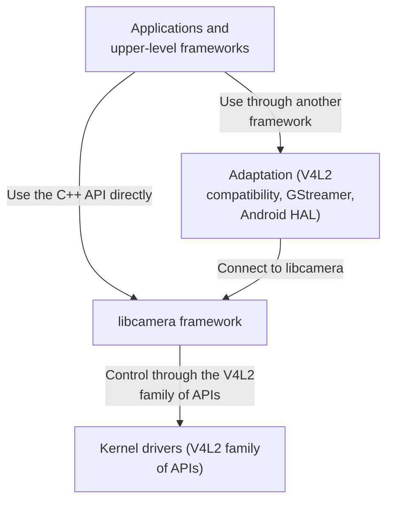

[Mermaid source](https://ttolsun.github.io/libcamera-sdd/en/team-overview.camera-stack.mmd)

<details open>
<summary>Diagram evidence and verification scope</summary>

Which layers does a path pass from the application to the camera hardware? This diagram does not guarantee supported models or performance.

Source-linked interpretation · automatic link check only · meaning and device execution not yet verified

| Elements and transitions | Source evidence |
| --- | --- |
| Applications and upper-level frameworks | [Documentation/introduction.rst:137](https://ttolsun.github.io/libcamera-sdd/en/reader-archive/team-overview.html#source-e3b563f549a8c46d) |
| Adaptation (V4L2 compatibility, GStreamer, Android HAL) | [Documentation/introduction.rst:137](https://ttolsun.github.io/libcamera-sdd/en/reader-archive/team-overview.html#source-e3b563f549a8c46d) |
| libcamera framework | [Documentation/introduction.rst:137](https://ttolsun.github.io/libcamera-sdd/en/reader-archive/team-overview.html#source-e3b563f549a8c46d) |
| Kernel drivers (V4L2 family of APIs) | [Documentation/introduction.rst:137](https://ttolsun.github.io/libcamera-sdd/en/reader-archive/team-overview.html#source-e3b563f549a8c46d) |
| Use the C++ API directly | [Documentation/introduction.rst:137](https://ttolsun.github.io/libcamera-sdd/en/reader-archive/team-overview.html#source-e3b563f549a8c46d) |
| Use through another framework | [Documentation/introduction.rst:137](https://ttolsun.github.io/libcamera-sdd/en/reader-archive/team-overview.html#source-e3b563f549a8c46d) |
| Connect to libcamera | [Documentation/introduction.rst:137](https://ttolsun.github.io/libcamera-sdd/en/reader-archive/team-overview.html#source-e3b563f549a8c46d) |
| Control through the V4L2 family of APIs | [Documentation/introduction.rst:137](https://ttolsun.github.io/libcamera-sdd/en/reader-archive/team-overview.html#source-e3b563f549a8c46d) |

</details>

libcamera provides a camera stack for Linux-based systems, abstracting the work of configuring hardware and handling the image control algorithms needed to obtain the desired results from a camera through kernel APIs. This allows developers to perform those tasks in a simple and consistent way. The camera stack consists of four layers, from bottom to top: kernel drivers, the libcamera framework, the libcamera adaptation layer, and applications and upper-level frameworks.

<details open>
<summary>Section-wide evidence: 4</summary>

- `Documentation/introduction.rst`[`L10` excerpt](https://ttolsun.github.io/libcamera-sdd/en/reader-archive/team-overview.html#source-34fda84500757231) · [Full source `L10`](https://github.com/TTolsun/libcamera-sdd/blob/adfa719f8ed67d18fd8a0739fc088a1f8b9e7252/Documentation/introduction.rst#L10) · [`L35` excerpt](https://ttolsun.github.io/libcamera-sdd/en/reader-archive/team-overview.html#source-de476c940b030e4a) · [Full source `L35`](https://github.com/TTolsun/libcamera-sdd/blob/adfa719f8ed67d18fd8a0739fc088a1f8b9e7252/Documentation/introduction.rst#L35) · [`L45` excerpt](https://ttolsun.github.io/libcamera-sdd/en/reader-archive/team-overview.html#source-f350cabac0db8343) · [Full source `L45`](https://github.com/TTolsun/libcamera-sdd/blob/adfa719f8ed67d18fd8a0739fc088a1f8b9e7252/Documentation/introduction.rst#L45) · [`L137` excerpt](https://ttolsun.github.io/libcamera-sdd/en/reader-archive/team-overview.html#source-e3b563f549a8c46d) · [Full source `L137`](https://github.com/TTolsun/libcamera-sdd/blob/adfa719f8ed67d18fd8a0739fc088a1f8b9e7252/Documentation/introduction.rst#L137)

</details>

## How to read this document

Clicking **Excerpt** in the section-wide evidence expands the original text in the document. Clicking **Full source** takes you to the file and line in the analyzed commit. See [Glossary](#doc-3) for terminology.

Clicking a diagram lets you zoom in and search for elements. Relationship diagrams and static call tracing do not guarantee the actual execution order. All classes are in [Component index](#doc-9), and main calls and trace boundaries are in [Key scenario](#doc-2).

<details open>
<summary>Validation scope and document status</summary>

"Automated check passed" means that the cited code locations and sentence format were verified by machine. It is not human approval of the content. The review status is shown at the top of the document, and the analysis commit and automated check results are shown in the generation evidence below. Explanations checked against code excerpts must also be reviewed by a person to confirm that their content is correct.

This site is a static analysis result of public libcamera. Actual device capture, performance, and error recovery, as well as the in-house HAL, were not verified. Reasons for design choices and performance budgets can be explained only when the code provides evidence.

The 4B and 9B drafts of [Model comparison record](https://github.com/TTolsun/camera-hal-sdd-generator/blob/main/docs/libcamera/records/model-comparison.md) were not adopted because content errors remained.

</details>

<details open>
<summary>Generation and deployment</summary>

[Generator](https://github.com/TTolsun/camera-hal-sdd-generator) handles extraction, validation, and screen composition, and [Public documentation repository](https://github.com/TTolsun/libcamera-sdd) stores the history and artifacts of public inputs. In the public environment, a recurring schedule is not installed.

For the original library usage, check [libcamera official documentation](https://docs.libcamera.org/master/).

</details>

## Source manuscripts and review records

<details open>
<summary>What this project does</summary>

- **Generation method**: Extracted facts and LLM explanation
- **Validation scope**: Tables and figures are created from facts, and the explanations are written by the LLM. Citation, sentence, and configured structure checks are applied.
- **Automated check**: Passed (`ok`). The items checked are listed in the verification scope. Whether the explanation content is correct is checked by a human reviewer.
- **Human review**: Before human review
- **Analysis baseline commit**: `adfa719f8ed67d18fd8a0739fc088a1f8b9e7252`
- **Document generation time**: `2026-11-11 20:35:47+00:00`
- **Sentence generation model**: `cli/codex/gpt-6.1-terra`
- **Contracts between documents**: [Automated comparison report](https://ttolsun.github.io/libcamera-sdd/contract-consistency.json) · Before human review
- **Reader scope**: [Answers by task and unreviewed scope](https://ttolsun.github.io/libcamera-sdd/reader-scope.json)

<details open>
<summary>Record from when the manuscript was written</summary>

This is a record saved in the manuscript as of that time. It may differ from the current document's standards.

- Evidence files: `Documentation/introduction.rst`, `Documentation/libcamera_architecture.rst`, `include/libcamera/camera.h`, `include/libcamera/camera_manager.h`, `include/libcamera/internal/pipeline_handler.h`, `src/libcamera/camera.cpp`, `src/libcamera/camera_manager.cpp`, `src/libcamera/pipeline_handler.cpp`
- Evidence level: code verified (static analysis, simple_compdb configuration, commit `c19d05128f`)
- Automated check (citation, sentence, and configured structure checks): passed
- Review status recorded: 2026-11-12 · Before human review

</details>

[Markdown source ↗](https://ttolsun.github.io/libcamera-sdd/team-overview.md)

[Open earlier detail](https://ttolsun.github.io/libcamera-sdd/en/reader-archive/team-overview.html#page-evidence)

</details>

<details open>
<summary>libcamera design document</summary>

- **Contracts between documents**: [Automated comparison report](https://ttolsun.github.io/libcamera-sdd/contract-consistency.json) · Before human review

[Open earlier detail](https://ttolsun.github.io/libcamera-sdd/en/reader-archive/index.html#page-evidence)

</details>

[Download page Markdown](https://ttolsun.github.io/libcamera-sdd/en/index.md) · [Reader edition source map](https://ttolsun.github.io/libcamera-sdd/reader-edition.json)

<a id="doc-2"></a>

Start Here

# Architecture

English translation · human review pending. Review states below refer to the Korean source.

Explore the camera stack's layers, the roles of its components, camera discovery, and the boundaries between components.

## Four layers of the camera stack

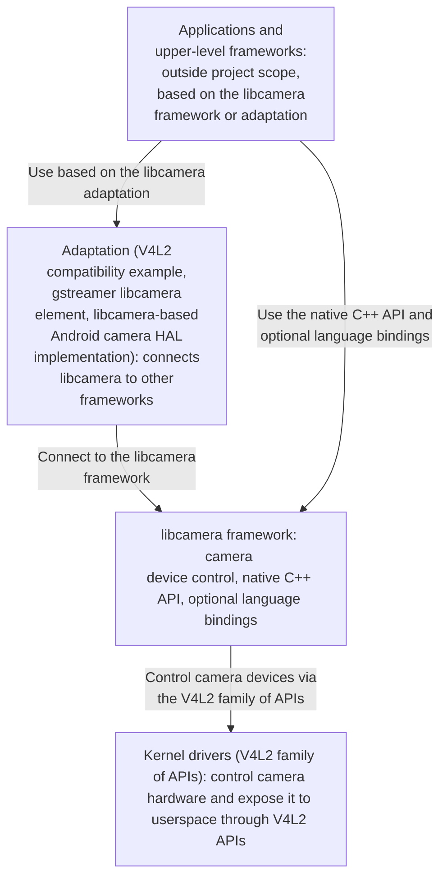

[Mermaid source](https://ttolsun.github.io/libcamera-sdd/en/index.camera-stack.mmd)

<details open>
<summary>Diagram evidence and verification scope</summary>

What role does each of the four software layers, from the application to the kernel driver, play? Camera hardware itself, supported models, and performance are outside the scope of this diagram.

Source-linked interpretation · automatic link check only · meaning and device execution not yet verified

| Elements and transitions | Source evidence |
| --- | --- |
| Applications and upper-level frameworks: outside project scope, based on the libcamera framework or adaptation | [Documentation/introduction.rst:137](https://ttolsun.github.io/libcamera-sdd/en/reader-archive/vendor-overview.html#source-e3b563f549a8c46d) |
| Adaptation (V4L2 compatibility example, gstreamer libcamera element, libcamera-based Android camera HAL implementation): connects libcamera to other frameworks | [Documentation/introduction.rst:137](https://ttolsun.github.io/libcamera-sdd/en/reader-archive/vendor-overview.html#source-e3b563f549a8c46d) |
| libcamera framework: camera device control, native C++ API, optional language bindings | [Documentation/introduction.rst:137](https://ttolsun.github.io/libcamera-sdd/en/reader-archive/vendor-overview.html#source-e3b563f549a8c46d) |
| Kernel drivers (V4L2 family of APIs): control camera hardware and expose it to userspace through V4L2 APIs | [Documentation/introduction.rst:137](https://ttolsun.github.io/libcamera-sdd/en/reader-archive/vendor-overview.html#source-e3b563f549a8c46d) |
| Use based on the libcamera adaptation | [Documentation/introduction.rst:137](https://ttolsun.github.io/libcamera-sdd/en/reader-archive/vendor-overview.html#source-e3b563f549a8c46d) |
| Connect to the libcamera framework | [Documentation/introduction.rst:137](https://ttolsun.github.io/libcamera-sdd/en/reader-archive/vendor-overview.html#source-e3b563f549a8c46d) |
| Control camera devices via the V4L2 family of APIs | [Documentation/introduction.rst:137](https://ttolsun.github.io/libcamera-sdd/en/reader-archive/vendor-overview.html#source-e3b563f549a8c46d) |
| Use the native C++ API and optional language bindings | [Documentation/introduction.rst:137](https://ttolsun.github.io/libcamera-sdd/en/reader-archive/vendor-overview.html#source-e3b563f549a8c46d) |

</details>

## Responsibilities by component

`Camera` is the central object in libcamera, modeling a camera capable of producing one or more image streams from a single image source and providing the main interface for configuring and controlling the device and capturing image streams. libcamera manages the lifetime of camera instances with `std::shared_ptr<>`, and instances must be created using the `create()` function, which returns a shared pointer. The constructors and destructor of `Camera` are private, so instances cannot be created or destroyed manually.

<details open>
<summary>Section-wide evidence: 1</summary>

- `src/libcamera/camera.cpp`[`L758` excerpt](https://ttolsun.github.io/libcamera-sdd/en/reader-archive/overview.html#source-6c066281dcce33d6) · [Full source `L758`](https://github.com/TTolsun/libcamera-sdd/blob/adfa719f8ed67d18fd8a0739fc088a1f8b9e7252/src/libcamera/camera.cpp#L758)

</details>

## <a id="d2-discovery"></a>Discovery and pipeline selection

`CameraManager` is the entry point to libcamera: it enumerates devices, associates them with pipelines, and gives applications access to the cameras in the system. `CameraManager::Private::pipelineFactoryMatch` repeatedly creates a `PipelineHandler` through the factory and checks for a match using `enumerator_`, ending the loop when there is no match. Only one `CameraManager` instance may exist at a time. Attempting to create a second instance without deleting the existing instance results in undefined behavior.

### From device discovery to Camera access

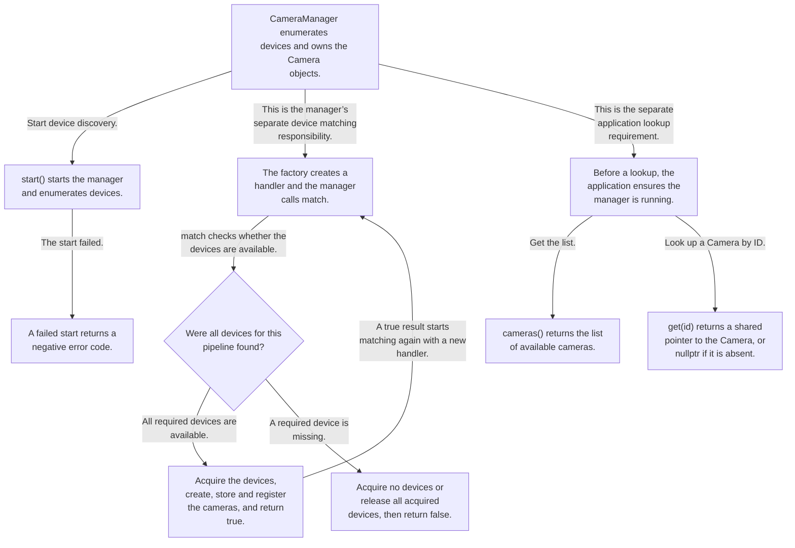

[Mermaid source](https://ttolsun.github.io/libcamera-sdd/en/overview.discovery-map.mmd)

<details open>
<summary>Diagram evidence and verification scope</summary>

How does CameraManager match devices and register cameras, and under what conditions can an app look up a camera?

Source-linked interpretation · automatic link check only · meaning and device execution not yet verified

| Elements and transitions | Source evidence |
| --- | --- |
| CameraManager enumerates devices and owns the Camera objects. | [src/libcamera/camera_manager.cpp:283](https://ttolsun.github.io/libcamera-sdd/en/reader-archive/overview.html#source-f75d22cf73f3402d) |
| start() starts the manager and enumerates devices. | [src/libcamera/camera_manager.cpp:329](https://ttolsun.github.io/libcamera-sdd/en/reader-archive/overview.html#source-f58d94d893e03971) |
| A failed start returns a negative error code. | [src/libcamera/camera_manager.cpp:329](https://ttolsun.github.io/libcamera-sdd/en/reader-archive/overview.html#source-f58d94d893e03971) |
| The factory creates a handler and the manager calls match. | [src/libcamera/camera_manager.cpp:154](https://ttolsun.github.io/libcamera-sdd/en/reader-archive/overview.html#source-0c01857bf49370e2) |
| Were all devices for this pipeline found? | [src/libcamera/pipeline_handler.cpp:86](https://ttolsun.github.io/libcamera-sdd/en/reader-archive/overview.html#source-5bbd41c1e725138c) |
| Acquire the devices, create, store and register the cameras, and return true. | [src/libcamera/pipeline_handler.cpp:86](https://ttolsun.github.io/libcamera-sdd/en/reader-archive/overview.html#source-5bbd41c1e725138c) |
| Acquire no devices or release all acquired devices, then return false. | [src/libcamera/pipeline_handler.cpp:86](https://ttolsun.github.io/libcamera-sdd/en/reader-archive/overview.html#source-5bbd41c1e725138c) |
| Before a lookup, the application ensures the manager is running. | [src/libcamera/camera_manager.cpp:329](https://ttolsun.github.io/libcamera-sdd/en/reader-archive/overview.html#source-f58d94d893e03971) · [src/libcamera/camera_manager.cpp:368](https://ttolsun.github.io/libcamera-sdd/en/reader-archive/overview.html#source-0c733673790ad84f) |
| cameras() returns the list of available cameras. | [src/libcamera/camera_manager.cpp:368](https://ttolsun.github.io/libcamera-sdd/en/reader-archive/overview.html#source-0c733673790ad84f) |
| get(id) returns a shared pointer to the Camera, or nullptr if it is absent. | [src/libcamera/camera_manager.cpp:368](https://ttolsun.github.io/libcamera-sdd/en/reader-archive/overview.html#source-0c733673790ad84f) |
| Start device discovery. | [src/libcamera/camera_manager.cpp:283](https://ttolsun.github.io/libcamera-sdd/en/reader-archive/overview.html#source-f75d22cf73f3402d) · [src/libcamera/camera_manager.cpp:329](https://ttolsun.github.io/libcamera-sdd/en/reader-archive/overview.html#source-f58d94d893e03971) |
| This is the manager’s separate device matching responsibility. | [src/libcamera/camera_manager.cpp:283](https://ttolsun.github.io/libcamera-sdd/en/reader-archive/overview.html#source-f75d22cf73f3402d) · [src/libcamera/camera_manager.cpp:154](https://ttolsun.github.io/libcamera-sdd/en/reader-archive/overview.html#source-0c01857bf49370e2) |
| The start failed. | [src/libcamera/camera_manager.cpp:329](https://ttolsun.github.io/libcamera-sdd/en/reader-archive/overview.html#source-f58d94d893e03971) |
| match checks whether the devices are available. | [src/libcamera/camera_manager.cpp:154](https://ttolsun.github.io/libcamera-sdd/en/reader-archive/overview.html#source-0c01857bf49370e2) · [src/libcamera/pipeline_handler.cpp:86](https://ttolsun.github.io/libcamera-sdd/en/reader-archive/overview.html#source-5bbd41c1e725138c) |
| All required devices are available. | [src/libcamera/pipeline_handler.cpp:86](https://ttolsun.github.io/libcamera-sdd/en/reader-archive/overview.html#source-5bbd41c1e725138c) |
| A required device is missing. | [src/libcamera/pipeline_handler.cpp:86](https://ttolsun.github.io/libcamera-sdd/en/reader-archive/overview.html#source-5bbd41c1e725138c) |
| A true result starts matching again with a new handler. | [src/libcamera/pipeline_handler.cpp:86](https://ttolsun.github.io/libcamera-sdd/en/reader-archive/overview.html#source-5bbd41c1e725138c) · [src/libcamera/camera_manager.cpp:154](https://ttolsun.github.io/libcamera-sdd/en/reader-archive/overview.html#source-0c01857bf49370e2) |
| This is the separate application lookup requirement. | [src/libcamera/camera_manager.cpp:283](https://ttolsun.github.io/libcamera-sdd/en/reader-archive/overview.html#source-f75d22cf73f3402d) · [src/libcamera/camera_manager.cpp:329](https://ttolsun.github.io/libcamera-sdd/en/reader-archive/overview.html#source-f58d94d893e03971) · [src/libcamera/camera_manager.cpp:368](https://ttolsun.github.io/libcamera-sdd/en/reader-archive/overview.html#source-0c733673790ad84f) |
| Get the list. | [src/libcamera/camera_manager.cpp:329](https://ttolsun.github.io/libcamera-sdd/en/reader-archive/overview.html#source-f58d94d893e03971) · [src/libcamera/camera_manager.cpp:368](https://ttolsun.github.io/libcamera-sdd/en/reader-archive/overview.html#source-0c733673790ad84f) |
| Look up a Camera by ID. | [src/libcamera/camera_manager.cpp:329](https://ttolsun.github.io/libcamera-sdd/en/reader-archive/overview.html#source-f58d94d893e03971) · [src/libcamera/camera_manager.cpp:368](https://ttolsun.github.io/libcamera-sdd/en/reader-archive/overview.html#source-0c733673790ad84f) |

</details>

The application may list and use cameras from the time the start of `CameraManager::start()` is confirmed until the camera manager is stopped or the relevant camera is disconnected from the system. The caller must ensure that the camera manager is running before calling `CameraManager::cameras()` and `CameraManager::get()`. If all required media devices are found, the `PipelineHandler::match()` implementer must acquire each device with `MediaDevice::acquire()`, create the corresponding `Camera` instances, store them internally, register them with the camera manager, and then return `true`. If not all required devices are found, the `match()` implementer must either acquire no media devices or release all devices already acquired using `MediaDevice::release()`, and must return `false`.

<details open>
<summary>Section-wide evidence: 5</summary>

- `src/libcamera/camera_manager.cpp`[`L283` excerpt](https://ttolsun.github.io/libcamera-sdd/en/reader-archive/overview.html#source-f75d22cf73f3402d) · [Full source `L283`](https://github.com/TTolsun/libcamera-sdd/blob/adfa719f8ed67d18fd8a0739fc088a1f8b9e7252/src/libcamera/camera_manager.cpp#L283) · [`L154` excerpt](https://ttolsun.github.io/libcamera-sdd/en/reader-archive/overview.html#source-0c01857bf49370e2) · [Full source `L154`](https://github.com/TTolsun/libcamera-sdd/blob/adfa719f8ed67d18fd8a0739fc088a1f8b9e7252/src/libcamera/camera_manager.cpp#L154) · [`L329` excerpt](https://ttolsun.github.io/libcamera-sdd/en/reader-archive/overview.html#source-f58d94d893e03971) · [Full source `L329`](https://github.com/TTolsun/libcamera-sdd/blob/adfa719f8ed67d18fd8a0739fc088a1f8b9e7252/src/libcamera/camera_manager.cpp#L329) · [`L368` excerpt](https://ttolsun.github.io/libcamera-sdd/en/reader-archive/overview.html#source-0c733673790ad84f) · [Full source `L368`](https://github.com/TTolsun/libcamera-sdd/blob/adfa719f8ed67d18fd8a0739fc088a1f8b9e7252/src/libcamera/camera_manager.cpp#L368)
- `src/libcamera/pipeline_handler.cpp`[`L86` excerpt](https://ttolsun.github.io/libcamera-sdd/en/reader-archive/overview.html#source-5bbd41c1e725138c) · [Full source `L86`](https://github.com/TTolsun/libcamera-sdd/blob/adfa719f8ed67d18fd8a0739fc088a1f8b9e7252/src/libcamera/pipeline_handler.cpp#L86)

</details>

## Boundaries with other teams and layers

Applications and higher-level frameworks based on the libcamera framework (the infrastructure for software development) or a libcamera adaptation are outside the scope of the libcamera project.

### The relationship and boundaries at interfaces with other teams and layers

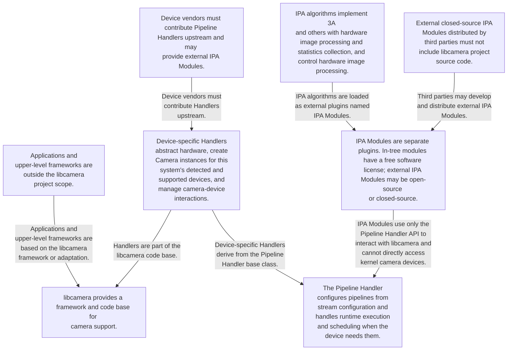

[Mermaid source](https://ttolsun.github.io/libcamera-sdd/en/team-overview.item-boundaries.mmd)

<details open>
<summary>Diagram evidence and verification scope</summary>

How are the project scope and responsibilities divided among the application, libcamera, device manufacturers, the Pipeline Handler, and the IPA Module?

Source-linked interpretation · automatic link check only · meaning and device execution not yet verified

| Elements and transitions | Source evidence |
| --- | --- |
| Applications and upper-level frameworks are outside the libcamera project scope. | [Documentation/introduction.rst:163](https://ttolsun.github.io/libcamera-sdd/en/reader-archive/team-overview.html#source-9e653b8ff755db78) |
| libcamera provides a framework and code base for camera support. | [Documentation/introduction.rst:163](https://ttolsun.github.io/libcamera-sdd/en/reader-archive/team-overview.html#source-9e653b8ff755db78) · [Documentation/introduction.rst:200](https://ttolsun.github.io/libcamera-sdd/en/reader-archive/team-overview.html#source-341442e08591ef50) |
| Device vendors must contribute Pipeline Handlers upstream and may provide external IPA Modules. | [Documentation/introduction.rst:200](https://ttolsun.github.io/libcamera-sdd/en/reader-archive/team-overview.html#source-341442e08591ef50) · [Documentation/libcamera_architecture.rst:109](https://ttolsun.github.io/libcamera-sdd/en/reader-archive/team-overview.html#source-1f130cc8640ef810) |
| Device-specific Handlers abstract hardware, create Camera instances for this system's detected and supported devices, and manage camera-device interactions. | [Documentation/libcamera_architecture.rst:87](https://ttolsun.github.io/libcamera-sdd/en/reader-archive/team-overview.html#source-8bd888bd0473995e) |
| The Pipeline Handler configures pipelines from stream configuration and handles runtime execution and scheduling when the device needs them. | [Documentation/libcamera_architecture.rst:87](https://ttolsun.github.io/libcamera-sdd/en/reader-archive/team-overview.html#source-8bd888bd0473995e) |
| IPA algorithms implement 3A and others with hardware image processing and statistics collection, and control hardware image processing. | [Documentation/libcamera_architecture.rst:109](https://ttolsun.github.io/libcamera-sdd/en/reader-archive/team-overview.html#source-1f130cc8640ef810) |
| IPA Modules are separate plugins. In-tree modules have a free software license; external IPA Modules may be open-source or closed-source. | [Documentation/libcamera_architecture.rst:109](https://ttolsun.github.io/libcamera-sdd/en/reader-archive/team-overview.html#source-1f130cc8640ef810) · [Documentation/introduction.rst:200](https://ttolsun.github.io/libcamera-sdd/en/reader-archive/team-overview.html#source-341442e08591ef50) |
| External closed-source IPA Modules distributed by third parties must not include libcamera project source code. | [Documentation/introduction.rst:200](https://ttolsun.github.io/libcamera-sdd/en/reader-archive/team-overview.html#source-341442e08591ef50) |
| Applications and upper-level frameworks are based on the libcamera framework or adaptation. | [Documentation/introduction.rst:163](https://ttolsun.github.io/libcamera-sdd/en/reader-archive/team-overview.html#source-9e653b8ff755db78) |
| Handlers are part of the libcamera code base. | [Documentation/introduction.rst:200](https://ttolsun.github.io/libcamera-sdd/en/reader-archive/team-overview.html#source-341442e08591ef50) |
| Device vendors must contribute Handlers upstream. | [Documentation/introduction.rst:200](https://ttolsun.github.io/libcamera-sdd/en/reader-archive/team-overview.html#source-341442e08591ef50) |
| Device-specific Handlers derive from the Pipeline Handler base class. | [Documentation/libcamera_architecture.rst:87](https://ttolsun.github.io/libcamera-sdd/en/reader-archive/team-overview.html#source-8bd888bd0473995e) |
| IPA algorithms are loaded as external plugins named IPA Modules. | [Documentation/libcamera_architecture.rst:109](https://ttolsun.github.io/libcamera-sdd/en/reader-archive/team-overview.html#source-1f130cc8640ef810) |
| Third parties may develop and distribute external IPA Modules. | [Documentation/introduction.rst:200](https://ttolsun.github.io/libcamera-sdd/en/reader-archive/team-overview.html#source-341442e08591ef50) |
| IPA Modules use only the Pipeline Handler API to interact with libcamera and cannot directly access kernel camera devices. | [Documentation/libcamera_architecture.rst:120](https://ttolsun.github.io/libcamera-sdd/en/reader-archive/team-overview.html#source-6c10d5aeb8fc7ca9) · [Documentation/libcamera_architecture.rst:109](https://ttolsun.github.io/libcamera-sdd/en/reader-archive/team-overview.html#source-1f130cc8640ef810) |

</details>

The Pipeline Handler manages device-specific pipelines, and device manufacturers must contribute it to libcamera. Image Processing Algorithms (`Image` Processing Algorithms, IPA) control hardware image processing based on parameters from upper layers, and IPA `Module` (IPA modules) may be provided separately by external parties. IPA `Module` included in libcamera are covered by a free software license, and external modules may be distributed under a closed-source license provided they do not include source code from the libcamera project. IPA `Module` interact only through the APIs (application programming interfaces) provided by libcamera and the Pipeline Handler and cannot directly access kernel camera devices.

<details open>
<summary>Section-wide evidence: 5</summary>

- `Documentation/introduction.rst`[`L163` excerpt](https://ttolsun.github.io/libcamera-sdd/en/reader-archive/team-overview.html#source-9e653b8ff755db78) · [Full source `L163`](https://github.com/TTolsun/libcamera-sdd/blob/adfa719f8ed67d18fd8a0739fc088a1f8b9e7252/Documentation/introduction.rst#L163) · [`L200` excerpt](https://ttolsun.github.io/libcamera-sdd/en/reader-archive/team-overview.html#source-341442e08591ef50) · [Full source `L200`](https://github.com/TTolsun/libcamera-sdd/blob/adfa719f8ed67d18fd8a0739fc088a1f8b9e7252/Documentation/introduction.rst#L200)
- `Documentation/libcamera_architecture.rst`[`L87` excerpt](https://ttolsun.github.io/libcamera-sdd/en/reader-archive/team-overview.html#source-8bd888bd0473995e) · [Full source `L87`](https://github.com/TTolsun/libcamera-sdd/blob/adfa719f8ed67d18fd8a0739fc088a1f8b9e7252/Documentation/libcamera_architecture.rst#L87) · [`L109` excerpt](https://ttolsun.github.io/libcamera-sdd/en/reader-archive/team-overview.html#source-1f130cc8640ef810) · [Full source `L109`](https://github.com/TTolsun/libcamera-sdd/blob/adfa719f8ed67d18fd8a0739fc088a1f8b9e7252/Documentation/libcamera_architecture.rst#L109) · [`L120` excerpt](https://ttolsun.github.io/libcamera-sdd/en/reader-archive/team-overview.html#source-6c10d5aeb8fc7ca9) · [Full source `L120`](https://github.com/TTolsun/libcamera-sdd/blob/adfa719f8ed67d18fd8a0739fc088a1f8b9e7252/Documentation/libcamera_architecture.rst#L120)

</details>

## Code reading order for the selected scenario

1. Verifies the input checks and return conditions of entry point `Camera::queueRequest(Request *)`.
2. The main calls and tracing boundaries are identified in [Request submission (Camera::queueRequest)](#doc-8).
3. Distinguish scheduled calls from completion notifications, and check the execution thread against the connection code.

## Source manuscripts and review records

<details open>
<summary>libcamera design document</summary>

- **Contracts between documents**: [Automated comparison report](https://ttolsun.github.io/libcamera-sdd/contract-consistency.json) · Before human review

[Open earlier detail](https://ttolsun.github.io/libcamera-sdd/en/reader-archive/index.html#page-evidence)

</details>

<details open>
<summary>System overview</summary>

- **Generation method**: Extracted facts and LLM explanation
- **Validation scope**: Tables and figures are created from facts, and the explanations are written by the LLM. Citation, sentence, and configured structure checks are applied.
- **Automated check**: Passed (`ok`). The items checked are listed in the verification scope. Whether the explanation content is correct is checked by a human reviewer.
- **Human review**: Before human review
- **Analysis baseline commit**: `adfa719f8ed67d18fd8a0739fc088a1f8b9e7252`
- **Document generation time**: `2026-11-20 17:39:13+00:00`
- **Sentence generation model**: `cli/codex/gpt-6.1-terra`
- **Contracts between documents**: [Automated comparison report](https://ttolsun.github.io/libcamera-sdd/contract-consistency.json) · Before human review
- **Reader scope**: [Answers by task and unreviewed scope](https://ttolsun.github.io/libcamera-sdd/reader-scope.json)

<details open>
<summary>Record from when the manuscript was written</summary>

This is a record saved in the manuscript as of that time. It may differ from the current document's standards.

- Evidence files: `include/libcamera/camera.h`, `include/libcamera/camera_manager.h`, `include/libcamera/internal/ipa_manager.h`, `include/libcamera/internal/pipeline_handler.h`, `include/libcamera/request.h`, `src/libcamera/base/log.cpp`, `src/libcamera/camera.cpp`, `src/libcamera/camera_manager.cpp`, `src/libcamera/controls.cpp`, `src/libcamera/ipa_manager.cpp`, `src/libcamera/pipeline_handler.cpp`, `src/libcamera/request.cpp`
- Evidence level: code verified (static analysis, simple_compdb configuration, commit `adfa719f8e`)
- Automated check (citation, sentence, and configured structure checks): passed
- Review status recorded on: 2026-11-21 · Awaiting human review

</details>

[Markdown source ↗](https://ttolsun.github.io/libcamera-sdd/overview.md) [Mermaid source ↗](https://ttolsun.github.io/libcamera-sdd/en/overview.mmd)

[Open earlier detail](https://ttolsun.github.io/libcamera-sdd/en/reader-archive/overview.html#page-evidence)

</details>

<details open>
<summary>What this project does</summary>

- **Generation method**: Extracted facts and LLM explanation
- **Validation scope**: Tables and figures are created from facts, and the explanations are written by the LLM. Citation, sentence, and configured structure checks are applied.
- **Automated check**: Passed (`ok`). The items checked are listed in the verification scope. Whether the explanation content is correct is checked by a human reviewer.
- **Human review**: Before human review
- **Analysis baseline commit**: `adfa719f8ed67d18fd8a0739fc088a1f8b9e7252`
- **Document generation time**: `2026-11-11 20:35:47+00:00`
- **Sentence generation model**: `cli/codex/gpt-6.1-terra`
- **Contracts between documents**: [Automated comparison report](https://ttolsun.github.io/libcamera-sdd/contract-consistency.json) · Before human review
- **Reader scope**: [Answers by task and unreviewed scope](https://ttolsun.github.io/libcamera-sdd/reader-scope.json)

<details open>
<summary>Record from when the manuscript was written</summary>

This is a record saved in the manuscript as of that time. It may differ from the current document's standards.

- Evidence files: `Documentation/introduction.rst`, `Documentation/libcamera_architecture.rst`, `include/libcamera/camera.h`, `include/libcamera/camera_manager.h`, `include/libcamera/internal/pipeline_handler.h`, `src/libcamera/camera.cpp`, `src/libcamera/camera_manager.cpp`, `src/libcamera/pipeline_handler.cpp`
- Evidence level: code verified (static analysis, simple_compdb configuration, commit `c19d05128f`)
- Automated check (citation, sentence, and configured structure checks): passed
- Review status recorded: 2026-11-12 · Before human review

</details>

[Markdown source ↗](https://ttolsun.github.io/libcamera-sdd/team-overview.md)

[Open earlier detail](https://ttolsun.github.io/libcamera-sdd/en/reader-archive/team-overview.html#page-evidence)

</details>

[Download page Markdown](https://ttolsun.github.io/libcamera-sdd/en/architecture.md) · [Reader edition source map](https://ttolsun.github.io/libcamera-sdd/reader-edition.json)

<a id="doc-3"></a>

Start Here

# Glossary

English translation · human review pending. Review states below refer to the Korean source.

**Collects the meanings of abbreviations and domain terms that appear in the document.**

Select an underlined term in the body text to see its meaning in place. You can also search for the term by name in document search.

Quick links: [0–9](#d3-term-3a) · [A](#d3-term-af) · [B](#d3-term-bayer) · [C](#d3-term-ccm) · [D](#d3-term-debug) · [E](#d3-term-ebusy) · [F](#d3-term-fbo) · [G](#d3-term-gb) · [H](#d3-term-hal) · [I](#d3-term-ipa) · [L](#d3-term-log) · [M](#d3-term-mali-c55) · [N](#d3-term-nv12) · [O](#d3-term-omm) · [P](#d3-term-pending) · [Q](#d3-term-qbuf) · [R](#d3-term-raw) · [S](#d3-term-streamoff) · [T](#d3-term-tid) · [U](#d3-term-udmabuf) · [V](#d3-term-v4l2) · [W](#d3-term-wsl) · [ㄷ](#d3-term-%EB%94%94%EB%B2%A0%EC%9D%B4%EC%96%B4) · [ㅁ](#d3-term-%EB%A9%94%ED%83%80%EB%8D%B0%EC%9D%B4%ED%84%B0) · [ㅂ](#d3-term-%EB%B8%94%EB%9E%99-%EB%A0%88%EB%B2%A8) · [ㅅ](#d3-term-%EC%85%B0%EC%9D%B4%EB%8D%94) · [ㅇ](#d3-term-%EC%99%9C%EA%B3%A1-%EB%B3%B4%EC%A0%95) · [ㅋ](#d3-term-%EC%BB%A8%ED%8A%B8%EB%A1%A4-%EC%A0%95%EB%B3%B4-%EB%A7%B5) · [ㅌ](#d3-term-%ED%8A%9C%EB%8B%9D-%ED%8C%8C%EC%9D%BC) · [ㅍ](#d3-term-%ED%94%84%EB%A0%88%EC%9E%84-%EB%B2%84%ED%8D%BC) · [ㅎ](#d3-term-%ED%99%9C%EC%84%B1-%EC%8A%A4%ED%8A%B8%EB%A6%BC)

- <a id="d3-term-3a"></a>**3A**: A collective term for auto exposure (AE/AGC), auto white balance (AWB), and auto focus (AF). These are representative algorithms that the IPA computes.
- <a id="d3-term-af"></a>**AF** (Auto Focus): An algorithm that moves the lens position to bring the image into focus.
- **AGC** (Automatic Gain Control): An automatic exposure algorithm that sets the exposure time and sensor gain to match scene brightness.
- **ASSERT**: libcamera's debug-check macro. In debug builds, if the condition is false, it logs a fatal message and aborts execution.
- **AWB** (Auto White Balance): An algorithm that estimates the color temperature of the illumination and sets per-channel R, G, and B gains so that white appears white.
- <a id="d3-term-bayer"></a>**bayer**: A color filter array in which each pixel of the sensor records only one color among R, G, and B. Raw data in this format must go through demosaicing before each pixel has RGB values.
- <a id="d3-term-ccm"></a>**CCM**: Means the IPU3 color correction matrix algorithm.
- <a id="d3-term-debug"></a>**DEBUG**: The name of the most verbose diagnostic level among log severity levels. Setting the log level environment variable to \`DEBUG\` yields detailed logs.
- **DMA** (Direct Memory Access): DMA (Direct Memory Access) is a term for a method in which an I/O device reads from or writes to system memory directly.
- **DQBUF**: DQBUF is an ioctl command that requests the next available buffer to be dequeued from a V4L2 device.
- **DRM** (Direct Rendering Manager): A kernel subsystem that manages Linux graphics devices. DRM pixel formats identify the channel layout within a buffer.
- **DW100**: A separate hardware device that corrects distortion by remapping the image according to a coordinate table. It is included in the NXP i.MX8MP and similar parts.
- <a id="d3-term-ebusy"></a>**EBUSY**: If FrameBufferAllocator::allocate() is called again for a stream that already has buffers allocated, it returns -EBUSY.
- **EEXIST**: Returns the -EEXIST error when a buffer still has an unreleased fence or a buffer is already registered on the same stream.
- **EGL**: An interface that connects the graphics API with the display, image, and buffer of the operating environment. This document covers the boundary where shared buffers are imported as graphics images.
- **errno**: The standard error number that Linux functions use to report the cause of a failure. libcamera functions return this value as a negative number. For example, -ENODEV means no device, -EACCES means access denied, -EINVAL means invalid argument, -ENOMEM means out of memory, and -EXDEV means a resource that belongs to another object.
- **ETIMEDOUT**: An error code indicating that the IPC response wait timer has expired. The timer setting value in this document is 2000ms.
- <a id="d3-term-fbo"></a>**FBO**: Refers to a frame buffer object to which a texture is to be attached.
- **fence**: A synchronization signal that indicates when a buffer may be used. If a valid fence is attached to a request, the request waits for this signal in the preparation stage. It is different from the request completion signal.
- **FPS**: The number of frames per second.
- <a id="d3-term-gb"></a>**GB**: Means the green B shading coefficient in the lens shading correction table.
- **GCC** (GNU Compiler Collection): A collection of GNU compilers that includes front ends for C, C++, and other languages.
- **GDB** (GNU Project Debugger): A GNU debugger that stops a program under specified conditions and lets you examine its execution state after it stops.
- **GL**: A prefix used in identifiers of OpenGL-family graphics APIs. In this document, GL formats indicate the channel composition of a texture.
- **GNU** (GNU's Not Unix): GNU is an operating system composed of free software. The name is a recursive acronym meaning GNU's Not Unix.
- **GR**: Means the green R shading coefficient in the lens shading correction table.
- <a id="d3-term-hal"></a>**HAL** (Hardware Abstraction Layer): A layer that lets the operating system handle hardware that differs by manufacturer through the same interface. The final deployment target of this project is the in-house Android Camera HAL.
- <a id="d3-term-ipa"></a>**IPA** (Image Processing Algorithms): A separate module (.so) that contains image quality algorithms. It reads the statistics sent by the ISP and calculates the ISP settings to use for the next frame. It is separated from the libcamera core so that manufacturers can provide it without publishing its source.
- **IPC** (Inter-Process Communication): A method by which separate processes exchange messages. Because an unsigned IPA module runs in a separate process, libcamera calls it through IPC.
- **IPU** (Image Processing Unit): The name of Intel's family of image processing units. Generation numbers are attached to the name, as in IPU3 and IPU6.
- **IPU3** (Intel Image Processing Unit 3): A camera ISP included in some Intel laptop processors. libcamera has a Pipeline Handler and an IPA for this device.
- **IPU6**: One generation of the Intel Image Processing Unit (IPU). The official documentation lists it as a supported target of the simple pipeline handler instead of a dedicated handler.
- **ISP** (Image Signal Processor): A processing unit that converts raw (Bayer) data output by the sensor into an image that can be displayed on screen. It performs operations such as black level correction, lens shading correction, white balance, and debayering.
- <a id="d3-term-log"></a>**LOG**: Uses the category and severity level specified by the caller.
- **LSC** (Lens Shading Correction): Processing that corrects lens shading, the phenomenon in which the edges of an image are darker than the center or colors are distorted due to lens characteristics. It is applied by multiplying by a correction table that divides the image into a grid.
- **LUT** (Look-Up Table): A method that precomputes calculation results into a table and retrieves them directly by input value. The LSC correction table falls into this category.
- <a id="d3-term-mali-c55"></a>**mali-c55**: Arm Mali-C55 camera ISP. libcamera has a Pipeline Handler and an IPA for this device.
- **mojom**: A file format that defines the functions and data types of the IPA interface. Proxy code is generated from this definition at build time.
- <a id="d3-term-nv12"></a>**NV12** (NV12): A 4:2:0 format that uses 8 bits per component. The first plane is luminance (Y). The second plane contains interleaved chroma data, in which Cb and Cr values are stored alternately, one each. The whole layout is placed in linearly contiguous memory.
- <a id="d3-term-omm"></a>**OMM**: An external documentation tool referenced by this site's reading-layout, figure zoom, and search rules. Only the rules were applied; the tool's runner was not used.
- <a id="d3-term-pending"></a>**Pending**: The request state in which the request has not yet changed to completed or canceled. It does not mean device processing has started, and if a preceding request is in this state, the return of a following request may also have to wait.
- **Pipeline Handler**: A libcamera component that finds the media device of a specific hardware platform (IPU3, RKISP1, etc.), creates cameras, passes requests to the device, and returns their completion. There is one per platform.
- **PR** (Pull Request): A request proposing that code changes be merged into the project.
- <a id="d3-term-qbuf"></a>**QBUF**: An ioctl that requests the addition of a buffer to the V4L2 device's queue.
- <a id="d3-term-raw"></a>**RAW**: RAW is a pixel color-encoding classification and is distinguished from StreamRole::Raw, a separate stream role for capturing raw sensor frames.
- **RK3399**: Rockchip's system-on-chip (SoC). The official documentation lists it as a supported target of the rkisp1 pipeline handler.
- **RKISP1** (Rockchip Image Signal Processor 1): A camera ISP included in Rockchip SoCs, the NXP i.MX8MP, and others. libcamera has a Pipeline Handler and an IPA for this device.
- **ROI** (Return on Investment): ROI is a concept that compares returns with investment costs, and it is not measured in this example from the public libcamera documentation.
- <a id="d3-term-streamoff"></a>**STREAMOFF**: An ioctl that requests streaming to be stopped for the specified buffer type on a V4L2 device.
- <a id="d3-term-tid"></a>**TID** (Linux thread ID): A TID is the Linux thread ID returned by the gettid system call.
- <a id="d3-term-udmabuf"></a>**UDMABUF** (userspace dmabuf misc driver): A Linux kernel driver name for a driver that converts a userspace memfd region into a dma-buf.
- **UQ**: An unsigned fixed-point format. UQ\<m, n\> represents a value with m bits for the integer part and n bits for the fractional part.
- **UVC** (USB Video Class): The standard that USB webcams follow. libcamera handles this device with the uvcvideo Pipeline Handler.
- <a id="d3-term-v4l2"></a>**V4L2** (Video4Linux2): The API through which the Linux kernel handles cameras and video devices. libcamera uses this API to control the sensor and ISP devices.
- **VM** (Virtual Machine): A virtual machine is a computer implemented in software by virtualizing the resources of a physical computer, and it runs its own operating system and applications. It is not limited to cloud servers and can also be created on a personal physical computer.
- <a id="d3-term-wsl"></a>**WSL** (Windows Subsystem for Linux): A Windows feature that lets you run a Linux environment on a Windows computer.
- **WSL2** (Windows Subsystem for Linux 2): An environment for running Linux on Windows. This site is built from the results of building and extracting libcamera on WSL2.
- <a id="d3-term-디베이어"></a>**Debayer**: A process that interpolates the missing colors of each pixel from neighboring pixels in bayer raw data to create an RGB image. Also called demosaicing.
- <a id="d3-term-메타데이터"></a>**Metadata**: Capture information checked alongside the image pixels. The metadata of a Request is provided as a ControlList, and the FrameMetadata of a FrameBuffer holds capture status, timestamp, bytes used, and so on. Whether the other fields of FrameMetadata are valid depends on the capture status.
- <a id="d3-term-블랙-레벨"></a>**Black level**: The reference value the sensor outputs even when there is no light at all. The first stage of ISP processing subtracts this value.
- <a id="d3-term-셰이더"></a>**Shader**: A small program that runs on the GPU. A software ISP may perform debayering and color correction with GPU shaders.
- **Software ISP**: A libcamera component that performs ISP processing on the CPU or GPU in place of a hardware ISP on devices without one. In the source, it is named software_isp or softisp.
- <a id="d3-term-왜곡-보정"></a>**Distortion correction**: A process that straightens an image bent by the lens. The RKISP1 pipeline performs it by supplying a vertex map to the DW100 device.
- <a id="d3-term-컨트롤-정보-맵"></a>**Control information map**: Information that indicates the control items and ranges to be used with the camera. The control list of a request must refer to that camera's information map.
- <a id="d3-term-튜닝-파일"></a>**Tuning file**: A YAML file containing sensor- and platform-specific algorithm parameters (calibration tables, color matrices, etc.). IPA reads it when it starts.
- <a id="d3-term-프레임-버퍼"></a>**Frame buffer**: A FrameBuffer object that represents the memory region storing image data. It provides the file descriptor, offset, and length of each memory plane, along with per-frame metadata. The valid scope of the data and metadata differs depending on whether capture succeeds, fails, or is canceled.
- **Proxy**: A proxy object that does not call the IPA module directly. It receives calls through the same interface and forwards them to an IPA thread or a separate process. It is automatically generated from mojom definitions at build time.
- <a id="d3-term-활성-스트림"></a>**Active streams**: A Stream connected to the current camera configuration. If a request buffer refers to a stream of a different configuration, the submission check rejects it.

## Source manuscripts and review records

<details open>
<summary>Glossary</summary>

- **Contracts between documents**: [Automated comparison report](https://ttolsun.github.io/libcamera-sdd/contract-consistency.json) · Before human review

[Open earlier detail](https://ttolsun.github.io/libcamera-sdd/en/reader-archive/glossary.html#page-evidence)

</details>

[Download page Markdown](https://ttolsun.github.io/libcamera-sdd/en/glossary.md) · [Reader edition source map](https://ttolsun.github.io/libcamera-sdd/reader-edition.json)

<a id="doc-4"></a>

ForVendor

# ForVendor

English translation · human review pending. Review states below refer to the Korean source.

Applications use the common Camera API to configure devices and capture images. A device-specific PipelineHandler implementation matches the required media devices with devices in the system and configures the hardware pipeline according to the stream configuration. To evaluate adoption, check the hardware and build conditions, then test first capture and stopping on the target board.

- [Check platform and build support](#doc-5)
- [Plan first capture and stop tests](#doc-6)

## Items to check on the device

First, test normal capture on your target device. In a separate test, stop capture while requests are still pending. For each request you submit, count its completion callbacks and record that count along with the request status and the status of each buffer. Check whether the request was canceled. Then check each frame to see whether it was captured successfully. See [what completion notifications to expect after capture stops and why](#d8-stop-and-disconnect).

Compare [Benefits of adopting a common API](https://ttolsun.github.io/libcamera-sdd/en/reader-archive/vendor-overview.html#%EC%9E%A5%EC%B9%98-%EA%B5%AC%ED%98%84%EC%9E%90%EA%B0%80-%EA%B3%B5%ED%86%B5-%EA%B3%84%EC%B8%B5%EC%97%90%EC%84%9C-%EC%96%BB%EB%8A%94-%EA%B2%83) and [Hardware and build conditions](#d5-platform-support), then check the device-specific implementation responsibilities in [Integration guide](#doc-6). [Support scope and validation](#doc-5) covers the first capture on a customer board, configuration constraints, and performance evidence.

### Test first capture and stopping on the target board

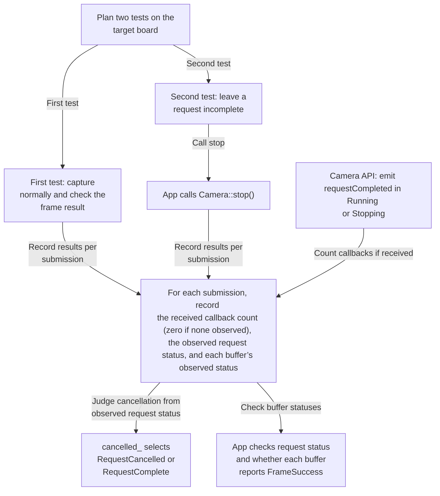

[Mermaid source](https://ttolsun.github.io/libcamera-sdd/en/request-lifecycle.stop-notification-boundary-vendor.mmd)

<details open>
<summary>Diagram evidence and verification scope</summary>

How can we check normal capture and stopping with an incomplete request on the target board?

Source-linked interpretation · automatic link check only · meaning and device execution not yet verified

| Elements and transitions | Source evidence |
| --- | --- |
| App calls Camera::stop() | [src/libcamera/camera.cpp:1431](https://ttolsun.github.io/libcamera-sdd/en/reader-archive/request-lifecycle.html#source-e09324743def3f09) |
| cancelled\_ selects RequestCancelled or RequestComplete | [src/libcamera/request.cpp:103](https://ttolsun.github.io/libcamera-sdd/en/reader-archive/request-lifecycle.html#source-db7f21585c4c2708) |
| Camera API: emit requestCompleted in Running or Stopping | [src/libcamera/camera.cpp:1481](https://ttolsun.github.io/libcamera-sdd/en/reader-archive/request-lifecycle.html#source-d53c87090347ce81) |
| App checks request status and whether each buffer reports FrameSuccess | [src/libcamera/camera.cpp:1481](https://ttolsun.github.io/libcamera-sdd/en/reader-archive/request-lifecycle.html#source-d53c87090347ce81) · [src/libcamera/request.cpp:103](https://ttolsun.github.io/libcamera-sdd/en/reader-archive/request-lifecycle.html#source-db7f21585c4c2708) · [src/libcamera/framebuffer.cpp:40](https://ttolsun.github.io/libcamera-sdd/en/reader-archive/request-lifecycle.html#source-50aa8a55cc04062e) |
| Plan two tests on the target board | [src/libcamera/camera.cpp:1431](https://ttolsun.github.io/libcamera-sdd/en/reader-archive/request-lifecycle.html#source-e09324743def3f09) · [src/libcamera/framebuffer.cpp:40](https://ttolsun.github.io/libcamera-sdd/en/reader-archive/request-lifecycle.html#source-50aa8a55cc04062e) |
| First test: capture normally and check the frame result | [src/libcamera/framebuffer.cpp:40](https://ttolsun.github.io/libcamera-sdd/en/reader-archive/request-lifecycle.html#source-50aa8a55cc04062e) · [src/libcamera/camera.cpp:1481](https://ttolsun.github.io/libcamera-sdd/en/reader-archive/request-lifecycle.html#source-d53c87090347ce81) |
| Second test: leave a request incomplete | [src/libcamera/camera.cpp:1431](https://ttolsun.github.io/libcamera-sdd/en/reader-archive/request-lifecycle.html#source-e09324743def3f09) · [src/libcamera/pipeline_handler.cpp:359](https://ttolsun.github.io/libcamera-sdd/en/reader-archive/request-lifecycle.html#source-eefd1bbecb1aad0a) |
| For each submission, record the received callback count (zero if none observed), the observed request status, and each buffer’s observed status | [src/libcamera/camera.cpp:1481](https://ttolsun.github.io/libcamera-sdd/en/reader-archive/request-lifecycle.html#source-d53c87090347ce81) · [src/libcamera/request.cpp:103](https://ttolsun.github.io/libcamera-sdd/en/reader-archive/request-lifecycle.html#source-db7f21585c4c2708) · [src/libcamera/framebuffer.cpp:40](https://ttolsun.github.io/libcamera-sdd/en/reader-archive/request-lifecycle.html#source-50aa8a55cc04062e) |
| First test | [src/libcamera/framebuffer.cpp:40](https://ttolsun.github.io/libcamera-sdd/en/reader-archive/request-lifecycle.html#source-50aa8a55cc04062e) |
| Second test | [src/libcamera/camera.cpp:1431](https://ttolsun.github.io/libcamera-sdd/en/reader-archive/request-lifecycle.html#source-e09324743def3f09) · [src/libcamera/pipeline_handler.cpp:359](https://ttolsun.github.io/libcamera-sdd/en/reader-archive/request-lifecycle.html#source-eefd1bbecb1aad0a) |
| Record results per submission | [src/libcamera/camera.cpp:1481](https://ttolsun.github.io/libcamera-sdd/en/reader-archive/request-lifecycle.html#source-d53c87090347ce81) · [src/libcamera/framebuffer.cpp:40](https://ttolsun.github.io/libcamera-sdd/en/reader-archive/request-lifecycle.html#source-50aa8a55cc04062e) |
| Call stop | [src/libcamera/camera.cpp:1431](https://ttolsun.github.io/libcamera-sdd/en/reader-archive/request-lifecycle.html#source-e09324743def3f09) |
| Record results per submission | [src/libcamera/camera.cpp:1431](https://ttolsun.github.io/libcamera-sdd/en/reader-archive/request-lifecycle.html#source-e09324743def3f09) · [src/libcamera/camera.cpp:1481](https://ttolsun.github.io/libcamera-sdd/en/reader-archive/request-lifecycle.html#source-d53c87090347ce81) |
| Count callbacks if received | [src/libcamera/camera.cpp:1481](https://ttolsun.github.io/libcamera-sdd/en/reader-archive/request-lifecycle.html#source-d53c87090347ce81) |
| Judge cancellation from observed request status | [src/libcamera/request.cpp:103](https://ttolsun.github.io/libcamera-sdd/en/reader-archive/request-lifecycle.html#source-db7f21585c4c2708) |
| Check buffer statuses | [src/libcamera/request.cpp:103](https://ttolsun.github.io/libcamera-sdd/en/reader-archive/request-lifecycle.html#source-db7f21585c4c2708) · [src/libcamera/framebuffer.cpp:40](https://ttolsun.github.io/libcamera-sdd/en/reader-archive/request-lifecycle.html#source-50aa8a55cc04062e) |

</details>

## Boundary between hardware and the common layer

When all media devices needed for a single pipeline are found, the implementer of `PipelineHandler::match()` must call `MediaDevice::acquire()` to acquire each device, then create one or more corresponding `Camera` instances, store them internally, register them with the camera manager, and return `true`. When not all required media devices are found, the implementer of `PipelineHandler::match()` must not acquire any devices if none have yet been acquired; if some have already been acquired, the implementer must call `MediaDevice::release()` to release all acquired devices and return `false`. `PipelineHandler::match()` is called on the `CameraManager` thread and, if it returns `true`, a new `PipelineHandler` instance is created and that instance's `match()` is called.

### Acquisition and registration for device matching and cleanup on failure

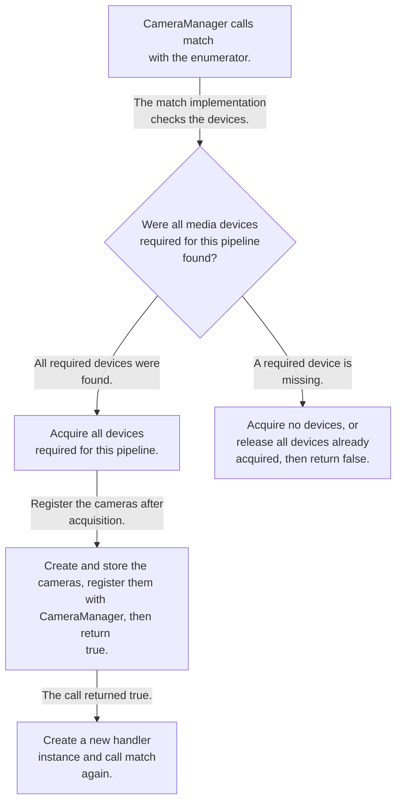

[Mermaid source](https://ttolsun.github.io/libcamera-sdd/en/vendor-integration.item-boundary.mmd)

<details open>
<summary>Diagram evidence and verification scope</summary>

Who matches devices and registers cameras, and how are the acquired devices handled depending on the match result?

Source-linked interpretation · automatic link check only · meaning and device execution not yet verified

| Elements and transitions | Source evidence |
| --- | --- |
| CameraManager calls match with the enumerator. | [src/libcamera/pipeline_handler.cpp:91](https://ttolsun.github.io/libcamera-sdd/en/reader-archive/vendor-integration.html#source-5109302527925a6a) |
| Were all media devices required for this pipeline found? | [src/libcamera/pipeline_handler.cpp:91](https://ttolsun.github.io/libcamera-sdd/en/reader-archive/vendor-integration.html#source-5109302527925a6a) |
| Acquire all devices required for this pipeline. | [src/libcamera/pipeline_handler.cpp:91](https://ttolsun.github.io/libcamera-sdd/en/reader-archive/vendor-integration.html#source-5109302527925a6a) |
| Create and store the cameras, register them with CameraManager, then return true. | [src/libcamera/pipeline_handler.cpp:91](https://ttolsun.github.io/libcamera-sdd/en/reader-archive/vendor-integration.html#source-5109302527925a6a) |
| Create a new handler instance and call match again. | [src/libcamera/pipeline_handler.cpp:109](https://ttolsun.github.io/libcamera-sdd/en/reader-archive/vendor-integration.html#source-1afff120b5d66b3c) |
| Acquire no devices, or release all devices already acquired, then return false. | [src/libcamera/pipeline_handler.cpp:97](https://ttolsun.github.io/libcamera-sdd/en/reader-archive/vendor-integration.html#source-293bf5d4775550d0) |
| The match implementation checks the devices. | [src/libcamera/pipeline_handler.cpp:91](https://ttolsun.github.io/libcamera-sdd/en/reader-archive/vendor-integration.html#source-5109302527925a6a) |
| All required devices were found. | [src/libcamera/pipeline_handler.cpp:91](https://ttolsun.github.io/libcamera-sdd/en/reader-archive/vendor-integration.html#source-5109302527925a6a) |
| A required device is missing. | [src/libcamera/pipeline_handler.cpp:91](https://ttolsun.github.io/libcamera-sdd/en/reader-archive/vendor-integration.html#source-5109302527925a6a) · [src/libcamera/pipeline_handler.cpp:97](https://ttolsun.github.io/libcamera-sdd/en/reader-archive/vendor-integration.html#source-293bf5d4775550d0) |
| Register the cameras after acquisition. | [src/libcamera/pipeline_handler.cpp:91](https://ttolsun.github.io/libcamera-sdd/en/reader-archive/vendor-integration.html#source-5109302527925a6a) |
| The call returned true. | [src/libcamera/pipeline_handler.cpp:91](https://ttolsun.github.io/libcamera-sdd/en/reader-archive/vendor-integration.html#source-5109302527925a6a) · [src/libcamera/pipeline_handler.cpp:109](https://ttolsun.github.io/libcamera-sdd/en/reader-archive/vendor-integration.html#source-1afff120b5d66b3c) |

</details>

<details open>
<summary>Section-wide evidence: 3</summary>

- `src/libcamera/pipeline_handler.cpp`[`L91` excerpt](https://ttolsun.github.io/libcamera-sdd/en/reader-archive/vendor-integration.html#source-5109302527925a6a) · [Full source `L91`](https://github.com/TTolsun/libcamera-sdd/blob/adfa719f8ed67d18fd8a0739fc088a1f8b9e7252/src/libcamera/pipeline_handler.cpp#L91) · [`L97` excerpt](https://ttolsun.github.io/libcamera-sdd/en/reader-archive/vendor-integration.html#source-293bf5d4775550d0) · [Full source `L97`](https://github.com/TTolsun/libcamera-sdd/blob/adfa719f8ed67d18fd8a0739fc088a1f8b9e7252/src/libcamera/pipeline_handler.cpp#L97) · [`L109` excerpt](https://ttolsun.github.io/libcamera-sdd/en/reader-archive/vendor-integration.html#source-1afff120b5d66b3c) · [Full source `L109`](https://github.com/TTolsun/libcamera-sdd/blob/adfa719f8ed67d18fd8a0739fc088a1f8b9e7252/src/libcamera/pipeline_handler.cpp#L109)

</details>

## Source manuscripts and review records

<details open>
<summary>libcamera design document</summary>

- **Contracts between documents**: [Automated comparison report](https://ttolsun.github.io/libcamera-sdd/contract-consistency.json) · Before human review

[Open earlier detail](https://ttolsun.github.io/libcamera-sdd/en/reader-archive/index.html#page-evidence)

</details>

<details open>
<summary>Integration guide</summary>

- **Generation method**: Extracted facts and LLM explanation
- **Validation scope**: Tables and figures are created from facts, and the explanations are written by the LLM. Citation, sentence, and configured structure checks are applied.
- **Automated check**: Passed (`ok`). The items checked are listed in the verification scope. Whether the explanation content is correct is checked by a human reviewer.
- **Human review**: Before human review
- **Analysis baseline commit**: `adfa719f8ed67d18fd8a0739fc088a1f8b9e7252`
- **Document generation time**: `2026-11-26 16:20:34+00:00`
- **Sentence generation model**: `cli/codex/gpt-6.1-terra`
- **Contracts between documents**: [Automated comparison report](https://ttolsun.github.io/libcamera-sdd/contract-consistency.json) · Before human review
- **Enter product description**: [Scope, conditions, and sources](https://ttolsun.github.io/libcamera-sdd/product-context.json)

<details open>
<summary>Record from when the manuscript was written</summary>

This is a record saved in the manuscript as of that time. It may differ from the current document's standards.

- Evidence files: `include/libcamera/camera.h`, `include/libcamera/internal/ipa_manager.h`, `include/libcamera/internal/pipeline_handler.h`, `product-evidence/libcamera-rcar-gen4-build/rcar-gen4-build-record.txt`, `src/libcamera/camera.cpp`, `src/libcamera/ipa_manager.cpp`, `src/libcamera/pipeline/ipu3/ipu3.cpp`, `src/libcamera/pipeline/rkisp1/rkisp1.cpp`, `src/libcamera/pipeline_handler.cpp`
- Evidence level: code verified (static analysis, simple_compdb configuration, commit `adfa719f8e`)
- Automated check (citation, sentence, and configured structure checks): passed
- Review status recorded: 2026-11-27 · Awaiting human review

</details>

[Markdown source ↗](https://ttolsun.github.io/libcamera-sdd/vendor-integration.md) [Mermaid source ↗](https://ttolsun.github.io/libcamera-sdd/en/vendor-integration.mmd)

[Open earlier detail](https://ttolsun.github.io/libcamera-sdd/en/reader-archive/vendor-integration.html#page-evidence)

</details>

[Download page Markdown](https://ttolsun.github.io/libcamera-sdd/en/for-vendor.md) · [Reader edition source map](https://ttolsun.github.io/libcamera-sdd/reader-edition.json)

<a id="doc-5"></a>

ForVendor

# Features and Support

English translation · human review pending. Review states below refer to the Korean source.

Use the representative examples below to find handlers relevant to your hardware. Consult the platform list for more devices, and check the build options and configuration result separately.

- [Full platform list and build options](#d5-platform-support)
- [Verification procedure for the target board](#doc-6)

| Support category | Example hardware or use | Handler to check |
| --- | --- | --- |
| Dedicated | Intel IPU3 | ipu3 |
| Dedicated | NXP i.MX8MP | imx8-isi and rkisp1 |
| Dedicated | Rockchip RK3399 | rkisp1 |
| Generic | USB video device class camera | uvcvideo |
| Generic | iMX7 / IPU6 / Allwinner Sun6i | simple |
| Testing | Virtual media controller | vimc |

## <a id="d5-platform-support"></a>Supported hardware and build selection

The documentation lists Arm Mali-C55, Intel IPU3 (`ipu3`), NXP i.MX8MP (`imx8-isi` and `rkisp1`), RaspberryPi 3, 4 and zero (`rpi/vc4`), and Rockchip RK3399 (`rkisp1`) as hardware platforms currently supported by the library with dedicated pipeline handlers. The documentation identifies USB video device class cameras (`uvcvideo`), iMX7, IPU6, Allwinner Sun6i (`simple`), and the virtual media controller driver for testing (`vimc`) as targets for which libcamera provides generic support.

The pipeline handlers to build are selected in the array option `pipelines`, whose default is `auto`. Selecting `auto` builds all pipelines applicable to the target architecture, while selecting `all` builds all pipelines. If both values are selected, `all` takes precedence. The individual choices are `imx8-isi`, `ipu3`, `mali-c55`, `rkisp1`, `rpi/pisp`, `rpi/vc4`, `simple`, `uvcvideo`, `vimc`, and `virtual`.

### Raspberry Pi sensor integration requirements

The minimum margin between frame length and integration time for `CamHelperStarvis2` defaults to 4 lines. `imx585` and `imx676` are registered with `create585`, which passes 8 lines. A comment in the helper code explains that both sensor manuals specify a minimum of 8 lines for `SHR0`. The exposure limit calculation accounts for this margin in the frame length and limits the exposure line count to the smaller of the frame length minus the margin and the requested exposure in lines.

#### Starvis2 exposure limit

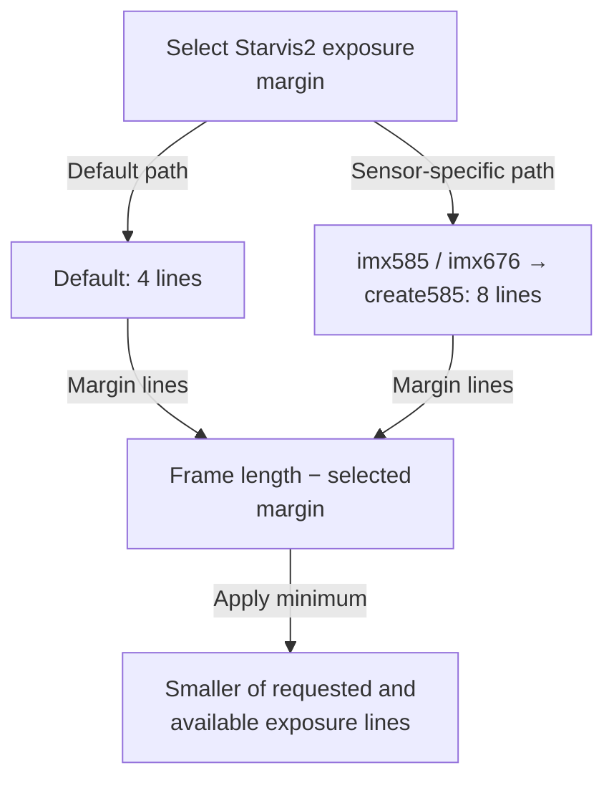

[Mermaid source](https://ttolsun.github.io/libcamera-sdd/en/vendor-overview.starvis2-exposure-limit.mmd)

<details open>
<summary>Diagram evidence and verification scope</summary>

How can the exposure margin limit the requested exposure?

Source-linked interpretation · automatic link check only · meaning and device execution not yet verified

| Elements and transitions | Source evidence |
| --- | --- |
| Select Starvis2 exposure margin | [src/ipa/rpi/cam_helper/cam_helper_starvis2.cpp:17](https://ttolsun.github.io/libcamera-sdd/en/reader-archive/vendor-overview.html#source-a24a98731281b4ed) |
| Default: 4 lines | [src/ipa/rpi/cam_helper/cam_helper_starvis2.cpp:17](https://ttolsun.github.io/libcamera-sdd/en/reader-archive/vendor-overview.html#source-a24a98731281b4ed) |
| imx585 / imx676 → create585: 8 lines | [src/ipa/rpi/cam_helper/cam_helper_starvis2.cpp:17](https://ttolsun.github.io/libcamera-sdd/en/reader-archive/vendor-overview.html#source-a24a98731281b4ed) |
| Frame length − selected margin | [src/ipa/rpi/cam_helper/cam_helper.cpp:105](https://ttolsun.github.io/libcamera-sdd/en/reader-archive/vendor-overview.html#source-74499d75cde7fa55) |
| Smaller of requested and available exposure lines | [src/ipa/rpi/cam_helper/cam_helper.cpp:105](https://ttolsun.github.io/libcamera-sdd/en/reader-archive/vendor-overview.html#source-74499d75cde7fa55) |
| Default path | [src/ipa/rpi/cam_helper/cam_helper_starvis2.cpp:17](https://ttolsun.github.io/libcamera-sdd/en/reader-archive/vendor-overview.html#source-a24a98731281b4ed) |
| Sensor-specific path | [src/ipa/rpi/cam_helper/cam_helper_starvis2.cpp:17](https://ttolsun.github.io/libcamera-sdd/en/reader-archive/vendor-overview.html#source-a24a98731281b4ed) |
| Margin lines | [src/ipa/rpi/cam_helper/cam_helper.cpp:105](https://ttolsun.github.io/libcamera-sdd/en/reader-archive/vendor-overview.html#source-74499d75cde7fa55) |
| Margin lines | [src/ipa/rpi/cam_helper/cam_helper.cpp:105](https://ttolsun.github.io/libcamera-sdd/en/reader-archive/vendor-overview.html#source-74499d75cde7fa55) |
| Apply minimum | [src/ipa/rpi/cam_helper/cam_helper.cpp:105](https://ttolsun.github.io/libcamera-sdd/en/reader-archive/vendor-overview.html#source-74499d75cde7fa55) |

</details>

Runtime verification: Sensor names and helper creation functions are registered in `RegisterCamHelper`, and frame and exposure limit code is present. To verify that capture and exposure work on the target board, you must check the relevant constraints in the target pipeline and the kernel driver's sensor mode.

<details open>
<summary>Section-wide evidence: 4</summary>

- `Documentation/platform_support.rst`[`L6` excerpt](https://ttolsun.github.io/libcamera-sdd/en/reader-archive/vendor-overview.html#source-9d6502e234c4647d) · [Full source `L6`](https://github.com/TTolsun/libcamera-sdd/blob/adfa719f8ed67d18fd8a0739fc088a1f8b9e7252/Documentation/platform_support.rst#L6)
- `meson_options.txt`[`L75` excerpt](https://ttolsun.github.io/libcamera-sdd/en/reader-archive/vendor-overview.html#source-691389506fe87b32) · [Full source `L75`](https://github.com/TTolsun/libcamera-sdd/blob/adfa719f8ed67d18fd8a0739fc088a1f8b9e7252/meson_options.txt#L75)
- `src/ipa/rpi/cam_helper/cam_helper_starvis2.cpp`[`L17` excerpt](https://ttolsun.github.io/libcamera-sdd/en/reader-archive/vendor-overview.html#source-a24a98731281b4ed) · [Full source `L17`](https://github.com/TTolsun/libcamera-sdd/blob/adfa719f8ed67d18fd8a0739fc088a1f8b9e7252/src/ipa/rpi/cam_helper/cam_helper_starvis2.cpp#L17)
- `src/ipa/rpi/cam_helper/cam_helper.cpp`[`L105` excerpt](https://ttolsun.github.io/libcamera-sdd/en/reader-archive/vendor-overview.html#source-74499d75cde7fa55) · [Full source `L105`](https://github.com/TTolsun/libcamera-sdd/blob/adfa719f8ed67d18fd8a0739fc088a1f8b9e7252/src/ipa/rpi/cam_helper/cam_helper.cpp#L105)

</details>

## Provided functionality and supported scope

`Camera` models a camera capable of producing one or more image streams from a single image source. It is the central object in libcamera, providing the main interface for configuring and controlling the device and capturing image streams. The device-specific `PipelineHandler` configures the hardware pipeline according to the stream configuration. A `PipelineHandler` implementation must match the required media devices with devices in the system and create the corresponding `Camera` instances once all of them can be acquired, and every `PipelineHandler` subclass must be registered with libcamera using the `REGISTER_PIPELINE_HANDLER()` macro.

### Boundary between the common Camera and device-specific implementations

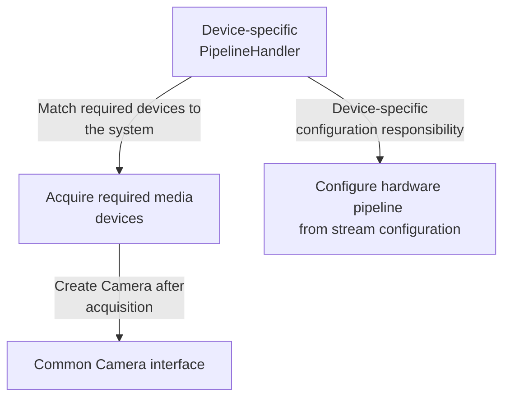

[Mermaid source](https://ttolsun.github.io/libcamera-sdd/en/vendor-overview.hardware-boundary.mmd)

<details open>
<summary>Diagram evidence and verification scope</summary>

This shows how responsibilities are connected between the common Camera and device-specific PipelineHandler. It distinguishes hardware configuration based on stream configuration from responsibility for device matching and Camera creation, and does not guarantee the complete execution order, supported models, or performance.

Source-linked interpretation · automatic link check only · meaning and device execution not yet verified

| Elements and transitions | Source evidence |
| --- | --- |
| Device-specific PipelineHandler | [src/libcamera/pipeline_handler.cpp:30](https://ttolsun.github.io/libcamera-sdd/en/reader-archive/vendor-overview.html#source-05721740b01bcd0e) |
| Acquire required media devices | [src/libcamera/pipeline_handler.cpp:30](https://ttolsun.github.io/libcamera-sdd/en/reader-archive/vendor-overview.html#source-05721740b01bcd0e) |
| Common Camera interface | [src/libcamera/camera.cpp:752](https://ttolsun.github.io/libcamera-sdd/en/reader-archive/vendor-overview.html#source-8264067114dccdee) |
| Configure hardware pipeline from stream configuration | [Documentation/libcamera_architecture.rst:86](https://ttolsun.github.io/libcamera-sdd/en/reader-archive/vendor-overview.html#source-94ac8aab4dea2a65) |
| Device-specific configuration responsibility | [Documentation/libcamera_architecture.rst:86](https://ttolsun.github.io/libcamera-sdd/en/reader-archive/vendor-overview.html#source-94ac8aab4dea2a65) |
| Match required devices to the system | [src/libcamera/pipeline_handler.cpp:30](https://ttolsun.github.io/libcamera-sdd/en/reader-archive/vendor-overview.html#source-05721740b01bcd0e) |
| Create Camera after acquisition | [src/libcamera/pipeline_handler.cpp:30](https://ttolsun.github.io/libcamera-sdd/en/reader-archive/vendor-overview.html#source-05721740b01bcd0e) |

</details>

<details open>
<summary>Section-wide evidence: 3</summary>

- `src/libcamera/camera.cpp`[`L752` excerpt](https://ttolsun.github.io/libcamera-sdd/en/reader-archive/vendor-overview.html#source-8264067114dccdee) · [Full source `L752`](https://github.com/TTolsun/libcamera-sdd/blob/adfa719f8ed67d18fd8a0739fc088a1f8b9e7252/src/libcamera/camera.cpp#L752)
- `src/libcamera/pipeline_handler.cpp`[`L30` excerpt](https://ttolsun.github.io/libcamera-sdd/en/reader-archive/vendor-overview.html#source-05721740b01bcd0e) · [Full source `L30`](https://github.com/TTolsun/libcamera-sdd/blob/adfa719f8ed67d18fd8a0739fc088a1f8b9e7252/src/libcamera/pipeline_handler.cpp#L30)
- `Documentation/libcamera_architecture.rst`[`L86` excerpt](https://ttolsun.github.io/libcamera-sdd/en/reader-archive/vendor-overview.html#source-94ac8aab4dea2a65) · [Full source `L86`](https://github.com/TTolsun/libcamera-sdd/blob/adfa719f8ed67d18fd8a0739fc088a1f8b9e7252/Documentation/libcamera_architecture.rst#L86)

</details>

## Support conditions and constraints

`CameraConfiguration::Invalid` means that the configuration is invalid and cannot be adjusted, and may occur only in extreme cases such as when the configuration is empty. `CameraConfiguration::Adjusted` indicates that the configuration has been adjusted and is valid after adjustment. If `CameraConfiguration::validate()` returns `Adjusted`, parameters may have changed for any stream, only some streams may have changed, and stream configurations may have been removed. When the status is `CameraConfiguration::Adjusted`, the caller must check the configuration carefully.

### Caller responsibilities by validate() result.

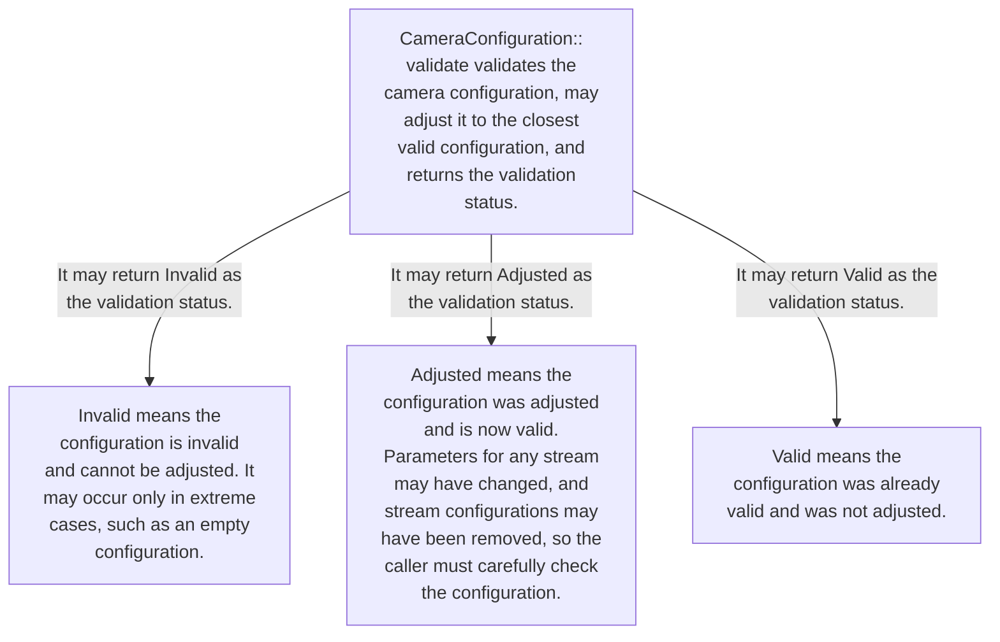

[Mermaid source](https://ttolsun.github.io/libcamera-sdd/en/vendor-assurance.validation-results.mmd)

<details open>
<summary>Diagram evidence and verification scope</summary>

What do Invalid, Adjusted, and Valid mean for validate()? If the result is Adjusted, what must the caller check again?

Source-linked interpretation · automatic link check only · meaning and device execution not yet verified

LLM diagram draft · before human review

Authoring model: `cli/codex/gpt-6.1-terra`

| Elements and transitions | Source evidence |
| --- | --- |
| CameraConfiguration::validate validates the camera configuration, may adjust it to the closest valid configuration, and returns the validation status. | [src/libcamera/camera.cpp:323](https://ttolsun.github.io/libcamera-sdd/en/reader-archive/vendor-assurance.html#source-2b31e92e3fb3f083) |
| Invalid means the configuration is invalid and cannot be adjusted. It may occur only in extreme cases, such as an empty configuration. | [src/libcamera/camera.cpp:323](https://ttolsun.github.io/libcamera-sdd/en/reader-archive/vendor-assurance.html#source-2b31e92e3fb3f083) |
| Adjusted means the configuration was adjusted and is now valid. Parameters for any stream may have changed, and stream configurations may have been removed, so the caller must carefully check the configuration. | [src/libcamera/camera.cpp:323](https://ttolsun.github.io/libcamera-sdd/en/reader-archive/vendor-assurance.html#source-2b31e92e3fb3f083) |
| Valid means the configuration was already valid and was not adjusted. | [src/libcamera/camera.cpp:323](https://ttolsun.github.io/libcamera-sdd/en/reader-archive/vendor-assurance.html#source-2b31e92e3fb3f083) |
| It may return Invalid as the validation status. | [src/libcamera/camera.cpp:323](https://ttolsun.github.io/libcamera-sdd/en/reader-archive/vendor-assurance.html#source-2b31e92e3fb3f083) |
| It may return Adjusted as the validation status. | [src/libcamera/camera.cpp:323](https://ttolsun.github.io/libcamera-sdd/en/reader-archive/vendor-assurance.html#source-2b31e92e3fb3f083) |
| It may return Valid as the validation status. | [src/libcamera/camera.cpp:323](https://ttolsun.github.io/libcamera-sdd/en/reader-archive/vendor-assurance.html#source-2b31e92e3fb3f083) |

</details>

## Configuration interface to implement

The caller of `generateConfiguration` must populate `roles` with the use cases for which it wants to obtain a default configuration. The configuration returned by `generateConfiguration()` contains information that allows the caller to identify the selected streams and their default parameters. `PipelineHandler::generateConfiguration()` must return a valid `CameraConfiguration` if the requested `roles` can be satisfied, and otherwise must return a `null` pointer. The implementation of `PipelineHandler::generateConfiguration()` may be called from any thread and therefore must be thread-safe.

### Inputs and results by configuration interface

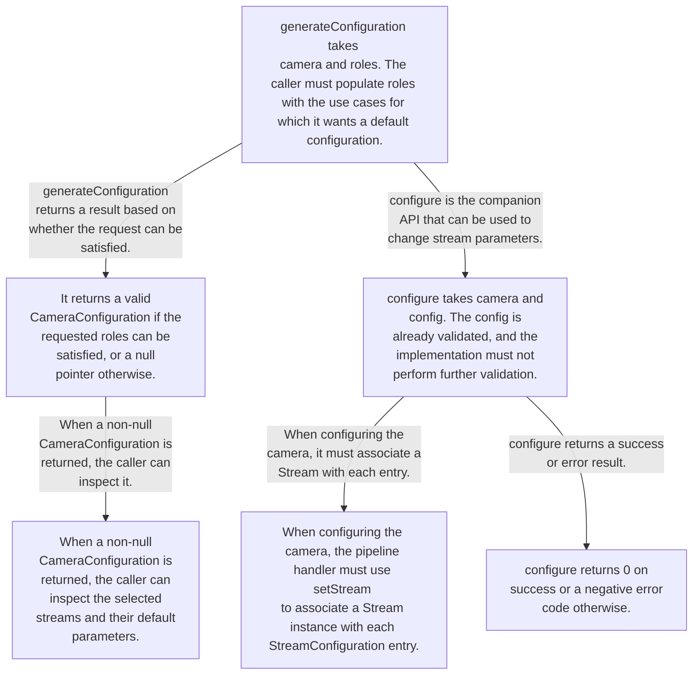

[Mermaid source](https://ttolsun.github.io/libcamera-sdd/en/vendor-integration.handler-configuration-contracts.mmd)

<details open>
<summary>Diagram evidence and verification scope</summary>

What are the inputs and return values of generateConfiguration and configure, and what is the obligation to connect Streams on success?

Source-linked interpretation · automatic link check only · meaning and device execution not yet verified

LLM diagram draft · before human review

Authoring model: `cli/codex/gpt-6.1-terra`

| Elements and transitions | Source evidence |
| --- | --- |
| generateConfiguration takes camera and roles. The caller must populate roles with the use cases for which it wants a default configuration. | [src/libcamera/pipeline_handler.cpp:271](https://ttolsun.github.io/libcamera-sdd/en/reader-archive/vendor-integration.html#source-23ff032cd1152d56) |
| It returns a valid CameraConfiguration if the requested roles can be satisfied, or a null pointer otherwise. | [src/libcamera/pipeline_handler.cpp:271](https://ttolsun.github.io/libcamera-sdd/en/reader-archive/vendor-integration.html#source-23ff032cd1152d56) |
| When a non-null CameraConfiguration is returned, the caller can inspect the selected streams and their default parameters. | [src/libcamera/pipeline_handler.cpp:271](https://ttolsun.github.io/libcamera-sdd/en/reader-archive/vendor-integration.html#source-23ff032cd1152d56) |
| configure takes camera and config. The config is already validated, and the implementation must not perform further validation. | [src/libcamera/pipeline_handler.cpp:294](https://ttolsun.github.io/libcamera-sdd/en/reader-archive/vendor-integration.html#source-4255f8449e37ebb8) |
| configure returns 0 on success or a negative error code otherwise. | [src/libcamera/pipeline_handler.cpp:294](https://ttolsun.github.io/libcamera-sdd/en/reader-archive/vendor-integration.html#source-4255f8449e37ebb8) |
| When configuring the camera, the pipeline handler must use setStream to associate a Stream instance with each StreamConfiguration entry. | [src/libcamera/pipeline_handler.cpp:294](https://ttolsun.github.io/libcamera-sdd/en/reader-archive/vendor-integration.html#source-4255f8449e37ebb8) |
| generateConfiguration returns a result based on whether the request can be satisfied. | [src/libcamera/pipeline_handler.cpp:271](https://ttolsun.github.io/libcamera-sdd/en/reader-archive/vendor-integration.html#source-23ff032cd1152d56) |
| When a non-null CameraConfiguration is returned, the caller can inspect it. | [src/libcamera/pipeline_handler.cpp:271](https://ttolsun.github.io/libcamera-sdd/en/reader-archive/vendor-integration.html#source-23ff032cd1152d56) |
| configure is the companion API that can be used to change stream parameters. | [src/libcamera/pipeline_handler.cpp:271](https://ttolsun.github.io/libcamera-sdd/en/reader-archive/vendor-integration.html#source-23ff032cd1152d56) |
| When configuring the camera, it must associate a Stream with each entry. | [src/libcamera/pipeline_handler.cpp:294](https://ttolsun.github.io/libcamera-sdd/en/reader-archive/vendor-integration.html#source-4255f8449e37ebb8) |
| configure returns a success or error result. | [src/libcamera/pipeline_handler.cpp:294](https://ttolsun.github.io/libcamera-sdd/en/reader-archive/vendor-integration.html#source-4255f8449e37ebb8) |

</details>

Implementers of `PipelineHandler::generateConfiguration()` must not change the state of `camera` in the pipeline handler. The configuration passed to `PipelineHandler::configure()` is guaranteed to have been validated by `CameraConfiguration::validate()`, so the pipeline handler implementation must not perform additional validation. The `PipelineHandler::configure()` implementation may rely on all custom fields stored in its own `CameraConfiguration`-derived class. When configuring the camera, implementers of `PipelineHandler::configure()` must use `StreamConfiguration::setStream()` to associate a `Stream` instance with each `StreamConfiguration` entry in `CameraConfiguration`.

`PipelineHandler::configure()` is called on the `CameraManager` thread, and the implementation must return `0` on success and a negative error code on failure.

<details open>
<summary>Section-wide evidence: 11</summary>

- `src/libcamera/pipeline_handler.cpp`[`L276` excerpt](https://ttolsun.github.io/libcamera-sdd/en/reader-archive/vendor-integration.html#source-924d43ea4bcaf94b) · [Full source `L276`](https://github.com/TTolsun/libcamera-sdd/blob/adfa719f8ed67d18fd8a0739fc088a1f8b9e7252/src/libcamera/pipeline_handler.cpp#L276) · [`L289` excerpt](https://ttolsun.github.io/libcamera-sdd/en/reader-archive/vendor-integration.html#source-4abbe39594a1bd27) · [Full source `L289`](https://github.com/TTolsun/libcamera-sdd/blob/adfa719f8ed67d18fd8a0739fc088a1f8b9e7252/src/libcamera/pipeline_handler.cpp#L289) · [`L285` excerpt](https://ttolsun.github.io/libcamera-sdd/en/reader-archive/vendor-integration.html#source-2eae247c4c37371c) · [Full source `L285`](https://github.com/TTolsun/libcamera-sdd/blob/adfa719f8ed67d18fd8a0739fc088a1f8b9e7252/src/libcamera/pipeline_handler.cpp#L285) · [`L286` excerpt](https://ttolsun.github.io/libcamera-sdd/en/reader-archive/vendor-integration.html#source-25fb9495d4ab94a1) · [Full source `L286`](https://github.com/TTolsun/libcamera-sdd/blob/adfa719f8ed67d18fd8a0739fc088a1f8b9e7252/src/libcamera/pipeline_handler.cpp#L286) · [`L304` excerpt](https://ttolsun.github.io/libcamera-sdd/en/reader-archive/vendor-integration.html#source-31c5407347b4d0d8) · [Full source `L304`](https://github.com/TTolsun/libcamera-sdd/blob/adfa719f8ed67d18fd8a0739fc088a1f8b9e7252/src/libcamera/pipeline_handler.cpp#L304) · [`L306` excerpt](https://ttolsun.github.io/libcamera-sdd/en/reader-archive/vendor-integration.html#source-71079779113f431c) · [Full source `L306`](https://github.com/TTolsun/libcamera-sdd/blob/adfa719f8ed67d18fd8a0739fc088a1f8b9e7252/src/libcamera/pipeline_handler.cpp#L306) · [`L309` excerpt](https://ttolsun.github.io/libcamera-sdd/en/reader-archive/vendor-integration.html#source-f3cf94b1dc7b9457) · [Full source `L309`](https://github.com/TTolsun/libcamera-sdd/blob/adfa719f8ed67d18fd8a0739fc088a1f8b9e7252/src/libcamera/pipeline_handler.cpp#L309) · [`L313` excerpt](https://ttolsun.github.io/libcamera-sdd/en/reader-archive/vendor-integration.html#source-f87ceb096b9f931d) · [Full source `L313`](https://github.com/TTolsun/libcamera-sdd/blob/adfa719f8ed67d18fd8a0739fc088a1f8b9e7252/src/libcamera/pipeline_handler.cpp#L313) · [`L271`](https://ttolsun.github.io/libcamera-sdd/en/reader-archive/vendor-integration.html#source-23ff032cd1152d56) · [`L294`](https://ttolsun.github.io/libcamera-sdd/en/reader-archive/vendor-integration.html#source-4255f8449e37ebb8)
- `src/libcamera/camera.cpp`[`L1191`](https://ttolsun.github.io/libcamera-sdd/en/reader-archive/vendor-integration.html#source-603af0dd7fa357d0)

</details>

## Criteria for reading performance evidence

The built-in benchmark in `DebayerCpu` measures only the time spent processing statistics collection and debayering. It does not include the time spent capturing or outputting frames. The built-in benchmark can be used by running `cam` or `qcam` with a pipeline that uses the Software ISP.

<details open>
<summary>Section-wide evidence: 1</summary>

- `Documentation/software-isp-benchmarking.rst`[`L15` excerpt](https://ttolsun.github.io/libcamera-sdd/en/reader-archive/vendor-assurance.html#source-551d2b5944a36d19) · [Full source `L15`](https://github.com/TTolsun/libcamera-sdd/blob/adfa719f8ed67d18fd8a0739fc088a1f8b9e7252/Documentation/software-isp-benchmarking.rst#L15)

</details>

## Source manuscripts and review records

<details open>
<summary>libcamera product overview</summary>

- **Generation method**: Extracted facts and LLM explanation
- **Validation scope**: Tables and figures are created from facts, and the explanations are written by the LLM. Citation, sentence, and configured structure checks are applied.
- **Automated check**: Passed (`ok`). The items checked are listed in the verification scope. Whether the explanation content is correct is checked by a human reviewer.
- **Human review**: Before human review
- **Analysis baseline commit**: `adfa719f8ed67d18fd8a0739fc088a1f8b9e7252`
- **Document generation time**: `2026-11-21 20:16:03+00:00`
- **Sentence generation model**: `cli/codex/gpt-6.1-terra`
- **Contracts between documents**: [Automated comparison report](https://ttolsun.github.io/libcamera-sdd/contract-consistency.json) · Before human review
- **Reader scope**: [Answers by task and unreviewed scope](https://ttolsun.github.io/libcamera-sdd/reader-scope.json)
- **Enter product description**: [Scope, conditions, and sources](https://ttolsun.github.io/libcamera-sdd/product-context.json)

<details open>
<summary>Record from when the manuscript was written</summary>

This is a record saved in the manuscript as of that time. It may differ from the current document's standards.

- Evidence files: `Documentation/introduction.rst`, `Documentation/libcamera_architecture.rst`, `Documentation/platform_support.rst`, `include/libcamera/camera.h`, `include/libcamera/internal/ipa_manager.h`, `include/libcamera/internal/pipeline_handler.h`, `meson_options.txt`, `product-evidence/libcamera/official-stack.txt`, `src/ipa/rpi/cam_helper/cam_helper.cpp`, `src/ipa/rpi/cam_helper/cam_helper_starvis2.cpp`, `src/libcamera/camera.cpp`, `src/libcamera/ipa_manager.cpp`, `src/libcamera/pipeline/ipu3/ipu3.cpp`, `src/libcamera/pipeline/rkisp1/rkisp1.cpp`, `src/libcamera/pipeline_handler.cpp`
- Evidence level: code verified (static analysis, simple_compdb configuration, commit `adfa719f8e`)
- Automated check (citation, sentence, and configured structure checks): passed
- Review status recorded: 2026-11-22 · Awaiting human review

</details>

[Markdown source ↗](https://ttolsun.github.io/libcamera-sdd/vendor-overview.md) [Mermaid source ↗](https://ttolsun.github.io/libcamera-sdd/en/vendor-overview.mmd)

[Open earlier detail](https://ttolsun.github.io/libcamera-sdd/en/reader-archive/vendor-overview.html#page-evidence)

</details>

<details open>
<summary>Support scope and validation</summary>

- **Generation method**: Extracted facts and LLM explanation
- **Validation scope**: Tables and figures are created from facts, and the explanations are written by the LLM. Citation, sentence, and configured structure checks are applied.
- **Automated check**: Passed (`ok`). The items checked are listed in the verification scope. Whether the explanation content is correct is checked by a human reviewer.
- **Human review**: Before human review
- **Analysis baseline commit**: `adfa719f8ed67d18fd8a0739fc088a1f8b9e7252`
- **Document generation time**: `2026-11-20 16:39:19+00:00`
- **Sentence generation model**: `cli/codex/gpt-6.1-terra`
- **Contracts between documents**: [Automated comparison report](https://ttolsun.github.io/libcamera-sdd/contract-consistency.json) · Before human review
- **Enter product description**: [Scope, conditions, and sources](https://ttolsun.github.io/libcamera-sdd/product-context.json)

<details open>
<summary>Record from when the manuscript was written</summary>

This is a record saved in the manuscript as of that time. It may differ from the current document's standards.

- Evidence files: `Documentation/software-isp-benchmarking.rst`, `README.rst`, `include/libcamera/camera.h`, `include/libcamera/framebuffer.h`, `include/libcamera/internal/ipa_manager.h`, `include/libcamera/internal/pipeline_handler.h`, `include/libcamera/request.h`, `product-evidence/libcamera-first-capture-trial/virtual-first-capture-run.txt`, `src/libcamera/camera.cpp`, `src/libcamera/ipa_manager.cpp`, `src/libcamera/pipeline/ipu3/ipu3.cpp`, `src/libcamera/pipeline/rkisp1/rkisp1.cpp`, `src/libcamera/pipeline/virtual/README.md`, `src/libcamera/pipeline/virtual/data/virtual.yaml`, `src/libcamera/pipeline_handler.cpp`
- Evidence level: code verified (static analysis, simple_compdb configuration, commit `adfa719f8e`)
- Automated check (citation, sentence, and configured structure checks): passed
- Review status recorded on: 2026-11-21 · Awaiting human review

</details>

[Markdown source ↗](https://ttolsun.github.io/libcamera-sdd/vendor-assurance.md) [Mermaid source ↗](https://ttolsun.github.io/libcamera-sdd/en/vendor-assurance.mmd)

[Open earlier detail](https://ttolsun.github.io/libcamera-sdd/en/reader-archive/vendor-assurance.html#page-evidence)

</details>

<details open>
<summary>Integration guide</summary>

- **Generation method**: Extracted facts and LLM explanation
- **Validation scope**: Tables and figures are created from facts, and the explanations are written by the LLM. Citation, sentence, and configured structure checks are applied.
- **Automated check**: Passed (`ok`). The items checked are listed in the verification scope. Whether the explanation content is correct is checked by a human reviewer.
- **Human review**: Before human review
- **Analysis baseline commit**: `adfa719f8ed67d18fd8a0739fc088a1f8b9e7252`
- **Document generation time**: `2026-11-26 16:20:34+00:00`
- **Sentence generation model**: `cli/codex/gpt-6.1-terra`
- **Contracts between documents**: [Automated comparison report](https://ttolsun.github.io/libcamera-sdd/contract-consistency.json) · Before human review
- **Enter product description**: [Scope, conditions, and sources](https://ttolsun.github.io/libcamera-sdd/product-context.json)

<details open>
<summary>Record from when the manuscript was written</summary>

This is a record saved in the manuscript as of that time. It may differ from the current document's standards.

- Evidence files: `include/libcamera/camera.h`, `include/libcamera/internal/ipa_manager.h`, `include/libcamera/internal/pipeline_handler.h`, `product-evidence/libcamera-rcar-gen4-build/rcar-gen4-build-record.txt`, `src/libcamera/camera.cpp`, `src/libcamera/ipa_manager.cpp`, `src/libcamera/pipeline/ipu3/ipu3.cpp`, `src/libcamera/pipeline/rkisp1/rkisp1.cpp`, `src/libcamera/pipeline_handler.cpp`
- Evidence level: code verified (static analysis, simple_compdb configuration, commit `adfa719f8e`)
- Automated check (citation, sentence, and configured structure checks): passed
- Review status recorded: 2026-11-27 · Awaiting human review

</details>

[Markdown source ↗](https://ttolsun.github.io/libcamera-sdd/vendor-integration.md) [Mermaid source ↗](https://ttolsun.github.io/libcamera-sdd/en/vendor-integration.mmd)

[Open earlier detail](https://ttolsun.github.io/libcamera-sdd/en/reader-archive/vendor-integration.html#page-evidence)

</details>

[Download page Markdown](https://ttolsun.github.io/libcamera-sdd/en/features-and-support.md) · [Reader edition source map](https://ttolsun.github.io/libcamera-sdd/reader-edition.json)

<a id="doc-6"></a>

ForVendor

# Device Integration and Verification

English translation · human review pending. Review states below refer to the Korean source.

After integrating the device, test first capture and stopping with incomplete requests separately. Record observations from the public virtual camera separately from checks on the target board.

- [Completion notifications and status checks after stop](#d8-stop-and-disconnect)

## Integration order and responsibilities

To prepare for capture, the application must acquire and configure the camera. Once the camera is started, it can process requests until stopped, and the application must release it when finished using it. The application may start and stop the camera multiple times while it remains acquired, and may also reconfigure it. The `Camera` class generally does not synchronize functions that affect camera state with one another, so the caller must synchronize them when necessary.

### Integration order from acquisition to release

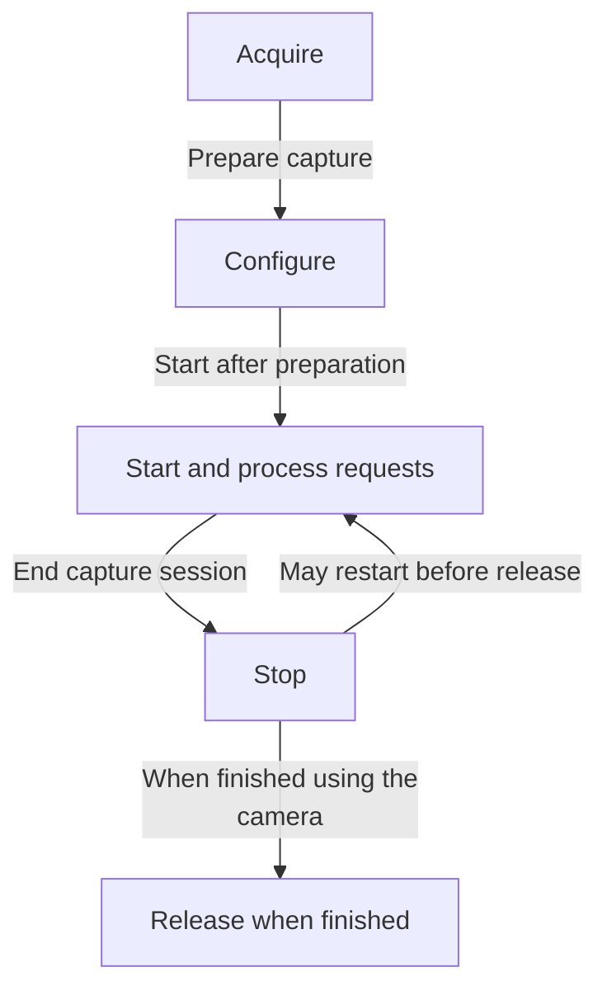

[Mermaid source](https://ttolsun.github.io/libcamera-sdd/en/vendor-integration.integration-stages.mmd)

<details open>
<summary>Diagram evidence and verification scope</summary>

This is the order of session preparation and teardown for the application. Start and stop may be repeated until the camera is released.

Source-linked interpretation · automatic link check only · meaning and device execution not yet verified

| Elements and transitions | Source evidence |
| --- | --- |
| Acquire | [src/libcamera/camera.cpp:771](https://ttolsun.github.io/libcamera-sdd/en/reader-archive/vendor-integration.html#source-2683b4a5a1dbfee9) |
| Configure | [src/libcamera/camera.cpp:771](https://ttolsun.github.io/libcamera-sdd/en/reader-archive/vendor-integration.html#source-2683b4a5a1dbfee9) |
| Start and process requests | [src/libcamera/camera.cpp:771](https://ttolsun.github.io/libcamera-sdd/en/reader-archive/vendor-integration.html#source-2683b4a5a1dbfee9) |
| Stop | [src/libcamera/camera.cpp:771](https://ttolsun.github.io/libcamera-sdd/en/reader-archive/vendor-integration.html#source-2683b4a5a1dbfee9) |
| Release when finished | [src/libcamera/camera.cpp:771](https://ttolsun.github.io/libcamera-sdd/en/reader-archive/vendor-integration.html#source-2683b4a5a1dbfee9) |
| Prepare capture | [src/libcamera/camera.cpp:771](https://ttolsun.github.io/libcamera-sdd/en/reader-archive/vendor-integration.html#source-2683b4a5a1dbfee9) |
| Start after preparation | [src/libcamera/camera.cpp:771](https://ttolsun.github.io/libcamera-sdd/en/reader-archive/vendor-integration.html#source-2683b4a5a1dbfee9) |
| End capture session | [src/libcamera/camera.cpp:771](https://ttolsun.github.io/libcamera-sdd/en/reader-archive/vendor-integration.html#source-2683b4a5a1dbfee9) |
| When finished using the camera | [src/libcamera/camera.cpp:771](https://ttolsun.github.io/libcamera-sdd/en/reader-archive/vendor-integration.html#source-2683b4a5a1dbfee9) |
| May restart before release | [src/libcamera/camera.cpp:777](https://ttolsun.github.io/libcamera-sdd/en/reader-archive/vendor-integration.html#source-948bd80fa1136291) |

</details>

<details open>
<summary>Section-wide evidence: 4</summary>

- `src/libcamera/camera.cpp`[`L771` excerpt](https://ttolsun.github.io/libcamera-sdd/en/reader-archive/vendor-integration.html#source-2683b4a5a1dbfee9) · [Full source `L771`](https://github.com/TTolsun/libcamera-sdd/blob/adfa719f8ed67d18fd8a0739fc088a1f8b9e7252/src/libcamera/camera.cpp#L771) · [`L777` excerpt](https://ttolsun.github.io/libcamera-sdd/en/reader-archive/vendor-integration.html#source-948bd80fa1136291) · [Full source `L777`](https://github.com/TTolsun/libcamera-sdd/blob/adfa719f8ed67d18fd8a0739fc088a1f8b9e7252/src/libcamera/camera.cpp#L777) · [`L780` excerpt](https://ttolsun.github.io/libcamera-sdd/en/reader-archive/vendor-integration.html#source-cc6c66b57cf028e6) · [Full source `L780`](https://github.com/TTolsun/libcamera-sdd/blob/adfa719f8ed67d18fd8a0739fc088a1f8b9e7252/src/libcamera/camera.cpp#L780) · [`L1032`](https://ttolsun.github.io/libcamera-sdd/en/reader-archive/vendor-integration.html#source-492118d913b10361)

</details>

## Build and support conditions

This material covers libcamera upstream commit `7ae183f` from November 25, 2026. The build was observed on November 27, 2026.

### R-Car Gen4 build and board verification

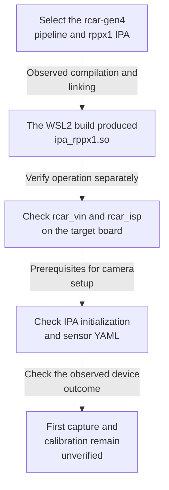

[Mermaid source](https://ttolsun.github.io/libcamera-sdd/en/vendor-integration.rcar-build-boundary.mmd)

<details open>
<summary>Diagram evidence and verification scope</summary>

What did the build verification confirm, and what conditions need to be checked separately on the target board?

Source-linked interpretation · automatic link check only · meaning and device execution not yet verified

| Elements and transitions | Source evidence |
| --- | --- |
| Select the rcar-gen4 pipeline and rppx1 IPA | [product-evidence/libcamera-rcar-gen4-build/rcar-gen4-build-record.txt:1](https://ttolsun.github.io/libcamera-sdd/en/reader-archive/vendor-integration.html#source-ad5d622c32f4ff6b) |
| The WSL2 build produced ipa_rppx1.so | [product-evidence/libcamera-rcar-gen4-build/rcar-gen4-build-record.txt:1](https://ttolsun.github.io/libcamera-sdd/en/reader-archive/vendor-integration.html#source-ad5d622c32f4ff6b) |
| Check rcar_vin and rcar_isp on the target board | [product-evidence/libcamera-rcar-gen4-build/rcar-gen4-build-record.txt:1](https://ttolsun.github.io/libcamera-sdd/en/reader-archive/vendor-integration.html#source-ad5d622c32f4ff6b) |
| Check IPA initialization and sensor YAML | [product-evidence/libcamera-rcar-gen4-build/rcar-gen4-build-record.txt:1](https://ttolsun.github.io/libcamera-sdd/en/reader-archive/vendor-integration.html#source-ad5d622c32f4ff6b) |
| First capture and calibration remain unverified | [product-evidence/libcamera-rcar-gen4-build/rcar-gen4-build-record.txt:1](https://ttolsun.github.io/libcamera-sdd/en/reader-archive/vendor-integration.html#source-ad5d622c32f4ff6b) |
| Observed compilation and linking | [product-evidence/libcamera-rcar-gen4-build/rcar-gen4-build-record.txt:1](https://ttolsun.github.io/libcamera-sdd/en/reader-archive/vendor-integration.html#source-ad5d622c32f4ff6b) |
| Verify operation separately | [product-evidence/libcamera-rcar-gen4-build/rcar-gen4-build-record.txt:1](https://ttolsun.github.io/libcamera-sdd/en/reader-archive/vendor-integration.html#source-ad5d622c32f4ff6b) |
| Prerequisites for camera setup | [product-evidence/libcamera-rcar-gen4-build/rcar-gen4-build-record.txt:1](https://ttolsun.github.io/libcamera-sdd/en/reader-archive/vendor-integration.html#source-ad5d622c32f4ff6b) |
| Check the observed device outcome | [product-evidence/libcamera-rcar-gen4-build/rcar-gen4-build-record.txt:1](https://ttolsun.github.io/libcamera-sdd/en/reader-archive/vendor-integration.html#source-ad5d622c32f4ff6b) |

</details>

To build R-Car Gen4 separately, you must specify `-Dpipelines=rcar-gen4 -Dipas=rppx1`. The IPA build compares the enabled pipelines with the modules specified in `-Dipas`; the IPA corresponding to `rcar-gen4` is `rppx1`. In the pipeline option, `auto` selects the pipelines applicable to the target architecture, while `all` selects all pipelines.

The R-Car Gen4 pipeline acquires the `rcar_vin` media device, finds the `rcar_isp` core entity, and attempts to create a camera. Initialization fails if the corresponding IPA module is missing. The IPA configuration uses the sensor model's YAML file, with `uncalibrated.yaml` as the fallback. The existence of the fallback file does not guarantee that the lens or sensor is calibrated.

A Ninja build completed on Ubuntu WSL2 `x86_64`, Clang 21.1.8, and Meson 1.10.1, using `pipelines=all`, the recorded IPA list including `rppx1`, and GStreamer, V4L2, and cam enabled. A separate Ninja build at the same pinned commit also completed with `-Dpipelines=rcar-gen4 -Dipas=rppx1` specified, producing `ipa_rppx1.so`. These observations support compilation and linking in the recorded environment.

Runtime checks: Device discovery, camera registration, the first capture, and calibration quality have not yet been verified for the target board, kernel, and sensor combination. This material does not constitute a test of the full kernel header changes or the remaining behavior of a new source commit.

<details open>
<summary>Section-wide evidence: 1</summary>

- `product-evidence/libcamera-rcar-gen4-build/rcar-gen4-build-record.txt`[`L1`](https://ttolsun.github.io/libcamera-sdd/en/reader-archive/vendor-integration.html#source-ad5d622c32f4ff6b)

</details>

## Has the first capture on the customer board been validated?

This record cannot be used to report that the first capture on the customer board has been validated. The WSL2 test configuration used the Virtual2 virtual camera instead of a physical sensor, and there is no record of a capture using the customer board's physical sensor.

### Virtual capture observation and customer board testing

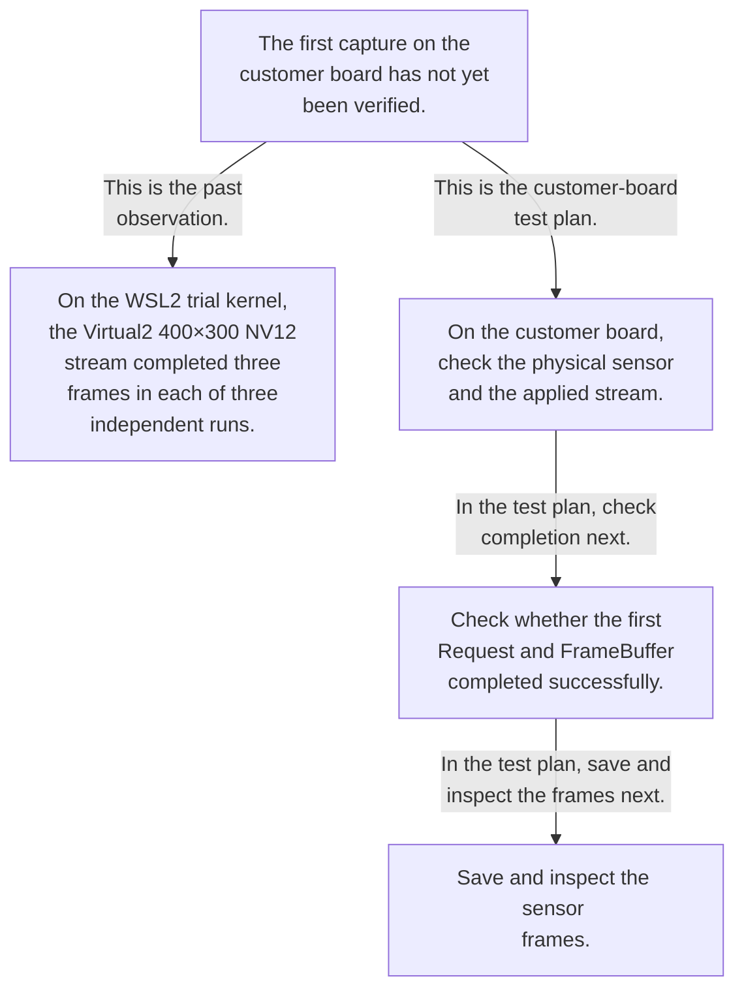

[Mermaid source](https://ttolsun.github.io/libcamera-sdd/en/vendor-assurance.first-capture-boundary.mmd)

<details open>
<summary>Diagram evidence and verification scope</summary>

What was verified in WSL2, and in what order is the first capture checked on the customer board?

Source-linked interpretation · automatic link check only · meaning and device execution not yet verified

LLM diagram draft · before human review

Authoring model: `cli/codex/gpt-6.1-terra`

| Elements and transitions | Source evidence |
| --- | --- |
| The first capture on the customer board has not yet been verified. | [product-evidence/libcamera-first-capture-trial/virtual-first-capture-run.txt:1](https://ttolsun.github.io/libcamera-sdd/en/reader-archive/vendor-assurance.html#source-3c4ba1aba4901083) |
| On the WSL2 trial kernel, the Virtual2 400×300 NV12 stream completed three frames in each of three independent runs. | [product-evidence/libcamera-first-capture-trial/virtual-first-capture-run.txt:1](https://ttolsun.github.io/libcamera-sdd/en/reader-archive/vendor-assurance.html#source-3c4ba1aba4901083) |
| On the customer board, check the physical sensor and the applied stream. | [product-evidence/libcamera-first-capture-trial/virtual-first-capture-run.txt:1](https://ttolsun.github.io/libcamera-sdd/en/reader-archive/vendor-assurance.html#source-3c4ba1aba4901083) · [README.rst:107](https://ttolsun.github.io/libcamera-sdd/en/reader-archive/vendor-assurance.html#source-ce71f2f0de50caf3) · [include/libcamera/camera.h:126](https://ttolsun.github.io/libcamera-sdd/en/reader-archive/vendor-assurance.html#source-aba605be681da98e) |
| Check whether the first Request and FrameBuffer completed successfully. | [include/libcamera/camera.h:126](https://ttolsun.github.io/libcamera-sdd/en/reader-archive/vendor-assurance.html#source-aba605be681da98e) · [include/libcamera/request.h:34](https://ttolsun.github.io/libcamera-sdd/en/reader-archive/vendor-assurance.html#source-cb2be6f3ec7f91fc) · [include/libcamera/framebuffer.h:25](https://ttolsun.github.io/libcamera-sdd/en/reader-archive/vendor-assurance.html#source-094e6fd7ddda824a) |
| Save and inspect the sensor frames. | [include/libcamera/camera.h:126](https://ttolsun.github.io/libcamera-sdd/en/reader-archive/vendor-assurance.html#source-aba605be681da98e) · [README.rst:107](https://ttolsun.github.io/libcamera-sdd/en/reader-archive/vendor-assurance.html#source-ce71f2f0de50caf3) |
| This is the past observation. | [product-evidence/libcamera-first-capture-trial/virtual-first-capture-run.txt:1](https://ttolsun.github.io/libcamera-sdd/en/reader-archive/vendor-assurance.html#source-3c4ba1aba4901083) |
| This is the customer-board test plan. | [product-evidence/libcamera-first-capture-trial/virtual-first-capture-run.txt:1](https://ttolsun.github.io/libcamera-sdd/en/reader-archive/vendor-assurance.html#source-3c4ba1aba4901083) · [README.rst:107](https://ttolsun.github.io/libcamera-sdd/en/reader-archive/vendor-assurance.html#source-ce71f2f0de50caf3) |
| In the test plan, check completion next. | [include/libcamera/camera.h:126](https://ttolsun.github.io/libcamera-sdd/en/reader-archive/vendor-assurance.html#source-aba605be681da98e) · [README.rst:107](https://ttolsun.github.io/libcamera-sdd/en/reader-archive/vendor-assurance.html#source-ce71f2f0de50caf3) |
| In the test plan, save and inspect the frames next. | [include/libcamera/camera.h:126](https://ttolsun.github.io/libcamera-sdd/en/reader-archive/vendor-assurance.html#source-aba605be681da98e) · [README.rst:107](https://ttolsun.github.io/libcamera-sdd/en/reader-archive/vendor-assurance.html#source-ce71f2f0de50caf3) |

</details>

As far as can be confirmed from the official libcamera project documentation, the Virtual Pipeline Handler emulates a virtual external camera for testing. The example YAML specifies a 400×300 size and the `lines` test pattern for Virtual2.

The virtual capture test on October 31, 2026 used source commit 293d751a814e0d4c34e85ad457ccd9d5eefd1a61 and the WSL2 trial kernel 6.18.33.2-microsoft-standard-WSL2-issue211 with udmabuf built in. All three runs on Virtual2 at 400×300 NV12, each in a separate process, completed three frames each. This observation does not constitute validation of a physical camera or board DMA.

In the first capture test on the customer board, the board, physical sensor, kernel and driver, libcamera build, and target application are recorded, and the actual sensor is opened to check the applied stream format and size. The first request's RequestComplete and the buffer's FrameSuccess are checked, and frames from the sensor are saved and inspected. cam can be used as an example of a basic test tool's save functionality. Existing records are limited to a test configuration using udmabuf and Virtual2 on a WSL2 test kernel; the physical camera, physical DMA, and product application have not been validated.

<details open>
<summary>Section-wide evidence: 7</summary>

- `product-evidence/libcamera-first-capture-trial/virtual-first-capture-run.txt`[`L1`](https://ttolsun.github.io/libcamera-sdd/en/reader-archive/vendor-assurance.html#source-3c4ba1aba4901083)
- `src/libcamera/pipeline/virtual/README.md`[`L3` excerpt](https://ttolsun.github.io/libcamera-sdd/en/reader-archive/vendor-assurance.html#source-eb7d1ae4ac9df3f9) · [Full source `L3`](https://github.com/TTolsun/libcamera-sdd/blob/adfa719f8ed67d18fd8a0739fc088a1f8b9e7252/src/libcamera/pipeline/virtual/README.md#L3)
- `src/libcamera/pipeline/virtual/data/virtual.yaml`[`L28` excerpt](https://ttolsun.github.io/libcamera-sdd/en/reader-archive/vendor-assurance.html#source-fb6397b1c5827be7) · [Full source `L28`](https://github.com/TTolsun/libcamera-sdd/blob/adfa719f8ed67d18fd8a0739fc088a1f8b9e7252/src/libcamera/pipeline/virtual/data/virtual.yaml#L28)
- `include/libcamera/request.h`[`L34` excerpt](https://ttolsun.github.io/libcamera-sdd/en/reader-archive/vendor-assurance.html#source-cb2be6f3ec7f91fc) · [Full source `L34`](https://github.com/TTolsun/libcamera-sdd/blob/adfa719f8ed67d18fd8a0739fc088a1f8b9e7252/include/libcamera/request.h#L34)
- `include/libcamera/framebuffer.h`[`L25` excerpt](https://ttolsun.github.io/libcamera-sdd/en/reader-archive/vendor-assurance.html#source-094e6fd7ddda824a) · [Full source `L25`](https://github.com/TTolsun/libcamera-sdd/blob/adfa719f8ed67d18fd8a0739fc088a1f8b9e7252/include/libcamera/framebuffer.h#L25)
- `README.rst`[`L107` excerpt](https://ttolsun.github.io/libcamera-sdd/en/reader-archive/vendor-assurance.html#source-ce71f2f0de50caf3) · [Full source `L107`](https://github.com/TTolsun/libcamera-sdd/blob/adfa719f8ed67d18fd8a0739fc088a1f8b9e7252/README.rst#L107)
- `include/libcamera/camera.h`[`L126` excerpt](https://ttolsun.github.io/libcamera-sdd/en/reader-archive/vendor-assurance.html#source-aba605be681da98e) · [Full source `L126`](https://github.com/TTolsun/libcamera-sdd/blob/adfa719f8ed67d18fd8a0739fc088a1f8b9e7252/include/libcamera/camera.h#L126)

</details>

## <a id="d6-virtual-reproduction"></a>Reproduce the public WSL virtual camera first-capture trial

1. **Preparation (1–3)** Investigate the Kconfig and dependencies of the kernel to be used without changing the host state.
2. **DMA-BUF allocator selection:** Investigate the selected kernel's Kconfig, dependencies, actually available modules, and allocator candidates, and select one allocator suited to the results. Use udmabuf to reproduce the conditions in this record.
3. Investigate whether only the modules required by the selected kernel and allocator are installed and whether they match the kernel version. In the recorded udmabuf test, the driver was built in and no separate modules were installed.
4. **Host changes (4–5)** Obtain separate approval immediately before executing the host change plan, which includes the proposed changes, the kernel to boot and its image SHA-256, the impact, the exact backup path, and the boot and recovery procedures.
5. Install and boot the trial kernel according to the approved plan.
6. **Pre-execution checks (6–11)** Verify that the running kernel version is `6.18.33.2-microsoft-standard-WSL2-issue211`.
7. Check permission to open `/dev/udmabuf` in the WSL root child context.
8. In the Virtual2 YAML to be used, verify the 400x300 size and the lines pattern value together as a single configuration combination.
9. Check that the camera selection argument in the cam command to be used is `Virtual2`.
10. Check that the cam stream argument to be used requests 400x300 NV12.
11. Check whether the official cam command to be run specifies the `--capture=3` argument requesting 3 frames.
12. **Execution and validation (12–13)** Run the unmodified official cam in three independent processes according to the linked execution procedure.
13. Compare the evidence from the new run against the expected combination of camera Virtual2, an actually applied stream of 400x300 NV12, and successful processing of 3 frames and exit code 0 for each independent run.

### From environment checks to running the reproduction

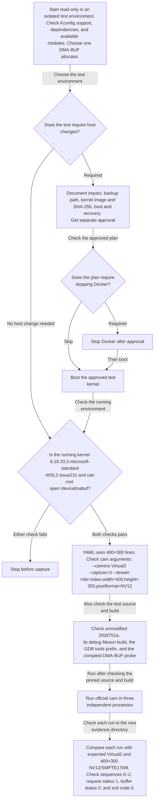

[Mermaid source](https://ttolsun.github.io/libcamera-sdd/en/official-cam-validation.reproduction-flow.mmd)

<details open>
<summary>Diagram evidence and verification scope</summary>

If a host change is required to install the test kernel recorded in the existing WSL, under what conditions does reproduction proceed after approval and pre-execution checks?

Source-linked interpretation · automatic link check only · meaning and device execution not yet verified

| Elements and transitions | Source evidence |
| --- | --- |
| Start read-only in an isolated test environment. Check Kconfig support, dependencies, and available modules. Choose one DMA-BUF allocator. | [product-evidence/libcamera-official-cam-trial/invocation-reproduction-procedure.txt:1](https://ttolsun.github.io/libcamera-sdd/en/reader-archive/official-cam-validation.html#source-5a006a90fe9f46ad) |
| Does the test require host changes? | [product-evidence/libcamera-official-cam-trial/invocation-reproduction-procedure.txt:1](https://ttolsun.github.io/libcamera-sdd/en/reader-archive/official-cam-validation.html#source-5a006a90fe9f46ad) |
| Document impact, backup path, kernel image and SHA-256, boot and recovery. Get separate approval | [product-evidence/libcamera-official-cam-trial/invocation-reproduction-procedure.txt:1](https://ttolsun.github.io/libcamera-sdd/en/reader-archive/official-cam-validation.html#source-5a006a90fe9f46ad) |
| Does the plan require stopping Docker? | [product-evidence/libcamera-official-cam-trial/invocation-reproduction-procedure.txt:1](https://ttolsun.github.io/libcamera-sdd/en/reader-archive/official-cam-validation.html#source-5a006a90fe9f46ad) |
| Stop Docker after approval | [product-evidence/libcamera-official-cam-trial/invocation-reproduction-procedure.txt:1](https://ttolsun.github.io/libcamera-sdd/en/reader-archive/official-cam-validation.html#source-5a006a90fe9f46ad) |
| Boot the approved test kernel | [product-evidence/libcamera-official-cam-trial/invocation-reproduction-procedure.txt:1](https://ttolsun.github.io/libcamera-sdd/en/reader-archive/official-cam-validation.html#source-5a006a90fe9f46ad) |
| Is the running kernel 6.18.33.2-microsoft-standard-WSL2-issue211 and can root open /dev/udmabuf? | [product-evidence/libcamera-official-cam-trial/invocation-reproduction-procedure.txt:1](https://ttolsun.github.io/libcamera-sdd/en/reader-archive/official-cam-validation.html#source-5a006a90fe9f46ad) |
| Stop before capture | [product-evidence/libcamera-official-cam-trial/invocation-reproduction-procedure.txt:1](https://ttolsun.github.io/libcamera-sdd/en/reader-archive/official-cam-validation.html#source-5a006a90fe9f46ad) |
| Run official cam in three independent processes | [product-evidence/libcamera-official-cam-trial/invocation-reproduction-procedure.txt:1](https://ttolsun.github.io/libcamera-sdd/en/reader-archive/official-cam-validation.html#source-5a006a90fe9f46ad) |
| Compare each run with expected Virtual2 and 400×300 NV12/SMPTE170M. Check sequences 0–2, request status 1, buffer status 0, and exit code 0. | [product-evidence/libcamera-official-cam-trial/invocation-reproduction-procedure.txt:1](https://ttolsun.github.io/libcamera-sdd/en/reader-archive/official-cam-validation.html#source-5a006a90fe9f46ad) · [product-evidence/libcamera-official-cam-trial/invocation-official-cam-reader.txt:1](https://ttolsun.github.io/libcamera-sdd/en/reader-archive/official-cam-validation.html#source-e326d2b05d8f4ef8) · [product-evidence/libcamera-official-cam-trial/invocation-options.txt:1](https://ttolsun.github.io/libcamera-sdd/en/reader-archive/official-cam-validation.html#source-077dc6a73bad3108) |
| YAML uses 400×300 lines. Check cam arguments: --camera Virtual2 --capture=3 --stream role=video,width=400,height=300,pixelformat=NV12 | [src/libcamera/pipeline/virtual/data/virtual.yaml:28](https://ttolsun.github.io/libcamera-sdd/en/reader-archive/official-cam-validation.html#source-9858e22e2225cc10) · [product-evidence/libcamera-official-cam-trial/invocation-options.txt:1](https://ttolsun.github.io/libcamera-sdd/en/reader-archive/official-cam-validation.html#source-077dc6a73bad3108) |
| Check unmodified 293d751a, its debug Meson build, the GDB tools prefix, and the compiled DMA-BUF probe | [product-evidence/libcamera-official-cam-trial/invocation-reproduction-procedure.txt:1](https://ttolsun.github.io/libcamera-sdd/en/reader-archive/official-cam-validation.html#source-5a006a90fe9f46ad) |
| Choose the test environment | [product-evidence/libcamera-official-cam-trial/invocation-reproduction-procedure.txt:1](https://ttolsun.github.io/libcamera-sdd/en/reader-archive/official-cam-validation.html#source-5a006a90fe9f46ad) |
| Required | [product-evidence/libcamera-official-cam-trial/invocation-reproduction-procedure.txt:1](https://ttolsun.github.io/libcamera-sdd/en/reader-archive/official-cam-validation.html#source-5a006a90fe9f46ad) |
| No host change needed | [product-evidence/libcamera-official-cam-trial/invocation-reproduction-procedure.txt:1](https://ttolsun.github.io/libcamera-sdd/en/reader-archive/official-cam-validation.html#source-5a006a90fe9f46ad) |
| Check the approved plan | [product-evidence/libcamera-official-cam-trial/invocation-reproduction-procedure.txt:1](https://ttolsun.github.io/libcamera-sdd/en/reader-archive/official-cam-validation.html#source-5a006a90fe9f46ad) |
| Required | [product-evidence/libcamera-official-cam-trial/invocation-reproduction-procedure.txt:1](https://ttolsun.github.io/libcamera-sdd/en/reader-archive/official-cam-validation.html#source-5a006a90fe9f46ad) |
| Skip | [product-evidence/libcamera-official-cam-trial/invocation-reproduction-procedure.txt:1](https://ttolsun.github.io/libcamera-sdd/en/reader-archive/official-cam-validation.html#source-5a006a90fe9f46ad) |
| Then boot | [product-evidence/libcamera-official-cam-trial/invocation-reproduction-procedure.txt:1](https://ttolsun.github.io/libcamera-sdd/en/reader-archive/official-cam-validation.html#source-5a006a90fe9f46ad) |
| Check the running environment | [product-evidence/libcamera-official-cam-trial/invocation-reproduction-procedure.txt:1](https://ttolsun.github.io/libcamera-sdd/en/reader-archive/official-cam-validation.html#source-5a006a90fe9f46ad) |
| Either check fails | [product-evidence/libcamera-official-cam-trial/invocation-reproduction-procedure.txt:1](https://ttolsun.github.io/libcamera-sdd/en/reader-archive/official-cam-validation.html#source-5a006a90fe9f46ad) |
| Both checks pass | [product-evidence/libcamera-official-cam-trial/invocation-reproduction-procedure.txt:1](https://ttolsun.github.io/libcamera-sdd/en/reader-archive/official-cam-validation.html#source-5a006a90fe9f46ad) · [src/libcamera/pipeline/virtual/data/virtual.yaml:28](https://ttolsun.github.io/libcamera-sdd/en/reader-archive/official-cam-validation.html#source-9858e22e2225cc10) · [product-evidence/libcamera-official-cam-trial/invocation-options.txt:1](https://ttolsun.github.io/libcamera-sdd/en/reader-archive/official-cam-validation.html#source-077dc6a73bad3108) |
| Check each run in the new evidence directory | [product-evidence/libcamera-official-cam-trial/invocation-reproduction-procedure.txt:1](https://ttolsun.github.io/libcamera-sdd/en/reader-archive/official-cam-validation.html#source-5a006a90fe9f46ad) |
| Also check the test source and build | [src/libcamera/pipeline/virtual/data/virtual.yaml:28](https://ttolsun.github.io/libcamera-sdd/en/reader-archive/official-cam-validation.html#source-9858e22e2225cc10) · [product-evidence/libcamera-official-cam-trial/invocation-options.txt:1](https://ttolsun.github.io/libcamera-sdd/en/reader-archive/official-cam-validation.html#source-077dc6a73bad3108) · [product-evidence/libcamera-official-cam-trial/invocation-reproduction-procedure.txt:1](https://ttolsun.github.io/libcamera-sdd/en/reader-archive/official-cam-validation.html#source-5a006a90fe9f46ad) |
| Run after checking the pinned source and build | [product-evidence/libcamera-official-cam-trial/invocation-reproduction-procedure.txt:1](https://ttolsun.github.io/libcamera-sdd/en/reader-archive/official-cam-validation.html#source-5a006a90fe9f46ad) |

</details>

Run verification items: These results apply only to the WSL virtual camera simulation configuration; physical DMA, physical camera, the product app, and the internal HAL were not validated. Because GDB affects timing, the callback return instruction and performance were not validated.

<details open>
<summary>Section-wide evidence: 5</summary>

- `product-evidence/libcamera-official-cam-trial/invocation-reproduction-procedure.txt`[`L1`](https://ttolsun.github.io/libcamera-sdd/en/reader-archive/official-cam-validation.html#source-5a006a90fe9f46ad)
- `product-evidence/libcamera-official-cam-trial/invocation-execution-contract.txt`[`L1`](https://ttolsun.github.io/libcamera-sdd/en/reader-archive/official-cam-validation.html#source-67134777ea4213e0)
- `product-evidence/libcamera-official-cam-trial/invocation-official-cam-reader.txt`[`L1`](https://ttolsun.github.io/libcamera-sdd/en/reader-archive/official-cam-validation.html#source-e326d2b05d8f4ef8)
- `src/libcamera/pipeline/virtual/data/virtual.yaml`[`L28` excerpt](https://ttolsun.github.io/libcamera-sdd/en/reader-archive/official-cam-validation.html#source-9858e22e2225cc10) · [Full source `L28`](https://github.com/TTolsun/libcamera-sdd/blob/adfa719f8ed67d18fd8a0739fc088a1f8b9e7252/src/libcamera/pipeline/virtual/data/virtual.yaml#L28)
- `product-evidence/libcamera-official-cam-trial/invocation-options.txt`[`L1`](https://ttolsun.github.io/libcamera-sdd/en/reader-archive/official-cam-validation.html#source-077dc6a73bad3108)

</details>

<details open>
<summary>Verification scope of the virtual test</summary>

**This is a virtual test configuration. It must not be used as a support or performance claim for an actual product.**

- [Once the allocator was prepared, the official cam capture finished.](https://ttolsun.github.io/libcamera-sdd/en/reader-archive/official-cam-validation.html#할당기를-준비하자-공식-cam-캡처가-완료됐습니다)
- [Prepares multiple initial requests to match a single stream.](https://ttolsun.github.io/libcamera-sdd/en/reader-archive/official-cam-validation.html#여러-초기-요청을-단일-스트림에-맞춰-준비합니다)
- [Prepared initial requests are submitted within the limit.](https://ttolsun.github.io/libcamera-sdd/en/reader-archive/official-cam-validation.html#준비된-초기-요청을-한도-안에서-제출합니다)
- [cam receives the completion notification and processes the frame in the event loop.](https://ttolsun.github.io/libcamera-sdd/en/reader-archive/official-cam-validation.html#cam이-완료-알림을-받아-이벤트-루프에서-프레임을-처리합니다)
- [Reproduction is performed after the supported kernel and device access are checked.](#d6-virtual-reproduction)

</details>

## Responsibility for stop and error handling

`PipelineHandler::stop()` first executes `waitingRequests.swap(data->waitingRequests_)` and then calls `stopDevice(camera)`. `PipelineHandler::stop()` moves the waiting requests aside so that they are not requeued when `completeRequest()` is called inside `stopDevice()`. The implementer of `stopDevice()` must immediately stop capture from all running streams and stop processing requests, and must cancel all pending requests for the device and complete them immediately in an error state.

### Order of stopping the device and returning waiting requests

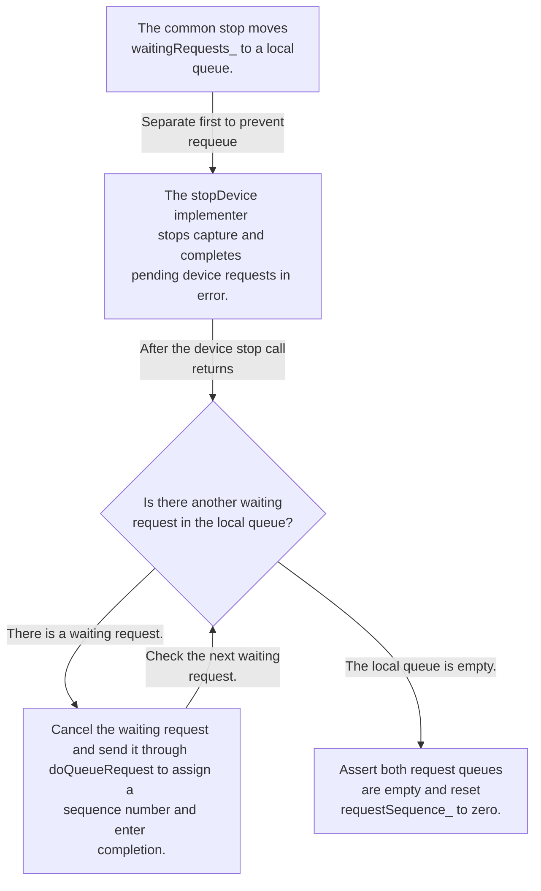

[Mermaid source](https://ttolsun.github.io/libcamera-sdd/en/vendor-integration.shutdown-device-and-waiting-requests.mmd)

<details open>
<summary>Diagram evidence and verification scope</summary>

Which requests do the common stop and stopDevice implementers each handle, and when?

Source-linked interpretation · automatic link check only · meaning and device execution not yet verified

| Elements and transitions | Source evidence |
| --- | --- |
| The common stop moves waitingRequests\_ to a local queue. | [src/libcamera/pipeline_handler.cpp:367](https://ttolsun.github.io/libcamera-sdd/en/reader-archive/vendor-integration.html#source-1cc522721d2c5142) · [src/libcamera/pipeline_handler.cpp:370](https://ttolsun.github.io/libcamera-sdd/en/reader-archive/vendor-integration.html#source-486f3f81acba3c1f) |
| The stopDevice implementer stops capture and completes pending device requests in error. | [src/libcamera/pipeline_handler.cpp:367](https://ttolsun.github.io/libcamera-sdd/en/reader-archive/vendor-integration.html#source-7097caa35d0e97c8) · [src/libcamera/pipeline_handler.cpp:405](https://ttolsun.github.io/libcamera-sdd/en/reader-archive/vendor-integration.html#source-a1eeb263fc114d2f) |
| Is there another waiting request in the local queue? | [src/libcamera/pipeline_handler.cpp:367](https://ttolsun.github.io/libcamera-sdd/en/reader-archive/vendor-integration.html#source-1cc522721d2c5142) |
| Cancel the waiting request and send it through doQueueRequest to assign a sequence number and enter completion. | [src/libcamera/pipeline_handler.cpp:367](https://ttolsun.github.io/libcamera-sdd/en/reader-archive/vendor-integration.html#source-1cc522721d2c5142) |
| Assert both request queues are empty and reset requestSequence\_ to zero. | [src/libcamera/pipeline_handler.cpp:367](https://ttolsun.github.io/libcamera-sdd/en/reader-archive/vendor-integration.html#source-1cc522721d2c5142) |
| Separate first to prevent requeue | [src/libcamera/pipeline_handler.cpp:370](https://ttolsun.github.io/libcamera-sdd/en/reader-archive/vendor-integration.html#source-486f3f81acba3c1f) · [src/libcamera/pipeline_handler.cpp:367](https://ttolsun.github.io/libcamera-sdd/en/reader-archive/vendor-integration.html#source-1cc522721d2c5142) · [src/libcamera/pipeline_handler.cpp:367](https://ttolsun.github.io/libcamera-sdd/en/reader-archive/vendor-integration.html#source-7097caa35d0e97c8) |
| After the device stop call returns | [src/libcamera/pipeline_handler.cpp:367](https://ttolsun.github.io/libcamera-sdd/en/reader-archive/vendor-integration.html#source-7097caa35d0e97c8) · [src/libcamera/pipeline_handler.cpp:367](https://ttolsun.github.io/libcamera-sdd/en/reader-archive/vendor-integration.html#source-1cc522721d2c5142) |
| There is a waiting request. | [src/libcamera/pipeline_handler.cpp:367](https://ttolsun.github.io/libcamera-sdd/en/reader-archive/vendor-integration.html#source-1cc522721d2c5142) |
| Check the next waiting request. | [src/libcamera/pipeline_handler.cpp:367](https://ttolsun.github.io/libcamera-sdd/en/reader-archive/vendor-integration.html#source-1cc522721d2c5142) |
| The local queue is empty. | [src/libcamera/pipeline_handler.cpp:367](https://ttolsun.github.io/libcamera-sdd/en/reader-archive/vendor-integration.html#source-1cc522721d2c5142) |

</details>

`PipelineHandler::stop()` takes the waiting requests aside, then calls `stopDevice()`. After canceling each waiting request, it passes the request to `doQueueRequest()` so that it receives a sequence number and is temporarily added to `queuedRequests_` for completion in `completeRequest()`. After processing the waiting requests, `PipelineHandler::stop()` uses two `ASSERT` statements to check that `queuedRequests_` and `waitingRequests_` are empty, and stores `0` in `requestSequence_`.

<details open>
<summary>Section-wide evidence: 3</summary>

- `src/libcamera/pipeline_handler.cpp`[`L367`](https://github.com/TTolsun/libcamera-sdd/blob/adfa719f8ed67d18fd8a0739fc088a1f8b9e7252/src/libcamera/pipeline_handler.cpp#L367) · [`L370` excerpt](https://ttolsun.github.io/libcamera-sdd/en/reader-archive/vendor-integration.html#source-486f3f81acba3c1f) · [Full source `L370`](https://github.com/TTolsun/libcamera-sdd/blob/adfa719f8ed67d18fd8a0739fc088a1f8b9e7252/src/libcamera/pipeline_handler.cpp#L370) · [`L405` excerpt](https://ttolsun.github.io/libcamera-sdd/en/reader-archive/vendor-integration.html#source-a1eeb263fc114d2f) · [Full source `L405`](https://github.com/TTolsun/libcamera-sdd/blob/adfa719f8ed67d18fd8a0739fc088a1f8b9e7252/src/libcamera/pipeline_handler.cpp#L405) · [`L367`](https://ttolsun.github.io/libcamera-sdd/en/reader-archive/vendor-integration.html#source-1cc522721d2c5142) · [`L367`](https://ttolsun.github.io/libcamera-sdd/en/reader-archive/vendor-integration.html#source-7097caa35d0e97c8)

</details>

## Buffer completion and request return

See also: [When the last buffer has completed but no request completion notification arrives](#d10-failure-location)

The pipeline handler must call completeBuffer in the normal buffer completion path to signal completion of a request's buffer. This function notifies the application of buffer completion and updates the request's internal buffer tracking information. The request is not completed automatically even when the last buffer completes, so the pipeline handler must explicitly complete the request with completeRequest(). In the normal completion path, the request is not completed automatically even after processing of the last buffer finishes, so the implementer must explicitly call completeRequest() to complete the request.

### From normal buffer completion to request return

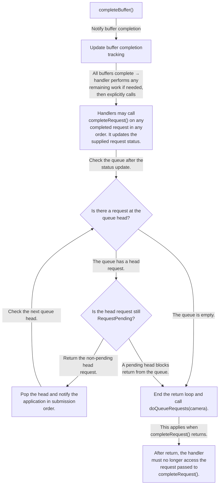

[Mermaid source](https://ttolsun.github.io/libcamera-sdd/en/pipeline-requests.buffer-request-completion.mmd)

<details open>
<summary>Diagram evidence and verification scope</summary>

In what order are requests returned after buffers are completed, and when does the pipeline handler's access to a request end?

Source-linked interpretation · automatic link check only · meaning and device execution not yet verified

| Elements and transitions | Source evidence |
| --- | --- |
| completeBuffer() | [src/libcamera/pipeline_handler.cpp:547](https://ttolsun.github.io/libcamera-sdd/en/reader-archive/pipeline-requests.html#source-01ad7c6605c3296a) |
| Update buffer completion tracking | [src/libcamera/pipeline_handler.cpp:547](https://ttolsun.github.io/libcamera-sdd/en/reader-archive/pipeline-requests.html#source-01ad7c6605c3296a) |
| Handlers may call completeRequest() on any completed request in any order. It updates the supplied request status. | [src/libcamera/pipeline_handler.cpp:571](https://ttolsun.github.io/libcamera-sdd/en/reader-archive/pipeline-requests.html#source-236c920e906cb6fd) |
| Pop the head and notify the application in submission order. | [src/libcamera/pipeline_handler.cpp:571](https://ttolsun.github.io/libcamera-sdd/en/reader-archive/pipeline-requests.html#source-236c920e906cb6fd) |
| After return, the handler must no longer access the request passed to completeRequest(). | [src/libcamera/pipeline_handler.cpp:571](https://ttolsun.github.io/libcamera-sdd/en/reader-archive/pipeline-requests.html#source-236c920e906cb6fd) |
| Is there a request at the queue head? | [src/libcamera/pipeline_handler.cpp:571](https://ttolsun.github.io/libcamera-sdd/en/reader-archive/pipeline-requests.html#source-236c920e906cb6fd) |
| Is the head request still RequestPending? | [src/libcamera/pipeline_handler.cpp:571](https://ttolsun.github.io/libcamera-sdd/en/reader-archive/pipeline-requests.html#source-236c920e906cb6fd) |
| End the return loop and call doQueueRequests(camera). | [src/libcamera/pipeline_handler.cpp:571](https://ttolsun.github.io/libcamera-sdd/en/reader-archive/pipeline-requests.html#source-236c920e906cb6fd) |
| Notify buffer completion | [src/libcamera/pipeline_handler.cpp:547](https://ttolsun.github.io/libcamera-sdd/en/reader-archive/pipeline-requests.html#source-01ad7c6605c3296a) |
| All buffers complete → handler performs any remaining work if needed, then explicitly calls | [src/libcamera/pipeline_handler.cpp:547](https://ttolsun.github.io/libcamera-sdd/en/reader-archive/pipeline-requests.html#source-01ad7c6605c3296a) |
| Check the queue after the status update. | [src/libcamera/pipeline_handler.cpp:571](https://ttolsun.github.io/libcamera-sdd/en/reader-archive/pipeline-requests.html#source-236c920e906cb6fd) |
| The queue has a head request. | [src/libcamera/pipeline_handler.cpp:571](https://ttolsun.github.io/libcamera-sdd/en/reader-archive/pipeline-requests.html#source-236c920e906cb6fd) |
| The queue is empty. | [src/libcamera/pipeline_handler.cpp:571](https://ttolsun.github.io/libcamera-sdd/en/reader-archive/pipeline-requests.html#source-236c920e906cb6fd) |
| A pending head blocks return from the queue. | [src/libcamera/pipeline_handler.cpp:571](https://ttolsun.github.io/libcamera-sdd/en/reader-archive/pipeline-requests.html#source-236c920e906cb6fd) |
| Return the non-pending head request. | [src/libcamera/pipeline_handler.cpp:571](https://ttolsun.github.io/libcamera-sdd/en/reader-archive/pipeline-requests.html#source-236c920e906cb6fd) |
| Check the next queue head. | [src/libcamera/pipeline_handler.cpp:571](https://ttolsun.github.io/libcamera-sdd/en/reader-archive/pipeline-requests.html#source-236c920e906cb6fd) |
| This applies when completeRequest() returns. | [src/libcamera/pipeline_handler.cpp:571](https://ttolsun.github.io/libcamera-sdd/en/reader-archive/pipeline-requests.html#source-236c920e906cb6fd) |

</details>

After completeRequest returns, the pipeline handler must not access the request. completeRequest ensures that requests are returned to the application in submission order. The pipeline handler may call completeRequest on any completed request without ordering constraints. If the first request has RequestPending status, the while loop executes break to stop iterating.

completeRequest calls doQueueRequests(camera) at the end so that waiting requests can be queued to the pipeline. Both completeBuffer and completeRequest must be called from the `CameraManager` thread.

cancelRequest calls the internal cancellation function, which cancels each pending buffer and emits a bufferCompleted signal for each buffer. After processing all pending buffers, the internal cancellation function sets `cancelled_` to true and clears the pending buffer list. When cancelRequest subsequently calls completeRequest, `Request::Private::complete()` assigns RequestCancelled to the request status according to the value of `cancelled_`.

<details open>
<summary>Section-wide evidence: 8</summary>

- `src/libcamera/pipeline_handler.cpp`[`L547`](https://github.com/TTolsun/libcamera-sdd/blob/adfa719f8ed67d18fd8a0739fc088a1f8b9e7252/src/libcamera/pipeline_handler.cpp#L547) · [`L553` excerpt](https://ttolsun.github.io/libcamera-sdd/en/reader-archive/pipeline-requests.html#source-5b0ae08604dff588) · [Full source `L553`](https://github.com/TTolsun/libcamera-sdd/blob/adfa719f8ed67d18fd8a0739fc088a1f8b9e7252/src/libcamera/pipeline_handler.cpp#L553) · [`L571` excerpt](https://ttolsun.github.io/libcamera-sdd/en/reader-archive/pipeline-requests.html#source-236c920e906cb6fd) · [Full source `L571`](https://github.com/TTolsun/libcamera-sdd/blob/adfa719f8ed67d18fd8a0739fc088a1f8b9e7252/src/libcamera/pipeline_handler.cpp#L571) · [`L578` excerpt](https://ttolsun.github.io/libcamera-sdd/en/reader-archive/pipeline-requests.html#source-16187edaf24c09f5) · [Full source `L578`](https://github.com/TTolsun/libcamera-sdd/blob/adfa719f8ed67d18fd8a0739fc088a1f8b9e7252/src/libcamera/pipeline_handler.cpp#L578) · [`L584` excerpt](https://ttolsun.github.io/libcamera-sdd/en/reader-archive/pipeline-requests.html#source-b6dd86e931d905ed) · [Full source `L584`](https://github.com/TTolsun/libcamera-sdd/blob/adfa719f8ed67d18fd8a0739fc088a1f8b9e7252/src/libcamera/pipeline_handler.cpp#L584) · [`L607` excerpt](https://ttolsun.github.io/libcamera-sdd/en/reader-archive/pipeline-requests.html#source-27cb6869fd89d13d) · [Full source `L607`](https://github.com/TTolsun/libcamera-sdd/blob/adfa719f8ed67d18fd8a0739fc088a1f8b9e7252/src/libcamera/pipeline_handler.cpp#L607) · [`L547`](https://ttolsun.github.io/libcamera-sdd/en/reader-archive/pipeline-requests.html#source-01ad7c6605c3296a) · [`L547`](https://ttolsun.github.io/libcamera-sdd/en/reader-archive/pipeline-requests.html#source-f389c6ca68ade3da)
- `src/libcamera/request.cpp`[`L139`](https://github.com/TTolsun/libcamera-sdd/blob/adfa719f8ed67d18fd8a0739fc088a1f8b9e7252/src/libcamera/request.cpp#L139) · [`L125` excerpt](https://ttolsun.github.io/libcamera-sdd/en/reader-archive/pipeline-requests.html#source-0626196def047e5c) · [Full source `L125`](https://github.com/TTolsun/libcamera-sdd/blob/adfa719f8ed67d18fd8a0739fc088a1f8b9e7252/src/libcamera/request.cpp#L125) · [`L139`](https://ttolsun.github.io/libcamera-sdd/en/reader-archive/pipeline-requests.html#source-906fe48d2b97450b)

</details>

## Source manuscripts and review records

<details open>
<summary>Integration guide</summary>

- **Generation method**: Extracted facts and LLM explanation
- **Validation scope**: Tables and figures are created from facts, and the explanations are written by the LLM. Citation, sentence, and configured structure checks are applied.
- **Automated check**: Passed (`ok`). The items checked are listed in the verification scope. Whether the explanation content is correct is checked by a human reviewer.
- **Human review**: Before human review
- **Analysis baseline commit**: `adfa719f8ed67d18fd8a0739fc088a1f8b9e7252`
- **Document generation time**: `2026-11-26 16:20:34+00:00`
- **Sentence generation model**: `cli/codex/gpt-6.1-terra`
- **Contracts between documents**: [Automated comparison report](https://ttolsun.github.io/libcamera-sdd/contract-consistency.json) · Before human review
- **Enter product description**: [Scope, conditions, and sources](https://ttolsun.github.io/libcamera-sdd/product-context.json)

<details open>
<summary>Record from when the manuscript was written</summary>

This is a record saved in the manuscript as of that time. It may differ from the current document's standards.

- Evidence files: `include/libcamera/camera.h`, `include/libcamera/internal/ipa_manager.h`, `include/libcamera/internal/pipeline_handler.h`, `product-evidence/libcamera-rcar-gen4-build/rcar-gen4-build-record.txt`, `src/libcamera/camera.cpp`, `src/libcamera/ipa_manager.cpp`, `src/libcamera/pipeline/ipu3/ipu3.cpp`, `src/libcamera/pipeline/rkisp1/rkisp1.cpp`, `src/libcamera/pipeline_handler.cpp`
- Evidence level: code verified (static analysis, simple_compdb configuration, commit `adfa719f8e`)
- Automated check (citation, sentence, and configured structure checks): passed
- Review status recorded: 2026-11-27 · Awaiting human review

</details>

[Markdown source ↗](https://ttolsun.github.io/libcamera-sdd/vendor-integration.md) [Mermaid source ↗](https://ttolsun.github.io/libcamera-sdd/en/vendor-integration.mmd)

[Open earlier detail](https://ttolsun.github.io/libcamera-sdd/en/reader-archive/vendor-integration.html#page-evidence)

</details>

<details open>
<summary>Support scope and validation</summary>

- **Generation method**: Extracted facts and LLM explanation
- **Validation scope**: Tables and figures are created from facts, and the explanations are written by the LLM. Citation, sentence, and configured structure checks are applied.
- **Automated check**: Passed (`ok`). The items checked are listed in the verification scope. Whether the explanation content is correct is checked by a human reviewer.
- **Human review**: Before human review
- **Analysis baseline commit**: `adfa719f8ed67d18fd8a0739fc088a1f8b9e7252`
- **Document generation time**: `2026-11-20 16:39:19+00:00`
- **Sentence generation model**: `cli/codex/gpt-6.1-terra`
- **Contracts between documents**: [Automated comparison report](https://ttolsun.github.io/libcamera-sdd/contract-consistency.json) · Before human review
- **Enter product description**: [Scope, conditions, and sources](https://ttolsun.github.io/libcamera-sdd/product-context.json)

<details open>
<summary>Record from when the manuscript was written</summary>

This is a record saved in the manuscript as of that time. It may differ from the current document's standards.

- Evidence files: `Documentation/software-isp-benchmarking.rst`, `README.rst`, `include/libcamera/camera.h`, `include/libcamera/framebuffer.h`, `include/libcamera/internal/ipa_manager.h`, `include/libcamera/internal/pipeline_handler.h`, `include/libcamera/request.h`, `product-evidence/libcamera-first-capture-trial/virtual-first-capture-run.txt`, `src/libcamera/camera.cpp`, `src/libcamera/ipa_manager.cpp`, `src/libcamera/pipeline/ipu3/ipu3.cpp`, `src/libcamera/pipeline/rkisp1/rkisp1.cpp`, `src/libcamera/pipeline/virtual/README.md`, `src/libcamera/pipeline/virtual/data/virtual.yaml`, `src/libcamera/pipeline_handler.cpp`
- Evidence level: code verified (static analysis, simple_compdb configuration, commit `adfa719f8e`)
- Automated check (citation, sentence, and configured structure checks): passed
- Review status recorded on: 2026-11-21 · Awaiting human review

</details>

[Markdown source ↗](https://ttolsun.github.io/libcamera-sdd/vendor-assurance.md) [Mermaid source ↗](https://ttolsun.github.io/libcamera-sdd/en/vendor-assurance.mmd)

[Open earlier detail](https://ttolsun.github.io/libcamera-sdd/en/reader-archive/vendor-assurance.html#page-evidence)

</details>

<details open>
<summary>Verifying virtual capture with the official cam in WSL</summary>

- **Generation method**: Extracted facts and LLM explanation
- **Validation scope**: Tables and figures are created from facts, and the explanations are written by the LLM. Citation, sentence, and configured structure checks are applied.
- **Automated check**: Passed (`ok`). The items checked are listed in the verification scope. Whether the explanation content is correct is checked by a human reviewer.
- **Human review**: Before human review
- **Analysis baseline commit**: `adfa719f8ed67d18fd8a0739fc088a1f8b9e7252`
- **Document generation time**: `2026-11-20 20:07:34+00:00`
- **Sentence generation model**: `cli/codex/gpt-6.1-terra`
- **Contracts between documents**: [Automated comparison report](https://ttolsun.github.io/libcamera-sdd/contract-consistency.json) · Before human review
- **Enter product description**: [Scope, conditions, and sources](https://ttolsun.github.io/libcamera-sdd/product-context.json)

<details open>
<summary>Record from when the manuscript was written</summary>

This is a record saved in the manuscript as of that time. It may differ from the current document's standards.

- Evidence files: `product-evidence/libcamera-official-cam-trial/execution-contract.txt`, `product-evidence/libcamera-official-cam-trial/invocation-execution-contract.txt`, `product-evidence/libcamera-official-cam-trial/invocation-official-cam-reader.txt`, `product-evidence/libcamera-official-cam-trial/invocation-options.txt`, `product-evidence/libcamera-official-cam-trial/invocation-reproduction-procedure.txt`, `product-evidence/libcamera-official-cam-trial/official-cam-reader.txt`, `product-evidence/libcamera-official-cam-trial/reproduction-procedure.txt`, `src/apps/cam/camera_session.cpp`, `src/apps/cam/camera_session.h`, `src/libcamera/camera.cpp`, `src/libcamera/framebuffer_allocator.cpp`, `src/libcamera/pipeline/virtual/README.md`, `src/libcamera/pipeline/virtual/data/virtual.yaml`, `src/libcamera/pipeline/virtual/test_pattern_generator.cpp`, `src/libcamera/pipeline/virtual/virtual.cpp`, `src/libcamera/pipeline_handler.cpp`, `src/libcamera/request.cpp`
- Evidence level: code verified (static analysis, simple_compdb configuration, commit `adfa719f8e`)
- Automated check (citation, sentence, and configured structure checks): passed
- Review status recorded on: 2026-11-21 · Awaiting human review

</details>

[Markdown source ↗](https://ttolsun.github.io/libcamera-sdd/official-cam-validation.md)

[Open earlier detail](https://ttolsun.github.io/libcamera-sdd/en/reader-archive/official-cam-validation.html#page-evidence)

</details>

<details open>
<summary>Pipeline Request Submission and Completion</summary>

- **Generation method**: Extracted facts and LLM explanation
- **Validation scope**: Tables and figures are created from facts, and the explanations are written by the LLM. Citation, sentence, and configured structure checks are applied.
- **Automated check**: Passed (`ok`). The items checked are listed in the verification scope. Whether the explanation content is correct is checked by a human reviewer.
- **Human review**: Before human review
- **Analysis baseline commit**: `adfa719f8ed67d18fd8a0739fc088a1f8b9e7252`
- **Document generation time**: `2026-11-20 17:39:07+00:00`
- **Sentence generation model**: `cli/codex/gpt-6.1-terra`
- **Contracts between documents**: [Automated comparison report](https://ttolsun.github.io/libcamera-sdd/contract-consistency.json) · Before human review

<details open>
<summary>Record from when the manuscript was written</summary>

This is a record saved in the manuscript as of that time. It may differ from the current document's standards.

- Evidence files: `include/libcamera/internal/pipeline_handler.h`, `src/libcamera/pipeline/imx8-isi/imx8-isi.cpp`, `src/libcamera/pipeline/ipu3/ipu3.cpp`, `src/libcamera/pipeline/mali-c55/mali-c55.cpp`, `src/libcamera/pipeline/rkisp1/rkisp1.cpp`, `src/libcamera/pipeline/rpi/pisp/pisp.cpp`, `src/libcamera/pipeline/rpi/vc4/vc4.cpp`, `src/libcamera/pipeline/uvcvideo/uvcvideo.cpp`, `src/libcamera/pipeline/vimc/vimc.cpp`, `src/libcamera/pipeline/virtual/virtual.cpp`, `src/libcamera/pipeline_handler.cpp`, `src/libcamera/request.cpp`
- Evidence level: code verified (static analysis, simple_compdb configuration, commit `adfa719f8e`)
- Automated check (citation, sentence, and configured structure checks): passed
- Review status recorded on: 2026-11-21 · Awaiting human review

</details>

[Markdown source ↗](https://ttolsun.github.io/libcamera-sdd/pipeline-requests.md) [Mermaid source ↗](https://ttolsun.github.io/libcamera-sdd/en/pipeline-requests.mmd)

[Open earlier detail](https://ttolsun.github.io/libcamera-sdd/en/reader-archive/pipeline-requests.html#page-evidence)

</details>

[Download page Markdown](https://ttolsun.github.io/libcamera-sdd/en/device-integration.md) · [Reader edition source map](https://ttolsun.github.io/libcamera-sdd/reader-edition.json)

<a id="doc-7"></a>

ForDeveloper

# ForDeveloper

English translation · human review pending. Review states below refer to the Korean source.

List cameras in an environment where cam is available. If a camera is detected, save frames from the first one. Then open the code entry points for discovery, configuration, and startup.

- [Code that checks cancellation status](#d8-stop-and-disconnect)
- [Caveats and Troubleshooting](#doc-10)

## Try running it directly

Use `cam -l` to list the cameras detected on the system, and use `cam -c 1 --capture=10 --file` to capture 10 frames from the first camera and save them to disk. If problems occur, you can obtain detailed libcamera debug logs with `LIBCAMERA_LOG_LEVELS=*:DEBUG cam -l`.

<details open>
<summary>Section-wide evidence: 1</summary>

- `README.rst`[`L107` excerpt](https://ttolsun.github.io/libcamera-sdd/en/reader-archive/onboarding.html#source-5bc9ee57c1b6daee) · [Full source `L107`](https://github.com/TTolsun/libcamera-sdd/blob/adfa719f8ed67d18fd8a0739fc088a1f8b9e7252/README.rst#L107)

</details>

## When to start discovery and use the camera

When you call `CameraManager::start()`, the camera manager starts up and enumerates every device on the system. Once you’ve confirmed the manager is running, you can list the available cameras. You can use each camera until it’s disconnected or the manager stops.

<details open>
<summary>Section-wide evidence: 1</summary>

- `src/libcamera/camera_manager.cpp`[`L329` excerpt](https://ttolsun.github.io/libcamera-sdd/en/reader-archive/scenarios/manager_start.html#source-027ec5bea3fe0dfa) · [Full source `L329`](https://github.com/TTolsun/libcamera-sdd/blob/adfa719f8ed67d18fd8a0739fc088a1f8b9e7252/src/libcamera/camera_manager.cpp#L329)

</details>

## Where to check configuration application and success status

`Camera::configure()` returns the negative error value if the access state check produces one; if the check passes, it clears each `StreamConfiguration`'s previous stream association to `nullptr`, checks `validate()`, and returns `-EINVAL` if the result is not `Valid`. For a valid configuration, `Camera::configure()` calls `PipelineHandler::configure` with `ConnectionTypeBlocking` and returns its return value unchanged if that value is nonzero. The API contract states that when the function returns, each `StreamConfiguration` in `config` is associated with a `Stream` instance, which can be retrieved with `stream()`.

### Checks before configuration is applied and pipeline results

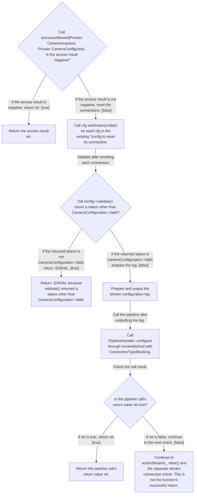

[Mermaid source](https://ttolsun.github.io/libcamera-sdd/en/scenarios/configure.configure-validation-before-pipeline.mmd)

<details open>
<summary>Diagram evidence and verification scope</summary>

In what order does Camera::configure perform the access check, stream connection initialization, validation, and pipeline return-value check?

Source-linked interpretation · automatic link check only · meaning and device execution not yet verified

LLM diagram draft · before human review

Authoring model: `cli/codex/gpt-6.1-terra`

| Elements and transitions | Source evidence |
| --- | --- |
| Call isAccessAllowed(Private::CameraAcquired, Private::CameraConfigured). Is the access result negative? | [src/libcamera/camera.cpp:1191](https://ttolsun.github.io/libcamera-sdd/en/reader-archive/scenarios/configure.html#source-603af0dd7fa357d0) |
| Return the access result ret. | [src/libcamera/camera.cpp:1191](https://ttolsun.github.io/libcamera-sdd/en/reader-archive/scenarios/configure.html#source-603af0dd7fa357d0) |
| Call cfg.setStream(nullptr) for each cfg in the existing \*config to reset its connection. | [src/libcamera/camera.cpp:1191](https://ttolsun.github.io/libcamera-sdd/en/reader-archive/scenarios/configure.html#source-603af0dd7fa357d0) |
| Did config-\>validate() return a status other than CameraConfiguration::Valid? | [src/libcamera/camera.cpp:1191](https://ttolsun.github.io/libcamera-sdd/en/reader-archive/scenarios/configure.html#source-603af0dd7fa357d0) |
| Return -EINVAL because validate() returned a status other than CameraConfiguration::Valid. | [src/libcamera/camera.cpp:1191](https://ttolsun.github.io/libcamera-sdd/en/reader-archive/scenarios/configure.html#source-603af0dd7fa357d0) |
| Prepare and output the stream configuration log. | [src/libcamera/camera.cpp:1191](https://ttolsun.github.io/libcamera-sdd/en/reader-archive/scenarios/configure.html#source-603af0dd7fa357d0) |
| Call PipelineHandler::configure through invokeMethod with ConnectionTypeBlocking. | [src/libcamera/camera.cpp:1191](https://ttolsun.github.io/libcamera-sdd/en/reader-archive/scenarios/configure.html#source-603af0dd7fa357d0) |
| Is the pipeline call's return value ret true? | [src/libcamera/camera.cpp:1191](https://ttolsun.github.io/libcamera-sdd/en/reader-archive/scenarios/configure.html#source-603af0dd7fa357d0) |
| Return the pipeline call's return value ret. | [src/libcamera/camera.cpp:1191](https://ttolsun.github.io/libcamera-sdd/en/reader-archive/scenarios/configure.html#source-603af0dd7fa357d0) |
| Continue to activeStreams\_.clear() and the separate stream connection check. This is not the function's successful return. | [src/libcamera/camera.cpp:1191](https://ttolsun.github.io/libcamera-sdd/en/reader-archive/scenarios/configure.html#source-603af0dd7fa357d0) |
| If the access result is negative, return ret. · ret \< 0 \[true\] | [src/libcamera/camera.cpp:1191](https://ttolsun.github.io/libcamera-sdd/en/reader-archive/scenarios/configure.html#source-603af0dd7fa357d0) |
| If the access result is not negative, reset the connections. · ret \< 0 \[false\] | [src/libcamera/camera.cpp:1191](https://ttolsun.github.io/libcamera-sdd/en/reader-archive/scenarios/configure.html#source-603af0dd7fa357d0) |
| Validate after resetting each connection. | [src/libcamera/camera.cpp:1191](https://ttolsun.github.io/libcamera-sdd/en/reader-archive/scenarios/configure.html#source-603af0dd7fa357d0) |
| If the returned status is not CameraConfiguration::Valid, return -EINVAL. · config-\>validate() != CameraConfiguration::Valid \[true\] | [src/libcamera/camera.cpp:1191](https://ttolsun.github.io/libcamera-sdd/en/reader-archive/scenarios/configure.html#source-603af0dd7fa357d0) |
| If the returned status is CameraConfiguration::Valid, prepare the log. · config-\>validate() != CameraConfiguration::Valid \[false\] | [src/libcamera/camera.cpp:1191](https://ttolsun.github.io/libcamera-sdd/en/reader-archive/scenarios/configure.html#source-603af0dd7fa357d0) |
| Call the pipeline after outputting the log. | [src/libcamera/camera.cpp:1191](https://ttolsun.github.io/libcamera-sdd/en/reader-archive/scenarios/configure.html#source-603af0dd7fa357d0) |
| Check the call result. | [src/libcamera/camera.cpp:1191](https://ttolsun.github.io/libcamera-sdd/en/reader-archive/scenarios/configure.html#source-603af0dd7fa357d0) |
| If ret is true, return ret. · ret \[true\] | [src/libcamera/camera.cpp:1191](https://ttolsun.github.io/libcamera-sdd/en/reader-archive/scenarios/configure.html#source-603af0dd7fa357d0) |
| If ret is false, continue to the next check. · ret \[false\] | [src/libcamera/camera.cpp:1191](https://ttolsun.github.io/libcamera-sdd/en/reader-archive/scenarios/configure.html#source-603af0dd7fa357d0) |

</details>

### One-time initialization of the stream list and success status

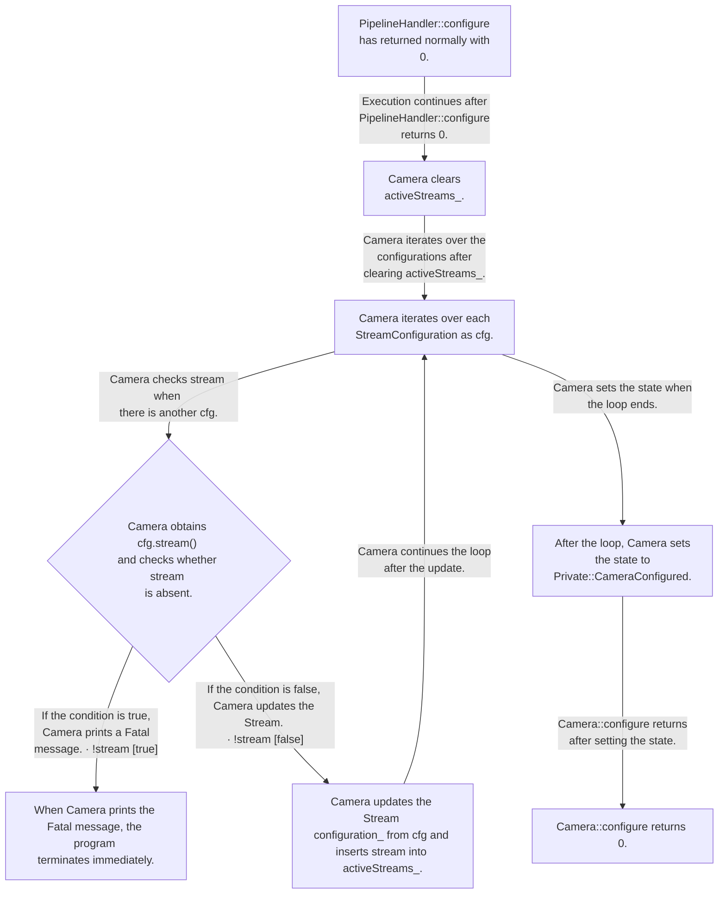

[Mermaid source](https://ttolsun.github.io/libcamera-sdd/en/scenarios/configure.configure-stream-list-once.mmd)

<details open>
<summary>Diagram evidence and verification scope</summary>

After successful pipeline configuration, how do activeStreams\_ initialization, updates to each StreamConfiguration, and the success state follow?

Source-linked interpretation · automatic link check only · meaning and device execution not yet verified

LLM diagram draft · before human review

Authoring model: `cli/codex/gpt-6.1-terra`

| Elements and transitions | Source evidence |
| --- | --- |
| PipelineHandler::configure has returned normally with 0. | [src/libcamera/camera.cpp:1191](https://ttolsun.github.io/libcamera-sdd/en/reader-archive/scenarios/configure.html#source-603af0dd7fa357d0) |
| Camera clears activeStreams\_. | [src/libcamera/camera.cpp:1191](https://ttolsun.github.io/libcamera-sdd/en/reader-archive/scenarios/configure.html#source-603af0dd7fa357d0) |
| Camera iterates over each StreamConfiguration as cfg. | [src/libcamera/camera.cpp:1191](https://ttolsun.github.io/libcamera-sdd/en/reader-archive/scenarios/configure.html#source-603af0dd7fa357d0) |
| Camera obtains cfg.stream() and checks whether stream is absent. | [src/libcamera/camera.cpp:1191](https://ttolsun.github.io/libcamera-sdd/en/reader-archive/scenarios/configure.html#source-603af0dd7fa357d0) |
| When Camera prints the Fatal message, the program terminates immediately. | [src/libcamera/camera.cpp:1191](https://ttolsun.github.io/libcamera-sdd/en/reader-archive/scenarios/configure.html#source-603af0dd7fa357d0) · [src/libcamera/base/log.cpp:1022](https://ttolsun.github.io/libcamera-sdd/en/reader-archive/scenarios/configure.html#source-47a6ef3943a7b53c) |
| Camera updates the Stream configuration\_ from cfg and inserts stream into activeStreams\_. | [src/libcamera/camera.cpp:1191](https://ttolsun.github.io/libcamera-sdd/en/reader-archive/scenarios/configure.html#source-603af0dd7fa357d0) |
| After the loop, Camera sets the state to Private::CameraConfigured. | [src/libcamera/camera.cpp:1191](https://ttolsun.github.io/libcamera-sdd/en/reader-archive/scenarios/configure.html#source-603af0dd7fa357d0) |
| Camera::configure returns 0. | [src/libcamera/camera.cpp:1191](https://ttolsun.github.io/libcamera-sdd/en/reader-archive/scenarios/configure.html#source-603af0dd7fa357d0) |
| Execution continues after PipelineHandler::configure returns 0. | [src/libcamera/camera.cpp:1191](https://ttolsun.github.io/libcamera-sdd/en/reader-archive/scenarios/configure.html#source-603af0dd7fa357d0) |
| Camera iterates over the configurations after clearing activeStreams\_. | [src/libcamera/camera.cpp:1191](https://ttolsun.github.io/libcamera-sdd/en/reader-archive/scenarios/configure.html#source-603af0dd7fa357d0) |
| Camera checks stream when there is another cfg. | [src/libcamera/camera.cpp:1191](https://ttolsun.github.io/libcamera-sdd/en/reader-archive/scenarios/configure.html#source-603af0dd7fa357d0) |
| If the condition is true, Camera prints a Fatal message. · !stream \[true\] | [src/libcamera/camera.cpp:1191](https://ttolsun.github.io/libcamera-sdd/en/reader-archive/scenarios/configure.html#source-603af0dd7fa357d0) |
| If the condition is false, Camera updates the Stream. · !stream \[false\] | [src/libcamera/camera.cpp:1191](https://ttolsun.github.io/libcamera-sdd/en/reader-archive/scenarios/configure.html#source-603af0dd7fa357d0) |
| Camera continues the loop after the update. | [src/libcamera/camera.cpp:1191](https://ttolsun.github.io/libcamera-sdd/en/reader-archive/scenarios/configure.html#source-603af0dd7fa357d0) |
| Camera sets the state when the loop ends. | [src/libcamera/camera.cpp:1191](https://ttolsun.github.io/libcamera-sdd/en/reader-archive/scenarios/configure.html#source-603af0dd7fa357d0) |
| Camera::configure returns after setting the state. | [src/libcamera/camera.cpp:1191](https://ttolsun.github.io/libcamera-sdd/en/reader-archive/scenarios/configure.html#source-603af0dd7fa357d0) |

</details>

When the pipeline call succeeds, `Camera::configure()` clears `activeStreams_` and checks `cfg.stream()` for each configuration. If a stream is missing, execution enters the `Fatal` log path, and under the `LOG` contract, execution is aborted and the program terminates immediately after the message is printed. If every configuration has a stream, `Camera::configure()` updates each stream's `configuration_` to the corresponding configuration and adds the stream to `activeStreams_`. Camera::configure() then sets the state to `CameraConfigured` and returns `0`.

<details open>
<summary>Section-wide evidence: 3</summary>

- `src/libcamera/camera.cpp`[`L1191`](https://github.com/TTolsun/libcamera-sdd/blob/adfa719f8ed67d18fd8a0739fc088a1f8b9e7252/src/libcamera/camera.cpp#L1191) · [`L1183` excerpt](https://ttolsun.github.io/libcamera-sdd/en/reader-archive/scenarios/configure.html#source-5296d50aed1a3be0) · [Full source `L1183`](https://github.com/TTolsun/libcamera-sdd/blob/adfa719f8ed67d18fd8a0739fc088a1f8b9e7252/src/libcamera/camera.cpp#L1183) · [`L1191`](https://ttolsun.github.io/libcamera-sdd/en/reader-archive/scenarios/configure.html#source-603af0dd7fa357d0)
- `src/libcamera/base/log.cpp`[`L1022` excerpt](https://ttolsun.github.io/libcamera-sdd/en/reader-archive/scenarios/configure.html#source-47a6ef3943a7b53c) · [Full source `L1022`](https://github.com/TTolsun/libcamera-sdd/blob/adfa719f8ed67d18fd8a0739fc088a1f8b9e7252/src/libcamera/base/log.cpp#L1022)

</details>

## Where can the requested 640×480 viewfinder configuration change?

The example app requests one `Viewfinder` stream and sets its size to 640×480. The app must validate the modified configuration with `validate()` before applying it to the camera; unsupported values are adjusted to the nearest supported values. The example code ignores the return value and prints the configuration using `toString()`, but the caller must check the status. If it is `Adjusted`, the caller must inspect the entire configuration to determine whether to accept it, checking whether any streams were removed and whether parameters such as the size and pixel format of the remaining streams changed. `Invalid` means the configuration cannot be adjusted to a valid state, while `Valid` means it was already valid and was not adjusted.

### Validating the UVC Viewfinder Configuration and Applying It to the Device

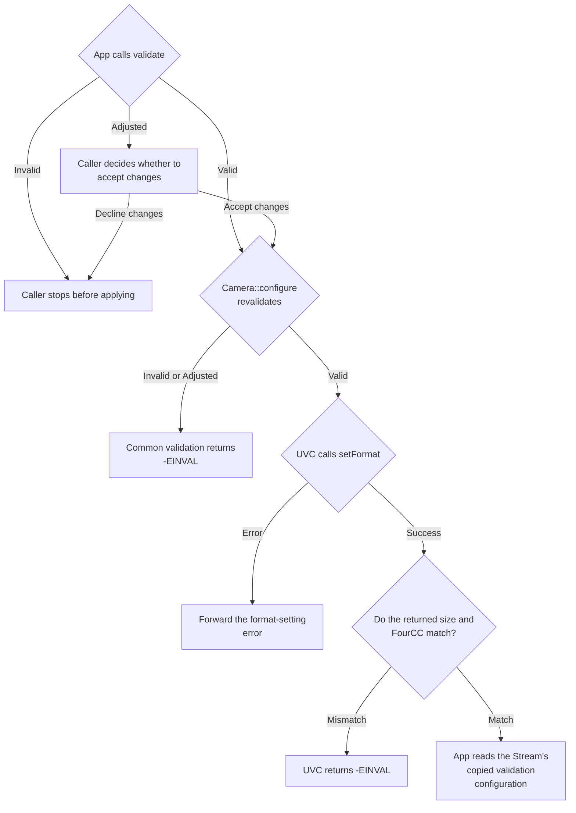

The official guide example calls validate and prints the configuration. The accept and decline branches show decisions for the caller. UVC stores stride, frameSize, and colorSpace from tryFormat in the configuration. After setFormat succeeds, it compares only the size and FourCC. [`application-developer.rst:228`](https://github.com/TTolsun/libcamera-sdd/blob/adfa719f8ed67d18fd8a0739fc088a1f8b9e7252/Documentation/guides/application-developer.rst#L228) · [`camera.cpp:343`](https://github.com/TTolsun/libcamera-sdd/blob/adfa719f8ed67d18fd8a0739fc088a1f8b9e7252/src/libcamera/camera.cpp#L343) · [`uvcvideo.cpp:220`](https://github.com/TTolsun/libcamera-sdd/blob/adfa719f8ed67d18fd8a0739fc088a1f8b9e7252/src/libcamera/pipeline/uvcvideo/uvcvideo.cpp#L220) · [`uvcvideo.cpp:224`](https://github.com/TTolsun/libcamera-sdd/blob/adfa719f8ed67d18fd8a0739fc088a1f8b9e7252/src/libcamera/pipeline/uvcvideo/uvcvideo.cpp#L224) · [`uvcvideo.cpp:275`](https://github.com/TTolsun/libcamera-sdd/blob/adfa719f8ed67d18fd8a0739fc088a1f8b9e7252/src/libcamera/pipeline/uvcvideo/uvcvideo.cpp#L275)

[Mermaid source](https://ttolsun.github.io/libcamera-sdd/en/scenarios/uvc-viewfinder-configuration.uvc-viewfinder-format-checks.mmd)

<details open>
<summary>Diagram evidence and verification scope</summary>

Where are the values checked again, and where is an error returned?

Source-linked interpretation · automatic link check only · meaning and device execution not yet verified

| Elements and transitions | Source evidence |
| --- | --- |
| App calls validate | [Documentation/guides/application-developer.rst:222](https://ttolsun.github.io/libcamera-sdd/en/reader-archive/scenarios/uvc-viewfinder-configuration.html#source-b7102b06d767f1b8) |
| Caller decides whether to accept changes | [src/libcamera/camera.cpp:323](https://ttolsun.github.io/libcamera-sdd/en/reader-archive/scenarios/uvc-viewfinder-configuration.html#source-2b31e92e3fb3f083) |
| Caller stops before applying | [src/libcamera/pipeline/uvcvideo/uvcvideo.cpp:139](https://ttolsun.github.io/libcamera-sdd/en/reader-archive/scenarios/uvc-viewfinder-configuration.html#source-f9631255f305fb92) · [src/libcamera/camera.cpp:323](https://ttolsun.github.io/libcamera-sdd/en/reader-archive/scenarios/uvc-viewfinder-configuration.html#source-2b31e92e3fb3f083) |
| Camera::configure revalidates | [src/libcamera/camera.cpp:1191](https://ttolsun.github.io/libcamera-sdd/en/reader-archive/scenarios/uvc-viewfinder-configuration.html#source-603af0dd7fa357d0) |
| Common validation returns -EINVAL | [src/libcamera/camera.cpp:1191](https://ttolsun.github.io/libcamera-sdd/en/reader-archive/scenarios/uvc-viewfinder-configuration.html#source-603af0dd7fa357d0) |
| UVC calls setFormat | [src/libcamera/pipeline/uvcvideo/uvcvideo.cpp:261](https://ttolsun.github.io/libcamera-sdd/en/reader-archive/scenarios/uvc-viewfinder-configuration.html#source-be07a7077dd3d924) · [src/libcamera/v4l2_videodevice.cpp:849](https://ttolsun.github.io/libcamera-sdd/en/reader-archive/scenarios/uvc-viewfinder-configuration.html#source-c073a10f1abc63b6) |
| Forward the format-setting error | [src/libcamera/pipeline/uvcvideo/uvcvideo.cpp:261](https://ttolsun.github.io/libcamera-sdd/en/reader-archive/scenarios/uvc-viewfinder-configuration.html#source-be07a7077dd3d924) |
| Do the returned size and FourCC match? | [src/libcamera/pipeline/uvcvideo/uvcvideo.cpp:261](https://ttolsun.github.io/libcamera-sdd/en/reader-archive/scenarios/uvc-viewfinder-configuration.html#source-be07a7077dd3d924) |
| UVC returns -EINVAL | [src/libcamera/pipeline/uvcvideo/uvcvideo.cpp:261](https://ttolsun.github.io/libcamera-sdd/en/reader-archive/scenarios/uvc-viewfinder-configuration.html#source-be07a7077dd3d924) |
| App reads the Stream's copied validation configuration | [src/libcamera/pipeline/uvcvideo/uvcvideo.cpp:261](https://ttolsun.github.io/libcamera-sdd/en/reader-archive/scenarios/uvc-viewfinder-configuration.html#source-be07a7077dd3d924) · [src/libcamera/camera.cpp:1191](https://ttolsun.github.io/libcamera-sdd/en/reader-archive/scenarios/uvc-viewfinder-configuration.html#source-603af0dd7fa357d0) · [src/libcamera/stream.cpp:483](https://ttolsun.github.io/libcamera-sdd/en/reader-archive/scenarios/uvc-viewfinder-configuration.html#source-d8739fc139164c42) |
| Adjusted | [src/libcamera/camera.cpp:323](https://ttolsun.github.io/libcamera-sdd/en/reader-archive/scenarios/uvc-viewfinder-configuration.html#source-2b31e92e3fb3f083) |
| Invalid | [src/libcamera/pipeline/uvcvideo/uvcvideo.cpp:139](https://ttolsun.github.io/libcamera-sdd/en/reader-archive/scenarios/uvc-viewfinder-configuration.html#source-f9631255f305fb92) |
| Valid | [src/libcamera/camera.cpp:1191](https://ttolsun.github.io/libcamera-sdd/en/reader-archive/scenarios/uvc-viewfinder-configuration.html#source-603af0dd7fa357d0) |
| Accept changes | [src/libcamera/camera.cpp:323](https://ttolsun.github.io/libcamera-sdd/en/reader-archive/scenarios/uvc-viewfinder-configuration.html#source-2b31e92e3fb3f083) · [src/libcamera/camera.cpp:1191](https://ttolsun.github.io/libcamera-sdd/en/reader-archive/scenarios/uvc-viewfinder-configuration.html#source-603af0dd7fa357d0) |
| Decline changes | [src/libcamera/camera.cpp:323](https://ttolsun.github.io/libcamera-sdd/en/reader-archive/scenarios/uvc-viewfinder-configuration.html#source-2b31e92e3fb3f083) |
| Valid | [src/libcamera/camera.cpp:1191](https://ttolsun.github.io/libcamera-sdd/en/reader-archive/scenarios/uvc-viewfinder-configuration.html#source-603af0dd7fa357d0) · [src/libcamera/pipeline/uvcvideo/uvcvideo.cpp:261](https://ttolsun.github.io/libcamera-sdd/en/reader-archive/scenarios/uvc-viewfinder-configuration.html#source-be07a7077dd3d924) |
| Invalid or Adjusted | [src/libcamera/camera.cpp:1191](https://ttolsun.github.io/libcamera-sdd/en/reader-archive/scenarios/uvc-viewfinder-configuration.html#source-603af0dd7fa357d0) |
| Error | [src/libcamera/pipeline/uvcvideo/uvcvideo.cpp:261](https://ttolsun.github.io/libcamera-sdd/en/reader-archive/scenarios/uvc-viewfinder-configuration.html#source-be07a7077dd3d924) |
| Success | [src/libcamera/pipeline/uvcvideo/uvcvideo.cpp:261](https://ttolsun.github.io/libcamera-sdd/en/reader-archive/scenarios/uvc-viewfinder-configuration.html#source-be07a7077dd3d924) |
| Mismatch | [src/libcamera/pipeline/uvcvideo/uvcvideo.cpp:261](https://ttolsun.github.io/libcamera-sdd/en/reader-archive/scenarios/uvc-viewfinder-configuration.html#source-be07a7077dd3d924) |
| Match | [src/libcamera/pipeline/uvcvideo/uvcvideo.cpp:261](https://ttolsun.github.io/libcamera-sdd/en/reader-archive/scenarios/uvc-viewfinder-configuration.html#source-be07a7077dd3d924) · [src/libcamera/camera.cpp:1191](https://ttolsun.github.io/libcamera-sdd/en/reader-archive/scenarios/uvc-viewfinder-configuration.html#source-603af0dd7fa357d0) |

</details>

`Camera::configure` returns a negative error from the access check, and after clearing the stream associations, it returns `-EINVAL` if revalidation does not return `Valid`. `UVCCameraConfiguration::validate` replaces an unsupported pixel format with the first value in the list, starts with the first size in the selected format's size list, and updates the size until it encounters a value larger than the requested size. It then tests the configuration with `tryFormat` and returns `Invalid` if the test fails. `PipelineHandlerUVC::configure` applies the format and size to the device using `setFormat` and returns the error unchanged if the call fails. If the call succeeds but the returned size or `FourCC` differs from the configuration that passed revalidation, it returns `-EINVAL`. The comparison uses the configuration that passed revalidation even when the originally requested size was 640×480.

If `tryFormat` succeeds, `UVCCameraConfiguration::validate()` writes the first plane's `bpl` and `size` to `cfg.stride` and `cfg.frameSize`, respectively. If `colorSpace` differs, it replaces it with the returned value and marks the configuration as `Adjusted`. After `setFormat` succeeds, `PipelineHandlerUVC::configure()` compares only the size and FourCC; it neither compares `stride`, `frameSize`, and `colorSpace` with the result nor overwrites them. When UVC associates a stream with `cfg`, `Camera::configure()` copies the validated `cfg` to the active stream. After success, `Stream::configuration()` returns this active configuration. The actual values for a particular device cannot be determined from this source alone.

<details open>
<summary>Section-wide evidence: 10</summary>

- `Documentation/guides/application-developer.rst`[`L167` excerpt](https://ttolsun.github.io/libcamera-sdd/en/reader-archive/scenarios/uvc-viewfinder-configuration.html#source-fa38f671a1d155da) · [Full source `L167`](https://github.com/TTolsun/libcamera-sdd/blob/adfa719f8ed67d18fd8a0739fc088a1f8b9e7252/Documentation/guides/application-developer.rst#L167) · [`L195` excerpt](https://ttolsun.github.io/libcamera-sdd/en/reader-archive/scenarios/uvc-viewfinder-configuration.html#source-8e1f5d84ca64a38b) · [Full source `L195`](https://github.com/TTolsun/libcamera-sdd/blob/adfa719f8ed67d18fd8a0739fc088a1f8b9e7252/Documentation/guides/application-developer.rst#L195) · [`L222` excerpt](https://ttolsun.github.io/libcamera-sdd/en/reader-archive/scenarios/uvc-viewfinder-configuration.html#source-b7102b06d767f1b8) · [Full source `L222`](https://github.com/TTolsun/libcamera-sdd/blob/adfa719f8ed67d18fd8a0739fc088a1f8b9e7252/Documentation/guides/application-developer.rst#L222)
- `src/libcamera/camera.cpp`[`L323` excerpt](https://ttolsun.github.io/libcamera-sdd/en/reader-archive/scenarios/uvc-viewfinder-configuration.html#source-2b31e92e3fb3f083) · [Full source `L323`](https://github.com/TTolsun/libcamera-sdd/blob/adfa719f8ed67d18fd8a0739fc088a1f8b9e7252/src/libcamera/camera.cpp#L323) · [`L1191` excerpt](https://ttolsun.github.io/libcamera-sdd/en/reader-archive/scenarios/uvc-viewfinder-configuration.html#source-603af0dd7fa357d0) · [Full source `L1191`](https://github.com/TTolsun/libcamera-sdd/blob/adfa719f8ed67d18fd8a0739fc088a1f8b9e7252/src/libcamera/camera.cpp#L1191)
- `src/libcamera/pipeline/uvcvideo/uvcvideo.cpp`[`L139` excerpt](https://ttolsun.github.io/libcamera-sdd/en/reader-archive/scenarios/uvc-viewfinder-configuration.html#source-f9631255f305fb92) · [Full source `L139`](https://github.com/TTolsun/libcamera-sdd/blob/adfa719f8ed67d18fd8a0739fc088a1f8b9e7252/src/libcamera/pipeline/uvcvideo/uvcvideo.cpp#L139) · [`L261` excerpt](https://ttolsun.github.io/libcamera-sdd/en/reader-archive/scenarios/uvc-viewfinder-configuration.html#source-be07a7077dd3d924) · [Full source `L261`](https://github.com/TTolsun/libcamera-sdd/blob/adfa719f8ed67d18fd8a0739fc088a1f8b9e7252/src/libcamera/pipeline/uvcvideo/uvcvideo.cpp#L261) · [`L237`](https://ttolsun.github.io/libcamera-sdd/en/reader-archive/scenarios/uvc-viewfinder-configuration.html#source-472189bfe0703702)
- `src/libcamera/v4l2_videodevice.cpp`[`L849` excerpt](https://ttolsun.github.io/libcamera-sdd/en/reader-archive/scenarios/uvc-viewfinder-configuration.html#source-c073a10f1abc63b6) · [Full source `L849`](https://github.com/TTolsun/libcamera-sdd/blob/adfa719f8ed67d18fd8a0739fc088a1f8b9e7252/src/libcamera/v4l2_videodevice.cpp#L849)
- `src/libcamera/stream.cpp`[`L483` excerpt](https://ttolsun.github.io/libcamera-sdd/en/reader-archive/scenarios/uvc-viewfinder-configuration.html#source-d8739fc139164c42) · [Full source `L483`](https://github.com/TTolsun/libcamera-sdd/blob/adfa719f8ed67d18fd8a0739fc088a1f8b9e7252/src/libcamera/stream.cpp#L483)

</details>

## Reflecting start control values and pipeline results

If `controls` is present, `Camera::start` makes a copy of `ControlList`, preprocesses it with `patchControlList`, and passes the copy; otherwise, it passes `nullptr`. In both branches, it calls `PipelineHandler::start` with `ConnectionTypeBlocking`, and that function is called from the `CameraManager` thread. If the call result `ret` is nonzero, `Camera::start` returns `ret` unchanged without setting the `CameraRunning` state; if `ret` is zero, it sets the `CameraRunning` state and returns 0.

### The relationship and boundaries between startup control values and the application of pipeline results

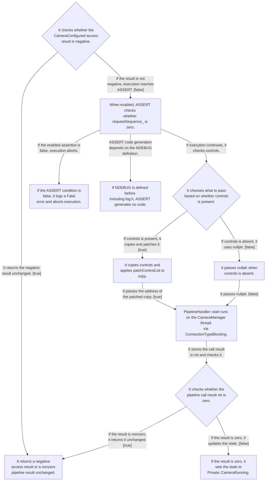

[Mermaid source](https://ttolsun.github.io/libcamera-sdd/en/scenarios/camera_start.item-activation.mmd)

<details open>
<summary>Diagram evidence and verification scope</summary>

How do ASSERT, control-value branches, blocking pipeline calls, and return-value branches lead to returning the original error or updating CameraRunning?

Source-linked interpretation · automatic link check only · meaning and device execution not yet verified

LLM diagram draft · before human review

Authoring model: `cli/codex/gpt-6.1-terra`

| Elements and transitions | Source evidence |
| --- | --- |
| It checks whether the CameraConfigured access result is negative. | [src/libcamera/camera.cpp:1400](https://ttolsun.github.io/libcamera-sdd/en/reader-archive/scenarios/camera_start.html#source-05691b4c81e7ee1c) |
| It returns a negative access result or a nonzero pipeline result unchanged. | [src/libcamera/camera.cpp:1400](https://ttolsun.github.io/libcamera-sdd/en/reader-archive/scenarios/camera_start.html#source-05691b4c81e7ee1c) |
| When enabled, ASSERT checks whether requestSequence\_ is zero. | [src/libcamera/camera.cpp:1400](https://ttolsun.github.io/libcamera-sdd/en/reader-archive/scenarios/camera_start.html#source-05691b4c81e7ee1c) · [src/libcamera/base/log.cpp:1022](https://ttolsun.github.io/libcamera-sdd/en/reader-archive/scenarios/camera_start.html#source-47a6ef3943a7b53c) |
| If the ASSERT condition is false, it logs a Fatal error and aborts execution. | [src/libcamera/base/log.cpp:1022](https://ttolsun.github.io/libcamera-sdd/en/reader-archive/scenarios/camera_start.html#source-47a6ef3943a7b53c) |
| If NDEBUG is defined before including log.h, ASSERT generates no code. | [src/libcamera/base/log.cpp:1022](https://ttolsun.github.io/libcamera-sdd/en/reader-archive/scenarios/camera_start.html#source-47a6ef3943a7b53c) |
| It chooses what to pass based on whether controls is present. | [src/libcamera/camera.cpp:1400](https://ttolsun.github.io/libcamera-sdd/en/reader-archive/scenarios/camera_start.html#source-05691b4c81e7ee1c) |
| It copies controls and applies patchControlList to copy. | [src/libcamera/camera.cpp:1400](https://ttolsun.github.io/libcamera-sdd/en/reader-archive/scenarios/camera_start.html#source-05691b4c81e7ee1c) |
| It passes nullptr when controls is absent. | [src/libcamera/camera.cpp:1400](https://ttolsun.github.io/libcamera-sdd/en/reader-archive/scenarios/camera_start.html#source-05691b4c81e7ee1c) |
| PipelineHandler::start runs on the CameraManager thread via ConnectionTypeBlocking. | [src/libcamera/camera.cpp:1400](https://ttolsun.github.io/libcamera-sdd/en/reader-archive/scenarios/camera_start.html#source-05691b4c81e7ee1c) · [src/libcamera/pipeline_handler.cpp:343](https://ttolsun.github.io/libcamera-sdd/en/reader-archive/scenarios/camera_start.html#source-490ad21ef2a56108) |
| It checks whether the pipeline call result ret is zero. | [src/libcamera/camera.cpp:1400](https://ttolsun.github.io/libcamera-sdd/en/reader-archive/scenarios/camera_start.html#source-05691b4c81e7ee1c) |
| If the result is zero, it sets the state to Private::CameraRunning. | [src/libcamera/camera.cpp:1400](https://ttolsun.github.io/libcamera-sdd/en/reader-archive/scenarios/camera_start.html#source-05691b4c81e7ee1c) |
| It returns the negative result unchanged. · ret \< 0 \[true\] | [src/libcamera/camera.cpp:1400](https://ttolsun.github.io/libcamera-sdd/en/reader-archive/scenarios/camera_start.html#source-05691b4c81e7ee1c) |
| If the result is not negative, execution reaches ASSERT. · ret \< 0 \[false\] | [src/libcamera/camera.cpp:1400](https://ttolsun.github.io/libcamera-sdd/en/reader-archive/scenarios/camera_start.html#source-05691b4c81e7ee1c) |
| If the enabled assertion is false, execution aborts. | [src/libcamera/base/log.cpp:1022](https://ttolsun.github.io/libcamera-sdd/en/reader-archive/scenarios/camera_start.html#source-47a6ef3943a7b53c) |
| ASSERT code generation depends on the NDEBUG definition. | [src/libcamera/base/log.cpp:1022](https://ttolsun.github.io/libcamera-sdd/en/reader-archive/scenarios/camera_start.html#source-47a6ef3943a7b53c) |
| If execution continues, it checks controls. | [src/libcamera/camera.cpp:1400](https://ttolsun.github.io/libcamera-sdd/en/reader-archive/scenarios/camera_start.html#source-05691b4c81e7ee1c) · [src/libcamera/base/log.cpp:1022](https://ttolsun.github.io/libcamera-sdd/en/reader-archive/scenarios/camera_start.html#source-47a6ef3943a7b53c) |
| If controls is present, it copies and patches it. · controls \[true\] | [src/libcamera/camera.cpp:1400](https://ttolsun.github.io/libcamera-sdd/en/reader-archive/scenarios/camera_start.html#source-05691b4c81e7ee1c) |
| If controls is absent, it uses nullptr. · controls \[false\] | [src/libcamera/camera.cpp:1400](https://ttolsun.github.io/libcamera-sdd/en/reader-archive/scenarios/camera_start.html#source-05691b4c81e7ee1c) |
| It passes the address of the patched copy. · controls \[true\] | [src/libcamera/camera.cpp:1400](https://ttolsun.github.io/libcamera-sdd/en/reader-archive/scenarios/camera_start.html#source-05691b4c81e7ee1c) |
| It passes nullptr. · controls \[false\] | [src/libcamera/camera.cpp:1400](https://ttolsun.github.io/libcamera-sdd/en/reader-archive/scenarios/camera_start.html#source-05691b4c81e7ee1c) |
| It stores the call result in ret and checks it. | [src/libcamera/camera.cpp:1400](https://ttolsun.github.io/libcamera-sdd/en/reader-archive/scenarios/camera_start.html#source-05691b4c81e7ee1c) |
| If the result is nonzero, it returns it unchanged. · ret \[true\] | [src/libcamera/camera.cpp:1400](https://ttolsun.github.io/libcamera-sdd/en/reader-archive/scenarios/camera_start.html#source-05691b4c81e7ee1c) |
| If the result is zero, it updates the state. · ret \[false\] | [src/libcamera/camera.cpp:1400](https://ttolsun.github.io/libcamera-sdd/en/reader-archive/scenarios/camera_start.html#source-05691b4c81e7ee1c) |

</details>

`Camera::start` executes `ASSERT(d->requestSequence_ == 0)` before calling `PipelineHandler::start`. If this check fails, `ASSERT` logs an error message at the `Fatal` log level and aborts program execution, behaving differently from a normal error return. If `NDEBUG` is defined before `log.h` is included, `ASSERT` generates no code.

<details open>
<summary>Section-wide evidence: 3</summary>

- `src/libcamera/camera.cpp`[`L1400` excerpt](https://ttolsun.github.io/libcamera-sdd/en/reader-archive/scenarios/camera_start.html#source-05691b4c81e7ee1c) · [Full source `L1400`](https://github.com/TTolsun/libcamera-sdd/blob/adfa719f8ed67d18fd8a0739fc088a1f8b9e7252/src/libcamera/camera.cpp#L1400)
- `src/libcamera/pipeline_handler.cpp`[`L343` excerpt](https://ttolsun.github.io/libcamera-sdd/en/reader-archive/scenarios/camera_start.html#source-490ad21ef2a56108) · [Full source `L343`](https://github.com/TTolsun/libcamera-sdd/blob/adfa719f8ed67d18fd8a0739fc088a1f8b9e7252/src/libcamera/pipeline_handler.cpp#L343)
- `src/libcamera/base/log.cpp`[`L1022` excerpt](https://ttolsun.github.io/libcamera-sdd/en/reader-archive/scenarios/camera_start.html#source-47a6ef3943a7b53c) · [Full source `L1022`](https://github.com/TTolsun/libcamera-sdd/blob/adfa719f8ed67d18fd8a0739fc088a1f8b9e7252/src/libcamera/base/log.cpp#L1022)

</details>

## Code to check the cancellation state

Open the callback connected to `Camera::requestCompleted` in the app and find the branch that reads `Request::status()` and handles `RequestCancelled`. Before using the image, check that each `FrameBuffer::metadata().status` is `FrameSuccess`. Follow [Status determination and code for completion notification after stopping](#d8-stop-and-disconnect).

In [System overview](#d2-discovery), you can find CameraManager's discovery entry point and the role of each component. Before modifying callback or request-processing code, check [Request submission and completion](#d8-submission), [Session state and resources](https://ttolsun.github.io/libcamera-sdd/en/reader-archive/overview.html#%EC%BA%A1%EC%B2%98-%EC%84%B8%EC%85%98%EC%9D%98-%EC%83%81%ED%83%9C%EC%99%80-%EC%9E%90%EC%9B%90), and [Thread boundaries](#d8-callback-thread).

## Source manuscripts and review records

<details open>
<summary>Run it and read the design rationale</summary>

- **Generation method**: Extracted facts and LLM explanation
- **Validation scope**: Tables and figures are created from facts, and the explanations are written by the LLM. Citation, sentence, and configured structure checks are applied.
- **Automated check**: Passed (`ok`). The items checked are listed in the verification scope. Whether the explanation content is correct is checked by a human reviewer.
- **Human review**: Before human review
- **Analysis baseline commit**: `adfa719f8ed67d18fd8a0739fc088a1f8b9e7252`
- **Document generation time**: `2026-11-04 05:02:45+00:00`
- **Sentence generation model**: `cli/codex/gpt-6.1-terra`
- **Contracts between documents**: [Automated comparison report](https://ttolsun.github.io/libcamera-sdd/contract-consistency.json) · Before human review

<details open>
<summary>Record from when the manuscript was written</summary>

This is a record saved in the manuscript as of that time. It may differ from the current document's standards.

- Evidence files: `README.rst`, `include/libcamera/camera.h`, `include/libcamera/internal/pipeline_handler.h`, `include/libcamera/request.h`, `src/libcamera/camera.cpp`, `src/libcamera/pipeline_handler.cpp`, `src/libcamera/request.cpp`
- Evidence level: code verified (static analysis, simple_compdb configuration, commit `293d751a81`)
- Automated check (citation, sentence, and configured structure checks): passed
- Review status record date: 2026-11-04 · Before human review

</details>

[Markdown source ↗](https://ttolsun.github.io/libcamera-sdd/onboarding.md)

[Open earlier detail](https://ttolsun.github.io/libcamera-sdd/en/reader-archive/onboarding.html#page-evidence)

</details>

<details open>
<summary>Camera discovery</summary>

- **Generation method**: Extracted facts and LLM explanation
- **Validation scope**: Tables and figures are created from facts, and the explanations are written by the LLM. Citation, sentence, and configured structure checks are applied.
- **Automated check**: Passed (`ok`). The items checked are listed in the verification scope. Whether the explanation content is correct is checked by a human reviewer.
- **Human review**: Before human review
- **Analysis baseline commit**: `adfa719f8ed67d18fd8a0739fc088a1f8b9e7252`
- **Document generation time**: `2026-11-04 07:00:44+00:00`
- **Sentence generation model**: `cli/codex/gpt-6.1-terra`
- **Contracts between documents**: [Automated comparison report](https://ttolsun.github.io/libcamera-sdd/contract-consistency.json) · Before human review

<details open>
<summary>Record from when the manuscript was written</summary>

This is a record saved in the manuscript as of that time. It may differ from the current document's standards.

- Evidence files: `src/libcamera/base/event_dispatcher_poll.cpp`, `src/libcamera/base/log.cpp`, `src/libcamera/base/thread.cpp`, `src/libcamera/camera_manager.cpp`
- Evidence level: code verified (static analysis, simple_compdb configuration, commit `293d751a81`)
- Automated check (citation, sentence, and configured structure checks): passed
- Review status record date: 2026-11-04 · Before human review

</details>

[Markdown source ↗](https://ttolsun.github.io/libcamera-sdd/scenarios/manager_start.md)

[Open earlier detail](https://ttolsun.github.io/libcamera-sdd/en/reader-archive/scenarios/manager_start.html#page-evidence)

</details>

<details open>
<summary>Stream configuration</summary>

- **Generation method**: Extracted facts and LLM explanation
- **Validation scope**: Tables and figures are created from facts, and the explanations are written by the LLM. Citation, sentence, and configured structure checks are applied.
- **Automated check**: Passed (`ok`). The items checked are listed in the verification scope. Whether the explanation content is correct is checked by a human reviewer.
- **Human review**: Before human review
- **Analysis baseline commit**: `adfa719f8ed67d18fd8a0739fc088a1f8b9e7252`
- **Document generation time**: `2026-11-20 16:39:43+00:00`
- **Sentence generation model**: `cli/codex/gpt-6.1-terra`
- **Contracts between documents**: [Automated comparison report](https://ttolsun.github.io/libcamera-sdd/contract-consistency.json) · Before human review

<details open>
<summary>Record from when the manuscript was written</summary>

This is a record saved in the manuscript as of that time. It may differ from the current document's standards.

- Evidence files: `include/libcamera/geometry.h`, `include/libcamera/internal/camera.h`, `include/libcamera/pixel_format.h`, `src/libcamera/base/log.cpp`, `src/libcamera/camera.cpp`, `src/libcamera/formats.cpp`, `src/libcamera/pipeline/imx8-isi/imx8-isi.cpp`, `src/libcamera/pixel_format.cpp`, `src/libcamera/sensor/camera_sensor_legacy.cpp`, `src/libcamera/sensor/camera_sensor_raw.cpp`, `src/libcamera/stream.cpp`
- Evidence level: code verified (static analysis, simple_compdb configuration, commit `adfa719f8e`)
- Automated check (citation, sentence, and configured structure checks): passed
- Review status recorded on: 2026-11-21 · Awaiting human review

</details>

[Markdown source ↗](https://ttolsun.github.io/libcamera-sdd/scenarios/configure.md)

[Open earlier detail](https://ttolsun.github.io/libcamera-sdd/en/reader-archive/scenarios/configure.html#page-evidence)

</details>

<details open>
<summary>USB UVC Viewfinder Stream Configuration</summary>

- **Generation method**: Extracted facts and LLM explanation
- **Validation scope**: Tables and figures are created from facts, and the explanations are written by the LLM. Citation, sentence, and configured structure checks are applied.
- **Automated check**: Passed (`ok`). The items checked are listed in the verification scope. Whether the explanation content is correct is checked by a human reviewer.
- **Human review**: Before human review
- **Analysis baseline commit**: `adfa719f8ed67d18fd8a0739fc088a1f8b9e7252`
- **Document generation time**: `2026-11-22 17:38:44+00:00`
- **Sentence generation model**: `cli/codex/gpt-6.1-terra`
- **Contracts between documents**: [Automated comparison report](https://ttolsun.github.io/libcamera-sdd/contract-consistency.json) · Before human review

<details open>
<summary>Record from when the manuscript was written</summary>

This is a record saved in the manuscript as of that time. It may differ from the current document's standards.

- Evidence files: `Documentation/guides/application-developer.rst`, `src/libcamera/camera.cpp`, `src/libcamera/pipeline/uvcvideo/uvcvideo.cpp`, `src/libcamera/stream.cpp`, `src/libcamera/v4l2_videodevice.cpp`
- Evidence level: code verified (static analysis, simple_compdb configuration, commit `adfa719f8e`)
- Automated check (citation, sentence, and configured structure checks): passed
- Review status recorded: 2026-11-23 · Awaiting human review

</details>

[Markdown source ↗](https://ttolsun.github.io/libcamera-sdd/scenarios/uvc-viewfinder-configuration.md)

[Open earlier detail](https://ttolsun.github.io/libcamera-sdd/en/reader-archive/scenarios/uvc-viewfinder-configuration.html#page-evidence)

</details>

<details open>
<summary>Capture start</summary>

- **Generation method**: Extracted facts and LLM explanation
- **Validation scope**: Tables and figures are created from facts, and the explanations are written by the LLM. Citation, sentence, and configured structure checks are applied.
- **Automated check**: Passed (`ok`). The items checked are listed in the verification scope. Whether the explanation content is correct is checked by a human reviewer.
- **Human review**: Before human review
- **Analysis baseline commit**: `adfa719f8ed67d18fd8a0739fc088a1f8b9e7252`
- **Document generation time**: `2026-11-04 05:03:21+00:00`
- **Sentence generation model**: `cli/codex/gpt-6.1-terra`
- **Contracts between documents**: [Automated comparison report](https://ttolsun.github.io/libcamera-sdd/contract-consistency.json) · Before human review

<details open>
<summary>Record from when the manuscript was written</summary>

This is a record saved in the manuscript as of that time. It may differ from the current document's standards.

- Evidence files: `src/libcamera/base/log.cpp`, `src/libcamera/camera.cpp`, `src/libcamera/controls.cpp`, `src/libcamera/pipeline_handler.cpp`
- Evidence level: code verified (static analysis, simple_compdb configuration, commit `293d751a81`)
- Automated check (citation, sentence, and configured structure checks): passed
- Review status record date: 2026-11-04 · Before human review

</details>

[Markdown source ↗](https://ttolsun.github.io/libcamera-sdd/scenarios/camera_start.md)

[Open earlier detail](https://ttolsun.github.io/libcamera-sdd/en/reader-archive/scenarios/camera_start.html#page-evidence)

</details>

<details open>
<summary>libcamera design document</summary>

- **Contracts between documents**: [Automated comparison report](https://ttolsun.github.io/libcamera-sdd/contract-consistency.json) · Before human review

[Open earlier detail](https://ttolsun.github.io/libcamera-sdd/en/reader-archive/index.html#page-evidence)

</details>

[Download page Markdown](https://ttolsun.github.io/libcamera-sdd/en/for-developer.md) · [Reader edition source map](https://ttolsun.github.io/libcamera-sdd/reader-edition.json)

<a id="doc-8"></a>

ForDeveloper

# Request Flow and Core Concepts

English translation · human review pending. Review states below refer to the Korean source.

Follow a request from creation and submission through buffer completion, return to the caller, and cancellation during stop.

## Request creation and ownership

The `cookie` of `Camera::createRequest(cookie)` is an opaque input used by the application. The value is stored in the request, can be read at any time through `Request::cookie()`, and is completely opaque to `libcamera`. The application typically uses this value in the request completion handler to associate the request with an external resource. `Camera::createRequest()` may be called only when the camera is in the `Configured` or `Running` state and returns `nullptr` if an error occurs.

### The relationship and boundaries between request creation and ownership

```mermaid
flowchart TB

  v_create["Camera::createRequest <br/>creates an empty request in <br/>Configured or Running and <br/>returns nullptr on error."]
  v_caller["The caller owns and must <br/>delete the request; it may <br/>delete it on completion or <br/>reset and reuse it."]
  v_reuse["Call Request::reuse before <br/>queueing the request again."]
  v_flags{"Flags choose buffer reuse. <br/>Avoid ReuseBuffers when <br/>using fences."}
  v_buffer["Each existing buffer gets <br/>the request and enters <br/>pending#95;; the loop then <br/>ends."]
  v_map["bufferMap#95; is cleared, <br/>removing the previous <br/>buffer associations."]
  v_reset["After buffer handling, set <br/>RequestPending and clear <br/>controls and metadata."]
  v_create -->|"The returned request#39;s <br/>ownership passes to the <br/>caller."| v_caller
  v_caller -->|"The caller may reset and <br/>reuse the request instead <br/>of deleting it."| v_reuse
  v_reuse -->|"The flags of Request::reuse <br/>indicate whether to reuse <br/>buffers."| v_flags
  v_flags -->|"With ReuseBuffers, the <br/>existing buffers are <br/>associated again. #91;true#93;"| v_buffer
  v_flags -->|"Without ReuseBuffers, the <br/>buffer map is cleared. <br/>#91;false#93;"| v_map
  v_buffer -->|"Reset after buffer handling."| v_reset
  v_map -->|"Reset after buffer handling."| v_reset
```

[Mermaid source](https://ttolsun.github.io/libcamera-sdd/en/overview.item-creation.mmd)

<details open>
<summary>Diagram evidence and verification scope</summary>

How does the caller create, own, delete, or reuse requests, and what happens to the buffers depending on whether ReuseBuffers is specified?

Source-linked interpretation · automatic link check only · meaning and device execution not yet verified

| Elements and transitions | Source evidence |
| --- | --- |
| Camera::createRequest creates an empty request in Configured or Running and returns nullptr on error. | [src/libcamera/camera.cpp:1243](https://ttolsun.github.io/libcamera-sdd/en/reader-archive/overview.html#source-d61960ed2545ba78) |
| The caller owns and must delete the request; it may delete it on completion or reset and reuse it. | [src/libcamera/camera.cpp:1243](https://ttolsun.github.io/libcamera-sdd/en/reader-archive/overview.html#source-d61960ed2545ba78) |
| Call Request::reuse before queueing the request again. | [src/libcamera/request.cpp:376](https://ttolsun.github.io/libcamera-sdd/en/reader-archive/overview.html#source-0556d5e91908d040) |
| Flags choose buffer reuse. Avoid ReuseBuffers when using fences. | [src/libcamera/request.cpp:376](https://ttolsun.github.io/libcamera-sdd/en/reader-archive/overview.html#source-0556d5e91908d040) · [src/libcamera/request.cpp:326](https://ttolsun.github.io/libcamera-sdd/en/reader-archive/overview.html#source-99c7ceeed4e79b3a) |
| Each existing buffer gets the request and enters pending\_; the loop then ends. | [src/libcamera/request.cpp:376](https://ttolsun.github.io/libcamera-sdd/en/reader-archive/overview.html#source-0556d5e91908d040) |
| bufferMap\_ is cleared, removing the previous buffer associations. | [src/libcamera/request.cpp:376](https://ttolsun.github.io/libcamera-sdd/en/reader-archive/overview.html#source-0556d5e91908d040) |
| After buffer handling, set RequestPending and clear controls and metadata. | [src/libcamera/request.cpp:376](https://ttolsun.github.io/libcamera-sdd/en/reader-archive/overview.html#source-0556d5e91908d040) |
| The returned request's ownership passes to the caller. | [src/libcamera/camera.cpp:1243](https://ttolsun.github.io/libcamera-sdd/en/reader-archive/overview.html#source-d61960ed2545ba78) |
| The caller may reset and reuse the request instead of deleting it. | [src/libcamera/camera.cpp:1243](https://ttolsun.github.io/libcamera-sdd/en/reader-archive/overview.html#source-d61960ed2545ba78) |
| The flags of Request::reuse indicate whether to reuse buffers. | [src/libcamera/request.cpp:376](https://ttolsun.github.io/libcamera-sdd/en/reader-archive/overview.html#source-0556d5e91908d040) |
| With ReuseBuffers, the existing buffers are associated again. · flags & ReuseBuffers \[true\] | [src/libcamera/request.cpp:376](https://ttolsun.github.io/libcamera-sdd/en/reader-archive/overview.html#source-0556d5e91908d040) |
| Without ReuseBuffers, the buffer map is cleared. · flags & ReuseBuffers \[false\] | [src/libcamera/request.cpp:376](https://ttolsun.github.io/libcamera-sdd/en/reader-archive/overview.html#source-0556d5e91908d040) |
| Reset after buffer handling. | [src/libcamera/request.cpp:376](https://ttolsun.github.io/libcamera-sdd/en/reader-archive/overview.html#source-0556d5e91908d040) |
| Reset after buffer handling. | [src/libcamera/request.cpp:376](https://ttolsun.github.io/libcamera-sdd/en/reader-archive/overview.html#source-0556d5e91908d040) |

</details>

Ownership of the request returned by `Camera::createRequest()` passes to the caller, who is responsible for deleting it. To requeue the same request without creating a new one, the caller must call `Request::reuse()` before queueing it to reset the request state and associated controls. When `ReuseBuffers` is specified, `Request::reuse()` reattaches and reuses the existing buffers added by `addBuffer()`; otherwise, it clears `bufferMap_`. Fences associated with the buffers are not reused, so `ReuseBuffers` should not be used when fences are used.

<details open>
<summary>Section-wide evidence: 3</summary>

- `src/libcamera/camera.cpp`[`L1243` excerpt](https://ttolsun.github.io/libcamera-sdd/en/reader-archive/overview.html#source-d61960ed2545ba78) · [Full source `L1243`](https://github.com/TTolsun/libcamera-sdd/blob/adfa719f8ed67d18fd8a0739fc088a1f8b9e7252/src/libcamera/camera.cpp#L1243)
- `src/libcamera/request.cpp`[`L376` excerpt](https://ttolsun.github.io/libcamera-sdd/en/reader-archive/overview.html#source-0556d5e91908d040) · [Full source `L376`](https://github.com/TTolsun/libcamera-sdd/blob/adfa719f8ed67d18fd8a0739fc088a1f8b9e7252/src/libcamera/request.cpp#L376) · [`L326` excerpt](https://ttolsun.github.io/libcamera-sdd/en/reader-archive/overview.html#source-99c7ceeed4e79b3a) · [Full source `L326`](https://github.com/TTolsun/libcamera-sdd/blob/adfa719f8ed67d18fd8a0739fc088a1f8b9e7252/src/libcamera/request.cpp#L326)

</details>

## <a id="d8-submission"></a>Request submission and completion

See also: [Distinguishing buffer completion from completion of the entire request](#d8-completion) · [Completion caller and thread obligations](#d8-callback-thread)

The application must attach at least one capture buffer to the request object returned by `createRequest()` before submitting it with `Camera::queueRequest()`. When processing of a request queued with `Camera::queueRequest()` finishes, the camera notifies the application of completion through the `requestCompleted` signal. `Camera::queueRequest()` must be called only when the camera is in the `Running` state.

### Request acceptance, buffer completion, and request completion

```mermaid
flowchart TB

  v_request["Request with capture buffers"]
  v_queue["queueRequest#40;#41;"]
  v_accepted["Return 0: submission <br/>accepted"]
  v_signal["requestCompleted signal"]
  v_complete-buffer["completeBuffer#40;#41;: buffer <br/>completion notification and <br/>tracking"]
  v_complete-request["completeRequest#40;#41;: explicit <br/>request completion by the <br/>pipeline handler"]
  v_rejected["Negative error. Empty <br/>requests are not queued"]
  v_request -->|"Submit in Running state"| v_queue
  v_queue -->|"Accepted"| v_accepted
  v_accepted -->|"Notify completion separately"| v_signal
  v_complete-buffer -->|"Even the last buffer does <br/>not automatically complete <br/>the request; the handler <br/>must complete it separately"| v_complete-request
  v_queue -->|"Rejected"| v_rejected
```

[Mermaid source](https://ttolsun.github.io/libcamera-sdd/en/overview.submission-completion.mmd)

<details open>
<summary>Diagram evidence and verification scope</summary>

The return value of queueRequest() is the acceptance result. completeBuffer() reports and tracks buffer completion, and the pipeline handler must separately complete the request using completeRequest(). The requestCompleted signal separately reports request completion.

Source-linked interpretation · automatic link check only · meaning and device execution not yet verified

LLM diagram draft · before human review

Authoring model: `cli/codex/gpt-6.1-terra`

| Elements and transitions | Source evidence |
| --- | --- |
| Request with capture buffers | [src/libcamera/camera.cpp:1308](https://ttolsun.github.io/libcamera-sdd/en/reader-archive/overview.html#source-2f880c124115c9c4) |
| queueRequest() | [src/libcamera/camera.cpp:1308](https://ttolsun.github.io/libcamera-sdd/en/reader-archive/overview.html#source-2f880c124115c9c4) |
| Return 0: submission accepted | [src/libcamera/camera.cpp:1308](https://ttolsun.github.io/libcamera-sdd/en/reader-archive/overview.html#source-2f880c124115c9c4) |
| requestCompleted signal | [src/libcamera/camera.cpp:1308](https://ttolsun.github.io/libcamera-sdd/en/reader-archive/overview.html#source-2f880c124115c9c4) |
| completeBuffer(): buffer completion notification and tracking | [src/libcamera/pipeline_handler.cpp:547](https://ttolsun.github.io/libcamera-sdd/en/reader-archive/overview.html#source-ca3f659653ce3f6a) |
| completeRequest(): explicit request completion by the pipeline handler | [src/libcamera/pipeline_handler.cpp:547](https://ttolsun.github.io/libcamera-sdd/en/reader-archive/overview.html#source-ca3f659653ce3f6a) |
| Negative error. Empty requests are not queued | [src/libcamera/camera.cpp:1308](https://ttolsun.github.io/libcamera-sdd/en/reader-archive/overview.html#source-2f880c124115c9c4) |
| Submit in Running state | [src/libcamera/camera.cpp:1308](https://ttolsun.github.io/libcamera-sdd/en/reader-archive/overview.html#source-2f880c124115c9c4) |
| Accepted | [src/libcamera/camera.cpp:1308](https://ttolsun.github.io/libcamera-sdd/en/reader-archive/overview.html#source-2f880c124115c9c4) |
| Notify completion separately | [src/libcamera/camera.cpp:1308](https://ttolsun.github.io/libcamera-sdd/en/reader-archive/overview.html#source-2f880c124115c9c4) |
| Even the last buffer does not automatically complete the request; the handler must complete it separately | [src/libcamera/pipeline_handler.cpp:547](https://ttolsun.github.io/libcamera-sdd/en/reader-archive/overview.html#source-ca3f659653ce3f6a) |
| Rejected | [src/libcamera/camera.cpp:1308](https://ttolsun.github.io/libcamera-sdd/en/reader-archive/overview.html#source-2f880c124115c9c4) |

</details>

<details open>
<summary>Section-wide evidence: 1</summary>

- `src/libcamera/camera.cpp`[`L1308` excerpt](https://ttolsun.github.io/libcamera-sdd/en/reader-archive/overview.html#source-2f880c124115c9c4) · [Full source `L1308`](https://github.com/TTolsun/libcamera-sdd/blob/adfa719f8ed67d18fd8a0739fc088a1f8b9e7252/src/libcamera/camera.cpp#L1308)

</details>

## Lifetime of requests, buffers, and fences

### Ownership and the two completion boundaries

The caller of `Camera::createRequest()` receives ownership of the returned `Request` and is responsible for deleting it. The caller may delete the request in the completion handler or reuse it after resetting its state with `Request::reuse()`. `Request::addBuffer()` stores a reference to the buffer in the request, and the caller must ensure that the buffer remains valid until the request completion callback is called. The pipeline handler must not access the request after `completeRequest()` or `cancelRequest()` returns.

#### Period for keeping requests and buffers

```mermaid
flowchart TB

  v_create["The createRequest caller <br/>receives ownership of the <br/>returned request and is <br/>responsible for deleting <br/>it. On error, nullptr is <br/>returned."]
  v_add["The addBuffer caller must <br/>ensure that the buffer <br/>referenced by the request <br/>remains valid until the <br/>request completion callback <br/>is called."]
  v_handler["The request may be deleted <br/>in the completion handler <br/>or reused after its state <br/>is reset. Deletion and <br/>reuse are alternatives."]
  v_callback["The request completion <br/>callback is the point until <br/>which the addBuffer caller <br/>must keep the buffer valid."]
  v_reuse["reuse resets the request <br/>status and controls. Call <br/>it before requeuing; <br/>ReuseBuffers can be used to <br/>reuse previously added <br/>buffers."]
  v_complete["The pipeline handler must <br/>not access the request <br/>after completeRequest <br/>returns. This is a separate <br/>boundary from the <br/>completion handler#39;s <br/>deletion or reuse choice."]
  v_cancel["cancelRequest cancels and <br/>completes the request. The <br/>same rules as <br/>completeRequest apply, <br/>including the prohibition <br/>on access after return."]
  v_signal["An emitter passing a <br/>pointer or reference <br/>through Signal::emit must <br/>ensure that its target <br/>remains valid after <br/>emission."]
  v_queued["If a separate Queued <br/>receiver continues to use a <br/>pointer, verify its <br/>lifetime through the last <br/>use and coordination <br/>between parties. Do not <br/>assume one completion <br/>callback or stop return <br/>waits for all receivers."]
  v_create -->|"The returned request may be <br/>deleted in the completion <br/>handler."| v_handler
  v_handler -->|"As an alternative to <br/>deletion, the request may <br/>be reused after its state <br/>is reset."| v_reuse
  v_add -->|"The caller must ensure that <br/>the buffer remains valid <br/>until the request <br/>completion callback is <br/>called."| v_callback
  v_cancel -->|"cancelRequest calls <br/>completeRequest and follows <br/>the same completion rules."| v_complete
  v_signal -->|"Queued delivery is <br/>asynchronous and the sender <br/>does not wait for <br/>completion. Auto uses <br/>Direct in the same thread <br/>and Queued in different <br/>threads."| v_queued
```

[Mermaid source](https://ttolsun.github.io/libcamera-sdd/en/request-lifecycle.request-ownership.mmd)

<details open>
<summary>Diagram evidence and verification scope</summary>

How are the createRequest and addBuffer callers, deletion or reuse in the completion handler and the end of handler access, and the pointer lifetime of a separate Queued receiver distinguished?

Source-linked interpretation · automatic link check only · meaning and device execution not yet verified

LLM diagram draft · before human review

Authoring model: `cli/codex/gpt-6.1-terra`

| Elements and transitions | Source evidence |
| --- | --- |
| The createRequest caller receives ownership of the returned request and is responsible for deleting it. On error, nullptr is returned. | [src/libcamera/camera.cpp:1243](https://ttolsun.github.io/libcamera-sdd/en/reader-archive/request-lifecycle.html#source-0ae00d77839f61cb) |
| The addBuffer caller must ensure that the buffer referenced by the request remains valid until the request completion callback is called. | [src/libcamera/request.cpp:442](https://ttolsun.github.io/libcamera-sdd/en/reader-archive/request-lifecycle.html#source-95ae69eeb085e3b1) |
| The request may be deleted in the completion handler or reused after its state is reset. Deletion and reuse are alternatives. | [src/libcamera/camera.cpp:1243](https://ttolsun.github.io/libcamera-sdd/en/reader-archive/request-lifecycle.html#source-0ae00d77839f61cb) |
| The request completion callback is the point until which the addBuffer caller must keep the buffer valid. | [src/libcamera/request.cpp:442](https://ttolsun.github.io/libcamera-sdd/en/reader-archive/request-lifecycle.html#source-95ae69eeb085e3b1) |
| reuse resets the request status and controls. Call it before requeuing; ReuseBuffers can be used to reuse previously added buffers. | [src/libcamera/request.cpp:376](https://ttolsun.github.io/libcamera-sdd/en/reader-archive/request-lifecycle.html#source-38494771cb29cc8c) |
| The pipeline handler must not access the request after completeRequest returns. This is a separate boundary from the completion handler's deletion or reuse choice. | [src/libcamera/pipeline_handler.cpp:547](https://ttolsun.github.io/libcamera-sdd/en/reader-archive/request-lifecycle.html#source-01ad7c6605c3296a) · [src/libcamera/camera.cpp:1243](https://ttolsun.github.io/libcamera-sdd/en/reader-archive/request-lifecycle.html#source-0ae00d77839f61cb) |
| cancelRequest cancels and completes the request. The same rules as completeRequest apply, including the prohibition on access after return. | [src/libcamera/pipeline_handler.cpp:547](https://ttolsun.github.io/libcamera-sdd/en/reader-archive/request-lifecycle.html#source-01ad7c6605c3296a) |
| An emitter passing a pointer or reference through Signal::emit must ensure that its target remains valid after emission. | [src/libcamera/base/signal.cpp:73](https://ttolsun.github.io/libcamera-sdd/en/reader-archive/request-lifecycle.html#source-52064eba9532db6a) |
| If a separate Queued receiver continues to use a pointer, verify its lifetime through the last use and coordination between parties. Do not assume one completion callback or stop return waits for all receivers. | [src/libcamera/base/signal.cpp:73](https://ttolsun.github.io/libcamera-sdd/en/reader-archive/request-lifecycle.html#source-52064eba9532db6a) · [src/libcamera/base/bound_method.cpp:22](https://ttolsun.github.io/libcamera-sdd/en/reader-archive/request-lifecycle.html#source-bfdfed92f905633d) |
| The returned request may be deleted in the completion handler. | [src/libcamera/camera.cpp:1243](https://ttolsun.github.io/libcamera-sdd/en/reader-archive/request-lifecycle.html#source-0ae00d77839f61cb) |
| As an alternative to deletion, the request may be reused after its state is reset. | [src/libcamera/camera.cpp:1243](https://ttolsun.github.io/libcamera-sdd/en/reader-archive/request-lifecycle.html#source-0ae00d77839f61cb) |
| The caller must ensure that the buffer remains valid until the request completion callback is called. | [src/libcamera/request.cpp:442](https://ttolsun.github.io/libcamera-sdd/en/reader-archive/request-lifecycle.html#source-95ae69eeb085e3b1) |
| cancelRequest calls completeRequest and follows the same completion rules. | [src/libcamera/pipeline_handler.cpp:547](https://ttolsun.github.io/libcamera-sdd/en/reader-archive/request-lifecycle.html#source-01ad7c6605c3296a) |
| Queued delivery is asynchronous and the sender does not wait for completion. Auto uses Direct in the same thread and Queued in different threads. | [src/libcamera/base/bound_method.cpp:22](https://ttolsun.github.io/libcamera-sdd/en/reader-archive/request-lifecycle.html#source-bfdfed92f905633d) |

</details>

### Normal completion and preparation for the next request

`completeBuffer` emits `bufferCompleted`, then updates the request's internal buffer tracking and returns `true` if all buffers are complete or `false` if any buffers remain. The request is not completed automatically even when the last buffer completes, so the pipeline handler must explicitly signal completion with `completeRequest` after performing any necessary operations. Both functions must be called from the `CameraManager` thread; the thread on which the callback actually runs is not established by this source. The internal `complete` called by `completeRequest` selects `RequestComplete` if `cancelled_` is `false`, or `RequestCancelled` if it is `true`.

#### From buffer notification to request return

```mermaid
flowchart TB

  v_notice["bufferCompleted notification"]
  v_tracking["Update internal buffer <br/>tracking"]
  v_complete["Explicit completeRequest"]
  v_return["Return to application in <br/>submission order"]
  v_notice -->|"Update after emit"| v_tracking
  v_tracking -->|"Last buffer does not <br/>automatically complete <br/>request"| v_complete
  v_complete -->|"Return completed queue heads"| v_return
```

[Mermaid source](https://ttolsun.github.io/libcamera-sdd/en/request-lifecycle.completion-notification-order.mmd)

<details open>
<summary>Diagram evidence and verification scope</summary>

This shows the call and trace sequence for the normal path. Request completion is signaled after all buffers and any required additional processing are complete; the sequence does not indicate actual execution time or the application callback thread.

Source-linked interpretation · automatic link check only · meaning and device execution not yet verified

| Elements and transitions | Source evidence |
| --- | --- |
| bufferCompleted notification | [src/libcamera/pipeline_handler.cpp:547](https://ttolsun.github.io/libcamera-sdd/en/reader-archive/request-lifecycle.html#source-01ad7c6605c3296a) |
| Update internal buffer tracking | [src/libcamera/pipeline_handler.cpp:547](https://ttolsun.github.io/libcamera-sdd/en/reader-archive/request-lifecycle.html#source-01ad7c6605c3296a) |
| Explicit completeRequest | [src/libcamera/pipeline_handler.cpp:547](https://ttolsun.github.io/libcamera-sdd/en/reader-archive/request-lifecycle.html#source-01ad7c6605c3296a) |
| Return to application in submission order | [src/libcamera/pipeline_handler.cpp:547](https://ttolsun.github.io/libcamera-sdd/en/reader-archive/request-lifecycle.html#source-01ad7c6605c3296a) |
| Update after emit | [src/libcamera/pipeline_handler.cpp:547](https://ttolsun.github.io/libcamera-sdd/en/reader-archive/request-lifecycle.html#source-01ad7c6605c3296a) |
| Last buffer does not automatically complete request | [src/libcamera/pipeline_handler.cpp:547](https://ttolsun.github.io/libcamera-sdd/en/reader-archive/request-lifecycle.html#source-01ad7c6605c3296a) |
| Return completed queue heads | [src/libcamera/pipeline_handler.cpp:547](https://ttolsun.github.io/libcamera-sdd/en/reader-archive/request-lifecycle.html#source-01ad7c6605c3296a) |

</details>

If the last buffer notification has been observed but the request completion callback has not yet been observed, that observation alone does not establish that the internal tracking update or the `completeRequest` call is still pending. This notification is not evidence that the period for which the buffer must remain valid has ended, so the notification alone cannot establish whether releasing it in a way that invalidates the buffer or attaching it to another request is safe. Reuse is not categorically prohibited; whether it can be attached to another request must be checked separately against the applicable API and synchronization contracts and the requirement to maintain buffer validity.

As a source-based investigation plan, the investigator will observe the return value of the existing `completeBuffer` call. The investigator will also observe the `completeRequest` call itself. The investigator will then check whether the return of a completed request is delayed because of submission order and whether the request completion callback occurs.

## Fence reclamation after timeout

```mermaid
flowchart TB

  v_timeout["Unsignalled fence: request <br/>times out"]
  v_retained["Buffer still contains its <br/>fence"]
  v_retrieve["Application retrieves with <br/>releaseFence#40;#41;"]
  v_reuse["Required retrieval <br/>condition for reuse in <br/>another request"]
  v_timeout -->|"Remains after request <br/>failure"| v_retained
  v_retained -->|"Must retrieve before reuse"| v_retrieve
  v_retrieve -->|"Retrieval is a necessary <br/>precondition"| v_reuse
```

[Mermaid source](https://ttolsun.github.io/libcamera-sdd/en/request-lifecycle.lifecycle-timeout-fence-recovery.mmd)

<details open>
<summary>Diagram evidence and verification scope</summary>

If a timeout occurs on an unsignaled fence, what must be done before reusing it for another request?

Source-linked interpretation · automatic link check only · meaning and device execution not yet verified

| Elements and transitions | Source evidence |
| --- | --- |
| Unsignalled fence: request times out | [src/libcamera/request.cpp:462](https://ttolsun.github.io/libcamera-sdd/en/reader-archive/request-lifecycle.html#source-d8cf34a75a4333a7) |
| Buffer still contains its fence | [src/libcamera/request.cpp:462](https://ttolsun.github.io/libcamera-sdd/en/reader-archive/request-lifecycle.html#source-d8cf34a75a4333a7) |
| Application retrieves with releaseFence() | [src/libcamera/request.cpp:462](https://ttolsun.github.io/libcamera-sdd/en/reader-archive/request-lifecycle.html#source-d8cf34a75a4333a7) |
| Required retrieval condition for reuse in another request | [src/libcamera/request.cpp:462](https://ttolsun.github.io/libcamera-sdd/en/reader-archive/request-lifecycle.html#source-d8cf34a75a4333a7) |
| Remains after request failure | [src/libcamera/request.cpp:462](https://ttolsun.github.io/libcamera-sdd/en/reader-archive/request-lifecycle.html#source-d8cf34a75a4333a7) |
| Must retrieve before reuse | [src/libcamera/request.cpp:462](https://ttolsun.github.io/libcamera-sdd/en/reader-archive/request-lifecycle.html#source-d8cf34a75a4333a7) |
| Retrieval is a necessary precondition | [src/libcamera/request.cpp:462](https://ttolsun.github.io/libcamera-sdd/en/reader-archive/request-lifecycle.html#source-d8cf34a75a4333a7) |

</details>

## <a id="d8-completion"></a>Buffer completion and request completion

`PipelineHandler::completeBuffer()` notifies the application that a buffer belonging to a request has completed, then updates the request's internal buffer tracking information. The pipeline handler must explicitly call `completeRequest()` even after the last buffer has completed.

### The relationship and boundaries between buffer completion and request completion

```mermaid
flowchart TB

  v_buffer_completion["The handler must call <br/>completeBuffer on the <br/>CameraManager thread to <br/>notify and track buffer <br/>completion."]
  v_result{"The return value indicates <br/>whether all buffers in the <br/>request have completed."}
  v_all_complete["It returns True if all <br/>buffers have completed."]
  v_buffers_remaining["It returns false if not all <br/>buffers have completed."]
  v_request_completion["The last buffer does not <br/>automatically complete the <br/>request; handlers must call <br/>completeRequest#40;#41;."]
  v_buffer_completion -->|"The function returns <br/>whether all buffers have <br/>completed."| v_result
  v_result -->|"It returns True if all <br/>buffers have completed."| v_all_complete
  v_result -->|"It returns false if not all <br/>buffers have completed."| v_buffers_remaining
  v_all_complete -->|"Even after the last buffer, <br/>the handler must complete <br/>the request explicitly."| v_request_completion
```

[Mermaid source](https://ttolsun.github.io/libcamera-sdd/en/overview.item-completion.mmd)

<details open>
<summary>Diagram evidence and verification scope</summary>

How are individual buffer completion and whether all buffers are complete distinguished from an explicit request completion call?

Source-linked interpretation · automatic link check only · meaning and device execution not yet verified

| Elements and transitions | Source evidence |
| --- | --- |
| The handler must call completeBuffer on the CameraManager thread to notify and track buffer completion. | [src/libcamera/pipeline_handler.cpp:547](https://ttolsun.github.io/libcamera-sdd/en/reader-archive/overview.html#source-ca3f659653ce3f6a) |
| The return value indicates whether all buffers in the request have completed. | [src/libcamera/pipeline_handler.cpp:547](https://ttolsun.github.io/libcamera-sdd/en/reader-archive/overview.html#source-ca3f659653ce3f6a) |
| It returns True if all buffers have completed. | [src/libcamera/pipeline_handler.cpp:547](https://ttolsun.github.io/libcamera-sdd/en/reader-archive/overview.html#source-ca3f659653ce3f6a) |
| It returns false if not all buffers have completed. | [src/libcamera/pipeline_handler.cpp:547](https://ttolsun.github.io/libcamera-sdd/en/reader-archive/overview.html#source-ca3f659653ce3f6a) |
| The last buffer does not automatically complete the request; handlers must call completeRequest(). | [src/libcamera/pipeline_handler.cpp:547](https://ttolsun.github.io/libcamera-sdd/en/reader-archive/overview.html#source-ca3f659653ce3f6a) |
| The function returns whether all buffers have completed. | [src/libcamera/pipeline_handler.cpp:547](https://ttolsun.github.io/libcamera-sdd/en/reader-archive/overview.html#source-ca3f659653ce3f6a) |
| It returns True if all buffers have completed. | [src/libcamera/pipeline_handler.cpp:547](https://ttolsun.github.io/libcamera-sdd/en/reader-archive/overview.html#source-ca3f659653ce3f6a) |
| It returns false if not all buffers have completed. | [src/libcamera/pipeline_handler.cpp:547](https://ttolsun.github.io/libcamera-sdd/en/reader-archive/overview.html#source-ca3f659653ce3f6a) |
| Even after the last buffer, the handler must complete the request explicitly. | [src/libcamera/pipeline_handler.cpp:547](https://ttolsun.github.io/libcamera-sdd/en/reader-archive/overview.html#source-ca3f659653ce3f6a) |

</details>

<details open>
<summary>Section-wide evidence: 1</summary>

- `src/libcamera/pipeline_handler.cpp`[`L547` excerpt](https://ttolsun.github.io/libcamera-sdd/en/reader-archive/overview.html#source-ca3f659653ce3f6a) · [Full source `L547`](https://github.com/TTolsun/libcamera-sdd/blob/adfa719f8ed67d18fd8a0739fc088a1f8b9e7252/src/libcamera/pipeline_handler.cpp#L547)

</details>

## <a id="d8-callback-thread"></a>Thread boundaries and synchronization

When calling functions that affect `Camera` state, the caller must ensure synchronization between the functions if necessary. The pipeline handler must call `PipelineHandler::completeRequest()` on the `CameraManager` thread.

<details open>
<summary>Section-wide evidence: 2</summary>

- `src/libcamera/camera.cpp`[`L780` excerpt](https://ttolsun.github.io/libcamera-sdd/en/reader-archive/overview.html#source-33ababe2a4780075) · [Full source `L780`](https://github.com/TTolsun/libcamera-sdd/blob/adfa719f8ed67d18fd8a0739fc088a1f8b9e7252/src/libcamera/camera.cpp#L780)
- `src/libcamera/pipeline_handler.cpp`[`L571` excerpt](https://ttolsun.github.io/libcamera-sdd/en/reader-archive/overview.html#source-7ac40780a56ae3a9) · [Full source `L571`](https://github.com/TTolsun/libcamera-sdd/blob/adfa719f8ed67d18fd8a0739fc088a1f8b9e7252/src/libcamera/pipeline_handler.cpp#L571)

</details>

## <a id="d8-stop-and-disconnect"></a>Distinguishing stop and disconnect

Normal UVC buffer returns and cancellation of remaining buffers when STREAMOFF succeeds may both lead from `imageBufferReady` through `completeBuffer` and `completeRequest` to the same `requestCompleted` notification. In this slot, the Developer must distinguish between `RequestComplete` and `RequestCancelled` and use each buffer's `FrameSuccess` to determine whether to use the image; `RequestComplete` may also have `FrameError`, and cancelled buffers are `FrameCancelled`. The Vendor's device validation plan is to capture normally on the first run, call `stop()` with incomplete requests remaining on the second run, and process the receive loop to record the number of notifications for each submission, whether any were not received, and the request and buffer states. Slots queued on another thread may execute even after `stop()` returns.

### Why does a completion notification arrive after capture has been stopped?

```mermaid
flowchart TB

  v_app-stop["App calls Camera::stop#40;#41;"]
  v_camera-stop["Camera API enters <br/>CameraStopping"]
  v_pipe-stop["Pipeline Handler detaches <br/>the waiting queue and stops <br/>the device"]
  v_device-frame["Buffer dequeued during UVC <br/>capture: FrameSuccess or <br/>FrameError"]
  v_streamoff-error["Return an error before the <br/>device-buffer return loop"]
  v_device-cancel["During UVC stop, return <br/>buffers still queued on the <br/>device as FrameCancelled"]
  v_uvc-ready["UVC handler explicitly <br/>completes the request after <br/>completing the buffer"]
  v_waiting-cancel["Common handler cancels and <br/>completes the detached <br/>waiting requests"]
  v_request-result["cancelled#95; selects <br/>RequestCancelled or <br/>RequestComplete"]
  v_camera-notify["Camera API: emit <br/>requestCompleted in Running <br/>or Stopping"]
  v_app-result["App checks request status <br/>and whether each buffer <br/>reports FrameSuccess"]
  v_app-stop -->|"Running and access check <br/>passes"| v_camera-stop
  v_camera-stop -->|"Blocking invocation"| v_pipe-stop
  v_pipe-stop -->|"VIDIOC#95;STREAMOFF succeeds <br/>in UVC"| v_device-cancel
  v_pipe-stop -->|"After the device stop call <br/>returns"| v_waiting-cancel
  v_pipe-stop -->|"VIDIOC#95;STREAMOFF fails in <br/>UVC"| v_streamoff-error
  v_device-frame -->|"bufferReady → <br/>imageBufferReady"| v_uvc-ready
  v_device-cancel -->|"Same bufferReady signal"| v_uvc-ready
  v_uvc-ready -->|"Apply the buffer status, <br/>then complete the request"| v_request-result
  v_waiting-cancel -->|"Complete in the software <br/>queue after marking <br/>cancelled"| v_request-result
  v_request-result -->|"Return in submission order; <br/>wait if the head is pending"| v_camera-notify
  v_camera-notify -->|"A queued slot may run after <br/>stop#40;#41; returns"| v_app-result
```

The completion state check allows a disconnected camera. A state outside Running and Stopping triggers the Fatal log path. [`camera.cpp:1483`](https://github.com/TTolsun/libcamera-sdd/blob/adfa719f8ed67d18fd8a0739fc088a1f8b9e7252/src/libcamera/camera.cpp#L1483) · [`camera.cpp:1486`](https://github.com/TTolsun/libcamera-sdd/blob/adfa719f8ed67d18fd8a0739fc088a1f8b9e7252/src/libcamera/camera.cpp#L1486)

[Mermaid source](https://ttolsun.github.io/libcamera-sdd/en/request-lifecycle.stop-notification-boundary.mmd)

<details open>
<summary>Diagram evidence and verification scope</summary>

What paths do normal capture and cancellation during stopping take to reach the app as the same completion signal?

Source-linked interpretation · automatic link check only · meaning and device execution not yet verified

| Elements and transitions | Source evidence |
| --- | --- |
| App calls Camera::stop() | [src/libcamera/camera.cpp:1431](https://ttolsun.github.io/libcamera-sdd/en/reader-archive/request-lifecycle.html#source-e09324743def3f09) |
| Camera API enters CameraStopping | [src/libcamera/camera.cpp:1431](https://ttolsun.github.io/libcamera-sdd/en/reader-archive/request-lifecycle.html#source-e09324743def3f09) |
| Pipeline Handler detaches the waiting queue and stops the device | [src/libcamera/pipeline_handler.cpp:359](https://ttolsun.github.io/libcamera-sdd/en/reader-archive/request-lifecycle.html#source-eefd1bbecb1aad0a) |
| Buffer dequeued during UVC capture: FrameSuccess or FrameError | [src/libcamera/v4l2_videodevice.cpp:1814](https://ttolsun.github.io/libcamera-sdd/en/reader-archive/request-lifecycle.html#source-c75cbbe9c0bd5f96) |
| Return an error before the device-buffer return loop | [src/libcamera/v4l2_videodevice.cpp:2023](https://ttolsun.github.io/libcamera-sdd/en/reader-archive/request-lifecycle.html#source-660c24600a4d45c9) |
| During UVC stop, return buffers still queued on the device as FrameCancelled | [src/libcamera/v4l2_videodevice.cpp:2023](https://ttolsun.github.io/libcamera-sdd/en/reader-archive/request-lifecycle.html#source-660c24600a4d45c9) · [include/libcamera/internal/framebuffer.h:36](https://ttolsun.github.io/libcamera-sdd/en/reader-archive/request-lifecycle.html#source-6700ac41898c0548) |
| UVC handler explicitly completes the request after completing the buffer | [src/libcamera/pipeline/uvcvideo/uvcvideo.cpp:893](https://ttolsun.github.io/libcamera-sdd/en/reader-archive/request-lifecycle.html#source-bfa0db3a4bc7970d) |
| Common handler cancels and completes the detached waiting requests | [src/libcamera/pipeline_handler.cpp:359](https://ttolsun.github.io/libcamera-sdd/en/reader-archive/request-lifecycle.html#source-eefd1bbecb1aad0a) · [src/libcamera/pipeline_handler.cpp:483](https://ttolsun.github.io/libcamera-sdd/en/reader-archive/request-lifecycle.html#source-8bf901f3faef18e5) |
| cancelled\_ selects RequestCancelled or RequestComplete | [src/libcamera/request.cpp:103](https://ttolsun.github.io/libcamera-sdd/en/reader-archive/request-lifecycle.html#source-db7f21585c4c2708) |
| Camera API: emit requestCompleted in Running or Stopping | [src/libcamera/camera.cpp:1481](https://ttolsun.github.io/libcamera-sdd/en/reader-archive/request-lifecycle.html#source-d53c87090347ce81) |
| App checks request status and whether each buffer reports FrameSuccess | [src/libcamera/camera.cpp:1481](https://ttolsun.github.io/libcamera-sdd/en/reader-archive/request-lifecycle.html#source-d53c87090347ce81) · [src/libcamera/request.cpp:103](https://ttolsun.github.io/libcamera-sdd/en/reader-archive/request-lifecycle.html#source-db7f21585c4c2708) · [src/libcamera/framebuffer.cpp:40](https://ttolsun.github.io/libcamera-sdd/en/reader-archive/request-lifecycle.html#source-50aa8a55cc04062e) |
| Running and access check passes | [src/libcamera/camera.cpp:1431](https://ttolsun.github.io/libcamera-sdd/en/reader-archive/request-lifecycle.html#source-e09324743def3f09) |
| Blocking invocation | [src/libcamera/camera.cpp:1462](https://ttolsun.github.io/libcamera-sdd/en/reader-archive/request-lifecycle.html#source-6191f91df6cbffa2) |
| VIDIOC_STREAMOFF succeeds in UVC | [src/libcamera/pipeline/uvcvideo/uvcvideo.cpp:320](https://ttolsun.github.io/libcamera-sdd/en/reader-archive/request-lifecycle.html#source-36920038ed2e6053) · [src/libcamera/v4l2_videodevice.cpp:2023](https://ttolsun.github.io/libcamera-sdd/en/reader-archive/request-lifecycle.html#source-660c24600a4d45c9) |
| After the device stop call returns | [src/libcamera/pipeline_handler.cpp:359](https://ttolsun.github.io/libcamera-sdd/en/reader-archive/request-lifecycle.html#source-eefd1bbecb1aad0a) |
| VIDIOC_STREAMOFF fails in UVC | [src/libcamera/pipeline/uvcvideo/uvcvideo.cpp:320](https://ttolsun.github.io/libcamera-sdd/en/reader-archive/request-lifecycle.html#source-36920038ed2e6053) · [src/libcamera/v4l2_videodevice.cpp:2023](https://ttolsun.github.io/libcamera-sdd/en/reader-archive/request-lifecycle.html#source-660c24600a4d45c9) |
| bufferReady → imageBufferReady | [src/libcamera/pipeline/uvcvideo/uvcvideo.cpp:535](https://ttolsun.github.io/libcamera-sdd/en/reader-archive/request-lifecycle.html#source-f9929d36ff1c1b93) |
| Same bufferReady signal | [src/libcamera/v4l2_videodevice.cpp:2023](https://ttolsun.github.io/libcamera-sdd/en/reader-archive/request-lifecycle.html#source-660c24600a4d45c9) · [src/libcamera/pipeline/uvcvideo/uvcvideo.cpp:535](https://ttolsun.github.io/libcamera-sdd/en/reader-archive/request-lifecycle.html#source-f9929d36ff1c1b93) |
| Apply the buffer status, then complete the request | [src/libcamera/request.cpp:103](https://ttolsun.github.io/libcamera-sdd/en/reader-archive/request-lifecycle.html#source-db7f21585c4c2708) · [src/libcamera/pipeline_handler.cpp:547](https://ttolsun.github.io/libcamera-sdd/en/reader-archive/request-lifecycle.html#source-01ad7c6605c3296a) |
| Complete in the software queue after marking cancelled | [src/libcamera/pipeline_handler.cpp:483](https://ttolsun.github.io/libcamera-sdd/en/reader-archive/request-lifecycle.html#source-8bf901f3faef18e5) |
| Return in submission order; wait if the head is pending | [src/libcamera/pipeline_handler.cpp:547](https://ttolsun.github.io/libcamera-sdd/en/reader-archive/request-lifecycle.html#source-01ad7c6605c3296a) |
| A queued slot may run after stop() returns | [src/libcamera/camera.cpp:1481](https://ttolsun.github.io/libcamera-sdd/en/reader-archive/request-lifecycle.html#source-d53c87090347ce81) · [src/libcamera/base/bound_method.cpp:68](https://ttolsun.github.io/libcamera-sdd/en/reader-archive/request-lifecycle.html#source-0470759dc8387e9a) · [src/libcamera/camera.cpp:1462](https://ttolsun.github.io/libcamera-sdd/en/reader-archive/request-lifecycle.html#source-6191f91df6cbffa2) |

</details>

### Stop API contract and disconnect TODO

```mermaid
flowchart TB

  v_stop["PipelineHandler::stop <br/>contract"]
  v_complete["Contract: cancel all <br/>pending requests; <br/>immediately complete in <br/>error"]
  v_disconnect["Camera::disconnect <br/>notification"]
  v_todo["Pending requests on <br/>disconnection while <br/>Running: TODO"]
  v_stop -->|"Contract in the selected <br/>handler source"| v_complete
  v_disconnect -->|"Distinguish unfinished TODO"| v_todo
```

[Mermaid source](https://ttolsun.github.io/libcamera-sdd/en/request-lifecycle.stop-disconnect-contract.mmd)

<details open>
<summary>Diagram evidence and verification scope</summary>

How do the two selected source passages of PipelineHandler::stop and Camera::disconnect state the handling of waiting requests differently?

Source-linked interpretation · automatic link check only · meaning and device execution not yet verified

| Elements and transitions | Source evidence |
| --- | --- |
| PipelineHandler::stop contract | [src/libcamera/pipeline_handler.cpp:359](https://ttolsun.github.io/libcamera-sdd/en/reader-archive/request-lifecycle.html#source-eefd1bbecb1aad0a) |
| Contract: cancel all pending requests; immediately complete in error | [src/libcamera/pipeline_handler.cpp:359](https://ttolsun.github.io/libcamera-sdd/en/reader-archive/request-lifecycle.html#source-eefd1bbecb1aad0a) |
| Camera::disconnect notification | [src/libcamera/camera.cpp:944](https://ttolsun.github.io/libcamera-sdd/en/reader-archive/request-lifecycle.html#source-839140c350119dd1) |
| Pending requests on disconnection while Running: TODO | [src/libcamera/camera.cpp:944](https://ttolsun.github.io/libcamera-sdd/en/reader-archive/request-lifecycle.html#source-839140c350119dd1) |
| Contract in the selected handler source | [src/libcamera/pipeline_handler.cpp:359](https://ttolsun.github.io/libcamera-sdd/en/reader-archive/request-lifecycle.html#source-eefd1bbecb1aad0a) |
| Distinguish unfinished TODO | [src/libcamera/camera.cpp:944](https://ttolsun.github.io/libcamera-sdd/en/reader-archive/request-lifecycle.html#source-839140c350119dd1) |

</details>

## Source manuscripts and review records

<details open>
<summary>System overview</summary>

- **Generation method**: Extracted facts and LLM explanation
- **Validation scope**: Tables and figures are created from facts, and the explanations are written by the LLM. Citation, sentence, and configured structure checks are applied.
- **Automated check**: Passed (`ok`). The items checked are listed in the verification scope. Whether the explanation content is correct is checked by a human reviewer.
- **Human review**: Before human review
- **Analysis baseline commit**: `adfa719f8ed67d18fd8a0739fc088a1f8b9e7252`
- **Document generation time**: `2026-11-20 17:39:13+00:00`
- **Sentence generation model**: `cli/codex/gpt-6.1-terra`
- **Contracts between documents**: [Automated comparison report](https://ttolsun.github.io/libcamera-sdd/contract-consistency.json) · Before human review
- **Reader scope**: [Answers by task and unreviewed scope](https://ttolsun.github.io/libcamera-sdd/reader-scope.json)

<details open>
<summary>Record from when the manuscript was written</summary>

This is a record saved in the manuscript as of that time. It may differ from the current document's standards.

- Evidence files: `include/libcamera/camera.h`, `include/libcamera/camera_manager.h`, `include/libcamera/internal/ipa_manager.h`, `include/libcamera/internal/pipeline_handler.h`, `include/libcamera/request.h`, `src/libcamera/base/log.cpp`, `src/libcamera/camera.cpp`, `src/libcamera/camera_manager.cpp`, `src/libcamera/controls.cpp`, `src/libcamera/ipa_manager.cpp`, `src/libcamera/pipeline_handler.cpp`, `src/libcamera/request.cpp`
- Evidence level: code verified (static analysis, simple_compdb configuration, commit `adfa719f8e`)
- Automated check (citation, sentence, and configured structure checks): passed
- Review status recorded on: 2026-11-21 · Awaiting human review

</details>

[Markdown source ↗](https://ttolsun.github.io/libcamera-sdd/overview.md) [Mermaid source ↗](https://ttolsun.github.io/libcamera-sdd/en/overview.mmd)

[Open earlier detail](https://ttolsun.github.io/libcamera-sdd/en/reader-archive/overview.html#page-evidence)

</details>

<details open>
<summary>Request handling and problem diagnosis</summary>

- **Generation method**: Extracted facts and LLM explanation
- **Validation scope**: Tables and figures are created from facts, and the explanations are written by the LLM. Citation, sentence, and configured structure checks are applied.
- **Automated check**: Passed (`ok`). The items checked are listed in the verification scope. Whether the explanation content is correct is checked by a human reviewer.
- **Human review**: Before human review
- **Analysis baseline commit**: `adfa719f8ed67d18fd8a0739fc088a1f8b9e7252`
- **Document generation time**: `2026-11-21 13:28:40+00:00`
- **Sentence generation model**: `cli/codex/gpt-6.1-terra`
- **Contracts between documents**: [Automated comparison report](https://ttolsun.github.io/libcamera-sdd/contract-consistency.json) · Before human review
- **Enter product description**: [Scope, conditions, and sources](https://ttolsun.github.io/libcamera-sdd/product-context.json)

<details open>
<summary>Record from when the manuscript was written</summary>

This is a record saved in the manuscript as of that time. It may differ from the current document's standards.

- Evidence files: `Documentation/thread-safety.dox`, `include/libcamera/base/bound_method.h`, `include/libcamera/base/object.h`, `include/libcamera/base/signal.h`, `include/libcamera/base/utils.h`, `include/libcamera/camera.h`, `include/libcamera/internal/camera.h`, `include/libcamera/internal/framebuffer.h`, `include/libcamera/internal/pipeline_handler.h`, `include/libcamera/internal/request.h`, `include/libcamera/request.h`, `product-evidence/libcamera-callback-probe/callback-run.txt`, `src/libcamera/base/bound_method.cpp`, `src/libcamera/base/event_dispatcher_poll.cpp`, `src/libcamera/base/message.cpp`, `src/libcamera/base/object.cpp`, `src/libcamera/base/signal.cpp`, `src/libcamera/base/thread.cpp`, `src/libcamera/base/timer.cpp`, `src/libcamera/camera.cpp`, `src/libcamera/framebuffer.cpp`, `src/libcamera/pipeline/uvcvideo/uvcvideo.cpp`, `src/libcamera/pipeline_handler.cpp`, `src/libcamera/request.cpp`, `src/libcamera/v4l2_device.cpp`, `src/libcamera/v4l2_videodevice.cpp`
- Evidence level: code verified (static analysis, simple_compdb configuration, commit `adfa719f8e`)
- Automated check (citation, sentence, and configured structure checks): passed
- Review status recorded on: 2026-11-21 · Awaiting human review

</details>

[Markdown source ↗](https://ttolsun.github.io/libcamera-sdd/request-lifecycle.md)

[Open earlier detail](https://ttolsun.github.io/libcamera-sdd/en/reader-archive/request-lifecycle.html#page-evidence)

</details>

[Download page Markdown](https://ttolsun.github.io/libcamera-sdd/en/request-flow.md) · [Reader edition source map](https://ttolsun.github.io/libcamera-sdd/reader-edition.json)

<a id="doc-9"></a>

ForDeveloper

# Implementation and Extension Points

English translation · human review pending. Review states below refer to the Korean source.

Check device matching and the queue contract, then follow the change into the IPA module or the device-specific correction code.

## Device matching and object lifetime

`PipelineHandler` creates and manages `Camera` devices by matching the media devices from `DeviceEnumerator` with supported pipelines. Instances must not be created manually and must be created using `PipelineHandlerFactoryBase::create()`. Their reference counts are managed with `std::shared_ptr`, and they implement `std::enable_shared_from_this` to create a new `shared_ptr` when only this is available in a member function. If match() finds all devices needed for one pipeline, match() must acquire them all, create one or more `Camera` instances, store them internally, register them with the camera manager, and then return true. If match() cannot find all the required devices, match() must either acquire no devices or release all devices already acquired, and return false. After each success, match() must be called on a new handler instance, and each call must acquire the devices for one pipeline until compatible devices are exhausted.

### Responsibility for handler creation and device acquisition and release

```mermaid
flowchart TB

  v_factory["PipelineHandler instances <br/>must always be constructed <br/>through <br/>PipelineHandlerFactoryBase::<br/>create#40;#41; and never manually."]
  v_handler["PipelineHandler instances <br/>are reference-counted <br/>through std::shared#95;ptr. <br/>They implement <br/>std::<br/>enable#95;shared#95;from#95;this to <br/>create new std::shared#95;ptr <br/>instances in <br/>member-function paths where <br/>only this is available."]
  v_match["If all devices needed for <br/>one pipeline are found, the <br/>PipelineHandler::match <br/>implementation must acquire <br/>them all with <br/>MediaDevice::acquire#40;#41;, <br/>create one or more Camera <br/>instances, store them <br/>internally, register them <br/>with the camera manager, <br/>and return true. Otherwise, <br/>it must acquire no devices <br/>or release all devices <br/>already acquired with <br/>MediaDevice::release#40;#41;, and <br/>return false."]
  v_search["acquireMediaDevice#40;#41; finds <br/>and acquires an available <br/>matching device, excluding <br/>devices already acquired, <br/>and returns a shared <br/>pointer. It returns nullptr <br/>if no match is found or <br/>acquisition fails. The <br/>caller must not release the <br/>device explicitly; it is <br/>released automatically when <br/>the handler is destroyed."]
  v_devices["A device acquired by <br/>acquireMediaDevice#40;#41; is <br/>stored in the handler#39;s <br/>mediaDevices#95;."]
  v_release["The handler destructor <br/>releases each device stored <br/>in mediaDevices#95; using <br/>MediaDevice::release#40;#41;."]
  v_factory -->|"PipelineHandlerFactoryBase::<br/>create#40;#41; is the required <br/>construction path for <br/>PipelineHandler instances."| v_handler
  v_handler -->|"The camera manager calls <br/>the PipelineHandler#39;s <br/>match#40;#41;. If match#40;#41; returns <br/>true, a new handler <br/>instance is created and its <br/>match#40;#41; is called."| v_match
  v_handler -->|"PipelineHandler stores <br/>shared pointers to devices <br/>in mediaDevices#95;."| v_devices
  v_search -->|"acquireMediaDevice#40;#41; stores <br/>the acquired device in <br/>mediaDevices#95;. · <br/>#33;media-#62;acquire#40;#41; #91;false#93;"| v_devices
  v_devices -->|"When the handler is <br/>destroyed, it releases each <br/>device in mediaDevices#95;."| v_release
```

[Mermaid source](https://ttolsun.github.io/libcamera-sdd/en/pipeline-handler.handler-device-ownership.mmd)

<details open>
<summary>Diagram evidence and verification scope</summary>

How are factory creation, reference lifetime, and the match contract connected, and where is the device acquired through acquireMediaDevice stored and how is it released when the handler is destroyed? See the separate diagram for the locking conditions for acquire and release.

Source-linked interpretation · automatic link check only · meaning and device execution not yet verified

LLM diagram draft · before human review

Authoring model: `cli/codex/gpt-6.1-terra`

| Elements and transitions | Source evidence |
| --- | --- |
| PipelineHandler instances must always be constructed through PipelineHandlerFactoryBase::create() and never manually. | [src/libcamera/pipeline_handler.cpp:50](https://ttolsun.github.io/libcamera-sdd/en/reader-archive/pipeline-handler.html#source-69bfa9568cf8b5c5) |
| PipelineHandler instances are reference-counted through std::shared_ptr. They implement std::enable_shared_from_this to create new std::shared_ptr instances in member-function paths where only this is available. | [src/libcamera/pipeline_handler.cpp:50](https://ttolsun.github.io/libcamera-sdd/en/reader-archive/pipeline-handler.html#source-69bfa9568cf8b5c5) |
| If all devices needed for one pipeline are found, the PipelineHandler::match implementation must acquire them all with MediaDevice::acquire(), create one or more Camera instances, store them internally, register them with the camera manager, and return true. Otherwise, it must acquire no devices or release all devices already acquired with MediaDevice::release(), and return false. | [src/libcamera/pipeline_handler.cpp:50](https://ttolsun.github.io/libcamera-sdd/en/reader-archive/pipeline-handler.html#source-69bfa9568cf8b5c5) |
| acquireMediaDevice() finds and acquires an available matching device, excluding devices already acquired, and returns a shared pointer. It returns nullptr if no match is found or acquisition fails. The caller must not release the device explicitly; it is released automatically when the handler is destroyed. | [src/libcamera/pipeline_handler.cpp:119](https://ttolsun.github.io/libcamera-sdd/en/reader-archive/pipeline-handler.html#source-a3caf1625bc18d64) |
| A device acquired by acquireMediaDevice() is stored in the handler's mediaDevices\_. | [src/libcamera/pipeline_handler.cpp:119](https://ttolsun.github.io/libcamera-sdd/en/reader-archive/pipeline-handler.html#source-a3caf1625bc18d64) · [src/libcamera/pipeline_handler.cpp:50](https://ttolsun.github.io/libcamera-sdd/en/reader-archive/pipeline-handler.html#source-69bfa9568cf8b5c5) |
| The handler destructor releases each device stored in mediaDevices\_ using MediaDevice::release(). | [src/libcamera/pipeline_handler.cpp:50](https://ttolsun.github.io/libcamera-sdd/en/reader-archive/pipeline-handler.html#source-69bfa9568cf8b5c5) |
| PipelineHandlerFactoryBase::create() is the required construction path for PipelineHandler instances. | [src/libcamera/pipeline_handler.cpp:50](https://ttolsun.github.io/libcamera-sdd/en/reader-archive/pipeline-handler.html#source-69bfa9568cf8b5c5) |
| The camera manager calls the PipelineHandler's match(). If match() returns true, a new handler instance is created and its match() is called. | [src/libcamera/pipeline_handler.cpp:50](https://ttolsun.github.io/libcamera-sdd/en/reader-archive/pipeline-handler.html#source-69bfa9568cf8b5c5) |
| PipelineHandler stores shared pointers to devices in mediaDevices\_. | [src/libcamera/pipeline_handler.cpp:50](https://ttolsun.github.io/libcamera-sdd/en/reader-archive/pipeline-handler.html#source-69bfa9568cf8b5c5) |
| acquireMediaDevice() stores the acquired device in mediaDevices\_. · !media-\>acquire() \[false\] | [src/libcamera/pipeline_handler.cpp:119](https://ttolsun.github.io/libcamera-sdd/en/reader-archive/pipeline-handler.html#source-a3caf1625bc18d64) |
| When the handler is destroyed, it releases each device in mediaDevices\_. | [src/libcamera/pipeline_handler.cpp:50](https://ttolsun.github.io/libcamera-sdd/en/reader-archive/pipeline-handler.html#source-69bfa9568cf8b5c5) |

</details>

### Locking conditions and release order for acquisition and return

```mermaid
flowchart TB

  v_acquire["acquire is a separate entry <br/>path. Each successful call <br/>must be matched by a <br/>release call; <br/>PipelineHandler must not <br/>call it directly because <br/>Camera handles access <br/>internally."]
  v_acquire_count{"Check whether useCount#95; is <br/>0."}
  v_lock["Iterate over all of <br/>mediaDevices#95; and lock each <br/>device. If any lock fails, <br/>call unlockMediaDevices#40;#41; <br/>and return false."]
  v_acquire_device{"Call acquireDevice#40;camera#41;. <br/>On failure, call <br/>unlockMediaDevices#40;#41; if <br/>useCount#95; is 0, and return <br/>false."}
  v_acquire_success["Increment useCount#95; and <br/>return true."]
  v_release["release is a separate entry <br/>path. Each call must match <br/>a previous successful <br/>acquire call; calling it <br/>when the handler has not <br/>been acquired results in <br/>undefined behaviour. <br/>PipelineHandler must not <br/>call it directly because <br/>Camera handles access <br/>internally."]
  v_release_device["First call <br/>releaseDevice#40;camera#41;."]
  v_release_count{"Check whether useCount#95; is <br/>1."}
  v_unlock["Call unlockMediaDevices#40;#41;."]
  v_decrement["Decrement useCount#95;."]
  v_acquire -->|"Check the count when <br/>acquiring."| v_acquire_count
  v_acquire_count -->|"If the condition is true, <br/>attempt to lock the <br/>devices. · useCount#95; #61;#61; 0 <br/>#91;true#93;"| v_lock
  v_acquire_count -->|"If the condition is false, <br/>skip locking. · useCount#95; <br/>#61;#61; 0 #91;false#93;"| v_acquire_device
  v_lock -->|"Proceed when the entire <br/>loop completes without <br/>failure. An empty list also <br/>completes the loop."| v_acquire_device
  v_acquire_device -->|"If device acquisition does <br/>not fail, increment the <br/>count. · <br/>#33;acquireDevice#40;camera#41; <br/>#91;false#93;"| v_acquire_success
  v_release -->|"Call releaseDevice#40;camera#41;."| v_release_device
  v_release_device -->|"Check the count after the <br/>call."| v_release_count
  v_release_count -->|"If the condition is true, <br/>unlock the devices. · <br/>useCount#95; #61;#61; 1 #91;true#93;"| v_unlock
  v_unlock -->|"Decrement the count after <br/>unlocking."| v_decrement
  v_release_count -->|"Even if the condition is <br/>false, decrement the count. <br/>· useCount#95; #61;#61; 1 #91;false#93;"| v_decrement
```

[Mermaid source](https://ttolsun.github.io/libcamera-sdd/en/pipeline-handler.acquire-release-locks.mmd)

<details open>
<summary>Diagram evidence and verification scope</summary>

Treat acquire and release as separate entry paths, and distinguish the useCount\_ conditions, failure returns, and the order of releaseDevice, conditional unlocking, and decrementing.

Source-linked interpretation · automatic link check only · meaning and device execution not yet verified

LLM diagram draft · before human review

Authoring model: `cli/codex/gpt-6.1-terra`

| Elements and transitions | Source evidence |
| --- | --- |
| acquire is a separate entry path. Each successful call must be matched by a release call; PipelineHandler must not call it directly because Camera handles access internally. | [src/libcamera/pipeline_handler.cpp:119](https://ttolsun.github.io/libcamera-sdd/en/reader-archive/pipeline-handler.html#source-a3caf1625bc18d64) |
| Check whether useCount\_ is 0. | [src/libcamera/pipeline_handler.cpp:119](https://ttolsun.github.io/libcamera-sdd/en/reader-archive/pipeline-handler.html#source-a3caf1625bc18d64) |
| Iterate over all of mediaDevices\_ and lock each device. If any lock fails, call unlockMediaDevices() and return false. | [src/libcamera/pipeline_handler.cpp:119](https://ttolsun.github.io/libcamera-sdd/en/reader-archive/pipeline-handler.html#source-a3caf1625bc18d64) |
| Call acquireDevice(camera). On failure, call unlockMediaDevices() if useCount\_ is 0, and return false. | [src/libcamera/pipeline_handler.cpp:119](https://ttolsun.github.io/libcamera-sdd/en/reader-archive/pipeline-handler.html#source-a3caf1625bc18d64) |
| Increment useCount\_ and return true. | [src/libcamera/pipeline_handler.cpp:119](https://ttolsun.github.io/libcamera-sdd/en/reader-archive/pipeline-handler.html#source-a3caf1625bc18d64) |
| release is a separate entry path. Each call must match a previous successful acquire call; calling it when the handler has not been acquired results in undefined behaviour. PipelineHandler must not call it directly because Camera handles access internally. | [src/libcamera/pipeline_handler.cpp:119](https://ttolsun.github.io/libcamera-sdd/en/reader-archive/pipeline-handler.html#source-a3caf1625bc18d64) |
| First call releaseDevice(camera). | [src/libcamera/pipeline_handler.cpp:119](https://ttolsun.github.io/libcamera-sdd/en/reader-archive/pipeline-handler.html#source-a3caf1625bc18d64) |
| Check whether useCount\_ is 1. | [src/libcamera/pipeline_handler.cpp:119](https://ttolsun.github.io/libcamera-sdd/en/reader-archive/pipeline-handler.html#source-a3caf1625bc18d64) |
| Call unlockMediaDevices(). | [src/libcamera/pipeline_handler.cpp:119](https://ttolsun.github.io/libcamera-sdd/en/reader-archive/pipeline-handler.html#source-a3caf1625bc18d64) |
| Decrement useCount\_. | [src/libcamera/pipeline_handler.cpp:119](https://ttolsun.github.io/libcamera-sdd/en/reader-archive/pipeline-handler.html#source-a3caf1625bc18d64) |
| Check the count when acquiring. | [src/libcamera/pipeline_handler.cpp:119](https://ttolsun.github.io/libcamera-sdd/en/reader-archive/pipeline-handler.html#source-a3caf1625bc18d64) |
| If the condition is true, attempt to lock the devices. · useCount\_ == 0 \[true\] | [src/libcamera/pipeline_handler.cpp:119](https://ttolsun.github.io/libcamera-sdd/en/reader-archive/pipeline-handler.html#source-a3caf1625bc18d64) |
| If the condition is false, skip locking. · useCount\_ == 0 \[false\] | [src/libcamera/pipeline_handler.cpp:119](https://ttolsun.github.io/libcamera-sdd/en/reader-archive/pipeline-handler.html#source-a3caf1625bc18d64) |
| Proceed when the entire loop completes without failure. An empty list also completes the loop. | [src/libcamera/pipeline_handler.cpp:119](https://ttolsun.github.io/libcamera-sdd/en/reader-archive/pipeline-handler.html#source-a3caf1625bc18d64) |
| If device acquisition does not fail, increment the count. · !acquireDevice(camera) \[false\] | [src/libcamera/pipeline_handler.cpp:119](https://ttolsun.github.io/libcamera-sdd/en/reader-archive/pipeline-handler.html#source-a3caf1625bc18d64) |
| Call releaseDevice(camera). | [src/libcamera/pipeline_handler.cpp:119](https://ttolsun.github.io/libcamera-sdd/en/reader-archive/pipeline-handler.html#source-a3caf1625bc18d64) |
| Check the count after the call. | [src/libcamera/pipeline_handler.cpp:119](https://ttolsun.github.io/libcamera-sdd/en/reader-archive/pipeline-handler.html#source-a3caf1625bc18d64) |
| If the condition is true, unlock the devices. · useCount\_ == 1 \[true\] | [src/libcamera/pipeline_handler.cpp:119](https://ttolsun.github.io/libcamera-sdd/en/reader-archive/pipeline-handler.html#source-a3caf1625bc18d64) |
| Decrement the count after unlocking. | [src/libcamera/pipeline_handler.cpp:119](https://ttolsun.github.io/libcamera-sdd/en/reader-archive/pipeline-handler.html#source-a3caf1625bc18d64) |
| Even if the condition is false, decrement the count. · useCount\_ == 1 \[false\] | [src/libcamera/pipeline_handler.cpp:119](https://ttolsun.github.io/libcamera-sdd/en/reader-archive/pipeline-handler.html#source-a3caf1625bc18d64) |

</details>

acquireMediaDevice() searches for a matching device, excluding previously acquired devices, and stores it in `mediaDevices_` if found and acquired. The caller must not release the device explicitly; the handler destructor calls `MediaDevice::release()`. acquire() locks the media devices only when `useCount_` == 0. If a device lock fails, acquire() unlocks the devices and returns false; if acquireDevice() fails, acquire() unlocks the devices when `useCount_` == 0 and returns false. Every successful acquire() must be paired with a release(). After calling releaseDevice(), release() unlocks the devices if `useCount_` == 1, then decrements the count. Resources shared by multiple cameras must not be released until releaseDevice() has been called for all previously acquired cameras.

<details open>
<summary>Section-wide evidence: 2</summary>

- `src/libcamera/pipeline_handler.cpp`[`L50` excerpt](https://ttolsun.github.io/libcamera-sdd/en/reader-archive/pipeline-handler.html#source-69bfa9568cf8b5c5) · [Full source `L50`](https://github.com/TTolsun/libcamera-sdd/blob/adfa719f8ed67d18fd8a0739fc088a1f8b9e7252/src/libcamera/pipeline_handler.cpp#L50) · [`L119` excerpt](https://ttolsun.github.io/libcamera-sdd/en/reader-archive/pipeline-handler.html#source-a3caf1625bc18d64) · [Full source `L119`](https://github.com/TTolsun/libcamera-sdd/blob/adfa719f8ed67d18fd8a0739fc088a1f8b9e7252/src/libcamera/pipeline_handler.cpp#L119)

</details>

## Device request limit and waiting queue

In the `PipelineHandler` constructor declaration, the default value of maxQueuedRequestsDevice is 32. `maxQueuedRequestsDevice_` limits the number of requests the pipeline handler queues to the hardware at a given time. The remaining requests wait in the internal waiting queue until they are queued later.

<details open>
<summary>Section-wide evidence: 2</summary>

- `include/libcamera/internal/pipeline_handler.h`[`L38` excerpt](https://ttolsun.github.io/libcamera-sdd/en/reader-archive/pipeline-requests.html#source-0cf3f7eced88f3df) · [Full source `L38`](https://github.com/TTolsun/libcamera-sdd/blob/adfa719f8ed67d18fd8a0739fc088a1f8b9e7252/include/libcamera/internal/pipeline_handler.h#L38)
- `src/libcamera/pipeline_handler.cpp`[`L805` excerpt](https://ttolsun.github.io/libcamera-sdd/en/reader-archive/pipeline-requests.html#source-bf25a409490e6fa9) · [Full source `L805`](https://github.com/TTolsun/libcamera-sdd/blob/adfa719f8ed67d18fd8a0739fc088a1f8b9e7252/src/libcamera/pipeline_handler.cpp#L805)

</details>

## Frame input and result interface

`IPAIPU3Interface` declares `queueRequest(frame, controls)`, `computeParams(frame, bufferId)`, and `processStats(frame, frameTimestamp, bufferId, sensorControls)` as `[async]` methods. `IPAIPU3EventInterface` declares `paramsComputed(frame)`, `metadataReady(frame, metadata)`, and `setSensorControls(frame, sensorControls, lensControls)`.

`IPARkISP1Interface` declares `queueRequest(frame, reqControls)`, `computeParams(frame, bufferId)`, and `processStats(frame, bufferId, sensorControls)` as `[async]` methods. `IPARkISP1EventInterface` declares `paramsComputed(frame, bytesused)`, `metadataReady(frame, metadata)`, and `setSensorControls(frame, sensorControls)`.

<details open>
<summary>Section-wide evidence: 2</summary>

- `include/libcamera/ipa/ipu3.mojom`[`L19` excerpt](https://ttolsun.github.io/libcamera-sdd/en/reader-archive/ipa.html#source-5a4a0da4800968a4) · [Full source `L19`](https://github.com/TTolsun/libcamera-sdd/blob/adfa719f8ed67d18fd8a0739fc088a1f8b9e7252/include/libcamera/ipa/ipu3.mojom#L19)
- `include/libcamera/ipa/rkisp1.mojom`[`L17` excerpt](https://ttolsun.github.io/libcamera-sdd/en/reader-archive/ipa.html#source-7a01de2477d6466e) · [Full source `L17`](https://github.com/TTolsun/libcamera-sdd/blob/adfa719f8ed67d18fd8a0739fc088a1f8b9e7252/include/libcamera/ipa/rkisp1.mojom#L17)

</details>

## IPA module selection and failure conditions

When calling `module`, `createIPA` passes `name`, representing the name, `minVersion`, representing the minimum version, and `maxVersion`, representing the maximum version, in that order. `IPAManager::module` iterates through the modules and returns the first module for which `match` holds for the name and allowed version range, ending the search; if no module matches by the end, the function returns `nullptr`. `createIPA` receives the result of `module` in `m` and, if `!m`, returns `nullptr`.

### IPA module search and proxy return branches

```mermaid
flowchart TB

  v_lookup["Pass the name and allowed <br/>version range to module."]
  v_remaining{"Is there another module to <br/>check?"}
  v_match{"Does the module match the <br/>name and version range?"}
  v_missing["With no matching module, <br/>createIPA immediately <br/>returns nullptr."]
  v_signature{"Does isSignatureValid <br/>return true for the first <br/>matching module?"}
  v_threaded["Create the Threaded proxy."]
  v_isolated["Create the Isolated proxy."]
  v_valid{"Is the new proxy valid?"}
  v_invalid["Log the proxy error and <br/>return nullptr."]
  v_return["Return the valid proxy."]
  v_lookup -->|"Check the module list."| v_remaining
  v_remaining -->|"There is a module to check."| v_match
  v_remaining -->|"The list was empty or the <br/>search was exhausted."| v_missing
  v_match -->|"A mismatch leads back to <br/>the remaining modules."| v_remaining
  v_match -->|"The first match ends the <br/>search."| v_signature
  v_signature -->|"isSignatureValid returns <br/>true."| v_threaded
  v_signature -->|"isSignatureValid returns <br/>false."| v_isolated
  v_threaded -->|"Check the resulting proxy."| v_valid
  v_isolated -->|"Check the resulting proxy."| v_valid
  v_valid -->|"The proxy is invalid."| v_invalid
  v_valid -->|"The proxy is valid."| v_return
```

[Mermaid source](https://ttolsun.github.io/libcamera-sdd/en/vendor-integration.item-algorithm.mmd)

<details open>
<summary>Diagram evidence and verification scope</summary>

How does createIPA select a matching module and proxy type, and in which branches does createIPA return nullptr?

Source-linked interpretation · automatic link check only · meaning and device execution not yet verified

| Elements and transitions | Source evidence |
| --- | --- |
| Pass the name and allowed version range to module. | [include/libcamera/internal/ipa_manager.h:35](https://ttolsun.github.io/libcamera-sdd/en/reader-archive/vendor-integration.html#source-1bc92c4993a1c4dc) |
| Is there another module to check? | [src/libcamera/ipa_manager.cpp:249](https://ttolsun.github.io/libcamera-sdd/en/reader-archive/vendor-integration.html#source-f61e5a9ff79a97a8) |
| Does the module match the name and version range? | [src/libcamera/ipa_manager.cpp:249](https://ttolsun.github.io/libcamera-sdd/en/reader-archive/vendor-integration.html#source-f61e5a9ff79a97a8) |
| With no matching module, createIPA immediately returns nullptr. | [src/libcamera/ipa_manager.cpp:249](https://ttolsun.github.io/libcamera-sdd/en/reader-archive/vendor-integration.html#source-f61e5a9ff79a97a8) · [include/libcamera/internal/ipa_manager.h:35](https://ttolsun.github.io/libcamera-sdd/en/reader-archive/vendor-integration.html#source-1bc92c4993a1c4dc) |
| Does isSignatureValid return true for the first matching module? | [src/libcamera/ipa_manager.cpp:249](https://ttolsun.github.io/libcamera-sdd/en/reader-archive/vendor-integration.html#source-f61e5a9ff79a97a8) · [include/libcamera/internal/ipa_manager.h:35](https://ttolsun.github.io/libcamera-sdd/en/reader-archive/vendor-integration.html#source-1bc92c4993a1c4dc) |
| Create the Threaded proxy. | [include/libcamera/internal/ipa_manager.h:35](https://ttolsun.github.io/libcamera-sdd/en/reader-archive/vendor-integration.html#source-1bc92c4993a1c4dc) |
| Create the Isolated proxy. | [include/libcamera/internal/ipa_manager.h:35](https://ttolsun.github.io/libcamera-sdd/en/reader-archive/vendor-integration.html#source-1bc92c4993a1c4dc) |
| Is the new proxy valid? | [include/libcamera/internal/ipa_manager.h:35](https://ttolsun.github.io/libcamera-sdd/en/reader-archive/vendor-integration.html#source-1bc92c4993a1c4dc) |
| Log the proxy error and return nullptr. | [include/libcamera/internal/ipa_manager.h:35](https://ttolsun.github.io/libcamera-sdd/en/reader-archive/vendor-integration.html#source-1bc92c4993a1c4dc) |
| Return the valid proxy. | [include/libcamera/internal/ipa_manager.h:35](https://ttolsun.github.io/libcamera-sdd/en/reader-archive/vendor-integration.html#source-1bc92c4993a1c4dc) |
| Check the module list. | [include/libcamera/internal/ipa_manager.h:35](https://ttolsun.github.io/libcamera-sdd/en/reader-archive/vendor-integration.html#source-1bc92c4993a1c4dc) · [src/libcamera/ipa_manager.cpp:249](https://ttolsun.github.io/libcamera-sdd/en/reader-archive/vendor-integration.html#source-f61e5a9ff79a97a8) |
| There is a module to check. | [src/libcamera/ipa_manager.cpp:249](https://ttolsun.github.io/libcamera-sdd/en/reader-archive/vendor-integration.html#source-f61e5a9ff79a97a8) |
| The list was empty or the search was exhausted. | [src/libcamera/ipa_manager.cpp:249](https://ttolsun.github.io/libcamera-sdd/en/reader-archive/vendor-integration.html#source-f61e5a9ff79a97a8) · [include/libcamera/internal/ipa_manager.h:35](https://ttolsun.github.io/libcamera-sdd/en/reader-archive/vendor-integration.html#source-1bc92c4993a1c4dc) |
| A mismatch leads back to the remaining modules. | [src/libcamera/ipa_manager.cpp:249](https://ttolsun.github.io/libcamera-sdd/en/reader-archive/vendor-integration.html#source-f61e5a9ff79a97a8) |
| The first match ends the search. | [src/libcamera/ipa_manager.cpp:249](https://ttolsun.github.io/libcamera-sdd/en/reader-archive/vendor-integration.html#source-f61e5a9ff79a97a8) · [include/libcamera/internal/ipa_manager.h:35](https://ttolsun.github.io/libcamera-sdd/en/reader-archive/vendor-integration.html#source-1bc92c4993a1c4dc) |
| isSignatureValid returns true. | [src/libcamera/ipa_manager.cpp:249](https://ttolsun.github.io/libcamera-sdd/en/reader-archive/vendor-integration.html#source-f61e5a9ff79a97a8) · [include/libcamera/internal/ipa_manager.h:35](https://ttolsun.github.io/libcamera-sdd/en/reader-archive/vendor-integration.html#source-1bc92c4993a1c4dc) |
| isSignatureValid returns false. | [src/libcamera/ipa_manager.cpp:249](https://ttolsun.github.io/libcamera-sdd/en/reader-archive/vendor-integration.html#source-f61e5a9ff79a97a8) · [include/libcamera/internal/ipa_manager.h:35](https://ttolsun.github.io/libcamera-sdd/en/reader-archive/vendor-integration.html#source-1bc92c4993a1c4dc) |
| Check the resulting proxy. | [include/libcamera/internal/ipa_manager.h:35](https://ttolsun.github.io/libcamera-sdd/en/reader-archive/vendor-integration.html#source-1bc92c4993a1c4dc) |
| Check the resulting proxy. | [include/libcamera/internal/ipa_manager.h:35](https://ttolsun.github.io/libcamera-sdd/en/reader-archive/vendor-integration.html#source-1bc92c4993a1c4dc) |
| The proxy is invalid. | [include/libcamera/internal/ipa_manager.h:35](https://ttolsun.github.io/libcamera-sdd/en/reader-archive/vendor-integration.html#source-1bc92c4993a1c4dc) |
| The proxy is valid. | [include/libcamera/internal/ipa_manager.h:35](https://ttolsun.github.io/libcamera-sdd/en/reader-archive/vendor-integration.html#source-1bc92c4993a1c4dc) |

</details>

The lambda inside `createIPA` creates a `T::Threaded` proxy object if `isSignatureValid(m)` is true, and a `T::Isolated` proxy object if it is false. `createIPA` logs the `Failed to load proxy` error and returns `nullptr` if the created proxy fails the `isValid` check. `createIPA` returns the created proxy if it passes validation.

<details open>
<summary>Section-wide evidence: 4</summary>

- `include/libcamera/internal/ipa_manager.h`[`L39`](https://github.com/TTolsun/libcamera-sdd/blob/adfa719f8ed67d18fd8a0739fc088a1f8b9e7252/include/libcamera/internal/ipa_manager.h#L39) · [`L43` excerpt](https://ttolsun.github.io/libcamera-sdd/en/reader-archive/vendor-integration.html#source-6dc4133d5797f19b) · [Full source `L43`](https://github.com/TTolsun/libcamera-sdd/blob/adfa719f8ed67d18fd8a0739fc088a1f8b9e7252/include/libcamera/internal/ipa_manager.h#L43) · [`L35` excerpt](https://ttolsun.github.io/libcamera-sdd/en/reader-archive/vendor-integration.html#source-1bc92c4993a1c4dc) · [Full source `L35`](https://github.com/TTolsun/libcamera-sdd/blob/adfa719f8ed67d18fd8a0739fc088a1f8b9e7252/include/libcamera/internal/ipa_manager.h#L35) · [`L39`](https://ttolsun.github.io/libcamera-sdd/en/reader-archive/vendor-integration.html#source-88cede73f337db67) · [`L39`](https://ttolsun.github.io/libcamera-sdd/en/reader-archive/vendor-integration.html#source-da860180dc9199e6)
- `src/libcamera/ipa_manager.cpp`[`L249` excerpt](https://ttolsun.github.io/libcamera-sdd/en/reader-archive/vendor-integration.html#source-f61e5a9ff79a97a8) · [Full source `L249`](https://github.com/TTolsun/libcamera-sdd/blob/adfa719f8ed67d18fd8a0739fc088a1f8b9e7252/src/libcamera/ipa_manager.cpp#L249)

</details>

## Linking builds and status

Meson's `ipu3_ipa_algorithms` list includes `lsc.cpp` as a build input, and this file introduces the `Lsc` class as the IPU3 lens shading correction algorithm. The `lsc` field of `IPAActiveState` is declared as type `ipa::lsc::ActiveState`. `IPAFrameContext` inherits from `FrameContext` and declares the `lsc` field as type `ipa::lsc::FrameContext`. The type of the `frameContexts` field of `IPAContext` is `FCQueue<IPAFrameContext>`.

### LSC build and method state inputs

```mermaid
flowchart TB

  v_build["ipu3#95;ipa#95;algorithms <br/>includes lsc.cpp as a build <br/>input, but inclusion alone <br/>does not prove LSC is <br/>enabled for a request."]
  v_cpp["lsc.cpp is a source file <br/>included in the build list."]
  v_lsc["Lsc is the IPU3 lens <br/>shading correction <br/>algorithm."]
  v_queue["Lsc::queueRequest takes <br/>IPAContext and <br/>IPAFrameContext by <br/>reference."]
  v_context["IPAContext declares <br/>activeState with type <br/>IPAActiveState."]
  v_active["IPAActiveState declares the <br/>shared lsc state with type <br/>ipa::lsc::ActiveState."]
  v_frame["IPAFrameContext declares <br/>the frame lsc state with <br/>type ipa::lsc::FrameContext."]
  v_build -->|"ipu3#95;ipa#95;algorithms <br/>includes lsc.cpp as a build <br/>input."| v_cpp
  v_cpp -->|"lsc.cpp defines <br/>Lsc::queueRequest."| v_queue
  v_lsc -->|"Lsc declares the <br/>queueRequest method."| v_queue
  v_queue -->|"Lsc::queueRequest takes <br/>IPAContext by reference."| v_context
  v_queue -->|"Lsc::queueRequest takes <br/>IPAFrameContext by <br/>reference."| v_frame
  v_context -->|"The activeState in <br/>IPAContext is an <br/>IPAActiveState."| v_active
  v_queue -->|"Lsc::queueRequest passes <br/>context.activeState.lsc to <br/>lscAlgo#95;."| v_active
  v_frame -->|"Lsc::queueRequest passes <br/>frameContext.lsc to <br/>lscAlgo#95;."| v_queue
```

[Mermaid source](https://ttolsun.github.io/libcamera-sdd/en/ipu3-lsc-flow.lsc-build-state-integration.mmd)

<details open>
<summary>Diagram evidence and verification scope</summary>

How are lsc.cpp in the build list, the IPAContext and IPAFrameContext inputs to Lsc methods, and the declarations of shared lsc state and per-frame lsc state connected?

Source-linked interpretation · automatic link check only · meaning and device execution not yet verified

LLM diagram draft · before human review

Authoring model: `cli/codex/gpt-6.1-terra`

| Elements and transitions | Source evidence |
| --- | --- |
| ipu3_ipa_algorithms includes lsc.cpp as a build input, but inclusion alone does not prove LSC is enabled for a request. | [src/ipa/ipu3/algorithms/meson.build:3](https://ttolsun.github.io/libcamera-sdd/en/reader-archive/ipu3-lsc-flow.html#source-914bc0dd95a64016) |
| lsc.cpp is a source file included in the build list. | [src/ipa/ipu3/algorithms/meson.build:3](https://ttolsun.github.io/libcamera-sdd/en/reader-archive/ipu3-lsc-flow.html#source-914bc0dd95a64016) |
| Lsc is the IPU3 lens shading correction algorithm. | [src/ipa/ipu3/algorithms/lsc.cpp:25](https://ttolsun.github.io/libcamera-sdd/en/reader-archive/ipu3-lsc-flow.html#source-724bb41a4f6f5bae) |
| Lsc::queueRequest takes IPAContext and IPAFrameContext by reference. | [src/ipa/ipu3/algorithms/lsc.cpp:121](https://ttolsun.github.io/libcamera-sdd/en/reader-archive/ipu3-lsc-flow.html#source-fb65fafe64a3b61f) |
| IPAContext declares activeState with type IPAActiveState. | [src/ipa/ipu3/ipa_context.h:32](https://ttolsun.github.io/libcamera-sdd/en/reader-archive/ipu3-lsc-flow.html#source-47a8aa55a4a846f4) |
| IPAActiveState declares the shared lsc state with type ipa::lsc::ActiveState. | [src/ipa/ipu3/ipa_context.h:32](https://ttolsun.github.io/libcamera-sdd/en/reader-archive/ipu3-lsc-flow.html#source-47a8aa55a4a846f4) |
| IPAFrameContext declares the frame lsc state with type ipa::lsc::FrameContext. | [src/ipa/ipu3/ipa_context.h:32](https://ttolsun.github.io/libcamera-sdd/en/reader-archive/ipu3-lsc-flow.html#source-47a8aa55a4a846f4) |
| ipu3_ipa_algorithms includes lsc.cpp as a build input. | [src/ipa/ipu3/algorithms/meson.build:3](https://ttolsun.github.io/libcamera-sdd/en/reader-archive/ipu3-lsc-flow.html#source-914bc0dd95a64016) |
| lsc.cpp defines Lsc::queueRequest. | [src/ipa/ipu3/algorithms/meson.build:3](https://ttolsun.github.io/libcamera-sdd/en/reader-archive/ipu3-lsc-flow.html#source-914bc0dd95a64016) · [src/ipa/ipu3/algorithms/lsc.cpp:121](https://ttolsun.github.io/libcamera-sdd/en/reader-archive/ipu3-lsc-flow.html#source-fb65fafe64a3b61f) |
| Lsc declares the queueRequest method. | [src/ipa/ipu3/algorithms/lsc.h:21](https://ttolsun.github.io/libcamera-sdd/en/reader-archive/ipu3-lsc-flow.html#source-1c0b8c6b923ea225) · [src/ipa/ipu3/algorithms/lsc.cpp:121](https://ttolsun.github.io/libcamera-sdd/en/reader-archive/ipu3-lsc-flow.html#source-fb65fafe64a3b61f) |
| Lsc::queueRequest takes IPAContext by reference. | [src/ipa/ipu3/algorithms/lsc.cpp:121](https://ttolsun.github.io/libcamera-sdd/en/reader-archive/ipu3-lsc-flow.html#source-fb65fafe64a3b61f) |
| Lsc::queueRequest takes IPAFrameContext by reference. | [src/ipa/ipu3/algorithms/lsc.cpp:121](https://ttolsun.github.io/libcamera-sdd/en/reader-archive/ipu3-lsc-flow.html#source-fb65fafe64a3b61f) |
| The activeState in IPAContext is an IPAActiveState. | [src/ipa/ipu3/ipa_context.h:32](https://ttolsun.github.io/libcamera-sdd/en/reader-archive/ipu3-lsc-flow.html#source-47a8aa55a4a846f4) |
| Lsc::queueRequest passes context.activeState.lsc to lscAlgo\_. | [src/ipa/ipu3/algorithms/lsc.cpp:121](https://ttolsun.github.io/libcamera-sdd/en/reader-archive/ipu3-lsc-flow.html#source-fb65fafe64a3b61f) · [src/ipa/ipu3/ipa_context.h:32](https://ttolsun.github.io/libcamera-sdd/en/reader-archive/ipu3-lsc-flow.html#source-47a8aa55a4a846f4) |
| Lsc::queueRequest passes frameContext.lsc to lscAlgo\_. | [src/ipa/ipu3/algorithms/lsc.cpp:121](https://ttolsun.github.io/libcamera-sdd/en/reader-archive/ipu3-lsc-flow.html#source-fb65fafe64a3b61f) · [src/ipa/ipu3/ipa_context.h:32](https://ttolsun.github.io/libcamera-sdd/en/reader-archive/ipu3-lsc-flow.html#source-47a8aa55a4a846f4) |

</details>

<details open>
<summary>Section-wide evidence: 5</summary>

- `src/ipa/ipu3/algorithms/meson.build`[`L3` excerpt](https://ttolsun.github.io/libcamera-sdd/en/reader-archive/ipu3-lsc-flow.html#source-914bc0dd95a64016) · [Full source `L3`](https://github.com/TTolsun/libcamera-sdd/blob/adfa719f8ed67d18fd8a0739fc088a1f8b9e7252/src/ipa/ipu3/algorithms/meson.build#L3)
- `src/ipa/ipu3/algorithms/lsc.cpp`[`L25` excerpt](https://ttolsun.github.io/libcamera-sdd/en/reader-archive/ipu3-lsc-flow.html#source-724bb41a4f6f5bae) · [Full source `L25`](https://github.com/TTolsun/libcamera-sdd/blob/adfa719f8ed67d18fd8a0739fc088a1f8b9e7252/src/ipa/ipu3/algorithms/lsc.cpp#L25) · [`L121`](https://ttolsun.github.io/libcamera-sdd/en/reader-archive/ipu3-lsc-flow.html#source-fb65fafe64a3b61f)
- `src/ipa/ipu3/ipa_context.h`[`L32` excerpt](https://ttolsun.github.io/libcamera-sdd/en/reader-archive/ipu3-lsc-flow.html#source-47a8aa55a4a846f4) · [Full source `L32`](https://github.com/TTolsun/libcamera-sdd/blob/adfa719f8ed67d18fd8a0739fc088a1f8b9e7252/src/ipa/ipu3/ipa_context.h#L32)
- `src/ipa/ipu3/algorithms/lsc.h`[`L21`](https://ttolsun.github.io/libcamera-sdd/en/reader-archive/ipu3-lsc-flow.html#source-1c0b8c6b923ea225)

</details>

## Scope of stream application and execution verification

While iterating over each output configuration in `outputCfgs`, `ConverterDW100Module::configure` passes `inputCfg.size` to `setInputSize`, `outputCfg.size` to `setOutputSize`, and `sensorCrop_` to `setSensorCrop` on the corresponding stream's `vertexMap`. While iterating over the output streams, `ConverterDW100Module::configure` calls the corresponding stream's `vertexMap.setDewarpParams` and passes `*dewarpParams` if `dewarpParams` has a value.

### Per-output maps and optional correction values

```mermaid
flowchart TB

  v_clear["vertexMaps#95;.clear#40;#41; clears <br/>the existing maps."]
  v_configure["The function stores the <br/>result of <br/>converter#95;.configure#40;<br/>inputCfg, outputCfgs#41; in <br/>ret."]
  v_ret_check{"The function checks ret: if <br/>#40;ret#41;."}
  v_return_ret["The function returns ret."]
  v_store["The function stores <br/>inputCfg.bufferCount in <br/>inputBufferCount#95; and <br/>dewarpParams.has#95;value#40;#41; in <br/>hasDewarpParams#95;."]
  v_loop{"The function iterates over <br/>each output in for #40;auto <br/>#38;ref : outputCfgs#41;."}
  v_map["The function sets the input <br/>size, output size, and <br/>sensorCrop#95; on each <br/>stream#39;s info.map."]
  v_params_check{"The function checks <br/>dewarpParams: if <br/>#40;dewarpParams#41;."}
  v_set_params["The function calls <br/>vertexMap.setDewarpParams#40;#42;<br/>dewarpParams#41;."]
  v_update["The function sets <br/>info.update to true."]
  v_return_zero["The function returns 0 <br/>after processing all <br/>outputs. It can succeed <br/>without dewarp parameters."]
  v_clear -->|"After clearing the maps, <br/>the function calls the base <br/>configuration."| v_configure
  v_configure -->|"After the call returns <br/>normally, the function <br/>checks ret."| v_ret_check
  v_ret_check -->|"If true, the function <br/>returns ret. · ret #91;true#93;"| v_return_ret
  v_ret_check -->|"If false, the function <br/>stores the input buffer <br/>count and parameter <br/>presence. · ret #91;false#93;"| v_store
  v_store -->|"After storing the values, <br/>the function iterates over <br/>the outputs."| v_loop
  v_loop -->|"If an output remains, the <br/>function configures its map."| v_map
  v_loop -->|"If there are no outputs or <br/>iteration is complete, the <br/>function returns 0."| v_return_zero
  v_map -->|"After the map setup calls <br/>return normally, the <br/>function checks the <br/>parameters."| v_params_check
  v_params_check -->|"If true, the function sets <br/>the dewarp parameters. · <br/>dewarpParams #91;true#93;"| v_set_params
  v_params_check -->|"If false, the function <br/>skips setting the dewarp <br/>parameters. · dewarpParams <br/>#91;false#93;"| v_update
  v_set_params -->|"After the call returns <br/>normally, the function sets <br/>update."| v_update
  v_update -->|"The function checks for the <br/>next output."| v_loop
```

[Mermaid source](https://ttolsun.github.io/libcamera-sdd/en/rkisp1-dewarp.per-output-vertex-map.mmd)

<details open>
<summary>Diagram evidence and verification scope</summary>

What does ConverterDW100Module::configure return depending on the underlying configuration result, and how does ConverterDW100Module::configure initialize the map for each output?

Source-linked interpretation · automatic link check only · meaning and device execution not yet verified

LLM diagram draft · before human review

Authoring model: `cli/codex/gpt-6.1-terra`

| Elements and transitions | Source evidence |
| --- | --- |
| vertexMaps\_.clear() clears the existing maps. | [src/libcamera/converter/converter_dw100.cpp:178](https://ttolsun.github.io/libcamera-sdd/en/reader-archive/rkisp1-dewarp.html#source-25d871212cbd755c) |
| The function stores the result of converter\_.configure(inputCfg, outputCfgs) in ret. | [src/libcamera/converter/converter_dw100.cpp:178](https://ttolsun.github.io/libcamera-sdd/en/reader-archive/rkisp1-dewarp.html#source-25d871212cbd755c) |
| The function checks ret: if (ret). | [src/libcamera/converter/converter_dw100.cpp:178](https://ttolsun.github.io/libcamera-sdd/en/reader-archive/rkisp1-dewarp.html#source-25d871212cbd755c) |
| The function returns ret. | [src/libcamera/converter/converter_dw100.cpp:178](https://ttolsun.github.io/libcamera-sdd/en/reader-archive/rkisp1-dewarp.html#source-25d871212cbd755c) |
| The function stores inputCfg.bufferCount in inputBufferCount\_ and dewarpParams.has_value() in hasDewarpParams\_. | [src/libcamera/converter/converter_dw100.cpp:178](https://ttolsun.github.io/libcamera-sdd/en/reader-archive/rkisp1-dewarp.html#source-25d871212cbd755c) |
| The function iterates over each output in for (auto &ref : outputCfgs). | [src/libcamera/converter/converter_dw100.cpp:178](https://ttolsun.github.io/libcamera-sdd/en/reader-archive/rkisp1-dewarp.html#source-25d871212cbd755c) |
| The function sets the input size, output size, and sensorCrop\_ on each stream's info.map. | [src/libcamera/converter/converter_dw100.cpp:178](https://ttolsun.github.io/libcamera-sdd/en/reader-archive/rkisp1-dewarp.html#source-25d871212cbd755c) |
| The function checks dewarpParams: if (dewarpParams). | [src/libcamera/converter/converter_dw100.cpp:178](https://ttolsun.github.io/libcamera-sdd/en/reader-archive/rkisp1-dewarp.html#source-25d871212cbd755c) |
| The function calls vertexMap.setDewarpParams(\*dewarpParams). | [src/libcamera/converter/converter_dw100.cpp:178](https://ttolsun.github.io/libcamera-sdd/en/reader-archive/rkisp1-dewarp.html#source-25d871212cbd755c) |
| The function sets info.update to true. | [src/libcamera/converter/converter_dw100.cpp:178](https://ttolsun.github.io/libcamera-sdd/en/reader-archive/rkisp1-dewarp.html#source-25d871212cbd755c) |
| The function returns 0 after processing all outputs. It can succeed without dewarp parameters. | [src/libcamera/converter/converter_dw100.cpp:178](https://ttolsun.github.io/libcamera-sdd/en/reader-archive/rkisp1-dewarp.html#source-25d871212cbd755c) |
| After clearing the maps, the function calls the base configuration. | [src/libcamera/converter/converter_dw100.cpp:178](https://ttolsun.github.io/libcamera-sdd/en/reader-archive/rkisp1-dewarp.html#source-25d871212cbd755c) |
| After the call returns normally, the function checks ret. | [src/libcamera/converter/converter_dw100.cpp:178](https://ttolsun.github.io/libcamera-sdd/en/reader-archive/rkisp1-dewarp.html#source-25d871212cbd755c) |
| If true, the function returns ret. · ret \[true\] | [src/libcamera/converter/converter_dw100.cpp:178](https://ttolsun.github.io/libcamera-sdd/en/reader-archive/rkisp1-dewarp.html#source-25d871212cbd755c) |
| If false, the function stores the input buffer count and parameter presence. · ret \[false\] | [src/libcamera/converter/converter_dw100.cpp:178](https://ttolsun.github.io/libcamera-sdd/en/reader-archive/rkisp1-dewarp.html#source-25d871212cbd755c) |
| After storing the values, the function iterates over the outputs. | [src/libcamera/converter/converter_dw100.cpp:178](https://ttolsun.github.io/libcamera-sdd/en/reader-archive/rkisp1-dewarp.html#source-25d871212cbd755c) |
| If an output remains, the function configures its map. | [src/libcamera/converter/converter_dw100.cpp:178](https://ttolsun.github.io/libcamera-sdd/en/reader-archive/rkisp1-dewarp.html#source-25d871212cbd755c) |
| If there are no outputs or iteration is complete, the function returns 0. | [src/libcamera/converter/converter_dw100.cpp:178](https://ttolsun.github.io/libcamera-sdd/en/reader-archive/rkisp1-dewarp.html#source-25d871212cbd755c) |
| After the map setup calls return normally, the function checks the parameters. | [src/libcamera/converter/converter_dw100.cpp:178](https://ttolsun.github.io/libcamera-sdd/en/reader-archive/rkisp1-dewarp.html#source-25d871212cbd755c) |
| If true, the function sets the dewarp parameters. · dewarpParams \[true\] | [src/libcamera/converter/converter_dw100.cpp:178](https://ttolsun.github.io/libcamera-sdd/en/reader-archive/rkisp1-dewarp.html#source-25d871212cbd755c) |
| If false, the function skips setting the dewarp parameters. · dewarpParams \[false\] | [src/libcamera/converter/converter_dw100.cpp:178](https://ttolsun.github.io/libcamera-sdd/en/reader-archive/rkisp1-dewarp.html#source-25d871212cbd755c) |
| After the call returns normally, the function sets update. | [src/libcamera/converter/converter_dw100.cpp:178](https://ttolsun.github.io/libcamera-sdd/en/reader-archive/rkisp1-dewarp.html#source-25d871212cbd755c) |
| The function checks for the next output. | [src/libcamera/converter/converter_dw100.cpp:178](https://ttolsun.github.io/libcamera-sdd/en/reader-archive/rkisp1-dewarp.html#source-25d871212cbd755c) |

</details>

### Two cases where the correction path cancels an app buffer

```mermaid
flowchart TB

  v_cancelled{"On the path using the <br/>dewarper, an ISP internal <br/>buffer marked <br/>FrameMetadata::<br/>FrameCancelled is not <br/>queued to the dewarper."}
  v_queue{"Queueing fails if <br/>dewarper#95;-#62;queueBuffers#40;#41; <br/>returns a negative value."}
  v_cancel_request["Both paths call <br/>cancelDewarpRequest#40;#41;."]
  v_complete_buffer["Mark the <br/>application-supplied <br/>request#39;s main-path buffer <br/>as <br/>FrameMetadata::<br/>FrameCancelled and complete <br/>it with completeBuffer#40;#41;. <br/>Do not complete the ISP <br/>internal buffer."]
  v_complete_request["Check the request#39;s <br/>completion conditions with <br/>tryCompleteRequest#40;#41;. The <br/>whole request does not <br/>necessarily complete at <br/>this point."]
  v_cancelled -->|"Call it for the cancelled <br/>internal buffer. · <br/>metadata.status #61;#61; <br/>FrameMetadata::<br/>FrameCancelled #91;true#93;"| v_cancel_request
  v_queue -->|"Call it if queueing fails. <br/>· ret #60; 0 #91;true#93;"| v_cancel_request
  v_cancel_request -->|"Cancel and complete the <br/>buffer for the request#39;s <br/>main-path stream. · stream <br/>#61;#61; #38;data-#62;mainPathStream#95; <br/>#91;true#93;"| v_complete_buffer
  v_complete_buffer -->|"Check request completion <br/>after processing the <br/>buffers."| v_complete_request
```

[Mermaid source](https://ttolsun.github.io/libcamera-sdd/en/rkisp1-dewarp.cancelled-main-path-buffer.mmd)

<details open>
<summary>Diagram evidence and verification scope</summary>

How are buffers canceled by the ISP and dewarper queue registration failures communicated to the app's main-path buffers?

Source-linked interpretation · automatic link check only · meaning and device execution not yet verified

LLM diagram draft · before human review

Authoring model: `cli/codex/gpt-6.1-terra`

| Elements and transitions | Source evidence |
| --- | --- |
| On the path using the dewarper, an ISP internal buffer marked FrameMetadata::FrameCancelled is not queued to the dewarper. | [src/libcamera/pipeline/rkisp1/rkisp1.cpp:1630](https://ttolsun.github.io/libcamera-sdd/en/reader-archive/rkisp1-dewarp.html#source-ac82e844328c94fc) · [src/libcamera/pipeline/rkisp1/rkisp1.cpp:1605](https://ttolsun.github.io/libcamera-sdd/en/reader-archive/rkisp1-dewarp.html#source-6f7ca94446a01328) |
| Queueing fails if dewarper\_-\>queueBuffers() returns a negative value. | [src/libcamera/pipeline/rkisp1/rkisp1.cpp:1630](https://ttolsun.github.io/libcamera-sdd/en/reader-archive/rkisp1-dewarp.html#source-ac82e844328c94fc) |
| Both paths call cancelDewarpRequest(). | [src/libcamera/pipeline/rkisp1/rkisp1.cpp:1630](https://ttolsun.github.io/libcamera-sdd/en/reader-archive/rkisp1-dewarp.html#source-ac82e844328c94fc) |
| Mark the application-supplied request's main-path buffer as FrameMetadata::FrameCancelled and complete it with completeBuffer(). Do not complete the ISP internal buffer. | [src/libcamera/pipeline/rkisp1/rkisp1.cpp:1630](https://ttolsun.github.io/libcamera-sdd/en/reader-archive/rkisp1-dewarp.html#source-ac82e844328c94fc) · [src/libcamera/pipeline/rkisp1/rkisp1.cpp:1605](https://ttolsun.github.io/libcamera-sdd/en/reader-archive/rkisp1-dewarp.html#source-6f7ca94446a01328) · [include/libcamera/internal/framebuffer.h:36](https://ttolsun.github.io/libcamera-sdd/en/reader-archive/rkisp1-dewarp.html#source-f22474612903b58b) |
| Check the request's completion conditions with tryCompleteRequest(). The whole request does not necessarily complete at this point. | [src/libcamera/pipeline/rkisp1/rkisp1.cpp:1605](https://ttolsun.github.io/libcamera-sdd/en/reader-archive/rkisp1-dewarp.html#source-6f7ca94446a01328) |
| Call it for the cancelled internal buffer. · metadata.status == FrameMetadata::FrameCancelled \[true\] | [src/libcamera/pipeline/rkisp1/rkisp1.cpp:1630](https://ttolsun.github.io/libcamera-sdd/en/reader-archive/rkisp1-dewarp.html#source-ac82e844328c94fc) |
| Call it if queueing fails. · ret \< 0 \[true\] | [src/libcamera/pipeline/rkisp1/rkisp1.cpp:1630](https://ttolsun.github.io/libcamera-sdd/en/reader-archive/rkisp1-dewarp.html#source-ac82e844328c94fc) |
| Cancel and complete the buffer for the request's main-path stream. · stream == &data-\>mainPathStream\_ \[true\] | [src/libcamera/pipeline/rkisp1/rkisp1.cpp:1605](https://ttolsun.github.io/libcamera-sdd/en/reader-archive/rkisp1-dewarp.html#source-6f7ca94446a01328) |
| Check request completion after processing the buffers. | [src/libcamera/pipeline/rkisp1/rkisp1.cpp:1605](https://ttolsun.github.io/libcamera-sdd/en/reader-archive/rkisp1-dewarp.html#source-6f7ca94446a01328) |

</details>

If `hasDewarpParams_` is true, `ConverterDW100Module::updateControlInfos` registers `controls::LensDewarpEnable` in `controls` and sets the control information's minimum to `false` and its maximum and default to `true`. If `isConfigured(stream)` is false, `setControls` exits with `return`. For a configured stream, `setControls` logs a dynamic control error if `info.update` and `running_` are true and `converter_.supportsRequests()` is false. If the `isConfigured(stream)` check finds that the stream is not configured, `populateMetadata` returns immediately.

`ConverterDW100Module::populateMetadata` records the configured stream's `vertexMap.effectiveScalerCrop()` value in `controls::ScalerCrop` and then, if `hasDewarpParams_` is true, records the `vertexMap.lensDewarpEnable()` value in `controls::LensDewarpEnable`.

On an RKISP1 board using a dewarper, `imageBufferReady()` calls `cancelDewarpRequest()` if the buffer returned by the ISP is `FrameCancelled` or the dewarper's `queueBuffers()` fails. When checking this path on the board, `cancelDewarpRequest()` marks the app's `main-path` buffer associated with the request as `FrameCancelled` instead of the internal buffer between the ISP and the dewarper, completes it with `completeBuffer()`, and then calls `tryCompleteRequest()`.

<details open>
<summary>Section-wide evidence: 15</summary>

- `src/libcamera/converter/converter_dw100.cpp`[`L178`](https://github.com/TTolsun/libcamera-sdd/blob/adfa719f8ed67d18fd8a0739fc088a1f8b9e7252/src/libcamera/converter/converter_dw100.cpp#L178) · [`L369`](https://github.com/TTolsun/libcamera-sdd/blob/adfa719f8ed67d18fd8a0739fc088a1f8b9e7252/src/libcamera/converter/converter_dw100.cpp#L369) · [`L402` excerpt](https://ttolsun.github.io/libcamera-sdd/en/reader-archive/rkisp1-dewarp.html#source-ec47236059d2723f) · [Full source `L402`](https://github.com/TTolsun/libcamera-sdd/blob/adfa719f8ed67d18fd8a0739fc088a1f8b9e7252/src/libcamera/converter/converter_dw100.cpp#L402) · [`L400` excerpt](https://ttolsun.github.io/libcamera-sdd/en/reader-archive/rkisp1-dewarp.html#source-3b37038ea14e4a3f) · [Full source `L400`](https://github.com/TTolsun/libcamera-sdd/blob/adfa719f8ed67d18fd8a0739fc088a1f8b9e7252/src/libcamera/converter/converter_dw100.cpp#L400) · [`L434`](https://github.com/TTolsun/libcamera-sdd/blob/adfa719f8ed67d18fd8a0739fc088a1f8b9e7252/src/libcamera/converter/converter_dw100.cpp#L434) · [`L443` excerpt](https://ttolsun.github.io/libcamera-sdd/en/reader-archive/rkisp1-dewarp.html#source-aebf4a59ba423b05) · [Full source `L443`](https://github.com/TTolsun/libcamera-sdd/blob/adfa719f8ed67d18fd8a0739fc088a1f8b9e7252/src/libcamera/converter/converter_dw100.cpp#L443) · [`L441` excerpt](https://ttolsun.github.io/libcamera-sdd/en/reader-archive/rkisp1-dewarp.html#source-6fc7fca6e9842fbd) · [Full source `L441`](https://github.com/TTolsun/libcamera-sdd/blob/adfa719f8ed67d18fd8a0739fc088a1f8b9e7252/src/libcamera/converter/converter_dw100.cpp#L441) · [`L178`](https://ttolsun.github.io/libcamera-sdd/en/reader-archive/rkisp1-dewarp.html#source-167e93a77fbf4931) · [`L369`](https://ttolsun.github.io/libcamera-sdd/en/reader-archive/rkisp1-dewarp.html#source-fc0e25ddead912f1) · [`L434`](https://ttolsun.github.io/libcamera-sdd/en/reader-archive/rkisp1-dewarp.html#source-3a4c4ed7cee81158) · [`L197`](https://ttolsun.github.io/libcamera-sdd/en/reader-archive/rkisp1-dewarp.html#source-fff6050000b728bd) · [`L198`](https://ttolsun.github.io/libcamera-sdd/en/reader-archive/rkisp1-dewarp.html#source-a6496a0f6db3636a) · [`L199`](https://ttolsun.github.io/libcamera-sdd/en/reader-archive/rkisp1-dewarp.html#source-a92725ea0f81f8d7) · [`L178`](https://ttolsun.github.io/libcamera-sdd/en/reader-archive/rkisp1-dewarp.html#source-25d871212cbd755c) · [`L212`](https://ttolsun.github.io/libcamera-sdd/en/reader-archive/rkisp1-dewarp.html#source-3c3967c227d1109c) · [`L369`](https://ttolsun.github.io/libcamera-sdd/en/reader-archive/rkisp1-dewarp.html#source-d069b98fadac2d0c) · [`L434`](https://ttolsun.github.io/libcamera-sdd/en/reader-archive/rkisp1-dewarp.html#source-91482028dd941751)
- `src/libcamera/pipeline/rkisp1/rkisp1.cpp`[`L1605` excerpt](https://ttolsun.github.io/libcamera-sdd/en/reader-archive/rkisp1-dewarp.html#source-6f7ca94446a01328) · [Full source `L1605`](https://github.com/TTolsun/libcamera-sdd/blob/adfa719f8ed67d18fd8a0739fc088a1f8b9e7252/src/libcamera/pipeline/rkisp1/rkisp1.cpp#L1605) · [`L1630` excerpt](https://ttolsun.github.io/libcamera-sdd/en/reader-archive/rkisp1-dewarp.html#source-ac82e844328c94fc) · [Full source `L1630`](https://github.com/TTolsun/libcamera-sdd/blob/adfa719f8ed67d18fd8a0739fc088a1f8b9e7252/src/libcamera/pipeline/rkisp1/rkisp1.cpp#L1630) · [`L914`](https://ttolsun.github.io/libcamera-sdd/en/reader-archive/rkisp1-dewarp.html#source-36de5a75453d86c6)
- `include/libcamera/internal/framebuffer.h`[`L36` excerpt](https://ttolsun.github.io/libcamera-sdd/en/reader-archive/rkisp1-dewarp.html#source-f22474612903b58b) · [Full source `L36`](https://github.com/TTolsun/libcamera-sdd/blob/adfa719f8ed67d18fd8a0739fc088a1f8b9e7252/include/libcamera/internal/framebuffer.h#L36)

</details>

## Source manuscripts and review records

<details open>
<summary>Pipeline Handler</summary>

- **Generation method**: Extracted facts and LLM explanation
- **Validation scope**: Tables and figures are created from facts, and the explanations are written by the LLM. Citation, sentence, and configured structure checks are applied.
- **Automated check**: Passed (`ok`). The items checked are listed in the verification scope. Whether the explanation content is correct is checked by a human reviewer.
- **Human review**: Before human review
- **Analysis baseline commit**: `adfa719f8ed67d18fd8a0739fc088a1f8b9e7252`
- **Document generation time**: `2026-11-20 18:11:25+00:00`
- **Sentence generation model**: `cli/codex/gpt-6.1-terra`
- **Contracts between documents**: [Automated comparison report](https://ttolsun.github.io/libcamera-sdd/contract-consistency.json) · Before human review

<details open>
<summary>Record from when the manuscript was written</summary>

This is a record saved in the manuscript as of that time. It may differ from the current document's standards.

- Evidence files: `include/libcamera/internal/pipeline_handler.h`, `src/libcamera/pipeline/imx8-isi/imx8-isi.cpp`, `src/libcamera/pipeline/ipu3/imgu.cpp`, `src/libcamera/pipeline/ipu3/ipu3.cpp`, `src/libcamera/pipeline/mali-c55/mali-c55.cpp`, `src/libcamera/pipeline/rkisp1/rkisp1.cpp`, `src/libcamera/pipeline/rpi/pisp/pisp.cpp`, `src/libcamera/pipeline/rpi/vc4/vc4.cpp`, `src/libcamera/pipeline/uvcvideo/uvcvideo.cpp`, `src/libcamera/pipeline/vimc/vimc.cpp`, `src/libcamera/pipeline/virtual/virtual.cpp`, `src/libcamera/pipeline_handler.cpp`
- Evidence level: code verified (static analysis, simple_compdb configuration, commit `adfa719f8e`)
- Automated check (citation, sentence, and configured structure checks): passed
- Review status recorded on: 2026-11-21 · Awaiting human review

</details>

[Markdown source ↗](https://ttolsun.github.io/libcamera-sdd/pipeline-handler.md) [Mermaid source ↗](https://ttolsun.github.io/libcamera-sdd/en/pipeline-handler.mmd)

[Open earlier detail](https://ttolsun.github.io/libcamera-sdd/en/reader-archive/pipeline-handler.html#page-evidence)

</details>

<details open>
<summary>Pipeline Request Submission and Completion</summary>

- **Generation method**: Extracted facts and LLM explanation
- **Validation scope**: Tables and figures are created from facts, and the explanations are written by the LLM. Citation, sentence, and configured structure checks are applied.
- **Automated check**: Passed (`ok`). The items checked are listed in the verification scope. Whether the explanation content is correct is checked by a human reviewer.
- **Human review**: Before human review
- **Analysis baseline commit**: `adfa719f8ed67d18fd8a0739fc088a1f8b9e7252`
- **Document generation time**: `2026-11-20 17:39:07+00:00`
- **Sentence generation model**: `cli/codex/gpt-6.1-terra`
- **Contracts between documents**: [Automated comparison report](https://ttolsun.github.io/libcamera-sdd/contract-consistency.json) · Before human review

<details open>
<summary>Record from when the manuscript was written</summary>

This is a record saved in the manuscript as of that time. It may differ from the current document's standards.

- Evidence files: `include/libcamera/internal/pipeline_handler.h`, `src/libcamera/pipeline/imx8-isi/imx8-isi.cpp`, `src/libcamera/pipeline/ipu3/ipu3.cpp`, `src/libcamera/pipeline/mali-c55/mali-c55.cpp`, `src/libcamera/pipeline/rkisp1/rkisp1.cpp`, `src/libcamera/pipeline/rpi/pisp/pisp.cpp`, `src/libcamera/pipeline/rpi/vc4/vc4.cpp`, `src/libcamera/pipeline/uvcvideo/uvcvideo.cpp`, `src/libcamera/pipeline/vimc/vimc.cpp`, `src/libcamera/pipeline/virtual/virtual.cpp`, `src/libcamera/pipeline_handler.cpp`, `src/libcamera/request.cpp`
- Evidence level: code verified (static analysis, simple_compdb configuration, commit `adfa719f8e`)
- Automated check (citation, sentence, and configured structure checks): passed
- Review status recorded on: 2026-11-21 · Awaiting human review

</details>

[Markdown source ↗](https://ttolsun.github.io/libcamera-sdd/pipeline-requests.md) [Mermaid source ↗](https://ttolsun.github.io/libcamera-sdd/en/pipeline-requests.mmd)

[Open earlier detail](https://ttolsun.github.io/libcamera-sdd/en/reader-archive/pipeline-requests.html#page-evidence)

</details>

<details open>
<summary>IPA management and implementation entry points</summary>

- **Generation method**: Extracted facts and LLM explanation
- **Validation scope**: Tables and figures are created from facts, and the explanations are written by the LLM. Citation, sentence, and configured structure checks are applied.
- **Automated check**: Passed (`ok`). The items checked are listed in the verification scope. Whether the explanation content is correct is checked by a human reviewer.
- **Human review**: Before human review
- **Analysis baseline commit**: `adfa719f8ed67d18fd8a0739fc088a1f8b9e7252`
- **Document generation time**: `2026-11-20 19:31:13+00:00`
- **Sentence generation model**: `cli/codex/gpt-6.1-terra`
- **Contracts between documents**: [Automated comparison report](https://ttolsun.github.io/libcamera-sdd/contract-consistency.json) · Before human review

<details open>
<summary>Record from when the manuscript was written</summary>

This is a record saved in the manuscript as of that time. It may differ from the current document's standards.

- Evidence files: `include/libcamera/internal/ipa_manager.h`, `include/libcamera/internal/ipa_module.h`, `include/libcamera/internal/ipa_proxy.h`, `include/libcamera/ipa/ipu3.mojom`, `include/libcamera/ipa/rkisp1.mojom`, `src/ipa/ipu3/ipu3.cpp`, `src/ipa/rkisp1/rkisp1.cpp`, `src/libcamera/base/log.cpp`, `src/libcamera/ipa_manager.cpp`, `src/libcamera/ipa_module.cpp`, `src/libcamera/ipa_proxy.cpp`, `src/libcamera/ipc_pipe_unixsocket.cpp`, `utils/codegen/ipc/generators/libcamera_templates/module_ipa_proxy.cpp.tmpl`, `utils/codegen/ipc/generators/libcamera_templates/proxy_functions.tmpl`
- Evidence level: code verified (static analysis, simple_compdb configuration, commit `adfa719f8e`)
- Automated check (citation, sentence, and configured structure checks): passed
- Review status recorded on: 2026-11-21 · Awaiting human review

</details>

[Markdown source ↗](https://ttolsun.github.io/libcamera-sdd/ipa.md) [Mermaid source ↗](https://ttolsun.github.io/libcamera-sdd/en/ipa.mmd)

[Open earlier detail](https://ttolsun.github.io/libcamera-sdd/en/reader-archive/ipa.html#page-evidence)

</details>

<details open>
<summary>Integration guide</summary>

- **Generation method**: Extracted facts and LLM explanation
- **Validation scope**: Tables and figures are created from facts, and the explanations are written by the LLM. Citation, sentence, and configured structure checks are applied.
- **Automated check**: Passed (`ok`). The items checked are listed in the verification scope. Whether the explanation content is correct is checked by a human reviewer.
- **Human review**: Before human review
- **Analysis baseline commit**: `adfa719f8ed67d18fd8a0739fc088a1f8b9e7252`
- **Document generation time**: `2026-11-26 16:20:34+00:00`
- **Sentence generation model**: `cli/codex/gpt-6.1-terra`
- **Contracts between documents**: [Automated comparison report](https://ttolsun.github.io/libcamera-sdd/contract-consistency.json) · Before human review
- **Enter product description**: [Scope, conditions, and sources](https://ttolsun.github.io/libcamera-sdd/product-context.json)

<details open>
<summary>Record from when the manuscript was written</summary>

This is a record saved in the manuscript as of that time. It may differ from the current document's standards.

- Evidence files: `include/libcamera/camera.h`, `include/libcamera/internal/ipa_manager.h`, `include/libcamera/internal/pipeline_handler.h`, `product-evidence/libcamera-rcar-gen4-build/rcar-gen4-build-record.txt`, `src/libcamera/camera.cpp`, `src/libcamera/ipa_manager.cpp`, `src/libcamera/pipeline/ipu3/ipu3.cpp`, `src/libcamera/pipeline/rkisp1/rkisp1.cpp`, `src/libcamera/pipeline_handler.cpp`
- Evidence level: code verified (static analysis, simple_compdb configuration, commit `adfa719f8e`)
- Automated check (citation, sentence, and configured structure checks): passed
- Review status recorded: 2026-11-27 · Awaiting human review

</details>

[Markdown source ↗](https://ttolsun.github.io/libcamera-sdd/vendor-integration.md) [Mermaid source ↗](https://ttolsun.github.io/libcamera-sdd/en/vendor-integration.mmd)

[Open earlier detail](https://ttolsun.github.io/libcamera-sdd/en/reader-archive/vendor-integration.html#page-evidence)

</details>

<details open>
<summary>IPU3 LSC Configuration and Frame Processing</summary>

- **Generation method**: Extracted facts and LLM explanation
- **Validation scope**: Tables and figures are created from facts, and the explanations are written by the LLM. Citation, sentence, and configured structure checks are applied.
- **Automated check**: Passed (`ok`). The items checked are listed in the verification scope. Whether the explanation content is correct is checked by a human reviewer.
- **Human review**: Before human review
- **Analysis baseline commit**: `adfa719f8ed67d18fd8a0739fc088a1f8b9e7252`
- **Document generation time**: `2026-11-11 20:17:55+00:00`
- **Sentence generation model**: `cli/codex/gpt-6.1-terra`
- **Contracts between documents**: [Automated comparison report](https://ttolsun.github.io/libcamera-sdd/contract-consistency.json) · Before human review

<details open>
<summary>Record from when the manuscript was written</summary>

This is a record saved in the manuscript as of that time. It may differ from the current document's standards.

- Evidence files: `src/ipa/ipu3/algorithms/lsc.cpp`, `src/ipa/ipu3/algorithms/lsc.h`, `src/ipa/ipu3/algorithms/meson.build`, `src/ipa/ipu3/ipa_context.h`, `src/ipa/libipa/lsc.h`
- Evidence level: code verified (static analysis, simple_compdb configuration, commit `c19d05128f`)
- Automated check (citation, sentence, and configured structure checks): passed
- Review status recorded: 2026-11-12 · Before human review

</details>

[Markdown source ↗](https://ttolsun.github.io/libcamera-sdd/ipu3-lsc-flow.md) [Mermaid source ↗](https://ttolsun.github.io/libcamera-sdd/en/ipu3-lsc-flow.mmd)

[Open earlier detail](https://ttolsun.github.io/libcamera-sdd/en/reader-archive/ipu3-lsc-flow.html#page-evidence)

</details>

<details open>
<summary>RKISP1 Per-Camera Distortion Correction</summary>

- **Generation method**: Extracted facts and LLM explanation
- **Validation scope**: Tables and figures are created from facts, and the explanations are written by the LLM. Citation, sentence, and configured structure checks are applied.
- **Automated check**: Passed (`ok`). The items checked are listed in the verification scope. Whether the explanation content is correct is checked by a human reviewer.
- **Human review**: Before human review
- **Analysis baseline commit**: `adfa719f8ed67d18fd8a0739fc088a1f8b9e7252`
- **Document generation time**: `2026-11-21 13:36:35+00:00`
- **Sentence generation model**: `cli/codex/gpt-6.1-terra`
- **Contracts between documents**: [Automated comparison report](https://ttolsun.github.io/libcamera-sdd/contract-consistency.json) · Before human review

<details open>
<summary>Record from when the manuscript was written</summary>

This is a record saved in the manuscript as of that time. It may differ from the current document's standards.

- Evidence files: `include/libcamera/internal/converter.h`, `include/libcamera/internal/converter/converter_dw100.h`, `include/libcamera/internal/converter/converter_dw100_vertexmap.h`, `include/libcamera/internal/framebuffer.h`, `src/libcamera/converter.cpp`, `src/libcamera/converter/converter_dw100.cpp`, `src/libcamera/converter/converter_dw100_vertexmap.cpp`, `src/libcamera/pipeline/rkisp1/rkisp1.cpp`
- Evidence level: code verified (static analysis, simple_compdb configuration, commit `adfa719f8e`)
- Automated check (citation, sentence, and configured structure checks): passed
- Review status recorded on: 2026-11-21 · Awaiting human review

</details>

[Markdown source ↗](https://ttolsun.github.io/libcamera-sdd/rkisp1-dewarp.md)

[Open earlier detail](https://ttolsun.github.io/libcamera-sdd/en/reader-archive/rkisp1-dewarp.html#page-evidence)

</details>

[Download page Markdown](https://ttolsun.github.io/libcamera-sdd/en/implementation.md) · [Reader edition source map](https://ttolsun.github.io/libcamera-sdd/reader-edition.json)

<a id="doc-10"></a>

ForDeveloper

# Caveats and Troubleshooting

English translation · human review pending. Review states below refer to the Korean source.

Start at the last successful call or notification. Isolate where the result diverged during configuration, submission, completion, resource access, or module loading.

## Order for narrowing down configuration failures

When investigating, inside `Camera::configure`, observe the return value `ret` of the existing `isAccessAllowed` call that passes `Private::CameraAcquired` and `Private::CameraConfigured` as arguments. If `ret < 0`, record the failure branch where `Camera::configure` returns the same `ret`. When investigating the existing `Camera::Private::isAccessAllowed` call, first distinguish the earlier branch that returns `-ENODEV` when `allowDisconnected` is false and `disconnected_` is true. Otherwise, review the range comparison of `currentState` with `low` and `high`, and the return of `0` within the range; outside the range, check in order the code locations of `ASSERT`, the error log, and the return of `-EACCES`.

### Branch that narrows down configuration failures

```mermaid
flowchart TB

  v_access{"State and access allowed?"}
  v_accesserror["Return access error"]
  v_valid{"Does validate#40;#41; return <br/>Valid?"}
  v_invalid["Return -EINVAL"]
  v_device["PipelineHandler::configure#40;#41;"]
  v_ret{"Is ret nonzero?"}
  v_device-error["Return nonzero ret unchanged"]
  v_streams["Next: check stream <br/>associations"]
  v_access -->|"No"| v_accesserror
  v_access -->|"Yes: validate input"| v_valid
  v_valid -->|"No: Adjusted is also <br/>rejected"| v_invalid
  v_valid -->|"Yes: configure device"| v_device
  v_device -->|"Check return value"| v_ret
  v_ret -->|"Yes"| v_device-error
  v_ret -->|"No: zero"| v_streams
```

[Mermaid source](https://ttolsun.github.io/libcamera-sdd/en/request-diagnosis.configure-failures.mmd)

<details open>
<summary>Diagram evidence and verification scope</summary>

Distinguish input-check failures from device-implementation failures, in that order. The success path in the figure below still includes the stream connection check.

Source-linked interpretation · automatic link check only · meaning and device execution not yet verified

| Elements and transitions | Source evidence |
| --- | --- |
| State and access allowed? | [src/libcamera/camera.cpp:1163](https://ttolsun.github.io/libcamera-sdd/en/reader-archive/request-diagnosis.html#source-4e218db5e20840dc) |
| Return access error | [src/libcamera/camera.cpp:1163](https://ttolsun.github.io/libcamera-sdd/en/reader-archive/request-diagnosis.html#source-4e218db5e20840dc) |
| Does validate() return Valid? | [src/libcamera/camera.cpp:1163](https://ttolsun.github.io/libcamera-sdd/en/reader-archive/request-diagnosis.html#source-4e218db5e20840dc) |
| Return -EINVAL | [src/libcamera/camera.cpp:1163](https://ttolsun.github.io/libcamera-sdd/en/reader-archive/request-diagnosis.html#source-4e218db5e20840dc) |
| PipelineHandler::configure() | [src/libcamera/camera.cpp:1163](https://ttolsun.github.io/libcamera-sdd/en/reader-archive/request-diagnosis.html#source-4e218db5e20840dc) |
| Is ret nonzero? | [src/libcamera/camera.cpp:1191](https://ttolsun.github.io/libcamera-sdd/en/reader-archive/request-diagnosis.html#source-846c5a830281fa6a) |
| Return nonzero ret unchanged | [src/libcamera/camera.cpp:1191](https://ttolsun.github.io/libcamera-sdd/en/reader-archive/request-diagnosis.html#source-846c5a830281fa6a) |
| Next: check stream associations | [src/libcamera/camera.cpp:1191](https://ttolsun.github.io/libcamera-sdd/en/reader-archive/request-diagnosis.html#source-846c5a830281fa6a) |
| No | [src/libcamera/camera.cpp:1163](https://ttolsun.github.io/libcamera-sdd/en/reader-archive/request-diagnosis.html#source-4e218db5e20840dc) |
| Yes: validate input | [src/libcamera/camera.cpp:1163](https://ttolsun.github.io/libcamera-sdd/en/reader-archive/request-diagnosis.html#source-4e218db5e20840dc) |
| No: Adjusted is also rejected | [src/libcamera/camera.cpp:1163](https://ttolsun.github.io/libcamera-sdd/en/reader-archive/request-diagnosis.html#source-4e218db5e20840dc) |
| Yes: configure device | [src/libcamera/camera.cpp:1163](https://ttolsun.github.io/libcamera-sdd/en/reader-archive/request-diagnosis.html#source-4e218db5e20840dc) |
| Check return value | [src/libcamera/camera.cpp:1163](https://ttolsun.github.io/libcamera-sdd/en/reader-archive/request-diagnosis.html#source-4e218db5e20840dc) |
| Yes | [src/libcamera/camera.cpp:1191](https://ttolsun.github.io/libcamera-sdd/en/reader-archive/request-diagnosis.html#source-846c5a830281fa6a) |
| No: zero | [src/libcamera/camera.cpp:1191](https://ttolsun.github.io/libcamera-sdd/en/reader-archive/request-diagnosis.html#source-846c5a830281fa6a) |

</details>

### Branch that checks stream connection after configuration succeeds

```mermaid
flowchart TB

  v_start["After checks and configure <br/>succeed"]
  v_stream["Observe each cfg.stream#40;#41;"]
  v_null{"Is stream null?"}
  v_failure["Code locations: Fatal and <br/>subsequent clear/-EINVAL <br/>#40;execution not asserted#41;"]
  v_valid["Assign configuration#95; and <br/>insert active stream"]
  v_next["After remaining streams: <br/>Configured and 0"]
  v_start -->|"Each entry"| v_stream
  v_stream -->|"Check original result"| v_null
  v_null -->|"Yes: failure code locations"| v_failure
  v_null -->|"No"| v_valid
  v_valid -->|"After loop"| v_next
```

[Mermaid source](https://ttolsun.github.io/libcamera-sdd/en/request-diagnosis.configuration-stream-link.mmd)

<details open>
<summary>Diagram evidence and verification scope</summary>

Which code locations are observed for the state check and validation, and for the case where cfg.stream() is null after PipelineHandler::configure succeeds?

Source-linked interpretation · automatic link check only · meaning and device execution not yet verified

| Elements and transitions | Source evidence |
| --- | --- |
| After checks and configure succeed | [src/libcamera/camera.cpp:1163](https://ttolsun.github.io/libcamera-sdd/en/reader-archive/request-diagnosis.html#source-4e218db5e20840dc) |
| Observe each cfg.stream() | [src/libcamera/camera.cpp:1163](https://ttolsun.github.io/libcamera-sdd/en/reader-archive/request-diagnosis.html#source-4e218db5e20840dc) |
| Is stream null? | [src/libcamera/camera.cpp:1163](https://ttolsun.github.io/libcamera-sdd/en/reader-archive/request-diagnosis.html#source-4e218db5e20840dc) |
| Code locations: Fatal and subsequent clear/-EINVAL (execution not asserted) | [src/libcamera/camera.cpp:1163](https://ttolsun.github.io/libcamera-sdd/en/reader-archive/request-diagnosis.html#source-4e218db5e20840dc) |
| Assign configuration\_ and insert active stream | [src/libcamera/camera.cpp:1163](https://ttolsun.github.io/libcamera-sdd/en/reader-archive/request-diagnosis.html#source-4e218db5e20840dc) |
| After remaining streams: Configured and 0 | [src/libcamera/camera.cpp:1163](https://ttolsun.github.io/libcamera-sdd/en/reader-archive/request-diagnosis.html#source-4e218db5e20840dc) |
| Each entry | [src/libcamera/camera.cpp:1163](https://ttolsun.github.io/libcamera-sdd/en/reader-archive/request-diagnosis.html#source-4e218db5e20840dc) |
| Check original result | [src/libcamera/camera.cpp:1163](https://ttolsun.github.io/libcamera-sdd/en/reader-archive/request-diagnosis.html#source-4e218db5e20840dc) |
| Yes: failure code locations | [src/libcamera/camera.cpp:1163](https://ttolsun.github.io/libcamera-sdd/en/reader-archive/request-diagnosis.html#source-4e218db5e20840dc) |
| No | [src/libcamera/camera.cpp:1163](https://ttolsun.github.io/libcamera-sdd/en/reader-archive/request-diagnosis.html#source-4e218db5e20840dc) |
| After loop | [src/libcamera/camera.cpp:1163](https://ttolsun.github.io/libcamera-sdd/en/reader-archive/request-diagnosis.html#source-4e218db5e20840dc) |

</details>

### Branch to observe in the configuration access check

```mermaid
flowchart TB

  v_disconnected{"Disconnection disallowed <br/>and disconnected#95;?"}
  v_removed["Return -ENODEV"]
  v_range{"low ≤ currentState ≤ high?"}
  v_allowed["Return 0"]
  v_denied["ASSERT, log and -EACCES <br/>code locations"]
  v_disconnected -->|"Yes"| v_removed
  v_disconnected -->|"No"| v_range
  v_range -->|"Yes"| v_allowed
  v_range -->|"No: observe following code"| v_denied
```

[Mermaid source](https://ttolsun.github.io/libcamera-sdd/en/request-diagnosis.configuration-access-branches.mmd)

<details open>
<summary>Diagram evidence and verification scope</summary>

Checks disconnection first, then checks the state scope. Code after assertions and logs is not definitively described as actual execution results.

Source-linked interpretation · automatic link check only · meaning and device execution not yet verified

| Elements and transitions | Source evidence |
| --- | --- |
| Disconnection disallowed and disconnected\_? | [src/libcamera/camera.cpp:709](https://ttolsun.github.io/libcamera-sdd/en/reader-archive/request-diagnosis.html#source-1e64f4ece8808997) |
| Return -ENODEV | [src/libcamera/camera.cpp:709](https://ttolsun.github.io/libcamera-sdd/en/reader-archive/request-diagnosis.html#source-1e64f4ece8808997) |
| low ≤ currentState ≤ high? | [src/libcamera/camera.cpp:709](https://ttolsun.github.io/libcamera-sdd/en/reader-archive/request-diagnosis.html#source-1e64f4ece8808997) |
| Return 0 | [src/libcamera/camera.cpp:709](https://ttolsun.github.io/libcamera-sdd/en/reader-archive/request-diagnosis.html#source-1e64f4ece8808997) |
| ASSERT, log and -EACCES code locations | [src/libcamera/camera.cpp:709](https://ttolsun.github.io/libcamera-sdd/en/reader-archive/request-diagnosis.html#source-1e64f4ece8808997) |
| Yes | [src/libcamera/camera.cpp:709](https://ttolsun.github.io/libcamera-sdd/en/reader-archive/request-diagnosis.html#source-1e64f4ece8808997) |
| No | [src/libcamera/camera.cpp:709](https://ttolsun.github.io/libcamera-sdd/en/reader-archive/request-diagnosis.html#source-1e64f4ece8808997) |
| Yes | [src/libcamera/camera.cpp:709](https://ttolsun.github.io/libcamera-sdd/en/reader-archive/request-diagnosis.html#source-1e64f4ece8808997) |
| No: observe following code | [src/libcamera/camera.cpp:709](https://ttolsun.github.io/libcamera-sdd/en/reader-archive/request-diagnosis.html#source-1e64f4ece8808997) |

</details>

### Investigation plan for checking the actual implementation of configuration calls

```mermaid
flowchart TB

  v_validate["Plan: record config type <br/>and validate implementation"]
  v_result{"Compare existing validate <br/>result with Valid"}
  v_invalid["-EINVAL code location"]
  v_handler["Plan: record actual <br/>configure implementation"]
  v_return["Observe ret: return <br/>unchanged if nonzero"]
  v_validate -->|"Observe existing call result"| v_result
  v_result -->|"Not Valid"| v_invalid
  v_result -->|"Valid: observe original <br/>configure call"| v_handler
  v_handler -->|"Record original call ret"| v_return
```

[Mermaid source](https://ttolsun.github.io/libcamera-sdd/en/request-diagnosis.configuration-implementation-observation.mmd)

<details open>
<summary>Diagram evidence and verification scope</summary>

This is a plan to observe the type, implementation, and return value of an existing call that has passed the state check. It does not call validation or configuration again.

Source-linked interpretation · automatic link check only · meaning and device execution not yet verified

| Elements and transitions | Source evidence |
| --- | --- |
| Plan: record config type and validate implementation | [src/libcamera/camera.cpp:1191](https://ttolsun.github.io/libcamera-sdd/en/reader-archive/request-diagnosis.html#source-846c5a830281fa6a) |
| Compare existing validate result with Valid | [src/libcamera/camera.cpp:1191](https://ttolsun.github.io/libcamera-sdd/en/reader-archive/request-diagnosis.html#source-846c5a830281fa6a) |
| -EINVAL code location | [src/libcamera/camera.cpp:1203](https://ttolsun.github.io/libcamera-sdd/en/reader-archive/request-diagnosis.html#source-fcc2510602fe412b) |
| Plan: record actual configure implementation | [src/libcamera/camera.cpp:1191](https://ttolsun.github.io/libcamera-sdd/en/reader-archive/request-diagnosis.html#source-846c5a830281fa6a) |
| Observe ret: return unchanged if nonzero | [src/libcamera/camera.cpp:1191](https://ttolsun.github.io/libcamera-sdd/en/reader-archive/request-diagnosis.html#source-846c5a830281fa6a) |
| Observe existing call result | [src/libcamera/camera.cpp:1191](https://ttolsun.github.io/libcamera-sdd/en/reader-archive/request-diagnosis.html#source-846c5a830281fa6a) |
| Not Valid | [src/libcamera/camera.cpp:1203](https://ttolsun.github.io/libcamera-sdd/en/reader-archive/request-diagnosis.html#source-fcc2510602fe412b) |
| Valid: observe original configure call | [src/libcamera/camera.cpp:1191](https://ttolsun.github.io/libcamera-sdd/en/reader-archive/request-diagnosis.html#source-846c5a830281fa6a) |
| Record original call ret | [src/libcamera/camera.cpp:1191](https://ttolsun.github.io/libcamera-sdd/en/reader-archive/request-diagnosis.html#source-846c5a830281fa6a) |

</details>

`Adjusted` from `CameraConfiguration::validate()` means the configuration has been adjusted so that it is valid; parameters may have changed for any stream, or stream configurations may have been removed. A caller that receives `Adjusted` must check the configuration carefully.

Execution verification item: The investigation plan may compare the result of `config->validate()` in `Camera::configure` with `CameraConfiguration::Valid` and also record whether the function returns `-EINVAL` when the results differ.

This is an investigation plan to record, in the existing call stack, the actual dynamic type of `config` and the `validate` implementation that is executed. If the state check and validation pass, it plans to observe the concrete implementation and return value of `PipelineHandler::configure`, which is invoked through `pipe_`'s `invokeMethod`; if the return value is nonzero, it plans to record the branch in which `Camera::configure` returns that value unchanged.

When investigating, in `Camera::configure()`, after passing the access check and configuration validation, and when the return value of `PipelineHandler::configure` is 0, observe the result `stream` of each `cfg.stream()` and the null check result. If `stream` is null, check the Fatal log `Pipeline handler failed to update stream configuration` and the `-EINVAL` return path after `activeStreams_.clear()`.

<details open>
<summary>Section-wide evidence: 10</summary>

- `src/libcamera/camera.cpp`[`L1195` excerpt](https://ttolsun.github.io/libcamera-sdd/en/reader-archive/request-diagnosis.html#source-2da795dd561f56ec) · [Full source `L1195`](https://github.com/TTolsun/libcamera-sdd/blob/adfa719f8ed67d18fd8a0739fc088a1f8b9e7252/src/libcamera/camera.cpp#L1195) · [`L716` excerpt](https://ttolsun.github.io/libcamera-sdd/en/reader-archive/request-diagnosis.html#source-9328b9e82bc716a1) · [Full source `L716`](https://github.com/TTolsun/libcamera-sdd/blob/adfa719f8ed67d18fd8a0739fc088a1f8b9e7252/src/libcamera/camera.cpp#L716) · [`L709` excerpt](https://ttolsun.github.io/libcamera-sdd/en/reader-archive/request-diagnosis.html#source-1e64f4ece8808997) · [Full source `L709`](https://github.com/TTolsun/libcamera-sdd/blob/adfa719f8ed67d18fd8a0739fc088a1f8b9e7252/src/libcamera/camera.cpp#L709) · [`L323` excerpt](https://ttolsun.github.io/libcamera-sdd/en/reader-archive/request-diagnosis.html#source-cb5242e98ac1e72c) · [Full source `L323`](https://github.com/TTolsun/libcamera-sdd/blob/adfa719f8ed67d18fd8a0739fc088a1f8b9e7252/src/libcamera/camera.cpp#L323) · [`L343` excerpt](https://ttolsun.github.io/libcamera-sdd/en/reader-archive/request-diagnosis.html#source-e5758fc43bf244cd) · [Full source `L343`](https://github.com/TTolsun/libcamera-sdd/blob/adfa719f8ed67d18fd8a0739fc088a1f8b9e7252/src/libcamera/camera.cpp#L343) · [`L1203` excerpt](https://ttolsun.github.io/libcamera-sdd/en/reader-archive/request-diagnosis.html#source-fcc2510602fe412b) · [Full source `L1203`](https://github.com/TTolsun/libcamera-sdd/blob/adfa719f8ed67d18fd8a0739fc088a1f8b9e7252/src/libcamera/camera.cpp#L1203) · [`L1191` excerpt](https://ttolsun.github.io/libcamera-sdd/en/reader-archive/request-diagnosis.html#source-846c5a830281fa6a) · [Full source `L1191`](https://github.com/TTolsun/libcamera-sdd/blob/adfa719f8ed67d18fd8a0739fc088a1f8b9e7252/src/libcamera/camera.cpp#L1191) · [`L1225` excerpt](https://ttolsun.github.io/libcamera-sdd/en/reader-archive/request-diagnosis.html#source-fa2c87e2c2f4e322) · [Full source `L1225`](https://github.com/TTolsun/libcamera-sdd/blob/adfa719f8ed67d18fd8a0739fc088a1f8b9e7252/src/libcamera/camera.cpp#L1225) · [`L1163`](https://ttolsun.github.io/libcamera-sdd/en/reader-archive/request-diagnosis.html#source-4e218db5e20840dc) · [`L342`](https://ttolsun.github.io/libcamera-sdd/en/reader-archive/request-diagnosis.html#source-e13fede0aa40ada1)

</details>

## <a id="d10-failure-location"></a>Request Submission Failures and Missing Completion Notifications

See also: [Checking readiness waits and timeouts](https://ttolsun.github.io/libcamera-sdd/en/reader-archive/pipeline-requests.html#%EC%9A%94%EC%B2%AD-%EC%A4%80%EB%B9%84%EC%99%80-%EC%9E%A5%EC%B9%98-%ED%81%90) · [Distinguishing request acceptance from completion notification](https://ttolsun.github.io/libcamera-sdd/en/reader-archive/request-lifecycle.html#%EC%A0%9C%EC%B6%9C%EC%97%90%EC%84%9C-%EC%99%84%EB%A3%8C%EA%B9%8C%EC%A7%80) · [Observation plan for app callback connections and threads](#d8-stop-and-disconnect)

**Leave a note before the interruption.**

Copy the template below, fill in the blanks, and compare it with the original notes when you resume.

- Enter the reported symptoms and conditions: \_\_\_\_.
- Enter the directly observed values and where they were checked: \_\_\_\_.
- Enter your interpretation of the document and any provisional assumptions: \_\_\_\_.
- Write down what you have not yet verified: \_\_\_\_.
- Enter the next check and the branches based on its result: \_\_\_\_.
- Enter the URL and section location of the supporting document: \_\_\_\_.

Leave unobserved values as unconfirmed, and do not call state-changing functions again to observe them.

When you resume, compare the reports, observations, and interpretations with the original notes to check that they have not been mixed together.

The first investigation item records the return value and calling file of the original `queueRequest` call, distinguishing a return value of 0 as normal acceptance from a negative value as a submission error. Normal acceptance is recorded separately from capture completion.

### When the last buffer has completed but no request completion notification arrives

```mermaid
flowchart TB

  v_check{"Track same submission"}
  v_last{"completeBuffer return"}
  v_entry{"completeRequest entry"}
  v_caller["Check handler path"]
  v_head{"Check target status and <br/>queue front"}
  v_held["Earlier request pending"]
  v_emit["Check emit and app slot"]
  v_unknown["Withhold judgment"]
  v_check -->|"Identity confirmed"| v_last
  v_check -->|"Submission identity <br/>unmatched or unconfirmed"| v_unknown
  v_last -->|"Returned true"| v_entry
  v_last -->|"Returned false or return <br/>unknown"| v_unknown
  v_entry -->|"No entry during complete <br/>path observation"| v_caller
  v_entry -->|"Entry observed"| v_head
  v_entry -->|"Coverage incomplete"| v_unknown
  v_head -->|"Target RequestComplete, <br/>earlier front <br/>RequestPending, break <br/>observed this pass"| v_held
  v_head -->|"Target requestComplete <br/>observed"| v_emit
  v_head -->|"Status or flow unknown"| v_unknown
```

These are source-based investigation examples. Track each submission using the camera, a run separated by stop/start, a new per-submission generation, and Request\*. Also record Request::sequence() after doQueueRequest assigns sequence\_. The sequence resets between runs and wraps on overflow. Request::reuse() can resubmit the same object, so neither cookie nor address alone identifies a submission. Example A: the last completeBuffer for target submission 42 returned true. If continuous observation covered the handler's intended completion path, including delayed branches, with no dropped records, yet no completeRequest entry was observed, inspect the callback branches and conditions for any deferred metadata or completion work. Do not assume a particular handler requires such work. Do not infer the completeBuffer return value from bufferCompleted.emit alone. Example B: target submission 42 entered completeRequest and became RequestComplete after complete(), but earlier submission 41 at queuedRequests\_.front() is RequestPending. The observed break keeps the target queued in this pass; it does not mean the target stays queued forever. Trace submission 41's pending buffers and completion path, recheck subsequent queue heads, and observe the target's Camera::requestComplete call. Then separately confirm the actual requestCompleted.emit and entry into the application slot. If the target is already at the front, check its status and the queue-processing flow. Distinguish RequestCancelled separately. Withhold judgment if submission identity or the required observation coverage is incomplete. Do not re-invoke state-mutating functions to observe them. [`pipeline_handler.cpp:491`](https://github.com/TTolsun/libcamera-sdd/blob/adfa719f8ed67d18fd8a0739fc088a1f8b9e7252/src/libcamera/pipeline_handler.cpp#L491) · [`pipeline_handler.cpp:401`](https://github.com/TTolsun/libcamera-sdd/blob/adfa719f8ed67d18fd8a0739fc088a1f8b9e7252/src/libcamera/pipeline_handler.cpp#L401) · [`request.cpp:385`](https://github.com/TTolsun/libcamera-sdd/blob/adfa719f8ed67d18fd8a0739fc088a1f8b9e7252/src/libcamera/request.cpp#L385) · [`pipeline_handler.cpp:567`](https://github.com/TTolsun/libcamera-sdd/blob/adfa719f8ed67d18fd8a0739fc088a1f8b9e7252/src/libcamera/pipeline_handler.cpp#L567) · [`pipeline_handler.cpp:566`](https://github.com/TTolsun/libcamera-sdd/blob/adfa719f8ed67d18fd8a0739fc088a1f8b9e7252/src/libcamera/pipeline_handler.cpp#L566) · [`pipeline_handler.cpp:584`](https://github.com/TTolsun/libcamera-sdd/blob/adfa719f8ed67d18fd8a0739fc088a1f8b9e7252/src/libcamera/pipeline_handler.cpp#L584) · [`pipeline_handler.cpp:556`](https://github.com/TTolsun/libcamera-sdd/blob/adfa719f8ed67d18fd8a0739fc088a1f8b9e7252/src/libcamera/pipeline_handler.cpp#L556) · [`pipeline_handler.cpp:588`](https://github.com/TTolsun/libcamera-sdd/blob/adfa719f8ed67d18fd8a0739fc088a1f8b9e7252/src/libcamera/pipeline_handler.cpp#L588) · [`request.cpp:132`](https://github.com/TTolsun/libcamera-sdd/blob/adfa719f8ed67d18fd8a0739fc088a1f8b9e7252/src/libcamera/request.cpp#L132) · [`pipeline_handler.cpp:593`](https://github.com/TTolsun/libcamera-sdd/blob/adfa719f8ed67d18fd8a0739fc088a1f8b9e7252/src/libcamera/pipeline_handler.cpp#L593) · [`pipeline_handler.cpp:594`](https://github.com/TTolsun/libcamera-sdd/blob/adfa719f8ed67d18fd8a0739fc088a1f8b9e7252/src/libcamera/pipeline_handler.cpp#L594) · [`pipeline_handler.cpp:599`](https://github.com/TTolsun/libcamera-sdd/blob/adfa719f8ed67d18fd8a0739fc088a1f8b9e7252/src/libcamera/pipeline_handler.cpp#L599) · [`camera.cpp:1488`](https://github.com/TTolsun/libcamera-sdd/blob/adfa719f8ed67d18fd8a0739fc088a1f8b9e7252/src/libcamera/camera.cpp#L1488) · [`bound_method.cpp:40`](https://github.com/TTolsun/libcamera-sdd/blob/adfa719f8ed67d18fd8a0739fc088a1f8b9e7252/src/libcamera/base/bound_method.cpp#L40)

| Current check | Observation | Next check |
| --- | --- | --- |
| Track same submission | Identity confirmed | completeBuffer return [`pipeline_handler.cpp:491`](https://github.com/TTolsun/libcamera-sdd/blob/adfa719f8ed67d18fd8a0739fc088a1f8b9e7252/src/libcamera/pipeline_handler.cpp#L491) · [`pipeline_handler.cpp:567`](https://github.com/TTolsun/libcamera-sdd/blob/adfa719f8ed67d18fd8a0739fc088a1f8b9e7252/src/libcamera/pipeline_handler.cpp#L567) · [`pipeline_handler.cpp:566`](https://github.com/TTolsun/libcamera-sdd/blob/adfa719f8ed67d18fd8a0739fc088a1f8b9e7252/src/libcamera/pipeline_handler.cpp#L566) |
| Track same submission | Submission identity unmatched or unconfirmed | Withhold judgment [`pipeline_handler.cpp:491`](https://github.com/TTolsun/libcamera-sdd/blob/adfa719f8ed67d18fd8a0739fc088a1f8b9e7252/src/libcamera/pipeline_handler.cpp#L491) · [`pipeline_handler.cpp:584`](https://github.com/TTolsun/libcamera-sdd/blob/adfa719f8ed67d18fd8a0739fc088a1f8b9e7252/src/libcamera/pipeline_handler.cpp#L584) · [`pipeline_handler.cpp:593`](https://github.com/TTolsun/libcamera-sdd/blob/adfa719f8ed67d18fd8a0739fc088a1f8b9e7252/src/libcamera/pipeline_handler.cpp#L593) |
| completeBuffer return | Returned true | completeRequest entry [`pipeline_handler.cpp:567`](https://github.com/TTolsun/libcamera-sdd/blob/adfa719f8ed67d18fd8a0739fc088a1f8b9e7252/src/libcamera/pipeline_handler.cpp#L567) · [`pipeline_handler.cpp:556`](https://github.com/TTolsun/libcamera-sdd/blob/adfa719f8ed67d18fd8a0739fc088a1f8b9e7252/src/libcamera/pipeline_handler.cpp#L556) · [`pipeline_handler.cpp:584`](https://github.com/TTolsun/libcamera-sdd/blob/adfa719f8ed67d18fd8a0739fc088a1f8b9e7252/src/libcamera/pipeline_handler.cpp#L584) |
| completeBuffer return | Returned false or return unknown | Withhold judgment [`pipeline_handler.cpp:567`](https://github.com/TTolsun/libcamera-sdd/blob/adfa719f8ed67d18fd8a0739fc088a1f8b9e7252/src/libcamera/pipeline_handler.cpp#L567) · [`pipeline_handler.cpp:584`](https://github.com/TTolsun/libcamera-sdd/blob/adfa719f8ed67d18fd8a0739fc088a1f8b9e7252/src/libcamera/pipeline_handler.cpp#L584) · [`pipeline_handler.cpp:593`](https://github.com/TTolsun/libcamera-sdd/blob/adfa719f8ed67d18fd8a0739fc088a1f8b9e7252/src/libcamera/pipeline_handler.cpp#L593) |
| completeRequest entry | No entry during complete path observation | Check handler path [`pipeline_handler.cpp:584`](https://github.com/TTolsun/libcamera-sdd/blob/adfa719f8ed67d18fd8a0739fc088a1f8b9e7252/src/libcamera/pipeline_handler.cpp#L584) · [`pipeline_handler.cpp:556`](https://github.com/TTolsun/libcamera-sdd/blob/adfa719f8ed67d18fd8a0739fc088a1f8b9e7252/src/libcamera/pipeline_handler.cpp#L556) |
| completeRequest entry | Entry observed | Check target status and queue front [`pipeline_handler.cpp:584`](https://github.com/TTolsun/libcamera-sdd/blob/adfa719f8ed67d18fd8a0739fc088a1f8b9e7252/src/libcamera/pipeline_handler.cpp#L584) · [`pipeline_handler.cpp:588`](https://github.com/TTolsun/libcamera-sdd/blob/adfa719f8ed67d18fd8a0739fc088a1f8b9e7252/src/libcamera/pipeline_handler.cpp#L588) · [`pipeline_handler.cpp:593`](https://github.com/TTolsun/libcamera-sdd/blob/adfa719f8ed67d18fd8a0739fc088a1f8b9e7252/src/libcamera/pipeline_handler.cpp#L593) |
| completeRequest entry | Coverage incomplete | Withhold judgment [`pipeline_handler.cpp:584`](https://github.com/TTolsun/libcamera-sdd/blob/adfa719f8ed67d18fd8a0739fc088a1f8b9e7252/src/libcamera/pipeline_handler.cpp#L584) · [`pipeline_handler.cpp:593`](https://github.com/TTolsun/libcamera-sdd/blob/adfa719f8ed67d18fd8a0739fc088a1f8b9e7252/src/libcamera/pipeline_handler.cpp#L593) |
| Check target status and queue front | Target RequestComplete, earlier front RequestPending, break observed this pass | Earlier request pending [`pipeline_handler.cpp:593`](https://github.com/TTolsun/libcamera-sdd/blob/adfa719f8ed67d18fd8a0739fc088a1f8b9e7252/src/libcamera/pipeline_handler.cpp#L593) · [`pipeline_handler.cpp:594`](https://github.com/TTolsun/libcamera-sdd/blob/adfa719f8ed67d18fd8a0739fc088a1f8b9e7252/src/libcamera/pipeline_handler.cpp#L594) |
| Check target status and queue front | Target requestComplete observed | Check emit and app slot [`pipeline_handler.cpp:599`](https://github.com/TTolsun/libcamera-sdd/blob/adfa719f8ed67d18fd8a0739fc088a1f8b9e7252/src/libcamera/pipeline_handler.cpp#L599) |
| Check target status and queue front | Status or flow unknown | Withhold judgment [`pipeline_handler.cpp:593`](https://github.com/TTolsun/libcamera-sdd/blob/adfa719f8ed67d18fd8a0739fc088a1f8b9e7252/src/libcamera/pipeline_handler.cpp#L593) · [`pipeline_handler.cpp:594`](https://github.com/TTolsun/libcamera-sdd/blob/adfa719f8ed67d18fd8a0739fc088a1f8b9e7252/src/libcamera/pipeline_handler.cpp#L594) · [`pipeline_handler.cpp:584`](https://github.com/TTolsun/libcamera-sdd/blob/adfa719f8ed67d18fd8a0739fc088a1f8b9e7252/src/libcamera/pipeline_handler.cpp#L584) |

[Mermaid source](https://ttolsun.github.io/libcamera-sdd/en/request-diagnosis.completion-notice-diagnosis.mmd)

<details open>
<summary>Diagram evidence and verification scope</summary>

Where did it stop after the last buffer completed?

Source-linked interpretation · automatic link check only · meaning and device execution not yet verified

| Elements and transitions | Source evidence |
| --- | --- |
| Track same submission | [src/libcamera/pipeline_handler.cpp:428](https://ttolsun.github.io/libcamera-sdd/en/reader-archive/request-diagnosis.html#source-789eafedfaa7f3c5) |
| completeBuffer return | [src/libcamera/pipeline_handler.cpp:547](https://ttolsun.github.io/libcamera-sdd/en/reader-archive/request-diagnosis.html#source-01ad7c6605c3296a) |
| completeRequest entry | [src/libcamera/pipeline_handler.cpp:547](https://ttolsun.github.io/libcamera-sdd/en/reader-archive/request-diagnosis.html#source-01ad7c6605c3296a) |
| Check handler path | [src/libcamera/pipeline_handler.cpp:547](https://ttolsun.github.io/libcamera-sdd/en/reader-archive/request-diagnosis.html#source-01ad7c6605c3296a) |
| Check target status and queue front | [src/libcamera/pipeline_handler.cpp:547](https://ttolsun.github.io/libcamera-sdd/en/reader-archive/request-diagnosis.html#source-01ad7c6605c3296a) |
| Earlier request pending | [src/libcamera/pipeline_handler.cpp:547](https://ttolsun.github.io/libcamera-sdd/en/reader-archive/request-diagnosis.html#source-01ad7c6605c3296a) |
| Check emit and app slot | [src/libcamera/pipeline_handler.cpp:547](https://ttolsun.github.io/libcamera-sdd/en/reader-archive/request-diagnosis.html#source-01ad7c6605c3296a) |
| Withhold judgment | [src/libcamera/pipeline_handler.cpp:547](https://ttolsun.github.io/libcamera-sdd/en/reader-archive/request-diagnosis.html#source-01ad7c6605c3296a) |
| Identity confirmed | [src/libcamera/pipeline_handler.cpp:428](https://ttolsun.github.io/libcamera-sdd/en/reader-archive/request-diagnosis.html#source-789eafedfaa7f3c5) |
| Submission identity unmatched or unconfirmed | [src/libcamera/pipeline_handler.cpp:428](https://ttolsun.github.io/libcamera-sdd/en/reader-archive/request-diagnosis.html#source-789eafedfaa7f3c5) |
| Returned true | [src/libcamera/pipeline_handler.cpp:547](https://ttolsun.github.io/libcamera-sdd/en/reader-archive/request-diagnosis.html#source-01ad7c6605c3296a) |
| Returned false or return unknown | [src/libcamera/pipeline_handler.cpp:547](https://ttolsun.github.io/libcamera-sdd/en/reader-archive/request-diagnosis.html#source-01ad7c6605c3296a) |
| No entry during complete path observation | [src/libcamera/pipeline_handler.cpp:547](https://ttolsun.github.io/libcamera-sdd/en/reader-archive/request-diagnosis.html#source-01ad7c6605c3296a) |
| Entry observed | [src/libcamera/pipeline_handler.cpp:547](https://ttolsun.github.io/libcamera-sdd/en/reader-archive/request-diagnosis.html#source-01ad7c6605c3296a) |
| Coverage incomplete | [src/libcamera/pipeline_handler.cpp:547](https://ttolsun.github.io/libcamera-sdd/en/reader-archive/request-diagnosis.html#source-01ad7c6605c3296a) |
| Target RequestComplete, earlier front RequestPending, break observed this pass | [src/libcamera/pipeline_handler.cpp:547](https://ttolsun.github.io/libcamera-sdd/en/reader-archive/request-diagnosis.html#source-01ad7c6605c3296a) |
| Target requestComplete observed | [src/libcamera/pipeline_handler.cpp:547](https://ttolsun.github.io/libcamera-sdd/en/reader-archive/request-diagnosis.html#source-01ad7c6605c3296a) |
| Status or flow unknown | [src/libcamera/pipeline_handler.cpp:547](https://ttolsun.github.io/libcamera-sdd/en/reader-archive/request-diagnosis.html#source-01ad7c6605c3296a) |

</details>

## Distinguishing duplicate allocation from export failure

If `inserted` from `try_emplace` is false, `FrameBufferAllocator::allocate` logs an error stating that the buffers have already been allocated and returns `-EBUSY`. `FrameBufferAllocator::allocate()` stores the return value of `exportFrameBuffers()` in `ret` and, if `ret` is negative, removes the corresponding `buffers_` entry using `buffers_.erase(it)`. When `FrameBufferAllocator::allocate` calls `exportFrameBuffers`, it returns the resulting `ret` regardless of whether the value is negative.

### Relationships and boundaries in distinguishing duplicate allocation from export failure

```mermaid
flowchart TB

  v_insert{"Is the stream already <br/>present?"}
  v_busy["Log the duplicate <br/>allocation and return <br/>-EBUSY. Keep the existing <br/>buffers#95; entry."]
  v_export["Export buffers to the new <br/>entry and save the result <br/>in ret."]
  v_invalid{"Check whether ret is <br/>-EINVAL."}
  v_log["Log that stream is not part <br/>of the active configuration."]
  v_failure{"Check whether the export <br/>result is negative."}
  v_erase["Erase the new buffers#95; <br/>entry."]
  v_result["Return the export result <br/>ret."]
  v_insert -->|"If already present, return <br/>for duplicate allocation. <br/>#91;true#93;"| v_busy
  v_insert -->|"If not already present, <br/>export the buffers. #91;false#93;"| v_export
  v_export -->|"Check the export result."| v_invalid
  v_invalid -->|"If ret is -EINVAL, log the <br/>error. #91;true#93;"| v_log
  v_invalid -->|"If ret is not -EINVAL, <br/>check whether it is <br/>negative. #91;false#93;"| v_failure
  v_log -->|"After logging, check <br/>whether ret is negative."| v_failure
  v_failure -->|"If the result is negative, <br/>erase the entry. #91;true#93;"| v_erase
  v_erase -->|"After erasing the entry, <br/>return ret."| v_result
  v_failure -->|"If the result is not <br/>negative, keep the entry <br/>and return ret. #91;false#93;"| v_result
```

[Mermaid source](https://ttolsun.github.io/libcamera-sdd/en/framebuffer-allocator.item-allocation-failure.mmd)

<details open>
<summary>Diagram evidence and verification scope</summary>

How do duplicate allocation and export failure differ in processing flow, return values, and handling of buffers\_ entries?

Source-linked interpretation · automatic link check only · meaning and device execution not yet verified

LLM diagram draft · before human review

Authoring model: `cli/codex/gpt-6.1-terra`

| Elements and transitions | Source evidence |
| --- | --- |
| Is the stream already present? | [src/libcamera/framebuffer_allocator.cpp:86](https://ttolsun.github.io/libcamera-sdd/en/reader-archive/framebuffer-allocator.html#source-78a6c2f7dbdebb0f) |
| Log the duplicate allocation and return -EBUSY. Keep the existing buffers\_ entry. | [src/libcamera/framebuffer_allocator.cpp:86](https://ttolsun.github.io/libcamera-sdd/en/reader-archive/framebuffer-allocator.html#source-78a6c2f7dbdebb0f) |
| Export buffers to the new entry and save the result in ret. | [src/libcamera/framebuffer_allocator.cpp:86](https://ttolsun.github.io/libcamera-sdd/en/reader-archive/framebuffer-allocator.html#source-78a6c2f7dbdebb0f) |
| Check whether ret is -EINVAL. | [src/libcamera/framebuffer_allocator.cpp:86](https://ttolsun.github.io/libcamera-sdd/en/reader-archive/framebuffer-allocator.html#source-78a6c2f7dbdebb0f) |
| Log that stream is not part of the active configuration. | [src/libcamera/framebuffer_allocator.cpp:86](https://ttolsun.github.io/libcamera-sdd/en/reader-archive/framebuffer-allocator.html#source-78a6c2f7dbdebb0f) |
| Check whether the export result is negative. | [src/libcamera/framebuffer_allocator.cpp:86](https://ttolsun.github.io/libcamera-sdd/en/reader-archive/framebuffer-allocator.html#source-78a6c2f7dbdebb0f) |
| Erase the new buffers\_ entry. | [src/libcamera/framebuffer_allocator.cpp:86](https://ttolsun.github.io/libcamera-sdd/en/reader-archive/framebuffer-allocator.html#source-78a6c2f7dbdebb0f) |
| Return the export result ret. | [src/libcamera/framebuffer_allocator.cpp:86](https://ttolsun.github.io/libcamera-sdd/en/reader-archive/framebuffer-allocator.html#source-78a6c2f7dbdebb0f) |
| If already present, return for duplicate allocation. · !inserted \[true\] | [src/libcamera/framebuffer_allocator.cpp:86](https://ttolsun.github.io/libcamera-sdd/en/reader-archive/framebuffer-allocator.html#source-78a6c2f7dbdebb0f) |
| If not already present, export the buffers. · !inserted \[false\] | [src/libcamera/framebuffer_allocator.cpp:86](https://ttolsun.github.io/libcamera-sdd/en/reader-archive/framebuffer-allocator.html#source-78a6c2f7dbdebb0f) |
| Check the export result. | [src/libcamera/framebuffer_allocator.cpp:86](https://ttolsun.github.io/libcamera-sdd/en/reader-archive/framebuffer-allocator.html#source-78a6c2f7dbdebb0f) |
| If ret is -EINVAL, log the error. · ret == -EINVAL \[true\] | [src/libcamera/framebuffer_allocator.cpp:86](https://ttolsun.github.io/libcamera-sdd/en/reader-archive/framebuffer-allocator.html#source-78a6c2f7dbdebb0f) |
| If ret is not -EINVAL, check whether it is negative. · ret == -EINVAL \[false\] | [src/libcamera/framebuffer_allocator.cpp:86](https://ttolsun.github.io/libcamera-sdd/en/reader-archive/framebuffer-allocator.html#source-78a6c2f7dbdebb0f) |
| After logging, check whether ret is negative. | [src/libcamera/framebuffer_allocator.cpp:86](https://ttolsun.github.io/libcamera-sdd/en/reader-archive/framebuffer-allocator.html#source-78a6c2f7dbdebb0f) |
| If the result is negative, erase the entry. · ret \< 0 \[true\] | [src/libcamera/framebuffer_allocator.cpp:86](https://ttolsun.github.io/libcamera-sdd/en/reader-archive/framebuffer-allocator.html#source-78a6c2f7dbdebb0f) |
| After erasing the entry, return ret. | [src/libcamera/framebuffer_allocator.cpp:86](https://ttolsun.github.io/libcamera-sdd/en/reader-archive/framebuffer-allocator.html#source-78a6c2f7dbdebb0f) |
| If the result is not negative, keep the entry and return ret. · ret \< 0 \[false\] | [src/libcamera/framebuffer_allocator.cpp:86](https://ttolsun.github.io/libcamera-sdd/en/reader-archive/framebuffer-allocator.html#source-78a6c2f7dbdebb0f) |

</details>

<details open>
<summary>Section-wide evidence: 2</summary>

- `src/libcamera/framebuffer_allocator.cpp`[`L86` excerpt](https://ttolsun.github.io/libcamera-sdd/en/reader-archive/framebuffer-allocator.html#source-78a6c2f7dbdebb0f) · [Full source `L86`](https://github.com/TTolsun/libcamera-sdd/blob/adfa719f8ed67d18fd8a0739fc088a1f8b9e7252/src/libcamera/framebuffer_allocator.cpp#L86) · [`L95` excerpt](https://ttolsun.github.io/libcamera-sdd/en/reader-archive/framebuffer-allocator.html#source-c091763d679ea029) · [Full source `L95`](https://github.com/TTolsun/libcamera-sdd/blob/adfa719f8ed67d18fd8a0739fc088a1f8b9e7252/src/libcamera/framebuffer_allocator.cpp#L95)

</details>

## Validity period of the reference returned by buffers

`buffers()` must be called only after buffers have been successfully allocated for the stream with `allocate()`. The buffers returned by `buffers()` remain valid until `free()` is called for the same stream or the `FrameBufferAllocator` instance is destroyed.

### Relationship and boundaries of the lifetime of the reference returned by buffers

```mermaid
flowchart TB

  v_allocate["Successfully allocate <br/>buffers for the stream with <br/>allocate#40;#41;."]
  v_buffers["Call buffers#40;#41; only after <br/>successfully allocating <br/>buffers for the stream."]
  v_returned["Returned buffers are valid <br/>until the first of the two <br/>events below."]
  v_free["Calling free#40;#41; for the same <br/>stream is an event that <br/>ends validity."]
  v_allocator["Destruction of the <br/>FrameBufferAllocator <br/>instance is an event that <br/>ends validity."]
  v_allocate -->|"Call buffers#40;#41; only after <br/>successful allocation."| v_buffers
  v_buffers -->|"Returned buffers are valid <br/>until the first of the two <br/>events below."| v_returned
  v_returned -->|"Calling free#40;#41; for the same <br/>stream can end validity."| v_free
  v_returned -->|"Destruction of the <br/>FrameBufferAllocator <br/>instance can end validity."| v_allocator
```

[Mermaid source](https://ttolsun.github.io/libcamera-sdd/en/framebuffer-allocator.item-reference-lifetime.mmd)

<details open>
<summary>Diagram evidence and verification scope</summary>

When can buffers() be called, and what event ends the lifetime of the returned buffers?

Source-linked interpretation · automatic link check only · meaning and device execution not yet verified

LLM diagram draft · before human review

Authoring model: `cli/codex/gpt-6.1-terra`

| Elements and transitions | Source evidence |
| --- | --- |
| Successfully allocate buffers for the stream with allocate(). | [src/libcamera/framebuffer_allocator.cpp:141](https://ttolsun.github.io/libcamera-sdd/en/reader-archive/framebuffer-allocator.html#source-68023250094ce1a8) |
| Call buffers() only after successfully allocating buffers for the stream. | [src/libcamera/framebuffer_allocator.cpp:141](https://ttolsun.github.io/libcamera-sdd/en/reader-archive/framebuffer-allocator.html#source-68023250094ce1a8) |
| Returned buffers are valid until the first of the two events below. | [src/libcamera/framebuffer_allocator.cpp:142](https://ttolsun.github.io/libcamera-sdd/en/reader-archive/framebuffer-allocator.html#source-d60c5ad57e6699de) |
| Calling free() for the same stream is an event that ends validity. | [src/libcamera/framebuffer_allocator.cpp:142](https://ttolsun.github.io/libcamera-sdd/en/reader-archive/framebuffer-allocator.html#source-d60c5ad57e6699de) |
| Destruction of the FrameBufferAllocator instance is an event that ends validity. | [src/libcamera/framebuffer_allocator.cpp:142](https://ttolsun.github.io/libcamera-sdd/en/reader-archive/framebuffer-allocator.html#source-d60c5ad57e6699de) |
| Call buffers() only after successful allocation. | [src/libcamera/framebuffer_allocator.cpp:141](https://ttolsun.github.io/libcamera-sdd/en/reader-archive/framebuffer-allocator.html#source-68023250094ce1a8) |
| Returned buffers are valid until the first of the two events below. | [src/libcamera/framebuffer_allocator.cpp:142](https://ttolsun.github.io/libcamera-sdd/en/reader-archive/framebuffer-allocator.html#source-d60c5ad57e6699de) |
| Calling free() for the same stream can end validity. | [src/libcamera/framebuffer_allocator.cpp:142](https://ttolsun.github.io/libcamera-sdd/en/reader-archive/framebuffer-allocator.html#source-d60c5ad57e6699de) |
| Destruction of the FrameBufferAllocator instance can end validity. | [src/libcamera/framebuffer_allocator.cpp:142](https://ttolsun.github.io/libcamera-sdd/en/reader-archive/framebuffer-allocator.html#source-d60c5ad57e6699de) |

</details>

<details open>
<summary>Section-wide evidence: 2</summary>

- `src/libcamera/framebuffer_allocator.cpp`[`L141` excerpt](https://ttolsun.github.io/libcamera-sdd/en/reader-archive/framebuffer-allocator.html#source-68023250094ce1a8) · [Full source `L141`](https://github.com/TTolsun/libcamera-sdd/blob/adfa719f8ed67d18fd8a0739fc088a1f8b9e7252/src/libcamera/framebuffer_allocator.cpp#L141) · [`L142` excerpt](https://ttolsun.github.io/libcamera-sdd/en/reader-archive/framebuffer-allocator.html#source-d60c5ad57e6699de) · [Full source `L142`](https://github.com/TTolsun/libcamera-sdd/blob/adfa719f8ed67d18fd8a0739fc088a1f8b9e7252/src/libcamera/framebuffer_allocator.cpp#L142)

</details>

## Distinguishing metadata errors

If the size of ipaModuleInfo is smaller than sizeof(`info_`), or if moduleAPIVersion does not match `IPA_MODULE_API_VERSION`, loadIPAModuleInfo() returns -EINVAL.

<details open>
<summary>Section-wide evidence: 1</summary>

- `src/libcamera/ipa_module.cpp`[`L268` excerpt](https://ttolsun.github.io/libcamera-sdd/en/reader-archive/ipa-module-validation.html#source-c87048bf1f3594a3) · [Full source `L268`](https://github.com/TTolsun/libcamera-sdd/blob/adfa719f8ed67d18fd8a0739fc088a1f8b9e7252/src/libcamera/ipa_module.cpp#L268)

</details>

## When the signature file cannot be opened

If the signature file cannot be opened, `loadIPAModuleInfo` returns 0.

<details open>
<summary>Section-wide evidence: 1</summary>

- `src/libcamera/ipa_module.cpp`[`L316` excerpt](https://ttolsun.github.io/libcamera-sdd/en/reader-archive/ipa-module-validation.html#source-c7597f31f03901e3) · [Full source `L316`](https://github.com/TTolsun/libcamera-sdd/blob/adfa719f8ed67d18fd8a0739fc088a1f8b9e7252/src/libcamera/ipa_module.cpp#L316)

</details>

## Source manuscripts and review records

<details open>
<summary>Investigation of configuration and request errors</summary>

- **Generation method**: Extracted facts and LLM explanation
- **Validation scope**: Tables and figures are created from facts, and the explanations are written by the LLM. Citation, sentence, and configured structure checks are applied.
- **Automated check**: Passed (`ok`). The items checked are listed in the verification scope. Whether the explanation content is correct is checked by a human reviewer.
- **Human review**: Before human review
- **Analysis baseline commit**: `adfa719f8ed67d18fd8a0739fc088a1f8b9e7252`
- **Document generation time**: `2026-11-11 17:00:45+00:00`
- **Sentence generation model**: `cli/codex/gpt-6.1-terra`
- **Contracts between documents**: [Automated comparison report](https://ttolsun.github.io/libcamera-sdd/contract-consistency.json) · Before human review

<details open>
<summary>Record from when the manuscript was written</summary>

This is a record saved in the manuscript as of that time. It may differ from the current document's standards.

- Evidence files: `include/libcamera/camera.h`, `include/libcamera/internal/pipeline_handler.h`, `include/libcamera/request.h`, `src/libcamera/camera.cpp`, `src/libcamera/pipeline_handler.cpp`, `src/libcamera/request.cpp`
- Evidence level: code verified (static analysis, simple_compdb configuration, commit `be7e83e913`)
- Automated check (citation, sentence, and configured structure checks): passed
- Review status recorded: 2026-11-12 · Before human review

</details>

[Markdown source ↗](https://ttolsun.github.io/libcamera-sdd/request-diagnosis.md)

[Open earlier detail](https://ttolsun.github.io/libcamera-sdd/en/reader-archive/request-diagnosis.html#page-evidence)

</details>

<details open>
<summary>FrameBufferAllocator Failures and Reference Lifetime</summary>

- **Generation method**: Extracted facts and LLM explanation
- **Validation scope**: Tables and figures are created from facts, and the explanations are written by the LLM. Citation, sentence, and configured structure checks are applied.
- **Automated check**: Passed (`ok`). The items checked are listed in the verification scope. Whether the explanation content is correct is checked by a human reviewer.
- **Human review**: Before human review
- **Analysis baseline commit**: `adfa719f8ed67d18fd8a0739fc088a1f8b9e7252`
- **Document generation time**: `2026-11-20 18:07:38+00:00`
- **Sentence generation model**: `cli/codex/gpt-6.1-terra`
- **Contracts between documents**: [Automated comparison report](https://ttolsun.github.io/libcamera-sdd/contract-consistency.json) · Before human review

<details open>
<summary>Record from when the manuscript was written</summary>

This is a record saved in the manuscript as of that time. It may differ from the current document's standards.

- Evidence file: `src/libcamera/framebuffer_allocator.cpp`
- Evidence level: code verified (static analysis, simple_compdb configuration, commit `adfa719f8e`)
- Automated check (citation, sentence, and configured structure checks): passed
- Review status recorded on: 2026-11-21 · Awaiting human review

</details>

[Markdown source ↗](https://ttolsun.github.io/libcamera-sdd/framebuffer-allocator.md)

[Open earlier detail](https://ttolsun.github.io/libcamera-sdd/en/reader-archive/framebuffer-allocator.html#page-evidence)

</details>

<details open>
<summary>IPA module information check and missing signature file</summary>

- **Generation method**: Extracted facts and LLM explanation
- **Validation scope**: Tables and figures are created from facts, and the explanations are written by the LLM. Citation, sentence, and configured structure checks are applied.
- **Automated check**: Passed (`ok`). The items checked are listed in the verification scope. Whether the explanation content is correct is checked by a human reviewer.
- **Human review**: Before human review
- **Analysis baseline commit**: `adfa719f8ed67d18fd8a0739fc088a1f8b9e7252`
- **Document generation time**: `2026-10-29 20:32:19+00:00`
- **Sentence generation model**: `cli/codex/gpt-6.1-terra`
- **Contracts between documents**: [Automated comparison report](https://ttolsun.github.io/libcamera-sdd/contract-consistency.json) · Before human review

<details open>
<summary>Record from when the manuscript was written</summary>

This is a record saved in the manuscript as of that time. It may differ from the current document's standards.

- Evidence file: `src/libcamera/ipa_module.cpp`
- Evidence level: code verified (static analysis, simple_compdb configuration, commit `212c689fcf`)
- Automated check (citation, sentence, and configured structure checks): passed
- Review status record date: 2026-10-30 · Before human review

</details>

[Markdown source ↗](https://ttolsun.github.io/libcamera-sdd/ipa-module-validation.md)

[Open earlier detail](https://ttolsun.github.io/libcamera-sdd/en/reader-archive/ipa-module-validation.html#page-evidence)

</details>

[Download page Markdown](https://ttolsun.github.io/libcamera-sdd/en/troubleshooting.md) · [Reader edition source map](https://ttolsun.github.io/libcamera-sdd/reader-edition.json)
