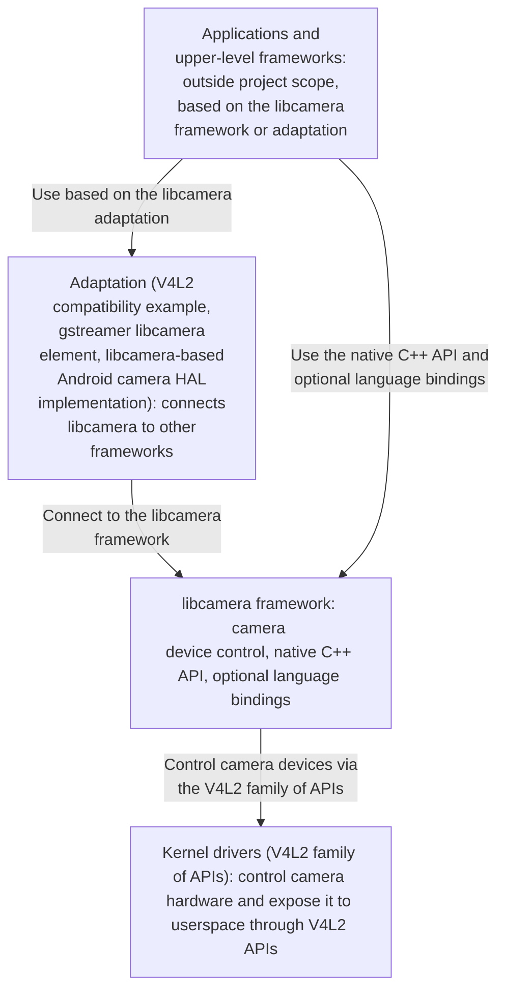
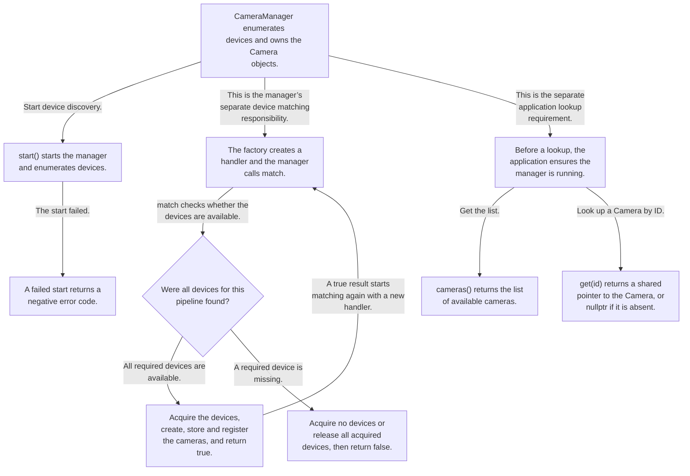
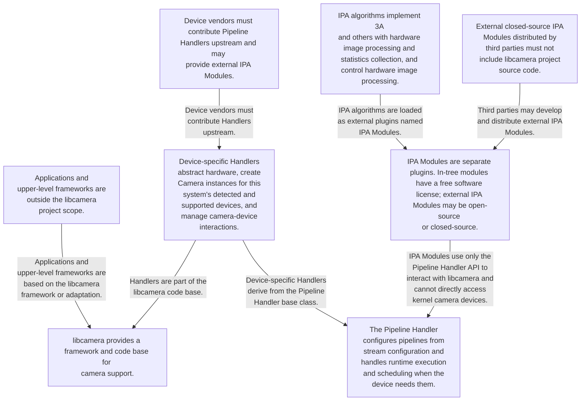

# Architecture

English translation · human review pending. Review states below refer to the Korean source.

Explore the camera stack's layers, the roles of its components, camera discovery, and the boundaries between components.

## Four layers of the camera stack

[Mermaid source](https://ttolsun.github.io/libcamera-sdd/en/index.camera-stack.mmd)

Diagram evidence and verification scope

What role does each of the four software layers, from the application to the kernel driver, play? Camera hardware itself, supported models, and performance are outside the scope of this diagram.

Source-linked interpretation · automatic link check only · meaning and device execution not yet verified

| Elements and transitions | Source evidence |
| --- | --- |
| Applications and upper-level frameworks: outside project scope, based on the libcamera framework or adaptation | [Documentation/introduction.rst:137](https://ttolsun.github.io/libcamera-sdd/en/reader-archive/vendor-overview.html#source-e3b563f549a8c46d) |
| Adaptation (V4L2 compatibility example, gstreamer libcamera element, libcamera-based Android camera HAL implementation): connects libcamera to other frameworks | [Documentation/introduction.rst:137](https://ttolsun.github.io/libcamera-sdd/en/reader-archive/vendor-overview.html#source-e3b563f549a8c46d) |
| libcamera framework: camera device control, native C++ API, optional language bindings | [Documentation/introduction.rst:137](https://ttolsun.github.io/libcamera-sdd/en/reader-archive/vendor-overview.html#source-e3b563f549a8c46d) |
| Kernel drivers (V4L2 family of APIs): control camera hardware and expose it to userspace through V4L2 APIs | [Documentation/introduction.rst:137](https://ttolsun.github.io/libcamera-sdd/en/reader-archive/vendor-overview.html#source-e3b563f549a8c46d) |
| Use based on the libcamera adaptation | [Documentation/introduction.rst:137](https://ttolsun.github.io/libcamera-sdd/en/reader-archive/vendor-overview.html#source-e3b563f549a8c46d) |
| Connect to the libcamera framework | [Documentation/introduction.rst:137](https://ttolsun.github.io/libcamera-sdd/en/reader-archive/vendor-overview.html#source-e3b563f549a8c46d) |
| Control camera devices via the V4L2 family of APIs | [Documentation/introduction.rst:137](https://ttolsun.github.io/libcamera-sdd/en/reader-archive/vendor-overview.html#source-e3b563f549a8c46d) |
| Use the native C++ API and optional language bindings | [Documentation/introduction.rst:137](https://ttolsun.github.io/libcamera-sdd/en/reader-archive/vendor-overview.html#source-e3b563f549a8c46d) |

## Responsibilities by component

`Camera` is the central object in libcamera, modeling a camera capable of producing one or more image streams from a single image source and providing the main interface for configuring and controlling the device and capturing image streams. libcamera manages the lifetime of camera instances with `std::shared_ptr<>`, and instances must be created using the `create()` function, which returns a shared pointer. The constructors and destructor of `Camera` are private, so instances cannot be created or destroyed manually.

Section-wide evidence: 1

- `src/libcamera/camera.cpp`[`L758` excerpt](https://ttolsun.github.io/libcamera-sdd/en/reader-archive/overview.html#source-6c066281dcce33d6) · [Full source `L758`](https://github.com/TTolsun/libcamera-sdd/blob/adfa719f8ed67d18fd8a0739fc088a1f8b9e7252/src/libcamera/camera.cpp#L758)

## Discovery and pipeline selection

`CameraManager` is the entry point to libcamera: it enumerates devices, associates them with pipelines, and gives applications access to the cameras in the system. `CameraManager::Private::pipelineFactoryMatch` repeatedly creates a `PipelineHandler` through the factory and checks for a match using `enumerator_`, ending the loop when there is no match. Only one `CameraManager` instance may exist at a time. Attempting to create a second instance without deleting the existing instance results in undefined behavior.

### From device discovery to Camera access

[Mermaid source](https://ttolsun.github.io/libcamera-sdd/en/overview.discovery-map.mmd)

Diagram evidence and verification scope

How does CameraManager match devices and register cameras, and under what conditions can an app look up a camera?

Source-linked interpretation · automatic link check only · meaning and device execution not yet verified

| Elements and transitions | Source evidence |
| --- | --- |
| CameraManager enumerates devices and owns the Camera objects. | [src/libcamera/camera_manager.cpp:283](https://ttolsun.github.io/libcamera-sdd/en/reader-archive/overview.html#source-f75d22cf73f3402d) |
| start() starts the manager and enumerates devices. | [src/libcamera/camera_manager.cpp:329](https://ttolsun.github.io/libcamera-sdd/en/reader-archive/overview.html#source-f58d94d893e03971) |
| A failed start returns a negative error code. | [src/libcamera/camera_manager.cpp:329](https://ttolsun.github.io/libcamera-sdd/en/reader-archive/overview.html#source-f58d94d893e03971) |
| The factory creates a handler and the manager calls match. | [src/libcamera/camera_manager.cpp:154](https://ttolsun.github.io/libcamera-sdd/en/reader-archive/overview.html#source-0c01857bf49370e2) |
| Were all devices for this pipeline found? | [src/libcamera/pipeline_handler.cpp:86](https://ttolsun.github.io/libcamera-sdd/en/reader-archive/overview.html#source-5bbd41c1e725138c) |
| Acquire the devices, create, store and register the cameras, and return true. | [src/libcamera/pipeline_handler.cpp:86](https://ttolsun.github.io/libcamera-sdd/en/reader-archive/overview.html#source-5bbd41c1e725138c) |
| Acquire no devices or release all acquired devices, then return false. | [src/libcamera/pipeline_handler.cpp:86](https://ttolsun.github.io/libcamera-sdd/en/reader-archive/overview.html#source-5bbd41c1e725138c) |
| Before a lookup, the application ensures the manager is running. | [src/libcamera/camera_manager.cpp:329](https://ttolsun.github.io/libcamera-sdd/en/reader-archive/overview.html#source-f58d94d893e03971) · [src/libcamera/camera_manager.cpp:368](https://ttolsun.github.io/libcamera-sdd/en/reader-archive/overview.html#source-0c733673790ad84f) |
| cameras() returns the list of available cameras. | [src/libcamera/camera_manager.cpp:368](https://ttolsun.github.io/libcamera-sdd/en/reader-archive/overview.html#source-0c733673790ad84f) |
| get(id) returns a shared pointer to the Camera, or nullptr if it is absent. | [src/libcamera/camera_manager.cpp:368](https://ttolsun.github.io/libcamera-sdd/en/reader-archive/overview.html#source-0c733673790ad84f) |
| Start device discovery. | [src/libcamera/camera_manager.cpp:283](https://ttolsun.github.io/libcamera-sdd/en/reader-archive/overview.html#source-f75d22cf73f3402d) · [src/libcamera/camera_manager.cpp:329](https://ttolsun.github.io/libcamera-sdd/en/reader-archive/overview.html#source-f58d94d893e03971) |
| This is the manager’s separate device matching responsibility. | [src/libcamera/camera_manager.cpp:283](https://ttolsun.github.io/libcamera-sdd/en/reader-archive/overview.html#source-f75d22cf73f3402d) · [src/libcamera/camera_manager.cpp:154](https://ttolsun.github.io/libcamera-sdd/en/reader-archive/overview.html#source-0c01857bf49370e2) |
| The start failed. | [src/libcamera/camera_manager.cpp:329](https://ttolsun.github.io/libcamera-sdd/en/reader-archive/overview.html#source-f58d94d893e03971) |
| match checks whether the devices are available. | [src/libcamera/camera_manager.cpp:154](https://ttolsun.github.io/libcamera-sdd/en/reader-archive/overview.html#source-0c01857bf49370e2) · [src/libcamera/pipeline_handler.cpp:86](https://ttolsun.github.io/libcamera-sdd/en/reader-archive/overview.html#source-5bbd41c1e725138c) |
| All required devices are available. | [src/libcamera/pipeline_handler.cpp:86](https://ttolsun.github.io/libcamera-sdd/en/reader-archive/overview.html#source-5bbd41c1e725138c) |
| A required device is missing. | [src/libcamera/pipeline_handler.cpp:86](https://ttolsun.github.io/libcamera-sdd/en/reader-archive/overview.html#source-5bbd41c1e725138c) |
| A true result starts matching again with a new handler. | [src/libcamera/pipeline_handler.cpp:86](https://ttolsun.github.io/libcamera-sdd/en/reader-archive/overview.html#source-5bbd41c1e725138c) · [src/libcamera/camera_manager.cpp:154](https://ttolsun.github.io/libcamera-sdd/en/reader-archive/overview.html#source-0c01857bf49370e2) |
| This is the separate application lookup requirement. | [src/libcamera/camera_manager.cpp:283](https://ttolsun.github.io/libcamera-sdd/en/reader-archive/overview.html#source-f75d22cf73f3402d) · [src/libcamera/camera_manager.cpp:329](https://ttolsun.github.io/libcamera-sdd/en/reader-archive/overview.html#source-f58d94d893e03971) · [src/libcamera/camera_manager.cpp:368](https://ttolsun.github.io/libcamera-sdd/en/reader-archive/overview.html#source-0c733673790ad84f) |
| Get the list. | [src/libcamera/camera_manager.cpp:329](https://ttolsun.github.io/libcamera-sdd/en/reader-archive/overview.html#source-f58d94d893e03971) · [src/libcamera/camera_manager.cpp:368](https://ttolsun.github.io/libcamera-sdd/en/reader-archive/overview.html#source-0c733673790ad84f) |
| Look up a Camera by ID. | [src/libcamera/camera_manager.cpp:329](https://ttolsun.github.io/libcamera-sdd/en/reader-archive/overview.html#source-f58d94d893e03971) · [src/libcamera/camera_manager.cpp:368](https://ttolsun.github.io/libcamera-sdd/en/reader-archive/overview.html#source-0c733673790ad84f) |

The application may list and use cameras from the time the start of `CameraManager::start()` is confirmed until the camera manager is stopped or the relevant camera is disconnected from the system. The caller must ensure that the camera manager is running before calling `CameraManager::cameras()` and `CameraManager::get()`. If all required media devices are found, the `PipelineHandler::match()` implementer must acquire each device with `MediaDevice::acquire()`, create the corresponding `Camera` instances, store them internally, register them with the camera manager, and then return `true`. If not all required devices are found, the `match()` implementer must either acquire no media devices or release all devices already acquired using `MediaDevice::release()`, and must return `false`.

Section-wide evidence: 5

- `src/libcamera/camera_manager.cpp`[`L283` excerpt](https://ttolsun.github.io/libcamera-sdd/en/reader-archive/overview.html#source-f75d22cf73f3402d) · [Full source `L283`](https://github.com/TTolsun/libcamera-sdd/blob/adfa719f8ed67d18fd8a0739fc088a1f8b9e7252/src/libcamera/camera_manager.cpp#L283) · [`L154` excerpt](https://ttolsun.github.io/libcamera-sdd/en/reader-archive/overview.html#source-0c01857bf49370e2) · [Full source `L154`](https://github.com/TTolsun/libcamera-sdd/blob/adfa719f8ed67d18fd8a0739fc088a1f8b9e7252/src/libcamera/camera_manager.cpp#L154) · [`L329` excerpt](https://ttolsun.github.io/libcamera-sdd/en/reader-archive/overview.html#source-f58d94d893e03971) · [Full source `L329`](https://github.com/TTolsun/libcamera-sdd/blob/adfa719f8ed67d18fd8a0739fc088a1f8b9e7252/src/libcamera/camera_manager.cpp#L329) · [`L368` excerpt](https://ttolsun.github.io/libcamera-sdd/en/reader-archive/overview.html#source-0c733673790ad84f) · [Full source `L368`](https://github.com/TTolsun/libcamera-sdd/blob/adfa719f8ed67d18fd8a0739fc088a1f8b9e7252/src/libcamera/camera_manager.cpp#L368)
- `src/libcamera/pipeline_handler.cpp`[`L86` excerpt](https://ttolsun.github.io/libcamera-sdd/en/reader-archive/overview.html#source-5bbd41c1e725138c) · [Full source `L86`](https://github.com/TTolsun/libcamera-sdd/blob/adfa719f8ed67d18fd8a0739fc088a1f8b9e7252/src/libcamera/pipeline_handler.cpp#L86)

## Boundaries with other teams and layers

Applications and higher-level frameworks based on the libcamera framework (the infrastructure for software development) or a libcamera adaptation are outside the scope of the libcamera project.

### The relationship and boundaries at interfaces with other teams and layers

[Mermaid source](https://ttolsun.github.io/libcamera-sdd/en/team-overview.item-boundaries.mmd)

Diagram evidence and verification scope

How are the project scope and responsibilities divided among the application, libcamera, device manufacturers, the Pipeline Handler, and the IPA Module?

Source-linked interpretation · automatic link check only · meaning and device execution not yet verified

| Elements and transitions | Source evidence |
| --- | --- |
| Applications and upper-level frameworks are outside the libcamera project scope. | [Documentation/introduction.rst:163](https://ttolsun.github.io/libcamera-sdd/en/reader-archive/team-overview.html#source-9e653b8ff755db78) |
| libcamera provides a framework and code base for camera support. | [Documentation/introduction.rst:163](https://ttolsun.github.io/libcamera-sdd/en/reader-archive/team-overview.html#source-9e653b8ff755db78) · [Documentation/introduction.rst:200](https://ttolsun.github.io/libcamera-sdd/en/reader-archive/team-overview.html#source-341442e08591ef50) |
| Device vendors must contribute Pipeline Handlers upstream and may provide external IPA Modules. | [Documentation/introduction.rst:200](https://ttolsun.github.io/libcamera-sdd/en/reader-archive/team-overview.html#source-341442e08591ef50) · [Documentation/libcamera_architecture.rst:109](https://ttolsun.github.io/libcamera-sdd/en/reader-archive/team-overview.html#source-1f130cc8640ef810) |
| Device-specific Handlers abstract hardware, create Camera instances for this system's detected and supported devices, and manage camera-device interactions. | [Documentation/libcamera_architecture.rst:87](https://ttolsun.github.io/libcamera-sdd/en/reader-archive/team-overview.html#source-8bd888bd0473995e) |
| The Pipeline Handler configures pipelines from stream configuration and handles runtime execution and scheduling when the device needs them. | [Documentation/libcamera_architecture.rst:87](https://ttolsun.github.io/libcamera-sdd/en/reader-archive/team-overview.html#source-8bd888bd0473995e) |
| IPA algorithms implement 3A and others with hardware image processing and statistics collection, and control hardware image processing. | [Documentation/libcamera_architecture.rst:109](https://ttolsun.github.io/libcamera-sdd/en/reader-archive/team-overview.html#source-1f130cc8640ef810) |
| IPA Modules are separate plugins. In-tree modules have a free software license; external IPA Modules may be open-source or closed-source. | [Documentation/libcamera_architecture.rst:109](https://ttolsun.github.io/libcamera-sdd/en/reader-archive/team-overview.html#source-1f130cc8640ef810) · [Documentation/introduction.rst:200](https://ttolsun.github.io/libcamera-sdd/en/reader-archive/team-overview.html#source-341442e08591ef50) |
| External closed-source IPA Modules distributed by third parties must not include libcamera project source code. | [Documentation/introduction.rst:200](https://ttolsun.github.io/libcamera-sdd/en/reader-archive/team-overview.html#source-341442e08591ef50) |
| Applications and upper-level frameworks are based on the libcamera framework or adaptation. | [Documentation/introduction.rst:163](https://ttolsun.github.io/libcamera-sdd/en/reader-archive/team-overview.html#source-9e653b8ff755db78) |
| Handlers are part of the libcamera code base. | [Documentation/introduction.rst:200](https://ttolsun.github.io/libcamera-sdd/en/reader-archive/team-overview.html#source-341442e08591ef50) |
| Device vendors must contribute Handlers upstream. | [Documentation/introduction.rst:200](https://ttolsun.github.io/libcamera-sdd/en/reader-archive/team-overview.html#source-341442e08591ef50) |
| Device-specific Handlers derive from the Pipeline Handler base class. | [Documentation/libcamera_architecture.rst:87](https://ttolsun.github.io/libcamera-sdd/en/reader-archive/team-overview.html#source-8bd888bd0473995e) |
| IPA algorithms are loaded as external plugins named IPA Modules. | [Documentation/libcamera_architecture.rst:109](https://ttolsun.github.io/libcamera-sdd/en/reader-archive/team-overview.html#source-1f130cc8640ef810) |
| Third parties may develop and distribute external IPA Modules. | [Documentation/introduction.rst:200](https://ttolsun.github.io/libcamera-sdd/en/reader-archive/team-overview.html#source-341442e08591ef50) |
| IPA Modules use only the Pipeline Handler API to interact with libcamera and cannot directly access kernel camera devices. | [Documentation/libcamera_architecture.rst:120](https://ttolsun.github.io/libcamera-sdd/en/reader-archive/team-overview.html#source-6c10d5aeb8fc7ca9) · [Documentation/libcamera_architecture.rst:109](https://ttolsun.github.io/libcamera-sdd/en/reader-archive/team-overview.html#source-1f130cc8640ef810) |

The Pipeline Handler manages device-specific pipelines, and device manufacturers must contribute it to libcamera. Image Processing Algorithms (`Image` Processing Algorithms, IPA) control hardware image processing based on parameters from upper layers, and IPA `Module` (IPA modules) may be provided separately by external parties. IPA `Module` included in libcamera are covered by a free software license, and external modules may be distributed under a closed-source license provided they do not include source code from the libcamera project. IPA `Module` interact only through the APIs (application programming interfaces) provided by libcamera and the Pipeline Handler and cannot directly access kernel camera devices.

Section-wide evidence: 5

- `Documentation/introduction.rst`[`L163` excerpt](https://ttolsun.github.io/libcamera-sdd/en/reader-archive/team-overview.html#source-9e653b8ff755db78) · [Full source `L163`](https://github.com/TTolsun/libcamera-sdd/blob/adfa719f8ed67d18fd8a0739fc088a1f8b9e7252/Documentation/introduction.rst#L163) · [`L200` excerpt](https://ttolsun.github.io/libcamera-sdd/en/reader-archive/team-overview.html#source-341442e08591ef50) · [Full source `L200`](https://github.com/TTolsun/libcamera-sdd/blob/adfa719f8ed67d18fd8a0739fc088a1f8b9e7252/Documentation/introduction.rst#L200)
- `Documentation/libcamera_architecture.rst`[`L87` excerpt](https://ttolsun.github.io/libcamera-sdd/en/reader-archive/team-overview.html#source-8bd888bd0473995e) · [Full source `L87`](https://github.com/TTolsun/libcamera-sdd/blob/adfa719f8ed67d18fd8a0739fc088a1f8b9e7252/Documentation/libcamera_architecture.rst#L87) · [`L109` excerpt](https://ttolsun.github.io/libcamera-sdd/en/reader-archive/team-overview.html#source-1f130cc8640ef810) · [Full source `L109`](https://github.com/TTolsun/libcamera-sdd/blob/adfa719f8ed67d18fd8a0739fc088a1f8b9e7252/Documentation/libcamera_architecture.rst#L109) · [`L120` excerpt](https://ttolsun.github.io/libcamera-sdd/en/reader-archive/team-overview.html#source-6c10d5aeb8fc7ca9) · [Full source `L120`](https://github.com/TTolsun/libcamera-sdd/blob/adfa719f8ed67d18fd8a0739fc088a1f8b9e7252/Documentation/libcamera_architecture.rst#L120)

## Code reading order for the selected scenario

1. Verifies the input checks and return conditions of entry point `Camera::queueRequest(Request *)`.
2. The main calls and tracing boundaries are identified in [Request submission (Camera::queueRequest)](https://ttolsun.github.io/libcamera-sdd/en/request-flow.html).
3. Distinguish scheduled calls from completion notifications, and check the execution thread against the connection code.

## Source manuscripts and review records

libcamera design document

- **Contracts between documents**: [Automated comparison report](https://ttolsun.github.io/libcamera-sdd/contract-consistency.json) · Before human review

[Open earlier detail](https://ttolsun.github.io/libcamera-sdd/en/reader-archive/index.html#page-evidence)

System overview

- **Generation method**: Extracted facts and LLM explanation
- **Validation scope**: Tables and figures are created from facts, and the explanations are written by the LLM. Citation, sentence, and configured structure checks are applied.
- **Automated check**: Passed (`ok`). The items checked are listed in the verification scope. Whether the explanation content is correct is checked by a human reviewer.
- **Human review**: Before human review
- **Analysis baseline commit**: `adfa719f8ed67d18fd8a0739fc088a1f8b9e7252`
- **Document generation time**: `2026-11-20 17:39:13+00:00`
- **Sentence generation model**: `cli/codex/gpt-6.1-terra`
- **Contracts between documents**: [Automated comparison report](https://ttolsun.github.io/libcamera-sdd/contract-consistency.json) · Before human review
- **Reader scope**: [Answers by task and unreviewed scope](https://ttolsun.github.io/libcamera-sdd/reader-scope.json)

Record from when the manuscript was written

This is a record saved in the manuscript as of that time. It may differ from the current document's standards.

- Evidence files: `include/libcamera/camera.h`, `include/libcamera/camera_manager.h`, `include/libcamera/internal/ipa_manager.h`, `include/libcamera/internal/pipeline_handler.h`, `include/libcamera/request.h`, `src/libcamera/base/log.cpp`, `src/libcamera/camera.cpp`, `src/libcamera/camera_manager.cpp`, `src/libcamera/controls.cpp`, `src/libcamera/ipa_manager.cpp`, `src/libcamera/pipeline_handler.cpp`, `src/libcamera/request.cpp`
- Evidence level: code verified (static analysis, simple_compdb configuration, commit `adfa719f8e`)
- Automated check (citation, sentence, and configured structure checks): passed
- Review status recorded on: 2026-11-21 · Awaiting human review

[Markdown source ↗](https://ttolsun.github.io/libcamera-sdd/overview.md) [Mermaid source ↗](https://ttolsun.github.io/libcamera-sdd/en/overview.mmd)

[Open earlier detail](https://ttolsun.github.io/libcamera-sdd/en/reader-archive/overview.html#page-evidence)

What this project does

- **Generation method**: Extracted facts and LLM explanation
- **Validation scope**: Tables and figures are created from facts, and the explanations are written by the LLM. Citation, sentence, and configured structure checks are applied.
- **Automated check**: Passed (`ok`). The items checked are listed in the verification scope. Whether the explanation content is correct is checked by a human reviewer.
- **Human review**: Before human review
- **Analysis baseline commit**: `adfa719f8ed67d18fd8a0739fc088a1f8b9e7252`
- **Document generation time**: `2026-11-11 20:35:47+00:00`
- **Sentence generation model**: `cli/codex/gpt-6.1-terra`
- **Contracts between documents**: [Automated comparison report](https://ttolsun.github.io/libcamera-sdd/contract-consistency.json) · Before human review
- **Reader scope**: [Answers by task and unreviewed scope](https://ttolsun.github.io/libcamera-sdd/reader-scope.json)

Record from when the manuscript was written

This is a record saved in the manuscript as of that time. It may differ from the current document's standards.

- Evidence files: `Documentation/introduction.rst`, `Documentation/libcamera_architecture.rst`, `include/libcamera/camera.h`, `include/libcamera/camera_manager.h`, `include/libcamera/internal/pipeline_handler.h`, `src/libcamera/camera.cpp`, `src/libcamera/camera_manager.cpp`, `src/libcamera/pipeline_handler.cpp`
- Evidence level: code verified (static analysis, simple_compdb configuration, commit `c19d05128f`)
- Automated check (citation, sentence, and configured structure checks): passed
- Review status recorded: 2026-11-12 · Before human review

[Markdown source ↗](https://ttolsun.github.io/libcamera-sdd/team-overview.md)

[Open earlier detail](https://ttolsun.github.io/libcamera-sdd/en/reader-archive/team-overview.html#page-evidence)

[Download page Markdown](https://ttolsun.github.io/libcamera-sdd/en/architecture.md) · [Reader edition source map](https://ttolsun.github.io/libcamera-sdd/reader-edition.json)
