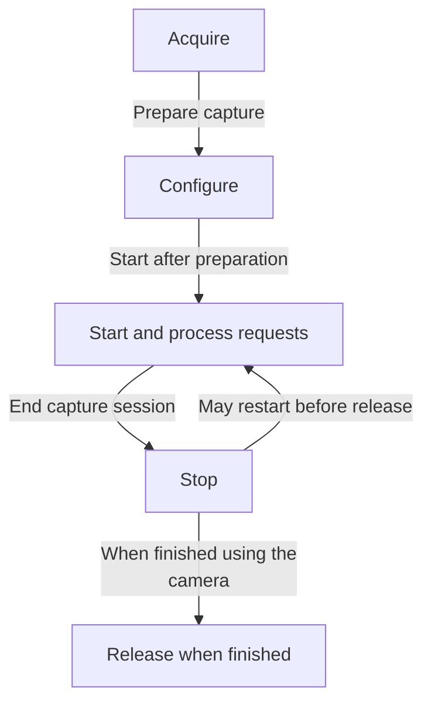
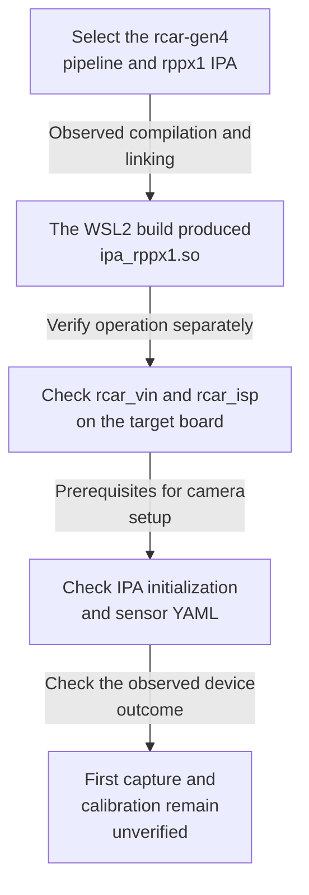
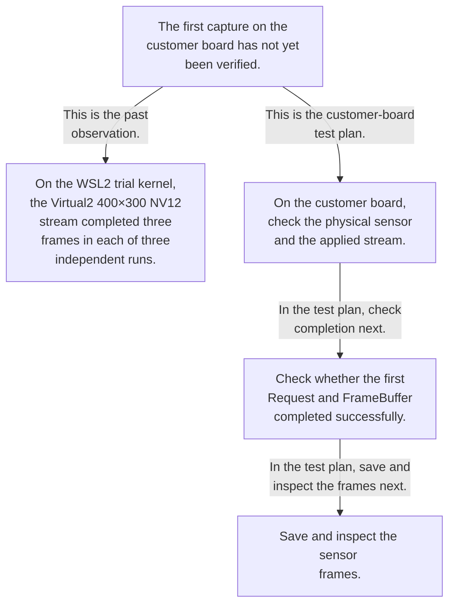
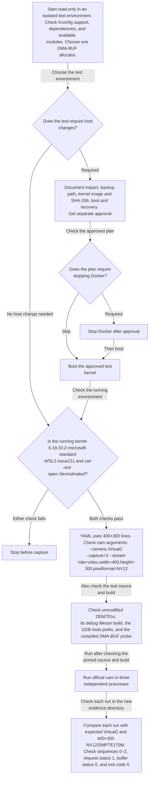
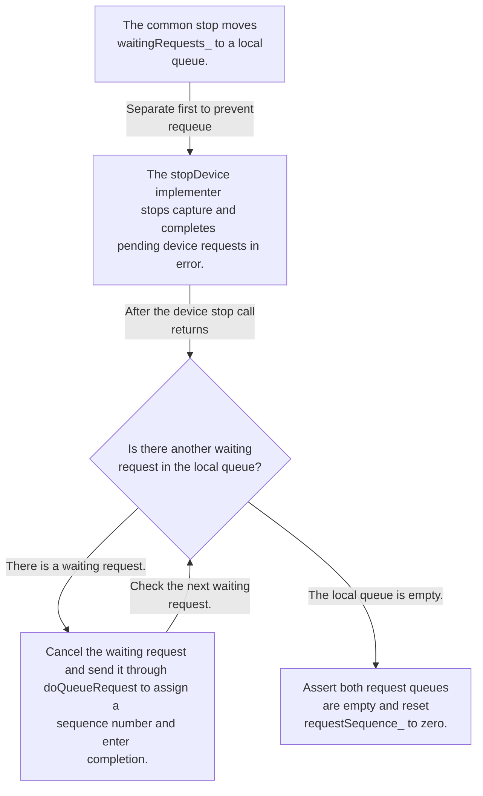
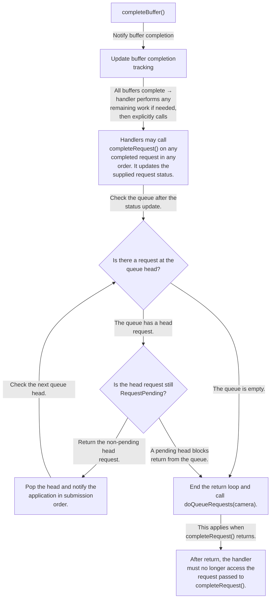

# Device Integration and Verification

English translation · human review pending. Review states below refer to the Korean source.

After integrating the device, test first capture and stopping with incomplete requests separately. Record observations from the public virtual camera separately from checks on the target board.

- [Completion notifications and status checks after stop](https://ttolsun.github.io/libcamera-sdd/en/request-flow.html#stop-and-disconnect)

## Integration order and responsibilities

To prepare for capture, the application must acquire and configure the camera. Once the camera is started, it can process requests until stopped, and the application must release it when finished using it. The application may start and stop the camera multiple times while it remains acquired, and may also reconfigure it. The `Camera` class generally does not synchronize functions that affect camera state with one another, so the caller must synchronize them when necessary.

### Integration order from acquisition to release

[Mermaid source](https://ttolsun.github.io/libcamera-sdd/en/vendor-integration.integration-stages.mmd)

Diagram evidence and verification scope

This is the order of session preparation and teardown for the application. Start and stop may be repeated until the camera is released.

Source-linked interpretation · automatic link check only · meaning and device execution not yet verified

| Elements and transitions | Source evidence |
| --- | --- |
| Acquire | [src/libcamera/camera.cpp:771](https://ttolsun.github.io/libcamera-sdd/en/reader-archive/vendor-integration.html#source-2683b4a5a1dbfee9) |
| Configure | [src/libcamera/camera.cpp:771](https://ttolsun.github.io/libcamera-sdd/en/reader-archive/vendor-integration.html#source-2683b4a5a1dbfee9) |
| Start and process requests | [src/libcamera/camera.cpp:771](https://ttolsun.github.io/libcamera-sdd/en/reader-archive/vendor-integration.html#source-2683b4a5a1dbfee9) |
| Stop | [src/libcamera/camera.cpp:771](https://ttolsun.github.io/libcamera-sdd/en/reader-archive/vendor-integration.html#source-2683b4a5a1dbfee9) |
| Release when finished | [src/libcamera/camera.cpp:771](https://ttolsun.github.io/libcamera-sdd/en/reader-archive/vendor-integration.html#source-2683b4a5a1dbfee9) |
| Prepare capture | [src/libcamera/camera.cpp:771](https://ttolsun.github.io/libcamera-sdd/en/reader-archive/vendor-integration.html#source-2683b4a5a1dbfee9) |
| Start after preparation | [src/libcamera/camera.cpp:771](https://ttolsun.github.io/libcamera-sdd/en/reader-archive/vendor-integration.html#source-2683b4a5a1dbfee9) |
| End capture session | [src/libcamera/camera.cpp:771](https://ttolsun.github.io/libcamera-sdd/en/reader-archive/vendor-integration.html#source-2683b4a5a1dbfee9) |
| When finished using the camera | [src/libcamera/camera.cpp:771](https://ttolsun.github.io/libcamera-sdd/en/reader-archive/vendor-integration.html#source-2683b4a5a1dbfee9) |
| May restart before release | [src/libcamera/camera.cpp:777](https://ttolsun.github.io/libcamera-sdd/en/reader-archive/vendor-integration.html#source-948bd80fa1136291) |

Section-wide evidence: 4

- `src/libcamera/camera.cpp`[`L771` excerpt](https://ttolsun.github.io/libcamera-sdd/en/reader-archive/vendor-integration.html#source-2683b4a5a1dbfee9) · [Full source `L771`](https://github.com/TTolsun/libcamera-sdd/blob/adfa719f8ed67d18fd8a0739fc088a1f8b9e7252/src/libcamera/camera.cpp#L771) · [`L777` excerpt](https://ttolsun.github.io/libcamera-sdd/en/reader-archive/vendor-integration.html#source-948bd80fa1136291) · [Full source `L777`](https://github.com/TTolsun/libcamera-sdd/blob/adfa719f8ed67d18fd8a0739fc088a1f8b9e7252/src/libcamera/camera.cpp#L777) · [`L780` excerpt](https://ttolsun.github.io/libcamera-sdd/en/reader-archive/vendor-integration.html#source-cc6c66b57cf028e6) · [Full source `L780`](https://github.com/TTolsun/libcamera-sdd/blob/adfa719f8ed67d18fd8a0739fc088a1f8b9e7252/src/libcamera/camera.cpp#L780) · [`L1032`](https://ttolsun.github.io/libcamera-sdd/en/reader-archive/vendor-integration.html#source-492118d913b10361)

## Build and support conditions

This material covers libcamera upstream commit `7ae183f` from November 25, 2026. The build was observed on November 27, 2026.

### R-Car Gen4 build and board verification

[Mermaid source](https://ttolsun.github.io/libcamera-sdd/en/vendor-integration.rcar-build-boundary.mmd)

Diagram evidence and verification scope

What did the build verification confirm, and what conditions need to be checked separately on the target board?

Source-linked interpretation · automatic link check only · meaning and device execution not yet verified

| Elements and transitions | Source evidence |
| --- | --- |
| Select the rcar-gen4 pipeline and rppx1 IPA | [product-evidence/libcamera-rcar-gen4-build/rcar-gen4-build-record.txt:1](https://ttolsun.github.io/libcamera-sdd/en/reader-archive/vendor-integration.html#source-ad5d622c32f4ff6b) |
| The WSL2 build produced ipa_rppx1.so | [product-evidence/libcamera-rcar-gen4-build/rcar-gen4-build-record.txt:1](https://ttolsun.github.io/libcamera-sdd/en/reader-archive/vendor-integration.html#source-ad5d622c32f4ff6b) |
| Check rcar_vin and rcar_isp on the target board | [product-evidence/libcamera-rcar-gen4-build/rcar-gen4-build-record.txt:1](https://ttolsun.github.io/libcamera-sdd/en/reader-archive/vendor-integration.html#source-ad5d622c32f4ff6b) |
| Check IPA initialization and sensor YAML | [product-evidence/libcamera-rcar-gen4-build/rcar-gen4-build-record.txt:1](https://ttolsun.github.io/libcamera-sdd/en/reader-archive/vendor-integration.html#source-ad5d622c32f4ff6b) |
| First capture and calibration remain unverified | [product-evidence/libcamera-rcar-gen4-build/rcar-gen4-build-record.txt:1](https://ttolsun.github.io/libcamera-sdd/en/reader-archive/vendor-integration.html#source-ad5d622c32f4ff6b) |
| Observed compilation and linking | [product-evidence/libcamera-rcar-gen4-build/rcar-gen4-build-record.txt:1](https://ttolsun.github.io/libcamera-sdd/en/reader-archive/vendor-integration.html#source-ad5d622c32f4ff6b) |
| Verify operation separately | [product-evidence/libcamera-rcar-gen4-build/rcar-gen4-build-record.txt:1](https://ttolsun.github.io/libcamera-sdd/en/reader-archive/vendor-integration.html#source-ad5d622c32f4ff6b) |
| Prerequisites for camera setup | [product-evidence/libcamera-rcar-gen4-build/rcar-gen4-build-record.txt:1](https://ttolsun.github.io/libcamera-sdd/en/reader-archive/vendor-integration.html#source-ad5d622c32f4ff6b) |
| Check the observed device outcome | [product-evidence/libcamera-rcar-gen4-build/rcar-gen4-build-record.txt:1](https://ttolsun.github.io/libcamera-sdd/en/reader-archive/vendor-integration.html#source-ad5d622c32f4ff6b) |

To build R-Car Gen4 separately, you must specify `-Dpipelines=rcar-gen4 -Dipas=rppx1`. The IPA build compares the enabled pipelines with the modules specified in `-Dipas`; the IPA corresponding to `rcar-gen4` is `rppx1`. In the pipeline option, `auto` selects the pipelines applicable to the target architecture, while `all` selects all pipelines.

The R-Car Gen4 pipeline acquires the `rcar_vin` media device, finds the `rcar_isp` core entity, and attempts to create a camera. Initialization fails if the corresponding IPA module is missing. The IPA configuration uses the sensor model's YAML file, with `uncalibrated.yaml` as the fallback. The existence of the fallback file does not guarantee that the lens or sensor is calibrated.

A Ninja build completed on Ubuntu WSL2 `x86_64`, Clang 21.1.8, and Meson 1.10.1, using `pipelines=all`, the recorded IPA list including `rppx1`, and GStreamer, V4L2, and cam enabled. A separate Ninja build at the same pinned commit also completed with `-Dpipelines=rcar-gen4 -Dipas=rppx1` specified, producing `ipa_rppx1.so`. These observations support compilation and linking in the recorded environment.

Runtime checks: Device discovery, camera registration, the first capture, and calibration quality have not yet been verified for the target board, kernel, and sensor combination. This material does not constitute a test of the full kernel header changes or the remaining behavior of a new source commit.

Section-wide evidence: 1

- `product-evidence/libcamera-rcar-gen4-build/rcar-gen4-build-record.txt`[`L1`](https://ttolsun.github.io/libcamera-sdd/en/reader-archive/vendor-integration.html#source-ad5d622c32f4ff6b)

## Has the first capture on the customer board been validated?

This record cannot be used to report that the first capture on the customer board has been validated. The WSL2 test configuration used the Virtual2 virtual camera instead of a physical sensor, and there is no record of a capture using the customer board's physical sensor.

### Virtual capture observation and customer board testing

[Mermaid source](https://ttolsun.github.io/libcamera-sdd/en/vendor-assurance.first-capture-boundary.mmd)

Diagram evidence and verification scope

What was verified in WSL2, and in what order is the first capture checked on the customer board?

Source-linked interpretation · automatic link check only · meaning and device execution not yet verified

LLM diagram draft · before human review

Authoring model: `cli/codex/gpt-6.1-terra`

| Elements and transitions | Source evidence |
| --- | --- |
| The first capture on the customer board has not yet been verified. | [product-evidence/libcamera-first-capture-trial/virtual-first-capture-run.txt:1](https://ttolsun.github.io/libcamera-sdd/en/reader-archive/vendor-assurance.html#source-3c4ba1aba4901083) |
| On the WSL2 trial kernel, the Virtual2 400×300 NV12 stream completed three frames in each of three independent runs. | [product-evidence/libcamera-first-capture-trial/virtual-first-capture-run.txt:1](https://ttolsun.github.io/libcamera-sdd/en/reader-archive/vendor-assurance.html#source-3c4ba1aba4901083) |
| On the customer board, check the physical sensor and the applied stream. | [product-evidence/libcamera-first-capture-trial/virtual-first-capture-run.txt:1](https://ttolsun.github.io/libcamera-sdd/en/reader-archive/vendor-assurance.html#source-3c4ba1aba4901083) · [README.rst:107](https://ttolsun.github.io/libcamera-sdd/en/reader-archive/vendor-assurance.html#source-ce71f2f0de50caf3) · [include/libcamera/camera.h:126](https://ttolsun.github.io/libcamera-sdd/en/reader-archive/vendor-assurance.html#source-aba605be681da98e) |
| Check whether the first Request and FrameBuffer completed successfully. | [include/libcamera/camera.h:126](https://ttolsun.github.io/libcamera-sdd/en/reader-archive/vendor-assurance.html#source-aba605be681da98e) · [include/libcamera/request.h:34](https://ttolsun.github.io/libcamera-sdd/en/reader-archive/vendor-assurance.html#source-cb2be6f3ec7f91fc) · [include/libcamera/framebuffer.h:25](https://ttolsun.github.io/libcamera-sdd/en/reader-archive/vendor-assurance.html#source-094e6fd7ddda824a) |
| Save and inspect the sensor frames. | [include/libcamera/camera.h:126](https://ttolsun.github.io/libcamera-sdd/en/reader-archive/vendor-assurance.html#source-aba605be681da98e) · [README.rst:107](https://ttolsun.github.io/libcamera-sdd/en/reader-archive/vendor-assurance.html#source-ce71f2f0de50caf3) |
| This is the past observation. | [product-evidence/libcamera-first-capture-trial/virtual-first-capture-run.txt:1](https://ttolsun.github.io/libcamera-sdd/en/reader-archive/vendor-assurance.html#source-3c4ba1aba4901083) |
| This is the customer-board test plan. | [product-evidence/libcamera-first-capture-trial/virtual-first-capture-run.txt:1](https://ttolsun.github.io/libcamera-sdd/en/reader-archive/vendor-assurance.html#source-3c4ba1aba4901083) · [README.rst:107](https://ttolsun.github.io/libcamera-sdd/en/reader-archive/vendor-assurance.html#source-ce71f2f0de50caf3) |
| In the test plan, check completion next. | [include/libcamera/camera.h:126](https://ttolsun.github.io/libcamera-sdd/en/reader-archive/vendor-assurance.html#source-aba605be681da98e) · [README.rst:107](https://ttolsun.github.io/libcamera-sdd/en/reader-archive/vendor-assurance.html#source-ce71f2f0de50caf3) |
| In the test plan, save and inspect the frames next. | [include/libcamera/camera.h:126](https://ttolsun.github.io/libcamera-sdd/en/reader-archive/vendor-assurance.html#source-aba605be681da98e) · [README.rst:107](https://ttolsun.github.io/libcamera-sdd/en/reader-archive/vendor-assurance.html#source-ce71f2f0de50caf3) |

As far as can be confirmed from the official libcamera project documentation, the Virtual Pipeline Handler emulates a virtual external camera for testing. The example YAML specifies a 400×300 size and the `lines` test pattern for Virtual2.

The virtual capture test on October 31, 2026 used source commit 293d751a814e0d4c34e85ad457ccd9d5eefd1a61 and the WSL2 trial kernel 6.18.33.2-microsoft-standard-WSL2-issue211 with udmabuf built in. All three runs on Virtual2 at 400×300 NV12, each in a separate process, completed three frames each. This observation does not constitute validation of a physical camera or board DMA.

In the first capture test on the customer board, the board, physical sensor, kernel and driver, libcamera build, and target application are recorded, and the actual sensor is opened to check the applied stream format and size. The first request's RequestComplete and the buffer's FrameSuccess are checked, and frames from the sensor are saved and inspected. cam can be used as an example of a basic test tool's save functionality. Existing records are limited to a test configuration using udmabuf and Virtual2 on a WSL2 test kernel; the physical camera, physical DMA, and product application have not been validated.

Section-wide evidence: 7

- `product-evidence/libcamera-first-capture-trial/virtual-first-capture-run.txt`[`L1`](https://ttolsun.github.io/libcamera-sdd/en/reader-archive/vendor-assurance.html#source-3c4ba1aba4901083)
- `src/libcamera/pipeline/virtual/README.md`[`L3` excerpt](https://ttolsun.github.io/libcamera-sdd/en/reader-archive/vendor-assurance.html#source-eb7d1ae4ac9df3f9) · [Full source `L3`](https://github.com/TTolsun/libcamera-sdd/blob/adfa719f8ed67d18fd8a0739fc088a1f8b9e7252/src/libcamera/pipeline/virtual/README.md#L3)
- `src/libcamera/pipeline/virtual/data/virtual.yaml`[`L28` excerpt](https://ttolsun.github.io/libcamera-sdd/en/reader-archive/vendor-assurance.html#source-fb6397b1c5827be7) · [Full source `L28`](https://github.com/TTolsun/libcamera-sdd/blob/adfa719f8ed67d18fd8a0739fc088a1f8b9e7252/src/libcamera/pipeline/virtual/data/virtual.yaml#L28)
- `include/libcamera/request.h`[`L34` excerpt](https://ttolsun.github.io/libcamera-sdd/en/reader-archive/vendor-assurance.html#source-cb2be6f3ec7f91fc) · [Full source `L34`](https://github.com/TTolsun/libcamera-sdd/blob/adfa719f8ed67d18fd8a0739fc088a1f8b9e7252/include/libcamera/request.h#L34)
- `include/libcamera/framebuffer.h`[`L25` excerpt](https://ttolsun.github.io/libcamera-sdd/en/reader-archive/vendor-assurance.html#source-094e6fd7ddda824a) · [Full source `L25`](https://github.com/TTolsun/libcamera-sdd/blob/adfa719f8ed67d18fd8a0739fc088a1f8b9e7252/include/libcamera/framebuffer.h#L25)
- `README.rst`[`L107` excerpt](https://ttolsun.github.io/libcamera-sdd/en/reader-archive/vendor-assurance.html#source-ce71f2f0de50caf3) · [Full source `L107`](https://github.com/TTolsun/libcamera-sdd/blob/adfa719f8ed67d18fd8a0739fc088a1f8b9e7252/README.rst#L107)
- `include/libcamera/camera.h`[`L126` excerpt](https://ttolsun.github.io/libcamera-sdd/en/reader-archive/vendor-assurance.html#source-aba605be681da98e) · [Full source `L126`](https://github.com/TTolsun/libcamera-sdd/blob/adfa719f8ed67d18fd8a0739fc088a1f8b9e7252/include/libcamera/camera.h#L126)

## Reproduce the public WSL virtual camera first-capture trial

1. **Preparation (1–3)** Investigate the Kconfig and dependencies of the kernel to be used without changing the host state.
2. **DMA-BUF allocator selection:** Investigate the selected kernel's Kconfig, dependencies, actually available modules, and allocator candidates, and select one allocator suited to the results. Use udmabuf to reproduce the conditions in this record.
3. Investigate whether only the modules required by the selected kernel and allocator are installed and whether they match the kernel version. In the recorded udmabuf test, the driver was built in and no separate modules were installed.
4. **Host changes (4–5)** Obtain separate approval immediately before executing the host change plan, which includes the proposed changes, the kernel to boot and its image SHA-256, the impact, the exact backup path, and the boot and recovery procedures.
5. Install and boot the trial kernel according to the approved plan.
6. **Pre-execution checks (6–11)** Verify that the running kernel version is `6.18.33.2-microsoft-standard-WSL2-issue211`.
7. Check permission to open `/dev/udmabuf` in the WSL root child context.
8. In the Virtual2 YAML to be used, verify the 400x300 size and the lines pattern value together as a single configuration combination.
9. Check that the camera selection argument in the cam command to be used is `Virtual2`.
10. Check that the cam stream argument to be used requests 400x300 NV12.
11. Check whether the official cam command to be run specifies the `--capture=3` argument requesting 3 frames.
12. **Execution and validation (12–13)** Run the unmodified official cam in three independent processes according to the linked execution procedure.
13. Compare the evidence from the new run against the expected combination of camera Virtual2, an actually applied stream of 400x300 NV12, and successful processing of 3 frames and exit code 0 for each independent run.

### From environment checks to running the reproduction

[Mermaid source](https://ttolsun.github.io/libcamera-sdd/en/official-cam-validation.reproduction-flow.mmd)

Diagram evidence and verification scope

If a host change is required to install the test kernel recorded in the existing WSL, under what conditions does reproduction proceed after approval and pre-execution checks?

Source-linked interpretation · automatic link check only · meaning and device execution not yet verified

| Elements and transitions | Source evidence |
| --- | --- |
| Start read-only in an isolated test environment. Check Kconfig support, dependencies, and available modules. Choose one DMA-BUF allocator. | [product-evidence/libcamera-official-cam-trial/invocation-reproduction-procedure.txt:1](https://ttolsun.github.io/libcamera-sdd/en/reader-archive/official-cam-validation.html#source-5a006a90fe9f46ad) |
| Does the test require host changes? | [product-evidence/libcamera-official-cam-trial/invocation-reproduction-procedure.txt:1](https://ttolsun.github.io/libcamera-sdd/en/reader-archive/official-cam-validation.html#source-5a006a90fe9f46ad) |
| Document impact, backup path, kernel image and SHA-256, boot and recovery. Get separate approval | [product-evidence/libcamera-official-cam-trial/invocation-reproduction-procedure.txt:1](https://ttolsun.github.io/libcamera-sdd/en/reader-archive/official-cam-validation.html#source-5a006a90fe9f46ad) |
| Does the plan require stopping Docker? | [product-evidence/libcamera-official-cam-trial/invocation-reproduction-procedure.txt:1](https://ttolsun.github.io/libcamera-sdd/en/reader-archive/official-cam-validation.html#source-5a006a90fe9f46ad) |
| Stop Docker after approval | [product-evidence/libcamera-official-cam-trial/invocation-reproduction-procedure.txt:1](https://ttolsun.github.io/libcamera-sdd/en/reader-archive/official-cam-validation.html#source-5a006a90fe9f46ad) |
| Boot the approved test kernel | [product-evidence/libcamera-official-cam-trial/invocation-reproduction-procedure.txt:1](https://ttolsun.github.io/libcamera-sdd/en/reader-archive/official-cam-validation.html#source-5a006a90fe9f46ad) |
| Is the running kernel 6.18.33.2-microsoft-standard-WSL2-issue211 and can root open /dev/udmabuf? | [product-evidence/libcamera-official-cam-trial/invocation-reproduction-procedure.txt:1](https://ttolsun.github.io/libcamera-sdd/en/reader-archive/official-cam-validation.html#source-5a006a90fe9f46ad) |
| Stop before capture | [product-evidence/libcamera-official-cam-trial/invocation-reproduction-procedure.txt:1](https://ttolsun.github.io/libcamera-sdd/en/reader-archive/official-cam-validation.html#source-5a006a90fe9f46ad) |
| Run official cam in three independent processes | [product-evidence/libcamera-official-cam-trial/invocation-reproduction-procedure.txt:1](https://ttolsun.github.io/libcamera-sdd/en/reader-archive/official-cam-validation.html#source-5a006a90fe9f46ad) |
| Compare each run with expected Virtual2 and 400×300 NV12/SMPTE170M. Check sequences 0–2, request status 1, buffer status 0, and exit code 0. | [product-evidence/libcamera-official-cam-trial/invocation-reproduction-procedure.txt:1](https://ttolsun.github.io/libcamera-sdd/en/reader-archive/official-cam-validation.html#source-5a006a90fe9f46ad) · [product-evidence/libcamera-official-cam-trial/invocation-official-cam-reader.txt:1](https://ttolsun.github.io/libcamera-sdd/en/reader-archive/official-cam-validation.html#source-e326d2b05d8f4ef8) · [product-evidence/libcamera-official-cam-trial/invocation-options.txt:1](https://ttolsun.github.io/libcamera-sdd/en/reader-archive/official-cam-validation.html#source-077dc6a73bad3108) |
| YAML uses 400×300 lines. Check cam arguments: --camera Virtual2 --capture=3 --stream role=video,width=400,height=300,pixelformat=NV12 | [src/libcamera/pipeline/virtual/data/virtual.yaml:28](https://ttolsun.github.io/libcamera-sdd/en/reader-archive/official-cam-validation.html#source-9858e22e2225cc10) · [product-evidence/libcamera-official-cam-trial/invocation-options.txt:1](https://ttolsun.github.io/libcamera-sdd/en/reader-archive/official-cam-validation.html#source-077dc6a73bad3108) |
| Check unmodified 293d751a, its debug Meson build, the GDB tools prefix, and the compiled DMA-BUF probe | [product-evidence/libcamera-official-cam-trial/invocation-reproduction-procedure.txt:1](https://ttolsun.github.io/libcamera-sdd/en/reader-archive/official-cam-validation.html#source-5a006a90fe9f46ad) |
| Choose the test environment | [product-evidence/libcamera-official-cam-trial/invocation-reproduction-procedure.txt:1](https://ttolsun.github.io/libcamera-sdd/en/reader-archive/official-cam-validation.html#source-5a006a90fe9f46ad) |
| Required | [product-evidence/libcamera-official-cam-trial/invocation-reproduction-procedure.txt:1](https://ttolsun.github.io/libcamera-sdd/en/reader-archive/official-cam-validation.html#source-5a006a90fe9f46ad) |
| No host change needed | [product-evidence/libcamera-official-cam-trial/invocation-reproduction-procedure.txt:1](https://ttolsun.github.io/libcamera-sdd/en/reader-archive/official-cam-validation.html#source-5a006a90fe9f46ad) |
| Check the approved plan | [product-evidence/libcamera-official-cam-trial/invocation-reproduction-procedure.txt:1](https://ttolsun.github.io/libcamera-sdd/en/reader-archive/official-cam-validation.html#source-5a006a90fe9f46ad) |
| Required | [product-evidence/libcamera-official-cam-trial/invocation-reproduction-procedure.txt:1](https://ttolsun.github.io/libcamera-sdd/en/reader-archive/official-cam-validation.html#source-5a006a90fe9f46ad) |
| Skip | [product-evidence/libcamera-official-cam-trial/invocation-reproduction-procedure.txt:1](https://ttolsun.github.io/libcamera-sdd/en/reader-archive/official-cam-validation.html#source-5a006a90fe9f46ad) |
| Then boot | [product-evidence/libcamera-official-cam-trial/invocation-reproduction-procedure.txt:1](https://ttolsun.github.io/libcamera-sdd/en/reader-archive/official-cam-validation.html#source-5a006a90fe9f46ad) |
| Check the running environment | [product-evidence/libcamera-official-cam-trial/invocation-reproduction-procedure.txt:1](https://ttolsun.github.io/libcamera-sdd/en/reader-archive/official-cam-validation.html#source-5a006a90fe9f46ad) |
| Either check fails | [product-evidence/libcamera-official-cam-trial/invocation-reproduction-procedure.txt:1](https://ttolsun.github.io/libcamera-sdd/en/reader-archive/official-cam-validation.html#source-5a006a90fe9f46ad) |
| Both checks pass | [product-evidence/libcamera-official-cam-trial/invocation-reproduction-procedure.txt:1](https://ttolsun.github.io/libcamera-sdd/en/reader-archive/official-cam-validation.html#source-5a006a90fe9f46ad) · [src/libcamera/pipeline/virtual/data/virtual.yaml:28](https://ttolsun.github.io/libcamera-sdd/en/reader-archive/official-cam-validation.html#source-9858e22e2225cc10) · [product-evidence/libcamera-official-cam-trial/invocation-options.txt:1](https://ttolsun.github.io/libcamera-sdd/en/reader-archive/official-cam-validation.html#source-077dc6a73bad3108) |
| Check each run in the new evidence directory | [product-evidence/libcamera-official-cam-trial/invocation-reproduction-procedure.txt:1](https://ttolsun.github.io/libcamera-sdd/en/reader-archive/official-cam-validation.html#source-5a006a90fe9f46ad) |
| Also check the test source and build | [src/libcamera/pipeline/virtual/data/virtual.yaml:28](https://ttolsun.github.io/libcamera-sdd/en/reader-archive/official-cam-validation.html#source-9858e22e2225cc10) · [product-evidence/libcamera-official-cam-trial/invocation-options.txt:1](https://ttolsun.github.io/libcamera-sdd/en/reader-archive/official-cam-validation.html#source-077dc6a73bad3108) · [product-evidence/libcamera-official-cam-trial/invocation-reproduction-procedure.txt:1](https://ttolsun.github.io/libcamera-sdd/en/reader-archive/official-cam-validation.html#source-5a006a90fe9f46ad) |
| Run after checking the pinned source and build | [product-evidence/libcamera-official-cam-trial/invocation-reproduction-procedure.txt:1](https://ttolsun.github.io/libcamera-sdd/en/reader-archive/official-cam-validation.html#source-5a006a90fe9f46ad) |

Run verification items: These results apply only to the WSL virtual camera simulation configuration; physical DMA, physical camera, the product app, and the internal HAL were not validated. Because GDB affects timing, the callback return instruction and performance were not validated.

Section-wide evidence: 5

- `product-evidence/libcamera-official-cam-trial/invocation-reproduction-procedure.txt`[`L1`](https://ttolsun.github.io/libcamera-sdd/en/reader-archive/official-cam-validation.html#source-5a006a90fe9f46ad)
- `product-evidence/libcamera-official-cam-trial/invocation-execution-contract.txt`[`L1`](https://ttolsun.github.io/libcamera-sdd/en/reader-archive/official-cam-validation.html#source-67134777ea4213e0)
- `product-evidence/libcamera-official-cam-trial/invocation-official-cam-reader.txt`[`L1`](https://ttolsun.github.io/libcamera-sdd/en/reader-archive/official-cam-validation.html#source-e326d2b05d8f4ef8)
- `src/libcamera/pipeline/virtual/data/virtual.yaml`[`L28` excerpt](https://ttolsun.github.io/libcamera-sdd/en/reader-archive/official-cam-validation.html#source-9858e22e2225cc10) · [Full source `L28`](https://github.com/TTolsun/libcamera-sdd/blob/adfa719f8ed67d18fd8a0739fc088a1f8b9e7252/src/libcamera/pipeline/virtual/data/virtual.yaml#L28)
- `product-evidence/libcamera-official-cam-trial/invocation-options.txt`[`L1`](https://ttolsun.github.io/libcamera-sdd/en/reader-archive/official-cam-validation.html#source-077dc6a73bad3108)

Verification scope of the virtual test

**This is a virtual test configuration. It must not be used as a support or performance claim for an actual product.**

- [Once the allocator was prepared, the official cam capture finished.](https://ttolsun.github.io/libcamera-sdd/en/reader-archive/official-cam-validation.html#할당기를-준비하자-공식-cam-캡처가-완료됐습니다)
- [Prepares multiple initial requests to match a single stream.](https://ttolsun.github.io/libcamera-sdd/en/reader-archive/official-cam-validation.html#여러-초기-요청을-단일-스트림에-맞춰-준비합니다)
- [Prepared initial requests are submitted within the limit.](https://ttolsun.github.io/libcamera-sdd/en/reader-archive/official-cam-validation.html#준비된-초기-요청을-한도-안에서-제출합니다)
- [cam receives the completion notification and processes the frame in the event loop.](https://ttolsun.github.io/libcamera-sdd/en/reader-archive/official-cam-validation.html#cam이-완료-알림을-받아-이벤트-루프에서-프레임을-처리합니다)
- [Reproduction is performed after the supported kernel and device access are checked.](#d1-virtual-reproduction)

## Responsibility for stop and error handling

`PipelineHandler::stop()` first executes `waitingRequests.swap(data->waitingRequests_)` and then calls `stopDevice(camera)`. `PipelineHandler::stop()` moves the waiting requests aside so that they are not requeued when `completeRequest()` is called inside `stopDevice()`. The implementer of `stopDevice()` must immediately stop capture from all running streams and stop processing requests, and must cancel all pending requests for the device and complete them immediately in an error state.

### Order of stopping the device and returning waiting requests

[Mermaid source](https://ttolsun.github.io/libcamera-sdd/en/vendor-integration.shutdown-device-and-waiting-requests.mmd)

Diagram evidence and verification scope

Which requests do the common stop and stopDevice implementers each handle, and when?

Source-linked interpretation · automatic link check only · meaning and device execution not yet verified

| Elements and transitions | Source evidence |
| --- | --- |
| The common stop moves waitingRequests\_ to a local queue. | [src/libcamera/pipeline_handler.cpp:367](https://ttolsun.github.io/libcamera-sdd/en/reader-archive/vendor-integration.html#source-1cc522721d2c5142) · [src/libcamera/pipeline_handler.cpp:370](https://ttolsun.github.io/libcamera-sdd/en/reader-archive/vendor-integration.html#source-486f3f81acba3c1f) |
| The stopDevice implementer stops capture and completes pending device requests in error. | [src/libcamera/pipeline_handler.cpp:367](https://ttolsun.github.io/libcamera-sdd/en/reader-archive/vendor-integration.html#source-7097caa35d0e97c8) · [src/libcamera/pipeline_handler.cpp:405](https://ttolsun.github.io/libcamera-sdd/en/reader-archive/vendor-integration.html#source-a1eeb263fc114d2f) |
| Is there another waiting request in the local queue? | [src/libcamera/pipeline_handler.cpp:367](https://ttolsun.github.io/libcamera-sdd/en/reader-archive/vendor-integration.html#source-1cc522721d2c5142) |
| Cancel the waiting request and send it through doQueueRequest to assign a sequence number and enter completion. | [src/libcamera/pipeline_handler.cpp:367](https://ttolsun.github.io/libcamera-sdd/en/reader-archive/vendor-integration.html#source-1cc522721d2c5142) |
| Assert both request queues are empty and reset requestSequence\_ to zero. | [src/libcamera/pipeline_handler.cpp:367](https://ttolsun.github.io/libcamera-sdd/en/reader-archive/vendor-integration.html#source-1cc522721d2c5142) |
| Separate first to prevent requeue | [src/libcamera/pipeline_handler.cpp:370](https://ttolsun.github.io/libcamera-sdd/en/reader-archive/vendor-integration.html#source-486f3f81acba3c1f) · [src/libcamera/pipeline_handler.cpp:367](https://ttolsun.github.io/libcamera-sdd/en/reader-archive/vendor-integration.html#source-1cc522721d2c5142) · [src/libcamera/pipeline_handler.cpp:367](https://ttolsun.github.io/libcamera-sdd/en/reader-archive/vendor-integration.html#source-7097caa35d0e97c8) |
| After the device stop call returns | [src/libcamera/pipeline_handler.cpp:367](https://ttolsun.github.io/libcamera-sdd/en/reader-archive/vendor-integration.html#source-7097caa35d0e97c8) · [src/libcamera/pipeline_handler.cpp:367](https://ttolsun.github.io/libcamera-sdd/en/reader-archive/vendor-integration.html#source-1cc522721d2c5142) |
| There is a waiting request. | [src/libcamera/pipeline_handler.cpp:367](https://ttolsun.github.io/libcamera-sdd/en/reader-archive/vendor-integration.html#source-1cc522721d2c5142) |
| Check the next waiting request. | [src/libcamera/pipeline_handler.cpp:367](https://ttolsun.github.io/libcamera-sdd/en/reader-archive/vendor-integration.html#source-1cc522721d2c5142) |
| The local queue is empty. | [src/libcamera/pipeline_handler.cpp:367](https://ttolsun.github.io/libcamera-sdd/en/reader-archive/vendor-integration.html#source-1cc522721d2c5142) |

`PipelineHandler::stop()` takes the waiting requests aside, then calls `stopDevice()`. After canceling each waiting request, it passes the request to `doQueueRequest()` so that it receives a sequence number and is temporarily added to `queuedRequests_` for completion in `completeRequest()`. After processing the waiting requests, `PipelineHandler::stop()` uses two `ASSERT` statements to check that `queuedRequests_` and `waitingRequests_` are empty, and stores `0` in `requestSequence_`.

Section-wide evidence: 3

- `src/libcamera/pipeline_handler.cpp`[`L367`](https://github.com/TTolsun/libcamera-sdd/blob/adfa719f8ed67d18fd8a0739fc088a1f8b9e7252/src/libcamera/pipeline_handler.cpp#L367) · [`L370` excerpt](https://ttolsun.github.io/libcamera-sdd/en/reader-archive/vendor-integration.html#source-486f3f81acba3c1f) · [Full source `L370`](https://github.com/TTolsun/libcamera-sdd/blob/adfa719f8ed67d18fd8a0739fc088a1f8b9e7252/src/libcamera/pipeline_handler.cpp#L370) · [`L405` excerpt](https://ttolsun.github.io/libcamera-sdd/en/reader-archive/vendor-integration.html#source-a1eeb263fc114d2f) · [Full source `L405`](https://github.com/TTolsun/libcamera-sdd/blob/adfa719f8ed67d18fd8a0739fc088a1f8b9e7252/src/libcamera/pipeline_handler.cpp#L405) · [`L367`](https://ttolsun.github.io/libcamera-sdd/en/reader-archive/vendor-integration.html#source-1cc522721d2c5142) · [`L367`](https://ttolsun.github.io/libcamera-sdd/en/reader-archive/vendor-integration.html#source-7097caa35d0e97c8)

## Buffer completion and request return

See also: [When the last buffer has completed but no request completion notification arrives](https://ttolsun.github.io/libcamera-sdd/en/troubleshooting.html#failure-location)

The pipeline handler must call completeBuffer in the normal buffer completion path to signal completion of a request's buffer. This function notifies the application of buffer completion and updates the request's internal buffer tracking information. The request is not completed automatically even when the last buffer completes, so the pipeline handler must explicitly complete the request with completeRequest(). In the normal completion path, the request is not completed automatically even after processing of the last buffer finishes, so the implementer must explicitly call completeRequest() to complete the request.

### From normal buffer completion to request return

[Mermaid source](https://ttolsun.github.io/libcamera-sdd/en/pipeline-requests.buffer-request-completion.mmd)

Diagram evidence and verification scope

In what order are requests returned after buffers are completed, and when does the pipeline handler's access to a request end?

Source-linked interpretation · automatic link check only · meaning and device execution not yet verified

| Elements and transitions | Source evidence |
| --- | --- |
| completeBuffer() | [src/libcamera/pipeline_handler.cpp:547](https://ttolsun.github.io/libcamera-sdd/en/reader-archive/pipeline-requests.html#source-01ad7c6605c3296a) |
| Update buffer completion tracking | [src/libcamera/pipeline_handler.cpp:547](https://ttolsun.github.io/libcamera-sdd/en/reader-archive/pipeline-requests.html#source-01ad7c6605c3296a) |
| Handlers may call completeRequest() on any completed request in any order. It updates the supplied request status. | [src/libcamera/pipeline_handler.cpp:571](https://ttolsun.github.io/libcamera-sdd/en/reader-archive/pipeline-requests.html#source-236c920e906cb6fd) |
| Pop the head and notify the application in submission order. | [src/libcamera/pipeline_handler.cpp:571](https://ttolsun.github.io/libcamera-sdd/en/reader-archive/pipeline-requests.html#source-236c920e906cb6fd) |
| After return, the handler must no longer access the request passed to completeRequest(). | [src/libcamera/pipeline_handler.cpp:571](https://ttolsun.github.io/libcamera-sdd/en/reader-archive/pipeline-requests.html#source-236c920e906cb6fd) |
| Is there a request at the queue head? | [src/libcamera/pipeline_handler.cpp:571](https://ttolsun.github.io/libcamera-sdd/en/reader-archive/pipeline-requests.html#source-236c920e906cb6fd) |
| Is the head request still RequestPending? | [src/libcamera/pipeline_handler.cpp:571](https://ttolsun.github.io/libcamera-sdd/en/reader-archive/pipeline-requests.html#source-236c920e906cb6fd) |
| End the return loop and call doQueueRequests(camera). | [src/libcamera/pipeline_handler.cpp:571](https://ttolsun.github.io/libcamera-sdd/en/reader-archive/pipeline-requests.html#source-236c920e906cb6fd) |
| Notify buffer completion | [src/libcamera/pipeline_handler.cpp:547](https://ttolsun.github.io/libcamera-sdd/en/reader-archive/pipeline-requests.html#source-01ad7c6605c3296a) |
| All buffers complete → handler performs any remaining work if needed, then explicitly calls | [src/libcamera/pipeline_handler.cpp:547](https://ttolsun.github.io/libcamera-sdd/en/reader-archive/pipeline-requests.html#source-01ad7c6605c3296a) |
| Check the queue after the status update. | [src/libcamera/pipeline_handler.cpp:571](https://ttolsun.github.io/libcamera-sdd/en/reader-archive/pipeline-requests.html#source-236c920e906cb6fd) |
| The queue has a head request. | [src/libcamera/pipeline_handler.cpp:571](https://ttolsun.github.io/libcamera-sdd/en/reader-archive/pipeline-requests.html#source-236c920e906cb6fd) |
| The queue is empty. | [src/libcamera/pipeline_handler.cpp:571](https://ttolsun.github.io/libcamera-sdd/en/reader-archive/pipeline-requests.html#source-236c920e906cb6fd) |
| A pending head blocks return from the queue. | [src/libcamera/pipeline_handler.cpp:571](https://ttolsun.github.io/libcamera-sdd/en/reader-archive/pipeline-requests.html#source-236c920e906cb6fd) |
| Return the non-pending head request. | [src/libcamera/pipeline_handler.cpp:571](https://ttolsun.github.io/libcamera-sdd/en/reader-archive/pipeline-requests.html#source-236c920e906cb6fd) |
| Check the next queue head. | [src/libcamera/pipeline_handler.cpp:571](https://ttolsun.github.io/libcamera-sdd/en/reader-archive/pipeline-requests.html#source-236c920e906cb6fd) |
| This applies when completeRequest() returns. | [src/libcamera/pipeline_handler.cpp:571](https://ttolsun.github.io/libcamera-sdd/en/reader-archive/pipeline-requests.html#source-236c920e906cb6fd) |

After completeRequest returns, the pipeline handler must not access the request. completeRequest ensures that requests are returned to the application in submission order. The pipeline handler may call completeRequest on any completed request without ordering constraints. If the first request has RequestPending status, the while loop executes break to stop iterating.

completeRequest calls doQueueRequests(camera) at the end so that waiting requests can be queued to the pipeline. Both completeBuffer and completeRequest must be called from the `CameraManager` thread.

cancelRequest calls the internal cancellation function, which cancels each pending buffer and emits a bufferCompleted signal for each buffer. After processing all pending buffers, the internal cancellation function sets `cancelled_` to true and clears the pending buffer list. When cancelRequest subsequently calls completeRequest, `Request::Private::complete()` assigns RequestCancelled to the request status according to the value of `cancelled_`.

Section-wide evidence: 8

- `src/libcamera/pipeline_handler.cpp`[`L547`](https://github.com/TTolsun/libcamera-sdd/blob/adfa719f8ed67d18fd8a0739fc088a1f8b9e7252/src/libcamera/pipeline_handler.cpp#L547) · [`L553` excerpt](https://ttolsun.github.io/libcamera-sdd/en/reader-archive/pipeline-requests.html#source-5b0ae08604dff588) · [Full source `L553`](https://github.com/TTolsun/libcamera-sdd/blob/adfa719f8ed67d18fd8a0739fc088a1f8b9e7252/src/libcamera/pipeline_handler.cpp#L553) · [`L571` excerpt](https://ttolsun.github.io/libcamera-sdd/en/reader-archive/pipeline-requests.html#source-236c920e906cb6fd) · [Full source `L571`](https://github.com/TTolsun/libcamera-sdd/blob/adfa719f8ed67d18fd8a0739fc088a1f8b9e7252/src/libcamera/pipeline_handler.cpp#L571) · [`L578` excerpt](https://ttolsun.github.io/libcamera-sdd/en/reader-archive/pipeline-requests.html#source-16187edaf24c09f5) · [Full source `L578`](https://github.com/TTolsun/libcamera-sdd/blob/adfa719f8ed67d18fd8a0739fc088a1f8b9e7252/src/libcamera/pipeline_handler.cpp#L578) · [`L584` excerpt](https://ttolsun.github.io/libcamera-sdd/en/reader-archive/pipeline-requests.html#source-b6dd86e931d905ed) · [Full source `L584`](https://github.com/TTolsun/libcamera-sdd/blob/adfa719f8ed67d18fd8a0739fc088a1f8b9e7252/src/libcamera/pipeline_handler.cpp#L584) · [`L607` excerpt](https://ttolsun.github.io/libcamera-sdd/en/reader-archive/pipeline-requests.html#source-27cb6869fd89d13d) · [Full source `L607`](https://github.com/TTolsun/libcamera-sdd/blob/adfa719f8ed67d18fd8a0739fc088a1f8b9e7252/src/libcamera/pipeline_handler.cpp#L607) · [`L547`](https://ttolsun.github.io/libcamera-sdd/en/reader-archive/pipeline-requests.html#source-01ad7c6605c3296a) · [`L547`](https://ttolsun.github.io/libcamera-sdd/en/reader-archive/pipeline-requests.html#source-f389c6ca68ade3da)
- `src/libcamera/request.cpp`[`L139`](https://github.com/TTolsun/libcamera-sdd/blob/adfa719f8ed67d18fd8a0739fc088a1f8b9e7252/src/libcamera/request.cpp#L139) · [`L125` excerpt](https://ttolsun.github.io/libcamera-sdd/en/reader-archive/pipeline-requests.html#source-0626196def047e5c) · [Full source `L125`](https://github.com/TTolsun/libcamera-sdd/blob/adfa719f8ed67d18fd8a0739fc088a1f8b9e7252/src/libcamera/request.cpp#L125) · [`L139`](https://ttolsun.github.io/libcamera-sdd/en/reader-archive/pipeline-requests.html#source-906fe48d2b97450b)

## Source manuscripts and review records

Integration guide

- **Generation method**: Extracted facts and LLM explanation
- **Validation scope**: Tables and figures are created from facts, and the explanations are written by the LLM. Citation, sentence, and configured structure checks are applied.
- **Automated check**: Passed (`ok`). The items checked are listed in the verification scope. Whether the explanation content is correct is checked by a human reviewer.
- **Human review**: Before human review
- **Analysis baseline commit**: `adfa719f8ed67d18fd8a0739fc088a1f8b9e7252`
- **Document generation time**: `2026-11-26 16:20:34+00:00`
- **Sentence generation model**: `cli/codex/gpt-6.1-terra`
- **Contracts between documents**: [Automated comparison report](https://ttolsun.github.io/libcamera-sdd/contract-consistency.json) · Before human review
- **Enter product description**: [Scope, conditions, and sources](https://ttolsun.github.io/libcamera-sdd/product-context.json)

Record from when the manuscript was written

This is a record saved in the manuscript as of that time. It may differ from the current document's standards.

- Evidence files: `include/libcamera/camera.h`, `include/libcamera/internal/ipa_manager.h`, `include/libcamera/internal/pipeline_handler.h`, `product-evidence/libcamera-rcar-gen4-build/rcar-gen4-build-record.txt`, `src/libcamera/camera.cpp`, `src/libcamera/ipa_manager.cpp`, `src/libcamera/pipeline/ipu3/ipu3.cpp`, `src/libcamera/pipeline/rkisp1/rkisp1.cpp`, `src/libcamera/pipeline_handler.cpp`
- Evidence level: code verified (static analysis, simple_compdb configuration, commit `adfa719f8e`)
- Automated check (citation, sentence, and configured structure checks): passed
- Review status recorded: 2026-11-27 · Awaiting human review

[Markdown source ↗](https://ttolsun.github.io/libcamera-sdd/vendor-integration.md) [Mermaid source ↗](https://ttolsun.github.io/libcamera-sdd/en/vendor-integration.mmd)

[Open earlier detail](https://ttolsun.github.io/libcamera-sdd/en/reader-archive/vendor-integration.html#page-evidence)

Support scope and validation

- **Generation method**: Extracted facts and LLM explanation
- **Validation scope**: Tables and figures are created from facts, and the explanations are written by the LLM. Citation, sentence, and configured structure checks are applied.
- **Automated check**: Passed (`ok`). The items checked are listed in the verification scope. Whether the explanation content is correct is checked by a human reviewer.
- **Human review**: Before human review
- **Analysis baseline commit**: `adfa719f8ed67d18fd8a0739fc088a1f8b9e7252`
- **Document generation time**: `2026-11-20 16:39:19+00:00`
- **Sentence generation model**: `cli/codex/gpt-6.1-terra`
- **Contracts between documents**: [Automated comparison report](https://ttolsun.github.io/libcamera-sdd/contract-consistency.json) · Before human review
- **Enter product description**: [Scope, conditions, and sources](https://ttolsun.github.io/libcamera-sdd/product-context.json)

Record from when the manuscript was written

This is a record saved in the manuscript as of that time. It may differ from the current document's standards.

- Evidence files: `Documentation/software-isp-benchmarking.rst`, `README.rst`, `include/libcamera/camera.h`, `include/libcamera/framebuffer.h`, `include/libcamera/internal/ipa_manager.h`, `include/libcamera/internal/pipeline_handler.h`, `include/libcamera/request.h`, `product-evidence/libcamera-first-capture-trial/virtual-first-capture-run.txt`, `src/libcamera/camera.cpp`, `src/libcamera/ipa_manager.cpp`, `src/libcamera/pipeline/ipu3/ipu3.cpp`, `src/libcamera/pipeline/rkisp1/rkisp1.cpp`, `src/libcamera/pipeline/virtual/README.md`, `src/libcamera/pipeline/virtual/data/virtual.yaml`, `src/libcamera/pipeline_handler.cpp`
- Evidence level: code verified (static analysis, simple_compdb configuration, commit `adfa719f8e`)
- Automated check (citation, sentence, and configured structure checks): passed
- Review status recorded on: 2026-11-21 · Awaiting human review

[Markdown source ↗](https://ttolsun.github.io/libcamera-sdd/vendor-assurance.md) [Mermaid source ↗](https://ttolsun.github.io/libcamera-sdd/en/vendor-assurance.mmd)

[Open earlier detail](https://ttolsun.github.io/libcamera-sdd/en/reader-archive/vendor-assurance.html#page-evidence)

Verifying virtual capture with the official cam in WSL

- **Generation method**: Extracted facts and LLM explanation
- **Validation scope**: Tables and figures are created from facts, and the explanations are written by the LLM. Citation, sentence, and configured structure checks are applied.
- **Automated check**: Passed (`ok`). The items checked are listed in the verification scope. Whether the explanation content is correct is checked by a human reviewer.
- **Human review**: Before human review
- **Analysis baseline commit**: `adfa719f8ed67d18fd8a0739fc088a1f8b9e7252`
- **Document generation time**: `2026-11-20 20:07:34+00:00`
- **Sentence generation model**: `cli/codex/gpt-6.1-terra`
- **Contracts between documents**: [Automated comparison report](https://ttolsun.github.io/libcamera-sdd/contract-consistency.json) · Before human review
- **Enter product description**: [Scope, conditions, and sources](https://ttolsun.github.io/libcamera-sdd/product-context.json)

Record from when the manuscript was written

This is a record saved in the manuscript as of that time. It may differ from the current document's standards.

- Evidence files: `product-evidence/libcamera-official-cam-trial/execution-contract.txt`, `product-evidence/libcamera-official-cam-trial/invocation-execution-contract.txt`, `product-evidence/libcamera-official-cam-trial/invocation-official-cam-reader.txt`, `product-evidence/libcamera-official-cam-trial/invocation-options.txt`, `product-evidence/libcamera-official-cam-trial/invocation-reproduction-procedure.txt`, `product-evidence/libcamera-official-cam-trial/official-cam-reader.txt`, `product-evidence/libcamera-official-cam-trial/reproduction-procedure.txt`, `src/apps/cam/camera_session.cpp`, `src/apps/cam/camera_session.h`, `src/libcamera/camera.cpp`, `src/libcamera/framebuffer_allocator.cpp`, `src/libcamera/pipeline/virtual/README.md`, `src/libcamera/pipeline/virtual/data/virtual.yaml`, `src/libcamera/pipeline/virtual/test_pattern_generator.cpp`, `src/libcamera/pipeline/virtual/virtual.cpp`, `src/libcamera/pipeline_handler.cpp`, `src/libcamera/request.cpp`
- Evidence level: code verified (static analysis, simple_compdb configuration, commit `adfa719f8e`)
- Automated check (citation, sentence, and configured structure checks): passed
- Review status recorded on: 2026-11-21 · Awaiting human review

[Markdown source ↗](https://ttolsun.github.io/libcamera-sdd/official-cam-validation.md)

[Open earlier detail](https://ttolsun.github.io/libcamera-sdd/en/reader-archive/official-cam-validation.html#page-evidence)

Pipeline Request Submission and Completion

- **Generation method**: Extracted facts and LLM explanation
- **Validation scope**: Tables and figures are created from facts, and the explanations are written by the LLM. Citation, sentence, and configured structure checks are applied.
- **Automated check**: Passed (`ok`). The items checked are listed in the verification scope. Whether the explanation content is correct is checked by a human reviewer.
- **Human review**: Before human review
- **Analysis baseline commit**: `adfa719f8ed67d18fd8a0739fc088a1f8b9e7252`
- **Document generation time**: `2026-11-20 17:39:07+00:00`
- **Sentence generation model**: `cli/codex/gpt-6.1-terra`
- **Contracts between documents**: [Automated comparison report](https://ttolsun.github.io/libcamera-sdd/contract-consistency.json) · Before human review

Record from when the manuscript was written

This is a record saved in the manuscript as of that time. It may differ from the current document's standards.

- Evidence files: `include/libcamera/internal/pipeline_handler.h`, `src/libcamera/pipeline/imx8-isi/imx8-isi.cpp`, `src/libcamera/pipeline/ipu3/ipu3.cpp`, `src/libcamera/pipeline/mali-c55/mali-c55.cpp`, `src/libcamera/pipeline/rkisp1/rkisp1.cpp`, `src/libcamera/pipeline/rpi/pisp/pisp.cpp`, `src/libcamera/pipeline/rpi/vc4/vc4.cpp`, `src/libcamera/pipeline/uvcvideo/uvcvideo.cpp`, `src/libcamera/pipeline/vimc/vimc.cpp`, `src/libcamera/pipeline/virtual/virtual.cpp`, `src/libcamera/pipeline_handler.cpp`, `src/libcamera/request.cpp`
- Evidence level: code verified (static analysis, simple_compdb configuration, commit `adfa719f8e`)
- Automated check (citation, sentence, and configured structure checks): passed
- Review status recorded on: 2026-11-21 · Awaiting human review

[Markdown source ↗](https://ttolsun.github.io/libcamera-sdd/pipeline-requests.md) [Mermaid source ↗](https://ttolsun.github.io/libcamera-sdd/en/pipeline-requests.mmd)

[Open earlier detail](https://ttolsun.github.io/libcamera-sdd/en/reader-archive/pipeline-requests.html#page-evidence)

[Download page Markdown](https://ttolsun.github.io/libcamera-sdd/en/device-integration.md) · [Reader edition source map](https://ttolsun.github.io/libcamera-sdd/reader-edition.json)
