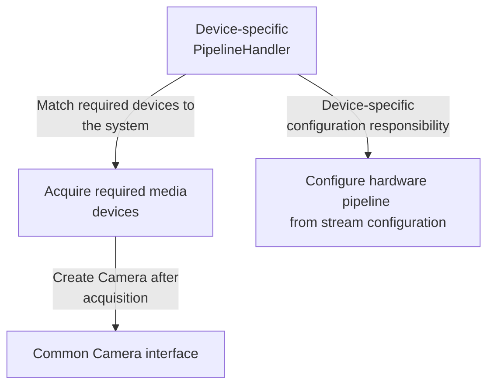
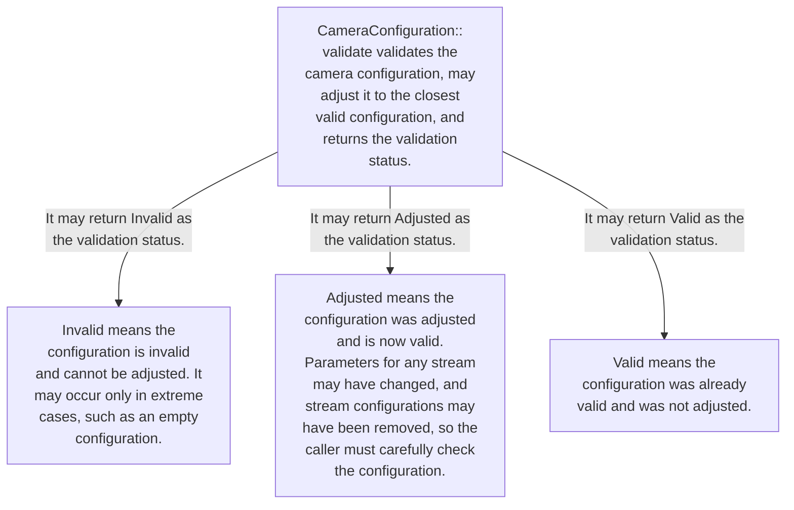
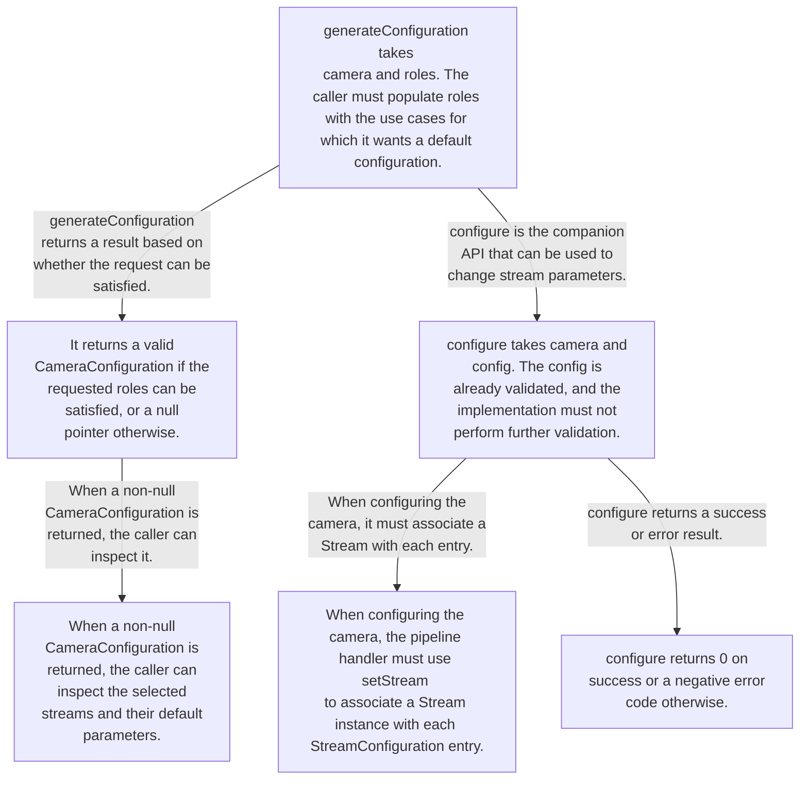

# Features and Support

English translation · human review pending. Review states below refer to the Korean source.

Use the representative examples below to find handlers relevant to your hardware. Consult the platform list for more devices, and check the build options and configuration result separately.

- [Full platform list and build options](#d1-platform-support)
- [Verification procedure for the target board](https://ttolsun.github.io/libcamera-sdd/en/device-integration.html)

| Support category | Example hardware or use | Handler to check |
| --- | --- | --- |
| Dedicated | Intel IPU3 | ipu3 |
| Dedicated | NXP i.MX8MP | imx8-isi and rkisp1 |
| Dedicated | Rockchip RK3399 | rkisp1 |
| Generic | USB video device class camera | uvcvideo |
| Generic | iMX7 / IPU6 / Allwinner Sun6i | simple |
| Testing | Virtual media controller | vimc |

## Supported hardware and build selection

The documentation lists Arm Mali-C55, Intel IPU3 (`ipu3`), NXP i.MX8MP (`imx8-isi` and `rkisp1`), RaspberryPi 3, 4 and zero (`rpi/vc4`), and Rockchip RK3399 (`rkisp1`) as hardware platforms currently supported by the library with dedicated pipeline handlers. The documentation identifies USB video device class cameras (`uvcvideo`), iMX7, IPU6, Allwinner Sun6i (`simple`), and the virtual media controller driver for testing (`vimc`) as targets for which libcamera provides generic support.

The pipeline handlers to build are selected in the array option `pipelines`, whose default is `auto`. Selecting `auto` builds all pipelines applicable to the target architecture, while selecting `all` builds all pipelines. If both values are selected, `all` takes precedence. The individual choices are `imx8-isi`, `ipu3`, `mali-c55`, `rkisp1`, `rpi/pisp`, `rpi/vc4`, `simple`, `uvcvideo`, `vimc`, and `virtual`.

Section-wide evidence: 2

- `Documentation/platform_support.rst`[`L6` excerpt](https://ttolsun.github.io/libcamera-sdd/en/reader-archive/vendor-overview.html#source-9d6502e234c4647d) · [Full source `L6`](https://github.com/TTolsun/libcamera-sdd/blob/adfa719f8ed67d18fd8a0739fc088a1f8b9e7252/Documentation/platform_support.rst#L6)
- `meson_options.txt`[`L75` excerpt](https://ttolsun.github.io/libcamera-sdd/en/reader-archive/vendor-overview.html#source-691389506fe87b32) · [Full source `L75`](https://github.com/TTolsun/libcamera-sdd/blob/adfa719f8ed67d18fd8a0739fc088a1f8b9e7252/meson_options.txt#L75)

## Provided functionality and supported scope

`Camera` models a camera capable of producing one or more image streams from a single image source. It is the central object in libcamera, providing the main interface for configuring and controlling the device and capturing image streams. The device-specific `PipelineHandler` configures the hardware pipeline according to the stream configuration. A `PipelineHandler` implementation must match the required media devices with devices in the system and create the corresponding `Camera` instances once all of them can be acquired, and every `PipelineHandler` subclass must be registered with libcamera using the `REGISTER_PIPELINE_HANDLER()` macro.

### Boundary between the common Camera and device-specific implementations

[Mermaid source](https://ttolsun.github.io/libcamera-sdd/en/vendor-overview.hardware-boundary.mmd)

Diagram evidence and verification scope

This shows how responsibilities are connected between the common Camera and device-specific PipelineHandler. It distinguishes hardware configuration based on stream configuration from responsibility for device matching and Camera creation, and does not guarantee the complete execution order, supported models, or performance.

Source-linked interpretation · automatic link check only · meaning and device execution not yet verified

| Elements and transitions | Source evidence |
| --- | --- |
| Device-specific PipelineHandler | [src/libcamera/pipeline_handler.cpp:30](https://ttolsun.github.io/libcamera-sdd/en/reader-archive/vendor-overview.html#source-05721740b01bcd0e) |
| Acquire required media devices | [src/libcamera/pipeline_handler.cpp:30](https://ttolsun.github.io/libcamera-sdd/en/reader-archive/vendor-overview.html#source-05721740b01bcd0e) |
| Common Camera interface | [src/libcamera/camera.cpp:752](https://ttolsun.github.io/libcamera-sdd/en/reader-archive/vendor-overview.html#source-8264067114dccdee) |
| Configure hardware pipeline from stream configuration | [Documentation/libcamera_architecture.rst:86](https://ttolsun.github.io/libcamera-sdd/en/reader-archive/vendor-overview.html#source-94ac8aab4dea2a65) |
| Device-specific configuration responsibility | [Documentation/libcamera_architecture.rst:86](https://ttolsun.github.io/libcamera-sdd/en/reader-archive/vendor-overview.html#source-94ac8aab4dea2a65) |
| Match required devices to the system | [src/libcamera/pipeline_handler.cpp:30](https://ttolsun.github.io/libcamera-sdd/en/reader-archive/vendor-overview.html#source-05721740b01bcd0e) |
| Create Camera after acquisition | [src/libcamera/pipeline_handler.cpp:30](https://ttolsun.github.io/libcamera-sdd/en/reader-archive/vendor-overview.html#source-05721740b01bcd0e) |

Section-wide evidence: 3

- `src/libcamera/camera.cpp`[`L752` excerpt](https://ttolsun.github.io/libcamera-sdd/en/reader-archive/vendor-overview.html#source-8264067114dccdee) · [Full source `L752`](https://github.com/TTolsun/libcamera-sdd/blob/adfa719f8ed67d18fd8a0739fc088a1f8b9e7252/src/libcamera/camera.cpp#L752)
- `src/libcamera/pipeline_handler.cpp`[`L30` excerpt](https://ttolsun.github.io/libcamera-sdd/en/reader-archive/vendor-overview.html#source-05721740b01bcd0e) · [Full source `L30`](https://github.com/TTolsun/libcamera-sdd/blob/adfa719f8ed67d18fd8a0739fc088a1f8b9e7252/src/libcamera/pipeline_handler.cpp#L30)
- `Documentation/libcamera_architecture.rst`[`L86` excerpt](https://ttolsun.github.io/libcamera-sdd/en/reader-archive/vendor-overview.html#source-94ac8aab4dea2a65) · [Full source `L86`](https://github.com/TTolsun/libcamera-sdd/blob/adfa719f8ed67d18fd8a0739fc088a1f8b9e7252/Documentation/libcamera_architecture.rst#L86)

## Support conditions and constraints

`CameraConfiguration::Invalid` means that the configuration is invalid and cannot be adjusted, and may occur only in extreme cases such as when the configuration is empty. `CameraConfiguration::Adjusted` indicates that the configuration has been adjusted and is valid after adjustment. If `CameraConfiguration::validate()` returns `Adjusted`, parameters may have changed for any stream, only some streams may have changed, and stream configurations may have been removed. When the status is `CameraConfiguration::Adjusted`, the caller must check the configuration carefully.

### Caller responsibilities by validate() result.

[Mermaid source](https://ttolsun.github.io/libcamera-sdd/en/vendor-assurance.validation-results.mmd)

Diagram evidence and verification scope

What do Invalid, Adjusted, and Valid mean for validate()? If the result is Adjusted, what must the caller check again?

Source-linked interpretation · automatic link check only · meaning and device execution not yet verified

LLM diagram draft · before human review

Authoring model: `cli/codex/gpt-6.1-terra`

| Elements and transitions | Source evidence |
| --- | --- |
| CameraConfiguration::validate validates the camera configuration, may adjust it to the closest valid configuration, and returns the validation status. | [src/libcamera/camera.cpp:323](https://ttolsun.github.io/libcamera-sdd/en/reader-archive/vendor-assurance.html#source-2b31e92e3fb3f083) |
| Invalid means the configuration is invalid and cannot be adjusted. It may occur only in extreme cases, such as an empty configuration. | [src/libcamera/camera.cpp:323](https://ttolsun.github.io/libcamera-sdd/en/reader-archive/vendor-assurance.html#source-2b31e92e3fb3f083) |
| Adjusted means the configuration was adjusted and is now valid. Parameters for any stream may have changed, and stream configurations may have been removed, so the caller must carefully check the configuration. | [src/libcamera/camera.cpp:323](https://ttolsun.github.io/libcamera-sdd/en/reader-archive/vendor-assurance.html#source-2b31e92e3fb3f083) |
| Valid means the configuration was already valid and was not adjusted. | [src/libcamera/camera.cpp:323](https://ttolsun.github.io/libcamera-sdd/en/reader-archive/vendor-assurance.html#source-2b31e92e3fb3f083) |
| It may return Invalid as the validation status. | [src/libcamera/camera.cpp:323](https://ttolsun.github.io/libcamera-sdd/en/reader-archive/vendor-assurance.html#source-2b31e92e3fb3f083) |
| It may return Adjusted as the validation status. | [src/libcamera/camera.cpp:323](https://ttolsun.github.io/libcamera-sdd/en/reader-archive/vendor-assurance.html#source-2b31e92e3fb3f083) |
| It may return Valid as the validation status. | [src/libcamera/camera.cpp:323](https://ttolsun.github.io/libcamera-sdd/en/reader-archive/vendor-assurance.html#source-2b31e92e3fb3f083) |

## Configuration interface to implement

The caller of `generateConfiguration` must populate `roles` with the use cases for which it wants to obtain a default configuration. The configuration returned by `generateConfiguration()` contains information that allows the caller to identify the selected streams and their default parameters. `PipelineHandler::generateConfiguration()` must return a valid `CameraConfiguration` if the requested `roles` can be satisfied, and otherwise must return a `null` pointer. The implementation of `PipelineHandler::generateConfiguration()` may be called from any thread and therefore must be thread-safe.

### Inputs and results by configuration interface

[Mermaid source](https://ttolsun.github.io/libcamera-sdd/en/vendor-integration.handler-configuration-contracts.mmd)

Diagram evidence and verification scope

What are the inputs and return values of generateConfiguration and configure, and what is the obligation to connect Streams on success?

Source-linked interpretation · automatic link check only · meaning and device execution not yet verified

LLM diagram draft · before human review

Authoring model: `cli/codex/gpt-6.1-terra`

| Elements and transitions | Source evidence |
| --- | --- |
| generateConfiguration takes camera and roles. The caller must populate roles with the use cases for which it wants a default configuration. | [src/libcamera/pipeline_handler.cpp:271](https://ttolsun.github.io/libcamera-sdd/en/reader-archive/vendor-integration.html#source-23ff032cd1152d56) |
| It returns a valid CameraConfiguration if the requested roles can be satisfied, or a null pointer otherwise. | [src/libcamera/pipeline_handler.cpp:271](https://ttolsun.github.io/libcamera-sdd/en/reader-archive/vendor-integration.html#source-23ff032cd1152d56) |
| When a non-null CameraConfiguration is returned, the caller can inspect the selected streams and their default parameters. | [src/libcamera/pipeline_handler.cpp:271](https://ttolsun.github.io/libcamera-sdd/en/reader-archive/vendor-integration.html#source-23ff032cd1152d56) |
| configure takes camera and config. The config is already validated, and the implementation must not perform further validation. | [src/libcamera/pipeline_handler.cpp:294](https://ttolsun.github.io/libcamera-sdd/en/reader-archive/vendor-integration.html#source-4255f8449e37ebb8) |
| configure returns 0 on success or a negative error code otherwise. | [src/libcamera/pipeline_handler.cpp:294](https://ttolsun.github.io/libcamera-sdd/en/reader-archive/vendor-integration.html#source-4255f8449e37ebb8) |
| When configuring the camera, the pipeline handler must use setStream to associate a Stream instance with each StreamConfiguration entry. | [src/libcamera/pipeline_handler.cpp:294](https://ttolsun.github.io/libcamera-sdd/en/reader-archive/vendor-integration.html#source-4255f8449e37ebb8) |
| generateConfiguration returns a result based on whether the request can be satisfied. | [src/libcamera/pipeline_handler.cpp:271](https://ttolsun.github.io/libcamera-sdd/en/reader-archive/vendor-integration.html#source-23ff032cd1152d56) |
| When a non-null CameraConfiguration is returned, the caller can inspect it. | [src/libcamera/pipeline_handler.cpp:271](https://ttolsun.github.io/libcamera-sdd/en/reader-archive/vendor-integration.html#source-23ff032cd1152d56) |
| configure is the companion API that can be used to change stream parameters. | [src/libcamera/pipeline_handler.cpp:271](https://ttolsun.github.io/libcamera-sdd/en/reader-archive/vendor-integration.html#source-23ff032cd1152d56) |
| When configuring the camera, it must associate a Stream with each entry. | [src/libcamera/pipeline_handler.cpp:294](https://ttolsun.github.io/libcamera-sdd/en/reader-archive/vendor-integration.html#source-4255f8449e37ebb8) |
| configure returns a success or error result. | [src/libcamera/pipeline_handler.cpp:294](https://ttolsun.github.io/libcamera-sdd/en/reader-archive/vendor-integration.html#source-4255f8449e37ebb8) |

Implementers of `PipelineHandler::generateConfiguration()` must not change the state of `camera` in the pipeline handler. The configuration passed to `PipelineHandler::configure()` is guaranteed to have been validated by `CameraConfiguration::validate()`, so the pipeline handler implementation must not perform additional validation. The `PipelineHandler::configure()` implementation may rely on all custom fields stored in its own `CameraConfiguration`-derived class. When configuring the camera, implementers of `PipelineHandler::configure()` must use `StreamConfiguration::setStream()` to associate a `Stream` instance with each `StreamConfiguration` entry in `CameraConfiguration`.

`PipelineHandler::configure()` is called on the `CameraManager` thread, and the implementation must return `0` on success and a negative error code on failure.

Section-wide evidence: 11

- `src/libcamera/pipeline_handler.cpp`[`L276` excerpt](https://ttolsun.github.io/libcamera-sdd/en/reader-archive/vendor-integration.html#source-924d43ea4bcaf94b) · [Full source `L276`](https://github.com/TTolsun/libcamera-sdd/blob/adfa719f8ed67d18fd8a0739fc088a1f8b9e7252/src/libcamera/pipeline_handler.cpp#L276) · [`L289` excerpt](https://ttolsun.github.io/libcamera-sdd/en/reader-archive/vendor-integration.html#source-4abbe39594a1bd27) · [Full source `L289`](https://github.com/TTolsun/libcamera-sdd/blob/adfa719f8ed67d18fd8a0739fc088a1f8b9e7252/src/libcamera/pipeline_handler.cpp#L289) · [`L285` excerpt](https://ttolsun.github.io/libcamera-sdd/en/reader-archive/vendor-integration.html#source-2eae247c4c37371c) · [Full source `L285`](https://github.com/TTolsun/libcamera-sdd/blob/adfa719f8ed67d18fd8a0739fc088a1f8b9e7252/src/libcamera/pipeline_handler.cpp#L285) · [`L286` excerpt](https://ttolsun.github.io/libcamera-sdd/en/reader-archive/vendor-integration.html#source-25fb9495d4ab94a1) · [Full source `L286`](https://github.com/TTolsun/libcamera-sdd/blob/adfa719f8ed67d18fd8a0739fc088a1f8b9e7252/src/libcamera/pipeline_handler.cpp#L286) · [`L304` excerpt](https://ttolsun.github.io/libcamera-sdd/en/reader-archive/vendor-integration.html#source-31c5407347b4d0d8) · [Full source `L304`](https://github.com/TTolsun/libcamera-sdd/blob/adfa719f8ed67d18fd8a0739fc088a1f8b9e7252/src/libcamera/pipeline_handler.cpp#L304) · [`L306` excerpt](https://ttolsun.github.io/libcamera-sdd/en/reader-archive/vendor-integration.html#source-71079779113f431c) · [Full source `L306`](https://github.com/TTolsun/libcamera-sdd/blob/adfa719f8ed67d18fd8a0739fc088a1f8b9e7252/src/libcamera/pipeline_handler.cpp#L306) · [`L309` excerpt](https://ttolsun.github.io/libcamera-sdd/en/reader-archive/vendor-integration.html#source-f3cf94b1dc7b9457) · [Full source `L309`](https://github.com/TTolsun/libcamera-sdd/blob/adfa719f8ed67d18fd8a0739fc088a1f8b9e7252/src/libcamera/pipeline_handler.cpp#L309) · [`L313` excerpt](https://ttolsun.github.io/libcamera-sdd/en/reader-archive/vendor-integration.html#source-f87ceb096b9f931d) · [Full source `L313`](https://github.com/TTolsun/libcamera-sdd/blob/adfa719f8ed67d18fd8a0739fc088a1f8b9e7252/src/libcamera/pipeline_handler.cpp#L313) · [`L271`](https://ttolsun.github.io/libcamera-sdd/en/reader-archive/vendor-integration.html#source-23ff032cd1152d56) · [`L294`](https://ttolsun.github.io/libcamera-sdd/en/reader-archive/vendor-integration.html#source-4255f8449e37ebb8)
- `src/libcamera/camera.cpp`[`L1191`](https://ttolsun.github.io/libcamera-sdd/en/reader-archive/vendor-integration.html#source-603af0dd7fa357d0)

## Criteria for reading performance evidence

The built-in benchmark in `DebayerCpu` measures only the time spent processing statistics collection and debayering. It does not include the time spent capturing or outputting frames. The built-in benchmark can be used by running `cam` or `qcam` with a pipeline that uses the Software ISP.

Section-wide evidence: 1

- `Documentation/software-isp-benchmarking.rst`[`L15` excerpt](https://ttolsun.github.io/libcamera-sdd/en/reader-archive/vendor-assurance.html#source-551d2b5944a36d19) · [Full source `L15`](https://github.com/TTolsun/libcamera-sdd/blob/adfa719f8ed67d18fd8a0739fc088a1f8b9e7252/Documentation/software-isp-benchmarking.rst#L15)

## Source manuscripts and review records

libcamera product overview

- **Generation method**: Extracted facts and LLM explanation
- **Validation scope**: Tables and figures are created from facts, and the explanations are written by the LLM. Citation, sentence, and configured structure checks are applied.
- **Automated check**: Passed (`ok`). The items checked are listed in the verification scope. Whether the explanation content is correct is checked by a human reviewer.
- **Human review**: Before human review
- **Analysis baseline commit**: `adfa719f8ed67d18fd8a0739fc088a1f8b9e7252`
- **Document generation time**: `2026-11-20 16:39:16+00:00`
- **Sentence generation model**: `cli/codex/gpt-6.1-terra`
- **Contracts between documents**: [Automated comparison report](https://ttolsun.github.io/libcamera-sdd/contract-consistency.json) · Before human review
- **Reader scope**: [Answers by task and unreviewed scope](https://ttolsun.github.io/libcamera-sdd/reader-scope.json)
- **Enter product description**: [Scope, conditions, and sources](https://ttolsun.github.io/libcamera-sdd/product-context.json)

Record from when the manuscript was written

This is a record saved in the manuscript as of that time. It may differ from the current document's standards.

- Evidence files: `Documentation/introduction.rst`, `Documentation/libcamera_architecture.rst`, `Documentation/platform_support.rst`, `include/libcamera/camera.h`, `include/libcamera/internal/ipa_manager.h`, `include/libcamera/internal/pipeline_handler.h`, `meson_options.txt`, `product-evidence/libcamera/official-stack.txt`, `src/libcamera/camera.cpp`, `src/libcamera/ipa_manager.cpp`, `src/libcamera/pipeline/ipu3/ipu3.cpp`, `src/libcamera/pipeline/rkisp1/rkisp1.cpp`, `src/libcamera/pipeline_handler.cpp`
- Evidence level: code verified (static analysis, simple_compdb configuration, commit `adfa719f8e`)
- Automated check (citation, sentence, and configured structure checks): passed
- Review status recorded on: 2026-11-21 · Awaiting human review

[Markdown source ↗](https://ttolsun.github.io/libcamera-sdd/vendor-overview.md) [Mermaid source ↗](https://ttolsun.github.io/libcamera-sdd/en/vendor-overview.mmd)

[Open earlier detail](https://ttolsun.github.io/libcamera-sdd/en/reader-archive/vendor-overview.html#page-evidence)

Support scope and validation

- **Generation method**: Extracted facts and LLM explanation
- **Validation scope**: Tables and figures are created from facts, and the explanations are written by the LLM. Citation, sentence, and configured structure checks are applied.
- **Automated check**: Passed (`ok`). The items checked are listed in the verification scope. Whether the explanation content is correct is checked by a human reviewer.
- **Human review**: Before human review
- **Analysis baseline commit**: `adfa719f8ed67d18fd8a0739fc088a1f8b9e7252`
- **Document generation time**: `2026-11-20 16:39:19+00:00`
- **Sentence generation model**: `cli/codex/gpt-6.1-terra`
- **Contracts between documents**: [Automated comparison report](https://ttolsun.github.io/libcamera-sdd/contract-consistency.json) · Before human review
- **Enter product description**: [Scope, conditions, and sources](https://ttolsun.github.io/libcamera-sdd/product-context.json)

Record from when the manuscript was written

This is a record saved in the manuscript as of that time. It may differ from the current document's standards.

- Evidence files: `Documentation/software-isp-benchmarking.rst`, `README.rst`, `include/libcamera/camera.h`, `include/libcamera/framebuffer.h`, `include/libcamera/internal/ipa_manager.h`, `include/libcamera/internal/pipeline_handler.h`, `include/libcamera/request.h`, `product-evidence/libcamera-first-capture-trial/virtual-first-capture-run.txt`, `src/libcamera/camera.cpp`, `src/libcamera/ipa_manager.cpp`, `src/libcamera/pipeline/ipu3/ipu3.cpp`, `src/libcamera/pipeline/rkisp1/rkisp1.cpp`, `src/libcamera/pipeline/virtual/README.md`, `src/libcamera/pipeline/virtual/data/virtual.yaml`, `src/libcamera/pipeline_handler.cpp`
- Evidence level: code verified (static analysis, simple_compdb configuration, commit `adfa719f8e`)
- Automated check (citation, sentence, and configured structure checks): passed
- Review status recorded on: 2026-11-21 · Awaiting human review

[Markdown source ↗](https://ttolsun.github.io/libcamera-sdd/vendor-assurance.md) [Mermaid source ↗](https://ttolsun.github.io/libcamera-sdd/en/vendor-assurance.mmd)

[Open earlier detail](https://ttolsun.github.io/libcamera-sdd/en/reader-archive/vendor-assurance.html#page-evidence)

Integration guide

- **Generation method**: Extracted facts and LLM explanation
- **Validation scope**: Tables and figures are created from facts, and the explanations are written by the LLM. Citation, sentence, and configured structure checks are applied.
- **Automated check**: Passed (`ok`). The items checked are listed in the verification scope. Whether the explanation content is correct is checked by a human reviewer.
- **Human review**: Before human review
- **Analysis baseline commit**: `adfa719f8ed67d18fd8a0739fc088a1f8b9e7252`
- **Document generation time**: `2026-11-20 16:39:26+00:00`
- **Sentence generation model**: `cli/codex/gpt-6.1-terra`
- **Contracts between documents**: [Automated comparison report](https://ttolsun.github.io/libcamera-sdd/contract-consistency.json) · Before human review

Record from when the manuscript was written

This is a record saved in the manuscript as of that time. It may differ from the current document's standards.

- Evidence files: `include/libcamera/camera.h`, `include/libcamera/internal/ipa_manager.h`, `include/libcamera/internal/pipeline_handler.h`, `src/libcamera/camera.cpp`, `src/libcamera/ipa_manager.cpp`, `src/libcamera/pipeline/ipu3/ipu3.cpp`, `src/libcamera/pipeline/rkisp1/rkisp1.cpp`, `src/libcamera/pipeline_handler.cpp`
- Evidence level: code verified (static analysis, simple_compdb configuration, commit `adfa719f8e`)
- Automated check (citation, sentence, and configured structure checks): passed
- Review status recorded on: 2026-11-21 · Awaiting human review

[Markdown source ↗](https://ttolsun.github.io/libcamera-sdd/vendor-integration.md) [Mermaid source ↗](https://ttolsun.github.io/libcamera-sdd/en/vendor-integration.mmd)

[Open earlier detail](https://ttolsun.github.io/libcamera-sdd/en/reader-archive/vendor-integration.html#page-evidence)

[Download page Markdown](https://ttolsun.github.io/libcamera-sdd/en/features-and-support.md) · [Reader edition source map](https://ttolsun.github.io/libcamera-sdd/reader-edition.json)
