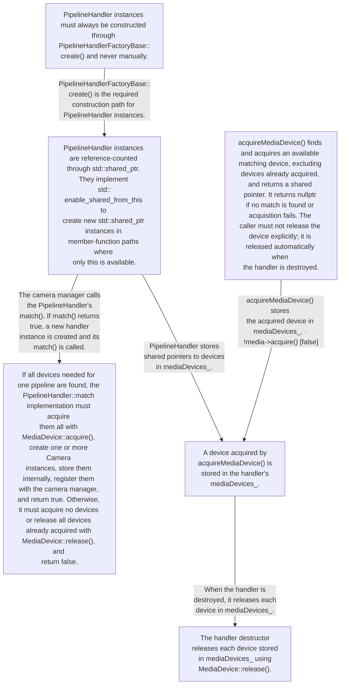
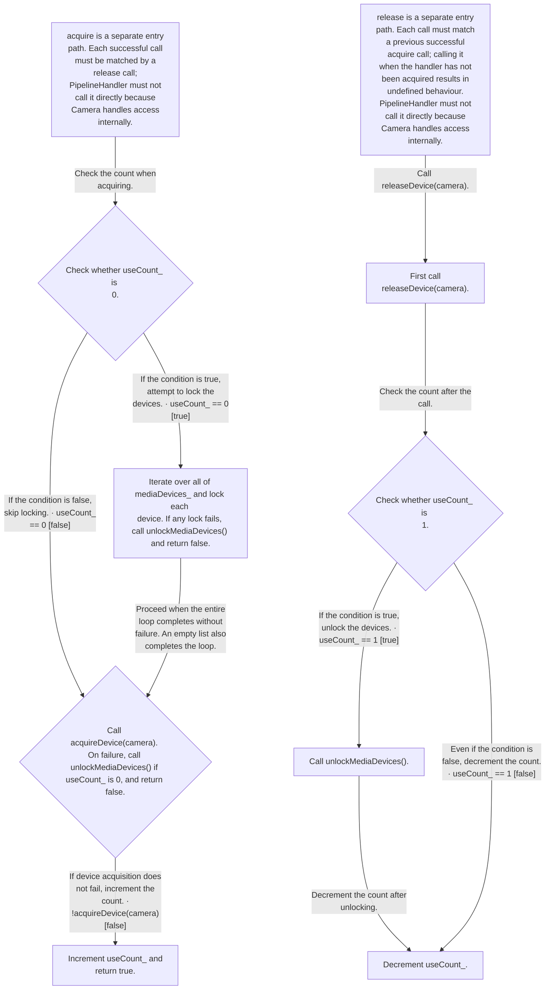
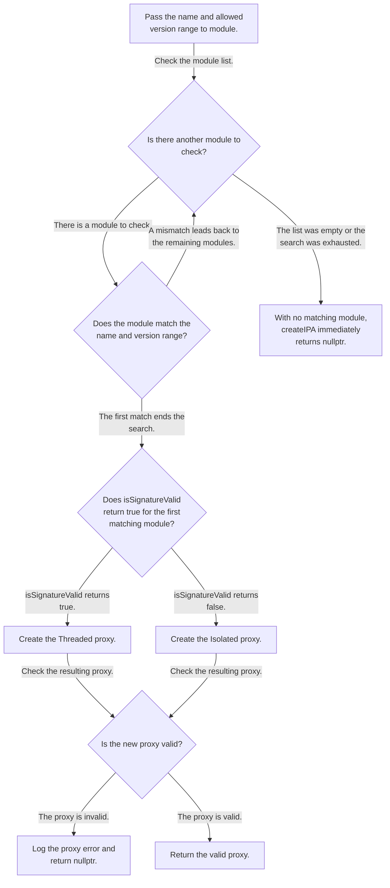
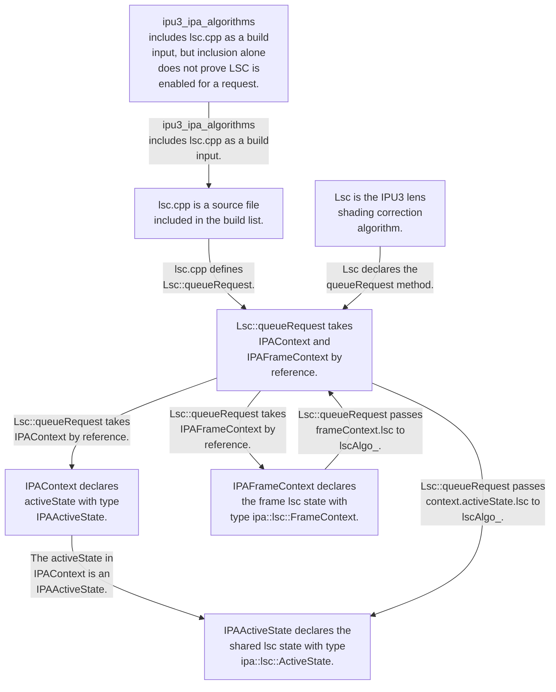
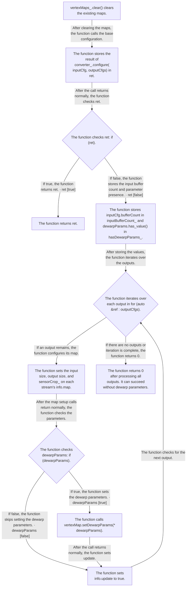
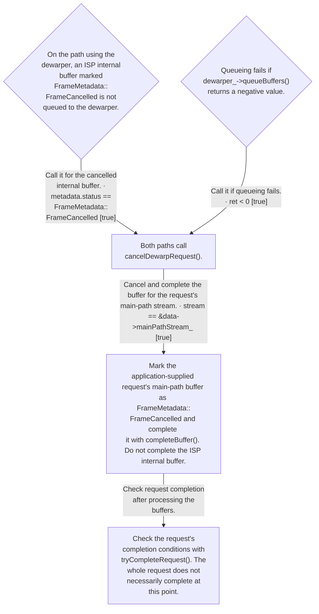

# Implementation and Extension Points

English translation · human review pending. Review states below refer to the Korean source.

Check device matching and the queue contract, then follow the change into the IPA module or the device-specific correction code.

## Device matching and object lifetime

`PipelineHandler` creates and manages `Camera` devices by matching the media devices from `DeviceEnumerator` with supported pipelines. Instances must not be created manually and must be created using `PipelineHandlerFactoryBase::create()`. Their reference counts are managed with `std::shared_ptr`, and they implement `std::enable_shared_from_this` to create a new `shared_ptr` when only this is available in a member function. If match() finds all devices needed for one pipeline, match() must acquire them all, create one or more `Camera` instances, store them internally, register them with the camera manager, and then return true. If match() cannot find all the required devices, match() must either acquire no devices or release all devices already acquired, and return false. After each success, match() must be called on a new handler instance, and each call must acquire the devices for one pipeline until compatible devices are exhausted.

### Responsibility for handler creation and device acquisition and release

[Mermaid source](https://ttolsun.github.io/libcamera-sdd/en/pipeline-handler.handler-device-ownership.mmd)

Diagram evidence and verification scope

How are factory creation, reference lifetime, and the match contract connected, and where is the device acquired through acquireMediaDevice stored and how is it released when the handler is destroyed? See the separate diagram for the locking conditions for acquire and release.

Source-linked interpretation · automatic link check only · meaning and device execution not yet verified

LLM diagram draft · before human review

Authoring model: `cli/codex/gpt-6.1-terra`

| Elements and transitions | Source evidence |
| --- | --- |
| PipelineHandler instances must always be constructed through PipelineHandlerFactoryBase::create() and never manually. | [src/libcamera/pipeline_handler.cpp:50](https://ttolsun.github.io/libcamera-sdd/en/reader-archive/pipeline-handler.html#source-69bfa9568cf8b5c5) |
| PipelineHandler instances are reference-counted through std::shared_ptr. They implement std::enable_shared_from_this to create new std::shared_ptr instances in member-function paths where only this is available. | [src/libcamera/pipeline_handler.cpp:50](https://ttolsun.github.io/libcamera-sdd/en/reader-archive/pipeline-handler.html#source-69bfa9568cf8b5c5) |
| If all devices needed for one pipeline are found, the PipelineHandler::match implementation must acquire them all with MediaDevice::acquire(), create one or more Camera instances, store them internally, register them with the camera manager, and return true. Otherwise, it must acquire no devices or release all devices already acquired with MediaDevice::release(), and return false. | [src/libcamera/pipeline_handler.cpp:50](https://ttolsun.github.io/libcamera-sdd/en/reader-archive/pipeline-handler.html#source-69bfa9568cf8b5c5) |
| acquireMediaDevice() finds and acquires an available matching device, excluding devices already acquired, and returns a shared pointer. It returns nullptr if no match is found or acquisition fails. The caller must not release the device explicitly; it is released automatically when the handler is destroyed. | [src/libcamera/pipeline_handler.cpp:119](https://ttolsun.github.io/libcamera-sdd/en/reader-archive/pipeline-handler.html#source-a3caf1625bc18d64) |
| A device acquired by acquireMediaDevice() is stored in the handler's mediaDevices\_. | [src/libcamera/pipeline_handler.cpp:119](https://ttolsun.github.io/libcamera-sdd/en/reader-archive/pipeline-handler.html#source-a3caf1625bc18d64) · [src/libcamera/pipeline_handler.cpp:50](https://ttolsun.github.io/libcamera-sdd/en/reader-archive/pipeline-handler.html#source-69bfa9568cf8b5c5) |
| The handler destructor releases each device stored in mediaDevices\_ using MediaDevice::release(). | [src/libcamera/pipeline_handler.cpp:50](https://ttolsun.github.io/libcamera-sdd/en/reader-archive/pipeline-handler.html#source-69bfa9568cf8b5c5) |
| PipelineHandlerFactoryBase::create() is the required construction path for PipelineHandler instances. | [src/libcamera/pipeline_handler.cpp:50](https://ttolsun.github.io/libcamera-sdd/en/reader-archive/pipeline-handler.html#source-69bfa9568cf8b5c5) |
| The camera manager calls the PipelineHandler's match(). If match() returns true, a new handler instance is created and its match() is called. | [src/libcamera/pipeline_handler.cpp:50](https://ttolsun.github.io/libcamera-sdd/en/reader-archive/pipeline-handler.html#source-69bfa9568cf8b5c5) |
| PipelineHandler stores shared pointers to devices in mediaDevices\_. | [src/libcamera/pipeline_handler.cpp:50](https://ttolsun.github.io/libcamera-sdd/en/reader-archive/pipeline-handler.html#source-69bfa9568cf8b5c5) |
| acquireMediaDevice() stores the acquired device in mediaDevices\_. · !media-\>acquire() \[false\] | [src/libcamera/pipeline_handler.cpp:119](https://ttolsun.github.io/libcamera-sdd/en/reader-archive/pipeline-handler.html#source-a3caf1625bc18d64) |
| When the handler is destroyed, it releases each device in mediaDevices\_. | [src/libcamera/pipeline_handler.cpp:50](https://ttolsun.github.io/libcamera-sdd/en/reader-archive/pipeline-handler.html#source-69bfa9568cf8b5c5) |

### Locking conditions and release order for acquisition and return

[Mermaid source](https://ttolsun.github.io/libcamera-sdd/en/pipeline-handler.acquire-release-locks.mmd)

Diagram evidence and verification scope

Treat acquire and release as separate entry paths, and distinguish the useCount\_ conditions, failure returns, and the order of releaseDevice, conditional unlocking, and decrementing.

Source-linked interpretation · automatic link check only · meaning and device execution not yet verified

LLM diagram draft · before human review

Authoring model: `cli/codex/gpt-6.1-terra`

| Elements and transitions | Source evidence |
| --- | --- |
| acquire is a separate entry path. Each successful call must be matched by a release call; PipelineHandler must not call it directly because Camera handles access internally. | [src/libcamera/pipeline_handler.cpp:119](https://ttolsun.github.io/libcamera-sdd/en/reader-archive/pipeline-handler.html#source-a3caf1625bc18d64) |
| Check whether useCount\_ is 0. | [src/libcamera/pipeline_handler.cpp:119](https://ttolsun.github.io/libcamera-sdd/en/reader-archive/pipeline-handler.html#source-a3caf1625bc18d64) |
| Iterate over all of mediaDevices\_ and lock each device. If any lock fails, call unlockMediaDevices() and return false. | [src/libcamera/pipeline_handler.cpp:119](https://ttolsun.github.io/libcamera-sdd/en/reader-archive/pipeline-handler.html#source-a3caf1625bc18d64) |
| Call acquireDevice(camera). On failure, call unlockMediaDevices() if useCount\_ is 0, and return false. | [src/libcamera/pipeline_handler.cpp:119](https://ttolsun.github.io/libcamera-sdd/en/reader-archive/pipeline-handler.html#source-a3caf1625bc18d64) |
| Increment useCount\_ and return true. | [src/libcamera/pipeline_handler.cpp:119](https://ttolsun.github.io/libcamera-sdd/en/reader-archive/pipeline-handler.html#source-a3caf1625bc18d64) |
| release is a separate entry path. Each call must match a previous successful acquire call; calling it when the handler has not been acquired results in undefined behaviour. PipelineHandler must not call it directly because Camera handles access internally. | [src/libcamera/pipeline_handler.cpp:119](https://ttolsun.github.io/libcamera-sdd/en/reader-archive/pipeline-handler.html#source-a3caf1625bc18d64) |
| First call releaseDevice(camera). | [src/libcamera/pipeline_handler.cpp:119](https://ttolsun.github.io/libcamera-sdd/en/reader-archive/pipeline-handler.html#source-a3caf1625bc18d64) |
| Check whether useCount\_ is 1. | [src/libcamera/pipeline_handler.cpp:119](https://ttolsun.github.io/libcamera-sdd/en/reader-archive/pipeline-handler.html#source-a3caf1625bc18d64) |
| Call unlockMediaDevices(). | [src/libcamera/pipeline_handler.cpp:119](https://ttolsun.github.io/libcamera-sdd/en/reader-archive/pipeline-handler.html#source-a3caf1625bc18d64) |
| Decrement useCount\_. | [src/libcamera/pipeline_handler.cpp:119](https://ttolsun.github.io/libcamera-sdd/en/reader-archive/pipeline-handler.html#source-a3caf1625bc18d64) |
| Check the count when acquiring. | [src/libcamera/pipeline_handler.cpp:119](https://ttolsun.github.io/libcamera-sdd/en/reader-archive/pipeline-handler.html#source-a3caf1625bc18d64) |
| If the condition is true, attempt to lock the devices. · useCount\_ == 0 \[true\] | [src/libcamera/pipeline_handler.cpp:119](https://ttolsun.github.io/libcamera-sdd/en/reader-archive/pipeline-handler.html#source-a3caf1625bc18d64) |
| If the condition is false, skip locking. · useCount\_ == 0 \[false\] | [src/libcamera/pipeline_handler.cpp:119](https://ttolsun.github.io/libcamera-sdd/en/reader-archive/pipeline-handler.html#source-a3caf1625bc18d64) |
| Proceed when the entire loop completes without failure. An empty list also completes the loop. | [src/libcamera/pipeline_handler.cpp:119](https://ttolsun.github.io/libcamera-sdd/en/reader-archive/pipeline-handler.html#source-a3caf1625bc18d64) |
| If device acquisition does not fail, increment the count. · !acquireDevice(camera) \[false\] | [src/libcamera/pipeline_handler.cpp:119](https://ttolsun.github.io/libcamera-sdd/en/reader-archive/pipeline-handler.html#source-a3caf1625bc18d64) |
| Call releaseDevice(camera). | [src/libcamera/pipeline_handler.cpp:119](https://ttolsun.github.io/libcamera-sdd/en/reader-archive/pipeline-handler.html#source-a3caf1625bc18d64) |
| Check the count after the call. | [src/libcamera/pipeline_handler.cpp:119](https://ttolsun.github.io/libcamera-sdd/en/reader-archive/pipeline-handler.html#source-a3caf1625bc18d64) |
| If the condition is true, unlock the devices. · useCount\_ == 1 \[true\] | [src/libcamera/pipeline_handler.cpp:119](https://ttolsun.github.io/libcamera-sdd/en/reader-archive/pipeline-handler.html#source-a3caf1625bc18d64) |
| Decrement the count after unlocking. | [src/libcamera/pipeline_handler.cpp:119](https://ttolsun.github.io/libcamera-sdd/en/reader-archive/pipeline-handler.html#source-a3caf1625bc18d64) |
| Even if the condition is false, decrement the count. · useCount\_ == 1 \[false\] | [src/libcamera/pipeline_handler.cpp:119](https://ttolsun.github.io/libcamera-sdd/en/reader-archive/pipeline-handler.html#source-a3caf1625bc18d64) |

acquireMediaDevice() searches for a matching device, excluding previously acquired devices, and stores it in `mediaDevices_` if found and acquired. The caller must not release the device explicitly; the handler destructor calls `MediaDevice::release()`. acquire() locks the media devices only when `useCount_` == 0. If a device lock fails, acquire() unlocks the devices and returns false; if acquireDevice() fails, acquire() unlocks the devices when `useCount_` == 0 and returns false. Every successful acquire() must be paired with a release(). After calling releaseDevice(), release() unlocks the devices if `useCount_` == 1, then decrements the count. Resources shared by multiple cameras must not be released until releaseDevice() has been called for all previously acquired cameras.

Section-wide evidence: 2

- `src/libcamera/pipeline_handler.cpp`[`L50` excerpt](https://ttolsun.github.io/libcamera-sdd/en/reader-archive/pipeline-handler.html#source-69bfa9568cf8b5c5) · [Full source `L50`](https://github.com/TTolsun/libcamera-sdd/blob/adfa719f8ed67d18fd8a0739fc088a1f8b9e7252/src/libcamera/pipeline_handler.cpp#L50) · [`L119` excerpt](https://ttolsun.github.io/libcamera-sdd/en/reader-archive/pipeline-handler.html#source-a3caf1625bc18d64) · [Full source `L119`](https://github.com/TTolsun/libcamera-sdd/blob/adfa719f8ed67d18fd8a0739fc088a1f8b9e7252/src/libcamera/pipeline_handler.cpp#L119)

## Device request limit and waiting queue

In the `PipelineHandler` constructor declaration, the default value of maxQueuedRequestsDevice is 32. `maxQueuedRequestsDevice_` limits the number of requests the pipeline handler queues to the hardware at a given time. The remaining requests wait in the internal waiting queue until they are queued later.

Section-wide evidence: 2

- `include/libcamera/internal/pipeline_handler.h`[`L38` excerpt](https://ttolsun.github.io/libcamera-sdd/en/reader-archive/pipeline-requests.html#source-0cf3f7eced88f3df) · [Full source `L38`](https://github.com/TTolsun/libcamera-sdd/blob/adfa719f8ed67d18fd8a0739fc088a1f8b9e7252/include/libcamera/internal/pipeline_handler.h#L38)
- `src/libcamera/pipeline_handler.cpp`[`L805` excerpt](https://ttolsun.github.io/libcamera-sdd/en/reader-archive/pipeline-requests.html#source-bf25a409490e6fa9) · [Full source `L805`](https://github.com/TTolsun/libcamera-sdd/blob/adfa719f8ed67d18fd8a0739fc088a1f8b9e7252/src/libcamera/pipeline_handler.cpp#L805)

## Frame input and result interface

`IPAIPU3Interface` declares `queueRequest(frame, controls)`, `computeParams(frame, bufferId)`, and `processStats(frame, frameTimestamp, bufferId, sensorControls)` as `[async]` methods. `IPAIPU3EventInterface` declares `paramsComputed(frame)`, `metadataReady(frame, metadata)`, and `setSensorControls(frame, sensorControls, lensControls)`.

`IPARkISP1Interface` declares `queueRequest(frame, reqControls)`, `computeParams(frame, bufferId)`, and `processStats(frame, bufferId, sensorControls)` as `[async]` methods. `IPARkISP1EventInterface` declares `paramsComputed(frame, bytesused)`, `metadataReady(frame, metadata)`, and `setSensorControls(frame, sensorControls)`.

Section-wide evidence: 2

- `include/libcamera/ipa/ipu3.mojom`[`L19` excerpt](https://ttolsun.github.io/libcamera-sdd/en/reader-archive/ipa.html#source-5a4a0da4800968a4) · [Full source `L19`](https://github.com/TTolsun/libcamera-sdd/blob/adfa719f8ed67d18fd8a0739fc088a1f8b9e7252/include/libcamera/ipa/ipu3.mojom#L19)
- `include/libcamera/ipa/rkisp1.mojom`[`L17` excerpt](https://ttolsun.github.io/libcamera-sdd/en/reader-archive/ipa.html#source-7a01de2477d6466e) · [Full source `L17`](https://github.com/TTolsun/libcamera-sdd/blob/adfa719f8ed67d18fd8a0739fc088a1f8b9e7252/include/libcamera/ipa/rkisp1.mojom#L17)

## IPA module selection and failure conditions

When calling `module`, `createIPA` passes `name`, representing the name, `minVersion`, representing the minimum version, and `maxVersion`, representing the maximum version, in that order. `IPAManager::module` iterates through the modules and returns the first module for which `match` holds for the name and allowed version range, ending the search; if no module matches by the end, the function returns `nullptr`. `createIPA` receives the result of `module` in `m` and, if `!m`, returns `nullptr`.

### IPA module search and proxy return branches

[Mermaid source](https://ttolsun.github.io/libcamera-sdd/en/vendor-integration.item-algorithm.mmd)

Diagram evidence and verification scope

How does createIPA select a matching module and proxy type, and in which branches does createIPA return nullptr?

Source-linked interpretation · automatic link check only · meaning and device execution not yet verified

| Elements and transitions | Source evidence |
| --- | --- |
| Pass the name and allowed version range to module. | [include/libcamera/internal/ipa_manager.h:35](https://ttolsun.github.io/libcamera-sdd/en/reader-archive/vendor-integration.html#source-1bc92c4993a1c4dc) |
| Is there another module to check? | [src/libcamera/ipa_manager.cpp:249](https://ttolsun.github.io/libcamera-sdd/en/reader-archive/vendor-integration.html#source-f61e5a9ff79a97a8) |
| Does the module match the name and version range? | [src/libcamera/ipa_manager.cpp:249](https://ttolsun.github.io/libcamera-sdd/en/reader-archive/vendor-integration.html#source-f61e5a9ff79a97a8) |
| With no matching module, createIPA immediately returns nullptr. | [src/libcamera/ipa_manager.cpp:249](https://ttolsun.github.io/libcamera-sdd/en/reader-archive/vendor-integration.html#source-f61e5a9ff79a97a8) · [include/libcamera/internal/ipa_manager.h:35](https://ttolsun.github.io/libcamera-sdd/en/reader-archive/vendor-integration.html#source-1bc92c4993a1c4dc) |
| Does isSignatureValid return true for the first matching module? | [src/libcamera/ipa_manager.cpp:249](https://ttolsun.github.io/libcamera-sdd/en/reader-archive/vendor-integration.html#source-f61e5a9ff79a97a8) · [include/libcamera/internal/ipa_manager.h:35](https://ttolsun.github.io/libcamera-sdd/en/reader-archive/vendor-integration.html#source-1bc92c4993a1c4dc) |
| Create the Threaded proxy. | [include/libcamera/internal/ipa_manager.h:35](https://ttolsun.github.io/libcamera-sdd/en/reader-archive/vendor-integration.html#source-1bc92c4993a1c4dc) |
| Create the Isolated proxy. | [include/libcamera/internal/ipa_manager.h:35](https://ttolsun.github.io/libcamera-sdd/en/reader-archive/vendor-integration.html#source-1bc92c4993a1c4dc) |
| Is the new proxy valid? | [include/libcamera/internal/ipa_manager.h:35](https://ttolsun.github.io/libcamera-sdd/en/reader-archive/vendor-integration.html#source-1bc92c4993a1c4dc) |
| Log the proxy error and return nullptr. | [include/libcamera/internal/ipa_manager.h:35](https://ttolsun.github.io/libcamera-sdd/en/reader-archive/vendor-integration.html#source-1bc92c4993a1c4dc) |
| Return the valid proxy. | [include/libcamera/internal/ipa_manager.h:35](https://ttolsun.github.io/libcamera-sdd/en/reader-archive/vendor-integration.html#source-1bc92c4993a1c4dc) |
| Check the module list. | [include/libcamera/internal/ipa_manager.h:35](https://ttolsun.github.io/libcamera-sdd/en/reader-archive/vendor-integration.html#source-1bc92c4993a1c4dc) · [src/libcamera/ipa_manager.cpp:249](https://ttolsun.github.io/libcamera-sdd/en/reader-archive/vendor-integration.html#source-f61e5a9ff79a97a8) |
| There is a module to check. | [src/libcamera/ipa_manager.cpp:249](https://ttolsun.github.io/libcamera-sdd/en/reader-archive/vendor-integration.html#source-f61e5a9ff79a97a8) |
| The list was empty or the search was exhausted. | [src/libcamera/ipa_manager.cpp:249](https://ttolsun.github.io/libcamera-sdd/en/reader-archive/vendor-integration.html#source-f61e5a9ff79a97a8) · [include/libcamera/internal/ipa_manager.h:35](https://ttolsun.github.io/libcamera-sdd/en/reader-archive/vendor-integration.html#source-1bc92c4993a1c4dc) |
| A mismatch leads back to the remaining modules. | [src/libcamera/ipa_manager.cpp:249](https://ttolsun.github.io/libcamera-sdd/en/reader-archive/vendor-integration.html#source-f61e5a9ff79a97a8) |
| The first match ends the search. | [src/libcamera/ipa_manager.cpp:249](https://ttolsun.github.io/libcamera-sdd/en/reader-archive/vendor-integration.html#source-f61e5a9ff79a97a8) · [include/libcamera/internal/ipa_manager.h:35](https://ttolsun.github.io/libcamera-sdd/en/reader-archive/vendor-integration.html#source-1bc92c4993a1c4dc) |
| isSignatureValid returns true. | [src/libcamera/ipa_manager.cpp:249](https://ttolsun.github.io/libcamera-sdd/en/reader-archive/vendor-integration.html#source-f61e5a9ff79a97a8) · [include/libcamera/internal/ipa_manager.h:35](https://ttolsun.github.io/libcamera-sdd/en/reader-archive/vendor-integration.html#source-1bc92c4993a1c4dc) |
| isSignatureValid returns false. | [src/libcamera/ipa_manager.cpp:249](https://ttolsun.github.io/libcamera-sdd/en/reader-archive/vendor-integration.html#source-f61e5a9ff79a97a8) · [include/libcamera/internal/ipa_manager.h:35](https://ttolsun.github.io/libcamera-sdd/en/reader-archive/vendor-integration.html#source-1bc92c4993a1c4dc) |
| Check the resulting proxy. | [include/libcamera/internal/ipa_manager.h:35](https://ttolsun.github.io/libcamera-sdd/en/reader-archive/vendor-integration.html#source-1bc92c4993a1c4dc) |
| Check the resulting proxy. | [include/libcamera/internal/ipa_manager.h:35](https://ttolsun.github.io/libcamera-sdd/en/reader-archive/vendor-integration.html#source-1bc92c4993a1c4dc) |
| The proxy is invalid. | [include/libcamera/internal/ipa_manager.h:35](https://ttolsun.github.io/libcamera-sdd/en/reader-archive/vendor-integration.html#source-1bc92c4993a1c4dc) |
| The proxy is valid. | [include/libcamera/internal/ipa_manager.h:35](https://ttolsun.github.io/libcamera-sdd/en/reader-archive/vendor-integration.html#source-1bc92c4993a1c4dc) |

The lambda inside `createIPA` creates a `T::Threaded` proxy object if `isSignatureValid(m)` is true, and a `T::Isolated` proxy object if it is false. `createIPA` logs the `Failed to load proxy` error and returns `nullptr` if the created proxy fails the `isValid` check. `createIPA` returns the created proxy if it passes validation.

Section-wide evidence: 4

- `include/libcamera/internal/ipa_manager.h`[`L39`](https://github.com/TTolsun/libcamera-sdd/blob/adfa719f8ed67d18fd8a0739fc088a1f8b9e7252/include/libcamera/internal/ipa_manager.h#L39) · [`L43` excerpt](https://ttolsun.github.io/libcamera-sdd/en/reader-archive/vendor-integration.html#source-6dc4133d5797f19b) · [Full source `L43`](https://github.com/TTolsun/libcamera-sdd/blob/adfa719f8ed67d18fd8a0739fc088a1f8b9e7252/include/libcamera/internal/ipa_manager.h#L43) · [`L35` excerpt](https://ttolsun.github.io/libcamera-sdd/en/reader-archive/vendor-integration.html#source-1bc92c4993a1c4dc) · [Full source `L35`](https://github.com/TTolsun/libcamera-sdd/blob/adfa719f8ed67d18fd8a0739fc088a1f8b9e7252/include/libcamera/internal/ipa_manager.h#L35) · [`L39`](https://ttolsun.github.io/libcamera-sdd/en/reader-archive/vendor-integration.html#source-88cede73f337db67) · [`L39`](https://ttolsun.github.io/libcamera-sdd/en/reader-archive/vendor-integration.html#source-da860180dc9199e6)
- `src/libcamera/ipa_manager.cpp`[`L249` excerpt](https://ttolsun.github.io/libcamera-sdd/en/reader-archive/vendor-integration.html#source-f61e5a9ff79a97a8) · [Full source `L249`](https://github.com/TTolsun/libcamera-sdd/blob/adfa719f8ed67d18fd8a0739fc088a1f8b9e7252/src/libcamera/ipa_manager.cpp#L249)

## Linking builds and status

Meson's `ipu3_ipa_algorithms` list includes `lsc.cpp` as a build input, and this file introduces the `Lsc` class as the IPU3 lens shading correction algorithm. The `lsc` field of `IPAActiveState` is declared as type `ipa::lsc::ActiveState`. `IPAFrameContext` inherits from `FrameContext` and declares the `lsc` field as type `ipa::lsc::FrameContext`. The type of the `frameContexts` field of `IPAContext` is `FCQueue<IPAFrameContext>`.

### LSC build and method state inputs

[Mermaid source](https://ttolsun.github.io/libcamera-sdd/en/ipu3-lsc-flow.lsc-build-state-integration.mmd)

Diagram evidence and verification scope

How are lsc.cpp in the build list, the IPAContext and IPAFrameContext inputs to Lsc methods, and the declarations of shared lsc state and per-frame lsc state connected?

Source-linked interpretation · automatic link check only · meaning and device execution not yet verified

LLM diagram draft · before human review

Authoring model: `cli/codex/gpt-6.1-terra`

| Elements and transitions | Source evidence |
| --- | --- |
| ipu3_ipa_algorithms includes lsc.cpp as a build input, but inclusion alone does not prove LSC is enabled for a request. | [src/ipa/ipu3/algorithms/meson.build:3](https://ttolsun.github.io/libcamera-sdd/en/reader-archive/ipu3-lsc-flow.html#source-914bc0dd95a64016) |
| lsc.cpp is a source file included in the build list. | [src/ipa/ipu3/algorithms/meson.build:3](https://ttolsun.github.io/libcamera-sdd/en/reader-archive/ipu3-lsc-flow.html#source-914bc0dd95a64016) |
| Lsc is the IPU3 lens shading correction algorithm. | [src/ipa/ipu3/algorithms/lsc.cpp:25](https://ttolsun.github.io/libcamera-sdd/en/reader-archive/ipu3-lsc-flow.html#source-724bb41a4f6f5bae) |
| Lsc::queueRequest takes IPAContext and IPAFrameContext by reference. | [src/ipa/ipu3/algorithms/lsc.cpp:121](https://ttolsun.github.io/libcamera-sdd/en/reader-archive/ipu3-lsc-flow.html#source-fb65fafe64a3b61f) |
| IPAContext declares activeState with type IPAActiveState. | [src/ipa/ipu3/ipa_context.h:32](https://ttolsun.github.io/libcamera-sdd/en/reader-archive/ipu3-lsc-flow.html#source-47a8aa55a4a846f4) |
| IPAActiveState declares the shared lsc state with type ipa::lsc::ActiveState. | [src/ipa/ipu3/ipa_context.h:32](https://ttolsun.github.io/libcamera-sdd/en/reader-archive/ipu3-lsc-flow.html#source-47a8aa55a4a846f4) |
| IPAFrameContext declares the frame lsc state with type ipa::lsc::FrameContext. | [src/ipa/ipu3/ipa_context.h:32](https://ttolsun.github.io/libcamera-sdd/en/reader-archive/ipu3-lsc-flow.html#source-47a8aa55a4a846f4) |
| ipu3_ipa_algorithms includes lsc.cpp as a build input. | [src/ipa/ipu3/algorithms/meson.build:3](https://ttolsun.github.io/libcamera-sdd/en/reader-archive/ipu3-lsc-flow.html#source-914bc0dd95a64016) |
| lsc.cpp defines Lsc::queueRequest. | [src/ipa/ipu3/algorithms/meson.build:3](https://ttolsun.github.io/libcamera-sdd/en/reader-archive/ipu3-lsc-flow.html#source-914bc0dd95a64016) · [src/ipa/ipu3/algorithms/lsc.cpp:121](https://ttolsun.github.io/libcamera-sdd/en/reader-archive/ipu3-lsc-flow.html#source-fb65fafe64a3b61f) |
| Lsc declares the queueRequest method. | [src/ipa/ipu3/algorithms/lsc.h:21](https://ttolsun.github.io/libcamera-sdd/en/reader-archive/ipu3-lsc-flow.html#source-1c0b8c6b923ea225) · [src/ipa/ipu3/algorithms/lsc.cpp:121](https://ttolsun.github.io/libcamera-sdd/en/reader-archive/ipu3-lsc-flow.html#source-fb65fafe64a3b61f) |
| Lsc::queueRequest takes IPAContext by reference. | [src/ipa/ipu3/algorithms/lsc.cpp:121](https://ttolsun.github.io/libcamera-sdd/en/reader-archive/ipu3-lsc-flow.html#source-fb65fafe64a3b61f) |
| Lsc::queueRequest takes IPAFrameContext by reference. | [src/ipa/ipu3/algorithms/lsc.cpp:121](https://ttolsun.github.io/libcamera-sdd/en/reader-archive/ipu3-lsc-flow.html#source-fb65fafe64a3b61f) |
| The activeState in IPAContext is an IPAActiveState. | [src/ipa/ipu3/ipa_context.h:32](https://ttolsun.github.io/libcamera-sdd/en/reader-archive/ipu3-lsc-flow.html#source-47a8aa55a4a846f4) |
| Lsc::queueRequest passes context.activeState.lsc to lscAlgo\_. | [src/ipa/ipu3/algorithms/lsc.cpp:121](https://ttolsun.github.io/libcamera-sdd/en/reader-archive/ipu3-lsc-flow.html#source-fb65fafe64a3b61f) · [src/ipa/ipu3/ipa_context.h:32](https://ttolsun.github.io/libcamera-sdd/en/reader-archive/ipu3-lsc-flow.html#source-47a8aa55a4a846f4) |
| Lsc::queueRequest passes frameContext.lsc to lscAlgo\_. | [src/ipa/ipu3/algorithms/lsc.cpp:121](https://ttolsun.github.io/libcamera-sdd/en/reader-archive/ipu3-lsc-flow.html#source-fb65fafe64a3b61f) · [src/ipa/ipu3/ipa_context.h:32](https://ttolsun.github.io/libcamera-sdd/en/reader-archive/ipu3-lsc-flow.html#source-47a8aa55a4a846f4) |

Section-wide evidence: 5

- `src/ipa/ipu3/algorithms/meson.build`[`L3` excerpt](https://ttolsun.github.io/libcamera-sdd/en/reader-archive/ipu3-lsc-flow.html#source-914bc0dd95a64016) · [Full source `L3`](https://github.com/TTolsun/libcamera-sdd/blob/adfa719f8ed67d18fd8a0739fc088a1f8b9e7252/src/ipa/ipu3/algorithms/meson.build#L3)
- `src/ipa/ipu3/algorithms/lsc.cpp`[`L25` excerpt](https://ttolsun.github.io/libcamera-sdd/en/reader-archive/ipu3-lsc-flow.html#source-724bb41a4f6f5bae) · [Full source `L25`](https://github.com/TTolsun/libcamera-sdd/blob/adfa719f8ed67d18fd8a0739fc088a1f8b9e7252/src/ipa/ipu3/algorithms/lsc.cpp#L25) · [`L121`](https://ttolsun.github.io/libcamera-sdd/en/reader-archive/ipu3-lsc-flow.html#source-fb65fafe64a3b61f)
- `src/ipa/ipu3/ipa_context.h`[`L32` excerpt](https://ttolsun.github.io/libcamera-sdd/en/reader-archive/ipu3-lsc-flow.html#source-47a8aa55a4a846f4) · [Full source `L32`](https://github.com/TTolsun/libcamera-sdd/blob/adfa719f8ed67d18fd8a0739fc088a1f8b9e7252/src/ipa/ipu3/ipa_context.h#L32)
- `src/ipa/ipu3/algorithms/lsc.h`[`L21`](https://ttolsun.github.io/libcamera-sdd/en/reader-archive/ipu3-lsc-flow.html#source-1c0b8c6b923ea225)

## Scope of stream application and execution verification

While iterating over each output configuration in `outputCfgs`, `ConverterDW100Module::configure` passes `inputCfg.size` to `setInputSize`, `outputCfg.size` to `setOutputSize`, and `sensorCrop_` to `setSensorCrop` on the corresponding stream's `vertexMap`. While iterating over the output streams, `ConverterDW100Module::configure` calls the corresponding stream's `vertexMap.setDewarpParams` and passes `*dewarpParams` if `dewarpParams` has a value.

### Per-output maps and optional correction values

[Mermaid source](https://ttolsun.github.io/libcamera-sdd/en/rkisp1-dewarp.per-output-vertex-map.mmd)

Diagram evidence and verification scope

What does ConverterDW100Module::configure return depending on the underlying configuration result, and how does ConverterDW100Module::configure initialize the map for each output?

Source-linked interpretation · automatic link check only · meaning and device execution not yet verified

LLM diagram draft · before human review

Authoring model: `cli/codex/gpt-6.1-terra`

| Elements and transitions | Source evidence |
| --- | --- |
| vertexMaps\_.clear() clears the existing maps. | [src/libcamera/converter/converter_dw100.cpp:178](https://ttolsun.github.io/libcamera-sdd/en/reader-archive/rkisp1-dewarp.html#source-25d871212cbd755c) |
| The function stores the result of converter\_.configure(inputCfg, outputCfgs) in ret. | [src/libcamera/converter/converter_dw100.cpp:178](https://ttolsun.github.io/libcamera-sdd/en/reader-archive/rkisp1-dewarp.html#source-25d871212cbd755c) |
| The function checks ret: if (ret). | [src/libcamera/converter/converter_dw100.cpp:178](https://ttolsun.github.io/libcamera-sdd/en/reader-archive/rkisp1-dewarp.html#source-25d871212cbd755c) |
| The function returns ret. | [src/libcamera/converter/converter_dw100.cpp:178](https://ttolsun.github.io/libcamera-sdd/en/reader-archive/rkisp1-dewarp.html#source-25d871212cbd755c) |
| The function stores inputCfg.bufferCount in inputBufferCount\_ and dewarpParams.has_value() in hasDewarpParams\_. | [src/libcamera/converter/converter_dw100.cpp:178](https://ttolsun.github.io/libcamera-sdd/en/reader-archive/rkisp1-dewarp.html#source-25d871212cbd755c) |
| The function iterates over each output in for (auto &ref : outputCfgs). | [src/libcamera/converter/converter_dw100.cpp:178](https://ttolsun.github.io/libcamera-sdd/en/reader-archive/rkisp1-dewarp.html#source-25d871212cbd755c) |
| The function sets the input size, output size, and sensorCrop\_ on each stream's info.map. | [src/libcamera/converter/converter_dw100.cpp:178](https://ttolsun.github.io/libcamera-sdd/en/reader-archive/rkisp1-dewarp.html#source-25d871212cbd755c) |
| The function checks dewarpParams: if (dewarpParams). | [src/libcamera/converter/converter_dw100.cpp:178](https://ttolsun.github.io/libcamera-sdd/en/reader-archive/rkisp1-dewarp.html#source-25d871212cbd755c) |
| The function calls vertexMap.setDewarpParams(\*dewarpParams). | [src/libcamera/converter/converter_dw100.cpp:178](https://ttolsun.github.io/libcamera-sdd/en/reader-archive/rkisp1-dewarp.html#source-25d871212cbd755c) |
| The function sets info.update to true. | [src/libcamera/converter/converter_dw100.cpp:178](https://ttolsun.github.io/libcamera-sdd/en/reader-archive/rkisp1-dewarp.html#source-25d871212cbd755c) |
| The function returns 0 after processing all outputs. It can succeed without dewarp parameters. | [src/libcamera/converter/converter_dw100.cpp:178](https://ttolsun.github.io/libcamera-sdd/en/reader-archive/rkisp1-dewarp.html#source-25d871212cbd755c) |
| After clearing the maps, the function calls the base configuration. | [src/libcamera/converter/converter_dw100.cpp:178](https://ttolsun.github.io/libcamera-sdd/en/reader-archive/rkisp1-dewarp.html#source-25d871212cbd755c) |
| After the call returns normally, the function checks ret. | [src/libcamera/converter/converter_dw100.cpp:178](https://ttolsun.github.io/libcamera-sdd/en/reader-archive/rkisp1-dewarp.html#source-25d871212cbd755c) |
| If true, the function returns ret. · ret \[true\] | [src/libcamera/converter/converter_dw100.cpp:178](https://ttolsun.github.io/libcamera-sdd/en/reader-archive/rkisp1-dewarp.html#source-25d871212cbd755c) |
| If false, the function stores the input buffer count and parameter presence. · ret \[false\] | [src/libcamera/converter/converter_dw100.cpp:178](https://ttolsun.github.io/libcamera-sdd/en/reader-archive/rkisp1-dewarp.html#source-25d871212cbd755c) |
| After storing the values, the function iterates over the outputs. | [src/libcamera/converter/converter_dw100.cpp:178](https://ttolsun.github.io/libcamera-sdd/en/reader-archive/rkisp1-dewarp.html#source-25d871212cbd755c) |
| If an output remains, the function configures its map. | [src/libcamera/converter/converter_dw100.cpp:178](https://ttolsun.github.io/libcamera-sdd/en/reader-archive/rkisp1-dewarp.html#source-25d871212cbd755c) |
| If there are no outputs or iteration is complete, the function returns 0. | [src/libcamera/converter/converter_dw100.cpp:178](https://ttolsun.github.io/libcamera-sdd/en/reader-archive/rkisp1-dewarp.html#source-25d871212cbd755c) |
| After the map setup calls return normally, the function checks the parameters. | [src/libcamera/converter/converter_dw100.cpp:178](https://ttolsun.github.io/libcamera-sdd/en/reader-archive/rkisp1-dewarp.html#source-25d871212cbd755c) |
| If true, the function sets the dewarp parameters. · dewarpParams \[true\] | [src/libcamera/converter/converter_dw100.cpp:178](https://ttolsun.github.io/libcamera-sdd/en/reader-archive/rkisp1-dewarp.html#source-25d871212cbd755c) |
| If false, the function skips setting the dewarp parameters. · dewarpParams \[false\] | [src/libcamera/converter/converter_dw100.cpp:178](https://ttolsun.github.io/libcamera-sdd/en/reader-archive/rkisp1-dewarp.html#source-25d871212cbd755c) |
| After the call returns normally, the function sets update. | [src/libcamera/converter/converter_dw100.cpp:178](https://ttolsun.github.io/libcamera-sdd/en/reader-archive/rkisp1-dewarp.html#source-25d871212cbd755c) |
| The function checks for the next output. | [src/libcamera/converter/converter_dw100.cpp:178](https://ttolsun.github.io/libcamera-sdd/en/reader-archive/rkisp1-dewarp.html#source-25d871212cbd755c) |

### Two cases where the correction path cancels an app buffer

[Mermaid source](https://ttolsun.github.io/libcamera-sdd/en/rkisp1-dewarp.cancelled-main-path-buffer.mmd)

Diagram evidence and verification scope

How are buffers canceled by the ISP and dewarper queue registration failures communicated to the app's main-path buffers?

Source-linked interpretation · automatic link check only · meaning and device execution not yet verified

LLM diagram draft · before human review

Authoring model: `cli/codex/gpt-6.1-terra`

| Elements and transitions | Source evidence |
| --- | --- |
| On the path using the dewarper, an ISP internal buffer marked FrameMetadata::FrameCancelled is not queued to the dewarper. | [src/libcamera/pipeline/rkisp1/rkisp1.cpp:1630](https://ttolsun.github.io/libcamera-sdd/en/reader-archive/rkisp1-dewarp.html#source-ac82e844328c94fc) · [src/libcamera/pipeline/rkisp1/rkisp1.cpp:1605](https://ttolsun.github.io/libcamera-sdd/en/reader-archive/rkisp1-dewarp.html#source-6f7ca94446a01328) |
| Queueing fails if dewarper\_-\>queueBuffers() returns a negative value. | [src/libcamera/pipeline/rkisp1/rkisp1.cpp:1630](https://ttolsun.github.io/libcamera-sdd/en/reader-archive/rkisp1-dewarp.html#source-ac82e844328c94fc) |
| Both paths call cancelDewarpRequest(). | [src/libcamera/pipeline/rkisp1/rkisp1.cpp:1630](https://ttolsun.github.io/libcamera-sdd/en/reader-archive/rkisp1-dewarp.html#source-ac82e844328c94fc) |
| Mark the application-supplied request's main-path buffer as FrameMetadata::FrameCancelled and complete it with completeBuffer(). Do not complete the ISP internal buffer. | [src/libcamera/pipeline/rkisp1/rkisp1.cpp:1630](https://ttolsun.github.io/libcamera-sdd/en/reader-archive/rkisp1-dewarp.html#source-ac82e844328c94fc) · [src/libcamera/pipeline/rkisp1/rkisp1.cpp:1605](https://ttolsun.github.io/libcamera-sdd/en/reader-archive/rkisp1-dewarp.html#source-6f7ca94446a01328) · [include/libcamera/internal/framebuffer.h:36](https://ttolsun.github.io/libcamera-sdd/en/reader-archive/rkisp1-dewarp.html#source-f22474612903b58b) |
| Check the request's completion conditions with tryCompleteRequest(). The whole request does not necessarily complete at this point. | [src/libcamera/pipeline/rkisp1/rkisp1.cpp:1605](https://ttolsun.github.io/libcamera-sdd/en/reader-archive/rkisp1-dewarp.html#source-6f7ca94446a01328) |
| Call it for the cancelled internal buffer. · metadata.status == FrameMetadata::FrameCancelled \[true\] | [src/libcamera/pipeline/rkisp1/rkisp1.cpp:1630](https://ttolsun.github.io/libcamera-sdd/en/reader-archive/rkisp1-dewarp.html#source-ac82e844328c94fc) |
| Call it if queueing fails. · ret \< 0 \[true\] | [src/libcamera/pipeline/rkisp1/rkisp1.cpp:1630](https://ttolsun.github.io/libcamera-sdd/en/reader-archive/rkisp1-dewarp.html#source-ac82e844328c94fc) |
| Cancel and complete the buffer for the request's main-path stream. · stream == &data-\>mainPathStream\_ \[true\] | [src/libcamera/pipeline/rkisp1/rkisp1.cpp:1605](https://ttolsun.github.io/libcamera-sdd/en/reader-archive/rkisp1-dewarp.html#source-6f7ca94446a01328) |
| Check request completion after processing the buffers. | [src/libcamera/pipeline/rkisp1/rkisp1.cpp:1605](https://ttolsun.github.io/libcamera-sdd/en/reader-archive/rkisp1-dewarp.html#source-6f7ca94446a01328) |

If `hasDewarpParams_` is true, `ConverterDW100Module::updateControlInfos` registers `controls::LensDewarpEnable` in `controls` and sets the control information's minimum to `false` and its maximum and default to `true`. If `isConfigured(stream)` is false, `setControls` exits with `return`. For a configured stream, `setControls` logs a dynamic control error if `info.update` and `running_` are true and `converter_.supportsRequests()` is false. If the `isConfigured(stream)` check finds that the stream is not configured, `populateMetadata` returns immediately.

`ConverterDW100Module::populateMetadata` records the configured stream's `vertexMap.effectiveScalerCrop()` value in `controls::ScalerCrop` and then, if `hasDewarpParams_` is true, records the `vertexMap.lensDewarpEnable()` value in `controls::LensDewarpEnable`.

On an RKISP1 board using a dewarper, `imageBufferReady()` calls `cancelDewarpRequest()` if the buffer returned by the ISP is `FrameCancelled` or the dewarper's `queueBuffers()` fails. When checking this path on the board, `cancelDewarpRequest()` marks the app's `main-path` buffer associated with the request as `FrameCancelled` instead of the internal buffer between the ISP and the dewarper, completes it with `completeBuffer()`, and then calls `tryCompleteRequest()`.

Section-wide evidence: 15

- `src/libcamera/converter/converter_dw100.cpp`[`L178`](https://github.com/TTolsun/libcamera-sdd/blob/adfa719f8ed67d18fd8a0739fc088a1f8b9e7252/src/libcamera/converter/converter_dw100.cpp#L178) · [`L369`](https://github.com/TTolsun/libcamera-sdd/blob/adfa719f8ed67d18fd8a0739fc088a1f8b9e7252/src/libcamera/converter/converter_dw100.cpp#L369) · [`L402` excerpt](https://ttolsun.github.io/libcamera-sdd/en/reader-archive/rkisp1-dewarp.html#source-ec47236059d2723f) · [Full source `L402`](https://github.com/TTolsun/libcamera-sdd/blob/adfa719f8ed67d18fd8a0739fc088a1f8b9e7252/src/libcamera/converter/converter_dw100.cpp#L402) · [`L400` excerpt](https://ttolsun.github.io/libcamera-sdd/en/reader-archive/rkisp1-dewarp.html#source-3b37038ea14e4a3f) · [Full source `L400`](https://github.com/TTolsun/libcamera-sdd/blob/adfa719f8ed67d18fd8a0739fc088a1f8b9e7252/src/libcamera/converter/converter_dw100.cpp#L400) · [`L434`](https://github.com/TTolsun/libcamera-sdd/blob/adfa719f8ed67d18fd8a0739fc088a1f8b9e7252/src/libcamera/converter/converter_dw100.cpp#L434) · [`L443` excerpt](https://ttolsun.github.io/libcamera-sdd/en/reader-archive/rkisp1-dewarp.html#source-aebf4a59ba423b05) · [Full source `L443`](https://github.com/TTolsun/libcamera-sdd/blob/adfa719f8ed67d18fd8a0739fc088a1f8b9e7252/src/libcamera/converter/converter_dw100.cpp#L443) · [`L441` excerpt](https://ttolsun.github.io/libcamera-sdd/en/reader-archive/rkisp1-dewarp.html#source-6fc7fca6e9842fbd) · [Full source `L441`](https://github.com/TTolsun/libcamera-sdd/blob/adfa719f8ed67d18fd8a0739fc088a1f8b9e7252/src/libcamera/converter/converter_dw100.cpp#L441) · [`L178`](https://ttolsun.github.io/libcamera-sdd/en/reader-archive/rkisp1-dewarp.html#source-167e93a77fbf4931) · [`L369`](https://ttolsun.github.io/libcamera-sdd/en/reader-archive/rkisp1-dewarp.html#source-fc0e25ddead912f1) · [`L434`](https://ttolsun.github.io/libcamera-sdd/en/reader-archive/rkisp1-dewarp.html#source-3a4c4ed7cee81158) · [`L197`](https://ttolsun.github.io/libcamera-sdd/en/reader-archive/rkisp1-dewarp.html#source-fff6050000b728bd) · [`L198`](https://ttolsun.github.io/libcamera-sdd/en/reader-archive/rkisp1-dewarp.html#source-a6496a0f6db3636a) · [`L199`](https://ttolsun.github.io/libcamera-sdd/en/reader-archive/rkisp1-dewarp.html#source-a92725ea0f81f8d7) · [`L178`](https://ttolsun.github.io/libcamera-sdd/en/reader-archive/rkisp1-dewarp.html#source-25d871212cbd755c) · [`L212`](https://ttolsun.github.io/libcamera-sdd/en/reader-archive/rkisp1-dewarp.html#source-3c3967c227d1109c) · [`L369`](https://ttolsun.github.io/libcamera-sdd/en/reader-archive/rkisp1-dewarp.html#source-d069b98fadac2d0c) · [`L434`](https://ttolsun.github.io/libcamera-sdd/en/reader-archive/rkisp1-dewarp.html#source-91482028dd941751)
- `src/libcamera/pipeline/rkisp1/rkisp1.cpp`[`L1605` excerpt](https://ttolsun.github.io/libcamera-sdd/en/reader-archive/rkisp1-dewarp.html#source-6f7ca94446a01328) · [Full source `L1605`](https://github.com/TTolsun/libcamera-sdd/blob/adfa719f8ed67d18fd8a0739fc088a1f8b9e7252/src/libcamera/pipeline/rkisp1/rkisp1.cpp#L1605) · [`L1630` excerpt](https://ttolsun.github.io/libcamera-sdd/en/reader-archive/rkisp1-dewarp.html#source-ac82e844328c94fc) · [Full source `L1630`](https://github.com/TTolsun/libcamera-sdd/blob/adfa719f8ed67d18fd8a0739fc088a1f8b9e7252/src/libcamera/pipeline/rkisp1/rkisp1.cpp#L1630) · [`L914`](https://ttolsun.github.io/libcamera-sdd/en/reader-archive/rkisp1-dewarp.html#source-36de5a75453d86c6)
- `include/libcamera/internal/framebuffer.h`[`L36` excerpt](https://ttolsun.github.io/libcamera-sdd/en/reader-archive/rkisp1-dewarp.html#source-f22474612903b58b) · [Full source `L36`](https://github.com/TTolsun/libcamera-sdd/blob/adfa719f8ed67d18fd8a0739fc088a1f8b9e7252/include/libcamera/internal/framebuffer.h#L36)

## Source manuscripts and review records

Pipeline Handler

- **Generation method**: Extracted facts and LLM explanation
- **Validation scope**: Tables and figures are created from facts, and the explanations are written by the LLM. Citation, sentence, and configured structure checks are applied.
- **Automated check**: Passed (`ok`). The items checked are listed in the verification scope. Whether the explanation content is correct is checked by a human reviewer.
- **Human review**: Before human review
- **Analysis baseline commit**: `adfa719f8ed67d18fd8a0739fc088a1f8b9e7252`
- **Document generation time**: `2026-11-20 18:11:25+00:00`
- **Sentence generation model**: `cli/codex/gpt-6.1-terra`
- **Contracts between documents**: [Automated comparison report](https://ttolsun.github.io/libcamera-sdd/contract-consistency.json) · Before human review

Record from when the manuscript was written

This is a record saved in the manuscript as of that time. It may differ from the current document's standards.

- Evidence files: `include/libcamera/internal/pipeline_handler.h`, `src/libcamera/pipeline/imx8-isi/imx8-isi.cpp`, `src/libcamera/pipeline/ipu3/imgu.cpp`, `src/libcamera/pipeline/ipu3/ipu3.cpp`, `src/libcamera/pipeline/mali-c55/mali-c55.cpp`, `src/libcamera/pipeline/rkisp1/rkisp1.cpp`, `src/libcamera/pipeline/rpi/pisp/pisp.cpp`, `src/libcamera/pipeline/rpi/vc4/vc4.cpp`, `src/libcamera/pipeline/uvcvideo/uvcvideo.cpp`, `src/libcamera/pipeline/vimc/vimc.cpp`, `src/libcamera/pipeline/virtual/virtual.cpp`, `src/libcamera/pipeline_handler.cpp`
- Evidence level: code verified (static analysis, simple_compdb configuration, commit `adfa719f8e`)
- Automated check (citation, sentence, and configured structure checks): passed
- Review status recorded on: 2026-11-21 · Awaiting human review

[Markdown source ↗](https://ttolsun.github.io/libcamera-sdd/pipeline-handler.md) [Mermaid source ↗](https://ttolsun.github.io/libcamera-sdd/en/pipeline-handler.mmd)

[Open earlier detail](https://ttolsun.github.io/libcamera-sdd/en/reader-archive/pipeline-handler.html#page-evidence)

Pipeline Request Submission and Completion

- **Generation method**: Extracted facts and LLM explanation
- **Validation scope**: Tables and figures are created from facts, and the explanations are written by the LLM. Citation, sentence, and configured structure checks are applied.
- **Automated check**: Passed (`ok`). The items checked are listed in the verification scope. Whether the explanation content is correct is checked by a human reviewer.
- **Human review**: Before human review
- **Analysis baseline commit**: `adfa719f8ed67d18fd8a0739fc088a1f8b9e7252`
- **Document generation time**: `2026-11-20 17:39:07+00:00`
- **Sentence generation model**: `cli/codex/gpt-6.1-terra`
- **Contracts between documents**: [Automated comparison report](https://ttolsun.github.io/libcamera-sdd/contract-consistency.json) · Before human review

Record from when the manuscript was written

This is a record saved in the manuscript as of that time. It may differ from the current document's standards.

- Evidence files: `include/libcamera/internal/pipeline_handler.h`, `src/libcamera/pipeline/imx8-isi/imx8-isi.cpp`, `src/libcamera/pipeline/ipu3/ipu3.cpp`, `src/libcamera/pipeline/mali-c55/mali-c55.cpp`, `src/libcamera/pipeline/rkisp1/rkisp1.cpp`, `src/libcamera/pipeline/rpi/pisp/pisp.cpp`, `src/libcamera/pipeline/rpi/vc4/vc4.cpp`, `src/libcamera/pipeline/uvcvideo/uvcvideo.cpp`, `src/libcamera/pipeline/vimc/vimc.cpp`, `src/libcamera/pipeline/virtual/virtual.cpp`, `src/libcamera/pipeline_handler.cpp`, `src/libcamera/request.cpp`
- Evidence level: code verified (static analysis, simple_compdb configuration, commit `adfa719f8e`)
- Automated check (citation, sentence, and configured structure checks): passed
- Review status recorded on: 2026-11-21 · Awaiting human review

[Markdown source ↗](https://ttolsun.github.io/libcamera-sdd/pipeline-requests.md) [Mermaid source ↗](https://ttolsun.github.io/libcamera-sdd/en/pipeline-requests.mmd)

[Open earlier detail](https://ttolsun.github.io/libcamera-sdd/en/reader-archive/pipeline-requests.html#page-evidence)

IPA management and implementation entry points

- **Generation method**: Extracted facts and LLM explanation
- **Validation scope**: Tables and figures are created from facts, and the explanations are written by the LLM. Citation, sentence, and configured structure checks are applied.
- **Automated check**: Passed (`ok`). The items checked are listed in the verification scope. Whether the explanation content is correct is checked by a human reviewer.
- **Human review**: Before human review
- **Analysis baseline commit**: `adfa719f8ed67d18fd8a0739fc088a1f8b9e7252`
- **Document generation time**: `2026-11-20 19:31:13+00:00`
- **Sentence generation model**: `cli/codex/gpt-6.1-terra`
- **Contracts between documents**: [Automated comparison report](https://ttolsun.github.io/libcamera-sdd/contract-consistency.json) · Before human review

Record from when the manuscript was written

This is a record saved in the manuscript as of that time. It may differ from the current document's standards.

- Evidence files: `include/libcamera/internal/ipa_manager.h`, `include/libcamera/internal/ipa_module.h`, `include/libcamera/internal/ipa_proxy.h`, `include/libcamera/ipa/ipu3.mojom`, `include/libcamera/ipa/rkisp1.mojom`, `src/ipa/ipu3/ipu3.cpp`, `src/ipa/rkisp1/rkisp1.cpp`, `src/libcamera/base/log.cpp`, `src/libcamera/ipa_manager.cpp`, `src/libcamera/ipa_module.cpp`, `src/libcamera/ipa_proxy.cpp`, `src/libcamera/ipc_pipe_unixsocket.cpp`, `utils/codegen/ipc/generators/libcamera_templates/module_ipa_proxy.cpp.tmpl`, `utils/codegen/ipc/generators/libcamera_templates/proxy_functions.tmpl`
- Evidence level: code verified (static analysis, simple_compdb configuration, commit `adfa719f8e`)
- Automated check (citation, sentence, and configured structure checks): passed
- Review status recorded on: 2026-11-21 · Awaiting human review

[Markdown source ↗](https://ttolsun.github.io/libcamera-sdd/ipa.md) [Mermaid source ↗](https://ttolsun.github.io/libcamera-sdd/en/ipa.mmd)

[Open earlier detail](https://ttolsun.github.io/libcamera-sdd/en/reader-archive/ipa.html#page-evidence)

Integration guide

- **Generation method**: Extracted facts and LLM explanation
- **Validation scope**: Tables and figures are created from facts, and the explanations are written by the LLM. Citation, sentence, and configured structure checks are applied.
- **Automated check**: Passed (`ok`). The items checked are listed in the verification scope. Whether the explanation content is correct is checked by a human reviewer.
- **Human review**: Before human review
- **Analysis baseline commit**: `adfa719f8ed67d18fd8a0739fc088a1f8b9e7252`
- **Document generation time**: `2026-11-20 16:39:26+00:00`
- **Sentence generation model**: `cli/codex/gpt-6.1-terra`
- **Contracts between documents**: [Automated comparison report](https://ttolsun.github.io/libcamera-sdd/contract-consistency.json) · Before human review

Record from when the manuscript was written

This is a record saved in the manuscript as of that time. It may differ from the current document's standards.

- Evidence files: `include/libcamera/camera.h`, `include/libcamera/internal/ipa_manager.h`, `include/libcamera/internal/pipeline_handler.h`, `src/libcamera/camera.cpp`, `src/libcamera/ipa_manager.cpp`, `src/libcamera/pipeline/ipu3/ipu3.cpp`, `src/libcamera/pipeline/rkisp1/rkisp1.cpp`, `src/libcamera/pipeline_handler.cpp`
- Evidence level: code verified (static analysis, simple_compdb configuration, commit `adfa719f8e`)
- Automated check (citation, sentence, and configured structure checks): passed
- Review status recorded on: 2026-11-21 · Awaiting human review

[Markdown source ↗](https://ttolsun.github.io/libcamera-sdd/vendor-integration.md) [Mermaid source ↗](https://ttolsun.github.io/libcamera-sdd/en/vendor-integration.mmd)

[Open earlier detail](https://ttolsun.github.io/libcamera-sdd/en/reader-archive/vendor-integration.html#page-evidence)

IPU3 LSC Configuration and Frame Processing

- **Generation method**: Extracted facts and LLM explanation
- **Validation scope**: Tables and figures are created from facts, and the explanations are written by the LLM. Citation, sentence, and configured structure checks are applied.
- **Automated check**: Passed (`ok`). The items checked are listed in the verification scope. Whether the explanation content is correct is checked by a human reviewer.
- **Human review**: Before human review
- **Analysis baseline commit**: `adfa719f8ed67d18fd8a0739fc088a1f8b9e7252`
- **Document generation time**: `2026-11-11 20:17:55+00:00`
- **Sentence generation model**: `cli/codex/gpt-6.1-terra`
- **Contracts between documents**: [Automated comparison report](https://ttolsun.github.io/libcamera-sdd/contract-consistency.json) · Before human review

Record from when the manuscript was written

This is a record saved in the manuscript as of that time. It may differ from the current document's standards.

- Evidence files: `src/ipa/ipu3/algorithms/lsc.cpp`, `src/ipa/ipu3/algorithms/lsc.h`, `src/ipa/ipu3/algorithms/meson.build`, `src/ipa/ipu3/ipa_context.h`, `src/ipa/libipa/lsc.h`
- Evidence level: code verified (static analysis, simple_compdb configuration, commit `c19d05128f`)
- Automated check (citation, sentence, and configured structure checks): passed
- Review status recorded: 2026-11-12 · Before human review

[Markdown source ↗](https://ttolsun.github.io/libcamera-sdd/ipu3-lsc-flow.md) [Mermaid source ↗](https://ttolsun.github.io/libcamera-sdd/en/ipu3-lsc-flow.mmd)

[Open earlier detail](https://ttolsun.github.io/libcamera-sdd/en/reader-archive/ipu3-lsc-flow.html#page-evidence)

RKISP1 Per-Camera Distortion Correction

- **Generation method**: Extracted facts and LLM explanation
- **Validation scope**: Tables and figures are created from facts, and the explanations are written by the LLM. Citation, sentence, and configured structure checks are applied.
- **Automated check**: Passed (`ok`). The items checked are listed in the verification scope. Whether the explanation content is correct is checked by a human reviewer.
- **Human review**: Before human review
- **Analysis baseline commit**: `adfa719f8ed67d18fd8a0739fc088a1f8b9e7252`
- **Document generation time**: `2026-11-21 13:36:35+00:00`
- **Sentence generation model**: `cli/codex/gpt-6.1-terra`
- **Contracts between documents**: [Automated comparison report](https://ttolsun.github.io/libcamera-sdd/contract-consistency.json) · Before human review

Record from when the manuscript was written

This is a record saved in the manuscript as of that time. It may differ from the current document's standards.

- Evidence files: `include/libcamera/internal/converter.h`, `include/libcamera/internal/converter/converter_dw100.h`, `include/libcamera/internal/converter/converter_dw100_vertexmap.h`, `include/libcamera/internal/framebuffer.h`, `src/libcamera/converter.cpp`, `src/libcamera/converter/converter_dw100.cpp`, `src/libcamera/converter/converter_dw100_vertexmap.cpp`, `src/libcamera/pipeline/rkisp1/rkisp1.cpp`
- Evidence level: code verified (static analysis, simple_compdb configuration, commit `adfa719f8e`)
- Automated check (citation, sentence, and configured structure checks): passed
- Review status recorded on: 2026-11-21 · Awaiting human review

[Markdown source ↗](https://ttolsun.github.io/libcamera-sdd/rkisp1-dewarp.md)

[Open earlier detail](https://ttolsun.github.io/libcamera-sdd/en/reader-archive/rkisp1-dewarp.html#page-evidence)

[Download page Markdown](https://ttolsun.github.io/libcamera-sdd/en/implementation.md) · [Reader edition source map](https://ttolsun.github.io/libcamera-sdd/reader-edition.json)
