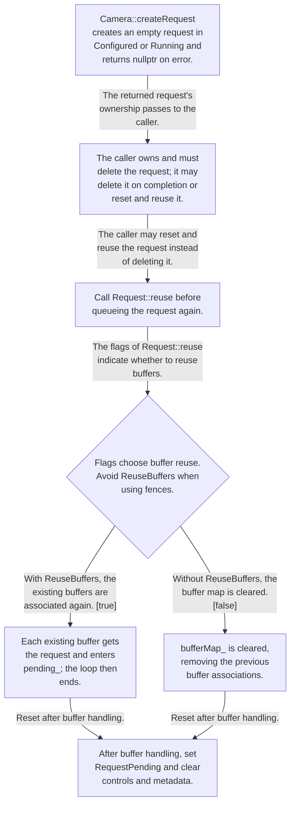
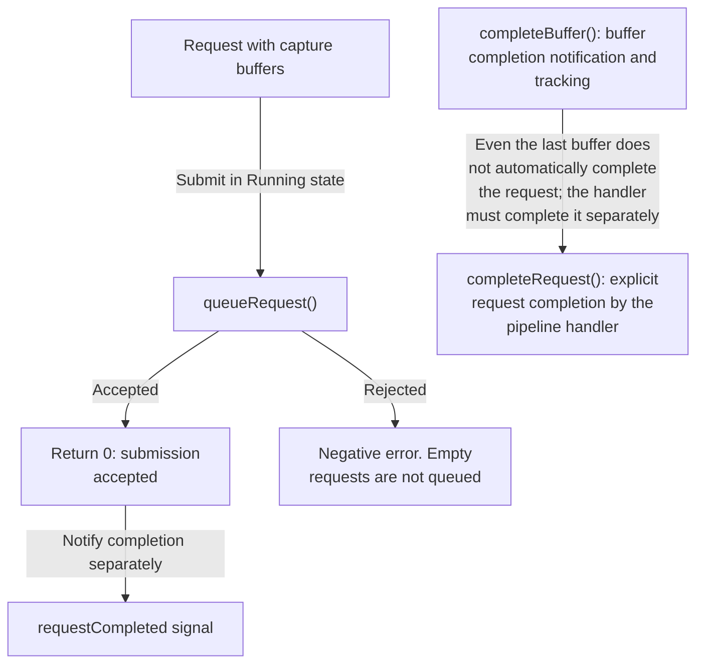
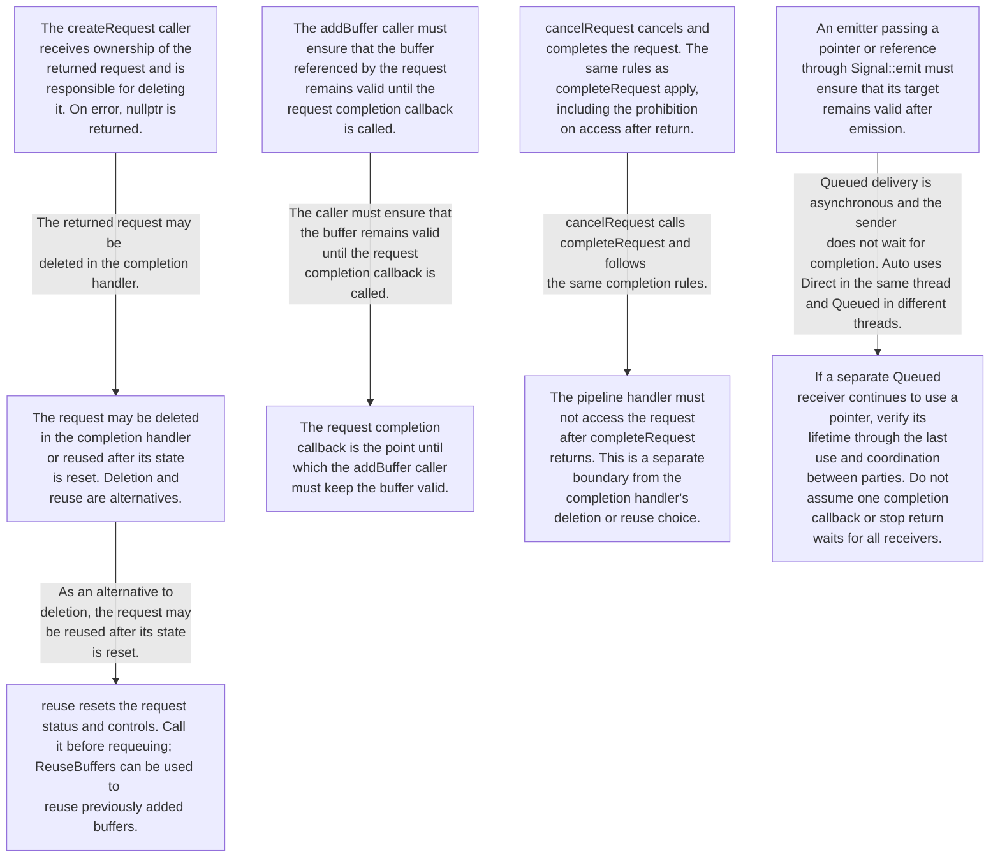
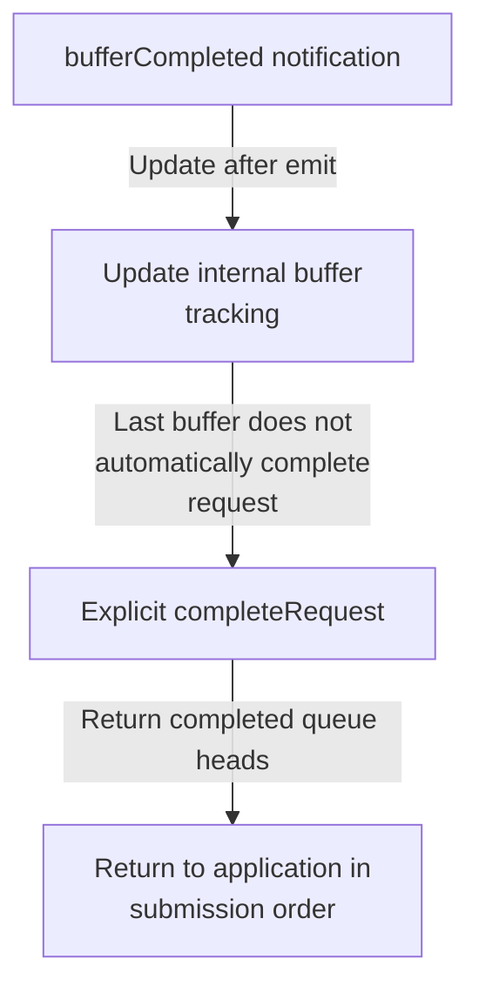
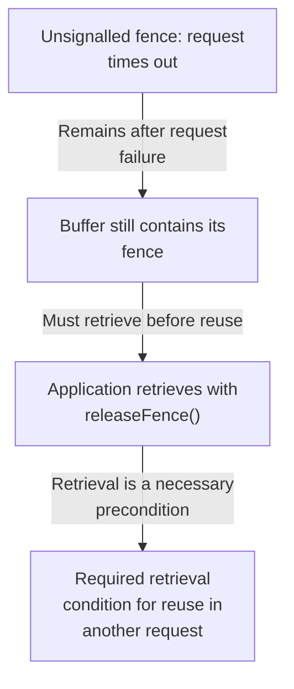
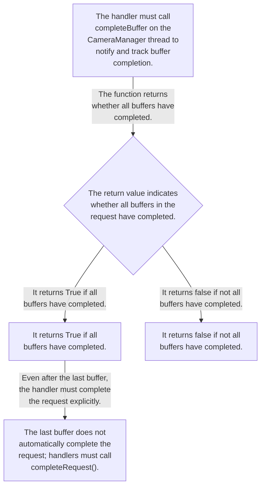
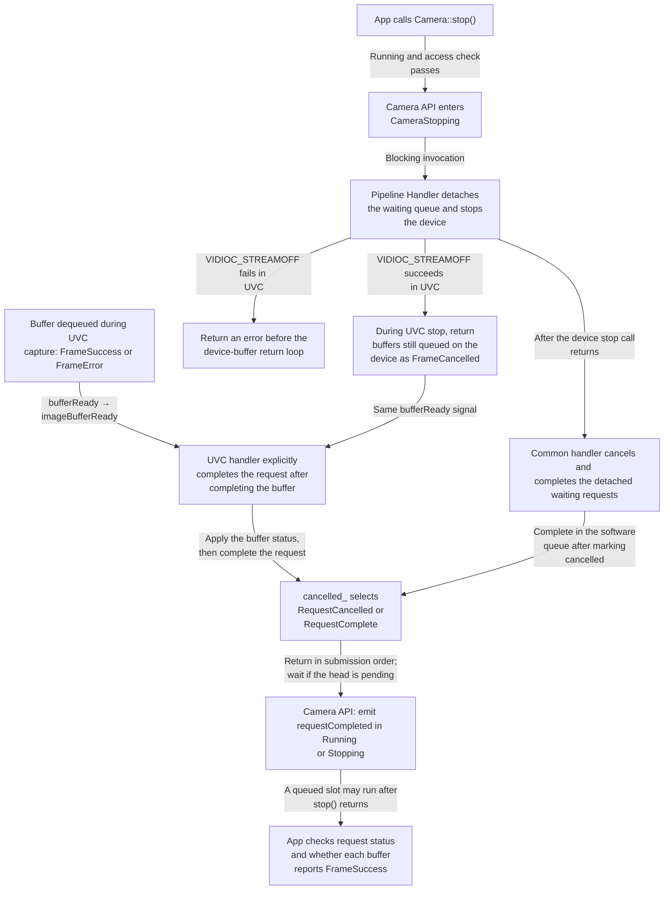
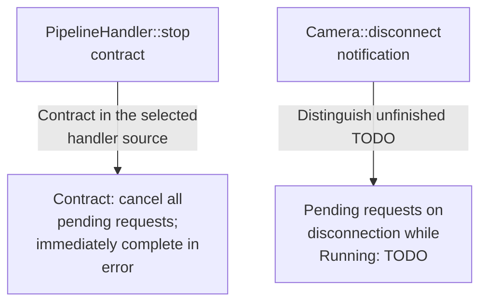

# Request Flow and Core Concepts

English translation · human review pending. Review states below refer to the Korean source.

Follow a request from creation and submission through buffer completion, return to the caller, and cancellation during stop.

## Request creation and ownership

The `cookie` of `Camera::createRequest(cookie)` is an opaque input used by the application. The value is stored in the request, can be read at any time through `Request::cookie()`, and is completely opaque to `libcamera`. The application typically uses this value in the request completion handler to associate the request with an external resource. `Camera::createRequest()` may be called only when the camera is in the `Configured` or `Running` state and returns `nullptr` if an error occurs.

### The relationship and boundaries between request creation and ownership

[Mermaid source](https://ttolsun.github.io/libcamera-sdd/en/overview.item-creation.mmd)

Diagram evidence and verification scope

How does the caller create, own, delete, or reuse requests, and what happens to the buffers depending on whether ReuseBuffers is specified?

Source-linked interpretation · automatic link check only · meaning and device execution not yet verified

| Elements and transitions | Source evidence |
| --- | --- |
| Camera::createRequest creates an empty request in Configured or Running and returns nullptr on error. | [src/libcamera/camera.cpp:1243](https://ttolsun.github.io/libcamera-sdd/en/reader-archive/overview.html#source-d61960ed2545ba78) |
| The caller owns and must delete the request; it may delete it on completion or reset and reuse it. | [src/libcamera/camera.cpp:1243](https://ttolsun.github.io/libcamera-sdd/en/reader-archive/overview.html#source-d61960ed2545ba78) |
| Call Request::reuse before queueing the request again. | [src/libcamera/request.cpp:376](https://ttolsun.github.io/libcamera-sdd/en/reader-archive/overview.html#source-0556d5e91908d040) |
| Flags choose buffer reuse. Avoid ReuseBuffers when using fences. | [src/libcamera/request.cpp:376](https://ttolsun.github.io/libcamera-sdd/en/reader-archive/overview.html#source-0556d5e91908d040) · [src/libcamera/request.cpp:326](https://ttolsun.github.io/libcamera-sdd/en/reader-archive/overview.html#source-99c7ceeed4e79b3a) |
| Each existing buffer gets the request and enters pending\_; the loop then ends. | [src/libcamera/request.cpp:376](https://ttolsun.github.io/libcamera-sdd/en/reader-archive/overview.html#source-0556d5e91908d040) |
| bufferMap\_ is cleared, removing the previous buffer associations. | [src/libcamera/request.cpp:376](https://ttolsun.github.io/libcamera-sdd/en/reader-archive/overview.html#source-0556d5e91908d040) |
| After buffer handling, set RequestPending and clear controls and metadata. | [src/libcamera/request.cpp:376](https://ttolsun.github.io/libcamera-sdd/en/reader-archive/overview.html#source-0556d5e91908d040) |
| The returned request's ownership passes to the caller. | [src/libcamera/camera.cpp:1243](https://ttolsun.github.io/libcamera-sdd/en/reader-archive/overview.html#source-d61960ed2545ba78) |
| The caller may reset and reuse the request instead of deleting it. | [src/libcamera/camera.cpp:1243](https://ttolsun.github.io/libcamera-sdd/en/reader-archive/overview.html#source-d61960ed2545ba78) |
| The flags of Request::reuse indicate whether to reuse buffers. | [src/libcamera/request.cpp:376](https://ttolsun.github.io/libcamera-sdd/en/reader-archive/overview.html#source-0556d5e91908d040) |
| With ReuseBuffers, the existing buffers are associated again. · flags & ReuseBuffers \[true\] | [src/libcamera/request.cpp:376](https://ttolsun.github.io/libcamera-sdd/en/reader-archive/overview.html#source-0556d5e91908d040) |
| Without ReuseBuffers, the buffer map is cleared. · flags & ReuseBuffers \[false\] | [src/libcamera/request.cpp:376](https://ttolsun.github.io/libcamera-sdd/en/reader-archive/overview.html#source-0556d5e91908d040) |
| Reset after buffer handling. | [src/libcamera/request.cpp:376](https://ttolsun.github.io/libcamera-sdd/en/reader-archive/overview.html#source-0556d5e91908d040) |
| Reset after buffer handling. | [src/libcamera/request.cpp:376](https://ttolsun.github.io/libcamera-sdd/en/reader-archive/overview.html#source-0556d5e91908d040) |

Ownership of the request returned by `Camera::createRequest()` passes to the caller, who is responsible for deleting it. To requeue the same request without creating a new one, the caller must call `Request::reuse()` before queueing it to reset the request state and associated controls. When `ReuseBuffers` is specified, `Request::reuse()` reattaches and reuses the existing buffers added by `addBuffer()`; otherwise, it clears `bufferMap_`. Fences associated with the buffers are not reused, so `ReuseBuffers` should not be used when fences are used.

Section-wide evidence: 3

- `src/libcamera/camera.cpp`[`L1243` excerpt](https://ttolsun.github.io/libcamera-sdd/en/reader-archive/overview.html#source-d61960ed2545ba78) · [Full source `L1243`](https://github.com/TTolsun/libcamera-sdd/blob/adfa719f8ed67d18fd8a0739fc088a1f8b9e7252/src/libcamera/camera.cpp#L1243)
- `src/libcamera/request.cpp`[`L376` excerpt](https://ttolsun.github.io/libcamera-sdd/en/reader-archive/overview.html#source-0556d5e91908d040) · [Full source `L376`](https://github.com/TTolsun/libcamera-sdd/blob/adfa719f8ed67d18fd8a0739fc088a1f8b9e7252/src/libcamera/request.cpp#L376) · [`L326` excerpt](https://ttolsun.github.io/libcamera-sdd/en/reader-archive/overview.html#source-99c7ceeed4e79b3a) · [Full source `L326`](https://github.com/TTolsun/libcamera-sdd/blob/adfa719f8ed67d18fd8a0739fc088a1f8b9e7252/src/libcamera/request.cpp#L326)

## Request submission and completion

See also: [Distinguishing buffer completion from completion of the entire request](#d1-completion) · [Completion caller and thread obligations](#d1-callback-thread)

The application must attach at least one capture buffer to the request object returned by `createRequest()` before submitting it with `Camera::queueRequest()`. When processing of a request queued with `Camera::queueRequest()` finishes, the camera notifies the application of completion through the `requestCompleted` signal. `Camera::queueRequest()` must be called only when the camera is in the `Running` state.

### Request acceptance, buffer completion, and request completion

[Mermaid source](https://ttolsun.github.io/libcamera-sdd/en/overview.submission-completion.mmd)

Diagram evidence and verification scope

The return value of queueRequest() is the acceptance result. completeBuffer() reports and tracks buffer completion, and the pipeline handler must separately complete the request using completeRequest(). The requestCompleted signal separately reports request completion.

Source-linked interpretation · automatic link check only · meaning and device execution not yet verified

LLM diagram draft · before human review

Authoring model: `cli/codex/gpt-6.1-terra`

| Elements and transitions | Source evidence |
| --- | --- |
| Request with capture buffers | [src/libcamera/camera.cpp:1308](https://ttolsun.github.io/libcamera-sdd/en/reader-archive/overview.html#source-2f880c124115c9c4) |
| queueRequest() | [src/libcamera/camera.cpp:1308](https://ttolsun.github.io/libcamera-sdd/en/reader-archive/overview.html#source-2f880c124115c9c4) |
| Return 0: submission accepted | [src/libcamera/camera.cpp:1308](https://ttolsun.github.io/libcamera-sdd/en/reader-archive/overview.html#source-2f880c124115c9c4) |
| requestCompleted signal | [src/libcamera/camera.cpp:1308](https://ttolsun.github.io/libcamera-sdd/en/reader-archive/overview.html#source-2f880c124115c9c4) |
| completeBuffer(): buffer completion notification and tracking | [src/libcamera/pipeline_handler.cpp:547](https://ttolsun.github.io/libcamera-sdd/en/reader-archive/overview.html#source-ca3f659653ce3f6a) |
| completeRequest(): explicit request completion by the pipeline handler | [src/libcamera/pipeline_handler.cpp:547](https://ttolsun.github.io/libcamera-sdd/en/reader-archive/overview.html#source-ca3f659653ce3f6a) |
| Negative error. Empty requests are not queued | [src/libcamera/camera.cpp:1308](https://ttolsun.github.io/libcamera-sdd/en/reader-archive/overview.html#source-2f880c124115c9c4) |
| Submit in Running state | [src/libcamera/camera.cpp:1308](https://ttolsun.github.io/libcamera-sdd/en/reader-archive/overview.html#source-2f880c124115c9c4) |
| Accepted | [src/libcamera/camera.cpp:1308](https://ttolsun.github.io/libcamera-sdd/en/reader-archive/overview.html#source-2f880c124115c9c4) |
| Notify completion separately | [src/libcamera/camera.cpp:1308](https://ttolsun.github.io/libcamera-sdd/en/reader-archive/overview.html#source-2f880c124115c9c4) |
| Even the last buffer does not automatically complete the request; the handler must complete it separately | [src/libcamera/pipeline_handler.cpp:547](https://ttolsun.github.io/libcamera-sdd/en/reader-archive/overview.html#source-ca3f659653ce3f6a) |
| Rejected | [src/libcamera/camera.cpp:1308](https://ttolsun.github.io/libcamera-sdd/en/reader-archive/overview.html#source-2f880c124115c9c4) |

Section-wide evidence: 1

- `src/libcamera/camera.cpp`[`L1308` excerpt](https://ttolsun.github.io/libcamera-sdd/en/reader-archive/overview.html#source-2f880c124115c9c4) · [Full source `L1308`](https://github.com/TTolsun/libcamera-sdd/blob/adfa719f8ed67d18fd8a0739fc088a1f8b9e7252/src/libcamera/camera.cpp#L1308)

## Lifetime of requests, buffers, and fences

### Ownership and the two completion boundaries

The caller of `Camera::createRequest()` receives ownership of the returned `Request` and is responsible for deleting it. The caller may delete the request in the completion handler or reuse it after resetting its state with `Request::reuse()`. `Request::addBuffer()` stores a reference to the buffer in the request, and the caller must ensure that the buffer remains valid until the request completion callback is called. The pipeline handler must not access the request after `completeRequest()` or `cancelRequest()` returns.

#### Period for keeping requests and buffers

[Mermaid source](https://ttolsun.github.io/libcamera-sdd/en/request-lifecycle.request-ownership.mmd)

Diagram evidence and verification scope

How are the createRequest and addBuffer callers, deletion or reuse in the completion handler and the end of handler access, and the pointer lifetime of a separate Queued receiver distinguished?

Source-linked interpretation · automatic link check only · meaning and device execution not yet verified

LLM diagram draft · before human review

Authoring model: `cli/codex/gpt-6.1-terra`

| Elements and transitions | Source evidence |
| --- | --- |
| The createRequest caller receives ownership of the returned request and is responsible for deleting it. On error, nullptr is returned. | [src/libcamera/camera.cpp:1243](https://ttolsun.github.io/libcamera-sdd/en/reader-archive/request-lifecycle.html#source-0ae00d77839f61cb) |
| The addBuffer caller must ensure that the buffer referenced by the request remains valid until the request completion callback is called. | [src/libcamera/request.cpp:442](https://ttolsun.github.io/libcamera-sdd/en/reader-archive/request-lifecycle.html#source-95ae69eeb085e3b1) |
| The request may be deleted in the completion handler or reused after its state is reset. Deletion and reuse are alternatives. | [src/libcamera/camera.cpp:1243](https://ttolsun.github.io/libcamera-sdd/en/reader-archive/request-lifecycle.html#source-0ae00d77839f61cb) |
| The request completion callback is the point until which the addBuffer caller must keep the buffer valid. | [src/libcamera/request.cpp:442](https://ttolsun.github.io/libcamera-sdd/en/reader-archive/request-lifecycle.html#source-95ae69eeb085e3b1) |
| reuse resets the request status and controls. Call it before requeuing; ReuseBuffers can be used to reuse previously added buffers. | [src/libcamera/request.cpp:376](https://ttolsun.github.io/libcamera-sdd/en/reader-archive/request-lifecycle.html#source-38494771cb29cc8c) |
| The pipeline handler must not access the request after completeRequest returns. This is a separate boundary from the completion handler's deletion or reuse choice. | [src/libcamera/pipeline_handler.cpp:547](https://ttolsun.github.io/libcamera-sdd/en/reader-archive/request-lifecycle.html#source-01ad7c6605c3296a) · [src/libcamera/camera.cpp:1243](https://ttolsun.github.io/libcamera-sdd/en/reader-archive/request-lifecycle.html#source-0ae00d77839f61cb) |
| cancelRequest cancels and completes the request. The same rules as completeRequest apply, including the prohibition on access after return. | [src/libcamera/pipeline_handler.cpp:547](https://ttolsun.github.io/libcamera-sdd/en/reader-archive/request-lifecycle.html#source-01ad7c6605c3296a) |
| An emitter passing a pointer or reference through Signal::emit must ensure that its target remains valid after emission. | [src/libcamera/base/signal.cpp:73](https://ttolsun.github.io/libcamera-sdd/en/reader-archive/request-lifecycle.html#source-52064eba9532db6a) |
| If a separate Queued receiver continues to use a pointer, verify its lifetime through the last use and coordination between parties. Do not assume one completion callback or stop return waits for all receivers. | [src/libcamera/base/signal.cpp:73](https://ttolsun.github.io/libcamera-sdd/en/reader-archive/request-lifecycle.html#source-52064eba9532db6a) · [src/libcamera/base/bound_method.cpp:22](https://ttolsun.github.io/libcamera-sdd/en/reader-archive/request-lifecycle.html#source-bfdfed92f905633d) |
| The returned request may be deleted in the completion handler. | [src/libcamera/camera.cpp:1243](https://ttolsun.github.io/libcamera-sdd/en/reader-archive/request-lifecycle.html#source-0ae00d77839f61cb) |
| As an alternative to deletion, the request may be reused after its state is reset. | [src/libcamera/camera.cpp:1243](https://ttolsun.github.io/libcamera-sdd/en/reader-archive/request-lifecycle.html#source-0ae00d77839f61cb) |
| The caller must ensure that the buffer remains valid until the request completion callback is called. | [src/libcamera/request.cpp:442](https://ttolsun.github.io/libcamera-sdd/en/reader-archive/request-lifecycle.html#source-95ae69eeb085e3b1) |
| cancelRequest calls completeRequest and follows the same completion rules. | [src/libcamera/pipeline_handler.cpp:547](https://ttolsun.github.io/libcamera-sdd/en/reader-archive/request-lifecycle.html#source-01ad7c6605c3296a) |
| Queued delivery is asynchronous and the sender does not wait for completion. Auto uses Direct in the same thread and Queued in different threads. | [src/libcamera/base/bound_method.cpp:22](https://ttolsun.github.io/libcamera-sdd/en/reader-archive/request-lifecycle.html#source-bfdfed92f905633d) |

### Normal completion and preparation for the next request

`completeBuffer` emits `bufferCompleted`, then updates the request's internal buffer tracking and returns `true` if all buffers are complete or `false` if any buffers remain. The request is not completed automatically even when the last buffer completes, so the pipeline handler must explicitly signal completion with `completeRequest` after performing any necessary operations. Both functions must be called from the `CameraManager` thread; the thread on which the callback actually runs is not established by this source. The internal `complete` called by `completeRequest` selects `RequestComplete` if `cancelled_` is `false`, or `RequestCancelled` if it is `true`.

#### From buffer notification to request return

[Mermaid source](https://ttolsun.github.io/libcamera-sdd/en/request-lifecycle.completion-notification-order.mmd)

Diagram evidence and verification scope

This shows the call and trace sequence for the normal path. Request completion is signaled after all buffers and any required additional processing are complete; the sequence does not indicate actual execution time or the application callback thread.

Source-linked interpretation · automatic link check only · meaning and device execution not yet verified

| Elements and transitions | Source evidence |
| --- | --- |
| bufferCompleted notification | [src/libcamera/pipeline_handler.cpp:547](https://ttolsun.github.io/libcamera-sdd/en/reader-archive/request-lifecycle.html#source-01ad7c6605c3296a) |
| Update internal buffer tracking | [src/libcamera/pipeline_handler.cpp:547](https://ttolsun.github.io/libcamera-sdd/en/reader-archive/request-lifecycle.html#source-01ad7c6605c3296a) |
| Explicit completeRequest | [src/libcamera/pipeline_handler.cpp:547](https://ttolsun.github.io/libcamera-sdd/en/reader-archive/request-lifecycle.html#source-01ad7c6605c3296a) |
| Return to application in submission order | [src/libcamera/pipeline_handler.cpp:547](https://ttolsun.github.io/libcamera-sdd/en/reader-archive/request-lifecycle.html#source-01ad7c6605c3296a) |
| Update after emit | [src/libcamera/pipeline_handler.cpp:547](https://ttolsun.github.io/libcamera-sdd/en/reader-archive/request-lifecycle.html#source-01ad7c6605c3296a) |
| Last buffer does not automatically complete request | [src/libcamera/pipeline_handler.cpp:547](https://ttolsun.github.io/libcamera-sdd/en/reader-archive/request-lifecycle.html#source-01ad7c6605c3296a) |
| Return completed queue heads | [src/libcamera/pipeline_handler.cpp:547](https://ttolsun.github.io/libcamera-sdd/en/reader-archive/request-lifecycle.html#source-01ad7c6605c3296a) |

If the last buffer notification has been observed but the request completion callback has not yet been observed, that observation alone does not establish that the internal tracking update or the `completeRequest` call is still pending. This notification is not evidence that the period for which the buffer must remain valid has ended, so the notification alone cannot establish whether releasing it in a way that invalidates the buffer or attaching it to another request is safe. Reuse is not categorically prohibited; whether it can be attached to another request must be checked separately against the applicable API and synchronization contracts and the requirement to maintain buffer validity.

As a source-based investigation plan, the investigator will observe the return value of the existing `completeBuffer` call. The investigator will also observe the `completeRequest` call itself. The investigator will then check whether the return of a completed request is delayed because of submission order and whether the request completion callback occurs.

## Fence reclamation after timeout

[Mermaid source](https://ttolsun.github.io/libcamera-sdd/en/request-lifecycle.lifecycle-timeout-fence-recovery.mmd)

Diagram evidence and verification scope

If a timeout occurs on an unsignaled fence, what must be done before reusing it for another request?

Source-linked interpretation · automatic link check only · meaning and device execution not yet verified

| Elements and transitions | Source evidence |
| --- | --- |
| Unsignalled fence: request times out | [src/libcamera/request.cpp:462](https://ttolsun.github.io/libcamera-sdd/en/reader-archive/request-lifecycle.html#source-d8cf34a75a4333a7) |
| Buffer still contains its fence | [src/libcamera/request.cpp:462](https://ttolsun.github.io/libcamera-sdd/en/reader-archive/request-lifecycle.html#source-d8cf34a75a4333a7) |
| Application retrieves with releaseFence() | [src/libcamera/request.cpp:462](https://ttolsun.github.io/libcamera-sdd/en/reader-archive/request-lifecycle.html#source-d8cf34a75a4333a7) |
| Required retrieval condition for reuse in another request | [src/libcamera/request.cpp:462](https://ttolsun.github.io/libcamera-sdd/en/reader-archive/request-lifecycle.html#source-d8cf34a75a4333a7) |
| Remains after request failure | [src/libcamera/request.cpp:462](https://ttolsun.github.io/libcamera-sdd/en/reader-archive/request-lifecycle.html#source-d8cf34a75a4333a7) |
| Must retrieve before reuse | [src/libcamera/request.cpp:462](https://ttolsun.github.io/libcamera-sdd/en/reader-archive/request-lifecycle.html#source-d8cf34a75a4333a7) |
| Retrieval is a necessary precondition | [src/libcamera/request.cpp:462](https://ttolsun.github.io/libcamera-sdd/en/reader-archive/request-lifecycle.html#source-d8cf34a75a4333a7) |

## Buffer completion and request completion

`PipelineHandler::completeBuffer()` notifies the application that a buffer belonging to a request has completed, then updates the request's internal buffer tracking information. The pipeline handler must explicitly call `completeRequest()` even after the last buffer has completed.

### The relationship and boundaries between buffer completion and request completion

[Mermaid source](https://ttolsun.github.io/libcamera-sdd/en/overview.item-completion.mmd)

Diagram evidence and verification scope

How are individual buffer completion and whether all buffers are complete distinguished from an explicit request completion call?

Source-linked interpretation · automatic link check only · meaning and device execution not yet verified

| Elements and transitions | Source evidence |
| --- | --- |
| The handler must call completeBuffer on the CameraManager thread to notify and track buffer completion. | [src/libcamera/pipeline_handler.cpp:547](https://ttolsun.github.io/libcamera-sdd/en/reader-archive/overview.html#source-ca3f659653ce3f6a) |
| The return value indicates whether all buffers in the request have completed. | [src/libcamera/pipeline_handler.cpp:547](https://ttolsun.github.io/libcamera-sdd/en/reader-archive/overview.html#source-ca3f659653ce3f6a) |
| It returns True if all buffers have completed. | [src/libcamera/pipeline_handler.cpp:547](https://ttolsun.github.io/libcamera-sdd/en/reader-archive/overview.html#source-ca3f659653ce3f6a) |
| It returns false if not all buffers have completed. | [src/libcamera/pipeline_handler.cpp:547](https://ttolsun.github.io/libcamera-sdd/en/reader-archive/overview.html#source-ca3f659653ce3f6a) |
| The last buffer does not automatically complete the request; handlers must call completeRequest(). | [src/libcamera/pipeline_handler.cpp:547](https://ttolsun.github.io/libcamera-sdd/en/reader-archive/overview.html#source-ca3f659653ce3f6a) |
| The function returns whether all buffers have completed. | [src/libcamera/pipeline_handler.cpp:547](https://ttolsun.github.io/libcamera-sdd/en/reader-archive/overview.html#source-ca3f659653ce3f6a) |
| It returns True if all buffers have completed. | [src/libcamera/pipeline_handler.cpp:547](https://ttolsun.github.io/libcamera-sdd/en/reader-archive/overview.html#source-ca3f659653ce3f6a) |
| It returns false if not all buffers have completed. | [src/libcamera/pipeline_handler.cpp:547](https://ttolsun.github.io/libcamera-sdd/en/reader-archive/overview.html#source-ca3f659653ce3f6a) |
| Even after the last buffer, the handler must complete the request explicitly. | [src/libcamera/pipeline_handler.cpp:547](https://ttolsun.github.io/libcamera-sdd/en/reader-archive/overview.html#source-ca3f659653ce3f6a) |

Section-wide evidence: 1

- `src/libcamera/pipeline_handler.cpp`[`L547` excerpt](https://ttolsun.github.io/libcamera-sdd/en/reader-archive/overview.html#source-ca3f659653ce3f6a) · [Full source `L547`](https://github.com/TTolsun/libcamera-sdd/blob/adfa719f8ed67d18fd8a0739fc088a1f8b9e7252/src/libcamera/pipeline_handler.cpp#L547)

## Thread boundaries and synchronization

When calling functions that affect `Camera` state, the caller must ensure synchronization between the functions if necessary. The pipeline handler must call `PipelineHandler::completeRequest()` on the `CameraManager` thread.

Section-wide evidence: 2

- `src/libcamera/camera.cpp`[`L780` excerpt](https://ttolsun.github.io/libcamera-sdd/en/reader-archive/overview.html#source-33ababe2a4780075) · [Full source `L780`](https://github.com/TTolsun/libcamera-sdd/blob/adfa719f8ed67d18fd8a0739fc088a1f8b9e7252/src/libcamera/camera.cpp#L780)
- `src/libcamera/pipeline_handler.cpp`[`L571` excerpt](https://ttolsun.github.io/libcamera-sdd/en/reader-archive/overview.html#source-7ac40780a56ae3a9) · [Full source `L571`](https://github.com/TTolsun/libcamera-sdd/blob/adfa719f8ed67d18fd8a0739fc088a1f8b9e7252/src/libcamera/pipeline_handler.cpp#L571)

## Distinguishing stop and disconnect

Normal UVC buffer returns and cancellation of remaining buffers when STREAMOFF succeeds may both lead from `imageBufferReady` through `completeBuffer` and `completeRequest` to the same `requestCompleted` notification. In this slot, the Developer must distinguish between `RequestComplete` and `RequestCancelled` and use each buffer's `FrameSuccess` to determine whether to use the image; `RequestComplete` may also have `FrameError`, and cancelled buffers are `FrameCancelled`. The Vendor's device validation plan is to capture normally on the first run, call `stop()` with incomplete requests remaining on the second run, and process the receive loop to record the number of notifications for each submission, whether any were not received, and the request and buffer states. Slots queued on another thread may execute even after `stop()` returns.

### Why does a completion notification arrive after capture has been stopped?

The completion state check allows a disconnected camera. A state outside Running and Stopping triggers the Fatal log path. [`camera.cpp:1483`](https://github.com/TTolsun/libcamera-sdd/blob/adfa719f8ed67d18fd8a0739fc088a1f8b9e7252/src/libcamera/camera.cpp#L1483) · [`camera.cpp:1486`](https://github.com/TTolsun/libcamera-sdd/blob/adfa719f8ed67d18fd8a0739fc088a1f8b9e7252/src/libcamera/camera.cpp#L1486)

[Mermaid source](https://ttolsun.github.io/libcamera-sdd/en/request-lifecycle.stop-notification-boundary.mmd)

Diagram evidence and verification scope

What paths do normal capture and cancellation during stopping take to reach the app as the same completion signal?

Source-linked interpretation · automatic link check only · meaning and device execution not yet verified

| Elements and transitions | Source evidence |
| --- | --- |
| App calls Camera::stop() | [src/libcamera/camera.cpp:1431](https://ttolsun.github.io/libcamera-sdd/en/reader-archive/request-lifecycle.html#source-e09324743def3f09) |
| Camera API enters CameraStopping | [src/libcamera/camera.cpp:1431](https://ttolsun.github.io/libcamera-sdd/en/reader-archive/request-lifecycle.html#source-e09324743def3f09) |
| Pipeline Handler detaches the waiting queue and stops the device | [src/libcamera/pipeline_handler.cpp:359](https://ttolsun.github.io/libcamera-sdd/en/reader-archive/request-lifecycle.html#source-eefd1bbecb1aad0a) |
| Buffer dequeued during UVC capture: FrameSuccess or FrameError | [src/libcamera/v4l2_videodevice.cpp:1814](https://ttolsun.github.io/libcamera-sdd/en/reader-archive/request-lifecycle.html#source-c75cbbe9c0bd5f96) |
| Return an error before the device-buffer return loop | [src/libcamera/v4l2_videodevice.cpp:2023](https://ttolsun.github.io/libcamera-sdd/en/reader-archive/request-lifecycle.html#source-660c24600a4d45c9) |
| During UVC stop, return buffers still queued on the device as FrameCancelled | [src/libcamera/v4l2_videodevice.cpp:2023](https://ttolsun.github.io/libcamera-sdd/en/reader-archive/request-lifecycle.html#source-660c24600a4d45c9) · [include/libcamera/internal/framebuffer.h:36](https://ttolsun.github.io/libcamera-sdd/en/reader-archive/request-lifecycle.html#source-6700ac41898c0548) |
| UVC handler explicitly completes the request after completing the buffer | [src/libcamera/pipeline/uvcvideo/uvcvideo.cpp:893](https://ttolsun.github.io/libcamera-sdd/en/reader-archive/request-lifecycle.html#source-bfa0db3a4bc7970d) |
| Common handler cancels and completes the detached waiting requests | [src/libcamera/pipeline_handler.cpp:359](https://ttolsun.github.io/libcamera-sdd/en/reader-archive/request-lifecycle.html#source-eefd1bbecb1aad0a) · [src/libcamera/pipeline_handler.cpp:483](https://ttolsun.github.io/libcamera-sdd/en/reader-archive/request-lifecycle.html#source-8bf901f3faef18e5) |
| cancelled\_ selects RequestCancelled or RequestComplete | [src/libcamera/request.cpp:103](https://ttolsun.github.io/libcamera-sdd/en/reader-archive/request-lifecycle.html#source-db7f21585c4c2708) |
| Camera API: emit requestCompleted in Running or Stopping | [src/libcamera/camera.cpp:1481](https://ttolsun.github.io/libcamera-sdd/en/reader-archive/request-lifecycle.html#source-d53c87090347ce81) |
| App checks request status and whether each buffer reports FrameSuccess | [src/libcamera/camera.cpp:1481](https://ttolsun.github.io/libcamera-sdd/en/reader-archive/request-lifecycle.html#source-d53c87090347ce81) · [src/libcamera/request.cpp:103](https://ttolsun.github.io/libcamera-sdd/en/reader-archive/request-lifecycle.html#source-db7f21585c4c2708) · [src/libcamera/framebuffer.cpp:40](https://ttolsun.github.io/libcamera-sdd/en/reader-archive/request-lifecycle.html#source-50aa8a55cc04062e) |
| Running and access check passes | [src/libcamera/camera.cpp:1431](https://ttolsun.github.io/libcamera-sdd/en/reader-archive/request-lifecycle.html#source-e09324743def3f09) |
| Blocking invocation | [src/libcamera/camera.cpp:1462](https://ttolsun.github.io/libcamera-sdd/en/reader-archive/request-lifecycle.html#source-6191f91df6cbffa2) |
| VIDIOC_STREAMOFF succeeds in UVC | [src/libcamera/pipeline/uvcvideo/uvcvideo.cpp:320](https://ttolsun.github.io/libcamera-sdd/en/reader-archive/request-lifecycle.html#source-36920038ed2e6053) · [src/libcamera/v4l2_videodevice.cpp:2023](https://ttolsun.github.io/libcamera-sdd/en/reader-archive/request-lifecycle.html#source-660c24600a4d45c9) |
| After the device stop call returns | [src/libcamera/pipeline_handler.cpp:359](https://ttolsun.github.io/libcamera-sdd/en/reader-archive/request-lifecycle.html#source-eefd1bbecb1aad0a) |
| VIDIOC_STREAMOFF fails in UVC | [src/libcamera/pipeline/uvcvideo/uvcvideo.cpp:320](https://ttolsun.github.io/libcamera-sdd/en/reader-archive/request-lifecycle.html#source-36920038ed2e6053) · [src/libcamera/v4l2_videodevice.cpp:2023](https://ttolsun.github.io/libcamera-sdd/en/reader-archive/request-lifecycle.html#source-660c24600a4d45c9) |
| bufferReady → imageBufferReady | [src/libcamera/pipeline/uvcvideo/uvcvideo.cpp:535](https://ttolsun.github.io/libcamera-sdd/en/reader-archive/request-lifecycle.html#source-f9929d36ff1c1b93) |
| Same bufferReady signal | [src/libcamera/v4l2_videodevice.cpp:2023](https://ttolsun.github.io/libcamera-sdd/en/reader-archive/request-lifecycle.html#source-660c24600a4d45c9) · [src/libcamera/pipeline/uvcvideo/uvcvideo.cpp:535](https://ttolsun.github.io/libcamera-sdd/en/reader-archive/request-lifecycle.html#source-f9929d36ff1c1b93) |
| Apply the buffer status, then complete the request | [src/libcamera/request.cpp:103](https://ttolsun.github.io/libcamera-sdd/en/reader-archive/request-lifecycle.html#source-db7f21585c4c2708) · [src/libcamera/pipeline_handler.cpp:547](https://ttolsun.github.io/libcamera-sdd/en/reader-archive/request-lifecycle.html#source-01ad7c6605c3296a) |
| Complete in the software queue after marking cancelled | [src/libcamera/pipeline_handler.cpp:483](https://ttolsun.github.io/libcamera-sdd/en/reader-archive/request-lifecycle.html#source-8bf901f3faef18e5) |
| Return in submission order; wait if the head is pending | [src/libcamera/pipeline_handler.cpp:547](https://ttolsun.github.io/libcamera-sdd/en/reader-archive/request-lifecycle.html#source-01ad7c6605c3296a) |
| A queued slot may run after stop() returns | [src/libcamera/camera.cpp:1481](https://ttolsun.github.io/libcamera-sdd/en/reader-archive/request-lifecycle.html#source-d53c87090347ce81) · [src/libcamera/base/bound_method.cpp:68](https://ttolsun.github.io/libcamera-sdd/en/reader-archive/request-lifecycle.html#source-0470759dc8387e9a) · [src/libcamera/camera.cpp:1462](https://ttolsun.github.io/libcamera-sdd/en/reader-archive/request-lifecycle.html#source-6191f91df6cbffa2) |

### Stop API contract and disconnect TODO

[Mermaid source](https://ttolsun.github.io/libcamera-sdd/en/request-lifecycle.stop-disconnect-contract.mmd)

Diagram evidence and verification scope

How do the two selected source passages of PipelineHandler::stop and Camera::disconnect state the handling of waiting requests differently?

Source-linked interpretation · automatic link check only · meaning and device execution not yet verified

| Elements and transitions | Source evidence |
| --- | --- |
| PipelineHandler::stop contract | [src/libcamera/pipeline_handler.cpp:359](https://ttolsun.github.io/libcamera-sdd/en/reader-archive/request-lifecycle.html#source-eefd1bbecb1aad0a) |
| Contract: cancel all pending requests; immediately complete in error | [src/libcamera/pipeline_handler.cpp:359](https://ttolsun.github.io/libcamera-sdd/en/reader-archive/request-lifecycle.html#source-eefd1bbecb1aad0a) |
| Camera::disconnect notification | [src/libcamera/camera.cpp:944](https://ttolsun.github.io/libcamera-sdd/en/reader-archive/request-lifecycle.html#source-839140c350119dd1) |
| Pending requests on disconnection while Running: TODO | [src/libcamera/camera.cpp:944](https://ttolsun.github.io/libcamera-sdd/en/reader-archive/request-lifecycle.html#source-839140c350119dd1) |
| Contract in the selected handler source | [src/libcamera/pipeline_handler.cpp:359](https://ttolsun.github.io/libcamera-sdd/en/reader-archive/request-lifecycle.html#source-eefd1bbecb1aad0a) |
| Distinguish unfinished TODO | [src/libcamera/camera.cpp:944](https://ttolsun.github.io/libcamera-sdd/en/reader-archive/request-lifecycle.html#source-839140c350119dd1) |

## Source manuscripts and review records

System overview

- **Generation method**: Extracted facts and LLM explanation
- **Validation scope**: Tables and figures are created from facts, and the explanations are written by the LLM. Citation, sentence, and configured structure checks are applied.
- **Automated check**: Passed (`ok`). The items checked are listed in the verification scope. Whether the explanation content is correct is checked by a human reviewer.
- **Human review**: Before human review
- **Analysis baseline commit**: `adfa719f8ed67d18fd8a0739fc088a1f8b9e7252`
- **Document generation time**: `2026-11-20 17:39:13+00:00`
- **Sentence generation model**: `cli/codex/gpt-6.1-terra`
- **Contracts between documents**: [Automated comparison report](https://ttolsun.github.io/libcamera-sdd/contract-consistency.json) · Before human review
- **Reader scope**: [Answers by task and unreviewed scope](https://ttolsun.github.io/libcamera-sdd/reader-scope.json)

Record from when the manuscript was written

This is a record saved in the manuscript as of that time. It may differ from the current document's standards.

- Evidence files: `include/libcamera/camera.h`, `include/libcamera/camera_manager.h`, `include/libcamera/internal/ipa_manager.h`, `include/libcamera/internal/pipeline_handler.h`, `include/libcamera/request.h`, `src/libcamera/base/log.cpp`, `src/libcamera/camera.cpp`, `src/libcamera/camera_manager.cpp`, `src/libcamera/controls.cpp`, `src/libcamera/ipa_manager.cpp`, `src/libcamera/pipeline_handler.cpp`, `src/libcamera/request.cpp`
- Evidence level: code verified (static analysis, simple_compdb configuration, commit `adfa719f8e`)
- Automated check (citation, sentence, and configured structure checks): passed
- Review status recorded on: 2026-11-21 · Awaiting human review

[Markdown source ↗](https://ttolsun.github.io/libcamera-sdd/overview.md) [Mermaid source ↗](https://ttolsun.github.io/libcamera-sdd/en/overview.mmd)

[Open earlier detail](https://ttolsun.github.io/libcamera-sdd/en/reader-archive/overview.html#page-evidence)

Request handling and problem diagnosis

- **Generation method**: Extracted facts and LLM explanation
- **Validation scope**: Tables and figures are created from facts, and the explanations are written by the LLM. Citation, sentence, and configured structure checks are applied.
- **Automated check**: Passed (`ok`). The items checked are listed in the verification scope. Whether the explanation content is correct is checked by a human reviewer.
- **Human review**: Before human review
- **Analysis baseline commit**: `adfa719f8ed67d18fd8a0739fc088a1f8b9e7252`
- **Document generation time**: `2026-11-21 13:28:40+00:00`
- **Sentence generation model**: `cli/codex/gpt-6.1-terra`
- **Contracts between documents**: [Automated comparison report](https://ttolsun.github.io/libcamera-sdd/contract-consistency.json) · Before human review
- **Enter product description**: [Scope, conditions, and sources](https://ttolsun.github.io/libcamera-sdd/product-context.json)

Record from when the manuscript was written

This is a record saved in the manuscript as of that time. It may differ from the current document's standards.

- Evidence files: `Documentation/thread-safety.dox`, `include/libcamera/base/bound_method.h`, `include/libcamera/base/object.h`, `include/libcamera/base/signal.h`, `include/libcamera/base/utils.h`, `include/libcamera/camera.h`, `include/libcamera/internal/camera.h`, `include/libcamera/internal/framebuffer.h`, `include/libcamera/internal/pipeline_handler.h`, `include/libcamera/internal/request.h`, `include/libcamera/request.h`, `product-evidence/libcamera-callback-probe/callback-run.txt`, `src/libcamera/base/bound_method.cpp`, `src/libcamera/base/event_dispatcher_poll.cpp`, `src/libcamera/base/message.cpp`, `src/libcamera/base/object.cpp`, `src/libcamera/base/signal.cpp`, `src/libcamera/base/thread.cpp`, `src/libcamera/base/timer.cpp`, `src/libcamera/camera.cpp`, `src/libcamera/framebuffer.cpp`, `src/libcamera/pipeline/uvcvideo/uvcvideo.cpp`, `src/libcamera/pipeline_handler.cpp`, `src/libcamera/request.cpp`, `src/libcamera/v4l2_device.cpp`, `src/libcamera/v4l2_videodevice.cpp`
- Evidence level: code verified (static analysis, simple_compdb configuration, commit `adfa719f8e`)
- Automated check (citation, sentence, and configured structure checks): passed
- Review status recorded on: 2026-11-21 · Awaiting human review

[Markdown source ↗](https://ttolsun.github.io/libcamera-sdd/request-lifecycle.md)

[Open earlier detail](https://ttolsun.github.io/libcamera-sdd/en/reader-archive/request-lifecycle.html#page-evidence)

[Download page Markdown](https://ttolsun.github.io/libcamera-sdd/en/request-flow.md) · [Reader edition source map](https://ttolsun.github.io/libcamera-sdd/reader-edition.json)
