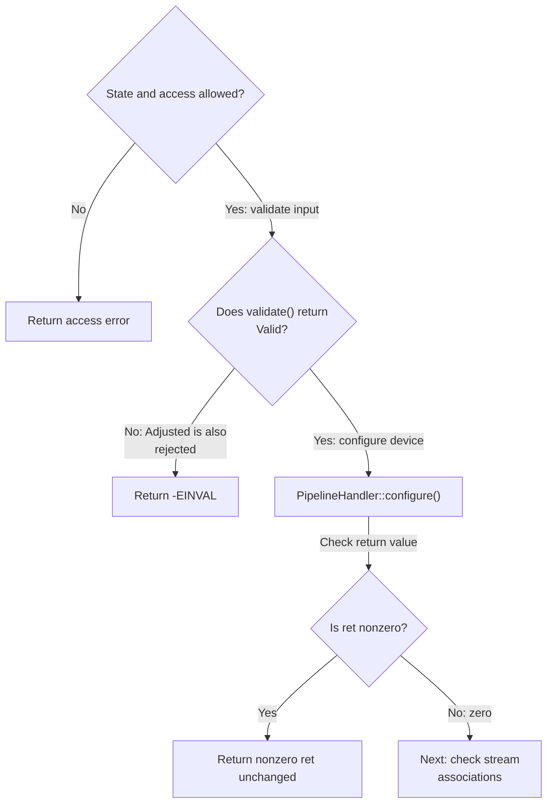
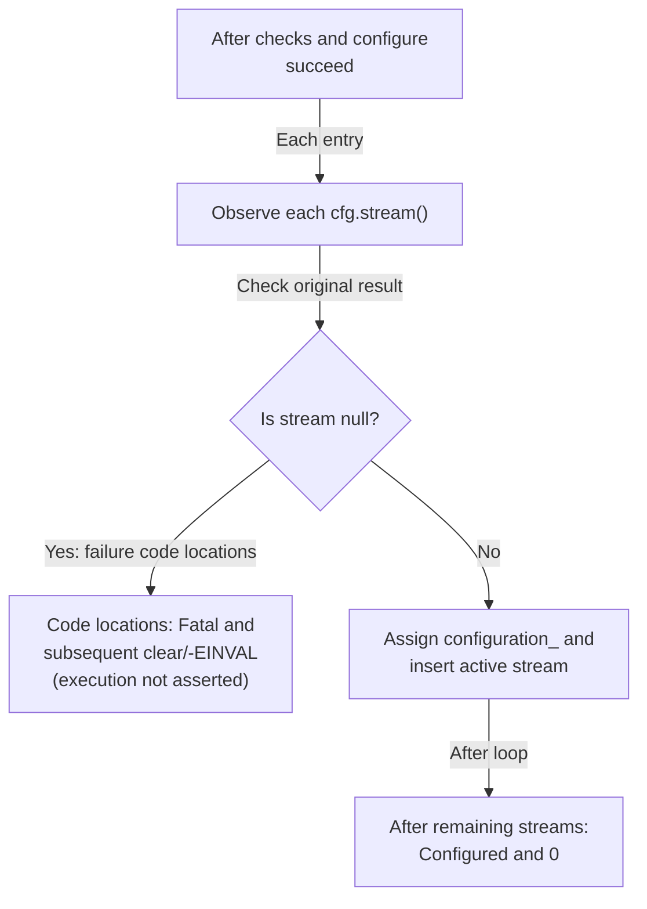
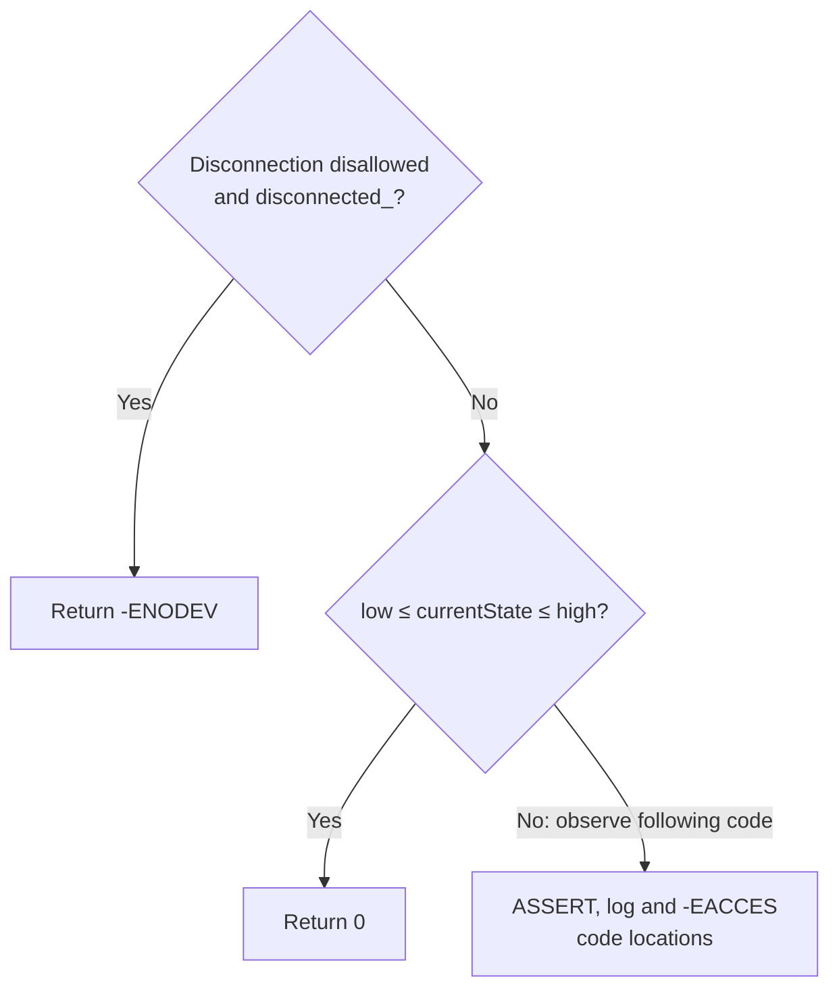
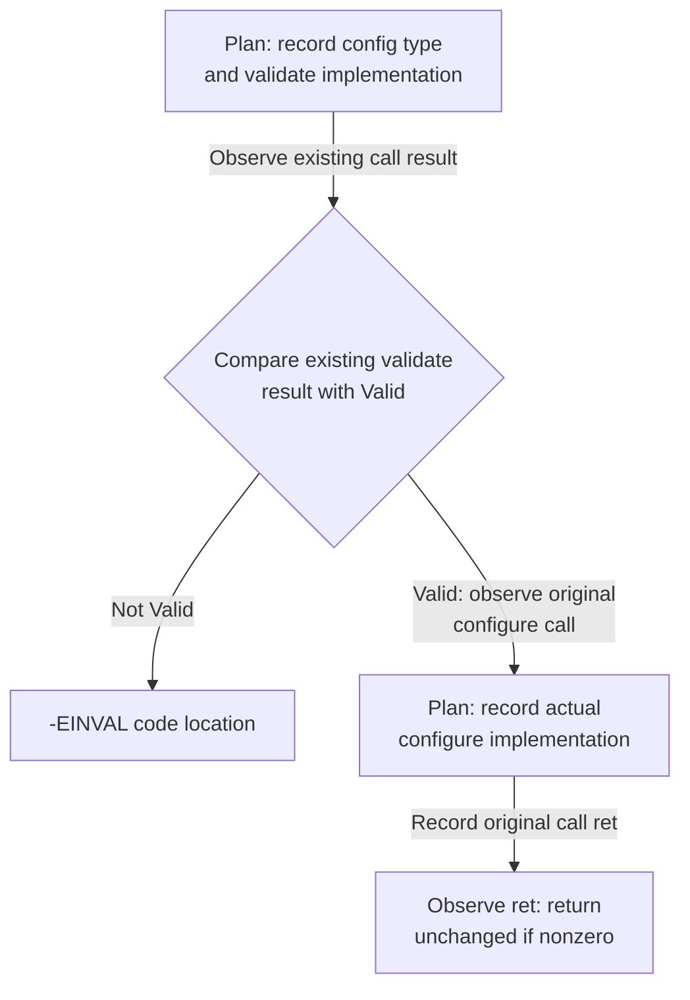
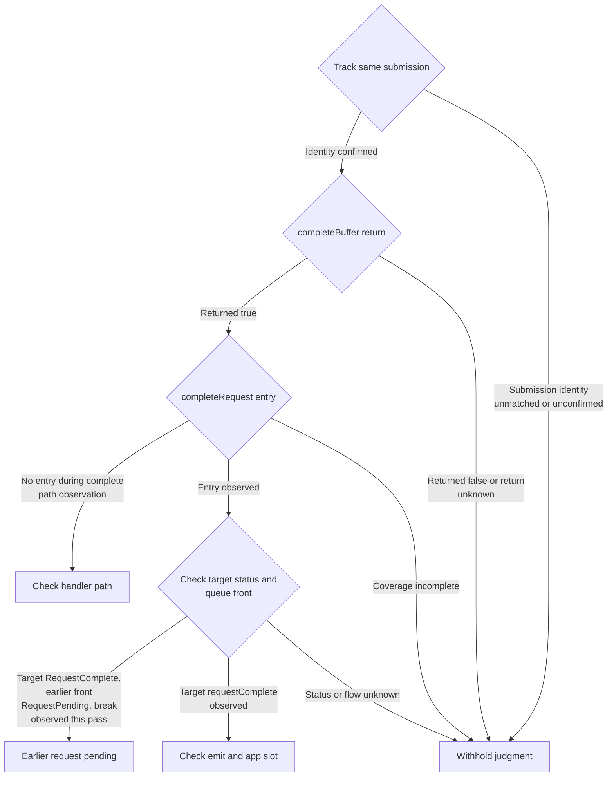
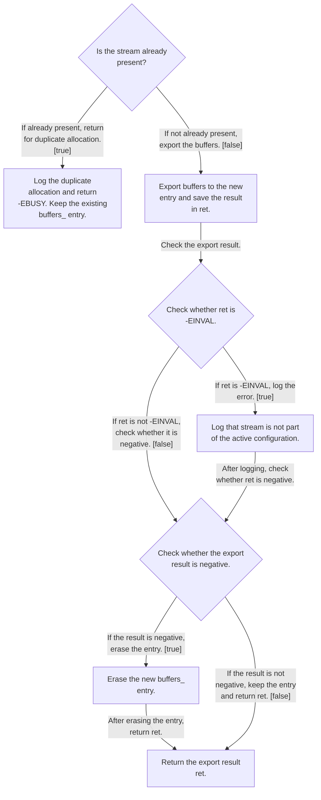
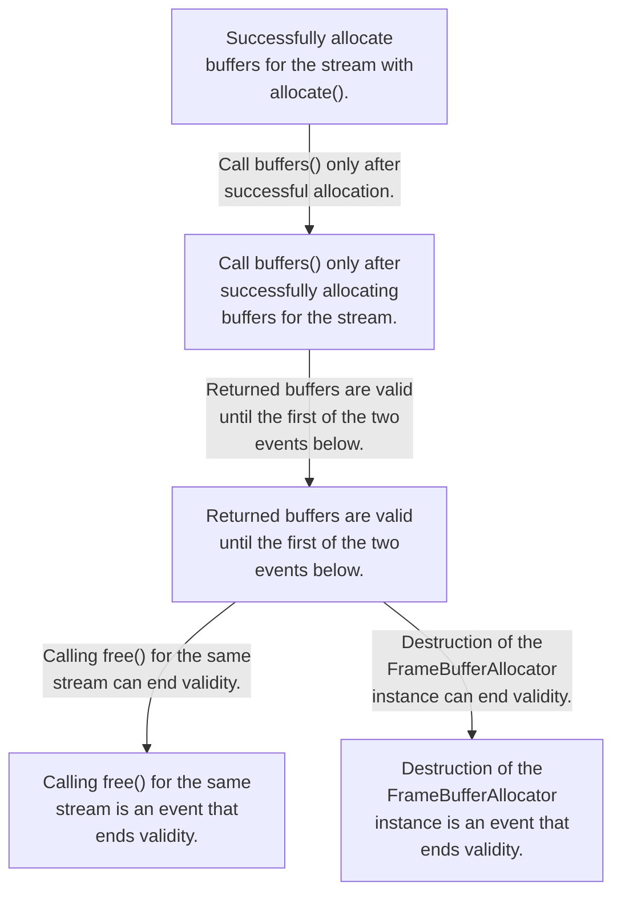

# Caveats and Troubleshooting

English translation · human review pending. Review states below refer to the Korean source.

Start at the last successful call or notification. Isolate where the result diverged during configuration, submission, completion, resource access, or module loading.

## Order for narrowing down configuration failures

When investigating, inside `Camera::configure`, observe the return value `ret` of the existing `isAccessAllowed` call that passes `Private::CameraAcquired` and `Private::CameraConfigured` as arguments. If `ret < 0`, record the failure branch where `Camera::configure` returns the same `ret`. When investigating the existing `Camera::Private::isAccessAllowed` call, first distinguish the earlier branch that returns `-ENODEV` when `allowDisconnected` is false and `disconnected_` is true. Otherwise, review the range comparison of `currentState` with `low` and `high`, and the return of `0` within the range; outside the range, check in order the code locations of `ASSERT`, the error log, and the return of `-EACCES`.

### Branch that narrows down configuration failures

[Mermaid source](https://ttolsun.github.io/libcamera-sdd/en/request-diagnosis.configure-failures.mmd)

Diagram evidence and verification scope

Distinguish input-check failures from device-implementation failures, in that order. The success path in the figure below still includes the stream connection check.

Source-linked interpretation · automatic link check only · meaning and device execution not yet verified

| Elements and transitions | Source evidence |
| --- | --- |
| State and access allowed? | [src/libcamera/camera.cpp:1163](https://ttolsun.github.io/libcamera-sdd/en/reader-archive/request-diagnosis.html#source-4e218db5e20840dc) |
| Return access error | [src/libcamera/camera.cpp:1163](https://ttolsun.github.io/libcamera-sdd/en/reader-archive/request-diagnosis.html#source-4e218db5e20840dc) |
| Does validate() return Valid? | [src/libcamera/camera.cpp:1163](https://ttolsun.github.io/libcamera-sdd/en/reader-archive/request-diagnosis.html#source-4e218db5e20840dc) |
| Return -EINVAL | [src/libcamera/camera.cpp:1163](https://ttolsun.github.io/libcamera-sdd/en/reader-archive/request-diagnosis.html#source-4e218db5e20840dc) |
| PipelineHandler::configure() | [src/libcamera/camera.cpp:1163](https://ttolsun.github.io/libcamera-sdd/en/reader-archive/request-diagnosis.html#source-4e218db5e20840dc) |
| Is ret nonzero? | [src/libcamera/camera.cpp:1191](https://ttolsun.github.io/libcamera-sdd/en/reader-archive/request-diagnosis.html#source-846c5a830281fa6a) |
| Return nonzero ret unchanged | [src/libcamera/camera.cpp:1191](https://ttolsun.github.io/libcamera-sdd/en/reader-archive/request-diagnosis.html#source-846c5a830281fa6a) |
| Next: check stream associations | [src/libcamera/camera.cpp:1191](https://ttolsun.github.io/libcamera-sdd/en/reader-archive/request-diagnosis.html#source-846c5a830281fa6a) |
| No | [src/libcamera/camera.cpp:1163](https://ttolsun.github.io/libcamera-sdd/en/reader-archive/request-diagnosis.html#source-4e218db5e20840dc) |
| Yes: validate input | [src/libcamera/camera.cpp:1163](https://ttolsun.github.io/libcamera-sdd/en/reader-archive/request-diagnosis.html#source-4e218db5e20840dc) |
| No: Adjusted is also rejected | [src/libcamera/camera.cpp:1163](https://ttolsun.github.io/libcamera-sdd/en/reader-archive/request-diagnosis.html#source-4e218db5e20840dc) |
| Yes: configure device | [src/libcamera/camera.cpp:1163](https://ttolsun.github.io/libcamera-sdd/en/reader-archive/request-diagnosis.html#source-4e218db5e20840dc) |
| Check return value | [src/libcamera/camera.cpp:1163](https://ttolsun.github.io/libcamera-sdd/en/reader-archive/request-diagnosis.html#source-4e218db5e20840dc) |
| Yes | [src/libcamera/camera.cpp:1191](https://ttolsun.github.io/libcamera-sdd/en/reader-archive/request-diagnosis.html#source-846c5a830281fa6a) |
| No: zero | [src/libcamera/camera.cpp:1191](https://ttolsun.github.io/libcamera-sdd/en/reader-archive/request-diagnosis.html#source-846c5a830281fa6a) |

### Branch that checks stream connection after configuration succeeds

[Mermaid source](https://ttolsun.github.io/libcamera-sdd/en/request-diagnosis.configuration-stream-link.mmd)

Diagram evidence and verification scope

Which code locations are observed for the state check and validation, and for the case where cfg.stream() is null after PipelineHandler::configure succeeds?

Source-linked interpretation · automatic link check only · meaning and device execution not yet verified

| Elements and transitions | Source evidence |
| --- | --- |
| After checks and configure succeed | [src/libcamera/camera.cpp:1163](https://ttolsun.github.io/libcamera-sdd/en/reader-archive/request-diagnosis.html#source-4e218db5e20840dc) |
| Observe each cfg.stream() | [src/libcamera/camera.cpp:1163](https://ttolsun.github.io/libcamera-sdd/en/reader-archive/request-diagnosis.html#source-4e218db5e20840dc) |
| Is stream null? | [src/libcamera/camera.cpp:1163](https://ttolsun.github.io/libcamera-sdd/en/reader-archive/request-diagnosis.html#source-4e218db5e20840dc) |
| Code locations: Fatal and subsequent clear/-EINVAL (execution not asserted) | [src/libcamera/camera.cpp:1163](https://ttolsun.github.io/libcamera-sdd/en/reader-archive/request-diagnosis.html#source-4e218db5e20840dc) |
| Assign configuration\_ and insert active stream | [src/libcamera/camera.cpp:1163](https://ttolsun.github.io/libcamera-sdd/en/reader-archive/request-diagnosis.html#source-4e218db5e20840dc) |
| After remaining streams: Configured and 0 | [src/libcamera/camera.cpp:1163](https://ttolsun.github.io/libcamera-sdd/en/reader-archive/request-diagnosis.html#source-4e218db5e20840dc) |
| Each entry | [src/libcamera/camera.cpp:1163](https://ttolsun.github.io/libcamera-sdd/en/reader-archive/request-diagnosis.html#source-4e218db5e20840dc) |
| Check original result | [src/libcamera/camera.cpp:1163](https://ttolsun.github.io/libcamera-sdd/en/reader-archive/request-diagnosis.html#source-4e218db5e20840dc) |
| Yes: failure code locations | [src/libcamera/camera.cpp:1163](https://ttolsun.github.io/libcamera-sdd/en/reader-archive/request-diagnosis.html#source-4e218db5e20840dc) |
| No | [src/libcamera/camera.cpp:1163](https://ttolsun.github.io/libcamera-sdd/en/reader-archive/request-diagnosis.html#source-4e218db5e20840dc) |
| After loop | [src/libcamera/camera.cpp:1163](https://ttolsun.github.io/libcamera-sdd/en/reader-archive/request-diagnosis.html#source-4e218db5e20840dc) |

### Branch to observe in the configuration access check

[Mermaid source](https://ttolsun.github.io/libcamera-sdd/en/request-diagnosis.configuration-access-branches.mmd)

Diagram evidence and verification scope

Checks disconnection first, then checks the state scope. Code after assertions and logs is not definitively described as actual execution results.

Source-linked interpretation · automatic link check only · meaning and device execution not yet verified

| Elements and transitions | Source evidence |
| --- | --- |
| Disconnection disallowed and disconnected\_? | [src/libcamera/camera.cpp:709](https://ttolsun.github.io/libcamera-sdd/en/reader-archive/request-diagnosis.html#source-1e64f4ece8808997) |
| Return -ENODEV | [src/libcamera/camera.cpp:709](https://ttolsun.github.io/libcamera-sdd/en/reader-archive/request-diagnosis.html#source-1e64f4ece8808997) |
| low ≤ currentState ≤ high? | [src/libcamera/camera.cpp:709](https://ttolsun.github.io/libcamera-sdd/en/reader-archive/request-diagnosis.html#source-1e64f4ece8808997) |
| Return 0 | [src/libcamera/camera.cpp:709](https://ttolsun.github.io/libcamera-sdd/en/reader-archive/request-diagnosis.html#source-1e64f4ece8808997) |
| ASSERT, log and -EACCES code locations | [src/libcamera/camera.cpp:709](https://ttolsun.github.io/libcamera-sdd/en/reader-archive/request-diagnosis.html#source-1e64f4ece8808997) |
| Yes | [src/libcamera/camera.cpp:709](https://ttolsun.github.io/libcamera-sdd/en/reader-archive/request-diagnosis.html#source-1e64f4ece8808997) |
| No | [src/libcamera/camera.cpp:709](https://ttolsun.github.io/libcamera-sdd/en/reader-archive/request-diagnosis.html#source-1e64f4ece8808997) |
| Yes | [src/libcamera/camera.cpp:709](https://ttolsun.github.io/libcamera-sdd/en/reader-archive/request-diagnosis.html#source-1e64f4ece8808997) |
| No: observe following code | [src/libcamera/camera.cpp:709](https://ttolsun.github.io/libcamera-sdd/en/reader-archive/request-diagnosis.html#source-1e64f4ece8808997) |

### Investigation plan for checking the actual implementation of configuration calls

[Mermaid source](https://ttolsun.github.io/libcamera-sdd/en/request-diagnosis.configuration-implementation-observation.mmd)

Diagram evidence and verification scope

This is a plan to observe the type, implementation, and return value of an existing call that has passed the state check. It does not call validation or configuration again.

Source-linked interpretation · automatic link check only · meaning and device execution not yet verified

| Elements and transitions | Source evidence |
| --- | --- |
| Plan: record config type and validate implementation | [src/libcamera/camera.cpp:1191](https://ttolsun.github.io/libcamera-sdd/en/reader-archive/request-diagnosis.html#source-846c5a830281fa6a) |
| Compare existing validate result with Valid | [src/libcamera/camera.cpp:1191](https://ttolsun.github.io/libcamera-sdd/en/reader-archive/request-diagnosis.html#source-846c5a830281fa6a) |
| -EINVAL code location | [src/libcamera/camera.cpp:1203](https://ttolsun.github.io/libcamera-sdd/en/reader-archive/request-diagnosis.html#source-fcc2510602fe412b) |
| Plan: record actual configure implementation | [src/libcamera/camera.cpp:1191](https://ttolsun.github.io/libcamera-sdd/en/reader-archive/request-diagnosis.html#source-846c5a830281fa6a) |
| Observe ret: return unchanged if nonzero | [src/libcamera/camera.cpp:1191](https://ttolsun.github.io/libcamera-sdd/en/reader-archive/request-diagnosis.html#source-846c5a830281fa6a) |
| Observe existing call result | [src/libcamera/camera.cpp:1191](https://ttolsun.github.io/libcamera-sdd/en/reader-archive/request-diagnosis.html#source-846c5a830281fa6a) |
| Not Valid | [src/libcamera/camera.cpp:1203](https://ttolsun.github.io/libcamera-sdd/en/reader-archive/request-diagnosis.html#source-fcc2510602fe412b) |
| Valid: observe original configure call | [src/libcamera/camera.cpp:1191](https://ttolsun.github.io/libcamera-sdd/en/reader-archive/request-diagnosis.html#source-846c5a830281fa6a) |
| Record original call ret | [src/libcamera/camera.cpp:1191](https://ttolsun.github.io/libcamera-sdd/en/reader-archive/request-diagnosis.html#source-846c5a830281fa6a) |

`Adjusted` from `CameraConfiguration::validate()` means the configuration has been adjusted so that it is valid; parameters may have changed for any stream, or stream configurations may have been removed. A caller that receives `Adjusted` must check the configuration carefully.

Execution verification item: The investigation plan may compare the result of `config->validate()` in `Camera::configure` with `CameraConfiguration::Valid` and also record whether the function returns `-EINVAL` when the results differ.

This is an investigation plan to record, in the existing call stack, the actual dynamic type of `config` and the `validate` implementation that is executed. If the state check and validation pass, it plans to observe the concrete implementation and return value of `PipelineHandler::configure`, which is invoked through `pipe_`'s `invokeMethod`; if the return value is nonzero, it plans to record the branch in which `Camera::configure` returns that value unchanged.

When investigating, in `Camera::configure()`, after passing the access check and configuration validation, and when the return value of `PipelineHandler::configure` is 0, observe the result `stream` of each `cfg.stream()` and the null check result. If `stream` is null, check the Fatal log `Pipeline handler failed to update stream configuration` and the `-EINVAL` return path after `activeStreams_.clear()`.

Section-wide evidence: 10

- `src/libcamera/camera.cpp`[`L1195` excerpt](https://ttolsun.github.io/libcamera-sdd/en/reader-archive/request-diagnosis.html#source-2da795dd561f56ec) · [Full source `L1195`](https://github.com/TTolsun/libcamera-sdd/blob/adfa719f8ed67d18fd8a0739fc088a1f8b9e7252/src/libcamera/camera.cpp#L1195) · [`L716` excerpt](https://ttolsun.github.io/libcamera-sdd/en/reader-archive/request-diagnosis.html#source-9328b9e82bc716a1) · [Full source `L716`](https://github.com/TTolsun/libcamera-sdd/blob/adfa719f8ed67d18fd8a0739fc088a1f8b9e7252/src/libcamera/camera.cpp#L716) · [`L709` excerpt](https://ttolsun.github.io/libcamera-sdd/en/reader-archive/request-diagnosis.html#source-1e64f4ece8808997) · [Full source `L709`](https://github.com/TTolsun/libcamera-sdd/blob/adfa719f8ed67d18fd8a0739fc088a1f8b9e7252/src/libcamera/camera.cpp#L709) · [`L323` excerpt](https://ttolsun.github.io/libcamera-sdd/en/reader-archive/request-diagnosis.html#source-cb5242e98ac1e72c) · [Full source `L323`](https://github.com/TTolsun/libcamera-sdd/blob/adfa719f8ed67d18fd8a0739fc088a1f8b9e7252/src/libcamera/camera.cpp#L323) · [`L343` excerpt](https://ttolsun.github.io/libcamera-sdd/en/reader-archive/request-diagnosis.html#source-e5758fc43bf244cd) · [Full source `L343`](https://github.com/TTolsun/libcamera-sdd/blob/adfa719f8ed67d18fd8a0739fc088a1f8b9e7252/src/libcamera/camera.cpp#L343) · [`L1203` excerpt](https://ttolsun.github.io/libcamera-sdd/en/reader-archive/request-diagnosis.html#source-fcc2510602fe412b) · [Full source `L1203`](https://github.com/TTolsun/libcamera-sdd/blob/adfa719f8ed67d18fd8a0739fc088a1f8b9e7252/src/libcamera/camera.cpp#L1203) · [`L1191` excerpt](https://ttolsun.github.io/libcamera-sdd/en/reader-archive/request-diagnosis.html#source-846c5a830281fa6a) · [Full source `L1191`](https://github.com/TTolsun/libcamera-sdd/blob/adfa719f8ed67d18fd8a0739fc088a1f8b9e7252/src/libcamera/camera.cpp#L1191) · [`L1225` excerpt](https://ttolsun.github.io/libcamera-sdd/en/reader-archive/request-diagnosis.html#source-fa2c87e2c2f4e322) · [Full source `L1225`](https://github.com/TTolsun/libcamera-sdd/blob/adfa719f8ed67d18fd8a0739fc088a1f8b9e7252/src/libcamera/camera.cpp#L1225) · [`L1163`](https://ttolsun.github.io/libcamera-sdd/en/reader-archive/request-diagnosis.html#source-4e218db5e20840dc) · [`L342`](https://ttolsun.github.io/libcamera-sdd/en/reader-archive/request-diagnosis.html#source-e13fede0aa40ada1)

## Request Submission Failures and Missing Completion Notifications

See also: [Checking readiness waits and timeouts](https://ttolsun.github.io/libcamera-sdd/en/reader-archive/pipeline-requests.html#%EC%9A%94%EC%B2%AD-%EC%A4%80%EB%B9%84%EC%99%80-%EC%9E%A5%EC%B9%98-%ED%81%90) · [Distinguishing request acceptance from completion notification](https://ttolsun.github.io/libcamera-sdd/en/reader-archive/request-lifecycle.html#%EC%A0%9C%EC%B6%9C%EC%97%90%EC%84%9C-%EC%99%84%EB%A3%8C%EA%B9%8C%EC%A7%80) · [Observation plan for app callback connections and threads](https://ttolsun.github.io/libcamera-sdd/en/request-flow.html#stop-and-disconnect)

**Leave a note before the interruption.**

Copy the template below, fill in the blanks, and compare it with the original notes when you resume.

- Enter the reported symptoms and conditions: \_\_\_\_.
- Enter the directly observed values and where they were checked: \_\_\_\_.
- Enter your interpretation of the document and any provisional assumptions: \_\_\_\_.
- Write down what you have not yet verified: \_\_\_\_.
- Enter the next check and the branches based on its result: \_\_\_\_.
- Enter the URL and section location of the supporting document: \_\_\_\_.

Leave unobserved values as unconfirmed, and do not call state-changing functions again to observe them.

When you resume, compare the reports, observations, and interpretations with the original notes to check that they have not been mixed together.

The first investigation item records the return value and calling file of the original `queueRequest` call, distinguishing a return value of 0 as normal acceptance from a negative value as a submission error. Normal acceptance is recorded separately from capture completion.

### When the last buffer has completed but no request completion notification arrives

These are source-based investigation examples. Track each submission using the camera, a run separated by stop/start, a new per-submission generation, and Request\*. Also record Request::sequence() after doQueueRequest assigns sequence\_. The sequence resets between runs and wraps on overflow. Request::reuse() can resubmit the same object, so neither cookie nor address alone identifies a submission. Example A: the last completeBuffer for target submission 42 returned true. If continuous observation covered the handler's intended completion path, including delayed branches, with no dropped records, yet no completeRequest entry was observed, inspect the callback branches and conditions for any deferred metadata or completion work. Do not assume a particular handler requires such work. Do not infer the completeBuffer return value from bufferCompleted.emit alone. Example B: target submission 42 entered completeRequest and became RequestComplete after complete(), but earlier submission 41 at queuedRequests\_.front() is RequestPending. The observed break keeps the target queued in this pass; it does not mean the target stays queued forever. Trace submission 41's pending buffers and completion path, recheck subsequent queue heads, and observe the target's Camera::requestComplete call. Then separately confirm the actual requestCompleted.emit and entry into the application slot. If the target is already at the front, check its status and the queue-processing flow. Distinguish RequestCancelled separately. Withhold judgment if submission identity or the required observation coverage is incomplete. Do not re-invoke state-mutating functions to observe them. [`pipeline_handler.cpp:491`](https://github.com/TTolsun/libcamera-sdd/blob/adfa719f8ed67d18fd8a0739fc088a1f8b9e7252/src/libcamera/pipeline_handler.cpp#L491) · [`pipeline_handler.cpp:401`](https://github.com/TTolsun/libcamera-sdd/blob/adfa719f8ed67d18fd8a0739fc088a1f8b9e7252/src/libcamera/pipeline_handler.cpp#L401) · [`request.cpp:385`](https://github.com/TTolsun/libcamera-sdd/blob/adfa719f8ed67d18fd8a0739fc088a1f8b9e7252/src/libcamera/request.cpp#L385) · [`pipeline_handler.cpp:567`](https://github.com/TTolsun/libcamera-sdd/blob/adfa719f8ed67d18fd8a0739fc088a1f8b9e7252/src/libcamera/pipeline_handler.cpp#L567) · [`pipeline_handler.cpp:566`](https://github.com/TTolsun/libcamera-sdd/blob/adfa719f8ed67d18fd8a0739fc088a1f8b9e7252/src/libcamera/pipeline_handler.cpp#L566) · [`pipeline_handler.cpp:584`](https://github.com/TTolsun/libcamera-sdd/blob/adfa719f8ed67d18fd8a0739fc088a1f8b9e7252/src/libcamera/pipeline_handler.cpp#L584) · [`pipeline_handler.cpp:556`](https://github.com/TTolsun/libcamera-sdd/blob/adfa719f8ed67d18fd8a0739fc088a1f8b9e7252/src/libcamera/pipeline_handler.cpp#L556) · [`pipeline_handler.cpp:588`](https://github.com/TTolsun/libcamera-sdd/blob/adfa719f8ed67d18fd8a0739fc088a1f8b9e7252/src/libcamera/pipeline_handler.cpp#L588) · [`request.cpp:132`](https://github.com/TTolsun/libcamera-sdd/blob/adfa719f8ed67d18fd8a0739fc088a1f8b9e7252/src/libcamera/request.cpp#L132) · [`pipeline_handler.cpp:593`](https://github.com/TTolsun/libcamera-sdd/blob/adfa719f8ed67d18fd8a0739fc088a1f8b9e7252/src/libcamera/pipeline_handler.cpp#L593) · [`pipeline_handler.cpp:594`](https://github.com/TTolsun/libcamera-sdd/blob/adfa719f8ed67d18fd8a0739fc088a1f8b9e7252/src/libcamera/pipeline_handler.cpp#L594) · [`pipeline_handler.cpp:599`](https://github.com/TTolsun/libcamera-sdd/blob/adfa719f8ed67d18fd8a0739fc088a1f8b9e7252/src/libcamera/pipeline_handler.cpp#L599) · [`camera.cpp:1488`](https://github.com/TTolsun/libcamera-sdd/blob/adfa719f8ed67d18fd8a0739fc088a1f8b9e7252/src/libcamera/camera.cpp#L1488) · [`bound_method.cpp:40`](https://github.com/TTolsun/libcamera-sdd/blob/adfa719f8ed67d18fd8a0739fc088a1f8b9e7252/src/libcamera/base/bound_method.cpp#L40)

| Current check | Observation | Next check |
| --- | --- | --- |
| Track same submission | Identity confirmed | completeBuffer return [`pipeline_handler.cpp:491`](https://github.com/TTolsun/libcamera-sdd/blob/adfa719f8ed67d18fd8a0739fc088a1f8b9e7252/src/libcamera/pipeline_handler.cpp#L491) · [`pipeline_handler.cpp:567`](https://github.com/TTolsun/libcamera-sdd/blob/adfa719f8ed67d18fd8a0739fc088a1f8b9e7252/src/libcamera/pipeline_handler.cpp#L567) · [`pipeline_handler.cpp:566`](https://github.com/TTolsun/libcamera-sdd/blob/adfa719f8ed67d18fd8a0739fc088a1f8b9e7252/src/libcamera/pipeline_handler.cpp#L566) |
| Track same submission | Submission identity unmatched or unconfirmed | Withhold judgment [`pipeline_handler.cpp:491`](https://github.com/TTolsun/libcamera-sdd/blob/adfa719f8ed67d18fd8a0739fc088a1f8b9e7252/src/libcamera/pipeline_handler.cpp#L491) · [`pipeline_handler.cpp:584`](https://github.com/TTolsun/libcamera-sdd/blob/adfa719f8ed67d18fd8a0739fc088a1f8b9e7252/src/libcamera/pipeline_handler.cpp#L584) · [`pipeline_handler.cpp:593`](https://github.com/TTolsun/libcamera-sdd/blob/adfa719f8ed67d18fd8a0739fc088a1f8b9e7252/src/libcamera/pipeline_handler.cpp#L593) |
| completeBuffer return | Returned true | completeRequest entry [`pipeline_handler.cpp:567`](https://github.com/TTolsun/libcamera-sdd/blob/adfa719f8ed67d18fd8a0739fc088a1f8b9e7252/src/libcamera/pipeline_handler.cpp#L567) · [`pipeline_handler.cpp:556`](https://github.com/TTolsun/libcamera-sdd/blob/adfa719f8ed67d18fd8a0739fc088a1f8b9e7252/src/libcamera/pipeline_handler.cpp#L556) · [`pipeline_handler.cpp:584`](https://github.com/TTolsun/libcamera-sdd/blob/adfa719f8ed67d18fd8a0739fc088a1f8b9e7252/src/libcamera/pipeline_handler.cpp#L584) |
| completeBuffer return | Returned false or return unknown | Withhold judgment [`pipeline_handler.cpp:567`](https://github.com/TTolsun/libcamera-sdd/blob/adfa719f8ed67d18fd8a0739fc088a1f8b9e7252/src/libcamera/pipeline_handler.cpp#L567) · [`pipeline_handler.cpp:584`](https://github.com/TTolsun/libcamera-sdd/blob/adfa719f8ed67d18fd8a0739fc088a1f8b9e7252/src/libcamera/pipeline_handler.cpp#L584) · [`pipeline_handler.cpp:593`](https://github.com/TTolsun/libcamera-sdd/blob/adfa719f8ed67d18fd8a0739fc088a1f8b9e7252/src/libcamera/pipeline_handler.cpp#L593) |
| completeRequest entry | No entry during complete path observation | Check handler path [`pipeline_handler.cpp:584`](https://github.com/TTolsun/libcamera-sdd/blob/adfa719f8ed67d18fd8a0739fc088a1f8b9e7252/src/libcamera/pipeline_handler.cpp#L584) · [`pipeline_handler.cpp:556`](https://github.com/TTolsun/libcamera-sdd/blob/adfa719f8ed67d18fd8a0739fc088a1f8b9e7252/src/libcamera/pipeline_handler.cpp#L556) |
| completeRequest entry | Entry observed | Check target status and queue front [`pipeline_handler.cpp:584`](https://github.com/TTolsun/libcamera-sdd/blob/adfa719f8ed67d18fd8a0739fc088a1f8b9e7252/src/libcamera/pipeline_handler.cpp#L584) · [`pipeline_handler.cpp:588`](https://github.com/TTolsun/libcamera-sdd/blob/adfa719f8ed67d18fd8a0739fc088a1f8b9e7252/src/libcamera/pipeline_handler.cpp#L588) · [`pipeline_handler.cpp:593`](https://github.com/TTolsun/libcamera-sdd/blob/adfa719f8ed67d18fd8a0739fc088a1f8b9e7252/src/libcamera/pipeline_handler.cpp#L593) |
| completeRequest entry | Coverage incomplete | Withhold judgment [`pipeline_handler.cpp:584`](https://github.com/TTolsun/libcamera-sdd/blob/adfa719f8ed67d18fd8a0739fc088a1f8b9e7252/src/libcamera/pipeline_handler.cpp#L584) · [`pipeline_handler.cpp:593`](https://github.com/TTolsun/libcamera-sdd/blob/adfa719f8ed67d18fd8a0739fc088a1f8b9e7252/src/libcamera/pipeline_handler.cpp#L593) |
| Check target status and queue front | Target RequestComplete, earlier front RequestPending, break observed this pass | Earlier request pending [`pipeline_handler.cpp:593`](https://github.com/TTolsun/libcamera-sdd/blob/adfa719f8ed67d18fd8a0739fc088a1f8b9e7252/src/libcamera/pipeline_handler.cpp#L593) · [`pipeline_handler.cpp:594`](https://github.com/TTolsun/libcamera-sdd/blob/adfa719f8ed67d18fd8a0739fc088a1f8b9e7252/src/libcamera/pipeline_handler.cpp#L594) |
| Check target status and queue front | Target requestComplete observed | Check emit and app slot [`pipeline_handler.cpp:599`](https://github.com/TTolsun/libcamera-sdd/blob/adfa719f8ed67d18fd8a0739fc088a1f8b9e7252/src/libcamera/pipeline_handler.cpp#L599) |
| Check target status and queue front | Status or flow unknown | Withhold judgment [`pipeline_handler.cpp:593`](https://github.com/TTolsun/libcamera-sdd/blob/adfa719f8ed67d18fd8a0739fc088a1f8b9e7252/src/libcamera/pipeline_handler.cpp#L593) · [`pipeline_handler.cpp:594`](https://github.com/TTolsun/libcamera-sdd/blob/adfa719f8ed67d18fd8a0739fc088a1f8b9e7252/src/libcamera/pipeline_handler.cpp#L594) · [`pipeline_handler.cpp:584`](https://github.com/TTolsun/libcamera-sdd/blob/adfa719f8ed67d18fd8a0739fc088a1f8b9e7252/src/libcamera/pipeline_handler.cpp#L584) |

[Mermaid source](https://ttolsun.github.io/libcamera-sdd/en/request-diagnosis.completion-notice-diagnosis.mmd)

Diagram evidence and verification scope

Where did it stop after the last buffer completed?

Source-linked interpretation · automatic link check only · meaning and device execution not yet verified

| Elements and transitions | Source evidence |
| --- | --- |
| Track same submission | [src/libcamera/pipeline_handler.cpp:428](https://ttolsun.github.io/libcamera-sdd/en/reader-archive/request-diagnosis.html#source-789eafedfaa7f3c5) |
| completeBuffer return | [src/libcamera/pipeline_handler.cpp:547](https://ttolsun.github.io/libcamera-sdd/en/reader-archive/request-diagnosis.html#source-01ad7c6605c3296a) |
| completeRequest entry | [src/libcamera/pipeline_handler.cpp:547](https://ttolsun.github.io/libcamera-sdd/en/reader-archive/request-diagnosis.html#source-01ad7c6605c3296a) |
| Check handler path | [src/libcamera/pipeline_handler.cpp:547](https://ttolsun.github.io/libcamera-sdd/en/reader-archive/request-diagnosis.html#source-01ad7c6605c3296a) |
| Check target status and queue front | [src/libcamera/pipeline_handler.cpp:547](https://ttolsun.github.io/libcamera-sdd/en/reader-archive/request-diagnosis.html#source-01ad7c6605c3296a) |
| Earlier request pending | [src/libcamera/pipeline_handler.cpp:547](https://ttolsun.github.io/libcamera-sdd/en/reader-archive/request-diagnosis.html#source-01ad7c6605c3296a) |
| Check emit and app slot | [src/libcamera/pipeline_handler.cpp:547](https://ttolsun.github.io/libcamera-sdd/en/reader-archive/request-diagnosis.html#source-01ad7c6605c3296a) |
| Withhold judgment | [src/libcamera/pipeline_handler.cpp:547](https://ttolsun.github.io/libcamera-sdd/en/reader-archive/request-diagnosis.html#source-01ad7c6605c3296a) |
| Identity confirmed | [src/libcamera/pipeline_handler.cpp:428](https://ttolsun.github.io/libcamera-sdd/en/reader-archive/request-diagnosis.html#source-789eafedfaa7f3c5) |
| Submission identity unmatched or unconfirmed | [src/libcamera/pipeline_handler.cpp:428](https://ttolsun.github.io/libcamera-sdd/en/reader-archive/request-diagnosis.html#source-789eafedfaa7f3c5) |
| Returned true | [src/libcamera/pipeline_handler.cpp:547](https://ttolsun.github.io/libcamera-sdd/en/reader-archive/request-diagnosis.html#source-01ad7c6605c3296a) |
| Returned false or return unknown | [src/libcamera/pipeline_handler.cpp:547](https://ttolsun.github.io/libcamera-sdd/en/reader-archive/request-diagnosis.html#source-01ad7c6605c3296a) |
| No entry during complete path observation | [src/libcamera/pipeline_handler.cpp:547](https://ttolsun.github.io/libcamera-sdd/en/reader-archive/request-diagnosis.html#source-01ad7c6605c3296a) |
| Entry observed | [src/libcamera/pipeline_handler.cpp:547](https://ttolsun.github.io/libcamera-sdd/en/reader-archive/request-diagnosis.html#source-01ad7c6605c3296a) |
| Coverage incomplete | [src/libcamera/pipeline_handler.cpp:547](https://ttolsun.github.io/libcamera-sdd/en/reader-archive/request-diagnosis.html#source-01ad7c6605c3296a) |
| Target RequestComplete, earlier front RequestPending, break observed this pass | [src/libcamera/pipeline_handler.cpp:547](https://ttolsun.github.io/libcamera-sdd/en/reader-archive/request-diagnosis.html#source-01ad7c6605c3296a) |
| Target requestComplete observed | [src/libcamera/pipeline_handler.cpp:547](https://ttolsun.github.io/libcamera-sdd/en/reader-archive/request-diagnosis.html#source-01ad7c6605c3296a) |
| Status or flow unknown | [src/libcamera/pipeline_handler.cpp:547](https://ttolsun.github.io/libcamera-sdd/en/reader-archive/request-diagnosis.html#source-01ad7c6605c3296a) |

## Distinguishing duplicate allocation from export failure

If `inserted` from `try_emplace` is false, `FrameBufferAllocator::allocate` logs an error stating that the buffers have already been allocated and returns `-EBUSY`. `FrameBufferAllocator::allocate()` stores the return value of `exportFrameBuffers()` in `ret` and, if `ret` is negative, removes the corresponding `buffers_` entry using `buffers_.erase(it)`. When `FrameBufferAllocator::allocate` calls `exportFrameBuffers`, it returns the resulting `ret` regardless of whether the value is negative.

### Relationships and boundaries in distinguishing duplicate allocation from export failure

[Mermaid source](https://ttolsun.github.io/libcamera-sdd/en/framebuffer-allocator.item-allocation-failure.mmd)

Diagram evidence and verification scope

How do duplicate allocation and export failure differ in processing flow, return values, and handling of buffers\_ entries?

Source-linked interpretation · automatic link check only · meaning and device execution not yet verified

LLM diagram draft · before human review

Authoring model: `cli/codex/gpt-6.1-terra`

| Elements and transitions | Source evidence |
| --- | --- |
| Is the stream already present? | [src/libcamera/framebuffer_allocator.cpp:86](https://ttolsun.github.io/libcamera-sdd/en/reader-archive/framebuffer-allocator.html#source-78a6c2f7dbdebb0f) |
| Log the duplicate allocation and return -EBUSY. Keep the existing buffers\_ entry. | [src/libcamera/framebuffer_allocator.cpp:86](https://ttolsun.github.io/libcamera-sdd/en/reader-archive/framebuffer-allocator.html#source-78a6c2f7dbdebb0f) |
| Export buffers to the new entry and save the result in ret. | [src/libcamera/framebuffer_allocator.cpp:86](https://ttolsun.github.io/libcamera-sdd/en/reader-archive/framebuffer-allocator.html#source-78a6c2f7dbdebb0f) |
| Check whether ret is -EINVAL. | [src/libcamera/framebuffer_allocator.cpp:86](https://ttolsun.github.io/libcamera-sdd/en/reader-archive/framebuffer-allocator.html#source-78a6c2f7dbdebb0f) |
| Log that stream is not part of the active configuration. | [src/libcamera/framebuffer_allocator.cpp:86](https://ttolsun.github.io/libcamera-sdd/en/reader-archive/framebuffer-allocator.html#source-78a6c2f7dbdebb0f) |
| Check whether the export result is negative. | [src/libcamera/framebuffer_allocator.cpp:86](https://ttolsun.github.io/libcamera-sdd/en/reader-archive/framebuffer-allocator.html#source-78a6c2f7dbdebb0f) |
| Erase the new buffers\_ entry. | [src/libcamera/framebuffer_allocator.cpp:86](https://ttolsun.github.io/libcamera-sdd/en/reader-archive/framebuffer-allocator.html#source-78a6c2f7dbdebb0f) |
| Return the export result ret. | [src/libcamera/framebuffer_allocator.cpp:86](https://ttolsun.github.io/libcamera-sdd/en/reader-archive/framebuffer-allocator.html#source-78a6c2f7dbdebb0f) |
| If already present, return for duplicate allocation. · !inserted \[true\] | [src/libcamera/framebuffer_allocator.cpp:86](https://ttolsun.github.io/libcamera-sdd/en/reader-archive/framebuffer-allocator.html#source-78a6c2f7dbdebb0f) |
| If not already present, export the buffers. · !inserted \[false\] | [src/libcamera/framebuffer_allocator.cpp:86](https://ttolsun.github.io/libcamera-sdd/en/reader-archive/framebuffer-allocator.html#source-78a6c2f7dbdebb0f) |
| Check the export result. | [src/libcamera/framebuffer_allocator.cpp:86](https://ttolsun.github.io/libcamera-sdd/en/reader-archive/framebuffer-allocator.html#source-78a6c2f7dbdebb0f) |
| If ret is -EINVAL, log the error. · ret == -EINVAL \[true\] | [src/libcamera/framebuffer_allocator.cpp:86](https://ttolsun.github.io/libcamera-sdd/en/reader-archive/framebuffer-allocator.html#source-78a6c2f7dbdebb0f) |
| If ret is not -EINVAL, check whether it is negative. · ret == -EINVAL \[false\] | [src/libcamera/framebuffer_allocator.cpp:86](https://ttolsun.github.io/libcamera-sdd/en/reader-archive/framebuffer-allocator.html#source-78a6c2f7dbdebb0f) |
| After logging, check whether ret is negative. | [src/libcamera/framebuffer_allocator.cpp:86](https://ttolsun.github.io/libcamera-sdd/en/reader-archive/framebuffer-allocator.html#source-78a6c2f7dbdebb0f) |
| If the result is negative, erase the entry. · ret \< 0 \[true\] | [src/libcamera/framebuffer_allocator.cpp:86](https://ttolsun.github.io/libcamera-sdd/en/reader-archive/framebuffer-allocator.html#source-78a6c2f7dbdebb0f) |
| After erasing the entry, return ret. | [src/libcamera/framebuffer_allocator.cpp:86](https://ttolsun.github.io/libcamera-sdd/en/reader-archive/framebuffer-allocator.html#source-78a6c2f7dbdebb0f) |
| If the result is not negative, keep the entry and return ret. · ret \< 0 \[false\] | [src/libcamera/framebuffer_allocator.cpp:86](https://ttolsun.github.io/libcamera-sdd/en/reader-archive/framebuffer-allocator.html#source-78a6c2f7dbdebb0f) |

Section-wide evidence: 2

- `src/libcamera/framebuffer_allocator.cpp`[`L86` excerpt](https://ttolsun.github.io/libcamera-sdd/en/reader-archive/framebuffer-allocator.html#source-78a6c2f7dbdebb0f) · [Full source `L86`](https://github.com/TTolsun/libcamera-sdd/blob/adfa719f8ed67d18fd8a0739fc088a1f8b9e7252/src/libcamera/framebuffer_allocator.cpp#L86) · [`L95` excerpt](https://ttolsun.github.io/libcamera-sdd/en/reader-archive/framebuffer-allocator.html#source-c091763d679ea029) · [Full source `L95`](https://github.com/TTolsun/libcamera-sdd/blob/adfa719f8ed67d18fd8a0739fc088a1f8b9e7252/src/libcamera/framebuffer_allocator.cpp#L95)

## Validity period of the reference returned by buffers

`buffers()` must be called only after buffers have been successfully allocated for the stream with `allocate()`. The buffers returned by `buffers()` remain valid until `free()` is called for the same stream or the `FrameBufferAllocator` instance is destroyed.

### Relationship and boundaries of the lifetime of the reference returned by buffers

[Mermaid source](https://ttolsun.github.io/libcamera-sdd/en/framebuffer-allocator.item-reference-lifetime.mmd)

Diagram evidence and verification scope

When can buffers() be called, and what event ends the lifetime of the returned buffers?

Source-linked interpretation · automatic link check only · meaning and device execution not yet verified

LLM diagram draft · before human review

Authoring model: `cli/codex/gpt-6.1-terra`

| Elements and transitions | Source evidence |
| --- | --- |
| Successfully allocate buffers for the stream with allocate(). | [src/libcamera/framebuffer_allocator.cpp:141](https://ttolsun.github.io/libcamera-sdd/en/reader-archive/framebuffer-allocator.html#source-68023250094ce1a8) |
| Call buffers() only after successfully allocating buffers for the stream. | [src/libcamera/framebuffer_allocator.cpp:141](https://ttolsun.github.io/libcamera-sdd/en/reader-archive/framebuffer-allocator.html#source-68023250094ce1a8) |
| Returned buffers are valid until the first of the two events below. | [src/libcamera/framebuffer_allocator.cpp:142](https://ttolsun.github.io/libcamera-sdd/en/reader-archive/framebuffer-allocator.html#source-d60c5ad57e6699de) |
| Calling free() for the same stream is an event that ends validity. | [src/libcamera/framebuffer_allocator.cpp:142](https://ttolsun.github.io/libcamera-sdd/en/reader-archive/framebuffer-allocator.html#source-d60c5ad57e6699de) |
| Destruction of the FrameBufferAllocator instance is an event that ends validity. | [src/libcamera/framebuffer_allocator.cpp:142](https://ttolsun.github.io/libcamera-sdd/en/reader-archive/framebuffer-allocator.html#source-d60c5ad57e6699de) |
| Call buffers() only after successful allocation. | [src/libcamera/framebuffer_allocator.cpp:141](https://ttolsun.github.io/libcamera-sdd/en/reader-archive/framebuffer-allocator.html#source-68023250094ce1a8) |
| Returned buffers are valid until the first of the two events below. | [src/libcamera/framebuffer_allocator.cpp:142](https://ttolsun.github.io/libcamera-sdd/en/reader-archive/framebuffer-allocator.html#source-d60c5ad57e6699de) |
| Calling free() for the same stream can end validity. | [src/libcamera/framebuffer_allocator.cpp:142](https://ttolsun.github.io/libcamera-sdd/en/reader-archive/framebuffer-allocator.html#source-d60c5ad57e6699de) |
| Destruction of the FrameBufferAllocator instance can end validity. | [src/libcamera/framebuffer_allocator.cpp:142](https://ttolsun.github.io/libcamera-sdd/en/reader-archive/framebuffer-allocator.html#source-d60c5ad57e6699de) |

Section-wide evidence: 2

- `src/libcamera/framebuffer_allocator.cpp`[`L141` excerpt](https://ttolsun.github.io/libcamera-sdd/en/reader-archive/framebuffer-allocator.html#source-68023250094ce1a8) · [Full source `L141`](https://github.com/TTolsun/libcamera-sdd/blob/adfa719f8ed67d18fd8a0739fc088a1f8b9e7252/src/libcamera/framebuffer_allocator.cpp#L141) · [`L142` excerpt](https://ttolsun.github.io/libcamera-sdd/en/reader-archive/framebuffer-allocator.html#source-d60c5ad57e6699de) · [Full source `L142`](https://github.com/TTolsun/libcamera-sdd/blob/adfa719f8ed67d18fd8a0739fc088a1f8b9e7252/src/libcamera/framebuffer_allocator.cpp#L142)

## Distinguishing metadata errors

If the size of ipaModuleInfo is smaller than sizeof(`info_`), or if moduleAPIVersion does not match `IPA_MODULE_API_VERSION`, loadIPAModuleInfo() returns -EINVAL.

Section-wide evidence: 1

- `src/libcamera/ipa_module.cpp`[`L268` excerpt](https://ttolsun.github.io/libcamera-sdd/en/reader-archive/ipa-module-validation.html#source-c87048bf1f3594a3) · [Full source `L268`](https://github.com/TTolsun/libcamera-sdd/blob/adfa719f8ed67d18fd8a0739fc088a1f8b9e7252/src/libcamera/ipa_module.cpp#L268)

## When the signature file cannot be opened

If the signature file cannot be opened, `loadIPAModuleInfo` returns 0.

Section-wide evidence: 1

- `src/libcamera/ipa_module.cpp`[`L316` excerpt](https://ttolsun.github.io/libcamera-sdd/en/reader-archive/ipa-module-validation.html#source-c7597f31f03901e3) · [Full source `L316`](https://github.com/TTolsun/libcamera-sdd/blob/adfa719f8ed67d18fd8a0739fc088a1f8b9e7252/src/libcamera/ipa_module.cpp#L316)

## Source manuscripts and review records

Investigation of configuration and request errors

- **Generation method**: Extracted facts and LLM explanation
- **Validation scope**: Tables and figures are created from facts, and the explanations are written by the LLM. Citation, sentence, and configured structure checks are applied.
- **Automated check**: Passed (`ok`). The items checked are listed in the verification scope. Whether the explanation content is correct is checked by a human reviewer.
- **Human review**: Before human review
- **Analysis baseline commit**: `adfa719f8ed67d18fd8a0739fc088a1f8b9e7252`
- **Document generation time**: `2026-11-11 17:00:45+00:00`
- **Sentence generation model**: `cli/codex/gpt-6.1-terra`
- **Contracts between documents**: [Automated comparison report](https://ttolsun.github.io/libcamera-sdd/contract-consistency.json) · Before human review

Record from when the manuscript was written

This is a record saved in the manuscript as of that time. It may differ from the current document's standards.

- Evidence files: `include/libcamera/camera.h`, `include/libcamera/internal/pipeline_handler.h`, `include/libcamera/request.h`, `src/libcamera/camera.cpp`, `src/libcamera/pipeline_handler.cpp`, `src/libcamera/request.cpp`
- Evidence level: code verified (static analysis, simple_compdb configuration, commit `be7e83e913`)
- Automated check (citation, sentence, and configured structure checks): passed
- Review status recorded: 2026-11-12 · Before human review

[Markdown source ↗](https://ttolsun.github.io/libcamera-sdd/request-diagnosis.md)

[Open earlier detail](https://ttolsun.github.io/libcamera-sdd/en/reader-archive/request-diagnosis.html#page-evidence)

FrameBufferAllocator Failures and Reference Lifetime

- **Generation method**: Extracted facts and LLM explanation
- **Validation scope**: Tables and figures are created from facts, and the explanations are written by the LLM. Citation, sentence, and configured structure checks are applied.
- **Automated check**: Passed (`ok`). The items checked are listed in the verification scope. Whether the explanation content is correct is checked by a human reviewer.
- **Human review**: Before human review
- **Analysis baseline commit**: `adfa719f8ed67d18fd8a0739fc088a1f8b9e7252`
- **Document generation time**: `2026-11-20 18:07:38+00:00`
- **Sentence generation model**: `cli/codex/gpt-6.1-terra`
- **Contracts between documents**: [Automated comparison report](https://ttolsun.github.io/libcamera-sdd/contract-consistency.json) · Before human review

Record from when the manuscript was written

This is a record saved in the manuscript as of that time. It may differ from the current document's standards.

- Evidence file: `src/libcamera/framebuffer_allocator.cpp`
- Evidence level: code verified (static analysis, simple_compdb configuration, commit `adfa719f8e`)
- Automated check (citation, sentence, and configured structure checks): passed
- Review status recorded on: 2026-11-21 · Awaiting human review

[Markdown source ↗](https://ttolsun.github.io/libcamera-sdd/framebuffer-allocator.md)

[Open earlier detail](https://ttolsun.github.io/libcamera-sdd/en/reader-archive/framebuffer-allocator.html#page-evidence)

IPA module information check and missing signature file

- **Generation method**: Extracted facts and LLM explanation
- **Validation scope**: Tables and figures are created from facts, and the explanations are written by the LLM. Citation, sentence, and configured structure checks are applied.
- **Automated check**: Passed (`ok`). The items checked are listed in the verification scope. Whether the explanation content is correct is checked by a human reviewer.
- **Human review**: Before human review
- **Analysis baseline commit**: `adfa719f8ed67d18fd8a0739fc088a1f8b9e7252`
- **Document generation time**: `2026-10-29 20:32:19+00:00`
- **Sentence generation model**: `cli/codex/gpt-6.1-terra`
- **Contracts between documents**: [Automated comparison report](https://ttolsun.github.io/libcamera-sdd/contract-consistency.json) · Before human review

Record from when the manuscript was written

This is a record saved in the manuscript as of that time. It may differ from the current document's standards.

- Evidence file: `src/libcamera/ipa_module.cpp`
- Evidence level: code verified (static analysis, simple_compdb configuration, commit `212c689fcf`)
- Automated check (citation, sentence, and configured structure checks): passed
- Review status record date: 2026-10-30 · Before human review

[Markdown source ↗](https://ttolsun.github.io/libcamera-sdd/ipa-module-validation.md)

[Open earlier detail](https://ttolsun.github.io/libcamera-sdd/en/reader-archive/ipa-module-validation.html#page-evidence)

[Download page Markdown](https://ttolsun.github.io/libcamera-sdd/en/troubleshooting.md) · [Reader edition source map](https://ttolsun.github.io/libcamera-sdd/reader-edition.json)
