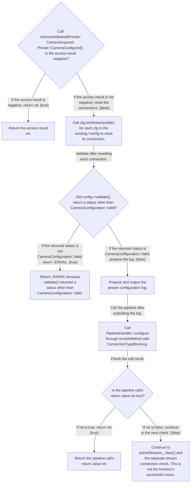
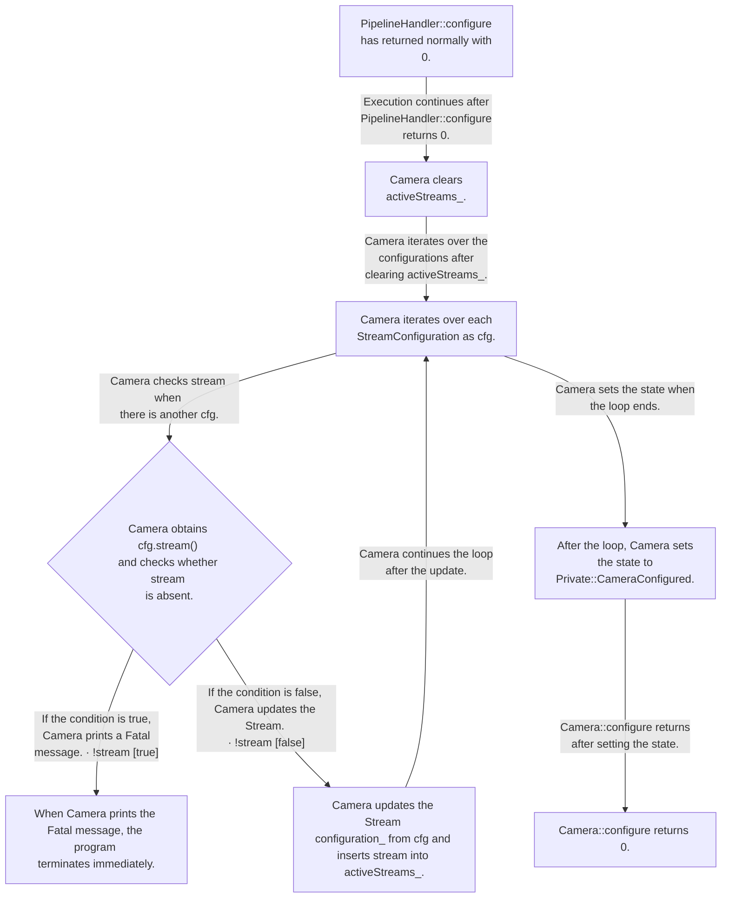
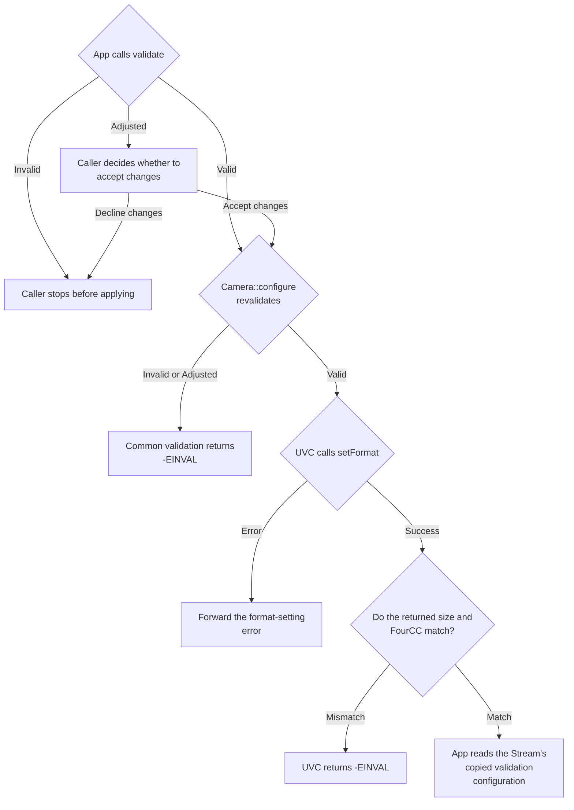
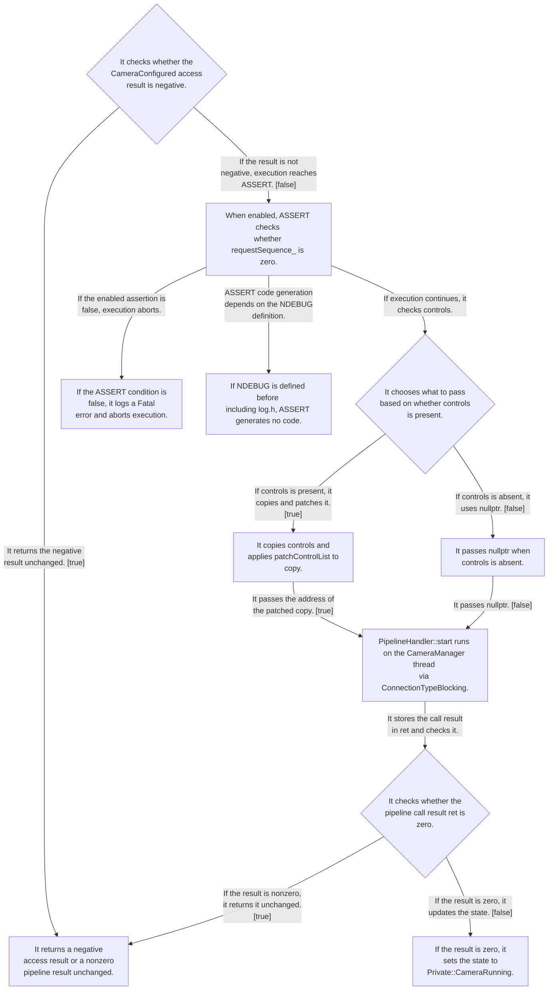

# ForDeveloper

List cameras in an environment where cam is available. If a camera is detected, save frames from the first one. Then open the code entry points for discovery, configuration, and startup.

- Code that checks cancellation status
- Caveats and Troubleshooting

## Try running it directly

Use `cam -l` to list the cameras detected on the system, and use `cam -c 1 --capture=10 --file` to capture 10 frames from the first camera and save them to disk. If problems occur, you can obtain detailed libcamera debug logs with `LIBCAMERA_LOG_LEVELS=*:DEBUG cam -l`.

Section-wide evidence: 1

- `README.rst``L107` excerpt · [Full source `L107`](https://github.com/TTolsun/libcamera-sdd/blob/adfa719f8ed67d18fd8a0739fc088a1f8b9e7252/README.rst#L107)

## When to start discovery and use the camera

When you call `CameraManager::start()`, the camera manager starts up and enumerates every device on the system. Once you’ve confirmed the manager is running, you can list the available cameras. You can use each camera until it’s disconnected or the manager stops.

Section-wide evidence: 1

- `src/libcamera/camera_manager.cpp``L329` excerpt · [Full source `L329`](https://github.com/TTolsun/libcamera-sdd/blob/adfa719f8ed67d18fd8a0739fc088a1f8b9e7252/src/libcamera/camera_manager.cpp#L329)

## Where to check configuration application and success status

`Camera::configure()` returns the negative error value if the access state check produces one; if the check passes, it clears each `StreamConfiguration`'s previous stream association to `nullptr`, checks `validate()`, and returns `-EINVAL` if the result is not `Valid`. For a valid configuration, `Camera::configure()` calls `PipelineHandler::configure` with `ConnectionTypeBlocking` and returns its return value unchanged if that value is nonzero. The API contract states that when the function returns, each `StreamConfiguration` in `config` is associated with a `Stream` instance, which can be retrieved with `stream()`.

### Checks before configuration is applied and pipeline results

Mermaid source

Diagram evidence and verification scope

In what order does Camera::configure perform the access check, stream connection initialization, validation, and pipeline return-value check?

Source-linked interpretation · automatic link check only · meaning and device execution not yet verified

LLM diagram draft · before human review

Authoring model: `cli/codex/gpt-6.1-terra`

| Elements and transitions | Source evidence |
| --- | --- |
| Call isAccessAllowed(Private::CameraAcquired, Private::CameraConfigured). Is the access result negative? | src/libcamera/camera.cpp:1191 |
| Return the access result ret. | src/libcamera/camera.cpp:1191 |
| Call cfg.setStream(nullptr) for each cfg in the existing \*config to reset its connection. | src/libcamera/camera.cpp:1191 |
| Did config-\>validate() return a status other than CameraConfiguration::Valid? | src/libcamera/camera.cpp:1191 |
| Return -EINVAL because validate() returned a status other than CameraConfiguration::Valid. | src/libcamera/camera.cpp:1191 |
| Prepare and output the stream configuration log. | src/libcamera/camera.cpp:1191 |
| Call PipelineHandler::configure through invokeMethod with ConnectionTypeBlocking. | src/libcamera/camera.cpp:1191 |
| Is the pipeline call's return value ret true? | src/libcamera/camera.cpp:1191 |
| Return the pipeline call's return value ret. | src/libcamera/camera.cpp:1191 |
| Continue to activeStreams\_.clear() and the separate stream connection check. This is not the function's successful return. | src/libcamera/camera.cpp:1191 |
| If the access result is negative, return ret. · ret \< 0 \[true\] | src/libcamera/camera.cpp:1191 |
| If the access result is not negative, reset the connections. · ret \< 0 \[false\] | src/libcamera/camera.cpp:1191 |
| Validate after resetting each connection. | src/libcamera/camera.cpp:1191 |
| If the returned status is not CameraConfiguration::Valid, return -EINVAL. · config-\>validate() != CameraConfiguration::Valid \[true\] | src/libcamera/camera.cpp:1191 |
| If the returned status is CameraConfiguration::Valid, prepare the log. · config-\>validate() != CameraConfiguration::Valid \[false\] | src/libcamera/camera.cpp:1191 |
| Call the pipeline after outputting the log. | src/libcamera/camera.cpp:1191 |
| Check the call result. | src/libcamera/camera.cpp:1191 |
| If ret is true, return ret. · ret \[true\] | src/libcamera/camera.cpp:1191 |
| If ret is false, continue to the next check. · ret \[false\] | src/libcamera/camera.cpp:1191 |

### One-time initialization of the stream list and success status

Mermaid source

Diagram evidence and verification scope

After successful pipeline configuration, how do activeStreams\_ initialization, updates to each StreamConfiguration, and the success state follow?

Source-linked interpretation · automatic link check only · meaning and device execution not yet verified

LLM diagram draft · before human review

Authoring model: `cli/codex/gpt-6.1-terra`

| Elements and transitions | Source evidence |
| --- | --- |
| PipelineHandler::configure has returned normally with 0. | src/libcamera/camera.cpp:1191 |
| Camera clears activeStreams\_. | src/libcamera/camera.cpp:1191 |
| Camera iterates over each StreamConfiguration as cfg. | src/libcamera/camera.cpp:1191 |
| Camera obtains cfg.stream() and checks whether stream is absent. | src/libcamera/camera.cpp:1191 |
| When Camera prints the Fatal message, the program terminates immediately. | src/libcamera/camera.cpp:1191 · src/libcamera/base/log.cpp:1022 |
| Camera updates the Stream configuration\_ from cfg and inserts stream into activeStreams\_. | src/libcamera/camera.cpp:1191 |
| After the loop, Camera sets the state to Private::CameraConfigured. | src/libcamera/camera.cpp:1191 |
| Camera::configure returns 0. | src/libcamera/camera.cpp:1191 |
| Execution continues after PipelineHandler::configure returns 0. | src/libcamera/camera.cpp:1191 |
| Camera iterates over the configurations after clearing activeStreams\_. | src/libcamera/camera.cpp:1191 |
| Camera checks stream when there is another cfg. | src/libcamera/camera.cpp:1191 |
| If the condition is true, Camera prints a Fatal message. · !stream \[true\] | src/libcamera/camera.cpp:1191 |
| If the condition is false, Camera updates the Stream. · !stream \[false\] | src/libcamera/camera.cpp:1191 |
| Camera continues the loop after the update. | src/libcamera/camera.cpp:1191 |
| Camera sets the state when the loop ends. | src/libcamera/camera.cpp:1191 |
| Camera::configure returns after setting the state. | src/libcamera/camera.cpp:1191 |

When the pipeline call succeeds, `Camera::configure()` clears `activeStreams_` and checks `cfg.stream()` for each configuration. If a stream is missing, execution enters the `Fatal` log path, and under the `LOG` contract, execution is aborted and the program terminates immediately after the message is printed. If every configuration has a stream, `Camera::configure()` updates each stream's `configuration_` to the corresponding configuration and adds the stream to `activeStreams_`. Camera::configure() then sets the state to `CameraConfigured` and returns `0`.

Section-wide evidence: 3

- `src/libcamera/camera.cpp`[`L1191`](https://github.com/TTolsun/libcamera-sdd/blob/adfa719f8ed67d18fd8a0739fc088a1f8b9e7252/src/libcamera/camera.cpp#L1191) · `L1183` excerpt · [Full source `L1183`](https://github.com/TTolsun/libcamera-sdd/blob/adfa719f8ed67d18fd8a0739fc088a1f8b9e7252/src/libcamera/camera.cpp#L1183) · `L1191`
- `src/libcamera/base/log.cpp``L1022` excerpt · [Full source `L1022`](https://github.com/TTolsun/libcamera-sdd/blob/adfa719f8ed67d18fd8a0739fc088a1f8b9e7252/src/libcamera/base/log.cpp#L1022)

## Where can the requested 640×480 viewfinder configuration change?

The example app requests one `Viewfinder` stream and sets its size to 640×480. The app must validate the modified configuration with `validate()` before applying it to the camera; unsupported values are adjusted to the nearest supported values. The example code ignores the return value and prints the configuration using `toString()`, but the caller must check the status. If it is `Adjusted`, the caller must inspect the entire configuration to determine whether to accept it, checking whether any streams were removed and whether parameters such as the size and pixel format of the remaining streams changed. `Invalid` means the configuration cannot be adjusted to a valid state, while `Valid` means it was already valid and was not adjusted.

### Validating the UVC Viewfinder Configuration and Applying It to the Device

The official guide example calls validate and prints the configuration. The accept and decline branches show decisions for the caller. UVC stores stride, frameSize, and colorSpace from tryFormat in the configuration. After setFormat succeeds, it compares only the size and FourCC. [`application-developer.rst:228`](https://github.com/TTolsun/libcamera-sdd/blob/adfa719f8ed67d18fd8a0739fc088a1f8b9e7252/Documentation/guides/application-developer.rst#L228) · [`camera.cpp:343`](https://github.com/TTolsun/libcamera-sdd/blob/adfa719f8ed67d18fd8a0739fc088a1f8b9e7252/src/libcamera/camera.cpp#L343) · [`uvcvideo.cpp:220`](https://github.com/TTolsun/libcamera-sdd/blob/adfa719f8ed67d18fd8a0739fc088a1f8b9e7252/src/libcamera/pipeline/uvcvideo/uvcvideo.cpp#L220) · [`uvcvideo.cpp:224`](https://github.com/TTolsun/libcamera-sdd/blob/adfa719f8ed67d18fd8a0739fc088a1f8b9e7252/src/libcamera/pipeline/uvcvideo/uvcvideo.cpp#L224) · [`uvcvideo.cpp:275`](https://github.com/TTolsun/libcamera-sdd/blob/adfa719f8ed67d18fd8a0739fc088a1f8b9e7252/src/libcamera/pipeline/uvcvideo/uvcvideo.cpp#L275)

Mermaid source

Diagram evidence and verification scope

Where are the values checked again, and where is an error returned?

Source-linked interpretation · automatic link check only · meaning and device execution not yet verified

| Elements and transitions | Source evidence |
| --- | --- |
| App calls validate | Documentation/guides/application-developer.rst:222 |
| Caller decides whether to accept changes | src/libcamera/camera.cpp:323 |
| Caller stops before applying | src/libcamera/pipeline/uvcvideo/uvcvideo.cpp:139 · src/libcamera/camera.cpp:323 |
| Camera::configure revalidates | src/libcamera/camera.cpp:1191 |
| Common validation returns -EINVAL | src/libcamera/camera.cpp:1191 |
| UVC calls setFormat | src/libcamera/pipeline/uvcvideo/uvcvideo.cpp:261 · src/libcamera/v4l2_videodevice.cpp:849 |
| Forward the format-setting error | src/libcamera/pipeline/uvcvideo/uvcvideo.cpp:261 |
| Do the returned size and FourCC match? | src/libcamera/pipeline/uvcvideo/uvcvideo.cpp:261 |
| UVC returns -EINVAL | src/libcamera/pipeline/uvcvideo/uvcvideo.cpp:261 |
| App reads the Stream's copied validation configuration | src/libcamera/pipeline/uvcvideo/uvcvideo.cpp:261 · src/libcamera/camera.cpp:1191 · src/libcamera/stream.cpp:483 |
| Adjusted | src/libcamera/camera.cpp:323 |
| Invalid | src/libcamera/pipeline/uvcvideo/uvcvideo.cpp:139 |
| Valid | src/libcamera/camera.cpp:1191 |
| Accept changes | src/libcamera/camera.cpp:323 · src/libcamera/camera.cpp:1191 |
| Decline changes | src/libcamera/camera.cpp:323 |
| Valid | src/libcamera/camera.cpp:1191 · src/libcamera/pipeline/uvcvideo/uvcvideo.cpp:261 |
| Invalid or Adjusted | src/libcamera/camera.cpp:1191 |
| Error | src/libcamera/pipeline/uvcvideo/uvcvideo.cpp:261 |
| Success | src/libcamera/pipeline/uvcvideo/uvcvideo.cpp:261 |
| Mismatch | src/libcamera/pipeline/uvcvideo/uvcvideo.cpp:261 |
| Match | src/libcamera/pipeline/uvcvideo/uvcvideo.cpp:261 · src/libcamera/camera.cpp:1191 |

`Camera::configure` returns a negative error from the access check, and after clearing the stream associations, it returns `-EINVAL` if revalidation does not return `Valid`. `UVCCameraConfiguration::validate` replaces an unsupported pixel format with the first value in the list, starts with the first size in the selected format's size list, and updates the size until it encounters a value larger than the requested size. It then tests the configuration with `tryFormat` and returns `Invalid` if the test fails. `PipelineHandlerUVC::configure` applies the format and size to the device using `setFormat` and returns the error unchanged if the call fails. If the call succeeds but the returned size or `FourCC` differs from the configuration that passed revalidation, it returns `-EINVAL`. The comparison uses the configuration that passed revalidation even when the originally requested size was 640×480.

If `tryFormat` succeeds, `UVCCameraConfiguration::validate()` writes the first plane's `bpl` and `size` to `cfg.stride` and `cfg.frameSize`, respectively. If `colorSpace` differs, it replaces it with the returned value and marks the configuration as `Adjusted`. After `setFormat` succeeds, `PipelineHandlerUVC::configure()` compares only the size and FourCC; it neither compares `stride`, `frameSize`, and `colorSpace` with the result nor overwrites them. When UVC associates a stream with `cfg`, `Camera::configure()` copies the validated `cfg` to the active stream. After success, `Stream::configuration()` returns this active configuration. The actual values for a particular device cannot be determined from this source alone.

Section-wide evidence: 10

- `Documentation/guides/application-developer.rst``L167` excerpt · [Full source `L167`](https://github.com/TTolsun/libcamera-sdd/blob/adfa719f8ed67d18fd8a0739fc088a1f8b9e7252/Documentation/guides/application-developer.rst#L167) · `L195` excerpt · [Full source `L195`](https://github.com/TTolsun/libcamera-sdd/blob/adfa719f8ed67d18fd8a0739fc088a1f8b9e7252/Documentation/guides/application-developer.rst#L195) · `L222` excerpt · [Full source `L222`](https://github.com/TTolsun/libcamera-sdd/blob/adfa719f8ed67d18fd8a0739fc088a1f8b9e7252/Documentation/guides/application-developer.rst#L222)
- `src/libcamera/camera.cpp``L323` excerpt · [Full source `L323`](https://github.com/TTolsun/libcamera-sdd/blob/adfa719f8ed67d18fd8a0739fc088a1f8b9e7252/src/libcamera/camera.cpp#L323) · `L1191` excerpt · [Full source `L1191`](https://github.com/TTolsun/libcamera-sdd/blob/adfa719f8ed67d18fd8a0739fc088a1f8b9e7252/src/libcamera/camera.cpp#L1191)
- `src/libcamera/pipeline/uvcvideo/uvcvideo.cpp``L139` excerpt · [Full source `L139`](https://github.com/TTolsun/libcamera-sdd/blob/adfa719f8ed67d18fd8a0739fc088a1f8b9e7252/src/libcamera/pipeline/uvcvideo/uvcvideo.cpp#L139) · `L261` excerpt · [Full source `L261`](https://github.com/TTolsun/libcamera-sdd/blob/adfa719f8ed67d18fd8a0739fc088a1f8b9e7252/src/libcamera/pipeline/uvcvideo/uvcvideo.cpp#L261) · `L237`
- `src/libcamera/v4l2_videodevice.cpp``L849` excerpt · [Full source `L849`](https://github.com/TTolsun/libcamera-sdd/blob/adfa719f8ed67d18fd8a0739fc088a1f8b9e7252/src/libcamera/v4l2_videodevice.cpp#L849)
- `src/libcamera/stream.cpp``L483` excerpt · [Full source `L483`](https://github.com/TTolsun/libcamera-sdd/blob/adfa719f8ed67d18fd8a0739fc088a1f8b9e7252/src/libcamera/stream.cpp#L483)

## Reflecting start control values and pipeline results

If `controls` is present, `Camera::start` makes a copy of `ControlList`, preprocesses it with `patchControlList`, and passes the copy; otherwise, it passes `nullptr`. In both branches, it calls `PipelineHandler::start` with `ConnectionTypeBlocking`, and that function is called from the `CameraManager` thread. If the call result `ret` is nonzero, `Camera::start` returns `ret` unchanged without setting the `CameraRunning` state; if `ret` is zero, it sets the `CameraRunning` state and returns 0.

### The relationship and boundaries between startup control values and the application of pipeline results

Mermaid source

Diagram evidence and verification scope

How do ASSERT, control-value branches, blocking pipeline calls, and return-value branches lead to returning the original error or updating CameraRunning?

Source-linked interpretation · automatic link check only · meaning and device execution not yet verified

LLM diagram draft · before human review

Authoring model: `cli/codex/gpt-6.1-terra`

| Elements and transitions | Source evidence |
| --- | --- |
| It checks whether the CameraConfigured access result is negative. | src/libcamera/camera.cpp:1400 |
| It returns a negative access result or a nonzero pipeline result unchanged. | src/libcamera/camera.cpp:1400 |
| When enabled, ASSERT checks whether requestSequence\_ is zero. | src/libcamera/camera.cpp:1400 · src/libcamera/base/log.cpp:1022 |
| If the ASSERT condition is false, it logs a Fatal error and aborts execution. | src/libcamera/base/log.cpp:1022 |
| If NDEBUG is defined before including log.h, ASSERT generates no code. | src/libcamera/base/log.cpp:1022 |
| It chooses what to pass based on whether controls is present. | src/libcamera/camera.cpp:1400 |
| It copies controls and applies patchControlList to copy. | src/libcamera/camera.cpp:1400 |
| It passes nullptr when controls is absent. | src/libcamera/camera.cpp:1400 |
| PipelineHandler::start runs on the CameraManager thread via ConnectionTypeBlocking. | src/libcamera/camera.cpp:1400 · src/libcamera/pipeline_handler.cpp:343 |
| It checks whether the pipeline call result ret is zero. | src/libcamera/camera.cpp:1400 |
| If the result is zero, it sets the state to Private::CameraRunning. | src/libcamera/camera.cpp:1400 |
| It returns the negative result unchanged. · ret \< 0 \[true\] | src/libcamera/camera.cpp:1400 |
| If the result is not negative, execution reaches ASSERT. · ret \< 0 \[false\] | src/libcamera/camera.cpp:1400 |
| If the enabled assertion is false, execution aborts. | src/libcamera/base/log.cpp:1022 |
| ASSERT code generation depends on the NDEBUG definition. | src/libcamera/base/log.cpp:1022 |
| If execution continues, it checks controls. | src/libcamera/camera.cpp:1400 · src/libcamera/base/log.cpp:1022 |
| If controls is present, it copies and patches it. · controls \[true\] | src/libcamera/camera.cpp:1400 |
| If controls is absent, it uses nullptr. · controls \[false\] | src/libcamera/camera.cpp:1400 |
| It passes the address of the patched copy. · controls \[true\] | src/libcamera/camera.cpp:1400 |
| It passes nullptr. · controls \[false\] | src/libcamera/camera.cpp:1400 |
| It stores the call result in ret and checks it. | src/libcamera/camera.cpp:1400 |
| If the result is nonzero, it returns it unchanged. · ret \[true\] | src/libcamera/camera.cpp:1400 |
| If the result is zero, it updates the state. · ret \[false\] | src/libcamera/camera.cpp:1400 |

`Camera::start` executes `ASSERT(d->requestSequence_ == 0)` before calling `PipelineHandler::start`. If this check fails, `ASSERT` logs an error message at the `Fatal` log level and aborts program execution, behaving differently from a normal error return. If `NDEBUG` is defined before `log.h` is included, `ASSERT` generates no code.

Section-wide evidence: 3

- `src/libcamera/camera.cpp``L1400` excerpt · [Full source `L1400`](https://github.com/TTolsun/libcamera-sdd/blob/adfa719f8ed67d18fd8a0739fc088a1f8b9e7252/src/libcamera/camera.cpp#L1400)
- `src/libcamera/pipeline_handler.cpp``L343` excerpt · [Full source `L343`](https://github.com/TTolsun/libcamera-sdd/blob/adfa719f8ed67d18fd8a0739fc088a1f8b9e7252/src/libcamera/pipeline_handler.cpp#L343)
- `src/libcamera/base/log.cpp``L1022` excerpt · [Full source `L1022`](https://github.com/TTolsun/libcamera-sdd/blob/adfa719f8ed67d18fd8a0739fc088a1f8b9e7252/src/libcamera/base/log.cpp#L1022)

## Code to check the cancellation state

Open the callback connected to `Camera::requestCompleted` in the app and find the branch that reads `Request::status()` and handles `RequestCancelled`. Before using the image, check that each `FrameBuffer::metadata().status` is `FrameSuccess`. Follow Status determination and code for completion notification after stopping.

In System overview, you can find CameraManager's discovery entry point and the role of each component. Before modifying callback or request-processing code, check Request submission and completion, Session state and resources, and Thread boundaries.

## Source manuscripts and review records

Run it and read the design rationale

- **Generation method**: Extracted facts and LLM explanation
- **Validation scope**: Tables and figures are created from facts, and the explanations are written by the LLM. Citation, sentence, and configured structure checks are applied.
- **Automated check**: Passed (`ok`). The items checked are listed in the verification scope. Whether the explanation content is correct is checked by a human reviewer.
- **Human review**: Before human review
- **Analysis baseline commit**: `adfa719f8ed67d18fd8a0739fc088a1f8b9e7252`
- **Document generation time**: `2026-11-04 05:02:45+00:00`
- **Sentence generation model**: `cli/codex/gpt-6.1-terra`
- **Contracts between documents**: Automated comparison report · Before human review

Record from when the manuscript was written

This is a record saved in the manuscript as of that time. It may differ from the current document's standards.

- Evidence files: `README.rst`, `include/libcamera/camera.h`, `include/libcamera/internal/pipeline_handler.h`, `include/libcamera/request.h`, `src/libcamera/camera.cpp`, `src/libcamera/pipeline_handler.cpp`, `src/libcamera/request.cpp`
- Evidence level: code verified (static analysis, simple_compdb configuration, commit `293d751a81`)
- Automated check (citation, sentence, and configured structure checks): passed
- Review status record date: 2026-11-04 · Before human review

Markdown source ↗

Open earlier detail

Camera discovery

- **Generation method**: Extracted facts and LLM explanation
- **Validation scope**: Tables and figures are created from facts, and the explanations are written by the LLM. Citation, sentence, and configured structure checks are applied.
- **Automated check**: Passed (`ok`). The items checked are listed in the verification scope. Whether the explanation content is correct is checked by a human reviewer.
- **Human review**: Before human review
- **Analysis baseline commit**: `adfa719f8ed67d18fd8a0739fc088a1f8b9e7252`
- **Document generation time**: `2026-11-04 07:00:44+00:00`
- **Sentence generation model**: `cli/codex/gpt-6.1-terra`
- **Contracts between documents**: Automated comparison report · Before human review

Record from when the manuscript was written

This is a record saved in the manuscript as of that time. It may differ from the current document's standards.

- Evidence files: `src/libcamera/base/event_dispatcher_poll.cpp`, `src/libcamera/base/log.cpp`, `src/libcamera/base/thread.cpp`, `src/libcamera/camera_manager.cpp`
- Evidence level: code verified (static analysis, simple_compdb configuration, commit `293d751a81`)
- Automated check (citation, sentence, and configured structure checks): passed
- Review status record date: 2026-11-04 · Before human review

Markdown source ↗

Open earlier detail

Stream configuration

- **Generation method**: Extracted facts and LLM explanation
- **Validation scope**: Tables and figures are created from facts, and the explanations are written by the LLM. Citation, sentence, and configured structure checks are applied.
- **Automated check**: Passed (`ok`). The items checked are listed in the verification scope. Whether the explanation content is correct is checked by a human reviewer.
- **Human review**: Before human review
- **Analysis baseline commit**: `adfa719f8ed67d18fd8a0739fc088a1f8b9e7252`
- **Document generation time**: `2026-11-20 16:39:43+00:00`
- **Sentence generation model**: `cli/codex/gpt-6.1-terra`
- **Contracts between documents**: Automated comparison report · Before human review

Record from when the manuscript was written

This is a record saved in the manuscript as of that time. It may differ from the current document's standards.

- Evidence files: `include/libcamera/geometry.h`, `include/libcamera/internal/camera.h`, `include/libcamera/pixel_format.h`, `src/libcamera/base/log.cpp`, `src/libcamera/camera.cpp`, `src/libcamera/formats.cpp`, `src/libcamera/pipeline/imx8-isi/imx8-isi.cpp`, `src/libcamera/pixel_format.cpp`, `src/libcamera/sensor/camera_sensor_legacy.cpp`, `src/libcamera/sensor/camera_sensor_raw.cpp`, `src/libcamera/stream.cpp`
- Evidence level: code verified (static analysis, simple_compdb configuration, commit `adfa719f8e`)
- Automated check (citation, sentence, and configured structure checks): passed
- Review status recorded on: 2026-11-21 · Awaiting human review

Markdown source ↗

Open earlier detail

USB UVC Viewfinder Stream Configuration

- **Generation method**: Extracted facts and LLM explanation
- **Validation scope**: Tables and figures are created from facts, and the explanations are written by the LLM. Citation, sentence, and configured structure checks are applied.
- **Automated check**: Passed (`ok`). The items checked are listed in the verification scope. Whether the explanation content is correct is checked by a human reviewer.
- **Human review**: Before human review
- **Analysis baseline commit**: `adfa719f8ed67d18fd8a0739fc088a1f8b9e7252`
- **Document generation time**: `2026-11-22 17:38:44+00:00`
- **Sentence generation model**: `cli/codex/gpt-6.1-terra`
- **Contracts between documents**: Automated comparison report · Before human review

Record from when the manuscript was written

This is a record saved in the manuscript as of that time. It may differ from the current document's standards.

- Evidence files: `Documentation/guides/application-developer.rst`, `src/libcamera/camera.cpp`, `src/libcamera/pipeline/uvcvideo/uvcvideo.cpp`, `src/libcamera/stream.cpp`, `src/libcamera/v4l2_videodevice.cpp`
- Evidence level: code verified (static analysis, simple_compdb configuration, commit `adfa719f8e`)
- Automated check (citation, sentence, and configured structure checks): passed
- Review status recorded: 2026-11-23 · Awaiting human review

Markdown source ↗

Open earlier detail

Capture start

- **Generation method**: Extracted facts and LLM explanation
- **Validation scope**: Tables and figures are created from facts, and the explanations are written by the LLM. Citation, sentence, and configured structure checks are applied.
- **Automated check**: Passed (`ok`). The items checked are listed in the verification scope. Whether the explanation content is correct is checked by a human reviewer.
- **Human review**: Before human review
- **Analysis baseline commit**: `adfa719f8ed67d18fd8a0739fc088a1f8b9e7252`
- **Document generation time**: `2026-11-04 05:03:21+00:00`
- **Sentence generation model**: `cli/codex/gpt-6.1-terra`
- **Contracts between documents**: Automated comparison report · Before human review

Record from when the manuscript was written

This is a record saved in the manuscript as of that time. It may differ from the current document's standards.

- Evidence files: `src/libcamera/base/log.cpp`, `src/libcamera/camera.cpp`, `src/libcamera/controls.cpp`, `src/libcamera/pipeline_handler.cpp`
- Evidence level: code verified (static analysis, simple_compdb configuration, commit `293d751a81`)
- Automated check (citation, sentence, and configured structure checks): passed
- Review status record date: 2026-11-04 · Before human review

Markdown source ↗

Open earlier detail

libcamera design document

- **Contracts between documents**: Automated comparison report · Before human review

Open earlier detail

Download page Markdown · Reader edition source map
