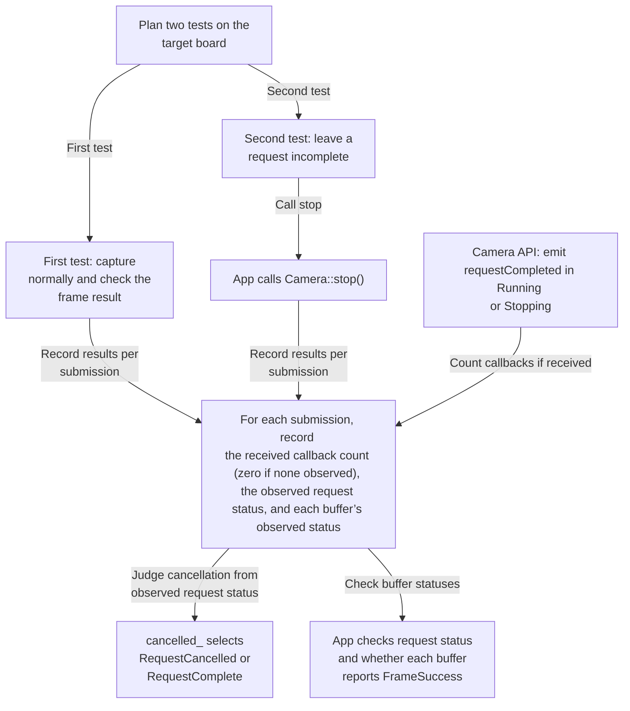
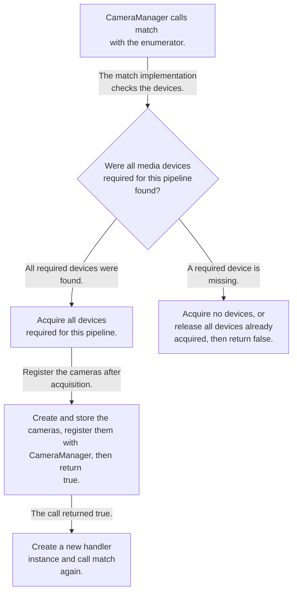

# ForVendor

Applications use the common Camera API to configure devices and capture images. A device-specific PipelineHandler implementation matches the required media devices with devices in the system and configures the hardware pipeline according to the stream configuration. To evaluate adoption, check the hardware and build conditions, then test first capture and stopping on the target board.

- Check platform and build support
- Plan first capture and stop tests

## Items to check on the device

First, test normal capture on your target device. In a separate test, stop capture while requests are still pending. For each request you submit, count its completion callbacks and record that count along with the request status and the status of each buffer. Check whether the request was canceled. Then check each frame to see whether it was captured successfully. See what completion notifications to expect after capture stops and why.

Compare Benefits of adopting a common API and Hardware and build conditions, then check the device-specific implementation responsibilities in Integration guide. Support scope and validation covers the first capture on a customer board, configuration constraints, and performance evidence.

### Test first capture and stopping on the target board

Mermaid source

Diagram evidence and verification scope

How can we check normal capture and stopping with an incomplete request on the target board?

Source-linked interpretation · automatic link check only · meaning and device execution not yet verified

| Elements and transitions | Source evidence |
| --- | --- |
| App calls Camera::stop() | src/libcamera/camera.cpp:1431 |
| cancelled\_ selects RequestCancelled or RequestComplete | src/libcamera/request.cpp:103 |
| Camera API: emit requestCompleted in Running or Stopping | src/libcamera/camera.cpp:1481 |
| App checks request status and whether each buffer reports FrameSuccess | src/libcamera/camera.cpp:1481 · src/libcamera/request.cpp:103 · src/libcamera/framebuffer.cpp:40 |
| Plan two tests on the target board | src/libcamera/camera.cpp:1431 · src/libcamera/framebuffer.cpp:40 |
| First test: capture normally and check the frame result | src/libcamera/framebuffer.cpp:40 · src/libcamera/camera.cpp:1481 |
| Second test: leave a request incomplete | src/libcamera/camera.cpp:1431 · src/libcamera/pipeline_handler.cpp:359 |
| For each submission, record the received callback count (zero if none observed), the observed request status, and each buffer’s observed status | src/libcamera/camera.cpp:1481 · src/libcamera/request.cpp:103 · src/libcamera/framebuffer.cpp:40 |
| First test | src/libcamera/framebuffer.cpp:40 |
| Second test | src/libcamera/camera.cpp:1431 · src/libcamera/pipeline_handler.cpp:359 |
| Record results per submission | src/libcamera/camera.cpp:1481 · src/libcamera/framebuffer.cpp:40 |
| Call stop | src/libcamera/camera.cpp:1431 |
| Record results per submission | src/libcamera/camera.cpp:1431 · src/libcamera/camera.cpp:1481 |
| Count callbacks if received | src/libcamera/camera.cpp:1481 |
| Judge cancellation from observed request status | src/libcamera/request.cpp:103 |
| Check buffer statuses | src/libcamera/request.cpp:103 · src/libcamera/framebuffer.cpp:40 |

## Boundary between hardware and the common layer

When all media devices needed for a single pipeline are found, the implementer of `PipelineHandler::match()` must call `MediaDevice::acquire()` to acquire each device, then create one or more corresponding `Camera` instances, store them internally, register them with the camera manager, and return `true`. When not all required media devices are found, the implementer of `PipelineHandler::match()` must not acquire any devices if none have yet been acquired; if some have already been acquired, the implementer must call `MediaDevice::release()` to release all acquired devices and return `false`. `PipelineHandler::match()` is called on the `CameraManager` thread and, if it returns `true`, a new `PipelineHandler` instance is created and that instance's `match()` is called.

### Acquisition and registration for device matching and cleanup on failure

Mermaid source

Diagram evidence and verification scope

Who matches devices and registers cameras, and how are the acquired devices handled depending on the match result?

Source-linked interpretation · automatic link check only · meaning and device execution not yet verified

| Elements and transitions | Source evidence |
| --- | --- |
| CameraManager calls match with the enumerator. | src/libcamera/pipeline_handler.cpp:91 |
| Were all media devices required for this pipeline found? | src/libcamera/pipeline_handler.cpp:91 |
| Acquire all devices required for this pipeline. | src/libcamera/pipeline_handler.cpp:91 |
| Create and store the cameras, register them with CameraManager, then return true. | src/libcamera/pipeline_handler.cpp:91 |
| Create a new handler instance and call match again. | src/libcamera/pipeline_handler.cpp:109 |
| Acquire no devices, or release all devices already acquired, then return false. | src/libcamera/pipeline_handler.cpp:97 |
| The match implementation checks the devices. | src/libcamera/pipeline_handler.cpp:91 |
| All required devices were found. | src/libcamera/pipeline_handler.cpp:91 |
| A required device is missing. | src/libcamera/pipeline_handler.cpp:91 · src/libcamera/pipeline_handler.cpp:97 |
| Register the cameras after acquisition. | src/libcamera/pipeline_handler.cpp:91 |
| The call returned true. | src/libcamera/pipeline_handler.cpp:91 · src/libcamera/pipeline_handler.cpp:109 |

Section-wide evidence: 3

- `src/libcamera/pipeline_handler.cpp``L91` excerpt · [Full source `L91`](https://github.com/TTolsun/libcamera-sdd/blob/adfa719f8ed67d18fd8a0739fc088a1f8b9e7252/src/libcamera/pipeline_handler.cpp#L91) · `L97` excerpt · [Full source `L97`](https://github.com/TTolsun/libcamera-sdd/blob/adfa719f8ed67d18fd8a0739fc088a1f8b9e7252/src/libcamera/pipeline_handler.cpp#L97) · `L109` excerpt · [Full source `L109`](https://github.com/TTolsun/libcamera-sdd/blob/adfa719f8ed67d18fd8a0739fc088a1f8b9e7252/src/libcamera/pipeline_handler.cpp#L109)

## Source manuscripts and review records

libcamera design document

- **Contracts between documents**: Automated comparison report · Before human review

Open earlier detail

Integration guide

- **Generation method**: Extracted facts and LLM explanation
- **Validation scope**: Tables and figures are created from facts, and the explanations are written by the LLM. Citation, sentence, and configured structure checks are applied.
- **Automated check**: Passed (`ok`). The items checked are listed in the verification scope. Whether the explanation content is correct is checked by a human reviewer.
- **Human review**: Before human review
- **Analysis baseline commit**: `adfa719f8ed67d18fd8a0739fc088a1f8b9e7252`
- **Document generation time**: `2026-11-26 16:20:34+00:00`
- **Sentence generation model**: `cli/codex/gpt-6.1-terra`
- **Contracts between documents**: Automated comparison report · Before human review
- **Enter product description**: Scope, conditions, and sources

Record from when the manuscript was written

This is a record saved in the manuscript as of that time. It may differ from the current document's standards.

- Evidence files: `include/libcamera/camera.h`, `include/libcamera/internal/ipa_manager.h`, `include/libcamera/internal/pipeline_handler.h`, `product-evidence/libcamera-rcar-gen4-build/rcar-gen4-build-record.txt`, `src/libcamera/camera.cpp`, `src/libcamera/ipa_manager.cpp`, `src/libcamera/pipeline/ipu3/ipu3.cpp`, `src/libcamera/pipeline/rkisp1/rkisp1.cpp`, `src/libcamera/pipeline_handler.cpp`
- Evidence level: code verified (static analysis, simple_compdb configuration, commit `adfa719f8e`)
- Automated check (citation, sentence, and configured structure checks): passed
- Review status recorded: 2026-11-27 · Awaiting human review

Markdown source ↗ Mermaid source ↗

Open earlier detail

Download page Markdown · Reader edition source map
