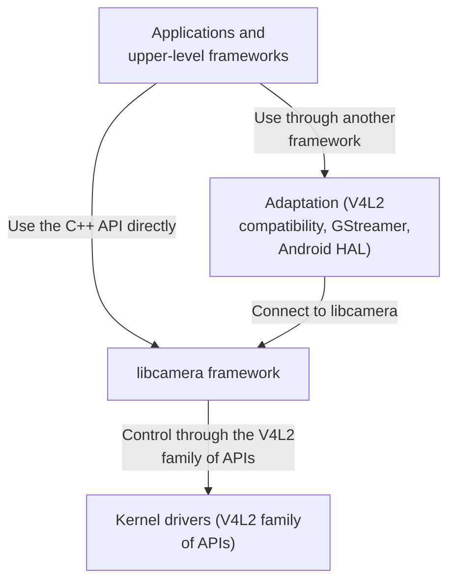

# Start Here

If you’re integrating a device for the first time, use ForVendor to test the first capture and test stopping capture. If completion notifications arrive after you stop capture, follow the code in ForDeveloper that checks the request’s cancellation status.

ForVendor

ForDeveloper

## What it does

libcamera is an open-source complex camera support library for Linux, Android, and ChromeOS. It interfaces with Linux kernel device drivers and provides developers with an intuitive API, reducing the complexity of capturing images from complex cameras on Linux systems. Responsibility for providing a functioning camera stack using the drivers lies in userspace, and vendors typically implement it separately. These implementations have no common architecture or API for application developers, and often require bespoke handling because hardware pipelines and their representation in kernel APIs differ.

### Four layers of the camera stack

Mermaid source

Diagram evidence and verification scope

Which layers does a path pass from the application to the camera hardware? This diagram does not guarantee supported models or performance.

Source-linked interpretation · automatic link check only · meaning and device execution not yet verified

| Elements and transitions | Source evidence |
| --- | --- |
| Applications and upper-level frameworks | Documentation/introduction.rst:137 |
| Adaptation (V4L2 compatibility, GStreamer, Android HAL) | Documentation/introduction.rst:137 |
| libcamera framework | Documentation/introduction.rst:137 |
| Kernel drivers (V4L2 family of APIs) | Documentation/introduction.rst:137 |
| Use the C++ API directly | Documentation/introduction.rst:137 |
| Use through another framework | Documentation/introduction.rst:137 |
| Connect to libcamera | Documentation/introduction.rst:137 |
| Control through the V4L2 family of APIs | Documentation/introduction.rst:137 |

libcamera provides a camera stack for Linux-based systems, abstracting the work of configuring hardware and handling the image control algorithms needed to obtain the desired results from a camera through kernel APIs. This allows developers to perform those tasks in a simple and consistent way. The camera stack consists of four layers, from bottom to top: kernel drivers, the libcamera framework, the libcamera adaptation layer, and applications and upper-level frameworks.

Section-wide evidence: 4

- `Documentation/introduction.rst``L10` excerpt · [Full source `L10`](https://github.com/TTolsun/libcamera-sdd/blob/adfa719f8ed67d18fd8a0739fc088a1f8b9e7252/Documentation/introduction.rst#L10) · `L35` excerpt · [Full source `L35`](https://github.com/TTolsun/libcamera-sdd/blob/adfa719f8ed67d18fd8a0739fc088a1f8b9e7252/Documentation/introduction.rst#L35) · `L45` excerpt · [Full source `L45`](https://github.com/TTolsun/libcamera-sdd/blob/adfa719f8ed67d18fd8a0739fc088a1f8b9e7252/Documentation/introduction.rst#L45) · `L137` excerpt · [Full source `L137`](https://github.com/TTolsun/libcamera-sdd/blob/adfa719f8ed67d18fd8a0739fc088a1f8b9e7252/Documentation/introduction.rst#L137)

## How to read this document

Clicking **Excerpt** in the section-wide evidence expands the original text in the document. Clicking **Full source** takes you to the file and line in the analyzed commit. See Glossary for terminology.

Clicking a diagram lets you zoom in and search for elements. Relationship diagrams and static call tracing do not guarantee the actual execution order. All classes are in Component index, and main calls and trace boundaries are in Key scenario.

Validation scope and document status

"Automated check passed" means that the cited code locations and sentence format were verified by machine. It is not human approval of the content. The review status is shown at the top of the document, and the analysis commit and automated check results are shown in the generation evidence below. Explanations checked against code excerpts must also be reviewed by a person to confirm that their content is correct.

This site is a static analysis result of public libcamera. Actual device capture, performance, and error recovery, as well as the in-house HAL, were not verified. Reasons for design choices and performance budgets can be explained only when the code provides evidence.

The 4B and 9B drafts of [Model comparison record](https://github.com/TTolsun/camera-hal-sdd-generator/blob/main/docs/libcamera/records/model-comparison.md) were not adopted because content errors remained.

Generation and deployment

[Generator](https://github.com/TTolsun/camera-hal-sdd-generator) handles extraction, validation, and screen composition, and [Public documentation repository](https://github.com/TTolsun/libcamera-sdd) stores the history and artifacts of public inputs. In the public environment, a recurring schedule is not installed.

For the original library usage, check [libcamera official documentation](https://docs.libcamera.org/master/).

## Source manuscripts and review records

What this project does

- **Generation method**: Extracted facts and LLM explanation
- **Validation scope**: Tables and figures are created from facts, and the explanations are written by the LLM. Citation, sentence, and configured structure checks are applied.
- **Automated check**: Passed (`ok`). The items checked are listed in the verification scope. Whether the explanation content is correct is checked by a human reviewer.
- **Human review**: Before human review
- **Analysis baseline commit**: `adfa719f8ed67d18fd8a0739fc088a1f8b9e7252`
- **Document generation time**: `2026-11-11 20:35:47+00:00`
- **Sentence generation model**: `cli/codex/gpt-6.1-terra`
- **Contracts between documents**: Automated comparison report · Before human review
- **Reader scope**: Answers by task and unreviewed scope

Record from when the manuscript was written

This is a record saved in the manuscript as of that time. It may differ from the current document's standards.

- Evidence files: `Documentation/introduction.rst`, `Documentation/libcamera_architecture.rst`, `include/libcamera/camera.h`, `include/libcamera/camera_manager.h`, `include/libcamera/internal/pipeline_handler.h`, `src/libcamera/camera.cpp`, `src/libcamera/camera_manager.cpp`, `src/libcamera/pipeline_handler.cpp`
- Evidence level: code verified (static analysis, simple_compdb configuration, commit `c19d05128f`)
- Automated check (citation, sentence, and configured structure checks): passed
- Review status recorded: 2026-11-12 · Before human review

Markdown source ↗

Open earlier detail

libcamera design document

- **Contracts between documents**: Automated comparison report · Before human review

Open earlier detail

Download page Markdown · Reader edition source map
