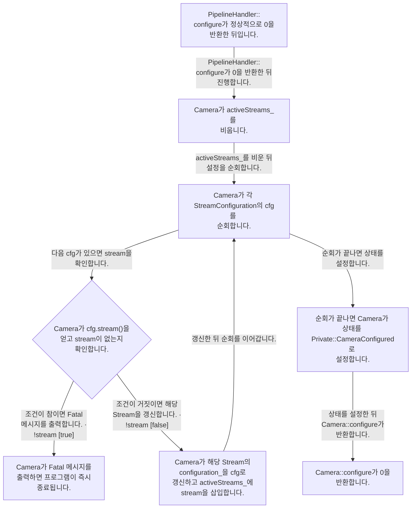
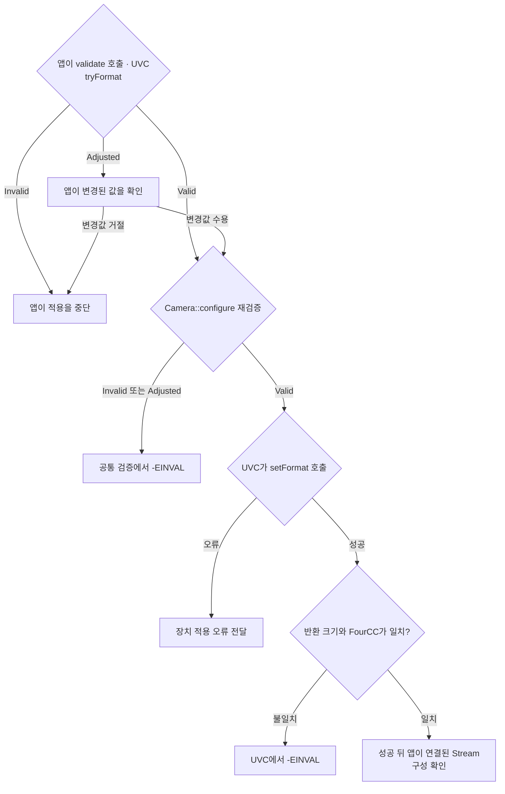
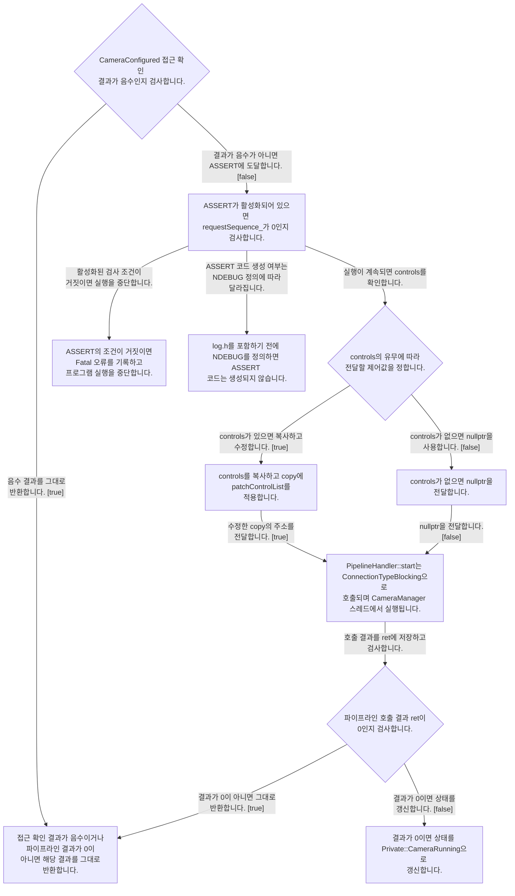

# ForDeveloper

cam을 실행할 수 있는 환경에서 카메라 목록을 확인하세요. 카메라가 감지되면 첫 번째 카메라에서 프레임을 저장해 보세요. 이어서 탐색·구성·시작의 코드 진입점을 차례로 여세요.

- 취소 상태를 확인하는 코드
- 주의점과 문제 진단

## 직접 실행해 보기

시스템에서 감지된 카메라 목록은 `cam -l`로 확인하고, 첫 번째 카메라에서 10프레임을 캡처해 디스크에 저장하려면 `cam -c 1 --capture=10 --file`을 사용합니다. 문제가 발생하면 `LIBCAMERA_LOG_LEVELS=*:DEBUG cam -l`로 상세한 libcamera 디버그 로그를 얻을 수 있습니다.

절 전체 근거 1개

- `README.rst``L107` 발췌 · [전체 소스 `L107`](https://github.com/TTolsun/libcamera-sdd/blob/adfa719f8ed67d18fd8a0739fc088a1f8b9e7252/README.rst#L107)

## 탐색을 시작하고 카메라를 사용할 시점

`CameraManager::start()`는 카메라 관리자를 시작하고 시스템의 모든 장치를 열거합니다. 시작이 확인되면 사용자는 관리자가 중지되거나 카메라가 시스템에서 분리될 때까지 시스템의 카메라 목록을 확인하고 카메라와 상호작용할 수 있습니다.

절 전체 근거 1개

- `src/libcamera/camera_manager.cpp``L329` 발췌 · [전체 소스 `L329`](https://github.com/TTolsun/libcamera-sdd/blob/adfa719f8ed67d18fd8a0739fc088a1f8b9e7252/src/libcamera/camera_manager.cpp#L329)

## 구성 적용과 성공 상태를 확인할 위치

`Camera::configure()`는 접근 상태 검사에서 음수 오류가 나면 그 값을 반환합니다. 검사를 통과하면 각 `StreamConfiguration`의 이전 스트림 연결을 `nullptr`로 비운 뒤 `validate()`를 검사하고, 결과가 `Valid`가 아니면 `-EINVAL`을 반환합니다. `Camera::configure()`는 유효한 설정에 대해 `PipelineHandler::configure`를 `ConnectionTypeBlocking`으로 호출하고, 반환값이 0이 아니면 그 값을 그대로 반환합니다. API 계약은 함수가 반환될 때 `config`의 각 `StreamConfiguration`이 `Stream` 인스턴스와 연결되며 `stream()`으로 이를 가져올 수 있다고 설명합니다.

### 구성 적용 전의 검사와 파이프라인 결과

```mermaid
flowchart TB
%% sdd:translations {"activeStreams#95;.clear#40;#41;와 <br/>이어지는 별도 스트림 연결 <br/>검사로 진행합니다. 이는 <br/>전체 함수의 성공 반환이 <br/>아닙니다.": "Continue to <br/>activeStreams#95;.clear#40;#41; and <br/>the separate stream <br/>connection check. This is <br/>not the function#39;s <br/>successful return.", "config-#62;validate#40;#41;가 반환한 <br/>상태가 <br/>CameraConfiguration::<br/>Valid와 다른가요?": "Did config-#62;validate#40;#41; <br/>return a status other than <br/>CameraConfiguration::Valid?", "invokeMethod로 <br/>PipelineHandler::<br/>configure를 <br/>ConnectionTypeBlocking으로 <br/>호출합니다.": "Call <br/>PipelineHandler::configure <br/>through invokeMethod with <br/>ConnectionTypeBlocking.", "isAccessAllowed#40;Private::<br/>CameraAcquired, <br/>Private::<br/>CameraConfigured#41;를 <br/>호출합니다. 접근 결과가 <br/>음수인가요?": "Call <br/>isAccessAllowed#40;Private::<br/>CameraAcquired, <br/>Private::CameraConfigured#41;. <br/>Is the access result <br/>negative?", "ret이 거짓이면 다음 검사로 <br/>진행합니다. #91;false#93;": "If ret is false, continue <br/>to the next check. #91;false#93;", "ret이 참이면 ret을 <br/>반환합니다. #91;true#93;": "If ret is true, return ret. <br/>#91;true#93;", "validate#40;#41;의 결과가 <br/>CameraConfiguration::<br/>Valid가 아니므로 -EINVAL을 <br/>반환합니다.": "Return -EINVAL because <br/>validate#40;#41; returned a <br/>status other than <br/>CameraConfiguration::Valid.", "각 연결을 초기화한 뒤 <br/>검증합니다.": "Validate after resetting <br/>each connection.", "기존 #42;config의 각 cfg에서 <br/>cfg.setStream#40;nullptr#41;을 <br/>호출해 연결을 초기화합니다.": "Call cfg.setStream#40;nullptr#41; <br/>for each cfg in the <br/>existing #42;config to reset <br/>its connection.", "로그를 출력한 뒤 <br/>파이프라인을 호출합니다.": "Call the pipeline after <br/>outputting the log.", "반환 상태가 <br/>CameraConfiguration::<br/>Valid가 아니면 -EINVAL을 <br/>반환합니다. #91;true#93;": "If the returned status is <br/>not <br/>CameraConfiguration::Valid, <br/>return -EINVAL. #91;true#93;", "반환 상태가 <br/>CameraConfiguration::<br/>Valid이면 로그를 <br/>준비합니다. #91;false#93;": "If the returned status is <br/>CameraConfiguration::Valid, <br/>prepare the log. #91;false#93;", "스트림 구성 로그를 준비하고 <br/>출력합니다.": "Prepare and output the <br/>stream configuration log.", "접근 결과 ret을 반환합니다.": "Return the access result <br/>ret.", "접근 결과가 음수가 아니면 <br/>연결을 초기화합니다. #91;false#93;": "If the access result is not <br/>negative, reset the <br/>connections. #91;false#93;", "접근 결과가 음수이면 ret을 <br/>반환합니다. #91;true#93;": "If the access result is <br/>negative, return ret. #91;true#93;", "파이프라인 호출의 반환값 <br/>ret을 반환합니다.": "Return the pipeline call#39;s <br/>return value ret.", "파이프라인 호출의 반환값 <br/>ret이 참인가요?": "Is the pipeline call#39;s <br/>return value ret true?", "호출 결과를 검사합니다.": "Check the call result."}
  v_access{"isAccessAllowed#40;Private::<br/>CameraAcquired, <br/>Private::<br/>CameraConfigured#41;를 <br/>호출합니다. 접근 결과가 <br/>음수인가요?"}
  v_access_return["접근 결과 ret을 반환합니다."]
  v_reset["기존 #42;config의 각 cfg에서 <br/>cfg.setStream#40;nullptr#41;을 <br/>호출해 연결을 초기화합니다."]
  v_validation{"config-#62;validate#40;#41;가 반환한 <br/>상태가 <br/>CameraConfiguration::<br/>Valid와 다른가요?"}
  v_validation_return["validate#40;#41;의 결과가 <br/>CameraConfiguration::<br/>Valid가 아니므로 -EINVAL을 <br/>반환합니다."]
  v_log["스트림 구성 로그를 준비하고 <br/>출력합니다."]
  v_pipeline["invokeMethod로 <br/>PipelineHandler::<br/>configure를 <br/>ConnectionTypeBlocking으로 <br/>호출합니다."]
  v_pipeline_check{"파이프라인 호출의 반환값 <br/>ret이 참인가요?"}
  v_pipeline_return["파이프라인 호출의 반환값 <br/>ret을 반환합니다."]
  v_next["activeStreams#95;.clear#40;#41;와 <br/>이어지는 별도 스트림 연결 <br/>검사로 진행합니다. 이는 <br/>전체 함수의 성공 반환이 <br/>아닙니다."]
  v_access -->|"접근 결과가 음수이면 ret을 <br/>반환합니다. #91;true#93;"| v_access_return
  v_access -->|"접근 결과가 음수가 아니면 <br/>연결을 초기화합니다. #91;false#93;"| v_reset
  v_reset -->|"각 연결을 초기화한 뒤 <br/>검증합니다."| v_validation
  v_validation -->|"반환 상태가 <br/>CameraConfiguration::<br/>Valid가 아니면 -EINVAL을 <br/>반환합니다. #91;true#93;"| v_validation_return
  v_validation -->|"반환 상태가 <br/>CameraConfiguration::<br/>Valid이면 로그를 <br/>준비합니다. #91;false#93;"| v_log
  v_log -->|"로그를 출력한 뒤 <br/>파이프라인을 호출합니다."| v_pipeline
  v_pipeline -->|"호출 결과를 검사합니다."| v_pipeline_check
  v_pipeline_check -->|"ret이 참이면 ret을 <br/>반환합니다. #91;true#93;"| v_pipeline_return
  v_pipeline_check -->|"ret이 거짓이면 다음 검사로 <br/>진행합니다. #91;false#93;"| v_next
```

Mermaid 원문

그림 근거와 확인 범위

Camera::configure의 접근 검사·스트림 연결 초기화·검증·파이프라인 반환 검사는 어떤 순서입니까?

소스 연결 해석 · 자동 연결 검사만 통과 · 의미와 기기 실행은 검증 전

LLM 그림 초안 · 사람 검토 전

작성 모델: `cli/codex/gpt-6.1-terra`

| 요소·전이 | 소스 근거 |
| --- | --- |
| isAccessAllowed(Private::CameraAcquired, Private::CameraConfigured)를 호출합니다. 접근 결과가 음수인가요? | src/libcamera/camera.cpp:1191 |
| 접근 결과 ret을 반환합니다. | src/libcamera/camera.cpp:1191 |
| 기존 \*config의 각 cfg에서 cfg.setStream(nullptr)을 호출해 연결을 초기화합니다. | src/libcamera/camera.cpp:1191 |
| config-\>validate()가 반환한 상태가 CameraConfiguration::Valid와 다른가요? | src/libcamera/camera.cpp:1191 |
| validate()의 결과가 CameraConfiguration::Valid가 아니므로 -EINVAL을 반환합니다. | src/libcamera/camera.cpp:1191 |
| 스트림 구성 로그를 준비하고 출력합니다. | src/libcamera/camera.cpp:1191 |
| invokeMethod로 PipelineHandler::configure를 ConnectionTypeBlocking으로 호출합니다. | src/libcamera/camera.cpp:1191 |
| 파이프라인 호출의 반환값 ret이 참인가요? | src/libcamera/camera.cpp:1191 |
| 파이프라인 호출의 반환값 ret을 반환합니다. | src/libcamera/camera.cpp:1191 |
| activeStreams\_.clear()와 이어지는 별도 스트림 연결 검사로 진행합니다. 이는 전체 함수의 성공 반환이 아닙니다. | src/libcamera/camera.cpp:1191 |
| 접근 결과가 음수이면 ret을 반환합니다. · ret \< 0 \[true\] | src/libcamera/camera.cpp:1191 |
| 접근 결과가 음수가 아니면 연결을 초기화합니다. · ret \< 0 \[false\] | src/libcamera/camera.cpp:1191 |
| 각 연결을 초기화한 뒤 검증합니다. | src/libcamera/camera.cpp:1191 |
| 반환 상태가 CameraConfiguration::Valid가 아니면 -EINVAL을 반환합니다. · config-\>validate() != CameraConfiguration::Valid \[true\] | src/libcamera/camera.cpp:1191 |
| 반환 상태가 CameraConfiguration::Valid이면 로그를 준비합니다. · config-\>validate() != CameraConfiguration::Valid \[false\] | src/libcamera/camera.cpp:1191 |
| 로그를 출력한 뒤 파이프라인을 호출합니다. | src/libcamera/camera.cpp:1191 |
| 호출 결과를 검사합니다. | src/libcamera/camera.cpp:1191 |
| ret이 참이면 ret을 반환합니다. · ret \[true\] | src/libcamera/camera.cpp:1191 |
| ret이 거짓이면 다음 검사로 진행합니다. · ret \[false\] | src/libcamera/camera.cpp:1191 |

### 스트림 목록의 일회 초기화와 성공 상태

Mermaid 원문

그림 근거와 확인 범위

파이프라인 구성 성공 뒤 activeStreams\_ 초기화와 각 StreamConfiguration 갱신 및 성공 상태는 어떻게 이어집니까?

소스 연결 해석 · 자동 연결 검사만 통과 · 의미와 기기 실행은 검증 전

LLM 그림 초안 · 사람 검토 전

작성 모델: `cli/codex/gpt-6.1-terra`

| 요소·전이 | 소스 근거 |
| --- | --- |
| PipelineHandler::configure가 정상적으로 0을 반환한 뒤입니다. | src/libcamera/camera.cpp:1191 |
| Camera가 activeStreams\_를 비웁니다. | src/libcamera/camera.cpp:1191 |
| Camera가 각 StreamConfiguration의 cfg를 순회합니다. | src/libcamera/camera.cpp:1191 |
| Camera가 cfg.stream()을 얻고 stream이 없는지 확인합니다. | src/libcamera/camera.cpp:1191 |
| Camera가 Fatal 메시지를 출력하면 프로그램이 즉시 종료됩니다. | src/libcamera/camera.cpp:1191 · src/libcamera/base/log.cpp:1022 |
| Camera가 해당 Stream의 configuration\_을 cfg로 갱신하고 activeStreams\_에 stream을 삽입합니다. | src/libcamera/camera.cpp:1191 |
| 순회가 끝나면 Camera가 상태를 Private::CameraConfigured로 설정합니다. | src/libcamera/camera.cpp:1191 |
| Camera::configure가 0을 반환합니다. | src/libcamera/camera.cpp:1191 |
| PipelineHandler::configure가 0을 반환한 뒤 진행합니다. | src/libcamera/camera.cpp:1191 |
| activeStreams\_를 비운 뒤 설정을 순회합니다. | src/libcamera/camera.cpp:1191 |
| 다음 cfg가 있으면 stream을 확인합니다. | src/libcamera/camera.cpp:1191 |
| 조건이 참이면 Fatal 메시지를 출력합니다. · !stream \[true\] | src/libcamera/camera.cpp:1191 |
| 조건이 거짓이면 해당 Stream을 갱신합니다. · !stream \[false\] | src/libcamera/camera.cpp:1191 |
| 갱신한 뒤 순회를 이어갑니다. | src/libcamera/camera.cpp:1191 |
| 순회가 끝나면 상태를 설정합니다. | src/libcamera/camera.cpp:1191 |
| 상태를 설정한 뒤 Camera::configure가 반환합니다. | src/libcamera/camera.cpp:1191 |

`Camera::configure()`는 파이프라인 호출이 성공하면 `activeStreams_`를 비우고 각 설정의 `cfg.stream()`을 확인합니다. 스트림이 없으면 `Fatal` 로그 경로에 들어가며, `LOG` 계약에 따라 메시지를 출력한 직후 실행이 중단되고 프로그램이 종료됩니다. 모든 설정에 스트림이 있으면 `Camera::configure()`는 각 스트림의 `configuration_`을 해당 설정으로 갱신하고 `activeStreams_`에 추가합니다. 이후 상태를 `CameraConfigured`로 설정하고 `0`을 반환합니다.

절 전체 근거 3개

- `src/libcamera/camera.cpp`[`L1191`](https://github.com/TTolsun/libcamera-sdd/blob/adfa719f8ed67d18fd8a0739fc088a1f8b9e7252/src/libcamera/camera.cpp#L1191) · `L1183` 발췌 · [전체 소스 `L1183`](https://github.com/TTolsun/libcamera-sdd/blob/adfa719f8ed67d18fd8a0739fc088a1f8b9e7252/src/libcamera/camera.cpp#L1183) · `L1191`
- `src/libcamera/base/log.cpp``L1022` 발췌 · [전체 소스 `L1022`](https://github.com/TTolsun/libcamera-sdd/blob/adfa719f8ed67d18fd8a0739fc088a1f8b9e7252/src/libcamera/base/log.cpp#L1022)

## 요청한 640×480 뷰파인더는 어디에서 달라지나요?

앱은 `Camera::generateConfiguration()`으로 `Viewfinder` 구성 하나를 만들고 기본 크기와 픽셀 포맷을 확인한 뒤, 예시로 640×480을 요청하고 `validate()`를 호출해야 합니다. UVC 검증은 `tryFormat`을 시험하며 장치 열기나 시험이 실패하면 `Invalid`를 반환합니다. `Adjusted`는 구성이 조정되어 유효해졌다는 뜻이며 어느 스트림의 매개변수든 바뀌거나 스트림 구성이 제거되었을 수 있으므로, 앱은 검증 후 크기와 픽셀 포맷을 읽고 변경을 받아들일지 판단해야 합니다. 이후 `Camera::configure()`는 접근이 허용되면 스트림 연결을 지우고 다시 검증하며, 결과가 `Valid`가 아니면 `-EINVAL`을 반환합니다.

### UVC 뷰파인더의 구성 검증과 장치 적용

앱은 검증이 바꾼 값을 확인해 적용할지 결정합니다. 장치 적용 때는 UVC 핸들러가 반환된 크기와 FourCC를 비교합니다. [`camera.cpp:343`](https://github.com/TTolsun/libcamera-sdd/blob/adfa719f8ed67d18fd8a0739fc088a1f8b9e7252/src/libcamera/camera.cpp#L343) · [`uvcvideo.cpp:275`](https://github.com/TTolsun/libcamera-sdd/blob/adfa719f8ed67d18fd8a0739fc088a1f8b9e7252/src/libcamera/pipeline/uvcvideo/uvcvideo.cpp#L275)

Mermaid 원문

그림 근거와 확인 범위

어디에서 값을 다시 확인하고 어디에서 오류로 반환합니까?

소스 연결 해석 · 자동 연결 검사만 통과 · 의미와 기기 실행은 검증 전

| 요소·전이 | 소스 근거 |
| --- | --- |
| 앱이 validate 호출 · UVC tryFormat | src/libcamera/pipeline/uvcvideo/uvcvideo.cpp:139 |
| 앱이 변경된 값을 확인 | src/libcamera/camera.cpp:323 |
| 앱이 적용을 중단 | src/libcamera/pipeline/uvcvideo/uvcvideo.cpp:139 · src/libcamera/camera.cpp:323 |
| Camera::configure 재검증 | src/libcamera/camera.cpp:1191 |
| 공통 검증에서 -EINVAL | src/libcamera/camera.cpp:1191 |
| UVC가 setFormat 호출 | src/libcamera/pipeline/uvcvideo/uvcvideo.cpp:261 · src/libcamera/v4l2_videodevice.cpp:849 |
| 장치 적용 오류 전달 | src/libcamera/pipeline/uvcvideo/uvcvideo.cpp:261 |
| 반환 크기와 FourCC가 일치? | src/libcamera/pipeline/uvcvideo/uvcvideo.cpp:261 |
| UVC에서 -EINVAL | src/libcamera/pipeline/uvcvideo/uvcvideo.cpp:261 |
| 성공 뒤 앱이 연결된 Stream 구성 확인 | src/libcamera/pipeline/uvcvideo/uvcvideo.cpp:261 · src/libcamera/camera.cpp:1191 · src/libcamera/stream.cpp:483 |
| Adjusted | src/libcamera/camera.cpp:323 |
| Invalid | src/libcamera/pipeline/uvcvideo/uvcvideo.cpp:139 |
| Valid | src/libcamera/camera.cpp:1191 |
| 변경값 수용 | src/libcamera/camera.cpp:323 · src/libcamera/camera.cpp:1191 |
| 변경값 거절 | src/libcamera/camera.cpp:323 |
| Valid | src/libcamera/camera.cpp:1191 · src/libcamera/pipeline/uvcvideo/uvcvideo.cpp:261 |
| Invalid 또는 Adjusted | src/libcamera/camera.cpp:1191 |
| 오류 | src/libcamera/pipeline/uvcvideo/uvcvideo.cpp:261 |
| 성공 | src/libcamera/pipeline/uvcvideo/uvcvideo.cpp:261 |
| 불일치 | src/libcamera/pipeline/uvcvideo/uvcvideo.cpp:261 |
| 일치 | src/libcamera/pipeline/uvcvideo/uvcvideo.cpp:261 · src/libcamera/camera.cpp:1191 |

`tryFormat`은 형식을 시험하고, `PipelineHandlerUVC::configure()`의 `setFormat`은 형식을 장치에 실제로 적용하고 적용된 값을 반환합니다. UVC 구성은 검증된 크기와 FourCC가 장치에서 반환한 값과 같은지 대조하며, `setFormat`이 실패하면 그 오류를 반환하고 값이 다르면 `-EINVAL`을 반환합니다. 성공하면 UVC 구성은 스트림을 연결하고 공통 `Camera::configure()`는 검증된 스트림 구성을 연결된 스트림에 복사하므로, 앱은 `Stream::configuration()`에서 활성 구성을 읽을 수 있습니다. 대상 장치에서는 검증 전후의 크기와 픽셀 포맷, 적용 시도의 크기와 FourCC 및 반환값을 확인합니다.

절 전체 근거 10개

- `Documentation/guides/application-developer.rst``L167` 발췌 · [전체 소스 `L167`](https://github.com/TTolsun/libcamera-sdd/blob/adfa719f8ed67d18fd8a0739fc088a1f8b9e7252/Documentation/guides/application-developer.rst#L167) · `L195` 발췌 · [전체 소스 `L195`](https://github.com/TTolsun/libcamera-sdd/blob/adfa719f8ed67d18fd8a0739fc088a1f8b9e7252/Documentation/guides/application-developer.rst#L195) · `L222`
- `src/libcamera/pipeline/uvcvideo/uvcvideo.cpp``L139` 발췌 · [전체 소스 `L139`](https://github.com/TTolsun/libcamera-sdd/blob/adfa719f8ed67d18fd8a0739fc088a1f8b9e7252/src/libcamera/pipeline/uvcvideo/uvcvideo.cpp#L139) · `L261` 발췌 · [전체 소스 `L261`](https://github.com/TTolsun/libcamera-sdd/blob/adfa719f8ed67d18fd8a0739fc088a1f8b9e7252/src/libcamera/pipeline/uvcvideo/uvcvideo.cpp#L261) · `L237`
- `src/libcamera/camera.cpp``L323` 발췌 · [전체 소스 `L323`](https://github.com/TTolsun/libcamera-sdd/blob/adfa719f8ed67d18fd8a0739fc088a1f8b9e7252/src/libcamera/camera.cpp#L323) · `L1191` 발췌 · [전체 소스 `L1191`](https://github.com/TTolsun/libcamera-sdd/blob/adfa719f8ed67d18fd8a0739fc088a1f8b9e7252/src/libcamera/camera.cpp#L1191)
- `src/libcamera/v4l2_videodevice.cpp``L849` 발췌 · [전체 소스 `L849`](https://github.com/TTolsun/libcamera-sdd/blob/adfa719f8ed67d18fd8a0739fc088a1f8b9e7252/src/libcamera/v4l2_videodevice.cpp#L849)
- `src/libcamera/stream.cpp``L483` 발췌 · [전체 소스 `L483`](https://github.com/TTolsun/libcamera-sdd/blob/adfa719f8ed67d18fd8a0739fc088a1f8b9e7252/src/libcamera/stream.cpp#L483)

## 시작 제어값과 파이프라인 결과 반영

`Camera::start`는 `controls`가 있으면 `ControlList` 복사본을 만들고 `patchControlList`로 전처리한 뒤 그 복사본을 전달하며, 없으면 `nullptr`을 전달합니다. 두 분기 모두 `PipelineHandler::start`를 `ConnectionTypeBlocking`으로 호출하며, 이 함수는 `CameraManager` 스레드에서 호출됩니다. `Camera::start`는 호출 결과인 `ret`이 0이 아니면 `CameraRunning` 상태를 설정하지 않고 `ret`을 그대로 반환합니다. `ret`이 0이면 `CameraRunning` 상태를 설정하고 0을 반환합니다.

### 시작 제어값과 파이프라인 결과 반영의 관계와 경계

Mermaid 원문

그림 근거와 확인 범위

ASSERT, 제어값 분기, blocking 파이프라인 호출과 반환값 분기는 어떻게 원래 오류 반환 또는 CameraRunning 갱신으로 이어지는가?

소스 연결 해석 · 자동 연결 검사만 통과 · 의미와 기기 실행은 검증 전

LLM 그림 초안 · 사람 검토 전

작성 모델: `cli/codex/gpt-6.1-terra`

| 요소·전이 | 소스 근거 |
| --- | --- |
| CameraConfigured 접근 확인 결과가 음수인지 검사합니다. | src/libcamera/camera.cpp:1400 |
| 접근 확인 결과가 음수이거나 파이프라인 결과가 0이 아니면 해당 결과를 그대로 반환합니다. | src/libcamera/camera.cpp:1400 |
| ASSERT가 활성화되어 있으면 requestSequence\_가 0인지 검사합니다. | src/libcamera/camera.cpp:1400 · src/libcamera/base/log.cpp:1022 |
| ASSERT의 조건이 거짓이면 Fatal 오류를 기록하고 프로그램 실행을 중단합니다. | src/libcamera/base/log.cpp:1022 |
| log.h를 포함하기 전에 NDEBUG를 정의하면 ASSERT 코드는 생성되지 않습니다. | src/libcamera/base/log.cpp:1022 |
| controls의 유무에 따라 전달할 제어값을 정합니다. | src/libcamera/camera.cpp:1400 |
| controls를 복사하고 copy에 patchControlList를 적용합니다. | src/libcamera/camera.cpp:1400 |
| controls가 없으면 nullptr을 전달합니다. | src/libcamera/camera.cpp:1400 |
| PipelineHandler::start는 ConnectionTypeBlocking으로 호출되며 CameraManager 스레드에서 실행됩니다. | src/libcamera/camera.cpp:1400 · src/libcamera/pipeline_handler.cpp:343 |
| 파이프라인 호출 결과 ret이 0인지 검사합니다. | src/libcamera/camera.cpp:1400 |
| 결과가 0이면 상태를 Private::CameraRunning으로 갱신합니다. | src/libcamera/camera.cpp:1400 |
| 음수 결과를 그대로 반환합니다. · ret \< 0 \[true\] | src/libcamera/camera.cpp:1400 |
| 결과가 음수가 아니면 ASSERT에 도달합니다. · ret \< 0 \[false\] | src/libcamera/camera.cpp:1400 |
| 활성화된 검사 조건이 거짓이면 실행을 중단합니다. | src/libcamera/base/log.cpp:1022 |
| ASSERT 코드 생성 여부는 NDEBUG 정의에 따라 달라집니다. | src/libcamera/base/log.cpp:1022 |
| 실행이 계속되면 controls를 확인합니다. | src/libcamera/camera.cpp:1400 · src/libcamera/base/log.cpp:1022 |
| controls가 있으면 복사하고 수정합니다. · controls \[true\] | src/libcamera/camera.cpp:1400 |
| controls가 없으면 nullptr을 사용합니다. · controls \[false\] | src/libcamera/camera.cpp:1400 |
| 수정한 copy의 주소를 전달합니다. · controls \[true\] | src/libcamera/camera.cpp:1400 |
| nullptr을 전달합니다. · controls \[false\] | src/libcamera/camera.cpp:1400 |
| 호출 결과를 ret에 저장하고 검사합니다. | src/libcamera/camera.cpp:1400 |
| 결과가 0이 아니면 그대로 반환합니다. · ret \[true\] | src/libcamera/camera.cpp:1400 |
| 결과가 0이면 상태를 갱신합니다. · ret \[false\] | src/libcamera/camera.cpp:1400 |

`Camera::start`는 `PipelineHandler::start`를 호출하기 전에 `ASSERT(d->requestSequence_ == 0)`을 실행합니다. 이 검사가 실패하면 `ASSERT`는 오류 메시지를 `Fatal` 로그 수준으로 기록하고 프로그램 실행을 중단하며, 일반 오류 반환과는 다르게 동작합니다. `log.h`를 포함하기 전에 `NDEBUG`가 정의되면 `ASSERT`는 코드를 생성하지 않습니다.

절 전체 근거 3개

- `src/libcamera/camera.cpp``L1400` 발췌 · [전체 소스 `L1400`](https://github.com/TTolsun/libcamera-sdd/blob/adfa719f8ed67d18fd8a0739fc088a1f8b9e7252/src/libcamera/camera.cpp#L1400)
- `src/libcamera/pipeline_handler.cpp``L343` 발췌 · [전체 소스 `L343`](https://github.com/TTolsun/libcamera-sdd/blob/adfa719f8ed67d18fd8a0739fc088a1f8b9e7252/src/libcamera/pipeline_handler.cpp#L343)
- `src/libcamera/base/log.cpp``L1022` 발췌 · [전체 소스 `L1022`](https://github.com/TTolsun/libcamera-sdd/blob/adfa719f8ed67d18fd8a0739fc088a1f8b9e7252/src/libcamera/base/log.cpp#L1022)

## 취소 상태를 확인할 코드

앱에서 `Camera::requestCompleted`에 연결한 콜백을 열고 `Request::status()`를 읽어 `RequestCancelled`를 처리하는 분기를 찾으세요. 영상을 사용하기 전에 각 `FrameBuffer::metadata().status`가 `FrameSuccess`인지 확인하세요. 정지 뒤 완료 알림의 상태 판정과 코드를 따라가세요.

시스템 개요에서 CameraManager의 탐색 진입점과 각 구성 요소의 역할을 확인할 수 있습니다. 콜백이나 요청 처리 코드를 수정하기 전에는 요청 제출과 완료, 세션 상태와 자원, 스레드 경계를 확인하세요.

## 원고와 검토 기록

실행해 보고 설계 이유 읽기

- **생성 방식**: 추출 사실과 LLM 설명
- **검증 범위**: 표·그림은 facts로 만들고 설명은 LLM이 작성합니다. 인용·문장 및 설정된 구조 검사를 적용합니다.
- **자동 검사**: 통과 (`ok`). 검사한 항목은 검증 범위에 적혀 있습니다. 설명 내용이 맞는지는 사람이 확인합니다.
- **사람 검토**: 사람 검토 전
- **분석 기준 커밋**: `adfa719f8ed67d18fd8a0739fc088a1f8b9e7252`
- **문서 생성 시각**: `2026-11-04 05:02:45+00:00`
- **문장 생성 모델**: `cli/codex/gpt-6.1-terra`
- **문서 간 계약**: 자동 대조 보고서 · 사람 검토 전

원고 작성 당시 기록

원고에 저장된 당시 기록입니다. 현재 문서의 기준과 다를 수 있습니다.

- 근거 파일: `README.rst`, `include/libcamera/camera.h`, `include/libcamera/internal/pipeline_handler.h`, `include/libcamera/request.h`, `src/libcamera/camera.cpp`, `src/libcamera/pipeline_handler.cpp`, `src/libcamera/request.cpp`
- 근거 수준: 코드 확인 (정적 분석, simple_compdb 구성, commit `293d751a81`)
- 자동 검사 (인용·문장 및 설정된 구조 검사): 통과
- 검토 상태 기록일: 2026-11-04 · 사람 검토 전

Markdown 원문 ↗

이전 주소의 상세 내용 열기

카메라 탐색

- **생성 방식**: 추출 사실과 LLM 설명
- **검증 범위**: 표·그림은 facts로 만들고 설명은 LLM이 작성합니다. 인용·문장 및 설정된 구조 검사를 적용합니다.
- **자동 검사**: 통과 (`ok`). 검사한 항목은 검증 범위에 적혀 있습니다. 설명 내용이 맞는지는 사람이 확인합니다.
- **사람 검토**: 사람 검토 전
- **분석 기준 커밋**: `adfa719f8ed67d18fd8a0739fc088a1f8b9e7252`
- **문서 생성 시각**: `2026-11-04 07:00:44+00:00`
- **문장 생성 모델**: `cli/codex/gpt-6.1-terra`
- **문서 간 계약**: 자동 대조 보고서 · 사람 검토 전

원고 작성 당시 기록

원고에 저장된 당시 기록입니다. 현재 문서의 기준과 다를 수 있습니다.

- 근거 파일: `src/libcamera/base/event_dispatcher_poll.cpp`, `src/libcamera/base/log.cpp`, `src/libcamera/base/thread.cpp`, `src/libcamera/camera_manager.cpp`
- 근거 수준: 코드 확인 (정적 분석, simple_compdb 구성, commit `293d751a81`)
- 자동 검사 (인용·문장 및 설정된 구조 검사): 통과
- 검토 상태 기록일: 2026-11-04 · 사람 검토 전

Markdown 원문 ↗

이전 주소의 상세 내용 열기

스트림 구성

- **생성 방식**: 추출 사실과 LLM 설명
- **검증 범위**: 표·그림은 facts로 만들고 설명은 LLM이 작성합니다. 인용·문장 및 설정된 구조 검사를 적용합니다.
- **자동 검사**: 통과 (`ok`). 검사한 항목은 검증 범위에 적혀 있습니다. 설명 내용이 맞는지는 사람이 확인합니다.
- **사람 검토**: 사람 검토 전
- **분석 기준 커밋**: `adfa719f8ed67d18fd8a0739fc088a1f8b9e7252`
- **문서 생성 시각**: `2026-11-20 16:39:43+00:00`
- **문장 생성 모델**: `cli/codex/gpt-6.1-terra`
- **문서 간 계약**: 자동 대조 보고서 · 사람 검토 전

원고 작성 당시 기록

원고에 저장된 당시 기록입니다. 현재 문서의 기준과 다를 수 있습니다.

- 근거 파일: `include/libcamera/geometry.h`, `include/libcamera/internal/camera.h`, `include/libcamera/pixel_format.h`, `src/libcamera/base/log.cpp`, `src/libcamera/camera.cpp`, `src/libcamera/formats.cpp`, `src/libcamera/pipeline/imx8-isi/imx8-isi.cpp`, `src/libcamera/pixel_format.cpp`, `src/libcamera/sensor/camera_sensor_legacy.cpp`, `src/libcamera/sensor/camera_sensor_raw.cpp`, `src/libcamera/stream.cpp`
- 근거 수준: 코드 확인 (정적 분석, simple_compdb 구성, commit `adfa719f8e`)
- 자동 검사 (인용·문장 및 설정된 구조 검사): 통과
- 검토 상태 기록일: 2026-11-21 · 사람 검토 전

Markdown 원문 ↗

이전 주소의 상세 내용 열기

USB UVC 뷰파인더 스트림 구성

- **생성 방식**: 추출 사실과 LLM 설명
- **검증 범위**: 표·그림은 facts로 만들고 설명은 LLM이 작성합니다. 인용·문장 및 설정된 구조 검사를 적용합니다.
- **자동 검사**: 통과 (`ok`). 검사한 항목은 검증 범위에 적혀 있습니다. 설명 내용이 맞는지는 사람이 확인합니다.
- **사람 검토**: 사람 검토 전
- **분석 기준 커밋**: `adfa719f8ed67d18fd8a0739fc088a1f8b9e7252`
- **문서 생성 시각**: `2026-11-22 16:46:57+00:00`
- **문장 생성 모델**: `cli/codex/gpt-6.1-terra`
- **문서 간 계약**: 자동 대조 보고서 · 사람 검토 전

원고 작성 당시 기록

원고에 저장된 당시 기록입니다. 현재 문서의 기준과 다를 수 있습니다.

- 근거 파일: `Documentation/guides/application-developer.rst`, `src/libcamera/camera.cpp`, `src/libcamera/pipeline/uvcvideo/uvcvideo.cpp`, `src/libcamera/stream.cpp`, `src/libcamera/v4l2_videodevice.cpp`
- 근거 수준: 코드 확인 (정적 분석, simple_compdb 구성, commit `adfa719f8e`)
- 자동 검사 (인용·문장 및 설정된 구조 검사): 통과
- 검토 상태 기록일: 2026-11-23 · 사람 검토 전

Markdown 원문 ↗

이전 주소의 상세 내용 열기

캡처 시작

- **생성 방식**: 추출 사실과 LLM 설명
- **검증 범위**: 표·그림은 facts로 만들고 설명은 LLM이 작성합니다. 인용·문장 및 설정된 구조 검사를 적용합니다.
- **자동 검사**: 통과 (`ok`). 검사한 항목은 검증 범위에 적혀 있습니다. 설명 내용이 맞는지는 사람이 확인합니다.
- **사람 검토**: 사람 검토 전
- **분석 기준 커밋**: `adfa719f8ed67d18fd8a0739fc088a1f8b9e7252`
- **문서 생성 시각**: `2026-11-04 05:03:21+00:00`
- **문장 생성 모델**: `cli/codex/gpt-6.1-terra`
- **문서 간 계약**: 자동 대조 보고서 · 사람 검토 전

원고 작성 당시 기록

원고에 저장된 당시 기록입니다. 현재 문서의 기준과 다를 수 있습니다.

- 근거 파일: `src/libcamera/base/log.cpp`, `src/libcamera/camera.cpp`, `src/libcamera/controls.cpp`, `src/libcamera/pipeline_handler.cpp`
- 근거 수준: 코드 확인 (정적 분석, simple_compdb 구성, commit `293d751a81`)
- 자동 검사 (인용·문장 및 설정된 구조 검사): 통과
- 검토 상태 기록일: 2026-11-04 · 사람 검토 전

Markdown 원문 ↗

이전 주소의 상세 내용 열기

libcamera 설계 문서

- **문서 간 계약**: 자동 대조 보고서 · 사람 검토 전

이전 주소의 상세 내용 열기

이 페이지 Markdown 받기 · 독자용 문서의 원본 위치
