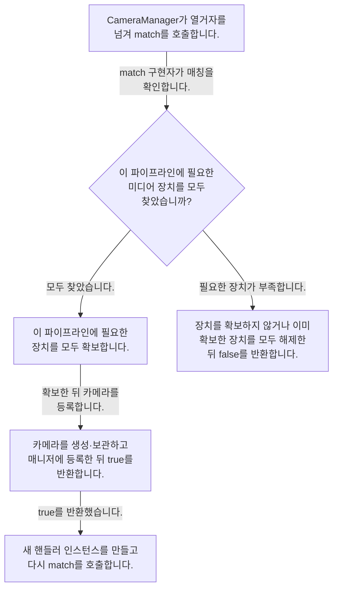

# ForVendor

애플리케이션은 공통 Camera API로 장치를 구성하고 이미지를 촬영합니다. 장치별 PipelineHandler 구현은 필요한 미디어 장치를 시스템의 장치와 대응시키고 스트림 구성에 따라 하드웨어 파이프라인을 구성합니다. 도입을 검토할 때는 하드웨어와 빌드 조건을 확인하고 대상 보드에서 첫 촬영과 정지를 시험하세요.

- 플랫폼과 빌드 조건 확인
- 첫 촬영과 정지 시험 준비

## 장치에서 확인할 항목

대상 장치에서 정상 촬영과 미완료 요청이 있는 상태에서의 정지를 각각 시험하세요. 제출 회차별로 완료 콜백 횟수, 요청 상태, 각 버퍼의 상태를 기록하세요. 요청이 취소됐는지와 각 프레임의 촬영이 성공했는지를 따로 판정하세요. 정지 뒤 완료 알림의 계약과 근거를 확인하세요.

공통 API의 도입 이점과 하드웨어·빌드 조건을 대조한 뒤 연동 가이드에서 장치별 구현 책임을 확인하세요. 지원 범위와 검증은 고객 보드의 첫 촬영, 구성 제약과 성능 근거를 다룹니다.

## 하드웨어와 공통 계층의 경계

`PipelineHandler::match()` 구현자는 단일 파이프라인에 필요한 미디어 장치를 모두 찾으면 각 장치에 대해 `MediaDevice::acquire()`를 호출해 확보한 다음, 해당 `Camera` 인스턴스를 하나 이상 생성하고 내부에 저장하며 카메라 매니저에 등록한 뒤 `true`를 반환해야 합니다. `PipelineHandler::match()` 구현자는 필요한 미디어 장치를 모두 찾지 못했을 때 아직 장치를 확보하지 않았다면 어떤 장치도 확보해서는 안 되며, 이미 일부를 확보했다면 `MediaDevice::release()`를 호출해 확보한 장치를 모두 해제하고 `false`를 반환해야 합니다. `PipelineHandler::match()`는 `CameraManager` 스레드에서 호출되며, `true`를 반환하면 새로운 `PipelineHandler` 인스턴스가 생성되고 그 인스턴스의 `match()`가 호출됩니다.

### 장치 매칭의 확보·등록과 실패 정리

Mermaid 원문

그림 근거와 확인 범위

누가 장치를 매칭하고 카메라를 등록하며, 매칭 결과에 따라 확보한 장치는 어떻게 처리됩니까?

소스 연결 해석 · 자동 연결 검사만 통과 · 의미와 기기 실행은 검증 전

| 요소·전이 | 소스 근거 |
| --- | --- |
| CameraManager가 열거자를 넘겨 match를 호출합니다. | src/libcamera/pipeline_handler.cpp:91 |
| 이 파이프라인에 필요한 미디어 장치를 모두 찾았습니까? | src/libcamera/pipeline_handler.cpp:91 |
| 이 파이프라인에 필요한 장치를 모두 확보합니다. | src/libcamera/pipeline_handler.cpp:91 |
| 카메라를 생성·보관하고 매니저에 등록한 뒤 true를 반환합니다. | src/libcamera/pipeline_handler.cpp:91 |
| 새 핸들러 인스턴스를 만들고 다시 match를 호출합니다. | src/libcamera/pipeline_handler.cpp:109 |
| 장치를 확보하지 않거나 이미 확보한 장치를 모두 해제한 뒤 false를 반환합니다. | src/libcamera/pipeline_handler.cpp:97 |
| match 구현자가 매칭을 확인합니다. | src/libcamera/pipeline_handler.cpp:91 |
| 모두 찾았습니다. | src/libcamera/pipeline_handler.cpp:91 |
| 필요한 장치가 부족합니다. | src/libcamera/pipeline_handler.cpp:91 · src/libcamera/pipeline_handler.cpp:97 |
| 확보한 뒤 카메라를 등록합니다. | src/libcamera/pipeline_handler.cpp:91 |
| true를 반환했습니다. | src/libcamera/pipeline_handler.cpp:91 · src/libcamera/pipeline_handler.cpp:109 |

절 전체 근거 3개

- `src/libcamera/pipeline_handler.cpp``L91` 발췌 · [전체 소스 `L91`](https://github.com/TTolsun/libcamera-sdd/blob/adfa719f8ed67d18fd8a0739fc088a1f8b9e7252/src/libcamera/pipeline_handler.cpp#L91) · `L97` 발췌 · [전체 소스 `L97`](https://github.com/TTolsun/libcamera-sdd/blob/adfa719f8ed67d18fd8a0739fc088a1f8b9e7252/src/libcamera/pipeline_handler.cpp#L97) · `L109` 발췌 · [전체 소스 `L109`](https://github.com/TTolsun/libcamera-sdd/blob/adfa719f8ed67d18fd8a0739fc088a1f8b9e7252/src/libcamera/pipeline_handler.cpp#L109)

## 원고와 검토 기록

libcamera 설계 문서

- **문서 간 계약**: 자동 대조 보고서 · 사람 검토 전

이전 주소의 상세 내용 열기

연동 가이드

- **생성 방식**: 추출 사실과 LLM 설명
- **검증 범위**: 표·그림은 facts로 만들고 설명은 LLM이 작성합니다. 인용·문장 및 설정된 구조 검사를 적용합니다.
- **자동 검사**: 통과 (`ok`). 검사한 항목은 검증 범위에 적혀 있습니다. 설명 내용이 맞는지는 사람이 확인합니다.
- **사람 검토**: 사람 검토 전
- **분석 기준 커밋**: `adfa719f8ed67d18fd8a0739fc088a1f8b9e7252`
- **문서 생성 시각**: `2026-11-20 16:39:26+00:00`
- **문장 생성 모델**: `cli/codex/gpt-6.1-terra`
- **문서 간 계약**: 자동 대조 보고서 · 사람 검토 전

원고 작성 당시 기록

원고에 저장된 당시 기록입니다. 현재 문서의 기준과 다를 수 있습니다.

- 근거 파일: `include/libcamera/camera.h`, `include/libcamera/internal/ipa_manager.h`, `include/libcamera/internal/pipeline_handler.h`, `src/libcamera/camera.cpp`, `src/libcamera/ipa_manager.cpp`, `src/libcamera/pipeline/ipu3/ipu3.cpp`, `src/libcamera/pipeline/rkisp1/rkisp1.cpp`, `src/libcamera/pipeline_handler.cpp`
- 근거 수준: 코드 확인 (정적 분석, simple_compdb 구성, commit `adfa719f8e`)
- 자동 검사 (인용·문장 및 설정된 구조 검사): 통과
- 검토 상태 기록일: 2026-11-21 · 사람 검토 전

Markdown 원문 ↗ Mermaid 원문 ↗

이전 주소의 상세 내용 열기

이 페이지 Markdown 받기 · 독자용 문서의 원본 위치
