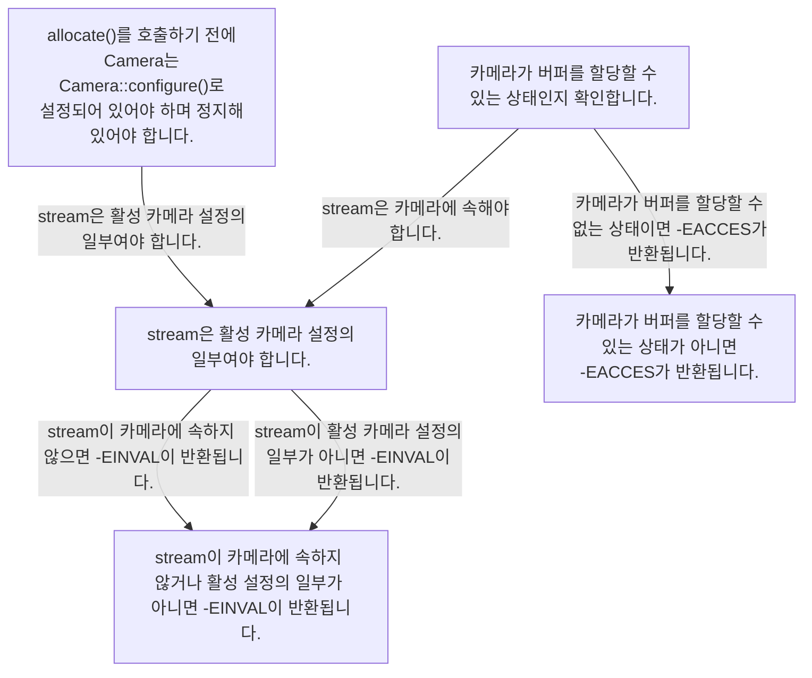
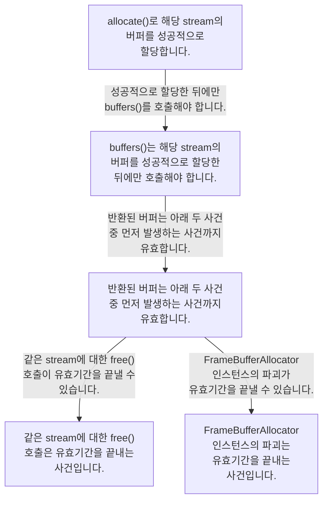
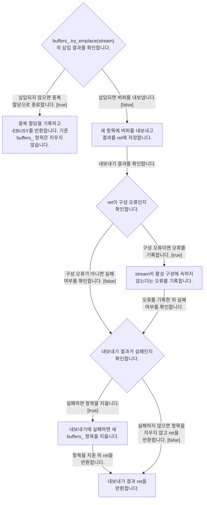

# FrameBufferAllocator의 실패와 참조 수명

**중복 할당·버퍼 내보내기 실패와 반환 버퍼의 유효기간을 확인하세요.**

| 지금 확인할 내용 | 이동할 절 |
|---|---|
| `allocate()`를 호출하기 전에 카메라는 `Camera::configure()`로 이미 구성되고 정지된 상태여야 하며, 스트림은 활성 카메라 구성에 속해야 합니다. | [할당 전에 확인할 카메라 상태와 스트림](#할당-전에-확인할-카메라-상태와-스트림) |
| `buffers()`는 해당 스트림에 대해 `allocate()`로 버퍼를 성공적으로 할당한 후에만 호출해야 합니다. | [buffers 반환 참조의 유효기간](#buffers-반환-참조의-유효기간) |
| `FrameBufferAllocator::allocate`는 `try_emplace`의 `inserted`가 false이면 버퍼가 이미 할당되었다는 오류를 기록하고 `-EBUSY`를 반환합니다. | [중복 할당과 내보내기 실패를 구분하기](#중복-할당과-내보내기-실패를-구분하기) |
| `FrameBufferAllocator::free`는 스트림을 찾지 못하면 `-EINVAL`을 반환하며 `buffers_` 항목을 제거하지 않습니다. | [free의 스트림 조회와 반환값](#free의-스트림-조회와-반환값) |

## 할당 전에 확인할 카메라 상태와 스트림

`allocate()`를 호출하기 전에 카메라는 `Camera::configure()`로 이미 구성되고 정지된 상태여야 하며, 스트림은 활성 카메라 구성에 속해야 합니다. `-EACCES`는 카메라가 버퍼를 할당할 수 없는 상태일 때 반환되며, `-EINVAL`은 스트림이 카메라에 속하지 않거나 활성 카메라 구성에 포함되지 않을 때 반환됩니다. `src/libcamera/framebuffer_allocator.cpp:72`, `src/libcamera/framebuffer_allocator.cpp:81`

<!-- sdd:visual:item-allocation-preconditions -->
### 할당 전에 확인할 카메라 상태와 스트림의 관계와 경계



[Mermaid 원문](framebuffer-allocator.item-allocation-preconditions.mmd)

??? note "그림 근거와 확인 범위"
    allocate() 호출 전에 카메라와 스트림은 어떤 조건을 충족해야 하며, 어떤 조건에서 -EACCES와 -EINVAL이 반환되는가?
    
    소스에 연결한 설계 해석입니다. 자동 연결 검사는 의미 승인이나 기기 실행 검증이 아닙니다.
    
    LLM 그림 초안 · 사람 검토 전
    
    작성 모델: `cli/codex/gpt-6.1-terra`
    
    | 요소·전이 | 소스 근거 |
    |---|---|
    | <span data-sdd-label-en="Before allocate(), Camera must have been configured with Camera::configure() and stopped.">allocate&#40;&#41;를 호출하기 전에 Camera는 Camera::configure&#40;&#41;로 설정되어 있어야 하며 정지해 있어야 합니다.</span> | [src/libcamera/framebuffer_allocator.cpp:72](#source-4f32d036f2dee319) |
    | <span data-sdd-label-en="The stream must be part of the active camera configuration.">stream은 활성 카메라 설정의 일부여야 합니다.</span> | [src/libcamera/framebuffer_allocator.cpp:72](#source-4f32d036f2dee319) |
    | <span data-sdd-label-en="Check whether the camera is in a state where buffers can be allocated.">카메라가 버퍼를 할당할 수 있는 상태인지 확인합니다.</span> | [src/libcamera/framebuffer_allocator.cpp:81](#source-224d9d0ce4f1ad7f) |
    | <span data-sdd-label-en="If the camera cannot allocate buffers in its current state, -EACCES is returned.">카메라가 버퍼를 할당할 수 있는 상태가 아니면 -EACCES가 반환됩니다.</span> | [src/libcamera/framebuffer_allocator.cpp:81](#source-224d9d0ce4f1ad7f) |
    | <span data-sdd-label-en="If stream does not belong to the camera or its active configuration, -EINVAL is returned.">stream이 카메라에 속하지 않거나 활성 설정의 일부가 아니면 -EINVAL이 반환됩니다.</span> | [src/libcamera/framebuffer_allocator.cpp:81](#source-224d9d0ce4f1ad7f) |
    | <span data-sdd-label-en="The stream must be part of the active camera configuration.">stream은 활성 카메라 설정의 일부여야 합니다.</span> | [src/libcamera/framebuffer_allocator.cpp:72](#source-4f32d036f2dee319) |
    | <span data-sdd-label-en="The stream must belong to the camera.">stream은 카메라에 속해야 합니다.</span> | [src/libcamera/framebuffer_allocator.cpp:81](#source-224d9d0ce4f1ad7f) |
    | <span data-sdd-label-en="If the camera cannot allocate buffers in its state, -EACCES is returned.">카메라가 버퍼를 할당할 수 없는 상태이면 -EACCES가 반환됩니다.</span> | [src/libcamera/framebuffer_allocator.cpp:81](#source-224d9d0ce4f1ad7f) |
    | <span data-sdd-label-en="If stream does not belong to the camera, -EINVAL is returned.">stream이 카메라에 속하지 않으면 -EINVAL이 반환됩니다.</span> | [src/libcamera/framebuffer_allocator.cpp:81](#source-224d9d0ce4f1ad7f) |
    | <span data-sdd-label-en="If stream is not in the active configuration, -EINVAL is returned.">stream이 활성 카메라 설정의 일부가 아니면 -EINVAL이 반환됩니다.</span> | [src/libcamera/framebuffer_allocator.cpp:81](#source-224d9d0ce4f1ad7f) |
<!-- /sdd:visual:item-allocation-preconditions -->

근거 원문: [src/libcamera/framebuffer_allocator.cpp:72](#source-4f32d036f2dee319) · [src/libcamera/framebuffer_allocator.cpp:81](#source-224d9d0ce4f1ad7f)

## buffers 반환 참조의 유효기간

`buffers()`는 해당 스트림에 대해 `allocate()`로 버퍼를 성공적으로 할당한 후에만 호출해야 합니다. `buffers()`가 반환하는 버퍼는 같은 스트림에 대해 `free()`가 호출되거나 `FrameBufferAllocator` 인스턴스가 파괴될 때까지 유효합니다. `src/libcamera/framebuffer_allocator.cpp:141`, `src/libcamera/framebuffer_allocator.cpp:142`

<!-- sdd:visual:item-reference-lifetime -->
### buffers 반환 참조의 유효기간의 관계와 경계



[Mermaid 원문](framebuffer-allocator.item-reference-lifetime.mmd)

??? note "그림 근거와 확인 범위"
    buffers()는 언제 호출할 수 있으며, 반환 버퍼의 유효기간은 어떤 사건으로 끝나는가?
    
    소스에 연결한 설계 해석입니다. 자동 연결 검사는 의미 승인이나 기기 실행 검증이 아닙니다.
    
    LLM 그림 초안 · 사람 검토 전
    
    작성 모델: `cli/codex/gpt-6.1-terra`
    
    | 요소·전이 | 소스 근거 |
    |---|---|
    | <span data-sdd-label-en="Successfully allocate buffers for the stream with allocate().">allocate&#40;&#41;로 해당 stream의 버퍼를 성공적으로 할당합니다.</span> | [src/libcamera/framebuffer_allocator.cpp:141](#source-68023250094ce1a8) |
    | <span data-sdd-label-en="Call buffers() only after successfully allocating buffers for the stream.">buffers&#40;&#41;는 해당 stream의 버퍼를 성공적으로 할당한 뒤에만 호출해야 합니다.</span> | [src/libcamera/framebuffer_allocator.cpp:141](#source-68023250094ce1a8) |
    | <span data-sdd-label-en="Returned buffers are valid until the first of the two events below.">반환된 버퍼는 아래 두 사건 중 먼저 발생하는 사건까지 유효합니다.</span> | [src/libcamera/framebuffer_allocator.cpp:142](#source-d60c5ad57e6699de) |
    | <span data-sdd-label-en="Calling free() for the same stream is an event that ends validity.">같은 stream에 대한 free&#40;&#41; 호출은 유효기간을 끝내는 사건입니다.</span> | [src/libcamera/framebuffer_allocator.cpp:142](#source-d60c5ad57e6699de) |
    | <span data-sdd-label-en="Destruction of the FrameBufferAllocator instance is an event that ends validity.">FrameBufferAllocator 인스턴스의 파괴는 유효기간을 끝내는 사건입니다.</span> | [src/libcamera/framebuffer_allocator.cpp:142](#source-d60c5ad57e6699de) |
    | <span data-sdd-label-en="Call buffers() only after successful allocation.">성공적으로 할당한 뒤에만 buffers&#40;&#41;를 호출해야 합니다.</span> | [src/libcamera/framebuffer_allocator.cpp:141](#source-68023250094ce1a8) |
    | <span data-sdd-label-en="Returned buffers are valid until the first of the two events below.">반환된 버퍼는 아래 두 사건 중 먼저 발생하는 사건까지 유효합니다.</span> | [src/libcamera/framebuffer_allocator.cpp:142](#source-d60c5ad57e6699de) |
    | <span data-sdd-label-en="Calling free() for the same stream can end validity.">같은 stream에 대한 free&#40;&#41; 호출이 유효기간을 끝낼 수 있습니다.</span> | [src/libcamera/framebuffer_allocator.cpp:142](#source-d60c5ad57e6699de) |
    | <span data-sdd-label-en="Destruction of the FrameBufferAllocator instance can end validity.">FrameBufferAllocator 인스턴스의 파괴가 유효기간을 끝낼 수 있습니다.</span> | [src/libcamera/framebuffer_allocator.cpp:142](#source-d60c5ad57e6699de) |
<!-- /sdd:visual:item-reference-lifetime -->

근거 원문: [src/libcamera/framebuffer_allocator.cpp:141](#source-68023250094ce1a8) · [src/libcamera/framebuffer_allocator.cpp:142](#source-d60c5ad57e6699de)

## 중복 할당과 내보내기 실패를 구분하기

`FrameBufferAllocator::allocate`는 `try_emplace`의 `inserted`가 false이면 버퍼가 이미 할당되었다는 오류를 기록하고 `-EBUSY`를 반환합니다. `FrameBufferAllocator::allocate()`는 `exportFrameBuffers()`의 반환값을 `ret`에 저장하고, `ret`가 음수이면 `buffers_.erase(it)`로 해당 `buffers_` 항목을 제거합니다. `FrameBufferAllocator::allocate`는 `exportFrameBuffers`를 호출한 경우 그 결과인 `ret`를 음수 여부와 관계없이 반환합니다. `src/libcamera/framebuffer_allocator.cpp:86`, `src/libcamera/framebuffer_allocator.cpp:95`

<!-- sdd:visual:item-allocation-failure -->
### 중복 할당과 내보내기 실패를 구분하기의 관계와 경계



[Mermaid 원문](framebuffer-allocator.item-allocation-failure.mmd)

??? note "그림 근거와 확인 범위"
    중복 할당과 내보내기 실패는 처리 흐름, 반환값 및 buffers_ 항목 처리에서 어떻게 다른가?
    
    소스에 연결한 설계 해석입니다. 자동 연결 검사는 의미 승인이나 기기 실행 검증이 아닙니다.
    
    LLM 그림 초안 · 사람 검토 전
    
    작성 모델: `cli/codex/gpt-6.1-terra`
    
    | 요소·전이 | 소스 근거 |
    |---|---|
    | <span data-sdd-label-en="Check the insertion result of buffers_.try_emplace(stream).">buffers&#95;.try&#95;emplace&#40;stream&#41;의 삽입 결과를 확인합니다.</span> | [src/libcamera/framebuffer_allocator.cpp:86](#source-78a6c2f7dbdebb0f) |
    | <span data-sdd-label-en="Log the duplicate allocation and return -EBUSY; keep the existing buffers_ entry.">중복 할당을 기록하고 -EBUSY를 반환합니다. 기존 buffers&#95; 항목은 지우지 않습니다.</span> | [src/libcamera/framebuffer_allocator.cpp:86](#source-78a6c2f7dbdebb0f) |
    | <span data-sdd-label-en="Export buffers to the new entry and save the result in ret.">새 항목에 버퍼를 내보내고 결과를 ret에 저장합니다.</span> | [src/libcamera/framebuffer_allocator.cpp:86](#source-78a6c2f7dbdebb0f) |
    | <span data-sdd-label-en="Check ret for a configuration error.">ret이 구성 오류인지 확인합니다.</span> | [src/libcamera/framebuffer_allocator.cpp:86](#source-78a6c2f7dbdebb0f) |
    | <span data-sdd-label-en="Log that stream is not part of the active configuration.">stream이 활성 구성에 속하지 않는다는 오류를 기록합니다.</span> | [src/libcamera/framebuffer_allocator.cpp:86](#source-78a6c2f7dbdebb0f) |
    | <span data-sdd-label-en="Check whether the export result indicates failure.">내보내기 결과가 실패인지 확인합니다.</span> | [src/libcamera/framebuffer_allocator.cpp:86](#source-78a6c2f7dbdebb0f) |
    | <span data-sdd-label-en="Erase the new buffers_ entry when export fails.">내보내기에 실패하면 새 buffers&#95; 항목을 지웁니다.</span> | [src/libcamera/framebuffer_allocator.cpp:86](#source-78a6c2f7dbdebb0f) |
    | <span data-sdd-label-en="Return the export result ret.">내보내기 결과 ret을 반환합니다.</span> | [src/libcamera/framebuffer_allocator.cpp:86](#source-78a6c2f7dbdebb0f) |
    | <span data-sdd-label-en="If insertion fails, return for duplicate allocation. · !inserted [true]">삽입되지 않으면 중복 할당으로 종료합니다. · &#33;inserted &#91;true&#93;</span> | [src/libcamera/framebuffer_allocator.cpp:86](#source-78a6c2f7dbdebb0f) |
    | <span data-sdd-label-en="If insertion succeeds, export the buffers. · !inserted [false]">삽입되면 버퍼를 내보냅니다. · &#33;inserted &#91;false&#93;</span> | [src/libcamera/framebuffer_allocator.cpp:86](#source-78a6c2f7dbdebb0f) |
    | <span data-sdd-label-en="Check the export result.">내보내기 결과를 확인합니다.</span> | [src/libcamera/framebuffer_allocator.cpp:86](#source-78a6c2f7dbdebb0f) |
    | <span data-sdd-label-en="If it is a configuration error, log it. · ret == -EINVAL [true]">구성 오류이면 오류를 기록합니다. · ret == -EINVAL &#91;true&#93;</span> | [src/libcamera/framebuffer_allocator.cpp:86](#source-78a6c2f7dbdebb0f) |
    | <span data-sdd-label-en="Otherwise, check for failure. · ret == -EINVAL [false]">구성 오류가 아니면 실패 여부를 확인합니다. · ret == -EINVAL &#91;false&#93;</span> | [src/libcamera/framebuffer_allocator.cpp:86](#source-78a6c2f7dbdebb0f) |
    | <span data-sdd-label-en="After logging, check for failure.">오류를 기록한 뒤 실패 여부를 확인합니다.</span> | [src/libcamera/framebuffer_allocator.cpp:86](#source-78a6c2f7dbdebb0f) |
    | <span data-sdd-label-en="If export fails, erase the entry. · ret &lt; 0 [true]">실패하면 항목을 지웁니다. · ret &lt; 0 &#91;true&#93;</span> | [src/libcamera/framebuffer_allocator.cpp:86](#source-78a6c2f7dbdebb0f) |
    | <span data-sdd-label-en="After erasing the entry, return ret.">항목을 지운 뒤 ret을 반환합니다.</span> | [src/libcamera/framebuffer_allocator.cpp:86](#source-78a6c2f7dbdebb0f) |
    | <span data-sdd-label-en="Otherwise, return ret without erasing the entry. · ret &lt; 0 [false]">실패하지 않으면 항목을 지우지 않고 ret을 반환합니다. · ret &lt; 0 &#91;false&#93;</span> | [src/libcamera/framebuffer_allocator.cpp:86](#source-78a6c2f7dbdebb0f) |
<!-- /sdd:visual:item-allocation-failure -->

근거 원문: [src/libcamera/framebuffer_allocator.cpp:86](#source-78a6c2f7dbdebb0f) · [src/libcamera/framebuffer_allocator.cpp:95](#source-c091763d679ea029)

## free의 스트림 조회와 반환값

`FrameBufferAllocator::free`는 스트림을 찾지 못하면 `-EINVAL`을 반환하며 `buffers_` 항목을 제거하지 않습니다. 스트림을 찾으면 해당 `buffers_` 항목을 제거하고 `0`을 반환합니다. `src/libcamera/framebuffer_allocator.cpp:119`

근거 원문: [src/libcamera/framebuffer_allocator.cpp:119](#source-fe0210ae47a5ebe2)

??? note "설계 질문과 검증 범위"
    질문별 답변과 근거 연결을 검사했습니다. 의미와 실행 결과는 사람 검토가 필요합니다.
    
    | 설계 질문 | 설명 위치 | 확인 범위 |
    |---|---|---|
    | allocate를 호출하기 위한 카메라·스트림 조건과 상태·스트림 오류의 원인은 무엇입니까? | [할당 전에 확인할 카메라 상태와 스트림](#할당-전에-확인할-카메라-상태와-스트림) | 코드 근거와 설명 연결 |
    | 중복 할당과 버퍼 내보내기 실패는 반환값과 할당 항목 처리에서 어떻게 다릅니까? | [중복 할당과 내보내기 실패를 구분하기](#중복-할당과-내보내기-실패를-구분하기) | 코드 근거와 설명 연결 |
    | free는 모르는 스트림과 등록된 스트림에 각각 무엇을 반환합니까? | [free의 스트림 조회와 반환값](#free의-스트림-조회와-반환값) | 코드 근거와 설명 연결 |
    | buffers를 호출할 수 있는 시점과 반환 참조의 유효기간은 무엇입니까? | [buffers 반환 참조의 유효기간](#buffers-반환-참조의-유효기간) | 코드 근거와 설명 연결 |

## 소스 근거

같은 발췌는 한 번만 싣습니다. 필요한 원문을 펼쳐 설명과 대조하세요.

<a id="source-4f32d036f2dee319"></a>

??? note "소스 근거: src/libcamera/framebuffer_allocator.cpp:72"
    `src/libcamera/framebuffer_allocator.cpp:72`에서 시작하는 발췌입니다. 종료 줄은 74이며, 아래 원문을 설명과 대조할 수 있습니다.
    
    SHA-256: `87ee819fc59da5231c8e99985771ae1821150196f2ed452822578208da94972f`
    
    ```text
    Allocate buffers suitable for capturing frames from the \a stream. The Camera
     * shall have been previously configured with Camera::configure() and shall be
     * stopped, and the stream shall be part of the active camera configuration.
    ```

<a id="source-224d9d0ce4f1ad7f"></a>

??? note "소스 근거: src/libcamera/framebuffer_allocator.cpp:81"
    `src/libcamera/framebuffer_allocator.cpp:81`에서 시작하는 발췌입니다. 종료 줄은 83이며, 아래 원문을 설명과 대조할 수 있습니다.
    
    SHA-256: `46d80bb2f91831ad0dda0a83fea0d3139ce6c0f156cf75033d97a9947cafde1e`
    
    ```text
    \retval -EACCES The camera is not in a state where buffers can be allocated
     * \retval -EINVAL The \a stream does not belong to the camera or the stream is
     * not part of the active camera configuration
    ```

<a id="source-68023250094ce1a8"></a>

??? note "소스 근거: src/libcamera/framebuffer_allocator.cpp:141"
    `src/libcamera/framebuffer_allocator.cpp:141`에서 시작하는 발췌입니다. 종료 줄은 142이며, 아래 원문을 설명과 대조할 수 있습니다.
    
    SHA-256: `a12056e800d2035f519dc58a4be3dc5e3c9d51920102cc9bc27c60a32790a663`
    
    ```text
    This function shall only be called after successfully allocating buffers for
     * \a stream with allocate().
    ```

<a id="source-d60c5ad57e6699de"></a>

??? note "소스 근거: src/libcamera/framebuffer_allocator.cpp:142"
    `src/libcamera/framebuffer_allocator.cpp:142`에서 시작하는 발췌입니다. 종료 줄은 143이며, 아래 원문을 설명과 대조할 수 있습니다.
    
    SHA-256: `7c43c6133e383a9e56e3a9163cfca05e8df576398f363e1b13bd5056664df86b`
    
    ```text
    The returned buffers are valid until free() is
     * called for the same stream or the FrameBufferAllocator instance is destroyed.
    ```

<a id="source-78a6c2f7dbdebb0f"></a>

??? note "소스 근거: src/libcamera/framebuffer_allocator.cpp:86"
    `src/libcamera/framebuffer_allocator.cpp:86`에서 시작하는 발췌입니다. 종료 줄은 105이며, 아래 원문을 설명과 대조할 수 있습니다.
    
    SHA-256: `0f275b59a26e4fac5b45597e08d8cf991937d31ad9e15675d574243fc7c1d63b`
    
    ```text
    int FrameBufferAllocator::allocate(Stream *stream)
    {
    	const auto &[it, inserted] = buffers_.try_emplace(stream);
    
    	if (!inserted) {
    		LOG(Allocator, Error) << "Buffers already allocated for stream";
    		return -EBUSY;
    	}
    
    	int ret = camera_->exportFrameBuffers(stream, &it->second);
    	if (ret == -EINVAL)
    		LOG(Allocator, Error)
    			<< "Stream is not part of " << camera_->id()
    			<< " active configuration";
    
    	if (ret < 0)
    		buffers_.erase(it);
    
    	return ret;
    }
    ```

<a id="source-c091763d679ea029"></a>

??? note "소스 근거: src/libcamera/framebuffer_allocator.cpp:95"
    `src/libcamera/framebuffer_allocator.cpp:95`에서 시작하는 발췌입니다. 종료 줄은 104이며, 아래 원문을 설명과 대조할 수 있습니다.
    
    SHA-256: `338a363feb53fd2928cc9b6d8a4d32dbfa921f4143079264e4264f9eae921b1e`
    
    ```text
    int ret = camera_->exportFrameBuffers(stream, &it->second);
    	if (ret == -EINVAL)
    		LOG(Allocator, Error)
    			<< "Stream is not part of " << camera_->id()
    			<< " active configuration";
    
    	if (ret < 0)
    		buffers_.erase(it);
    
    	return ret;
    ```

<a id="source-fe0210ae47a5ebe2"></a>

??? note "소스 근거: src/libcamera/framebuffer_allocator.cpp:119"
    `src/libcamera/framebuffer_allocator.cpp:119`에서 시작하는 발췌입니다. 종료 줄은 128이며, 아래 원문을 설명과 대조할 수 있습니다.
    
    SHA-256: `17715b15ff5a7663326b0ac1cd2248be6bf221eaa7551d1579901a1bb87ff6a6`
    
    ```text
    int FrameBufferAllocator::free(Stream *stream)
    {
    	auto iter = buffers_.find(stream);
    	if (iter == buffers_.end())
    		return -EINVAL;
    
    	buffers_.erase(iter);
    
    	return 0;
    }
    ```

??? note "근거와 검토 정보"
    - 생성 방식: 추출 사실과 LLM 설명
    - 검증 범위: 표·그림은 facts로 만들고 설명은 LLM이 작성합니다. 인용·문장 및 설정된 구조 검사를 적용합니다.
    - 근거 파일: `src/libcamera/framebuffer_allocator.cpp`
    - 근거 수준: 코드 확인 (정적 분석, simple_compdb 구성, commit `c19d05128f`)
    - 자동 검사 (인용·문장 및 설정된 구조 검사): 통과
    - 검토 상태 기록일: 2026-11-12 · 사람 검토 전

다음 단계: [Camera·Request와 버퍼 참조의 책임](camera-model.md)
