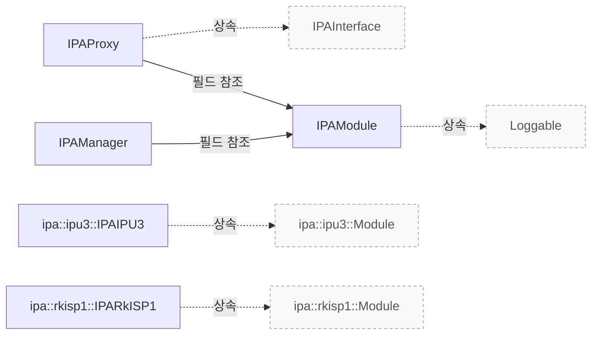

# IPA 튜닝과 소프트웨어 ISP

**튜닝 파일 경로와 소프트웨어 ISP의 렌즈 보정·입력 버퍼 연결을 코드와 대조하세요.**

| 지금 확인할 내용 | 이동할 절 |
|---|---|
| IPA 모듈 선택, 스레드·프로세스 경계와 요청·결과 인터페이스를 구현 근거로 확인하세요. | [IPA 관리와 구현 진입점](ipa.md) |

## 보정 전 튜닝 파일

RKISP1과 Mali-C55는 센서 모델 이름에 `.yaml`을 붙인 파일 이름과 대체 이름 `uncalibrated.yaml`을 `configurationFile()`에 전달합니다. `IPAProxy::configurationFile()`은 먼저 IPA 모듈 이름과 요청한 파일 이름으로 설정 파일을 검색하고, 경로를 찾으면 이를 반환합니다. 찾지 못하고 대체 이름이 비어 있으면 오류를 기록하고 빈 문자열을 반환합니다. 대체 이름이 비어 있지 않으면 그 이름으로 파일을 검색하고 경고를 기록합니다. `src/libcamera/pipeline/rkisp1/rkisp1.cpp:406`, `src/libcamera/pipeline/mali-c55/mali-c55.cpp:468`, `src/libcamera/ipa_proxy.cpp:174`

두 `uncalibrated.yaml`에는 `Agc`, `Awb`, `BlackLevelCorrection`, `Ccm`이 나열되어 있으며, RKISP1 파일에는 `GammaOutCorrection`도 나열되어 있습니다. `src/ipa/rkisp1/data/uncalibrated.yaml:1`, `src/ipa/mali-c55/data/uncalibrated.yaml:1`

근거 원문: [src/libcamera/pipeline/rkisp1/rkisp1.cpp:406](#source-a117437c7ec61db3) · [src/libcamera/pipeline/mali-c55/mali-c55.cpp:468](#source-efc0c3fc5cf7acef) · [src/libcamera/ipa_proxy.cpp:174](#source-4000376c954f5327) · [src/ipa/rkisp1/data/uncalibrated.yaml:1](#source-c3d57577d02a4dc3) · [src/ipa/mali-c55/data/uncalibrated.yaml:1](#source-9146c9052851a10f)

## 소프트웨어 ISP 입력 버퍼의 텍스처 형식

`createDMABufTexture2D()`는 `GL_RED`와 `GL_LUMINANCE`를 각각 `DRM_FORMAT_R8`에 대응합니다. `GL_RG`는 `DRM_FORMAT_GR88`에 대응하고, `GL_RGBA`는 `DRM_FORMAT_ARGB8888`에 대응합니다. `createDMABufTexture2D()`의 `switch` 문에서 `default` 분기는 오류 수준으로 `unhandled GL format`을 기록하고 `-ENODEV`를 반환합니다. 이 분기에는 `dmabuf_import_failed_` 플래그 대입이 없습니다. `src/libcamera/egl.cpp:174`

`createDMABufTexture2D()`에서 `eglCreateImageKHR()`의 결과가 `EGL_NO_IMAGE_KHR`이면 디버그 로그에 `eglCreateImageKHR fail`을 기록합니다. 이어서 `eglImage.dmabuf_import_failed_`에 `true`를 대입하고 `-ENODEV`를 반환합니다. `createInputDMABufTexture2D()`는 `createDMABufTexture2D()`의 마지막 인자로 `false`를 전달하고, `createOutputDMABufTexture2D()`는 `true`를 전달합니다. `src/libcamera/egl.cpp:174`

`createDMABufTexture2D()`는 `ret`을 0으로 초기화합니다. 앞선 오류 분기에서 반환하지 않은 경로에서 `output`이 참이면 `attachTextureToFBO(eglImage)`를 호출해 텍스처를 framebuffer에 연결하고 그 반환값을 `ret`에 대입합니다. `output`이 거짓이면 `ret`은 초기값 0을 유지하며, 함수는 최종적으로 `ret`을 반환합니다. `src/libcamera/egl.cpp:174`

근거 원문: [src/libcamera/egl.cpp:174](#source-8cc12a6ba8b0dced)

## 소프트웨어 ISP 셰이더의 렌즈 음영 보정

두 셰이더의 `main()`은 먼저 `rgb`에서 `blacklevel`을 빼고 `1.0 - blacklevel`로 나눕니다. `APPLY_LSC`가 정의된 경우 그다음 렌즈 음영 보정을 적용합니다. 패킹 셰이더는 `lsc_tex`를 `textureOut` 좌표로, 언패킹 셰이더는 `center.xy` 좌표로 샘플링하고, 각각 샘플의 RGB 값에 `4.0`을 곱한 값을 `rgb`에 곱합니다. 이 배율은 `UQ<2, 6>` 값을 부동소수점으로 변환하는 데 사용합니다. `src/libcamera/shaders/bayer_1x_packed.frag:237`, `src/libcamera/shaders/bayer_unpacked.frag:140`

두 셰이더의 `main()`은 그다음 `awb` 이득을 곱하고 각 채널을 0과 1 사이로 제한한 뒤 `ccm` 색 보정 행렬을 적용합니다. 이어서 `rgb`를 다시 0과 1 사이로 제한하고 각 채널에 `apply_contrast`를 적용한 다음 `gamma` 거듭제곱을 적용합니다. `src/libcamera/shaders/bayer_unpacked.frag:140`, `src/libcamera/shaders/bayer_1x_packed.frag:237`

실행 확인 항목: `IPASoftIspInterface.init()` 선언은 `fdStats`와 `fdParams`를 `libcamera.SharedFD` 인자로 받고, 반환값에 `lscEnabled`를 포함합니다. 이 선언은 별도의 LSC 버퍼 인자나 해당 버퍼와 `lsc_tex`의 연결을 명시하지 않습니다. `include/libcamera/ipa/softisp.mojom:1`

근거 원문: [src/libcamera/shaders/bayer_1x_packed.frag:237](#source-68d470282c445049) · [src/libcamera/shaders/bayer_unpacked.frag:140](#source-86d4a7688119bd37) · [include/libcamera/ipa/softisp.mojom:1](#source-df8e8976167a0311)

??? note "설계 질문과 검증 범위"
    질문별 답변과 근거 연결을 검사했습니다. 의미와 실행 결과는 사람 검토가 필요합니다.
    
    | 설계 질문 | 설명 위치 | 확인 범위 |
    |---|---|---|
    | 센서별 튜닝 파일이 없으면 어떤 파일과 알고리즘이 쓰입니까? | [보정 전 튜닝 파일](#보정-전-튜닝-파일) | 코드 근거와 설명 연결 |
    | 소프트웨어 ISP의 GPU 셰이더는 렌즈 음영 보정을 어느 단계에 적용합니까? | [소프트웨어 ISP 셰이더의 렌즈 음영 보정](#소프트웨어-isp-셰이더의-렌즈-음영-보정) | 코드 근거와 설명 연결 · 실행 확인 항목 별도 |
    | 소프트웨어 ISP의 입력 버퍼를 텍스처로 가져올 때 형식과 실패 처리는 어떻게 연결됩니까? | [소프트웨어 ISP 입력 버퍼의 텍스처 형식](#소프트웨어-isp-입력-버퍼의-텍스처-형식) | 코드 근거와 설명 연결 |

## 소스 근거

같은 발췌는 한 번만 싣습니다. 필요한 원문을 펼쳐 설명과 대조하세요.

<a id="source-a117437c7ec61db3"></a>

??? note "소스 근거: src/libcamera/pipeline/rkisp1/rkisp1.cpp:406"
    `src/libcamera/pipeline/rkisp1/rkisp1.cpp:406`에서 시작하는 발췌입니다. 종료 줄은 408이며, 아래 원문을 설명과 대조할 수 있습니다.
    
    SHA-256: `5085c39368b264636b7bc7386979e019ea9cd60621335cc42d1e3ad28d810c6c`
    
    ```text
    /* The IPA tuning file is made from the sensor name. */
    	std::string ipaTuningFile =
    		ipa_->configurationFile(sensor_->model() + ".yaml", "uncalibrated.yaml");
    ```

<a id="source-efc0c3fc5cf7acef"></a>

??? note "소스 근거: src/libcamera/pipeline/mali-c55/mali-c55.cpp:468"
    `src/libcamera/pipeline/mali-c55/mali-c55.cpp:468`에서 시작하는 발췌입니다. 종료 줄은 469이며, 아래 원문을 설명과 대조할 수 있습니다.
    
    SHA-256: `226c3c21c4b760c25b2a3323369bce67c92f92db80b9fcef19589a44af6eaa2a`
    
    ```text
    std::string ipaTuningFile = ipa_->configurationFile(sensor()->model() + ".yaml",
    							    "uncalibrated.yaml");
    ```

<a id="source-4000376c954f5327"></a>

??? note "소스 근거: src/libcamera/ipa_proxy.cpp:174"
    `src/libcamera/ipa_proxy.cpp:174`에서 시작하는 발췌입니다. 종료 줄은 199이며, 아래 원문을 설명과 대조할 수 있습니다.
    
    SHA-256: `6c48d1f3994c22addbc1b338c87cf7b166f9fee0f9223ecf718a254be0aa93a8`
    
    ```text
    std::string IPAProxy::configurationFile(const std::string &name,
    					const std::string &fallbackName) const
    {
    	/*
    	 * The IPA module name can be used as-is to build directory names as it
    	 * has been validated when loading the module.
    	 */
    	const std::string ipaName = ipam_->info().name;
    	std::string confPath = ipaConfigurationFile(ipaName, name, configPaths_);
    	if (!confPath.empty()) {
    		LOG(IPAProxy, Info) << "Using tuning file " << confPath;
    		return confPath;
    	}
    
    	if (fallbackName.empty()) {
    		LOG(IPAProxy, Error)
    			<< "Configuration file '" << name
    			<< "' not found for IPA module '" << ipaName << "'";
    		return std::string();
    	}
    
    	confPath = ipaConfigurationFile(ipaName, fallbackName, configPaths_);
    	LOG(IPAProxy, Warning)
    		<< "Configuration file '" << name
    		<< "' not found for IPA module '" << ipaName
    		<< "', falling back to '" << confPath << "'";
    ```

<a id="source-c3d57577d02a4dc3"></a>

??? note "소스 근거: src/ipa/rkisp1/data/uncalibrated.yaml:1"
    `src/ipa/rkisp1/data/uncalibrated.yaml:1`에서 시작하는 발췌입니다. 종료 줄은 11이며, 아래 원문을 설명과 대조할 수 있습니다.
    
    SHA-256: `f3e8a3a6257b7fb82f16cf5c8239901d57bcc15023908c8994dcac3714e9e648`
    
    ```text
    # SPDX-License-Identifier: CC0-1.0
    %YAML 1.1
    ---
    version: 1
    algorithms:
      - Agc:
      - Awb:
      - BlackLevelCorrection:
      - Ccm:
      - GammaOutCorrection:
    ...
    ```

<a id="source-9146c9052851a10f"></a>

??? note "소스 근거: src/ipa/mali-c55/data/uncalibrated.yaml:1"
    `src/ipa/mali-c55/data/uncalibrated.yaml:1`에서 시작하는 발췌입니다. 종료 줄은 10이며, 아래 원문을 설명과 대조할 수 있습니다.
    
    SHA-256: `532d8234c4d0a6d5429c8a8f8df85d151b0701e965fb7372abc71fe70d2bed82`
    
    ```text
    # SPDX-License-Identifier: CC0-1.0
    %YAML 1.1
    ---
    version: 1
    algorithms:
      - Agc:
      - Awb:
      - BlackLevelCorrection:
      - Ccm:
    ...
    ```

<a id="source-8cc12a6ba8b0dced"></a>

??? note "소스 근거: src/libcamera/egl.cpp:174"
    `src/libcamera/egl.cpp:174`에서 시작하는 발췌입니다. 종료 줄은 279이며, 아래 원문을 설명과 대조할 수 있습니다.
    
    SHA-256: `54972e6c423848da387112f756eb3670a3ac895a05f7cc8d3e7bb77f5cb6a570`
    
    ```text
    int eGL::createDMABufTexture2D(eGLImage &eglImage, int fd, bool output)
    {
    	EGLint drm_format;
    	int ret = 0;
    
    	assertThread();
    
    	switch (eglImage.format_) {
    	case GL_RED:
    	case GL_LUMINANCE:
    		drm_format = DRM_FORMAT_R8;
    		break;
    	case GL_RG:
    		drm_format = DRM_FORMAT_GR88;
    		break;
    	case GL_RGBA:
    		drm_format = DRM_FORMAT_ARGB8888;
    		break;
    	default:
    		LOG(eGL, Error) << "unhandled GL format";
    		return -ENODEV;
    	}
    
    	// clang-format off
    	EGLint image_attrs[] = {
    		EGL_WIDTH, (EGLint)eglImage.width_,
    		EGL_HEIGHT, (EGLint)eglImage.height_,
    		EGL_LINUX_DRM_FOURCC_EXT, drm_format,
    		EGL_DMA_BUF_PLANE0_FD_EXT, fd,
    		EGL_DMA_BUF_PLANE0_OFFSET_EXT, 0,
    		EGL_DMA_BUF_PLANE0_PITCH_EXT, (EGLint)eglImage.stride_,
    		EGL_DMA_BUF_PLANE0_MODIFIER_LO_EXT, 0,
    		EGL_DMA_BUF_PLANE0_MODIFIER_HI_EXT, 0,
    		EGL_NONE,
    	};
    	// clang-format on
    
    	EGLImageKHR image = vtable_.eglCreateImageKHR(display_, EGL_NO_CONTEXT,
    						      EGL_LINUX_DMA_BUF_EXT,
    						      NULL, image_attrs);
    
    	if (image == EGL_NO_IMAGE_KHR) {
    		LOG(eGL, Debug) << "eglCreateImageKHR fail";
    		eglImage.dmabuf_import_failed_ = true;
    		return -ENODEV;
    	}
    
    	activateBindTexture(eglImage);
    
    	// Generate texture with filter semantics
    	vtable_.glEGLImageTargetTexture2DOES(GL_TEXTURE_2D, image);
    	vtable_.eglDestroyImageKHR(display_, image);
    
    	// Nearest filtering
    	glTexParameteri(GL_TEXTURE_2D, GL_TEXTURE_MIN_FILTER, GL_NEAREST);
    	glTexParameteri(GL_TEXTURE_2D, GL_TEXTURE_MAG_FILTER, GL_NEAREST);
    
    	// Wrap to edge to avoid edge artifacts
    	glTexParameteri(GL_TEXTURE_2D, GL_TEXTURE_WRAP_S, GL_CLAMP_TO_EDGE);
    	glTexParameteri(GL_TEXTURE_2D, GL_TEXTURE_WRAP_T, GL_CLAMP_TO_EDGE);
    
    	if (output)
    		ret = attachTextureToFBO(eglImage);
    
    	return ret;
    }
    
    /**
     * \brief Create an input DMA-BUF backed texture
     * \param[in,out] eglImage EGL image to associate with the DMA-BUF
     * \param[in] fd DMA-BUF file descriptor
     *
     * Creates an EGL image from a DMA-BUF file descriptor and binds it to
     * a 2D texture for use as an input texture in shaders. The texture is
     * configured with nearest filtering and clamp-to-edge wrapping.
     *
     * \return 0 on success, or -ENODEV on failure
     */
    int eGL::createInputDMABufTexture2D(eGLImage &eglImage, int fd)
    {
    	assertThread();
    
    	return createDMABufTexture2D(eglImage, fd, false);
    }
    
    /**
     * \brief Create an output DMA-BUF backed texture
     * \param[in,out] eglImage EGL image to associate with the DMA-BUF
     * \param[in] fd DMA-BUF file descriptor
     *
     * Creates an EGL image from a DMA-BUF file descriptor and binds it to
     * a 2D texture, then attaches it to a framebuffer object for use as a
     * render target. This enables zero-copy rendering directly to the
     * DMA-BUF.
     *
     * \return 0 on success, or -ENODEV on failure
     */
    int eGL::createOutputDMABufTexture2D(eGLImage &eglImage, int fd)
    {
    	assertThread();
    
    	return createDMABufTexture2D(eglImage, fd, true);
    }
    
    /**
     * \brief Create a 2D texture from a memory buffer
    ```

<a id="source-68d470282c445049"></a>

??? note "소스 근거: src/libcamera/shaders/bayer_1x_packed.frag:237"
    `src/libcamera/shaders/bayer_1x_packed.frag:237`에서 시작하는 발췌입니다. 종료 줄은 270이며, 아래 원문을 설명과 대조할 수 있습니다.
    
    SHA-256: `84e5be2b8bbb1a1337af23df059b5d9270e16421c945a530a8c848709f302e6a`
    
    ```text
    rgb = (rgb - blacklevel) / (1.0 - blacklevel);
    
    #if defined(APPLY_LSC)
            /* Multiple by 4.0 for UQ<2, 6> -> float conversion:
             * texture2D(...) = original_float * 2^6 (quantization) * 1/2^8 (texture byte to float)
             * => original_float = texture2D(...) / 2^6 * 2^8 = texture2D(...) * 2^2
             */
            rgb = rgb * (texture2D(lsc_tex, textureOut).rgb * 4.0);
    #endif
    
    	/* Apply AWB gains, and saturate each channel at sensor range */
    	rgb = clamp(rgb * awb, vec3(0.0), vec3(1.0));
    
    	/* Colour Correction Matrix */
    	rgb = ccm * rgb;
    
    	/*
    	 * Contrast
    	 * contrastExp 0..2 contrast to 0..infinity; avoid actual infinity at tan(pi/2)
    	 */
    	rgb = clamp(rgb, 0.0, 1.0);
    	rgb.r = apply_contrast(rgb.r);
    	rgb.g = apply_contrast(rgb.g);
    	rgb.b = apply_contrast(rgb.b);
    
    	/* Apply gamma after colour correction */
    	rgb = pow(rgb, vec3(gamma));
    
    #if defined (SWAP_BLUE)
    	gl_FragColor = vec4(rgb.bgr, 1.0);
    #else
    	gl_FragColor = vec4(rgb, 1.0);
    #endif
    }
    ```

<a id="source-86d4a7688119bd37"></a>

??? note "소스 근거: src/libcamera/shaders/bayer_unpacked.frag:140"
    `src/libcamera/shaders/bayer_unpacked.frag:140`에서 시작하는 발췌입니다. 종료 줄은 169이며, 아래 원문을 설명과 대조할 수 있습니다.
    
    SHA-256: `5567b6548b078d7db847d9b57eefb1799e917214787288683110d5b41510573b`
    
    ```text
    rgb = (rgb - blacklevel) / (1.0 - blacklevel);
    
    #if defined(APPLY_LSC)
        /* Multiple by 4.0 for UQ<2, 6> -> float conversion */
        rgb = rgb * (texture2D(lsc_tex, center.xy).rgb * 4.0);
    #endif
    
        /* Apply AWB gains, and saturate each channel at sensor range */
        rgb = clamp(rgb * awb, vec3(0.0), vec3(1.0));
    
        /* Colour Correction Matrix */
        rgb = ccm * rgb;
    
        /*
         * Contrast
         */
        rgb = clamp(rgb, 0.0, 1.0);
        rgb.r = apply_contrast(rgb.r);
        rgb.g = apply_contrast(rgb.g);
        rgb.b = apply_contrast(rgb.b);
    
        /* Apply gamma after colour correction */
        rgb = pow(rgb, vec3(gamma));
    
    #if defined (SWAP_BLUE)
        gl_FragColor = vec4(rgb.bgr, 1.0);
    #else
        gl_FragColor = vec4(rgb, 1.0);
    #endif
    }
    ```

<a id="source-df8e8976167a0311"></a>

??? note "소스 근거: include/libcamera/ipa/softisp.mojom:1"
    `include/libcamera/ipa/softisp.mojom:1`에서 시작하는 발췌입니다. 종료 줄은 40이며, 아래 원문을 설명과 대조할 수 있습니다.
    
    SHA-256: `dedbfb928f4f1cdb8e174d8104cb8cbd575fd543e9b620240984c3af4cddecdb`
    
    ```text
    /* SPDX-License-Identifier: LGPL-2.1-or-later */
    
    /*
     * \todo Document the interface and remove the related EXCLUDE_PATTERNS entry.
     */
    
    module ipa.softisp;
    
    import "include/libcamera/ipa/core.mojom";
    
    struct IPAConfigInfo {
    	libcamera.ControlInfoMap sensorControls;
    };
    
    interface IPASoftIspInterface {
    	init(libcamera.IPASettings settings,
    	     libcamera.SharedFD fdStats,
    	     libcamera.SharedFD fdParams,
    	     libcamera.IPACameraSensorInfo sensorInfo,
    	     libcamera.ControlInfoMap sensorControls)
    		=> (int32 ret,
    		    libcamera.ControlInfoMap ipaControls,
    		    bool ccmEnabled, bool lscEnabled);
    	start() => (int32 ret);
    	stop();
    	configure(IPAConfigInfo configInfo)
    		=> (int32 ret, libcamera.ControlInfoMap ipaControls);
    
    	[async] queueRequest(uint32 frame, libcamera.ControlList sensorControls);
    	[async] computeParams(uint32 frame);
    	[async] processStats(uint32 frame,
    			     uint32 bufferId,
    			     libcamera.ControlList sensorControls);
    };
    
    interface IPASoftIspEventInterface {
    	setSensorControls(libcamera.ControlList sensorControls);
    	paramsComputed(uint32 frame);
    	metadataReady(uint32 frame, libcamera.ControlList metadata);
    };
    ```


<!-- sdd:class-diagram -->
## 클래스 관계

화살표의 글자는 추출한 관계를 나타내며, 점선은 상속입니다. 화살표는 참조 대상 또는 기반 클래스를 향합니다. 호출 순서를 뜻하지 않습니다.


<!-- /sdd:class-diagram -->


## 관련 클래스

| 클래스 | 선언 위치 | 상속 | 책임 (주석) |
|---|---|---|---|
| `libcamera::IPAManager` | `include/libcamera/internal/ipa_manager.h:29` | – | Manager for IPA modules |
| `libcamera::IPAModule` | `include/libcamera/internal/ipa_module.h:21` | `libcamera::Loggable` | Wrapper around IPA module shared object |
| `libcamera::IPAProxy` | `include/libcamera/internal/ipa_proxy.h:22` | `libcamera::IPAInterface` | IPA Proxy |
| `libcamera::ipa::ipu3::IPAIPU3` | `src/ipa/ipu3/ipu3.cpp:139` | `libcamera::ipa::ipu3::Module` | The IPU3 IPA implementation |
| `libcamera::ipa::rkisp1::IPARkISP1` | `src/ipa/rkisp1/rkisp1.cpp:46` | `libcamera::ipa::rkisp1::Module` | 확인 필요 |

??? note "근거와 검토 정보"
    - 생성 방식: 추출 사실과 LLM 설명
    - 검증 범위: 표·그림은 facts로 만들고 설명은 LLM이 작성합니다. 인용·문장 및 설정된 구조 검사를 적용합니다.
    - 근거 파일: `include/libcamera/internal/ipa_manager.h`, `include/libcamera/internal/ipa_module.h`, `include/libcamera/internal/ipa_proxy.h`, `include/libcamera/ipa/softisp.mojom`, `src/ipa/ipu3/ipu3.cpp`, `src/ipa/mali-c55/data/uncalibrated.yaml`, `src/ipa/rkisp1/data/uncalibrated.yaml`, `src/ipa/rkisp1/rkisp1.cpp`, `src/libcamera/egl.cpp`, `src/libcamera/ipa_manager.cpp`, `src/libcamera/ipa_module.cpp`, `src/libcamera/ipa_proxy.cpp`, `src/libcamera/pipeline/mali-c55/mali-c55.cpp`, `src/libcamera/pipeline/rkisp1/rkisp1.cpp`, `src/libcamera/shaders/bayer_1x_packed.frag`, `src/libcamera/shaders/bayer_unpacked.frag`
    - 근거 수준: 코드 확인 (정적 분석, simple_compdb 구성, commit `212c689fcf`)
    - 자동 검사 (인용·문장 및 설정된 구조 검사): 통과
    - 검토 상태 기록일: 2026-10-30 · 사람 검토 전

다음 단계: [IPU3 LSC와 상태 연결](ipu3-lsc.md)
