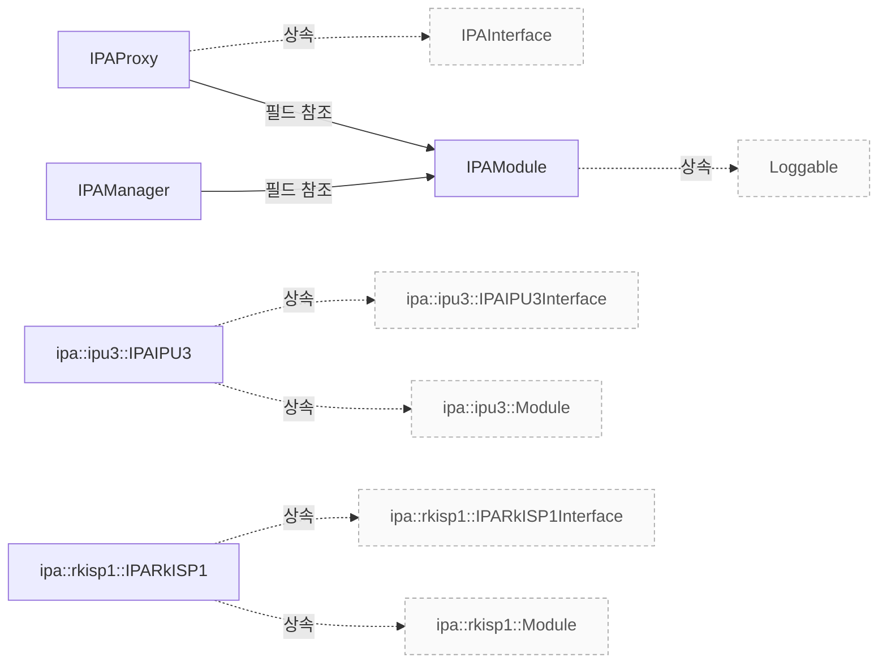

# IPA 관리와 구현 진입점

**IPA 모듈 선택, 스레드·프로세스 경계와 요청·결과 인터페이스를 구현 근거로 확인하세요.**

| 지금 확인할 내용 | 이동할 절 |
|---|---|
| 모듈 탐색과 격리 조건 절을 확인합니다. | [모듈 탐색과 격리 조건](#모듈-탐색과-격리-조건) |
| 스레드와 프로세스 경계 절을 확인합니다. | [스레드와 프로세스 경계](#스레드와-프로세스-경계) |
| 프레임 입력과 결과 인터페이스 절을 확인합니다. | [프레임 입력과 결과 인터페이스](#프레임-입력과-결과-인터페이스) |
| IPA 객체와 종료 순서 절을 확인합니다. | [IPA 객체와 종료 순서](#ipa-객체와-종료-순서) |
| 생성과 IPC 실패 절을 확인합니다. | [생성과 IPC 실패](#생성과-ipc-실패) |
| 보정 전 튜닝 파일 절을 확인합니다. | [보정 전 튜닝 파일](#보정-전-튜닝-파일) |

## 모듈 탐색과 격리 조건

`IPAManager`는 사용자가 지정한 모듈 경로를 먼저 추가합니다. 설치 전 빌드 경로를 찾을 수 있으면 그 아래 `src/ipa`를 추가하고, 마지막으로 설치된 시스템 모듈 경로를 확인합니다. 사용자 지정 경로가 우선한다는 주석이 이 순서를 설명합니다. `src/libcamera/ipa_manager.cpp:107`

`IPAModule::match()`는 모듈 이름의 정확한 일치와 버전 범위를 함께 검사합니다. `pipelineVersion`은 최소 버전 이상이면서 최대 버전 이하여야 합니다. `src/libcamera/ipa_module.cpp:460`

`createIPA()`는 이름과 버전에 맞는 모듈이 없으면 null 포인터를 반환합니다. 모듈을 찾은 뒤에는 서명 판정이 참이면 `Threaded`, 거짓이면 `Isolated` 프록시를 선택합니다. 생성한 프록시의 `isValid()`가 거짓일 때도 null 포인터를 반환합니다. `include/libcamera/internal/ipa_manager.h:35`

서명 판정은 강제 격리 설정, 모듈 파일 열기·매핑 실패, 서명 검증 결과에 영향을 받습니다. 공개 키 지원 없이 빌드한 경우에도 거짓을 반환합니다. 이 거짓 판정은 격리 실행을 선택하는 입력이며, 그 자체가 `createIPA()`의 즉시 생성 실패는 아닙니다. `src/libcamera/ipa_manager.cpp:289`

근거 원문: [src/libcamera/ipa_manager.cpp:107](#source-7603cbafe8eef490) · [src/libcamera/ipa_module.cpp:460](#source-6e1525c1fc1aa55e) · [include/libcamera/internal/ipa_manager.h:35](#source-2a1bbbc8623a516f) · [src/libcamera/ipa_manager.cpp:289](#source-532f8ffa194bd319)

## 스레드와 프로세스 경계

`Threaded` 프록시 템플릿은 `init()`을 IPA에 직접 호출한 뒤 내부 프록시를 작업 스레드로 옮깁니다. `start()`에서는 스레드를 시작하고 blocking 호출로 내부 시작을 수행합니다. `utils/codegen/ipc/generators/libcamera_templates/module_ipa_proxy.cpp.tmpl:48`

일반 동기 메서드는 IPA 객체를 직접 호출하고, async 메서드는 실행 상태를 확인한 뒤 `ConnectionTypeQueued`로 내부 프록시에 전달합니다. 따라서 메서드가 모두 같은 방식으로 작업 스레드에 전달된다고 보면 안 됩니다. `utils/codegen/ipc/generators/libcamera_templates/module_ipa_proxy.cpp.tmpl:48`

`Isolated` 프록시는 worker 경로를 찾고 `IPCPipeUnixSocket`을 구성합니다. 파이프가 연결돼야 수신 신호를 연결하고 프록시를 유효한 상태로 표시합니다. 메서드 입력을 직렬화한 뒤 async는 `sendAsync()`, 나머지는 `sendSync()`로 보냅니다. `utils/codegen/ipc/generators/libcamera_templates/module_ipa_proxy.cpp.tmpl:130`

`resolvePath()`의 실제 구현은 설정 경로를 먼저 확인합니다. 빌드 경로가 있으면 그 아래 worker를 확인하고, 그 경로에서 찾지 못하면 빈 문자열을 반환합니다. 빌드 경로가 없는 경우에 설치 경로를 확인하므로, 설치 경로가 먼저라는 오래된 주석보다 실제 분기를 기준으로 읽어야 합니다. `src/libcamera/ipa_proxy.cpp:204`

`IPCPipeUnixSocket`은 소켓을 만들고 모듈 경로와 파일 디스크립터를 인자로 worker 프로세스를 시작합니다. 동기 응답은 메시지 cookie로 대기 호출과 연결하며, 대응하는 대기 호출이 없는 수신 메시지는 `recv` 신호로 전달합니다. `src/libcamera/ipc_pipe_unixsocket.cpp:27`

실행 확인 항목: 프록시 템플릿의 이벤트 전달과 IPC 연결만으로 모든 애플리케이션 콜백의 실행 스레드를 확정할 수는 없습니다. 실제 신호 연결과 수신 객체의 스레드 문맥은 별도 확인 대상입니다. `utils/codegen/ipc/generators/libcamera_templates/module_ipa_proxy.cpp.tmpl:48`

근거 원문: [utils/codegen/ipc/generators/libcamera_templates/module_ipa_proxy.cpp.tmpl:48](#source-c7fd6e52f2c537b5) · [utils/codegen/ipc/generators/libcamera_templates/module_ipa_proxy.cpp.tmpl:130](#source-9ff6047b0a70ce66) · [src/libcamera/ipa_proxy.cpp:204](#source-59a673fb7c43c0e0) · [src/libcamera/ipc_pipe_unixsocket.cpp:27](#source-f0268126d3f8c2bc)

## 프레임 입력과 결과 인터페이스

IPU3 입력 인터페이스는 async 요청 제어 전달인 `queueRequest(frame, controls)`, 파라미터 버퍼를 지정하는 `computeParams(frame, bufferId)`, 프레임 시각·통계 버퍼·센서 제어를 받는 `processStats()`를 선언합니다. 이벤트 인터페이스는 프레임별 `paramsComputed`와 metadata 결과, 센서·렌즈 제어를 전달합니다. `include/libcamera/ipa/ipu3.mojom:19`

RKISP1도 요청 제어, 파라미터 버퍼와 통계 입력을 각각 async 메서드로 선언합니다. IPU3의 통계 입력과 달리 이 선언에는 프레임 타임스탬프 인자가 없습니다. RKISP1의 `paramsComputed` 이벤트는 프레임 번호와 함께 `bytesused`를 반환하고, `metadataReady`는 프레임 번호와 metadata를 전달합니다. `include/libcamera/ipa/rkisp1.mojom:17`

메인 인터페이스의 async 메서드와 결과를 돌려주는 EventInterface는 서로 다른 방향의 경계입니다. 선언은 인자와 호출 형태의 근거이며, 이벤트가 실제로 발생하는 시점이나 장치의 완료 순서를 입증하는 실행 결과는 아닙니다. `include/libcamera/ipa/ipu3.mojom:19`

근거 원문: [include/libcamera/ipa/ipu3.mojom:19](#source-5a4a0da4800968a4) · [include/libcamera/ipa/rkisp1.mojom:17](#source-7a01de2477d6466e)

## IPA 객체와 종료 순서

`IPAModule::load()`는 공유 객체에서 IPA 구현을 만드는 팩토리를 적재합니다. 유효하지 않은 모듈이나 공유 객체 열기·팩토리 심볼 검색 실패는 실패로 반환하며, 이미 적재됐다면 성공을 반환합니다. `createInterface()`는 유효하고 적재된 모듈에서 팩토리를 호출하고, 선행 조건이 맞지 않으면 null 포인터를 반환합니다. `src/libcamera/ipa_module.cpp:390`

`Threaded` 프록시는 모듈 적재나 인터페이스 생성이 실패하면 생성자에서 빠져나옵니다. 성공하면 IPA 인터페이스를 `unique_ptr`로 보관하고 이벤트를 연결한 뒤 유효 상태로 표시합니다. `utils/codegen/ipc/generators/libcamera_templates/module_ipa_proxy.cpp.tmpl:48`

Threaded 정지 코드는 실행 중이 아니면 반환하고, 실행 중이면 `ProxyStopping`으로 전환합니다. 내부 `stop()`을 blocking 호출한 뒤 스레드의 `exit()`와 `wait()`를 수행합니다. 이어 현재 스레드에 남은 해당 프록시의 InvokeMessage를 전달한 뒤 `ProxyStopped`로 바꿉니다. `utils/codegen/ipc/generators/libcamera_templates/proxy_functions.tmpl:25`

`Isolated` 프록시는 worker 경로와 IPC 연결이 확보돼야 유효해집니다. 소멸자는 IPC가 있을 때 `Exit` 메시지를 비동기로 전송합니다. 이 소멸자 코드만으로 worker의 종료 확인이나 모든 후속 콜백 처리가 끝났다고 단정할 수는 없습니다. `utils/codegen/ipc/generators/libcamera_templates/module_ipa_proxy.cpp.tmpl:130`

근거 원문: [src/libcamera/ipa_module.cpp:390](#source-fadefbb962b2fc44) · [utils/codegen/ipc/generators/libcamera_templates/module_ipa_proxy.cpp.tmpl:48](#source-c7fd6e52f2c537b5) · [utils/codegen/ipc/generators/libcamera_templates/proxy_functions.tmpl:25](#source-eb8f57d7452822da) · [utils/codegen/ipc/generators/libcamera_templates/module_ipa_proxy.cpp.tmpl:130](#source-9ff6047b0a70ce66)

## 생성과 IPC 실패

`createIPA()`의 null 반환은 일치하는 모듈이 없거나 생성한 프록시가 유효하지 않은 경우입니다. 서명이 유효하지 않다는 판정은 먼저 `Isolated` 선택으로 이어지므로 별도의 실패 단계와 구분합니다. `include/libcamera/internal/ipa_manager.h:35`

`IPAModule::load()`는 `dlopen()` 실패 또는 `ipaCreate` 심볼 검색 실패를 감지합니다. 심볼을 찾지 못하면 열린 핸들을 닫고 null로 바꾼 뒤 실패를 반환합니다. `createInterface()`도 모듈의 유효성·적재 상태를 확인한 뒤 팩토리를 호출합니다. `src/libcamera/ipa_module.cpp:390`

`Isolated` 생성자는 worker 경로가 비었거나 IPC 연결이 실패하면 유효 상태에 도달하지 않습니다. 생성된 메서드의 IPC 전송 오류는 로그에 남으며, 반환값이 있는 메서드는 오류 코드를 해당 반환 타입으로 돌려줍니다. `utils/codegen/ipc/generators/libcamera_templates/module_ipa_proxy.cpp.tmpl:130`

`sendSync()`가 사용하는 `call()`은 메시지를 보낸 뒤 2000ms 타이머를 시작하고 이벤트를 처리하며 응답을 기다립니다. 시간이 만료되면 대기 항목을 제거하고 `-ETIMEDOUT`을 반환합니다. 소켓 전송 실패도 대기 항목을 정리하고 그대로 반환하므로, 모듈 선택 실패와 통신 중 실패는 구분됩니다. `src/libcamera/ipc_pipe_unixsocket.cpp:27`

근거 원문: [include/libcamera/internal/ipa_manager.h:35](#source-2a1bbbc8623a516f) · [src/libcamera/ipa_module.cpp:390](#source-fadefbb962b2fc44) · [utils/codegen/ipc/generators/libcamera_templates/module_ipa_proxy.cpp.tmpl:130](#source-9ff6047b0a70ce66) · [src/libcamera/ipc_pipe_unixsocket.cpp:27](#source-f0268126d3f8c2bc)

## 보정 전 튜닝 파일

RKISP1은 센서 모델 이름에 `.yaml`을 붙인 튜닝 파일을 요청하며, 대체 파일 이름으로 `uncalibrated.yaml`을 지정합니다. `src/libcamera/pipeline/rkisp1/rkisp1.cpp:406`

Mali-C55도 센서 모델 이름으로 튜닝 파일을 찾고 같은 대체 파일 이름을 전달합니다. 센서별 파일 요청과 대체 파일 요청이 코드에서 명시적으로 구분됩니다. `src/libcamera/pipeline/mali-c55/mali-c55.cpp:468`

`IPAProxy::configurationFile()`은 먼저 요청한 이름을 검색해 경로를 찾으면 반환합니다. 찾지 못했고 대체 이름도 없으면 빈 문자열을 반환합니다. 대체 이름이 있으면 그 이름으로 다시 검색하며, 대체 검색을 했다는 사실이 파일의 존재를 보장하는 것은 아닙니다. `src/libcamera/ipa_proxy.cpp:174`

RKISP1의 기본 대체 파일은 `Agc`, `Awb`, `BlackLevelCorrection`, `Ccm`, `GammaOutCorrection`을 나열합니다. 이 목록에 없는 보정 알고리즘까지 활성화된 것으로 추정하지 않습니다. `src/ipa/rkisp1/data/uncalibrated.yaml:1`

Mali-C55의 기본 대체 파일은 `Agc`, `Awb`, `BlackLevelCorrection`, `Ccm`을 나열합니다. 센서별 튜닝 파일과 기본 대체 파일의 알고리즘 구성을 구분해야 합니다. `src/ipa/mali-c55/data/uncalibrated.yaml:1`

근거 원문: [src/libcamera/pipeline/rkisp1/rkisp1.cpp:406](#source-a117437c7ec61db3) · [src/libcamera/pipeline/mali-c55/mali-c55.cpp:468](#source-efc0c3fc5cf7acef) · [src/libcamera/ipa_proxy.cpp:174](#source-4000376c954f5327) · [src/ipa/rkisp1/data/uncalibrated.yaml:1](#source-c3d57577d02a4dc3) · [src/ipa/mali-c55/data/uncalibrated.yaml:1](#source-9146c9052851a10f)

## 소프트웨어 ISP 셰이더의 렌즈 음영 보정

packed 셰이더는 블랙 레벨 보정 뒤 `APPLY_LSC`가 정의된 경우 LSC를 적용합니다. `textureOut` 좌표에서 읽은 LSC 텍스처 값에 4.0을 곱해 RGB에 적용하며, 주석은 이를 UQ 형식에서 실수 값으로 바꾸는 배율로 설명합니다. 이후 AWB와 범위 제한, 색 보정 행렬, 대비, 감마 순서로 처리합니다. `src/libcamera/shaders/bayer_1x_packed.frag:237`

unpacked 셰이더도 블랙 레벨 보정 다음에 조건부 LSC를 수행하지만 텍스처 좌표는 `center.xy`입니다. 텍스처 값의 4.0 배율과 AWB·색 보정·대비·감마의 순서는 packed 경로와 같습니다. `src/libcamera/shaders/bayer_unpacked.frag:140`

SoftISP 인터페이스의 `init()`은 통계와 파라미터용 `SharedFD`를 받고 `ccmEnabled`, `lscEnabled`를 결과로 선언합니다. 이 선언에는 LSC 전용 버퍼 인자가 따로 없으므로, 이를 별도의 LSC 버퍼 전달 계약으로 확대하지 않습니다. `include/libcamera/ipa/softisp.mojom:1`

SoftISP는 프레임별 async 요청·파라미터 계산·통계 처리 메서드를 선언합니다. 이 인터페이스와 셰이더 소스의 연결만으로 실제 GPU 실행이나 영상 보정 결과를 검증한 것은 아닙니다. `include/libcamera/ipa/softisp.mojom:1`

근거 원문: [src/libcamera/shaders/bayer_1x_packed.frag:237](#source-68d470282c445049) · [src/libcamera/shaders/bayer_unpacked.frag:140](#source-86d4a7688119bd37) · [include/libcamera/ipa/softisp.mojom:1](#source-df8e8976167a0311)

??? note "설계 질문과 검증 범위"
    질문별 답변과 근거 연결을 검사했습니다. 의미와 실행 결과는 사람 검토가 필요합니다.
    
    | 설계 질문 | 설명 위치 | 확인 범위 |
    |---|---|---|
    | 어떤 IPA 모듈과 실행 방식이 선택됩니까? | [모듈 탐색과 격리 조건](#모듈-탐색과-격리-조건) | 코드 근거와 설명 연결 |
    | 동기 호출과 비동기 호출은 어디에서 실행됩니까? | [스레드와 프로세스 경계](#스레드와-프로세스-경계) | 코드 근거와 설명 연결 · 실행 확인 항목 별도 |
    | 파이프라인과 알고리즘은 어떤 입력과 결과를 주고받습니까? | [프레임 입력과 결과 인터페이스](#프레임-입력과-결과-인터페이스) | 코드 근거와 설명 연결 |
    | 인터페이스를 만들고 비동기 처리를 끝내는 계약은 무엇입니까? | [IPA 객체와 종료 순서](#ipa-객체와-종료-순서) | 코드 근거와 설명 연결 |
    | 모듈 생성과 IPC 오류는 어떻게 관찰됩니까? | [생성과 IPC 실패](#생성과-ipc-실패) | 코드 근거와 설명 연결 |
    | 센서별 튜닝 파일이 없으면 어떤 파일과 알고리즘이 쓰입니까? | [보정 전 튜닝 파일](#보정-전-튜닝-파일) | 코드 근거와 설명 연결 |
    | 소프트웨어 ISP의 GPU 셰이더는 렌즈 음영 보정을 어느 단계에 적용합니까? | [소프트웨어 ISP 셰이더의 렌즈 음영 보정](#소프트웨어-isp-셰이더의-렌즈-음영-보정) | 코드 근거와 설명 연결 |

## 소스 근거

같은 발췌는 한 번만 싣습니다. 필요한 원문을 펼쳐 설명과 대조하세요.

<a id="source-7603cbafe8eef490"></a>

??? note "소스 근거: src/libcamera/ipa_manager.cpp:107"
    `src/libcamera/ipa_manager.cpp:107`에서 시작하는 발췌입니다. 종료 줄은 162이며, 아래 원문을 설명과 대조할 수 있습니다.
    
    SHA-256: `ed1b15d5743b434eb29e34ba981de978ff4dd9bcb186859e4800931a525e766c`
    
    ```text
    IPAManager::IPAManager(const CameraManager &cm)
    	: cm_(cm)
    {
    	const GlobalConfiguration &configuration = cm._d()->configuration();
    
    #if HAVE_IPA_PUBKEY
    	if (!pubKey_.isValid())
    		LOG(IPAManager, Warning) << "Public key not valid";
    
    	forceIsolation_ = configuration.option<bool>({ "ipa", "force_isolation" })
    				       .value_or(false);
    #endif
    
    	unsigned int ipaCount = 0;
    
    	/* User-specified paths take precedence. */
    	const auto modulePaths =
    		configuration.listOption({ "ipa", "module_paths" })
    			.value_or(utils::defopt);
    	for (const auto &dir : modulePaths) {
    		if (dir.empty())
    			continue;
    
    		ipaCount += addDir(dir.c_str());
    	}
    
    	if (!modulePaths.empty() && !ipaCount)
    		LOG(IPAManager, Warning) << "No IPA found in '"
    					 << utils::join(modulePaths, ":")
    					 << "'";
    
    	/*
    	 * When libcamera is used before it is installed, load IPAs from the
    	 * same build directory as the libcamera library itself.
    	 */
    	std::string root = utils::libcameraBuildPath();
    	if (!root.empty()) {
    		std::string ipaBuildPath = root + "src/ipa";
    		constexpr int maxDepth = 2;
    
    		LOG(IPAManager, Info)
    			<< "libcamera is not installed. Adding '"
    			<< ipaBuildPath << "' to the IPA search path";
    
    		ipaCount += addDir(ipaBuildPath.c_str(), maxDepth);
    	}
    
    	/* Finally try to load IPAs from the installed system path. */
    	ipaCount += addDir(IPA_MODULE_DIR);
    
    	if (!ipaCount)
    		LOG(IPAManager, Warning)
    			<< "No IPA found in '" IPA_MODULE_DIR "'";
    }
    
    IPAManager::~IPAManager() = default;
    ```

<a id="source-6e1525c1fc1aa55e"></a>

??? note "소스 근거: src/libcamera/ipa_module.cpp:460"
    `src/libcamera/ipa_module.cpp:460`에서 시작하는 발췌입니다. 종료 줄은 478이며, 아래 원문을 설명과 대조할 수 있습니다.
    
    SHA-256: `99940db9ea353ad0d8282b7c2148578f4c6054d785ef7aaf690d522b52bafb5b`
    
    ```text
    \brief Verify if the IPA module matches a given name
     * \param[in] name The IPA module name
     * \param[in] minVersion Minimum acceptable version of IPA module
     * \param[in] maxVersion Maximum acceptable version of IPA module
     *
     * This function checks if this IPA module matches the requested \a name
     * and the input version range.
     *
     * \return True if the IPA module matches, or false otherwise
     */
    bool IPAModule::match(const char *name, uint32_t minVersion,
    		      uint32_t maxVersion) const
    {
    	return info_.pipelineVersion >= minVersion &&
    	       info_.pipelineVersion <= maxVersion &&
    	       !strcmp(info_.name, name);
    }
    
    std::string IPAModule::logPrefix()
    ```

<a id="source-2a1bbbc8623a516f"></a>

??? note "소스 근거: include/libcamera/internal/ipa_manager.h:35"
    `include/libcamera/internal/ipa_manager.h:35`에서 시작하는 발췌입니다. 종료 줄은 58이며, 아래 원문을 설명과 대조할 수 있습니다.
    
    SHA-256: `e0bd5192ea24a8b39d3df7b7b93c8b17614663a0144f6dd0741d410fa321d458`
    
    ```text
    template<typename T>
    	std::unique_ptr<T> createIPA(const char *name, uint32_t minVersion,
    				     uint32_t maxVersion)
    	{
    		IPAModule *m = module(name, minVersion, maxVersion);
    		if (!m)
    			return nullptr;
    
    		auto proxy = [&]() -> std::unique_ptr<T> {
    			if (isSignatureValid(m))
    				return std::make_unique<typename T::Threaded>(m, cm_);
    			else
    				return std::make_unique<typename T::Isolated>(m, cm_);
    		}();
    
    		if (!proxy->isValid()) {
    			LOG(IPAManager, Error) << "Failed to load proxy";
    			return nullptr;
    		}
    
    		return proxy;
    	}
    
    #if HAVE_IPA_PUBKEY
    ```

<a id="source-532f8ffa194bd319"></a>

??? note "소스 근거: src/libcamera/ipa_manager.cpp:289"
    `src/libcamera/ipa_manager.cpp:289`에서 시작하는 발췌입니다. 종료 줄은 319이며, 아래 원문을 설명과 대조할 수 있습니다.
    
    SHA-256: `f657ce54df77453510108b02060166edd7506c982d13d3e4868fadee4065a677`
    
    ```text
    bool IPAManager::isSignatureValid([[maybe_unused]] IPAModule *ipa) const
    {
    #if HAVE_IPA_PUBKEY
    	if (forceIsolation_) {
    		LOG(IPAManager, Debug)
    			<< "Isolation of IPA module " << ipa->path()
    			<< " forced through configuration";
    		return false;
    	}
    
    	File file{ ipa->path() };
    	if (!file.open(File::OpenModeFlag::ReadOnly))
    		return false;
    
    	std::span<uint8_t> data = file.map();
    	if (data.empty())
    		return false;
    
    	bool valid = pubKey_.verify(data, ipa->signature());
    
    	LOG(IPAManager, Debug)
    		<< "IPA module " << ipa->path() << " signature is "
    		<< (valid ? "valid" : "not valid");
    
    	return valid;
    #else
    	return false;
    #endif
    }
    
    } /* namespace libcamera */
    ```

<a id="source-c7fd6e52f2c537b5"></a>

??? note "소스 근거: utils/codegen/ipc/generators/libcamera_templates/module_ipa_proxy.cpp.tmpl:48"
    `utils/codegen/ipc/generators/libcamera_templates/module_ipa_proxy.cpp.tmpl:48`에서 시작하는 발췌입니다. 종료 줄은 128이며, 아래 원문을 설명과 대조할 수 있습니다.
    
    SHA-256: `af4b12c81ffee2e9979c01a7e7eb188f5568d258ba03e522b60a3608dc226abd`
    
    ```text
    {{proxy_name}}Threaded::{{proxy_name}}Threaded(IPAModule *ipam, const CameraManager &cm)
    	: {{proxy_name}}(ipam, cm), thread_("{{proxy_name}}")
    {
    	LOG(IPAProxy, Debug)
    		<< "initializing {{module_name}} proxy in thread: loading IPA from "
    		<< ipam->path();
    
    	if (!ipam->load())
    		return;
    
    	IPAInterface *ipai = ipam->createInterface();
    	if (!ipai) {
    		LOG(IPAProxy, Error)
    			<< "Failed to create IPA context for " << ipam->path();
    		return;
    	}
    
    	ipa_ = std::unique_ptr<{{interface_name}}>(static_cast<{{interface_name}} *>(ipai));
    	proxy_.setIPA(ipa_.get());
    
    
    	ipa_->{{method.mojom_name}}.connect(this, &{{proxy_name}}Threaded::{{method.mojom_name}}Handler);
    
    
    	valid_ = true;
    }
    
    {{proxy_name}}Threaded::~{{proxy_name}}Threaded() = default;
    
    
    {{proxy_funcs.func_sig(proxy_name + "Threaded", method)}}
    {
    
    	{{proxy_funcs.stop_thread_body()}}
    
    	{{ method|method_return_value + " _ret = " if method|method_return_value != "void" -}}
    	ipa_->{{method.mojom_name}}(
    	
    		{{param}}{{- ", " if not loop.last}}
    	
    );
    
    	proxy_.moveToThread(&thread_);
    
    	return {{ "_ret" if method|method_return_value != "void" }};
    
    	state_ = ProxyRunning;
    	thread_.start();
    
    	return proxy_.invokeMethod(&ThreadProxy::start, ConnectionTypeBlocking
    	{{- ", " if method|method_param_names}}
    	
    		{{param}}{{- ", " if not loop.last}}
    	
    );
    
    	return ipa_->{{method.mojom_name}}(
    	
    		{{param}}{{- ", " if not loop.last}}
    	
    );
    
    	ASSERT(state_ == ProxyRunning);
    	proxy_.invokeMethod(&ThreadProxy::{{method.mojom_name}}, ConnectionTypeQueued
    	
    		, {{param}}
    	
    );
    
    }
    
    
    
    {{proxy_funcs.func_sig(proxy_name + "Threaded", method, "Handler")}}
    {
    	ASSERT(state_ != ProxyStopped);
    	{{method.mojom_name}}.emit({{method.parameters|params_comma_sep}});
    }
    
    
    /* ========================================================================== */
    ```

<a id="source-9ff6047b0a70ce66"></a>

??? note "소스 근거: utils/codegen/ipc/generators/libcamera_templates/module_ipa_proxy.cpp.tmpl:130"
    `utils/codegen/ipc/generators/libcamera_templates/module_ipa_proxy.cpp.tmpl:130`에서 시작하는 발췌입니다. 종료 줄은 212이며, 아래 원문을 설명과 대조할 수 있습니다.
    
    SHA-256: `dd0ba6e352ffacd6c27c6ff5bb447af14838d75ca6aed8d056855ec442a97744`
    
    ```text
    {{proxy_name}}Isolated::{{proxy_name}}Isolated(IPAModule *ipam, const CameraManager &cm)
    	: {{proxy_name}}(ipam, cm),
    	  controlSerializer_(ControlSerializer::Role::Proxy), seq_(0)
    {
    	LOG(IPAProxy, Debug)
    		<< "initializing {{module_name}} proxy in isolation: loading IPA from "
    		<< ipam->path();
    
    	const std::string proxyWorkerPath = resolvePath("{{module_name}}_ipa_proxy");
    	if (proxyWorkerPath.empty()) {
    		LOG(IPAProxy, Error) << "Failed to get proxy worker path";
    		return;
    	}
    
    	auto ipc = std::make_unique<IPCPipeUnixSocket>(ipam->path().c_str(),
    						       proxyWorkerPath.c_str());
    	if (!ipc->isConnected()) {
    		LOG(IPAProxy, Error) << "Failed to create IPCPipe";
    		return;
    	}
    
    	ipc->recv.connect(this, &{{proxy_name}}Isolated::recvMessage);
    
    	ipc_ = std::move(ipc);
    	valid_ = true;
    }
    
    {{proxy_name}}Isolated::~{{proxy_name}}Isolated()
    {
    	if (ipc_) {
    		IPCMessage::Header header =
    			{ static_cast<uint32_t>({{cmd_enum_name}}::Exit), seq_++ };
    		IPCMessage msg(header);
    		ipc_->sendAsync(msg);
    	}
    }
    
    
    {{proxy_funcs.func_sig(proxy_name + "Isolated", method)}}
    {
    
    	controlSerializer_.reset();
    
    
    
    	IPCMessage::Header _header = { static_cast<uint32_t>({{cmd}}), seq_++ };
    	IPCMessage _ipcInputBuf(_header);
    
    	IPCMessage _ipcOutputBuf;
    
    
    {{proxy_funcs.serialize_call(method|method_param_inputs, '_ipcInputBuf.data()', '_ipcInputBuf.fds()')}}
    
    
    	int _ret = ipc_->sendAsync(_ipcInputBuf);
    
    	int _ret = ipc_->sendSync(_ipcInputBuf
    {{- ", &_ipcOutputBuf" if has_output -}}
    );
    
    	if (_ret < 0) {
    		LOG(IPAProxy, Error) << "Failed to call {{method.mojom_name}}: " << _ret;
    
    		return static_cast<{{method|method_return_value}}>(_ret);
    
    		return;
    
    	}
    
    	{{method|method_return_value}} _retValue = IPADataSerializer<{{method|method_return_value}}>::deserialize(_ipcOutputBuf.data(), 0);
    
    {{proxy_funcs.deserialize_call(method|method_param_outputs, '_ipcOutputBuf.data()', '_ipcOutputBuf.fds()', init_offset = method|method_return_value|byte_width|int)}}
    
    	return _retValue;
    
    
    {{proxy_funcs.deserialize_call(method|method_param_outputs, '_ipcOutputBuf.data()', '_ipcOutputBuf.fds()')}}
    
    }
    
    
    
    void {{proxy_name}}Isolated::recvMessage(
    ```

<a id="source-59a673fb7c43c0e0"></a>

??? note "소스 근거: src/libcamera/ipa_proxy.cpp:204"
    `src/libcamera/ipa_proxy.cpp:204`에서 시작하는 발췌입니다. 종료 줄은 261이며, 아래 원문을 설명과 대조할 수 있습니다.
    
    SHA-256: `8cbcadf7036cdb391f4c48af8562cb637752242f9564f1118c949a62df9dbd77`
    
    ```text
    \brief Find a valid full path for a proxy worker for a given executable name
     * \param[in] file File name of proxy worker executable
     *
     * A proxy worker's executable could be found in either the global installation
     * directory, or in the paths specified by the environment variable
     * LIBCAMERA_IPA_PROXY_PATH. This function checks the global install directory
     * first, then LIBCAMERA_IPA_PROXY_PATH in order, and returns the full path to
     * the proxy worker executable that is specified by file. The proxy worker
     * executable shall have exec permission.
     *
     * \return The full path to the proxy worker executable, or an empty string if
     * no valid executable path
     */
    std::string IPAProxy::resolvePath(const std::string &file) const
    {
    	std::string proxyFile = "/" + file;
    
    	/* Try paths from the configuration first. */
    	for (const auto &dir : execPaths_) {
    		if (dir.empty())
    			continue;
    
    		std::string proxyPath = dir + proxyFile;
    		if (!access(proxyPath.c_str(), X_OK))
    			return proxyPath;
    	}
    
    	/*
    	 * When libcamera is used before it is installed, load proxy workers
    	 * from the same build directory as the libcamera directory itself.
    	 * This requires identifying the path of the libcamera.so, and
    	 * referencing a relative path for the proxy workers from that point.
    	 */
    	std::string root = utils::libcameraBuildPath();
    	if (!root.empty()) {
    		std::string ipaProxyDir = root + "src/libcamera/proxy/worker";
    
    		LOG(IPAProxy, Info)
    			<< "libcamera is not installed. Loading proxy workers from '"
    			<< ipaProxyDir << "'";
    
    		std::string proxyPath = ipaProxyDir + proxyFile;
    		if (!access(proxyPath.c_str(), X_OK))
    			return proxyPath;
    
    		return std::string();
    	}
    
    	/* Else try finding the exec target from the install directory. */
    	std::string proxyPath = std::string(IPA_PROXY_DIR) + proxyFile;
    	if (!access(proxyPath.c_str(), X_OK))
    		return proxyPath;
    
    	return std::string();
    }
    
    /**
     * \var IPAProxy::valid_
    ```

<a id="source-f0268126d3f8c2bc"></a>

??? note "소스 근거: src/libcamera/ipc_pipe_unixsocket.cpp:27"
    `src/libcamera/ipc_pipe_unixsocket.cpp:27`에서 시작하는 발췌입니다. 종료 줄은 144이며, 아래 원문을 설명과 대조할 수 있습니다.
    
    SHA-256: `0abe488ceae72cca0a5b96c7223ffc4cc412ab18f94765fd7f001dc450544f40`
    
    ```text
    IPCPipeUnixSocket::IPCPipeUnixSocket(const char *ipaModulePath,
    				     const char *ipaProxyWorkerPath)
    	: IPCPipe()
    {
    	socket_ = std::make_unique<IPCUnixSocket>();
    	UniqueFD fd = socket_->create();
    	if (!fd.isValid()) {
    		LOG(IPCPipe, Error) << "Failed to create socket";
    		return;
    	}
    	socket_->readyRead.connect(this, &IPCPipeUnixSocket::readyRead);
    
    	std::array args{ std::string(ipaModulePath), std::to_string(fd.get()) };
    	std::array fds{ fd.get() };
    
    	proc_ = std::make_unique<Process>();
    	int ret = proc_->start(ipaProxyWorkerPath, args, fds);
    	if (ret) {
    		LOG(IPCPipe, Error)
    			<< "Failed to start proxy worker process";
    		return;
    	}
    
    	connected_ = true;
    }
    
    IPCPipeUnixSocket::~IPCPipeUnixSocket()
    {
    }
    
    int IPCPipeUnixSocket::sendSync(const IPCMessage &in, IPCMessage *out)
    {
    	IPCUnixSocket::Payload response;
    
    	int ret = call(in.payload(), &response, in.header().cookie);
    	if (ret) {
    		LOG(IPCPipe, Error) << "Failed to call sync";
    		return ret;
    	}
    
    	if (out)
    		*out = IPCMessage(response);
    
    	return 0;
    }
    
    int IPCPipeUnixSocket::sendAsync(const IPCMessage &data)
    {
    	int ret = socket_->send(data.payload());
    	if (ret) {
    		LOG(IPCPipe, Error) << "Failed to call async";
    		return ret;
    	}
    
    	return 0;
    }
    
    void IPCPipeUnixSocket::readyRead()
    {
    	IPCUnixSocket::Payload payload;
    	int ret = socket_->receive(&payload);
    	if (ret) {
    		LOG(IPCPipe, Error) << "Receive message failed" << ret;
    		return;
    	}
    
    	/* \todo Use span to avoid the double copy when callData is found. */
    	if (payload.data.size() < sizeof(IPCMessage::Header)) {
    		LOG(IPCPipe, Error) << "Not enough data received";
    		return;
    	}
    
    	IPCMessage ipcMessage(payload);
    
    	auto callData = callData_.find(ipcMessage.header().cookie);
    	if (callData != callData_.end()) {
    		*callData->second.response = std::move(payload);
    		callData->second.done = true;
    		return;
    	}
    
    	/* Received unexpected data, this means it's a call from the IPA. */
    	recv.emit(ipcMessage);
    }
    
    int IPCPipeUnixSocket::call(const IPCUnixSocket::Payload &message,
    			    IPCUnixSocket::Payload *response, uint32_t cookie)
    {
    	Timer timeout;
    	int ret;
    
    	const auto result = callData_.insert({ cookie, { response, false } });
    	const auto &iter = result.first;
    
    	ret = socket_->send(message);
    	if (ret) {
    		callData_.erase(iter);
    		return ret;
    	}
    
    	/* \todo Make this less dangerous, see IPCPipe::sendSync() */
    	timeout.start(2000ms);
    	while (!iter->second.done) {
    		if (!timeout.isRunning()) {
    			LOG(IPCPipe, Error) << "Call timeout!";
    			callData_.erase(iter);
    			return -ETIMEDOUT;
    		}
    
    		Thread::current()->eventDispatcher()->processEvents();
    	}
    
    	callData_.erase(iter);
    
    	return 0;
    }
    
    } /* namespace libcamera */
    ```

<a id="source-5a4a0da4800968a4"></a>

??? note "소스 근거: include/libcamera/ipa/ipu3.mojom:19"
    `include/libcamera/ipa/ipu3.mojom:19`에서 시작하는 발췌입니다. 종료 줄은 44이며, 아래 원문을 설명과 대조할 수 있습니다.
    
    SHA-256: `f1969299336634cdd04e42402648a452126032a25540ad5c78bd2c804362a381`
    
    ```text
    interface IPAIPU3Interface {
    	init(libcamera.IPASettings settings,
    	     libcamera.IPACameraSensorInfo sensorInfo,
    	     libcamera.ControlInfoMap sensorControls)
    		=> (int32 ret, libcamera.ControlInfoMap ipaControls);
    	start() => (int32 ret);
    	stop();
    
    	configure(IPAConfigInfo configInfo)
    		=> (int32 ret, libcamera.ControlInfoMap ipaControls);
    
    	mapBuffers(array<libcamera.IPABuffer> buffers);
    	unmapBuffers(array<uint32> ids);
    
    	[async] queueRequest(uint32 frame, libcamera.ControlList controls);
    	[async] computeParams(uint32 frame, uint32 bufferId);
    	[async] processStats(uint32 frame, int64 frameTimestamp,
    			     uint32 bufferId, libcamera.ControlList sensorControls);
    };
    
    interface IPAIPU3EventInterface {
    	setSensorControls(uint32 frame, libcamera.ControlList sensorControls,
    			  libcamera.ControlList lensControls);
    	paramsComputed(uint32 frame);
    	metadataReady(uint32 frame, libcamera.ControlList metadata);
    };
    ```

<a id="source-7a01de2477d6466e"></a>

??? note "소스 근거: include/libcamera/ipa/rkisp1.mojom:17"
    `include/libcamera/ipa/rkisp1.mojom:17`에서 시작하는 발췌입니다. 종료 줄은 43이며, 아래 원문을 설명과 대조할 수 있습니다.
    
    SHA-256: `32d657315ff8eac800254f0a5d39462d55bb4b0ef6ee5717930f3d3b8504162b`
    
    ```text
    interface IPARkISP1Interface {
    	init(libcamera.IPASettings settings,
    	     uint32 hwRevision, uint32 supportedBlocks,
    	     libcamera.IPACameraSensorInfo sensorInfo,
    	     libcamera.ControlInfoMap sensorControls)
    		=> (int32 ret, libcamera.ControlInfoMap ipaControls);
    	start() => (int32 ret);
    	stop();
    
    	configure(IPAConfigInfo configInfo,
    		  map<uint32, libcamera.IPAStream> streamConfig)
    		=> (int32 ret, libcamera.ControlInfoMap ipaControls);
    
    	mapBuffers(array<libcamera.IPABuffer> buffers);
    	unmapBuffers(array<uint32> ids);
    
    	[async] queueRequest(uint32 frame, libcamera.ControlList reqControls);
    	[async] computeParams(uint32 frame, uint32 bufferId);
    	[async] processStats(uint32 frame, uint32 bufferId,
    			     libcamera.ControlList sensorControls);
    };
    
    interface IPARkISP1EventInterface {
    	paramsComputed(uint32 frame, uint32 bytesused);
    	setSensorControls(uint32 frame, libcamera.ControlList sensorControls);
    	metadataReady(uint32 frame, libcamera.ControlList metadata);
    };
    ```

<a id="source-fadefbb962b2fc44"></a>

??? note "소스 근거: src/libcamera/ipa_module.cpp:390"
    `src/libcamera/ipa_module.cpp:390`에서 시작하는 발췌입니다. 종료 줄은 460이며, 아래 원문을 설명과 대조할 수 있습니다.
    
    SHA-256: `a1e13344bfc27e191c6c24c682f3a088446d42c99b9497c6e831ab1b97b55619`
    
    ```text
    \brief Load the IPA implementation factory from the shared object
     *
     * The IPA module shared object implements an IPAInterface object to be used
     * by pipeline handlers. This function loads the factory function from the
     * shared object. Later, createInterface() can be called to instantiate the
     * IPAInterface.
     *
     * This function only needs to be called successfully once, after which
     * createInterface() can be called as many times as IPAInterface instances are
     * needed.
     *
     * Calling this function on an invalid module (as returned by isValid()) is
     * an error.
     *
     * \return True if load was successful, or already loaded, and false otherwise
     */
    bool IPAModule::load()
    {
    	if (!valid_)
    		return false;
    
    	if (loaded_)
    		return true;
    
    	dlHandle_ = dlopen(libPath_.c_str(), RTLD_LAZY);
    	if (!dlHandle_) {
    		LOG(IPAModule, Error)
    			<< "Failed to open IPA module shared object: "
    			<< dlerror();
    		return false;
    	}
    
    	void *symbol = dlsym(dlHandle_, "ipaCreate");
    	if (!symbol) {
    		LOG(IPAModule, Error)
    			<< "Failed to load ipaCreate() from IPA module shared object: "
    			<< dlerror();
    		dlclose(dlHandle_);
    		dlHandle_ = nullptr;
    		return false;
    	}
    
    	ipaCreate_ = reinterpret_cast<IPAIntfFactory>(symbol);
    
    	loaded_ = true;
    
    	return true;
    }
    
    /**
     * \brief Instantiate an IPA interface
     *
     * After loading the IPA module with load(), this function creates an instance
     * of the IPA module interface.
     *
     * Calling this function on a module that has not yet been loaded, or an
     * invalid module (as returned by load() and isValid(), respectively) is
     * an error.
     *
     * \return The IPA interface on success, or nullptr on error
     */
    IPAInterface *IPAModule::createInterface()
    {
    	if (!valid_ || !loaded_)
    		return nullptr;
    
    	return ipaCreate_();
    }
    
    /**
     * \brief Verify if the IPA module matches
    ```

<a id="source-eb8f57d7452822da"></a>

??? note "소스 근거: utils/codegen/ipc/generators/libcamera_templates/proxy_functions.tmpl:25"
    `utils/codegen/ipc/generators/libcamera_templates/proxy_functions.tmpl:25`에서 시작하는 발췌입니다. 종료 줄은 40이며, 아래 원문을 설명과 대조할 수 있습니다.
    
    SHA-256: `40789903a76fad82ef27bf4ecd2c79ed2c47d0e0ad9d6583fba12e9cf072884b`
    
    ```text
    
    	ASSERT(state_ != ProxyStopping);
    	if (state_ != ProxyRunning)
    		return;
    
    	state_ = ProxyStopping;
    
    	proxy_.invokeMethod(&ThreadProxy::stop, ConnectionTypeBlocking);
    
    	thread_.exit();
    	thread_.wait();
    
    	Thread::current()->dispatchMessages(Message::Type::InvokeMessage, this);
    
    	state_ = ProxyStopped;
    
    ```

<a id="source-a117437c7ec61db3"></a>

??? note "소스 근거: src/libcamera/pipeline/rkisp1/rkisp1.cpp:406"
    `src/libcamera/pipeline/rkisp1/rkisp1.cpp:406`에서 시작하는 발췌입니다. 종료 줄은 408이며, 아래 원문을 설명과 대조할 수 있습니다.
    
    SHA-256: `5085c39368b264636b7bc7386979e019ea9cd60621335cc42d1e3ad28d810c6c`
    
    ```text
    /* The IPA tuning file is made from the sensor name. */
    	std::string ipaTuningFile =
    		ipa_->configurationFile(sensor_->model() + ".yaml", "uncalibrated.yaml");
    ```

<a id="source-efc0c3fc5cf7acef"></a>

??? note "소스 근거: src/libcamera/pipeline/mali-c55/mali-c55.cpp:468"
    `src/libcamera/pipeline/mali-c55/mali-c55.cpp:468`에서 시작하는 발췌입니다. 종료 줄은 469이며, 아래 원문을 설명과 대조할 수 있습니다.
    
    SHA-256: `226c3c21c4b760c25b2a3323369bce67c92f92db80b9fcef19589a44af6eaa2a`
    
    ```text
    std::string ipaTuningFile = ipa_->configurationFile(sensor()->model() + ".yaml",
    							    "uncalibrated.yaml");
    ```

<a id="source-4000376c954f5327"></a>

??? note "소스 근거: src/libcamera/ipa_proxy.cpp:174"
    `src/libcamera/ipa_proxy.cpp:174`에서 시작하는 발췌입니다. 종료 줄은 199이며, 아래 원문을 설명과 대조할 수 있습니다.
    
    SHA-256: `6c48d1f3994c22addbc1b338c87cf7b166f9fee0f9223ecf718a254be0aa93a8`
    
    ```text
    std::string IPAProxy::configurationFile(const std::string &name,
    					const std::string &fallbackName) const
    {
    	/*
    	 * The IPA module name can be used as-is to build directory names as it
    	 * has been validated when loading the module.
    	 */
    	const std::string ipaName = ipam_->info().name;
    	std::string confPath = ipaConfigurationFile(ipaName, name, configPaths_);
    	if (!confPath.empty()) {
    		LOG(IPAProxy, Info) << "Using tuning file " << confPath;
    		return confPath;
    	}
    
    	if (fallbackName.empty()) {
    		LOG(IPAProxy, Error)
    			<< "Configuration file '" << name
    			<< "' not found for IPA module '" << ipaName << "'";
    		return std::string();
    	}
    
    	confPath = ipaConfigurationFile(ipaName, fallbackName, configPaths_);
    	LOG(IPAProxy, Warning)
    		<< "Configuration file '" << name
    		<< "' not found for IPA module '" << ipaName
    		<< "', falling back to '" << confPath << "'";
    ```

<a id="source-c3d57577d02a4dc3"></a>

??? note "소스 근거: src/ipa/rkisp1/data/uncalibrated.yaml:1"
    `src/ipa/rkisp1/data/uncalibrated.yaml:1`에서 시작하는 발췌입니다. 종료 줄은 11이며, 아래 원문을 설명과 대조할 수 있습니다.
    
    SHA-256: `f3e8a3a6257b7fb82f16cf5c8239901d57bcc15023908c8994dcac3714e9e648`
    
    ```text
    # SPDX-License-Identifier: CC0-1.0
    %YAML 1.1
    ---
    version: 1
    algorithms:
      - Agc:
      - Awb:
      - BlackLevelCorrection:
      - Ccm:
      - GammaOutCorrection:
    ...
    ```

<a id="source-9146c9052851a10f"></a>

??? note "소스 근거: src/ipa/mali-c55/data/uncalibrated.yaml:1"
    `src/ipa/mali-c55/data/uncalibrated.yaml:1`에서 시작하는 발췌입니다. 종료 줄은 10이며, 아래 원문을 설명과 대조할 수 있습니다.
    
    SHA-256: `532d8234c4d0a6d5429c8a8f8df85d151b0701e965fb7372abc71fe70d2bed82`
    
    ```text
    # SPDX-License-Identifier: CC0-1.0
    %YAML 1.1
    ---
    version: 1
    algorithms:
      - Agc:
      - Awb:
      - BlackLevelCorrection:
      - Ccm:
    ...
    ```

<a id="source-68d470282c445049"></a>

??? note "소스 근거: src/libcamera/shaders/bayer_1x_packed.frag:237"
    `src/libcamera/shaders/bayer_1x_packed.frag:237`에서 시작하는 발췌입니다. 종료 줄은 270이며, 아래 원문을 설명과 대조할 수 있습니다.
    
    SHA-256: `84e5be2b8bbb1a1337af23df059b5d9270e16421c945a530a8c848709f302e6a`
    
    ```text
    rgb = (rgb - blacklevel) / (1.0 - blacklevel);
    
    #if defined(APPLY_LSC)
            /* Multiple by 4.0 for UQ<2, 6> -> float conversion:
             * texture2D(...) = original_float * 2^6 (quantization) * 1/2^8 (texture byte to float)
             * => original_float = texture2D(...) / 2^6 * 2^8 = texture2D(...) * 2^2
             */
            rgb = rgb * (texture2D(lsc_tex, textureOut).rgb * 4.0);
    #endif
    
    	/* Apply AWB gains, and saturate each channel at sensor range */
    	rgb = clamp(rgb * awb, vec3(0.0), vec3(1.0));
    
    	/* Colour Correction Matrix */
    	rgb = ccm * rgb;
    
    	/*
    	 * Contrast
    	 * contrastExp 0..2 contrast to 0..infinity; avoid actual infinity at tan(pi/2)
    	 */
    	rgb = clamp(rgb, 0.0, 1.0);
    	rgb.r = apply_contrast(rgb.r);
    	rgb.g = apply_contrast(rgb.g);
    	rgb.b = apply_contrast(rgb.b);
    
    	/* Apply gamma after colour correction */
    	rgb = pow(rgb, vec3(gamma));
    
    #if defined (SWAP_BLUE)
    	gl_FragColor = vec4(rgb.bgr, 1.0);
    #else
    	gl_FragColor = vec4(rgb, 1.0);
    #endif
    }
    ```

<a id="source-86d4a7688119bd37"></a>

??? note "소스 근거: src/libcamera/shaders/bayer_unpacked.frag:140"
    `src/libcamera/shaders/bayer_unpacked.frag:140`에서 시작하는 발췌입니다. 종료 줄은 169이며, 아래 원문을 설명과 대조할 수 있습니다.
    
    SHA-256: `5567b6548b078d7db847d9b57eefb1799e917214787288683110d5b41510573b`
    
    ```text
    rgb = (rgb - blacklevel) / (1.0 - blacklevel);
    
    #if defined(APPLY_LSC)
        /* Multiple by 4.0 for UQ<2, 6> -> float conversion */
        rgb = rgb * (texture2D(lsc_tex, center.xy).rgb * 4.0);
    #endif
    
        /* Apply AWB gains, and saturate each channel at sensor range */
        rgb = clamp(rgb * awb, vec3(0.0), vec3(1.0));
    
        /* Colour Correction Matrix */
        rgb = ccm * rgb;
    
        /*
         * Contrast
         */
        rgb = clamp(rgb, 0.0, 1.0);
        rgb.r = apply_contrast(rgb.r);
        rgb.g = apply_contrast(rgb.g);
        rgb.b = apply_contrast(rgb.b);
    
        /* Apply gamma after colour correction */
        rgb = pow(rgb, vec3(gamma));
    
    #if defined (SWAP_BLUE)
        gl_FragColor = vec4(rgb.bgr, 1.0);
    #else
        gl_FragColor = vec4(rgb, 1.0);
    #endif
    }
    ```

<a id="source-df8e8976167a0311"></a>

??? note "소스 근거: include/libcamera/ipa/softisp.mojom:1"
    `include/libcamera/ipa/softisp.mojom:1`에서 시작하는 발췌입니다. 종료 줄은 40이며, 아래 원문을 설명과 대조할 수 있습니다.
    
    SHA-256: `dedbfb928f4f1cdb8e174d8104cb8cbd575fd543e9b620240984c3af4cddecdb`
    
    ```text
    /* SPDX-License-Identifier: LGPL-2.1-or-later */
    
    /*
     * \todo Document the interface and remove the related EXCLUDE_PATTERNS entry.
     */
    
    module ipa.softisp;
    
    import "include/libcamera/ipa/core.mojom";
    
    struct IPAConfigInfo {
    	libcamera.ControlInfoMap sensorControls;
    };
    
    interface IPASoftIspInterface {
    	init(libcamera.IPASettings settings,
    	     libcamera.SharedFD fdStats,
    	     libcamera.SharedFD fdParams,
    	     libcamera.IPACameraSensorInfo sensorInfo,
    	     libcamera.ControlInfoMap sensorControls)
    		=> (int32 ret,
    		    libcamera.ControlInfoMap ipaControls,
    		    bool ccmEnabled, bool lscEnabled);
    	start() => (int32 ret);
    	stop();
    	configure(IPAConfigInfo configInfo)
    		=> (int32 ret, libcamera.ControlInfoMap ipaControls);
    
    	[async] queueRequest(uint32 frame, libcamera.ControlList sensorControls);
    	[async] computeParams(uint32 frame);
    	[async] processStats(uint32 frame,
    			     uint32 bufferId,
    			     libcamera.ControlList sensorControls);
    };
    
    interface IPASoftIspEventInterface {
    	setSensorControls(libcamera.ControlList sensorControls);
    	paramsComputed(uint32 frame);
    	metadataReady(uint32 frame, libcamera.ControlList metadata);
    };
    ```


<!-- sdd:class-diagram -->
## 클래스 관계

화살표의 글자는 추출한 관계를 나타내며, 점선은 상속입니다. 화살표는 참조 대상 또는 기반 클래스를 향합니다. 호출 순서를 뜻하지 않습니다.


<!-- /sdd:class-diagram -->


## 관련 클래스

| 클래스 | 선언 위치 | 상속 | 책임 (주석) |
|---|---|---|---|
| `libcamera::IPAManager` | `include/libcamera/internal/ipa_manager.h:29` | – | Manager for IPA modules |
| `libcamera::IPAModule` | `include/libcamera/internal/ipa_module.h:21` | `libcamera::Loggable` | Wrapper around IPA module shared object |
| `libcamera::IPAProxy` | `include/libcamera/internal/ipa_proxy.h:22` | `libcamera::IPAInterface` | IPA Proxy |
| `libcamera::ipa::ipu3::IPAIPU3` | `src/ipa/ipu3/ipu3.cpp:139` | `libcamera::ipa::ipu3::IPAIPU3Interface`, `libcamera::ipa::ipu3::Module` | The IPU3 IPA implementation |
| `libcamera::ipa::rkisp1::IPARkISP1` | `src/ipa/rkisp1/rkisp1.cpp:46` | `libcamera::ipa::rkisp1::IPARkISP1Interface`, `libcamera::ipa::rkisp1::Module` | 확인 필요 |

??? note "근거와 검토 정보"
    - 생성 방식: 추출 사실과 LLM 설명
    - 검증 범위: 표·그림은 facts로 만들고 설명은 LLM이 작성합니다. 인용·문장 및 설정된 구조 검사를 적용합니다.
    - 근거 파일: `include/libcamera/internal/ipa_manager.h`, `include/libcamera/internal/ipa_module.h`, `include/libcamera/internal/ipa_proxy.h`, `include/libcamera/ipa/ipu3.mojom`, `include/libcamera/ipa/rkisp1.mojom`, `include/libcamera/ipa/softisp.mojom`, `src/ipa/ipu3/ipu3.cpp`, `src/ipa/mali-c55/data/uncalibrated.yaml`, `src/ipa/rkisp1/data/uncalibrated.yaml`, `src/ipa/rkisp1/rkisp1.cpp`, `src/libcamera/ipa_manager.cpp`, `src/libcamera/ipa_module.cpp`, `src/libcamera/ipa_proxy.cpp`, `src/libcamera/ipc_pipe_unixsocket.cpp`, `src/libcamera/pipeline/mali-c55/mali-c55.cpp`, `src/libcamera/pipeline/rkisp1/rkisp1.cpp`, `src/libcamera/shaders/bayer_1x_packed.frag`, `src/libcamera/shaders/bayer_unpacked.frag`, `utils/codegen/ipc/generators/libcamera_templates/module_ipa_proxy.cpp.tmpl`, `utils/codegen/ipc/generators/libcamera_templates/proxy_functions.tmpl`
    - 근거 수준: 코드 확인 (정적 분석, simple_compdb 구성, commit `2c4b67c079`)
    - 자동 검사 (인용·문장 및 설정된 구조 검사): 통과
    - 검토 상태 기록일: 2026-10-24 · 사람 검토 전

다음 단계: [IPU3 LSC와 상태 연결](ipu3-lsc.md)
