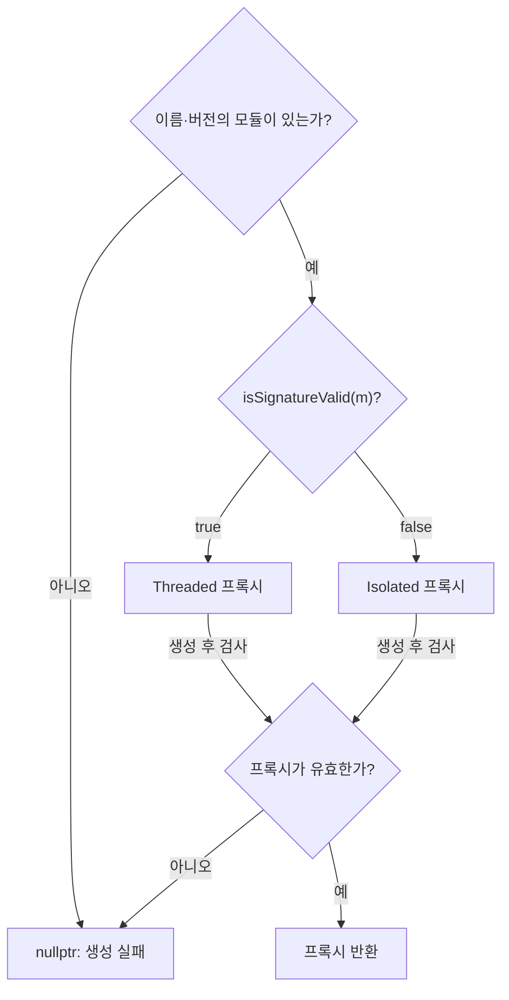
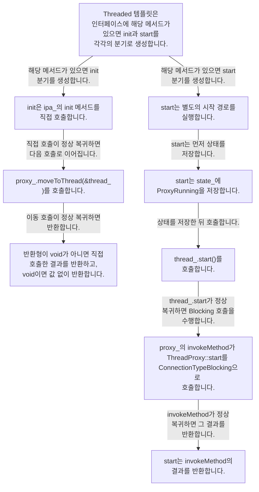
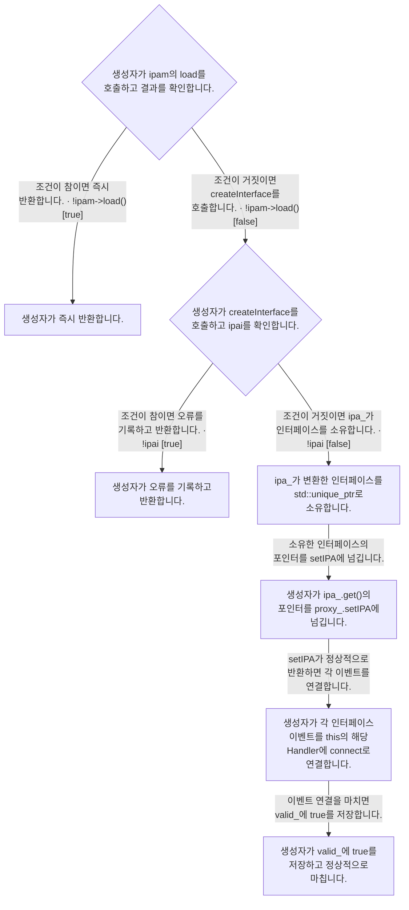
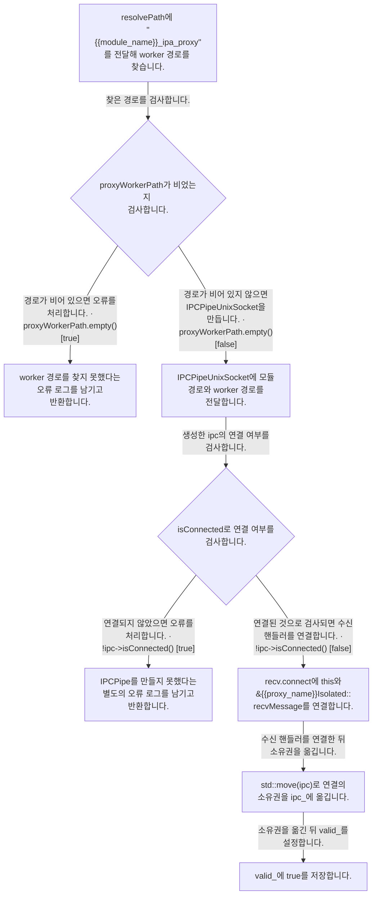
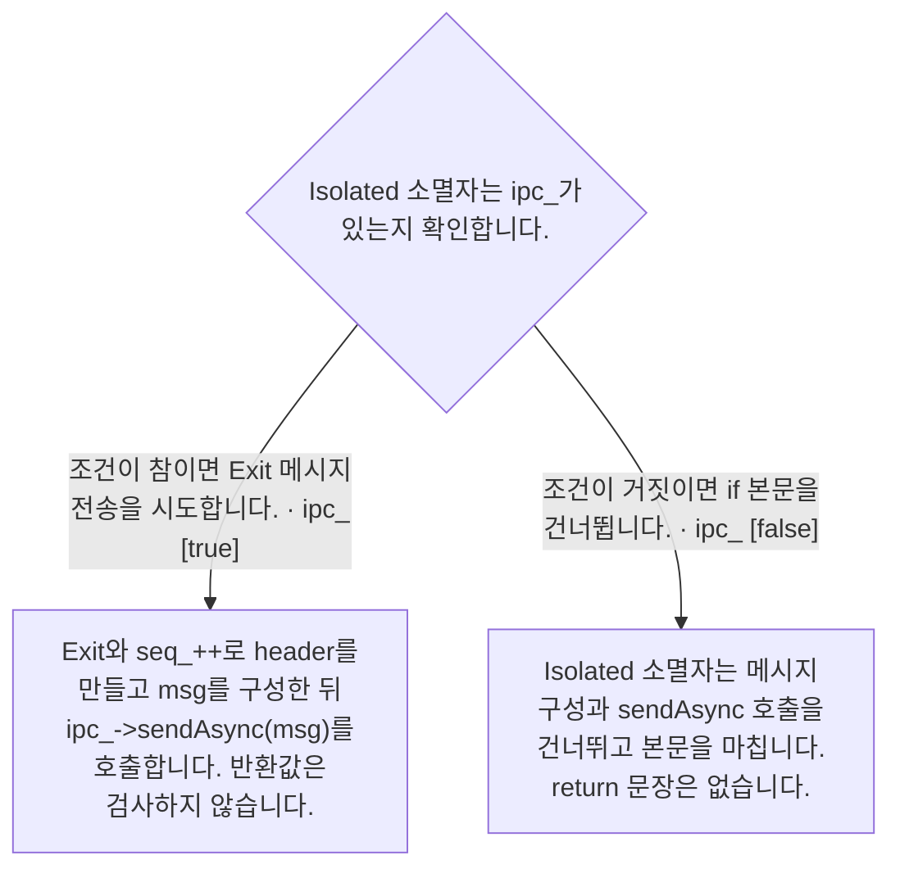
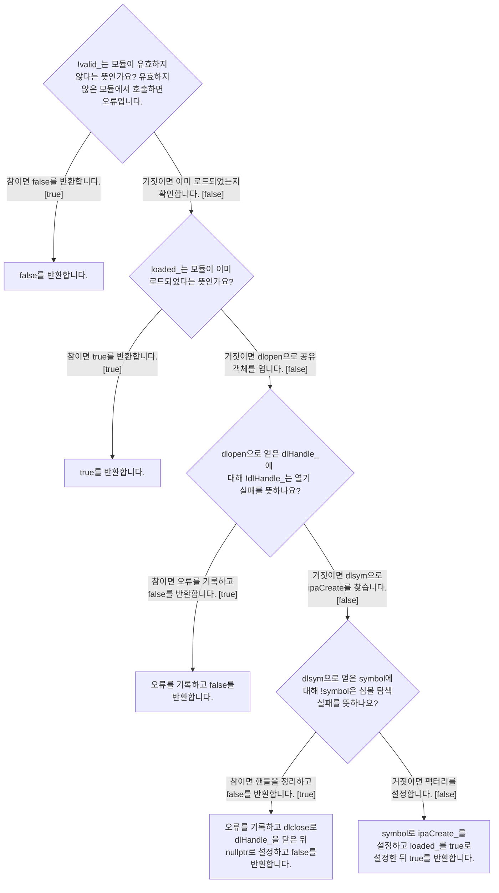
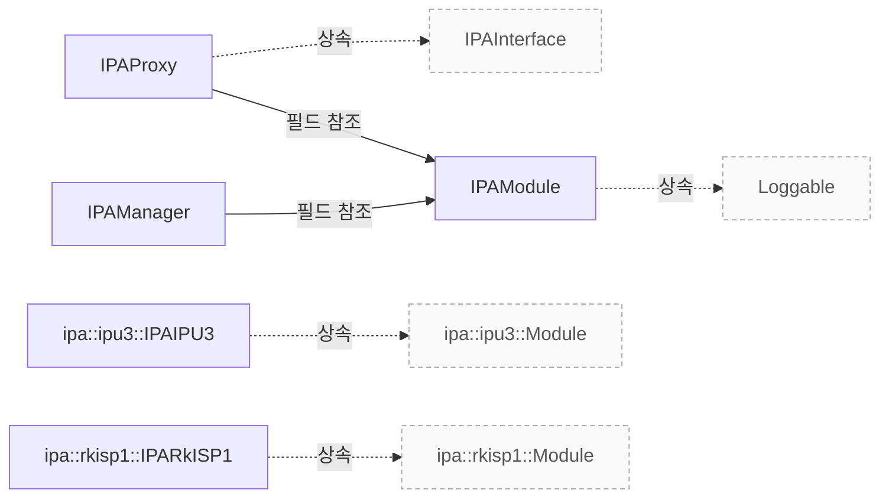

# IPA 관리와 구현 진입점

**IPA 모듈 선택, 스레드·프로세스 경계와 요청·결과 인터페이스를 구현 근거로 확인하세요.**

| 지금 확인할 내용 | 이동할 절 |
|---|---|
| 모듈 탐색과 격리 조건의 조건과 근거를 대조하세요. | [모듈 탐색과 격리 조건](#모듈-탐색과-격리-조건) |
| 스레드와 프로세스 경계의 조건과 근거를 대조하세요. | [스레드와 프로세스 경계](#스레드와-프로세스-경계) |
| 프레임 입력과 결과 인터페이스의 조건과 근거를 대조하세요. | [프레임 입력과 결과 인터페이스](#프레임-입력과-결과-인터페이스) |
| IPA 객체와 종료 순서의 조건과 근거를 대조하세요. | [IPA 객체와 종료 순서](#ipa-객체와-종료-순서) |
| 생성과 IPC 실패의 조건과 근거를 대조하세요. | [생성과 IPC 실패](#생성과-ipc-실패) |
| <a id="보정-전-튜닝-파일"></a>보정 전 튜닝 파일의 조건과 근거를 대조하세요. | [IPA 튜닝과 소프트웨어 ISP](ipa-algorithms.md#보정-전-튜닝-파일) |
| <a id="소프트웨어-isp-입력-버퍼의-텍스처-형식"></a>소프트웨어 ISP 입력 버퍼의 텍스처 형식의 조건과 근거를 대조하세요. | [IPA 튜닝과 소프트웨어 ISP](ipa-algorithms.md#소프트웨어-isp-입력-버퍼의-텍스처-형식) |
| <a id="소프트웨어-isp-셰이더의-렌즈-음영-보정"></a>소프트웨어 ISP 셰이더의 렌즈 음영 보정의 조건과 근거를 대조하세요. | [IPA 튜닝과 소프트웨어 ISP](ipa-algorithms.md#소프트웨어-isp-셰이더의-렌즈-음영-보정) |

## 모듈 탐색과 격리 조건

`IPAManager::IPAManager`는 사용자가 지정한 `ipa.module_paths`를 우선 검색하며, 빈 경로는 건너뛰고 나머지 경로마다 `addDir()`을 호출합니다. 지정된 경로 목록이 비어 있지 않지만 IPA를 하나도 찾지 못하면 경고를 기록합니다. 이어서 `utils::libcameraBuildPath()`가 빈 문자열이 아니면 그 경로에 `src/ipa`를 붙여 최대 깊이 2로 `addDir()`을 호출합니다. 마지막으로 설치된 시스템 경로 `IPA_MODULE_DIR`에 `addDir()`을 호출하고, 전체 검색에서 IPA를 하나도 찾지 못하면 경고를 기록합니다. `src/libcamera/ipa_manager.cpp:107`

<!-- sdd:visual:proxy-selection -->
### IPA 모듈 선택과 실행 경계



[Mermaid 원문](ipa.proxy-selection.mmd)

??? note "그림 근거와 확인 범위"
    모듈 선택, 서명 판정, 프록시 유효성의 분기를 구분하세요. 서명 판정의 구성 조건은 이어지는 설명에서 확인합니다.
    
    소스에 연결한 설계 해석입니다. 자동 연결 검사는 의미 승인이나 기기 실행 검증이 아닙니다.
    
    | 요소·전이 | 소스 근거 |
    |---|---|
    | <span data-sdd-label-en="Module matching name and version?">이름·버전의 모듈이 있는가?</span> | [include/libcamera/internal/ipa_manager.h:35](#source-2a1bbbc8623a516f) |
    | <span data-sdd-label-en="isSignatureValid(m)?">isSignatureValid&#40;m&#41;?</span> | [include/libcamera/internal/ipa_manager.h:35](#source-2a1bbbc8623a516f) |
    | <span data-sdd-label-en="Threaded proxy">Threaded 프록시</span> | [include/libcamera/internal/ipa_manager.h:35](#source-2a1bbbc8623a516f) |
    | <span data-sdd-label-en="Isolated proxy">Isolated 프록시</span> | [include/libcamera/internal/ipa_manager.h:35](#source-2a1bbbc8623a516f) |
    | <span data-sdd-label-en="Is the proxy valid?">프록시가 유효한가?</span> | [include/libcamera/internal/ipa_manager.h:35](#source-2a1bbbc8623a516f) |
    | <span data-sdd-label-en="nullptr: creation failed">nullptr: 생성 실패</span> | [include/libcamera/internal/ipa_manager.h:35](#source-2a1bbbc8623a516f) |
    | <span data-sdd-label-en="Return proxy">프록시 반환</span> | [include/libcamera/internal/ipa_manager.h:35](#source-2a1bbbc8623a516f) |
    | <span data-sdd-label-en="No">아니오</span> | [include/libcamera/internal/ipa_manager.h:35](#source-2a1bbbc8623a516f) |
    | <span data-sdd-label-en="Yes">예</span> | [include/libcamera/internal/ipa_manager.h:35](#source-2a1bbbc8623a516f) |
    | <span data-sdd-label-en="true">true</span> | [include/libcamera/internal/ipa_manager.h:35](#source-2a1bbbc8623a516f) |
    | <span data-sdd-label-en="false">false</span> | [include/libcamera/internal/ipa_manager.h:35](#source-2a1bbbc8623a516f) |
    | <span data-sdd-label-en="Check after construction">생성 후 검사</span> | [include/libcamera/internal/ipa_manager.h:35](#source-2a1bbbc8623a516f) |
    | <span data-sdd-label-en="Check after construction">생성 후 검사</span> | [include/libcamera/internal/ipa_manager.h:35](#source-2a1bbbc8623a516f) |
    | <span data-sdd-label-en="No">아니오</span> | [include/libcamera/internal/ipa_manager.h:35](#source-2a1bbbc8623a516f) |
    | <span data-sdd-label-en="Yes">예</span> | [include/libcamera/internal/ipa_manager.h:35](#source-2a1bbbc8623a516f) |
<!-- /sdd:visual:proxy-selection -->

`IPAModule::match`는 `info_.pipelineVersion`이 `minVersion` 이상이고 `maxVersion` 이하이며, `info_.name`과 `name`을 비교한 `strcmp`의 결과가 0이면 `true`를 반환합니다. 이 조건 중 하나라도 만족하지 않으면 `false`를 반환합니다. `src/libcamera/ipa_module.cpp:460`

`createIPA`는 먼저 `module(name, minVersion, maxVersion)`으로 모듈을 검색하고, 모듈이 없으면 `nullptr`을 반환합니다. 모듈이 있으면 `isSignatureValid(m)`이 참일 때 `T::Threaded` 프록시를, 거짓일 때 `T::Isolated` 프록시를 생성합니다. 생성한 프록시의 `isValid()`가 거짓이면 오류를 기록하고 `nullptr`을 반환하며, 참이면 프록시를 반환합니다. `include/libcamera/internal/ipa_manager.h:35`

`IPAManager::isSignatureValid`는 `HAVE_IPA_PUBKEY`가 활성화되지 않으면 `false`를 반환합니다. 활성화된 경우 `forceIsolation_`이 참이면 `false`를 반환하고, 그렇지 않으면 IPA 모듈 파일을 읽기 전용으로 엽니다. 파일을 열지 못하거나 파일 매핑 결과가 비어 있으면 `false`를 반환합니다. 두 단계를 통과하면 매핑된 데이터와 IPA 서명을 `pubKey_.verify`에 전달하고, 검사 결과를 로그에 기록한 뒤 그 결과를 반환합니다. `src/libcamera/ipa_manager.cpp:289`

근거 원문: [src/libcamera/ipa_manager.cpp:107](#source-7603cbafe8eef490) · [src/libcamera/ipa_module.cpp:460](#source-6e1525c1fc1aa55e) · [include/libcamera/internal/ipa_manager.h:35](#source-2a1bbbc8623a516f) · [src/libcamera/ipa_manager.cpp:289](#source-532f8ffa194bd319)

## 스레드와 프로세스 경계

Threaded `init` 템플릿은 전달된 매개변수로 `ipa_->init()`을 직접 호출합니다. 반환형이 `void`가 아니면 호출 결과를 `_ret`에 저장하고 반환하며, `void`이면 값을 반환하지 않습니다. `init` 분기에서는 IPA 메서드를 호출한 뒤 `proxy_.moveToThread`에 스레드 객체 `thread_`의 주소를 전달합니다. `utils/codegen/ipc/generators/libcamera_templates/module_ipa_proxy.cpp.tmpl:82`

<!-- sdd:visual:threaded-init-start -->
### Threaded init와 start의 호출 맥락



[Mermaid 원문](ipa.threaded-init-start.mmd)

??? note "그림 근거와 확인 범위"
    Threaded init와 start는 각각 직접 호출·스레드 이동·작업 스레드 시작·Blocking 호출과 반환을 어떻게 구성합니까?
    
    소스에 연결한 설계 해석입니다. 자동 연결 검사는 의미 승인이나 기기 실행 검증이 아닙니다.
    
    | 요소·전이 | 소스 근거 |
    |---|---|
    | <span data-sdd-label-en="The Threaded template generates separate init and start branches when those methods exist in the interface.">Threaded 템플릿은 인터페이스에 해당 메서드가 있으면 init과 start를 각각의 분기로 생성합니다.</span> | [utils/codegen/ipc/generators/libcamera_templates/module_ipa_proxy.cpp.tmpl:48](#source-c7fd6e52f2c537b5) |
    | <span data-sdd-label-en="init directly calls the init method on ipa_.">init은 ipa&#95;의 init 메서드를 직접 호출합니다.</span> | [utils/codegen/ipc/generators/libcamera_templates/module_ipa_proxy.cpp.tmpl:82](#source-9d9c3049e90e4238) |
    | <span data-sdd-label-en="Call proxy_.moveToThread(&amp;thread_).">proxy&#95;.moveToThread&#40;&amp;thread&#95;&#41;를 호출합니다.</span> | [utils/codegen/ipc/generators/libcamera_templates/module_ipa_proxy.cpp.tmpl:82](#source-9d9c3049e90e4238) |
    | <span data-sdd-label-en="It returns the direct call result for a non-void return type, or returns without a value for void.">반환형이 void가 아니면 직접 호출한 결과를 반환하고, void이면 값 없이 반환합니다.</span> | [utils/codegen/ipc/generators/libcamera_templates/module_ipa_proxy.cpp.tmpl:82](#source-9d9c3049e90e4238) |
    | <span data-sdd-label-en="start runs a separate startup path.">start는 별도의 시작 경로를 실행합니다.</span> | [utils/codegen/ipc/generators/libcamera_templates/module_ipa_proxy.cpp.tmpl:93](#source-7670edf527118b0e) |
    | <span data-sdd-label-en="start stores ProxyRunning in state_.">start는 state&#95;에 ProxyRunning을 저장합니다.</span> | [utils/codegen/ipc/generators/libcamera_templates/module_ipa_proxy.cpp.tmpl:93](#source-7670edf527118b0e) |
    | <span data-sdd-label-en="Call thread_.start().">thread&#95;.start&#40;&#41;를 호출합니다.</span> | [utils/codegen/ipc/generators/libcamera_templates/module_ipa_proxy.cpp.tmpl:93](#source-7670edf527118b0e) |
    | <span data-sdd-label-en="invokeMethod on proxy_ calls ThreadProxy::start with ConnectionTypeBlocking.">proxy&#95;의 invokeMethod가 ThreadProxy::start를 ConnectionTypeBlocking으로 호출합니다.</span> | [utils/codegen/ipc/generators/libcamera_templates/module_ipa_proxy.cpp.tmpl:93](#source-7670edf527118b0e) |
    | <span data-sdd-label-en="start returns the result of invokeMethod.">start는 invokeMethod의 결과를 반환합니다.</span> | [utils/codegen/ipc/generators/libcamera_templates/module_ipa_proxy.cpp.tmpl:93](#source-7670edf527118b0e) |
    | <span data-sdd-label-en="It generates the init branch when the method exists.">해당 메서드가 있으면 init 분기를 생성합니다.</span> | [utils/codegen/ipc/generators/libcamera_templates/module_ipa_proxy.cpp.tmpl:48](#source-c7fd6e52f2c537b5) · [utils/codegen/ipc/generators/libcamera_templates/module_ipa_proxy.cpp.tmpl:82](#source-9d9c3049e90e4238) |
    | <span data-sdd-label-en="It generates the start branch when the method exists.">해당 메서드가 있으면 start 분기를 생성합니다.</span> | [utils/codegen/ipc/generators/libcamera_templates/module_ipa_proxy.cpp.tmpl:48](#source-c7fd6e52f2c537b5) · [utils/codegen/ipc/generators/libcamera_templates/module_ipa_proxy.cpp.tmpl:93](#source-7670edf527118b0e) |
    | <span data-sdd-label-en="Continue after the direct call returns normally.">직접 호출이 정상 복귀하면 다음 호출로 이어집니다.</span> | [utils/codegen/ipc/generators/libcamera_templates/module_ipa_proxy.cpp.tmpl:82](#source-9d9c3049e90e4238) |
    | <span data-sdd-label-en="It returns after the move call returns normally.">이동 호출이 정상 복귀하면 반환합니다.</span> | [utils/codegen/ipc/generators/libcamera_templates/module_ipa_proxy.cpp.tmpl:82](#source-9d9c3049e90e4238) |
    | <span data-sdd-label-en="start first stores the state.">start는 먼저 상태를 저장합니다.</span> | [utils/codegen/ipc/generators/libcamera_templates/module_ipa_proxy.cpp.tmpl:93](#source-7670edf527118b0e) |
    | <span data-sdd-label-en="Make the call after storing the state.">상태를 저장한 뒤 호출합니다.</span> | [utils/codegen/ipc/generators/libcamera_templates/module_ipa_proxy.cpp.tmpl:93](#source-7670edf527118b0e) |
    | <span data-sdd-label-en="After thread_.start returns normally, it makes the Blocking call.">thread&#95;.start가 정상 복귀하면 Blocking 호출을 수행합니다.</span> | [utils/codegen/ipc/generators/libcamera_templates/module_ipa_proxy.cpp.tmpl:93](#source-7670edf527118b0e) |
    | <span data-sdd-label-en="It returns the result after invokeMethod returns normally.">invokeMethod가 정상 복귀하면 그 결과를 반환합니다.</span> | [utils/codegen/ipc/generators/libcamera_templates/module_ipa_proxy.cpp.tmpl:93](#source-7670edf527118b0e) |
<!-- /sdd:visual:threaded-init-start -->

<!-- sdd:visual:interface-creation-outcomes -->
### Threaded 생성자의 인터페이스 유지



[Mermaid 원문](ipa.interface-creation-outcomes.mmd)

??? note "그림 근거와 확인 범위"
    Threaded 생성자는 load와 createInterface 결과에 따라 언제 반환하며 인터페이스를 어떻게 보유·연결합니까?
    
    소스에 연결한 설계 해석입니다. 자동 연결 검사는 의미 승인이나 기기 실행 검증이 아닙니다.
    
    LLM 그림 초안 · 사람 검토 전
    
    작성 모델: `cli/codex/gpt-6.1-terra`
    
    | 요소·전이 | 소스 근거 |
    |---|---|
    | <span data-sdd-label-en="The constructor calls load on ipam and checks the result.">생성자가 ipam의 load를 호출하고 결과를 확인합니다.</span> | [utils/codegen/ipc/generators/libcamera_templates/module_ipa_proxy.cpp.tmpl:48](#source-c7fd6e52f2c537b5) |
    | <span data-sdd-label-en="The constructor returns immediately.">생성자가 즉시 반환합니다.</span> | [utils/codegen/ipc/generators/libcamera_templates/module_ipa_proxy.cpp.tmpl:48](#source-c7fd6e52f2c537b5) |
    | <span data-sdd-label-en="The constructor calls createInterface and checks ipai.">생성자가 createInterface를 호출하고 ipai를 확인합니다.</span> | [utils/codegen/ipc/generators/libcamera_templates/module_ipa_proxy.cpp.tmpl:48](#source-c7fd6e52f2c537b5) |
    | <span data-sdd-label-en="The constructor logs an error and returns.">생성자가 오류를 기록하고 반환합니다.</span> | [utils/codegen/ipc/generators/libcamera_templates/module_ipa_proxy.cpp.tmpl:48](#source-c7fd6e52f2c537b5) |
    | <span data-sdd-label-en="ipa_ owns the cast interface through a std::unique_ptr.">ipa&#95;가 변환한 인터페이스를 std::unique&#95;ptr로 소유합니다.</span> | [utils/codegen/ipc/generators/libcamera_templates/module_ipa_proxy.cpp.tmpl:48](#source-c7fd6e52f2c537b5) |
    | <span data-sdd-label-en="The constructor passes the pointer from ipa_.get() to proxy_.setIPA.">생성자가 ipa&#95;.get&#40;&#41;의 포인터를 proxy&#95;.setIPA에 넘깁니다.</span> | [utils/codegen/ipc/generators/libcamera_templates/module_ipa_proxy.cpp.tmpl:48](#source-c7fd6e52f2c537b5) |
    | <span data-sdd-label-en="The constructor uses connect to link each interface event to its corresponding Handler on this.">생성자가 각 인터페이스 이벤트를 this의 해당 Handler에 connect로 연결합니다.</span> | [utils/codegen/ipc/generators/libcamera_templates/module_ipa_proxy.cpp.tmpl:48](#source-c7fd6e52f2c537b5) |
    | <span data-sdd-label-en="The constructor stores true in valid_ and finishes normally.">생성자가 valid&#95;에 true를 저장하고 정상적으로 마칩니다.</span> | [utils/codegen/ipc/generators/libcamera_templates/module_ipa_proxy.cpp.tmpl:48](#source-c7fd6e52f2c537b5) |
    | <span data-sdd-label-en="If the condition is true, the constructor returns immediately. · !ipam-&gt;load() [true]">조건이 참이면 즉시 반환합니다. · &#33;ipam-&gt;load&#40;&#41; &#91;true&#93;</span> | [utils/codegen/ipc/generators/libcamera_templates/module_ipa_proxy.cpp.tmpl:48](#source-c7fd6e52f2c537b5) |
    | <span data-sdd-label-en="If the condition is false, the constructor calls createInterface. · !ipam-&gt;load() [false]">조건이 거짓이면 createInterface를 호출합니다. · &#33;ipam-&gt;load&#40;&#41; &#91;false&#93;</span> | [utils/codegen/ipc/generators/libcamera_templates/module_ipa_proxy.cpp.tmpl:48](#source-c7fd6e52f2c537b5) |
    | <span data-sdd-label-en="If the condition is true, the constructor logs an error and returns. · !ipai [true]">조건이 참이면 오류를 기록하고 반환합니다. · &#33;ipai &#91;true&#93;</span> | [utils/codegen/ipc/generators/libcamera_templates/module_ipa_proxy.cpp.tmpl:48](#source-c7fd6e52f2c537b5) |
    | <span data-sdd-label-en="If the condition is false, ipa_ owns the interface. · !ipai [false]">조건이 거짓이면 ipa&#95;가 인터페이스를 소유합니다. · &#33;ipai &#91;false&#93;</span> | [utils/codegen/ipc/generators/libcamera_templates/module_ipa_proxy.cpp.tmpl:48](#source-c7fd6e52f2c537b5) |
    | <span data-sdd-label-en="The constructor passes a pointer to the owned interface to setIPA.">소유한 인터페이스의 포인터를 setIPA에 넘깁니다.</span> | [utils/codegen/ipc/generators/libcamera_templates/module_ipa_proxy.cpp.tmpl:48](#source-c7fd6e52f2c537b5) |
    | <span data-sdd-label-en="After setIPA returns normally, the constructor connects each event.">setIPA가 정상적으로 반환하면 각 이벤트를 연결합니다.</span> | [utils/codegen/ipc/generators/libcamera_templates/module_ipa_proxy.cpp.tmpl:48](#source-c7fd6e52f2c537b5) |
    | <span data-sdd-label-en="After connecting the events, the constructor stores true in valid_.">이벤트 연결을 마치면 valid&#95;에 true를 저장합니다.</span> | [utils/codegen/ipc/generators/libcamera_templates/module_ipa_proxy.cpp.tmpl:48](#source-c7fd6e52f2c537b5) |
<!-- /sdd:visual:interface-creation-outcomes -->

<!-- sdd:visual:isolated-constructor-connection -->
### 격리 IPA 프록시의 연결 분기와 IPC 소유권



[Mermaid 원문](ipa.isolated-constructor-connection.mmd)

??? note "그림 근거와 확인 범위"
    Isolated 생성자는 worker 경로와 IPC 연결의 실패를 어떻게 처리하고, 성공한 연결의 소유권을 어떻게 옮깁니까?
    
    소스에 연결한 설계 해석입니다. 자동 연결 검사는 의미 승인이나 기기 실행 검증이 아닙니다.
    
    LLM 그림 초안 · 사람 검토 전
    
    작성 모델: `cli/codex/gpt-6.1-terra`
    
    | 요소·전이 | 소스 근거 |
    |---|---|
    | <span data-sdd-label-en="Pass &quot;{{module_name}}_ipa_proxy&quot; to resolvePath to find the worker path.">resolvePath에 &quot;{{module&#95;name}}&#95;ipa&#95;proxy&quot;를 전달해 worker 경로를 찾습니다.</span> | [utils/codegen/ipc/generators/libcamera_templates/module_ipa_proxy.cpp.tmpl:130](#source-9ff6047b0a70ce66) |
    | <span data-sdd-label-en="Check whether proxyWorkerPath is empty.">proxyWorkerPath가 비었는지 검사합니다.</span> | [utils/codegen/ipc/generators/libcamera_templates/module_ipa_proxy.cpp.tmpl:130](#source-9ff6047b0a70ce66) |
    | <span data-sdd-label-en="Log the failure to get the worker path and return.">worker 경로를 찾지 못했다는 오류 로그를 남기고 반환합니다.</span> | [utils/codegen/ipc/generators/libcamera_templates/module_ipa_proxy.cpp.tmpl:130](#source-9ff6047b0a70ce66) |
    | <span data-sdd-label-en="Pass the module path and worker path to IPCPipeUnixSocket.">IPCPipeUnixSocket에 모듈 경로와 worker 경로를 전달합니다.</span> | [utils/codegen/ipc/generators/libcamera_templates/module_ipa_proxy.cpp.tmpl:130](#source-9ff6047b0a70ce66) |
    | <span data-sdd-label-en="Check the connection with isConnected.">isConnected로 연결 여부를 검사합니다.</span> | [utils/codegen/ipc/generators/libcamera_templates/module_ipa_proxy.cpp.tmpl:130](#source-9ff6047b0a70ce66) |
    | <span data-sdd-label-en="Log a separate error for the failure to create IPCPipe and return.">IPCPipe를 만들지 못했다는 별도의 오류 로그를 남기고 반환합니다.</span> | [utils/codegen/ipc/generators/libcamera_templates/module_ipa_proxy.cpp.tmpl:130](#source-9ff6047b0a70ce66) |
    | <span data-sdd-label-en="Connect recv using this and &amp;{{proxy_name}}Isolated::recvMessage.">recv.connect에 this와 &amp;{{proxy&#95;name}}Isolated::recvMessage를 연결합니다.</span> | [utils/codegen/ipc/generators/libcamera_templates/module_ipa_proxy.cpp.tmpl:130](#source-9ff6047b0a70ce66) |
    | <span data-sdd-label-en="Transfer ownership of the connection to ipc_ with std::move(ipc).">std::move&#40;ipc&#41;로 연결의 소유권을 ipc&#95;에 옮깁니다.</span> | [utils/codegen/ipc/generators/libcamera_templates/module_ipa_proxy.cpp.tmpl:130](#source-9ff6047b0a70ce66) |
    | <span data-sdd-label-en="Store true in valid_.">valid&#95;에 true를 저장합니다.</span> | [utils/codegen/ipc/generators/libcamera_templates/module_ipa_proxy.cpp.tmpl:130](#source-9ff6047b0a70ce66) |
    | <span data-sdd-label-en="Check the resolved path.">찾은 경로를 검사합니다.</span> | [utils/codegen/ipc/generators/libcamera_templates/module_ipa_proxy.cpp.tmpl:130](#source-9ff6047b0a70ce66) |
    | <span data-sdd-label-en="Handle the error if the path is empty. · proxyWorkerPath.empty() [true]">경로가 비어 있으면 오류를 처리합니다. · proxyWorkerPath.empty&#40;&#41; &#91;true&#93;</span> | [utils/codegen/ipc/generators/libcamera_templates/module_ipa_proxy.cpp.tmpl:130](#source-9ff6047b0a70ce66) |
    | <span data-sdd-label-en="Create IPCPipeUnixSocket if the path is not empty. · proxyWorkerPath.empty() [false]">경로가 비어 있지 않으면 IPCPipeUnixSocket을 만듭니다. · proxyWorkerPath.empty&#40;&#41; &#91;false&#93;</span> | [utils/codegen/ipc/generators/libcamera_templates/module_ipa_proxy.cpp.tmpl:130](#source-9ff6047b0a70ce66) |
    | <span data-sdd-label-en="Check the connection of the created ipc.">생성한 ipc의 연결 여부를 검사합니다.</span> | [utils/codegen/ipc/generators/libcamera_templates/module_ipa_proxy.cpp.tmpl:130](#source-9ff6047b0a70ce66) |
    | <span data-sdd-label-en="Handle the error if it is not connected. · !ipc-&gt;isConnected() [true]">연결되지 않았으면 오류를 처리합니다. · &#33;ipc-&gt;isConnected&#40;&#41; &#91;true&#93;</span> | [utils/codegen/ipc/generators/libcamera_templates/module_ipa_proxy.cpp.tmpl:130](#source-9ff6047b0a70ce66) |
    | <span data-sdd-label-en="Connect the receive handler if the check reports a connection. · !ipc-&gt;isConnected() [false]">연결된 것으로 검사되면 수신 핸들러를 연결합니다. · &#33;ipc-&gt;isConnected&#40;&#41; &#91;false&#93;</span> | [utils/codegen/ipc/generators/libcamera_templates/module_ipa_proxy.cpp.tmpl:130](#source-9ff6047b0a70ce66) |
    | <span data-sdd-label-en="Transfer ownership after connecting the receive handler.">수신 핸들러를 연결한 뒤 소유권을 옮깁니다.</span> | [utils/codegen/ipc/generators/libcamera_templates/module_ipa_proxy.cpp.tmpl:130](#source-9ff6047b0a70ce66) |
    | <span data-sdd-label-en="Set valid_ after transferring ownership.">소유권을 옮긴 뒤 valid&#95;를 설정합니다.</span> | [utils/codegen/ipc/generators/libcamera_templates/module_ipa_proxy.cpp.tmpl:130](#source-9ff6047b0a70ce66) |
<!-- /sdd:visual:isolated-constructor-connection -->

Threaded `start` 템플릿 분기는 `state_`를 `ProxyRunning`으로 설정한 뒤 `thread_.start()`를 호출해 worker 스레드를 시작합니다. 이어서 `proxy_.invokeMethod()`로 `ThreadProxy::start`를 `ConnectionTypeBlocking` 연결 유형과 생성된 매개변수로 호출하고 그 반환값을 반환합니다. `{{proxy_name}}Threaded`의 메서드에서 `init`, `start`, `stop`을 제외한 일반 동기 분기는 전달받은 인자로 `ipa_`의 같은 이름의 메서드를 직접 호출하고 그 반환값을 반환합니다. `utils/codegen/ipc/generators/libcamera_templates/module_ipa_proxy.cpp.tmpl:93`, `utils/codegen/ipc/generators/libcamera_templates/module_ipa_proxy.cpp.tmpl:75`

비동기 메서드 분기는 `ASSERT` 매크로에 검사식 `state_ == ProxyRunning`을 전달합니다. 검사식이 거짓이면 `ASSERT`는 `Fatal` 수준의 오류 메시지를 기록하고 프로그램 실행을 중단합니다. `log.h`를 포함하기 전에 `NDEBUG`가 정의되어 있으면 `ASSERT`는 코드를 생성하지 않습니다. Threaded 비동기 분기에서 `proxy_.invokeMethod`는 `ThreadProxy` 메서드를 전달할 때 연결 유형으로 `ConnectionTypeQueued`를 사용합니다. `utils/codegen/ipc/generators/libcamera_templates/module_ipa_proxy.cpp.tmpl:109`, `src/libcamera/base/log.cpp:1044`

`{{proxy_name}}Threaded` 생성자는 `ipam->load()`를 호출합니다. `load()`가 거짓을 반환하면 생성자에서 즉시 반환합니다. `utils/codegen/ipc/generators/libcamera_templates/module_ipa_proxy.cpp.tmpl:55`

`Threaded` 생성자는 `load()`가 성공한 경우에만 `createInterface()`를 호출합니다. 반환된 포인터가 없으면 `ipam->path()`를 포함한 오류를 기록하고 반환합니다. 포인터가 있으면 인터페이스를 `unique_ptr`로 소유하고 `proxy_.setIPA(ipa_.get())`에 포인터를 넘깁니다. 이어서 각 이벤트를 수신 객체 `this`의 해당 `Handler` 메서드에 `connect`하고 `valid_`를 `true`로 설정합니다. `utils/codegen/ipc/generators/libcamera_templates/module_ipa_proxy.cpp.tmpl:48`

`{{proxy_name}}Isolated` 생성자는 `resolvePath("{{module_name}}_ipa_proxy")`로 워커 경로를 찾고, 경로가 비어 있으면 오류를 기록하고 반환합니다. 이어서 `IPCPipeUnixSocket`을 `ipam->path().c_str()`와 `proxyWorkerPath.c_str()` 인자로 생성하며, `isConnected()`가 거짓이면 오류를 기록하고 반환합니다. 연결에 성공하면 `recv.connect`에 수신 객체 `this`와 콜백 `&{{proxy_name}}Isolated::recvMessage`를 연결하고, `std::move`로 `ipc`의 소유권을 `ipc_`에 옮긴 뒤 `valid_`에 `true`를 저장합니다. `utils/codegen/ipc/generators/libcamera_templates/module_ipa_proxy.cpp.tmpl:130`

`IPAProxy::resolvePath`는 먼저 `execPaths_`를 순서대로 살펴보며 빈 디렉터리는 건너뛰고, `file`을 붙인 경로에 실행 권한이 있으면 그 경로를 반환합니다. 이후 `utils::libcameraBuildPath()`가 빈 문자열이 아니면 빌드 디렉터리의 `src/libcamera/proxy/worker`를 확인하고, 빈 문자열이면 설치 디렉터리 `IPA_PROXY_DIR`을 확인합니다. 선택한 디렉터리에서 실행 권한이 있는 경로를 찾으면 그 경로를 반환하고, 찾지 못하면 빈 문자열을 반환합니다. `src/libcamera/ipa_proxy.cpp:204`

`readyRead`는 소켓에서 페이로드를 수신하다가 오류가 나면 로그를 남기고 반환합니다. 수신한 데이터가 `IPCMessage::Header`보다 짧아도 로그를 남기고 반환합니다. 그다음 메시지의 `cookie`로 `callData_`에서 대기 항목을 찾고, 일치하는 항목이 있으면 페이로드를 응답으로 이동한 뒤 `done`을 `true`로 설정하고 반환합니다. `src/libcamera/ipc_pipe_unixsocket.cpp:84`

`IPCPipeUnixSocket::sendAsync`는 `data.payload()`를 `socket_->send`로 전송하고 반환값을 `ret`에 저장합니다. `ret`이 0이 아니면 오류를 기록하고 `ret`을 반환합니다. 그렇지 않으면 0을 반환합니다. `src/libcamera/ipc_pipe_unixsocket.cpp:73`

근거 원문: [utils/codegen/ipc/generators/libcamera_templates/module_ipa_proxy.cpp.tmpl:48](#source-c7fd6e52f2c537b5) · [utils/codegen/ipc/generators/libcamera_templates/module_ipa_proxy.cpp.tmpl:130](#source-9ff6047b0a70ce66) · [src/libcamera/ipa_proxy.cpp:204](#source-59a673fb7c43c0e0) · [src/libcamera/ipc_pipe_unixsocket.cpp:27](#source-f0268126d3f8c2bc) · [utils/codegen/ipc/generators/libcamera_templates/module_ipa_proxy.cpp.tmpl:75](#source-542f7efc12af7917) · [utils/codegen/ipc/generators/libcamera_templates/module_ipa_proxy.cpp.tmpl:93](#source-7670edf527118b0e) · [utils/codegen/ipc/generators/libcamera_templates/module_ipa_proxy.cpp.tmpl:109](#source-f6afc431ed47a72a) · [utils/codegen/ipc/generators/libcamera_templates/module_ipa_proxy.cpp.tmpl:82](#source-9d9c3049e90e4238) · [utils/codegen/ipc/generators/libcamera_templates/module_ipa_proxy.cpp.tmpl:55](#source-60c70cd011db2353) · [src/libcamera/ipc_pipe_unixsocket.cpp:73](#source-6fafe97ae651cb83) · [src/libcamera/ipc_pipe_unixsocket.cpp:84](#source-7f9e84d5315c5882) · [src/libcamera/base/log.cpp:1044](#source-bae93ab8b66697ce)

## 프레임 입력과 결과 인터페이스

`IPAIPU3Interface`는 `[async]` 메서드로 `queueRequest(frame, controls)`, `computeParams(frame, bufferId)`, `processStats(frame, frameTimestamp, bufferId, sensorControls)`를 선언합니다. `IPAIPU3EventInterface`는 `paramsComputed(frame)`, `metadataReady(frame, metadata)`, `setSensorControls(frame, sensorControls, lensControls)`를 선언합니다. `include/libcamera/ipa/ipu3.mojom:19`

`IPARkISP1Interface`는 `[async]` 메서드로 `queueRequest(frame, reqControls)`, `computeParams(frame, bufferId)`, `processStats(frame, bufferId, sensorControls)`를 선언합니다. `IPARkISP1EventInterface`는 `paramsComputed(frame, bytesused)`, `metadataReady(frame, metadata)`, `setSensorControls(frame, sensorControls)`를 선언합니다. `include/libcamera/ipa/rkisp1.mojom:17`

근거 원문: [include/libcamera/ipa/ipu3.mojom:19](#source-5a4a0da4800968a4) · [include/libcamera/ipa/rkisp1.mojom:17](#source-7a01de2477d6466e)

## IPA 객체와 종료 순서

호출자는 유효한 모듈에서 `load()`를 한 번 성공한 뒤 필요한 `IPAInterface` 인스턴스 수만큼 `createInterface()`를 호출할 수 있습니다. Threaded 프록시의 `stop`은 먼저 상태가 `ProxyStopping`이 아닌지 단언하고, `ProxyRunning`이 아니면 반환합니다. 실행 중이면 상태를 `ProxyStopping`으로 바꾸고 `ThreadProxy::stop`을 `ConnectionTypeBlocking`으로 호출한 다음 `thread_.exit()`와 `thread_.wait()`를 순서대로 호출합니다. 이어 현재 스레드에서 이 프록시의 `InvokeMessage`를 디스패치하고 상태를 `ProxyStopped`로 바꿉니다. `src/libcamera/ipa_module.cpp:390`, `utils/codegen/ipc/generators/libcamera_templates/proxy_functions.tmpl:25`, `utils/codegen/ipc/generators/libcamera_templates/module_ipa_proxy.cpp.tmpl:48`

<!-- sdd:visual:threaded-stop-order -->
### Threaded 정지의 상태와 순서

```mermaid
flowchart TB
%% sdd:translations {"ASSERT 뒤에 별도의 상태 <br/>검사가 나옵니다.": "A separate state check <br/>follows ASSERT.", "ASSERT 뒤에서 state#95;가 <br/>ProxyRunning이 아닌지 <br/>검사합니다.": "After ASSERT, check whether <br/>state#95; is not ProxyRunning.", "dispatchMessages가 정상 <br/>반환하면 state#95;를 <br/>ProxyStopped로 갱신합니다.": "When dispatchMessages <br/>returns normally, update <br/>state#95; to ProxyStopped.", "exit가 정상 반환하면 wait를 <br/>호출합니다.": "When exit returns normally, <br/>call wait.", "proxy#95;의 invokeMethod로 <br/>ThreadProxy::stop을 <br/>ConnectionTypeBlocking으로 <br/>동기 호출합니다.": "Call ThreadProxy::stop <br/>synchronously through <br/>proxy#95;#39;s invokeMethod with <br/>ConnectionTypeBlocking.", "thread#95;의 wait를 호출해 <br/>스레드 종료를 기다립니다.": "Call wait on thread#95; to <br/>wait for the thread to <br/>finish.", "wait가 정상 반환하면 <br/>메시지를 처리합니다.": "When wait returns normally, <br/>dispatch messages.", "동기 호출이 정상 반환하면 <br/>thread#95;의 exit를 호출합니다.": "When the synchronous call <br/>returns normally, call exit <br/>on thread#95;.", "먼저 ASSERT로 state#95;가 <br/>ProxyStopping이 아닌지 <br/>확인합니다.": "First, ASSERT checks that <br/>state#95; is not ProxyStopping.", "메시지 처리가 정상 반환하면 <br/>상태를 갱신합니다.": "When message dispatch <br/>returns normally, update <br/>the state.", "상태를 설정한 뒤 동기 <br/>호출합니다.": "After setting the state, <br/>make the synchronous call.", "조건이 거짓이면 state#95;를 <br/>ProxyStopping으로 <br/>설정합니다.": "If the condition is false, <br/>set state#95; to ProxyStopping.", "조건이 거짓이면 정지를 <br/>진행합니다. · state#95; #33;#61; <br/>ProxyRunning #91;false#93;": "If the condition is false, <br/>proceed with stopping. · <br/>state#95; #33;#61; ProxyRunning <br/>#91;false#93;", "조건이 참이면 즉시 <br/>반환합니다.": "If the condition is true, <br/>return immediately.", "조건이 참이면 즉시 <br/>반환합니다. · state#95; #33;#61; <br/>ProxyRunning #91;true#93;": "If the condition is true, <br/>return immediately. · <br/>state#95; #33;#61; ProxyRunning <br/>#91;true#93;", "현재 스레드에서 <br/>dispatchMessages를 호출해 <br/>this와 <br/>Message::Type::<br/>InvokeMessage를 대상으로 <br/>메시지를 처리합니다.": "Call dispatchMessages on <br/>the current thread to <br/>process messages for this <br/>and <br/>Message::Type::<br/>InvokeMessage.", "호출이 정상 반환하면 exit를 <br/>호출합니다.": "When the call returns <br/>normally, call exit."}
  v_assert["먼저 ASSERT로 state#95;가 <br/>ProxyStopping이 아닌지 <br/>확인합니다."]
  v_check{"ASSERT 뒤에서 state#95;가 <br/>ProxyRunning이 아닌지 <br/>검사합니다."}
  v_return["조건이 참이면 즉시 <br/>반환합니다."]
  v_stopping["조건이 거짓이면 state#95;를 <br/>ProxyStopping으로 <br/>설정합니다."]
  v_invoke["proxy#95;의 invokeMethod로 <br/>ThreadProxy::stop을 <br/>ConnectionTypeBlocking으로 <br/>동기 호출합니다."]
  v_exit["동기 호출이 정상 반환하면 <br/>thread#95;의 exit를 호출합니다."]
  v_wait["thread#95;의 wait를 호출해 <br/>스레드 종료를 기다립니다."]
  v_dispatch["현재 스레드에서 <br/>dispatchMessages를 호출해 <br/>this와 <br/>Message::Type::<br/>InvokeMessage를 대상으로 <br/>메시지를 처리합니다."]
  v_stopped["dispatchMessages가 정상 <br/>반환하면 state#95;를 <br/>ProxyStopped로 갱신합니다."]
  v_assert -->|"ASSERT 뒤에 별도의 상태 <br/>검사가 나옵니다."| v_check
  v_check -->|"조건이 참이면 즉시 <br/>반환합니다. · state#95; #33;#61; <br/>ProxyRunning #91;true#93;"| v_return
  v_check -->|"조건이 거짓이면 정지를 <br/>진행합니다. · state#95; #33;#61; <br/>ProxyRunning #91;false#93;"| v_stopping
  v_stopping -->|"상태를 설정한 뒤 동기 <br/>호출합니다."| v_invoke
  v_invoke -->|"호출이 정상 반환하면 exit를 <br/>호출합니다."| v_exit
  v_exit -->|"exit가 정상 반환하면 wait를 <br/>호출합니다."| v_wait
  v_wait -->|"wait가 정상 반환하면 <br/>메시지를 처리합니다."| v_dispatch
  v_dispatch -->|"메시지 처리가 정상 반환하면 <br/>상태를 갱신합니다."| v_stopped
```



[Mermaid 원문](ipa.threaded-stop-order.mmd)

??? note "그림 근거와 확인 범위"
    Threaded stop은 어떤 상태 검사와 동기 호출 및 스레드 종료 순서로 ProxyStopped가 됩니까?
    
    소스에 연결한 설계 해석입니다. 자동 연결 검사는 의미 승인이나 기기 실행 검증이 아닙니다.
    
    LLM 그림 초안 · 사람 검토 전
    
    작성 모델: `cli/codex/gpt-6.1-terra`
    
    | 요소·전이 | 소스 근거 |
    |---|---|
    | <span data-sdd-label-en="First, ASSERT checks that state_ is not ProxyStopping.">먼저 ASSERT로 state&#95;가 ProxyStopping이 아닌지 확인합니다.</span> | [utils/codegen/ipc/generators/libcamera_templates/proxy_functions.tmpl:25](#source-eb8f57d7452822da) |
    | <span data-sdd-label-en="After ASSERT, check whether state_ is not ProxyRunning.">ASSERT 뒤에서 state&#95;가 ProxyRunning이 아닌지 검사합니다.</span> | [utils/codegen/ipc/generators/libcamera_templates/proxy_functions.tmpl:25](#source-eb8f57d7452822da) |
    | <span data-sdd-label-en="If the condition is true, return immediately.">조건이 참이면 즉시 반환합니다.</span> | [utils/codegen/ipc/generators/libcamera_templates/proxy_functions.tmpl:25](#source-eb8f57d7452822da) |
    | <span data-sdd-label-en="If the condition is false, set state_ to ProxyStopping.">조건이 거짓이면 state&#95;를 ProxyStopping으로 설정합니다.</span> | [utils/codegen/ipc/generators/libcamera_templates/proxy_functions.tmpl:25](#source-eb8f57d7452822da) |
    | <span data-sdd-label-en="Call ThreadProxy::stop synchronously through proxy_&#x27;s invokeMethod with ConnectionTypeBlocking.">proxy&#95;의 invokeMethod로 ThreadProxy::stop을 ConnectionTypeBlocking으로 동기 호출합니다.</span> | [utils/codegen/ipc/generators/libcamera_templates/proxy_functions.tmpl:25](#source-eb8f57d7452822da) |
    | <span data-sdd-label-en="When the synchronous call returns normally, call exit on thread_.">동기 호출이 정상 반환하면 thread&#95;의 exit를 호출합니다.</span> | [utils/codegen/ipc/generators/libcamera_templates/proxy_functions.tmpl:25](#source-eb8f57d7452822da) |
    | <span data-sdd-label-en="Call wait on thread_ to wait for the thread to finish.">thread&#95;의 wait를 호출해 스레드 종료를 기다립니다.</span> | [utils/codegen/ipc/generators/libcamera_templates/proxy_functions.tmpl:25](#source-eb8f57d7452822da) |
    | <span data-sdd-label-en="Call dispatchMessages on the current thread to process messages for this and Message::Type::InvokeMessage.">현재 스레드에서 dispatchMessages를 호출해 this와 Message::Type::InvokeMessage를 대상으로 메시지를 처리합니다.</span> | [utils/codegen/ipc/generators/libcamera_templates/proxy_functions.tmpl:25](#source-eb8f57d7452822da) |
    | <span data-sdd-label-en="When dispatchMessages returns normally, update state_ to ProxyStopped.">dispatchMessages가 정상 반환하면 state&#95;를 ProxyStopped로 갱신합니다.</span> | [utils/codegen/ipc/generators/libcamera_templates/proxy_functions.tmpl:25](#source-eb8f57d7452822da) |
    | <span data-sdd-label-en="A separate state check follows ASSERT.">ASSERT 뒤에 별도의 상태 검사가 나옵니다.</span> | [utils/codegen/ipc/generators/libcamera_templates/proxy_functions.tmpl:25](#source-eb8f57d7452822da) |
    | <span data-sdd-label-en="If the condition is true, return immediately. · state_ != ProxyRunning [true]">조건이 참이면 즉시 반환합니다. · state&#95; &#33;= ProxyRunning &#91;true&#93;</span> | [utils/codegen/ipc/generators/libcamera_templates/proxy_functions.tmpl:25](#source-eb8f57d7452822da) |
    | <span data-sdd-label-en="If the condition is false, proceed with stopping. · state_ != ProxyRunning [false]">조건이 거짓이면 정지를 진행합니다. · state&#95; &#33;= ProxyRunning &#91;false&#93;</span> | [utils/codegen/ipc/generators/libcamera_templates/proxy_functions.tmpl:25](#source-eb8f57d7452822da) |
    | <span data-sdd-label-en="After setting the state, make the synchronous call.">상태를 설정한 뒤 동기 호출합니다.</span> | [utils/codegen/ipc/generators/libcamera_templates/proxy_functions.tmpl:25](#source-eb8f57d7452822da) |
    | <span data-sdd-label-en="When the call returns normally, call exit.">호출이 정상 반환하면 exit를 호출합니다.</span> | [utils/codegen/ipc/generators/libcamera_templates/proxy_functions.tmpl:25](#source-eb8f57d7452822da) |
    | <span data-sdd-label-en="When exit returns normally, call wait.">exit가 정상 반환하면 wait를 호출합니다.</span> | [utils/codegen/ipc/generators/libcamera_templates/proxy_functions.tmpl:25](#source-eb8f57d7452822da) |
    | <span data-sdd-label-en="When wait returns normally, dispatch messages.">wait가 정상 반환하면 메시지를 처리합니다.</span> | [utils/codegen/ipc/generators/libcamera_templates/proxy_functions.tmpl:25](#source-eb8f57d7452822da) |
    | <span data-sdd-label-en="When message dispatch returns normally, update the state.">메시지 처리가 정상 반환하면 상태를 갱신합니다.</span> | [utils/codegen/ipc/generators/libcamera_templates/proxy_functions.tmpl:25](#source-eb8f57d7452822da) |
<!-- /sdd:visual:threaded-stop-order -->

<!-- sdd:visual:isolated-destructor-guard -->
### Isolated 소멸자의 IPC 분기



[Mermaid 원문](ipa.isolated-destructor-guard.mmd)

??? note "그림 근거와 확인 범위"
    Isolated 소멸자는 ipc_가 없으면 어떤 구문을 건너뛰며, 있으면 어떤 Exit 전송을 시도합니까?
    
    소스에 연결한 설계 해석입니다. 자동 연결 검사는 의미 승인이나 기기 실행 검증이 아닙니다.
    
    LLM 그림 초안 · 사람 검토 전
    
    작성 모델: `cli/codex/gpt-6.1-terra`
    
    | 요소·전이 | 소스 근거 |
    |---|---|
    | <span data-sdd-label-en="The Isolated destructor checks whether ipc_ is present.">Isolated 소멸자는 ipc&#95;가 있는지 확인합니다.</span> | [utils/codegen/ipc/generators/libcamera_templates/module_ipa_proxy.cpp.tmpl:157](#source-a230ed3065e7523d) |
    | <span data-sdd-label-en="It builds header with Exit and seq_++, constructs msg, and calls ipc_-&gt;sendAsync(msg). It does not check the return value.">Exit와 seq&#95;++로 header를 만들고 msg를 구성한 뒤 ipc&#95;-&gt;sendAsync&#40;msg&#41;를 호출합니다. 반환값은 검사하지 않습니다.</span> | [utils/codegen/ipc/generators/libcamera_templates/module_ipa_proxy.cpp.tmpl:157](#source-a230ed3065e7523d) |
    | <span data-sdd-label-en="The Isolated destructor skips message construction and the sendAsync call, then reaches the end of its body. There is no return statement.">Isolated 소멸자는 메시지 구성과 sendAsync 호출을 건너뛰고 본문을 마칩니다. return 문장은 없습니다.</span> | [utils/codegen/ipc/generators/libcamera_templates/module_ipa_proxy.cpp.tmpl:157](#source-a230ed3065e7523d) |
    | <span data-sdd-label-en="If the condition is true, it attempts to send the Exit message. · ipc_ [true]">조건이 참이면 Exit 메시지 전송을 시도합니다. · ipc&#95; &#91;true&#93;</span> | [utils/codegen/ipc/generators/libcamera_templates/module_ipa_proxy.cpp.tmpl:157](#source-a230ed3065e7523d) |
    | <span data-sdd-label-en="If the condition is false, it skips the if body. · ipc_ [false]">조건이 거짓이면 if 본문을 건너뜁니다. · ipc&#95; &#91;false&#93;</span> | [utils/codegen/ipc/generators/libcamera_templates/module_ipa_proxy.cpp.tmpl:157](#source-a230ed3065e7523d) |
<!-- /sdd:visual:isolated-destructor-guard -->

Isolated 프록시의 소멸자는 `ipc_`가 있으면 `Exit` 명령과 증가 전의 `seq_` 값으로 헤더를 만들고, 해당 메시지를 `sendAsync()`로 보냅니다. `utils/codegen/ipc/generators/libcamera_templates/module_ipa_proxy.cpp.tmpl:157`

근거 원문: [src/libcamera/ipa_module.cpp:390](#source-fadefbb962b2fc44) · [utils/codegen/ipc/generators/libcamera_templates/module_ipa_proxy.cpp.tmpl:48](#source-c7fd6e52f2c537b5) · [utils/codegen/ipc/generators/libcamera_templates/proxy_functions.tmpl:25](#source-eb8f57d7452822da) · [utils/codegen/ipc/generators/libcamera_templates/module_ipa_proxy.cpp.tmpl:130](#source-9ff6047b0a70ce66) · [utils/codegen/ipc/generators/libcamera_templates/module_ipa_proxy.cpp.tmpl:157](#source-a230ed3065e7523d)

## 생성과 IPC 실패

`IPAModule::load()`는 `valid_`가 거짓이면 `false`를 반환하고, 이미 `loaded_`이면 `true`를 반환합니다. 이어서 `dlopen`이 실패하면 오류를 기록하고 `false`를 반환합니다. `dlsym`으로 `ipaCreate`를 찾지 못하면 오류를 기록하고 `dlclose`로 핸들을 닫은 뒤 `dlHandle_`을 `nullptr`로 설정하고 `false`를 반환합니다. 심벌을 찾으면 `ipaCreate_`에 팩토리를 저장하고 `loaded_`를 `true`로 설정한 뒤 `true`를 반환합니다. `src/libcamera/ipa_module.cpp:390`

<!-- sdd:visual:module-load-error-branches -->
### 모듈 로드의 성공과 실패 반환



[Mermaid 원문](ipa.module-load-error-branches.mmd)

??? note "그림 근거와 확인 범위"
    IPAModule::load는 기존 상태, dlopen과 dlsym 결과에 따라 어떤 값을 반환하고 무엇을 정리합니까?
    
    소스에 연결한 설계 해석입니다. 자동 연결 검사는 의미 승인이나 기기 실행 검증이 아닙니다.
    
    LLM 그림 초안 · 사람 검토 전
    
    작성 모델: `cli/codex/gpt-6.1-terra`
    
    | 요소·전이 | 소스 근거 |
    |---|---|
    | <span data-sdd-label-en="Does !valid_ mean the module is invalid? Calling this on an invalid module is an error.">&#33;valid&#95;는 모듈이 유효하지 않다는 뜻인가요? 유효하지 않은 모듈에서 호출하면 오류입니다.</span> | [src/libcamera/ipa_module.cpp:390](#source-fadefbb962b2fc44) |
    | <span data-sdd-label-en="Return false.">false를 반환합니다.</span> | [src/libcamera/ipa_module.cpp:390](#source-fadefbb962b2fc44) |
    | <span data-sdd-label-en="Does loaded_ mean the module is already loaded?">loaded&#95;는 모듈이 이미 로드되었다는 뜻인가요?</span> | [src/libcamera/ipa_module.cpp:390](#source-fadefbb962b2fc44) |
    | <span data-sdd-label-en="Return true.">true를 반환합니다.</span> | [src/libcamera/ipa_module.cpp:390](#source-fadefbb962b2fc44) |
    | <span data-sdd-label-en="For dlHandle_ obtained by dlopen, does !dlHandle_ mean opening failed?">dlopen으로 얻은 dlHandle&#95;에 대해 &#33;dlHandle&#95;는 열기 실패를 뜻하나요?</span> | [src/libcamera/ipa_module.cpp:390](#source-fadefbb962b2fc44) |
    | <span data-sdd-label-en="Log the error and return false.">오류를 기록하고 false를 반환합니다.</span> | [src/libcamera/ipa_module.cpp:390](#source-fadefbb962b2fc44) |
    | <span data-sdd-label-en="For symbol obtained by dlsym, does !symbol mean the symbol lookup failed?">dlsym으로 얻은 symbol에 대해 &#33;symbol은 심볼 탐색 실패를 뜻하나요?</span> | [src/libcamera/ipa_module.cpp:390](#source-fadefbb962b2fc44) |
    | <span data-sdd-label-en="Log the error, close dlHandle_ with dlclose, set it to nullptr, and return false.">오류를 기록하고 dlclose로 dlHandle&#95;을 닫은 뒤 nullptr로 설정하고 false를 반환합니다.</span> | [src/libcamera/ipa_module.cpp:390](#source-fadefbb962b2fc44) |
    | <span data-sdd-label-en="Set ipaCreate_ from symbol, set loaded_ to true, and return true.">symbol로 ipaCreate&#95;를 설정하고 loaded&#95;를 true로 설정한 뒤 true를 반환합니다.</span> | [src/libcamera/ipa_module.cpp:390](#source-fadefbb962b2fc44) |
    | <span data-sdd-label-en="If true, return false. · !valid_ [true]">참이면 false를 반환합니다. · &#33;valid&#95; &#91;true&#93;</span> | [src/libcamera/ipa_module.cpp:390](#source-fadefbb962b2fc44) |
    | <span data-sdd-label-en="If false, check whether it is already loaded. · !valid_ [false]">거짓이면 이미 로드되었는지 확인합니다. · &#33;valid&#95; &#91;false&#93;</span> | [src/libcamera/ipa_module.cpp:390](#source-fadefbb962b2fc44) |
    | <span data-sdd-label-en="If true, return true. · loaded_ [true]">참이면 true를 반환합니다. · loaded&#95; &#91;true&#93;</span> | [src/libcamera/ipa_module.cpp:390](#source-fadefbb962b2fc44) |
    | <span data-sdd-label-en="If false, open the shared object with dlopen. · loaded_ [false]">거짓이면 dlopen으로 공유 객체를 엽니다. · loaded&#95; &#91;false&#93;</span> | [src/libcamera/ipa_module.cpp:390](#source-fadefbb962b2fc44) |
    | <span data-sdd-label-en="If true, log the error and return false. · !dlHandle_ [true]">참이면 오류를 기록하고 false를 반환합니다. · &#33;dlHandle&#95; &#91;true&#93;</span> | [src/libcamera/ipa_module.cpp:390](#source-fadefbb962b2fc44) |
    | <span data-sdd-label-en="If false, look up ipaCreate with dlsym. · !dlHandle_ [false]">거짓이면 dlsym으로 ipaCreate를 찾습니다. · &#33;dlHandle&#95; &#91;false&#93;</span> | [src/libcamera/ipa_module.cpp:390](#source-fadefbb962b2fc44) |
    | <span data-sdd-label-en="If true, clean up the handle and return false. · !symbol [true]">참이면 핸들을 정리하고 false를 반환합니다. · &#33;symbol &#91;true&#93;</span> | [src/libcamera/ipa_module.cpp:390](#source-fadefbb962b2fc44) |
    | <span data-sdd-label-en="If false, set the factory. · !symbol [false]">거짓이면 팩터리를 설정합니다. · &#33;symbol &#91;false&#93;</span> | [src/libcamera/ipa_module.cpp:390](#source-fadefbb962b2fc44) |
<!-- /sdd:visual:module-load-error-branches -->

<!-- sdd:visual:synchronous-ipc-outcomes -->
### 동기 call의 송신·대기·정리

```mermaid
flowchart TB
%% sdd:translations {"callData#95;.insert는 cookie를 <br/>키로, {response, false}를 <br/>값으로 삽입하려고 <br/>시도합니다.": "callData#95;.insert attempts <br/>to insert cookie as the key <br/>and {response, false} as <br/>the value.", "callData#95;에서 iter 항목을 <br/>지운 뒤 0을 반환합니다.": "Erase the iter entry from <br/>callData#95; and return 0.", "callData#95;의 erase가 iter <br/>항목을 지운 뒤 ret를 <br/>반환합니다.": "The erase method of <br/>callData#95; removes the iter <br/>entry, then the function <br/>returns ret.", "done이 false이면 타이머를 <br/>확인합니다. · <br/>#33;iter-#62;second.done #91;true#93;": "If done is false, check the <br/>timer. · #33;iter-#62;second.done <br/>#91;true#93;", "done이 true이면 정리하고 <br/>반환합니다. · <br/>#33;iter-#62;second.done #91;false#93;": "If done is true, clean up <br/>and return. · <br/>#33;iter-#62;second.done #91;false#93;", "iter 항목의 done을 <br/>확인합니다.": "Check done in the iter <br/>entry.", "result.first를 iter로 <br/>사용하며 result.second는 <br/>검사하지 않습니다. cookie가 <br/>이미 있으면 iter는 기존 <br/>항목을 가리킬 수 있습니다.": "Use result.first as iter; <br/>do not test result.second. <br/>An existing cookie can make <br/>iter reference an existing <br/>entry.", "ret가 0이 아닌지 확인합니다.": "Check whether ret is <br/>nonzero.", "socket#95;의 send가 message를 <br/>보내고 결과를 ret에 <br/>저장합니다.": "The send method of socket#95; <br/>sends message and stores <br/>the result in ret.", "timeout의 isRunning으로 <br/>타이머가 실행 중인지 <br/>확인합니다.": "Check whether the timer is <br/>running using the isRunning <br/>method of timeout.", "timeout의 start가 2000ms <br/>타이머를 시작합니다.": "The start method of timeout <br/>starts a 2000ms timer.", "삽입 시도 결과에서 반복자를 <br/>선택합니다.": "Select the iterator from <br/>the insertion attempt <br/>result.", "선택한 뒤 message를 <br/>보냅니다.": "Send message after the <br/>selection.", "송신 결과가 0이 아니면 <br/>정리하고 반환합니다. · ret <br/>#91;true#93;": "If the send result is <br/>nonzero, clean up and <br/>return. · ret #91;true#93;", "송신 결과가 0이면 타이머를 <br/>시작합니다. · ret #91;false#93;": "If the send result is zero, <br/>start the timer. · ret <br/>#91;false#93;", "송신 결과를 확인합니다.": "Check the send result.", "이벤트를 처리한 뒤 done을 <br/>다시 확인합니다.": "Check done again after <br/>processing events.", "타이머가 실행 중이 아니면 <br/>타임아웃을 처리합니다. · <br/>#33;timeout.isRunning#40;#41; #91;true#93;": "If the timer is not <br/>running, handle the <br/>timeout. · <br/>#33;timeout.isRunning#40;#41; #91;true#93;", "타이머가 실행 중이면 <br/>이벤트를 처리합니다. · <br/>#33;timeout.isRunning#40;#41; #91;false#93;": "If the timer is running, <br/>process events. · <br/>#33;timeout.isRunning#40;#41; #91;false#93;", "타이머를 시작한 뒤 done을 <br/>확인합니다.": "Check done after starting <br/>the timer.", "타임아웃을 기록하고 <br/>callData#95;에서 iter 항목을 <br/>지운 뒤 -ETIMEDOUT을 <br/>반환합니다.": "Log the timeout, erase the <br/>iter entry from callData#95;, <br/>and return -ETIMEDOUT.", "현재 스레드의 <br/>eventDispatcher가 <br/>processEvents를 실행합니다.": "The eventDispatcher of the <br/>current thread runs <br/>processEvents."}
  v_insert["callData#95;.insert는 cookie를 <br/>키로, {response, false}를 <br/>값으로 삽입하려고 <br/>시도합니다."]
  v_iter["result.first를 iter로 <br/>사용하며 result.second는 <br/>검사하지 않습니다. cookie가 <br/>이미 있으면 iter는 기존 <br/>항목을 가리킬 수 있습니다."]
  v_send["socket#95;의 send가 message를 <br/>보내고 결과를 ret에 <br/>저장합니다."]
  v_ret{"ret가 0이 아닌지 확인합니다."}
  v_send_failure["callData#95;의 erase가 iter <br/>항목을 지운 뒤 ret를 <br/>반환합니다."]
  v_start["timeout의 start가 2000ms <br/>타이머를 시작합니다."]
  v_done{"iter 항목의 done을 <br/>확인합니다."}
  v_timer{"timeout의 isRunning으로 <br/>타이머가 실행 중인지 <br/>확인합니다."}
  v_timed_out["타임아웃을 기록하고 <br/>callData#95;에서 iter 항목을 <br/>지운 뒤 -ETIMEDOUT을 <br/>반환합니다."]
  v_events["현재 스레드의 <br/>eventDispatcher가 <br/>processEvents를 실행합니다."]
  v_success["callData#95;에서 iter 항목을 <br/>지운 뒤 0을 반환합니다."]
  v_insert -->|"삽입 시도 결과에서 반복자를 <br/>선택합니다."| v_iter
  v_iter -->|"선택한 뒤 message를 <br/>보냅니다."| v_send
  v_send -->|"송신 결과를 확인합니다."| v_ret
  v_ret -->|"송신 결과가 0이 아니면 <br/>정리하고 반환합니다. · ret <br/>#91;true#93;"| v_send_failure
  v_ret -->|"송신 결과가 0이면 타이머를 <br/>시작합니다. · ret #91;false#93;"| v_start
  v_start -->|"타이머를 시작한 뒤 done을 <br/>확인합니다."| v_done
  v_done -->|"done이 false이면 타이머를 <br/>확인합니다. · <br/>#33;iter-#62;second.done #91;true#93;"| v_timer
  v_done -->|"done이 true이면 정리하고 <br/>반환합니다. · <br/>#33;iter-#62;second.done #91;false#93;"| v_success
  v_timer -->|"타이머가 실행 중이 아니면 <br/>타임아웃을 처리합니다. · <br/>#33;timeout.isRunning#40;#41; #91;true#93;"| v_timed_out
  v_timer -->|"타이머가 실행 중이면 <br/>이벤트를 처리합니다. · <br/>#33;timeout.isRunning#40;#41; #91;false#93;"| v_events
  v_events -->|"이벤트를 처리한 뒤 done을 <br/>다시 확인합니다."| v_done
```



[Mermaid 원문](ipa.synchronous-ipc-outcomes.mmd)

??? note "그림 근거와 확인 범위"
    call은 쿠키 항목 삽입 시도, 송신 결과와 done·타이머 상태에 따라 무엇을 정리하고 반환합니까?
    
    소스에 연결한 설계 해석입니다. 자동 연결 검사는 의미 승인이나 기기 실행 검증이 아닙니다.
    
    LLM 그림 초안 · 사람 검토 전
    
    작성 모델: `cli/codex/gpt-6.1-terra`
    
    | 요소·전이 | 소스 근거 |
    |---|---|
    | <span data-sdd-label-en="callData_.insert attempts to insert cookie as the key and {response, false} as the value.">callData&#95;.insert는 cookie를 키로, {response, false}를 값으로 삽입하려고 시도합니다.</span> | [src/libcamera/ipc_pipe_unixsocket.cpp:112](#source-651cf5a1cd2457ca) |
    | <span data-sdd-label-en="Use result.first as iter; do not test result.second. An existing cookie can make iter reference an existing entry.">result.first를 iter로 사용하며 result.second는 검사하지 않습니다. cookie가 이미 있으면 iter는 기존 항목을 가리킬 수 있습니다.</span> | [src/libcamera/ipc_pipe_unixsocket.cpp:112](#source-651cf5a1cd2457ca) |
    | <span data-sdd-label-en="The send method of socket_ sends message and stores the result in ret.">socket&#95;의 send가 message를 보내고 결과를 ret에 저장합니다.</span> | [src/libcamera/ipc_pipe_unixsocket.cpp:112](#source-651cf5a1cd2457ca) |
    | <span data-sdd-label-en="Check whether ret is nonzero.">ret가 0이 아닌지 확인합니다.</span> | [src/libcamera/ipc_pipe_unixsocket.cpp:112](#source-651cf5a1cd2457ca) |
    | <span data-sdd-label-en="The erase method of callData_ removes the iter entry, then the function returns ret.">callData&#95;의 erase가 iter 항목을 지운 뒤 ret를 반환합니다.</span> | [src/libcamera/ipc_pipe_unixsocket.cpp:112](#source-651cf5a1cd2457ca) |
    | <span data-sdd-label-en="The start method of timeout starts a 2000ms timer.">timeout의 start가 2000ms 타이머를 시작합니다.</span> | [src/libcamera/ipc_pipe_unixsocket.cpp:112](#source-651cf5a1cd2457ca) |
    | <span data-sdd-label-en="Check done in the iter entry.">iter 항목의 done을 확인합니다.</span> | [src/libcamera/ipc_pipe_unixsocket.cpp:112](#source-651cf5a1cd2457ca) |
    | <span data-sdd-label-en="Check whether the timer is running using the isRunning method of timeout.">timeout의 isRunning으로 타이머가 실행 중인지 확인합니다.</span> | [src/libcamera/ipc_pipe_unixsocket.cpp:112](#source-651cf5a1cd2457ca) |
    | <span data-sdd-label-en="Log the timeout, erase the iter entry from callData_, and return -ETIMEDOUT.">타임아웃을 기록하고 callData&#95;에서 iter 항목을 지운 뒤 -ETIMEDOUT을 반환합니다.</span> | [src/libcamera/ipc_pipe_unixsocket.cpp:112](#source-651cf5a1cd2457ca) |
    | <span data-sdd-label-en="The eventDispatcher of the current thread runs processEvents.">현재 스레드의 eventDispatcher가 processEvents를 실행합니다.</span> | [src/libcamera/ipc_pipe_unixsocket.cpp:112](#source-651cf5a1cd2457ca) |
    | <span data-sdd-label-en="Erase the iter entry from callData_ and return 0.">callData&#95;에서 iter 항목을 지운 뒤 0을 반환합니다.</span> | [src/libcamera/ipc_pipe_unixsocket.cpp:112](#source-651cf5a1cd2457ca) |
    | <span data-sdd-label-en="Select the iterator from the insertion attempt result.">삽입 시도 결과에서 반복자를 선택합니다.</span> | [src/libcamera/ipc_pipe_unixsocket.cpp:112](#source-651cf5a1cd2457ca) |
    | <span data-sdd-label-en="Send message after the selection.">선택한 뒤 message를 보냅니다.</span> | [src/libcamera/ipc_pipe_unixsocket.cpp:112](#source-651cf5a1cd2457ca) |
    | <span data-sdd-label-en="Check the send result.">송신 결과를 확인합니다.</span> | [src/libcamera/ipc_pipe_unixsocket.cpp:112](#source-651cf5a1cd2457ca) |
    | <span data-sdd-label-en="If the send result is nonzero, clean up and return. · ret [true]">송신 결과가 0이 아니면 정리하고 반환합니다. · ret &#91;true&#93;</span> | [src/libcamera/ipc_pipe_unixsocket.cpp:112](#source-651cf5a1cd2457ca) |
    | <span data-sdd-label-en="If the send result is zero, start the timer. · ret [false]">송신 결과가 0이면 타이머를 시작합니다. · ret &#91;false&#93;</span> | [src/libcamera/ipc_pipe_unixsocket.cpp:112](#source-651cf5a1cd2457ca) |
    | <span data-sdd-label-en="Check done after starting the timer.">타이머를 시작한 뒤 done을 확인합니다.</span> | [src/libcamera/ipc_pipe_unixsocket.cpp:112](#source-651cf5a1cd2457ca) |
    | <span data-sdd-label-en="If done is false, check the timer. · !iter-&gt;second.done [true]">done이 false이면 타이머를 확인합니다. · &#33;iter-&gt;second.done &#91;true&#93;</span> | [src/libcamera/ipc_pipe_unixsocket.cpp:112](#source-651cf5a1cd2457ca) |
    | <span data-sdd-label-en="If done is true, clean up and return. · !iter-&gt;second.done [false]">done이 true이면 정리하고 반환합니다. · &#33;iter-&gt;second.done &#91;false&#93;</span> | [src/libcamera/ipc_pipe_unixsocket.cpp:112](#source-651cf5a1cd2457ca) |
    | <span data-sdd-label-en="If the timer is not running, handle the timeout. · !timeout.isRunning() [true]">타이머가 실행 중이 아니면 타임아웃을 처리합니다. · &#33;timeout.isRunning&#40;&#41; &#91;true&#93;</span> | [src/libcamera/ipc_pipe_unixsocket.cpp:112](#source-651cf5a1cd2457ca) |
    | <span data-sdd-label-en="If the timer is running, process events. · !timeout.isRunning() [false]">타이머가 실행 중이면 이벤트를 처리합니다. · &#33;timeout.isRunning&#40;&#41; &#91;false&#93;</span> | [src/libcamera/ipc_pipe_unixsocket.cpp:112](#source-651cf5a1cd2457ca) |
    | <span data-sdd-label-en="Check done again after processing events.">이벤트를 처리한 뒤 done을 다시 확인합니다.</span> | [src/libcamera/ipc_pipe_unixsocket.cpp:112](#source-651cf5a1cd2457ca) |
<!-- /sdd:visual:synchronous-ipc-outcomes -->

`IPAModule::createInterface()`는 모듈이 유효하지 않거나 로드되지 않았으면 `nullptr`을 반환합니다. 두 조건을 모두 통과하면 `ipaCreate_()`를 호출하고 그 반환값을 반환합니다. `src/libcamera/ipa_module.cpp:451`

`IPCPipeUnixSocket::sendSync`는 입력 페이로드, 응답 저장 위치, 입력 헤더의 쿠키로 `call`을 호출하고 반환값을 검사합니다. 반환값이 0이 아니면 오류를 기록하고 그 값을 그대로 반환합니다. 성공하면 `out`이 널이 아닐 때 응답으로 만든 `IPCMessage`를 `out`에 저장하고 0을 반환합니다. `src/libcamera/ipc_pipe_unixsocket.cpp:57`

`IPCPipeUnixSocket::call`은 `cookie`를 키로 하고 `response`와 `false`를 값으로 하여 `callData_`에 삽입을 시도합니다. 이 함수는 삽입 성공 여부를 검사하지 않고 결과의 `first` 필드를 `iter`로 사용하여 해당 항목을 가리킵니다. 소켓의 `send`에는 반복자가 아닌 `message`를 전달하며, 송신이 실패하면 `erase`로 `iter`가 가리키는 항목을 지우고 송신의 반환값을 반환합니다. `src/libcamera/ipc_pipe_unixsocket.cpp:112`

`IPCPipeUnixSocket::call`은 타이머를 `2000ms`로 시작하고 항목의 `done`이 참이 될 때까지 기다립니다. 대기 중 타이머가 실행 중이면 현재 스레드의 이벤트 디스패처에서 `processEvents()`를 호출합니다. 타이머가 만료되면 `erase`로 항목을 지우고 `-ETIMEDOUT`을 반환합니다. `done`이 참이 되어 정상 완료되면 항목을 `erase`로 지우고 0을 반환합니다. `src/libcamera/ipc_pipe_unixsocket.cpp:112`

근거 원문: [src/libcamera/ipa_module.cpp:390](#source-fadefbb962b2fc44) · [src/libcamera/ipc_pipe_unixsocket.cpp:27](#source-f0268126d3f8c2bc) · [src/libcamera/ipc_pipe_unixsocket.cpp:112](#source-651cf5a1cd2457ca) · [src/libcamera/ipc_pipe_unixsocket.cpp:57](#source-bd92cc1dba99926f) · [src/libcamera/ipa_module.cpp:451](#source-0ea8ec769af3a9cd)

??? note "설계 질문과 검증 범위"
    질문별 답변과 근거 연결을 검사했습니다. 의미와 실행 결과는 사람 검토가 필요합니다.
    
    | 설계 질문 | 설명 위치 | 확인 범위 |
    |---|---|---|
    | 어떤 IPA 모듈과 실행 방식이 선택됩니까? | [모듈 탐색과 격리 조건](#모듈-탐색과-격리-조건) | 코드 근거와 설명 연결 |
    | 동기 호출과 비동기 호출은 어디에서 실행됩니까? | [스레드와 프로세스 경계](#스레드와-프로세스-경계) | 코드 근거와 설명 연결 |
    | 파이프라인과 알고리즘은 어떤 입력과 결과를 주고받습니까? | [프레임 입력과 결과 인터페이스](#프레임-입력과-결과-인터페이스) | 코드 근거와 설명 연결 |
    | 인터페이스를 만들고 비동기 처리를 끝내는 계약은 무엇입니까? | [IPA 객체와 종료 순서](#ipa-객체와-종료-순서) | 코드 근거와 설명 연결 |
    | 모듈 생성과 IPC 오류는 어떻게 관찰됩니까? | [생성과 IPC 실패](#생성과-ipc-실패) | 코드 근거와 설명 연결 |

## 소스 근거

같은 발췌는 한 번만 싣습니다. 필요한 원문을 펼쳐 설명과 대조하세요.

<a id="source-7603cbafe8eef490"></a>

??? note "소스 근거: src/libcamera/ipa_manager.cpp:107"
    `src/libcamera/ipa_manager.cpp:107`에서 시작하는 발췌입니다. 종료 줄은 162이며, 아래 원문을 설명과 대조할 수 있습니다.
    
    SHA-256: `ed1b15d5743b434eb29e34ba981de978ff4dd9bcb186859e4800931a525e766c`
    
    ```text
    IPAManager::IPAManager(const CameraManager &cm)
    	: cm_(cm)
    {
    	const GlobalConfiguration &configuration = cm._d()->configuration();
    
    #if HAVE_IPA_PUBKEY
    	if (!pubKey_.isValid())
    		LOG(IPAManager, Warning) << "Public key not valid";
    
    	forceIsolation_ = configuration.option<bool>({ "ipa", "force_isolation" })
    				       .value_or(false);
    #endif
    
    	unsigned int ipaCount = 0;
    
    	/* User-specified paths take precedence. */
    	const auto modulePaths =
    		configuration.listOption({ "ipa", "module_paths" })
    			.value_or(utils::defopt);
    	for (const auto &dir : modulePaths) {
    		if (dir.empty())
    			continue;
    
    		ipaCount += addDir(dir.c_str());
    	}
    
    	if (!modulePaths.empty() && !ipaCount)
    		LOG(IPAManager, Warning) << "No IPA found in '"
    					 << utils::join(modulePaths, ":")
    					 << "'";
    
    	/*
    	 * When libcamera is used before it is installed, load IPAs from the
    	 * same build directory as the libcamera library itself.
    	 */
    	std::string root = utils::libcameraBuildPath();
    	if (!root.empty()) {
    		std::string ipaBuildPath = root + "src/ipa";
    		constexpr int maxDepth = 2;
    
    		LOG(IPAManager, Info)
    			<< "libcamera is not installed. Adding '"
    			<< ipaBuildPath << "' to the IPA search path";
    
    		ipaCount += addDir(ipaBuildPath.c_str(), maxDepth);
    	}
    
    	/* Finally try to load IPAs from the installed system path. */
    	ipaCount += addDir(IPA_MODULE_DIR);
    
    	if (!ipaCount)
    		LOG(IPAManager, Warning)
    			<< "No IPA found in '" IPA_MODULE_DIR "'";
    }
    
    IPAManager::~IPAManager() = default;
    ```

<a id="source-6e1525c1fc1aa55e"></a>

??? note "소스 근거: src/libcamera/ipa_module.cpp:460"
    `src/libcamera/ipa_module.cpp:460`에서 시작하는 발췌입니다. 종료 줄은 478이며, 아래 원문을 설명과 대조할 수 있습니다.
    
    SHA-256: `99940db9ea353ad0d8282b7c2148578f4c6054d785ef7aaf690d522b52bafb5b`
    
    ```text
    \brief Verify if the IPA module matches a given name
     * \param[in] name The IPA module name
     * \param[in] minVersion Minimum acceptable version of IPA module
     * \param[in] maxVersion Maximum acceptable version of IPA module
     *
     * This function checks if this IPA module matches the requested \a name
     * and the input version range.
     *
     * \return True if the IPA module matches, or false otherwise
     */
    bool IPAModule::match(const char *name, uint32_t minVersion,
    		      uint32_t maxVersion) const
    {
    	return info_.pipelineVersion >= minVersion &&
    	       info_.pipelineVersion <= maxVersion &&
    	       !strcmp(info_.name, name);
    }
    
    std::string IPAModule::logPrefix()
    ```

<a id="source-2a1bbbc8623a516f"></a>

??? note "소스 근거: include/libcamera/internal/ipa_manager.h:35"
    `include/libcamera/internal/ipa_manager.h:35`에서 시작하는 발췌입니다. 종료 줄은 58이며, 아래 원문을 설명과 대조할 수 있습니다.
    
    SHA-256: `e0bd5192ea24a8b39d3df7b7b93c8b17614663a0144f6dd0741d410fa321d458`
    
    ```text
    template<typename T>
    	std::unique_ptr<T> createIPA(const char *name, uint32_t minVersion,
    				     uint32_t maxVersion)
    	{
    		IPAModule *m = module(name, minVersion, maxVersion);
    		if (!m)
    			return nullptr;
    
    		auto proxy = [&]() -> std::unique_ptr<T> {
    			if (isSignatureValid(m))
    				return std::make_unique<typename T::Threaded>(m, cm_);
    			else
    				return std::make_unique<typename T::Isolated>(m, cm_);
    		}();
    
    		if (!proxy->isValid()) {
    			LOG(IPAManager, Error) << "Failed to load proxy";
    			return nullptr;
    		}
    
    		return proxy;
    	}
    
    #if HAVE_IPA_PUBKEY
    ```

<a id="source-532f8ffa194bd319"></a>

??? note "소스 근거: src/libcamera/ipa_manager.cpp:289"
    `src/libcamera/ipa_manager.cpp:289`에서 시작하는 발췌입니다. 종료 줄은 319이며, 아래 원문을 설명과 대조할 수 있습니다.
    
    SHA-256: `f657ce54df77453510108b02060166edd7506c982d13d3e4868fadee4065a677`
    
    ```text
    bool IPAManager::isSignatureValid([[maybe_unused]] IPAModule *ipa) const
    {
    #if HAVE_IPA_PUBKEY
    	if (forceIsolation_) {
    		LOG(IPAManager, Debug)
    			<< "Isolation of IPA module " << ipa->path()
    			<< " forced through configuration";
    		return false;
    	}
    
    	File file{ ipa->path() };
    	if (!file.open(File::OpenModeFlag::ReadOnly))
    		return false;
    
    	std::span<uint8_t> data = file.map();
    	if (data.empty())
    		return false;
    
    	bool valid = pubKey_.verify(data, ipa->signature());
    
    	LOG(IPAManager, Debug)
    		<< "IPA module " << ipa->path() << " signature is "
    		<< (valid ? "valid" : "not valid");
    
    	return valid;
    #else
    	return false;
    #endif
    }
    
    } /* namespace libcamera */
    ```

<a id="source-c7fd6e52f2c537b5"></a>

??? note "소스 근거: utils/codegen/ipc/generators/libcamera_templates/module_ipa_proxy.cpp.tmpl:48"
    `utils/codegen/ipc/generators/libcamera_templates/module_ipa_proxy.cpp.tmpl:48`에서 시작하는 발췌입니다. 종료 줄은 128이며, 아래 원문을 설명과 대조할 수 있습니다.
    
    SHA-256: `af4b12c81ffee2e9979c01a7e7eb188f5568d258ba03e522b60a3608dc226abd`
    
    ```text
    {{proxy_name}}Threaded::{{proxy_name}}Threaded(IPAModule *ipam, const CameraManager &cm)
    	: {{proxy_name}}(ipam, cm), thread_("{{proxy_name}}")
    {
    	LOG(IPAProxy, Debug)
    		<< "initializing {{module_name}} proxy in thread: loading IPA from "
    		<< ipam->path();
    
    	if (!ipam->load())
    		return;
    
    	IPAInterface *ipai = ipam->createInterface();
    	if (!ipai) {
    		LOG(IPAProxy, Error)
    			<< "Failed to create IPA context for " << ipam->path();
    		return;
    	}
    
    	ipa_ = std::unique_ptr<{{interface_name}}>(static_cast<{{interface_name}} *>(ipai));
    	proxy_.setIPA(ipa_.get());
    
    
    	ipa_->{{method.mojom_name}}.connect(this, &{{proxy_name}}Threaded::{{method.mojom_name}}Handler);
    
    
    	valid_ = true;
    }
    
    {{proxy_name}}Threaded::~{{proxy_name}}Threaded() = default;
    
    
    {{proxy_funcs.func_sig(proxy_name + "Threaded", method)}}
    {
    
    	{{proxy_funcs.stop_thread_body()}}
    
    	{{ method|method_return_value + " _ret = " if method|method_return_value != "void" -}}
    	ipa_->{{method.mojom_name}}(
    	
    		{{param}}{{- ", " if not loop.last}}
    	
    );
    
    	proxy_.moveToThread(&thread_);
    
    	return {{ "_ret" if method|method_return_value != "void" }};
    
    	state_ = ProxyRunning;
    	thread_.start();
    
    	return proxy_.invokeMethod(&ThreadProxy::start, ConnectionTypeBlocking
    	{{- ", " if method|method_param_names}}
    	
    		{{param}}{{- ", " if not loop.last}}
    	
    );
    
    	return ipa_->{{method.mojom_name}}(
    	
    		{{param}}{{- ", " if not loop.last}}
    	
    );
    
    	ASSERT(state_ == ProxyRunning);
    	proxy_.invokeMethod(&ThreadProxy::{{method.mojom_name}}, ConnectionTypeQueued
    	
    		, {{param}}
    	
    );
    
    }
    
    
    
    {{proxy_funcs.func_sig(proxy_name + "Threaded", method, "Handler")}}
    {
    	ASSERT(state_ != ProxyStopped);
    	{{method.mojom_name}}.emit({{method.parameters|params_comma_sep}});
    }
    
    
    /* ========================================================================== */
    ```

<a id="source-9ff6047b0a70ce66"></a>

??? note "소스 근거: utils/codegen/ipc/generators/libcamera_templates/module_ipa_proxy.cpp.tmpl:130"
    `utils/codegen/ipc/generators/libcamera_templates/module_ipa_proxy.cpp.tmpl:130`에서 시작하는 발췌입니다. 종료 줄은 212이며, 아래 원문을 설명과 대조할 수 있습니다.
    
    SHA-256: `dd0ba6e352ffacd6c27c6ff5bb447af14838d75ca6aed8d056855ec442a97744`
    
    ```text
    {{proxy_name}}Isolated::{{proxy_name}}Isolated(IPAModule *ipam, const CameraManager &cm)
    	: {{proxy_name}}(ipam, cm),
    	  controlSerializer_(ControlSerializer::Role::Proxy), seq_(0)
    {
    	LOG(IPAProxy, Debug)
    		<< "initializing {{module_name}} proxy in isolation: loading IPA from "
    		<< ipam->path();
    
    	const std::string proxyWorkerPath = resolvePath("{{module_name}}_ipa_proxy");
    	if (proxyWorkerPath.empty()) {
    		LOG(IPAProxy, Error) << "Failed to get proxy worker path";
    		return;
    	}
    
    	auto ipc = std::make_unique<IPCPipeUnixSocket>(ipam->path().c_str(),
    						       proxyWorkerPath.c_str());
    	if (!ipc->isConnected()) {
    		LOG(IPAProxy, Error) << "Failed to create IPCPipe";
    		return;
    	}
    
    	ipc->recv.connect(this, &{{proxy_name}}Isolated::recvMessage);
    
    	ipc_ = std::move(ipc);
    	valid_ = true;
    }
    
    {{proxy_name}}Isolated::~{{proxy_name}}Isolated()
    {
    	if (ipc_) {
    		IPCMessage::Header header =
    			{ static_cast<uint32_t>({{cmd_enum_name}}::Exit), seq_++ };
    		IPCMessage msg(header);
    		ipc_->sendAsync(msg);
    	}
    }
    
    
    {{proxy_funcs.func_sig(proxy_name + "Isolated", method)}}
    {
    
    	controlSerializer_.reset();
    
    
    
    	IPCMessage::Header _header = { static_cast<uint32_t>({{cmd}}), seq_++ };
    	IPCMessage _ipcInputBuf(_header);
    
    	IPCMessage _ipcOutputBuf;
    
    
    {{proxy_funcs.serialize_call(method|method_param_inputs, '_ipcInputBuf.data()', '_ipcInputBuf.fds()')}}
    
    
    	int _ret = ipc_->sendAsync(_ipcInputBuf);
    
    	int _ret = ipc_->sendSync(_ipcInputBuf
    {{- ", &_ipcOutputBuf" if has_output -}}
    );
    
    	if (_ret < 0) {
    		LOG(IPAProxy, Error) << "Failed to call {{method.mojom_name}}: " << _ret;
    
    		return static_cast<{{method|method_return_value}}>(_ret);
    
    		return;
    
    	}
    
    	{{method|method_return_value}} _retValue = IPADataSerializer<{{method|method_return_value}}>::deserialize(_ipcOutputBuf.data(), 0);
    
    {{proxy_funcs.deserialize_call(method|method_param_outputs, '_ipcOutputBuf.data()', '_ipcOutputBuf.fds()', init_offset = method|method_return_value|byte_width|int)}}
    
    	return _retValue;
    
    
    {{proxy_funcs.deserialize_call(method|method_param_outputs, '_ipcOutputBuf.data()', '_ipcOutputBuf.fds()')}}
    
    }
    
    
    
    void {{proxy_name}}Isolated::recvMessage(
    ```

<a id="source-59a673fb7c43c0e0"></a>

??? note "소스 근거: src/libcamera/ipa_proxy.cpp:204"
    `src/libcamera/ipa_proxy.cpp:204`에서 시작하는 발췌입니다. 종료 줄은 261이며, 아래 원문을 설명과 대조할 수 있습니다.
    
    SHA-256: `8cbcadf7036cdb391f4c48af8562cb637752242f9564f1118c949a62df9dbd77`
    
    ```text
    \brief Find a valid full path for a proxy worker for a given executable name
     * \param[in] file File name of proxy worker executable
     *
     * A proxy worker's executable could be found in either the global installation
     * directory, or in the paths specified by the environment variable
     * LIBCAMERA_IPA_PROXY_PATH. This function checks the global install directory
     * first, then LIBCAMERA_IPA_PROXY_PATH in order, and returns the full path to
     * the proxy worker executable that is specified by file. The proxy worker
     * executable shall have exec permission.
     *
     * \return The full path to the proxy worker executable, or an empty string if
     * no valid executable path
     */
    std::string IPAProxy::resolvePath(const std::string &file) const
    {
    	std::string proxyFile = "/" + file;
    
    	/* Try paths from the configuration first. */
    	for (const auto &dir : execPaths_) {
    		if (dir.empty())
    			continue;
    
    		std::string proxyPath = dir + proxyFile;
    		if (!access(proxyPath.c_str(), X_OK))
    			return proxyPath;
    	}
    
    	/*
    	 * When libcamera is used before it is installed, load proxy workers
    	 * from the same build directory as the libcamera directory itself.
    	 * This requires identifying the path of the libcamera.so, and
    	 * referencing a relative path for the proxy workers from that point.
    	 */
    	std::string root = utils::libcameraBuildPath();
    	if (!root.empty()) {
    		std::string ipaProxyDir = root + "src/libcamera/proxy/worker";
    
    		LOG(IPAProxy, Info)
    			<< "libcamera is not installed. Loading proxy workers from '"
    			<< ipaProxyDir << "'";
    
    		std::string proxyPath = ipaProxyDir + proxyFile;
    		if (!access(proxyPath.c_str(), X_OK))
    			return proxyPath;
    
    		return std::string();
    	}
    
    	/* Else try finding the exec target from the install directory. */
    	std::string proxyPath = std::string(IPA_PROXY_DIR) + proxyFile;
    	if (!access(proxyPath.c_str(), X_OK))
    		return proxyPath;
    
    	return std::string();
    }
    
    /**
     * \var IPAProxy::valid_
    ```

<a id="source-f0268126d3f8c2bc"></a>

??? note "소스 근거: src/libcamera/ipc_pipe_unixsocket.cpp:27"
    `src/libcamera/ipc_pipe_unixsocket.cpp:27`에서 시작하는 발췌입니다. 종료 줄은 144이며, 아래 원문을 설명과 대조할 수 있습니다.
    
    SHA-256: `0abe488ceae72cca0a5b96c7223ffc4cc412ab18f94765fd7f001dc450544f40`
    
    ```text
    IPCPipeUnixSocket::IPCPipeUnixSocket(const char *ipaModulePath,
    				     const char *ipaProxyWorkerPath)
    	: IPCPipe()
    {
    	socket_ = std::make_unique<IPCUnixSocket>();
    	UniqueFD fd = socket_->create();
    	if (!fd.isValid()) {
    		LOG(IPCPipe, Error) << "Failed to create socket";
    		return;
    	}
    	socket_->readyRead.connect(this, &IPCPipeUnixSocket::readyRead);
    
    	std::array args{ std::string(ipaModulePath), std::to_string(fd.get()) };
    	std::array fds{ fd.get() };
    
    	proc_ = std::make_unique<Process>();
    	int ret = proc_->start(ipaProxyWorkerPath, args, fds);
    	if (ret) {
    		LOG(IPCPipe, Error)
    			<< "Failed to start proxy worker process";
    		return;
    	}
    
    	connected_ = true;
    }
    
    IPCPipeUnixSocket::~IPCPipeUnixSocket()
    {
    }
    
    int IPCPipeUnixSocket::sendSync(const IPCMessage &in, IPCMessage *out)
    {
    	IPCUnixSocket::Payload response;
    
    	int ret = call(in.payload(), &response, in.header().cookie);
    	if (ret) {
    		LOG(IPCPipe, Error) << "Failed to call sync";
    		return ret;
    	}
    
    	if (out)
    		*out = IPCMessage(response);
    
    	return 0;
    }
    
    int IPCPipeUnixSocket::sendAsync(const IPCMessage &data)
    {
    	int ret = socket_->send(data.payload());
    	if (ret) {
    		LOG(IPCPipe, Error) << "Failed to call async";
    		return ret;
    	}
    
    	return 0;
    }
    
    void IPCPipeUnixSocket::readyRead()
    {
    	IPCUnixSocket::Payload payload;
    	int ret = socket_->receive(&payload);
    	if (ret) {
    		LOG(IPCPipe, Error) << "Receive message failed" << ret;
    		return;
    	}
    
    	/* \todo Use span to avoid the double copy when callData is found. */
    	if (payload.data.size() < sizeof(IPCMessage::Header)) {
    		LOG(IPCPipe, Error) << "Not enough data received";
    		return;
    	}
    
    	IPCMessage ipcMessage(payload);
    
    	auto callData = callData_.find(ipcMessage.header().cookie);
    	if (callData != callData_.end()) {
    		*callData->second.response = std::move(payload);
    		callData->second.done = true;
    		return;
    	}
    
    	/* Received unexpected data, this means it's a call from the IPA. */
    	recv.emit(ipcMessage);
    }
    
    int IPCPipeUnixSocket::call(const IPCUnixSocket::Payload &message,
    			    IPCUnixSocket::Payload *response, uint32_t cookie)
    {
    	Timer timeout;
    	int ret;
    
    	const auto result = callData_.insert({ cookie, { response, false } });
    	const auto &iter = result.first;
    
    	ret = socket_->send(message);
    	if (ret) {
    		callData_.erase(iter);
    		return ret;
    	}
    
    	/* \todo Make this less dangerous, see IPCPipe::sendSync() */
    	timeout.start(2000ms);
    	while (!iter->second.done) {
    		if (!timeout.isRunning()) {
    			LOG(IPCPipe, Error) << "Call timeout!";
    			callData_.erase(iter);
    			return -ETIMEDOUT;
    		}
    
    		Thread::current()->eventDispatcher()->processEvents();
    	}
    
    	callData_.erase(iter);
    
    	return 0;
    }
    
    } /* namespace libcamera */
    ```

<a id="source-542f7efc12af7917"></a>

??? note "소스 근거: utils/codegen/ipc/generators/libcamera_templates/module_ipa_proxy.cpp.tmpl:75"
    `utils/codegen/ipc/generators/libcamera_templates/module_ipa_proxy.cpp.tmpl:75`에서 시작하는 발췌입니다. 종료 줄은 128이며, 아래 원문을 설명과 대조할 수 있습니다.
    
    SHA-256: `229171bf11ad25715f66dce8118661d411ecb495b15b82548f9f9a8369e0fa0c`
    
    ```text
    {{proxy_name}}Threaded::~{{proxy_name}}Threaded() = default;
    
    
    {{proxy_funcs.func_sig(proxy_name + "Threaded", method)}}
    {
    
    	{{proxy_funcs.stop_thread_body()}}
    
    	{{ method|method_return_value + " _ret = " if method|method_return_value != "void" -}}
    	ipa_->{{method.mojom_name}}(
    	
    		{{param}}{{- ", " if not loop.last}}
    	
    );
    
    	proxy_.moveToThread(&thread_);
    
    	return {{ "_ret" if method|method_return_value != "void" }};
    
    	state_ = ProxyRunning;
    	thread_.start();
    
    	return proxy_.invokeMethod(&ThreadProxy::start, ConnectionTypeBlocking
    	{{- ", " if method|method_param_names}}
    	
    		{{param}}{{- ", " if not loop.last}}
    	
    );
    
    	return ipa_->{{method.mojom_name}}(
    	
    		{{param}}{{- ", " if not loop.last}}
    	
    );
    
    	ASSERT(state_ == ProxyRunning);
    	proxy_.invokeMethod(&ThreadProxy::{{method.mojom_name}}, ConnectionTypeQueued
    	
    		, {{param}}
    	
    );
    
    }
    
    
    
    {{proxy_funcs.func_sig(proxy_name + "Threaded", method, "Handler")}}
    {
    	ASSERT(state_ != ProxyStopped);
    	{{method.mojom_name}}.emit({{method.parameters|params_comma_sep}});
    }
    
    
    /* ========================================================================== */
    ```

<a id="source-7670edf527118b0e"></a>

??? note "소스 근거: utils/codegen/ipc/generators/libcamera_templates/module_ipa_proxy.cpp.tmpl:93"
    `utils/codegen/ipc/generators/libcamera_templates/module_ipa_proxy.cpp.tmpl:93`에서 시작하는 발췌입니다. 종료 줄은 103이며, 아래 원문을 설명과 대조할 수 있습니다.
    
    SHA-256: `6d84fe1343442ab9a1a6b0a70cb1d00c03d0ed1af36ac3cfb8fe739590f517e1`
    
    ```text
    
    	state_ = ProxyRunning;
    	thread_.start();
    
    	return proxy_.invokeMethod(&ThreadProxy::start, ConnectionTypeBlocking
    	{{- ", " if method|method_param_names}}
    	
    		{{param}}{{- ", " if not loop.last}}
    	
    );
    
    ```

<a id="source-f6afc431ed47a72a"></a>

??? note "소스 근거: utils/codegen/ipc/generators/libcamera_templates/module_ipa_proxy.cpp.tmpl:109"
    `utils/codegen/ipc/generators/libcamera_templates/module_ipa_proxy.cpp.tmpl:109`에서 시작하는 발췌입니다. 종료 줄은 118이며, 아래 원문을 설명과 대조할 수 있습니다.
    
    SHA-256: `9bffd86ebff514f6f8f34878e0f5b845ba9a15ccfc50b967619c8e9a9c90651d`
    
    ```text
    
    	ASSERT(state_ == ProxyRunning);
    	proxy_.invokeMethod(&ThreadProxy::{{method.mojom_name}}, ConnectionTypeQueued
    	
    		, {{param}}
    	
    );
    
    }
    
    ```

<a id="source-9d9c3049e90e4238"></a>

??? note "소스 근거: utils/codegen/ipc/generators/libcamera_templates/module_ipa_proxy.cpp.tmpl:82"
    `utils/codegen/ipc/generators/libcamera_templates/module_ipa_proxy.cpp.tmpl:82`에서 시작하는 발췌입니다. 종료 줄은 93이며, 아래 원문을 설명과 대조할 수 있습니다.
    
    SHA-256: `19c6c157aeb7f5b049df673ccd1c2792c2675800d870838db244a21f359738b9`
    
    ```text
    
    	{{ method|method_return_value + " _ret = " if method|method_return_value != "void" -}}
    	ipa_->{{method.mojom_name}}(
    	
    		{{param}}{{- ", " if not loop.last}}
    	
    );
    
    	proxy_.moveToThread(&thread_);
    
    	return {{ "_ret" if method|method_return_value != "void" }};
    
    ```

<a id="source-60c70cd011db2353"></a>

??? note "소스 근거: utils/codegen/ipc/generators/libcamera_templates/module_ipa_proxy.cpp.tmpl:55"
    `utils/codegen/ipc/generators/libcamera_templates/module_ipa_proxy.cpp.tmpl:55`에서 시작하는 발췌입니다. 종료 줄은 56이며, 아래 원문을 설명과 대조할 수 있습니다.
    
    SHA-256: `487c09c1385700711ded6c5037d3c9d4d59b576e401dd378775c6d567c6b4dbe`
    
    ```text
    if (!ipam->load())
    		return;
    ```

<a id="source-6fafe97ae651cb83"></a>

??? note "소스 근거: src/libcamera/ipc_pipe_unixsocket.cpp:73"
    `src/libcamera/ipc_pipe_unixsocket.cpp:73`에서 시작하는 발췌입니다. 종료 줄은 84이며, 아래 원문을 설명과 대조할 수 있습니다.
    
    SHA-256: `81f2c0648cc4ae69f0049dd2aef8d25e3fc1bc498706a15d41d76db29c865f61`
    
    ```text
    int IPCPipeUnixSocket::sendAsync(const IPCMessage &data)
    {
    	int ret = socket_->send(data.payload());
    	if (ret) {
    		LOG(IPCPipe, Error) << "Failed to call async";
    		return ret;
    	}
    
    	return 0;
    }
    
    void IPCPipeUnixSocket::readyRead()
    ```

<a id="source-7f9e84d5315c5882"></a>

??? note "소스 근거: src/libcamera/ipc_pipe_unixsocket.cpp:84"
    `src/libcamera/ipc_pipe_unixsocket.cpp:84`에서 시작하는 발췌입니다. 종료 줄은 110이며, 아래 원문을 설명과 대조할 수 있습니다.
    
    SHA-256: `80db6c393d9adc09ed40ff8c4bf122abf5125ad8a36129134bcfd3b3fc3496d1`
    
    ```text
    void IPCPipeUnixSocket::readyRead()
    {
    	IPCUnixSocket::Payload payload;
    	int ret = socket_->receive(&payload);
    	if (ret) {
    		LOG(IPCPipe, Error) << "Receive message failed" << ret;
    		return;
    	}
    
    	/* \todo Use span to avoid the double copy when callData is found. */
    	if (payload.data.size() < sizeof(IPCMessage::Header)) {
    		LOG(IPCPipe, Error) << "Not enough data received";
    		return;
    	}
    
    	IPCMessage ipcMessage(payload);
    
    	auto callData = callData_.find(ipcMessage.header().cookie);
    	if (callData != callData_.end()) {
    		*callData->second.response = std::move(payload);
    		callData->second.done = true;
    		return;
    	}
    
    	/* Received unexpected data, this means it's a call from the IPA. */
    	recv.emit(ipcMessage);
    }
    ```

<a id="source-bae93ab8b66697ce"></a>

??? note "소스 근거: src/libcamera/base/log.cpp:1044"
    `src/libcamera/base/log.cpp:1044`에서 시작하는 발췌입니다. 종료 줄은 1058이며, 아래 원문을 설명과 대조할 수 있습니다.
    
    SHA-256: `522875c26e54ef1cc9cce7c4797356dda57027e4fb9bd25ceb4b352ccc7bcefe`
    
    ```text
    \def ASSERT(condition)
     * \hideinitializer
     * \brief Abort program execution if assertion fails
     *
     * If \a condition is false, ASSERT() logs an error message with the Fatal log
     * level and aborts program execution.
     *
     * If the macro NDEBUG is defined before including log.h, ASSERT() generates no
     * code.
     *
     * Using conditions that have side effects with ASSERT() is not recommended, as
     * these effects would depend on whether NDEBUG is defined or not. Similarly,
     * ASSERT() should not be used to check for errors that can occur under normal
     * conditions as those checks would then be removed when compiling with NDEBUG.
     */
    ```

<a id="source-5a4a0da4800968a4"></a>

??? note "소스 근거: include/libcamera/ipa/ipu3.mojom:19"
    `include/libcamera/ipa/ipu3.mojom:19`에서 시작하는 발췌입니다. 종료 줄은 44이며, 아래 원문을 설명과 대조할 수 있습니다.
    
    SHA-256: `f1969299336634cdd04e42402648a452126032a25540ad5c78bd2c804362a381`
    
    ```text
    interface IPAIPU3Interface {
    	init(libcamera.IPASettings settings,
    	     libcamera.IPACameraSensorInfo sensorInfo,
    	     libcamera.ControlInfoMap sensorControls)
    		=> (int32 ret, libcamera.ControlInfoMap ipaControls);
    	start() => (int32 ret);
    	stop();
    
    	configure(IPAConfigInfo configInfo)
    		=> (int32 ret, libcamera.ControlInfoMap ipaControls);
    
    	mapBuffers(array<libcamera.IPABuffer> buffers);
    	unmapBuffers(array<uint32> ids);
    
    	[async] queueRequest(uint32 frame, libcamera.ControlList controls);
    	[async] computeParams(uint32 frame, uint32 bufferId);
    	[async] processStats(uint32 frame, int64 frameTimestamp,
    			     uint32 bufferId, libcamera.ControlList sensorControls);
    };
    
    interface IPAIPU3EventInterface {
    	setSensorControls(uint32 frame, libcamera.ControlList sensorControls,
    			  libcamera.ControlList lensControls);
    	paramsComputed(uint32 frame);
    	metadataReady(uint32 frame, libcamera.ControlList metadata);
    };
    ```

<a id="source-7a01de2477d6466e"></a>

??? note "소스 근거: include/libcamera/ipa/rkisp1.mojom:17"
    `include/libcamera/ipa/rkisp1.mojom:17`에서 시작하는 발췌입니다. 종료 줄은 43이며, 아래 원문을 설명과 대조할 수 있습니다.
    
    SHA-256: `32d657315ff8eac800254f0a5d39462d55bb4b0ef6ee5717930f3d3b8504162b`
    
    ```text
    interface IPARkISP1Interface {
    	init(libcamera.IPASettings settings,
    	     uint32 hwRevision, uint32 supportedBlocks,
    	     libcamera.IPACameraSensorInfo sensorInfo,
    	     libcamera.ControlInfoMap sensorControls)
    		=> (int32 ret, libcamera.ControlInfoMap ipaControls);
    	start() => (int32 ret);
    	stop();
    
    	configure(IPAConfigInfo configInfo,
    		  map<uint32, libcamera.IPAStream> streamConfig)
    		=> (int32 ret, libcamera.ControlInfoMap ipaControls);
    
    	mapBuffers(array<libcamera.IPABuffer> buffers);
    	unmapBuffers(array<uint32> ids);
    
    	[async] queueRequest(uint32 frame, libcamera.ControlList reqControls);
    	[async] computeParams(uint32 frame, uint32 bufferId);
    	[async] processStats(uint32 frame, uint32 bufferId,
    			     libcamera.ControlList sensorControls);
    };
    
    interface IPARkISP1EventInterface {
    	paramsComputed(uint32 frame, uint32 bytesused);
    	setSensorControls(uint32 frame, libcamera.ControlList sensorControls);
    	metadataReady(uint32 frame, libcamera.ControlList metadata);
    };
    ```

<a id="source-fadefbb962b2fc44"></a>

??? note "소스 근거: src/libcamera/ipa_module.cpp:390"
    `src/libcamera/ipa_module.cpp:390`에서 시작하는 발췌입니다. 종료 줄은 460이며, 아래 원문을 설명과 대조할 수 있습니다.
    
    SHA-256: `a1e13344bfc27e191c6c24c682f3a088446d42c99b9497c6e831ab1b97b55619`
    
    ```text
    \brief Load the IPA implementation factory from the shared object
     *
     * The IPA module shared object implements an IPAInterface object to be used
     * by pipeline handlers. This function loads the factory function from the
     * shared object. Later, createInterface() can be called to instantiate the
     * IPAInterface.
     *
     * This function only needs to be called successfully once, after which
     * createInterface() can be called as many times as IPAInterface instances are
     * needed.
     *
     * Calling this function on an invalid module (as returned by isValid()) is
     * an error.
     *
     * \return True if load was successful, or already loaded, and false otherwise
     */
    bool IPAModule::load()
    {
    	if (!valid_)
    		return false;
    
    	if (loaded_)
    		return true;
    
    	dlHandle_ = dlopen(libPath_.c_str(), RTLD_LAZY);
    	if (!dlHandle_) {
    		LOG(IPAModule, Error)
    			<< "Failed to open IPA module shared object: "
    			<< dlerror();
    		return false;
    	}
    
    	void *symbol = dlsym(dlHandle_, "ipaCreate");
    	if (!symbol) {
    		LOG(IPAModule, Error)
    			<< "Failed to load ipaCreate() from IPA module shared object: "
    			<< dlerror();
    		dlclose(dlHandle_);
    		dlHandle_ = nullptr;
    		return false;
    	}
    
    	ipaCreate_ = reinterpret_cast<IPAIntfFactory>(symbol);
    
    	loaded_ = true;
    
    	return true;
    }
    
    /**
     * \brief Instantiate an IPA interface
     *
     * After loading the IPA module with load(), this function creates an instance
     * of the IPA module interface.
     *
     * Calling this function on a module that has not yet been loaded, or an
     * invalid module (as returned by load() and isValid(), respectively) is
     * an error.
     *
     * \return The IPA interface on success, or nullptr on error
     */
    IPAInterface *IPAModule::createInterface()
    {
    	if (!valid_ || !loaded_)
    		return nullptr;
    
    	return ipaCreate_();
    }
    
    /**
     * \brief Verify if the IPA module matches
    ```

<a id="source-eb8f57d7452822da"></a>

??? note "소스 근거: utils/codegen/ipc/generators/libcamera_templates/proxy_functions.tmpl:25"
    `utils/codegen/ipc/generators/libcamera_templates/proxy_functions.tmpl:25`에서 시작하는 발췌입니다. 종료 줄은 40이며, 아래 원문을 설명과 대조할 수 있습니다.
    
    SHA-256: `40789903a76fad82ef27bf4ecd2c79ed2c47d0e0ad9d6583fba12e9cf072884b`
    
    ```text
    
    	ASSERT(state_ != ProxyStopping);
    	if (state_ != ProxyRunning)
    		return;
    
    	state_ = ProxyStopping;
    
    	proxy_.invokeMethod(&ThreadProxy::stop, ConnectionTypeBlocking);
    
    	thread_.exit();
    	thread_.wait();
    
    	Thread::current()->dispatchMessages(Message::Type::InvokeMessage, this);
    
    	state_ = ProxyStopped;
    
    ```

<a id="source-a230ed3065e7523d"></a>

??? note "소스 근거: utils/codegen/ipc/generators/libcamera_templates/module_ipa_proxy.cpp.tmpl:157"
    `utils/codegen/ipc/generators/libcamera_templates/module_ipa_proxy.cpp.tmpl:157`에서 시작하는 발췌입니다. 종료 줄은 165이며, 아래 원문을 설명과 대조할 수 있습니다.
    
    SHA-256: `134a6b2cd3ed0e858c49bb1f3872af60ba1d44b3a32e60f2d2d0642a68865851`
    
    ```text
    {{proxy_name}}Isolated::~{{proxy_name}}Isolated()
    {
    	if (ipc_) {
    		IPCMessage::Header header =
    			{ static_cast<uint32_t>({{cmd_enum_name}}::Exit), seq_++ };
    		IPCMessage msg(header);
    		ipc_->sendAsync(msg);
    	}
    }
    ```

<a id="source-651cf5a1cd2457ca"></a>

??? note "소스 근거: src/libcamera/ipc_pipe_unixsocket.cpp:112"
    `src/libcamera/ipc_pipe_unixsocket.cpp:112`에서 시작하는 발췌입니다. 종료 줄은 142이며, 아래 원문을 설명과 대조할 수 있습니다.
    
    SHA-256: `c3014bf1773367a6cee381806d3e8c9d090d5422393863e184b6a0bd97b0ec79`
    
    ```text
    int IPCPipeUnixSocket::call(const IPCUnixSocket::Payload &message,
    			    IPCUnixSocket::Payload *response, uint32_t cookie)
    {
    	Timer timeout;
    	int ret;
    
    	const auto result = callData_.insert({ cookie, { response, false } });
    	const auto &iter = result.first;
    
    	ret = socket_->send(message);
    	if (ret) {
    		callData_.erase(iter);
    		return ret;
    	}
    
    	/* \todo Make this less dangerous, see IPCPipe::sendSync() */
    	timeout.start(2000ms);
    	while (!iter->second.done) {
    		if (!timeout.isRunning()) {
    			LOG(IPCPipe, Error) << "Call timeout!";
    			callData_.erase(iter);
    			return -ETIMEDOUT;
    		}
    
    		Thread::current()->eventDispatcher()->processEvents();
    	}
    
    	callData_.erase(iter);
    
    	return 0;
    }
    ```

<a id="source-bd92cc1dba99926f"></a>

??? note "소스 근거: src/libcamera/ipc_pipe_unixsocket.cpp:57"
    `src/libcamera/ipc_pipe_unixsocket.cpp:57`에서 시작하는 발췌입니다. 종료 줄은 71이며, 아래 원문을 설명과 대조할 수 있습니다.
    
    SHA-256: `de13fb892859dee920a0aa332f3f6fbb4c8c01caf5500efc8e43567b0f9a49ee`
    
    ```text
    int IPCPipeUnixSocket::sendSync(const IPCMessage &in, IPCMessage *out)
    {
    	IPCUnixSocket::Payload response;
    
    	int ret = call(in.payload(), &response, in.header().cookie);
    	if (ret) {
    		LOG(IPCPipe, Error) << "Failed to call sync";
    		return ret;
    	}
    
    	if (out)
    		*out = IPCMessage(response);
    
    	return 0;
    }
    ```

<a id="source-0ea8ec769af3a9cd"></a>

??? note "소스 근거: src/libcamera/ipa_module.cpp:451"
    `src/libcamera/ipa_module.cpp:451`에서 시작하는 발췌입니다. 종료 줄은 457이며, 아래 원문을 설명과 대조할 수 있습니다.
    
    SHA-256: `cc474ffc04763317d9b3d0f3b2a6a5fb3319eba3c6883c0e71ab952df7c94fbf`
    
    ```text
    IPAInterface *IPAModule::createInterface()
    {
    	if (!valid_ || !loaded_)
    		return nullptr;
    
    	return ipaCreate_();
    }
    ```


<!-- sdd:class-diagram -->
## 클래스 관계

화살표의 글자는 추출한 관계를 나타내며, 점선은 상속입니다. 화살표는 참조 대상 또는 기반 클래스를 향합니다. 호출 순서를 뜻하지 않습니다.


<!-- /sdd:class-diagram -->


## 관련 클래스

| 클래스 | 선언 위치 | 상속 | 책임 (주석) |
|---|---|---|---|
| `libcamera::IPAManager` | `include/libcamera/internal/ipa_manager.h:29` | – | Manager for IPA modules |
| `libcamera::IPAModule` | `include/libcamera/internal/ipa_module.h:21` | `libcamera::Loggable` | Wrapper around IPA module shared object |
| `libcamera::IPAProxy` | `include/libcamera/internal/ipa_proxy.h:22` | `libcamera::IPAInterface` | IPA Proxy |
| `libcamera::ipa::ipu3::IPAIPU3` | `src/ipa/ipu3/ipu3.cpp:139` | `libcamera::ipa::ipu3::Module` | The IPU3 IPA implementation |
| `libcamera::ipa::rkisp1::IPARkISP1` | `src/ipa/rkisp1/rkisp1.cpp:46` | `libcamera::ipa::rkisp1::Module` | 확인 필요 |

??? note "근거와 검토 정보"
    - 생성 방식: 추출 사실과 LLM 설명
    - 검증 범위: 표·그림은 facts로 만들고 설명은 LLM이 작성합니다. 인용·문장 및 설정된 구조 검사를 적용합니다.
    - 근거 파일: `include/libcamera/internal/ipa_manager.h`, `include/libcamera/internal/ipa_module.h`, `include/libcamera/internal/ipa_proxy.h`, `include/libcamera/ipa/ipu3.mojom`, `include/libcamera/ipa/rkisp1.mojom`, `src/ipa/ipu3/ipu3.cpp`, `src/ipa/rkisp1/rkisp1.cpp`, `src/libcamera/base/log.cpp`, `src/libcamera/ipa_manager.cpp`, `src/libcamera/ipa_module.cpp`, `src/libcamera/ipa_proxy.cpp`, `src/libcamera/ipc_pipe_unixsocket.cpp`, `utils/codegen/ipc/generators/libcamera_templates/module_ipa_proxy.cpp.tmpl`, `utils/codegen/ipc/generators/libcamera_templates/proxy_functions.tmpl`
    - 근거 수준: 코드 확인 (정적 분석, simple_compdb 구성, commit `c19d05128f`)
    - 자동 검사 (인용·문장 및 설정된 구조 검사): 통과
    - 검토 상태 기록일: 2026-11-12 · 사람 검토 전

다음 단계: [IPA 튜닝과 소프트웨어 ISP](ipa-algorithms.md)
