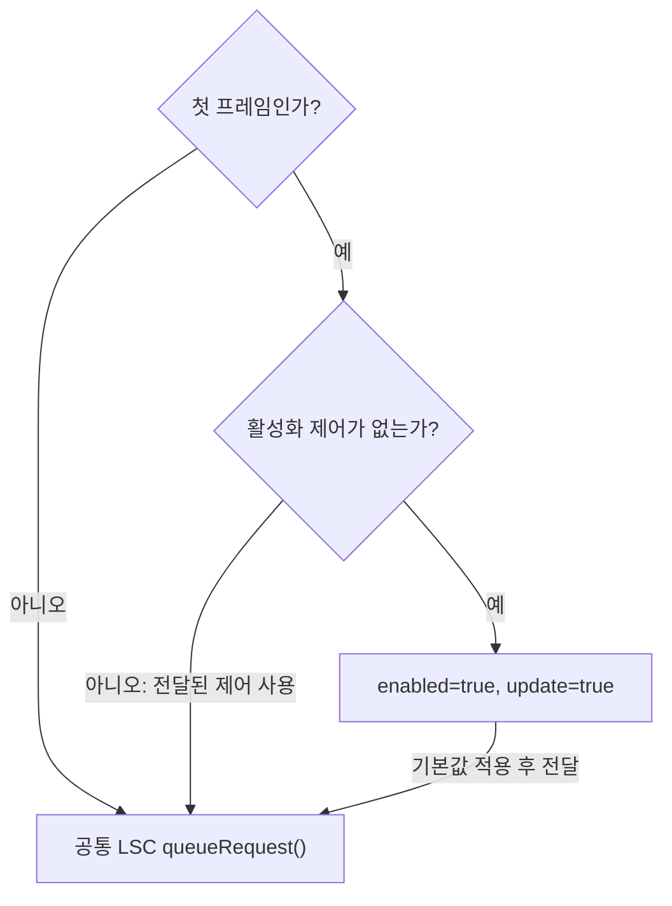
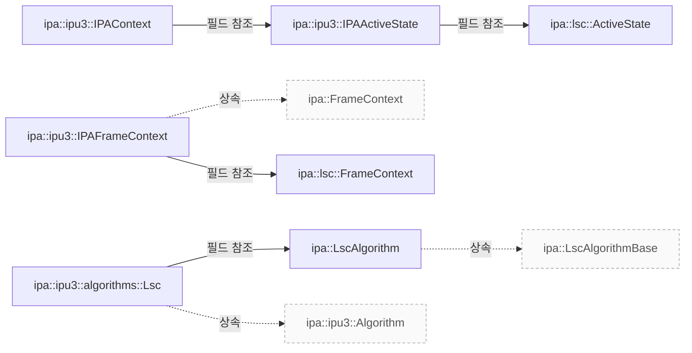

# IPU3 LSC의 설정과 프레임 처리

**LSC를 수정할 때는 초기 그리드 설정, 요청별 활성화 상태, 색온도에 따른 파라미터 갱신 조건을 차례로 확인하세요.**

| 지금 확인할 내용 | 이동할 절 |
|---|---|
| 빌드와 상태 연결의 조건과 근거를 대조하세요. | [빌드와 상태 연결](#빌드와-상태-연결) |
| 초기화와 크롭 설정의 조건과 근거를 대조하세요. | [초기화와 크롭 설정](#초기화와-크롭-설정) |
| 첫 프레임과 요청별 제어의 조건과 근거를 대조하세요. | [첫 프레임과 요청별 제어](#첫-프레임과-요청별-제어) |
| <a id="파라미터-갱신-조건"></a>파라미터 갱신 조건의 조건과 근거를 대조하세요. | [IPU3 렌즈 보정 테이블 준비](ipu3-lsc-prepare.md#파라미터-갱신-조건) |
| 메타데이터와 확인 범위의 조건과 근거를 대조하세요. | [메타데이터와 확인 범위](#메타데이터와-확인-범위) |
| <a id="lsc-파라미터를-갱신하는-분기"></a>“LSC 파라미터를 갱신하는 분기” 그림을 확인하세요. | [IPU3 렌즈 보정 테이블 준비](ipu3-lsc-prepare.md#lsc-파라미터를-갱신하는-분기) |

## 빌드와 상태 연결

Meson의 `ipu3_ipa_algorithms` 파일 목록에는 `lsc.cpp`가 포함되어 있으며, 이 파일은 `Lsc` 클래스를 IPU3 렌즈 음영 보정 알고리즘으로 소개합니다. `IPAActiveState`의 `lsc` 필드는 `ipa::lsc::ActiveState` 타입으로 선언되어 있습니다. `IPAFrameContext`의 `lsc` 필드는 `ipa::lsc::FrameContext` 타입으로 선언되어 있습니다. `IPAContext`의 `frameContexts` 필드 타입은 `FCQueue<IPAFrameContext>`이며, `FCQueue`의 타입 인자는 `IPAFrameContext`입니다. `src/ipa/ipu3/algorithms/meson.build:3`, `src/ipa/ipu3/algorithms/lsc.cpp:25`, `src/ipa/ipu3/ipa_context.h:32`

근거 원문: [src/ipa/ipu3/algorithms/meson.build:3](#source-914bc0dd95a64016) · [src/ipa/ipu3/ipa_context.h:32](#source-47a8aa55a4a846f4) · [src/ipa/ipu3/algorithms/lsc.cpp:25](#source-724bb41a4f6f5bae)

## 초기화와 크롭 설정

`Lsc::init()`은 센서 `activeArea`의 너비와 높이를 읽고, 최대 가로 73개와 세로 56개 셀을 기준으로 각 축의 픽셀 수를 올림하여 셀 크기의 하한을 구합니다. 이어서 각 하한을 `std::bit_ceil`로 2의 거듭제곱으로 올리고, 이미지 크기를 그 셀 크기로 나눈 값을 올림하여 셀 수를 구합니다. 각 셀 크기의 로그 값은 `std::bit_width` 결과에서 1을 빼서 구합니다. `src/ipa/ipu3/algorithms/lsc.cpp:31`

`Lsc::init()`은 튜닝 데이터의 `type`이 `polynomial`인지 기록합니다. 이어서 `lscAlgo_.init()`에 튜닝 데이터, `context.ctrlMap`, 색상 키 `r`, `gr`, `gb`, `b`, 가로와 세로 셀 수, 센서 `activeArea` 크기를 전달하고 그 반환값을 반환합니다. `src/ipa/ipu3/algorithms/lsc.cpp:31`

`Lsc::configure()`는 `analogCrop`의 너비와 높이를 저장하고, 가로와 세로 셀 수로 각각 `calculatePositions()`를 호출합니다. `calculatePositions()`는 각 인덱스 `i`의 위치를 `i / (dimension - 1)`로 계산합니다. `Lsc::configure()`는 활성 LSC 상태, `analogCrop`, 두 위치 벡터를 `lscAlgo_.configure()`에 전달하고 그 반환값을 반환합니다. `src/ipa/ipu3/algorithms/lsc.cpp:31`

근거 원문: [src/ipa/ipu3/algorithms/lsc.cpp:31](#source-441d18135ba28bdb)

## 첫 프레임과 요청별 제어

`Lsc::queueRequest`는 첫 프레임에서 `LensShadingCorrectionEnable` 제어가 없으면 `frameContext.lsc.enabled`에 `true`를 씁니다. `Lsc::queueRequest`는 첫 프레임이고 `LensShadingCorrectionEnable` 제어가 없으면 `frameContext.lsc.update`에 `true`를 씁니다. `Lsc::queueRequest`는 `lscAlgo_` 객체의 `queueRequest` 메서드를 호출합니다. `Lsc::queueRequest`는 `lscAlgo_.queueRequest`의 첫 번째 인자로 `context.activeState.lsc`를 전달합니다. `src/ipa/ipu3/algorithms/lsc.cpp:121`, `src/ipa/ipu3/algorithms/lsc.cpp:139`

<!-- sdd:visual:lsc-request-input -->
### 요청 제어가 프레임 상태에 반영되는 곳

첫 프레임에서 활성화 제어가 없으면 광고한 기본값을 맞춥니다. 이후 공통 LSC 알고리즘에 요청 제어를 전달합니다.



[Mermaid 원문](ipu3-lsc-flow.lsc-request-input.mmd)

??? note "그림 근거와 확인 범위"
    소스에 연결한 설계 해석입니다. 자동 연결 검사는 의미 승인이나 기기 실행 검증이 아닙니다.
    
    | 요소·전이 | 소스 근거 |
    |---|---|
    | 첫 프레임인가? | [src/ipa/ipu3/algorithms/lsc.cpp:121](#source-80fd6c99ec2c0ae8) |
    | 활성화 제어가 없는가? | [src/ipa/ipu3/algorithms/lsc.cpp:121](#source-80fd6c99ec2c0ae8) |
    | enabled=true, update=true | [src/ipa/ipu3/algorithms/lsc.cpp:121](#source-80fd6c99ec2c0ae8) |
    | 공통 LSC queueRequest() | [src/ipa/ipu3/algorithms/lsc.cpp:121](#source-80fd6c99ec2c0ae8) |
    | 예 | [src/ipa/ipu3/algorithms/lsc.cpp:121](#source-80fd6c99ec2c0ae8) |
    | 아니오 | [src/ipa/ipu3/algorithms/lsc.cpp:121](#source-80fd6c99ec2c0ae8) |
    | 예 | [src/ipa/ipu3/algorithms/lsc.cpp:121](#source-80fd6c99ec2c0ae8) |
    | 아니오: 전달된 제어 사용 | [src/ipa/ipu3/algorithms/lsc.cpp:121](#source-80fd6c99ec2c0ae8) |
    | 기본값 적용 후 전달 | [src/ipa/ipu3/algorithms/lsc.cpp:121](#source-80fd6c99ec2c0ae8) |
<!-- /sdd:visual:lsc-request-input -->

`Lsc::queueRequest`는 `lscAlgo_.queueRequest`의 두 번째 인자로 `frameContext.lsc`를 전달합니다. `Lsc::queueRequest`는 공통 `lscAlgo_.queueRequest` 호출의 세 번째 인자로 `controls`를 전달합니다. `src/ipa/ipu3/algorithms/lsc.cpp:139`

근거 원문: [src/ipa/ipu3/algorithms/lsc.cpp:121](#source-80fd6c99ec2c0ae8) · [src/ipa/ipu3/algorithms/lsc.cpp:139](#source-9a0c59def2673a45)

## 메타데이터와 확인 범위

`Lsc::process()`는 `frameContext.lsc`와 `metadata`를 공통 알고리즘인 `lscAlgo_.process()`에 전달합니다. 이 래퍼는 `stats`를 직접 사용하지 않습니다. 파일 끝에서 `REGISTER_IPA_ALGORITHM(Lsc, "Lsc")`가 알고리즘을 등록합니다. `src/ipa/ipu3/algorithms/lsc.cpp:282`

근거 원문: [src/ipa/ipu3/algorithms/lsc.cpp:282](#source-5e8cfeb51ea8c16a)

??? note "설계 질문과 검증 범위"
    질문별 답변과 근거 연결을 검사했습니다. 의미와 실행 결과는 사람 검토가 필요합니다.
    
    | 설계 질문 | 설명 위치 | 확인 범위 |
    |---|---|---|
    | LSC 구현 파일과 공유 상태 및 프레임별 상태는 어떻게 연결됩니까? | [빌드와 상태 연결](#빌드와-상태-연결) | 코드 근거와 설명 연결 |
    | 입력 크기에 따라 그리드와 크기 제한을 어떻게 결정합니까? | [초기화와 크롭 설정](#초기화와-크롭-설정) | 코드 근거와 설명 연결 |
    | 첫 프레임의 기본 활성화와 요청 제어는 어떤 데이터를 전달합니까? | [첫 프레임과 요청별 제어](#첫-프레임과-요청별-제어) | 코드 근거와 설명 연결 |
    | 프레임 처리 결과를 어떻게 통지합니까? | [메타데이터와 확인 범위](#메타데이터와-확인-범위) | 코드 근거와 설명 연결 |

## 소스 근거

같은 발췌는 한 번만 싣습니다. 필요한 원문을 펼쳐 설명과 대조하세요.

<a id="source-914bc0dd95a64016"></a>

??? note "소스 근거: src/ipa/ipu3/algorithms/meson.build:3"
    `src/ipa/ipu3/algorithms/meson.build:3`에서 시작하는 발췌입니다. 종료 줄은 11이며, 아래 원문을 설명과 대조할 수 있습니다.
    
    SHA-256: `5b34e175668b4fedb33a633567f049c2738f6368c3b4d8ac26d069e77add82c9`
    
    ```text
    ipu3_ipa_algorithms = files([
        'af.cpp',
        'agc.cpp',
        'awb.cpp',
        'blc.cpp',
        'ccm.cpp',
        'lsc.cpp',
        'tone_mapping.cpp',
    ])
    ```

<a id="source-47a8aa55a4a846f4"></a>

??? note "소스 근거: src/ipa/ipu3/ipa_context.h:32"
    `src/ipa/ipu3/ipa_context.h:32`에서 시작하는 발췌입니다. 종료 줄은 91이며, 아래 원문을 설명과 대조할 수 있습니다.
    
    SHA-256: `e373aff7c5b5e5f034637b3d9030b0fdef974614261025791afd6e3146b1108d`
    
    ```text
    struct IPASessionConfiguration {
    	struct {
    		ipu3_uapi_grid_config bdsGrid;
    		Size bdsOutputSize;
    		uint32_t stride;
    	} grid;
    
    	struct {
    		ipu3_uapi_grid_config afGrid;
    	} af;
    
    	agc::Session agc;
    };
    
    struct IPAActiveState {
    	struct {
    		uint32_t focus;
    		double maxVariance;
    		bool stable;
    	} af;
    
    	agc::ActiveState agc;
    	ipa::awb::ActiveState awb;
    	ipa::ccm::ActiveState ccm;
    	ipa::gamma::ActiveState gamma;
    	ipa::lsc::ActiveState lsc;
    };
    
    struct IPAFrameContext : public FrameContext {
    	struct {
    		uint32_t exposure;
    		double gain;
    	} sensor;
    
    	agc::FrameContext agc;
    	ipa::awb::FrameContext awb;
    	ipa::ccm::FrameContext ccm;
    	ipa::gamma::FrameContext gamma;
    	ipa::lsc::FrameContext lsc;
    };
    
    struct IPAContext {
    	IPAContext(unsigned int frameContextSize)
    		: frameContexts(frameContextSize)
    	{
    	}
    
    	IPASessionConfiguration configuration;
    	IPACameraSensorInfo sensorInfo;
    	ControlInfoMap sensorControls;
    	IPAActiveState activeState;
    
    	FCQueue<IPAFrameContext> frameContexts;
    
    	std::unique_ptr<CameraSensorHelper> camHelper;
    
    	ControlInfoMap::Map ctrlMap;
    };
    
    } /* namespace ipa::ipu3 */
    ```

<a id="source-724bb41a4f6f5bae"></a>

??? note "소스 근거: src/ipa/ipu3/algorithms/lsc.cpp:25"
    `src/ipa/ipu3/algorithms/lsc.cpp:25`에서 시작하는 발췌입니다. 종료 줄은 27이며, 아래 원문을 설명과 대조할 수 있습니다.
    
    SHA-256: `dc87ed5856cdb01479417f85ff58fd5c34081034ae381e3c01ca52c375ca4dfe`
    
    ```text
    \class Lsc
     * \brief IPU3 Lens Shading Correction algorithm
     */
    ```

<a id="source-441d18135ba28bdb"></a>

??? note "소스 근거: src/ipa/ipu3/algorithms/lsc.cpp:31"
    `src/ipa/ipu3/algorithms/lsc.cpp:31`에서 시작하는 발췌입니다. 종료 줄은 121이며, 아래 원문을 설명과 대조할 수 있습니다.
    
    SHA-256: `b4b73b83ec5f1caeb1e654f00aace0f49abf402b43c0ff6bd30528176ea8a566`
    
    ```text
    static constexpr unsigned int kMaxNumHCells = 73;
    static constexpr unsigned int kMaxNumVCells = 56;
    static constexpr int kColourTemperatureQuantization = 10;
    
    /**
     * \copydoc libcamera::ipa::Algorithm::init
     */
    int Lsc::init(IPAContext &context, const ValueNode &tuningData)
    {
    	/*
    	 * The IPU3 lens shading block expects a table of data that isn't of a
    	 * fixed size, but rather is configurable based on 4 parameters:
    	 *
    	 * block_width_log2:	The log2 of the horizontal pixel count per cell
    	 * block_height_log2:	The log2 of the vertical pixel count per cell
    	 * width:		The number of horizontal cells
    	 * height:		The number of vertical cells
    	 *
    	 * The constructed grid should be capable of covering the image, but
    	 * ideally won't extend past the edges of the image. Fixing either set
    	 * of parameters for the algorithm as a whole is likely to result in
    	 * suboptimal situations for some sensors, so let's determine them
    	 * programmatically instead.
    	 *
    	 * What we want is the densest possible grid that ideally doesn't extend
    	 * past the edges of the image at all. The maximum grid size is 73x56,
    	 * which gives us the lower bounds on cell size. Unfortunately we can
    	 * only specify sizes in powers of two, which can have the effect of
    	 * making the grid much more coarse. For example for a 2592x1944 input
    	 * image, 2592 / 73 = 35.5...which means we need to set blockWidthLog2
    	 * to 6 (I.E. 64) and have just 40.5 (or rather 41) cells horizontally.
    	 */
    	sensorWidth_ = context.sensorInfo.activeArea.width;
    	sensorHeight_ = context.sensorInfo.activeArea.height;
    
    	unsigned int cellWidth = (sensorWidth_ + kMaxNumHCells - 1) / kMaxNumHCells;
    	unsigned int cellHeight = (sensorHeight_ + kMaxNumVCells - 1) / kMaxNumVCells;
    
    	unsigned int minCellWidth = std::bit_ceil(cellWidth);
    	unsigned int minCellHeight = std::bit_ceil(cellHeight);
    
    	numHCells_ = (sensorWidth_ + minCellWidth - 1) / minCellWidth;
    	numVCells_ = (sensorHeight_ + minCellHeight - 1) / minCellHeight;
    
    	blockWidthLog2_ = std::bit_width(minCellWidth) - 1;
    	blockHeightLog2_ = std::bit_width(minCellHeight) - 1;
    
    	LOG(IPU3Lsc, Debug) << "Calculated Grid configuration: "
    			    << numHCells_ << "x" << numVCells_ << " cells of "
    			    << minCellWidth << "x" << minCellHeight << " pixels";
    
    	/*
    	 * We need to know if we're running the polynomial algorithm or not as
    	 * things will behave slightly differently.
    	 */
    	polynomial_ = tuningData["type"].get<std::string>() == "polynomial";
    
    	return lscAlgo_.init(tuningData, context.ctrlMap,
    			     { .keys = { "r", "gr", "gb", "b" },
    			       .numHSamples = numHCells_,
    			       .numVSamples = numVCells_,
    			       .sensorSize = context.sensorInfo.activeArea.size() });
    }
    
    std::vector<double> Lsc::calculatePositions(unsigned int dimension)
    {
    	std::vector<double> positions(dimension);
    	for (double i = 0.0; i < dimension; i++)
    		positions[i] = i / (dimension - 1);
    
    	return positions;
    }
    
    /**
     * \copydoc libcamera::ipa::Algorithm::configure
     */
    int Lsc::configure(IPAContext &context, const IPAConfigInfo &configInfo)
    {
    	cropWidth_ = configInfo.sensorInfo.analogCrop.width;
    	cropHeight_ = configInfo.sensorInfo.analogCrop.height;
    	std::vector<double> xPos = calculatePositions(numHCells_);
    	std::vector<double> yPos = calculatePositions(numVCells_);
    
    	return lscAlgo_.configure(context.activeState.lsc,
    				  configInfo.sensorInfo.analogCrop, xPos, yPos);
    }
    
    /**
     * \copydoc libcamera::ipa::Algorithm::queueRequest
     */
    void Lsc::queueRequest(
    ```

<a id="source-80fd6c99ec2c0ae8"></a>

??? note "소스 근거: src/ipa/ipu3/algorithms/lsc.cpp:121"
    `src/ipa/ipu3/algorithms/lsc.cpp:121`에서 시작하는 발췌입니다. 종료 줄은 142이며, 아래 원문을 설명과 대조할 수 있습니다.
    
    SHA-256: `550c83f35d2a4d5218ac10731fe8650d8446e262841f2dd80a54e9238c7da287`
    
    ```text
    void Lsc::queueRequest(IPAContext &context, const uint32_t frame,
    		       IPAFrameContext &frameContext,
    		       const ControlList &controls)
    {
    	/*
    	 * The base algorithm defines the LensShadingCorrectionEnable control
    	 * with a default value of true, but actually the IPU3 driver defaults
    	 * it to off. If this is the first frame, check for the control, but if
    	 * there isn't one, force it on to fulfil the advertised default.
    	 */
    	if (frame == 0) {
    		const auto &lscEnable = controls.get(controls::LensShadingCorrectionEnable);
    		if (!lscEnable) {
    			frameContext.lsc.enabled = true;
    			frameContext.lsc.update = true;
    		}
    	}
    
    	lscAlgo_.queueRequest(context.activeState.lsc, frameContext.lsc, controls);
    }
    
    static unsigned int quantize(
    ```

<a id="source-9a0c59def2673a45"></a>

??? note "소스 근거: src/ipa/ipu3/algorithms/lsc.cpp:139"
    `src/ipa/ipu3/algorithms/lsc.cpp:139`에서 시작하는 발췌입니다. 종료 줄은 139이며, 아래 원문을 설명과 대조할 수 있습니다.
    
    SHA-256: `847c975cc42b6b3d3c9361d2d3d84501ee3b5fa6b9101e5158e8707299973a1f`
    
    ```text
    lscAlgo_.queueRequest(context.activeState.lsc, frameContext.lsc, controls);
    ```

<a id="source-5e8cfeb51ea8c16a"></a>

??? note "소스 근거: src/ipa/ipu3/algorithms/lsc.cpp:282"
    `src/ipa/ipu3/algorithms/lsc.cpp:282`에서 시작하는 발췌입니다. 종료 줄은 291이며, 아래 원문을 설명과 대조할 수 있습니다.
    
    SHA-256: `e1411dc6710e62f774ea84588792a3f6fd547beb3442bc7cc49495eb19dff05e`
    
    ```text
    void Lsc::process([[maybe_unused]] IPAContext &context,
    		  [[maybe_unused]] const uint32_t frame,
    		  IPAFrameContext &frameContext,
    		  [[maybe_unused]] const ipu3_uapi_stats_3a *stats,
    		  ControlList &metadata)
    {
    	lscAlgo_.process(frameContext.lsc, metadata);
    }
    
    REGISTER_IPA_ALGORITHM(Lsc, "Lsc")
    ```


<!-- sdd:class-diagram -->
## 클래스 관계

화살표의 글자는 추출한 관계를 나타내며, 점선은 상속입니다. 화살표는 참조 대상 또는 기반 클래스를 향합니다. 호출 순서를 뜻하지 않습니다.


<!-- /sdd:class-diagram -->


## 관련 클래스

| 클래스 | 선언 위치 | 상속 | 책임 (주석) |
|---|---|---|---|
| `libcamera::ipa::LscAlgorithm` | `src/ipa/libipa/lsc.h:79` | `libcamera::ipa::LscAlgorithmBase` | libIPA LSC algorithm implementation |
| `libcamera::ipa::ipu3::IPAActiveState` | `src/ipa/ipu3/ipa_context.h:46` | – | The active state of the IPA algorithms |
| `libcamera::ipa::ipu3::IPAContext` | `src/ipa/ipu3/ipa_context.h:73` | – | Global IPA context data shared between all algorithms |
| `libcamera::ipa::ipu3::IPAFrameContext` | `src/ipa/ipu3/ipa_context.h:60` | `libcamera::ipa::FrameContext` | IPU3-specific FrameContext |
| `libcamera::ipa::ipu3::algorithms::Lsc` | `src/ipa/ipu3/algorithms/lsc.h:21` | `libcamera::ipa::ipu3::Algorithm` | IPU3 Lens Shading Correction algorithm |
| `libcamera::ipa::lsc::ActiveState` | `src/ipa/libipa/lsc.h:28` | – | The LSC active state |
| `libcamera::ipa::lsc::FrameContext` | `src/ipa/libipa/lsc.h:32` | – | 확인 필요 |

??? note "근거와 검토 정보"
    - 생성 방식: 추출 사실과 LLM 설명
    - 검증 범위: 표·그림은 facts로 만들고 설명은 LLM이 작성합니다. 인용·문장 및 설정된 구조 검사를 적용합니다.
    - 근거 파일: `src/ipa/ipu3/algorithms/lsc.cpp`, `src/ipa/ipu3/algorithms/lsc.h`, `src/ipa/ipu3/algorithms/meson.build`, `src/ipa/ipu3/ipa_context.h`, `src/ipa/libipa/lsc.h`
    - 근거 수준: 코드 확인 (정적 분석, simple_compdb 구성, commit `e117198c01`)
    - 자동 검사 (인용·문장 및 설정된 구조 검사): 통과
    - 검토 상태 기록일: 2026-10-29 · 사람 검토 전

다음 단계: [IPU3 렌즈 보정 테이블 준비](ipu3-lsc-prepare.md)
