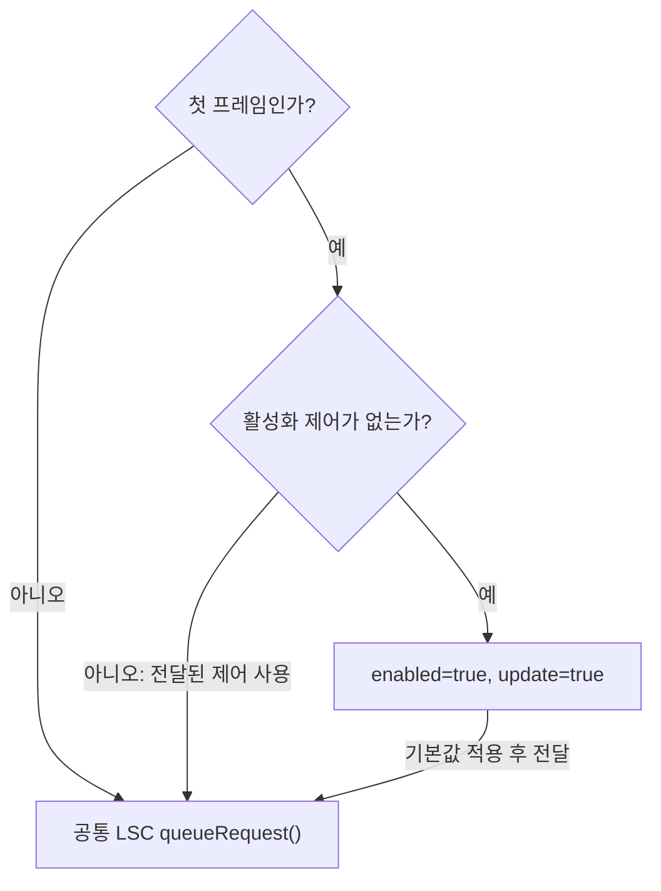
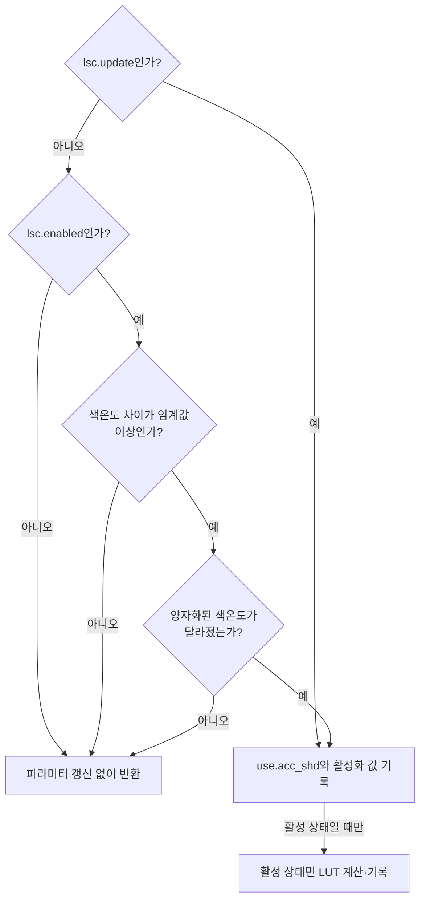
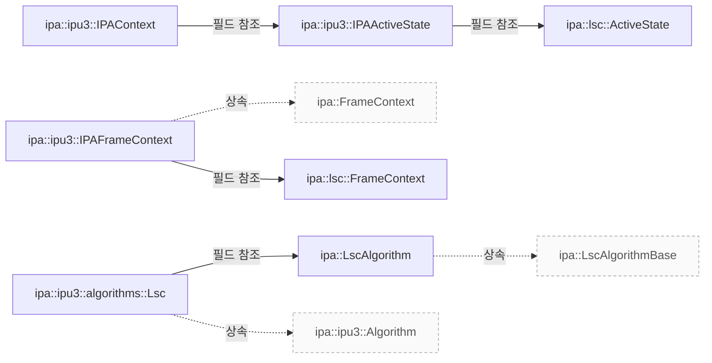

# IPU3 LSC의 설정과 프레임 처리

**LSC를 수정할 때는 초기 그리드 설정, 요청별 활성화 상태, 색온도에 따른 파라미터 갱신 조건을 차례로 확인하세요.**

| 지금 확인할 내용 | 이동할 절 |
|---|---|
| 빌드와 상태 연결 절을 확인합니다. | [빌드와 상태 연결](#빌드와-상태-연결) |
| 초기화와 크롭 설정 절을 확인합니다. | [초기화와 크롭 설정](#초기화와-크롭-설정) |
| 첫 프레임과 요청별 제어 절을 확인합니다. | [첫 프레임과 요청별 제어](#첫-프레임과-요청별-제어) |
| 파라미터 갱신 조건 절을 확인합니다. | [파라미터 갱신 조건](#파라미터-갱신-조건) |
| 메타데이터와 확인 범위 절을 확인합니다. | [메타데이터와 확인 범위](#메타데이터와-확인-범위) |

## 빌드와 상태 연결

`lsc.cpp` 파일이 Meson 빌드 시스템의 `ipu3_ipa_algorithms` 목록에 포함되어 있습니다. `src/ipa/ipu3/algorithms/meson.build:3`

`IPAActiveState` 구조체 내부의 `lsc` 필드는 `ipa::lsc::ActiveState` 타입으로 선언되어 있습니다. `src/ipa/ipu3/ipa_context.h:32`

`IPAFrameContext` 클래스는 `FrameContext`를 상속받아 정의되며, 이 클래스 내부에는 `ipa::lsc::FrameContext lsc;`라는 필드가 선언되어 있습니다. `src/ipa/ipu3/ipa_context.h:32`

`IPAContext` 클래스의 `frameContexts` 필드는 `FCQueue<IPAFrameContext>` 타입으로 정의되어 있습니다. `src/ipa/ipu3/ipa_context.h:32`

근거 원문: [src/ipa/ipu3/algorithms/meson.build:3](#source-914bc0dd95a64016) · [src/ipa/ipu3/ipa_context.h:32](#source-47a8aa55a4a846f4)

## 초기화와 크롭 설정

`Lsc::init()` 함수는 센서의 활성 영역(activeArea) 너비와 높이를 가져옵니다. 이 값을 바탕으로 가로 최대 셀 수(73 개)와 세로 최대 셀 수(56 개)를 기준으로 최소 단위 셀 크기를 계산합니다. `src/ipa/ipu3/algorithms/lsc.cpp:31`

계산된 최소 단위 셀 크기는 2 의 거듭제곱으로 반올림되며, 이를 위해 bit_ceil 함수가 사용됩니다. `src/ipa/ipu3/algorithms/lsc.cpp:31`

반올림된 최소 셀 크기를 다시 나누어 실제 사용할 가로와 세로 셀 수를 결정합니다. `src/ipa/ipu3/algorithms/lsc.cpp:31`

최종적으로 결정된 가로와 세로 셀 수를 바탕으로 각 블록의 너비와 높이 로그 2 값을 설정하고, 이 값들을 공통 알고리즘에 전달합니다. `src/ipa/ipu3/algorithms/lsc.cpp:31`

`Lsc::configure()` 함수는 센서의 아날로그 자르기(analogCrop) 너비와 높이를 가져옵니다. `src/ipa/ipu3/algorithms/lsc.cpp:31`

이 함수는 init() 에서 계산한 가로와 세로 셀 수에 따라 정규화된 샘플 위치 벡터를 생성합니다. `src/ipa/ipu3/algorithms/lsc.cpp:31`

정규화된 샘플 위치 벡터와 아날로그 자르기 정보를 바탕으로 공통 알고리즘을 구성합니다. `src/ipa/ipu3/algorithms/lsc.cpp:31`

근거 원문: [src/ipa/ipu3/algorithms/lsc.cpp:31](#source-441d18135ba28bdb)

## 첫 프레임과 요청별 제어

첫 번째 프레임이고 LensShadingCorrectionEnable 제어가 없을 때, `frameContext.lsc.enabled`에는 `true`가 쓰입니다. `src/ipa/ipu3/algorithms/lsc.cpp:121`

<!-- sdd:visual:lsc-request-input -->
### 요청 제어가 프레임 상태에 반영되는 곳

첫 프레임에서 활성화 제어가 없으면 광고한 기본값을 맞춥니다. 이후 공통 LSC 알고리즘에 요청 제어를 전달합니다.



[Mermaid 원문](ipu3-lsc-flow.lsc-request-input.mmd)

??? note "그림 근거와 확인 범위"
    소스에 연결한 설계 해석입니다. 자동 연결 검사는 의미 승인이나 기기 실행 검증이 아닙니다.
    
    | 요소·전이 | 소스 근거 |
    |---|---|
    | 첫 프레임인가? | [src/ipa/ipu3/algorithms/lsc.cpp:121](#source-80fd6c99ec2c0ae8) |
    | 활성화 제어가 없는가? | [src/ipa/ipu3/algorithms/lsc.cpp:121](#source-80fd6c99ec2c0ae8) |
    | enabled=true, update=true | [src/ipa/ipu3/algorithms/lsc.cpp:121](#source-80fd6c99ec2c0ae8) |
    | 공통 LSC queueRequest() | [src/ipa/ipu3/algorithms/lsc.cpp:121](#source-80fd6c99ec2c0ae8) |
    | 예 | [src/ipa/ipu3/algorithms/lsc.cpp:121](#source-80fd6c99ec2c0ae8) |
    | 아니오 | [src/ipa/ipu3/algorithms/lsc.cpp:121](#source-80fd6c99ec2c0ae8) |
    | 예 | [src/ipa/ipu3/algorithms/lsc.cpp:121](#source-80fd6c99ec2c0ae8) |
    | 아니오: 전달된 제어 사용 | [src/ipa/ipu3/algorithms/lsc.cpp:121](#source-80fd6c99ec2c0ae8) |
    | 기본값 적용 후 전달 | [src/ipa/ipu3/algorithms/lsc.cpp:121](#source-80fd6c99ec2c0ae8) |
<!-- /sdd:visual:lsc-request-input -->

첫 번째 프레임이고 LensShadingCorrectionEnable 제어가 없을 때, `Lsc::queueRequest` 함수는 frameContext.lsc.update 필드에 true 값을 설정합니다. `src/ipa/ipu3/algorithms/lsc.cpp:121`

`lscAlgo_`라는 객체가 `queueRequest` 메서드를 호출합니다. `src/ipa/ipu3/algorithms/lsc.cpp:139`

`Lsc::queueRequest` 함수가 호출될 때 첫 번째 인자로 전달되는 값은 `context.activeState.lsc` 입니다. `src/ipa/ipu3/algorithms/lsc.cpp:139`

`frameContext.lsc` 는 `Lsc::queueRequest` 함수 호출의 두 번째 인자로 전달되며, 이 값은 해당 프레임 컨텍스트에서 관리되는 렌즈 음영 보정 상태 정보를 나타냅니다. `src/ipa/ipu3/algorithms/lsc.cpp:139`

`controls`는 `lscAlgo_.queueRequest()` 함수 호출의 세 번째 인자로 전달되며, 렌즈 음영 보정 알고리즘에 적용할 제어 파라미터들을 담고 있는 객체입니다. `src/ipa/ipu3/algorithms/lsc.cpp:139`

근거 원문: [src/ipa/ipu3/algorithms/lsc.cpp:121](#source-80fd6c99ec2c0ae8) · [src/ipa/ipu3/algorithms/lsc.cpp:139](#source-9a0c59def2673a45)

## 파라미터 갱신 조건

`Lsc::prepare` 함수는 `frameContext.lsc.update` 가 false 이고 `frameContext.lsc.enabled` 도 false 인 경우 즉시 반환합니다. `src/ipa/ipu3/algorithms/lsc.cpp:142`

<!-- sdd:visual:lsc-update-gates -->
### LSC 파라미터를 갱신하는 분기

명시적 update가 있으면 색온도 생략 검사를 건너뜁니다. 갱신을 통지한 뒤 비활성 상태이면 LUT 계산은 수행하지 않습니다.



[Mermaid 원문](ipu3-lsc-flow.lsc-update-gates.mmd)

??? note "그림 근거와 확인 범위"
    소스에 연결한 설계 해석입니다. 자동 연결 검사는 의미 승인이나 기기 실행 검증이 아닙니다.
    
    | 요소·전이 | 소스 근거 |
    |---|---|
    | lsc.update인가? | [src/ipa/ipu3/algorithms/lsc.cpp:142](#source-026024190618ffa6) |
    | lsc.enabled인가? | [src/ipa/ipu3/algorithms/lsc.cpp:142](#source-026024190618ffa6) |
    | 색온도 차이가 임계값 이상인가? | [src/ipa/ipu3/algorithms/lsc.cpp:142](#source-026024190618ffa6) |
    | 양자화된 색온도가 달라졌는가? | [src/ipa/ipu3/algorithms/lsc.cpp:142](#source-026024190618ffa6) |
    | 파라미터 갱신 없이 반환 | [src/ipa/ipu3/algorithms/lsc.cpp:142](#source-026024190618ffa6) |
    | use.acc_shd와 활성화 값 기록 | [src/ipa/ipu3/algorithms/lsc.cpp:142](#source-026024190618ffa6) |
    | 활성 상태면 LUT 계산·기록 | [src/ipa/ipu3/algorithms/lsc.cpp:142](#source-026024190618ffa6) |
    | 예 | [src/ipa/ipu3/algorithms/lsc.cpp:142](#source-026024190618ffa6) |
    | 아니오 | [src/ipa/ipu3/algorithms/lsc.cpp:142](#source-026024190618ffa6) |
    | 아니오 | [src/ipa/ipu3/algorithms/lsc.cpp:142](#source-026024190618ffa6) |
    | 예 | [src/ipa/ipu3/algorithms/lsc.cpp:142](#source-026024190618ffa6) |
    | 아니오 | [src/ipa/ipu3/algorithms/lsc.cpp:142](#source-026024190618ffa6) |
    | 예 | [src/ipa/ipu3/algorithms/lsc.cpp:142](#source-026024190618ffa6) |
    | 아니오 | [src/ipa/ipu3/algorithms/lsc.cpp:142](#source-026024190618ffa6) |
    | 예 | [src/ipa/ipu3/algorithms/lsc.cpp:142](#source-026024190618ffa6) |
    | 활성 상태일 때만 | [src/ipa/ipu3/algorithms/lsc.cpp:142](#source-026024190618ffa6) |
<!-- /sdd:visual:lsc-update-gates -->

`Lsc::prepare` 함수는 `frameContext.lsc.update` 가 false 이고 `frameContext.lsc.enabled` 가 true 일 때, 현재 색온도 (`ct`) 와 마지막 적용된 색온도 (`lastAppliedCt_`) 의 차이가 `kColourTemperatureQuantization`(10) 을 2 로 나눈 값보다 작으면 조기 반환합니다. `src/ipa/ipu3/algorithms/lsc.cpp:142`

`Lsc::prepare` 함수는 `frameContext.lsc.update` 가 false 이고 `frameContext.lsc.enabled` 가 true 일 때, 현재 양자화된 색온도 (`quantizedCt`) 와 마지막으로 적용된 양자화된 색온도 (`lastAppliedQuantizedCt_`) 의 차이가 `kColourTemperatureQuantization / 2` 보다 작으면 조기 반환합니다. `src/ipa/ipu3/algorithms/lsc.cpp:142`

`Lsc::prepare` 함수가 `update` 플래그를 확인하여 조기 반환을 통과한 경우, 해당 함수는 `params->use.acc_shd` 멤버 변수에 정수 값 `1` 을 기록합니다. `src/ipa/ipu3/algorithms/lsc.cpp:142`

`config->general.shd_enable`에 대입되는 값은 `frameContext.lsc.enabled`입니다. `src/ipa/ipu3/algorithms/lsc.cpp:182`

`shd_enable`에 값을 대입한 뒤 `frameContext.lsc.enabled`가 `false`이면 함수는 즉시 반환합니다. `src/ipa/ipu3/algorithms/lsc.cpp:182`

`Lsc::prepare` 함수의 활성 경로에서 `config->grid.width`는 멤버 변수인 `numHCells_`로 설정되고, `config->grid.height`는 `numVCells_`로 설정되며, `config->grid.grid_height_per_slice`는 상수 `IPU3_UAPI_SHD_MAX_CELLS_PER_SET`를 `numHCells_`로 나눈 값으로 설정됩니다. `src/ipa/ipu3/algorithms/lsc.cpp:142`

`Lsc::prepare` 함수는 `polynomial_` 플래그의 값에 따라 LSC 파라미터 설정에서 `grid.x_start`와 `grid.y_start`를 다르게 계산합니다. `src/ipa/ipu3/algorithms/lsc.cpp:142`

`Lsc::prepare` 함수의 활성 경로에서 `config->general.gain_factor` 멤버 변수에는 항상 `0`이 설정됩니다. `src/ipa/ipu3/algorithms/lsc.cpp:142`

`Lsc::prepare` 함수는 `config->black_level.bl_r`, `config->black_level.bl_gr`, `config->black_level.bl_gb`, `config->black_level.bl_b`라는 네 가지 색상 필드에 모두 `0`이라는 값을 설정합니다. `src/ipa/ipu3/algorithms/lsc.cpp:248`

`Lsc::prepare` 함수 내부에서 `lscAlgo_` 객체의 `interpolateComponents` 메서드에 전달되는 색온도 값은 `quantizedCt` 변수를 통해 제공됩니다. `src/ipa/ipu3/algorithms/lsc.cpp:255`

`Lsc::prepare` 함수는 `lut->sets[s].r_and_gr[c].r`에 `set`의 r 채널 값을, `lut->sets[s].r_and_gr[c].gr`에 gr 채널 값을, `lut->sets[s].gb_and_b[c].gb`에 gb 채널 값을, 그리고 `lut->sets[s].gb_and_b[c].b`에 b 채널 값을 대입합니다. `src/ipa/ipu3/algorithms/lsc.cpp:263`

`lastAppliedCt_` 는 `Lsc` 클래스의 멤버 변수이고, `ct` 는 해당 대입문의 우변에 있는 변수입니다. `src/ipa/ipu3/algorithms/lsc.cpp:272`

`lastAppliedQuantizedCt_` 는 `Lsc` 클래스의 멤버 변수이고, `quantizedCt` 는 해당 대입문의 우변에 있는 변수입니다. `src/ipa/ipu3/algorithms/lsc.cpp:273`

근거 원문: [src/ipa/ipu3/algorithms/lsc.cpp:142](#source-026024190618ffa6) · [src/ipa/ipu3/algorithms/lsc.cpp:31](#source-af2cbcaa6410fbf4) · [src/ipa/ipu3/algorithms/lsc.cpp:182](#source-2565eab3740cff67) · [src/ipa/ipu3/algorithms/lsc.cpp:248](#source-dba1ef8e8f2a8563) · [src/ipa/ipu3/algorithms/lsc.cpp:255](#source-d9cad5cb8a925660) · [src/ipa/ipu3/algorithms/lsc.cpp:263](#source-807a646dc9c1acbc) · [src/ipa/ipu3/algorithms/lsc.cpp:272](#source-8fc123f7e3c227d7) · [src/ipa/ipu3/algorithms/lsc.cpp:273](#source-bb86261a35600a17)

## 메타데이터와 확인 범위

`Lsc::process()` 함수는 `IPAFrameContext` 객체의 `lsc` 멤버를 통해 렌즈 음영 보정 알고리즘에 프레임 상태를 전달합니다. `src/ipa/ipu3/algorithms/lsc.cpp:282`

`Lsc::process()` 함수는 `ipu3_uapi_stats_3a` 구조체를 매개변수로 받지만, 이 값을 `[[maybe_unused]]` 속성으로 표시하여 직접 사용하지 않습니다. `src/ipa/ipu3/algorithms/lsc.cpp:282`

`Lsc::process()` 함수는 `ControlList` 타입의 `metadata` 매개변수를 알고리즘 처리에 전달하며, 이 구조체는 프레임 처리 결과를 포함합니다. `src/ipa/ipu3/algorithms/lsc.cpp:282`

`Lsc::process()` 함수는 내부적으로 `lscAlgo_.process()`를 호출하여 실제 알고리즘 처리를 수행하고, 그 결과를 `metadata` 구조체를 통해 통지합니다. `src/ipa/ipu3/algorithms/lsc.cpp:282`

`Lsc::process()` 함수는 파일의 마지막 줄에서 `REGISTER_IPA_ALGORITHM` 매크로를 사용하여 알고리즘을 등록합니다. `src/ipa/ipu3/algorithms/lsc.cpp:282`

근거 원문: [src/ipa/ipu3/algorithms/lsc.cpp:282](#source-5e8cfeb51ea8c16a)

??? note "설계 질문과 검증 범위"
    질문별 답변과 근거 연결을 검사했습니다. 의미와 실행 결과는 사람 검토가 필요합니다.
    
    | 설계 질문 | 설명 위치 | 확인 범위 |
    |---|---|---|
    | LSC 구현 파일과 공유 상태 및 프레임별 상태는 어떻게 연결됩니까? | [빌드와 상태 연결](#빌드와-상태-연결) | 코드 근거와 설명 연결 |
    | 입력 크기에 따라 그리드와 크기 제한을 어떻게 결정합니까? | [초기화와 크롭 설정](#초기화와-크롭-설정) | 코드 근거와 설명 연결 |
    | 첫 프레임의 기본 활성화와 요청 제어는 어떤 데이터를 전달합니까? | [첫 프레임과 요청별 제어](#첫-프레임과-요청별-제어) | 코드 근거와 설명 연결 |
    | 갱신은 어떤 조건에서 수행하며 커널에 어떤 파라미터를 전달합니까? | [파라미터 갱신 조건](#파라미터-갱신-조건) | 코드 근거와 설명 연결 |
    | 프레임 처리 결과를 어떻게 통지합니까? | [메타데이터와 확인 범위](#메타데이터와-확인-범위) | 코드 근거와 설명 연결 |

## 소스 근거

같은 발췌는 한 번만 싣습니다. 필요한 원문을 펼쳐 설명과 대조하세요.

<a id="source-914bc0dd95a64016"></a>

??? note "소스 근거: src/ipa/ipu3/algorithms/meson.build:3"
    `src/ipa/ipu3/algorithms/meson.build:3`에서 시작하는 발췌입니다. 종료 줄은 11이며, 아래 원문을 설명과 대조할 수 있습니다.
    
    SHA-256: `5b34e175668b4fedb33a633567f049c2738f6368c3b4d8ac26d069e77add82c9`
    
    ```text
    ipu3_ipa_algorithms = files([
        'af.cpp',
        'agc.cpp',
        'awb.cpp',
        'blc.cpp',
        'ccm.cpp',
        'lsc.cpp',
        'tone_mapping.cpp',
    ])
    ```

<a id="source-47a8aa55a4a846f4"></a>

??? note "소스 근거: src/ipa/ipu3/ipa_context.h:32"
    `src/ipa/ipu3/ipa_context.h:32`에서 시작하는 발췌입니다. 종료 줄은 91이며, 아래 원문을 설명과 대조할 수 있습니다.
    
    SHA-256: `e373aff7c5b5e5f034637b3d9030b0fdef974614261025791afd6e3146b1108d`
    
    ```text
    struct IPASessionConfiguration {
    	struct {
    		ipu3_uapi_grid_config bdsGrid;
    		Size bdsOutputSize;
    		uint32_t stride;
    	} grid;
    
    	struct {
    		ipu3_uapi_grid_config afGrid;
    	} af;
    
    	agc::Session agc;
    };
    
    struct IPAActiveState {
    	struct {
    		uint32_t focus;
    		double maxVariance;
    		bool stable;
    	} af;
    
    	agc::ActiveState agc;
    	ipa::awb::ActiveState awb;
    	ipa::ccm::ActiveState ccm;
    	ipa::gamma::ActiveState gamma;
    	ipa::lsc::ActiveState lsc;
    };
    
    struct IPAFrameContext : public FrameContext {
    	struct {
    		uint32_t exposure;
    		double gain;
    	} sensor;
    
    	agc::FrameContext agc;
    	ipa::awb::FrameContext awb;
    	ipa::ccm::FrameContext ccm;
    	ipa::gamma::FrameContext gamma;
    	ipa::lsc::FrameContext lsc;
    };
    
    struct IPAContext {
    	IPAContext(unsigned int frameContextSize)
    		: frameContexts(frameContextSize)
    	{
    	}
    
    	IPASessionConfiguration configuration;
    	IPACameraSensorInfo sensorInfo;
    	ControlInfoMap sensorControls;
    	IPAActiveState activeState;
    
    	FCQueue<IPAFrameContext> frameContexts;
    
    	std::unique_ptr<CameraSensorHelper> camHelper;
    
    	ControlInfoMap::Map ctrlMap;
    };
    
    } /* namespace ipa::ipu3 */
    ```

<a id="source-441d18135ba28bdb"></a>

??? note "소스 근거: src/ipa/ipu3/algorithms/lsc.cpp:31"
    `src/ipa/ipu3/algorithms/lsc.cpp:31`에서 시작하는 발췌입니다. 종료 줄은 121이며, 아래 원문을 설명과 대조할 수 있습니다.
    
    SHA-256: `b4b73b83ec5f1caeb1e654f00aace0f49abf402b43c0ff6bd30528176ea8a566`
    
    ```text
    static constexpr unsigned int kMaxNumHCells = 73;
    static constexpr unsigned int kMaxNumVCells = 56;
    static constexpr int kColourTemperatureQuantization = 10;
    
    /**
     * \copydoc libcamera::ipa::Algorithm::init
     */
    int Lsc::init(IPAContext &context, const ValueNode &tuningData)
    {
    	/*
    	 * The IPU3 lens shading block expects a table of data that isn't of a
    	 * fixed size, but rather is configurable based on 4 parameters:
    	 *
    	 * block_width_log2:	The log2 of the horizontal pixel count per cell
    	 * block_height_log2:	The log2 of the vertical pixel count per cell
    	 * width:		The number of horizontal cells
    	 * height:		The number of vertical cells
    	 *
    	 * The constructed grid should be capable of covering the image, but
    	 * ideally won't extend past the edges of the image. Fixing either set
    	 * of parameters for the algorithm as a whole is likely to result in
    	 * suboptimal situations for some sensors, so let's determine them
    	 * programmatically instead.
    	 *
    	 * What we want is the densest possible grid that ideally doesn't extend
    	 * past the edges of the image at all. The maximum grid size is 73x56,
    	 * which gives us the lower bounds on cell size. Unfortunately we can
    	 * only specify sizes in powers of two, which can have the effect of
    	 * making the grid much more coarse. For example for a 2592x1944 input
    	 * image, 2592 / 73 = 35.5...which means we need to set blockWidthLog2
    	 * to 6 (I.E. 64) and have just 40.5 (or rather 41) cells horizontally.
    	 */
    	sensorWidth_ = context.sensorInfo.activeArea.width;
    	sensorHeight_ = context.sensorInfo.activeArea.height;
    
    	unsigned int cellWidth = (sensorWidth_ + kMaxNumHCells - 1) / kMaxNumHCells;
    	unsigned int cellHeight = (sensorHeight_ + kMaxNumVCells - 1) / kMaxNumVCells;
    
    	unsigned int minCellWidth = std::bit_ceil(cellWidth);
    	unsigned int minCellHeight = std::bit_ceil(cellHeight);
    
    	numHCells_ = (sensorWidth_ + minCellWidth - 1) / minCellWidth;
    	numVCells_ = (sensorHeight_ + minCellHeight - 1) / minCellHeight;
    
    	blockWidthLog2_ = std::bit_width(minCellWidth) - 1;
    	blockHeightLog2_ = std::bit_width(minCellHeight) - 1;
    
    	LOG(IPU3Lsc, Debug) << "Calculated Grid configuration: "
    			    << numHCells_ << "x" << numVCells_ << " cells of "
    			    << minCellWidth << "x" << minCellHeight << " pixels";
    
    	/*
    	 * We need to know if we're running the polynomial algorithm or not as
    	 * things will behave slightly differently.
    	 */
    	polynomial_ = tuningData["type"].get<std::string>() == "polynomial";
    
    	return lscAlgo_.init(tuningData, context.ctrlMap,
    			     { .keys = { "r", "gr", "gb", "b" },
    			       .numHSamples = numHCells_,
    			       .numVSamples = numVCells_,
    			       .sensorSize = context.sensorInfo.activeArea.size() });
    }
    
    std::vector<double> Lsc::calculatePositions(unsigned int dimension)
    {
    	std::vector<double> positions(dimension);
    	for (double i = 0.0; i < dimension; i++)
    		positions[i] = i / (dimension - 1);
    
    	return positions;
    }
    
    /**
     * \copydoc libcamera::ipa::Algorithm::configure
     */
    int Lsc::configure(IPAContext &context, const IPAConfigInfo &configInfo)
    {
    	cropWidth_ = configInfo.sensorInfo.analogCrop.width;
    	cropHeight_ = configInfo.sensorInfo.analogCrop.height;
    	std::vector<double> xPos = calculatePositions(numHCells_);
    	std::vector<double> yPos = calculatePositions(numVCells_);
    
    	return lscAlgo_.configure(context.activeState.lsc,
    				  configInfo.sensorInfo.analogCrop, xPos, yPos);
    }
    
    /**
     * \copydoc libcamera::ipa::Algorithm::queueRequest
     */
    void Lsc::queueRequest(
    ```

<a id="source-80fd6c99ec2c0ae8"></a>

??? note "소스 근거: src/ipa/ipu3/algorithms/lsc.cpp:121"
    `src/ipa/ipu3/algorithms/lsc.cpp:121`에서 시작하는 발췌입니다. 종료 줄은 142이며, 아래 원문을 설명과 대조할 수 있습니다.
    
    SHA-256: `550c83f35d2a4d5218ac10731fe8650d8446e262841f2dd80a54e9238c7da287`
    
    ```text
    void Lsc::queueRequest(IPAContext &context, const uint32_t frame,
    		       IPAFrameContext &frameContext,
    		       const ControlList &controls)
    {
    	/*
    	 * The base algorithm defines the LensShadingCorrectionEnable control
    	 * with a default value of true, but actually the IPU3 driver defaults
    	 * it to off. If this is the first frame, check for the control, but if
    	 * there isn't one, force it on to fulfil the advertised default.
    	 */
    	if (frame == 0) {
    		const auto &lscEnable = controls.get(controls::LensShadingCorrectionEnable);
    		if (!lscEnable) {
    			frameContext.lsc.enabled = true;
    			frameContext.lsc.update = true;
    		}
    	}
    
    	lscAlgo_.queueRequest(context.activeState.lsc, frameContext.lsc, controls);
    }
    
    static unsigned int quantize(
    ```

<a id="source-9a0c59def2673a45"></a>

??? note "소스 근거: src/ipa/ipu3/algorithms/lsc.cpp:139"
    `src/ipa/ipu3/algorithms/lsc.cpp:139`에서 시작하는 발췌입니다. 종료 줄은 139이며, 아래 원문을 설명과 대조할 수 있습니다.
    
    SHA-256: `847c975cc42b6b3d3c9361d2d3d84501ee3b5fa6b9101e5158e8707299973a1f`
    
    ```text
    lscAlgo_.queueRequest(context.activeState.lsc, frameContext.lsc, controls);
    ```

<a id="source-026024190618ffa6"></a>

??? note "소스 근거: src/ipa/ipu3/algorithms/lsc.cpp:142"
    `src/ipa/ipu3/algorithms/lsc.cpp:142`에서 시작하는 발췌입니다. 종료 줄은 282이며, 아래 원문을 설명과 대조할 수 있습니다.
    
    SHA-256: `1d11fc7397b377f682d4fab45d12dd20480e554176aae94ba2708a5f8f747268`
    
    ```text
    static unsigned int quantize(unsigned int value, unsigned int step)
    {
    	return std::lround(value / static_cast<double>(step)) * step;
    }
    
    /**
     * \copydoc libcamera::ipa::Algorithm::prepare
     */
    void Lsc::prepare([[maybe_unused]] IPAContext &context, [[maybe_unused]] const uint32_t frame,
    		  IPAFrameContext &frameContext, ipu3_uapi_params *params)
    {
    	uint32_t ct = frameContext.awb.colourTemperature;
    	unsigned int quantizedCt = quantize(ct, kColourTemperatureQuantization);
    
    	if (!frameContext.lsc.update) {
    		if (!frameContext.lsc.enabled)
    			return;
    
    		/*
    		 * Add a threshold so that oscillations around a quantization
    		 * step don't lead to constant changes.
    		 */
    		if (utils::abs_diff(ct, lastAppliedCt_) < kColourTemperatureQuantization / 2)
    			return;
    
    		if (quantizedCt == lastAppliedQuantizedCt_)
    			return;
    	}
    
    	/*
    	 * This flag tells the kernel driver that it should read the LSC params
    	 * passed from userspace instead of using its cached copy.
    	 */
    	params->use.acc_shd = 1;
    
    	/*
    	 * Pass the enabled flag. If we're not enabled, we can then just bail
    	 * out.
    	 */
    	ipu3_uapi_shd_config_static *config = &params->acc_param.shd.shd;
    	config->general.shd_enable = frameContext.lsc.enabled;
    
    	if (!frameContext.lsc.enabled)
    		return;
    
    	config->grid.width = numHCells_;
    	config->grid.height = numVCells_;
    	config->grid.block_width_log2 = blockWidthLog2_;
    	config->grid.block_height_log2 = blockHeightLog2_;
    	config->grid.grid_height_per_slice = IPU3_UAPI_SHD_MAX_CELLS_PER_SET / numHCells_;
    
    	/*
    	 * The IPU3's documentation describes the x_start and y_start members
    	 * as follows:
    	 *
    	 * "[X/Y] value of top left corner of sensor relative to ROI
    	 * s13, [-4096, 0], default 0, only negative values."
    	 *
    	 * I interpret that as allowing us to configure the cropped rectangle
    	 * relative to the full grid. That's useful if we're running the tabular
    	 * algorithm, which would otherwise apply the full grid inappropriately.
    	 * If we're running the polynomial one though the calculated grid is
    	 * probably more appropriate than a coarse application of the full grid
    	 * so let's tell the hardware not to bother correcting in that case.
    	 */
    	if (polynomial_) {
    		config->grid.x_start = 0;
    		config->grid.y_start = 0;
    	} else {
    		config->grid.x_start = (cropWidth_ - sensorWidth_) / 2;
    		config->grid.y_start = (cropHeight_ - sensorHeight_) / 2;
    	}
    
    	/* No idea what this is, but the docs say it should be set as so */
    	config->general.init_set_vrt_offst_ul =
    		config->grid.y_start >> (config->grid.block_height_log2 %
    					 config->grid.grid_height_per_slice);
    
    	/*
    	 * Values in the LUT cease taking effect at 4096, and a value of 0.0 is
    	 * "no correction" rather than black. The gain factor is described by
    	 * the documentation like so:
    	 *
    	 * "Shift calculated anti shading value. Precision u2. 0x0 - gain factor
    	 * [1, 5], means no shift interpolated value. 0x1 - gain factor [1, 9],
    	 * means shift interpolated by 1. 0x2 - gain factor [1, 17], means shift
    	 * interpolated by 2."
    	 *
    	 * The simplest interpretation for those pieces of information is I
    	 * think that the LUT stores 12-bit Q numbers who's represented values
    	 * depend on the gain_factor setting like so:
    	 *
    	 * 0: UQ<2, 10> representing values in range [0, 4)
    	 * 1: UQ<3, 9> representing values in range [0, 8)
    	 * 2: UQ<4, 8> representing values in range [0, 16)
    	 *
    	 * And that a base gain of 1.0 is added to those configured values. As a
    	 * gain of more than 5.0 is fairly unlikely, let's fix gain_factor to 0
    	 * for now and revisit if needed.
    	 */
    	config->general.gain_factor = 0;
    
    	/*
    	 * Disable the black level settings here - we do that through another
    	 * parameters block.
    	 */
    	config->black_level.bl_r = 0;
    	config->black_level.bl_gr = 0;
    	config->black_level.bl_gb = 0;
    	config->black_level.bl_b = 0;
    
    	ipu3_uapi_shd_lut *lut = &params->acc_param.shd.shd_lut;
    
    	const auto &set = lscAlgo_.interpolateComponents(quantizedCt);
    
    	unsigned int totalCells = numHCells_ * numVCells_;
    	unsigned int cellsPerSet = numHCells_ * config->grid.grid_height_per_slice;
    	unsigned int numSets = (numHCells_ + config->grid.grid_height_per_slice - 1) /
    			       config->grid.grid_height_per_slice;
    	unsigned int i = 0;
    
    	for (unsigned int s = 0; s < numSets; s++) {
    		for (unsigned int c = 0; c < cellsPerSet && i < totalCells; c++, i++) {
    			lut->sets[s].r_and_gr[c].r = set.at("r")[i];
    			lut->sets[s].r_and_gr[c].gr = set.at("gr")[i];
    			lut->sets[s].gb_and_b[c].gb = set.at("gb")[i];
    			lut->sets[s].gb_and_b[c].b = set.at("b")[i];
    		}
    	}
    
    	lastAppliedCt_ = ct;
    	lastAppliedQuantizedCt_ = quantizedCt;
    	LOG(IPU3Lsc, Debug)
    		<< "ct is " << ct << ", quantized to "
    		<< quantizedCt;
    }
    
    /**
     * \copydoc libcamera::ipa::Algorithm::process
     */
    void Lsc::process(
    ```

<a id="source-af2cbcaa6410fbf4"></a>

??? note "소스 근거: src/ipa/ipu3/algorithms/lsc.cpp:31"
    `src/ipa/ipu3/algorithms/lsc.cpp:31`에서 시작하는 발췌입니다. 종료 줄은 38이며, 아래 원문을 설명과 대조할 수 있습니다.
    
    SHA-256: `7807718b4ae9327f1ca428627d2b00f59ba38ced03261465ee8c79312ea27833`
    
    ```text
    static constexpr unsigned int kMaxNumHCells = 73;
    static constexpr unsigned int kMaxNumVCells = 56;
    static constexpr int kColourTemperatureQuantization = 10;
    
    /**
     * \copydoc libcamera::ipa::Algorithm::init
     */
    int Lsc::init(
    ```

<a id="source-2565eab3740cff67"></a>

??? note "소스 근거: src/ipa/ipu3/algorithms/lsc.cpp:182"
    `src/ipa/ipu3/algorithms/lsc.cpp:182`에서 시작하는 발췌입니다. 종료 줄은 185이며, 아래 원문을 설명과 대조할 수 있습니다.
    
    SHA-256: `c01350762a48814f82cd74a201743cc3a05182aca7837fdb61c61be2f23d0446`
    
    ```text
    config->general.shd_enable = frameContext.lsc.enabled;
    
    	if (!frameContext.lsc.enabled)
    		return;
    ```

<a id="source-dba1ef8e8f2a8563"></a>

??? note "소스 근거: src/ipa/ipu3/algorithms/lsc.cpp:248"
    `src/ipa/ipu3/algorithms/lsc.cpp:248`에서 시작하는 발췌입니다. 종료 줄은 251이며, 아래 원문을 설명과 대조할 수 있습니다.
    
    SHA-256: `0d3f67f2135ab9779d48a9c37820f7d694dcd54b8d2fdd140ded1a91ef8c505f`
    
    ```text
    config->black_level.bl_r = 0;
    	config->black_level.bl_gr = 0;
    	config->black_level.bl_gb = 0;
    	config->black_level.bl_b = 0;
    ```

<a id="source-d9cad5cb8a925660"></a>

??? note "소스 근거: src/ipa/ipu3/algorithms/lsc.cpp:255"
    `src/ipa/ipu3/algorithms/lsc.cpp:255`에서 시작하는 발췌입니다. 종료 줄은 255이며, 아래 원문을 설명과 대조할 수 있습니다.
    
    SHA-256: `0acd80d1672a74f03b1e8ac712a046a486d25382cfa71448f67dcf3c30edf13d`
    
    ```text
    const auto &set = lscAlgo_.interpolateComponents(quantizedCt);
    ```

<a id="source-807a646dc9c1acbc"></a>

??? note "소스 근거: src/ipa/ipu3/algorithms/lsc.cpp:263"
    `src/ipa/ipu3/algorithms/lsc.cpp:263`에서 시작하는 발췌입니다. 종료 줄은 272이며, 아래 원문을 설명과 대조할 수 있습니다.
    
    SHA-256: `4b7da473a595e23e82e1e8118afae2c1a044c6e1a510c1ac5e7fd1fd562be119`
    
    ```text
    for (unsigned int s = 0; s < numSets; s++) {
    		for (unsigned int c = 0; c < cellsPerSet && i < totalCells; c++, i++) {
    			lut->sets[s].r_and_gr[c].r = set.at("r")[i];
    			lut->sets[s].r_and_gr[c].gr = set.at("gr")[i];
    			lut->sets[s].gb_and_b[c].gb = set.at("gb")[i];
    			lut->sets[s].gb_and_b[c].b = set.at("b")[i];
    		}
    	}
    
    	lastAppliedCt_ = ct;
    ```

<a id="source-8fc123f7e3c227d7"></a>

??? note "소스 근거: src/ipa/ipu3/algorithms/lsc.cpp:272"
    `src/ipa/ipu3/algorithms/lsc.cpp:272`에서 시작하는 발췌입니다. 종료 줄은 272이며, 아래 원문을 설명과 대조할 수 있습니다.
    
    SHA-256: `8ff337801a819f86b0e1912bd37319c93fe2cfaddaa718cc2437776b20fd55b2`
    
    ```text
    lastAppliedCt_ = ct;
    ```

<a id="source-bb86261a35600a17"></a>

??? note "소스 근거: src/ipa/ipu3/algorithms/lsc.cpp:273"
    `src/ipa/ipu3/algorithms/lsc.cpp:273`에서 시작하는 발췌입니다. 종료 줄은 273이며, 아래 원문을 설명과 대조할 수 있습니다.
    
    SHA-256: `cf33d4637404946cb518e1bad89c7613d47f18ff75930a5af092bba468a014ed`
    
    ```text
    lastAppliedQuantizedCt_ = quantizedCt;
    ```

<a id="source-5e8cfeb51ea8c16a"></a>

??? note "소스 근거: src/ipa/ipu3/algorithms/lsc.cpp:282"
    `src/ipa/ipu3/algorithms/lsc.cpp:282`에서 시작하는 발췌입니다. 종료 줄은 291이며, 아래 원문을 설명과 대조할 수 있습니다.
    
    SHA-256: `e1411dc6710e62f774ea84588792a3f6fd547beb3442bc7cc49495eb19dff05e`
    
    ```text
    void Lsc::process([[maybe_unused]] IPAContext &context,
    		  [[maybe_unused]] const uint32_t frame,
    		  IPAFrameContext &frameContext,
    		  [[maybe_unused]] const ipu3_uapi_stats_3a *stats,
    		  ControlList &metadata)
    {
    	lscAlgo_.process(frameContext.lsc, metadata);
    }
    
    REGISTER_IPA_ALGORITHM(Lsc, "Lsc")
    ```


<!-- sdd:class-diagram -->
## 클래스 관계

화살표의 글자는 추출한 관계를 나타내며, 점선은 상속입니다. 화살표는 참조 대상 또는 기반 클래스를 향합니다. 호출 순서를 뜻하지 않습니다.


<!-- /sdd:class-diagram -->


## 관련 클래스

| 클래스 | 선언 위치 | 상속 | 책임 (주석) |
|---|---|---|---|
| `libcamera::ipa::LscAlgorithm` | `src/ipa/libipa/lsc.h:78` | `libcamera::ipa::LscAlgorithmBase` | libIPA LSC algorithm implementation |
| `libcamera::ipa::ipu3::IPAActiveState` | `src/ipa/ipu3/ipa_context.h:46` | – | The active state of the IPA algorithms |
| `libcamera::ipa::ipu3::IPAContext` | `src/ipa/ipu3/ipa_context.h:73` | – | Global IPA context data shared between all algorithms |
| `libcamera::ipa::ipu3::IPAFrameContext` | `src/ipa/ipu3/ipa_context.h:60` | `libcamera::ipa::FrameContext` | IPU3-specific FrameContext |
| `libcamera::ipa::ipu3::algorithms::Lsc` | `src/ipa/ipu3/algorithms/lsc.h:21` | `libcamera::ipa::ipu3::Algorithm` | IPU3 Lens Shading Correction algorithm |
| `libcamera::ipa::lsc::ActiveState` | `src/ipa/libipa/lsc.h:27` | – | The LSC active state |
| `libcamera::ipa::lsc::FrameContext` | `src/ipa/libipa/lsc.h:31` | – | 확인 필요 |

??? note "근거와 검토 정보"
    - 생성 방식: 추출 사실과 LLM 설명
    - 검증 범위: 표·그림은 facts로 만들고 설명은 LLM이 작성합니다. 인용·문장 및 설정된 구조 검사를 적용합니다.
    - 근거 파일: `src/ipa/ipu3/algorithms/lsc.cpp`, `src/ipa/ipu3/algorithms/lsc.h`, `src/ipa/ipu3/algorithms/meson.build`, `src/ipa/ipu3/ipa_context.h`, `src/ipa/libipa/lsc.h`
    - 근거 수준: 코드 확인 (정적 분석, simple_compdb 구성, commit `2c4b67c079`)
    - 자동 검사 (인용·문장 및 설정된 구조 검사): 통과
    - 검토 상태 기록일: 2026-10-26 · 사람 검토 전

다음 단계: [시스템 개요](overview.md)
