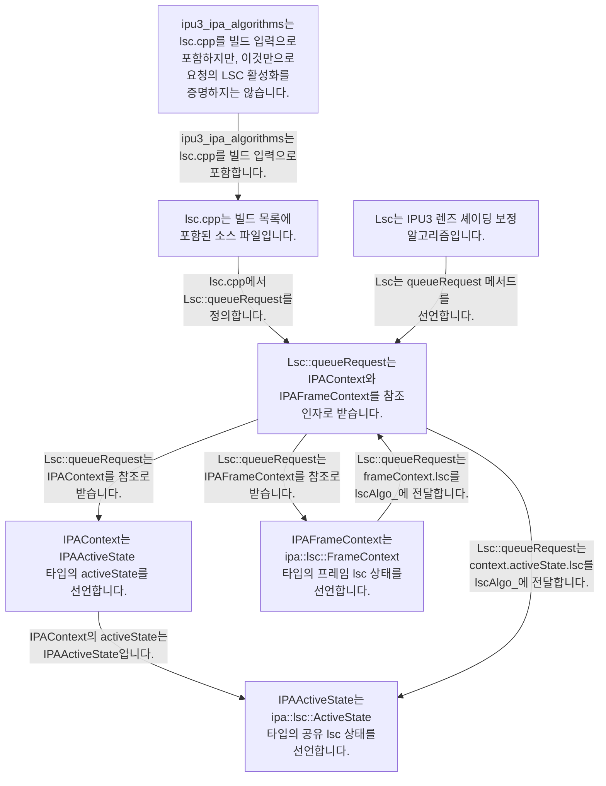
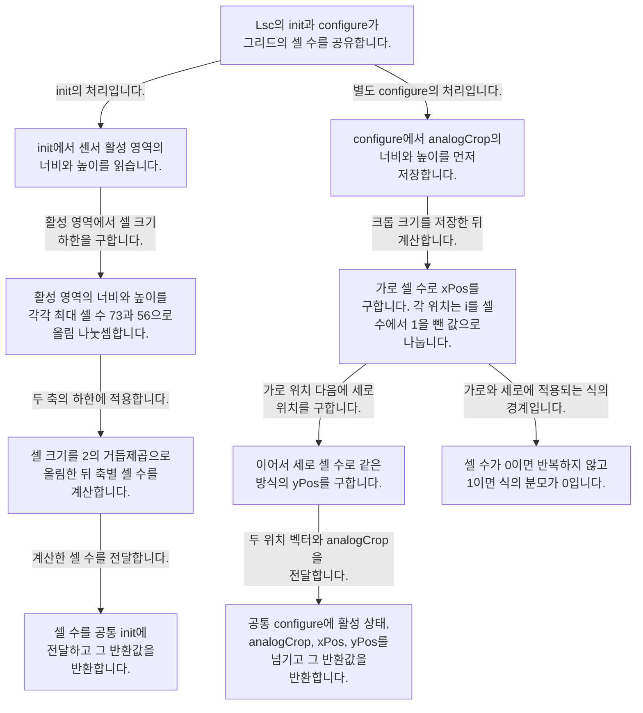
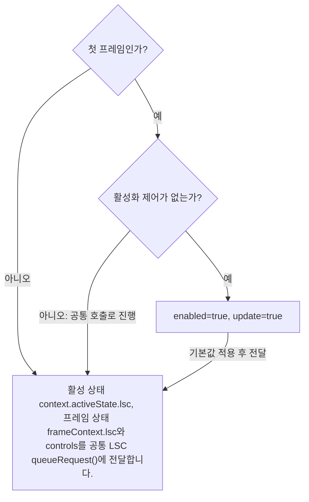
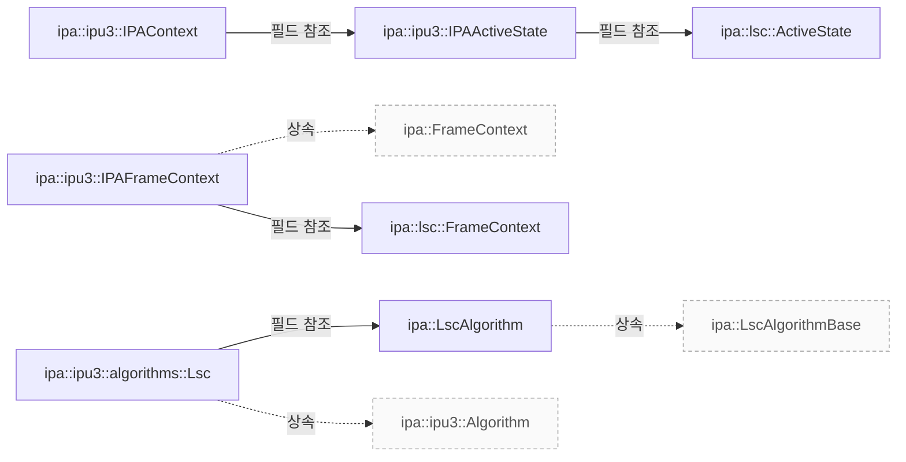

# IPU3 LSC의 설정과 프레임 처리

**LSC를 수정할 때는 초기 그리드 설정, 요청별 활성화 상태, 색온도에 따른 파라미터 갱신 조건을 차례로 확인하세요.**

| 지금 확인할 내용 | 이동할 절 |
|---|---|
| 빌드와 상태 연결의 조건과 근거를 대조하세요. | [빌드와 상태 연결](#빌드와-상태-연결) |
| 초기화와 크롭 설정의 조건과 근거를 대조하세요. | [초기화와 크롭 설정](#초기화와-크롭-설정) |
| 첫 프레임과 요청별 제어의 조건과 근거를 대조하세요. | [첫 프레임과 요청별 제어](#첫-프레임과-요청별-제어) |
| <a id="파라미터-갱신-조건"></a>파라미터 갱신 조건의 조건과 근거를 대조하세요. | [IPU3 렌즈 보정 테이블 준비](ipu3-lsc-prepare.md#파라미터-갱신-조건) |
| 메타데이터와 확인 범위의 조건과 근거를 대조하세요. | [메타데이터와 확인 범위](#메타데이터와-확인-범위) |
| <a id="lsc-파라미터를-갱신하는-분기"></a>“LSC 파라미터를 갱신하는 분기” 그림을 확인하세요. | [IPU3 렌즈 보정 테이블 준비](ipu3-lsc-prepare.md#lsc-파라미터를-갱신하는-분기) |

## 빌드와 상태 연결

Meson의 `ipu3_ipa_algorithms` 목록은 `lsc.cpp`를 빌드 입력에 포함하며, 이 파일은 `Lsc` 클래스를 IPU3 렌즈 음영 보정 알고리즘으로 소개합니다. `IPAActiveState`의 `lsc` 필드는 `ipa::lsc::ActiveState` 타입으로 선언되어 있습니다. `IPAFrameContext`는 `FrameContext`를 상속하며, `lsc` 필드를 `ipa::lsc::FrameContext` 타입으로 선언합니다. `IPAContext`의 `frameContexts` 필드 타입은 `FCQueue<IPAFrameContext>`입니다. `src/ipa/ipu3/algorithms/meson.build:3`, `src/ipa/ipu3/algorithms/lsc.cpp:25`, `src/ipa/ipu3/ipa_context.h:32`

<!-- sdd:visual:lsc-build-state-integration -->
### LSC 빌드와 메서드 상태 입력



[Mermaid 원문](ipu3-lsc-flow.lsc-build-state-integration.mmd)

??? note "그림 근거와 확인 범위"
    빌드 목록의 lsc.cpp와 Lsc 메서드의 IPAContext·IPAFrameContext 입력, 공유 lsc 상태·프레임 lsc 상태 선언은 어떻게 연결됩니까?
    
    소스에 연결한 설계 해석입니다. 자동 연결 검사는 의미 승인이나 기기 실행 검증이 아닙니다.
    
    LLM 그림 초안 · 사람 검토 전
    
    작성 모델: `cli/codex/gpt-6.1-terra`
    
    | 요소·전이 | 소스 근거 |
    |---|---|
    | <span data-sdd-label-en="ipu3_ipa_algorithms includes lsc.cpp as a build input, but inclusion alone does not prove LSC is enabled for a request.">ipu3&#95;ipa&#95;algorithms는 lsc.cpp를 빌드 입력으로 포함하지만, 이것만으로 요청의 LSC 활성화를 증명하지는 않습니다.</span> | [src/ipa/ipu3/algorithms/meson.build:3](#source-914bc0dd95a64016) |
    | <span data-sdd-label-en="lsc.cpp is a source file included in the build list.">lsc.cpp는 빌드 목록에 포함된 소스 파일입니다.</span> | [src/ipa/ipu3/algorithms/meson.build:3](#source-914bc0dd95a64016) |
    | <span data-sdd-label-en="Lsc is the IPU3 lens shading correction algorithm.">Lsc는 IPU3 렌즈 셰이딩 보정 알고리즘입니다.</span> | [src/ipa/ipu3/algorithms/lsc.cpp:25](#source-724bb41a4f6f5bae) |
    | <span data-sdd-label-en="Lsc::queueRequest takes IPAContext and IPAFrameContext by reference.">Lsc::queueRequest는 IPAContext와 IPAFrameContext를 참조 인자로 받습니다.</span> | [src/ipa/ipu3/algorithms/lsc.cpp:121](#source-fb65fafe64a3b61f) |
    | <span data-sdd-label-en="IPAContext declares activeState with type IPAActiveState.">IPAContext는 IPAActiveState 타입의 activeState를 선언합니다.</span> | [src/ipa/ipu3/ipa_context.h:32](#source-47a8aa55a4a846f4) |
    | <span data-sdd-label-en="IPAActiveState declares the shared lsc state with type ipa::lsc::ActiveState.">IPAActiveState는 ipa::lsc::ActiveState 타입의 공유 lsc 상태를 선언합니다.</span> | [src/ipa/ipu3/ipa_context.h:32](#source-47a8aa55a4a846f4) |
    | <span data-sdd-label-en="IPAFrameContext declares the frame lsc state with type ipa::lsc::FrameContext.">IPAFrameContext는 ipa::lsc::FrameContext 타입의 프레임 lsc 상태를 선언합니다.</span> | [src/ipa/ipu3/ipa_context.h:32](#source-47a8aa55a4a846f4) |
    | <span data-sdd-label-en="ipu3_ipa_algorithms includes lsc.cpp as a build input.">ipu3&#95;ipa&#95;algorithms는 lsc.cpp를 빌드 입력으로 포함합니다.</span> | [src/ipa/ipu3/algorithms/meson.build:3](#source-914bc0dd95a64016) |
    | <span data-sdd-label-en="lsc.cpp defines Lsc::queueRequest.">lsc.cpp에서 Lsc::queueRequest를 정의합니다.</span> | [src/ipa/ipu3/algorithms/meson.build:3](#source-914bc0dd95a64016) · [src/ipa/ipu3/algorithms/lsc.cpp:121](#source-fb65fafe64a3b61f) |
    | <span data-sdd-label-en="Lsc declares the queueRequest method.">Lsc는 queueRequest 메서드를 선언합니다.</span> | [src/ipa/ipu3/algorithms/lsc.h:21](#source-1c0b8c6b923ea225) · [src/ipa/ipu3/algorithms/lsc.cpp:121](#source-fb65fafe64a3b61f) |
    | <span data-sdd-label-en="Lsc::queueRequest takes IPAContext by reference.">Lsc::queueRequest는 IPAContext를 참조로 받습니다.</span> | [src/ipa/ipu3/algorithms/lsc.cpp:121](#source-fb65fafe64a3b61f) |
    | <span data-sdd-label-en="Lsc::queueRequest takes IPAFrameContext by reference.">Lsc::queueRequest는 IPAFrameContext를 참조로 받습니다.</span> | [src/ipa/ipu3/algorithms/lsc.cpp:121](#source-fb65fafe64a3b61f) |
    | <span data-sdd-label-en="The activeState in IPAContext is an IPAActiveState.">IPAContext의 activeState는 IPAActiveState입니다.</span> | [src/ipa/ipu3/ipa_context.h:32](#source-47a8aa55a4a846f4) |
    | <span data-sdd-label-en="Lsc::queueRequest passes context.activeState.lsc to lscAlgo_.">Lsc::queueRequest는 context.activeState.lsc를 lscAlgo&#95;에 전달합니다.</span> | [src/ipa/ipu3/algorithms/lsc.cpp:121](#source-fb65fafe64a3b61f) · [src/ipa/ipu3/ipa_context.h:32](#source-47a8aa55a4a846f4) |
    | <span data-sdd-label-en="Lsc::queueRequest passes frameContext.lsc to lscAlgo_.">Lsc::queueRequest는 frameContext.lsc를 lscAlgo&#95;에 전달합니다.</span> | [src/ipa/ipu3/algorithms/lsc.cpp:121](#source-fb65fafe64a3b61f) · [src/ipa/ipu3/ipa_context.h:32](#source-47a8aa55a4a846f4) |
<!-- /sdd:visual:lsc-build-state-integration -->

근거 원문: [src/ipa/ipu3/algorithms/meson.build:3](#source-914bc0dd95a64016) · [src/ipa/ipu3/ipa_context.h:32](#source-47a8aa55a4a846f4) · [src/ipa/ipu3/algorithms/lsc.cpp:25](#source-724bb41a4f6f5bae) · [src/ipa/ipu3/algorithms/lsc.h:21](#source-1c0b8c6b923ea225) · [src/ipa/ipu3/algorithms/lsc.cpp:121](#source-fb65fafe64a3b61f)

## 초기화와 크롭 설정

`Lsc::init()`은 센서 `activeArea`의 너비와 높이를 사용하고, 최대 가로 73개와 세로 56개 셀을 기준으로 각 방향의 셀 크기를 올림 나눗셈으로 구합니다. 이어서 `std::bit_ceil`로 셀 크기를 2의 거듭제곱으로 올리고, 이미지 크기를 이 셀 크기로 올림 나누어 셀 수를 정합니다. 각 블록 크기의 로그 값은 해당 셀 크기의 `std::bit_width`에서 1을 빼서 구합니다. `src/ipa/ipu3/algorithms/lsc.cpp:31`

<!-- sdd:visual:item-setup -->
### 초기화와 크롭 설정의 관계와 경계



[Mermaid 원문](ipu3-lsc-flow.item-setup.mmd)

??? note "그림 근거와 확인 범위"
    센서 활성 영역과 셀 수 제한으로 그리드를 계산한 뒤 그 결과를 크롭 설정에 어떻게 전달하는가?
    
    소스에 연결한 설계 해석입니다. 자동 연결 검사는 의미 승인이나 기기 실행 검증이 아닙니다.
    
    | 요소·전이 | 소스 근거 |
    |---|---|
    | <span data-sdd-label-en="Lsc init and configure use the same grid cell counts.">Lsc의 init과 configure가 그리드의 셀 수를 공유합니다.</span> | [src/ipa/ipu3/algorithms/lsc.cpp:31](#source-441d18135ba28bdb) |
    | <span data-sdd-label-en="init reads the width and height of the sensor active area.">init에서 센서 활성 영역의 너비와 높이를 읽습니다.</span> | [src/ipa/ipu3/algorithms/lsc.cpp:31](#source-441d18135ba28bdb) |
    | <span data-sdd-label-en="Ceiling-divide the active width by 73 and the active height by 56.">활성 영역의 너비와 높이를 각각 최대 셀 수 73과 56으로 올림 나눗셈합니다.</span> | [src/ipa/ipu3/algorithms/lsc.cpp:31](#source-441d18135ba28bdb) |
    | <span data-sdd-label-en="Round cell sizes up to powers of two, then compute the cell count on each axis.">셀 크기를 2의 거듭제곱으로 올림한 뒤 축별 셀 수를 계산합니다.</span> | [src/ipa/ipu3/algorithms/lsc.cpp:31](#source-441d18135ba28bdb) |
    | <span data-sdd-label-en="Pass the cell counts to the common init and return its result.">셀 수를 공통 init에 전달하고 그 반환값을 반환합니다.</span> | [src/ipa/ipu3/algorithms/lsc.cpp:31](#source-441d18135ba28bdb) |
    | <span data-sdd-label-en="configure first stores the width and height of analogCrop.">configure에서 analogCrop의 너비와 높이를 먼저 저장합니다.</span> | [src/ipa/ipu3/algorithms/lsc.cpp:31](#source-441d18135ba28bdb) |
    | <span data-sdd-label-en="Compute xPos using the horizontal cell count. Each position is i divided by (the cell count minus one).">가로 셀 수로 xPos를 구합니다. 각 위치는 i를 셀 수에서 1을 뺀 값으로 나눕니다.</span> | [src/ipa/ipu3/algorithms/lsc.cpp:31](#source-441d18135ba28bdb) |
    | <span data-sdd-label-en="Then compute yPos the same way using the vertical cell count.">이어서 세로 셀 수로 같은 방식의 yPos를 구합니다.</span> | [src/ipa/ipu3/algorithms/lsc.cpp:31](#source-441d18135ba28bdb) |
    | <span data-sdd-label-en="A cell count of 0 skips the loop. A count of 1 gives a zero denominator.">셀 수가 0이면 반복하지 않고 1이면 식의 분모가 0입니다.</span> | [src/ipa/ipu3/algorithms/lsc.cpp:31](#source-441d18135ba28bdb) |
    | <span data-sdd-label-en="Pass active state, analogCrop, xPos and yPos to the common configure and return its result.">공통 configure에 활성 상태, analogCrop, xPos, yPos를 넘기고 그 반환값을 반환합니다.</span> | [src/ipa/ipu3/algorithms/lsc.cpp:31](#source-441d18135ba28bdb) |
    | <span data-sdd-label-en="This is the init path.">init의 처리입니다.</span> | [src/ipa/ipu3/algorithms/lsc.cpp:31](#source-441d18135ba28bdb) |
    | <span data-sdd-label-en="Compute the cell size lower bounds from the active area.">활성 영역에서 셀 크기 하한을 구합니다.</span> | [src/ipa/ipu3/algorithms/lsc.cpp:31](#source-441d18135ba28bdb) |
    | <span data-sdd-label-en="Round both lower bounds.">두 축의 하한에 적용합니다.</span> | [src/ipa/ipu3/algorithms/lsc.cpp:31](#source-441d18135ba28bdb) |
    | <span data-sdd-label-en="Pass the computed cell counts.">계산한 셀 수를 전달합니다.</span> | [src/ipa/ipu3/algorithms/lsc.cpp:31](#source-441d18135ba28bdb) |
    | <span data-sdd-label-en="This is the separate configure path.">별도 configure의 처리입니다.</span> | [src/ipa/ipu3/algorithms/lsc.cpp:31](#source-441d18135ba28bdb) |
    | <span data-sdd-label-en="Compute after storing the crop size.">크롭 크기를 저장한 뒤 계산합니다.</span> | [src/ipa/ipu3/algorithms/lsc.cpp:31](#source-441d18135ba28bdb) |
    | <span data-sdd-label-en="Compute the vertical positions after the horizontal ones.">가로 위치 다음에 세로 위치를 구합니다.</span> | [src/ipa/ipu3/algorithms/lsc.cpp:31](#source-441d18135ba28bdb) |
    | <span data-sdd-label-en="This formula boundary applies to both axes.">가로와 세로에 적용되는 식의 경계입니다.</span> | [src/ipa/ipu3/algorithms/lsc.cpp:31](#source-441d18135ba28bdb) |
    | <span data-sdd-label-en="Pass both position vectors and analogCrop.">두 위치 벡터와 analogCrop을 전달합니다.</span> | [src/ipa/ipu3/algorithms/lsc.cpp:31](#source-441d18135ba28bdb) |
<!-- /sdd:visual:item-setup -->

`Lsc::init()`은 튜닝 데이터의 `type`이 `polynomial`인지 저장합니다. 이어서 공통 알고리즘의 `lscAlgo_.init()`에 튜닝 데이터, `context.ctrlMap`, 채널 키 `r`, `gr`, `gb`, `b`, 계산한 가로·세로 샘플 수와 센서 `activeArea` 크기를 전달하고 그 반환값을 반환합니다. `src/ipa/ipu3/algorithms/lsc.cpp:31`

`Lsc::configure()`는 `analogCrop`의 너비와 높이를 저장하고, 가로와 세로 셀 수를 각각 `calculatePositions()`에 전달합니다. `calculatePositions()`는 각 차원에서 인덱스 `i`를 `dimension - 1`로 나눈 위치 배열을 반환합니다. 이어서 `Lsc::configure()`는 LSC 활성 상태, `analogCrop`, 두 위치 배열을 `lscAlgo_.configure()`에 전달하고 그 반환값을 반환합니다. `src/ipa/ipu3/algorithms/lsc.cpp:31`

근거 원문: [src/ipa/ipu3/algorithms/lsc.cpp:31](#source-441d18135ba28bdb)

## 첫 프레임과 요청별 제어

`Lsc::queueRequest()`는 첫 프레임에서 `LensShadingCorrectionEnable` 제어가 없으면 `frameContext.lsc.enabled`와 `frameContext.lsc.update`에 모두 `true`를 씁니다. `Lsc::queueRequest`는 `lscAlgo_`의 `queueRequest`를 호출하며, 첫 번째 인자로 `context.activeState.lsc`, 두 번째 인자로 `frameContext.lsc`, 세 번째 인자로 `controls`를 전달합니다. `src/ipa/ipu3/algorithms/lsc.cpp:121`, `src/ipa/ipu3/algorithms/lsc.cpp:139`

<!-- sdd:visual:lsc-request-input -->
### 요청 제어가 프레임 상태에 반영되는 곳



[Mermaid 원문](ipu3-lsc-flow.lsc-request-input.mmd)

??? note "그림 근거와 확인 범위"
    첫 프레임에서 활성화 제어가 없으면 광고한 기본값을 맞춥니다. 이후 공통 LSC 알고리즘에 요청 제어를 전달합니다.
    
    소스에 연결한 설계 해석입니다. 자동 연결 검사는 의미 승인이나 기기 실행 검증이 아닙니다.
    
    | 요소·전이 | 소스 근거 |
    |---|---|
    | <span data-sdd-label-en="First frame?">첫 프레임인가?</span> | [src/ipa/ipu3/algorithms/lsc.cpp:121](#source-80fd6c99ec2c0ae8) |
    | <span data-sdd-label-en="Enable control absent?">활성화 제어가 없는가?</span> | [src/ipa/ipu3/algorithms/lsc.cpp:121](#source-80fd6c99ec2c0ae8) |
    | <span data-sdd-label-en="enabled=true, update=true">enabled=true, update=true</span> | [src/ipa/ipu3/algorithms/lsc.cpp:121](#source-80fd6c99ec2c0ae8) |
    | <span data-sdd-label-en="Pass active state context.activeState.lsc, frame state frameContext.lsc, and controls to the common LSC queueRequest().">활성 상태 context.activeState.lsc, 프레임 상태 frameContext.lsc와 controls를 공통 LSC queueRequest&#40;&#41;에 전달합니다.</span> | [src/ipa/ipu3/algorithms/lsc.cpp:121](#source-80fd6c99ec2c0ae8) |
    | <span data-sdd-label-en="Yes">예</span> | [src/ipa/ipu3/algorithms/lsc.cpp:121](#source-80fd6c99ec2c0ae8) |
    | <span data-sdd-label-en="No">아니오</span> | [src/ipa/ipu3/algorithms/lsc.cpp:121](#source-80fd6c99ec2c0ae8) |
    | <span data-sdd-label-en="Yes">예</span> | [src/ipa/ipu3/algorithms/lsc.cpp:121](#source-80fd6c99ec2c0ae8) |
    | <span data-sdd-label-en="No: continue to the common call">아니오: 공통 호출로 진행</span> | [src/ipa/ipu3/algorithms/lsc.cpp:121](#source-80fd6c99ec2c0ae8) |
    | <span data-sdd-label-en="Forward after applying default">기본값 적용 후 전달</span> | [src/ipa/ipu3/algorithms/lsc.cpp:121](#source-80fd6c99ec2c0ae8) |
<!-- /sdd:visual:lsc-request-input -->

근거 원문: [src/ipa/ipu3/algorithms/lsc.cpp:121](#source-80fd6c99ec2c0ae8) · [src/ipa/ipu3/algorithms/lsc.cpp:139](#source-9a0c59def2673a45)

## 메타데이터와 확인 범위

`Lsc::process()`는 `frameContext.lsc`와 `metadata`를 `lscAlgo_.process()`에 전달합니다. 래퍼는 `stats`를 직접 사용하지 않습니다. 파일 끝의 `REGISTER_IPA_ALGORITHM(Lsc, "Lsc")`는 `Lsc` 알고리즘을 `"Lsc"`라는 이름으로 등록합니다. `src/ipa/ipu3/algorithms/lsc.cpp:282`

근거 원문: [src/ipa/ipu3/algorithms/lsc.cpp:282](#source-5e8cfeb51ea8c16a)

??? note "설계 질문과 검증 범위"
    질문별 답변과 근거 연결을 검사했습니다. 의미와 실행 결과는 사람 검토가 필요합니다.
    
    | 설계 질문 | 설명 위치 | 확인 범위 |
    |---|---|---|
    | LSC 구현 파일과 공유 상태 및 프레임별 상태는 어떻게 연결됩니까? | [빌드와 상태 연결](#빌드와-상태-연결) | 코드 근거와 설명 연결 |
    | 입력 크기에 따라 그리드와 크기 제한을 어떻게 결정합니까? | [초기화와 크롭 설정](#초기화와-크롭-설정) | 코드 근거와 설명 연결 |
    | 첫 프레임의 기본 활성화와 요청 제어는 어떤 데이터를 전달합니까? | [첫 프레임과 요청별 제어](#첫-프레임과-요청별-제어) | 코드 근거와 설명 연결 |
    | 프레임 처리 결과를 어떻게 통지합니까? | [메타데이터와 확인 범위](#메타데이터와-확인-범위) | 코드 근거와 설명 연결 |

## 소스 근거

같은 발췌는 한 번만 싣습니다. 필요한 원문을 펼쳐 설명과 대조하세요.

<a id="source-914bc0dd95a64016"></a>

??? note "소스 근거: src/ipa/ipu3/algorithms/meson.build:3"
    `src/ipa/ipu3/algorithms/meson.build:3`에서 시작하는 발췌입니다. 종료 줄은 11이며, 아래 원문을 설명과 대조할 수 있습니다.
    
    SHA-256: `5b34e175668b4fedb33a633567f049c2738f6368c3b4d8ac26d069e77add82c9`
    
    ```text
    ipu3_ipa_algorithms = files([
        'af.cpp',
        'agc.cpp',
        'awb.cpp',
        'blc.cpp',
        'ccm.cpp',
        'lsc.cpp',
        'tone_mapping.cpp',
    ])
    ```

<a id="source-47a8aa55a4a846f4"></a>

??? note "소스 근거: src/ipa/ipu3/ipa_context.h:32"
    `src/ipa/ipu3/ipa_context.h:32`에서 시작하는 발췌입니다. 종료 줄은 91이며, 아래 원문을 설명과 대조할 수 있습니다.
    
    SHA-256: `e373aff7c5b5e5f034637b3d9030b0fdef974614261025791afd6e3146b1108d`
    
    ```text
    struct IPASessionConfiguration {
    	struct {
    		ipu3_uapi_grid_config bdsGrid;
    		Size bdsOutputSize;
    		uint32_t stride;
    	} grid;
    
    	struct {
    		ipu3_uapi_grid_config afGrid;
    	} af;
    
    	agc::Session agc;
    };
    
    struct IPAActiveState {
    	struct {
    		uint32_t focus;
    		double maxVariance;
    		bool stable;
    	} af;
    
    	agc::ActiveState agc;
    	ipa::awb::ActiveState awb;
    	ipa::ccm::ActiveState ccm;
    	ipa::gamma::ActiveState gamma;
    	ipa::lsc::ActiveState lsc;
    };
    
    struct IPAFrameContext : public FrameContext {
    	struct {
    		uint32_t exposure;
    		double gain;
    	} sensor;
    
    	agc::FrameContext agc;
    	ipa::awb::FrameContext awb;
    	ipa::ccm::FrameContext ccm;
    	ipa::gamma::FrameContext gamma;
    	ipa::lsc::FrameContext lsc;
    };
    
    struct IPAContext {
    	IPAContext(unsigned int frameContextSize)
    		: frameContexts(frameContextSize)
    	{
    	}
    
    	IPASessionConfiguration configuration;
    	IPACameraSensorInfo sensorInfo;
    	ControlInfoMap sensorControls;
    	IPAActiveState activeState;
    
    	FCQueue<IPAFrameContext> frameContexts;
    
    	std::unique_ptr<CameraSensorHelper> camHelper;
    
    	ControlInfoMap::Map ctrlMap;
    };
    
    } /* namespace ipa::ipu3 */
    ```

<a id="source-724bb41a4f6f5bae"></a>

??? note "소스 근거: src/ipa/ipu3/algorithms/lsc.cpp:25"
    `src/ipa/ipu3/algorithms/lsc.cpp:25`에서 시작하는 발췌입니다. 종료 줄은 27이며, 아래 원문을 설명과 대조할 수 있습니다.
    
    SHA-256: `dc87ed5856cdb01479417f85ff58fd5c34081034ae381e3c01ca52c375ca4dfe`
    
    ```text
    \class Lsc
     * \brief IPU3 Lens Shading Correction algorithm
     */
    ```

<a id="source-1c0b8c6b923ea225"></a>

??? note "소스 근거: src/ipa/ipu3/algorithms/lsc.h:21"
    `src/ipa/ipu3/algorithms/lsc.h:21`에서 시작하는 발췌입니다. 종료 줄은 56이며, 아래 원문을 설명과 대조할 수 있습니다.
    
    SHA-256: `94a832d5031c9a3e51ddf0fd9811921872d9239c63cca648e3da06f9c62039d4`
    
    ```text
    class Lsc : public Algorithm
    {
    public:
    	int init(IPAContext &context, const ValueNode &tuningData) override;
    	void queueRequest(IPAContext &context, const uint32_t frame,
    			  IPAFrameContext &frameContext,
    			  const ControlList &controls) override;
    	int configure(IPAContext &context, const IPAConfigInfo &configInfo) override;
    	void prepare(IPAContext &context, const uint32_t frame,
    		     IPAFrameContext &frameContext,
    		     ipu3_uapi_params *params) override;
    	void process(IPAContext &context, const uint32_t frame,
    		     IPAFrameContext &frameContext,
    		     const ipu3_uapi_stats_3a *stats,
    		     ControlList &metadata) override;
    
    private:
    	std::vector<double> calculatePositions(unsigned int dimension);
    
    	unsigned int numHCells_;
    	unsigned int numVCells_;
    	unsigned int blockWidthLog2_;
    	unsigned int blockHeightLog2_;
    
    	unsigned int lastAppliedCt_;
    	unsigned int lastAppliedQuantizedCt_;
    
    	unsigned int sensorWidth_;
    	unsigned int sensorHeight_;
    	unsigned int cropWidth_;
    	unsigned int cropHeight_;
    
    	bool polynomial_;
    
    	LscAlgorithm<UQ<2, 10>> lscAlgo_;
    };
    ```

<a id="source-fb65fafe64a3b61f"></a>

??? note "소스 근거: src/ipa/ipu3/algorithms/lsc.cpp:121"
    `src/ipa/ipu3/algorithms/lsc.cpp:121`에서 시작하는 발췌입니다. 종료 줄은 140이며, 아래 원문을 설명과 대조할 수 있습니다.
    
    SHA-256: `b1f8edb143aec40d4df054ceb5aae3957139b7127404bae65c85996a07801165`
    
    ```text
    void Lsc::queueRequest(IPAContext &context, const uint32_t frame,
    		       IPAFrameContext &frameContext,
    		       const ControlList &controls)
    {
    	/*
    	 * The base algorithm defines the LensShadingCorrectionEnable control
    	 * with a default value of true, but actually the IPU3 driver defaults
    	 * it to off. If this is the first frame, check for the control, but if
    	 * there isn't one, force it on to fulfil the advertised default.
    	 */
    	if (frame == 0) {
    		const auto &lscEnable = controls.get(controls::LensShadingCorrectionEnable);
    		if (!lscEnable) {
    			frameContext.lsc.enabled = true;
    			frameContext.lsc.update = true;
    		}
    	}
    
    	lscAlgo_.queueRequest(context.activeState.lsc, frameContext.lsc, controls);
    }
    ```

<a id="source-441d18135ba28bdb"></a>

??? note "소스 근거: src/ipa/ipu3/algorithms/lsc.cpp:31"
    `src/ipa/ipu3/algorithms/lsc.cpp:31`에서 시작하는 발췌입니다. 종료 줄은 121이며, 아래 원문을 설명과 대조할 수 있습니다.
    
    SHA-256: `b4b73b83ec5f1caeb1e654f00aace0f49abf402b43c0ff6bd30528176ea8a566`
    
    ```text
    static constexpr unsigned int kMaxNumHCells = 73;
    static constexpr unsigned int kMaxNumVCells = 56;
    static constexpr int kColourTemperatureQuantization = 10;
    
    /**
     * \copydoc libcamera::ipa::Algorithm::init
     */
    int Lsc::init(IPAContext &context, const ValueNode &tuningData)
    {
    	/*
    	 * The IPU3 lens shading block expects a table of data that isn't of a
    	 * fixed size, but rather is configurable based on 4 parameters:
    	 *
    	 * block_width_log2:	The log2 of the horizontal pixel count per cell
    	 * block_height_log2:	The log2 of the vertical pixel count per cell
    	 * width:		The number of horizontal cells
    	 * height:		The number of vertical cells
    	 *
    	 * The constructed grid should be capable of covering the image, but
    	 * ideally won't extend past the edges of the image. Fixing either set
    	 * of parameters for the algorithm as a whole is likely to result in
    	 * suboptimal situations for some sensors, so let's determine them
    	 * programmatically instead.
    	 *
    	 * What we want is the densest possible grid that ideally doesn't extend
    	 * past the edges of the image at all. The maximum grid size is 73x56,
    	 * which gives us the lower bounds on cell size. Unfortunately we can
    	 * only specify sizes in powers of two, which can have the effect of
    	 * making the grid much more coarse. For example for a 2592x1944 input
    	 * image, 2592 / 73 = 35.5...which means we need to set blockWidthLog2
    	 * to 6 (I.E. 64) and have just 40.5 (or rather 41) cells horizontally.
    	 */
    	sensorWidth_ = context.sensorInfo.activeArea.width;
    	sensorHeight_ = context.sensorInfo.activeArea.height;
    
    	unsigned int cellWidth = (sensorWidth_ + kMaxNumHCells - 1) / kMaxNumHCells;
    	unsigned int cellHeight = (sensorHeight_ + kMaxNumVCells - 1) / kMaxNumVCells;
    
    	unsigned int minCellWidth = std::bit_ceil(cellWidth);
    	unsigned int minCellHeight = std::bit_ceil(cellHeight);
    
    	numHCells_ = (sensorWidth_ + minCellWidth - 1) / minCellWidth;
    	numVCells_ = (sensorHeight_ + minCellHeight - 1) / minCellHeight;
    
    	blockWidthLog2_ = std::bit_width(minCellWidth) - 1;
    	blockHeightLog2_ = std::bit_width(minCellHeight) - 1;
    
    	LOG(IPU3Lsc, Debug) << "Calculated Grid configuration: "
    			    << numHCells_ << "x" << numVCells_ << " cells of "
    			    << minCellWidth << "x" << minCellHeight << " pixels";
    
    	/*
    	 * We need to know if we're running the polynomial algorithm or not as
    	 * things will behave slightly differently.
    	 */
    	polynomial_ = tuningData["type"].get<std::string>() == "polynomial";
    
    	return lscAlgo_.init(tuningData, context.ctrlMap,
    			     { .keys = { "r", "gr", "gb", "b" },
    			       .numHSamples = numHCells_,
    			       .numVSamples = numVCells_,
    			       .sensorSize = context.sensorInfo.activeArea.size() });
    }
    
    std::vector<double> Lsc::calculatePositions(unsigned int dimension)
    {
    	std::vector<double> positions(dimension);
    	for (double i = 0.0; i < dimension; i++)
    		positions[i] = i / (dimension - 1);
    
    	return positions;
    }
    
    /**
     * \copydoc libcamera::ipa::Algorithm::configure
     */
    int Lsc::configure(IPAContext &context, const IPAConfigInfo &configInfo)
    {
    	cropWidth_ = configInfo.sensorInfo.analogCrop.width;
    	cropHeight_ = configInfo.sensorInfo.analogCrop.height;
    	std::vector<double> xPos = calculatePositions(numHCells_);
    	std::vector<double> yPos = calculatePositions(numVCells_);
    
    	return lscAlgo_.configure(context.activeState.lsc,
    				  configInfo.sensorInfo.analogCrop, xPos, yPos);
    }
    
    /**
     * \copydoc libcamera::ipa::Algorithm::queueRequest
     */
    void Lsc::queueRequest(
    ```

<a id="source-80fd6c99ec2c0ae8"></a>

??? note "소스 근거: src/ipa/ipu3/algorithms/lsc.cpp:121"
    `src/ipa/ipu3/algorithms/lsc.cpp:121`에서 시작하는 발췌입니다. 종료 줄은 142이며, 아래 원문을 설명과 대조할 수 있습니다.
    
    SHA-256: `550c83f35d2a4d5218ac10731fe8650d8446e262841f2dd80a54e9238c7da287`
    
    ```text
    void Lsc::queueRequest(IPAContext &context, const uint32_t frame,
    		       IPAFrameContext &frameContext,
    		       const ControlList &controls)
    {
    	/*
    	 * The base algorithm defines the LensShadingCorrectionEnable control
    	 * with a default value of true, but actually the IPU3 driver defaults
    	 * it to off. If this is the first frame, check for the control, but if
    	 * there isn't one, force it on to fulfil the advertised default.
    	 */
    	if (frame == 0) {
    		const auto &lscEnable = controls.get(controls::LensShadingCorrectionEnable);
    		if (!lscEnable) {
    			frameContext.lsc.enabled = true;
    			frameContext.lsc.update = true;
    		}
    	}
    
    	lscAlgo_.queueRequest(context.activeState.lsc, frameContext.lsc, controls);
    }
    
    static unsigned int quantize(
    ```

<a id="source-9a0c59def2673a45"></a>

??? note "소스 근거: src/ipa/ipu3/algorithms/lsc.cpp:139"
    `src/ipa/ipu3/algorithms/lsc.cpp:139`에서 시작하는 발췌입니다. 종료 줄은 139이며, 아래 원문을 설명과 대조할 수 있습니다.
    
    SHA-256: `847c975cc42b6b3d3c9361d2d3d84501ee3b5fa6b9101e5158e8707299973a1f`
    
    ```text
    lscAlgo_.queueRequest(context.activeState.lsc, frameContext.lsc, controls);
    ```

<a id="source-5e8cfeb51ea8c16a"></a>

??? note "소스 근거: src/ipa/ipu3/algorithms/lsc.cpp:282"
    `src/ipa/ipu3/algorithms/lsc.cpp:282`에서 시작하는 발췌입니다. 종료 줄은 291이며, 아래 원문을 설명과 대조할 수 있습니다.
    
    SHA-256: `e1411dc6710e62f774ea84588792a3f6fd547beb3442bc7cc49495eb19dff05e`
    
    ```text
    void Lsc::process([[maybe_unused]] IPAContext &context,
    		  [[maybe_unused]] const uint32_t frame,
    		  IPAFrameContext &frameContext,
    		  [[maybe_unused]] const ipu3_uapi_stats_3a *stats,
    		  ControlList &metadata)
    {
    	lscAlgo_.process(frameContext.lsc, metadata);
    }
    
    REGISTER_IPA_ALGORITHM(Lsc, "Lsc")
    ```


<!-- sdd:class-diagram -->
## 클래스 관계

화살표의 글자는 추출한 관계를 나타내며, 점선은 상속입니다. 화살표는 참조 대상 또는 기반 클래스를 향합니다. 호출 순서를 뜻하지 않습니다.


<!-- /sdd:class-diagram -->


## 관련 클래스

| 클래스 | 선언 위치 | 상속 | 책임 (주석) |
|---|---|---|---|
| `libcamera::ipa::LscAlgorithm` | `src/ipa/libipa/lsc.h:79` | `libcamera::ipa::LscAlgorithmBase` | libIPA LSC algorithm implementation |
| `libcamera::ipa::ipu3::IPAActiveState` | `src/ipa/ipu3/ipa_context.h:46` | – | The active state of the IPA algorithms |
| `libcamera::ipa::ipu3::IPAContext` | `src/ipa/ipu3/ipa_context.h:73` | – | Global IPA context data shared between all algorithms |
| `libcamera::ipa::ipu3::IPAFrameContext` | `src/ipa/ipu3/ipa_context.h:60` | `libcamera::ipa::FrameContext` | IPU3-specific FrameContext |
| `libcamera::ipa::ipu3::algorithms::Lsc` | `src/ipa/ipu3/algorithms/lsc.h:21` | `libcamera::ipa::ipu3::Algorithm` | IPU3 Lens Shading Correction algorithm |
| `libcamera::ipa::lsc::ActiveState` | `src/ipa/libipa/lsc.h:28` | – | The LSC active state |
| `libcamera::ipa::lsc::FrameContext` | `src/ipa/libipa/lsc.h:32` | – | 확인 필요 |

??? note "근거와 검토 정보"
    - 생성 방식: 추출 사실과 LLM 설명
    - 검증 범위: 표·그림은 facts로 만들고 설명은 LLM이 작성합니다. 인용·문장 및 설정된 구조 검사를 적용합니다.
    - 근거 파일: `src/ipa/ipu3/algorithms/lsc.cpp`, `src/ipa/ipu3/algorithms/lsc.h`, `src/ipa/ipu3/algorithms/meson.build`, `src/ipa/ipu3/ipa_context.h`, `src/ipa/libipa/lsc.h`
    - 근거 수준: 코드 확인 (정적 분석, simple_compdb 구성, commit `c19d05128f`)
    - 자동 검사 (인용·문장 및 설정된 구조 검사): 통과
    - 검토 상태 기록일: 2026-11-12 · 사람 검토 전

다음 단계: [IPU3 렌즈 보정 테이블 준비](ipu3-lsc-prepare.md)
