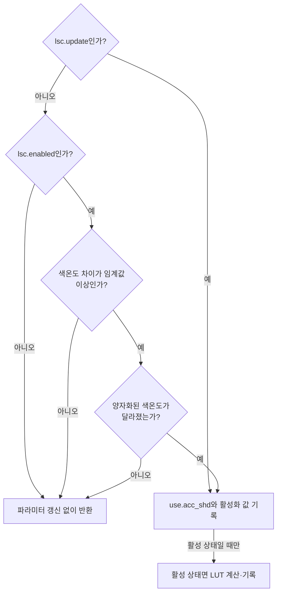
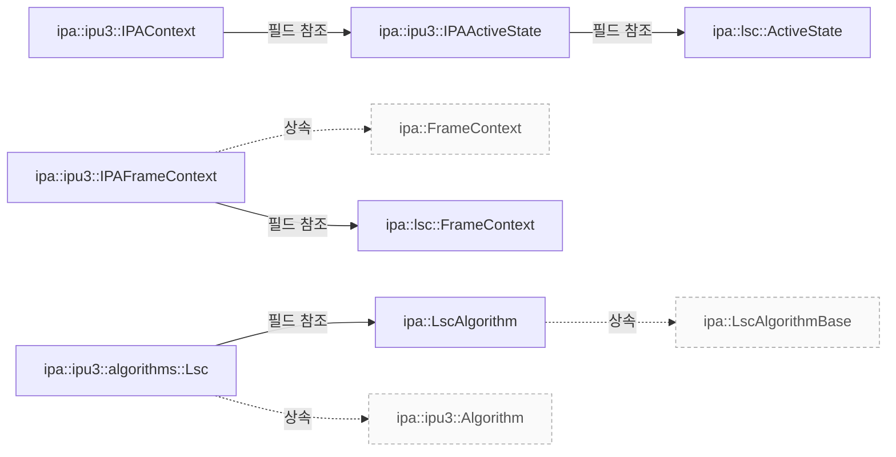

# IPU3 렌즈 보정 테이블 준비

**보정 테이블 갱신 조건과 보간·양자화·하드웨어 배열 배치를 코드와 대조하세요.**

| 지금 확인할 내용 | 이동할 절 |
|---|---|
| LSC를 수정할 때는 초기 그리드 설정, 요청별 활성화 상태, 색온도에 따른 파라미터 갱신 조건을 차례로 확인하세요. | [IPU3 LSC의 설정과 프레임 처리](ipu3-lsc-flow.md) |

## 파라미터 갱신 조건

`Lsc::prepare`는 `frameContext.lsc.update`가 false이고 `frameContext.lsc.enabled`도 false이면 반환합니다. `Lsc::prepare`는 `frameContext.lsc.update`가 false이고 `frameContext.lsc.enabled`가 true일 때, 먼저 `frameContext.awb.colourTemperature`와 `lastAppliedCt_`의 절대 차이가 `kColourTemperatureQuantization / 2`보다 작으면 반환하고, 그 차이가 같거나 크면 `quantizedCt`가 `lastAppliedQuantizedCt_`와 같은 경우 반환합니다. `src/ipa/ipu3/algorithms/lsc.cpp:142`

<!-- sdd:visual:lsc-update-gates -->
### LSC 파라미터를 갱신하는 분기

명시적 update가 있으면 색온도 생략 검사를 건너뜁니다. 갱신을 통지한 뒤 비활성 상태이면 LUT 계산은 수행하지 않습니다.



[Mermaid 원문](ipu3-lsc-prepare.lsc-update-gates.mmd)

??? note "그림 근거와 확인 범위"
    소스에 연결한 설계 해석입니다. 자동 연결 검사는 의미 승인이나 기기 실행 검증이 아닙니다.
    
    | 요소·전이 | 소스 근거 |
    |---|---|
    | lsc.update인가? | [src/ipa/ipu3/algorithms/lsc.cpp:142](#source-026024190618ffa6) |
    | lsc.enabled인가? | [src/ipa/ipu3/algorithms/lsc.cpp:142](#source-026024190618ffa6) |
    | 색온도 차이가 임계값 이상인가? | [src/ipa/ipu3/algorithms/lsc.cpp:142](#source-026024190618ffa6) |
    | 양자화된 색온도가 달라졌는가? | [src/ipa/ipu3/algorithms/lsc.cpp:142](#source-026024190618ffa6) |
    | 파라미터 갱신 없이 반환 | [src/ipa/ipu3/algorithms/lsc.cpp:142](#source-026024190618ffa6) |
    | use.acc_shd와 활성화 값 기록 | [src/ipa/ipu3/algorithms/lsc.cpp:142](#source-026024190618ffa6) |
    | 활성 상태면 LUT 계산·기록 | [src/ipa/ipu3/algorithms/lsc.cpp:142](#source-026024190618ffa6) |
    | 예 | [src/ipa/ipu3/algorithms/lsc.cpp:142](#source-026024190618ffa6) |
    | 아니오 | [src/ipa/ipu3/algorithms/lsc.cpp:142](#source-026024190618ffa6) |
    | 아니오 | [src/ipa/ipu3/algorithms/lsc.cpp:142](#source-026024190618ffa6) |
    | 예 | [src/ipa/ipu3/algorithms/lsc.cpp:142](#source-026024190618ffa6) |
    | 아니오 | [src/ipa/ipu3/algorithms/lsc.cpp:142](#source-026024190618ffa6) |
    | 예 | [src/ipa/ipu3/algorithms/lsc.cpp:142](#source-026024190618ffa6) |
    | 아니오 | [src/ipa/ipu3/algorithms/lsc.cpp:142](#source-026024190618ffa6) |
    | 예 | [src/ipa/ipu3/algorithms/lsc.cpp:142](#source-026024190618ffa6) |
    | 활성 상태일 때만 | [src/ipa/ipu3/algorithms/lsc.cpp:142](#source-026024190618ffa6) |
<!-- /sdd:visual:lsc-update-gates -->

`Lsc::prepare`는 앞의 조기 반환을 통과하면 `params->use.acc_shd`에 `1`을 기록합니다. 이 플래그는 커널 드라이버가 캐시된 복사본 대신 사용자 공간에서 전달한 LSC 매개변수를 읽도록 알립니다. `Lsc::prepare`는 앞의 조기 반환을 통과한 뒤 `config->general.shd_enable`에 `frameContext.lsc.enabled` 값을 대입합니다. 이어서 `frameContext.lsc.enabled`가 거짓이면 `return`으로 반환합니다. `src/ipa/ipu3/algorithms/lsc.cpp:142`, `src/ipa/ipu3/algorithms/lsc.cpp:182`

`Lsc::prepare`는 활성 경로에서 `grid`의 `width`와 `height`를 각각 `numHCells_`와 `numVCells_`로 설정합니다. `block_width_log2`와 `block_height_log2`는 각각 `blockWidthLog2_`와 `blockHeightLog2_`로 설정합니다. `grid_height_per_slice`는 `IPU3_UAPI_SHD_MAX_CELLS_PER_SET`을 `numHCells_`로 나눈 값으로 설정합니다. `src/ipa/ipu3/algorithms/lsc.cpp:142`

`Lsc::prepare`가 좌표 설정에 도달하면, `polynomial_`이 참인 경우 `grid.x_start`와 `grid.y_start`에 각각 0을 대입합니다. `polynomial_`이 거짓인 경우에는 `grid.x_start`에 `(cropWidth_ - sensorWidth_) / 2`를, `grid.y_start`에 `(cropHeight_ - sensorHeight_) / 2`를 대입합니다. `Lsc::prepare`는 활성 경로에서 `config->general.gain_factor`를 `0`으로 설정합니다. `Lsc::prepare`는 해당 설정에 도달하면 `black_level`의 `bl_r`, `bl_gr`, `bl_gb`, `bl_b` 필드를 모두 `0`으로 설정합니다. `src/ipa/ipu3/algorithms/lsc.cpp:207`, `src/ipa/ipu3/algorithms/lsc.cpp:142`, `src/ipa/ipu3/algorithms/lsc.cpp:248`

`Lsc::prepare`는 `frameContext.awb.colourTemperature`를 `kColourTemperatureQuantization`으로 양자화한 값 `quantizedCt`를 `interpolateComponents`에 전달합니다. `Lsc::prepare`는 LUT에서 `set.at("r")[i]`를 `lut->sets[s].r_and_gr[c].r`에, `set.at("gr")[i]`를 `lut->sets[s].r_and_gr[c].gr`에 대입합니다. 또한 `set.at("gb")[i]`를 `lut->sets[s].gb_and_b[c].gb`에, `set.at("b")[i]`를 `lut->sets[s].gb_and_b[c].b`에 대입합니다. `src/ipa/ipu3/algorithms/lsc.cpp:255`, `src/ipa/ipu3/algorithms/lsc.cpp:263`

`Lsc::prepare`는 LUT를 채운 뒤 `ct`를 `lastAppliedCt_`에, `quantizedCt`를 `lastAppliedQuantizedCt_`에 차례로 저장합니다. `src/ipa/ipu3/algorithms/lsc.cpp:272`, `src/ipa/ipu3/algorithms/lsc.cpp:273`

근거 원문: [src/ipa/ipu3/algorithms/lsc.cpp:142](#source-026024190618ffa6) · [src/ipa/ipu3/algorithms/lsc.cpp:31](#source-af2cbcaa6410fbf4) · [src/ipa/ipu3/algorithms/lsc.cpp:182](#source-2565eab3740cff67) · [src/ipa/ipu3/algorithms/lsc.cpp:248](#source-dba1ef8e8f2a8563) · [src/ipa/ipu3/algorithms/lsc.cpp:255](#source-d9cad5cb8a925660) · [src/ipa/ipu3/algorithms/lsc.cpp:263](#source-807a646dc9c1acbc) · [src/ipa/ipu3/algorithms/lsc.cpp:272](#source-8fc123f7e3c227d7) · [src/ipa/ipu3/algorithms/lsc.cpp:273](#source-bb86261a35600a17) · [src/ipa/ipu3/algorithms/lsc.cpp:207](#source-bab7044c90ebf671)

??? note "설계 질문과 검증 범위"
    질문별 답변과 근거 연결을 검사했습니다. 의미와 실행 결과는 사람 검토가 필요합니다.
    
    | 설계 질문 | 설명 위치 | 확인 범위 |
    |---|---|---|
    | 갱신은 어떤 조건에서 수행하며 커널에 어떤 파라미터를 전달합니까? | [파라미터 갱신 조건](#파라미터-갱신-조건) | 코드 근거와 설명 연결 |

## 소스 근거

같은 발췌는 한 번만 싣습니다. 필요한 원문을 펼쳐 설명과 대조하세요.

<a id="source-026024190618ffa6"></a>

??? note "소스 근거: src/ipa/ipu3/algorithms/lsc.cpp:142"
    `src/ipa/ipu3/algorithms/lsc.cpp:142`에서 시작하는 발췌입니다. 종료 줄은 282이며, 아래 원문을 설명과 대조할 수 있습니다.
    
    SHA-256: `1d11fc7397b377f682d4fab45d12dd20480e554176aae94ba2708a5f8f747268`
    
    ```text
    static unsigned int quantize(unsigned int value, unsigned int step)
    {
    	return std::lround(value / static_cast<double>(step)) * step;
    }
    
    /**
     * \copydoc libcamera::ipa::Algorithm::prepare
     */
    void Lsc::prepare([[maybe_unused]] IPAContext &context, [[maybe_unused]] const uint32_t frame,
    		  IPAFrameContext &frameContext, ipu3_uapi_params *params)
    {
    	uint32_t ct = frameContext.awb.colourTemperature;
    	unsigned int quantizedCt = quantize(ct, kColourTemperatureQuantization);
    
    	if (!frameContext.lsc.update) {
    		if (!frameContext.lsc.enabled)
    			return;
    
    		/*
    		 * Add a threshold so that oscillations around a quantization
    		 * step don't lead to constant changes.
    		 */
    		if (utils::abs_diff(ct, lastAppliedCt_) < kColourTemperatureQuantization / 2)
    			return;
    
    		if (quantizedCt == lastAppliedQuantizedCt_)
    			return;
    	}
    
    	/*
    	 * This flag tells the kernel driver that it should read the LSC params
    	 * passed from userspace instead of using its cached copy.
    	 */
    	params->use.acc_shd = 1;
    
    	/*
    	 * Pass the enabled flag. If we're not enabled, we can then just bail
    	 * out.
    	 */
    	ipu3_uapi_shd_config_static *config = &params->acc_param.shd.shd;
    	config->general.shd_enable = frameContext.lsc.enabled;
    
    	if (!frameContext.lsc.enabled)
    		return;
    
    	config->grid.width = numHCells_;
    	config->grid.height = numVCells_;
    	config->grid.block_width_log2 = blockWidthLog2_;
    	config->grid.block_height_log2 = blockHeightLog2_;
    	config->grid.grid_height_per_slice = IPU3_UAPI_SHD_MAX_CELLS_PER_SET / numHCells_;
    
    	/*
    	 * The IPU3's documentation describes the x_start and y_start members
    	 * as follows:
    	 *
    	 * "[X/Y] value of top left corner of sensor relative to ROI
    	 * s13, [-4096, 0], default 0, only negative values."
    	 *
    	 * I interpret that as allowing us to configure the cropped rectangle
    	 * relative to the full grid. That's useful if we're running the tabular
    	 * algorithm, which would otherwise apply the full grid inappropriately.
    	 * If we're running the polynomial one though the calculated grid is
    	 * probably more appropriate than a coarse application of the full grid
    	 * so let's tell the hardware not to bother correcting in that case.
    	 */
    	if (polynomial_) {
    		config->grid.x_start = 0;
    		config->grid.y_start = 0;
    	} else {
    		config->grid.x_start = (cropWidth_ - sensorWidth_) / 2;
    		config->grid.y_start = (cropHeight_ - sensorHeight_) / 2;
    	}
    
    	/* No idea what this is, but the docs say it should be set as so */
    	config->general.init_set_vrt_offst_ul =
    		config->grid.y_start >> (config->grid.block_height_log2 %
    					 config->grid.grid_height_per_slice);
    
    	/*
    	 * Values in the LUT cease taking effect at 4096, and a value of 0.0 is
    	 * "no correction" rather than black. The gain factor is described by
    	 * the documentation like so:
    	 *
    	 * "Shift calculated anti shading value. Precision u2. 0x0 - gain factor
    	 * [1, 5], means no shift interpolated value. 0x1 - gain factor [1, 9],
    	 * means shift interpolated by 1. 0x2 - gain factor [1, 17], means shift
    	 * interpolated by 2."
    	 *
    	 * The simplest interpretation for those pieces of information is I
    	 * think that the LUT stores 12-bit Q numbers who's represented values
    	 * depend on the gain_factor setting like so:
    	 *
    	 * 0: UQ<2, 10> representing values in range [0, 4)
    	 * 1: UQ<3, 9> representing values in range [0, 8)
    	 * 2: UQ<4, 8> representing values in range [0, 16)
    	 *
    	 * And that a base gain of 1.0 is added to those configured values. As a
    	 * gain of more than 5.0 is fairly unlikely, let's fix gain_factor to 0
    	 * for now and revisit if needed.
    	 */
    	config->general.gain_factor = 0;
    
    	/*
    	 * Disable the black level settings here - we do that through another
    	 * parameters block.
    	 */
    	config->black_level.bl_r = 0;
    	config->black_level.bl_gr = 0;
    	config->black_level.bl_gb = 0;
    	config->black_level.bl_b = 0;
    
    	ipu3_uapi_shd_lut *lut = &params->acc_param.shd.shd_lut;
    
    	const auto &set = lscAlgo_.interpolateComponents(quantizedCt);
    
    	unsigned int totalCells = numHCells_ * numVCells_;
    	unsigned int cellsPerSet = numHCells_ * config->grid.grid_height_per_slice;
    	unsigned int numSets = (numHCells_ + config->grid.grid_height_per_slice - 1) /
    			       config->grid.grid_height_per_slice;
    	unsigned int i = 0;
    
    	for (unsigned int s = 0; s < numSets; s++) {
    		for (unsigned int c = 0; c < cellsPerSet && i < totalCells; c++, i++) {
    			lut->sets[s].r_and_gr[c].r = set.at("r")[i];
    			lut->sets[s].r_and_gr[c].gr = set.at("gr")[i];
    			lut->sets[s].gb_and_b[c].gb = set.at("gb")[i];
    			lut->sets[s].gb_and_b[c].b = set.at("b")[i];
    		}
    	}
    
    	lastAppliedCt_ = ct;
    	lastAppliedQuantizedCt_ = quantizedCt;
    	LOG(IPU3Lsc, Debug)
    		<< "ct is " << ct << ", quantized to "
    		<< quantizedCt;
    }
    
    /**
     * \copydoc libcamera::ipa::Algorithm::process
     */
    void Lsc::process(
    ```

<a id="source-af2cbcaa6410fbf4"></a>

??? note "소스 근거: src/ipa/ipu3/algorithms/lsc.cpp:31"
    `src/ipa/ipu3/algorithms/lsc.cpp:31`에서 시작하는 발췌입니다. 종료 줄은 38이며, 아래 원문을 설명과 대조할 수 있습니다.
    
    SHA-256: `7807718b4ae9327f1ca428627d2b00f59ba38ced03261465ee8c79312ea27833`
    
    ```text
    static constexpr unsigned int kMaxNumHCells = 73;
    static constexpr unsigned int kMaxNumVCells = 56;
    static constexpr int kColourTemperatureQuantization = 10;
    
    /**
     * \copydoc libcamera::ipa::Algorithm::init
     */
    int Lsc::init(
    ```

<a id="source-2565eab3740cff67"></a>

??? note "소스 근거: src/ipa/ipu3/algorithms/lsc.cpp:182"
    `src/ipa/ipu3/algorithms/lsc.cpp:182`에서 시작하는 발췌입니다. 종료 줄은 185이며, 아래 원문을 설명과 대조할 수 있습니다.
    
    SHA-256: `c01350762a48814f82cd74a201743cc3a05182aca7837fdb61c61be2f23d0446`
    
    ```text
    config->general.shd_enable = frameContext.lsc.enabled;
    
    	if (!frameContext.lsc.enabled)
    		return;
    ```

<a id="source-dba1ef8e8f2a8563"></a>

??? note "소스 근거: src/ipa/ipu3/algorithms/lsc.cpp:248"
    `src/ipa/ipu3/algorithms/lsc.cpp:248`에서 시작하는 발췌입니다. 종료 줄은 251이며, 아래 원문을 설명과 대조할 수 있습니다.
    
    SHA-256: `0d3f67f2135ab9779d48a9c37820f7d694dcd54b8d2fdd140ded1a91ef8c505f`
    
    ```text
    config->black_level.bl_r = 0;
    	config->black_level.bl_gr = 0;
    	config->black_level.bl_gb = 0;
    	config->black_level.bl_b = 0;
    ```

<a id="source-d9cad5cb8a925660"></a>

??? note "소스 근거: src/ipa/ipu3/algorithms/lsc.cpp:255"
    `src/ipa/ipu3/algorithms/lsc.cpp:255`에서 시작하는 발췌입니다. 종료 줄은 255이며, 아래 원문을 설명과 대조할 수 있습니다.
    
    SHA-256: `0acd80d1672a74f03b1e8ac712a046a486d25382cfa71448f67dcf3c30edf13d`
    
    ```text
    const auto &set = lscAlgo_.interpolateComponents(quantizedCt);
    ```

<a id="source-807a646dc9c1acbc"></a>

??? note "소스 근거: src/ipa/ipu3/algorithms/lsc.cpp:263"
    `src/ipa/ipu3/algorithms/lsc.cpp:263`에서 시작하는 발췌입니다. 종료 줄은 272이며, 아래 원문을 설명과 대조할 수 있습니다.
    
    SHA-256: `4b7da473a595e23e82e1e8118afae2c1a044c6e1a510c1ac5e7fd1fd562be119`
    
    ```text
    for (unsigned int s = 0; s < numSets; s++) {
    		for (unsigned int c = 0; c < cellsPerSet && i < totalCells; c++, i++) {
    			lut->sets[s].r_and_gr[c].r = set.at("r")[i];
    			lut->sets[s].r_and_gr[c].gr = set.at("gr")[i];
    			lut->sets[s].gb_and_b[c].gb = set.at("gb")[i];
    			lut->sets[s].gb_and_b[c].b = set.at("b")[i];
    		}
    	}
    
    	lastAppliedCt_ = ct;
    ```

<a id="source-8fc123f7e3c227d7"></a>

??? note "소스 근거: src/ipa/ipu3/algorithms/lsc.cpp:272"
    `src/ipa/ipu3/algorithms/lsc.cpp:272`에서 시작하는 발췌입니다. 종료 줄은 272이며, 아래 원문을 설명과 대조할 수 있습니다.
    
    SHA-256: `8ff337801a819f86b0e1912bd37319c93fe2cfaddaa718cc2437776b20fd55b2`
    
    ```text
    lastAppliedCt_ = ct;
    ```

<a id="source-bb86261a35600a17"></a>

??? note "소스 근거: src/ipa/ipu3/algorithms/lsc.cpp:273"
    `src/ipa/ipu3/algorithms/lsc.cpp:273`에서 시작하는 발췌입니다. 종료 줄은 273이며, 아래 원문을 설명과 대조할 수 있습니다.
    
    SHA-256: `cf33d4637404946cb518e1bad89c7613d47f18ff75930a5af092bba468a014ed`
    
    ```text
    lastAppliedQuantizedCt_ = quantizedCt;
    ```

<a id="source-bab7044c90ebf671"></a>

??? note "소스 근거: src/ipa/ipu3/algorithms/lsc.cpp:207"
    `src/ipa/ipu3/algorithms/lsc.cpp:207`에서 시작하는 발췌입니다. 종료 줄은 213이며, 아래 원문을 설명과 대조할 수 있습니다.
    
    SHA-256: `03b2fe18d792ea317a04f630910098f72786262031e88589a85ee20479bb6678`
    
    ```text
    if (polynomial_) {
    		config->grid.x_start = 0;
    		config->grid.y_start = 0;
    	} else {
    		config->grid.x_start = (cropWidth_ - sensorWidth_) / 2;
    		config->grid.y_start = (cropHeight_ - sensorHeight_) / 2;
    	}
    ```


<!-- sdd:class-diagram -->
## 클래스 관계

화살표의 글자는 추출한 관계를 나타내며, 점선은 상속입니다. 화살표는 참조 대상 또는 기반 클래스를 향합니다. 호출 순서를 뜻하지 않습니다.


<!-- /sdd:class-diagram -->


## 관련 클래스

| 클래스 | 선언 위치 | 상속 | 책임 (주석) |
|---|---|---|---|
| `libcamera::ipa::LscAlgorithm` | `src/ipa/libipa/lsc.h:79` | `libcamera::ipa::LscAlgorithmBase` | libIPA LSC algorithm implementation |
| `libcamera::ipa::ipu3::IPAActiveState` | `src/ipa/ipu3/ipa_context.h:46` | – | The active state of the IPA algorithms |
| `libcamera::ipa::ipu3::IPAContext` | `src/ipa/ipu3/ipa_context.h:73` | – | Global IPA context data shared between all algorithms |
| `libcamera::ipa::ipu3::IPAFrameContext` | `src/ipa/ipu3/ipa_context.h:60` | `libcamera::ipa::FrameContext` | IPU3-specific FrameContext |
| `libcamera::ipa::ipu3::algorithms::Lsc` | `src/ipa/ipu3/algorithms/lsc.h:21` | `libcamera::ipa::ipu3::Algorithm` | IPU3 Lens Shading Correction algorithm |
| `libcamera::ipa::lsc::ActiveState` | `src/ipa/libipa/lsc.h:28` | – | The LSC active state |
| `libcamera::ipa::lsc::FrameContext` | `src/ipa/libipa/lsc.h:32` | – | 확인 필요 |

??? note "근거와 검토 정보"
    - 생성 방식: 추출 사실과 LLM 설명
    - 검증 범위: 표·그림은 facts로 만들고 설명은 LLM이 작성합니다. 인용·문장 및 설정된 구조 검사를 적용합니다.
    - 근거 파일: `src/ipa/ipu3/algorithms/lsc.cpp`, `src/ipa/ipu3/algorithms/lsc.h`, `src/ipa/ipu3/ipa_context.h`, `src/ipa/libipa/lsc.h`
    - 근거 수준: 코드 확인 (정적 분석, simple_compdb 구성, commit `212c689fcf`)
    - 자동 검사 (인용·문장 및 설정된 구조 검사): 통과
    - 검토 상태 기록일: 2026-10-30 · 사람 검토 전

다음 단계: [시스템 개요](overview.md)
