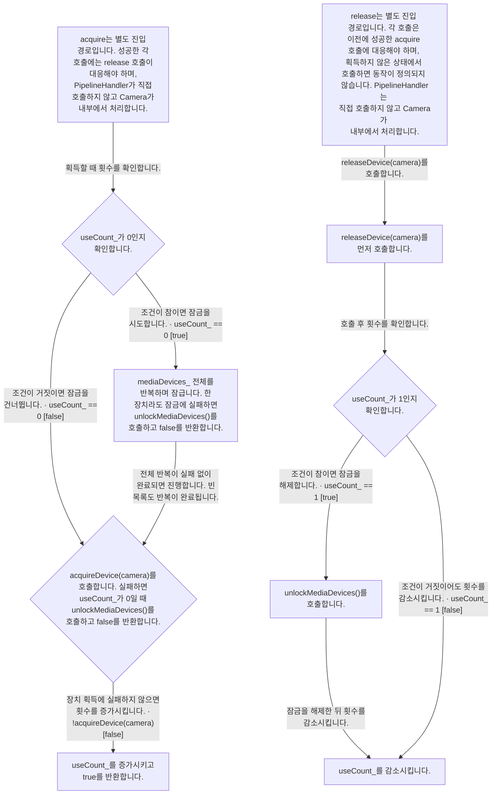
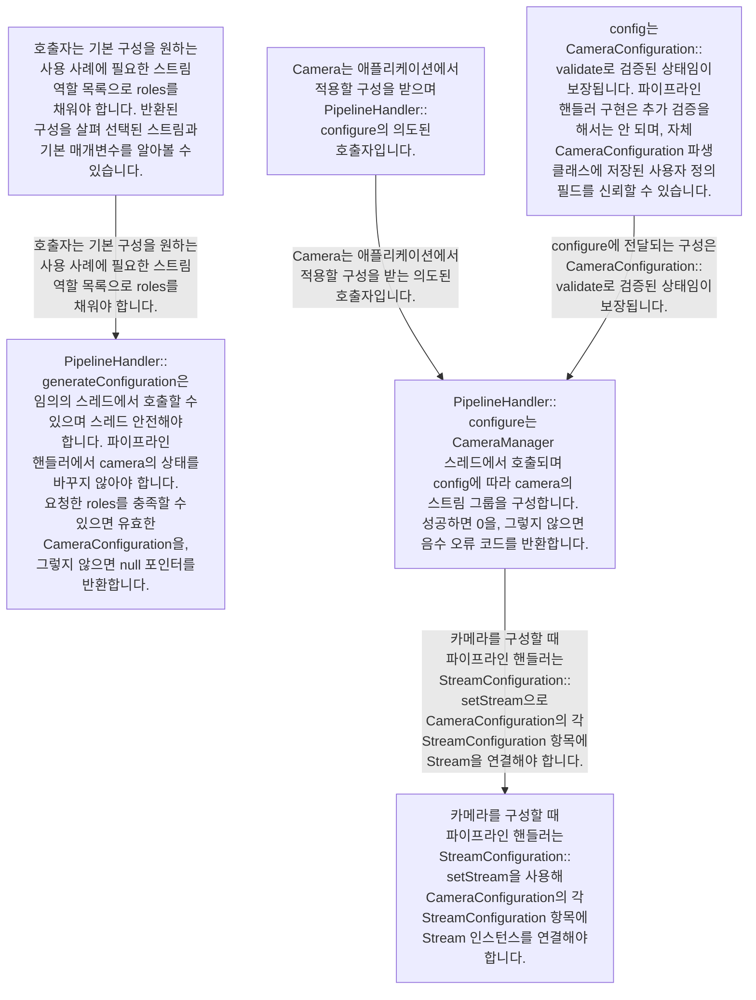
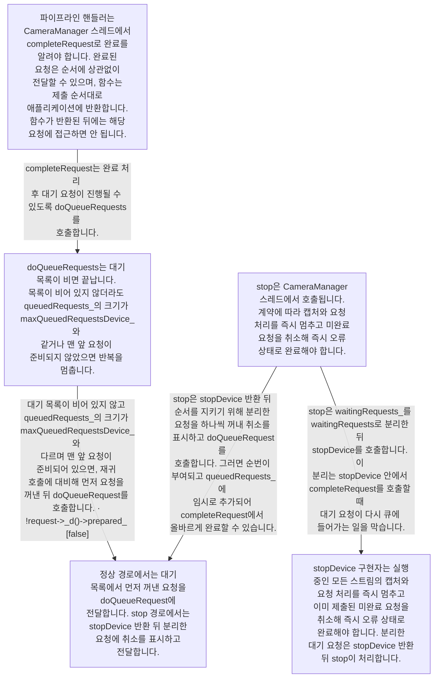
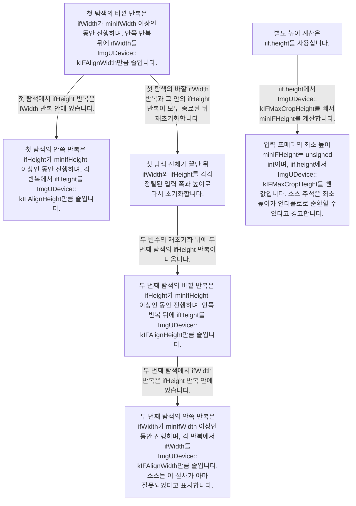
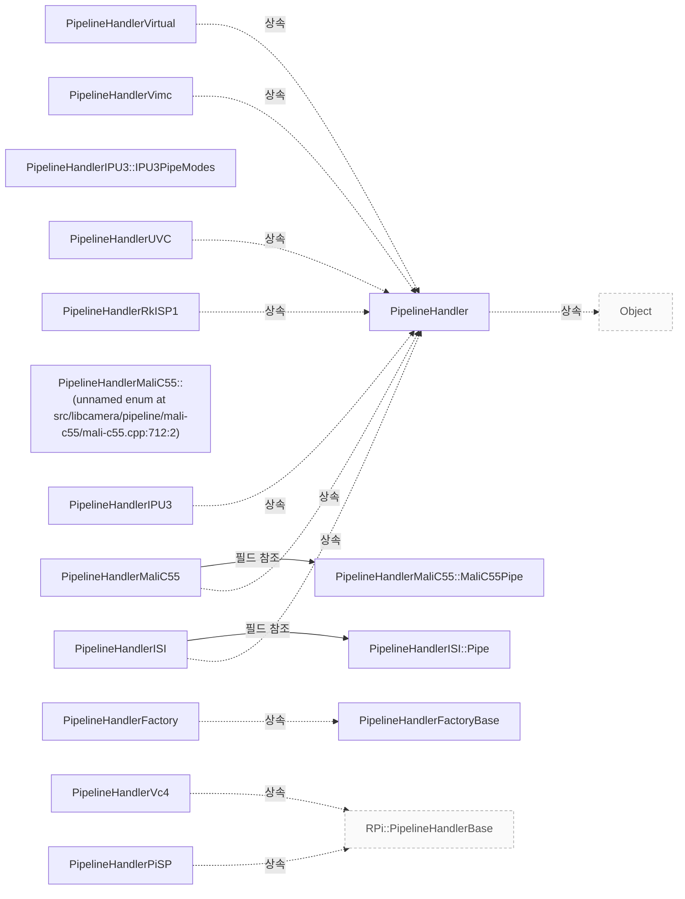

# Pipeline Handler

**파이프라인 구현이 지켜야 하는 구성·요청·완료·종료 계약을 확인하세요.**

| 지금 확인할 내용 | 이동할 절 |
|---|---|
| <a id="요청-준비와-장치-큐"></a>요청 준비와 장치 큐의 조건과 근거를 대조하세요. | [Pipeline 요청 제출과 완료](pipeline-requests.md#요청-준비와-장치-큐) |
| <a id="버퍼-완료와-요청-반환"></a>버퍼 완료와 요청 반환의 조건과 근거를 대조하세요. | [Pipeline 요청 제출과 완료](pipeline-requests.md#버퍼-완료와-요청-반환) |
| <a id="요청이-대기하거나-장치로-가는-조건"></a>“요청이 대기하거나 장치로 가는 조건” 그림을 확인하세요. | [Pipeline 요청 제출과 완료](pipeline-requests.md#요청이-대기하거나-장치로-가는-조건) |
| <a id="버퍼-완료에서-요청-반환까지"></a>“버퍼 완료에서 요청 반환까지” 그림을 확인하세요. | [Pipeline 요청 제출과 완료](pipeline-requests.md#버퍼-완료에서-요청-반환까지) |

## 장치 매칭과 객체 수명

`PipelineHandler`는 `DeviceEnumerator`의 미디어 장치를 지원하는 파이프라인과 매칭해 `Camera`를 생성·관리하며, 수동으로 생성하지 않고 반드시 `PipelineHandlerFactoryBase::create()`로 생성해야 합니다. 인스턴스는 `std::shared_ptr`로 참조 횟수를 관리하며, 멤버 함수에서 this만 사용할 수 있는 경로에서 새 `shared_ptr`을 만들도록 `std::enable_shared_from_this`를 구현합니다. match()는 파이프라인 하나에 필요한 장치를 모두 찾으면 `MediaDevice::acquire()`로 모두 확보하고 하나 이상의 `Camera`를 생성해 내부에 보관하고 `CameraManager`에 등록한 뒤 true를 반환해야 합니다. 실패하면 장치를 확보하지 않거나 확보한 장치를 모두 `MediaDevice::release()`로 해제하고 false를 반환해야 합니다. `src/libcamera/pipeline_handler.cpp:50`

<!-- sdd:visual:handler-device-ownership -->
### 핸들러 생성과 장치 획득·반납의 책임

```mermaid
flowchart TB
%% sdd:translations {"PipelineHandler 인스턴스는 <br/>std::shared#95;ptr로 참조 수를 <br/>관리합니다. 멤버 함수에서 <br/>this만 사용할 수 있는 <br/>경로에서 새 <br/>std::shared#95;ptr를 만들 수 <br/>있도록 <br/>std::<br/>enable#95;shared#95;from#95;this를 <br/>구현합니다.": "PipelineHandler instances <br/>are reference-counted <br/>through std::shared#95;ptr. <br/>They implement <br/>std::<br/>enable#95;shared#95;from#95;this to <br/>create new std::shared#95;ptr <br/>instances in <br/>member-function paths where <br/>only this is available.", "PipelineHandler 인스턴스는 <br/>수동으로 만들지 말고 항상 <br/>PipelineHandlerFactoryBase::<br/>create#40;#41;로 만들어야 합니다.": "PipelineHandler instances <br/>must always be constructed <br/>through <br/>PipelineHandlerFactoryBase::<br/>create#40;#41; and never manually.", "PipelineHandler::match <br/>구현은 한 파이프라인에 <br/>필요한 장치를 모두 찾으면 <br/>MediaDevice::acquire#40;#41;로 <br/>모두 획득하고 Camera를 하나 <br/>이상 만들어 내부에 저장하고 <br/>카메라 관리자에 등록한 뒤 <br/>true를 반환해야 합니다. <br/>그렇지 않으면 장치를 <br/>획득하지 않거나 이미 획득한 <br/>장치를 <br/>MediaDevice::release#40;#41;로 <br/>모두 해제하고 false를 <br/>반환해야 합니다.": "If all devices needed for <br/>one pipeline are found, the <br/>PipelineHandler::match <br/>implementation must acquire <br/>them all with <br/>MediaDevice::acquire#40;#41;, <br/>create one or more Camera <br/>instances, store them <br/>internally, register them <br/>with the camera manager, <br/>and return true. Otherwise, <br/>it must acquire no devices <br/>or release all devices <br/>already acquired with <br/>MediaDevice::release#40;#41;, and <br/>return false.", "PipelineHandlerFactoryBase::<br/>create#40;#41;는 <br/>PipelineHandler의 필수 생성 <br/>경로입니다.": "PipelineHandlerFactoryBase::<br/>create#40;#41; is the required <br/>construction path for <br/>PipelineHandler instances.", "PipelineHandler는 <br/>mediaDevices#95;에 장치의 공유 <br/>포인터를 보관합니다.": "PipelineHandler stores <br/>shared pointers to devices <br/>in mediaDevices#95;.", "acquireMediaDevice#40;#41;가 <br/>획득한 장치는 핸들러의 <br/>mediaDevices#95;에 보관됩니다.": "A device acquired by <br/>acquireMediaDevice#40;#41; is <br/>stored in the handler#39;s <br/>mediaDevices#95;.", "acquireMediaDevice#40;#41;는 <br/>이전에 획득된 장치를 <br/>제외하고 일치하는 사용 <br/>가능한 장치를 찾아 획득한 <br/>뒤 공유 포인터를 <br/>반환합니다. 일치하는 장치가 <br/>없거나 획득에 실패하면 <br/>nullptr을 반환합니다. <br/>호출자는 장치를 직접 <br/>해제하면 안 되며, 장치는 <br/>핸들러가 소멸할 때 자동으로 <br/>해제됩니다.": "acquireMediaDevice#40;#41; finds <br/>and acquires an available <br/>matching device, excluding <br/>devices already acquired, <br/>and returns a shared <br/>pointer. It returns nullptr <br/>if no match is found or <br/>acquisition fails. The <br/>caller must not release the <br/>device explicitly; it is <br/>released automatically when <br/>the handler is destroyed.", "acquireMediaDevice#40;#41;는 <br/>획득한 장치를 <br/>mediaDevices#95;에 보관합니다. <br/>· #33;media-#62;acquire#40;#41; #91;false#93;": "acquireMediaDevice#40;#41; stores <br/>the acquired device in <br/>mediaDevices#95;. · <br/>#33;media-#62;acquire#40;#41; #91;false#93;", "카메라 관리자는 <br/>PipelineHandler의 match#40;#41;를 <br/>호출합니다. match#40;#41;가 <br/>true를 반환하면 새 핸들러 <br/>인스턴스가 생성되고 그 <br/>인스턴스의 match#40;#41;가 <br/>호출됩니다.": "The camera manager calls <br/>the PipelineHandler#39;s <br/>match#40;#41;. If match#40;#41; returns <br/>true, a new handler <br/>instance is created and its <br/>match#40;#41; is called.", "핸들러 소멸자는 <br/>mediaDevices#95;에 보관된 각 <br/>장치를 <br/>MediaDevice::release#40;#41;로 <br/>해제합니다.": "The handler destructor <br/>releases each device stored <br/>in mediaDevices#95; using <br/>MediaDevice::release#40;#41;.", "핸들러가 소멸하면 <br/>mediaDevices#95;의 각 장치를 <br/>해제합니다.": "When the handler is <br/>destroyed, it releases each <br/>device in mediaDevices#95;."}
  v_factory["PipelineHandler 인스턴스는 <br/>수동으로 만들지 말고 항상 <br/>PipelineHandlerFactoryBase::<br/>create#40;#41;로 만들어야 합니다."]
  v_handler["PipelineHandler 인스턴스는 <br/>std::shared#95;ptr로 참조 수를 <br/>관리합니다. 멤버 함수에서 <br/>this만 사용할 수 있는 <br/>경로에서 새 <br/>std::shared#95;ptr를 만들 수 <br/>있도록 <br/>std::<br/>enable#95;shared#95;from#95;this를 <br/>구현합니다."]
  v_match["PipelineHandler::match <br/>구현은 한 파이프라인에 <br/>필요한 장치를 모두 찾으면 <br/>MediaDevice::acquire#40;#41;로 <br/>모두 획득하고 Camera를 하나 <br/>이상 만들어 내부에 저장하고 <br/>카메라 관리자에 등록한 뒤 <br/>true를 반환해야 합니다. <br/>그렇지 않으면 장치를 <br/>획득하지 않거나 이미 획득한 <br/>장치를 <br/>MediaDevice::release#40;#41;로 <br/>모두 해제하고 false를 <br/>반환해야 합니다."]
  v_search["acquireMediaDevice#40;#41;는 <br/>이전에 획득된 장치를 <br/>제외하고 일치하는 사용 <br/>가능한 장치를 찾아 획득한 <br/>뒤 공유 포인터를 <br/>반환합니다. 일치하는 장치가 <br/>없거나 획득에 실패하면 <br/>nullptr을 반환합니다. <br/>호출자는 장치를 직접 <br/>해제하면 안 되며, 장치는 <br/>핸들러가 소멸할 때 자동으로 <br/>해제됩니다."]
  v_devices["acquireMediaDevice#40;#41;가 <br/>획득한 장치는 핸들러의 <br/>mediaDevices#95;에 보관됩니다."]
  v_release["핸들러 소멸자는 <br/>mediaDevices#95;에 보관된 각 <br/>장치를 <br/>MediaDevice::release#40;#41;로 <br/>해제합니다."]
  v_factory -->|"PipelineHandlerFactoryBase::<br/>create#40;#41;는 <br/>PipelineHandler의 필수 생성 <br/>경로입니다."| v_handler
  v_handler -->|"카메라 관리자는 <br/>PipelineHandler의 match#40;#41;를 <br/>호출합니다. match#40;#41;가 <br/>true를 반환하면 새 핸들러 <br/>인스턴스가 생성되고 그 <br/>인스턴스의 match#40;#41;가 <br/>호출됩니다."| v_match
  v_handler -->|"PipelineHandler는 <br/>mediaDevices#95;에 장치의 공유 <br/>포인터를 보관합니다."| v_devices
  v_search -->|"acquireMediaDevice#40;#41;는 <br/>획득한 장치를 <br/>mediaDevices#95;에 보관합니다. <br/>· #33;media-#62;acquire#40;#41; #91;false#93;"| v_devices
  v_devices -->|"핸들러가 소멸하면 <br/>mediaDevices#95;의 각 장치를 <br/>해제합니다."| v_release
```



[Mermaid 원문](pipeline-handler.handler-device-ownership.mmd)

??? note "그림 근거와 확인 범위"
    팩토리 생성·참조 수명과 match 계약은 어떻게 이어지며, acquireMediaDevice로 확보한 장치는 어디에 보관하고 핸들러 소멸 시 어떻게 해제합니까? acquire·release의 잠금 조건은 별도 그림에서 확인하세요.
    
    소스에 연결한 설계 해석입니다. 자동 연결 검사는 의미 승인이나 기기 실행 검증이 아닙니다.
    
    LLM 그림 초안 · 사람 검토 전
    
    작성 모델: `cli/codex/gpt-6.1-terra`
    
    | 요소·전이 | 소스 근거 |
    |---|---|
    | <span data-sdd-label-en="PipelineHandler instances must always be constructed through PipelineHandlerFactoryBase::create() and never manually.">PipelineHandler 인스턴스는 수동으로 만들지 말고 항상 PipelineHandlerFactoryBase::create&#40;&#41;로 만들어야 합니다.</span> | [src/libcamera/pipeline_handler.cpp:50](#source-69bfa9568cf8b5c5) |
    | <span data-sdd-label-en="PipelineHandler instances are reference-counted through std::shared_ptr. They implement std::enable_shared_from_this to create new std::shared_ptr instances in member-function paths where only this is available.">PipelineHandler 인스턴스는 std::shared&#95;ptr로 참조 수를 관리합니다. 멤버 함수에서 this만 사용할 수 있는 경로에서 새 std::shared&#95;ptr를 만들 수 있도록 std::enable&#95;shared&#95;from&#95;this를 구현합니다.</span> | [src/libcamera/pipeline_handler.cpp:50](#source-69bfa9568cf8b5c5) |
    | <span data-sdd-label-en="If all devices needed for one pipeline are found, the PipelineHandler::match implementation must acquire them all with MediaDevice::acquire(), create one or more Camera instances, store them internally, register them with the camera manager, and return true. Otherwise, it must acquire no devices or release all devices already acquired with MediaDevice::release(), and return false.">PipelineHandler::match 구현은 한 파이프라인에 필요한 장치를 모두 찾으면 MediaDevice::acquire&#40;&#41;로 모두 획득하고 Camera를 하나 이상 만들어 내부에 저장하고 카메라 관리자에 등록한 뒤 true를 반환해야 합니다. 그렇지 않으면 장치를 획득하지 않거나 이미 획득한 장치를 MediaDevice::release&#40;&#41;로 모두 해제하고 false를 반환해야 합니다.</span> | [src/libcamera/pipeline_handler.cpp:50](#source-69bfa9568cf8b5c5) |
    | <span data-sdd-label-en="acquireMediaDevice() finds and acquires an available matching device, excluding devices already acquired, and returns a shared pointer. It returns nullptr if no match is found or acquisition fails. The caller must not release the device explicitly; it is released automatically when the handler is destroyed.">acquireMediaDevice&#40;&#41;는 이전에 획득된 장치를 제외하고 일치하는 사용 가능한 장치를 찾아 획득한 뒤 공유 포인터를 반환합니다. 일치하는 장치가 없거나 획득에 실패하면 nullptr을 반환합니다. 호출자는 장치를 직접 해제하면 안 되며, 장치는 핸들러가 소멸할 때 자동으로 해제됩니다.</span> | [src/libcamera/pipeline_handler.cpp:119](#source-a3caf1625bc18d64) |
    | <span data-sdd-label-en="A device acquired by acquireMediaDevice() is stored in the handler&#x27;s mediaDevices_.">acquireMediaDevice&#40;&#41;가 획득한 장치는 핸들러의 mediaDevices&#95;에 보관됩니다.</span> | [src/libcamera/pipeline_handler.cpp:119](#source-a3caf1625bc18d64) · [src/libcamera/pipeline_handler.cpp:50](#source-69bfa9568cf8b5c5) |
    | <span data-sdd-label-en="The handler destructor releases each device stored in mediaDevices_ using MediaDevice::release().">핸들러 소멸자는 mediaDevices&#95;에 보관된 각 장치를 MediaDevice::release&#40;&#41;로 해제합니다.</span> | [src/libcamera/pipeline_handler.cpp:50](#source-69bfa9568cf8b5c5) |
    | <span data-sdd-label-en="PipelineHandlerFactoryBase::create() is the required construction path for PipelineHandler instances.">PipelineHandlerFactoryBase::create&#40;&#41;는 PipelineHandler의 필수 생성 경로입니다.</span> | [src/libcamera/pipeline_handler.cpp:50](#source-69bfa9568cf8b5c5) |
    | <span data-sdd-label-en="The camera manager calls the PipelineHandler&#x27;s match(). If match() returns true, a new handler instance is created and its match() is called.">카메라 관리자는 PipelineHandler의 match&#40;&#41;를 호출합니다. match&#40;&#41;가 true를 반환하면 새 핸들러 인스턴스가 생성되고 그 인스턴스의 match&#40;&#41;가 호출됩니다.</span> | [src/libcamera/pipeline_handler.cpp:50](#source-69bfa9568cf8b5c5) |
    | <span data-sdd-label-en="PipelineHandler stores shared pointers to devices in mediaDevices_.">PipelineHandler는 mediaDevices&#95;에 장치의 공유 포인터를 보관합니다.</span> | [src/libcamera/pipeline_handler.cpp:50](#source-69bfa9568cf8b5c5) |
    | <span data-sdd-label-en="acquireMediaDevice() stores the acquired device in mediaDevices_. · !media-&gt;acquire() [false]">acquireMediaDevice&#40;&#41;는 획득한 장치를 mediaDevices&#95;에 보관합니다. · &#33;media-&gt;acquire&#40;&#41; &#91;false&#93;</span> | [src/libcamera/pipeline_handler.cpp:119](#source-a3caf1625bc18d64) |
    | <span data-sdd-label-en="When the handler is destroyed, it releases each device in mediaDevices_.">핸들러가 소멸하면 mediaDevices&#95;의 각 장치를 해제합니다.</span> | [src/libcamera/pipeline_handler.cpp:50](#source-69bfa9568cf8b5c5) |
<!-- /sdd:visual:handler-device-ownership -->

<!-- sdd:visual:acquire-release-locks -->
### 획득·반납의 잠금 조건과 해제 순서



[Mermaid 원문](pipeline-handler.acquire-release-locks.mmd)

??? note "그림 근거와 확인 범위"
    acquire와 release를 별도 진입 경로로 두고 useCount_ 조건, 실패 반환, releaseDevice·조건부 잠금 해제·감소의 순서를 구분하세요.
    
    소스에 연결한 설계 해석입니다. 자동 연결 검사는 의미 승인이나 기기 실행 검증이 아닙니다.
    
    LLM 그림 초안 · 사람 검토 전
    
    작성 모델: `cli/codex/gpt-6.1-terra`
    
    | 요소·전이 | 소스 근거 |
    |---|---|
    | <span data-sdd-label-en="acquire is a separate entry path. Each successful call must be matched by a release call; PipelineHandler must not call it directly because Camera handles access internally.">acquire는 별도 진입 경로입니다. 성공한 각 호출에는 release 호출이 대응해야 하며, PipelineHandler가 직접 호출하지 않고 Camera가 내부에서 처리합니다.</span> | [src/libcamera/pipeline_handler.cpp:119](#source-a3caf1625bc18d64) |
    | <span data-sdd-label-en="Check whether useCount_ is 0.">useCount&#95;가 0인지 확인합니다.</span> | [src/libcamera/pipeline_handler.cpp:119](#source-a3caf1625bc18d64) |
    | <span data-sdd-label-en="Iterate over all of mediaDevices_ and lock each device. If any lock fails, call unlockMediaDevices() and return false.">mediaDevices&#95; 전체를 반복하며 잠급니다. 한 장치라도 잠금에 실패하면 unlockMediaDevices&#40;&#41;를 호출하고 false를 반환합니다.</span> | [src/libcamera/pipeline_handler.cpp:119](#source-a3caf1625bc18d64) |
    | <span data-sdd-label-en="Call acquireDevice(camera). On failure, call unlockMediaDevices() if useCount_ is 0, and return false.">acquireDevice&#40;camera&#41;를 호출합니다. 실패하면 useCount&#95;가 0일 때 unlockMediaDevices&#40;&#41;를 호출하고 false를 반환합니다.</span> | [src/libcamera/pipeline_handler.cpp:119](#source-a3caf1625bc18d64) |
    | <span data-sdd-label-en="Increment useCount_ and return true.">useCount&#95;를 증가시키고 true를 반환합니다.</span> | [src/libcamera/pipeline_handler.cpp:119](#source-a3caf1625bc18d64) |
    | <span data-sdd-label-en="release is a separate entry path. Each call must match a previous successful acquire call; calling it when the handler has not been acquired results in undefined behaviour. PipelineHandler must not call it directly because Camera handles access internally.">release는 별도 진입 경로입니다. 각 호출은 이전에 성공한 acquire 호출에 대응해야 하며, 획득하지 않은 상태에서 호출하면 동작이 정의되지 않습니다. PipelineHandler는 직접 호출하지 않고 Camera가 내부에서 처리합니다.</span> | [src/libcamera/pipeline_handler.cpp:119](#source-a3caf1625bc18d64) |
    | <span data-sdd-label-en="First call releaseDevice(camera).">releaseDevice&#40;camera&#41;를 먼저 호출합니다.</span> | [src/libcamera/pipeline_handler.cpp:119](#source-a3caf1625bc18d64) |
    | <span data-sdd-label-en="Check whether useCount_ is 1.">useCount&#95;가 1인지 확인합니다.</span> | [src/libcamera/pipeline_handler.cpp:119](#source-a3caf1625bc18d64) |
    | <span data-sdd-label-en="Call unlockMediaDevices().">unlockMediaDevices&#40;&#41;를 호출합니다.</span> | [src/libcamera/pipeline_handler.cpp:119](#source-a3caf1625bc18d64) |
    | <span data-sdd-label-en="Decrement useCount_.">useCount&#95;를 감소시킵니다.</span> | [src/libcamera/pipeline_handler.cpp:119](#source-a3caf1625bc18d64) |
    | <span data-sdd-label-en="Check the count when acquiring.">획득할 때 횟수를 확인합니다.</span> | [src/libcamera/pipeline_handler.cpp:119](#source-a3caf1625bc18d64) |
    | <span data-sdd-label-en="If the condition is true, attempt to lock the devices. · useCount_ == 0 [true]">조건이 참이면 잠금을 시도합니다. · useCount&#95; == 0 &#91;true&#93;</span> | [src/libcamera/pipeline_handler.cpp:119](#source-a3caf1625bc18d64) |
    | <span data-sdd-label-en="If the condition is false, skip locking. · useCount_ == 0 [false]">조건이 거짓이면 잠금을 건너뜁니다. · useCount&#95; == 0 &#91;false&#93;</span> | [src/libcamera/pipeline_handler.cpp:119](#source-a3caf1625bc18d64) |
    | <span data-sdd-label-en="Proceed when the entire loop completes without failure. An empty list also completes the loop.">전체 반복이 실패 없이 완료되면 진행합니다. 빈 목록도 반복이 완료됩니다.</span> | [src/libcamera/pipeline_handler.cpp:119](#source-a3caf1625bc18d64) |
    | <span data-sdd-label-en="If device acquisition does not fail, increment the count. · !acquireDevice(camera) [false]">장치 획득에 실패하지 않으면 횟수를 증가시킵니다. · &#33;acquireDevice&#40;camera&#41; &#91;false&#93;</span> | [src/libcamera/pipeline_handler.cpp:119](#source-a3caf1625bc18d64) |
    | <span data-sdd-label-en="Call releaseDevice(camera).">releaseDevice&#40;camera&#41;를 호출합니다.</span> | [src/libcamera/pipeline_handler.cpp:119](#source-a3caf1625bc18d64) |
    | <span data-sdd-label-en="Check the count after the call.">호출 후 횟수를 확인합니다.</span> | [src/libcamera/pipeline_handler.cpp:119](#source-a3caf1625bc18d64) |
    | <span data-sdd-label-en="If the condition is true, unlock the devices. · useCount_ == 1 [true]">조건이 참이면 잠금을 해제합니다. · useCount&#95; == 1 &#91;true&#93;</span> | [src/libcamera/pipeline_handler.cpp:119](#source-a3caf1625bc18d64) |
    | <span data-sdd-label-en="Decrement the count after unlocking.">잠금을 해제한 뒤 횟수를 감소시킵니다.</span> | [src/libcamera/pipeline_handler.cpp:119](#source-a3caf1625bc18d64) |
    | <span data-sdd-label-en="Even if the condition is false, decrement the count. · useCount_ == 1 [false]">조건이 거짓이어도 횟수를 감소시킵니다. · useCount&#95; == 1 &#91;false&#93;</span> | [src/libcamera/pipeline_handler.cpp:119](#source-a3caf1625bc18d64) |
<!-- /sdd:visual:acquire-release-locks -->

acquireMediaDevice()는 사용 가능한 일치 장치를 확보해 `mediaDevices_`에 보관하며, 호출자는 이를 명시적으로 해제하지 않아야 하고 소멸자가 `MediaDevice::release()`를 호출합니다. acquire()는 `useCount_` == 0일 때만 미디어 장치를 잠그며, 장치 lock에 실패하면 잠금을 해제하고 false를 반환하고, acquireDevice()에 실패하면 `useCount_` == 0일 때 잠금을 해제한 뒤 false를 반환합니다. 성공한 acquire()마다 release()가 짝을 이뤄야 하며, release()는 releaseDevice()를 호출한 뒤 `useCount_` == 1이면 잠금을 해제하고 사용 횟수를 줄입니다. 여러 카메라가 공유하는 자원은 이전에 확보한 모든 카메라에 대해 releaseDevice()가 호출될 때까지 반납하지 않아야 하며, acquire()와 release()는 `Camera`가 내부적으로 처리하므로 핸들러가 직접 호출해서는 안 됩니다. `src/libcamera/pipeline_handler.cpp:119`, `src/libcamera/pipeline_handler.cpp:50`

근거 원문: [src/libcamera/pipeline_handler.cpp:50](#source-69bfa9568cf8b5c5) · [src/libcamera/pipeline_handler.cpp:119](#source-a3caf1625bc18d64)

## 구성의 입력과 검증 책임

generateConfiguration()의 호출자는 기본 구성을 원하는 사용 사례의 스트림 역할 목록으로 roles를 채워야 합니다. 요청한 역할을 충족할 수 있으면 유효한 `CameraConfiguration`을 반환하고, 그렇지 않으면 null 포인터를 반환합니다. 호출자는 반환된 구성을 살펴 선택된 스트림과 기본 매개변수를 확인할 수 있습니다. 이 함수는 어느 스레드에서든 호출될 수 있고 스레드 안전해야 하며, 파이프라인 핸들러에서 camera의 상태를 변경해서는 안 됩니다. `src/libcamera/pipeline_handler.cpp:271`

<!-- sdd:visual:configuration-contracts -->
### 기본 구성 요청과 실제 구성의 호출 계약



[Mermaid 원문](pipeline-handler.configuration-contracts.mmd)

??? note "그림 근거와 확인 범위"
    roles로 기본 구성을 요청하는 호출자와 Camera가 전달하는 검증된 구성을 구분하고, 각 함수의 호출 문맥·검증·Stream 연결 의무를 보여 주세요.
    
    소스에 연결한 설계 해석입니다. 자동 연결 검사는 의미 승인이나 기기 실행 검증이 아닙니다.
    
    LLM 그림 초안 · 사람 검토 전
    
    작성 모델: `cli/codex/gpt-6.1-terra`
    
    | 요소·전이 | 소스 근거 |
    |---|---|
    | <span data-sdd-label-en="The caller shall populate roles with the list of stream roles needed for the use cases for which it wants a default configuration. The caller can examine the returned configuration to learn about the selected streams and their default parameters.">호출자는 기본 구성을 원하는 사용 사례에 필요한 스트림 역할 목록으로 roles를 채워야 합니다. 반환된 구성을 살펴 선택된 스트림과 기본 매개변수를 알아볼 수 있습니다.</span> | [src/libcamera/pipeline_handler.cpp:271](#source-8cd14a802c5b1782) |
    | <span data-sdd-label-en="PipelineHandler::generateConfiguration may be called from any thread and shall be thread-safe. It shall not modify the state of camera in the pipeline handler. It returns a valid CameraConfiguration if the requested roles can be satisfied, or a null pointer otherwise.">PipelineHandler::generateConfiguration은 임의의 스레드에서 호출할 수 있으며 스레드 안전해야 합니다. 파이프라인 핸들러에서 camera의 상태를 바꾸지 않아야 합니다. 요청한 roles를 충족할 수 있으면 유효한 CameraConfiguration을, 그렇지 않으면 null 포인터를 반환합니다.</span> | [src/libcamera/pipeline_handler.cpp:271](#source-8cd14a802c5b1782) |
    | <span data-sdd-label-en="Camera receives the configuration to apply from the application and is the intended caller of PipelineHandler::configure.">Camera는 애플리케이션에서 적용할 구성을 받으며 PipelineHandler::configure의 의도된 호출자입니다.</span> | [src/libcamera/pipeline_handler.cpp:271](#source-8cd14a802c5b1782) |
    | <span data-sdd-label-en="config is guaranteed to have been validated with CameraConfiguration::validate. The pipeline handler implementation shall not perform further validation and may rely on any custom field stored in its custom CameraConfiguration derived class.">config는 CameraConfiguration::validate로 검증된 상태임이 보장됩니다. 파이프라인 핸들러 구현은 추가 검증을 해서는 안 되며, 자체 CameraConfiguration 파생 클래스에 저장된 사용자 정의 필드를 신뢰할 수 있습니다.</span> | [src/libcamera/pipeline_handler.cpp:271](#source-8cd14a802c5b1782) |
    | <span data-sdd-label-en="PipelineHandler::configure is called from the CameraManager thread and configures the group of streams for camera according to config. It returns 0 on success or a negative error code otherwise.">PipelineHandler::configure는 CameraManager 스레드에서 호출되며 config에 따라 camera의 스트림 그룹을 구성합니다. 성공하면 0을, 그렇지 않으면 음수 오류 코드를 반환합니다.</span> | [src/libcamera/pipeline_handler.cpp:271](#source-8cd14a802c5b1782) |
    | <span data-sdd-label-en="When configuring the camera, the pipeline handler shall use StreamConfiguration::setStream to associate a Stream instance with each StreamConfiguration entry in the CameraConfiguration.">카메라를 구성할 때 파이프라인 핸들러는 StreamConfiguration::setStream을 사용해 CameraConfiguration의 각 StreamConfiguration 항목에 Stream 인스턴스를 연결해야 합니다.</span> | [src/libcamera/pipeline_handler.cpp:271](#source-8cd14a802c5b1782) |
    | <span data-sdd-label-en="The caller shall populate roles with the list of stream roles needed for the use cases for which it wants a default configuration.">호출자는 기본 구성을 원하는 사용 사례에 필요한 스트림 역할 목록으로 roles를 채워야 합니다.</span> | [src/libcamera/pipeline_handler.cpp:271](#source-8cd14a802c5b1782) |
    | <span data-sdd-label-en="Camera is the intended caller and receives the configuration to apply from the application.">Camera는 애플리케이션에서 적용할 구성을 받는 의도된 호출자입니다.</span> | [src/libcamera/pipeline_handler.cpp:271](#source-8cd14a802c5b1782) |
    | <span data-sdd-label-en="The configuration passed to configure is guaranteed to have been validated with CameraConfiguration::validate.">configure에 전달되는 구성은 CameraConfiguration::validate로 검증된 상태임이 보장됩니다.</span> | [src/libcamera/pipeline_handler.cpp:271](#source-8cd14a802c5b1782) |
    | <span data-sdd-label-en="When configuring the camera, the pipeline handler shall use StreamConfiguration::setStream to associate a Stream with each StreamConfiguration entry in the CameraConfiguration.">카메라를 구성할 때 파이프라인 핸들러는 StreamConfiguration::setStream으로 CameraConfiguration의 각 StreamConfiguration 항목에 Stream을 연결해야 합니다.</span> | [src/libcamera/pipeline_handler.cpp:271](#source-8cd14a802c5b1782) |
<!-- /sdd:visual:configuration-contracts -->

configure()는 애플리케이션에서 적용할 구성을 전달받는 `Camera`가 호출하도록 의도되며, `CameraManager` 스레드에서 호출됩니다. 구성은 `CameraConfiguration::validate()`로 검증되었음이 보장되므로, 파이프라인 핸들러 구현은 추가 검증을 수행해서는 안 되며 사용자 정의 `CameraConfiguration` 파생 클래스에 저장된 사용자 정의 필드를 신뢰할 수 있습니다. 구현은 각 `StreamConfiguration` 항목에 `StreamConfiguration::setStream()`을 사용하여 `Stream` 인스턴스를 연결해야 합니다. 성공 시 0을 반환하고, 그렇지 않으면 음수 오류 코드를 반환합니다. `src/libcamera/pipeline_handler.cpp:271`

근거 원문: [src/libcamera/pipeline_handler.cpp:271](#source-8cd14a802c5b1782)

## 정지와 미완료 요청

`PipelineHandler::stop`은 카메라의 `waitingRequests_`를 로컬 큐와 교환해 대기 요청을 분리합니다. 이는 stopDevice() 내부에서 completeRequest()가 호출될 때 대기 요청이 다시 큐에 들어가지 않도록 하기 위한 것입니다. 분리 직후 장치 정지 함수인 stopDevice(camera)를 호출합니다. stopDevice가 반환하면 분리해 둔 대기 요청을 앞에서부터 하나씩 꺼내 취소로 표시한 뒤 doQueueRequest로 처리합니다. `src/libcamera/pipeline_handler.cpp:359`

<!-- sdd:visual:normal-dispatch-and-stop -->
### 정상 완료의 대기 전달과 정지의 목록 분리



[Mermaid 원문](pipeline-handler.normal-dispatch-and-stop.mmd)

??? note "그림 근거와 확인 범위"
    정상 완료에서 doQueueRequests가 대기 요청을 전달하거나 멈추는 정확한 조건과, stop이 stopDevice 전에 대기 목록을 분리한 뒤 취소하는 순서를 구분하세요.
    
    소스에 연결한 설계 해석입니다. 자동 연결 검사는 의미 승인이나 기기 실행 검증이 아닙니다.
    
    LLM 그림 초안 · 사람 검토 전
    
    작성 모델: `cli/codex/gpt-6.1-terra`
    
    | 요소·전이 | 소스 근거 |
    |---|---|
    | <span data-sdd-label-en="The pipeline handler must call completeRequest from the CameraManager thread to signal completion. It may pass completed requests in any order, and the function returns them to the application in submission order. The request must not be accessed after the function returns.">파이프라인 핸들러는 CameraManager 스레드에서 completeRequest로 완료를 알려야 합니다. 완료된 요청은 순서에 상관없이 전달할 수 있으며, 함수는 제출 순서대로 애플리케이션에 반환합니다. 함수가 반환된 뒤에는 해당 요청에 접근하면 안 됩니다.</span> | [src/libcamera/pipeline_handler.cpp:547](#source-01ad7c6605c3296a) |
    | <span data-sdd-label-en="doQueueRequests ends when the waiting list is empty. Even when the list is not empty, it stops the loop if the size of queuedRequests_ equals maxQueuedRequestsDevice_ or the front request is not prepared.">doQueueRequests는 대기 목록이 비면 끝납니다. 목록이 비어 있지 않더라도 queuedRequests&#95;의 크기가 maxQueuedRequestsDevice&#95;와 같거나 맨 앞 요청이 준비되지 않았으면 반복을 멈춥니다.</span> | [src/libcamera/pipeline_handler.cpp:509](#source-d63c9e57bcf862b0) |
    | <span data-sdd-label-en="On the normal path, the request is removed from the waiting list before it is passed to doQueueRequest. On the stop path, after stopDevice returns, a detached request is marked cancelled and passed to it.">정상 경로에서는 대기 목록에서 먼저 꺼낸 요청을 doQueueRequest에 전달합니다. stop 경로에서는 stopDevice 반환 뒤 분리한 요청에 취소를 표시하고 전달합니다.</span> | [src/libcamera/pipeline_handler.cpp:509](#source-d63c9e57bcf862b0) · [src/libcamera/pipeline_handler.cpp:359](#source-eefd1bbecb1aad0a) |
    | <span data-sdd-label-en="stop is called from the CameraManager thread. Its contract requires it to stop capture and request processing immediately, cancel unfinished requests, and complete them immediately in an error state.">stop은 CameraManager 스레드에서 호출됩니다. 계약에 따라 캡처와 요청 처리를 즉시 멈추고 미완료 요청을 취소해 즉시 오류 상태로 완료해야 합니다.</span> | [src/libcamera/pipeline_handler.cpp:359](#source-eefd1bbecb1aad0a) |
    | <span data-sdd-label-en="The stopDevice implementer must immediately stop capture on all running streams and request processing, cancel already submitted unfinished requests, and complete them immediately in an error state. stop handles the detached waiting requests after stopDevice returns.">stopDevice 구현자는 실행 중인 모든 스트림의 캡처와 요청 처리를 즉시 멈추고 이미 제출된 미완료 요청을 취소해 즉시 오류 상태로 완료해야 합니다. 분리한 대기 요청은 stopDevice 반환 뒤 stop이 처리합니다.</span> | [src/libcamera/pipeline_handler.cpp:359](#source-eefd1bbecb1aad0a) |
    | <span data-sdd-label-en="After handling completions, completeRequest calls doQueueRequests to allow waiting requests to proceed.">completeRequest는 완료 처리 후 대기 요청이 진행될 수 있도록 doQueueRequests를 호출합니다.</span> | [src/libcamera/pipeline_handler.cpp:547](#source-01ad7c6605c3296a) |
    | <span data-sdd-label-en="If the waiting list is not empty, the size of queuedRequests_ differs from maxQueuedRequestsDevice_, and the front request is prepared, doQueueRequests removes the request before calling doQueueRequest in case of a recursive call. · !request-&gt;_d()-&gt;prepared_ [false]">대기 목록이 비어 있지 않고 queuedRequests&#95;의 크기가 maxQueuedRequestsDevice&#95;와 다르며 맨 앞 요청이 준비되어 있으면, 재귀 호출에 대비해 먼저 요청을 꺼낸 뒤 doQueueRequest를 호출합니다. · &#33;request-&gt;&#95;d&#40;&#41;-&gt;prepared&#95; &#91;false&#93;</span> | [src/libcamera/pipeline_handler.cpp:509](#source-d63c9e57bcf862b0) |
    | <span data-sdd-label-en="stop separates waitingRequests_ into waitingRequests, then calls stopDevice. This separation prevents waiting requests from being requeued in response to a completeRequest call inside stopDevice.">stop은 waitingRequests&#95;를 waitingRequests로 분리한 뒤 stopDevice를 호출합니다. 이 분리는 stopDevice 안에서 completeRequest를 호출할 때 대기 요청이 다시 큐에 들어가는 일을 막습니다.</span> | [src/libcamera/pipeline_handler.cpp:359](#source-eefd1bbecb1aad0a) |
    | <span data-sdd-label-en="After stopDevice returns, stop removes each detached request, marks it cancelled, and calls doQueueRequest to preserve order. This gives each request a sequence number and temporarily adds it to queuedRequests_ so completeRequest can complete it properly.">stop은 stopDevice 반환 뒤 순서를 지키기 위해 분리한 요청을 하나씩 꺼내 취소를 표시하고 doQueueRequest를 호출합니다. 그러면 순번이 부여되고 queuedRequests&#95;에 임시로 추가되어 completeRequest에서 올바르게 완료할 수 있습니다.</span> | [src/libcamera/pipeline_handler.cpp:359](#source-eefd1bbecb1aad0a) |
<!-- /sdd:visual:normal-dispatch-and-stop -->

stopDevice 구현자는 실행 중인 모든 스트림의 캡처와 요청 처리를 즉시 중단하고, 이미 장치에 제출된 미완료 요청을 취소해 오류 상태로 즉시 완료해야 합니다. stop이 먼저 분리한 `waitingRequests_`의 대기 요청은 stopDevice가 반환된 뒤 stop이 취소하고 완료 처리합니다. stop의 마지막에서 ASSERT는 `queuedRequests_`와 `waitingRequests_`가 각각 비어 있는지 확인합니다. 이어서 요청 순번 `requestSequence_`를 0으로 초기화합니다. `src/libcamera/pipeline_handler.cpp:359`

정상 완료 시 completeRequest는 끝에서 doQueueRequests를 호출하며, `waitingRequests_`가 비어 있지 않은 동안 `queuedRequests_`.size() == `maxQueuedRequestsDevice_`이면 반복을 중단하고, 선두 요청의 `prepared_`가 거짓이어도 중단하며, 두 중단 조건에 해당하지 않으면 선두 요청을 큐에서 꺼내 전달합니다. 정지 시 stop은 `waitingRequests_`를 먼저 분리하므로 stopDevice 안에서 완료 처리가 재진입해도 원래 대기 요청을 다시 제출하지 않습니다. `src/libcamera/pipeline_handler.cpp:547`, `src/libcamera/pipeline_handler.cpp:509`, `src/libcamera/pipeline_handler.cpp:359`

근거 원문: [src/libcamera/pipeline_handler.cpp:359](#source-eefd1bbecb1aad0a) · [src/libcamera/pipeline_handler.cpp:547](#source-01ad7c6605c3296a) · [src/libcamera/pipeline_handler.cpp:509](#source-d63c9e57bcf862b0)

## IPU3 입력 크기 탐색의 경계

minIfWidth는 std::max(in.width - `ImgUDevice::kIFMaxCropWidth`, `ImgUDevice::kIFMaxCropWidth`)의 두 값 중 큰 값입니다. minIfHeight는 std::max(in.height - `ImgUDevice::kIFMaxCropHeight`, `ImgUDevice::kIFMaxCropHeight`)의 두 값 중 큰 값입니다. `src/libcamera/pipeline/ipu3/imgu.cpp:407`

<!-- sdd:visual:input-search-loops -->
### 두 탐색의 중첩 구조와 별도 높이 차감식



[Mermaid 원문](pipeline-handler.input-search-loops.mmd)

??? note "그림 근거와 확인 범위"
    두 탐색에서 바깥·안쪽 반복 변수가 각각 어디서 감소하며, 두 번째 탐색 전의 재초기화와 unsigned 높이 차감 식은 어떻게 구분됩니까?
    
    소스에 연결한 설계 해석입니다. 자동 연결 검사는 의미 승인이나 기기 실행 검증이 아닙니다.
    
    LLM 그림 초안 · 사람 검토 전
    
    작성 모델: `cli/codex/gpt-6.1-terra`
    
    | 요소·전이 | 소스 근거 |
    |---|---|
    | <span data-sdd-label-en="The first search&#x27;s outer loop runs while ifWidth is at least minIfWidth and subtracts ImgUDevice::kIFAlignWidth from ifWidth after the inner loop.">첫 탐색의 바깥 반복은 ifWidth가 minIfWidth 이상인 동안 진행하며, 안쪽 반복 뒤에 ifWidth를 ImgUDevice::kIFAlignWidth만큼 줄입니다.</span> | [src/libcamera/pipeline/ipu3/imgu.cpp:407](#source-2494b74f28e1b200) |
    | <span data-sdd-label-en="The first search&#x27;s inner loop runs while ifHeight is at least minIfHeight and subtracts ImgUDevice::kIFAlignHeight from ifHeight on each iteration.">첫 탐색의 안쪽 반복은 ifHeight가 minIfHeight 이상인 동안 진행하며, 각 반복에서 ifHeight를 ImgUDevice::kIFAlignHeight만큼 줄입니다.</span> | [src/libcamera/pipeline/ipu3/imgu.cpp:407](#source-2494b74f28e1b200) |
    | <span data-sdd-label-en="After the entire first search finishes, ifWidth and ifHeight are reinitialized to the aligned input width and height, respectively.">첫 탐색 전체가 끝난 뒤 ifWidth와 ifHeight를 각각 정렬된 입력 폭과 높이로 다시 초기화합니다.</span> | [src/libcamera/pipeline/ipu3/imgu.cpp:407](#source-2494b74f28e1b200) |
    | <span data-sdd-label-en="The second search&#x27;s outer loop runs while ifHeight is at least minIfHeight and subtracts ImgUDevice::kIFAlignHeight from ifHeight after the inner loop.">두 번째 탐색의 바깥 반복은 ifHeight가 minIfHeight 이상인 동안 진행하며, 안쪽 반복 뒤에 ifHeight를 ImgUDevice::kIFAlignHeight만큼 줄입니다.</span> | [src/libcamera/pipeline/ipu3/imgu.cpp:407](#source-2494b74f28e1b200) |
    | <span data-sdd-label-en="The second search&#x27;s inner loop runs while ifWidth is at least minIfWidth and subtracts ImgUDevice::kIFAlignWidth from ifWidth on each iteration. The source marks this procedure as probably broken.">두 번째 탐색의 안쪽 반복은 ifWidth가 minIfWidth 이상인 동안 진행하며, 각 반복에서 ifWidth를 ImgUDevice::kIFAlignWidth만큼 줄입니다. 소스는 이 절차가 아마 잘못되었다고 표시합니다.</span> | [src/libcamera/pipeline/ipu3/imgu.cpp:407](#source-2494b74f28e1b200) |
    | <span data-sdd-label-en="The separate height calculation uses iif.height.">별도 높이 계산은 iif.height를 사용합니다.</span> | [src/libcamera/pipeline/ipu3/imgu.cpp:111](#source-e95802b61093a795) |
    | <span data-sdd-label-en="The minimum input formatter height minIFHeight is an unsigned int calculated by subtracting ImgUDevice::kIFMaxCropHeight from iif.height. The source comment warns that the minimum height can wrap on underflow.">입력 포매터의 최소 높이 minIFHeight는 unsigned int이며, iif.height에서 ImgUDevice::kIFMaxCropHeight를 뺀 값입니다. 소스 주석은 최소 높이가 언더플로로 순환할 수 있다고 경고합니다.</span> | [src/libcamera/pipeline/ipu3/imgu.cpp:111](#source-e95802b61093a795) · [src/libcamera/pipeline/ipu3/imgu.cpp:407](#source-2494b74f28e1b200) |
    | <span data-sdd-label-en="In the first search, the ifHeight loop is nested inside the ifWidth loop.">첫 탐색에서 ifHeight 반복은 ifWidth 반복 안에 있습니다.</span> | [src/libcamera/pipeline/ipu3/imgu.cpp:407](#source-2494b74f28e1b200) |
    | <span data-sdd-label-en="Reinitialization occurs after the first search&#x27;s outer ifWidth loop and its nested ifHeight loop have both finished.">첫 탐색의 바깥 ifWidth 반복과 그 안의 ifHeight 반복이 모두 종료된 뒤 재초기화합니다.</span> | [src/libcamera/pipeline/ipu3/imgu.cpp:407](#source-2494b74f28e1b200) |
    | <span data-sdd-label-en="The second search&#x27;s ifHeight loop follows the reinitialization of both variables.">두 변수의 재초기화 뒤에 두 번째 탐색의 ifHeight 반복이 나옵니다.</span> | [src/libcamera/pipeline/ipu3/imgu.cpp:407](#source-2494b74f28e1b200) |
    | <span data-sdd-label-en="In the second search, the ifWidth loop is nested inside the ifHeight loop.">두 번째 탐색에서 ifWidth 반복은 ifHeight 반복 안에 있습니다.</span> | [src/libcamera/pipeline/ipu3/imgu.cpp:407](#source-2494b74f28e1b200) |
    | <span data-sdd-label-en="minIFHeight is calculated by subtracting ImgUDevice::kIFMaxCropHeight from iif.height.">iif.height에서 ImgUDevice::kIFMaxCropHeight를 빼서 minIFHeight를 계산합니다.</span> | [src/libcamera/pipeline/ipu3/imgu.cpp:111](#source-e95802b61093a795) |
<!-- /sdd:visual:input-search-loops -->

첫 탐색은 입력 포매터 폭을 바깥쪽, 높이를 안쪽에 두고 각각 minIfWidth와 minIfHeight 이상에서 반복하는 반면, 두 번째 탐색은 높이를 바깥쪽, 폭을 안쪽에 두고 각각 minIfHeight와 minIfWidth 이상에서 반복합니다. 첫 탐색에서는 안쪽 높이를 kIFAlignHeight만큼, 바깥 폭을 kIFAlignWidth만큼 줄이고, 두 번째 탐색에서는 안쪽 폭을 kIFAlignWidth만큼, 바깥 높이를 kIFAlignHeight만큼 줄입니다. 두 번째 탐색 전에만 두 값을 alignUp으로 재초기화하며, 바깥 반복마다 안쪽 변수를 재초기화하지 않습니다. 탐색 부분의 주석은 calculateBDSHeight가 입력 포매터 높이에서 최대 kIFMaxCropHeight줄을 자르므로 그 아래로 내려가면 최소 높이가 감긴다고 설명하며, `unsigned int minIFHeight = iif.height - ImgUDevice::kIFMaxCropHeight;`에서 iif.height가 kIFMaxCropHeight보다 작으면 차감 결과가 감깁니다. `src/libcamera/pipeline/ipu3/imgu.cpp:407`, `src/libcamera/pipeline/ipu3/imgu.cpp:111`

근거 원문: [src/libcamera/pipeline/ipu3/imgu.cpp:407](#source-2494b74f28e1b200) · [src/libcamera/pipeline/ipu3/imgu.cpp:111](#source-e95802b61093a795)

??? note "설계 질문과 검증 범위"
    질문별 답변과 근거 연결을 검사했습니다. 의미와 실행 결과는 사람 검토가 필요합니다.
    
    | 설계 질문 | 설명 위치 | 확인 범위 |
    |---|---|---|
    | 핸들러는 어떤 객체와 장치를 만들고 관리합니까? | [장치 매칭과 객체 수명](#장치-매칭과-객체-수명) | 코드 근거와 설명 연결 |
    | 기본 구성과 실제 구성에서 호출자와 구현의 책임은 무엇입니까? | [구성의 입력과 검증 책임](#구성의-입력과-검증-책임) | 코드 근거와 설명 연결 |
    | 정지 중 재큐잉을 막고 대기 요청을 반환하는 방법은 무엇입니까? | [정지와 미완료 요청](#정지와-미완료-요청) | 코드 근거와 설명 연결 |
    | IPU3에서 입력 크기를 탐색하는 두 반복문은 최소 폭·높이를 어떻게 계산하며, 높이를 자르는 연산과 unsigned 경계는 어떤 관계입니까? 소스에 있는 식과 조건을 구분하고 기기 동작이나 성능을 보장하지 마세요. | [IPU3 입력 크기 탐색의 경계](#ipu3-입력-크기-탐색의-경계) | 코드 근거와 설명 연결 |

## 소스 근거

같은 발췌는 한 번만 싣습니다. 필요한 원문을 펼쳐 설명과 대조하세요.

<a id="source-69bfa9568cf8b5c5"></a>

??? note "소스 근거: src/libcamera/pipeline_handler.cpp:50"
    `src/libcamera/pipeline_handler.cpp:50`에서 시작하는 발췌입니다. 종료 줄은 119이며, 아래 원문을 설명과 대조할 수 있습니다.
    
    SHA-256: `e05278df0a06cb963fe79f772e62d4560b62df15c1411a6b49e32f7ca84d9e74`
    
    ```text
    \class PipelineHandler
     * \brief Create and manage cameras based on a set of media devices
     *
     * The PipelineHandler matches the media devices provided by a DeviceEnumerator
     * with the pipelines it supports and creates corresponding Camera devices.
     *
     * Pipeline handler instances are reference-counted through std::shared_ptr<>.
     * They implement std::enable_shared_from_this<> in order to create new
     * std::shared_ptr<> in code paths originating from member functions of the
     * PipelineHandler class where only the 'this' pointer is available.
     */
    
    /**
     * \brief Construct a PipelineHandler instance
     * \param[in] manager The camera manager
     * \param[in] maxQueuedRequestsDevice The maximum number of requests queued to
     * the device
     *
     * In order to honour the std::enable_shared_from_this<> contract,
     * PipelineHandler instances shall never be constructed manually, but always
     * through the PipelineHandlerFactoryBase::create() function.
     */
    PipelineHandler::PipelineHandler(CameraManager *manager,
    				 unsigned int maxQueuedRequestsDevice)
    	: manager_(manager), maxQueuedRequestsDevice_(maxQueuedRequestsDevice),
    	  useCount_(0)
    {
    }
    
    PipelineHandler::~PipelineHandler()
    {
    	for (std::shared_ptr<MediaDevice> &media : mediaDevices_)
    		media->release();
    }
    
    /**
     * \fn PipelineHandler::match(DeviceEnumerator *enumerator)
     * \brief Match media devices and create camera instances
     * \param[in] enumerator The enumerator providing all media devices found in the
     * system
     *
     * This function is the main entry point of the pipeline handler. It is called
     * by the camera manager with the \a enumerator passed as an argument. It shall
     * acquire from the \a enumerator all the media devices it needs for a single
     * pipeline, create one or multiple Camera instances and register them with the
     * camera manager.
     *
     * If all media devices needed by the pipeline handler are found, they must all
     * be acquired by a call to MediaDevice::acquire(). This function shall then
     * create the corresponding Camera instances, store them internally, and return
     * true. Otherwise it shall not acquire any media device (or shall release all
     * the media devices is has acquired by calling MediaDevice::release()) and
     * return false.
     *
     * If multiple instances of a pipeline are available in the system, the
     * PipelineHandler class will be instantiated once per instance, and its match()
     * function called for every instance. Each call shall acquire media devices for
     * one pipeline instance, until all compatible media devices are exhausted.
     *
     * If this function returns true, a new instance of the pipeline handler will
     * be created and its match() function called.
     *
     * \context This function is called from the CameraManager thread.
     *
     * \return true if media devices have been acquired and camera instances
     * created, or false otherwise
     */
    
    /**
     * \brief Search and acquire a MediaDevice
    ```

<a id="source-a3caf1625bc18d64"></a>

??? note "소스 근거: src/libcamera/pipeline_handler.cpp:119"
    `src/libcamera/pipeline_handler.cpp:119`에서 시작하는 발췌입니다. 종료 줄은 271이며, 아래 원문을 설명과 대조할 수 있습니다.
    
    SHA-256: `379b17c52a1e97055bf78aaabd964595fb3ec506c568d112e552ed1c29235591`
    
    ```text
    \brief Search and acquire a MediaDevice matching a device pattern
     * \param[in] enumerator Enumerator containing all media devices in the system
     * \param[in] dm Device match pattern
     *
     * Search the device \a enumerator for an available media device matching the
     * device match pattern \a dm. Matching media device that have previously been
     * acquired by MediaDevice::acquire() are not considered. If a match is found,
     * the media device is acquired and returned. The caller shall not release the
     * device explicitly, it will be automatically released when the pipeline
     * handler is destroyed.
     *
     * \context This function shall be called from the CameraManager thread.
     *
     * \return A shared pointer to the matching MediaDevice, or nullptr if no match
     * is found
     */
    std::shared_ptr<MediaDevice>
    PipelineHandler::acquireMediaDevice(DeviceEnumerator *enumerator,
    				    const DeviceMatch &dm)
    {
    	std::shared_ptr<MediaDevice> media = enumerator->search(dm);
    	if (!media)
    		return nullptr;
    
    	if (!media->acquire())
    		return nullptr;
    
    	mediaDevices_.push_back(media);
    
    	return media;
    }
    
    /**
     * \brief Acquire exclusive access to the pipeline handler for the process
     *
     * This function locks all the media devices used by the pipeline to ensure
     * that no other process can access them concurrently.
     *
     * Access to a pipeline handler may be acquired recursively from within the
     * same process. Every successful acquire() call shall be matched with a
     * release() call. This allows concurrent access to the same pipeline handler
     * from different cameras within the same process.
     *
     * Pipeline handlers shall not call this function directly as the Camera class
     * handles access internally.
     *
     * \context This function is called from the CameraManager thread.
     *
     * \return True if the pipeline handler was acquired, false if another process
     * has already acquired it
     * \sa release()
     */
    bool PipelineHandler::acquire(Camera *camera)
    {
    	if (useCount_ == 0) {
    		for (std::shared_ptr<MediaDevice> &media : mediaDevices_) {
    			if (!media->lock()) {
    				unlockMediaDevices();
    				return false;
    			}
    		}
    	}
    
    	if (!acquireDevice(camera)) {
    		if (useCount_ == 0)
    			unlockMediaDevices();
    
    		return false;
    	}
    
    	++useCount_;
    	return true;
    }
    
    /**
     * \brief Release exclusive access to the pipeline handler
     * \param[in] camera The camera for which to release data
     *
     * This function releases access to the pipeline handler previously acquired by
     * a call to acquire(). Every release() call shall match a previous successful
     * acquire() call. Calling this function on a pipeline handler that hasn't been
     * acquired results in undefined behaviour.
     *
     * Pipeline handlers shall not call this function directly as the Camera class
     * handles access internally.
     *
     * \context This function is called from the CameraManager thread.
     *
     * \sa acquire()
     */
    void PipelineHandler::release(Camera *camera)
    {
    	ASSERT(useCount_);
    
    	releaseDevice(camera);
    
    	if (useCount_ == 1)
    		unlockMediaDevices();
    
    	--useCount_;
    }
    
    /**
     * \brief Acquire resources associated with this camera
     * \param[in] camera The camera for which to acquire resources
     *
     * Pipeline handlers may override this in order to get resources such as opening
     * devices and allocating buffers when a camera is acquired.
     *
     * This is used by the uvcvideo pipeline handler to delay opening /dev/video#
     * until the camera is acquired to avoid excess power consumption. The delayed
     * opening of /dev/video# is a special case because the kernel uvcvideo driver
     * powers on the USB device as soon as /dev/video# is opened. This behavior
     * should *not* be copied by other pipeline handlers.
     *
     * \context This function is called from the CameraManager thread.
     *
     * \return True on success, false on failure
     * \sa releaseDevice()
     */
    bool PipelineHandler::acquireDevice([[maybe_unused]] Camera *camera)
    {
    	return true;
    }
    
    /**
     * \brief Release resources associated with this camera
     * \param[in] camera The camera for which to release resources
     *
     * Pipeline handlers may override this in order to perform cleanup operations
     * when a camera is released, such as freeing memory.
     *
     * This is called once for every camera that is released. If there are resources
     * shared by multiple cameras then the pipeline handler must take care to not
     * release them until releaseDevice() has been called for all previously
     * acquired cameras.
     *
     * \context This function is called from the CameraManager thread.
     *
     * \sa acquireDevice()
     */
    void PipelineHandler::releaseDevice([[maybe_unused]] Camera *camera)
    {
    }
    
    void PipelineHandler::unlockMediaDevices()
    {
    	for (std::shared_ptr<MediaDevice> &media : mediaDevices_)
    		media->unlock();
    }
    
    /**
     * \fn PipelineHandler::generateConfiguration()
    ```

<a id="source-8cd14a802c5b1782"></a>

??? note "소스 근거: src/libcamera/pipeline_handler.cpp:271"
    `src/libcamera/pipeline_handler.cpp:271`에서 시작하는 발췌입니다. 종료 줄은 315이며, 아래 원문을 설명과 대조할 수 있습니다.
    
    SHA-256: `56e3a59872a70fc01b1bfdea1601201880929f47ae90d7888c2cf4c080085ea6`
    
    ```text
    \fn PipelineHandler::generateConfiguration()
     * \brief Generate a camera configuration for a specified camera
     * \param[in] camera The camera to generate a default configuration for
     * \param[in] roles A list of stream roles
     *
     * Generate a default configuration for the \a camera for a specified list of
     * stream roles. The caller shall populate the \a roles with the use-cases it
     * wishes to fetch the default configuration for. The returned configuration
     * can then be examined by the caller to learn about the selected streams and
     * their default parameters.
     *
     * The intended companion to this is \a configure() which can be used to change
     * the group of streams parameters.
     *
     * \context This function may be called from any thread and shall be
     * \threadsafe. It shall not modify the state of the \a camera in the pipeline
     * handler.
     *
     * \return A valid CameraConfiguration if the requested roles can be satisfied,
     * or a null pointer otherwise.
     */
    
    /**
     * \fn PipelineHandler::configure()
     * \brief Configure a group of streams for capture
     * \param[in] camera The camera to configure
     * \param[in] config The camera configurations to setup
     *
     * Configure the specified group of streams for \a camera according to the
     * configuration specified in \a config. The intended caller of this interface
     * is the Camera class which will receive configuration to apply from the
     * application.
     *
     * The configuration is guaranteed to have been validated with
     * CameraConfiguration::validate(). The pipeline handler implementation shall
     * not perform further validation and may rely on any custom field stored in its
     * custom CameraConfiguration derived class.
     *
     * When configuring the camera the pipeline handler shall associate a Stream
     * instance to each StreamConfiguration entry in the CameraConfiguration using
     * the StreamConfiguration::setStream() function.
     *
     * \context This function is called from the CameraManager thread.
     *
     * \return 0 on success or a negative error code otherwise
    ```

<a id="source-eefd1bbecb1aad0a"></a>

??? note "소스 근거: src/libcamera/pipeline_handler.cpp:359"
    `src/libcamera/pipeline_handler.cpp:359`에서 시작하는 발췌입니다. 종료 줄은 414이며, 아래 원문을 설명과 대조할 수 있습니다.
    
    SHA-256: `108b1bea5a8314ba57213d15c1e3ba01abe2b3f8a9e0e1e1281864b5492c7304`
    
    ```text
    \brief Stop capturing from all running streams and cancel pending requests
     * \param[in] camera The camera to stop
     *
     * This function stops capturing and processing requests immediately. All
     * pending requests are cancelled and complete immediately in an error state.
     *
     * \context This function is called from the CameraManager thread.
     */
    void PipelineHandler::stop(Camera *camera)
    {
    	/*
    	 * Take all waiting requests so that they are not requeued in response
    	 * to completeRequest() being called inside stopDevice(). Cancel them
    	 * after the device to keep them in order.
    	 */
    	Camera::Private *data = camera->_d();
    	std::queue<Request *> waitingRequests;
    	waitingRequests.swap(data->waitingRequests_);
    
    	/* Stop the pipeline handler and let the queued requests complete. */
    	stopDevice(camera);
    
    	/* Cancel and signal as complete all waiting requests. */
    	while (!waitingRequests.empty()) {
    		Request *request = waitingRequests.front();
    		waitingRequests.pop();
    
    		/*
    		 * Cancel all requests by marking them as cancelled and calling
    		 * doQueueRequest() instead of cancelRequest(). This ensures
    		 * that the requests get a sequence number and are temporarily
    		 * added to queuedRequests_ so they can be properly completed in
    		 * completeRequest().
    		 */
    		request->_d()->cancel();
    		doQueueRequest(request);
    	}
    
    	/* Make sure no requests are pending. */
    	ASSERT(data->queuedRequests_.empty());
    	ASSERT(data->waitingRequests_.empty());
    
    	data->requestSequence_ = 0;
    }
    
    /**
     * \fn PipelineHandler::stopDevice()
     * \brief Stop capturing from all running streams
     * \param[in] camera The camera to stop
     *
     * This function stops capturing and processing requests immediately. All
     * pending requests are cancelled and complete immediately in an error state.
     */
    
    /**
     * \brief Determine if the camera has any requests pending
    ```

<a id="source-01ad7c6605c3296a"></a>

??? note "소스 근거: src/libcamera/pipeline_handler.cpp:547"
    `src/libcamera/pipeline_handler.cpp:547`에서 시작하는 발췌입니다. 종료 줄은 620이며, 아래 원문을 설명과 대조할 수 있습니다.
    
    SHA-256: `514288cc958de9ff5fd19d46393cec3bb3088f4f08486528d4559071138638c9`
    
    ```text
    \brief Complete a buffer for a request
     * \param[in] request The request the buffer belongs to
     * \param[in] buffer The buffer that has completed
     *
     * This function shall be called by pipeline handlers to signal completion of
     * the \a buffer part of the \a request. It notifies applications of buffer
     * completion and updates the request's internal buffer tracking. The request
     * is not completed automatically when the last buffer completes to give
     * pipeline handlers a chance to perform any operation that may still be
     * needed. They shall complete requests explicitly with completeRequest().
     *
     * \context This function shall be called from the CameraManager thread.
     *
     * \return True if all buffers contained in the request have completed, false
     * otherwise
     */
    bool PipelineHandler::completeBuffer(Request *request, FrameBuffer *buffer)
    {
    	Camera *camera = request->_d()->camera();
    	camera->bufferCompleted.emit(request, buffer);
    	return request->_d()->completeBuffer(buffer);
    }
    
    /**
     * \brief Signal request completion
     * \param[in] request The request that has completed
     *
     * The pipeline handler shall call this function to notify the \a camera that
     * the request has completed. The request is no longer managed by the pipeline
     * handler and shall not be accessed once this function returns.
     *
     * This function ensures that requests will be returned to the application in
     * submission order, the pipeline handler may call it on any complete request
     * without any ordering constraint.
     *
     * \context This function shall be called from the CameraManager thread.
     */
    void PipelineHandler::completeRequest(Request *request)
    {
    	Camera *camera = request->_d()->camera();
    
    	request->_d()->complete();
    
    	Camera::Private *data = camera->_d();
    
    	while (!data->queuedRequests_.empty()) {
    		Request *req = data->queuedRequests_.front();
    		if (req->status() == Request::RequestPending)
    			break;
    
    		ASSERT(!req->hasPendingBuffers());
    		data->queuedRequests_.pop_front();
    		camera->requestComplete(req);
    	}
    
    	/* Allow any waiting requests to be queued to the pipeline. */
    	doQueueRequests(camera);
    }
    
    /**
     * \brief Cancel request and signal its completion
     * \param[in] request The request to cancel
     *
     * This function cancels and completes the request. The same rules as for
     * completeRequest() apply.
     */
    void PipelineHandler::cancelRequest(Request *request)
    {
    	request->_d()->cancel();
    	completeRequest(request);
    }
    
    /**
     * \brief Retrieve the absolute path to a platform configuration file
    ```

<a id="source-d63c9e57bcf862b0"></a>

??? note "소스 근거: src/libcamera/pipeline_handler.cpp:509"
    `src/libcamera/pipeline_handler.cpp:509`에서 시작하는 발췌입니다. 종료 줄은 530이며, 아래 원문을 설명과 대조할 수 있습니다.
    
    SHA-256: `b2d2d134eaa639300cae5e7660d8453da545646bcc100bf640a981fa1371899d`
    
    ```text
    void PipelineHandler::doQueueRequests(Camera *camera)
    {
    	Camera::Private *data = camera->_d();
    	while (!data->waitingRequests_.empty()) {
    		if (data->queuedRequests_.size() == maxQueuedRequestsDevice_)
    			break;
    
    		Request *request = data->waitingRequests_.front();
    		if (!request->_d()->prepared_)
    			break;
    
    		/*
    		 * Pop the request first, in case doQueueRequests() is called
    		 * recursively from within doQueueRequest()
    		 */
    		data->waitingRequests_.pop();
    		doQueueRequest(request);
    	}
    }
    
    /**
     * \fn PipelineHandler::queueRequestDevice()
    ```

<a id="source-2494b74f28e1b200"></a>

??? note "소스 근거: src/libcamera/pipeline/ipu3/imgu.cpp:407"
    `src/libcamera/pipeline/ipu3/imgu.cpp:407`에서 시작하는 발췌입니다. 종료 줄은 449이며, 아래 원문을 설명과 대조할 수 있습니다.
    
    SHA-256: `dff1dd0c4b791141aa7e60ba45e759e6cb4c6e69877280a629dc9250cf9b42dd`
    
    ```text
    float bdsSF = static_cast<float>(in.width) / gdc.width;
    	float sf = findScaleFactor(bdsSF, bdsScalingFactors, true);
    
    	/*
    	 * Populate the configurations vector by scaling width and height.
    	 *
    	 * calculateBDSHeight() crops up to kIFMaxCropHeight lines from the IF
    	 * height, so don't go below that, or its minimum IF height wraps.
    	 */
    	unsigned int ifWidth = utils::alignUp(in.width, ImgUDevice::kIFAlignWidth);
    	unsigned int ifHeight = utils::alignUp(in.height, ImgUDevice::kIFAlignHeight);
    	unsigned int minIfWidth = std::max(in.width - ImgUDevice::kIFMaxCropWidth,
    					   ImgUDevice::kIFMaxCropWidth);
    	unsigned int minIfHeight = std::max(in.height - ImgUDevice::kIFMaxCropHeight,
    					    ImgUDevice::kIFMaxCropHeight);
    	while (ifWidth >= minIfWidth) {
    		while (ifHeight >= minIfHeight) {
    			Size iif{ ifWidth, ifHeight };
    			calculateBDS(pipe, iif, gdc, sf);
    			ifHeight -= ImgUDevice::kIFAlignHeight;
    		}
    
    		ifWidth -= ImgUDevice::kIFAlignWidth;
    	}
    
    	/* Repeat search by scaling width first. */
    	ifWidth = utils::alignUp(in.width, ImgUDevice::kIFAlignWidth);
    	ifHeight = utils::alignUp(in.height, ImgUDevice::kIFAlignHeight);
    	while (ifHeight >= minIfHeight) {
    		/*
    		 * \todo This procedure is probably broken:
    		 * https://github.com/intel/intel-ipu3-pipecfg/issues/2
    		 */
    		while (ifWidth >= minIfWidth) {
    			Size iif{ ifWidth, ifHeight };
    			calculateBDS(pipe, iif, gdc, sf);
    			ifWidth -= ImgUDevice::kIFAlignWidth;
    		}
    
    		ifHeight -= ImgUDevice::kIFAlignHeight;
    	}
    
    	if (pipeConfigs.size() == 0) {
    ```

<a id="source-e95802b61093a795"></a>

??? note "소스 근거: src/libcamera/pipeline/ipu3/imgu.cpp:111"
    `src/libcamera/pipeline/ipu3/imgu.cpp:111`에서 시작하는 발췌입니다. 종료 줄은 112이며, 아래 원문을 설명과 대조할 수 있습니다.
    
    SHA-256: `095e890fbc9265784421e7c5bffa38c5c482fbea73289f56889e877d24b817c3`
    
    ```text
    unsigned int minIFHeight = iif.height - ImgUDevice::kIFMaxCropHeight;
    	unsigned int minBDSHeight = gdc.height + ImgUDevice::kFilterHeight * 2;
    ```


<!-- sdd:class-diagram -->
## 클래스 관계

화살표의 글자는 추출한 관계를 나타내며, 점선은 상속입니다. 화살표는 참조 대상 또는 기반 클래스를 향합니다. 호출 순서를 뜻하지 않습니다.


<!-- /sdd:class-diagram -->


## 관련 클래스

| 클래스 | 선언 위치 | 상속 | 책임 (주석) |
|---|---|---|---|
| `libcamera::PipelineHandler` | `include/libcamera/internal/pipeline_handler.h:34` | `libcamera::Object` | Create and manage cameras based on a set of media devices |
| `libcamera::PipelineHandlerFactory` | `include/libcamera/internal/pipeline_handler.h:144` | `libcamera::PipelineHandlerFactoryBase` | Registration of PipelineHandler classes and creation of instances |
| `libcamera::PipelineHandlerFactoryBase` | `include/libcamera/internal/pipeline_handler.h:121` | – | Base class for pipeline handler factories |
| `libcamera::PipelineHandlerIPU3` | `src/libcamera/pipeline/ipu3/ipu3.cpp:124` | `libcamera::PipelineHandler` | 확인 필요 |
| `libcamera::PipelineHandlerIPU3::IPU3PipeModes` | `src/libcamera/pipeline/ipu3/ipu3.cpp:130` | – | 확인 필요 |
| `libcamera::PipelineHandlerISI` | `src/libcamera/pipeline/imx8-isi/imx8-isi.cpp:102` | `libcamera::PipelineHandler` | 확인 필요 |
| `libcamera::PipelineHandlerISI::Pipe` | `src/libcamera/pipeline/imx8-isi/imx8-isi.cpp:129` | – | 확인 필요 |
| `libcamera::PipelineHandlerMaliC55` | `src/libcamera/pipeline/mali-c55/mali-c55.cpp:676` | `libcamera::PipelineHandler` | 확인 필요 |
| `libcamera::PipelineHandlerMaliC55::(unnamed enum at src/libcamera/pipeline/mali-c55/mali-c55.cpp:712:2)` | `src/libcamera/pipeline/mali-c55/mali-c55.cpp:712` | – | 확인 필요 |
| `libcamera::PipelineHandlerMaliC55::MaliC55Pipe` | `src/libcamera/pipeline/mali-c55/mali-c55.cpp:705` | – | 확인 필요 |
| `libcamera::PipelineHandlerPiSP` | `src/libcamera/pipeline/rpi/pisp/pisp.cpp:852` | `libcamera::RPi::PipelineHandlerBase` | 확인 필요 |
| `libcamera::PipelineHandlerRkISP1` | `src/libcamera/pipeline/rkisp1/rkisp1.cpp:185` | `libcamera::PipelineHandler` | 확인 필요 |
| `libcamera::PipelineHandlerUVC` | `src/libcamera/pipeline/uvcvideo/uvcvideo.cpp:81` | `libcamera::PipelineHandler` | 확인 필요 |
| `libcamera::PipelineHandlerVc4` | `src/libcamera/pipeline/rpi/vc4/vc4.cpp:141` | `libcamera::RPi::PipelineHandlerBase` | 확인 필요 |
| `libcamera::PipelineHandlerVimc` | `src/libcamera/pipeline/vimc/vimc.cpp:84` | `libcamera::PipelineHandler` | 확인 필요 |
| `libcamera::PipelineHandlerVirtual` | `src/libcamera/pipeline/virtual/virtual.cpp:81` | `libcamera::PipelineHandler` | 확인 필요 |

??? note "근거와 검토 정보"
    - 생성 방식: 추출 사실과 LLM 설명
    - 검증 범위: 표·그림은 facts로 만들고 설명은 LLM이 작성합니다. 인용·문장 및 설정된 구조 검사를 적용합니다.
    - 근거 파일: `include/libcamera/internal/pipeline_handler.h`, `src/libcamera/pipeline/imx8-isi/imx8-isi.cpp`, `src/libcamera/pipeline/ipu3/imgu.cpp`, `src/libcamera/pipeline/ipu3/ipu3.cpp`, `src/libcamera/pipeline/mali-c55/mali-c55.cpp`, `src/libcamera/pipeline/rkisp1/rkisp1.cpp`, `src/libcamera/pipeline/rpi/pisp/pisp.cpp`, `src/libcamera/pipeline/rpi/vc4/vc4.cpp`, `src/libcamera/pipeline/uvcvideo/uvcvideo.cpp`, `src/libcamera/pipeline/vimc/vimc.cpp`, `src/libcamera/pipeline/virtual/virtual.cpp`, `src/libcamera/pipeline_handler.cpp`
    - 근거 수준: 코드 확인 (정적 분석, simple_compdb 구성, commit `be7e83e913`)
    - 자동 검사 (인용·문장 및 설정된 구조 검사): 통과
    - 검토 상태 기록일: 2026-11-05 · 사람 검토 전

다음 단계: [Pipeline 요청 제출과 완료](pipeline-requests.md)
