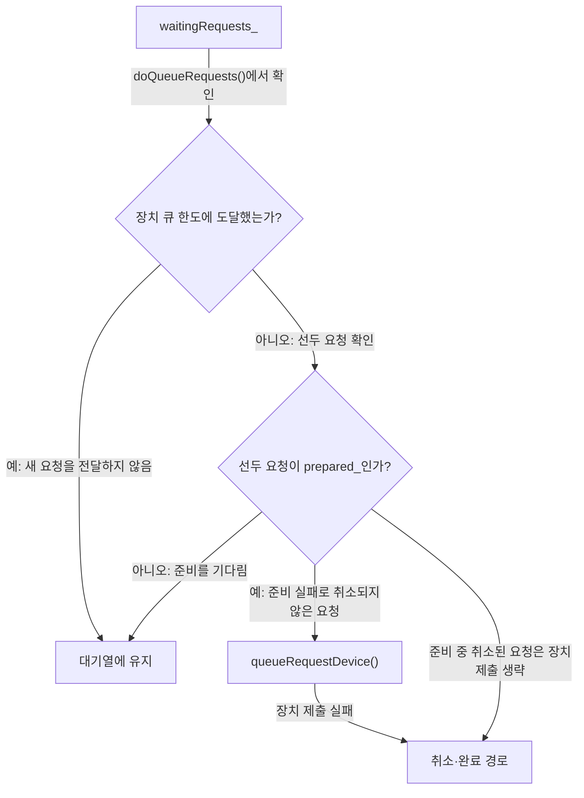
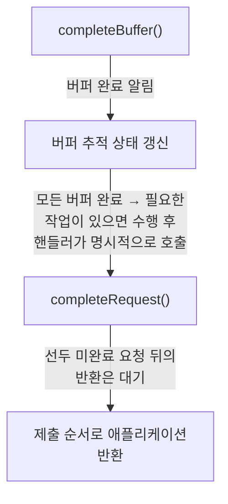
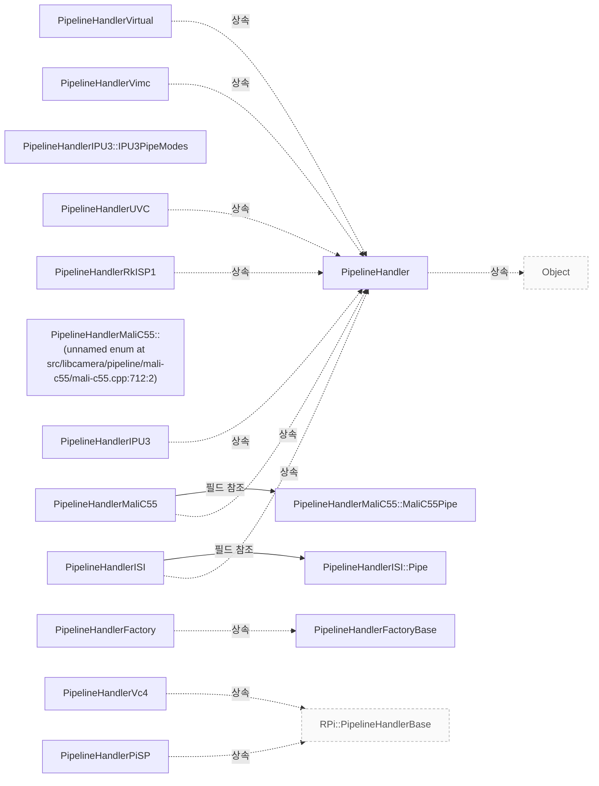

# Pipeline 요청 제출과 완료

**요청 큐의 대기·장치 전달·완료 경계를 따라 구현자의 책임을 확인하세요.**

| 지금 확인할 내용 | 이동할 절 |
|---|---|
| 파이프라인 구현이 지켜야 하는 구성·요청·완료·종료 계약을 확인하세요. | [Pipeline Handler](pipeline-handler.md) |

## 요청 준비와 장치 큐

`PipelineHandler::registerRequest()`는 요청이 생성될 때 호출됩니다. 이 시점에 pipeline handler가 해당 요청에 필요한 일회성 초기화를 수행할 수 있습니다. `PipelineHandler::registerRequest()`에서 request->`_d()`->prepared 신호에 연결된 람다 콜백이 실제로 호출하는 함수는 doQueueRequests입니다. `PipelineHandler::queueRequest`는 요청이 가리키는 카메라의 내부 `waitingRequests_` 큐에 요청을 추가한 뒤, 같은 요청의 prepare 호출에 300ms 시간 인자를 전달합니다. `src/libcamera/pipeline_handler.cpp:428`, `src/libcamera/pipeline_handler.cpp:435`, `src/libcamera/pipeline_handler.cpp:475`, `src/libcamera/pipeline_handler.cpp:469`

<!-- sdd:visual:queue-gates -->
### 요청이 대기하거나 장치로 가는 조건



[Mermaid 원문](pipeline-requests.queue-gates.mmd)

??? note "그림 근거와 확인 범위"
    준비 대기와 장치 큐 한도를 구분하세요. 준비 실패와 장치 제출 실패는 취소 경로로 이어집니다.
    
    소스에 연결한 설계 해석입니다. 자동 연결 검사는 의미 승인이나 기기 실행 검증이 아닙니다.
    
    | 요소·전이 | 소스 근거 |
    |---|---|
    | <span data-sdd-label-en="waitingRequests_">waitingRequests&#95;</span> | [src/libcamera/pipeline_handler.cpp:428](#source-789eafedfaa7f3c5) |
    | <span data-sdd-label-en="Is the front request prepared?">선두 요청이 prepared&#95;인가?</span> | [src/libcamera/pipeline_handler.cpp:428](#source-789eafedfaa7f3c5) |
    | <span data-sdd-label-en="Device queue at its limit?">장치 큐 한도에 도달했는가?</span> | [src/libcamera/pipeline_handler.cpp:428](#source-789eafedfaa7f3c5) |
    | <span data-sdd-label-en="Stay in waiting queue">대기열에 유지</span> | [src/libcamera/pipeline_handler.cpp:428](#source-789eafedfaa7f3c5) |
    | <span data-sdd-label-en="queueRequestDevice()">queueRequestDevice&#40;&#41;</span> | [src/libcamera/pipeline_handler.cpp:428](#source-789eafedfaa7f3c5) |
    | <span data-sdd-label-en="Cancellation and completion">취소·완료 경로</span> | [src/libcamera/pipeline_handler.cpp:428](#source-789eafedfaa7f3c5) |
    | <span data-sdd-label-en="Check in doQueueRequests()">doQueueRequests&#40;&#41;에서 확인</span> | [src/libcamera/pipeline_handler.cpp:428](#source-789eafedfaa7f3c5) |
    | <span data-sdd-label-en="Yes: stop forwarding">예: 새 요청을 전달하지 않음</span> | [src/libcamera/pipeline_handler.cpp:428](#source-789eafedfaa7f3c5) |
    | <span data-sdd-label-en="No: inspect front request">아니오: 선두 요청 확인</span> | [src/libcamera/pipeline_handler.cpp:428](#source-789eafedfaa7f3c5) |
    | <span data-sdd-label-en="No: wait for preparation">아니오: 준비를 기다림</span> | [src/libcamera/pipeline_handler.cpp:428](#source-789eafedfaa7f3c5) |
    | <span data-sdd-label-en="Yes: unless cancelled during preparation">예: 준비 실패로 취소되지 않은 요청</span> | [src/libcamera/pipeline_handler.cpp:428](#source-789eafedfaa7f3c5) |
    | <span data-sdd-label-en="Device queue failure">장치 제출 실패</span> | [src/libcamera/pipeline_handler.cpp:428](#source-789eafedfaa7f3c5) |
    | <span data-sdd-label-en="Skip device for cancelled request">준비 중 취소된 요청은 장치 제출 생략</span> | [src/libcamera/pipeline_handler.cpp:428](#source-789eafedfaa7f3c5) |
<!-- /sdd:visual:queue-gates -->

`Request::Private::prepare`는 `pending_`에 있는 각 `FrameBuffer`의 획득 펜스마다 fd를 읽기 대기하는 `EventNotifier`를 만들어 연결하며, 펜스가 신호되면 notifierActivated가 호출됩니다. 대기할 펜스가 없으면 `notifiers_`가 비어 있게 되므로 `Request::prepared` 신호를 즉시 발생시키고 바로 반환합니다. 선택적 timeout 인자가 0ms가 아니고 대기할 펜스가 있을 때에만 `Timer`를 만들어 timeout 시간으로 시작하며, 만료 시점에 모든 펜스가 올바르게 신호되지 않았다면 `Request`가 취소되고 `Request::prepared` 신호가 발생합니다. 이 타이머는 `Request` 생성자가 아니라 prepare 호출 시점에 만들어지는데, 파이프라인 핸들러 스레드에 바인딩되도록 하기 위해서입니다. `src/libcamera/request.cpp:199`

`PipelineHandler::doQueueRequests()`에서 data->`queuedRequests_`의 크기가 `maxQueuedRequestsDevice_`와 같으면 break가 실행되어 while 반복이 중단되므로, 이 호출에서는 대기 중인 요청을 더 꺼내 doQueueRequest()로 넘기지 않습니다. `doQueueRequests()`는 `waitingRequests_` 선두 요청의 `request->_d()->prepared_`가 false이면 `break`를 실행하여 while 반복을 중단합니다. 이 검사는 `pop()`보다 먼저 수행되므로 준비되지 않은 요청은 대기열 맨 앞에 그대로 남습니다. 따라서 이번 호출에서는 그 뒤에 있는 요청도 `doQueueRequest()`로 넘기지 않고 종료합니다. `src/libcamera/pipeline_handler.cpp:513`, `src/libcamera/pipeline_handler.cpp:509`

doQueueRequest는 요청을 data->`queuedRequests_`에 추가한 뒤, request->`_d()`->`sequence_`에 data->`requestSequence_`의 증가 전 값을 대입하고 그다음 data->`requestSequence_`를 증가시킵니다. doQueueRequest에서 request->`_d()`->`cancelled_`가 참이면 completeRequest(request)를 호출한 뒤 return으로 doQueueRequest 함수를 즉시 종료합니다. 따라서 이 분기는 queueRequestDevice 호출과 cancelRequest 처리보다 먼저 반환합니다. `src/libcamera/pipeline_handler.cpp:491`, `src/libcamera/pipeline_handler.cpp:489`, `src/libcamera/pipeline_handler.cpp:483`

doQueueRequest는 request->`_d()`->`cancelled_`가 설정된 요청을 취소 분기에서 조기 반환시킨 뒤, 취소되지 않은 요청에 한해 queueRequestDevice(camera, request)를 호출하고 그 결과를 ret에 저장합니다. doQueueRequest에서 queueRequestDevice(camera, request)의 반환값 ret가 0이 아닐 때, 즉 if (ret) 조건이 참이면 cancelRequest(request)를 호출합니다. queueRequestDevice의 구현자는 요청에 포함된 매개변수가 요청에 제공된 버퍼에 캡처되는 프레임에 적용되도록 장치를 프로그래밍해야 합니다(shall). 요청은 스트림과 연결된 버퍼 집합과 매개변수 집합을 포함합니다. `src/libcamera/pipeline_handler.cpp:483`, `src/libcamera/pipeline_handler.cpp:498`, `src/libcamera/pipeline_handler.cpp:428`

근거 원문: [src/libcamera/pipeline_handler.cpp:428](#source-789eafedfaa7f3c5) · [src/libcamera/request.cpp:199](#source-4f52447929ee8da9) · [src/libcamera/pipeline_handler.cpp:435](#source-2e194e2fc68579c3) · [src/libcamera/pipeline_handler.cpp:469](#source-c86b50cadd8a5947) · [src/libcamera/pipeline_handler.cpp:483](#source-8bf901f3faef18e5) · [src/libcamera/pipeline_handler.cpp:509](#source-d63c9e57bcf862b0) · [src/libcamera/pipeline_handler.cpp:489](#source-ce717689071a887f) · [src/libcamera/pipeline_handler.cpp:491](#source-a8f47a79aca791ea) · [src/libcamera/pipeline_handler.cpp:475](#source-3ad79b52195fbc58) · [src/libcamera/pipeline_handler.cpp:513](#source-819fe99ec52b734f) · [src/libcamera/pipeline_handler.cpp:498](#source-1e06e477d10056b7)

## 버퍼 완료와 요청 반환

일반 버퍼 완료 경로에서 파이프라인 핸들러는 요청의 버퍼 완료를 알리기 위해 completeBuffer를 호출해야 합니다. 이 함수는 애플리케이션에 버퍼 완료를 알리고 요청의 내부 버퍼 추적 상태를 갱신합니다. 일반 완료 처리에서 마지막 버퍼에 대한 completeBuffer 호출은 요청을 자동으로 완료하지 않습니다. 파이프라인 핸들러는 completeRequest()를 명시적으로 호출하여 요청을 완료해야 합니다. `src/libcamera/pipeline_handler.cpp:547`

<!-- sdd:visual:buffer-request-completion -->
### 버퍼 완료에서 요청 반환까지



[Mermaid 원문](pipeline-requests.buffer-request-completion.mmd)

??? note "그림 근거와 확인 범위"
    마지막 버퍼의 완료가 요청을 자동 완료하지 않습니다. 핸들러의 명시적 요청 완료 통지가 필요합니다.
    
    소스에 연결한 설계 해석입니다. 자동 연결 검사는 의미 승인이나 기기 실행 검증이 아닙니다.
    
    | 요소·전이 | 소스 근거 |
    |---|---|
    | <span data-sdd-label-en="completeBuffer()">completeBuffer&#40;&#41;</span> | [src/libcamera/pipeline_handler.cpp:547](#source-01ad7c6605c3296a) |
    | <span data-sdd-label-en="Update buffer completion tracking">버퍼 추적 상태 갱신</span> | [src/libcamera/pipeline_handler.cpp:547](#source-01ad7c6605c3296a) |
    | <span data-sdd-label-en="completeRequest()">completeRequest&#40;&#41;</span> | [src/libcamera/pipeline_handler.cpp:547](#source-01ad7c6605c3296a) |
    | <span data-sdd-label-en="Return to application in submission order">제출 순서로 애플리케이션 반환</span> | [src/libcamera/pipeline_handler.cpp:547](#source-01ad7c6605c3296a) |
    | <span data-sdd-label-en="Notify buffer completion">버퍼 완료 알림</span> | [src/libcamera/pipeline_handler.cpp:547](#source-01ad7c6605c3296a) |
    | <span data-sdd-label-en="All buffers complete → handler performs any remaining work if needed, then explicitly calls">모든 버퍼 완료 → 필요한 작업이 있으면 수행 후 핸들러가 명시적으로 호출</span> | [src/libcamera/pipeline_handler.cpp:547](#source-01ad7c6605c3296a) |
    | <span data-sdd-label-en="Wait behind an incomplete head request">선두 미완료 요청 뒤의 반환은 대기</span> | [src/libcamera/pipeline_handler.cpp:547](#source-01ad7c6605c3296a) |
<!-- /sdd:visual:buffer-request-completion -->

completeRequest가 반환한 뒤 해당 요청은 파이프라인 핸들러가 더 이상 관리하지 않으며, 파이프라인 핸들러는 이 함수가 반환된 뒤 요청에 접근하지 않아야 합니다. completeRequest는 요청을 제출 순서대로 애플리케이션에 반환하도록 보장하는 함수입니다. 파이프라인 핸들러는 완료된 요청이면 어떤 요청에 대해서도 completeRequest를 호출할 수 있으며, 이때 호출 순서에 대한 제약은 없습니다. `src/libcamera/pipeline_handler.cpp:571`, `src/libcamera/pipeline_handler.cpp:578`

completeRequest의 while 루프는 `queuedRequests_`의 맨 앞 요청 상태가 `Request::RequestPending`이면 break를 실행하여 루프를 중단합니다. 이 경우 해당 요청은 `pop_front()`로 제거되지 않고, camera->requestComplete()도 호출되지 않은 채 큐의 맨 앞에 남습니다. 따라서 그 뒤에 있는 요청들은 이 루프에서 검사되지 않습니다. `src/libcamera/pipeline_handler.cpp:584`

completeRequest가 대기 요청 전달을 재개하기 위해 마지막에 호출하는 함수는 doQueueRequests(camera)입니다. 소스 주석에는 이 호출이 대기 중인 요청을 파이프라인에 큐잉할 수 있도록 허용한다고 적혀 있습니다. 이 호출은 completeRequest 안의 while 루프가 끝난 뒤에 실행됩니다. completeBuffer와 completeRequest는 모두 `CameraManager` 스레드에서 호출해야 합니다. `src/libcamera/pipeline_handler.cpp:584`, `src/libcamera/pipeline_handler.cpp:547`, `src/libcamera/pipeline_handler.cpp:571`

cancelRequest는 내부 cancel()을 호출한 뒤 completeRequest를 호출하여 요청을 완료합니다. 내부 취소는 각 대기 버퍼를 취소하고 해당 버퍼에 대해 bufferCompleted 신호를 발생시킵니다. `src/libcamera/pipeline_handler.cpp:607`, `src/libcamera/request.cpp:139`

근거 원문: [src/libcamera/pipeline_handler.cpp:547](#source-01ad7c6605c3296a) · [src/libcamera/pipeline_handler.cpp:547](#source-f389c6ca68ade3da) · [src/libcamera/pipeline_handler.cpp:571](#source-236c920e906cb6fd) · [src/libcamera/pipeline_handler.cpp:584](#source-b6dd86e931d905ed) · [src/libcamera/pipeline_handler.cpp:607](#source-27cb6869fd89d13d) · [src/libcamera/pipeline_handler.cpp:578](#source-16187edaf24c09f5) · [src/libcamera/request.cpp:139](#source-906fe48d2b97450b)

## 장치 요청 한도와 대기 큐

`PipelineHandler` 생성자 선언에서 maxQueuedRequestsDevice의 기본값은 32입니다. `maxQueuedRequestsDevice_`가 제한하는 요청 수는 underlying hardware에 queue되는 요청, 즉 장치 쪽 큐에 해당합니다. 나머지 요청은 internal waiting queue에서 대기하며 나중에 queue됩니다. `include/libcamera/internal/pipeline_handler.h:38`, `src/libcamera/pipeline_handler.cpp:805`

애플리케이션이 장치 한도보다 많은 요청을 제출하면, 한도를 넘는 나머지 요청은 파이프라인 핸들러 내부의 internal waiting queue에서 기다립니다. 장치로는 한 시점에 `maxQueuedRequestsDevice_` 개수의 요청만 큐잉되며, 나머지 요청은 나중 단계에서 큐잉됩니다. 애플리케이션은 원하는 만큼 요청을 제출할 수 있습니다(may). `src/libcamera/pipeline_handler.cpp:805`

근거 원문: [include/libcamera/internal/pipeline_handler.h:38](#source-0cf3f7eced88f3df) · [src/libcamera/pipeline_handler.cpp:805](#source-bf25a409490e6fa9)

??? note "설계 질문과 검증 범위"
    질문별 답변과 근거 연결을 검사했습니다. 의미와 실행 결과는 사람 검토가 필요합니다.
    
    | 설계 질문 | 설명 위치 | 확인 범위 |
    |---|---|---|
    | 요청을 장치로 넘기는 조건과 실패 처리는 무엇입니까? | [요청 준비와 장치 큐](#요청-준비와-장치-큐) | 코드 근거와 설명 연결 |
    | 버퍼 완료, 요청 완료와 접근 가능한 수명은 어떻게 구분됩니까? | [버퍼 완료와 요청 반환](#버퍼-완료와-요청-반환) | 코드 근거와 설명 연결 |
    | 장치에 동시에 제출하는 요청 수의 기본 한도와 대기 요청의 처리는 무엇입니까? | [장치 요청 한도와 대기 큐](#장치-요청-한도와-대기-큐) | 코드 근거와 설명 연결 |

## 소스 근거

같은 발췌는 한 번만 싣습니다. 필요한 원문을 펼쳐 설명과 대조하세요.

<a id="source-789eafedfaa7f3c5"></a>

??? note "소스 근거: src/libcamera/pipeline_handler.cpp:428"
    `src/libcamera/pipeline_handler.cpp:428`에서 시작하는 발췌입니다. 종료 줄은 547이며, 아래 원문을 설명과 대조할 수 있습니다.
    
    SHA-256: `5a7a3397a6034a73fe348ae44eb1e2568d2823e95542fe43386e16359d627180`
    
    ```text
    \fn PipelineHandler::registerRequest()
     * \brief Register a request for use by the pipeline handler
     * \param[in] request The request to register
     *
     * This function is called when the request is created, and allows the pipeline
     * handler to perform any one-time initialization it requries for the request.
     */
    void PipelineHandler::registerRequest(Request *request)
    {
    	/*
    	 * Connect the request prepared signal to notify the pipeline handler
    	 * when a request is ready to be processed.
    	 */
    	request->_d()->prepared.connect(this, [this, request]() {
    		doQueueRequests(request->_d()->camera());
    	});
    }
    
    /**
     * \fn PipelineHandler::queueRequest()
     * \brief Queue a request
     * \param[in] request The request to queue
     *
     * This function queues a capture request to the pipeline handler for
     * processing. The request is first added to the internal list of waiting
     * requests which have to be prepared to make sure they are ready for being
     * queued to the pipeline handler.
     *
     * The queue of waiting requests is iterated and up to \a
     * maxQueuedRequestsDevice_ prepared requests are passed to the pipeline handler
     * in the same order they have been queued by calling this function.
     *
     * If a Request fails during the preparation phase or if the pipeline handler
     * fails in queuing the request to the hardware the request is cancelled.
     *
     * Keeping track of queued requests ensures automatic completion of all requests
     * when the pipeline handler is stopped with stop(). Request completion shall be
     * signalled by the pipeline handler using the completeRequest() function.
     *
     * \context This function is called from the CameraManager thread.
     */
    void PipelineHandler::queueRequest(Request *request)
    {
    	LIBCAMERA_TRACEPOINT(request_queue, request);
    
    	Camera *camera = request->_d()->camera();
    	Camera::Private *data = camera->_d();
    	data->waitingRequests_.push(request);
    
    	request->_d()->prepare(300ms);
    }
    
    /**
     * \brief Queue one requests to the device
     */
    void PipelineHandler::doQueueRequest(Request *request)
    {
    	LIBCAMERA_TRACEPOINT(request_device_queue, request);
    
    	Camera *camera = request->_d()->camera();
    	Camera::Private *data = camera->_d();
    	data->queuedRequests_.push_back(request);
    
    	request->_d()->sequence_ = data->requestSequence_++;
    
    	if (request->_d()->cancelled_) {
    		completeRequest(request);
    		return;
    	}
    
    	int ret = queueRequestDevice(camera, request);
    	if (ret)
    		cancelRequest(request);
    }
    
    /**
     * \brief Queue prepared requests to the device
     *
     * Iterate the list of waiting requests and queue them to the device one
     * by one if they have been prepared.
     */
    void PipelineHandler::doQueueRequests(Camera *camera)
    {
    	Camera::Private *data = camera->_d();
    	while (!data->waitingRequests_.empty()) {
    		if (data->queuedRequests_.size() == maxQueuedRequestsDevice_)
    			break;
    
    		Request *request = data->waitingRequests_.front();
    		if (!request->_d()->prepared_)
    			break;
    
    		/*
    		 * Pop the request first, in case doQueueRequests() is called
    		 * recursively from within doQueueRequest()
    		 */
    		data->waitingRequests_.pop();
    		doQueueRequest(request);
    	}
    }
    
    /**
     * \fn PipelineHandler::queueRequestDevice()
     * \brief Queue a request to the device
     * \param[in] camera The camera to queue the request to
     * \param[in] request The request to queue
     *
     * This function queues a capture request to the device for processing. The
     * request contains a set of buffers associated with streams and a set of
     * parameters. The pipeline handler shall program the device to ensure that the
     * parameters will be applied to the frames captured in the buffers provided in
     * the request.
     *
     * \context This function is called from the CameraManager thread.
     *
     * \return 0 on success or a negative error code otherwise
     */
    
    /**
     * \brief Complete a buffer for a request
    ```

<a id="source-4f52447929ee8da9"></a>

??? note "소스 근거: src/libcamera/request.cpp:199"
    `src/libcamera/request.cpp:199`에서 시작하는 발췌입니다. 종료 줄은 263이며, 아래 원문을 설명과 대조할 수 있습니다.
    
    SHA-256: `97d311c371577c108a7c9e936dc85fca0cbcc912ac3de743229c1d2647590bd3`
    
    ```text
    \brief Prepare the Request to be queued to the device
     * \param[in] timeout Optional expiration timeout
     *
     * Prepare a Request to be queued to the hardware device by ensuring it is
     * ready for the incoming memory transfers.
     *
     * This currently means waiting on each frame buffer acquire fence to be
     * signalled. An optional expiration timeout can be specified. If not all the
     * fences have been signalled correctly before the timeout expires the Request
     * is cancelled.
     *
     * The function immediately emits the prepared signal if all the prepare
     * operations have been completed synchronously. If instead the prepare
     * operations require to wait the completion of asynchronous events, such as
     * fences notifications or timer expiration, the prepared signal is emitted upon
     * the asynchronous event completion.
     *
     * As we currently only handle fences, the function emits the prepared signal
     * immediately if there are no fences to wait on. Otherwise the prepared signal
     * is emitted when all fences have been signalled or the optional timeout has
     * expired.
     *
     * If not all the fences have been correctly signalled or the optional timeout
     * has expired the Request will be cancelled and the Request::prepared signal
     * emitted.
     *
     * The intended user of this function is the PipelineHandler base class, which
     * 'prepares' a Request before queuing it to the hardware device.
     */
    void Request::Private::prepare(std::chrono::milliseconds timeout)
    {
    	/* Create and connect one notifier for each synchronization fence. */
    	for (FrameBuffer *buffer : pending_) {
    		const Fence *fence = buffer->_d()->fence();
    		if (!fence)
    			continue;
    
    		auto [it, inserted] = notifiers_.try_emplace(buffer, fence->fd().get(), EventNotifier::Type::Read);
    		ASSERT(inserted);
    
    		it->second.activated.connect(this, [this, buffer] {
    			notifierActivated(buffer);
    		});
    	}
    
    	if (notifiers_.empty()) {
    		emitPrepareCompleted();
    		return;
    	}
    
    	/*
    	 * In case a timeout is specified, create a timer and set it up.
    	 *
    	 * The timer must be created here instead of in the Request constructor,
    	 * in order to be bound to the pipeline handler thread.
    	 */
    	if (timeout != 0ms) {
    		timer_ = std::make_unique<Timer>();
    		timer_->timeout.connect(this, &Request::Private::timeout);
    		timer_->start(timeout);
    	}
    }
    
    /**
     * \var Request::Private::prepared
    ```

<a id="source-2e194e2fc68579c3"></a>

??? note "소스 근거: src/libcamera/pipeline_handler.cpp:435"
    `src/libcamera/pipeline_handler.cpp:435`에서 시작하는 발췌입니다. 종료 줄은 444이며, 아래 원문을 설명과 대조할 수 있습니다.
    
    SHA-256: `ceadd0f83ea31d5d8a39a1673cb0e9b9b4f0f9d212cb5161241a6eec94b0c193`
    
    ```text
    void PipelineHandler::registerRequest(Request *request)
    {
    	/*
    	 * Connect the request prepared signal to notify the pipeline handler
    	 * when a request is ready to be processed.
    	 */
    	request->_d()->prepared.connect(this, [this, request]() {
    		doQueueRequests(request->_d()->camera());
    	});
    }
    ```

<a id="source-c86b50cadd8a5947"></a>

??? note "소스 근거: src/libcamera/pipeline_handler.cpp:469"
    `src/libcamera/pipeline_handler.cpp:469`에서 시작하는 발췌입니다. 종료 줄은 483이며, 아래 원문을 설명과 대조할 수 있습니다.
    
    SHA-256: `e407d584d54cee2098dd5730446a692093cc16cc54785bd294c39457e562a622`
    
    ```text
    void PipelineHandler::queueRequest(Request *request)
    {
    	LIBCAMERA_TRACEPOINT(request_queue, request);
    
    	Camera *camera = request->_d()->camera();
    	Camera::Private *data = camera->_d();
    	data->waitingRequests_.push(request);
    
    	request->_d()->prepare(300ms);
    }
    
    /**
     * \brief Queue one requests to the device
     */
    void PipelineHandler::doQueueRequest(Request *request)
    ```

<a id="source-8bf901f3faef18e5"></a>

??? note "소스 근거: src/libcamera/pipeline_handler.cpp:483"
    `src/libcamera/pipeline_handler.cpp:483`에서 시작하는 발췌입니다. 종료 줄은 504이며, 아래 원문을 설명과 대조할 수 있습니다.
    
    SHA-256: `6c0fefadbc69b9bb9371953979a07a38024dc18cb648266d81168f15d8e9e4fb`
    
    ```text
    void PipelineHandler::doQueueRequest(Request *request)
    {
    	LIBCAMERA_TRACEPOINT(request_device_queue, request);
    
    	Camera *camera = request->_d()->camera();
    	Camera::Private *data = camera->_d();
    	data->queuedRequests_.push_back(request);
    
    	request->_d()->sequence_ = data->requestSequence_++;
    
    	if (request->_d()->cancelled_) {
    		completeRequest(request);
    		return;
    	}
    
    	int ret = queueRequestDevice(camera, request);
    	if (ret)
    		cancelRequest(request);
    }
    
    /**
     * \brief Queue prepared requests to the device
    ```

<a id="source-d63c9e57bcf862b0"></a>

??? note "소스 근거: src/libcamera/pipeline_handler.cpp:509"
    `src/libcamera/pipeline_handler.cpp:509`에서 시작하는 발췌입니다. 종료 줄은 530이며, 아래 원문을 설명과 대조할 수 있습니다.
    
    SHA-256: `b2d2d134eaa639300cae5e7660d8453da545646bcc100bf640a981fa1371899d`
    
    ```text
    void PipelineHandler::doQueueRequests(Camera *camera)
    {
    	Camera::Private *data = camera->_d();
    	while (!data->waitingRequests_.empty()) {
    		if (data->queuedRequests_.size() == maxQueuedRequestsDevice_)
    			break;
    
    		Request *request = data->waitingRequests_.front();
    		if (!request->_d()->prepared_)
    			break;
    
    		/*
    		 * Pop the request first, in case doQueueRequests() is called
    		 * recursively from within doQueueRequest()
    		 */
    		data->waitingRequests_.pop();
    		doQueueRequest(request);
    	}
    }
    
    /**
     * \fn PipelineHandler::queueRequestDevice()
    ```

<a id="source-ce717689071a887f"></a>

??? note "소스 근거: src/libcamera/pipeline_handler.cpp:489"
    `src/libcamera/pipeline_handler.cpp:489`에서 시작하는 발췌입니다. 종료 줄은 489이며, 아래 원문을 설명과 대조할 수 있습니다.
    
    SHA-256: `6f7b414922ac8aa5b1145605d838f7188794abfdb44ae70d5272c3290753a50d`
    
    ```text
    data->queuedRequests_.push_back(request);
    ```

<a id="source-a8f47a79aca791ea"></a>

??? note "소스 근거: src/libcamera/pipeline_handler.cpp:491"
    `src/libcamera/pipeline_handler.cpp:491`에서 시작하는 발췌입니다. 종료 줄은 491이며, 아래 원문을 설명과 대조할 수 있습니다.
    
    SHA-256: `852f648a05b063e1893e4b06b763725a1c14963c9f76c4a5b38eacf57852f05f`
    
    ```text
    request->_d()->sequence_ = data->requestSequence_++;
    ```

<a id="source-3ad79b52195fbc58"></a>

??? note "소스 근거: src/libcamera/pipeline_handler.cpp:475"
    `src/libcamera/pipeline_handler.cpp:475`에서 시작하는 발췌입니다. 종료 줄은 475이며, 아래 원문을 설명과 대조할 수 있습니다.
    
    SHA-256: `1814c6100eba91f737fab4e000863c03e533260a921598e99fc69298b94f5ddb`
    
    ```text
    data->waitingRequests_.push(request);
    ```

<a id="source-819fe99ec52b734f"></a>

??? note "소스 근거: src/libcamera/pipeline_handler.cpp:513"
    `src/libcamera/pipeline_handler.cpp:513`에서 시작하는 발췌입니다. 종료 줄은 514이며, 아래 원문을 설명과 대조할 수 있습니다.
    
    SHA-256: `0e91fc5bcfd16b461ea572e903ca063877d267a641ad5e6018b4b13d89723143`
    
    ```text
    if (data->queuedRequests_.size() == maxQueuedRequestsDevice_)
    			break;
    ```

<a id="source-1e06e477d10056b7"></a>

??? note "소스 근거: src/libcamera/pipeline_handler.cpp:498"
    `src/libcamera/pipeline_handler.cpp:498`에서 시작하는 발췌입니다. 종료 줄은 500이며, 아래 원문을 설명과 대조할 수 있습니다.
    
    SHA-256: `474a449d8915b2098739e2f25079a56e132930340a353c2538de1f3ca84c3a1e`
    
    ```text
    int ret = queueRequestDevice(camera, request);
    	if (ret)
    		cancelRequest(request);
    ```

<a id="source-01ad7c6605c3296a"></a>

??? note "소스 근거: src/libcamera/pipeline_handler.cpp:547"
    `src/libcamera/pipeline_handler.cpp:547`에서 시작하는 발췌입니다. 종료 줄은 620이며, 아래 원문을 설명과 대조할 수 있습니다.
    
    SHA-256: `514288cc958de9ff5fd19d46393cec3bb3088f4f08486528d4559071138638c9`
    
    ```text
    \brief Complete a buffer for a request
     * \param[in] request The request the buffer belongs to
     * \param[in] buffer The buffer that has completed
     *
     * This function shall be called by pipeline handlers to signal completion of
     * the \a buffer part of the \a request. It notifies applications of buffer
     * completion and updates the request's internal buffer tracking. The request
     * is not completed automatically when the last buffer completes to give
     * pipeline handlers a chance to perform any operation that may still be
     * needed. They shall complete requests explicitly with completeRequest().
     *
     * \context This function shall be called from the CameraManager thread.
     *
     * \return True if all buffers contained in the request have completed, false
     * otherwise
     */
    bool PipelineHandler::completeBuffer(Request *request, FrameBuffer *buffer)
    {
    	Camera *camera = request->_d()->camera();
    	camera->bufferCompleted.emit(request, buffer);
    	return request->_d()->completeBuffer(buffer);
    }
    
    /**
     * \brief Signal request completion
     * \param[in] request The request that has completed
     *
     * The pipeline handler shall call this function to notify the \a camera that
     * the request has completed. The request is no longer managed by the pipeline
     * handler and shall not be accessed once this function returns.
     *
     * This function ensures that requests will be returned to the application in
     * submission order, the pipeline handler may call it on any complete request
     * without any ordering constraint.
     *
     * \context This function shall be called from the CameraManager thread.
     */
    void PipelineHandler::completeRequest(Request *request)
    {
    	Camera *camera = request->_d()->camera();
    
    	request->_d()->complete();
    
    	Camera::Private *data = camera->_d();
    
    	while (!data->queuedRequests_.empty()) {
    		Request *req = data->queuedRequests_.front();
    		if (req->status() == Request::RequestPending)
    			break;
    
    		ASSERT(!req->hasPendingBuffers());
    		data->queuedRequests_.pop_front();
    		camera->requestComplete(req);
    	}
    
    	/* Allow any waiting requests to be queued to the pipeline. */
    	doQueueRequests(camera);
    }
    
    /**
     * \brief Cancel request and signal its completion
     * \param[in] request The request to cancel
     *
     * This function cancels and completes the request. The same rules as for
     * completeRequest() apply.
     */
    void PipelineHandler::cancelRequest(Request *request)
    {
    	request->_d()->cancel();
    	completeRequest(request);
    }
    
    /**
     * \brief Retrieve the absolute path to a platform configuration file
    ```

<a id="source-f389c6ca68ade3da"></a>

??? note "소스 근거: src/libcamera/pipeline_handler.cpp:547"
    `src/libcamera/pipeline_handler.cpp:547`에서 시작하는 발췌입니다. 종료 줄은 571이며, 아래 원문을 설명과 대조할 수 있습니다.
    
    SHA-256: `ef4ebb9cfbf4b1330b1023d5fa7a790ab8fb13be2793adb41c2e41f01cbf107a`
    
    ```text
    \brief Complete a buffer for a request
     * \param[in] request The request the buffer belongs to
     * \param[in] buffer The buffer that has completed
     *
     * This function shall be called by pipeline handlers to signal completion of
     * the \a buffer part of the \a request. It notifies applications of buffer
     * completion and updates the request's internal buffer tracking. The request
     * is not completed automatically when the last buffer completes to give
     * pipeline handlers a chance to perform any operation that may still be
     * needed. They shall complete requests explicitly with completeRequest().
     *
     * \context This function shall be called from the CameraManager thread.
     *
     * \return True if all buffers contained in the request have completed, false
     * otherwise
     */
    bool PipelineHandler::completeBuffer(Request *request, FrameBuffer *buffer)
    {
    	Camera *camera = request->_d()->camera();
    	camera->bufferCompleted.emit(request, buffer);
    	return request->_d()->completeBuffer(buffer);
    }
    
    /**
     * \brief Signal request completion
    ```

<a id="source-236c920e906cb6fd"></a>

??? note "소스 근거: src/libcamera/pipeline_handler.cpp:571"
    `src/libcamera/pipeline_handler.cpp:571`에서 시작하는 발췌입니다. 종료 줄은 607이며, 아래 원문을 설명과 대조할 수 있습니다.
    
    SHA-256: `6ad80c6800e8b980c2a6146d7dcc5648de9db2b0ca408711a896c4e46a624684`
    
    ```text
    \brief Signal request completion
     * \param[in] request The request that has completed
     *
     * The pipeline handler shall call this function to notify the \a camera that
     * the request has completed. The request is no longer managed by the pipeline
     * handler and shall not be accessed once this function returns.
     *
     * This function ensures that requests will be returned to the application in
     * submission order, the pipeline handler may call it on any complete request
     * without any ordering constraint.
     *
     * \context This function shall be called from the CameraManager thread.
     */
    void PipelineHandler::completeRequest(Request *request)
    {
    	Camera *camera = request->_d()->camera();
    
    	request->_d()->complete();
    
    	Camera::Private *data = camera->_d();
    
    	while (!data->queuedRequests_.empty()) {
    		Request *req = data->queuedRequests_.front();
    		if (req->status() == Request::RequestPending)
    			break;
    
    		ASSERT(!req->hasPendingBuffers());
    		data->queuedRequests_.pop_front();
    		camera->requestComplete(req);
    	}
    
    	/* Allow any waiting requests to be queued to the pipeline. */
    	doQueueRequests(camera);
    }
    
    /**
     * \brief Cancel request and signal its completion
    ```

<a id="source-b6dd86e931d905ed"></a>

??? note "소스 근거: src/libcamera/pipeline_handler.cpp:584"
    `src/libcamera/pipeline_handler.cpp:584`에서 시작하는 발췌입니다. 종료 줄은 613이며, 아래 원문을 설명과 대조할 수 있습니다.
    
    SHA-256: `1c316a2c8c85330805c7dd48fd785dbda88c6cc8e60e9ff0b63039b0205c5577`
    
    ```text
    void PipelineHandler::completeRequest(Request *request)
    {
    	Camera *camera = request->_d()->camera();
    
    	request->_d()->complete();
    
    	Camera::Private *data = camera->_d();
    
    	while (!data->queuedRequests_.empty()) {
    		Request *req = data->queuedRequests_.front();
    		if (req->status() == Request::RequestPending)
    			break;
    
    		ASSERT(!req->hasPendingBuffers());
    		data->queuedRequests_.pop_front();
    		camera->requestComplete(req);
    	}
    
    	/* Allow any waiting requests to be queued to the pipeline. */
    	doQueueRequests(camera);
    }
    
    /**
     * \brief Cancel request and signal its completion
     * \param[in] request The request to cancel
     *
     * This function cancels and completes the request. The same rules as for
     * completeRequest() apply.
     */
    void PipelineHandler::cancelRequest(Request *request)
    ```

<a id="source-27cb6869fd89d13d"></a>

??? note "소스 근거: src/libcamera/pipeline_handler.cpp:607"
    `src/libcamera/pipeline_handler.cpp:607`에서 시작하는 발췌입니다. 종료 줄은 620이며, 아래 원문을 설명과 대조할 수 있습니다.
    
    SHA-256: `1fa9cc6547bd09cc36ec17572eec6ed2a69b261e1d9c9e5bd9cf58e24edd7d18`
    
    ```text
    \brief Cancel request and signal its completion
     * \param[in] request The request to cancel
     *
     * This function cancels and completes the request. The same rules as for
     * completeRequest() apply.
     */
    void PipelineHandler::cancelRequest(Request *request)
    {
    	request->_d()->cancel();
    	completeRequest(request);
    }
    
    /**
     * \brief Retrieve the absolute path to a platform configuration file
    ```

<a id="source-16187edaf24c09f5"></a>

??? note "소스 근거: src/libcamera/pipeline_handler.cpp:578"
    `src/libcamera/pipeline_handler.cpp:578`에서 시작하는 발췌입니다. 종료 줄은 580이며, 아래 원문을 설명과 대조할 수 있습니다.
    
    SHA-256: `559a88834ae3bb13ac9f2d1844e5b87f1d863fd91b1c8ed252704bf1974adac6`
    
    ```text
    This function ensures that requests will be returned to the application in
     * submission order, the pipeline handler may call it on any complete request
     * without any ordering constraint.
    ```

<a id="source-906fe48d2b97450b"></a>

??? note "소스 근거: src/libcamera/request.cpp:139"
    `src/libcamera/request.cpp:139`에서 시작하는 발췌입니다. 종료 줄은 173이며, 아래 원문을 설명과 대조할 수 있습니다.
    
    SHA-256: `b74bd2ff612eb08a3fcb85d16630e0f6d54c5068a2309d9ae192f3308a9a3780`
    
    ```text
    void Request::Private::doCancelRequest()
    {
    	Request *request = _o<Request>();
    
    	for (FrameBuffer *buffer : pending_) {
    		buffer->_d()->cancel();
    		camera_->bufferCompleted.emit(request, buffer);
    	}
    
    	cancelled_ = true;
    	pending_.clear();
    	notifiers_.clear();
    	timer_.reset();
    }
    
    /**
     * \brief Cancel a queued request
     *
     * Mark the request and its associated buffers as cancelled and complete it.
     *
     * Set each pending buffer in error state and emit the buffer completion signal
     * before completing the Request.
     */
    void Request::Private::cancel()
    {
    	LIBCAMERA_TRACEPOINT(request_cancel, this);
    
    	Request *request = _o<Request>();
    	ASSERT(request->status() == RequestPending);
    
    	doCancelRequest();
    }
    
    /**
     * \brief Reset the request internal data to default values
    ```

<a id="source-0cf3f7eced88f3df"></a>

??? note "소스 근거: include/libcamera/internal/pipeline_handler.h:38"
    `include/libcamera/internal/pipeline_handler.h:38`에서 시작하는 발췌입니다. 종료 줄은 40이며, 아래 원문을 설명과 대조할 수 있습니다.
    
    SHA-256: `192dbd8152727ba28535110f878eaf807b85e7b9e7be25d58355dd1e0a94690a`
    
    ```text
    PipelineHandler(CameraManager *manager,
    			unsigned int maxQueuedRequestsDevice = 32);
    	virtual ~PipelineHandler();
    ```

<a id="source-bf25a409490e6fa9"></a>

??? note "소스 근거: src/libcamera/pipeline_handler.cpp:805"
    `src/libcamera/pipeline_handler.cpp:805`에서 시작하는 발췌입니다. 종료 줄은 819이며, 아래 원문을 설명과 대조할 수 있습니다.
    
    SHA-256: `bebb0d8c2cd1119a344011aa4263c60740456a685b32ed3f02cd6f49c1d6101e`
    
    ```text
    \var PipelineHandler::maxQueuedRequestsDevice_
     * \brief The maximum number of requests the pipeline handler shall queue to the
     * device
     *
     * maxQueuedRequestsDevice_ limits the number of request that the
     * pipeline handler shall queue to the underlying hardware, in order to
     * saturate the pipeline with requests. The application may choose to queue
     * as many requests as it desires, however only maxQueuedRequestsDevice_
     * requests will be queued to the hardware at a given point in time. The
     * remaining requests will be kept waiting in the internal waiting
     * queue, to be queued at a later stage.
     */
    
    /**
     * \fn PipelineHandler::name()
    ```


<!-- sdd:class-diagram -->
## 클래스 관계

화살표의 글자는 추출한 관계를 나타내며, 점선은 상속입니다. 화살표는 참조 대상 또는 기반 클래스를 향합니다. 호출 순서를 뜻하지 않습니다.


<!-- /sdd:class-diagram -->


## 관련 클래스

| 클래스 | 선언 위치 | 상속 | 책임 (주석) |
|---|---|---|---|
| `libcamera::PipelineHandler` | `include/libcamera/internal/pipeline_handler.h:34` | `libcamera::Object` | Create and manage cameras based on a set of media devices |
| `libcamera::PipelineHandlerFactory` | `include/libcamera/internal/pipeline_handler.h:144` | `libcamera::PipelineHandlerFactoryBase` | Registration of PipelineHandler classes and creation of instances |
| `libcamera::PipelineHandlerFactoryBase` | `include/libcamera/internal/pipeline_handler.h:121` | – | Base class for pipeline handler factories |
| `libcamera::PipelineHandlerIPU3` | `src/libcamera/pipeline/ipu3/ipu3.cpp:124` | `libcamera::PipelineHandler` | 확인 필요 |
| `libcamera::PipelineHandlerIPU3::IPU3PipeModes` | `src/libcamera/pipeline/ipu3/ipu3.cpp:130` | – | 확인 필요 |
| `libcamera::PipelineHandlerISI` | `src/libcamera/pipeline/imx8-isi/imx8-isi.cpp:102` | `libcamera::PipelineHandler` | 확인 필요 |
| `libcamera::PipelineHandlerISI::Pipe` | `src/libcamera/pipeline/imx8-isi/imx8-isi.cpp:129` | – | 확인 필요 |
| `libcamera::PipelineHandlerMaliC55` | `src/libcamera/pipeline/mali-c55/mali-c55.cpp:676` | `libcamera::PipelineHandler` | 확인 필요 |
| `libcamera::PipelineHandlerMaliC55::(unnamed enum at src/libcamera/pipeline/mali-c55/mali-c55.cpp:712:2)` | `src/libcamera/pipeline/mali-c55/mali-c55.cpp:712` | – | 확인 필요 |
| `libcamera::PipelineHandlerMaliC55::MaliC55Pipe` | `src/libcamera/pipeline/mali-c55/mali-c55.cpp:705` | – | 확인 필요 |
| `libcamera::PipelineHandlerPiSP` | `src/libcamera/pipeline/rpi/pisp/pisp.cpp:852` | `libcamera::RPi::PipelineHandlerBase` | 확인 필요 |
| `libcamera::PipelineHandlerRkISP1` | `src/libcamera/pipeline/rkisp1/rkisp1.cpp:185` | `libcamera::PipelineHandler` | 확인 필요 |
| `libcamera::PipelineHandlerUVC` | `src/libcamera/pipeline/uvcvideo/uvcvideo.cpp:81` | `libcamera::PipelineHandler` | 확인 필요 |
| `libcamera::PipelineHandlerVc4` | `src/libcamera/pipeline/rpi/vc4/vc4.cpp:141` | `libcamera::RPi::PipelineHandlerBase` | 확인 필요 |
| `libcamera::PipelineHandlerVimc` | `src/libcamera/pipeline/vimc/vimc.cpp:84` | `libcamera::PipelineHandler` | 확인 필요 |
| `libcamera::PipelineHandlerVirtual` | `src/libcamera/pipeline/virtual/virtual.cpp:81` | `libcamera::PipelineHandler` | 확인 필요 |

??? note "근거와 검토 정보"
    - 생성 방식: 추출 사실과 LLM 설명
    - 검증 범위: 표·그림은 facts로 만들고 설명은 LLM이 작성합니다. 인용·문장 및 설정된 구조 검사를 적용합니다.
    - 근거 파일: `include/libcamera/internal/pipeline_handler.h`, `src/libcamera/pipeline/imx8-isi/imx8-isi.cpp`, `src/libcamera/pipeline/ipu3/ipu3.cpp`, `src/libcamera/pipeline/mali-c55/mali-c55.cpp`, `src/libcamera/pipeline/rkisp1/rkisp1.cpp`, `src/libcamera/pipeline/rpi/pisp/pisp.cpp`, `src/libcamera/pipeline/rpi/vc4/vc4.cpp`, `src/libcamera/pipeline/uvcvideo/uvcvideo.cpp`, `src/libcamera/pipeline/vimc/vimc.cpp`, `src/libcamera/pipeline/virtual/virtual.cpp`, `src/libcamera/pipeline_handler.cpp`, `src/libcamera/request.cpp`
    - 근거 수준: 코드 확인 (정적 분석, simple_compdb 구성, commit `be7e83e913`)
    - 자동 검사 (인용·문장 및 설정된 구조 검사): 통과
    - 검토 상태 기록일: 2026-11-12 · 사람 검토 전

다음 단계: [시스템 개요](overview.md)
