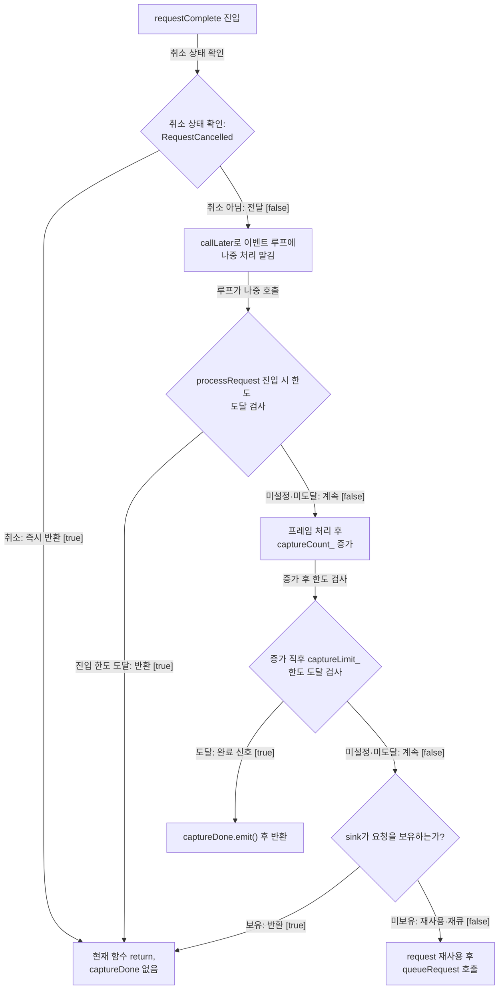
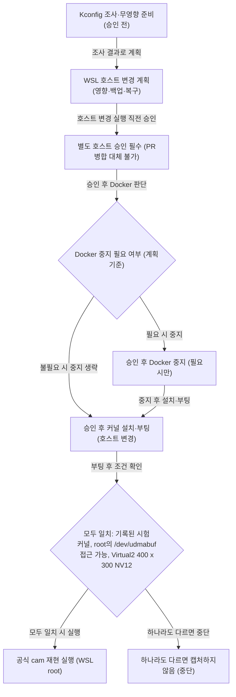

# WSL 공식 cam 가상 캡처 확인

**가상 캡처가 막힌 지점부터 확인하고, 완료 알림이 프레임 처리로 이어지는 경로를 따라가세요.**

| 지금 확인할 내용 | 이동할 절 |
|---|---|
| 이번 기준 재현에서 기본 WSL 커널은 DMA-BUF 할당기를 노출하지 않아 공식 cam이 버퍼를 할당하지 못했습니다. | [할당기를 준비하자 공식 cam 캡처가 완료됐습니다](#할당기를-준비하자-공식-cam-캡처가-완료됐습니다) |
| 완료 알림(`requestComplete`)은 프레임 후속 처리(`processRequest`)와 다른 단계입니다. | [cam이 완료 알림을 받아 이벤트 루프에서 프레임을 처리합니다.](#cam이-완료-알림을-받아-이벤트-루프에서-프레임을-처리합니다) |
| 호스트 상태를 바꾸지 않고 선택한 커널의 `CONFIG_UDMABUF`·의존 심볼과 실제 모듈, 할당기 후보를 조사합니다. | [지원 커널과 장치 접근을 확인한 뒤 재현합니다](#지원-커널과-장치-접근을-확인한-뒤-재현합니다) |

## 할당기를 준비하자 공식 cam 캡처가 완료됐습니다

**가상 시험 구성입니다. 실제 제품의 지원·성능 주장으로 사용하지 마세요.**

이번 기준 재현에서 기본 WSL 커널은 DMA-BUF 할당기를 노출하지 않아 공식 cam이 버퍼를 할당하지 못했습니다. `product-evidence/libcamera-official-cam-trial/reproduction-procedure.txt:1`, `product-evidence/libcamera-official-cam-trial/official-cam-reader.txt:1`

소스 293d751a를 수정하지 않은 공식 cam이 WSL2 시험 커널에서 Virtual2 400x300 NV12 가상 카메라 구성으로 세 개의 독립 프로세스에서 각각 실행되었습니다. 각 실행에서 3프레임 정상 완료와 udmabuf 할당 성공이 관측되었고, 별도 DMA-BUF 프로브의 CPU 접근 성공은 이 cam 할당 관찰과 구분되어 기록되었습니다. 시험은 기본 커널로 원복된 상태로 마쳐져, 현재 상태에서는 이 구성을 그대로 재실행할 수 없습니다. `product-evidence/libcamera-official-cam-trial/official-cam-reader.txt:1`, `product-evidence/libcamera-official-cam-trial/reproduction-procedure.txt:1`

근거 원문: [product-evidence/libcamera-official-cam-trial/execution-contract.txt:1](#source-6722470b9620a771) · [product-evidence/libcamera-official-cam-trial/official-cam-reader.txt:1](#source-d84e6ca3abcfec11) · [product-evidence/libcamera-official-cam-trial/reproduction-procedure.txt:1](#source-10812730226e86cc)

## cam이 완료 알림을 받아 이벤트 루프에서 프레임을 처리합니다.

**가상 시험 구성입니다. 실제 제품의 지원·성능 주장으로 사용하지 마세요.**

완료 알림(`requestComplete`)은 프레임 후속 처리(`processRequest`)와 다른 단계입니다. `requestComplete`는 요청 상태가 `Request::RequestCancelled`이면 바로 반환하고, 그 밖에는 `callLater`로 `processRequest`를 이벤트 루프에 미룹니다. 주석은 이 지연이 카메라 매니저 스레드를 막지 않기 위한 것이라고 밝힙니다. `src/apps/cam/camera_session.cpp:458`

<!-- sdd:visual:completion-flow -->
### 완료 알림에서 후속 처리까지



[Mermaid 원문](official-cam-validation.completion-flow.mmd)

??? note "그림 근거와 확인 범위"
    취소 반환, 이벤트 루프 전달, 진입 한도 검사, 프레임 처리·증가 뒤 완료 신호 또는 재큐까지는 어떻게 이어집니까?
    
    소스에 연결한 설계 해석입니다. 자동 연결 검사는 의미 승인이나 기기 실행 검증이 아닙니다.
    
    LLM 그림 초안 · 사람 검토 전
    
    작성 모델: `cli/claude/claude-haiku-5-5`
    
    | 요소·전이 | 소스 근거 |
    |---|---|
    | requestComplete 진입 | [src/apps/cam/camera_session.cpp:458](#source-6b5bd0b09b7f63ff) |
    | 취소 상태 확인: RequestCancelled | [src/apps/cam/camera_session.cpp:458](#source-6b5bd0b09b7f63ff) |
    | 현재 함수 return, captureDone 없음 | [src/apps/cam/camera_session.cpp:458](#source-6b5bd0b09b7f63ff) |
    | callLater로 이벤트 루프에 나중 처리 맡김 | [src/apps/cam/camera_session.cpp:458](#source-6b5bd0b09b7f63ff) |
    | processRequest 진입 시 한도 도달 검사 | [src/apps/cam/camera_session.cpp:458](#source-6b5bd0b09b7f63ff) |
    | 프레임 처리 후 captureCount_ 증가 | [src/apps/cam/camera_session.cpp:458](#source-6b5bd0b09b7f63ff) |
    | 증가 직후 captureLimit_ 한도 도달 검사 | [src/apps/cam/camera_session.cpp:458](#source-6b5bd0b09b7f63ff) |
    | captureDone.emit() 후 반환 | [src/apps/cam/camera_session.cpp:458](#source-6b5bd0b09b7f63ff) |
    | sink가 요청을 보유하는가? | [src/apps/cam/camera_session.cpp:458](#source-6b5bd0b09b7f63ff) |
    | request 재사용 후 queueRequest 호출 | [src/apps/cam/camera_session.cpp:458](#source-6b5bd0b09b7f63ff) |
    | 취소 상태 확인 | [src/apps/cam/camera_session.cpp:458](#source-6b5bd0b09b7f63ff) |
    | 취소: 즉시 반환 · request-&gt;status() == Request::RequestCancelled [true] | [src/apps/cam/camera_session.cpp:458](#source-6b5bd0b09b7f63ff) |
    | 취소 아님: 전달 · request-&gt;status() == Request::RequestCancelled [false] | [src/apps/cam/camera_session.cpp:458](#source-6b5bd0b09b7f63ff) |
    | 루프가 나중 호출 | [src/apps/cam/camera_session.cpp:458](#source-6b5bd0b09b7f63ff) |
    | 진입 한도 도달: 반환 · captureLimit_ &amp;&amp; captureCount_ &gt;= captureLimit_ [true] | [src/apps/cam/camera_session.cpp:458](#source-6b5bd0b09b7f63ff) |
    | 미설정·미도달: 계속 · captureLimit_ &amp;&amp; captureCount_ &gt;= captureLimit_ [false] | [src/apps/cam/camera_session.cpp:458](#source-6b5bd0b09b7f63ff) |
    | 증가 후 한도 검사 | [src/apps/cam/camera_session.cpp:458](#source-6b5bd0b09b7f63ff) |
    | 도달: 완료 신호 · captureLimit_ &amp;&amp; captureCount_ &gt;= captureLimit_ [true] | [src/apps/cam/camera_session.cpp:458](#source-6b5bd0b09b7f63ff) |
    | 미설정·미도달: 계속 · captureLimit_ &amp;&amp; captureCount_ &gt;= captureLimit_ [false] | [src/apps/cam/camera_session.cpp:458](#source-6b5bd0b09b7f63ff) |
    | 보유: 반환 · !requeue [true] | [src/apps/cam/camera_session.cpp:458](#source-6b5bd0b09b7f63ff) |
    | 미보유: 재사용·재큐 · !requeue [false] | [src/apps/cam/camera_session.cpp:458](#source-6b5bd0b09b7f63ff) |
<!-- /sdd:visual:completion-flow -->

`processRequest`는 진입 시 캡처 한도가 설정되어 있고 캡처 개수가 한도에 도달했으면 바로 반환합니다. 그렇지 않으면 프레임을 처리하고, 처리를 마친 다음 캡처 개수를 1 늘립니다. 늘린 개수가 설정된 한도에 도달하면 `captureDone` 신호를 내고 반환합니다. `src/apps/cam/camera_session.cpp:458`

이번 실행에서는 콜백(`requestComplete`)과 후속 처리(`processRequest`)가 서로 다른 스레드에서 관측되었지만, 이것이 모든 실행의 스레드 배치를 보장하지는 않습니다. `requestComplete`의 취소 분기(`Request::RequestCancelled`)는 소스에 존재하지만, 이번 실행에서는 동적으로 시험하지 않았습니다. `src/apps/cam/camera_session.cpp:458`, `product-evidence/libcamera-official-cam-trial/official-cam-reader.txt:1`

근거 원문: [src/apps/cam/camera_session.cpp:458](#source-6b5bd0b09b7f63ff) · [product-evidence/libcamera-official-cam-trial/execution-contract.txt:1](#source-6722470b9620a771) · [product-evidence/libcamera-official-cam-trial/official-cam-reader.txt:1](#source-d84e6ca3abcfec11) · [product-evidence/libcamera-official-cam-trial/reproduction-procedure.txt:1](#source-10812730226e86cc)

## 지원 커널과 장치 접근을 확인한 뒤 재현합니다

**가상 시험 구성입니다. 실제 제품의 지원·성능 주장으로 사용하지 마세요.**

1. 호스트 상태를 바꾸지 않고 선택한 커널의 `CONFIG_UDMABUF`·의존 심볼과 실제 모듈, 할당기 후보를 조사합니다. `/dev/udmabuf` 접근 권한은 4단계에서 확인합니다. 기존 WSL/Docker에 영향이 없는 준비를 우선하며, 배포판을 추가하는 것만으로 커널이 격리된다고 보지 않습니다. `product-evidence/libcamera-official-cam-trial/reproduction-procedure.txt:1`, `product-evidence/libcamera-official-cam-trial/execution-contract.txt:1`

2. 공유 커널·모듈·.wslconfig 변경이나 배포판·VM 종료가 필요하면 영향·백업·복구 계획을 작성하고, 호스트 변경을 실행하기 직전에 별도 승인을 받습니다. PR 병합·Pages 승인은 이 승인을 대신하지 않습니다. Docker는 승인된 계획이 Docker 중지를 요구하는 경우에만 중지합니다. `product-evidence/libcamera-official-cam-trial/reproduction-procedure.txt:1`, `product-evidence/libcamera-official-cam-trial/execution-contract.txt:1`

3. 호스트 변경 계획에 대한 별도 승인을 받은 뒤에만 기록된 시험 커널 `6.18.33.2-microsoft-standard-WSL2-issue211`을 설치하고 부팅합니다. 부팅 후 실행 중인 커널 버전을 이 기록과 대조하며, 커널이 다르면 재현하는 개발자는 캡처를 진행하지 않습니다. `product-evidence/libcamera-official-cam-trial/reproduction-procedure.txt:1`, `product-evidence/libcamera-official-cam-trial/execution-contract.txt:1`

4. 기록된 root 컨텍스트에서 `/dev/udmabuf` 접근과 Virtual2 400x300 NV12 구성을 확인한 뒤, 재현 안내 문서의 명령에 따라 수정하지 않은 공식 `cam` 디버그 빌드를 실행하고 관찰 도구로 그 실행을 관찰합니다. 커널, `/dev/udmabuf` 접근, 구성 중 하나라도 다르면 개발자는 캡처하지 않습니다. 이번 시험에서 `/dev/udmabuf` 권한은 바꾸지 않고 root 전용 그대로 두었습니다. `product-evidence/libcamera-official-cam-trial/execution-contract.txt:1`, `product-evidence/libcamera-official-cam-trial/official-cam-reader.txt:1`, `product-evidence/libcamera-official-cam-trial/reproduction-procedure.txt:1`

<!-- sdd:visual:reproduction-flow -->
### 환경 확인에서 재현 실행까지



[Mermaid 원문](official-cam-validation.reproduction-flow.mmd)

??? note "그림 근거와 확인 범위"
    기록된 재현 절차에서 현재 환경 조사, 필요한 공유 호스트 변경의 별도 승인, 지원 커널 부팅과 장치 접근 확인, 공식 cam 재현 실행은 어떤 준비 순서로 이어집니까?
    
    소스에 연결한 설계 해석입니다. 자동 연결 검사는 의미 승인이나 기기 실행 검증이 아닙니다.
    
    LLM 그림 초안 · 사람 검토 전
    
    작성 모델: `cli/claude/claude-haiku-5-5`
    
    | 요소·전이 | 소스 근거 |
    |---|---|
    | Kconfig 조사·무영향 준비 (승인 전) | [product-evidence/libcamera-official-cam-trial/execution-contract.txt:1](#source-6722470b9620a771) · [product-evidence/libcamera-official-cam-trial/reproduction-procedure.txt:1](#source-10812730226e86cc) |
    | WSL 호스트 변경 계획 (영향·백업·복구) | [product-evidence/libcamera-official-cam-trial/reproduction-procedure.txt:1](#source-10812730226e86cc) · [product-evidence/libcamera-official-cam-trial/execution-contract.txt:1](#source-6722470b9620a771) |
    | 별도 호스트 승인 필수 (PR 병합 대체 불가) | [product-evidence/libcamera-official-cam-trial/execution-contract.txt:1](#source-6722470b9620a771) · [product-evidence/libcamera-official-cam-trial/reproduction-procedure.txt:1](#source-10812730226e86cc) |
    | Docker 중지 필요 여부 (계획 기준) | [product-evidence/libcamera-official-cam-trial/reproduction-procedure.txt:1](#source-10812730226e86cc) |
    | 승인 후 Docker 중지 (필요 시만) | [product-evidence/libcamera-official-cam-trial/reproduction-procedure.txt:1](#source-10812730226e86cc) |
    | 승인 후 커널 설치·부팅 (호스트 변경) | [product-evidence/libcamera-official-cam-trial/reproduction-procedure.txt:1](#source-10812730226e86cc) |
    | 모두 일치: 기록된 시험 커널, root의 /dev/udmabuf 접근 가능, Virtual2 400 x 300 NV12 | [product-evidence/libcamera-official-cam-trial/reproduction-procedure.txt:1](#source-10812730226e86cc) |
    | 공식 cam 재현 실행 (WSL root) | [product-evidence/libcamera-official-cam-trial/reproduction-procedure.txt:1](#source-10812730226e86cc) |
    | 하나라도 다르면 캡처하지 않음 (중단) | [product-evidence/libcamera-official-cam-trial/reproduction-procedure.txt:1](#source-10812730226e86cc) |
    | 조사 결과로 계획 | [product-evidence/libcamera-official-cam-trial/execution-contract.txt:1](#source-6722470b9620a771) · [product-evidence/libcamera-official-cam-trial/reproduction-procedure.txt:1](#source-10812730226e86cc) |
    | 호스트 변경 실행 직전 승인 | [product-evidence/libcamera-official-cam-trial/reproduction-procedure.txt:1](#source-10812730226e86cc) · [product-evidence/libcamera-official-cam-trial/execution-contract.txt:1](#source-6722470b9620a771) |
    | 승인 후 Docker 판단 | [product-evidence/libcamera-official-cam-trial/reproduction-procedure.txt:1](#source-10812730226e86cc) |
    | 필요 시 중지 | [product-evidence/libcamera-official-cam-trial/reproduction-procedure.txt:1](#source-10812730226e86cc) |
    | 불필요 시 중지 생략 | [product-evidence/libcamera-official-cam-trial/reproduction-procedure.txt:1](#source-10812730226e86cc) |
    | 중지 후 설치·부팅 | [product-evidence/libcamera-official-cam-trial/reproduction-procedure.txt:1](#source-10812730226e86cc) |
    | 부팅 후 조건 확인 | [product-evidence/libcamera-official-cam-trial/reproduction-procedure.txt:1](#source-10812730226e86cc) |
    | 모두 일치 시 실행 | [product-evidence/libcamera-official-cam-trial/reproduction-procedure.txt:1](#source-10812730226e86cc) |
    | 하나라도 다르면 중단 | [product-evidence/libcamera-official-cam-trial/reproduction-procedure.txt:1](#source-10812730226e86cc) |
<!-- /sdd:visual:reproduction-flow -->

실행 확인 항목: 이 결과는 시뮬레이션으로 구성된 WSL2 가상 카메라 시험 범위에만 적용됩니다. 물리 DMA, 물리 카메라, 제품 앱, 사내 HAL은 미검증이며, GDB는 타이밍에 영향을 주므로 콜백 반환 명령과 성능을 검증하지 않았습니다. `product-evidence/libcamera-official-cam-trial/reproduction-procedure.txt:1`, `product-evidence/libcamera-official-cam-trial/official-cam-reader.txt:1`

근거 원문: [product-evidence/libcamera-official-cam-trial/execution-contract.txt:1](#source-6722470b9620a771) · [product-evidence/libcamera-official-cam-trial/official-cam-reader.txt:1](#source-d84e6ca3abcfec11) · [product-evidence/libcamera-official-cam-trial/reproduction-procedure.txt:1](#source-10812730226e86cc)

??? note "설계 질문과 검증 범위"
    질문별 답변과 근거 연결을 검사했습니다. 의미와 실행 결과는 사람 검토가 필요합니다.
    
    | 설계 질문 | 설명 위치 | 확인 범위 |
    |---|---|---|
    | 무엇이 캡처를 막았고, 어떤 조건에서 공식 cam 캡처가 성공했으며, 현재 바로 재실행할 수 있습니까? | [할당기를 준비하자 공식 cam 캡처가 완료됐습니다](#할당기를-준비하자-공식-cam-캡처가-완료됐습니다) | 코드 근거와 설명 연결 |
    | 완료 알림을 받은 함수가 왜 후속 처리를 이벤트 루프로 미루며, 정상 요청과 취소 요청은 어떻게 나뉩니까? | [cam이 완료 알림을 받아 이벤트 루프에서 프레임을 처리합니다.](#cam이-완료-알림을-받아-이벤트-루프에서-프레임을-처리합니다) | 코드 근거와 설명 연결 |
    | 개발자는 캡처 전에 어떤 환경·권한·소스 조건을 확인하고, 어느 절차로 재현하며, 결과를 어디까지 적용할 수 있습니까? | [지원 커널과 장치 접근을 확인한 뒤 재현합니다](#지원-커널과-장치-접근을-확인한-뒤-재현합니다) | 코드 근거와 설명 연결 · 실행 확인 항목 별도 |

## 소스 근거

같은 발췌는 한 번만 싣습니다. 필요한 원문을 펼쳐 설명과 대조하세요.

<a id="source-6722470b9620a771"></a>

??? note "제품 자료: product-evidence/libcamera-official-cam-trial/execution-contract.txt:1"
    소스와 별도로 제공된 자료입니다. 제공자·버전·적용 범위를 아래 기록에서 확인하세요. 자동 검사는 사람 승인이 아닙니다.
    
    `product-evidence/libcamera-official-cam-trial/execution-contract.txt:1`에서 시작하는 발췌입니다. 종료 줄은 9이며, 아래 원문을 설명과 대조할 수 있습니다.
    
    SHA-256: `fe1292511ffbf64b3e2aaee046d28048675c0283b82187cfa421e0431c834e0d`
    
    ```text
    {
      "url": "https://github.com/TTolsun/camera-hal-sdd-generator/issues/211",
      "updated_at": "2026-10-31T06:00:33Z",
      "verbatim_contract_lines": [
        "1. 선택한 커널의 Kconfig·의존성·실제 사용 가능한 모듈·할당기 후보를 조사하고 하나를 선택합니다. 기존 WSL에 새 배포판을 추가하는 것만으로 커널이 격리된다고 취급하지 않습니다.",
        "2. 기존 WSL/Docker에 영향을 주지 않는 시험 환경을 우선합니다. 현재 호스트의 공유 커널·모듈·.wslconfig를 변경하거나 배포판/VM을 종료해야 하면 영향과 복구 절차를 먼저 구체화하고 실행 직전에 별도 승인을 받습니다. 기존 PR 병합·Pages 배포 승인을 이런 호스트 변경의 승인으로 확대하지 않습니다."
      ]
    }
    
    ```
    
    ```json
    {
      "type": "project-document",
      "supplier": "GitHub issue211 execution contract, verbatim selected lines",
      "version": "2026-10-31T06:00:33Z",
      "date": "2026-10-31",
      "valid_until": "2026-10-31",
      "product": "libcamera-official-cam-trial",
      "release": "293d751a814e0d4c34e85ad457ccd9d5eefd1a61",
      "configuration": "wsl2-virtual2-official-cam-udmabuf",
      "feature": "wsl-virtual-capture",
      "conditions": [
        "Source 293d751a814e0d4c34e85ad457ccd9d5eefd1a61",
        "WSL2 custom UDMABUF kernel, root child, Virtual2 400x300 NV12",
        "GDB observation; no timing/return/physical/internal HAL qualification"
      ],
      "sha256": "fe1292511ffbf64b3e2aaee046d28048675c0283b82187cfa421e0431c834e0d"
    }
    ```

<a id="source-d84e6ca3abcfec11"></a>

??? note "제품 자료: product-evidence/libcamera-official-cam-trial/official-cam-reader.txt:1"
    소스와 별도로 제공된 자료입니다. 제공자·버전·적용 범위를 아래 기록에서 확인하세요. 자동 검사는 사람 승인이 아닙니다.
    
    `product-evidence/libcamera-official-cam-trial/official-cam-reader.txt:1`에서 시작하는 발췌입니다. 종료 줄은 249이며, 아래 원문을 설명과 대조할 수 있습니다.
    
    SHA-256: `6ad6510d9624cd8075ccdc0a4622214c441afc5a778a2e577b4c7a76bf10efc0`
    
    ```text
    {
      "schema": 1,
      "source_commit": "293d751a814e0d4c34e85ad457ccd9d5eefd1a61",
      "camera": "Virtual2",
      "applied_configuration": "(0) 400x300-NV12/SMPTE170M",
      "status": "observed-wsl-virtual-only",
      "kernel": "6.18.33.2-microsoft-standard-WSL2-issue211",
      "results": [
        {
          "completed_frames": 3,
          "cancelled_callbacks": 0,
          "observed_tids": [
            434,
            437
          ],
          "successful_buffer_sequences": [
            0,
            1,
            2
          ],
          "pid": 434,
          "allocations": 4
        },
        {
          "completed_frames": 3,
          "cancelled_callbacks": 0,
          "observed_tids": [
            449,
            452
          ],
          "successful_buffer_sequences": [
            0,
            1,
            2
          ],
          "pid": 449,
          "allocations": 4
        },
        {
          "completed_frames": 3,
          "cancelled_callbacks": 0,
          "observed_tids": [
            464,
            467
          ],
          "successful_buffer_sequences": [
            0,
            1,
            2
          ],
          "pid": 464,
          "allocations": 4
        }
      ],
      "source_unmodified": true,
      "allocator": "udmabuf built-in, /dev/udmabuf root-only; permissions unchanged",
      "run_threads": [
        {
          "pid": 434,
          "callbacks": [
            437
          ],
          "processed": [
            434
          ]
        },
        {
          "pid": 449,
          "callbacks": [
            452
          ],
          "processed": [
            449
          ]
        },
        {
          "pid": 464,
          "callbacks": [
            467
          ],
          "processed": [
            464
          ]
        }
      ],
      "inferior_exit_codes": [
        0,
        0,
        0
      ],
      "processed_sequences": [
        [
          0,
          1,
          2
        ],
        [
          0,
          1,
          2
        ],
        [
          0,
          1,
          2
        ]
      ],
      "dma_probe_events": [
        {
          "event": "provider-open",
          "provider": "/dev/udmabuf",
          "result": 3,
          "errno": 0
        },
        {
          "event": "allocate",
          "result": 5,
          "errno": 0,
          "backing_fd": 4,
          "dmabuf_fd": 5,
          "size": 4096
        },
        {
          "event": "mmap",
          "result": 0,
          "errno": 0
        },
        {
          "event": "sync-start",
          "result": 0,
          "errno": 0,
          "flags": 3,
          "retry": false
        },
        {
          "event": "cpu-access",
          "result": 0,
          "errno": 0,
          "bytes": 4096,
          "checksum": 522240
        },
        {
          "event": "sync-end",
          "result": 0,
          "errno": 0,
          "flags": 7,
          "retry": false
        },
        {
          "event": "munmap",
          "result": 0,
          "errno": 0
        },
        {
          "event": "close-dmabuf",
          "result": 0,
          "errno": 0
        },
        {
          "event": "close-backing",
          "result": 0,
          "errno": 0
        },
        {
          "event": "close-provider",
          "result": 0,
          "errno": 0
        }
      ],
      "pretrial_kernel": "6.18.33.2-microsoft-standard-WSL2",
      "pretrial_udmabuf": false,
      "pretrial_dmabuf_heaps": false,
      "pretrial_provider_devices_present": false,
      "kernel_trial_authorized_by_user": true,
      "restored_kernel": "6.18.33.2-microsoft-standard-WSL2",
      "restored_wslconfig_exists": false,
      "matching_modules_installed": false,
      "docker_during_trial": "stopped",
      "unprivileged_run": {
        "status": "failed",
        "errno": 13
      },
      "observation_limits": [
        "GDB breakpoints affect timing",
        "No callback-return instruction observation",
        "Cancellation branch not dynamically exercised; observed count 0 is not forced"
      ],
      "physical_dma": "not-validated",
      "physical_camera": "not-run",
      "production_application": "not-run",
      "internal_hal": "not-run",
      "human_review": "pending",
      "raw_evidence": "https://github.com/TTolsun/camera-hal-sdd-generator/tree/main/examples/libcamera/validation/issue211/runs/20261031-wsl-cam-3",
      "official_allocator_observations": [
        {
          "pid": 434,
          "successful_allocations": 4,
          "providers": [
            "/dev/udmabuf"
          ],
          "exporters": [
            "udmabuf"
          ],
          "raw_sha256": "bfc0215112bb3a7e30cf66e2ce016dbcc3bd1ad7f7d3ba79d14c868d29417bd2"
        },
        {
          "pid": 449,
          "successful_allocations": 4,
          "providers": [
            "/dev/udmabuf"
          ],
          "exporters": [
            "udmabuf"
          ],
          "raw_sha256": "0529146d43e1f826240fa9790545e81b69b274dca8173d9da598add516320727"
        },
        {
          "pid": 464,
          "successful_allocations": 4,
          "providers": [
            "/dev/udmabuf"
          ],
          "exporters": [
            "udmabuf"
          ],
          "raw_sha256": "38433db15aa2928b1e6fe0f54293fd3b4ee34eb1b9b9d5e5b10526c89605d46a"
        }
      ],
      "baseline_capture": {
        "inferior_exit": {
          "exit_code": 1,
          "observation_failures": []
        },
        "errors": [
          "[0:07:17.247127806] [20972] ERROR DmaBufAllocator dma_buf_allocator.cpp:119 Could not open any dma-buf provider",
          "[0:07:17.258236285] [20972] ERROR DmaBufAllocator dma_buf_allocator.cpp:119 Could not open any dma-buf provider",
          "Can't allocate buffers"
        ],
        "stdout_sha256": "2432d60d69ed6e496a45df1c3edac64e9296b1c77f5054a60aa9d40a75ae5bd1",
        "stderr_sha256": "cdcfbb0f7b1d46f55b30b94e7a1de119dfcfb7ab937fbb18cda4be9397e8e32a",
        "raw_url": "https://github.com/TTolsun/camera-hal-sdd-generator/tree/580df5156da7066a60e16ff9b656253b1c17f0c0/examples/libcamera/validation/issue211/runs/20261031-runtime-negative/official-cam-debugger-before"
      },
      "source_measurement": {
        "sha256": "6724319768e46327e26f324d536ccaf22e9b71852e055a7b3c91318f0c11a7f1",
        "url": "https://github.com/TTolsun/libcamera-sdd/blob/d36affef9b3a741581d1c5f0f4cd68425c5dbe15/publication/issue211/config/product-evidence/official-cam-observation.json",
        "operation": "Exact projection of named original fields, no new runtime execution"
      }
    }
    
    ```
    
    ```json
    {
      "type": "measurement",
      "supplier": "Source-pinned official cam trial; raw events, GDB, syscall and cleanup records",
      "version": "6724319768e46327e26f324d536ccaf22e9b71852e055a7b3c91318f0c11a7f1",
      "date": "2026-10-31",
      "valid_until": "2026-10-31",
      "product": "libcamera-official-cam-trial",
      "release": "293d751a814e0d4c34e85ad457ccd9d5eefd1a61",
      "configuration": "wsl2-virtual2-official-cam-udmabuf",
      "feature": "wsl-virtual-capture",
      "conditions": [
        "Source 293d751a814e0d4c34e85ad457ccd9d5eefd1a61",
        "WSL2 custom UDMABUF kernel, root child, Virtual2 400x300 NV12",
        "GDB observation; no timing/return/physical/internal HAL qualification"
      ],
      "sha256": "6ad6510d9624cd8075ccdc0a4622214c441afc5a778a2e577b4c7a76bf10efc0"
    }
    ```

<a id="source-10812730226e86cc"></a>

??? note "제품 자료: product-evidence/libcamera-official-cam-trial/reproduction-procedure.txt:1"
    소스와 별도로 제공된 자료입니다. 제공자·버전·적용 범위를 아래 기록에서 확인하세요. 자동 검사는 사람 승인이 아닙니다.
    
    `product-evidence/libcamera-official-cam-trial/reproduction-procedure.txt:1`에서 시작하는 발췌입니다. 종료 줄은 38이며, 아래 원문을 설명과 대조할 수 있습니다.
    
    SHA-256: `93f4c8ea45fc873453b7739b88105877f6b1bc60ed7f3f6a280b15d8b131a9a7`
    
    ````text
    # 공식 cam WSL 가상 카메라 검증
    
    ## 결론과 다음 행동
    
    먼저 아래 준비 1번부터 시작합니다. 호스트 승인 전에는 Docker를 중지하거나 WSL을 종료하지 않습니다.
    
    ## 관측된 결과
    
    소스 `293d751a814e0d4c34e85ad457ccd9d5eefd1a61`을 수정하지 않은 디버그 빌드의 공식 cam은 시험 커널 `6.18.33.2-microsoft-standard-WSL2-issue211`의 WSL `Virtual2` 카메라(400x300 NV12)에서 프레임 3개를 처리했습니다. 실행 세 개(PID 434, 449, 464)는 모두 request와 sequence 0~2에서 status 1, buffer_status 0을 기록했습니다.
    
    세 기록은 PID, request, sequence로 묶어 status를 비교합니다. 콜백 TID(437, 452, 467)와 처리 TID(434, 449, 464)는 실행마다 달랐으므로 같아야 하는 키가 아니라 속성으로 기록합니다.
    
    DMA 프로브는 `/dev/udmabuf` 열기, 4096바이트 할당, mmap, RW START(flags 3), CPU 접근, RW END(flags 7), munmap과 닫기를 모두 errno 0으로 마쳤습니다. 0.5초 시간 초과 시험은 시간 초과(exit 1)로 끝났고, 정리 반환 코드는 모두 0이었습니다. 반환 코드 0은 정리가 성공했다는 뜻이며, 정리 이벤트가 0개라는 뜻이 아닙니다. 없는 provider는 errno 2, 지원하지 않는 ioctl은 errno 25로 실패했습니다.
    
    `cancelled_callbacks` 0은 세 실행 모두에서 관측된 값입니다. 다만 취소 분기를 동적으로 실행한 결과가 아니며, 0으로 강제한 값도 아닙니다.
    
    ## 범위와 한계
    
    이 결과는 `simulation=true`로 로드된 가상 파이프라인 시뮬레이션 구성의 WSL 가상 카메라 범위에만 해당합니다. 시험 커널에서 성공했다고 해서 복구된 기본 커널(`6.18.33.2-microsoft-standard-WSL2`)이 지원한다는 뜻은 아닙니다. 기본 커널은 allocator를 노출하지 않았습니다. 시험 커널에서는 udmabuf이 내장이었고, 일치하는 모듈은 설치하지 않았습니다.
    
    권한 없는 실행의 errno 13은 이번 시험 커널 실행에만 해당하며, 앞으로 모든 권한 없는 실행을 뜻하지 않습니다. `/dev/udmabuf` 권한은 root 전용 그대로 두었습니다. 복구 후 커널은 기본 커널로 돌아왔고 `.wslconfig`는 존재하지 않습니다.
    
    GDB 중단점은 타이밍에 영향을 주므로 콜백 반환이나 타이밍·성능을 확정하는 증거가 아닙니다. 물리 DMA, 물리 카메라, 제품 앱, 사내 HAL은 검증하지 않았고, 사람 검토는 pending 상태입니다.
    
    ## 실행 전 준비
    
    1. 호스트 상태를 바꾸지 않고 커널을 조사합니다. 커널 태그 `linux-msft-wsl-6.18.33.2`(commit `c21a03b2943d147c280bdf32530d4fe6badfd6bd`, 이미지 SHA-256 `cf23bf492a00a5c7517e221b0d8f742ea3cffa9351823191a5ba5c476ba15460`)의 `CONFIG_UDMABUF`, `CONFIG_DMA_SHARED_BUFFER`, `CONFIG_MEMFD_CREATE`(또는 `CONFIG_COMPILE_TEST`), `CONFIG_MMU`, 할당기 후보 `CONFIG_DMABUF_HEAPS`를 확인합니다. `CONFIG_UDMABUF`는 bool이므로 모듈이 아니라 내장 여부만 확인하고, 실제 사용 가능한 모듈과 할당기 후보를 조사한 뒤 사용할 할당기를 하나 선택합니다. `CONFIG_UDMABUF`는 테스트·디버그 용도의 기능이며, 잘못 사용하면 사용자 공간에서 커널 드라이버를 교착시킬 수 있으므로 시험 환경 밖에서 사용하지 않습니다. 기존 WSL에 배포판을 추가하는 것만으로 커널이 격리된다고 보지 않습니다. 커널 빌드 예시는 [prepare_kernel.sh](../validation/issue211/prepare_kernel.sh)이며, 실행 전 태그와 출력 위치를 확인합니다. 이 예시와 [prepare_runtime.sh](../validation/issue211/prepare_runtime.sh)는 기록된 예시이므로 로컬 경로와 설정을 현재 환경에서 다시 확인해야 하며, 실행 전 각 스크립트의 실제 동작과 입력을 직접 읽어 확인합니다. 이 예시들은 커널을 설치하거나 부팅하지 않으며, 설치와 부팅은 2단계 계획과 승인 뒤에만 수행합니다.
    2. 기존 WSL·Docker에 영향을 주지 않는 시험 환경을 먼저 검토합니다. 공유 커널 모듈 변경, 공유 커널 재부팅, `.wslconfig` 변경, 배포판 또는 VM 종료, Docker 중지가 필요하면 영향, 정확한 백업 경로, 부팅할 커널과 이미지 SHA-256, 부팅 절차, 복구 절차를 포함한 호스트 변경 계획을 작성합니다. 복구 기준은 이번 시험 복구 후 확인된 기본 커널 `6.18.33.2-microsoft-standard-WSL2`와 `.wslconfig` 부재 상태입니다. 이 계획은 PR 병합·Pages 배포 승인으로 대신하지 않으며, 실행 직전에 별도 호스트 승인을 받습니다. 승인 전에는 Docker를 중지하거나 WSL을 종료하지 않습니다.
    3. 호스트 승인 후 승인된 계획의 각 단계를 하나씩 수행합니다. 계획이 Docker 중지를 요구하는 환경이면 승인 후 Docker를 중지하고, 그 다음에 공유 커널을 재부팅합니다. Docker 중지가 필요 없으면 이 단계를 생략합니다. 커널 준비는 영향 없는 단계부터 진행하며, 준비 절차는 1단계 예시와 2단계 계획을 따릅니다. 선택한 커널과 할당기가 실제로 요구하는 모듈은 1단계에서 확인해 계획에 포함합니다. 이번 기록된 시험에서 일치하는 모듈을 설치하지 않은 것은 그 시험의 사실이며, 이후 모든 준비를 금지하지 않습니다. `kernel_trial.py`는 자동으로 실행하지 않습니다.
    4. 실행 중인 커널이 `6.18.33.2-microsoft-standard-WSL2-issue211`인지, root가 `/dev/udmabuf`을 열 수 있는지 확인합니다. 하나라도 다르면 캡처하지 않습니다.
    5. WSL root 자식 컨텍스트에서 아래 명령을 실행합니다. `<new-evidence-directory>`는 존재하지 않는 경로여야 하며, 명령이 이 경로를 새로 만듭니다. 미리 빈 디렉터리를 만들지 않습니다. `<private-extracted-tools-prefix>`는 `usr/bin/gdb`와 `usr/share/gdb`를 포함하는 디렉터리입니다. `<compiled-dmabuf-probe>`는 `dmabuf_probe.c`를 `gcc -std=c11 -Wall -Wextra -Werror -O0 -g`로 컴파일한 결과입니다. `<unmodified-source-at-293d751a>`, `<its-debug-meson-build>`, `<private-extracted-tools-prefix>`, `<compiled-dmabuf-probe>`의 실제 경로는 현재 환경에서 확인해 채웁니다. [prepare_runtime.sh](../validation/issue211/prepare_runtime.sh) 예시가 가리키는 산출 위치는 참고만 하며, 실행 전 실제 존재와 293d751a 고정 여부를 확인합니다.
    
    ```
    PYTHONPATH=<generator>/src python3 <generator>/examples/libcamera/runtime/run_cam.py --source <unmodified-source-at-293d751a> --build <its-debug-meson-build> --tools <private-extracted-tools-prefix> --probe <compiled-dmabuf-probe> --out <new-evidence-directory>
    ```
    
    CPU 전용 과거 프로브는 [README.md](README.md)를, 원본 관측 기록은 [observation.json](../validation/issue211/runs/20261031-wsl-cam-3/observation.json)을 참고합니다.
    
    ````
    
    ```json
    {
      "type": "project-document",
      "supplier": "Source-pinned official cam trial; raw events, GDB, syscall and cleanup records",
      "version": "580df5156da7066a60e16ff9b656253b1c17f0c0",
      "date": "2026-10-31",
      "valid_until": "2026-10-31",
      "product": "libcamera-official-cam-trial",
      "release": "293d751a814e0d4c34e85ad457ccd9d5eefd1a61",
      "configuration": "wsl2-virtual2-official-cam-udmabuf",
      "feature": "wsl-virtual-capture",
      "conditions": [
        "Source 293d751a814e0d4c34e85ad457ccd9d5eefd1a61",
        "WSL2 custom UDMABUF kernel, root child, Virtual2 400x300 NV12",
        "GDB observation; no timing/return/physical/internal HAL qualification"
      ],
      "sha256": "93f4c8ea45fc873453b7739b88105877f6b1bc60ed7f3f6a280b15d8b131a9a7"
    }
    ```

<a id="source-6b5bd0b09b7f63ff"></a>

??? note "소스 근거: src/apps/cam/camera_session.cpp:458"
    `src/apps/cam/camera_session.cpp:458`에서 시작하는 발췌입니다. 종료 줄은 552이며, 아래 원문을 설명과 대조할 수 있습니다.
    
    SHA-256: `1cc65de3cbc313bb70f938f939d3d99420f17526290c216b538bbf117adbfd6d`
    
    ```text
    void CameraSession::requestComplete(Request *request)
    {
    	if (request->status() == Request::RequestCancelled)
    		return;
    
    	/*
    	 * Defer processing of the completed request to the event loop, to avoid
    	 * blocking the camera manager thread.
    	 */
    	EventLoop::instance()->callLater([this, request]() { processRequest(request); });
    }
    
    void CameraSession::processRequest(Request *request)
    {
    	/*
    	 * If we've reached the capture limit, we're done. This doesn't
    	 * duplicate the check below that emits the captureDone signal, as this
    	 * function will be called for each request still in flight after the
    	 * capture limit is reached and we don't want to emit the signal every
    	 * single time.
    	 */
    	if (captureLimit_ && captureCount_ >= captureLimit_)
    		return;
    
    	const Request::BufferMap &buffers = request->buffers();
    
    	/*
    	 * Compute the frame rate. The timestamp is arbitrarily retrieved from
    	 * the first buffer, as all buffers should have matching timestamps.
    	 */
    	uint64_t ts = buffers.begin()->second->metadata().timestamp;
    	double fps = ts - last_;
    	fps = last_ != 0 && fps ? 1000000000.0 / fps : 0.0;
    	last_ = ts;
    
    	bool requeue = true;
    
    	std::stringstream info;
    	info << ts / 1000000000 << "."
    	     << std::setw(6) << std::setfill('0') << ts / 1000 % 1000000
    	     << " (" << std::fixed << std::setprecision(2) << fps << " fps)";
    
    	for (const auto &[stream, buffer] : buffers) {
    		const FrameMetadata &metadata = buffer->metadata();
    
    		info << " " << streamNames_[stream]
    		     << " seq: " << std::setw(6) << std::setfill('0') << metadata.sequence
    		     << " bytesused: ";
    
    		unsigned int nplane = 0;
    		for (const FrameMetadata::Plane &plane : metadata.planes()) {
    			info << plane.bytesused;
    			if (++nplane < metadata.planes().size())
    				info << "/";
    		}
    	}
    
    	if (sink_) {
    		if (!sink_->processRequest(request))
    			requeue = false;
    	}
    
    	std::cout << info.str() << std::endl;
    
    	if (printMetadata_) {
    		const ControlList &requestMetadata = request->metadata();
    		for (const auto &[key, value] : requestMetadata) {
    			const ControlId *id = controls::controls.at(key);
    			std::cout << "\t" << id->name() << " = "
    				  << value.toString() << std::endl;
    		}
    	}
    
    	/*
    	 * Notify the user that capture is complete if the limit has just been
    	 * reached.
    	 */
    	captureCount_++;
    	if (captureLimit_ && captureCount_ >= captureLimit_) {
    		captureDone.emit();
    		return;
    	}
    
    	/*
    	 * If the frame sink holds on the request, we'll requeue it later in the
    	 * complete handler.
    	 */
    	if (!requeue)
    		return;
    
    	request->reuse(Request::ReuseBuffers);
    	queueRequest(request);
    }
    
    void CameraSession::sinkRelease(Request *request)
    ```

??? note "근거와 검토 정보"
    - 생성 방식: 추출 사실과 LLM 설명
    - 검증 범위: 표·그림은 facts로 만들고 설명은 LLM이 작성합니다. 인용·문장 및 설정된 구조 검사를 적용합니다.
    - 근거 파일: `product-evidence/libcamera-official-cam-trial/execution-contract.txt`, `product-evidence/libcamera-official-cam-trial/official-cam-reader.txt`, `product-evidence/libcamera-official-cam-trial/reproduction-procedure.txt`, `src/apps/cam/camera_session.cpp`
    - 근거 수준: 코드 확인 (정적 분석, simple_compdb 구성, commit `293d751a81`)
    - 자동 검사 (인용·문장 및 설정된 구조 검사): 통과
    - 검토 상태 기록일: 2026-10-31 · 사람 검토 전

다음 단계: [공식 cam 재현 절차](https://github.com/TTolsun/camera-hal-sdd-generator/blob/main/examples/libcamera/runtime/OFFICIAL_CAM.md)
