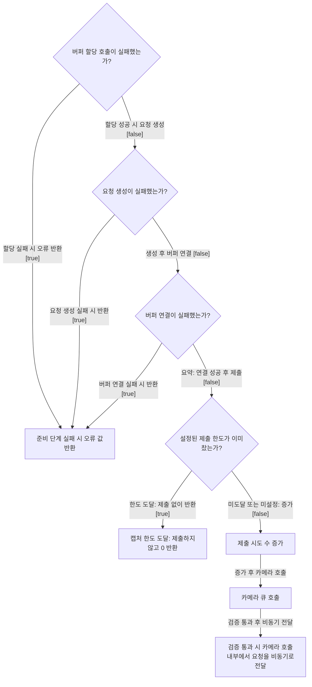
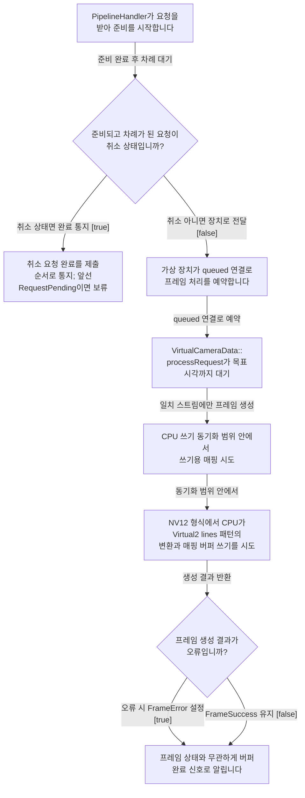
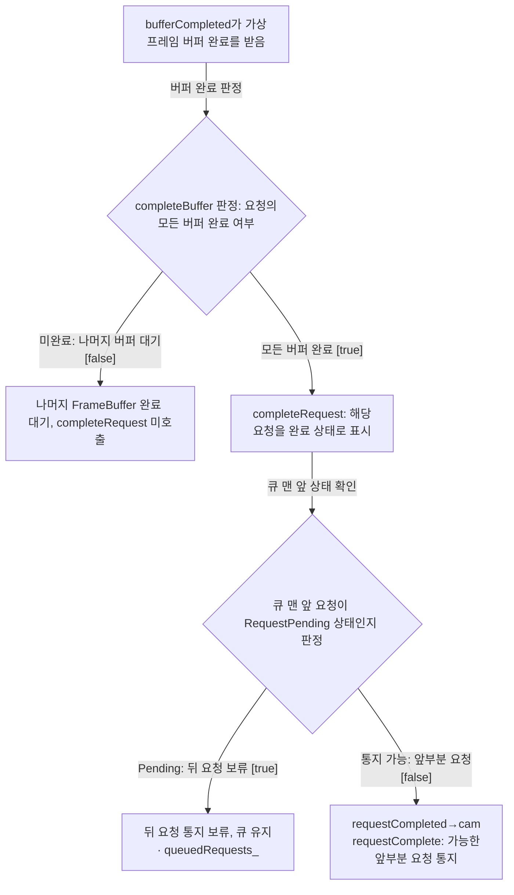
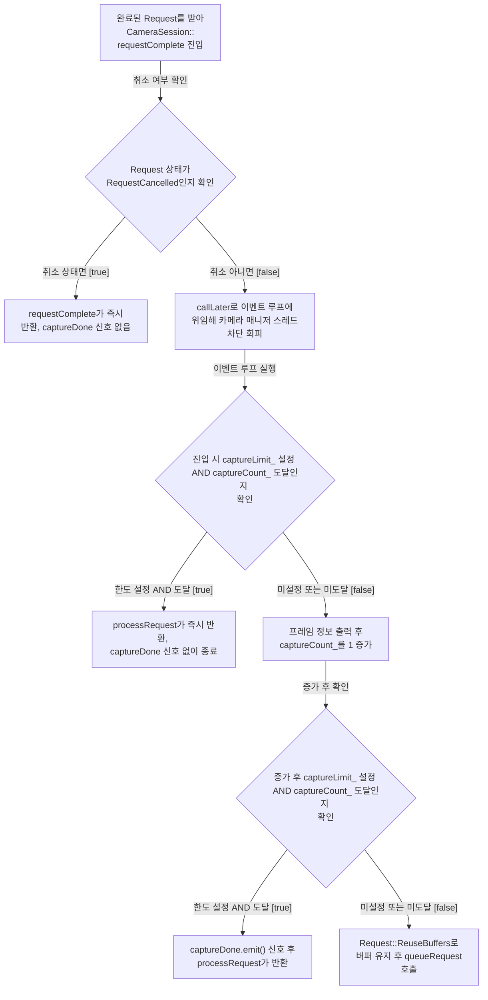
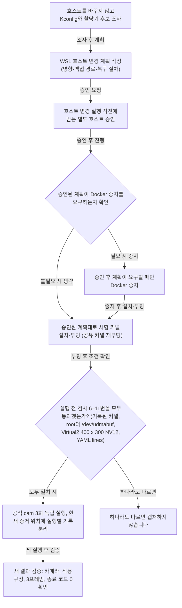

# WSL 공식 cam 가상 캡처 확인

**가상 캡처가 막힌 지점부터 확인하고, 완료 알림이 프레임 처리로 이어지는 경로를 따라가세요.**

| 지금 확인할 내용 | 이동할 절 |
|---|---|
| 이번 기준 재현에서 기본 WSL 커널은 DMA-BUF 할당기를 노출하지 않아 공식 cam이 버퍼를 할당하지 못했습니다. | [할당기를 준비하자 공식 cam 캡처가 완료됐습니다](#할당기를-준비하자-공식-cam-캡처가-완료됐습니다) |
| 고정 libcamera 소스에서 분석한 virtual 파이프라인 핸들러는 테스트용 가상 카메라를 흉내 내며, 실제 센서 대신 소프트웨어 테스트 패턴이나 이미지 입력을 영상으로 지원합니다. | [가상 파이프라인이 영상을 만들고 요청 완료를 알립니다](#가상-파이프라인이-영상을-만들고-요청-완료를-알립니다) |
| `CameraSession::requestComplete`는 요청 상태가 `Request::RequestCancelled`이면 아무 처리 없이 반환합니다. | [cam이 완료 알림을 받아 이벤트 루프에서 프레임을 처리합니다.](#cam이-완료-알림을-받아-이벤트-루프에서-프레임을-처리합니다) |
| 호스트 상태를 바꾸지 않고 사용할 커널의 Kconfig와 의존 조건을 조사합니다. | [지원 커널과 장치 접근을 확인한 뒤 재현합니다](#지원-커널과-장치-접근을-확인한-뒤-재현합니다) |

## 할당기를 준비하자 공식 cam 캡처가 완료됐습니다

**가상 시험 구성입니다. 실제 제품의 지원·성능 주장으로 사용하지 마세요.**

이번 기준 재현에서 기본 WSL 커널은 DMA-BUF 할당기를 노출하지 않아 공식 cam이 버퍼를 할당하지 못했습니다. `product-evidence/libcamera-official-cam-trial/reproduction-procedure.txt:1`, `product-evidence/libcamera-official-cam-trial/official-cam-reader.txt:1`

소스 293d751a를 수정하지 않은 공식 cam이 WSL2 시험 커널에서 Virtual2 400x300 NV12 가상 카메라 구성으로 세 개의 독립 프로세스에서 각각 실행되었습니다. 각 실행에서 3프레임 정상 완료와 udmabuf 할당 성공이 관측되었고, 별도 DMA-BUF 프로브의 CPU 접근 성공은 이 cam 할당 관찰과 구분되어 기록되었습니다. 시험은 기본 커널로 원복된 상태로 마쳐져, 현재 상태에서는 이 구성을 그대로 재실행할 수 없습니다. `product-evidence/libcamera-official-cam-trial/official-cam-reader.txt:1`, `product-evidence/libcamera-official-cam-trial/reproduction-procedure.txt:1`

근거 원문: [product-evidence/libcamera-official-cam-trial/execution-contract.txt:1](#source-6722470b9620a771) · [product-evidence/libcamera-official-cam-trial/official-cam-reader.txt:1](#source-d84e6ca3abcfec11) · [product-evidence/libcamera-official-cam-trial/reproduction-procedure.txt:1](#source-10812730226e86cc)

## 가상 파이프라인이 영상을 만들고 요청 완료를 알립니다

고정 libcamera 소스에서 분석한 virtual 파이프라인 핸들러는 테스트용 가상 카메라를 흉내 내며, 실제 센서 대신 소프트웨어 테스트 패턴이나 이미지 입력을 영상으로 지원합니다. 이번에 선택한 Virtual2 구성은 400x300 lines 패턴을 공급하는 사례이며, 이 구성 하나가 virtual 기능 전체를 정하지는 않습니다. 할당이 성공한 뒤 cam은 실제 DMA-BUF 버퍼를 요청에 붙여 요청 전달을 준비합니다. 소프트웨어 요청 처리에서 CPU가 NV12 변환과 매핑된 버퍼 쓰기를 함께 시도하는 경로입니다. `src/libcamera/pipeline/virtual/README.md:3`, `src/libcamera/pipeline/virtual/data/virtual.yaml:28`, `src/libcamera/framebuffer_allocator.cpp:86`, `src/libcamera/pipeline/virtual/virtual.cpp:356`, `src/apps/cam/camera_session.cpp:356`, `src/libcamera/pipeline/virtual/test_pattern_generator.cpp:47`

<!-- sdd:visual:submission-gate -->
### 초기 캡처 시작 시 DMA-BUF 요청 준비와 제출만 다룹니다.



[Mermaid 원문](official-cam-validation.submission-gate.mmd)

??? note "그림 근거와 확인 범위"
    초기 캡처를 시작할 때 버퍼·요청 준비와 실제 큐 제출을 거치는 조건은 무엇입니까?
    
    소스에 연결한 설계 해석입니다. 자동 연결 검사는 의미 승인이나 기기 실행 검증이 아닙니다.
    
    LLM 그림 초안 · 사람 검토 전
    
    작성 모델: `cli/claude/claude-haiku-5-5`
    
    | 요소·전이 | 소스 근거 |
    |---|---|
    | 버퍼 할당 호출이 실패했는가? | [src/apps/cam/camera_session.cpp:356](#source-4175eaf02282069c) |
    | 요청 생성이 실패했는가? | [src/apps/cam/camera_session.cpp:356](#source-4175eaf02282069c) |
    | 버퍼 연결이 실패했는가? | [src/apps/cam/camera_session.cpp:356](#source-4175eaf02282069c) |
    | 설정된 제출 한도가 이미 찼는가? | [src/apps/cam/camera_session.cpp:356](#source-4175eaf02282069c) |
    | 카메라 큐 호출 | [src/libcamera/camera.cpp:1330](#source-d6d48aa78159fb58) |
    | 준비 단계 실패 시 오류 값 반환 | [src/apps/cam/camera_session.cpp:356](#source-4175eaf02282069c) |
    | 캡처 한도 도달: 제출하지 않고 0 반환 | [src/apps/cam/camera_session.cpp:356](#source-4175eaf02282069c) |
    | 검증 통과 시 카메라 호출 내부에서 요청을 비동기로 전달 | [src/libcamera/pipeline_handler.cpp:469](#source-5e575d092c08b32d) · [src/libcamera/camera.cpp:1330](#source-d6d48aa78159fb58) |
    | 제출 시도 수 증가 | [src/apps/cam/camera_session.cpp:356](#source-4175eaf02282069c) |
    | 할당 실패 시 오류 반환 · ret &lt; 0 [true] | [src/apps/cam/camera_session.cpp:356](#source-4175eaf02282069c) |
    | 할당 성공 시 요청 생성 · ret &lt; 0 [false] | [src/apps/cam/camera_session.cpp:356](#source-4175eaf02282069c) |
    | 요청 생성 실패 시 반환 · !request [true] | [src/apps/cam/camera_session.cpp:356](#source-4175eaf02282069c) |
    | 생성 후 버퍼 연결 · !request [false] | [src/apps/cam/camera_session.cpp:356](#source-4175eaf02282069c) |
    | 버퍼 연결 실패 시 반환 · ret &lt; 0 [true] | [src/apps/cam/camera_session.cpp:356](#source-4175eaf02282069c) |
    | 요약: 연결 성공 후 제출 · ret &lt; 0 [false] | [src/apps/cam/camera_session.cpp:356](#source-4175eaf02282069c) |
    | 한도 도달: 제출 없이 반환 · captureLimit_ &amp;&amp; queueCount_ &gt;= captureLimit_ [true] | [src/apps/cam/camera_session.cpp:356](#source-4175eaf02282069c) |
    | 미도달 또는 미설정: 증가 · captureLimit_ &amp;&amp; queueCount_ &gt;= captureLimit_ [false] | [src/apps/cam/camera_session.cpp:356](#source-4175eaf02282069c) |
    | 증가 후 카메라 호출 | [src/apps/cam/camera_session.cpp:356](#source-4175eaf02282069c) · [src/libcamera/camera.cpp:1330](#source-d6d48aa78159fb58) |
    | 검증 통과 후 비동기 전달 | [src/libcamera/camera.cpp:1330](#source-d6d48aa78159fb58) · [src/libcamera/pipeline_handler.cpp:469](#source-5e575d092c08b32d) |
<!-- /sdd:visual:submission-gate -->

<!-- sdd:visual:virtual-frame-path -->
### Virtual2 줄 패턴 NV12 변환·기록 시도 흐름



[Mermaid 원문](official-cam-validation.virtual-frame-path.mmd)

??? note "그림 근거와 확인 범위"
    가상 파이프라인은 실제 DMA-BUF 버퍼를 어떻게 확보하고 CPU 패턴을 기록해 버퍼 완료를 알립니까?
    
    소스에 연결한 설계 해석입니다. 자동 연결 검사는 의미 승인이나 기기 실행 검증이 아닙니다.
    
    LLM 그림 초안 · 사람 검토 전
    
    작성 모델: `cli/claude/claude-haiku-5-5`
    
    | 요소·전이 | 소스 근거 |
    |---|---|
    | PipelineHandler가 요청을 받아 준비를 시작합니다 | [src/libcamera/pipeline_handler.cpp:469](#source-5e575d092c08b32d) · [src/libcamera/pipeline_handler.cpp:435](#source-4fe013027055fa2d) |
    | 준비되고 차례가 된 요청이 취소 상태입니까? | [src/libcamera/pipeline_handler.cpp:469](#source-5e575d092c08b32d) |
    | 취소 요청 완료를 제출 순서로 통지; 앞선 RequestPending이면 보류 | [src/libcamera/pipeline_handler.cpp:469](#source-5e575d092c08b32d) · [src/libcamera/pipeline_handler.cpp:563](#source-7cb889331b58a531) |
    | 가상 장치가 queued 연결로 프레임 처리를 예약합니다 | [src/libcamera/pipeline_handler.cpp:469](#source-5e575d092c08b32d) · [src/libcamera/pipeline/virtual/virtual.cpp:412](#source-1c0d5dcdba46688e) |
    | VirtualCameraData::processRequest가 목표 시각까지 대기 | [src/libcamera/pipeline/virtual/virtual.cpp:412](#source-1c0d5dcdba46688e) · [src/libcamera/pipeline/virtual/virtual.cpp:138](#source-995da70adf556e1f) |
    | CPU 쓰기 동기화 범위 안에서 쓰기용 매핑 시도 | [src/libcamera/pipeline/virtual/test_pattern_generator.cpp:47](#source-fa5429fa2c62882d) |
    | NV12 형식에서 CPU가 Virtual2 lines 패턴의 변환과 매핑 버퍼 쓰기를 시도 | [src/libcamera/pipeline/virtual/test_pattern_generator.cpp:47](#source-fa5429fa2c62882d) |
    | 프레임 생성 결과가 오류입니까? | [src/libcamera/pipeline/virtual/virtual.cpp:138](#source-995da70adf556e1f) · [src/libcamera/pipeline/virtual/test_pattern_generator.cpp:47](#source-fa5429fa2c62882d) |
    | 프레임 상태와 무관하게 버퍼 완료 신호로 알립니다 | [src/libcamera/pipeline/virtual/virtual.cpp:138](#source-995da70adf556e1f) · [src/libcamera/pipeline/virtual/virtual.cpp:515](#source-ab86b02a265cd2b8) |
    | 준비 완료 후 차례 대기 | [src/libcamera/pipeline_handler.cpp:469](#source-5e575d092c08b32d) · [src/libcamera/pipeline_handler.cpp:435](#source-4fe013027055fa2d) |
    | 취소 상태면 완료 통지 · request-&gt;_d()-&gt;cancelled_ [true] | [src/libcamera/pipeline_handler.cpp:469](#source-5e575d092c08b32d) · [src/libcamera/pipeline_handler.cpp:563](#source-7cb889331b58a531) |
    | 취소 아니면 장치로 전달 · request-&gt;_d()-&gt;cancelled_ [false] | [src/libcamera/pipeline_handler.cpp:469](#source-5e575d092c08b32d) |
    | queued 연결로 예약 | [src/libcamera/pipeline/virtual/virtual.cpp:412](#source-1c0d5dcdba46688e) |
    | 일치 스트림에만 프레임 생성 | [src/libcamera/pipeline/virtual/virtual.cpp:138](#source-995da70adf556e1f) · [src/libcamera/pipeline/virtual/test_pattern_generator.cpp:47](#source-fa5429fa2c62882d) |
    | 동기화 범위 안에서 | [src/libcamera/pipeline/virtual/test_pattern_generator.cpp:47](#source-fa5429fa2c62882d) |
    | 생성 결과 반환 | [src/libcamera/pipeline/virtual/test_pattern_generator.cpp:47](#source-fa5429fa2c62882d) |
    | 오류 시 FrameError 설정 · streamConfig.frameGenerator-&gt;generateFrame( stream-&gt;configuration(), buffer) [true] | [src/libcamera/pipeline/virtual/virtual.cpp:138](#source-995da70adf556e1f) |
    | FrameSuccess 유지 · streamConfig.frameGenerator-&gt;generateFrame( stream-&gt;configuration(), buffer) [false] | [src/libcamera/pipeline/virtual/virtual.cpp:138](#source-995da70adf556e1f) |
<!-- /sdd:visual:virtual-frame-path -->

<!-- sdd:visual:request-completion-order -->
### 버퍼 완료와 요청 완료·순서 통지는 별개입니다



[Mermaid 원문](official-cam-validation.request-completion-order.mmd)

??? note "그림 근거와 확인 범위"
    버퍼 완료 뒤 모든 버퍼 완료 조건, 앞선 Pending 요청에 의한 통지 대기, 가능한 완료 요청들의 순서 통지는 어떻게 cam 콜백으로 이어집니까?
    
    소스에 연결한 설계 해석입니다. 자동 연결 검사는 의미 승인이나 기기 실행 검증이 아닙니다.
    
    LLM 그림 초안 · 사람 검토 전
    
    작성 모델: `cli/claude/claude-haiku-5-5`
    
    | 요소·전이 | 소스 근거 |
    |---|---|
    | bufferCompleted가 가상 프레임 버퍼 완료를 받음 | [src/libcamera/pipeline/virtual/virtual.cpp:515](#source-ab86b02a265cd2b8) |
    | completeBuffer 판정: 요청의 모든 버퍼 완료 여부 | [src/libcamera/pipeline/virtual/virtual.cpp:515](#source-ab86b02a265cd2b8) · [src/libcamera/pipeline_handler.cpp:563](#source-7cb889331b58a531) |
    | 나머지 FrameBuffer 완료 대기, completeRequest 미호출 | [src/libcamera/pipeline_handler.cpp:563](#source-7cb889331b58a531) |
    | completeRequest: 해당 요청을 완료 상태로 표시 | [src/libcamera/pipeline/virtual/virtual.cpp:515](#source-ab86b02a265cd2b8) · [src/libcamera/pipeline_handler.cpp:563](#source-7cb889331b58a531) |
    | 큐 맨 앞 요청이 RequestPending 상태인지 판정 | [src/libcamera/pipeline_handler.cpp:563](#source-7cb889331b58a531) |
    | requestCompleted→cam requestComplete: 가능한 앞부분 요청 통지 | [src/libcamera/camera.cpp:1481](#source-655b027df7d08524) · [src/apps/cam/camera_session.cpp:296](#source-b74ded27aa23baee) |
    | 뒤 요청 통지 보류, 큐 유지 · queuedRequests_ | [src/libcamera/pipeline_handler.cpp:563](#source-7cb889331b58a531) |
    | 버퍼 완료 판정 | [src/libcamera/pipeline/virtual/virtual.cpp:515](#source-ab86b02a265cd2b8) |
    | 미완료: 나머지 버퍼 대기 · completeBuffer(request, buffer) [false] | [src/libcamera/pipeline/virtual/virtual.cpp:515](#source-ab86b02a265cd2b8) · [src/libcamera/pipeline_handler.cpp:563](#source-7cb889331b58a531) |
    | 모든 버퍼 완료 · completeBuffer(request, buffer) [true] | [src/libcamera/pipeline/virtual/virtual.cpp:515](#source-ab86b02a265cd2b8) · [src/libcamera/pipeline_handler.cpp:563](#source-7cb889331b58a531) |
    | 큐 맨 앞 상태 확인 | [src/libcamera/pipeline_handler.cpp:563](#source-7cb889331b58a531) |
    | Pending: 뒤 요청 보류 · req-&gt;status() == Request::RequestPending [true] | [src/libcamera/pipeline_handler.cpp:563](#source-7cb889331b58a531) |
    | 통지 가능: 앞부분 요청 · req-&gt;status() == Request::RequestPending [false] | [src/libcamera/pipeline_handler.cpp:563](#source-7cb889331b58a531) · [src/libcamera/camera.cpp:1481](#source-655b027df7d08524) · [src/apps/cam/camera_session.cpp:296](#source-b74ded27aa23baee) |
<!-- /sdd:visual:request-completion-order -->

패턴 생성기는 쓰기 방향 동기화 범위를 먼저 잡은 뒤, 그 범위 안에서 버퍼를 쓰기용으로 매핑하는 시도를 합니다. `src/libcamera/pipeline/virtual/test_pattern_generator.cpp:47`

가상 요청은 큐 방식으로 비동기 전달되며, `VirtualCameraData::processRequest`는 목표 시각까지 기다린 뒤 패턴 작성을 시도합니다. 생성이 실패하면 해당 버퍼의 프레임 메타데이터에 `FrameError` 상태가 기록됩니다. 프레임 생성의 성공 여부는 버퍼 완료 신호를 받았다는 사실만으로 단정할 수 없으며, `completeBuffer`의 반환값은 요청의 모든 버퍼가 완료됐는지를 나타내는 불리언이고 값이 `true`일 때만 `completeRequest`를 호출합니다. 완료된 요청은 제출 순서에 따라 `requestCompleted` 신호에 연결된 `cam` 콜백으로 전달되며, 앞선 요청이 미완료이면 뒤 요청의 통지는 보류됩니다. `src/libcamera/pipeline/virtual/virtual.cpp:412`, `src/libcamera/pipeline/virtual/virtual.cpp:138`, `src/libcamera/pipeline/virtual/virtual.cpp:515`, `src/libcamera/pipeline_handler.cpp:563`, `src/libcamera/camera.cpp:1481`, `src/apps/cam/camera_session.cpp:296`

근거 원문: [src/libcamera/pipeline/virtual/README.md:3](#source-4f7002340059b1cf) · [src/libcamera/pipeline/virtual/data/virtual.yaml:28](#source-9858e22e2225cc10) · [src/libcamera/pipeline/virtual/virtual.cpp:356](#source-1868fec3abf482b8) · [src/libcamera/pipeline/virtual/virtual.cpp:412](#source-1c0d5dcdba46688e) · [src/libcamera/pipeline/virtual/virtual.cpp:138](#source-995da70adf556e1f) · [src/libcamera/pipeline/virtual/test_pattern_generator.cpp:47](#source-fa5429fa2c62882d) · [src/libcamera/pipeline/virtual/virtual.cpp:515](#source-ab86b02a265cd2b8) · [src/libcamera/pipeline_handler.cpp:469](#source-5e575d092c08b32d) · [src/libcamera/pipeline_handler.cpp:563](#source-7cb889331b58a531) · [src/libcamera/camera.cpp:1481](#source-655b027df7d08524) · [src/apps/cam/camera_session.cpp:356](#source-4175eaf02282069c) · [src/apps/cam/camera_session.cpp:296](#source-b74ded27aa23baee) · [src/libcamera/framebuffer_allocator.cpp:86](#source-e91194807faa9e0c) · [src/libcamera/camera.cpp:963](#source-80fd4657ae4c65d1) · [src/libcamera/camera.cpp:1330](#source-d6d48aa78159fb58) · [src/libcamera/pipeline/virtual/virtual.cpp:373](#source-4726a7d0b3f38c49) · [src/libcamera/pipeline_handler.cpp:435](#source-4fe013027055fa2d) · [src/libcamera/request.cpp:125](#source-0626196def047e5c)

## cam이 완료 알림을 받아 이벤트 루프에서 프레임을 처리합니다.

**가상 시험 구성입니다. 실제 제품의 지원·성능 주장으로 사용하지 마세요.**

`CameraSession::requestComplete`는 요청 상태가 `Request::RequestCancelled`이면 아무 처리 없이 반환합니다. 그 밖의 요청은 `EventLoop::instance()->callLater`로 `CameraSession::processRequest` 호출을 이벤트 루프에 미룹니다. 이유는 완료된 요청의 처리를 이벤트 루프로 넘겨 카메라 매니저 스레드를 막지 않으려는 것입니다. 소스 주석이 이 목적을 명시합니다. `src/apps/cam/camera_session.cpp:458`

<!-- sdd:visual:completion-flow -->
### 기록된 출력 싱크 미요청 콜백 경로



[Mermaid 원문](official-cam-validation.completion-flow.mmd)

??? note "그림 근거와 확인 범위"
    기록된 출력 싱크 미요청 경로에서 완료 콜백은 어떤 처리와 종료로 이어집니까?
    
    소스에 연결한 설계 해석입니다. 자동 연결 검사는 의미 승인이나 기기 실행 검증이 아닙니다.
    
    LLM 그림 초안 · 사람 검토 전
    
    작성 모델: `cli/claude/claude-haiku-5-5`
    
    | 요소·전이 | 소스 근거 |
    |---|---|
    | 완료된 Request를 받아 CameraSession::requestComplete 진입 | [src/apps/cam/camera_session.cpp:458](#source-6b5bd0b09b7f63ff) · [src/apps/cam/camera_session.cpp:274](#source-009073d2370150c1) |
    | Request 상태가 RequestCancelled인지 확인 | [src/apps/cam/camera_session.cpp:458](#source-6b5bd0b09b7f63ff) |
    | requestComplete가 즉시 반환, captureDone 신호 없음 | [src/apps/cam/camera_session.cpp:458](#source-6b5bd0b09b7f63ff) · [src/apps/cam/camera_session.cpp:274](#source-009073d2370150c1) |
    | callLater로 이벤트 루프에 위임해 카메라 매니저 스레드 차단 회피 | [src/apps/cam/camera_session.cpp:458](#source-6b5bd0b09b7f63ff) |
    | 진입 시 captureLimit_ 설정 AND captureCount_ 도달인지 확인 | [src/apps/cam/camera_session.cpp:458](#source-6b5bd0b09b7f63ff) |
    | processRequest가 즉시 반환, captureDone 신호 없이 종료 | [src/apps/cam/camera_session.cpp:458](#source-6b5bd0b09b7f63ff) |
    | 프레임 정보 출력 후 captureCount_를 1 증가 | [src/apps/cam/camera_session.cpp:458](#source-6b5bd0b09b7f63ff) · [src/apps/cam/camera_session.cpp:274](#source-009073d2370150c1) |
    | 증가 후 captureLimit_ 설정 AND captureCount_ 도달인지 확인 | [src/apps/cam/camera_session.cpp:458](#source-6b5bd0b09b7f63ff) · [src/apps/cam/camera_session.cpp:274](#source-009073d2370150c1) |
    | captureDone.emit() 신호 후 processRequest가 반환 | [src/apps/cam/camera_session.cpp:458](#source-6b5bd0b09b7f63ff) |
    | Request::ReuseBuffers로 버퍼 유지 후 queueRequest 호출 | [src/apps/cam/camera_session.cpp:458](#source-6b5bd0b09b7f63ff) |
    | 취소 여부 확인 | [src/apps/cam/camera_session.cpp:458](#source-6b5bd0b09b7f63ff) |
    | 취소 상태면 · request-&gt;status() == Request::RequestCancelled [true] | [src/apps/cam/camera_session.cpp:458](#source-6b5bd0b09b7f63ff) |
    | 취소 아니면 · request-&gt;status() == Request::RequestCancelled [false] | [src/apps/cam/camera_session.cpp:458](#source-6b5bd0b09b7f63ff) |
    | 이벤트 루프 실행 | [src/apps/cam/camera_session.cpp:458](#source-6b5bd0b09b7f63ff) |
    | 한도 설정 AND 도달 · captureLimit_ &amp;&amp; captureCount_ &gt;= captureLimit_ [true] | [src/apps/cam/camera_session.cpp:458](#source-6b5bd0b09b7f63ff) |
    | 미설정 또는 미도달 · captureLimit_ &amp;&amp; captureCount_ &gt;= captureLimit_ [false] | [src/apps/cam/camera_session.cpp:458](#source-6b5bd0b09b7f63ff) |
    | 증가 후 확인 | [src/apps/cam/camera_session.cpp:458](#source-6b5bd0b09b7f63ff) |
    | 한도 설정 AND 도달 · captureLimit_ &amp;&amp; captureCount_ &gt;= captureLimit_ [true] | [src/apps/cam/camera_session.cpp:458](#source-6b5bd0b09b7f63ff) |
    | 미설정 또는 미도달 · captureLimit_ &amp;&amp; captureCount_ &gt;= captureLimit_ [false] | [src/apps/cam/camera_session.cpp:458](#source-6b5bd0b09b7f63ff) |
<!-- /sdd:visual:completion-flow -->

이번 세 실제 실행 명령은 화면·파일 출력 옵션을 요청하지 않았습니다. 다른 출력 옵션을 선택한 동작은 이번 실행으로 검증하지 않았습니다. 처리 한도가 설정되어 있고 처리 수가 이미 그 한도에 도달한 상태에서 `processRequest`가 들어오면, `captureDone`을 다시 내지 않고 즉시 반환하여 후속 프레임 처리를 건너뜁니다. `product-evidence/libcamera-official-cam-trial/invocation-options.txt:1`, `src/apps/cam/camera_session.cpp:458`

`processRequest`는 프레임 정보를 출력하고 처리 수를 하나 늘립니다. 이후 `processRequest`는 처리 수가 설정된 캡처 한도에 도달하면 `captureDone` 신호를 내보내고 함수를 반환합니다. 처리 한도가 설정되지 않았거나 처리 수가 아직 한도에 도달하지 않았으면 `processRequest`는 버퍼를 유지한 채 요청을 재사용하고 `queueRequest` 제출 도우미를 호출합니다. 다만 실제 제출은 도우미의 별도 한도 검사에 따라 생략될 수 있습니다. `src/apps/cam/camera_session.cpp:458`, `src/apps/cam/camera_session.cpp:548`

처리 수와 제출 시도 수는 각각 같은 캡처 한도 값과 비교됩니다. 한도가 설정되어 있고 제출 시도 수가 그 한도에 이미 도달했으면 `queueRequest`가 이번 제출을 생략합니다. 두 검사가 다른 것은 세는 값과 검사 시점이며, 한도 값은 같습니다. `src/apps/cam/camera_session.cpp:444`, `src/apps/cam/camera_session.cpp:458`

이번 실행에서 요청 완료 콜백 스레드와 후속 `processRequest` 처리 스레드는 서로 달랐습니다. 다만 이 스레드 배치가 모든 실행에서 보장되는 것은 아니며, `requestComplete`의 `RequestCancelled` 취소 분기는 소스에 존재하지만 이번 실행에서 동적으로 시험하지 않았습니다. `src/apps/cam/camera_session.cpp:458`, `product-evidence/libcamera-official-cam-trial/invocation-reproduction-procedure.txt:1`

근거 원문: [src/apps/cam/camera_session.cpp:458](#source-6b5bd0b09b7f63ff) · [src/apps/cam/camera_session.cpp:444](#source-bc965624cfbc157e) · [src/apps/cam/camera_session.cpp:274](#source-009073d2370150c1) · [src/apps/cam/camera_session.h:61](#source-3122754fc16929a5) · [src/apps/cam/camera_session.cpp:548](#source-3735f60a0df6bce5) · [product-evidence/libcamera-official-cam-trial/invocation-execution-contract.txt:1](#source-67134777ea4213e0) · [product-evidence/libcamera-official-cam-trial/invocation-official-cam-reader.txt:1](#source-e326d2b05d8f4ef8) · [product-evidence/libcamera-official-cam-trial/invocation-options.txt:1](#source-077dc6a73bad3108) · [product-evidence/libcamera-official-cam-trial/invocation-reproduction-procedure.txt:1](#source-5a006a90fe9f46ad)

## 지원 커널과 장치 접근을 확인한 뒤 재현합니다

**가상 시험 구성입니다. 실제 제품의 지원·성능 주장으로 사용하지 마세요.**

1. 호스트 상태를 바꾸지 않고 사용할 커널의 Kconfig와 의존 조건을 조사합니다. `product-evidence/libcamera-official-cam-trial/invocation-reproduction-procedure.txt:1`, `product-evidence/libcamera-official-cam-trial/invocation-execution-contract.txt:1`

2. 사용할 커널이 지원하는 모듈을 조사하고, 실제로 사용 가능한지 확인합니다. WSL 배포판을 추가하는 것만으로는 커널이 격리된다고 취급하지 않으므로, 커널은 공유된다고 전제합니다. `product-evidence/libcamera-official-cam-trial/invocation-execution-contract.txt:1`, `product-evidence/libcamera-official-cam-trial/invocation-reproduction-procedure.txt:1`

3. 1단계에서 조사한 커널 결과에 맞는 DMA-BUF 할당기를 하나 선택합니다. 이 기록과 같은 조건으로 재현할 때는 udmabuf가 필요합니다. `product-evidence/libcamera-official-cam-trial/invocation-reproduction-procedure.txt:1`, `product-evidence/libcamera-official-cam-trial/invocation-execution-contract.txt:1`

4. 변경안, 커널 이미지 해시, 영향, 백업, 복구 절차가 포함된 호스트 변경 계획은 실행 직전에 별도 승인을 받은 뒤에만 실행합니다. 기존 PR 병합이나 Pages 배포 승인은 이 호스트 변경의 승인으로 대신하지 않습니다. `product-evidence/libcamera-official-cam-trial/invocation-reproduction-procedure.txt:1`, `product-evidence/libcamera-official-cam-trial/invocation-execution-contract.txt:1`

5. 호스트 승인 뒤 승인된 계획에 따라 시험 커널 이미지를 설치하고, 계획에 적힌 부팅 절차로 시험 커널을 부팅합니다. `product-evidence/libcamera-official-cam-trial/invocation-reproduction-procedure.txt:1`, `product-evidence/libcamera-official-cam-trial/invocation-execution-contract.txt:1`

6. 실행 중인 커널 버전이 기록된 `6.18.33.2-microsoft-standard-WSL2-issue211`과 일치하는지 대조합니다. 버전이 다르면 캡처를 시작하지 않습니다. `product-evidence/libcamera-official-cam-trial/invocation-reproduction-procedure.txt:1`

7. root 자식 컨텍스트에서 `/dev/udmabuf`을 열 수 있는 권한을 확인합니다. `product-evidence/libcamera-official-cam-trial/invocation-reproduction-procedure.txt:1`

8. Virtual2 YAML의 크기 400x300과 패턴 값 lines를 하나의 구성 조합으로 대조합니다. `src/libcamera/pipeline/virtual/data/virtual.yaml:28`

9. 새로 사용할 cam 명령의 카메라 선택 인자 `--camera`가 `Virtual2`인지 실행 전에 확인합니다. `product-evidence/libcamera-official-cam-trial/invocation-reproduction-procedure.txt:1`, `product-evidence/libcamera-official-cam-trial/invocation-options.txt:1`

10. 사용할 cam 스트림 인자에 `role=video,width=400,height=300,pixelformat=NV12`가 포함되어 400x300 NV12를 요청하는지 확인합니다. `product-evidence/libcamera-official-cam-trial/invocation-options.txt:1`

11. 실행 전에 새 cam에 실제로 전달되는 인자가 --capture=3으로 설정되었는지 확인합니다. `run_cam.py` 재현 도우미를 쓰면 이 인자가 cam까지 전달되는 경로를 같은 확인에 포함하며, 인자의 존재 여부만 보지 않고 값 3이 실제로 적용되는지 요구합니다. 앞선 모든 실행 전 확인 조건을 충족해야만 캡처를 시작합니다. `product-evidence/libcamera-official-cam-trial/invocation-reproduction-procedure.txt:1`, `product-evidence/libcamera-official-cam-trial/invocation-options.txt:1`

12. 하나의 새 증거 위치에 실행별 기록을 분리하여, 수정하지 않은 공식 cam을 디버거 관찰 아래 세 개의 독립 프로세스로 실행합니다. `product-evidence/libcamera-official-cam-trial/invocation-reproduction-procedure.txt:1`, `product-evidence/libcamera-official-cam-trial/invocation-options.txt:1`

13. 새 실행 결과를 카메라 Virtual2, 실제 적용 스트림 400x300 NV12, 각 독립 실행의 정상 3프레임, 종료 코드 0이라는 하나의 기대 결과 조합과 대조하여 새 증거를 확인합니다. `product-evidence/libcamera-official-cam-trial/invocation-reproduction-procedure.txt:1`, `product-evidence/libcamera-official-cam-trial/invocation-official-cam-reader.txt:1`

<!-- sdd:visual:reproduction-flow -->
### 환경 확인에서 재현 실행까지



[Mermaid 원문](official-cam-validation.reproduction-flow.mmd)

??? note "그림 근거와 확인 범위"
    기록된 재현 절차에서 현재 환경 조사, 필요한 공유 호스트 변경의 별도 승인, 지원 커널 부팅과 장치 접근 확인, 공식 cam 재현 실행은 어떤 준비 순서로 이어집니까?
    
    소스에 연결한 설계 해석입니다. 자동 연결 검사는 의미 승인이나 기기 실행 검증이 아닙니다.
    
    LLM 그림 초안 · 사람 검토 전
    
    작성 모델: `cli/claude/claude-haiku-5-5`
    
    | 요소·전이 | 소스 근거 |
    |---|---|
    | 호스트를 바꾸지 않고 Kconfig와 할당기 후보 조사 | [product-evidence/libcamera-official-cam-trial/invocation-execution-contract.txt:1](#source-67134777ea4213e0) · [product-evidence/libcamera-official-cam-trial/invocation-reproduction-procedure.txt:1](#source-5a006a90fe9f46ad) |
    | WSL 호스트 변경 계획 작성 (영향·백업 경로·복구 절차) | [product-evidence/libcamera-official-cam-trial/invocation-reproduction-procedure.txt:1](#source-5a006a90fe9f46ad) · [product-evidence/libcamera-official-cam-trial/invocation-execution-contract.txt:1](#source-67134777ea4213e0) |
    | 호스트 변경 실행 직전에 받는 별도 호스트 승인 | [product-evidence/libcamera-official-cam-trial/invocation-execution-contract.txt:1](#source-67134777ea4213e0) · [product-evidence/libcamera-official-cam-trial/invocation-reproduction-procedure.txt:1](#source-5a006a90fe9f46ad) |
    | 승인된 계획이 Docker 중지를 요구하는지 확인 | [product-evidence/libcamera-official-cam-trial/invocation-reproduction-procedure.txt:1](#source-5a006a90fe9f46ad) |
    | 승인 후 계획이 요구할 때만 Docker 중지 | [product-evidence/libcamera-official-cam-trial/invocation-reproduction-procedure.txt:1](#source-5a006a90fe9f46ad) |
    | 승인된 계획대로 시험 커널 설치·부팅 (공유 커널 재부팅) | [product-evidence/libcamera-official-cam-trial/invocation-reproduction-procedure.txt:1](#source-5a006a90fe9f46ad) |
    | 실행 전 검사 6–11번을 모두 통과했는가? (기록된 커널, root의 /dev/udmabuf, Virtual2 400 x 300 NV12, YAML lines) | [product-evidence/libcamera-official-cam-trial/invocation-reproduction-procedure.txt:1](#source-5a006a90fe9f46ad) · [src/libcamera/pipeline/virtual/data/virtual.yaml:28](#source-9858e22e2225cc10) · [product-evidence/libcamera-official-cam-trial/invocation-options.txt:1](#source-077dc6a73bad3108) |
    | 공식 cam 3회 독립 실행, 한 새 증거 위치에 실행별 기록 분리 | [product-evidence/libcamera-official-cam-trial/invocation-reproduction-procedure.txt:1](#source-5a006a90fe9f46ad) |
    | 하나라도 다르면 캡처하지 않습니다 | [product-evidence/libcamera-official-cam-trial/invocation-reproduction-procedure.txt:1](#source-5a006a90fe9f46ad) |
    | 새 결과 검증: 카메라, 적용 구성, 3프레임, 종료 코드 0 확인 | [product-evidence/libcamera-official-cam-trial/invocation-official-cam-reader.txt:1](#source-e326d2b05d8f4ef8) · [product-evidence/libcamera-official-cam-trial/invocation-reproduction-procedure.txt:1](#source-5a006a90fe9f46ad) |
    | 조사 후 계획 | [product-evidence/libcamera-official-cam-trial/invocation-reproduction-procedure.txt:1](#source-5a006a90fe9f46ad) · [product-evidence/libcamera-official-cam-trial/invocation-execution-contract.txt:1](#source-67134777ea4213e0) |
    | 승인 요청 | [product-evidence/libcamera-official-cam-trial/invocation-execution-contract.txt:1](#source-67134777ea4213e0) · [product-evidence/libcamera-official-cam-trial/invocation-reproduction-procedure.txt:1](#source-5a006a90fe9f46ad) |
    | 승인 후 진행 | [product-evidence/libcamera-official-cam-trial/invocation-reproduction-procedure.txt:1](#source-5a006a90fe9f46ad) · [product-evidence/libcamera-official-cam-trial/invocation-execution-contract.txt:1](#source-67134777ea4213e0) |
    | 필요 시 중지 | [product-evidence/libcamera-official-cam-trial/invocation-reproduction-procedure.txt:1](#source-5a006a90fe9f46ad) |
    | 불필요 시 생략 | [product-evidence/libcamera-official-cam-trial/invocation-reproduction-procedure.txt:1](#source-5a006a90fe9f46ad) |
    | 중지 후 설치·부팅 | [product-evidence/libcamera-official-cam-trial/invocation-reproduction-procedure.txt:1](#source-5a006a90fe9f46ad) |
    | 부팅 후 조건 확인 | [product-evidence/libcamera-official-cam-trial/invocation-reproduction-procedure.txt:1](#source-5a006a90fe9f46ad) |
    | 모두 일치 시 | [product-evidence/libcamera-official-cam-trial/invocation-reproduction-procedure.txt:1](#source-5a006a90fe9f46ad) |
    | 하나라도 다르면 | [product-evidence/libcamera-official-cam-trial/invocation-reproduction-procedure.txt:1](#source-5a006a90fe9f46ad) |
    | 세 실행 후 검증 | [product-evidence/libcamera-official-cam-trial/invocation-reproduction-procedure.txt:1](#source-5a006a90fe9f46ad) · [product-evidence/libcamera-official-cam-trial/invocation-official-cam-reader.txt:1](#source-e326d2b05d8f4ef8) |
<!-- /sdd:visual:reproduction-flow -->

실행 확인 항목: 가상 캡처 결과는 WSL2 `Virtual2` NV12 시뮬레이션 구성에만 적용됩니다. 물리 DMA·카메라·제품 앱·사내 HAL은 미검증이며, GDB는 타이밍에 영향을 주어 콜백 반환 명령과 성능을 검증하지 않았습니다. `product-evidence/libcamera-official-cam-trial/invocation-official-cam-reader.txt:1`, `product-evidence/libcamera-official-cam-trial/invocation-reproduction-procedure.txt:1`

근거 원문: [src/libcamera/pipeline/virtual/data/virtual.yaml:28](#source-9858e22e2225cc10) · [product-evidence/libcamera-official-cam-trial/invocation-execution-contract.txt:1](#source-67134777ea4213e0) · [product-evidence/libcamera-official-cam-trial/invocation-official-cam-reader.txt:1](#source-e326d2b05d8f4ef8) · [product-evidence/libcamera-official-cam-trial/invocation-options.txt:1](#source-077dc6a73bad3108) · [product-evidence/libcamera-official-cam-trial/invocation-reproduction-procedure.txt:1](#source-5a006a90fe9f46ad)

??? note "설계 질문과 검증 범위"
    질문별 답변과 근거 연결을 검사했습니다. 의미와 실행 결과는 사람 검토가 필요합니다.
    
    | 설계 질문 | 설명 위치 | 확인 범위 |
    |---|---|---|
    | 무엇이 캡처를 막았고, 어떤 조건에서 공식 cam 캡처가 성공했으며, 현재 바로 재실행할 수 있습니까? | [할당기를 준비하자 공식 cam 캡처가 완료됐습니다](#할당기를-준비하자-공식-cam-캡처가-완료됐습니다) | 코드 근거와 설명 연결 |
    | 센서 없이 가상 캡처가 가능한 이유와, Virtual2의 줄무늬 영상이 실제 DMA-BUF·요청·완료 알림 경로를 거쳐 cam에 전달되는 원리는 무엇입니까? | [가상 파이프라인이 영상을 만들고 요청 완료를 알립니다](#가상-파이프라인이-영상을-만들고-요청-완료를-알립니다) | 코드 근거와 설명 연결 |
    | 완료 알림을 받은 함수가 왜 후속 처리를 이벤트 루프로 미루며, 정상 요청과 취소 요청은 어떻게 나뉩니까? | [cam이 완료 알림을 받아 이벤트 루프에서 프레임을 처리합니다.](#cam이-완료-알림을-받아-이벤트-루프에서-프레임을-처리합니다) | 코드 근거와 설명 연결 |
    | 개발자는 캡처 전에 어떤 환경·권한·소스 조건을 확인하고, 어느 절차로 재현하며, 결과를 어디까지 적용할 수 있습니까? | [지원 커널과 장치 접근을 확인한 뒤 재현합니다](#지원-커널과-장치-접근을-확인한-뒤-재현합니다) | 코드 근거와 설명 연결 · 실행 확인 항목 별도 |

## 소스 근거

같은 발췌는 한 번만 싣습니다. 필요한 원문을 펼쳐 설명과 대조하세요.

<a id="source-6722470b9620a771"></a>

??? note "제품 자료: product-evidence/libcamera-official-cam-trial/execution-contract.txt:1"
    소스와 별도로 제공된 자료입니다. 제공자·버전·적용 범위를 아래 기록에서 확인하세요. 자동 검사는 사람 승인이 아닙니다.
    
    `product-evidence/libcamera-official-cam-trial/execution-contract.txt:1`에서 시작하는 발췌입니다. 종료 줄은 9이며, 아래 원문을 설명과 대조할 수 있습니다.
    
    SHA-256: `fe1292511ffbf64b3e2aaee046d28048675c0283b82187cfa421e0431c834e0d`
    
    ```text
    {
      "url": "https://github.com/TTolsun/camera-hal-sdd-generator/issues/211",
      "updated_at": "2026-10-31T06:00:33Z",
      "verbatim_contract_lines": [
        "1. 선택한 커널의 Kconfig·의존성·실제 사용 가능한 모듈·할당기 후보를 조사하고 하나를 선택합니다. 기존 WSL에 새 배포판을 추가하는 것만으로 커널이 격리된다고 취급하지 않습니다.",
        "2. 기존 WSL/Docker에 영향을 주지 않는 시험 환경을 우선합니다. 현재 호스트의 공유 커널·모듈·.wslconfig를 변경하거나 배포판/VM을 종료해야 하면 영향과 복구 절차를 먼저 구체화하고 실행 직전에 별도 승인을 받습니다. 기존 PR 병합·Pages 배포 승인을 이런 호스트 변경의 승인으로 확대하지 않습니다."
      ]
    }
    
    ```
    
    ```json
    {
      "type": "project-document",
      "supplier": "GitHub issue211 execution contract, verbatim selected lines",
      "version": "2026-10-31T06:00:33Z",
      "date": "2026-10-31",
      "valid_until": "2026-10-31",
      "product": "libcamera-official-cam-trial",
      "release": "293d751a814e0d4c34e85ad457ccd9d5eefd1a61",
      "configuration": "wsl2-virtual2-official-cam-udmabuf",
      "feature": "wsl-virtual-capture",
      "conditions": [
        "Source 293d751a814e0d4c34e85ad457ccd9d5eefd1a61",
        "WSL2 custom UDMABUF kernel, root child, Virtual2 400x300 NV12",
        "GDB observation; no timing/return/physical/internal HAL qualification"
      ],
      "sha256": "fe1292511ffbf64b3e2aaee046d28048675c0283b82187cfa421e0431c834e0d"
    }
    ```

<a id="source-d84e6ca3abcfec11"></a>

??? note "제품 자료: product-evidence/libcamera-official-cam-trial/official-cam-reader.txt:1"
    소스와 별도로 제공된 자료입니다. 제공자·버전·적용 범위를 아래 기록에서 확인하세요. 자동 검사는 사람 승인이 아닙니다.
    
    `product-evidence/libcamera-official-cam-trial/official-cam-reader.txt:1`에서 시작하는 발췌입니다. 종료 줄은 249이며, 아래 원문을 설명과 대조할 수 있습니다.
    
    SHA-256: `6ad6510d9624cd8075ccdc0a4622214c441afc5a778a2e577b4c7a76bf10efc0`
    
    ```text
    {
      "schema": 1,
      "source_commit": "293d751a814e0d4c34e85ad457ccd9d5eefd1a61",
      "camera": "Virtual2",
      "applied_configuration": "(0) 400x300-NV12/SMPTE170M",
      "status": "observed-wsl-virtual-only",
      "kernel": "6.18.33.2-microsoft-standard-WSL2-issue211",
      "results": [
        {
          "completed_frames": 3,
          "cancelled_callbacks": 0,
          "observed_tids": [
            434,
            437
          ],
          "successful_buffer_sequences": [
            0,
            1,
            2
          ],
          "pid": 434,
          "allocations": 4
        },
        {
          "completed_frames": 3,
          "cancelled_callbacks": 0,
          "observed_tids": [
            449,
            452
          ],
          "successful_buffer_sequences": [
            0,
            1,
            2
          ],
          "pid": 449,
          "allocations": 4
        },
        {
          "completed_frames": 3,
          "cancelled_callbacks": 0,
          "observed_tids": [
            464,
            467
          ],
          "successful_buffer_sequences": [
            0,
            1,
            2
          ],
          "pid": 464,
          "allocations": 4
        }
      ],
      "source_unmodified": true,
      "allocator": "udmabuf built-in, /dev/udmabuf root-only; permissions unchanged",
      "run_threads": [
        {
          "pid": 434,
          "callbacks": [
            437
          ],
          "processed": [
            434
          ]
        },
        {
          "pid": 449,
          "callbacks": [
            452
          ],
          "processed": [
            449
          ]
        },
        {
          "pid": 464,
          "callbacks": [
            467
          ],
          "processed": [
            464
          ]
        }
      ],
      "inferior_exit_codes": [
        0,
        0,
        0
      ],
      "processed_sequences": [
        [
          0,
          1,
          2
        ],
        [
          0,
          1,
          2
        ],
        [
          0,
          1,
          2
        ]
      ],
      "dma_probe_events": [
        {
          "event": "provider-open",
          "provider": "/dev/udmabuf",
          "result": 3,
          "errno": 0
        },
        {
          "event": "allocate",
          "result": 5,
          "errno": 0,
          "backing_fd": 4,
          "dmabuf_fd": 5,
          "size": 4096
        },
        {
          "event": "mmap",
          "result": 0,
          "errno": 0
        },
        {
          "event": "sync-start",
          "result": 0,
          "errno": 0,
          "flags": 3,
          "retry": false
        },
        {
          "event": "cpu-access",
          "result": 0,
          "errno": 0,
          "bytes": 4096,
          "checksum": 522240
        },
        {
          "event": "sync-end",
          "result": 0,
          "errno": 0,
          "flags": 7,
          "retry": false
        },
        {
          "event": "munmap",
          "result": 0,
          "errno": 0
        },
        {
          "event": "close-dmabuf",
          "result": 0,
          "errno": 0
        },
        {
          "event": "close-backing",
          "result": 0,
          "errno": 0
        },
        {
          "event": "close-provider",
          "result": 0,
          "errno": 0
        }
      ],
      "pretrial_kernel": "6.18.33.2-microsoft-standard-WSL2",
      "pretrial_udmabuf": false,
      "pretrial_dmabuf_heaps": false,
      "pretrial_provider_devices_present": false,
      "kernel_trial_authorized_by_user": true,
      "restored_kernel": "6.18.33.2-microsoft-standard-WSL2",
      "restored_wslconfig_exists": false,
      "matching_modules_installed": false,
      "docker_during_trial": "stopped",
      "unprivileged_run": {
        "status": "failed",
        "errno": 13
      },
      "observation_limits": [
        "GDB breakpoints affect timing",
        "No callback-return instruction observation",
        "Cancellation branch not dynamically exercised; observed count 0 is not forced"
      ],
      "physical_dma": "not-validated",
      "physical_camera": "not-run",
      "production_application": "not-run",
      "internal_hal": "not-run",
      "human_review": "pending",
      "raw_evidence": "https://github.com/TTolsun/camera-hal-sdd-generator/tree/main/examples/libcamera/validation/issue211/runs/20261031-wsl-cam-3",
      "official_allocator_observations": [
        {
          "pid": 434,
          "successful_allocations": 4,
          "providers": [
            "/dev/udmabuf"
          ],
          "exporters": [
            "udmabuf"
          ],
          "raw_sha256": "bfc0215112bb3a7e30cf66e2ce016dbcc3bd1ad7f7d3ba79d14c868d29417bd2"
        },
        {
          "pid": 449,
          "successful_allocations": 4,
          "providers": [
            "/dev/udmabuf"
          ],
          "exporters": [
            "udmabuf"
          ],
          "raw_sha256": "0529146d43e1f826240fa9790545e81b69b274dca8173d9da598add516320727"
        },
        {
          "pid": 464,
          "successful_allocations": 4,
          "providers": [
            "/dev/udmabuf"
          ],
          "exporters": [
            "udmabuf"
          ],
          "raw_sha256": "38433db15aa2928b1e6fe0f54293fd3b4ee34eb1b9b9d5e5b10526c89605d46a"
        }
      ],
      "baseline_capture": {
        "inferior_exit": {
          "exit_code": 1,
          "observation_failures": []
        },
        "errors": [
          "[0:07:17.247127806] [20972] ERROR DmaBufAllocator dma_buf_allocator.cpp:119 Could not open any dma-buf provider",
          "[0:07:17.258236285] [20972] ERROR DmaBufAllocator dma_buf_allocator.cpp:119 Could not open any dma-buf provider",
          "Can't allocate buffers"
        ],
        "stdout_sha256": "2432d60d69ed6e496a45df1c3edac64e9296b1c77f5054a60aa9d40a75ae5bd1",
        "stderr_sha256": "cdcfbb0f7b1d46f55b30b94e7a1de119dfcfb7ab937fbb18cda4be9397e8e32a",
        "raw_url": "https://github.com/TTolsun/camera-hal-sdd-generator/tree/580df5156da7066a60e16ff9b656253b1c17f0c0/examples/libcamera/validation/issue211/runs/20261031-runtime-negative/official-cam-debugger-before"
      },
      "source_measurement": {
        "sha256": "6724319768e46327e26f324d536ccaf22e9b71852e055a7b3c91318f0c11a7f1",
        "url": "https://github.com/TTolsun/libcamera-sdd/blob/d36affef9b3a741581d1c5f0f4cd68425c5dbe15/publication/issue211/config/product-evidence/official-cam-observation.json",
        "operation": "Exact projection of named original fields, no new runtime execution"
      }
    }
    
    ```
    
    ```json
    {
      "type": "measurement",
      "supplier": "Source-pinned official cam trial; raw events, GDB, syscall and cleanup records",
      "version": "6724319768e46327e26f324d536ccaf22e9b71852e055a7b3c91318f0c11a7f1",
      "date": "2026-10-31",
      "valid_until": "2026-10-31",
      "product": "libcamera-official-cam-trial",
      "release": "293d751a814e0d4c34e85ad457ccd9d5eefd1a61",
      "configuration": "wsl2-virtual2-official-cam-udmabuf",
      "feature": "wsl-virtual-capture",
      "conditions": [
        "Source 293d751a814e0d4c34e85ad457ccd9d5eefd1a61",
        "WSL2 custom UDMABUF kernel, root child, Virtual2 400x300 NV12",
        "GDB observation; no timing/return/physical/internal HAL qualification"
      ],
      "sha256": "6ad6510d9624cd8075ccdc0a4622214c441afc5a778a2e577b4c7a76bf10efc0"
    }
    ```

<a id="source-10812730226e86cc"></a>

??? note "제품 자료: product-evidence/libcamera-official-cam-trial/reproduction-procedure.txt:1"
    소스와 별도로 제공된 자료입니다. 제공자·버전·적용 범위를 아래 기록에서 확인하세요. 자동 검사는 사람 승인이 아닙니다.
    
    `product-evidence/libcamera-official-cam-trial/reproduction-procedure.txt:1`에서 시작하는 발췌입니다. 종료 줄은 38이며, 아래 원문을 설명과 대조할 수 있습니다.
    
    SHA-256: `93f4c8ea45fc873453b7739b88105877f6b1bc60ed7f3f6a280b15d8b131a9a7`
    
    ````text
    # 공식 cam WSL 가상 카메라 검증
    
    ## 결론과 다음 행동
    
    먼저 아래 준비 1번부터 시작합니다. 호스트 승인 전에는 Docker를 중지하거나 WSL을 종료하지 않습니다.
    
    ## 관측된 결과
    
    소스 `293d751a814e0d4c34e85ad457ccd9d5eefd1a61`을 수정하지 않은 디버그 빌드의 공식 cam은 시험 커널 `6.18.33.2-microsoft-standard-WSL2-issue211`의 WSL `Virtual2` 카메라(400x300 NV12)에서 프레임 3개를 처리했습니다. 실행 세 개(PID 434, 449, 464)는 모두 request와 sequence 0~2에서 status 1, buffer_status 0을 기록했습니다.
    
    세 기록은 PID, request, sequence로 묶어 status를 비교합니다. 콜백 TID(437, 452, 467)와 처리 TID(434, 449, 464)는 실행마다 달랐으므로 같아야 하는 키가 아니라 속성으로 기록합니다.
    
    DMA 프로브는 `/dev/udmabuf` 열기, 4096바이트 할당, mmap, RW START(flags 3), CPU 접근, RW END(flags 7), munmap과 닫기를 모두 errno 0으로 마쳤습니다. 0.5초 시간 초과 시험은 시간 초과(exit 1)로 끝났고, 정리 반환 코드는 모두 0이었습니다. 반환 코드 0은 정리가 성공했다는 뜻이며, 정리 이벤트가 0개라는 뜻이 아닙니다. 없는 provider는 errno 2, 지원하지 않는 ioctl은 errno 25로 실패했습니다.
    
    `cancelled_callbacks` 0은 세 실행 모두에서 관측된 값입니다. 다만 취소 분기를 동적으로 실행한 결과가 아니며, 0으로 강제한 값도 아닙니다.
    
    ## 범위와 한계
    
    이 결과는 `simulation=true`로 로드된 가상 파이프라인 시뮬레이션 구성의 WSL 가상 카메라 범위에만 해당합니다. 시험 커널에서 성공했다고 해서 복구된 기본 커널(`6.18.33.2-microsoft-standard-WSL2`)이 지원한다는 뜻은 아닙니다. 기본 커널은 allocator를 노출하지 않았습니다. 시험 커널에서는 udmabuf이 내장이었고, 일치하는 모듈은 설치하지 않았습니다.
    
    권한 없는 실행의 errno 13은 이번 시험 커널 실행에만 해당하며, 앞으로 모든 권한 없는 실행을 뜻하지 않습니다. `/dev/udmabuf` 권한은 root 전용 그대로 두었습니다. 복구 후 커널은 기본 커널로 돌아왔고 `.wslconfig`는 존재하지 않습니다.
    
    GDB 중단점은 타이밍에 영향을 주므로 콜백 반환이나 타이밍·성능을 확정하는 증거가 아닙니다. 물리 DMA, 물리 카메라, 제품 앱, 사내 HAL은 검증하지 않았고, 사람 검토는 pending 상태입니다.
    
    ## 실행 전 준비
    
    1. 호스트 상태를 바꾸지 않고 커널을 조사합니다. 커널 태그 `linux-msft-wsl-6.18.33.2`(commit `c21a03b2943d147c280bdf32530d4fe6badfd6bd`, 이미지 SHA-256 `cf23bf492a00a5c7517e221b0d8f742ea3cffa9351823191a5ba5c476ba15460`)의 `CONFIG_UDMABUF`, `CONFIG_DMA_SHARED_BUFFER`, `CONFIG_MEMFD_CREATE`(또는 `CONFIG_COMPILE_TEST`), `CONFIG_MMU`, 할당기 후보 `CONFIG_DMABUF_HEAPS`를 확인합니다. `CONFIG_UDMABUF`는 bool이므로 모듈이 아니라 내장 여부만 확인하고, 실제 사용 가능한 모듈과 할당기 후보를 조사한 뒤 사용할 할당기를 하나 선택합니다. `CONFIG_UDMABUF`는 테스트·디버그 용도의 기능이며, 잘못 사용하면 사용자 공간에서 커널 드라이버를 교착시킬 수 있으므로 시험 환경 밖에서 사용하지 않습니다. 기존 WSL에 배포판을 추가하는 것만으로 커널이 격리된다고 보지 않습니다. 커널 빌드 예시는 [prepare_kernel.sh](../validation/issue211/prepare_kernel.sh)이며, 실행 전 태그와 출력 위치를 확인합니다. 이 예시와 [prepare_runtime.sh](../validation/issue211/prepare_runtime.sh)는 기록된 예시이므로 로컬 경로와 설정을 현재 환경에서 다시 확인해야 하며, 실행 전 각 스크립트의 실제 동작과 입력을 직접 읽어 확인합니다. 이 예시들은 커널을 설치하거나 부팅하지 않으며, 설치와 부팅은 2단계 계획과 승인 뒤에만 수행합니다.
    2. 기존 WSL·Docker에 영향을 주지 않는 시험 환경을 먼저 검토합니다. 공유 커널 모듈 변경, 공유 커널 재부팅, `.wslconfig` 변경, 배포판 또는 VM 종료, Docker 중지가 필요하면 영향, 정확한 백업 경로, 부팅할 커널과 이미지 SHA-256, 부팅 절차, 복구 절차를 포함한 호스트 변경 계획을 작성합니다. 복구 기준은 이번 시험 복구 후 확인된 기본 커널 `6.18.33.2-microsoft-standard-WSL2`와 `.wslconfig` 부재 상태입니다. 이 계획은 PR 병합·Pages 배포 승인으로 대신하지 않으며, 실행 직전에 별도 호스트 승인을 받습니다. 승인 전에는 Docker를 중지하거나 WSL을 종료하지 않습니다.
    3. 호스트 승인 후 승인된 계획의 각 단계를 하나씩 수행합니다. 계획이 Docker 중지를 요구하는 환경이면 승인 후 Docker를 중지하고, 그 다음에 공유 커널을 재부팅합니다. Docker 중지가 필요 없으면 이 단계를 생략합니다. 커널 준비는 영향 없는 단계부터 진행하며, 준비 절차는 1단계 예시와 2단계 계획을 따릅니다. 선택한 커널과 할당기가 실제로 요구하는 모듈은 1단계에서 확인해 계획에 포함합니다. 이번 기록된 시험에서 일치하는 모듈을 설치하지 않은 것은 그 시험의 사실이며, 이후 모든 준비를 금지하지 않습니다. `kernel_trial.py`는 자동으로 실행하지 않습니다.
    4. 실행 중인 커널이 `6.18.33.2-microsoft-standard-WSL2-issue211`인지, root가 `/dev/udmabuf`을 열 수 있는지 확인합니다. 하나라도 다르면 캡처하지 않습니다.
    5. WSL root 자식 컨텍스트에서 아래 명령을 실행합니다. `<new-evidence-directory>`는 존재하지 않는 경로여야 하며, 명령이 이 경로를 새로 만듭니다. 미리 빈 디렉터리를 만들지 않습니다. `<private-extracted-tools-prefix>`는 `usr/bin/gdb`와 `usr/share/gdb`를 포함하는 디렉터리입니다. `<compiled-dmabuf-probe>`는 `dmabuf_probe.c`를 `gcc -std=c11 -Wall -Wextra -Werror -O0 -g`로 컴파일한 결과입니다. `<unmodified-source-at-293d751a>`, `<its-debug-meson-build>`, `<private-extracted-tools-prefix>`, `<compiled-dmabuf-probe>`의 실제 경로는 현재 환경에서 확인해 채웁니다. [prepare_runtime.sh](../validation/issue211/prepare_runtime.sh) 예시가 가리키는 산출 위치는 참고만 하며, 실행 전 실제 존재와 293d751a 고정 여부를 확인합니다.
    
    ```
    PYTHONPATH=<generator>/src python3 <generator>/examples/libcamera/runtime/run_cam.py --source <unmodified-source-at-293d751a> --build <its-debug-meson-build> --tools <private-extracted-tools-prefix> --probe <compiled-dmabuf-probe> --out <new-evidence-directory>
    ```
    
    CPU 전용 과거 프로브는 [README.md](README.md)를, 원본 관측 기록은 [observation.json](../validation/issue211/runs/20261031-wsl-cam-3/observation.json)을 참고합니다.
    
    ````
    
    ```json
    {
      "type": "project-document",
      "supplier": "Source-pinned official cam trial; raw events, GDB, syscall and cleanup records",
      "version": "580df5156da7066a60e16ff9b656253b1c17f0c0",
      "date": "2026-10-31",
      "valid_until": "2026-10-31",
      "product": "libcamera-official-cam-trial",
      "release": "293d751a814e0d4c34e85ad457ccd9d5eefd1a61",
      "configuration": "wsl2-virtual2-official-cam-udmabuf",
      "feature": "wsl-virtual-capture",
      "conditions": [
        "Source 293d751a814e0d4c34e85ad457ccd9d5eefd1a61",
        "WSL2 custom UDMABUF kernel, root child, Virtual2 400x300 NV12",
        "GDB observation; no timing/return/physical/internal HAL qualification"
      ],
      "sha256": "93f4c8ea45fc873453b7739b88105877f6b1bc60ed7f3f6a280b15d8b131a9a7"
    }
    ```

<a id="source-4f7002340059b1cf"></a>

??? note "소스 근거: src/libcamera/pipeline/virtual/README.md:3"
    `src/libcamera/pipeline/virtual/README.md:3`에서 시작하는 발췌입니다. 종료 줄은 47이며, 아래 원문을 설명과 대조할 수 있습니다.
    
    SHA-256: `a5bd122270c864d666142a7027e54f0948d458545dd452fbfe97b87e7d66565c`
    
    ```text
    # Virtual Pipeline Handler
    
    Virtual pipeline handler emulates fake external camera(s) for testing.
    
    ## Parse config file and register cameras
    
    - A sample config file is located at `src/libcamera/pipeline/virtual/data/virtual.yaml`.
    - If libcamera is installed, the config file should be installed at
      `share/libcamera/pipeline/virtual/virtual.yaml`.
    
    ### Config File Format
    
    The config file contains the information about cameras' properties to register.
    The config file should be a yaml file with dictionary of the cameraIds
    associated with their properties as top level. The default value will be applied
    when any property is empty.
    
    Each camera block is a dictionary, containing the following keys:
    - `supported_formats` (list of `VirtualCameraData::Resolution`, optional):
      List of supported resolution and frame rates of the emulated camera
        - `width` (`unsigned int`, default=1920): Width of the window resolution.
          This needs to be even.
        - `height` (`unsigned int`, default=1080): Height of the window resolution.
        - `frame_rates` (list of `int`, default=`[30,60]` ): Range of the frame
          rate (per second). If the list contains one value, it's the lower bound
          and the upper bound. If the list contains two values, the first is the
          lower bound and the second is the upper bound. No other number of values
          is allowed.
    - `test_pattern` (`string`): Which test pattern to use as frames. The options
      are "bars", "lines". Cannot be set with `frames`.
      - The test patterns are "bars" which means color bars, and "lines" which means
        diagonal lines.
    - `frames` (dictionary):
      - `path` (`string`): Path to an image, or path to a directory of a series of
        images. Cannot be set with `test_pattern`.
        - The path to an image has ".jpg" extension.
        - The path to a directory ends with "/". The name of the images in the
          directory are "{n}.jpg" with {n} is the sequence of images starting with 0.
    - `location` (`string`, default="front"): The location of the camera. Support
      "Front", "Back", and "External".
    - `model` (`string`, default="Unknown"): The model name of the camera.
    
    Check `data/virtual.yaml` as the sample config file.
    
    ### Implementation
    ```

<a id="source-9858e22e2225cc10"></a>

??? note "소스 근거: src/libcamera/pipeline/virtual/data/virtual.yaml:28"
    `src/libcamera/pipeline/virtual/data/virtual.yaml:28`에서 시작하는 발췌입니다. 종료 줄은 32이며, 아래 원문을 설명과 대조할 수 있습니다.
    
    SHA-256: `b9a78428bbde1f8b2a7ae34fc352cf6576ca0f24ee5d0ba7a94a0b790bfd2dc3`
    
    ```text
    "Virtual2":
      supported_formats:
      - width: 400
        height: 300
      test_pattern: "lines"
    ```

<a id="source-1868fec3abf482b8"></a>

??? note "소스 근거: src/libcamera/pipeline/virtual/virtual.cpp:356"
    `src/libcamera/pipeline/virtual/virtual.cpp:356`에서 시작하는 발췌입니다. 종료 줄은 373이며, 아래 원문을 설명과 대조할 수 있습니다.
    
    SHA-256: `17db9f86c10efedebf2b21298865cea7070c1c384427e7a2e386899273d07f86`
    
    ```text
    int PipelineHandlerVirtual::exportFrameBuffers([[maybe_unused]] Camera *camera,
    					       Stream *stream,
    					       std::vector<std::unique_ptr<FrameBuffer>> *buffers)
    {
    	if (!dmaBufAllocator_.isValid())
    		return -ENOBUFS;
    
    	const StreamConfiguration &config = stream->configuration();
    	const PixelFormatInfo &info = PixelFormatInfo::info(config.pixelFormat);
    
    	std::vector<unsigned int> planeSizes;
    	for (size_t i = 0; i < info.numPlanes(); ++i)
    		planeSizes.push_back(info.planeSize(config.size, i));
    
    	return dmaBufAllocator_.exportBuffers(config.bufferCount, planeSizes, buffers);
    }
    
    int PipelineHandlerVirtual::start(
    ```

<a id="source-1c0d5dcdba46688e"></a>

??? note "소스 근거: src/libcamera/pipeline/virtual/virtual.cpp:412"
    `src/libcamera/pipeline/virtual/virtual.cpp:412`에서 시작하는 발췌입니다. 종료 줄은 438이며, 아래 원문을 설명과 대조할 수 있습니다.
    
    SHA-256: `8e757a1e7d0904f9affb3c2ba07e42c9f40b5bcd029d7dd834f853192c9192bc`
    
    ```text
    int PipelineHandlerVirtual::queueRequestDevice(Camera *camera, Request *request)
    {
    	VirtualCameraData *data = cameraData(camera);
    
    	data->processControls(request->controls());
    
    	/*
    	 * TODO: Skip frames if we can't keep up with the maximum frame
    	 * duration.
    	 */
    	data->targetTimestamp_ = std::max(
    		currentTimestamp(),
    		data->targetTimestamp_ + data->targetFrameDuration_ * 1000);
    
    	request->_d()->metadata().set(controls::SensorTimestamp,
    				      data->targetTimestamp_);
    	request->_d()->metadata().set(controls::FrameDuration,
    				      data->targetFrameDuration_);
    
    	data->invokeMethod(&VirtualCameraData::processRequest,
    			   ConnectionTypeQueued, request,
    			   data->targetTimestamp_);
    
    	return 0;
    }
    
    bool PipelineHandlerVirtual::match(
    ```

<a id="source-995da70adf556e1f"></a>

??? note "소스 근거: src/libcamera/pipeline/virtual/virtual.cpp:138"
    `src/libcamera/pipeline/virtual/virtual.cpp:138`에서 시작하는 발췌입니다. 종료 줄은 175이며, 아래 원문을 설명과 대조할 수 있습니다.
    
    SHA-256: `3aa1f6c1a27781a50ede523a3aa971590d1a2a0fdc4d8730ec320bd03d5586df`
    
    ```text
    void VirtualCameraData::processRequest(Request *request,
    				       uint64_t targetTimestamp)
    {
    	const auto targetTime = std::chrono::steady_clock::time_point{
    		std::chrono::nanoseconds(targetTimestamp)
    	};
    	std::this_thread::sleep_until(targetTime);
    
    	for (const auto &[stream, buffer] : request->buffers()) {
    		bool found = false;
    		/* map buffer and fill test patterns */
    		for (auto &streamConfig : streamConfigs_) {
    			if (stream == &streamConfig.stream) {
    				FrameMetadata &fmd = buffer->_d()->metadata();
    
    				fmd.status = FrameMetadata::Status::FrameSuccess;
    				fmd.sequence = streamConfig.seq++;
    				fmd.timestamp = targetTimestamp;
    
    				std::span<const FrameBuffer::Plane> planes = buffer->planes();
    				for (const auto [i, p] : utils::enumerate(planes))
    					fmd.planes()[i].bytesused = p.length;
    
    				found = true;
    
    				if (streamConfig.frameGenerator->generateFrame(
    					    stream->configuration(), buffer))
    					fmd.status = FrameMetadata::Status::FrameError;
    
    				bufferCompleted.emit(buffer);
    				break;
    			}
    		}
    		ASSERT(found);
    	}
    }
    
    void VirtualCameraData::processControls(
    ```

<a id="source-fa5429fa2c62882d"></a>

??? note "소스 근거: src/libcamera/pipeline/virtual/test_pattern_generator.cpp:47"
    `src/libcamera/pipeline/virtual/test_pattern_generator.cpp:47`에서 시작하는 발췌입니다. 종료 줄은 108이며, 아래 원문을 설명과 대조할 수 있습니다.
    
    SHA-256: `738b0b9f5b7bfe29a00c643ec5f51174b012a5798ed3bf0c7e0e2b7f8bdc1243`
    
    ```text
    int TestPatternGenerator::generateFrame(const StreamConfiguration &cfg,
    					const FrameBuffer *buffer)
    {
    	/*
    	 * \todo Assume all planes are contiguous and mapped at different
    	 * offsets on the same fd. This holds true as long as the implementation
    	 * of DmaBufAllocator only allocates contiguous planes. If this will
    	 * change or a different allocator will be used then we need to create
    	 * one dma syncer for each non-contiguous plane.
    	 */
    	DmaSyncer outDmaSyncer(buffer->planes()[0].fd,
    			       DmaSyncer::SyncType::Write);
    	MappedFrameBuffer mappedFrameBuffer(buffer,
    					    MappedFrameBuffer::MapFlag::Write);
    
    	const auto &planes = mappedFrameBuffer.planes();
    	const Size &size = cfg.size;
    	const PixelFormatInfo &info = PixelFormatInfo::info(cfg.pixelFormat);
    
    	rotateLeft1Column<kARGBSize>(size, template_.get());
    
    	int ret;
    
    	/* Convert the template_ to the frame buffer */
    	switch (cfg.pixelFormat) {
    	case formats::NV12:
    		ret = libyuv::ARGBToNV12(template_.get(),
    					 size.width * kARGBSize,
    					 planes[0].data(), info.stride(size.width, 0),
    					 planes[1].data(), info.stride(size.width, 1),
    					 size.width, size.height);
    		break;
    
    	case formats::YUV420:
    		ret = libyuv::ARGBToI420(template_.get(),
    					 size.width * kARGBSize,
    					 planes[0].data(), info.stride(size.width, 0),
    					 planes[1].data(), info.stride(size.width, 1),
    					 planes[2].data(), info.stride(size.width, 2),
    					 size.width, size.height);
    		break;
    
    	case formats::ABGR8888:
    	case formats::XBGR8888:
    		ret = libyuv::ARGBCopy(template_.get(),
    				       size.width * kARGBSize,
    				       planes[0].data(), info.stride(size.width, 0),
    				       size.width, size.height);
    		break;
    
    	default:
    		LOG(Virtual, Error) << "Unsupported format";
    		return -1;
    	}
    
    	if (ret != 0)
    		LOG(Virtual, Error) << "Conversion failed with " << ret;
    
    	return ret;
    }
    
    void ColorBarsGenerator::configure(
    ```

<a id="source-ab86b02a265cd2b8"></a>

??? note "소스 근거: src/libcamera/pipeline/virtual/virtual.cpp:515"
    `src/libcamera/pipeline/virtual/virtual.cpp:515`에서 시작하는 발췌입니다. 종료 줄은 523이며, 아래 원문을 설명과 대조할 수 있습니다.
    
    SHA-256: `28644312a9d533446fd2224c0294814b45f335d63f67b78e19dff31eae9537da`
    
    ```text
    void PipelineHandlerVirtual::bufferCompleted(FrameBuffer *buffer)
    {
    	Request *request = buffer->request();
    
    	if (completeBuffer(request, buffer))
    		completeRequest(request);
    }
    
    REGISTER_PIPELINE_HANDLER
    ```

<a id="source-5e575d092c08b32d"></a>

??? note "소스 근거: src/libcamera/pipeline_handler.cpp:469"
    `src/libcamera/pipeline_handler.cpp:469`에서 시작하는 발췌입니다. 종료 줄은 530이며, 아래 원문을 설명과 대조할 수 있습니다.
    
    SHA-256: `cb607d060ba4eb069998bde3ed10bd4cdec9a7315e40b4b5da7ba877b5f98678`
    
    ```text
    void PipelineHandler::queueRequest(Request *request)
    {
    	LIBCAMERA_TRACEPOINT(request_queue, request);
    
    	Camera *camera = request->_d()->camera();
    	Camera::Private *data = camera->_d();
    	data->waitingRequests_.push(request);
    
    	request->_d()->prepare(300ms);
    }
    
    /**
     * \brief Queue one requests to the device
     */
    void PipelineHandler::doQueueRequest(Request *request)
    {
    	LIBCAMERA_TRACEPOINT(request_device_queue, request);
    
    	Camera *camera = request->_d()->camera();
    	Camera::Private *data = camera->_d();
    	data->queuedRequests_.push_back(request);
    
    	request->_d()->sequence_ = data->requestSequence_++;
    
    	if (request->_d()->cancelled_) {
    		completeRequest(request);
    		return;
    	}
    
    	int ret = queueRequestDevice(camera, request);
    	if (ret)
    		cancelRequest(request);
    }
    
    /**
     * \brief Queue prepared requests to the device
     *
     * Iterate the list of waiting requests and queue them to the device one
     * by one if they have been prepared.
     */
    void PipelineHandler::doQueueRequests(Camera *camera)
    {
    	Camera::Private *data = camera->_d();
    	while (!data->waitingRequests_.empty()) {
    		if (data->queuedRequests_.size() == maxQueuedRequestsDevice_)
    			break;
    
    		Request *request = data->waitingRequests_.front();
    		if (!request->_d()->prepared_)
    			break;
    
    		/*
    		 * Pop the request first, in case doQueueRequests() is called
    		 * recursively from within doQueueRequest()
    		 */
    		data->waitingRequests_.pop();
    		doQueueRequest(request);
    	}
    }
    
    /**
     * \fn PipelineHandler::queueRequestDevice()
    ```

<a id="source-7cb889331b58a531"></a>

??? note "소스 근거: src/libcamera/pipeline_handler.cpp:563"
    `src/libcamera/pipeline_handler.cpp:563`에서 시작하는 발췌입니다. 종료 줄은 613이며, 아래 원문을 설명과 대조할 수 있습니다.
    
    SHA-256: `eae578aef59d31f488400f7739ce0af433b2a47d857efdca754584f4b850b637`
    
    ```text
    bool PipelineHandler::completeBuffer(Request *request, FrameBuffer *buffer)
    {
    	Camera *camera = request->_d()->camera();
    	camera->bufferCompleted.emit(request, buffer);
    	return request->_d()->completeBuffer(buffer);
    }
    
    /**
     * \brief Signal request completion
     * \param[in] request The request that has completed
     *
     * The pipeline handler shall call this function to notify the \a camera that
     * the request has completed. The request is no longer managed by the pipeline
     * handler and shall not be accessed once this function returns.
     *
     * This function ensures that requests will be returned to the application in
     * submission order, the pipeline handler may call it on any complete request
     * without any ordering constraint.
     *
     * \context This function shall be called from the CameraManager thread.
     */
    void PipelineHandler::completeRequest(Request *request)
    {
    	Camera *camera = request->_d()->camera();
    
    	request->_d()->complete();
    
    	Camera::Private *data = camera->_d();
    
    	while (!data->queuedRequests_.empty()) {
    		Request *req = data->queuedRequests_.front();
    		if (req->status() == Request::RequestPending)
    			break;
    
    		ASSERT(!req->hasPendingBuffers());
    		data->queuedRequests_.pop_front();
    		camera->requestComplete(req);
    	}
    
    	/* Allow any waiting requests to be queued to the pipeline. */
    	doQueueRequests(camera);
    }
    
    /**
     * \brief Cancel request and signal its completion
     * \param[in] request The request to cancel
     *
     * This function cancels and completes the request. The same rules as for
     * completeRequest() apply.
     */
    void PipelineHandler::cancelRequest(
    ```

<a id="source-655b027df7d08524"></a>

??? note "소스 근거: src/libcamera/camera.cpp:1481"
    `src/libcamera/camera.cpp:1481`에서 시작하는 발췌입니다. 종료 줄은 1491이며, 아래 원문을 설명과 대조할 수 있습니다.
    
    SHA-256: `aadfd6b4fdf910083a3d97fb11c623145f71553c9240f8e882d619fce61c43bb`
    
    ```text
    void Camera::requestComplete(Request *request)
    {
    	/* Disconnected cameras are still able to complete requests. */
    	if (_d()->isAccessAllowed(Private::CameraStopping, Private::CameraRunning,
    				  true))
    		LOG(Camera, Fatal) << "Trying to complete a request when stopped";
    
    	requestCompleted.emit(request);
    }
    
    } /* namespace libcamera */
    ```

<a id="source-4175eaf02282069c"></a>

??? note "소스 근거: src/apps/cam/camera_session.cpp:356"
    `src/apps/cam/camera_session.cpp:356`에서 시작하는 발췌입니다. 종료 줄은 458이며, 아래 원문을 설명과 대조할 수 있습니다.
    
    SHA-256: `37ab5790b8eb30e2c5c484e7a3e86f59ec2a4927dcbf8c1b2aa8ffd9ba5af417`
    
    ```text
    int CameraSession::startCapture()
    {
    	int ret;
    
    	/* Identify the stream with the least number of buffers. */
    	unsigned int nbuffers = UINT_MAX;
    	for (StreamConfiguration &cfg : *config_) {
    		ret = allocator_->allocate(cfg.stream());
    		if (ret < 0) {
    			std::cerr << "Can't allocate buffers" << std::endl;
    			return -ENOMEM;
    		}
    
    		unsigned int allocated = allocator_->buffers(cfg.stream()).size();
    		nbuffers = std::min(nbuffers, allocated);
    	}
    
    	/*
    	 * TODO: make cam tool smarter to support still capture by for
    	 * example pushing a button. For now run all streams all the time.
    	 */
    
    	for (unsigned int i = 0; i < nbuffers; i++) {
    		std::unique_ptr<Request> request = camera_->createRequest();
    		if (!request) {
    			std::cerr << "Can't create request" << std::endl;
    			return -ENOMEM;
    		}
    
    		for (StreamConfiguration &cfg : *config_) {
    			Stream *stream = cfg.stream();
    			const std::vector<std::unique_ptr<FrameBuffer>> &buffers =
    				allocator_->buffers(stream);
    			const std::unique_ptr<FrameBuffer> &buffer = buffers[i];
    
    			ret = request->addBuffer(stream, buffer.get());
    			if (ret < 0) {
    				std::cerr << "Can't set buffer for request"
    					  << std::endl;
    				return ret;
    			}
    
    			if (sink_)
    				sink_->mapBuffer(buffer.get());
    		}
    
    		requests_.push_back(std::move(request));
    	}
    
    	if (sink_) {
    		ret = sink_->start();
    		if (ret) {
    			std::cout << "Failed to start frame sink" << std::endl;
    			return ret;
    		}
    	}
    
    	ret = camera_->start();
    	if (ret) {
    		std::cout << "Failed to start capture" << std::endl;
    		if (sink_)
    			sink_->stop();
    		return ret;
    	}
    
    	for (std::unique_ptr<Request> &request : requests_) {
    		ret = queueRequest(request.get());
    		if (ret < 0) {
    			std::cerr << "Can't queue request" << std::endl;
    			camera_->stop();
    			if (sink_)
    				sink_->stop();
    			return ret;
    		}
    	}
    
    	if (captureLimit_)
    		std::cout << "cam" << cameraIndex_
    			  << ": Capture " << captureLimit_ << " frames"
    			  << std::endl;
    	else
    		std::cout << "cam" << cameraIndex_
    			  << ": Capture until user interrupts by SIGINT"
    			  << std::endl;
    
    	return 0;
    }
    
    int CameraSession::queueRequest(Request *request)
    {
    	if (captureLimit_ && queueCount_ >= captureLimit_)
    		return 0;
    
    	if (script_)
    		request->controls().merge(script_->frameControls(queueCount_),
    					  ControlList::MergePolicy::OverwriteExisting);
    
    	queueCount_++;
    
    	return camera_->queueRequest(request);
    }
    
    void CameraSession::requestComplete(
    ```

<a id="source-b74ded27aa23baee"></a>

??? note "소스 근거: src/apps/cam/camera_session.cpp:296"
    `src/apps/cam/camera_session.cpp:296`에서 시작하는 발췌입니다. 종료 줄은 298이며, 아래 원문을 설명과 대조할 수 있습니다.
    
    SHA-256: `837c0da1b2fd6f71aaabdb090306d3deda89c0fae6de39e91393d1111748e1b7`
    
    ```text
    	camera_->requestCompleted.connect(this, &CameraSession::requestComplete);
    
    #ifdef HAVE_KMS
    ```

<a id="source-e91194807faa9e0c"></a>

??? note "소스 근거: src/libcamera/framebuffer_allocator.cpp:86"
    `src/libcamera/framebuffer_allocator.cpp:86`에서 시작하는 발췌입니다. 종료 줄은 119이며, 아래 원문을 설명과 대조할 수 있습니다.
    
    SHA-256: `860da864490293ef6a9228ca9babb066369470fecf3936e4b0807c8e43364403`
    
    ```text
    int FrameBufferAllocator::allocate(Stream *stream)
    {
    	const auto &[it, inserted] = buffers_.try_emplace(stream);
    
    	if (!inserted) {
    		LOG(Allocator, Error) << "Buffers already allocated for stream";
    		return -EBUSY;
    	}
    
    	int ret = camera_->exportFrameBuffers(stream, &it->second);
    	if (ret == -EINVAL)
    		LOG(Allocator, Error)
    			<< "Stream is not part of " << camera_->id()
    			<< " active configuration";
    
    	if (ret < 0)
    		buffers_.erase(it);
    
    	return ret;
    }
    
    /**
     * \brief Free buffers previously allocated for a \a stream
     * \param[in] stream The stream
     *
     * Free buffers allocated with allocate().
     *
     * This invalidates the buffers returned by buffers().
     *
     * \return 0 on success or a negative error code otherwise
     * \retval -EACCES The camera is not in a state where buffers can be freed
     * \retval -EINVAL The allocator do not handle the \a stream
     */
    int FrameBufferAllocator::free(
    ```

<a id="source-80fd4657ae4c65d1"></a>

??? note "소스 근거: src/libcamera/camera.cpp:963"
    `src/libcamera/camera.cpp:963`에서 시작하는 발췌입니다. 종료 줄은 1007이며, 아래 원문을 설명과 대조할 수 있습니다.
    
    SHA-256: `bfd7aa3f1785e3d1dbc4c8507aafbb7c799371e924ec743523f6078a3c37640f`
    
    ```text
    int Camera::exportFrameBuffers(Stream *stream,
    			       std::vector<std::unique_ptr<FrameBuffer>> *buffers)
    {
    	Private *const d = _d();
    
    	int ret = d->isAccessAllowed(Private::CameraConfigured);
    	if (ret < 0)
    		return ret;
    
    	if (streams().find(stream) == streams().end())
    		return -EINVAL;
    
    	if (d->activeStreams_.find(stream) == d->activeStreams_.end())
    		return -EINVAL;
    
    	return d->pipe_->invokeMethod(&PipelineHandler::exportFrameBuffers,
    				      ConnectionTypeBlocking, this, stream,
    				      buffers);
    }
    
    /**
     * \brief Acquire the camera device for exclusive access
     *
     * After opening the device with open(), exclusive access must be obtained
     * before performing operations that change the device state. This function is
     * not blocking, if the device has already been acquired (by the same or another
     * process) the -EBUSY error code is returned.
     *
     * Acquiring a camera may limit usage of any other camera(s) provided by the
     * same pipeline handler to the same instance of libcamera. The limit is in
     * effect until all cameras from the pipeline handler are released. Other
     * instances of libcamera can still list and examine the cameras but will fail
     * if they attempt to acquire() any of them.
     *
     * Once exclusive access isn't needed anymore, the device should be released
     * with a call to the release() function.
     *
     * \context This function is \threadsafe. It may only be called when the camera
     * is in the Available state as defined in \ref camera_operation.
     *
     * \return 0 on success or a negative error code otherwise
     * \retval -ENODEV The camera has been disconnected from the system
     * \retval -EBUSY The camera is not free and can't be acquired by the caller
     */
    int Camera::acquire(
    ```

<a id="source-d6d48aa78159fb58"></a>

??? note "소스 근거: src/libcamera/camera.cpp:1330"
    `src/libcamera/camera.cpp:1330`에서 시작하는 발췌입니다. 종료 줄은 1400이며, 아래 원문을 설명과 대조할 수 있습니다.
    
    SHA-256: `886535d24df67a4b6f18fd5ed7b1db02e74e189ebfcb7ddd396eb86cf30980ef`
    
    ```text
    int Camera::queueRequest(Request *request)
    {
    	Private *const d = _d();
    
    	int ret = d->isAccessAllowed(Private::CameraRunning);
    	if (ret < 0)
    		return ret;
    
    	/* Requests can only be queued to the camera that created them. */
    	if (request->_d()->camera() != this) {
    		LOG(Camera, Error) << "Request was not created by this camera";
    		return -EXDEV;
    	}
    
    	if (request->status() != Request::RequestPending) {
    		LOG(Camera, Error) << request->toString() << " is not valid";
    		return -EINVAL;
    	}
    
    	/* Make sure the Request has a valid control list. */
    	if (request->controls().infoMap() != &controls()) {
    		LOG(Camera, Error) << "Overwriting Request::controls() is not allowed";
    		return -EINVAL;
    	}
    
    	/*
    	 * The camera state may change until the end of the function. No locking
    	 * is however needed as PipelineHandler::queueRequest() will handle
    	 * this.
    	 */
    
    	if (request->buffers().empty()) {
    		LOG(Camera, Error) << "Request contains no buffers";
    		return -EINVAL;
    	}
    
    	for (const auto &[stream, buffer] : request->buffers()) {
    		if (d->activeStreams_.find(stream) == d->activeStreams_.end()) {
    			LOG(Camera, Error) << "Invalid request";
    			return -EINVAL;
    		}
    	}
    
    	/* Pre-process AeEnable. */
    	patchControlList(request->controls());
    
    	d->pipe_->invokeMethod(&PipelineHandler::queueRequest,
    			       ConnectionTypeQueued, request);
    
    	return 0;
    }
    
    /**
     * \brief Start capture from camera
     * \param[in] controls Controls to be applied before starting the Camera
     *
     * Start the camera capture session, optionally providing a list of controls to
     * apply before starting. Once the camera is started the application can queue
     * requests to the camera to process and return to the application until the
     * capture session is terminated with \a stop().
     *
     * \context This function may only be called when the camera is in the
     * Configured state as defined in \ref camera_operation, and shall be
     * synchronized by the caller with other functions that affect the camera
     * state.
     *
     * \return 0 on success or a negative error code otherwise
     * \retval -ENODEV The camera has been disconnected from the system
     * \retval -EACCES The camera is not in a state where it can be started
     */
    int Camera::start(
    ```

<a id="source-4726a7d0b3f38c49"></a>

??? note "소스 근거: src/libcamera/pipeline/virtual/virtual.cpp:373"
    `src/libcamera/pipeline/virtual/virtual.cpp:373`에서 시작하는 발췌입니다. 종료 줄은 395이며, 아래 원문을 설명과 대조할 수 있습니다.
    
    SHA-256: `a874aaf3a8902d67c4b8bfe9166ff2783f4dc95ba98b2ce2e72b454de78b7a2b`
    
    ```text
    int PipelineHandlerVirtual::start(Camera *camera, const ControlList *controls)
    {
    	VirtualCameraData *data = cameraData(camera);
    
    	/* By default target the highest frame rate allowed by the config. */
    	data->targetFrameDuration_ = data->config_.frameDurationLimits[0];
    	ASSERT(data->targetFrameDuration_ > 0);
    
    	if (controls)
    		data->processControls(*controls);
    
    	data->targetTimestamp_ = 0;
    
    	for (auto &s : data->streamConfigs_)
    		s.seq = 0;
    
    	data->bufferCompleted.connect(this, &PipelineHandlerVirtual::bufferCompleted);
    	data->start();
    
    	return 0;
    }
    
    void PipelineHandlerVirtual::stopDevice(
    ```

<a id="source-4fe013027055fa2d"></a>

??? note "소스 근거: src/libcamera/pipeline_handler.cpp:435"
    `src/libcamera/pipeline_handler.cpp:435`에서 시작하는 발췌입니다. 종료 줄은 469이며, 아래 원문을 설명과 대조할 수 있습니다.
    
    SHA-256: `e26bfa8d7aabb043998df27778cce4f5a3724b9130695499701db24012fa111d`
    
    ```text
    void PipelineHandler::registerRequest(Request *request)
    {
    	/*
    	 * Connect the request prepared signal to notify the pipeline handler
    	 * when a request is ready to be processed.
    	 */
    	request->_d()->prepared.connect(this, [this, request]() {
    		doQueueRequests(request->_d()->camera());
    	});
    }
    
    /**
     * \fn PipelineHandler::queueRequest()
     * \brief Queue a request
     * \param[in] request The request to queue
     *
     * This function queues a capture request to the pipeline handler for
     * processing. The request is first added to the internal list of waiting
     * requests which have to be prepared to make sure they are ready for being
     * queued to the pipeline handler.
     *
     * The queue of waiting requests is iterated and up to \a
     * maxQueuedRequestsDevice_ prepared requests are passed to the pipeline handler
     * in the same order they have been queued by calling this function.
     *
     * If a Request fails during the preparation phase or if the pipeline handler
     * fails in queuing the request to the hardware the request is cancelled.
     *
     * Keeping track of queued requests ensures automatic completion of all requests
     * when the pipeline handler is stopped with stop(). Request completion shall be
     * signalled by the pipeline handler using the completeRequest() function.
     *
     * \context This function is called from the CameraManager thread.
     */
    void PipelineHandler::queueRequest(
    ```

<a id="source-0626196def047e5c"></a>

??? note "소스 근거: src/libcamera/request.cpp:125"
    `src/libcamera/request.cpp:125`에서 시작하는 발췌입니다. 종료 줄은 139이며, 아래 원문을 설명과 대조할 수 있습니다.
    
    SHA-256: `2efec13b708bff2ca232445ef868877a30facef1b6fa17ddcff47bfd013e2289`
    
    ```text
    void Request::Private::complete()
    {
    	Request *request = _o<Request>();
    
    	ASSERT(request->status() == RequestPending);
    	ASSERT(!hasPendingBuffers());
    
    	request->status_ = cancelled_ ? RequestCancelled : RequestComplete;
    
    	LOG(Request, Debug) << request->toString();
    
    	LIBCAMERA_TRACEPOINT(request_complete, this);
    }
    
    void Request::Private::doCancelRequest()
    ```

<a id="source-6b5bd0b09b7f63ff"></a>

??? note "소스 근거: src/apps/cam/camera_session.cpp:458"
    `src/apps/cam/camera_session.cpp:458`에서 시작하는 발췌입니다. 종료 줄은 552이며, 아래 원문을 설명과 대조할 수 있습니다.
    
    SHA-256: `1cc65de3cbc313bb70f938f939d3d99420f17526290c216b538bbf117adbfd6d`
    
    ```text
    void CameraSession::requestComplete(Request *request)
    {
    	if (request->status() == Request::RequestCancelled)
    		return;
    
    	/*
    	 * Defer processing of the completed request to the event loop, to avoid
    	 * blocking the camera manager thread.
    	 */
    	EventLoop::instance()->callLater([this, request]() { processRequest(request); });
    }
    
    void CameraSession::processRequest(Request *request)
    {
    	/*
    	 * If we've reached the capture limit, we're done. This doesn't
    	 * duplicate the check below that emits the captureDone signal, as this
    	 * function will be called for each request still in flight after the
    	 * capture limit is reached and we don't want to emit the signal every
    	 * single time.
    	 */
    	if (captureLimit_ && captureCount_ >= captureLimit_)
    		return;
    
    	const Request::BufferMap &buffers = request->buffers();
    
    	/*
    	 * Compute the frame rate. The timestamp is arbitrarily retrieved from
    	 * the first buffer, as all buffers should have matching timestamps.
    	 */
    	uint64_t ts = buffers.begin()->second->metadata().timestamp;
    	double fps = ts - last_;
    	fps = last_ != 0 && fps ? 1000000000.0 / fps : 0.0;
    	last_ = ts;
    
    	bool requeue = true;
    
    	std::stringstream info;
    	info << ts / 1000000000 << "."
    	     << std::setw(6) << std::setfill('0') << ts / 1000 % 1000000
    	     << " (" << std::fixed << std::setprecision(2) << fps << " fps)";
    
    	for (const auto &[stream, buffer] : buffers) {
    		const FrameMetadata &metadata = buffer->metadata();
    
    		info << " " << streamNames_[stream]
    		     << " seq: " << std::setw(6) << std::setfill('0') << metadata.sequence
    		     << " bytesused: ";
    
    		unsigned int nplane = 0;
    		for (const FrameMetadata::Plane &plane : metadata.planes()) {
    			info << plane.bytesused;
    			if (++nplane < metadata.planes().size())
    				info << "/";
    		}
    	}
    
    	if (sink_) {
    		if (!sink_->processRequest(request))
    			requeue = false;
    	}
    
    	std::cout << info.str() << std::endl;
    
    	if (printMetadata_) {
    		const ControlList &requestMetadata = request->metadata();
    		for (const auto &[key, value] : requestMetadata) {
    			const ControlId *id = controls::controls.at(key);
    			std::cout << "\t" << id->name() << " = "
    				  << value.toString() << std::endl;
    		}
    	}
    
    	/*
    	 * Notify the user that capture is complete if the limit has just been
    	 * reached.
    	 */
    	captureCount_++;
    	if (captureLimit_ && captureCount_ >= captureLimit_) {
    		captureDone.emit();
    		return;
    	}
    
    	/*
    	 * If the frame sink holds on the request, we'll requeue it later in the
    	 * complete handler.
    	 */
    	if (!requeue)
    		return;
    
    	request->reuse(Request::ReuseBuffers);
    	queueRequest(request);
    }
    
    void CameraSession::sinkRelease(Request *request)
    ```

<a id="source-bc965624cfbc157e"></a>

??? note "소스 근거: src/apps/cam/camera_session.cpp:444"
    `src/apps/cam/camera_session.cpp:444`에서 시작하는 발췌입니다. 종료 줄은 458이며, 아래 원문을 설명과 대조할 수 있습니다.
    
    SHA-256: `1e0c758f1f31a09a5f212f7cfc6f11637a365912ec73efa9e59f0bf32a97a220`
    
    ```text
    int CameraSession::queueRequest(Request *request)
    {
    	if (captureLimit_ && queueCount_ >= captureLimit_)
    		return 0;
    
    	if (script_)
    		request->controls().merge(script_->frameControls(queueCount_),
    					  ControlList::MergePolicy::OverwriteExisting);
    
    	queueCount_++;
    
    	return camera_->queueRequest(request);
    }
    
    void CameraSession::requestComplete(Request *request)
    ```

<a id="source-009073d2370150c1"></a>

??? note "소스 근거: src/apps/cam/camera_session.cpp:274"
    `src/apps/cam/camera_session.cpp:274`에서 시작하는 발췌입니다. 종료 줄은 337이며, 아래 원문을 설명과 대조할 수 있습니다.
    
    SHA-256: `6f04ac47e3fa6496c3bc271f987bee51f2793e64b360223d3455b6c080c684f0`
    
    ```text
    int CameraSession::start()
    {
    	int ret;
    
    	queueCount_ = 0;
    	captureCount_ = 0;
    	captureLimit_ = options_[OptCapture].toInteger();
    	printMetadata_ = options_.isSet(OptMetadata);
    
    	ret = camera_->configure(config_.get());
    	if (ret < 0) {
    		std::cout << "Failed to configure camera" << std::endl;
    		return ret;
    	}
    
    	streamNames_.clear();
    	for (unsigned int index = 0; index < config_->size(); ++index) {
    		StreamConfiguration &cfg = config_->at(index);
    		streamNames_[cfg.stream()] = "cam" + std::to_string(cameraIndex_)
    					   + "-stream" + std::to_string(index);
    	}
    
    	camera_->requestCompleted.connect(this, &CameraSession::requestComplete);
    
    #ifdef HAVE_KMS
    	if (options_.isSet(OptDisplay))
    		sink_ = std::make_unique<KMSSink>(options_[OptDisplay].toString());
    #endif
    
    #ifdef HAVE_SDL
    	if (options_.isSet(OptSDL))
    		sink_ = std::make_unique<SDLSink>();
    #endif
    
    	if (options_.isSet(OptFile)) {
    		std::unique_ptr<FileSink> sink =
    			std::make_unique<FileSink>(camera_.get(), streamNames_);
    
    		if (!options_[OptFile].toString().empty()) {
    			ret = sink->setFilePattern(options_[OptFile]);
    			if (ret)
    				return ret;
    		}
    
    		sink_ = std::move(sink);
    	}
    
    	if (sink_) {
    		ret = sink_->configure(*config_);
    		if (ret < 0) {
    			std::cout << "Failed to configure frame sink"
    				  << std::endl;
    			return ret;
    		}
    
    		sink_->requestProcessed.connect(this, &CameraSession::sinkRelease);
    	}
    
    	allocator_ = std::make_unique<FrameBufferAllocator>(camera_);
    
    	return startCapture();
    }
    
    void CameraSession::stop()
    ```

<a id="source-3122754fc16929a5"></a>

??? note "소스 근거: src/apps/cam/camera_session.h:61"
    `src/apps/cam/camera_session.h:61`에서 시작하는 발췌입니다. 종료 줄은 68이며, 아래 원문을 설명과 대조할 수 있습니다.
    
    SHA-256: `d1dd7739a5bca1909d81a1d336de9ee15a51005f05f733f1c958d72f96117bec`
    
    ```text
    std::shared_ptr<libcamera::Camera> camera_;
    	std::unique_ptr<libcamera::CameraConfiguration> config_;
    
    	std::unique_ptr<CaptureScript> script_;
    
    	std::map<const libcamera::Stream *, std::string> streamNames_;
    	std::unique_ptr<FrameSink> sink_;
    	unsigned int cameraIndex_;
    ```

<a id="source-3735f60a0df6bce5"></a>

??? note "소스 근거: src/apps/cam/camera_session.cpp:548"
    `src/apps/cam/camera_session.cpp:548`에서 시작하는 발췌입니다. 종료 줄은 549이며, 아래 원문을 설명과 대조할 수 있습니다.
    
    SHA-256: `5a8a9a7c7f09b886f5286eea0793521d017e38b53e50f94cd976404e01658f08`
    
    ```text
    request->reuse(Request::ReuseBuffers);
    	queueRequest(request);
    ```

<a id="source-67134777ea4213e0"></a>

??? note "제품 자료: product-evidence/libcamera-official-cam-trial/invocation-execution-contract.txt:1"
    소스와 별도로 제공된 자료입니다. 제공자·버전·적용 범위를 아래 기록에서 확인하세요. 자동 검사는 사람 승인이 아닙니다.
    
    `product-evidence/libcamera-official-cam-trial/invocation-execution-contract.txt:1`에서 시작하는 발췌입니다. 종료 줄은 9이며, 아래 원문을 설명과 대조할 수 있습니다.
    
    SHA-256: `fe1292511ffbf64b3e2aaee046d28048675c0283b82187cfa421e0431c834e0d`
    
    ```text
    {
      "url": "https://github.com/TTolsun/camera-hal-sdd-generator/issues/211",
      "updated_at": "2026-10-31T06:00:33Z",
      "verbatim_contract_lines": [
        "1. 선택한 커널의 Kconfig·의존성·실제 사용 가능한 모듈·할당기 후보를 조사하고 하나를 선택합니다. 기존 WSL에 새 배포판을 추가하는 것만으로 커널이 격리된다고 취급하지 않습니다.",
        "2. 기존 WSL/Docker에 영향을 주지 않는 시험 환경을 우선합니다. 현재 호스트의 공유 커널·모듈·.wslconfig를 변경하거나 배포판/VM을 종료해야 하면 영향과 복구 절차를 먼저 구체화하고 실행 직전에 별도 승인을 받습니다. 기존 PR 병합·Pages 배포 승인을 이런 호스트 변경의 승인으로 확대하지 않습니다."
      ]
    }
    
    ```
    
    ```json
    {
      "type": "project-document",
      "supplier": "GitHub issue211 execution contract, verbatim selected lines",
      "version": "2026-10-31T06:00:33Z",
      "date": "2026-10-31",
      "valid_until": "2026-10-31",
      "product": "libcamera-official-cam-trial",
      "release": "293d751a814e0d4c34e85ad457ccd9d5eefd1a61",
      "configuration": "wsl2-virtual2-official-cam-udmabuf",
      "feature": "recorded-no-output-sink",
      "conditions": [
        "Source 293d751a814e0d4c34e85ad457ccd9d5eefd1a61",
        "WSL2 custom UDMABUF kernel, root child, Virtual2 400x300 NV12",
        "GDB observation; no timing/return/physical/internal HAL qualification"
      ],
      "sha256": "fe1292511ffbf64b3e2aaee046d28048675c0283b82187cfa421e0431c834e0d"
    }
    ```

<a id="source-e326d2b05d8f4ef8"></a>

??? note "제품 자료: product-evidence/libcamera-official-cam-trial/invocation-official-cam-reader.txt:1"
    소스와 별도로 제공된 자료입니다. 제공자·버전·적용 범위를 아래 기록에서 확인하세요. 자동 검사는 사람 승인이 아닙니다.
    
    `product-evidence/libcamera-official-cam-trial/invocation-official-cam-reader.txt:1`에서 시작하는 발췌입니다. 종료 줄은 249이며, 아래 원문을 설명과 대조할 수 있습니다.
    
    SHA-256: `6ad6510d9624cd8075ccdc0a4622214c441afc5a778a2e577b4c7a76bf10efc0`
    
    ```text
    {
      "schema": 1,
      "source_commit": "293d751a814e0d4c34e85ad457ccd9d5eefd1a61",
      "camera": "Virtual2",
      "applied_configuration": "(0) 400x300-NV12/SMPTE170M",
      "status": "observed-wsl-virtual-only",
      "kernel": "6.18.33.2-microsoft-standard-WSL2-issue211",
      "results": [
        {
          "completed_frames": 3,
          "cancelled_callbacks": 0,
          "observed_tids": [
            434,
            437
          ],
          "successful_buffer_sequences": [
            0,
            1,
            2
          ],
          "pid": 434,
          "allocations": 4
        },
        {
          "completed_frames": 3,
          "cancelled_callbacks": 0,
          "observed_tids": [
            449,
            452
          ],
          "successful_buffer_sequences": [
            0,
            1,
            2
          ],
          "pid": 449,
          "allocations": 4
        },
        {
          "completed_frames": 3,
          "cancelled_callbacks": 0,
          "observed_tids": [
            464,
            467
          ],
          "successful_buffer_sequences": [
            0,
            1,
            2
          ],
          "pid": 464,
          "allocations": 4
        }
      ],
      "source_unmodified": true,
      "allocator": "udmabuf built-in, /dev/udmabuf root-only; permissions unchanged",
      "run_threads": [
        {
          "pid": 434,
          "callbacks": [
            437
          ],
          "processed": [
            434
          ]
        },
        {
          "pid": 449,
          "callbacks": [
            452
          ],
          "processed": [
            449
          ]
        },
        {
          "pid": 464,
          "callbacks": [
            467
          ],
          "processed": [
            464
          ]
        }
      ],
      "inferior_exit_codes": [
        0,
        0,
        0
      ],
      "processed_sequences": [
        [
          0,
          1,
          2
        ],
        [
          0,
          1,
          2
        ],
        [
          0,
          1,
          2
        ]
      ],
      "dma_probe_events": [
        {
          "event": "provider-open",
          "provider": "/dev/udmabuf",
          "result": 3,
          "errno": 0
        },
        {
          "event": "allocate",
          "result": 5,
          "errno": 0,
          "backing_fd": 4,
          "dmabuf_fd": 5,
          "size": 4096
        },
        {
          "event": "mmap",
          "result": 0,
          "errno": 0
        },
        {
          "event": "sync-start",
          "result": 0,
          "errno": 0,
          "flags": 3,
          "retry": false
        },
        {
          "event": "cpu-access",
          "result": 0,
          "errno": 0,
          "bytes": 4096,
          "checksum": 522240
        },
        {
          "event": "sync-end",
          "result": 0,
          "errno": 0,
          "flags": 7,
          "retry": false
        },
        {
          "event": "munmap",
          "result": 0,
          "errno": 0
        },
        {
          "event": "close-dmabuf",
          "result": 0,
          "errno": 0
        },
        {
          "event": "close-backing",
          "result": 0,
          "errno": 0
        },
        {
          "event": "close-provider",
          "result": 0,
          "errno": 0
        }
      ],
      "pretrial_kernel": "6.18.33.2-microsoft-standard-WSL2",
      "pretrial_udmabuf": false,
      "pretrial_dmabuf_heaps": false,
      "pretrial_provider_devices_present": false,
      "kernel_trial_authorized_by_user": true,
      "restored_kernel": "6.18.33.2-microsoft-standard-WSL2",
      "restored_wslconfig_exists": false,
      "matching_modules_installed": false,
      "docker_during_trial": "stopped",
      "unprivileged_run": {
        "status": "failed",
        "errno": 13
      },
      "observation_limits": [
        "GDB breakpoints affect timing",
        "No callback-return instruction observation",
        "Cancellation branch not dynamically exercised; observed count 0 is not forced"
      ],
      "physical_dma": "not-validated",
      "physical_camera": "not-run",
      "production_application": "not-run",
      "internal_hal": "not-run",
      "human_review": "pending",
      "raw_evidence": "https://github.com/TTolsun/camera-hal-sdd-generator/tree/main/examples/libcamera/validation/issue211/runs/20261031-wsl-cam-3",
      "official_allocator_observations": [
        {
          "pid": 434,
          "successful_allocations": 4,
          "providers": [
            "/dev/udmabuf"
          ],
          "exporters": [
            "udmabuf"
          ],
          "raw_sha256": "bfc0215112bb3a7e30cf66e2ce016dbcc3bd1ad7f7d3ba79d14c868d29417bd2"
        },
        {
          "pid": 449,
          "successful_allocations": 4,
          "providers": [
            "/dev/udmabuf"
          ],
          "exporters": [
            "udmabuf"
          ],
          "raw_sha256": "0529146d43e1f826240fa9790545e81b69b274dca8173d9da598add516320727"
        },
        {
          "pid": 464,
          "successful_allocations": 4,
          "providers": [
            "/dev/udmabuf"
          ],
          "exporters": [
            "udmabuf"
          ],
          "raw_sha256": "38433db15aa2928b1e6fe0f54293fd3b4ee34eb1b9b9d5e5b10526c89605d46a"
        }
      ],
      "baseline_capture": {
        "inferior_exit": {
          "exit_code": 1,
          "observation_failures": []
        },
        "errors": [
          "[0:07:17.247127806] [20972] ERROR DmaBufAllocator dma_buf_allocator.cpp:119 Could not open any dma-buf provider",
          "[0:07:17.258236285] [20972] ERROR DmaBufAllocator dma_buf_allocator.cpp:119 Could not open any dma-buf provider",
          "Can't allocate buffers"
        ],
        "stdout_sha256": "2432d60d69ed6e496a45df1c3edac64e9296b1c77f5054a60aa9d40a75ae5bd1",
        "stderr_sha256": "cdcfbb0f7b1d46f55b30b94e7a1de119dfcfb7ab937fbb18cda4be9397e8e32a",
        "raw_url": "https://github.com/TTolsun/camera-hal-sdd-generator/tree/580df5156da7066a60e16ff9b656253b1c17f0c0/examples/libcamera/validation/issue211/runs/20261031-runtime-negative/official-cam-debugger-before"
      },
      "source_measurement": {
        "sha256": "6724319768e46327e26f324d536ccaf22e9b71852e055a7b3c91318f0c11a7f1",
        "url": "https://github.com/TTolsun/libcamera-sdd/blob/d36affef9b3a741581d1c5f0f4cd68425c5dbe15/publication/issue211/config/product-evidence/official-cam-observation.json",
        "operation": "Exact projection of named original fields, no new runtime execution"
      }
    }
    
    ```
    
    ```json
    {
      "type": "measurement",
      "supplier": "Source-pinned official cam trial; raw events, GDB, syscall and cleanup records",
      "version": "6724319768e46327e26f324d536ccaf22e9b71852e055a7b3c91318f0c11a7f1",
      "date": "2026-10-31",
      "valid_until": "2026-10-31",
      "product": "libcamera-official-cam-trial",
      "release": "293d751a814e0d4c34e85ad457ccd9d5eefd1a61",
      "configuration": "wsl2-virtual2-official-cam-udmabuf",
      "feature": "recorded-no-output-sink",
      "conditions": [
        "Source 293d751a814e0d4c34e85ad457ccd9d5eefd1a61",
        "WSL2 custom UDMABUF kernel, root child, Virtual2 400x300 NV12",
        "GDB observation; no timing/return/physical/internal HAL qualification"
      ],
      "sha256": "6ad6510d9624cd8075ccdc0a4622214c441afc5a778a2e577b4c7a76bf10efc0"
    }
    ```

<a id="source-077dc6a73bad3108"></a>

??? note "제품 자료: product-evidence/libcamera-official-cam-trial/invocation-options.txt:1"
    소스와 별도로 제공된 자료입니다. 제공자·버전·적용 범위를 아래 기록에서 확인하세요. 자동 검사는 사람 승인이 아닙니다.
    
    `product-evidence/libcamera-official-cam-trial/invocation-options.txt:1`에서 시작하는 발췌입니다. 종료 줄은 48이며, 아래 원문을 설명과 대조할 수 있습니다.
    
    SHA-256: `58f37ca820c4c97c55a55cdab58f88fae76edf6b2a9b0ed365fd0552ed33b4c5`
    
    ```text
    {
      "schema": 1,
      "source_commit": "293d751a814e0d4c34e85ad457ccd9d5eefd1a61",
      "historical_archive": "publication/issue211/cli-evidence.zip",
      "archive_sha256": "df8a735a121fa601779647c3b244a6ae0e36018c798659df171c24c760224682",
      "records": [
        {
          "archive_entry": "generator/issue211/runs/20261031-wsl-cam-3/cam-1/record.json",
          "sha256": "4e04b252fd5db261b194972f010fa60d1708368e8ac99ebdb36c385432ff40d6",
          "cam_arguments": [
            "--camera",
            "Virtual2",
            "--capture=3",
            "--stream",
            "role=video,width=400,height=300,pixelformat=NV12"
          ],
          "exit_code": 0
        },
        {
          "archive_entry": "generator/issue211/runs/20261031-wsl-cam-3/cam-2/record.json",
          "sha256": "939672fe872e010b599895b3b17daf4638a40335762f0a211c4ef37cb070ffee",
          "cam_arguments": [
            "--camera",
            "Virtual2",
            "--capture=3",
            "--stream",
            "role=video,width=400,height=300,pixelformat=NV12"
          ],
          "exit_code": 0
        },
        {
          "archive_entry": "generator/issue211/runs/20261031-wsl-cam-3/cam-3/record.json",
          "sha256": "292d5fceea0148bb33a7c47a7cdc2554f2dc18bbd116064211f993ae15ebe0fd",
          "cam_arguments": [
            "--camera",
            "Virtual2",
            "--capture=3",
            "--stream",
            "role=video,width=400,height=300,pixelformat=NV12"
          ],
          "exit_code": 0
        }
      ],
      "output_sink_options_requested": false,
      "scope": "Observed command options; source inspection of CameraSession::start selects output sinks only through display, SDL or file options. Not a new runtime observation of sink_.",
      "new_runtime": false
    }
    
    ```
    
    ```json
    {
      "type": "measurement",
      "supplier": "SHA-verified original official cam argument records; source-scoped projection",
      "version": "58f37ca820c4c97c55a55cdab58f88fae76edf6b2a9b0ed365fd0552ed33b4c5",
      "date": "2026-10-31",
      "valid_until": "2026-10-31",
      "product": "libcamera-official-cam-trial",
      "release": "293d751a814e0d4c34e85ad457ccd9d5eefd1a61",
      "configuration": "wsl2-virtual2-official-cam-udmabuf",
      "feature": "recorded-no-output-sink",
      "conditions": [
        "Source 293d751a814e0d4c34e85ad457ccd9d5eefd1a61",
        "WSL2 custom UDMABUF kernel, root child, Virtual2 400x300 NV12",
        "GDB observation; no timing/return/physical/internal HAL qualification"
      ],
      "sha256": "58f37ca820c4c97c55a55cdab58f88fae76edf6b2a9b0ed365fd0552ed33b4c5"
    }
    ```

<a id="source-5a006a90fe9f46ad"></a>

??? note "제품 자료: product-evidence/libcamera-official-cam-trial/invocation-reproduction-procedure.txt:1"
    소스와 별도로 제공된 자료입니다. 제공자·버전·적용 범위를 아래 기록에서 확인하세요. 자동 검사는 사람 승인이 아닙니다.
    
    `product-evidence/libcamera-official-cam-trial/invocation-reproduction-procedure.txt:1`에서 시작하는 발췌입니다. 종료 줄은 38이며, 아래 원문을 설명과 대조할 수 있습니다.
    
    SHA-256: `93f4c8ea45fc873453b7739b88105877f6b1bc60ed7f3f6a280b15d8b131a9a7`
    
    ````text
    # 공식 cam WSL 가상 카메라 검증
    
    ## 결론과 다음 행동
    
    먼저 아래 준비 1번부터 시작합니다. 호스트 승인 전에는 Docker를 중지하거나 WSL을 종료하지 않습니다.
    
    ## 관측된 결과
    
    소스 `293d751a814e0d4c34e85ad457ccd9d5eefd1a61`을 수정하지 않은 디버그 빌드의 공식 cam은 시험 커널 `6.18.33.2-microsoft-standard-WSL2-issue211`의 WSL `Virtual2` 카메라(400x300 NV12)에서 프레임 3개를 처리했습니다. 실행 세 개(PID 434, 449, 464)는 모두 request와 sequence 0~2에서 status 1, buffer_status 0을 기록했습니다.
    
    세 기록은 PID, request, sequence로 묶어 status를 비교합니다. 콜백 TID(437, 452, 467)와 처리 TID(434, 449, 464)는 실행마다 달랐으므로 같아야 하는 키가 아니라 속성으로 기록합니다.
    
    DMA 프로브는 `/dev/udmabuf` 열기, 4096바이트 할당, mmap, RW START(flags 3), CPU 접근, RW END(flags 7), munmap과 닫기를 모두 errno 0으로 마쳤습니다. 0.5초 시간 초과 시험은 시간 초과(exit 1)로 끝났고, 정리 반환 코드는 모두 0이었습니다. 반환 코드 0은 정리가 성공했다는 뜻이며, 정리 이벤트가 0개라는 뜻이 아닙니다. 없는 provider는 errno 2, 지원하지 않는 ioctl은 errno 25로 실패했습니다.
    
    `cancelled_callbacks` 0은 세 실행 모두에서 관측된 값입니다. 다만 취소 분기를 동적으로 실행한 결과가 아니며, 0으로 강제한 값도 아닙니다.
    
    ## 범위와 한계
    
    이 결과는 `simulation=true`로 로드된 가상 파이프라인 시뮬레이션 구성의 WSL 가상 카메라 범위에만 해당합니다. 시험 커널에서 성공했다고 해서 복구된 기본 커널(`6.18.33.2-microsoft-standard-WSL2`)이 지원한다는 뜻은 아닙니다. 기본 커널은 allocator를 노출하지 않았습니다. 시험 커널에서는 udmabuf이 내장이었고, 일치하는 모듈은 설치하지 않았습니다.
    
    권한 없는 실행의 errno 13은 이번 시험 커널 실행에만 해당하며, 앞으로 모든 권한 없는 실행을 뜻하지 않습니다. `/dev/udmabuf` 권한은 root 전용 그대로 두었습니다. 복구 후 커널은 기본 커널로 돌아왔고 `.wslconfig`는 존재하지 않습니다.
    
    GDB 중단점은 타이밍에 영향을 주므로 콜백 반환이나 타이밍·성능을 확정하는 증거가 아닙니다. 물리 DMA, 물리 카메라, 제품 앱, 사내 HAL은 검증하지 않았고, 사람 검토는 pending 상태입니다.
    
    ## 실행 전 준비
    
    1. 호스트 상태를 바꾸지 않고 커널을 조사합니다. 커널 태그 `linux-msft-wsl-6.18.33.2`(commit `c21a03b2943d147c280bdf32530d4fe6badfd6bd`, 이미지 SHA-256 `cf23bf492a00a5c7517e221b0d8f742ea3cffa9351823191a5ba5c476ba15460`)의 `CONFIG_UDMABUF`, `CONFIG_DMA_SHARED_BUFFER`, `CONFIG_MEMFD_CREATE`(또는 `CONFIG_COMPILE_TEST`), `CONFIG_MMU`, 할당기 후보 `CONFIG_DMABUF_HEAPS`를 확인합니다. `CONFIG_UDMABUF`는 bool이므로 모듈이 아니라 내장 여부만 확인하고, 실제 사용 가능한 모듈과 할당기 후보를 조사한 뒤 사용할 할당기를 하나 선택합니다. `CONFIG_UDMABUF`는 테스트·디버그 용도의 기능이며, 잘못 사용하면 사용자 공간에서 커널 드라이버를 교착시킬 수 있으므로 시험 환경 밖에서 사용하지 않습니다. 기존 WSL에 배포판을 추가하는 것만으로 커널이 격리된다고 보지 않습니다. 커널 빌드 예시는 [prepare_kernel.sh](../validation/issue211/prepare_kernel.sh)이며, 실행 전 태그와 출력 위치를 확인합니다. 이 예시와 [prepare_runtime.sh](../validation/issue211/prepare_runtime.sh)는 기록된 예시이므로 로컬 경로와 설정을 현재 환경에서 다시 확인해야 하며, 실행 전 각 스크립트의 실제 동작과 입력을 직접 읽어 확인합니다. 이 예시들은 커널을 설치하거나 부팅하지 않으며, 설치와 부팅은 2단계 계획과 승인 뒤에만 수행합니다.
    2. 기존 WSL·Docker에 영향을 주지 않는 시험 환경을 먼저 검토합니다. 공유 커널 모듈 변경, 공유 커널 재부팅, `.wslconfig` 변경, 배포판 또는 VM 종료, Docker 중지가 필요하면 영향, 정확한 백업 경로, 부팅할 커널과 이미지 SHA-256, 부팅 절차, 복구 절차를 포함한 호스트 변경 계획을 작성합니다. 복구 기준은 이번 시험 복구 후 확인된 기본 커널 `6.18.33.2-microsoft-standard-WSL2`와 `.wslconfig` 부재 상태입니다. 이 계획은 PR 병합·Pages 배포 승인으로 대신하지 않으며, 실행 직전에 별도 호스트 승인을 받습니다. 승인 전에는 Docker를 중지하거나 WSL을 종료하지 않습니다.
    3. 호스트 승인 후 승인된 계획의 각 단계를 하나씩 수행합니다. 계획이 Docker 중지를 요구하는 환경이면 승인 후 Docker를 중지하고, 그 다음에 공유 커널을 재부팅합니다. Docker 중지가 필요 없으면 이 단계를 생략합니다. 커널 준비는 영향 없는 단계부터 진행하며, 준비 절차는 1단계 예시와 2단계 계획을 따릅니다. 선택한 커널과 할당기가 실제로 요구하는 모듈은 1단계에서 확인해 계획에 포함합니다. 이번 기록된 시험에서 일치하는 모듈을 설치하지 않은 것은 그 시험의 사실이며, 이후 모든 준비를 금지하지 않습니다. `kernel_trial.py`는 자동으로 실행하지 않습니다.
    4. 실행 중인 커널이 `6.18.33.2-microsoft-standard-WSL2-issue211`인지, root가 `/dev/udmabuf`을 열 수 있는지 확인합니다. 하나라도 다르면 캡처하지 않습니다.
    5. WSL root 자식 컨텍스트에서 아래 명령을 실행합니다. `<new-evidence-directory>`는 존재하지 않는 경로여야 하며, 명령이 이 경로를 새로 만듭니다. 미리 빈 디렉터리를 만들지 않습니다. `<private-extracted-tools-prefix>`는 `usr/bin/gdb`와 `usr/share/gdb`를 포함하는 디렉터리입니다. `<compiled-dmabuf-probe>`는 `dmabuf_probe.c`를 `gcc -std=c11 -Wall -Wextra -Werror -O0 -g`로 컴파일한 결과입니다. `<unmodified-source-at-293d751a>`, `<its-debug-meson-build>`, `<private-extracted-tools-prefix>`, `<compiled-dmabuf-probe>`의 실제 경로는 현재 환경에서 확인해 채웁니다. [prepare_runtime.sh](../validation/issue211/prepare_runtime.sh) 예시가 가리키는 산출 위치는 참고만 하며, 실행 전 실제 존재와 293d751a 고정 여부를 확인합니다.
    
    ```
    PYTHONPATH=<generator>/src python3 <generator>/examples/libcamera/runtime/run_cam.py --source <unmodified-source-at-293d751a> --build <its-debug-meson-build> --tools <private-extracted-tools-prefix> --probe <compiled-dmabuf-probe> --out <new-evidence-directory>
    ```
    
    CPU 전용 과거 프로브는 [README.md](README.md)를, 원본 관측 기록은 [observation.json](../validation/issue211/runs/20261031-wsl-cam-3/observation.json)을 참고합니다.
    
    ````
    
    ```json
    {
      "type": "project-document",
      "supplier": "Source-pinned official cam trial; raw events, GDB, syscall and cleanup records",
      "version": "580df5156da7066a60e16ff9b656253b1c17f0c0",
      "date": "2026-10-31",
      "valid_until": "2026-10-31",
      "product": "libcamera-official-cam-trial",
      "release": "293d751a814e0d4c34e85ad457ccd9d5eefd1a61",
      "configuration": "wsl2-virtual2-official-cam-udmabuf",
      "feature": "recorded-no-output-sink",
      "conditions": [
        "Source 293d751a814e0d4c34e85ad457ccd9d5eefd1a61",
        "WSL2 custom UDMABUF kernel, root child, Virtual2 400x300 NV12",
        "GDB observation; no timing/return/physical/internal HAL qualification"
      ],
      "sha256": "93f4c8ea45fc873453b7739b88105877f6b1bc60ed7f3f6a280b15d8b131a9a7"
    }
    ```

??? note "근거와 검토 정보"
    - 생성 방식: 추출 사실과 LLM 설명
    - 검증 범위: 표·그림은 facts로 만들고 설명은 LLM이 작성합니다. 인용·문장 및 설정된 구조 검사를 적용합니다.
    - 근거 파일: `product-evidence/libcamera-official-cam-trial/execution-contract.txt`, `product-evidence/libcamera-official-cam-trial/invocation-execution-contract.txt`, `product-evidence/libcamera-official-cam-trial/invocation-official-cam-reader.txt`, `product-evidence/libcamera-official-cam-trial/invocation-options.txt`, `product-evidence/libcamera-official-cam-trial/invocation-reproduction-procedure.txt`, `product-evidence/libcamera-official-cam-trial/official-cam-reader.txt`, `product-evidence/libcamera-official-cam-trial/reproduction-procedure.txt`, `src/apps/cam/camera_session.cpp`, `src/apps/cam/camera_session.h`, `src/libcamera/camera.cpp`, `src/libcamera/framebuffer_allocator.cpp`, `src/libcamera/pipeline/virtual/README.md`, `src/libcamera/pipeline/virtual/data/virtual.yaml`, `src/libcamera/pipeline/virtual/test_pattern_generator.cpp`, `src/libcamera/pipeline/virtual/virtual.cpp`, `src/libcamera/pipeline_handler.cpp`, `src/libcamera/request.cpp`
    - 근거 수준: 코드 확인 (정적 분석, simple_compdb 구성, commit `293d751a81`)
    - 자동 검사 (인용·문장 및 설정된 구조 검사): 통과
    - 검토 상태 기록일: 2026-11-03 · 사람 검토 전

다음 단계: [공식 cam 재현 절차](https://github.com/TTolsun/camera-hal-sdd-generator/blob/main/examples/libcamera/runtime/OFFICIAL_CAM.md)
