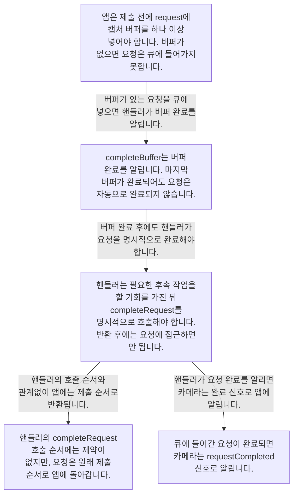

# 실행해 보고 설계 이유 읽기

**먼저 cam 도구로 카메라를 확인한 뒤, 요청 접수와 완료가 나뉜 이유를 소스 주석에서 읽으세요.**

| 지금 확인할 내용 | 이동할 절 |
|---|---|
| 시스템에서 감지된 카메라 목록은 `cam -l`로 확인하고, 첫 번째 카메라에서 10프레임을 캡처해 디스크에 저장하려면 `cam -c 1 --capture=10 --file`을 사용합니다. | [직접 실행해 보기](#직접-실행해-보기) |
| 애플리케이션은 createRequest()로 요청을 할당한 후 queueRequest를 호출하기 전에 캡처 버퍼를 하나 이상 채워야 합니다. | [요청 접수와 완료를 나눈 이유](#요청-접수와-완료를-나눈-이유) |

## 직접 실행해 보기

시스템에서 감지된 카메라 목록은 `cam -l`로 확인하고, 첫 번째 카메라에서 10프레임을 캡처해 디스크에 저장하려면 `cam -c 1 --capture=10 --file`을 사용합니다. 문제가 발생하면 `LIBCAMERA_LOG_LEVELS=*:DEBUG cam -l`로 상세한 libcamera 디버그 로그를 얻을 수 있습니다. `README.rst:107`

근거 원문: [README.rst:107](#source-5bc9ee57c1b6daee)

## 요청 접수와 완료를 나눈 이유

애플리케이션은 createRequest()로 요청을 할당한 후 queueRequest를 호출하기 전에 캡처 버퍼를 하나 이상 채워야 합니다. 버퍼가 없는 요청은 유효하지 않아 큐에 들어가지 않고 거부됩니다. 요청이 큐에 들어간 후 카메라는 requestCompleted 시그널을 통해 완료를 알립니다. `src/libcamera/camera.cpp:1311`

<!-- sdd:visual:request-completion-contract -->
### 요청 제출과 버퍼·요청 완료의 책임



[Mermaid 원문](onboarding.request-completion-contract.mmd)

??? note "그림 근거와 확인 범위"
    요청의 제출 조건, 버퍼 완료와 명시적 요청 완료, 앱에 전달하는 순서는 어떻게 연결됩니까?
    
    소스에 연결한 설계 해석입니다. 자동 연결 검사는 의미 승인이나 기기 실행 검증이 아닙니다.
    
    LLM 그림 초안 · 사람 검토 전
    
    작성 모델: `cli/codex/gpt-6.1-terra`
    
    | 요소·전이 | 소스 근거 |
    |---|---|
    | <span data-sdd-label-en="The app must add a capture buffer before submission; a bufferless request is rejected.">앱은 제출 전에 request에 캡처 버퍼를 하나 이상 넣어야 합니다. 버퍼가 없으면 요청은 큐에 들어가지 못합니다.</span> | [src/libcamera/camera.cpp:1311](#source-a697a2ba4de7965c) |
    | <span data-sdd-label-en="completeBuffer signals buffer completion; the last buffer does not complete the request.">completeBuffer는 버퍼 완료를 알립니다. 마지막 버퍼가 완료되어도 요청은 자동으로 완료되지 않습니다.</span> | [src/libcamera/pipeline_handler.cpp:551](#source-9bd7c9fb9847e336) |
    | <span data-sdd-label-en="Handlers can perform needed work and must call completeRequest. No access is allowed after it returns.">핸들러는 필요한 후속 작업을 할 기회를 가진 뒤 completeRequest를 명시적으로 호출해야 합니다. 반환 후에는 요청에 접근하면 안 됩니다.</span> | [src/libcamera/pipeline_handler.cpp:551](#source-9bd7c9fb9847e336) · [src/libcamera/pipeline_handler.cpp:574](#source-77cb263c0a63392c) |
    | <span data-sdd-label-en="Calls have no ordering constraint; requests return to the app in submission order.">핸들러의 completeRequest 호출 순서에는 제약이 없지만, 요청은 원래 제출 순서로 앱에 돌아갑니다.</span> | [src/libcamera/pipeline_handler.cpp:551](#source-9bd7c9fb9847e336) · [src/libcamera/pipeline_handler.cpp:574](#source-77cb263c0a63392c) |
    | <span data-sdd-label-en="The camera signals completion of a queued request via requestCompleted.">큐에 들어간 요청이 완료되면 카메라는 requestCompleted 신호로 알립니다.</span> | [src/libcamera/camera.cpp:1311](#source-a697a2ba4de7965c) |
    | <span data-sdd-label-en="Handlers signal completion of a queued request&#x27;s buffer.">버퍼가 있는 요청을 큐에 넣으면 핸들러가 버퍼 완료를 알립니다.</span> | [src/libcamera/camera.cpp:1311](#source-a697a2ba4de7965c) · [src/libcamera/pipeline_handler.cpp:551](#source-9bd7c9fb9847e336) |
    | <span data-sdd-label-en="Handlers must explicitly complete the request.">버퍼 완료 후에도 핸들러가 요청을 명시적으로 완료해야 합니다.</span> | [src/libcamera/pipeline_handler.cpp:551](#source-9bd7c9fb9847e336) |
    | <span data-sdd-label-en="Requests return to the app in submission order.">핸들러의 호출 순서와 관계없이 앱에는 제출 순서로 반환됩니다.</span> | [src/libcamera/pipeline_handler.cpp:551](#source-9bd7c9fb9847e336) · [src/libcamera/pipeline_handler.cpp:574](#source-77cb263c0a63392c) |
    | <span data-sdd-label-en="The camera signals the request&#x27;s completion.">핸들러가 요청 완료를 알리면 카메라는 완료 신호로 앱에 알립니다.</span> | [src/libcamera/pipeline_handler.cpp:551](#source-9bd7c9fb9847e336) · [src/libcamera/camera.cpp:1311](#source-a697a2ba4de7965c) · [src/libcamera/pipeline_handler.cpp:574](#source-77cb263c0a63392c) |
<!-- /sdd:visual:request-completion-contract -->

파이프라인 핸들러가 completeBuffer를 호출해 요청의 마지막 버퍼가 완료되었음을 알리더라도, 그 시점에 요청은 자동으로 완료되지 않습니다. 이는 파이프라인 핸들러가 여전히 필요할 수 있는 작업을 수행할 기회를 주기 위한 것이며, 핸들러는 completeRequest()로 요청을 명시적으로 완료해야 합니다. 요청은 제출된 순서대로 애플리케이션에 반환되며, 파이프라인 핸들러는 순서 제약 없이 완료된 요청에 대해 completeRequest()를 호출할 수 있습니다. `src/libcamera/pipeline_handler.cpp:551`, `src/libcamera/pipeline_handler.cpp:574`

근거 원문: [src/libcamera/camera.cpp:1311](#source-a697a2ba4de7965c) · [src/libcamera/pipeline_handler.cpp:551](#source-9bd7c9fb9847e336) · [src/libcamera/pipeline_handler.cpp:574](#source-77cb263c0a63392c)

??? note "설계 질문과 검증 범위"
    질문별 답변과 근거 연결을 검사했습니다. 의미와 실행 결과는 사람 검토가 필요합니다.
    
    | 설계 질문 | 설명 위치 | 확인 범위 |
    |---|---|---|
    | 카메라를 직접 확인해 보려면 무엇을 실행합니까? | [직접 실행해 보기](#직접-실행해-보기) | 코드 근거와 설명 연결 |
    | 요청 접수와 완료 통지가 별도 단계인 이유 중 소스가 직접 밝힌 것은 무엇입니까? | [요청 접수와 완료를 나눈 이유](#요청-접수와-완료를-나눈-이유) | 코드 근거와 설명 연결 |

## 소스 근거

같은 발췌는 한 번만 싣습니다. 필요한 원문을 펼쳐 설명과 대조하세요.

<a id="source-5bc9ee57c1b6daee"></a>

??? note "소스 근거: README.rst:107"
    `README.rst:107`에서 시작하는 발췌입니다. 종료 줄은 117이며, 아래 원문을 설명과 대조할 수 있습니다.
    
    SHA-256: `c35f23844229f0b6dc8411bca6eea313eb05f11d9b9a4524f5375c921b09afc4`
    
    ```text
    The ``cam`` utility can be used for basic testing. You can list the cameras
    detected on the system with ``cam -l``, and capture ten frames from the first
    camera and save them to disk with ``cam -c 1 --capture=10 --file``. See
    ``cam -h`` for more information about the ``cam`` tool.
    
    In case of problems, a detailed debug log can be obtained from libcamera by
    setting the ``LIBCAMERA_LOG_LEVELS`` environment variable:
    
    .. code::
    
        :~$ LIBCAMERA_LOG_LEVELS=*:DEBUG cam -l
    ```

<a id="source-a697a2ba4de7965c"></a>

??? note "소스 근거: src/libcamera/camera.cpp:1311"
    `src/libcamera/camera.cpp:1311`에서 시작하는 발췌입니다. 종료 줄은 1318이며, 아래 원문을 설명과 대조할 수 있습니다.
    
    SHA-256: `e28ed33dec85a5e783457be419afac5b7c646b588c24bc311d46265b1ae7f37a`
    
    ```text
    This function queues a \a request to the camera for capture.
     *
     * After allocating the request with createRequest(), the application shall
     * fill it with at least one capture buffer before queuing it. Requests that
     * contain no buffers are invalid and are rejected without being queued.
     *
     * Once the request has been queued, the camera will notify its completion
     * through the \ref requestCompleted signal.
    ```

<a id="source-9bd7c9fb9847e336"></a>

??? note "소스 근거: src/libcamera/pipeline_handler.cpp:551"
    `src/libcamera/pipeline_handler.cpp:551`에서 시작하는 발췌입니다. 종료 줄은 556이며, 아래 원문을 설명과 대조할 수 있습니다.
    
    SHA-256: `dc60b6f028df4f7341facfcbd3ebade17f81bb4d2e72ce580ba93c7a1c449b42`
    
    ```text
    This function shall be called by pipeline handlers to signal completion of
     * the \a buffer part of the \a request. It notifies applications of buffer
     * completion and updates the request's internal buffer tracking. The request
     * is not completed automatically when the last buffer completes to give
     * pipeline handlers a chance to perform any operation that may still be
     * needed. They shall complete requests explicitly with completeRequest().
    ```

<a id="source-77cb263c0a63392c"></a>

??? note "소스 근거: src/libcamera/pipeline_handler.cpp:574"
    `src/libcamera/pipeline_handler.cpp:574`에서 시작하는 발췌입니다. 종료 줄은 580이며, 아래 원문을 설명과 대조할 수 있습니다.
    
    SHA-256: `5df554f7462852344c1f8f25dd3bf2f16f22ab34e3f96d948d54ec44baca7217`
    
    ```text
    The pipeline handler shall call this function to notify the \a camera that
     * the request has completed. The request is no longer managed by the pipeline
     * handler and shall not be accessed once this function returns.
     *
     * This function ensures that requests will be returned to the application in
     * submission order, the pipeline handler may call it on any complete request
     * without any ordering constraint.
    ```

??? note "근거와 검토 정보"
    - 생성 방식: 추출 사실과 LLM 설명
    - 검증 범위: 표·그림은 facts로 만들고 설명은 LLM이 작성합니다. 인용·문장 및 설정된 구조 검사를 적용합니다.
    - 근거 파일: `README.rst`, `include/libcamera/camera.h`, `include/libcamera/internal/pipeline_handler.h`, `include/libcamera/request.h`, `src/libcamera/camera.cpp`, `src/libcamera/pipeline_handler.cpp`, `src/libcamera/request.cpp`
    - 근거 수준: 코드 확인 (정적 분석, simple_compdb 구성, commit `293d751a81`)
    - 자동 검사 (인용·문장 및 설정된 구조 검사): 통과
    - 검토 상태 기록일: 2026-11-04 · 사람 검토 전

다음 단계: [카메라와 요청 모델](camera-model.md)
