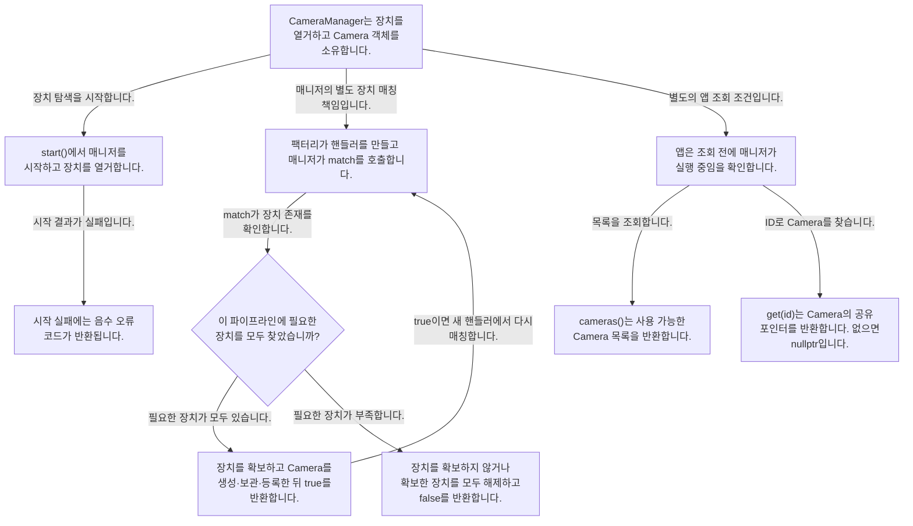
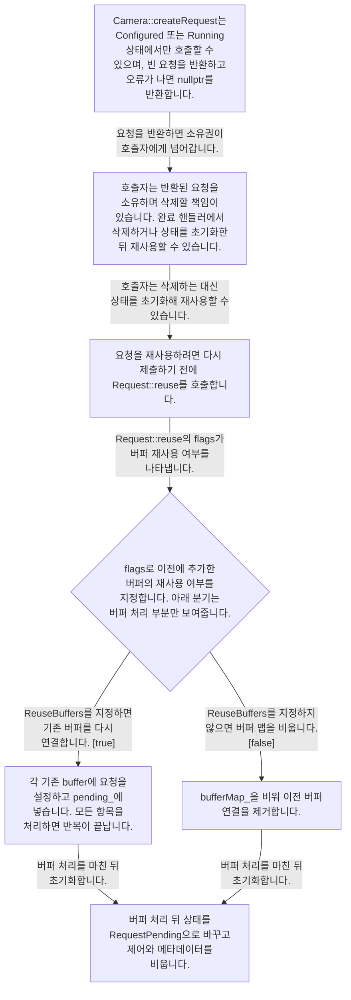
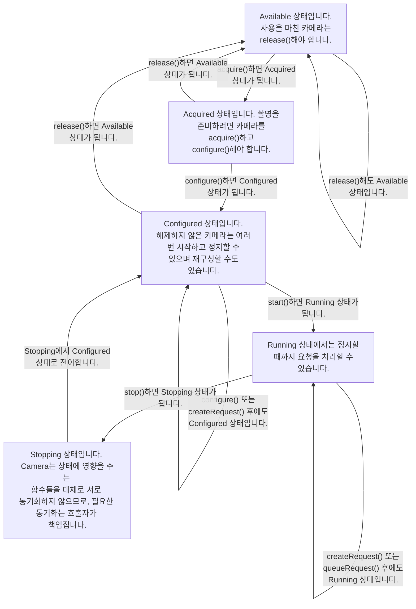
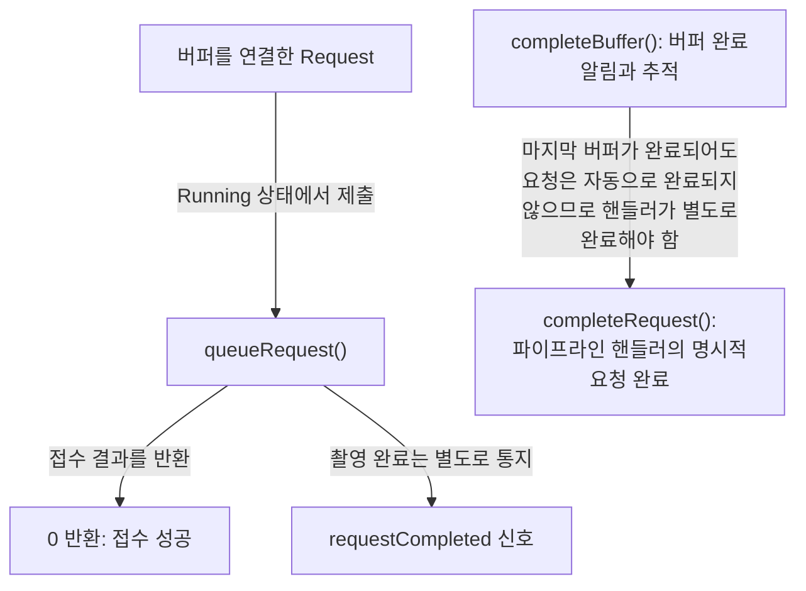
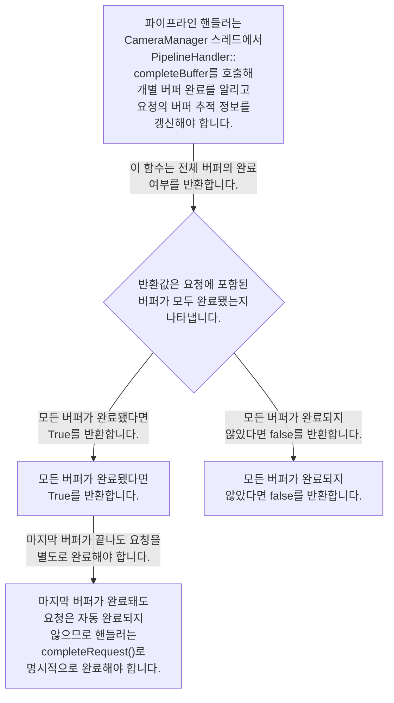
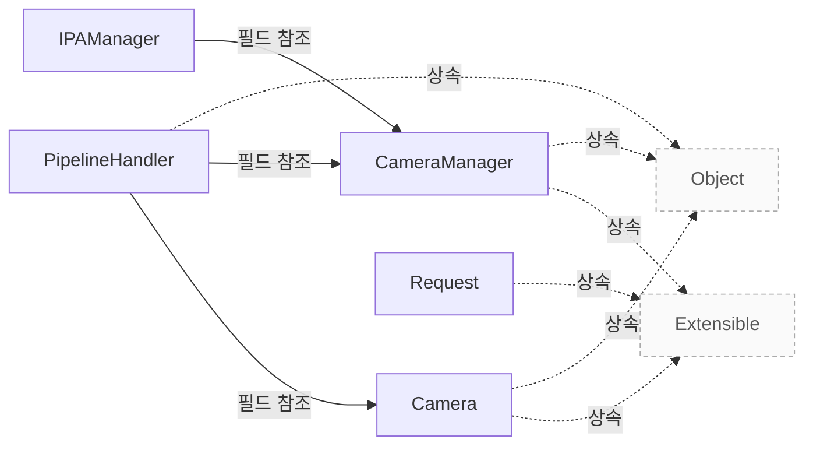

# 시스템 개요

**src/libcamera/camera_manager.cpp의 CameraManager에서 시작해 요청 제출과 완료를 따라가세요.**

| 지금 확인할 내용 | 이동할 절 |
|---|---|
| 처음 읽을 파일과 진입점을 찾습니다. | [탐색과 파이프라인 선택](#탐색과-파이프라인-선택) |
| 요청과 결과가 지나는 경계를 확인합니다. | [요청 제출과 완료](#요청-제출과-완료) |
| 구성 실패의 원인을 좁힙니다. | [구성과 요청 오류 조사](request-diagnosis.md#구성-실패를-좁히는-순서) |
| 요청의 제출 성공과 촬영 완료를 구분하고, 버퍼를 유지할 기간과 오류가 난 위치를 확인하세요. | [요청 처리와 문제 진단](request-lifecycle.md) |
| 수정 전에 상태와 종료 순서를 확인합니다. | [캡처 세션의 상태와 자원](#캡처-세션의-상태와-자원) |
| 빌드한 모든 파이프라인·IPA·앱의 클래스와 함수를 패키지별로 찾으세요. 표는 추출 사실에서 만들었고 동작은 설명하지 않습니다. | [구성 요소 색인](component-index.md) |
| <a id="장치-요청-한도와-대기-큐"></a>장치 요청 수의 기본 한도와 대기 큐를 확인합니다. | [Pipeline 요청 제출과 완료](pipeline-requests.md#장치-요청-한도와-대기-큐) |

## 탐색과 파이프라인 선택

`CameraManager`는 libcamera의 진입점으로, 장치를 열거하고 파이프라인과 연결하며 애플리케이션이 시스템의 카메라에 접근하도록 합니다. `CameraManager::Private::pipelineFactoryMatch()`는 팩토리에서 `PipelineHandler`를 만들고 열거된 장치와 일치하는지 확인합니다. 일치하는 파이프라인을 최대한 제공하도록 이 과정을 반복하며, `match()`가 거짓을 반환하면 반복을 끝냅니다. `src/libcamera/camera_manager.cpp:283`, `src/libcamera/camera_manager.cpp:154`

<!-- sdd:visual:discovery-map -->
### 장치 탐색에서 Camera 접근까지



[Mermaid 원문](overview.discovery-map.mmd)

??? note "그림 근거와 확인 범위"
    CameraManager는 어떻게 장치를 매칭하고 카메라를 등록하며, 앱은 어떤 조건에서 카메라를 조회할 수 있습니까?
    
    소스에 연결한 설계 해석입니다. 자동 연결 검사는 의미 승인이나 기기 실행 검증이 아닙니다.
    
    | 요소·전이 | 소스 근거 |
    |---|---|
    | <span data-sdd-label-en="CameraManager enumerates devices and owns the Camera objects.">CameraManager는 장치를 열거하고 Camera 객체를 소유합니다.</span> | [src/libcamera/camera_manager.cpp:283](#source-f75d22cf73f3402d) |
    | <span data-sdd-label-en="start() starts the manager and enumerates devices.">start&#40;&#41;에서 매니저를 시작하고 장치를 열거합니다.</span> | [src/libcamera/camera_manager.cpp:329](#source-f58d94d893e03971) |
    | <span data-sdd-label-en="A failed start returns a negative error code.">시작 실패에는 음수 오류 코드가 반환됩니다.</span> | [src/libcamera/camera_manager.cpp:329](#source-f58d94d893e03971) |
    | <span data-sdd-label-en="The factory creates a handler and the manager calls match.">팩터리가 핸들러를 만들고 매니저가 match를 호출합니다.</span> | [src/libcamera/camera_manager.cpp:154](#source-0c01857bf49370e2) |
    | <span data-sdd-label-en="Were all devices for this pipeline found?">이 파이프라인에 필요한 장치를 모두 찾았습니까?</span> | [src/libcamera/pipeline_handler.cpp:86](#source-5bbd41c1e725138c) |
    | <span data-sdd-label-en="Acquire the devices, create, store and register the cameras, and return true.">장치를 확보하고 Camera를 생성·보관·등록한 뒤 true를 반환합니다.</span> | [src/libcamera/pipeline_handler.cpp:86](#source-5bbd41c1e725138c) |
    | <span data-sdd-label-en="Acquire no devices or release all acquired devices, then return false.">장치를 확보하지 않거나 확보한 장치를 모두 해제하고 false를 반환합니다.</span> | [src/libcamera/pipeline_handler.cpp:86](#source-5bbd41c1e725138c) |
    | <span data-sdd-label-en="Before a lookup, the application ensures the manager is running.">앱은 조회 전에 매니저가 실행 중임을 확인합니다.</span> | [src/libcamera/camera_manager.cpp:329](#source-f58d94d893e03971) · [src/libcamera/camera_manager.cpp:368](#source-0c733673790ad84f) |
    | <span data-sdd-label-en="cameras() returns the list of available cameras.">cameras&#40;&#41;는 사용 가능한 Camera 목록을 반환합니다.</span> | [src/libcamera/camera_manager.cpp:368](#source-0c733673790ad84f) |
    | <span data-sdd-label-en="get(id) returns a shared pointer to the Camera, or nullptr if it is absent.">get&#40;id&#41;는 Camera의 공유 포인터를 반환합니다. 없으면 nullptr입니다.</span> | [src/libcamera/camera_manager.cpp:368](#source-0c733673790ad84f) |
    | <span data-sdd-label-en="Start device discovery.">장치 탐색을 시작합니다.</span> | [src/libcamera/camera_manager.cpp:283](#source-f75d22cf73f3402d) · [src/libcamera/camera_manager.cpp:329](#source-f58d94d893e03971) |
    | <span data-sdd-label-en="This is the manager’s separate device matching responsibility.">매니저의 별도 장치 매칭 책임입니다.</span> | [src/libcamera/camera_manager.cpp:283](#source-f75d22cf73f3402d) · [src/libcamera/camera_manager.cpp:154](#source-0c01857bf49370e2) |
    | <span data-sdd-label-en="The start failed.">시작 결과가 실패입니다.</span> | [src/libcamera/camera_manager.cpp:329](#source-f58d94d893e03971) |
    | <span data-sdd-label-en="match checks whether the devices are available.">match가 장치 존재를 확인합니다.</span> | [src/libcamera/camera_manager.cpp:154](#source-0c01857bf49370e2) · [src/libcamera/pipeline_handler.cpp:86](#source-5bbd41c1e725138c) |
    | <span data-sdd-label-en="All required devices are available.">필요한 장치가 모두 있습니다.</span> | [src/libcamera/pipeline_handler.cpp:86](#source-5bbd41c1e725138c) |
    | <span data-sdd-label-en="A required device is missing.">필요한 장치가 부족합니다.</span> | [src/libcamera/pipeline_handler.cpp:86](#source-5bbd41c1e725138c) |
    | <span data-sdd-label-en="A true result starts matching again with a new handler.">true이면 새 핸들러에서 다시 매칭합니다.</span> | [src/libcamera/pipeline_handler.cpp:86](#source-5bbd41c1e725138c) · [src/libcamera/camera_manager.cpp:154](#source-0c01857bf49370e2) |
    | <span data-sdd-label-en="This is the separate application lookup requirement.">별도의 앱 조회 조건입니다.</span> | [src/libcamera/camera_manager.cpp:283](#source-f75d22cf73f3402d) · [src/libcamera/camera_manager.cpp:329](#source-f58d94d893e03971) · [src/libcamera/camera_manager.cpp:368](#source-0c733673790ad84f) |
    | <span data-sdd-label-en="Get the list.">목록을 조회합니다.</span> | [src/libcamera/camera_manager.cpp:329](#source-f58d94d893e03971) · [src/libcamera/camera_manager.cpp:368](#source-0c733673790ad84f) |
    | <span data-sdd-label-en="Look up a Camera by ID.">ID로 Camera를 찾습니다.</span> | [src/libcamera/camera_manager.cpp:329](#source-f58d94d893e03971) · [src/libcamera/camera_manager.cpp:368](#source-0c733673790ad84f) |
<!-- /sdd:visual:discovery-map -->

`CameraManager` 인스턴스는 동시에 하나만 존재해야 합니다. 기존 인스턴스를 먼저 삭제하지 않고 두 번째 인스턴스를 생성하면 동작이 정의되지 않습니다. `CameraManager::start()`의 시작이 확인되면 애플리케이션은 카메라 관리자가 중지되거나 해당 카메라가 시스템에서 분리될 때까지 시스템의 카메라를 나열하고 사용할 수 있습니다. 호출자는 `CameraManager::cameras()`와 `CameraManager::get()`을 호출하기 전에 카메라 매니저가 실행 중인지 확인해야 합니다. `src/libcamera/camera_manager.cpp:283`, `src/libcamera/camera_manager.cpp:329`, `src/libcamera/camera_manager.cpp:368`

`PipelineHandler::match()` 구현자는 필요한 미디어 장치를 모두 찾으면 `MediaDevice::acquire()`로 모두 획득하고, 해당 `Camera` 인스턴스를 생성해 내부에 저장하고 카메라 관리자에 등록한 뒤 `true`를 반환해야 합니다. 장치를 모두 찾지 못하면 `match()` 구현자는 어떤 미디어 장치도 획득하지 않거나 이미 획득한 장치를 `MediaDevice::release()`로 모두 해제하고 `false`를 반환해야 합니다. `src/libcamera/pipeline_handler.cpp:86`

근거 원문: [src/libcamera/camera_manager.cpp:283](#source-f75d22cf73f3402d) · [src/libcamera/camera_manager.cpp:329](#source-f58d94d893e03971) · [src/libcamera/camera_manager.cpp:368](#source-0c733673790ad84f) · [src/libcamera/pipeline_handler.cpp:86](#source-5bbd41c1e725138c) · [src/libcamera/camera_manager.cpp:154](#source-0c01857bf49370e2)

## 컴포넌트별 책임

`Camera`는 하나의 이미지 소스에서 하나 이상의 이미지 스트림을 생성할 수 있는 카메라를 모델링합니다. 장치 구성과 제어, 이미지 스트림 캡처를 위한 주 인터페이스이며, libcamera가 공개하는 중심 객체입니다. libcamera는 카메라 인스턴스의 수명을 `std::shared_ptr<>`로 관리하며, 인스턴스는 공유 포인터를 반환하는 `create()`로 생성해야 합니다. `Camera`의 생성자와 소멸자는 비공개이므로 인스턴스를 수동으로 생성하거나 파괴할 수 없습니다. `src/libcamera/camera.cpp:758`

근거 원문: [src/libcamera/camera.cpp:758](#source-6c066281dcce33d6)

## 요청 생성과 소유권

`Camera::createRequest(cookie)`의 `cookie`는 애플리케이션에서 사용하는 불투명한 입력값입니다. 이 값은 요청에 저장되며 `Request::cookie()`로 언제든 읽을 수 있습니다. 이 값은 `libcamera` 관점에서 완전히 불투명합니다. `Camera::createRequest()`는 카메라가 `Configured` 또는 `Running` 상태일 때만 호출할 수 있으며, 오류가 발생하면 `nullptr`을 반환합니다. `src/libcamera/camera.cpp:1243`

<!-- sdd:visual:item-creation -->
### 요청 생성과 소유권의 관계와 경계



[Mermaid 원문](overview.item-creation.mmd)

??? note "그림 근거와 확인 범위"
    호출자는 요청을 어떻게 생성·소유·삭제하거나 재사용하며, ReuseBuffers 지정 여부에 따라 버퍼는 어떻게 되나요?
    
    소스에 연결한 설계 해석입니다. 자동 연결 검사는 의미 승인이나 기기 실행 검증이 아닙니다.
    
    | 요소·전이 | 소스 근거 |
    |---|---|
    | <span data-sdd-label-en="Camera::createRequest creates an empty request in Configured or Running and returns nullptr on error.">Camera::createRequest는 Configured 또는 Running 상태에서만 호출할 수 있으며, 빈 요청을 반환하고 오류가 나면 nullptr를 반환합니다.</span> | [src/libcamera/camera.cpp:1243](#source-d61960ed2545ba78) |
    | <span data-sdd-label-en="The caller owns and must delete the request; it may delete it on completion or reset and reuse it.">호출자는 반환된 요청을 소유하며 삭제할 책임이 있습니다. 완료 핸들러에서 삭제하거나 상태를 초기화한 뒤 재사용할 수 있습니다.</span> | [src/libcamera/camera.cpp:1243](#source-d61960ed2545ba78) |
    | <span data-sdd-label-en="Call Request::reuse before queueing the request again.">요청을 재사용하려면 다시 제출하기 전에 Request::reuse를 호출합니다.</span> | [src/libcamera/request.cpp:376](#source-0556d5e91908d040) |
    | <span data-sdd-label-en="flags selects buffer reuse; the branches show only buffer handling.">flags로 이전에 추가한 버퍼의 재사용 여부를 지정합니다. 아래 분기는 버퍼 처리 부분만 보여줍니다.</span> | [src/libcamera/request.cpp:376](#source-0556d5e91908d040) |
    | <span data-sdd-label-en="Each existing buffer gets the request and enters pending_; the loop then ends.">각 기존 buffer에 요청을 설정하고 pending&#95;에 넣습니다. 모든 항목을 처리하면 반복이 끝납니다.</span> | [src/libcamera/request.cpp:376](#source-0556d5e91908d040) |
    | <span data-sdd-label-en="bufferMap_ is cleared, removing the previous buffer associations.">bufferMap&#95;을 비워 이전 버퍼 연결을 제거합니다.</span> | [src/libcamera/request.cpp:376](#source-0556d5e91908d040) |
    | <span data-sdd-label-en="After buffer handling, set RequestPending and clear controls and metadata.">버퍼 처리 뒤 상태를 RequestPending으로 바꾸고 제어와 메타데이터를 비웁니다.</span> | [src/libcamera/request.cpp:376](#source-0556d5e91908d040) |
    | <span data-sdd-label-en="The returned request&#x27;s ownership passes to the caller.">요청을 반환하면 소유권이 호출자에게 넘어갑니다.</span> | [src/libcamera/camera.cpp:1243](#source-d61960ed2545ba78) |
    | <span data-sdd-label-en="The caller may reset and reuse the request instead of deleting it.">호출자는 삭제하는 대신 상태를 초기화해 재사용할 수 있습니다.</span> | [src/libcamera/camera.cpp:1243](#source-d61960ed2545ba78) |
    | <span data-sdd-label-en="The flags of Request::reuse indicate whether to reuse buffers.">Request::reuse의 flags가 버퍼 재사용 여부를 나타냅니다.</span> | [src/libcamera/request.cpp:376](#source-0556d5e91908d040) |
    | <span data-sdd-label-en="With ReuseBuffers, the existing buffers are associated again. · flags &amp; ReuseBuffers [true]">ReuseBuffers를 지정하면 기존 버퍼를 다시 연결합니다. · flags &amp; ReuseBuffers &#91;true&#93;</span> | [src/libcamera/request.cpp:376](#source-0556d5e91908d040) |
    | <span data-sdd-label-en="Without ReuseBuffers, the buffer map is cleared. · flags &amp; ReuseBuffers [false]">ReuseBuffers를 지정하지 않으면 버퍼 맵을 비웁니다. · flags &amp; ReuseBuffers &#91;false&#93;</span> | [src/libcamera/request.cpp:376](#source-0556d5e91908d040) |
    | <span data-sdd-label-en="Reset after buffer handling.">버퍼 처리를 마친 뒤 초기화합니다.</span> | [src/libcamera/request.cpp:376](#source-0556d5e91908d040) |
    | <span data-sdd-label-en="Reset after buffer handling.">버퍼 처리를 마친 뒤 초기화합니다.</span> | [src/libcamera/request.cpp:376](#source-0556d5e91908d040) |
<!-- /sdd:visual:item-creation -->

`Camera::createRequest()`가 반환한 요청의 소유권은 호출자에게 전달되며, 호출자가 요청을 삭제해야 합니다. 호출자는 새 요청을 만드는 대신 같은 요청을 다시 큐에 넣으려면 큐에 넣기 전에 `Request::reuse()`를 호출하여 요청 상태와 연결된 컨트롤을 초기화해야 합니다. `Request::reuse(ReuseFlag)`는 `ReuseBuffers`를 지정하면 `addBuffer()`로 추가한 기존 버퍼를 유지해 재사용하고, 지정하지 않으면 `bufferMap_`을 비웁니다. `src/libcamera/camera.cpp:1243`, `src/libcamera/request.cpp:376`

근거 원문: [src/libcamera/camera.cpp:1243](#source-d61960ed2545ba78) · [src/libcamera/request.cpp:376](#source-0556d5e91908d040)

## 캡처 세션의 상태와 자원

애플리케이션은 캡처를 준비할 때 카메라를 `acquire()`로 획득하고 `configure()`로 구성한 다음 `start()`로 시작합니다. 시작한 카메라는 정지할 때까지 요청을 처리할 수 있습니다. 애플리케이션이 `Running` 상태인 카메라의 사용을 완전히 끝내려면 `stop()`으로 정지하고 `Stopping`을 거쳐 `Configured`로 돌아온 후 `release()`로 해제합니다. 애플리케이션은 카메라를 해제하지 않은 동안 카메라를 여러 번 시작하고 정지할 수 있으며, 카메라를 재구성할 수도 있습니다. `src/libcamera/camera.cpp:769`

<!-- sdd:visual:item-lifecycle -->
### 캡처 세션의 상태와 자원의 관계와 경계



[Mermaid 원문](overview.item-lifecycle.mmd)

??? note "그림 근거와 확인 범위"
    acquire, configure, start, stop, release와 반복 캡처는 카메라 상태를 어떻게 바꾸나요?
    
    소스에 연결한 설계 해석입니다. 자동 연결 검사는 의미 승인이나 기기 실행 검증이 아닙니다.
    
    | 요소·전이 | 소스 근거 |
    |---|---|
    | <span data-sdd-label-en="The camera is Available. Release it when finished.">Available 상태입니다. 사용을 마친 카메라는 release&#40;&#41;해야 합니다.</span> | [src/libcamera/camera.cpp:769](#source-4b17a07667f3a55d) |
    | <span data-sdd-label-en="The camera is Acquired. Acquire and configure it to prepare for capture.">Acquired 상태입니다. 촬영을 준비하려면 카메라를 acquire&#40;&#41;하고 configure&#40;&#41;해야 합니다.</span> | [src/libcamera/camera.cpp:769](#source-4b17a07667f3a55d) |
    | <span data-sdd-label-en="The camera is Configured. It can be reconfigured or started and stopped repeatedly until released.">Configured 상태입니다. 해제하지 않은 카메라는 여러 번 시작하고 정지할 수 있으며 재구성할 수도 있습니다.</span> | [src/libcamera/camera.cpp:769](#source-4b17a07667f3a55d) |
    | <span data-sdd-label-en="The camera is Running and can process requests until stopped.">Running 상태에서는 정지할 때까지 요청을 처리할 수 있습니다.</span> | [src/libcamera/camera.cpp:769](#source-4b17a07667f3a55d) |
    | <span data-sdd-label-en="The camera is Stopping. The caller must synchronize state functions if necessary.">Stopping 상태입니다. Camera는 상태에 영향을 주는 함수들을 대체로 서로 동기화하지 않으므로, 필요한 동기화는 호출자가 책임집니다.</span> | [src/libcamera/camera.cpp:769](#source-4b17a07667f3a55d) |
    | <span data-sdd-label-en="release() leaves the camera Available.">release&#40;&#41;해도 Available 상태입니다.</span> | [src/libcamera/camera.cpp:769](#source-4b17a07667f3a55d) |
    | <span data-sdd-label-en="acquire() moves the camera to Acquired.">acquire&#40;&#41;하면 Acquired 상태가 됩니다.</span> | [src/libcamera/camera.cpp:769](#source-4b17a07667f3a55d) |
    | <span data-sdd-label-en="release() moves the camera to Available.">release&#40;&#41;하면 Available 상태가 됩니다.</span> | [src/libcamera/camera.cpp:769](#source-4b17a07667f3a55d) |
    | <span data-sdd-label-en="configure() moves the camera to Configured.">configure&#40;&#41;하면 Configured 상태가 됩니다.</span> | [src/libcamera/camera.cpp:769](#source-4b17a07667f3a55d) |
    | <span data-sdd-label-en="release() moves the camera to Available.">release&#40;&#41;하면 Available 상태가 됩니다.</span> | [src/libcamera/camera.cpp:769](#source-4b17a07667f3a55d) |
    | <span data-sdd-label-en="configure() or createRequest() leaves the camera Configured.">configure&#40;&#41; 또는 createRequest&#40;&#41; 후에도 Configured 상태입니다.</span> | [src/libcamera/camera.cpp:769](#source-4b17a07667f3a55d) |
    | <span data-sdd-label-en="start() moves the camera to Running.">start&#40;&#41;하면 Running 상태가 됩니다.</span> | [src/libcamera/camera.cpp:769](#source-4b17a07667f3a55d) |
    | <span data-sdd-label-en="stop() moves the camera to Stopping.">stop&#40;&#41;하면 Stopping 상태가 됩니다.</span> | [src/libcamera/camera.cpp:769](#source-4b17a07667f3a55d) |
    | <span data-sdd-label-en="The camera transitions from Stopping to Configured.">Stopping에서 Configured 상태로 전이합니다.</span> | [src/libcamera/camera.cpp:769](#source-4b17a07667f3a55d) |
    | <span data-sdd-label-en="createRequest() or queueRequest() leaves the camera Running.">createRequest&#40;&#41; 또는 queueRequest&#40;&#41; 후에도 Running 상태입니다.</span> | [src/libcamera/camera.cpp:769](#source-4b17a07667f3a55d) |
<!-- /sdd:visual:item-lifecycle -->

근거 원문: [src/libcamera/camera.cpp:769](#source-4b17a07667f3a55d)

## 요청 제출과 완료

애플리케이션은 `Camera::queueRequest()`로 제출하기 전에 `createRequest()`가 반환한 요청 객체에 캡처 버퍼를 최소 한 개 연결해야 합니다. `Camera::queueRequest()`로 요청이 큐에 들어간 후 처리가 완료되면 카메라가 `requestCompleted` 신호로 애플리케이션에 알립니다. 호출자는 카메라가 `Running` 상태일 때만 `Camera::queueRequest()`를 호출해야 합니다. `src/libcamera/camera.cpp:1308`

<!-- sdd:visual:submission-completion -->
### 요청 접수와 버퍼 완료, 요청 완료



[Mermaid 원문](overview.submission-completion.mmd)

??? note "그림 근거와 확인 범위"
    queueRequest()의 반환값은 접수 결과입니다. completeBuffer()는 버퍼 완료를 알리고 추적하며, 파이프라인 핸들러는 completeRequest()로 요청을 별도로 완료해야 합니다. requestCompleted 신호는 요청 완료를 별도로 알립니다.
    
    소스에 연결한 설계 해석입니다. 자동 연결 검사는 의미 승인이나 기기 실행 검증이 아닙니다.
    
    LLM 그림 초안 · 사람 검토 전
    
    작성 모델: `cli/codex/gpt-6.1-terra`
    
    | 요소·전이 | 소스 근거 |
    |---|---|
    | <span data-sdd-label-en="Request with capture buffers">버퍼를 연결한 Request</span> | [src/libcamera/camera.cpp:1308](#source-2f880c124115c9c4) |
    | <span data-sdd-label-en="queueRequest()">queueRequest&#40;&#41;</span> | [src/libcamera/camera.cpp:1308](#source-2f880c124115c9c4) |
    | <span data-sdd-label-en="Return 0: submission accepted">0 반환: 접수 성공</span> | [src/libcamera/camera.cpp:1308](#source-2f880c124115c9c4) |
    | <span data-sdd-label-en="requestCompleted signal">requestCompleted 신호</span> | [src/libcamera/camera.cpp:1308](#source-2f880c124115c9c4) |
    | <span data-sdd-label-en="completeBuffer(): buffer completion notification and tracking">completeBuffer&#40;&#41;: 버퍼 완료 알림과 추적</span> | [src/libcamera/pipeline_handler.cpp:547](#source-ca3f659653ce3f6a) |
    | <span data-sdd-label-en="completeRequest(): explicit request completion by the pipeline handler">completeRequest&#40;&#41;: 파이프라인 핸들러의 명시적 요청 완료</span> | [src/libcamera/pipeline_handler.cpp:547](#source-ca3f659653ce3f6a) |
    | <span data-sdd-label-en="Submit in Running state">Running 상태에서 제출</span> | [src/libcamera/camera.cpp:1308](#source-2f880c124115c9c4) |
    | <span data-sdd-label-en="Return submission result">접수 결과를 반환</span> | [src/libcamera/camera.cpp:1308](#source-2f880c124115c9c4) |
    | <span data-sdd-label-en="Notify completion separately">촬영 완료는 별도로 통지</span> | [src/libcamera/camera.cpp:1308](#source-2f880c124115c9c4) |
    | <span data-sdd-label-en="Even the last buffer does not automatically complete the request; the handler must complete it separately">마지막 버퍼가 완료되어도 요청은 자동으로 완료되지 않으므로 핸들러가 별도로 완료해야 함</span> | [src/libcamera/pipeline_handler.cpp:547](#source-ca3f659653ce3f6a) |
<!-- /sdd:visual:submission-completion -->

근거 원문: [src/libcamera/camera.cpp:1308](#source-2f880c124115c9c4)

## 버퍼 완료와 요청 완료

`PipelineHandler::completeBuffer()`는 요청에 속한 버퍼의 완료를 애플리케이션에 알림으로 전달하고 요청 내부의 버퍼 추적 정보를 갱신합니다. 파이프라인 핸들러는 마지막 버퍼가 완료된 뒤에도 `completeRequest()`를 명시적으로 호출해야 합니다. `src/libcamera/pipeline_handler.cpp:547`

<!-- sdd:visual:item-completion -->
### 버퍼 완료와 요청 완료의 관계와 경계



[Mermaid 원문](overview.item-completion.mmd)

??? note "그림 근거와 확인 범위"
    개별 버퍼 완료와 전체 버퍼 완료 여부는 명시적인 요청 완료 호출과 어떻게 구분되나요?
    
    소스에 연결한 설계 해석입니다. 자동 연결 검사는 의미 승인이나 기기 실행 검증이 아닙니다.
    
    | 요소·전이 | 소스 근거 |
    |---|---|
    | <span data-sdd-label-en="The handler must call completeBuffer on the CameraManager thread to notify and track buffer completion.">파이프라인 핸들러는 CameraManager 스레드에서 PipelineHandler::completeBuffer를 호출해 개별 버퍼 완료를 알리고 요청의 버퍼 추적 정보를 갱신해야 합니다.</span> | [src/libcamera/pipeline_handler.cpp:547](#source-ca3f659653ce3f6a) |
    | <span data-sdd-label-en="The return value indicates whether all buffers in the request have completed.">반환값은 요청에 포함된 버퍼가 모두 완료됐는지 나타냅니다.</span> | [src/libcamera/pipeline_handler.cpp:547](#source-ca3f659653ce3f6a) |
    | <span data-sdd-label-en="It returns True if all buffers have completed.">모든 버퍼가 완료됐다면 True를 반환합니다.</span> | [src/libcamera/pipeline_handler.cpp:547](#source-ca3f659653ce3f6a) |
    | <span data-sdd-label-en="It returns false if not all buffers have completed.">모든 버퍼가 완료되지 않았다면 false를 반환합니다.</span> | [src/libcamera/pipeline_handler.cpp:547](#source-ca3f659653ce3f6a) |
    | <span data-sdd-label-en="The last buffer does not automatically complete the request; handlers must call completeRequest().">마지막 버퍼가 완료돼도 요청은 자동 완료되지 않으므로 핸들러는 completeRequest&#40;&#41;로 명시적으로 완료해야 합니다.</span> | [src/libcamera/pipeline_handler.cpp:547](#source-ca3f659653ce3f6a) |
    | <span data-sdd-label-en="The function returns whether all buffers have completed.">이 함수는 전체 버퍼의 완료 여부를 반환합니다.</span> | [src/libcamera/pipeline_handler.cpp:547](#source-ca3f659653ce3f6a) |
    | <span data-sdd-label-en="It returns True if all buffers have completed.">모든 버퍼가 완료됐다면 True를 반환합니다.</span> | [src/libcamera/pipeline_handler.cpp:547](#source-ca3f659653ce3f6a) |
    | <span data-sdd-label-en="It returns false if not all buffers have completed.">모든 버퍼가 완료되지 않았다면 false를 반환합니다.</span> | [src/libcamera/pipeline_handler.cpp:547](#source-ca3f659653ce3f6a) |
    | <span data-sdd-label-en="Even after the last buffer, the handler must complete the request explicitly.">마지막 버퍼가 끝나도 요청을 별도로 완료해야 합니다.</span> | [src/libcamera/pipeline_handler.cpp:547](#source-ca3f659653ce3f6a) |
<!-- /sdd:visual:item-completion -->

근거 원문: [src/libcamera/pipeline_handler.cpp:547](#source-ca3f659653ce3f6a)

## 스레드 경계와 동기화

호출자는 `Camera` 상태를 바꾸는 함수들을 호출할 때 필요한 경우 함수 사이의 동기화를 보장해야 합니다. 파이프라인 핸들러는 `PipelineHandler::completeRequest()`를 `CameraManager` 스레드에서 호출해야 합니다. `src/libcamera/camera.cpp:780`, `src/libcamera/pipeline_handler.cpp:571`

근거 원문: [src/libcamera/camera.cpp:780](#source-33ababe2a4780075) · [src/libcamera/pipeline_handler.cpp:571](#source-7ac40780a56ae3a9)

## 정적 근거의 확인 범위

`Camera::start`는 `CameraConfigured` 접근 검사에서 `ret`이 음수이면 그 값을 반환합니다. API 문서는 시작할 수 없는 상태의 오류로 `-EACCES`를 명시합니다. 이어서 `PipelineHandler::start`를 `ConnectionTypeBlocking`으로 호출하며, 결과 `ret`이 0이 아니면 그 값을 반환합니다. 결과가 0이면 `CameraRunning`으로 상태를 바꾼 뒤 0을 반환합니다. `src/libcamera/camera.cpp:1400`, `src/libcamera/camera.cpp:1383`

<!-- sdd:visual:item-verification -->
### 상태 검사와 시작 결과

```mermaid
flowchart TB
%% sdd:translations {"Camera::start는 <br/>isAccessAllowed#40;Private::<br/>CameraConfigured#41;의 결과를 <br/>ret에 저장합니다.": "Camera::start stores the <br/>result of <br/>isAccessAllowed#40;Private::<br/>CameraConfigured#41; in ret.", "ControlList 복사본을 만들고 <br/>patchControlList에 넘깁니다.": "Create a ControlList copy <br/>and pass it to <br/>patchControlList.", "invokeMethod로 <br/>PipelineHandler::start를 <br/>ConnectionTypeBlocking과 <br/>#38;copy로 호출합니다.": "It calls <br/>PipelineHandler::start via <br/>invokeMethod with <br/>ConnectionTypeBlocking and <br/>#38;copy.", "invokeMethod로 <br/>PipelineHandler::start를 <br/>ConnectionTypeBlocking과 <br/>nullptr로 호출합니다.": "It calls <br/>PipelineHandler::start via <br/>invokeMethod with <br/>ConnectionTypeBlocking and <br/>nullptr.", "patchControlList가 정상 <br/>복귀하면 복사본으로 <br/>호출합니다.": "When patchControlList <br/>returns normally, it calls <br/>with the copy.", "requestSequence#95;가 0인지 <br/>ASSERT로 검사합니다.": "An ASSERT checks that <br/>requestSequence#95; is zero.", "setState로 <br/>Private::CameraRunning을 <br/>설정하고 0을 반환합니다.": "It sets <br/>Private::CameraRunning with <br/>setState and returns 0.", "거짓이면 ASSERT에 <br/>도달합니다. · ret #60; 0 <br/>#91;false#93;": "If false, it reaches <br/>ASSERT. · ret #60; 0 #91;false#93;", "거짓이면 nullptr로 <br/>호출합니다. · controls <br/>#91;false#93;": "If false, it calls with <br/>nullptr. · controls #91;false#93;", "거짓이면 상태를 설정하고 <br/>0을 반환합니다. · ret <br/>#91;false#93;": "If false, it sets the state <br/>and returns 0. · ret #91;false#93;", "이어서 실행되는 경로에서 <br/>제어 입력을 확인합니다.": "On the continuing path, <br/>check the supplied controls.", "접근 검사 결과 ret을 <br/>반환합니다.": "It returns the access check <br/>result ret.", "접근 검사 결과를 확인합니다.": "It checks the access check <br/>result.", "접근 검사가 정상 복귀하면 <br/>결과를 확인합니다.": "When the access check <br/>returns normally, it checks <br/>the result.", "조건: controls.": "Condition: controls.", "조건: ret.": "Condition: ret.", "참이면 ret을 반환합니다. · <br/>ret #60; 0 #91;true#93;": "If true, it returns ret. · <br/>ret #60; 0 #91;true#93;", "참이면 ret을 반환합니다. · <br/>ret #91;true#93;": "If true, it returns ret. · <br/>ret #91;true#93;", "참이면 복사본을 만듭니다. · <br/>controls #91;true#93;": "If true, it creates a copy. <br/>· controls #91;true#93;", "파이프라인 시작 결과 ret을 <br/>반환합니다.": "It returns the pipeline <br/>start result ret.", "호출이 정상 복귀하면 ret을 <br/>확인합니다.": "When the call returns <br/>normally, it checks ret."}
  v_access["Camera::start는 <br/>isAccessAllowed#40;Private::<br/>CameraConfigured#41;의 결과를 <br/>ret에 저장합니다."]
  v_access_check{"접근 검사 결과를 확인합니다."}
  v_access_return["접근 검사 결과 ret을 <br/>반환합니다."]
  v_assertion["requestSequence#95;가 0인지 <br/>ASSERT로 검사합니다."]
  v_controls_check{"조건: controls."}
  v_copy_controls["ControlList 복사본을 만들고 <br/>patchControlList에 넘깁니다."]
  v_start_copy["invokeMethod로 <br/>PipelineHandler::start를 <br/>ConnectionTypeBlocking과 <br/>#38;copy로 호출합니다."]
  v_start_null["invokeMethod로 <br/>PipelineHandler::start를 <br/>ConnectionTypeBlocking과 <br/>nullptr로 호출합니다."]
  v_result_check{"조건: ret."}
  v_result_return["파이프라인 시작 결과 ret을 <br/>반환합니다."]
  v_running["setState로 <br/>Private::CameraRunning을 <br/>설정하고 0을 반환합니다."]
  v_access -->|"접근 검사가 정상 복귀하면 <br/>결과를 확인합니다."| v_access_check
  v_access_check -->|"참이면 ret을 반환합니다. · <br/>ret #60; 0 #91;true#93;"| v_access_return
  v_access_check -->|"거짓이면 ASSERT에 <br/>도달합니다. · ret #60; 0 <br/>#91;false#93;"| v_assertion
  v_assertion -->|"이어서 실행되는 경로에서 <br/>제어 입력을 확인합니다."| v_controls_check
  v_controls_check -->|"참이면 복사본을 만듭니다. · <br/>controls #91;true#93;"| v_copy_controls
  v_controls_check -->|"거짓이면 nullptr로 <br/>호출합니다. · controls <br/>#91;false#93;"| v_start_null
  v_copy_controls -->|"patchControlList가 정상 <br/>복귀하면 복사본으로 <br/>호출합니다."| v_start_copy
  v_start_copy -->|"호출이 정상 복귀하면 ret을 <br/>확인합니다."| v_result_check
  v_start_null -->|"호출이 정상 복귀하면 ret을 <br/>확인합니다."| v_result_check
  v_result_check -->|"참이면 ret을 반환합니다. · <br/>ret #91;true#93;"| v_result_return
  v_result_check -->|"거짓이면 상태를 설정하고 <br/>0을 반환합니다. · ret <br/>#91;false#93;"| v_running
```



[Mermaid 원문](overview.item-verification.mmd)

??? note "그림 근거와 확인 범위"
    Camera::start는 접근 검사와 파이프라인 시작 결과에 따라 무엇을 반환하고 언제 CameraRunning으로 전환합니까?
    
    소스에 연결한 설계 해석입니다. 자동 연결 검사는 의미 승인이나 기기 실행 검증이 아닙니다.
    
    | 요소·전이 | 소스 근거 |
    |---|---|
    | <span data-sdd-label-en="Camera::start stores the result of isAccessAllowed(Private::CameraConfigured) in ret.">Camera::start는 isAccessAllowed&#40;Private::CameraConfigured&#41;의 결과를 ret에 저장합니다.</span> | [src/libcamera/camera.cpp:1400](#source-05691b4c81e7ee1c) |
    | <span data-sdd-label-en="It checks the access check result.">접근 검사 결과를 확인합니다.</span> | [src/libcamera/camera.cpp:1400](#source-05691b4c81e7ee1c) |
    | <span data-sdd-label-en="It returns the access check result ret.">접근 검사 결과 ret을 반환합니다.</span> | [src/libcamera/camera.cpp:1400](#source-05691b4c81e7ee1c) |
    | <span data-sdd-label-en="An ASSERT checks that requestSequence_ is zero.">requestSequence&#95;가 0인지 ASSERT로 검사합니다.</span> | [src/libcamera/camera.cpp:1400](#source-05691b4c81e7ee1c) |
    | <span data-sdd-label-en="Condition: controls.">조건: controls.</span> | [src/libcamera/camera.cpp:1400](#source-05691b4c81e7ee1c) |
    | <span data-sdd-label-en="Create a ControlList copy and pass it to patchControlList.">ControlList 복사본을 만들고 patchControlList에 넘깁니다.</span> | [src/libcamera/camera.cpp:1400](#source-05691b4c81e7ee1c) |
    | <span data-sdd-label-en="It calls PipelineHandler::start via invokeMethod with ConnectionTypeBlocking and &amp;copy.">invokeMethod로 PipelineHandler::start를 ConnectionTypeBlocking과 &amp;copy로 호출합니다.</span> | [src/libcamera/camera.cpp:1400](#source-05691b4c81e7ee1c) |
    | <span data-sdd-label-en="It calls PipelineHandler::start via invokeMethod with ConnectionTypeBlocking and nullptr.">invokeMethod로 PipelineHandler::start를 ConnectionTypeBlocking과 nullptr로 호출합니다.</span> | [src/libcamera/camera.cpp:1400](#source-05691b4c81e7ee1c) |
    | <span data-sdd-label-en="Condition: ret.">조건: ret.</span> | [src/libcamera/camera.cpp:1400](#source-05691b4c81e7ee1c) |
    | <span data-sdd-label-en="It returns the pipeline start result ret.">파이프라인 시작 결과 ret을 반환합니다.</span> | [src/libcamera/camera.cpp:1400](#source-05691b4c81e7ee1c) |
    | <span data-sdd-label-en="It sets Private::CameraRunning with setState and returns 0.">setState로 Private::CameraRunning을 설정하고 0을 반환합니다.</span> | [src/libcamera/camera.cpp:1400](#source-05691b4c81e7ee1c) |
    | <span data-sdd-label-en="When the access check returns normally, it checks the result.">접근 검사가 정상 복귀하면 결과를 확인합니다.</span> | [src/libcamera/camera.cpp:1400](#source-05691b4c81e7ee1c) |
    | <span data-sdd-label-en="If true, it returns ret. · ret &lt; 0 [true]">참이면 ret을 반환합니다. · ret &lt; 0 &#91;true&#93;</span> | [src/libcamera/camera.cpp:1400](#source-05691b4c81e7ee1c) |
    | <span data-sdd-label-en="If false, it reaches ASSERT. · ret &lt; 0 [false]">거짓이면 ASSERT에 도달합니다. · ret &lt; 0 &#91;false&#93;</span> | [src/libcamera/camera.cpp:1400](#source-05691b4c81e7ee1c) |
    | <span data-sdd-label-en="On the continuing path, check the supplied controls.">이어서 실행되는 경로에서 제어 입력을 확인합니다.</span> | [src/libcamera/camera.cpp:1400](#source-05691b4c81e7ee1c) |
    | <span data-sdd-label-en="If true, it creates a copy. · controls [true]">참이면 복사본을 만듭니다. · controls &#91;true&#93;</span> | [src/libcamera/camera.cpp:1400](#source-05691b4c81e7ee1c) |
    | <span data-sdd-label-en="If false, it calls with nullptr. · controls [false]">거짓이면 nullptr로 호출합니다. · controls &#91;false&#93;</span> | [src/libcamera/camera.cpp:1400](#source-05691b4c81e7ee1c) |
    | <span data-sdd-label-en="When patchControlList returns normally, it calls with the copy.">patchControlList가 정상 복귀하면 복사본으로 호출합니다.</span> | [src/libcamera/camera.cpp:1400](#source-05691b4c81e7ee1c) |
    | <span data-sdd-label-en="When the call returns normally, it checks ret.">호출이 정상 복귀하면 ret을 확인합니다.</span> | [src/libcamera/camera.cpp:1400](#source-05691b4c81e7ee1c) |
    | <span data-sdd-label-en="When the call returns normally, it checks ret.">호출이 정상 복귀하면 ret을 확인합니다.</span> | [src/libcamera/camera.cpp:1400](#source-05691b4c81e7ee1c) |
    | <span data-sdd-label-en="If true, it returns ret. · ret [true]">참이면 ret을 반환합니다. · ret &#91;true&#93;</span> | [src/libcamera/camera.cpp:1400](#source-05691b4c81e7ee1c) |
    | <span data-sdd-label-en="If false, it sets the state and returns 0. · ret [false]">거짓이면 상태를 설정하고 0을 반환합니다. · ret &#91;false&#93;</span> | [src/libcamera/camera.cpp:1400](#source-05691b4c81e7ee1c) |
<!-- /sdd:visual:item-verification -->

실행 확인 항목: 이 TODO 주석은 카메라 시작 타이밍에 관한 문서 추가를 요청합니다. `src/libcamera/camera.cpp:755`

근거 원문: [src/libcamera/camera.cpp:755](#source-2e73109154ae3a90) · [src/libcamera/camera.cpp:1404](#source-bf3cae669253cabe) · [src/libcamera/camera.cpp:1383](#source-1bb135021258e6a5) · [src/libcamera/camera.cpp:1400](#source-05691b4c81e7ee1c)

??? note "설계 질문과 검증 범위"
    질문별 답변과 근거 연결을 검사했습니다. 의미와 실행 결과는 사람 검토가 필요합니다.
    
    | 설계 질문 | 설명 위치 | 확인 범위 |
    |---|---|---|
    | Camera는 어떤 공개 기능과 객체 수명 계약을 제공합니까? | [컴포넌트별 책임](#컴포넌트별-책임) | 코드 근거와 설명 연결 |
    | 어느 파일과 진입점부터 읽고, 장치 탐색과 카메라 접근은 어떤 순서로 이어집니까? | [탐색과 파이프라인 선택](#탐색과-파이프라인-선택) | 코드 근거와 설명 연결 |
    | 요청 생성의 조건과 소유권·재사용 계약은 무엇입니까? | [요청 생성과 소유권](#요청-생성과-소유권) | 코드 근거와 설명 연결 |
    | 캡처를 준비하고 반복하고 끝내는 순서는 무엇입니까? | [캡처 세션의 상태와 자원](#캡처-세션의-상태와-자원) | 코드 근거와 설명 연결 |
    | 요청을 어떤 조건으로 제출하고 완료를 어떻게 통지받습니까? | [요청 제출과 완료](#요청-제출과-완료) | 코드 근거와 설명 연결 |
    | 버퍼 완료와 요청 완료는 어떻게 구분합니까? | [버퍼 완료와 요청 완료](#버퍼-완료와-요청-완료) | 코드 근거와 설명 연결 |
    | 상태 변경의 동기화 책임과 요청 완료의 실행 스레드는 무엇입니까? | [스레드 경계와 동기화](#스레드-경계와-동기화) | 코드 근거와 설명 연결 |
    | Camera::start()의 허용 상태와 상태 검사 실패 시 음수 오류 반환을 behavior로 설명하고, 별도 limitation에서 Camera 클래스 주석의 시작 타이밍 문서화 TODO만 설명하세요. 호출자 동기화 의무는 boundary 절에서 한 번 설명하므로 여기서 되풀이하지 마세요. TODO로 전체 구현이 미정이라고 추정하지 마세요. | [정적 근거의 확인 범위](#정적-근거의-확인-범위) | 코드 근거와 설명 연결 · 실행 확인 항목 별도 |

## 소스 근거

같은 발췌는 한 번만 싣습니다. 필요한 원문을 펼쳐 설명과 대조하세요.

<a id="source-f75d22cf73f3402d"></a>

??? note "소스 근거: src/libcamera/camera_manager.cpp:283"
    `src/libcamera/camera_manager.cpp:283`에서 시작하는 발췌입니다. 종료 줄은 293이며, 아래 원문을 설명과 대조할 수 있습니다.
    
    SHA-256: `6c52c603a60f0faf8c931e6c1691d951484c4915ef9ab8ac67cc65d89acbb550`
    
    ```text
    The camera manager is the entry point to libcamera. It enumerates devices,
     * associates them with pipeline managers, and provides access to the cameras
     * in the system to applications. The manager owns all Camera objects and
     * handles hot-plugging and hot-unplugging to manage the lifetime of cameras.
     *
     * To interact with libcamera, an application starts by creating a camera
     * manager instance. Only a single instance of the camera manager may exist at
     * a time. Attempting to create a second instance without first deleting the
     * existing instance results in undefined behaviour.
     *
     * The manager is initially stopped,
    ```

<a id="source-f58d94d893e03971"></a>

??? note "소스 근거: src/libcamera/camera_manager.cpp:329"
    `src/libcamera/camera_manager.cpp:329`에서 시작하는 발췌입니다. 종료 줄은 338이며, 아래 원문을 설명과 대조할 수 있습니다.
    
    SHA-256: `5c647185035857e55de76a49cffad27bfac087260af8577a43cc2611196e3c17`
    
    ```text
    \brief Start the camera manager
     *
     * Start the camera manager and enumerate all devices in the system. Once
     * the start has been confirmed the user is free to list and otherwise
     * interact with cameras in the system until either the camera manager
     * is stopped or the camera is unplugged from the system.
     *
     * \return 0 on success or a negative error code otherwise
     */
    int CameraManager::start()
    ```

<a id="source-0c733673790ad84f"></a>

??? note "소스 근거: src/libcamera/camera_manager.cpp:368"
    `src/libcamera/camera_manager.cpp:368`에서 시작하는 발췌입니다. 종료 줄은 398이며, 아래 원문을 설명과 대조할 수 있습니다.
    
    SHA-256: `756e463ef09b825d17af3fc8b7d9912349d46cc84446a0e0c3e9c48fb22d56b6`
    
    ```text
    \fn CameraManager::cameras()
     * \brief Retrieve all available cameras
     *
     * Before calling this function the caller is responsible for ensuring that
     * the camera manager is running.
     *
     * \context This function is \threadsafe.
     *
     * \return List of all available cameras
     */
    std::vector<std::shared_ptr<Camera>> CameraManager::cameras() const
    {
    	const Private *const d = _d();
    
    	MutexLocker locker(d->mutex_);
    
    	return d->cameras_;
    }
    
    /**
     * \brief Get a camera based on ID
     * \param[in] id ID of camera to get
     *
     * Before calling this function the caller is responsible for ensuring that
     * the camera manager is running.
     *
     * \context This function is \threadsafe.
     *
     * \return Shared pointer to Camera object or nullptr if camera not found
     */
    std::shared_ptr<Camera> CameraManager::get(std::string_view id)
    ```

<a id="source-5bbd41c1e725138c"></a>

??? note "소스 근거: src/libcamera/pipeline_handler.cpp:86"
    `src/libcamera/pipeline_handler.cpp:86`에서 시작하는 발췌입니다. 종료 줄은 119이며, 아래 원문을 설명과 대조할 수 있습니다.
    
    SHA-256: `7dde6563cf6bda32f38f4c1fb3ef0443502432236a0222d4f811b3fa71f3fc05`
    
    ```text
    \fn PipelineHandler::match(DeviceEnumerator *enumerator)
     * \brief Match media devices and create camera instances
     * \param[in] enumerator The enumerator providing all media devices found in the
     * system
     *
     * This function is the main entry point of the pipeline handler. It is called
     * by the camera manager with the \a enumerator passed as an argument. It shall
     * acquire from the \a enumerator all the media devices it needs for a single
     * pipeline, create one or multiple Camera instances and register them with the
     * camera manager.
     *
     * If all media devices needed by the pipeline handler are found, they must all
     * be acquired by a call to MediaDevice::acquire(). This function shall then
     * create the corresponding Camera instances, store them internally, and return
     * true. Otherwise it shall not acquire any media device (or shall release all
     * the media devices is has acquired by calling MediaDevice::release()) and
     * return false.
     *
     * If multiple instances of a pipeline are available in the system, the
     * PipelineHandler class will be instantiated once per instance, and its match()
     * function called for every instance. Each call shall acquire media devices for
     * one pipeline instance, until all compatible media devices are exhausted.
     *
     * If this function returns true, a new instance of the pipeline handler will
     * be created and its match() function called.
     *
     * \context This function is called from the CameraManager thread.
     *
     * \return true if media devices have been acquired and camera instances
     * created, or false otherwise
     */
    
    /**
     * \brief Search and acquire a MediaDevice
    ```

<a id="source-0c01857bf49370e2"></a>

??? note "소스 근거: src/libcamera/camera_manager.cpp:154"
    `src/libcamera/camera_manager.cpp:154`에서 시작하는 발췌입니다. 종료 줄은 169이며, 아래 원문을 설명과 대조할 수 있습니다.
    
    SHA-256: `9d849533ca73d2d4d7b3a00c565fb4226d372e08d7001bde8bb3d18eb287f0f4`
    
    ```text
    void CameraManager::Private::pipelineFactoryMatch(const PipelineHandlerFactoryBase *factory)
    {
    	CameraManager *const o = LIBCAMERA_O_PTR();
    
    	/* Provide as many matching pipelines as possible. */
    	while (1) {
    		std::shared_ptr<PipelineHandler> pipe = factory->create(o);
    		if (!pipe->match(enumerator_.get()))
    			break;
    
    		LOG(Camera, Debug)
    			<< "Pipeline handler \"" << factory->name()
    			<< "\" matched";
    	}
    }
    
    ```

<a id="source-6c066281dcce33d6"></a>

??? note "소스 근거: src/libcamera/camera.cpp:758"
    `src/libcamera/camera.cpp:758`에서 시작하는 발췌입니다. 종료 줄은 769이며, 아래 원문을 설명과 대조할 수 있습니다.
    
    SHA-256: `e77cee469b7c57430e4bd4b0f08493289c46b57549873521c476df388d591dc2`
    
    ```text
    The Camera class models a camera capable of producing one or more image
     * streams from a single image source. It provides the main interface to
     * configuring and controlling the device, and capturing image streams. It is
     * the central object exposed by libcamera.
     *
     * To support the central nature of Camera objects, libcamera manages the
     * lifetime of camera instances with std::shared_ptr<>. Instances shall be
     * created with the create() function which returns a shared pointer. The
     * Camera constructors and destructor are private, to prevent instances from
     * being constructed and destroyed manually.
     *
     * \section camera_operation
    ```

<a id="source-d61960ed2545ba78"></a>

??? note "소스 근거: src/libcamera/camera.cpp:1243"
    `src/libcamera/camera.cpp:1243`에서 시작하는 발췌입니다. 종료 줄은 1263이며, 아래 원문을 설명과 대조할 수 있습니다.
    
    SHA-256: `e71b8c0bea6263314881525ebf4714628591079745c9453624d3f4c3dffe31d0`
    
    ```text
    \brief Create a request object for the camera
     * \param[in] cookie Opaque cookie for application use
     *
     * This function creates an empty request for the application to fill with
     * buffers and parameters, and queue for capture.
     *
     * The \a cookie is stored in the request and is accessible through the
     * Request::cookie() function at any time. It is typically used by applications
     * to map the request to an external resource in the request completion
     * handler, and is completely opaque to libcamera.
     *
     * The ownership of the returned request is passed to the caller, which is
     * responsible for deleting it. The request may be deleted in the completion
     * handler, or reused after resetting its state with Request::reuse().
     *
     * \context This function is \threadsafe. It may only be called when the camera
     * is in the Configured or Running state as defined in \ref camera_operation.
     *
     * \return A pointer to the newly created request, or nullptr on error
     */
    std::unique_ptr<Request> Camera::createRequest
    ```

<a id="source-0556d5e91908d040"></a>

??? note "소스 근거: src/libcamera/request.cpp:376"
    `src/libcamera/request.cpp:376`에서 시작하는 발췌입니다. 종료 줄은 404이며, 아래 원문을 설명과 대조할 수 있습니다.
    
    SHA-256: `b8358f2f31eecf64aa785310854e8d8736615d7ad24816d0d1916db424b7f351`
    
    ```text
    \brief Reset the request for reuse
     * \param[in] flags Indicate whether or not to reuse the buffers
     *
     * Reset the status and controls associated with the request, to allow it to
     * be reused and requeued without destruction. This function shall be called
     * prior to queueing the request to the camera, in lieu of constructing a new
     * request. The application can reuse the buffers that were previously added
     * to the request via addBuffer() by setting \a flags to ReuseBuffers.
     */
    void Request::reuse(ReuseFlag flags)
    {
    	LIBCAMERA_TRACEPOINT(request_reuse, this);
    
    	_d()->reset();
    
    	if (flags & ReuseBuffers) {
    		for (const auto &[stream, buffer] : bufferMap_) {
    			buffer->_d()->setRequest(this);
    			_d()->pending_.insert(buffer);
    		}
    	} else {
    		bufferMap_.clear();
    	}
    
    	status_ = RequestPending;
    
    	controls_.clear();
    	_d()->metadata_.clear();
    }
    ```

<a id="source-4b17a07667f3a55d"></a>

??? note "소스 근거: src/libcamera/camera.cpp:769"
    `src/libcamera/camera.cpp:769`에서 시작하는 발췌입니다. 종료 줄은 814이며, 아래 원문을 설명과 대조할 수 있습니다.
    
    SHA-256: `e85796df194551ecbd587ba1a7bb356a1409fa1d606762865e7eb989c92d2f72`
    
    ```text
    \section camera_operation Operating the Camera
     *
     * An application needs to perform a sequence of operations on a camera before
     * it is ready to process requests. The camera needs to be acquired and
     * configured to prepare the camera for capture. Once started the camera can
     * process requests until it is stopped. When an application is done with a
     * camera, the camera needs to be released.
     *
     * An application may start and stop a camera multiple times as long as it is
     * not released. The camera may also be reconfigured.
     *
     * Functions that affect the camera state as defined below are generally not
     * synchronized with each other by the Camera class. The caller is responsible
     * for ensuring their synchronization if necessary.
     *
     * \subsection Camera States
     *
     * To help manage the sequence of operations needed to control the camera a set
     * of states are defined. Each state describes which operations may be performed
     * on the camera. Performing an operation not allowed in the camera state
     * results in undefined behaviour. Operations not listed at all in the state
     * diagram are allowed in all states.
     *
     * \dot
     * digraph camera_state_machine {
     *   node [shape = doublecircle ]; Available;
     *   node [shape = circle ]; Acquired;
     *   node [shape = circle ]; Configured;
     *   node [shape = circle ]; Stopping;
     *   node [shape = circle ]; Running;
     *
     *   Available -> Available [label = "release()"];
     *   Available -> Acquired [label = "acquire()"];
     *
     *   Acquired -> Available [label = "release()"];
     *   Acquired -> Configured [label = "configure()"];
     *
     *   Configured -> Available [label = "release()"];
     *   Configured -> Configured [label = "configure(), createRequest()"];
     *   Configured -> Running [label = "start()"];
     *
     *   Running -> Stopping [label = "stop()"];
     *   Stopping -> Configured;
     *   Running -> Running [label = "createRequest(), queueRequest()"];
     * }
     * \enddot
    ```

<a id="source-2f880c124115c9c4"></a>

??? note "소스 근거: src/libcamera/camera.cpp:1308"
    `src/libcamera/camera.cpp:1308`에서 시작하는 발췌입니다. 종료 줄은 1330이며, 아래 원문을 설명과 대조할 수 있습니다.
    
    SHA-256: `b24af43d2f808f81b527cf4ee8915451be675f43f877bac5e6edfe69ff3739d6`
    
    ```text
    \brief Queue a request to the camera
     * \param[in] request The request to queue to the camera
     *
     * This function queues a \a request to the camera for capture.
     *
     * After allocating the request with createRequest(), the application shall
     * fill it with at least one capture buffer before queuing it. Requests that
     * contain no buffers are invalid and are rejected without being queued.
     *
     * Once the request has been queued, the camera will notify its completion
     * through the \ref requestCompleted signal.
     *
     * \context This function is \threadsafe. It may only be called when the camera
     * is in the Running state as defined in \ref camera_operation.
     *
     * \return 0 on success or a negative error code otherwise
     * \retval -ENODEV The camera has been disconnected from the system
     * \retval -EACCES The camera is not running so requests can't be queued
     * \retval -EXDEV The request does not belong to this camera
     * \retval -EINVAL The request is invalid
     * \retval -ENOMEM No buffer memory was available to handle the request
     */
    int Camera::queueRequest
    ```

<a id="source-ca3f659653ce3f6a"></a>

??? note "소스 근거: src/libcamera/pipeline_handler.cpp:547"
    `src/libcamera/pipeline_handler.cpp:547`에서 시작하는 발췌입니다. 종료 줄은 563이며, 아래 원문을 설명과 대조할 수 있습니다.
    
    SHA-256: `49b0139e3f0f620c0a3c044caf699179753dddf1b896d48de417c338bbae6a22`
    
    ```text
    \brief Complete a buffer for a request
     * \param[in] request The request the buffer belongs to
     * \param[in] buffer The buffer that has completed
     *
     * This function shall be called by pipeline handlers to signal completion of
     * the \a buffer part of the \a request. It notifies applications of buffer
     * completion and updates the request's internal buffer tracking. The request
     * is not completed automatically when the last buffer completes to give
     * pipeline handlers a chance to perform any operation that may still be
     * needed. They shall complete requests explicitly with completeRequest().
     *
     * \context This function shall be called from the CameraManager thread.
     *
     * \return True if all buffers contained in the request have completed, false
     * otherwise
     */
    bool PipelineHandler::completeBuffer
    ```

<a id="source-33ababe2a4780075"></a>

??? note "소스 근거: src/libcamera/camera.cpp:780"
    `src/libcamera/camera.cpp:780`에서 시작하는 발췌입니다. 종료 줄은 784이며, 아래 원문을 설명과 대조할 수 있습니다.
    
    SHA-256: `943831ed5cf08179455c41bd83a649d74d2a4a2d53f153cfa83dbeff179c2bf6`
    
    ```text
    Functions that affect the camera state as defined below are generally not
     * synchronized with each other by the Camera class. The caller is responsible
     * for ensuring their synchronization if necessary.
     *
     * \subsection Camera States
    ```

<a id="source-7ac40780a56ae3a9"></a>

??? note "소스 근거: src/libcamera/pipeline_handler.cpp:571"
    `src/libcamera/pipeline_handler.cpp:571`에서 시작하는 발췌입니다. 종료 줄은 584이며, 아래 원문을 설명과 대조할 수 있습니다.
    
    SHA-256: `25903b4c6a305017b96bfe9117fe2b7b917b51fbeb2fd21139700b1fbf6a4fe2`
    
    ```text
    \brief Signal request completion
     * \param[in] request The request that has completed
     *
     * The pipeline handler shall call this function to notify the \a camera that
     * the request has completed. The request is no longer managed by the pipeline
     * handler and shall not be accessed once this function returns.
     *
     * This function ensures that requests will be returned to the application in
     * submission order, the pipeline handler may call it on any complete request
     * without any ordering constraint.
     *
     * \context This function shall be called from the CameraManager thread.
     */
    void PipelineHandler::completeRequest
    ```

<a id="source-2e73109154ae3a90"></a>

??? note "소스 근거: src/libcamera/camera.cpp:755"
    `src/libcamera/camera.cpp:755`에서 시작하는 발췌입니다. 종료 줄은 755이며, 아래 원문을 설명과 대조할 수 있습니다.
    
    SHA-256: `fa53c392eca3eb23fa113575f5efb5ed42ce1ea38f034199417d8365c3b79e01`
    
    ```text
    \todo Add documentation for camera start timings.
    ```

<a id="source-bf3cae669253cabe"></a>

??? note "소스 근거: src/libcamera/camera.cpp:1404"
    `src/libcamera/camera.cpp:1404`에서 시작하는 발췌입니다. 종료 줄은 1405이며, 아래 원문을 설명과 대조할 수 있습니다.
    
    SHA-256: `604f18ec7863ac1636e2cf6bf73286d6cfa15a0c6eaad0782eb3c612d0aac4d4`
    
    ```text
    int ret = d->isAccessAllowed(Private::CameraConfigured);
    	if (ret < 0)
    ```

<a id="source-1bb135021258e6a5"></a>

??? note "소스 근거: src/libcamera/camera.cpp:1383"
    `src/libcamera/camera.cpp:1383`에서 시작하는 발췌입니다. 종료 줄은 1399이며, 아래 원문을 설명과 대조할 수 있습니다.
    
    SHA-256: `9121c6f5bd2e73de134af571dd2a8a2089f052b08739b10519bdf9433ea1b2b9`
    
    ```text
    \brief Start capture from camera
     * \param[in] controls Controls to be applied before starting the Camera
     *
     * Start the camera capture session, optionally providing a list of controls to
     * apply before starting. Once the camera is started the application can queue
     * requests to the camera to process and return to the application until the
     * capture session is terminated with \a stop().
     *
     * \context This function may only be called when the camera is in the
     * Configured state as defined in \ref camera_operation, and shall be
     * synchronized by the caller with other functions that affect the camera
     * state.
     *
     * \return 0 on success or a negative error code otherwise
     * \retval -ENODEV The camera has been disconnected from the system
     * \retval -EACCES The camera is not in a state where it can be started
     */
    ```

<a id="source-05691b4c81e7ee1c"></a>

??? note "소스 근거: src/libcamera/camera.cpp:1400"
    `src/libcamera/camera.cpp:1400`에서 시작하는 발췌입니다. 종료 줄은 1428이며, 아래 원문을 설명과 대조할 수 있습니다.
    
    SHA-256: `a440ed27d1a8c891ff25f542252c50f9fc3040df4cc04346bf771ee8e4e54b73`
    
    ```text
    int Camera::start(const ControlList *controls)
    {
    	Private *const d = _d();
    
    	int ret = d->isAccessAllowed(Private::CameraConfigured);
    	if (ret < 0)
    		return ret;
    
    	LOG(Camera, Debug) << "Starting capture";
    
    	ASSERT(d->requestSequence_ == 0);
    
    	if (controls) {
    		ControlList copy(*controls);
    		patchControlList(copy);
    		ret = d->pipe_->invokeMethod(&PipelineHandler::start,
    					     ConnectionTypeBlocking, this, &copy);
    	} else {
    		ret = d->pipe_->invokeMethod(&PipelineHandler::start,
    					     ConnectionTypeBlocking, this, nullptr);
    	}
    
    	if (ret)
    		return ret;
    
    	d->setState(Private::CameraRunning);
    
    	return 0;
    }
    ```


<!-- sdd:class-diagram -->
## 클래스 관계

화살표의 글자는 추출한 관계를 나타내며, 점선은 상속입니다. 화살표는 참조 대상 또는 기반 클래스를 향합니다. 호출 순서를 뜻하지 않습니다.


<!-- /sdd:class-diagram -->


## 선택한 시나리오의 코드 읽기 순서

1. 진입점 `Camera::queueRequest(Request *)`의 입력 검사와 반환 조건을 확인합니다.
2. [요청 제출 (Camera::queueRequest)](scenarios/queue_request.md)에서 주요 호출과 추적 경계를 확인합니다.
3. 예약된 호출과 완료 통지를 구분하고, 실행 스레드는 연결 코드와 대조합니다.

??? note "근거와 검토 정보"
    - 생성 방식: 추출 사실과 LLM 설명
    - 검증 범위: 표·그림은 facts로 만들고 설명은 LLM이 작성합니다. 인용·문장 및 설정된 구조 검사를 적용합니다.
    - 근거 파일: `include/libcamera/camera.h`, `include/libcamera/camera_manager.h`, `include/libcamera/internal/ipa_manager.h`, `include/libcamera/internal/pipeline_handler.h`, `include/libcamera/request.h`, `src/libcamera/base/log.cpp`, `src/libcamera/camera.cpp`, `src/libcamera/camera_manager.cpp`, `src/libcamera/controls.cpp`, `src/libcamera/ipa_manager.cpp`, `src/libcamera/pipeline_handler.cpp`, `src/libcamera/request.cpp`
    - 근거 수준: 코드 확인 (정적 분석, simple_compdb 구성, commit `c19d05128f`)
    - 자동 검사 (인용·문장 및 설정된 구조 검사): 통과
    - 검토 상태 기록일: 2026-11-12 · 사람 검토 전

다음 단계: [카메라와 요청 모델](camera-model.md)
