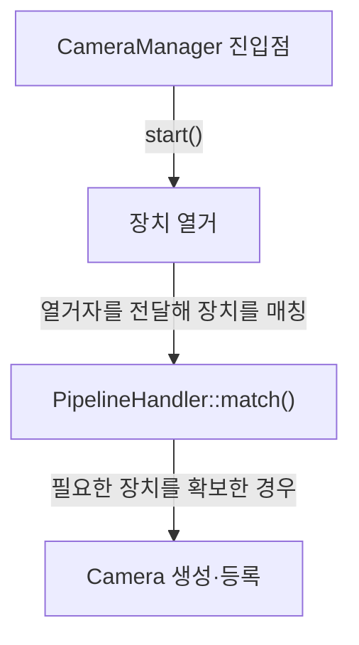
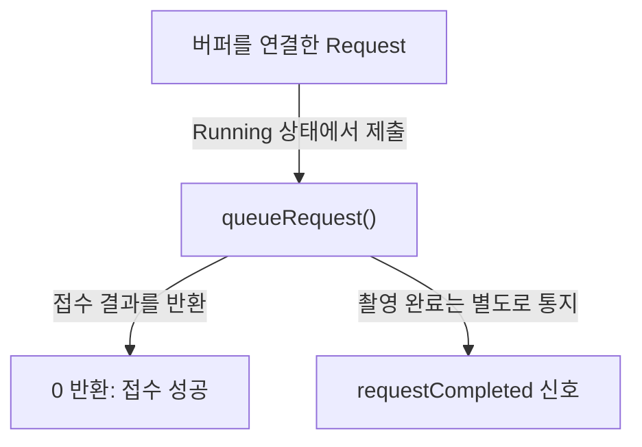
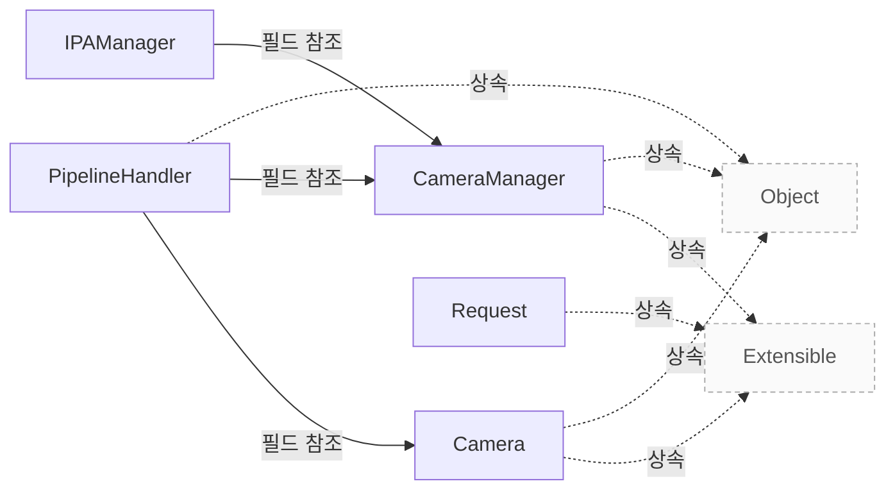

# 시스템 개요

**src/libcamera/camera_manager.cpp의 CameraManager에서 시작해 요청 제출과 완료를 따라가세요.**

| 지금 확인할 내용 | 이동할 절 |
|---|---|
| 처음 읽을 파일과 진입점을 찾습니다. | [탐색과 파이프라인 선택](#탐색과-파이프라인-선택) |
| 요청과 결과가 지나는 경계를 확인합니다. | [요청 제출과 완료](#요청-제출과-완료) |
| 구성 실패의 원인을 좁힙니다. | [구성과 요청 오류 조사](request-diagnosis.md#구성-실패를-좁히는-순서) |
| 요청의 제출 성공과 촬영 완료를 구분하고, 버퍼를 유지할 기간과 오류가 난 위치를 확인하세요. | [요청 처리와 문제 진단](request-lifecycle.md) |
| 수정 전에 상태와 종료 순서를 확인합니다. | [캡처 세션의 상태와 자원](#캡처-세션의-상태와-자원) |
| 빌드한 모든 파이프라인·IPA·앱의 클래스와 함수를 패키지별로 찾으세요. 표는 추출 사실에서 만들었고 동작은 설명하지 않습니다. | [구성 요소 색인](component-index.md) |
| <a id="장치-요청-한도와-대기-큐"></a>장치 요청 수의 기본 한도와 대기 큐를 확인합니다. | [Pipeline 요청 제출과 완료](pipeline-requests.md#장치-요청-한도와-대기-큐) |

## 탐색과 파이프라인 선택

`CameraManager`는 libcamera의 진입점으로서 장치를 열거하고 파이프라인과 연결하며, 애플리케이션이 시스템의 카메라에 접근할 수 있게 합니다. `CameraManager::Private::pipelineFactoryMatch`는 팩토리로 `PipelineHandler`를 반복해서 만들고 장치 열거자와의 매칭을 시도하며, 매칭에 실패하면 반복을 끝냅니다. `CameraManager` 인스턴스는 동시에 하나만 존재할 수 있습니다. 기존 인스턴스를 먼저 삭제하지 않고 두 번째 인스턴스를 생성하려고 하면 동작이 정의되지 않습니다. `src/libcamera/camera_manager.cpp:283`, `src/libcamera/camera_manager.cpp:154`

<!-- sdd:visual:discovery-map -->
### 장치 탐색에서 Camera 접근까지

장치 매칭과 등록의 책임을 따라가세요. 그림은 책임 연결이며 전체 호출 순서나 실행 시간을 나타내지 않습니다.



[Mermaid 원문](overview.discovery-map.mmd)

??? note "그림 근거와 확인 범위"
    소스에 연결한 설계 해석입니다. 자동 연결 검사는 의미 승인이나 기기 실행 검증이 아닙니다.
    
    | 요소·전이 | 소스 근거 |
    |---|---|
    | CameraManager 진입점 | [src/libcamera/camera_manager.cpp:283](#source-f75d22cf73f3402d) |
    | 장치 열거 | [src/libcamera/camera_manager.cpp:329](#source-f58d94d893e03971) |
    | PipelineHandler::match() | [src/libcamera/pipeline_handler.cpp:86](#source-5bbd41c1e725138c) |
    | Camera 생성·등록 | [src/libcamera/pipeline_handler.cpp:86](#source-5bbd41c1e725138c) |
    | start() | [src/libcamera/camera_manager.cpp:329](#source-f58d94d893e03971) |
    | 열거자를 전달해 장치를 매칭 | [src/libcamera/pipeline_handler.cpp:86](#source-5bbd41c1e725138c) |
    | 필요한 장치를 확보한 경우 | [src/libcamera/pipeline_handler.cpp:86](#source-5bbd41c1e725138c) |
<!-- /sdd:visual:discovery-map -->

애플리케이션은 `CameraManager::start()`의 시작이 확인된 뒤부터 카메라 관리자가 중지되거나 해당 카메라가 시스템에서 분리될 때까지 시스템의 카메라를 나열하고 사용할 수 있습니다. 호출자는 `CameraManager::cameras()`와 `CameraManager::get()`을 호출하기 전에 카메라 매니저가 실행 중인지 확인해야 합니다. `PipelineHandler::match()` 구현자는 하나의 파이프라인에 필요한 미디어 장치를 모두 찾은 경우, `enumerator`에서 각 장치를 `MediaDevice::acquire()`로 획득해야 합니다. 그 후 하나 이상의 해당 `Camera` 인스턴스를 생성해 내부에 저장하고 카메라 관리자에 등록해야 합니다. `src/libcamera/camera_manager.cpp:329`, `src/libcamera/camera_manager.cpp:368`, `src/libcamera/pipeline_handler.cpp:86`

근거 원문: [src/libcamera/camera_manager.cpp:283](#source-f75d22cf73f3402d) · [src/libcamera/camera_manager.cpp:329](#source-f58d94d893e03971) · [src/libcamera/camera_manager.cpp:368](#source-0c733673790ad84f) · [src/libcamera/pipeline_handler.cpp:86](#source-5bbd41c1e725138c) · [src/libcamera/camera_manager.cpp:154](#source-0c01857bf49370e2)

## 컴포넌트별 책임

`Camera`는 하나의 이미지 소스에서 하나 이상의 이미지 스트림을 생성할 수 있는 카메라를 나타내며, 장치 설정과 제어 및 이미지 스트림 캡처를 위한 주요 인터페이스를 제공하는 `libcamera`의 중심 객체입니다. `libcamera`는 카메라 인스턴스의 수명을 `std::shared_ptr<>`로 관리하며, 인스턴스는 공유 포인터를 반환하는 `create()` 함수로 생성해야 합니다. `Camera`의 생성자와 소멸자는 비공개이므로 인스턴스를 직접 생성하거나 소멸할 수 없습니다. `src/libcamera/camera.cpp:758`

근거 원문: [src/libcamera/camera.cpp:758](#source-6c066281dcce33d6)

## 요청 생성과 소유권

호출자는 카메라가 `Configured` 또는 `Running` 상태일 때만 `Camera::createRequest()`를 호출해야 합니다. `Camera::createRequest()`가 반환하는 요청의 소유권은 호출자에게 넘어가며, 호출자가 요청을 삭제해야 합니다. 호출자는 동일한 요청을 카메라에 다시 큐에 넣기 전에 `Request::reuse()`를 호출해 요청 상태와 연결된 컨트롤을 초기화해야 합니다. `src/libcamera/camera.cpp:1243`, `src/libcamera/request.cpp:376`

근거 원문: [src/libcamera/camera.cpp:1243](#source-d61960ed2545ba78) · [src/libcamera/request.cpp:376](#source-0556d5e91908d040)

## 캡처 세션의 상태와 자원

애플리케이션은 캡처를 준비하려면 카메라를 획득하고 구성한 뒤 시작해야 합니다. 시작된 카메라는 정지될 때까지 요청을 처리할 수 있으며, 애플리케이션이 카메라 사용을 마치면 카메라를 해제해야 합니다. 애플리케이션은 카메라를 해제하지 않은 동안 카메라를 여러 번 시작하고 정지할 수 있으며, 카메라를 다시 구성할 수도 있습니다. `src/libcamera/camera.cpp:769`

근거 원문: [src/libcamera/camera.cpp:769](#source-04f354bc331ec5c1)

## 요청 제출과 완료

애플리케이션은 `createRequest()`로 할당한 요청을 `Camera::queueRequest()`에 전달하기 전에 최소 한 개의 캡처 버퍼로 채워야 하며, 버퍼가 없는 요청은 유효하지 않아 큐에 들어가지 않고 거부됩니다. `Camera::queueRequest()`로 큐에 넣은 요청의 처리가 완료되면 카메라는 `requestCompleted` 신호로 애플리케이션에 알립니다. 호출자는 카메라가 `Running` 상태일 때만 `Camera::queueRequest()`를 호출해야 합니다. `src/libcamera/camera.cpp:1308`

<!-- sdd:visual:submission-completion -->
### 접수 성공과 촬영 완료는 다른 시점

queueRequest()의 0 반환은 접수 결과입니다. 요청 완료는 별도의 requestCompleted 신호로 확인합니다.



[Mermaid 원문](overview.submission-completion.mmd)

??? note "그림 근거와 확인 범위"
    소스에 연결한 설계 해석입니다. 자동 연결 검사는 의미 승인이나 기기 실행 검증이 아닙니다.
    
    | 요소·전이 | 소스 근거 |
    |---|---|
    | 버퍼를 연결한 Request | [src/libcamera/camera.cpp:1308](#source-2f880c124115c9c4) |
    | queueRequest() | [src/libcamera/camera.cpp:1308](#source-2f880c124115c9c4) |
    | 0 반환: 접수 성공 | [src/libcamera/camera.cpp:1308](#source-2f880c124115c9c4) |
    | requestCompleted 신호 | [src/libcamera/camera.cpp:1308](#source-2f880c124115c9c4) |
    | Running 상태에서 제출 | [src/libcamera/camera.cpp:1308](#source-2f880c124115c9c4) |
    | 접수 결과를 반환 | [src/libcamera/camera.cpp:1308](#source-2f880c124115c9c4) |
    | 촬영 완료는 별도로 통지 | [src/libcamera/camera.cpp:1308](#source-2f880c124115c9c4) |
<!-- /sdd:visual:submission-completion -->

근거 원문: [src/libcamera/camera.cpp:1308](#source-2f880c124115c9c4)

## 버퍼 완료와 요청 완료

`PipelineHandler::completeBuffer()`는 요청에 속한 버퍼의 완료를 애플리케이션에 알림으로 전달하고 요청 내부의 버퍼 추적 정보를 갱신합니다. 파이프라인 핸들러는 마지막 버퍼가 완료된 뒤에도 `completeRequest()`를 명시적으로 호출해야 합니다. `src/libcamera/pipeline_handler.cpp:547`

근거 원문: [src/libcamera/pipeline_handler.cpp:547](#source-ca3f659653ce3f6a)

## 스레드 경계와 동기화

`Camera` 상태를 바꾸는 함수를 호출하는 호출자는 필요한 경우 함수 간 동기화를 보장해야 합니다. 호출자는 `PipelineHandler::completeRequest()`를 `CameraManager` 스레드에서 호출해야 합니다. `src/libcamera/camera.cpp:780`, `src/libcamera/pipeline_handler.cpp:571`

근거 원문: [src/libcamera/camera.cpp:780](#source-33ababe2a4780075) · [src/libcamera/pipeline_handler.cpp:571](#source-7ac40780a56ae3a9)

## 정적 근거의 확인 범위

`Camera::start`는 `isAccessAllowed`에 허용 상태 값으로 `Private::CameraConfigured`를 전달합니다. `Camera::start`의 호출자는 카메라 상태에 영향을 주는 다른 함수와 이 호출을 동기화해야 합니다. 문서화 대상은 카메라 시작 타이밍입니다. `src/libcamera/camera.cpp:1404`, `src/libcamera/camera.cpp:1392`, `src/libcamera/camera.cpp:755`

근거 원문: [src/libcamera/camera.cpp:755](#source-2e73109154ae3a90) · [src/libcamera/camera.cpp:1404](#source-bf3cae669253cabe) · [src/libcamera/camera.cpp:1392](#source-fafa3f473893f595)

??? note "설계 질문과 검증 범위"
    질문별 답변과 근거 연결을 검사했습니다. 의미와 실행 결과는 사람 검토가 필요합니다.
    
    | 설계 질문 | 설명 위치 | 확인 범위 |
    |---|---|---|
    | Camera는 어떤 공개 기능과 객체 수명 계약을 제공합니까? | [컴포넌트별 책임](#컴포넌트별-책임) | 코드 근거와 설명 연결 |
    | 어느 파일과 진입점부터 읽고, 장치 탐색과 카메라 접근은 어떤 순서로 이어집니까? | [탐색과 파이프라인 선택](#탐색과-파이프라인-선택) | 코드 근거와 설명 연결 |
    | 요청 생성의 조건과 소유권·재사용 계약은 무엇입니까? | [요청 생성과 소유권](#요청-생성과-소유권) | 코드 근거와 설명 연결 |
    | 캡처를 준비하고 반복하고 끝내는 순서는 무엇입니까? | [캡처 세션의 상태와 자원](#캡처-세션의-상태와-자원) | 코드 근거와 설명 연결 |
    | 요청을 어떤 조건으로 제출하고 완료를 어떻게 통지받습니까? | [요청 제출과 완료](#요청-제출과-완료) | 코드 근거와 설명 연결 |
    | 버퍼 완료와 요청 완료는 어떻게 구분합니까? | [버퍼 완료와 요청 완료](#버퍼-완료와-요청-완료) | 코드 근거와 설명 연결 |
    | 상태 변경의 동기화 책임과 요청 완료의 실행 스레드는 무엇입니까? | [스레드 경계와 동기화](#스레드-경계와-동기화) | 코드 근거와 설명 연결 |
    | 시작 API의 명시된 계약과 아직 문서화되지 않은 타이밍은 무엇입니까? | [정적 근거의 확인 범위](#정적-근거의-확인-범위) | 코드 근거와 설명 연결 |

## 소스 근거

같은 발췌는 한 번만 싣습니다. 필요한 원문을 펼쳐 설명과 대조하세요.

<a id="source-f75d22cf73f3402d"></a>

??? note "소스 근거: src/libcamera/camera_manager.cpp:283"
    `src/libcamera/camera_manager.cpp:283`에서 시작하는 발췌입니다. 종료 줄은 293이며, 아래 원문을 설명과 대조할 수 있습니다.
    
    SHA-256: `6c52c603a60f0faf8c931e6c1691d951484c4915ef9ab8ac67cc65d89acbb550`
    
    ```text
    The camera manager is the entry point to libcamera. It enumerates devices,
     * associates them with pipeline managers, and provides access to the cameras
     * in the system to applications. The manager owns all Camera objects and
     * handles hot-plugging and hot-unplugging to manage the lifetime of cameras.
     *
     * To interact with libcamera, an application starts by creating a camera
     * manager instance. Only a single instance of the camera manager may exist at
     * a time. Attempting to create a second instance without first deleting the
     * existing instance results in undefined behaviour.
     *
     * The manager is initially stopped,
    ```

<a id="source-f58d94d893e03971"></a>

??? note "소스 근거: src/libcamera/camera_manager.cpp:329"
    `src/libcamera/camera_manager.cpp:329`에서 시작하는 발췌입니다. 종료 줄은 338이며, 아래 원문을 설명과 대조할 수 있습니다.
    
    SHA-256: `5c647185035857e55de76a49cffad27bfac087260af8577a43cc2611196e3c17`
    
    ```text
    \brief Start the camera manager
     *
     * Start the camera manager and enumerate all devices in the system. Once
     * the start has been confirmed the user is free to list and otherwise
     * interact with cameras in the system until either the camera manager
     * is stopped or the camera is unplugged from the system.
     *
     * \return 0 on success or a negative error code otherwise
     */
    int CameraManager::start()
    ```

<a id="source-0c733673790ad84f"></a>

??? note "소스 근거: src/libcamera/camera_manager.cpp:368"
    `src/libcamera/camera_manager.cpp:368`에서 시작하는 발췌입니다. 종료 줄은 398이며, 아래 원문을 설명과 대조할 수 있습니다.
    
    SHA-256: `756e463ef09b825d17af3fc8b7d9912349d46cc84446a0e0c3e9c48fb22d56b6`
    
    ```text
    \fn CameraManager::cameras()
     * \brief Retrieve all available cameras
     *
     * Before calling this function the caller is responsible for ensuring that
     * the camera manager is running.
     *
     * \context This function is \threadsafe.
     *
     * \return List of all available cameras
     */
    std::vector<std::shared_ptr<Camera>> CameraManager::cameras() const
    {
    	const Private *const d = _d();
    
    	MutexLocker locker(d->mutex_);
    
    	return d->cameras_;
    }
    
    /**
     * \brief Get a camera based on ID
     * \param[in] id ID of camera to get
     *
     * Before calling this function the caller is responsible for ensuring that
     * the camera manager is running.
     *
     * \context This function is \threadsafe.
     *
     * \return Shared pointer to Camera object or nullptr if camera not found
     */
    std::shared_ptr<Camera> CameraManager::get(std::string_view id)
    ```

<a id="source-5bbd41c1e725138c"></a>

??? note "소스 근거: src/libcamera/pipeline_handler.cpp:86"
    `src/libcamera/pipeline_handler.cpp:86`에서 시작하는 발췌입니다. 종료 줄은 119이며, 아래 원문을 설명과 대조할 수 있습니다.
    
    SHA-256: `7dde6563cf6bda32f38f4c1fb3ef0443502432236a0222d4f811b3fa71f3fc05`
    
    ```text
    \fn PipelineHandler::match(DeviceEnumerator *enumerator)
     * \brief Match media devices and create camera instances
     * \param[in] enumerator The enumerator providing all media devices found in the
     * system
     *
     * This function is the main entry point of the pipeline handler. It is called
     * by the camera manager with the \a enumerator passed as an argument. It shall
     * acquire from the \a enumerator all the media devices it needs for a single
     * pipeline, create one or multiple Camera instances and register them with the
     * camera manager.
     *
     * If all media devices needed by the pipeline handler are found, they must all
     * be acquired by a call to MediaDevice::acquire(). This function shall then
     * create the corresponding Camera instances, store them internally, and return
     * true. Otherwise it shall not acquire any media device (or shall release all
     * the media devices is has acquired by calling MediaDevice::release()) and
     * return false.
     *
     * If multiple instances of a pipeline are available in the system, the
     * PipelineHandler class will be instantiated once per instance, and its match()
     * function called for every instance. Each call shall acquire media devices for
     * one pipeline instance, until all compatible media devices are exhausted.
     *
     * If this function returns true, a new instance of the pipeline handler will
     * be created and its match() function called.
     *
     * \context This function is called from the CameraManager thread.
     *
     * \return true if media devices have been acquired and camera instances
     * created, or false otherwise
     */
    
    /**
     * \brief Search and acquire a MediaDevice
    ```

<a id="source-0c01857bf49370e2"></a>

??? note "소스 근거: src/libcamera/camera_manager.cpp:154"
    `src/libcamera/camera_manager.cpp:154`에서 시작하는 발췌입니다. 종료 줄은 169이며, 아래 원문을 설명과 대조할 수 있습니다.
    
    SHA-256: `9d849533ca73d2d4d7b3a00c565fb4226d372e08d7001bde8bb3d18eb287f0f4`
    
    ```text
    void CameraManager::Private::pipelineFactoryMatch(const PipelineHandlerFactoryBase *factory)
    {
    	CameraManager *const o = LIBCAMERA_O_PTR();
    
    	/* Provide as many matching pipelines as possible. */
    	while (1) {
    		std::shared_ptr<PipelineHandler> pipe = factory->create(o);
    		if (!pipe->match(enumerator_.get()))
    			break;
    
    		LOG(Camera, Debug)
    			<< "Pipeline handler \"" << factory->name()
    			<< "\" matched";
    	}
    }
    
    ```

<a id="source-6c066281dcce33d6"></a>

??? note "소스 근거: src/libcamera/camera.cpp:758"
    `src/libcamera/camera.cpp:758`에서 시작하는 발췌입니다. 종료 줄은 769이며, 아래 원문을 설명과 대조할 수 있습니다.
    
    SHA-256: `e77cee469b7c57430e4bd4b0f08493289c46b57549873521c476df388d591dc2`
    
    ```text
    The Camera class models a camera capable of producing one or more image
     * streams from a single image source. It provides the main interface to
     * configuring and controlling the device, and capturing image streams. It is
     * the central object exposed by libcamera.
     *
     * To support the central nature of Camera objects, libcamera manages the
     * lifetime of camera instances with std::shared_ptr<>. Instances shall be
     * created with the create() function which returns a shared pointer. The
     * Camera constructors and destructor are private, to prevent instances from
     * being constructed and destroyed manually.
     *
     * \section camera_operation
    ```

<a id="source-d61960ed2545ba78"></a>

??? note "소스 근거: src/libcamera/camera.cpp:1243"
    `src/libcamera/camera.cpp:1243`에서 시작하는 발췌입니다. 종료 줄은 1263이며, 아래 원문을 설명과 대조할 수 있습니다.
    
    SHA-256: `e71b8c0bea6263314881525ebf4714628591079745c9453624d3f4c3dffe31d0`
    
    ```text
    \brief Create a request object for the camera
     * \param[in] cookie Opaque cookie for application use
     *
     * This function creates an empty request for the application to fill with
     * buffers and parameters, and queue for capture.
     *
     * The \a cookie is stored in the request and is accessible through the
     * Request::cookie() function at any time. It is typically used by applications
     * to map the request to an external resource in the request completion
     * handler, and is completely opaque to libcamera.
     *
     * The ownership of the returned request is passed to the caller, which is
     * responsible for deleting it. The request may be deleted in the completion
     * handler, or reused after resetting its state with Request::reuse().
     *
     * \context This function is \threadsafe. It may only be called when the camera
     * is in the Configured or Running state as defined in \ref camera_operation.
     *
     * \return A pointer to the newly created request, or nullptr on error
     */
    std::unique_ptr<Request> Camera::createRequest
    ```

<a id="source-0556d5e91908d040"></a>

??? note "소스 근거: src/libcamera/request.cpp:376"
    `src/libcamera/request.cpp:376`에서 시작하는 발췌입니다. 종료 줄은 404이며, 아래 원문을 설명과 대조할 수 있습니다.
    
    SHA-256: `b8358f2f31eecf64aa785310854e8d8736615d7ad24816d0d1916db424b7f351`
    
    ```text
    \brief Reset the request for reuse
     * \param[in] flags Indicate whether or not to reuse the buffers
     *
     * Reset the status and controls associated with the request, to allow it to
     * be reused and requeued without destruction. This function shall be called
     * prior to queueing the request to the camera, in lieu of constructing a new
     * request. The application can reuse the buffers that were previously added
     * to the request via addBuffer() by setting \a flags to ReuseBuffers.
     */
    void Request::reuse(ReuseFlag flags)
    {
    	LIBCAMERA_TRACEPOINT(request_reuse, this);
    
    	_d()->reset();
    
    	if (flags & ReuseBuffers) {
    		for (const auto &[stream, buffer] : bufferMap_) {
    			buffer->_d()->setRequest(this);
    			_d()->pending_.insert(buffer);
    		}
    	} else {
    		bufferMap_.clear();
    	}
    
    	status_ = RequestPending;
    
    	controls_.clear();
    	_d()->metadata_.clear();
    }
    ```

<a id="source-04f354bc331ec5c1"></a>

??? note "소스 근거: src/libcamera/camera.cpp:769"
    `src/libcamera/camera.cpp:769`에서 시작하는 발췌입니다. 종료 줄은 780이며, 아래 원문을 설명과 대조할 수 있습니다.
    
    SHA-256: `73164878543e86e16cf4e3197648ec4e79819beaad2f1c8754260715f65b8333`
    
    ```text
    \section camera_operation Operating the Camera
     *
     * An application needs to perform a sequence of operations on a camera before
     * it is ready to process requests. The camera needs to be acquired and
     * configured to prepare the camera for capture. Once started the camera can
     * process requests until it is stopped. When an application is done with a
     * camera, the camera needs to be released.
     *
     * An application may start and stop a camera multiple times as long as it is
     * not released. The camera may also be reconfigured.
     *
     * Functions that affect the camera state
    ```

<a id="source-2f880c124115c9c4"></a>

??? note "소스 근거: src/libcamera/camera.cpp:1308"
    `src/libcamera/camera.cpp:1308`에서 시작하는 발췌입니다. 종료 줄은 1330이며, 아래 원문을 설명과 대조할 수 있습니다.
    
    SHA-256: `b24af43d2f808f81b527cf4ee8915451be675f43f877bac5e6edfe69ff3739d6`
    
    ```text
    \brief Queue a request to the camera
     * \param[in] request The request to queue to the camera
     *
     * This function queues a \a request to the camera for capture.
     *
     * After allocating the request with createRequest(), the application shall
     * fill it with at least one capture buffer before queuing it. Requests that
     * contain no buffers are invalid and are rejected without being queued.
     *
     * Once the request has been queued, the camera will notify its completion
     * through the \ref requestCompleted signal.
     *
     * \context This function is \threadsafe. It may only be called when the camera
     * is in the Running state as defined in \ref camera_operation.
     *
     * \return 0 on success or a negative error code otherwise
     * \retval -ENODEV The camera has been disconnected from the system
     * \retval -EACCES The camera is not running so requests can't be queued
     * \retval -EXDEV The request does not belong to this camera
     * \retval -EINVAL The request is invalid
     * \retval -ENOMEM No buffer memory was available to handle the request
     */
    int Camera::queueRequest
    ```

<a id="source-ca3f659653ce3f6a"></a>

??? note "소스 근거: src/libcamera/pipeline_handler.cpp:547"
    `src/libcamera/pipeline_handler.cpp:547`에서 시작하는 발췌입니다. 종료 줄은 563이며, 아래 원문을 설명과 대조할 수 있습니다.
    
    SHA-256: `49b0139e3f0f620c0a3c044caf699179753dddf1b896d48de417c338bbae6a22`
    
    ```text
    \brief Complete a buffer for a request
     * \param[in] request The request the buffer belongs to
     * \param[in] buffer The buffer that has completed
     *
     * This function shall be called by pipeline handlers to signal completion of
     * the \a buffer part of the \a request. It notifies applications of buffer
     * completion and updates the request's internal buffer tracking. The request
     * is not completed automatically when the last buffer completes to give
     * pipeline handlers a chance to perform any operation that may still be
     * needed. They shall complete requests explicitly with completeRequest().
     *
     * \context This function shall be called from the CameraManager thread.
     *
     * \return True if all buffers contained in the request have completed, false
     * otherwise
     */
    bool PipelineHandler::completeBuffer
    ```

<a id="source-33ababe2a4780075"></a>

??? note "소스 근거: src/libcamera/camera.cpp:780"
    `src/libcamera/camera.cpp:780`에서 시작하는 발췌입니다. 종료 줄은 784이며, 아래 원문을 설명과 대조할 수 있습니다.
    
    SHA-256: `943831ed5cf08179455c41bd83a649d74d2a4a2d53f153cfa83dbeff179c2bf6`
    
    ```text
    Functions that affect the camera state as defined below are generally not
     * synchronized with each other by the Camera class. The caller is responsible
     * for ensuring their synchronization if necessary.
     *
     * \subsection Camera States
    ```

<a id="source-7ac40780a56ae3a9"></a>

??? note "소스 근거: src/libcamera/pipeline_handler.cpp:571"
    `src/libcamera/pipeline_handler.cpp:571`에서 시작하는 발췌입니다. 종료 줄은 584이며, 아래 원문을 설명과 대조할 수 있습니다.
    
    SHA-256: `25903b4c6a305017b96bfe9117fe2b7b917b51fbeb2fd21139700b1fbf6a4fe2`
    
    ```text
    \brief Signal request completion
     * \param[in] request The request that has completed
     *
     * The pipeline handler shall call this function to notify the \a camera that
     * the request has completed. The request is no longer managed by the pipeline
     * handler and shall not be accessed once this function returns.
     *
     * This function ensures that requests will be returned to the application in
     * submission order, the pipeline handler may call it on any complete request
     * without any ordering constraint.
     *
     * \context This function shall be called from the CameraManager thread.
     */
    void PipelineHandler::completeRequest
    ```

<a id="source-2e73109154ae3a90"></a>

??? note "소스 근거: src/libcamera/camera.cpp:755"
    `src/libcamera/camera.cpp:755`에서 시작하는 발췌입니다. 종료 줄은 755이며, 아래 원문을 설명과 대조할 수 있습니다.
    
    SHA-256: `fa53c392eca3eb23fa113575f5efb5ed42ce1ea38f034199417d8365c3b79e01`
    
    ```text
    \todo Add documentation for camera start timings.
    ```

<a id="source-bf3cae669253cabe"></a>

??? note "소스 근거: src/libcamera/camera.cpp:1404"
    `src/libcamera/camera.cpp:1404`에서 시작하는 발췌입니다. 종료 줄은 1405이며, 아래 원문을 설명과 대조할 수 있습니다.
    
    SHA-256: `604f18ec7863ac1636e2cf6bf73286d6cfa15a0c6eaad0782eb3c612d0aac4d4`
    
    ```text
    int ret = d->isAccessAllowed(Private::CameraConfigured);
    	if (ret < 0)
    ```

<a id="source-fafa3f473893f595"></a>

??? note "소스 근거: src/libcamera/camera.cpp:1392"
    `src/libcamera/camera.cpp:1392`에서 시작하는 발췌입니다. 종료 줄은 1394이며, 아래 원문을 설명과 대조할 수 있습니다.
    
    SHA-256: `d90d257abdc86817b8a35e31a302a2641c3a5855e14472ff622e08d831a542eb`
    
    ```text
    and shall be
     * synchronized by the caller with other functions that affect the camera
     * state.
    ```


<!-- sdd:class-diagram -->
## 클래스 관계

화살표의 글자는 추출한 관계를 나타내며, 점선은 상속입니다. 화살표는 참조 대상 또는 기반 클래스를 향합니다. 호출 순서를 뜻하지 않습니다.


<!-- /sdd:class-diagram -->


## 선택한 시나리오의 코드 읽기 순서

1. 진입점 `Camera::queueRequest(Request *)`의 입력 검사와 반환 조건을 확인합니다.
2. [요청 제출 (Camera::queueRequest)](scenarios/queue_request.md)에서 주요 호출과 추적 경계를 확인합니다.
3. 예약된 호출과 완료 통지를 구분하고, 실행 스레드는 연결 코드와 대조합니다.

??? note "근거와 검토 정보"
    - 생성 방식: 추출 사실과 LLM 설명
    - 검증 범위: 표·그림은 facts로 만들고 설명은 LLM이 작성합니다. 인용·문장 및 설정된 구조 검사를 적용합니다.
    - 근거 파일: `include/libcamera/camera.h`, `include/libcamera/camera_manager.h`, `include/libcamera/internal/ipa_manager.h`, `include/libcamera/internal/pipeline_handler.h`, `include/libcamera/request.h`, `src/libcamera/base/log.cpp`, `src/libcamera/camera.cpp`, `src/libcamera/camera_manager.cpp`, `src/libcamera/controls.cpp`, `src/libcamera/ipa_manager.cpp`, `src/libcamera/pipeline_handler.cpp`, `src/libcamera/request.cpp`
    - 근거 수준: 코드 확인 (정적 분석, simple_compdb 구성, commit `212c689fcf`)
    - 자동 검사 (인용·문장 및 설정된 구조 검사): 통과
    - 검토 상태 기록일: 2026-10-30 · 사람 검토 전

다음 단계: [카메라와 요청 모델](camera-model.md)
