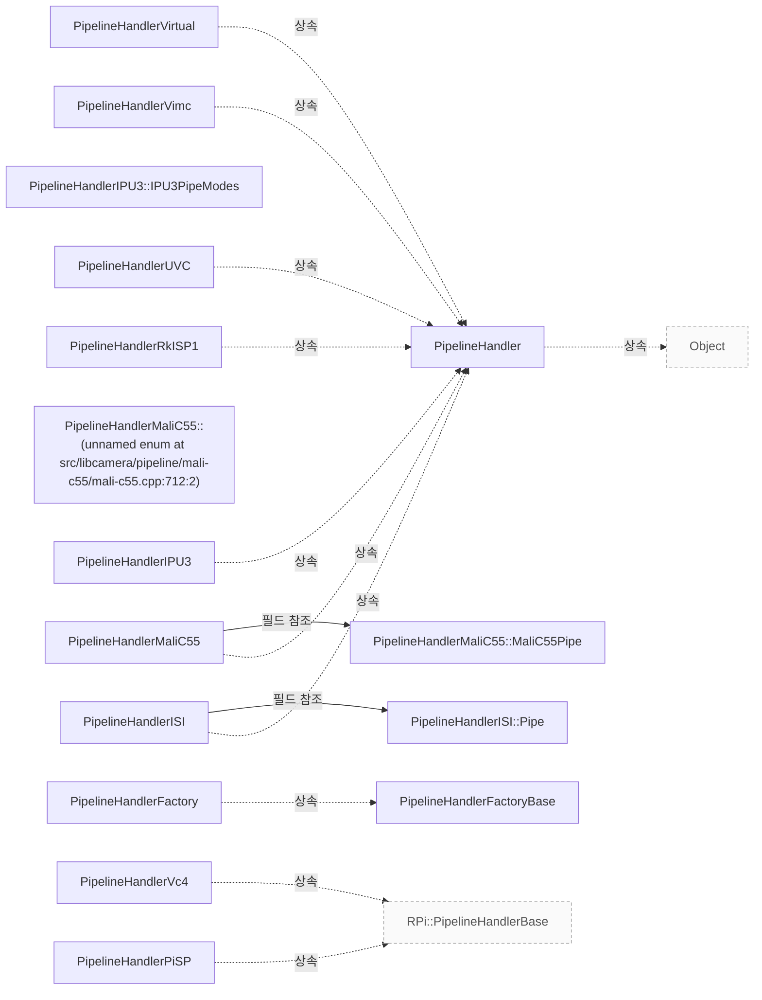

# Pipeline Handler

**파이프라인 구현이 지켜야 하는 구성·요청·완료·종료 계약을 확인하세요.**

| 지금 확인할 내용 | 이동할 절 |
|---|---|
| 장치 매칭과 객체 수명 절을 확인합니다. | [장치 매칭과 객체 수명](#장치-매칭과-객체-수명) |
| 구성의 입력과 검증 책임 절을 확인합니다. | [구성의 입력과 검증 책임](#구성의-입력과-검증-책임) |
| 요청 준비와 장치 큐 절을 확인합니다. | [요청 준비와 장치 큐](#요청-준비와-장치-큐) |
| 버퍼 완료와 요청 반환 절을 확인합니다. | [버퍼 완료와 요청 반환](#버퍼-완료와-요청-반환) |
| 정지와 미완료 요청 절을 확인합니다. | [정지와 미완료 요청](#정지와-미완료-요청) |

## 장치 매칭과 객체 수명

`PipelineHandler`는 열거된 미디어 장치를 지원 파이프라인과 연결하고 `Camera`를 만듭니다. 인스턴스 수명은 `std::shared_ptr`로 관리하며, 멤버 함수에서 공유 포인터를 만들 수 있도록 `std::enable_shared_from_this`를 구현합니다. `src/libcamera/pipeline_handler.cpp:50`

`PipelineHandler`는 직접 생성하지 않고 `PipelineHandlerFactoryBase::create()`를 통해 공유 포인터로 생성해야 합니다. `src/libcamera/pipeline_handler.cpp:50`

`match()`는 `CameraManager` 스레드에서 파이프라인 하나에 필요한 장치를 확보하고 카메라를 생성·등록합니다. 필요한 장치를 모두 찾았으면 `MediaDevice::acquire()`로 확보하고 카메라를 내부에 저장한 뒤 `true`를 반환해야 합니다. 실패하면 장치를 확보하지 않거나 이미 확보한 장치를 모두 해제하고 `false`를 반환해야 합니다. `src/libcamera/pipeline_handler.cpp:50`

`acquireMediaDevice()`는 패턴과 일치하는 사용 가능한 장치를 찾아 확보한 뒤 공유 포인터를 반환합니다. 호출자는 장치를 직접 해제하면 안 되며, 확보한 장치는 핸들러가 파괴될 때 해제됩니다. `src/libcamera/pipeline_handler.cpp:119`

`acquire()`는 같은 프로세스에서 재귀적으로 획득할 수 있지만, 성공한 호출마다 `release()`가 짝을 이뤄야 합니다. 이 접근 관리는 `Camera`가 처리하므로 파이프라인 구현이 두 함수를 직접 호출하지 않습니다. `src/libcamera/pipeline_handler.cpp:119`

`releaseDevice()`는 해제되는 카메라마다 호출됩니다. 여러 카메라가 자원을 공유한다면, 이전에 획득한 모든 카메라의 `releaseDevice()`가 호출되기 전에는 그 자원을 해제하지 않도록 파이프라인 구현이 관리해야 합니다. `src/libcamera/pipeline_handler.cpp:119`

근거 원문: [src/libcamera/pipeline_handler.cpp:50](#source-69bfa9568cf8b5c5) · [src/libcamera/pipeline_handler.cpp:119](#source-a3caf1625bc18d64)

## 구성의 입력과 검증 책임

`generateConfiguration()`은 호출자가 요청한 스트림 역할에 맞는 기본 구성을 만듭니다. 역할을 충족할 수 있으면 유효한 `CameraConfiguration`을, 그렇지 않으면 null 포인터를 반환합니다. 어떤 스레드에서도 호출될 수 있으므로 스레드 안전성을 지키고, 핸들러 안의 카메라 상태를 바꾸지 않아야 합니다. `src/libcamera/pipeline_handler.cpp:271`

`configure()`는 `Camera`가 전달한 스트림 구성을 적용하며 `CameraManager` 스레드에서 호출됩니다. 입력은 이미 `CameraConfiguration::validate()`를 통과했으므로 구현은 추가 검증을 수행하지 않아야 하며, 파생 구성 클래스의 사용자 정의 필드에 의존할 수 있습니다. `src/libcamera/pipeline_handler.cpp:271`

`configure()` 구현은 각 `StreamConfiguration`에 대응하는 `Stream`을 `setStream()`으로 연결해야 합니다. 성공하면 0을, 실패하면 음수 오류 코드를 반환합니다. `src/libcamera/pipeline_handler.cpp:271`

근거 원문: [src/libcamera/pipeline_handler.cpp:271](#source-c81d81d5cce53ab8)

## 요청 준비와 장치 큐

`registerRequest()`는 요청 생성 시 수행할 일회성 초기화 지점입니다. 공통 구현은 요청의 `prepared` 신호를 연결해, 준비가 끝나면 해당 카메라의 `doQueueRequests()`를 호출합니다. `src/libcamera/pipeline_handler.cpp:428`

`queueRequest()`는 요청을 `waitingRequests_`에 넣고 `prepare(300ms)`를 호출합니다. `src/libcamera/pipeline_handler.cpp:428`

`Request::Private::prepare()`는 버퍼의 acquire fence가 신호를 보내기를 기다립니다. 300ms는 준비 완료를 무조건 늦추는 시간이 아니라 선택적인 만료 시간입니다. 기다릴 fence가 없으면 즉시 준비 완료를 알리고, fence가 제대로 신호를 보내지 못하거나 시간이 만료되면 요청을 취소하고 준비 완료 신호를 냅니다. `src/libcamera/request.cpp:199`

`doQueueRequests()`는 장치 큐 크기가 `maxQueuedRequestsDevice_`와 같거나 맨 앞 요청이 아직 준비되지 않았으면 멈춥니다. 뒤의 요청은 앞 요청을 건너뛰지 않습니다. `src/libcamera/pipeline_handler.cpp:428`

재귀적인 순회에 대비하여 `doQueueRequests()`는 대기 큐에서 요청을 제거한 뒤 `doQueueRequest()`를 호출합니다. `src/libcamera/pipeline_handler.cpp:428`

`doQueueRequest()`는 요청을 장치 큐에 추가하고 순번을 부여합니다. 이미 취소된 요청이면 `completeRequest()`로 완료 처리한 뒤 반환하며, 하드웨어 제출로 진행하지 않습니다. 그 외에는 `queueRequestDevice()`를 호출하고, 오류 반환 시 `cancelRequest()`를 호출합니다. `src/libcamera/pipeline_handler.cpp:428`

`queueRequestDevice()` 구현은 요청의 파라미터가 요청에 담긴 버퍼의 프레임에 적용되도록 장치를 설정해야 합니다. `CameraManager` 스레드에서 호출되며, 성공은 0, 실패는 음수 오류 코드로 반환합니다. `src/libcamera/pipeline_handler.cpp:428`

근거 원문: [src/libcamera/pipeline_handler.cpp:428](#source-789eafedfaa7f3c5) · [src/libcamera/request.cpp:199](#source-4f52447929ee8da9)

## 버퍼 완료와 요청 반환

`completeBuffer()`는 `bufferCompleted`로 애플리케이션에 버퍼 완료를 알린 뒤 요청의 버퍼 추적 상태를 갱신합니다. 모든 버퍼가 끝났으면 `true`를 반환하지만 요청 자체를 자동으로 완료하지는 않습니다. 파이프라인 구현은 필요한 후처리를 마치고 `completeRequest()`를 명시적으로 호출해야 합니다. `src/libcamera/pipeline_handler.cpp:547`

`completeRequest()`는 완료된 요청을 애플리케이션에 제출 순서대로 반환하도록 조정합니다. 핸들러는 완료된 요청에 대해 이 함수를 순서와 무관하게 호출할 수 있습니다. 함수가 반환한 뒤에는 핸들러가 해당 요청에 접근하면 안 됩니다. `src/libcamera/pipeline_handler.cpp:547`

`completeRequest()`는 요청을 완료 상태로 바꾼 뒤 장치 큐의 맨 앞부터 확인합니다. 앞 요청이 `RequestPending`이면 반복을 멈추며, 그 요청을 제거하거나 취소하지 않습니다. 완료된 앞 요청은 큐에서 제거하고 `camera->requestComplete()`로 전달합니다. `src/libcamera/pipeline_handler.cpp:547`

`completeRequest()`는 완료 요청을 반환한 뒤 `doQueueRequests()`로 대기 요청의 제출을 다시 시도합니다. `completeBuffer()`와 `completeRequest()`는 `CameraManager` 스레드에서 호출됩니다. `src/libcamera/pipeline_handler.cpp:547`

근거 원문: [src/libcamera/pipeline_handler.cpp:547](#source-01ad7c6605c3296a)

## 정지와 미완료 요청

`PipelineHandler::stop()`은 먼저 `waitingRequests_`를 별도 큐로 옮깁니다. 이렇게 분리하면 `stopDevice()` 안의 완료 통지가 대기 요청을 다시 제출하지 않습니다. 장치 정지 이후에 대기 요청을 취소해 완료 순서를 유지합니다. `src/libcamera/pipeline_handler.cpp:359`

`stop()`은 `stopDevice()`가 끝난 뒤 분리한 대기 요청을 하나씩 취소 표시하고 `doQueueRequest()`에 전달합니다. 이 경로는 순번을 부여하고 요청을 잠시 장치 큐에 넣어 `completeRequest()`로 올바르게 완료하기 위한 처리입니다. 이미 취소된 요청을 하드웨어에 다시 제출하는 단계로 해석하면 안 됩니다. `src/libcamera/pipeline_handler.cpp:359`

`stop()`은 마지막에 두 큐가 비었는지 assertion으로 확인하고 요청 순번을 0으로 되돌립니다. 이 검사는 이후 호출을 차단하지 않습니다. `src/libcamera/pipeline_handler.cpp:359`

`stopDevice()`의 계약은 캡처와 요청 처리를 즉시 멈추고 모든 미완료 요청을 취소하여 오류 상태로 완료하는 것입니다. 버퍼 완료만으로 요청 완료가 자동 발생하지 않으므로, 구현은 명시적인 요청 완료 책임까지 지켜야 합니다. `src/libcamera/pipeline_handler.cpp:359`

근거 원문: [src/libcamera/pipeline_handler.cpp:359](#source-eefd1bbecb1aad0a) · [src/libcamera/pipeline_handler.cpp:547](#source-01ad7c6605c3296a)

??? note "설계 질문과 검증 범위"
    질문별 답변과 근거 연결을 검사했습니다. 의미와 실행 결과는 사람 검토가 필요합니다.
    
    | 설계 질문 | 설명 위치 | 확인 범위 |
    |---|---|---|
    | 핸들러는 어떤 객체와 장치를 만들고 관리합니까? | [장치 매칭과 객체 수명](#장치-매칭과-객체-수명) | 코드 근거와 설명 연결 |
    | 기본 구성과 실제 구성에서 호출자와 구현의 책임은 무엇입니까? | [구성의 입력과 검증 책임](#구성의-입력과-검증-책임) | 코드 근거와 설명 연결 |
    | 요청을 장치로 넘기는 조건과 실패 처리는 무엇입니까? | [요청 준비와 장치 큐](#요청-준비와-장치-큐) | 코드 근거와 설명 연결 |
    | 버퍼 완료, 요청 완료와 접근 가능한 수명은 어떻게 구분됩니까? | [버퍼 완료와 요청 반환](#버퍼-완료와-요청-반환) | 코드 근거와 설명 연결 |
    | 정지 중 재큐잉을 막고 대기 요청을 반환하는 방법은 무엇입니까? | [정지와 미완료 요청](#정지와-미완료-요청) | 코드 근거와 설명 연결 |

## 소스 근거

같은 발췌는 한 번만 싣습니다. 필요한 원문을 펼쳐 설명과 대조하세요.

<a id="source-69bfa9568cf8b5c5"></a>

??? note "소스 근거: src/libcamera/pipeline_handler.cpp:50"
    `src/libcamera/pipeline_handler.cpp:50`에서 시작하는 발췌입니다. 종료 줄은 119이며, 아래 원문을 설명과 대조할 수 있습니다.
    
    SHA-256: `e05278df0a06cb963fe79f772e62d4560b62df15c1411a6b49e32f7ca84d9e74`
    
    ```text
    \class PipelineHandler
     * \brief Create and manage cameras based on a set of media devices
     *
     * The PipelineHandler matches the media devices provided by a DeviceEnumerator
     * with the pipelines it supports and creates corresponding Camera devices.
     *
     * Pipeline handler instances are reference-counted through std::shared_ptr<>.
     * They implement std::enable_shared_from_this<> in order to create new
     * std::shared_ptr<> in code paths originating from member functions of the
     * PipelineHandler class where only the 'this' pointer is available.
     */
    
    /**
     * \brief Construct a PipelineHandler instance
     * \param[in] manager The camera manager
     * \param[in] maxQueuedRequestsDevice The maximum number of requests queued to
     * the device
     *
     * In order to honour the std::enable_shared_from_this<> contract,
     * PipelineHandler instances shall never be constructed manually, but always
     * through the PipelineHandlerFactoryBase::create() function.
     */
    PipelineHandler::PipelineHandler(CameraManager *manager,
    				 unsigned int maxQueuedRequestsDevice)
    	: manager_(manager), maxQueuedRequestsDevice_(maxQueuedRequestsDevice),
    	  useCount_(0)
    {
    }
    
    PipelineHandler::~PipelineHandler()
    {
    	for (std::shared_ptr<MediaDevice> &media : mediaDevices_)
    		media->release();
    }
    
    /**
     * \fn PipelineHandler::match(DeviceEnumerator *enumerator)
     * \brief Match media devices and create camera instances
     * \param[in] enumerator The enumerator providing all media devices found in the
     * system
     *
     * This function is the main entry point of the pipeline handler. It is called
     * by the camera manager with the \a enumerator passed as an argument. It shall
     * acquire from the \a enumerator all the media devices it needs for a single
     * pipeline, create one or multiple Camera instances and register them with the
     * camera manager.
     *
     * If all media devices needed by the pipeline handler are found, they must all
     * be acquired by a call to MediaDevice::acquire(). This function shall then
     * create the corresponding Camera instances, store them internally, and return
     * true. Otherwise it shall not acquire any media device (or shall release all
     * the media devices is has acquired by calling MediaDevice::release()) and
     * return false.
     *
     * If multiple instances of a pipeline are available in the system, the
     * PipelineHandler class will be instantiated once per instance, and its match()
     * function called for every instance. Each call shall acquire media devices for
     * one pipeline instance, until all compatible media devices are exhausted.
     *
     * If this function returns true, a new instance of the pipeline handler will
     * be created and its match() function called.
     *
     * \context This function is called from the CameraManager thread.
     *
     * \return true if media devices have been acquired and camera instances
     * created, or false otherwise
     */
    
    /**
     * \brief Search and acquire a MediaDevice
    ```

<a id="source-a3caf1625bc18d64"></a>

??? note "소스 근거: src/libcamera/pipeline_handler.cpp:119"
    `src/libcamera/pipeline_handler.cpp:119`에서 시작하는 발췌입니다. 종료 줄은 271이며, 아래 원문을 설명과 대조할 수 있습니다.
    
    SHA-256: `379b17c52a1e97055bf78aaabd964595fb3ec506c568d112e552ed1c29235591`
    
    ```text
    \brief Search and acquire a MediaDevice matching a device pattern
     * \param[in] enumerator Enumerator containing all media devices in the system
     * \param[in] dm Device match pattern
     *
     * Search the device \a enumerator for an available media device matching the
     * device match pattern \a dm. Matching media device that have previously been
     * acquired by MediaDevice::acquire() are not considered. If a match is found,
     * the media device is acquired and returned. The caller shall not release the
     * device explicitly, it will be automatically released when the pipeline
     * handler is destroyed.
     *
     * \context This function shall be called from the CameraManager thread.
     *
     * \return A shared pointer to the matching MediaDevice, or nullptr if no match
     * is found
     */
    std::shared_ptr<MediaDevice>
    PipelineHandler::acquireMediaDevice(DeviceEnumerator *enumerator,
    				    const DeviceMatch &dm)
    {
    	std::shared_ptr<MediaDevice> media = enumerator->search(dm);
    	if (!media)
    		return nullptr;
    
    	if (!media->acquire())
    		return nullptr;
    
    	mediaDevices_.push_back(media);
    
    	return media;
    }
    
    /**
     * \brief Acquire exclusive access to the pipeline handler for the process
     *
     * This function locks all the media devices used by the pipeline to ensure
     * that no other process can access them concurrently.
     *
     * Access to a pipeline handler may be acquired recursively from within the
     * same process. Every successful acquire() call shall be matched with a
     * release() call. This allows concurrent access to the same pipeline handler
     * from different cameras within the same process.
     *
     * Pipeline handlers shall not call this function directly as the Camera class
     * handles access internally.
     *
     * \context This function is called from the CameraManager thread.
     *
     * \return True if the pipeline handler was acquired, false if another process
     * has already acquired it
     * \sa release()
     */
    bool PipelineHandler::acquire(Camera *camera)
    {
    	if (useCount_ == 0) {
    		for (std::shared_ptr<MediaDevice> &media : mediaDevices_) {
    			if (!media->lock()) {
    				unlockMediaDevices();
    				return false;
    			}
    		}
    	}
    
    	if (!acquireDevice(camera)) {
    		if (useCount_ == 0)
    			unlockMediaDevices();
    
    		return false;
    	}
    
    	++useCount_;
    	return true;
    }
    
    /**
     * \brief Release exclusive access to the pipeline handler
     * \param[in] camera The camera for which to release data
     *
     * This function releases access to the pipeline handler previously acquired by
     * a call to acquire(). Every release() call shall match a previous successful
     * acquire() call. Calling this function on a pipeline handler that hasn't been
     * acquired results in undefined behaviour.
     *
     * Pipeline handlers shall not call this function directly as the Camera class
     * handles access internally.
     *
     * \context This function is called from the CameraManager thread.
     *
     * \sa acquire()
     */
    void PipelineHandler::release(Camera *camera)
    {
    	ASSERT(useCount_);
    
    	releaseDevice(camera);
    
    	if (useCount_ == 1)
    		unlockMediaDevices();
    
    	--useCount_;
    }
    
    /**
     * \brief Acquire resources associated with this camera
     * \param[in] camera The camera for which to acquire resources
     *
     * Pipeline handlers may override this in order to get resources such as opening
     * devices and allocating buffers when a camera is acquired.
     *
     * This is used by the uvcvideo pipeline handler to delay opening /dev/video#
     * until the camera is acquired to avoid excess power consumption. The delayed
     * opening of /dev/video# is a special case because the kernel uvcvideo driver
     * powers on the USB device as soon as /dev/video# is opened. This behavior
     * should *not* be copied by other pipeline handlers.
     *
     * \context This function is called from the CameraManager thread.
     *
     * \return True on success, false on failure
     * \sa releaseDevice()
     */
    bool PipelineHandler::acquireDevice([[maybe_unused]] Camera *camera)
    {
    	return true;
    }
    
    /**
     * \brief Release resources associated with this camera
     * \param[in] camera The camera for which to release resources
     *
     * Pipeline handlers may override this in order to perform cleanup operations
     * when a camera is released, such as freeing memory.
     *
     * This is called once for every camera that is released. If there are resources
     * shared by multiple cameras then the pipeline handler must take care to not
     * release them until releaseDevice() has been called for all previously
     * acquired cameras.
     *
     * \context This function is called from the CameraManager thread.
     *
     * \sa acquireDevice()
     */
    void PipelineHandler::releaseDevice([[maybe_unused]] Camera *camera)
    {
    }
    
    void PipelineHandler::unlockMediaDevices()
    {
    	for (std::shared_ptr<MediaDevice> &media : mediaDevices_)
    		media->unlock();
    }
    
    /**
     * \fn PipelineHandler::generateConfiguration()
    ```

<a id="source-c81d81d5cce53ab8"></a>

??? note "소스 근거: src/libcamera/pipeline_handler.cpp:271"
    `src/libcamera/pipeline_handler.cpp:271`에서 시작하는 발췌입니다. 종료 줄은 319이며, 아래 원문을 설명과 대조할 수 있습니다.
    
    SHA-256: `5284e6062c894a77328b372676c42c1c97a4a01f9b2dccc4d09c83b2578b0e20`
    
    ```text
    \fn PipelineHandler::generateConfiguration()
     * \brief Generate a camera configuration for a specified camera
     * \param[in] camera The camera to generate a default configuration for
     * \param[in] roles A list of stream roles
     *
     * Generate a default configuration for the \a camera for a specified list of
     * stream roles. The caller shall populate the \a roles with the use-cases it
     * wishes to fetch the default configuration for. The returned configuration
     * can then be examined by the caller to learn about the selected streams and
     * their default parameters.
     *
     * The intended companion to this is \a configure() which can be used to change
     * the group of streams parameters.
     *
     * \context This function may be called from any thread and shall be
     * \threadsafe. It shall not modify the state of the \a camera in the pipeline
     * handler.
     *
     * \return A valid CameraConfiguration if the requested roles can be satisfied,
     * or a null pointer otherwise.
     */
    
    /**
     * \fn PipelineHandler::configure()
     * \brief Configure a group of streams for capture
     * \param[in] camera The camera to configure
     * \param[in] config The camera configurations to setup
     *
     * Configure the specified group of streams for \a camera according to the
     * configuration specified in \a config. The intended caller of this interface
     * is the Camera class which will receive configuration to apply from the
     * application.
     *
     * The configuration is guaranteed to have been validated with
     * CameraConfiguration::validate(). The pipeline handler implementation shall
     * not perform further validation and may rely on any custom field stored in its
     * custom CameraConfiguration derived class.
     *
     * When configuring the camera the pipeline handler shall associate a Stream
     * instance to each StreamConfiguration entry in the CameraConfiguration using
     * the StreamConfiguration::setStream() function.
     *
     * \context This function is called from the CameraManager thread.
     *
     * \return 0 on success or a negative error code otherwise
     */
    
    /**
     * \fn PipelineHandler::exportFrameBuffers()
    ```

<a id="source-789eafedfaa7f3c5"></a>

??? note "소스 근거: src/libcamera/pipeline_handler.cpp:428"
    `src/libcamera/pipeline_handler.cpp:428`에서 시작하는 발췌입니다. 종료 줄은 547이며, 아래 원문을 설명과 대조할 수 있습니다.
    
    SHA-256: `5a7a3397a6034a73fe348ae44eb1e2568d2823e95542fe43386e16359d627180`
    
    ```text
    \fn PipelineHandler::registerRequest()
     * \brief Register a request for use by the pipeline handler
     * \param[in] request The request to register
     *
     * This function is called when the request is created, and allows the pipeline
     * handler to perform any one-time initialization it requries for the request.
     */
    void PipelineHandler::registerRequest(Request *request)
    {
    	/*
    	 * Connect the request prepared signal to notify the pipeline handler
    	 * when a request is ready to be processed.
    	 */
    	request->_d()->prepared.connect(this, [this, request]() {
    		doQueueRequests(request->_d()->camera());
    	});
    }
    
    /**
     * \fn PipelineHandler::queueRequest()
     * \brief Queue a request
     * \param[in] request The request to queue
     *
     * This function queues a capture request to the pipeline handler for
     * processing. The request is first added to the internal list of waiting
     * requests which have to be prepared to make sure they are ready for being
     * queued to the pipeline handler.
     *
     * The queue of waiting requests is iterated and up to \a
     * maxQueuedRequestsDevice_ prepared requests are passed to the pipeline handler
     * in the same order they have been queued by calling this function.
     *
     * If a Request fails during the preparation phase or if the pipeline handler
     * fails in queuing the request to the hardware the request is cancelled.
     *
     * Keeping track of queued requests ensures automatic completion of all requests
     * when the pipeline handler is stopped with stop(). Request completion shall be
     * signalled by the pipeline handler using the completeRequest() function.
     *
     * \context This function is called from the CameraManager thread.
     */
    void PipelineHandler::queueRequest(Request *request)
    {
    	LIBCAMERA_TRACEPOINT(request_queue, request);
    
    	Camera *camera = request->_d()->camera();
    	Camera::Private *data = camera->_d();
    	data->waitingRequests_.push(request);
    
    	request->_d()->prepare(300ms);
    }
    
    /**
     * \brief Queue one requests to the device
     */
    void PipelineHandler::doQueueRequest(Request *request)
    {
    	LIBCAMERA_TRACEPOINT(request_device_queue, request);
    
    	Camera *camera = request->_d()->camera();
    	Camera::Private *data = camera->_d();
    	data->queuedRequests_.push_back(request);
    
    	request->_d()->sequence_ = data->requestSequence_++;
    
    	if (request->_d()->cancelled_) {
    		completeRequest(request);
    		return;
    	}
    
    	int ret = queueRequestDevice(camera, request);
    	if (ret)
    		cancelRequest(request);
    }
    
    /**
     * \brief Queue prepared requests to the device
     *
     * Iterate the list of waiting requests and queue them to the device one
     * by one if they have been prepared.
     */
    void PipelineHandler::doQueueRequests(Camera *camera)
    {
    	Camera::Private *data = camera->_d();
    	while (!data->waitingRequests_.empty()) {
    		if (data->queuedRequests_.size() == maxQueuedRequestsDevice_)
    			break;
    
    		Request *request = data->waitingRequests_.front();
    		if (!request->_d()->prepared_)
    			break;
    
    		/*
    		 * Pop the request first, in case doQueueRequests() is called
    		 * recursively from within doQueueRequest()
    		 */
    		data->waitingRequests_.pop();
    		doQueueRequest(request);
    	}
    }
    
    /**
     * \fn PipelineHandler::queueRequestDevice()
     * \brief Queue a request to the device
     * \param[in] camera The camera to queue the request to
     * \param[in] request The request to queue
     *
     * This function queues a capture request to the device for processing. The
     * request contains a set of buffers associated with streams and a set of
     * parameters. The pipeline handler shall program the device to ensure that the
     * parameters will be applied to the frames captured in the buffers provided in
     * the request.
     *
     * \context This function is called from the CameraManager thread.
     *
     * \return 0 on success or a negative error code otherwise
     */
    
    /**
     * \brief Complete a buffer for a request
    ```

<a id="source-4f52447929ee8da9"></a>

??? note "소스 근거: src/libcamera/request.cpp:199"
    `src/libcamera/request.cpp:199`에서 시작하는 발췌입니다. 종료 줄은 263이며, 아래 원문을 설명과 대조할 수 있습니다.
    
    SHA-256: `97d311c371577c108a7c9e936dc85fca0cbcc912ac3de743229c1d2647590bd3`
    
    ```text
    \brief Prepare the Request to be queued to the device
     * \param[in] timeout Optional expiration timeout
     *
     * Prepare a Request to be queued to the hardware device by ensuring it is
     * ready for the incoming memory transfers.
     *
     * This currently means waiting on each frame buffer acquire fence to be
     * signalled. An optional expiration timeout can be specified. If not all the
     * fences have been signalled correctly before the timeout expires the Request
     * is cancelled.
     *
     * The function immediately emits the prepared signal if all the prepare
     * operations have been completed synchronously. If instead the prepare
     * operations require to wait the completion of asynchronous events, such as
     * fences notifications or timer expiration, the prepared signal is emitted upon
     * the asynchronous event completion.
     *
     * As we currently only handle fences, the function emits the prepared signal
     * immediately if there are no fences to wait on. Otherwise the prepared signal
     * is emitted when all fences have been signalled or the optional timeout has
     * expired.
     *
     * If not all the fences have been correctly signalled or the optional timeout
     * has expired the Request will be cancelled and the Request::prepared signal
     * emitted.
     *
     * The intended user of this function is the PipelineHandler base class, which
     * 'prepares' a Request before queuing it to the hardware device.
     */
    void Request::Private::prepare(std::chrono::milliseconds timeout)
    {
    	/* Create and connect one notifier for each synchronization fence. */
    	for (FrameBuffer *buffer : pending_) {
    		const Fence *fence = buffer->_d()->fence();
    		if (!fence)
    			continue;
    
    		auto [it, inserted] = notifiers_.try_emplace(buffer, fence->fd().get(), EventNotifier::Type::Read);
    		ASSERT(inserted);
    
    		it->second.activated.connect(this, [this, buffer] {
    			notifierActivated(buffer);
    		});
    	}
    
    	if (notifiers_.empty()) {
    		emitPrepareCompleted();
    		return;
    	}
    
    	/*
    	 * In case a timeout is specified, create a timer and set it up.
    	 *
    	 * The timer must be created here instead of in the Request constructor,
    	 * in order to be bound to the pipeline handler thread.
    	 */
    	if (timeout != 0ms) {
    		timer_ = std::make_unique<Timer>();
    		timer_->timeout.connect(this, &Request::Private::timeout);
    		timer_->start(timeout);
    	}
    }
    
    /**
     * \var Request::Private::prepared
    ```

<a id="source-01ad7c6605c3296a"></a>

??? note "소스 근거: src/libcamera/pipeline_handler.cpp:547"
    `src/libcamera/pipeline_handler.cpp:547`에서 시작하는 발췌입니다. 종료 줄은 620이며, 아래 원문을 설명과 대조할 수 있습니다.
    
    SHA-256: `514288cc958de9ff5fd19d46393cec3bb3088f4f08486528d4559071138638c9`
    
    ```text
    \brief Complete a buffer for a request
     * \param[in] request The request the buffer belongs to
     * \param[in] buffer The buffer that has completed
     *
     * This function shall be called by pipeline handlers to signal completion of
     * the \a buffer part of the \a request. It notifies applications of buffer
     * completion and updates the request's internal buffer tracking. The request
     * is not completed automatically when the last buffer completes to give
     * pipeline handlers a chance to perform any operation that may still be
     * needed. They shall complete requests explicitly with completeRequest().
     *
     * \context This function shall be called from the CameraManager thread.
     *
     * \return True if all buffers contained in the request have completed, false
     * otherwise
     */
    bool PipelineHandler::completeBuffer(Request *request, FrameBuffer *buffer)
    {
    	Camera *camera = request->_d()->camera();
    	camera->bufferCompleted.emit(request, buffer);
    	return request->_d()->completeBuffer(buffer);
    }
    
    /**
     * \brief Signal request completion
     * \param[in] request The request that has completed
     *
     * The pipeline handler shall call this function to notify the \a camera that
     * the request has completed. The request is no longer managed by the pipeline
     * handler and shall not be accessed once this function returns.
     *
     * This function ensures that requests will be returned to the application in
     * submission order, the pipeline handler may call it on any complete request
     * without any ordering constraint.
     *
     * \context This function shall be called from the CameraManager thread.
     */
    void PipelineHandler::completeRequest(Request *request)
    {
    	Camera *camera = request->_d()->camera();
    
    	request->_d()->complete();
    
    	Camera::Private *data = camera->_d();
    
    	while (!data->queuedRequests_.empty()) {
    		Request *req = data->queuedRequests_.front();
    		if (req->status() == Request::RequestPending)
    			break;
    
    		ASSERT(!req->hasPendingBuffers());
    		data->queuedRequests_.pop_front();
    		camera->requestComplete(req);
    	}
    
    	/* Allow any waiting requests to be queued to the pipeline. */
    	doQueueRequests(camera);
    }
    
    /**
     * \brief Cancel request and signal its completion
     * \param[in] request The request to cancel
     *
     * This function cancels and completes the request. The same rules as for
     * completeRequest() apply.
     */
    void PipelineHandler::cancelRequest(Request *request)
    {
    	request->_d()->cancel();
    	completeRequest(request);
    }
    
    /**
     * \brief Retrieve the absolute path to a platform configuration file
    ```

<a id="source-eefd1bbecb1aad0a"></a>

??? note "소스 근거: src/libcamera/pipeline_handler.cpp:359"
    `src/libcamera/pipeline_handler.cpp:359`에서 시작하는 발췌입니다. 종료 줄은 414이며, 아래 원문을 설명과 대조할 수 있습니다.
    
    SHA-256: `108b1bea5a8314ba57213d15c1e3ba01abe2b3f8a9e0e1e1281864b5492c7304`
    
    ```text
    \brief Stop capturing from all running streams and cancel pending requests
     * \param[in] camera The camera to stop
     *
     * This function stops capturing and processing requests immediately. All
     * pending requests are cancelled and complete immediately in an error state.
     *
     * \context This function is called from the CameraManager thread.
     */
    void PipelineHandler::stop(Camera *camera)
    {
    	/*
    	 * Take all waiting requests so that they are not requeued in response
    	 * to completeRequest() being called inside stopDevice(). Cancel them
    	 * after the device to keep them in order.
    	 */
    	Camera::Private *data = camera->_d();
    	std::queue<Request *> waitingRequests;
    	waitingRequests.swap(data->waitingRequests_);
    
    	/* Stop the pipeline handler and let the queued requests complete. */
    	stopDevice(camera);
    
    	/* Cancel and signal as complete all waiting requests. */
    	while (!waitingRequests.empty()) {
    		Request *request = waitingRequests.front();
    		waitingRequests.pop();
    
    		/*
    		 * Cancel all requests by marking them as cancelled and calling
    		 * doQueueRequest() instead of cancelRequest(). This ensures
    		 * that the requests get a sequence number and are temporarily
    		 * added to queuedRequests_ so they can be properly completed in
    		 * completeRequest().
    		 */
    		request->_d()->cancel();
    		doQueueRequest(request);
    	}
    
    	/* Make sure no requests are pending. */
    	ASSERT(data->queuedRequests_.empty());
    	ASSERT(data->waitingRequests_.empty());
    
    	data->requestSequence_ = 0;
    }
    
    /**
     * \fn PipelineHandler::stopDevice()
     * \brief Stop capturing from all running streams
     * \param[in] camera The camera to stop
     *
     * This function stops capturing and processing requests immediately. All
     * pending requests are cancelled and complete immediately in an error state.
     */
    
    /**
     * \brief Determine if the camera has any requests pending
    ```


<!-- sdd:class-diagram -->
## 클래스 관계

화살표의 글자는 추출한 관계를 나타내며, 점선은 상속입니다. 화살표는 참조 대상 또는 기반 클래스를 향합니다. 호출 순서를 뜻하지 않습니다.


<!-- /sdd:class-diagram -->


## 관련 클래스

| 클래스 | 선언 위치 | 상속 | 책임 (주석) |
|---|---|---|---|
| `libcamera::PipelineHandler` | `include/libcamera/internal/pipeline_handler.h:34` | `libcamera::Object` | Create and manage cameras based on a set of media devices |
| `libcamera::PipelineHandlerFactory` | `include/libcamera/internal/pipeline_handler.h:144` | `libcamera::PipelineHandlerFactoryBase` | Registration of PipelineHandler classes and creation of instances |
| `libcamera::PipelineHandlerFactoryBase` | `include/libcamera/internal/pipeline_handler.h:121` | – | Base class for pipeline handler factories |
| `libcamera::PipelineHandlerIPU3` | `src/libcamera/pipeline/ipu3/ipu3.cpp:124` | `libcamera::PipelineHandler` | 확인 필요 |
| `libcamera::PipelineHandlerIPU3::IPU3PipeModes` | `src/libcamera/pipeline/ipu3/ipu3.cpp:130` | – | 확인 필요 |
| `libcamera::PipelineHandlerISI` | `src/libcamera/pipeline/imx8-isi/imx8-isi.cpp:102` | `libcamera::PipelineHandler` | 확인 필요 |
| `libcamera::PipelineHandlerISI::Pipe` | `src/libcamera/pipeline/imx8-isi/imx8-isi.cpp:129` | – | 확인 필요 |
| `libcamera::PipelineHandlerMaliC55` | `src/libcamera/pipeline/mali-c55/mali-c55.cpp:676` | `libcamera::PipelineHandler` | 확인 필요 |
| `libcamera::PipelineHandlerMaliC55::(unnamed enum at src/libcamera/pipeline/mali-c55/mali-c55.cpp:712:2)` | `src/libcamera/pipeline/mali-c55/mali-c55.cpp:712` | – | 확인 필요 |
| `libcamera::PipelineHandlerMaliC55::MaliC55Pipe` | `src/libcamera/pipeline/mali-c55/mali-c55.cpp:705` | – | 확인 필요 |
| `libcamera::PipelineHandlerPiSP` | `src/libcamera/pipeline/rpi/pisp/pisp.cpp:852` | `libcamera::RPi::PipelineHandlerBase` | 확인 필요 |
| `libcamera::PipelineHandlerRkISP1` | `src/libcamera/pipeline/rkisp1/rkisp1.cpp:185` | `libcamera::PipelineHandler` | 확인 필요 |
| `libcamera::PipelineHandlerUVC` | `src/libcamera/pipeline/uvcvideo/uvcvideo.cpp:81` | `libcamera::PipelineHandler` | 확인 필요 |
| `libcamera::PipelineHandlerVc4` | `src/libcamera/pipeline/rpi/vc4/vc4.cpp:141` | `libcamera::RPi::PipelineHandlerBase` | 확인 필요 |
| `libcamera::PipelineHandlerVimc` | `src/libcamera/pipeline/vimc/vimc.cpp:84` | `libcamera::PipelineHandler` | 확인 필요 |
| `libcamera::PipelineHandlerVirtual` | `src/libcamera/pipeline/virtual/virtual.cpp:81` | `libcamera::PipelineHandler` | 확인 필요 |

??? note "근거와 검토 정보"
    - 생성 방식: 추출 사실과 LLM 설명
    - 검증 범위: 표·그림은 facts로 만들고 설명은 LLM이 작성합니다. 인용·문장 및 설정된 구조 검사를 적용합니다.
    - 근거 파일: `include/libcamera/internal/pipeline_handler.h`, `src/libcamera/pipeline/imx8-isi/imx8-isi.cpp`, `src/libcamera/pipeline/ipu3/ipu3.cpp`, `src/libcamera/pipeline/mali-c55/mali-c55.cpp`, `src/libcamera/pipeline/rkisp1/rkisp1.cpp`, `src/libcamera/pipeline/rpi/pisp/pisp.cpp`, `src/libcamera/pipeline/rpi/vc4/vc4.cpp`, `src/libcamera/pipeline/uvcvideo/uvcvideo.cpp`, `src/libcamera/pipeline/vimc/vimc.cpp`, `src/libcamera/pipeline/virtual/virtual.cpp`, `src/libcamera/pipeline_handler.cpp`, `src/libcamera/request.cpp`
    - 근거 수준: 코드 확인 (정적 분석, simple_compdb 구성, commit `2c4b67c079`)
    - 자동 검사 (인용·문장 및 설정된 구조 검사): 통과
    - 검토 상태 기록일: 2026-10-24 · 사람 검토 전

다음 단계: [IPA 관련 클래스](ipa.md)
