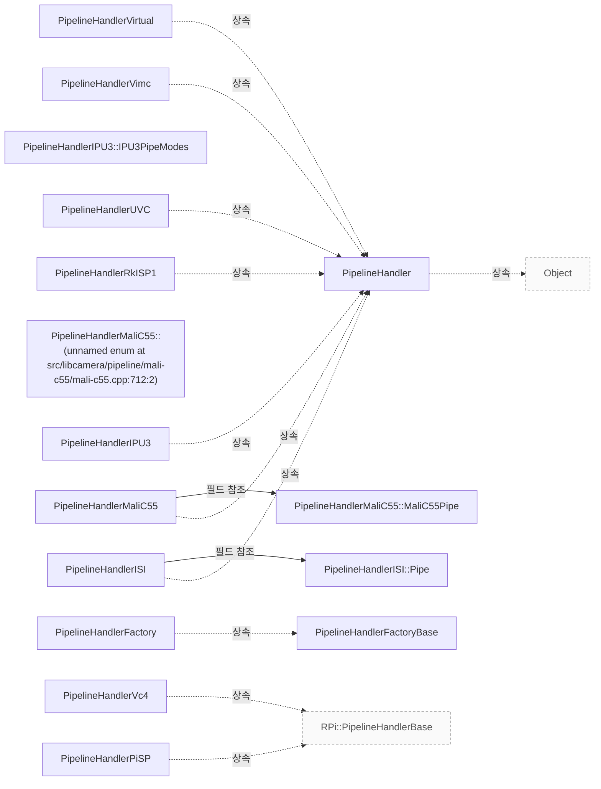

# Pipeline Handler

**파이프라인 구현이 지켜야 하는 구성·요청·완료·종료 계약을 확인하세요.**

| 지금 확인할 내용 | 이동할 절 |
|---|---|
| <a id="요청-준비와-장치-큐"></a>요청 준비와 장치 큐의 조건과 근거를 대조하세요. | [Pipeline 요청 제출과 완료](pipeline-requests.md#요청-준비와-장치-큐) |
| <a id="버퍼-완료와-요청-반환"></a>버퍼 완료와 요청 반환의 조건과 근거를 대조하세요. | [Pipeline 요청 제출과 완료](pipeline-requests.md#버퍼-완료와-요청-반환) |
| <a id="요청이-대기하거나-장치로-가는-조건"></a>“요청이 대기하거나 장치로 가는 조건” 그림을 확인하세요. | [Pipeline 요청 제출과 완료](pipeline-requests.md#요청이-대기하거나-장치로-가는-조건) |
| <a id="버퍼-완료에서-요청-반환까지"></a>“버퍼 완료에서 요청 반환까지” 그림을 확인하세요. | [Pipeline 요청 제출과 완료](pipeline-requests.md#버퍼-완료에서-요청-반환까지) |

## 장치 매칭과 객체 수명

`PipelineHandler`는 `DeviceEnumerator`가 제공한 미디어 장치를 지원하는 파이프라인과 연결하고 해당 `Camera` 장치를 생성하고 관리합니다. 핸들러 인스턴스는 `std::shared_ptr<>`로 참조 횟수를 관리하며, 멤버 함수에서 `this` 포인터만 사용할 수 있는 경로에서 새 공유 포인터를 만들도록 `std::enable_shared_from_this<>`를 구현합니다. 인스턴스는 직접 생성해서는 안 되며 `PipelineHandlerFactoryBase::create()`로 생성해야 합니다. `src/libcamera/pipeline_handler.cpp:50`

카메라 관리자는 `CameraManager` 스레드에서 핸들러의 진입점인 `match()`를 호출합니다. 구현은 한 파이프라인에 필요한 장치를 모두 찾으면 각각 `MediaDevice::acquire()`로 확보하고, 하나 이상의 `Camera` 인스턴스를 만들어 내부에 저장하고 카메라 관리자에 등록한 뒤 `true`를 반환해야 합니다. 필요한 장치를 모두 찾지 못하면 장치를 확보하지 않거나 이미 확보한 장치를 모두 `MediaDevice::release()`로 해제하고 `false`를 반환해야 합니다. `src/libcamera/pipeline_handler.cpp:50`

시스템에 파이프라인 인스턴스가 여러 개 있으면 각 인스턴스에 대해 `PipelineHandler`를 생성하고 `match()`를 호출합니다. 각 호출은 호환되는 장치가 소진될 때까지 파이프라인 인스턴스 하나에 필요한 장치를 확보해야 합니다. `match()`가 `true`를 반환하면 새 핸들러 인스턴스를 만들고 그 `match()`를 호출합니다. `src/libcamera/pipeline_handler.cpp:50`

`acquireMediaDevice()`는 사용 가능한 장치 중 패턴과 일치하는 장치를 찾으며, 이전에 `MediaDevice::acquire()`로 확보한 장치는 고려하지 않습니다. 검색에 실패하거나 장치 확보에 실패하면 `nullptr`를 반환하고, 성공하면 장치를 내부 목록에 추가한 뒤 공유 포인터를 반환합니다. 호출자는 `CameraManager` 스레드에서 이 함수를 호출해야 하며 장치를 직접 해제해서는 안 됩니다. 핸들러가 파괴될 때 장치는 자동으로 해제됩니다. `src/libcamera/pipeline_handler.cpp:119`, `src/libcamera/pipeline_handler.cpp:50`

`Camera` 클래스가 접근을 내부에서 처리하므로 파이프라인 핸들러는 `acquire()`와 `release()`를 직접 호출해서는 안 됩니다. 같은 프로세스에서는 접근을 재귀적으로 확보할 수 있으며, 성공한 `acquire()`마다 `release()`를 한 번 호출해야 합니다. 각 `release()`는 이전에 성공한 `acquire()`와 짝을 이뤄야 하며, 확보하지 않은 핸들러에 호출하면 동작이 정의되지 않습니다. `src/libcamera/pipeline_handler.cpp:119`

`acquire()`는 사용 횟수가 0이면 미디어 장치들을 잠그고, 잠금에 실패하면 장치들의 잠금을 해제한 뒤 `false`를 반환합니다. 이어서 `acquireDevice()`가 실패하면 사용 횟수가 0일 때 장치들의 잠금을 해제하고 `false`를 반환하며, 성공하면 사용 횟수를 늘리고 `true`를 반환합니다. `release()`는 먼저 `releaseDevice()`를 호출하고, 사용 횟수가 1이면 미디어 장치들의 잠금을 해제한 뒤 사용 횟수를 줄입니다. `src/libcamera/pipeline_handler.cpp:119`

파이프라인 핸들러는 카메라를 확보할 때 장치를 열거나 버퍼를 할당하도록 `acquireDevice()`를 재정의할 수 있으며, 기본 구현은 `true`를 반환합니다. 핸들러는 카메라를 해제할 때 메모리 해제 같은 정리 작업을 하도록 `releaseDevice()`를 재정의할 수 있습니다. 여러 카메라가 자원을 공유한다면 핸들러는 이전에 확보한 모든 카메라에 대해 `releaseDevice()`가 호출될 때까지 그 자원을 해제하지 않아야 합니다. `src/libcamera/pipeline_handler.cpp:119`

근거 원문: [src/libcamera/pipeline_handler.cpp:50](#source-69bfa9568cf8b5c5) · [src/libcamera/pipeline_handler.cpp:119](#source-a3caf1625bc18d64)

## 구성의 입력과 검증 책임

`PipelineHandler::generateConfiguration()`의 호출자는 기본 구성을 가져올 사용 사례로 `roles`를 채워야 합니다. 요청한 역할을 충족할 수 있으면 유효한 `CameraConfiguration`을 반환하고, 그렇지 않으면 널 포인터를 반환합니다. 호출자는 반환된 구성에서 선택된 스트림과 기본 매개변수를 확인할 수 있습니다. 이 함수는 어느 스레드에서든 호출될 수 있으며 스레드 안전해야 하고, 파이프라인 핸들러에서 카메라의 상태를 변경해서는 안 됩니다. `src/libcamera/pipeline_handler.cpp:271`

`PipelineHandler::configure()`는 애플리케이션에서 적용할 구성을 받은 `Camera` 클래스가 호출하도록 의도된 인터페이스이며, `CameraManager` 스레드에서 호출됩니다. 구성은 `CameraConfiguration::validate()`로 검증되었음이 보장되므로 파이프라인 핸들러 구현은 추가 검증을 해서는 안 되며, 자체 `CameraConfiguration` 파생 클래스에 저장된 사용자 정의 필드를 사용할 수 있습니다. 구현은 카메라를 구성할 때 `StreamConfiguration::setStream()`으로 각 `StreamConfiguration` 항목에 `Stream` 인스턴스를 연결해야 합니다. 성공하면 0을, 실패하면 음수 오류 코드를 반환합니다. `src/libcamera/pipeline_handler.cpp:271`

근거 원문: [src/libcamera/pipeline_handler.cpp:271](#source-8cd14a802c5b1782)

## 정지와 미완료 요청

`PipelineHandler::stop`은 `waitingRequests_`의 모든 대기 요청을 지역 큐로 옮깁니다. 주석에 따르면 이는 `stopDevice()` 안에서 `completeRequest()`가 호출될 때 대기 요청이 다시 큐에 들어가지 않도록 하고, 순서를 유지하기 위해 장치를 정지한 뒤 요청을 취소하려는 것입니다. 그 직후 `stopDevice(camera)`를 호출합니다. `src/libcamera/pipeline_handler.cpp:359`

`PipelineHandler::stop()`은 `stopDevice()`가 반환한 뒤 분리해 둔 대기 요청을 앞에서부터 하나씩 꺼냅니다. 각 요청에 대해 `cancel()`을 호출해 취소 상태로 표시한 다음 `doQueueRequest()`를 호출합니다. `PipelineHandler::stopDevice()` 구현자는 실행 중인 모든 스트림의 캡처와 요청 처리를 즉시 중단해야 합니다. 대기 중인 모든 요청을 취소하고 오류 상태로 즉시 완료해야 합니다. `src/libcamera/pipeline_handler.cpp:359`

`PipelineHandler::stop()`은 마지막에 `ASSERT`로 `queuedRequests_`와 `waitingRequests_`가 각각 비어 있는지 확인합니다. 이어서 `requestSequence_`를 0으로 초기화합니다. `completeRequest()`는 끝에서 대기 중인 요청을 파이프라인에 전달할 수 있도록 `doQueueRequests(camera)`를 호출합니다. `src/libcamera/pipeline_handler.cpp:359`, `src/libcamera/pipeline_handler.cpp:547`

근거 원문: [src/libcamera/pipeline_handler.cpp:359](#source-eefd1bbecb1aad0a) · [src/libcamera/pipeline_handler.cpp:547](#source-01ad7c6605c3296a)

## IPU3 입력 크기 탐색의 경계

`ImgUDevice::calculatePipeConfig()`는 `minIfWidth`를 `std::max(in.width - ImgUDevice::kIFMaxCropWidth, ImgUDevice::kIFMaxCropWidth)`로, `minIfHeight`를 `std::max(in.height - ImgUDevice::kIFMaxCropHeight, ImgUDevice::kIFMaxCropHeight)`로 계산합니다. 정렬된 폭과 높이는 각각 이 최솟값 이상인 동안 반복하며, 첫 탐색은 폭 반복 안에서 높이를 탐색하고 두 번째 탐색은 폭과 높이를 다시 정렬한 뒤 높이 반복 안에서 폭을 탐색합니다. `src/libcamera/pipeline/ipu3/imgu.cpp:407`

`ImgUDevice::calculatePipeConfig()`의 주석에 따르면 `calculateBDSHeight()`는 높이에서 최대 `kIFMaxCropHeight`줄을 자르므로, 그보다 낮아지면 최소 높이 값이 감겨 돌아갑니다. 이 함수는 `minIfHeight`를 `std::max(in.height - ImgUDevice::kIFMaxCropHeight, ImgUDevice::kIFMaxCropHeight)`로 계산하고, `ifHeight`가 이 값 이상인 동안 `calculateBDS()`를 호출한 뒤 `ImgUDevice::kIFAlignHeight`만큼 줄입니다. `src/libcamera/pipeline/ipu3/imgu.cpp:407`

근거 원문: [src/libcamera/pipeline/ipu3/imgu.cpp:407](#source-0a3a655e40e2f22c)

??? note "설계 질문과 검증 범위"
    질문별 답변과 근거 연결을 검사했습니다. 의미와 실행 결과는 사람 검토가 필요합니다.
    
    | 설계 질문 | 설명 위치 | 확인 범위 |
    |---|---|---|
    | 핸들러는 어떤 객체와 장치를 만들고 관리합니까? | [장치 매칭과 객체 수명](#장치-매칭과-객체-수명) | 코드 근거와 설명 연결 |
    | 기본 구성과 실제 구성에서 호출자와 구현의 책임은 무엇입니까? | [구성의 입력과 검증 책임](#구성의-입력과-검증-책임) | 코드 근거와 설명 연결 |
    | 정지 중 재큐잉을 막고 대기 요청을 반환하는 방법은 무엇입니까? | [정지와 미완료 요청](#정지와-미완료-요청) | 코드 근거와 설명 연결 |
    | IPU3에서 입력 크기를 탐색하는 두 반복문은 최소 폭·높이를 어떻게 계산하며, 높이를 자르는 연산과 unsigned 경계는 어떤 관계입니까? 소스에 있는 식과 조건을 구분하고 기기 동작이나 성능을 보장하지 마세요. | [IPU3 입력 크기 탐색의 경계](#ipu3-입력-크기-탐색의-경계) | 코드 근거와 설명 연결 |

## 소스 근거

같은 발췌는 한 번만 싣습니다. 필요한 원문을 펼쳐 설명과 대조하세요.

<a id="source-69bfa9568cf8b5c5"></a>

??? note "소스 근거: src/libcamera/pipeline_handler.cpp:50"
    `src/libcamera/pipeline_handler.cpp:50`에서 시작하는 발췌입니다. 종료 줄은 119이며, 아래 원문을 설명과 대조할 수 있습니다.
    
    SHA-256: `e05278df0a06cb963fe79f772e62d4560b62df15c1411a6b49e32f7ca84d9e74`
    
    ```text
    \class PipelineHandler
     * \brief Create and manage cameras based on a set of media devices
     *
     * The PipelineHandler matches the media devices provided by a DeviceEnumerator
     * with the pipelines it supports and creates corresponding Camera devices.
     *
     * Pipeline handler instances are reference-counted through std::shared_ptr<>.
     * They implement std::enable_shared_from_this<> in order to create new
     * std::shared_ptr<> in code paths originating from member functions of the
     * PipelineHandler class where only the 'this' pointer is available.
     */
    
    /**
     * \brief Construct a PipelineHandler instance
     * \param[in] manager The camera manager
     * \param[in] maxQueuedRequestsDevice The maximum number of requests queued to
     * the device
     *
     * In order to honour the std::enable_shared_from_this<> contract,
     * PipelineHandler instances shall never be constructed manually, but always
     * through the PipelineHandlerFactoryBase::create() function.
     */
    PipelineHandler::PipelineHandler(CameraManager *manager,
    				 unsigned int maxQueuedRequestsDevice)
    	: manager_(manager), maxQueuedRequestsDevice_(maxQueuedRequestsDevice),
    	  useCount_(0)
    {
    }
    
    PipelineHandler::~PipelineHandler()
    {
    	for (std::shared_ptr<MediaDevice> &media : mediaDevices_)
    		media->release();
    }
    
    /**
     * \fn PipelineHandler::match(DeviceEnumerator *enumerator)
     * \brief Match media devices and create camera instances
     * \param[in] enumerator The enumerator providing all media devices found in the
     * system
     *
     * This function is the main entry point of the pipeline handler. It is called
     * by the camera manager with the \a enumerator passed as an argument. It shall
     * acquire from the \a enumerator all the media devices it needs for a single
     * pipeline, create one or multiple Camera instances and register them with the
     * camera manager.
     *
     * If all media devices needed by the pipeline handler are found, they must all
     * be acquired by a call to MediaDevice::acquire(). This function shall then
     * create the corresponding Camera instances, store them internally, and return
     * true. Otherwise it shall not acquire any media device (or shall release all
     * the media devices is has acquired by calling MediaDevice::release()) and
     * return false.
     *
     * If multiple instances of a pipeline are available in the system, the
     * PipelineHandler class will be instantiated once per instance, and its match()
     * function called for every instance. Each call shall acquire media devices for
     * one pipeline instance, until all compatible media devices are exhausted.
     *
     * If this function returns true, a new instance of the pipeline handler will
     * be created and its match() function called.
     *
     * \context This function is called from the CameraManager thread.
     *
     * \return true if media devices have been acquired and camera instances
     * created, or false otherwise
     */
    
    /**
     * \brief Search and acquire a MediaDevice
    ```

<a id="source-a3caf1625bc18d64"></a>

??? note "소스 근거: src/libcamera/pipeline_handler.cpp:119"
    `src/libcamera/pipeline_handler.cpp:119`에서 시작하는 발췌입니다. 종료 줄은 271이며, 아래 원문을 설명과 대조할 수 있습니다.
    
    SHA-256: `379b17c52a1e97055bf78aaabd964595fb3ec506c568d112e552ed1c29235591`
    
    ```text
    \brief Search and acquire a MediaDevice matching a device pattern
     * \param[in] enumerator Enumerator containing all media devices in the system
     * \param[in] dm Device match pattern
     *
     * Search the device \a enumerator for an available media device matching the
     * device match pattern \a dm. Matching media device that have previously been
     * acquired by MediaDevice::acquire() are not considered. If a match is found,
     * the media device is acquired and returned. The caller shall not release the
     * device explicitly, it will be automatically released when the pipeline
     * handler is destroyed.
     *
     * \context This function shall be called from the CameraManager thread.
     *
     * \return A shared pointer to the matching MediaDevice, or nullptr if no match
     * is found
     */
    std::shared_ptr<MediaDevice>
    PipelineHandler::acquireMediaDevice(DeviceEnumerator *enumerator,
    				    const DeviceMatch &dm)
    {
    	std::shared_ptr<MediaDevice> media = enumerator->search(dm);
    	if (!media)
    		return nullptr;
    
    	if (!media->acquire())
    		return nullptr;
    
    	mediaDevices_.push_back(media);
    
    	return media;
    }
    
    /**
     * \brief Acquire exclusive access to the pipeline handler for the process
     *
     * This function locks all the media devices used by the pipeline to ensure
     * that no other process can access them concurrently.
     *
     * Access to a pipeline handler may be acquired recursively from within the
     * same process. Every successful acquire() call shall be matched with a
     * release() call. This allows concurrent access to the same pipeline handler
     * from different cameras within the same process.
     *
     * Pipeline handlers shall not call this function directly as the Camera class
     * handles access internally.
     *
     * \context This function is called from the CameraManager thread.
     *
     * \return True if the pipeline handler was acquired, false if another process
     * has already acquired it
     * \sa release()
     */
    bool PipelineHandler::acquire(Camera *camera)
    {
    	if (useCount_ == 0) {
    		for (std::shared_ptr<MediaDevice> &media : mediaDevices_) {
    			if (!media->lock()) {
    				unlockMediaDevices();
    				return false;
    			}
    		}
    	}
    
    	if (!acquireDevice(camera)) {
    		if (useCount_ == 0)
    			unlockMediaDevices();
    
    		return false;
    	}
    
    	++useCount_;
    	return true;
    }
    
    /**
     * \brief Release exclusive access to the pipeline handler
     * \param[in] camera The camera for which to release data
     *
     * This function releases access to the pipeline handler previously acquired by
     * a call to acquire(). Every release() call shall match a previous successful
     * acquire() call. Calling this function on a pipeline handler that hasn't been
     * acquired results in undefined behaviour.
     *
     * Pipeline handlers shall not call this function directly as the Camera class
     * handles access internally.
     *
     * \context This function is called from the CameraManager thread.
     *
     * \sa acquire()
     */
    void PipelineHandler::release(Camera *camera)
    {
    	ASSERT(useCount_);
    
    	releaseDevice(camera);
    
    	if (useCount_ == 1)
    		unlockMediaDevices();
    
    	--useCount_;
    }
    
    /**
     * \brief Acquire resources associated with this camera
     * \param[in] camera The camera for which to acquire resources
     *
     * Pipeline handlers may override this in order to get resources such as opening
     * devices and allocating buffers when a camera is acquired.
     *
     * This is used by the uvcvideo pipeline handler to delay opening /dev/video#
     * until the camera is acquired to avoid excess power consumption. The delayed
     * opening of /dev/video# is a special case because the kernel uvcvideo driver
     * powers on the USB device as soon as /dev/video# is opened. This behavior
     * should *not* be copied by other pipeline handlers.
     *
     * \context This function is called from the CameraManager thread.
     *
     * \return True on success, false on failure
     * \sa releaseDevice()
     */
    bool PipelineHandler::acquireDevice([[maybe_unused]] Camera *camera)
    {
    	return true;
    }
    
    /**
     * \brief Release resources associated with this camera
     * \param[in] camera The camera for which to release resources
     *
     * Pipeline handlers may override this in order to perform cleanup operations
     * when a camera is released, such as freeing memory.
     *
     * This is called once for every camera that is released. If there are resources
     * shared by multiple cameras then the pipeline handler must take care to not
     * release them until releaseDevice() has been called for all previously
     * acquired cameras.
     *
     * \context This function is called from the CameraManager thread.
     *
     * \sa acquireDevice()
     */
    void PipelineHandler::releaseDevice([[maybe_unused]] Camera *camera)
    {
    }
    
    void PipelineHandler::unlockMediaDevices()
    {
    	for (std::shared_ptr<MediaDevice> &media : mediaDevices_)
    		media->unlock();
    }
    
    /**
     * \fn PipelineHandler::generateConfiguration()
    ```

<a id="source-8cd14a802c5b1782"></a>

??? note "소스 근거: src/libcamera/pipeline_handler.cpp:271"
    `src/libcamera/pipeline_handler.cpp:271`에서 시작하는 발췌입니다. 종료 줄은 315이며, 아래 원문을 설명과 대조할 수 있습니다.
    
    SHA-256: `56e3a59872a70fc01b1bfdea1601201880929f47ae90d7888c2cf4c080085ea6`
    
    ```text
    \fn PipelineHandler::generateConfiguration()
     * \brief Generate a camera configuration for a specified camera
     * \param[in] camera The camera to generate a default configuration for
     * \param[in] roles A list of stream roles
     *
     * Generate a default configuration for the \a camera for a specified list of
     * stream roles. The caller shall populate the \a roles with the use-cases it
     * wishes to fetch the default configuration for. The returned configuration
     * can then be examined by the caller to learn about the selected streams and
     * their default parameters.
     *
     * The intended companion to this is \a configure() which can be used to change
     * the group of streams parameters.
     *
     * \context This function may be called from any thread and shall be
     * \threadsafe. It shall not modify the state of the \a camera in the pipeline
     * handler.
     *
     * \return A valid CameraConfiguration if the requested roles can be satisfied,
     * or a null pointer otherwise.
     */
    
    /**
     * \fn PipelineHandler::configure()
     * \brief Configure a group of streams for capture
     * \param[in] camera The camera to configure
     * \param[in] config The camera configurations to setup
     *
     * Configure the specified group of streams for \a camera according to the
     * configuration specified in \a config. The intended caller of this interface
     * is the Camera class which will receive configuration to apply from the
     * application.
     *
     * The configuration is guaranteed to have been validated with
     * CameraConfiguration::validate(). The pipeline handler implementation shall
     * not perform further validation and may rely on any custom field stored in its
     * custom CameraConfiguration derived class.
     *
     * When configuring the camera the pipeline handler shall associate a Stream
     * instance to each StreamConfiguration entry in the CameraConfiguration using
     * the StreamConfiguration::setStream() function.
     *
     * \context This function is called from the CameraManager thread.
     *
     * \return 0 on success or a negative error code otherwise
    ```

<a id="source-eefd1bbecb1aad0a"></a>

??? note "소스 근거: src/libcamera/pipeline_handler.cpp:359"
    `src/libcamera/pipeline_handler.cpp:359`에서 시작하는 발췌입니다. 종료 줄은 414이며, 아래 원문을 설명과 대조할 수 있습니다.
    
    SHA-256: `108b1bea5a8314ba57213d15c1e3ba01abe2b3f8a9e0e1e1281864b5492c7304`
    
    ```text
    \brief Stop capturing from all running streams and cancel pending requests
     * \param[in] camera The camera to stop
     *
     * This function stops capturing and processing requests immediately. All
     * pending requests are cancelled and complete immediately in an error state.
     *
     * \context This function is called from the CameraManager thread.
     */
    void PipelineHandler::stop(Camera *camera)
    {
    	/*
    	 * Take all waiting requests so that they are not requeued in response
    	 * to completeRequest() being called inside stopDevice(). Cancel them
    	 * after the device to keep them in order.
    	 */
    	Camera::Private *data = camera->_d();
    	std::queue<Request *> waitingRequests;
    	waitingRequests.swap(data->waitingRequests_);
    
    	/* Stop the pipeline handler and let the queued requests complete. */
    	stopDevice(camera);
    
    	/* Cancel and signal as complete all waiting requests. */
    	while (!waitingRequests.empty()) {
    		Request *request = waitingRequests.front();
    		waitingRequests.pop();
    
    		/*
    		 * Cancel all requests by marking them as cancelled and calling
    		 * doQueueRequest() instead of cancelRequest(). This ensures
    		 * that the requests get a sequence number and are temporarily
    		 * added to queuedRequests_ so they can be properly completed in
    		 * completeRequest().
    		 */
    		request->_d()->cancel();
    		doQueueRequest(request);
    	}
    
    	/* Make sure no requests are pending. */
    	ASSERT(data->queuedRequests_.empty());
    	ASSERT(data->waitingRequests_.empty());
    
    	data->requestSequence_ = 0;
    }
    
    /**
     * \fn PipelineHandler::stopDevice()
     * \brief Stop capturing from all running streams
     * \param[in] camera The camera to stop
     *
     * This function stops capturing and processing requests immediately. All
     * pending requests are cancelled and complete immediately in an error state.
     */
    
    /**
     * \brief Determine if the camera has any requests pending
    ```

<a id="source-01ad7c6605c3296a"></a>

??? note "소스 근거: src/libcamera/pipeline_handler.cpp:547"
    `src/libcamera/pipeline_handler.cpp:547`에서 시작하는 발췌입니다. 종료 줄은 620이며, 아래 원문을 설명과 대조할 수 있습니다.
    
    SHA-256: `514288cc958de9ff5fd19d46393cec3bb3088f4f08486528d4559071138638c9`
    
    ```text
    \brief Complete a buffer for a request
     * \param[in] request The request the buffer belongs to
     * \param[in] buffer The buffer that has completed
     *
     * This function shall be called by pipeline handlers to signal completion of
     * the \a buffer part of the \a request. It notifies applications of buffer
     * completion and updates the request's internal buffer tracking. The request
     * is not completed automatically when the last buffer completes to give
     * pipeline handlers a chance to perform any operation that may still be
     * needed. They shall complete requests explicitly with completeRequest().
     *
     * \context This function shall be called from the CameraManager thread.
     *
     * \return True if all buffers contained in the request have completed, false
     * otherwise
     */
    bool PipelineHandler::completeBuffer(Request *request, FrameBuffer *buffer)
    {
    	Camera *camera = request->_d()->camera();
    	camera->bufferCompleted.emit(request, buffer);
    	return request->_d()->completeBuffer(buffer);
    }
    
    /**
     * \brief Signal request completion
     * \param[in] request The request that has completed
     *
     * The pipeline handler shall call this function to notify the \a camera that
     * the request has completed. The request is no longer managed by the pipeline
     * handler and shall not be accessed once this function returns.
     *
     * This function ensures that requests will be returned to the application in
     * submission order, the pipeline handler may call it on any complete request
     * without any ordering constraint.
     *
     * \context This function shall be called from the CameraManager thread.
     */
    void PipelineHandler::completeRequest(Request *request)
    {
    	Camera *camera = request->_d()->camera();
    
    	request->_d()->complete();
    
    	Camera::Private *data = camera->_d();
    
    	while (!data->queuedRequests_.empty()) {
    		Request *req = data->queuedRequests_.front();
    		if (req->status() == Request::RequestPending)
    			break;
    
    		ASSERT(!req->hasPendingBuffers());
    		data->queuedRequests_.pop_front();
    		camera->requestComplete(req);
    	}
    
    	/* Allow any waiting requests to be queued to the pipeline. */
    	doQueueRequests(camera);
    }
    
    /**
     * \brief Cancel request and signal its completion
     * \param[in] request The request to cancel
     *
     * This function cancels and completes the request. The same rules as for
     * completeRequest() apply.
     */
    void PipelineHandler::cancelRequest(Request *request)
    {
    	request->_d()->cancel();
    	completeRequest(request);
    }
    
    /**
     * \brief Retrieve the absolute path to a platform configuration file
    ```

<a id="source-0a3a655e40e2f22c"></a>

??? note "소스 근거: src/libcamera/pipeline/ipu3/imgu.cpp:407"
    `src/libcamera/pipeline/ipu3/imgu.cpp:407`에서 시작하는 발췌입니다. 종료 줄은 432이며, 아래 원문을 설명과 대조할 수 있습니다.
    
    SHA-256: `caaf201c484425f0c29e2c7614f44984054c5205d24676ee87a7c115c093643b`
    
    ```text
    float bdsSF = static_cast<float>(in.width) / gdc.width;
    	float sf = findScaleFactor(bdsSF, bdsScalingFactors, true);
    
    	/*
    	 * Populate the configurations vector by scaling width and height.
    	 *
    	 * calculateBDSHeight() crops up to kIFMaxCropHeight lines from the IF
    	 * height, so don't go below that, or its minimum IF height wraps.
    	 */
    	unsigned int ifWidth = utils::alignUp(in.width, ImgUDevice::kIFAlignWidth);
    	unsigned int ifHeight = utils::alignUp(in.height, ImgUDevice::kIFAlignHeight);
    	unsigned int minIfWidth = std::max(in.width - ImgUDevice::kIFMaxCropWidth,
    					   ImgUDevice::kIFMaxCropWidth);
    	unsigned int minIfHeight = std::max(in.height - ImgUDevice::kIFMaxCropHeight,
    					    ImgUDevice::kIFMaxCropHeight);
    	while (ifWidth >= minIfWidth) {
    		while (ifHeight >= minIfHeight) {
    			Size iif{ ifWidth, ifHeight };
    			calculateBDS(pipe, iif, gdc, sf);
    			ifHeight -= ImgUDevice::kIFAlignHeight;
    		}
    
    		ifWidth -= ImgUDevice::kIFAlignWidth;
    	}
    
    	/* Repeat search by scaling width first. */
    ```


<!-- sdd:class-diagram -->
## 클래스 관계

화살표의 글자는 추출한 관계를 나타내며, 점선은 상속입니다. 화살표는 참조 대상 또는 기반 클래스를 향합니다. 호출 순서를 뜻하지 않습니다.


<!-- /sdd:class-diagram -->


## 관련 클래스

| 클래스 | 선언 위치 | 상속 | 책임 (주석) |
|---|---|---|---|
| `libcamera::PipelineHandler` | `include/libcamera/internal/pipeline_handler.h:34` | `libcamera::Object` | Create and manage cameras based on a set of media devices |
| `libcamera::PipelineHandlerFactory` | `include/libcamera/internal/pipeline_handler.h:144` | `libcamera::PipelineHandlerFactoryBase` | Registration of PipelineHandler classes and creation of instances |
| `libcamera::PipelineHandlerFactoryBase` | `include/libcamera/internal/pipeline_handler.h:121` | – | Base class for pipeline handler factories |
| `libcamera::PipelineHandlerIPU3` | `src/libcamera/pipeline/ipu3/ipu3.cpp:124` | `libcamera::PipelineHandler` | 확인 필요 |
| `libcamera::PipelineHandlerIPU3::IPU3PipeModes` | `src/libcamera/pipeline/ipu3/ipu3.cpp:130` | – | 확인 필요 |
| `libcamera::PipelineHandlerISI` | `src/libcamera/pipeline/imx8-isi/imx8-isi.cpp:102` | `libcamera::PipelineHandler` | 확인 필요 |
| `libcamera::PipelineHandlerISI::Pipe` | `src/libcamera/pipeline/imx8-isi/imx8-isi.cpp:129` | – | 확인 필요 |
| `libcamera::PipelineHandlerMaliC55` | `src/libcamera/pipeline/mali-c55/mali-c55.cpp:676` | `libcamera::PipelineHandler` | 확인 필요 |
| `libcamera::PipelineHandlerMaliC55::(unnamed enum at src/libcamera/pipeline/mali-c55/mali-c55.cpp:712:2)` | `src/libcamera/pipeline/mali-c55/mali-c55.cpp:712` | – | 확인 필요 |
| `libcamera::PipelineHandlerMaliC55::MaliC55Pipe` | `src/libcamera/pipeline/mali-c55/mali-c55.cpp:705` | – | 확인 필요 |
| `libcamera::PipelineHandlerPiSP` | `src/libcamera/pipeline/rpi/pisp/pisp.cpp:852` | `libcamera::RPi::PipelineHandlerBase` | 확인 필요 |
| `libcamera::PipelineHandlerRkISP1` | `src/libcamera/pipeline/rkisp1/rkisp1.cpp:185` | `libcamera::PipelineHandler` | 확인 필요 |
| `libcamera::PipelineHandlerUVC` | `src/libcamera/pipeline/uvcvideo/uvcvideo.cpp:81` | `libcamera::PipelineHandler` | 확인 필요 |
| `libcamera::PipelineHandlerVc4` | `src/libcamera/pipeline/rpi/vc4/vc4.cpp:141` | `libcamera::RPi::PipelineHandlerBase` | 확인 필요 |
| `libcamera::PipelineHandlerVimc` | `src/libcamera/pipeline/vimc/vimc.cpp:84` | `libcamera::PipelineHandler` | 확인 필요 |
| `libcamera::PipelineHandlerVirtual` | `src/libcamera/pipeline/virtual/virtual.cpp:81` | `libcamera::PipelineHandler` | 확인 필요 |

??? note "근거와 검토 정보"
    - 생성 방식: 추출 사실과 LLM 설명
    - 검증 범위: 표·그림은 facts로 만들고 설명은 LLM이 작성합니다. 인용·문장 및 설정된 구조 검사를 적용합니다.
    - 근거 파일: `include/libcamera/internal/pipeline_handler.h`, `src/libcamera/pipeline/imx8-isi/imx8-isi.cpp`, `src/libcamera/pipeline/ipu3/imgu.cpp`, `src/libcamera/pipeline/ipu3/ipu3.cpp`, `src/libcamera/pipeline/mali-c55/mali-c55.cpp`, `src/libcamera/pipeline/rkisp1/rkisp1.cpp`, `src/libcamera/pipeline/rpi/pisp/pisp.cpp`, `src/libcamera/pipeline/rpi/vc4/vc4.cpp`, `src/libcamera/pipeline/uvcvideo/uvcvideo.cpp`, `src/libcamera/pipeline/vimc/vimc.cpp`, `src/libcamera/pipeline/virtual/virtual.cpp`, `src/libcamera/pipeline_handler.cpp`
    - 근거 수준: 코드 확인 (정적 분석, simple_compdb 구성, commit `212c689fcf`)
    - 자동 검사 (인용·문장 및 설정된 구조 검사): 통과
    - 검토 상태 기록일: 2026-10-30 · 사람 검토 전

다음 단계: [Pipeline 요청 제출과 완료](pipeline-requests.md)
