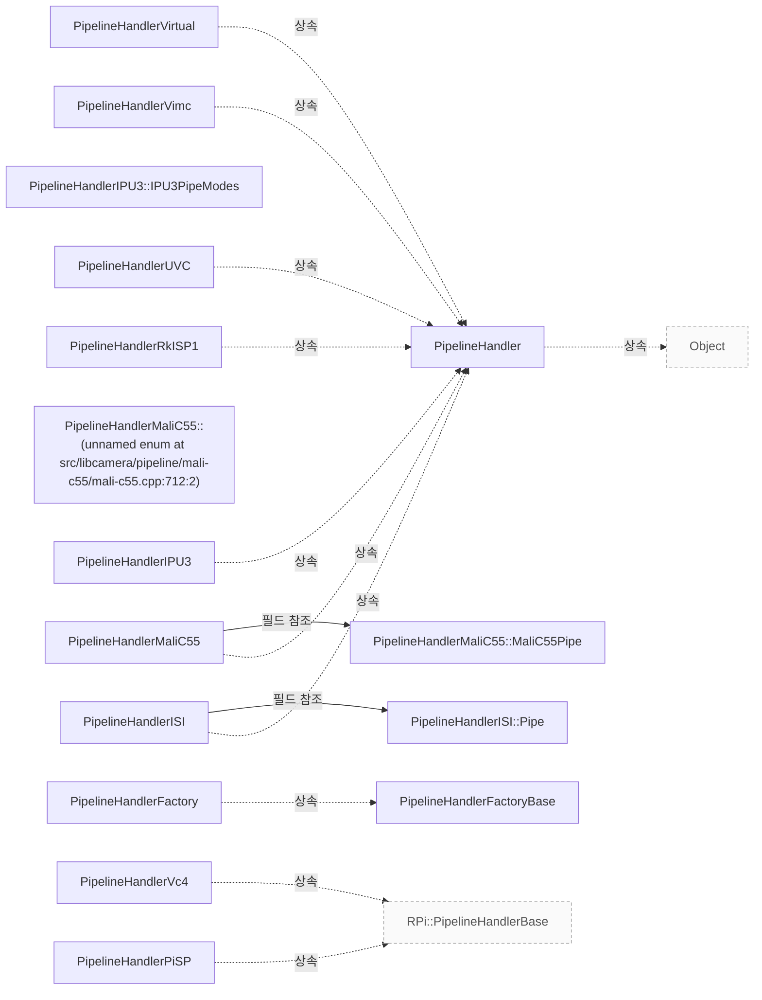

# Pipeline Handler

**파이프라인 구현이 지켜야 하는 구성·요청·완료·종료 계약을 확인하세요.**

| 지금 확인할 내용 | 이동할 절 |
|---|---|
| <a id="요청-준비와-장치-큐"></a>요청 준비와 장치 큐의 조건과 근거를 대조하세요. | [Pipeline 요청 제출과 완료](pipeline-requests.md#요청-준비와-장치-큐) |
| <a id="버퍼-완료와-요청-반환"></a>버퍼 완료와 요청 반환의 조건과 근거를 대조하세요. | [Pipeline 요청 제출과 완료](pipeline-requests.md#버퍼-완료와-요청-반환) |
| <a id="요청이-대기하거나-장치로-가는-조건"></a>“요청이 대기하거나 장치로 가는 조건” 그림을 확인하세요. | [Pipeline 요청 제출과 완료](pipeline-requests.md#요청이-대기하거나-장치로-가는-조건) |
| <a id="버퍼-완료에서-요청-반환까지"></a>“버퍼 완료에서 요청 반환까지” 그림을 확인하세요. | [Pipeline 요청 제출과 완료](pipeline-requests.md#버퍼-완료에서-요청-반환까지) |

## 장치 매칭과 객체 수명

`PipelineHandler`는 `std::shared_ptr`<>로 참조 계수되며, 수동으로 생성해서는 안 되고 `PipelineHandlerFactoryBase::create()`를 통해 생성해야 합니다. match()는 `MediaDevice::acquire()`로 장치를 모두 획득하면 `Camera`를 생성해 카메라 관리자에 등록하고 true를 반환해야 하며, 실패하면 장치를 획득하지 않거나 획득한 장치를 `MediaDevice::release()`로 해제하고 false를 반환해야 합니다. acquireMediaDevice()가 획득한 장치는 `mediaDevices_`에 보관되며, 직접 해제해서는 안 되고 핸들러 소멸 시 소멸자에서 `MediaDevice::release()`로 해제됩니다. acquire()는 `useCount_`가 0일 때 장치를 lock()하고, lock 실패 또는 `useCount_`가 0인 상태의 acquireDevice() 실패 시 unlockMediaDevices()로 잠금을 풀고 false를 반환하며, 성공한 acquire()마다 release()가 짝을 이뤄야 하고 `useCount_`가 1일 때 release()가 잠금을 풉니다. `src/libcamera/pipeline_handler.cpp:50`, `src/libcamera/pipeline_handler.cpp:119`

근거 원문: [src/libcamera/pipeline_handler.cpp:50](#source-69bfa9568cf8b5c5) · [src/libcamera/pipeline_handler.cpp:119](#source-a3caf1625bc18d64)

## 구성의 입력과 검증 책임

generateConfiguration()에서 호출자는 stream roles 목록인 roles에 원하는 use-case를 채워야 하며(shall), 이 함수는 어떤 스레드에서든 호출될 수 있고(may) 구현은 threadsafe여야 합니다(shall). 구현은 camera의 상태를 수정하지 않아야 하고(shall not), 요청한 roles를 만족하면 유효한 `CameraConfiguration`을, 그렇지 않으면 null 포인터를 반환합니다. configure()는 `CameraManager` 스레드에서 호출되고 의도된 호출자는 애플리케이션에서 구성을 전달받는 `Camera` 클래스이며, 구성은 `CameraConfiguration::validate()`로 검증되었음이 보장되므로 구현은 추가 검증을 하지 않아야 하고(shall not) 커스텀 파생 클래스의 커스텀 필드에 의존할 수 있습니다(may). 파이프라인 핸들러는 각 `StreamConfiguration` 항목에 `StreamConfiguration::setStream()`으로 `Stream` 인스턴스를 연결해야 하며(shall), configure()는 성공 시 0, 그렇지 않으면 음의 오류 코드를 반환합니다. `src/libcamera/pipeline_handler.cpp:271`

근거 원문: [src/libcamera/pipeline_handler.cpp:271](#source-8cd14a802c5b1782)

## 정지와 미완료 요청

`PipelineHandler::stop`은 camera->`_d()`의 `waitingRequests_` 내용을 지역 변수 waitingRequests와 swap하여 옮기므로, 옮긴 뒤 `waitingRequests_`는 비워집니다. 주석에 따르면 이렇게 먼저 분리하는 이유는 stopDevice() 내부에서 completeRequest()가 호출될 때 대기 요청이 그 응답으로 다시 큐에 들어가지 않게 하기 위해서입니다. 그 직후 호출하는 장치 정지 함수의 이름은 stopDevice(camera)입니다. `src/libcamera/pipeline_handler.cpp:359`

`PipelineHandler::stop()`은 stopDevice(camera)를 호출하기 전에 대기 요청 큐를 지역 변수 waitingRequests로 옮겨 분리해 둡니다. stopDevice(camera)가 반환한 뒤 분리된 요청을 앞에서부터 하나씩 꺼내 request->`_d()`->cancel()로 취소 상태를 표시하고, 이어서 doQueueRequest(request)를 호출합니다. 요청의 순서를 유지하기 위해 취소 처리는 stopDevice 뒤로 미룹니다. `src/libcamera/pipeline_handler.cpp:359`

stopDevice 구현은 모든 실행 중인 스트림의 캡처와 요청 처리를 즉시 중단해야 합니다. 보류 중인 요청은 취소되어 오류 상태로 즉시 완료되어야 하며, 이를 정상 완료 상태로 처리해서는 안 됩니다. 이 내용은 stopDevice 함수 문서에 적힌 계약이며, 특정 장치 구현이 이를 검증했다는 뜻이 아닙니다. `src/libcamera/pipeline_handler.cpp:359`

stop() 끝부분의 ASSERT(data->`queuedRequests_`.empty())와 ASSERT(data->`waitingRequests_`.empty())는 두 큐가 비어 있는지 확인합니다. 취소된 요청은 request->`_d()`->cancel() 후 doQueueRequest()에 전달되어 `queuedRequests_`에 임시로 추가되고, completeRequest()에서 완료되므로 이 검사는 그 처리가 끝난 뒤의 상태를 확인합니다. 이 ASSERT는 이 호출에서 두 큐가 비어 있었는지를 검사할 뿐이며, 이후 실행에서 요청이 남지 않는다는 보장이 아닙니다. 검사 다음 줄에서 data->`requestSequence_`를 0으로 초기화합니다. `src/libcamera/pipeline_handler.cpp:359`

정상 완료에서 completeRequest는 마지막에 doQueueRequests(camera)를 호출하고, doQueueRequests는 `waitingRequests_`의 앞 요청이 준비(`prepared_`)되어 있고 `queuedRequests_` 크기가 `maxQueuedRequestsDevice_`에 도달하지 않은 경우에만 doQueueRequest로 넘깁니다. 따라서 정상 완료에서 대기 요청의 전달은 대기 큐, 준비 상태, 장치 한도 세 조건에 따라 결정되며, completeRequest 호출이 곧 장치 제출을 보장하지는 않습니다. 반면 stop(정지)은 stopDevice(camera) 호출 전에 `waitingRequests_`를 지역 큐로 옮겨 두므로, stopDevice 안의 완료 처리가 doQueueRequests로 재진입하더라도 원래 대기 요청은 다시 제출되지 않습니다. `src/libcamera/pipeline_handler.cpp:547`, `src/libcamera/pipeline_handler.cpp:359`, `src/libcamera/pipeline_handler.cpp:509`

근거 원문: [src/libcamera/pipeline_handler.cpp:359](#source-eefd1bbecb1aad0a) · [src/libcamera/pipeline_handler.cpp:547](#source-01ad7c6605c3296a) · [src/libcamera/pipeline_handler.cpp:509](#source-d63c9e57bcf862b0)

## IPU3 입력 크기 탐색의 경계

minIfWidth는 std::max(in.width - `ImgUDevice::kIFMaxCropWidth`, `ImgUDevice::kIFMaxCropWidth`)로 계산되며, 입력 너비에서 kIFMaxCropWidth를 뺀 값과 kIFMaxCropWidth 중 큰 값입니다. minIfHeight는 std::max(in.height - `ImgUDevice::kIFMaxCropHeight`, `ImgUDevice::kIFMaxCropHeight`)로 계산되며, 입력 높이에서 kIFMaxCropHeight를 뺀 값과 kIFMaxCropHeight 중 큰 값입니다. `src/libcamera/pipeline/ipu3/imgu.cpp:407`

첫 탐색은 바깥 루프가 폭(ifWidth)을, 안쪽 루프가 높이(ifHeight)를 맡아 ifWidth가 minIfWidth 이상인 동안, ifHeight가 minIfHeight 이상인 동안 반복하며, 각각 kIFAlignWidth와 kIFAlignHeight만큼 줄입니다. 두 번째 탐색은 높이를 바깥 루프, 폭을 안쪽 루프로 바꾸어 같은 최소값 조건으로 반복하며, 두 번째 탐색 전 alignUp으로 ifWidth와 ifHeight를 재초기화하지만 안쪽 반복마다 바깥 반복 변수 ifHeight를 다시 초기화하지는 않습니다. calculateBDSHeight() 주석은 입력 포매터 높이에서 최대 kIFMaxCropHeight 줄까지 자르므로, 높이를 최솟값 아래로 자르면 최소 높이가 감긴다고 설명합니다. calculateBDSHeight의 minIFHeight 차감은 iif.height가 kIFMaxCropHeight보다 작을 때 값이 감기는 경계이며, 호출자가 ifHeight를 kIFAlignHeight씩 줄이는 것과는 다른 계산입니다. `src/libcamera/pipeline/ipu3/imgu.cpp:407`, `src/libcamera/pipeline/ipu3/imgu.cpp:111`

근거 원문: [src/libcamera/pipeline/ipu3/imgu.cpp:407](#source-2494b74f28e1b200) · [src/libcamera/pipeline/ipu3/imgu.cpp:111](#source-e95802b61093a795)

??? note "설계 질문과 검증 범위"
    질문별 답변과 근거 연결을 검사했습니다. 의미와 실행 결과는 사람 검토가 필요합니다.
    
    | 설계 질문 | 설명 위치 | 확인 범위 |
    |---|---|---|
    | 핸들러는 어떤 객체와 장치를 만들고 관리합니까? | [장치 매칭과 객체 수명](#장치-매칭과-객체-수명) | 코드 근거와 설명 연결 |
    | 기본 구성과 실제 구성에서 호출자와 구현의 책임은 무엇입니까? | [구성의 입력과 검증 책임](#구성의-입력과-검증-책임) | 코드 근거와 설명 연결 |
    | 정지 중 재큐잉을 막고 대기 요청을 반환하는 방법은 무엇입니까? | [정지와 미완료 요청](#정지와-미완료-요청) | 코드 근거와 설명 연결 |
    | IPU3에서 입력 크기를 탐색하는 두 반복문은 최소 폭·높이를 어떻게 계산하며, 높이를 자르는 연산과 unsigned 경계는 어떤 관계입니까? 소스에 있는 식과 조건을 구분하고 기기 동작이나 성능을 보장하지 마세요. | [IPU3 입력 크기 탐색의 경계](#ipu3-입력-크기-탐색의-경계) | 코드 근거와 설명 연결 |

## 소스 근거

같은 발췌는 한 번만 싣습니다. 필요한 원문을 펼쳐 설명과 대조하세요.

<a id="source-69bfa9568cf8b5c5"></a>

??? note "소스 근거: src/libcamera/pipeline_handler.cpp:50"
    `src/libcamera/pipeline_handler.cpp:50`에서 시작하는 발췌입니다. 종료 줄은 119이며, 아래 원문을 설명과 대조할 수 있습니다.
    
    SHA-256: `e05278df0a06cb963fe79f772e62d4560b62df15c1411a6b49e32f7ca84d9e74`
    
    ```text
    \class PipelineHandler
     * \brief Create and manage cameras based on a set of media devices
     *
     * The PipelineHandler matches the media devices provided by a DeviceEnumerator
     * with the pipelines it supports and creates corresponding Camera devices.
     *
     * Pipeline handler instances are reference-counted through std::shared_ptr<>.
     * They implement std::enable_shared_from_this<> in order to create new
     * std::shared_ptr<> in code paths originating from member functions of the
     * PipelineHandler class where only the 'this' pointer is available.
     */
    
    /**
     * \brief Construct a PipelineHandler instance
     * \param[in] manager The camera manager
     * \param[in] maxQueuedRequestsDevice The maximum number of requests queued to
     * the device
     *
     * In order to honour the std::enable_shared_from_this<> contract,
     * PipelineHandler instances shall never be constructed manually, but always
     * through the PipelineHandlerFactoryBase::create() function.
     */
    PipelineHandler::PipelineHandler(CameraManager *manager,
    				 unsigned int maxQueuedRequestsDevice)
    	: manager_(manager), maxQueuedRequestsDevice_(maxQueuedRequestsDevice),
    	  useCount_(0)
    {
    }
    
    PipelineHandler::~PipelineHandler()
    {
    	for (std::shared_ptr<MediaDevice> &media : mediaDevices_)
    		media->release();
    }
    
    /**
     * \fn PipelineHandler::match(DeviceEnumerator *enumerator)
     * \brief Match media devices and create camera instances
     * \param[in] enumerator The enumerator providing all media devices found in the
     * system
     *
     * This function is the main entry point of the pipeline handler. It is called
     * by the camera manager with the \a enumerator passed as an argument. It shall
     * acquire from the \a enumerator all the media devices it needs for a single
     * pipeline, create one or multiple Camera instances and register them with the
     * camera manager.
     *
     * If all media devices needed by the pipeline handler are found, they must all
     * be acquired by a call to MediaDevice::acquire(). This function shall then
     * create the corresponding Camera instances, store them internally, and return
     * true. Otherwise it shall not acquire any media device (or shall release all
     * the media devices is has acquired by calling MediaDevice::release()) and
     * return false.
     *
     * If multiple instances of a pipeline are available in the system, the
     * PipelineHandler class will be instantiated once per instance, and its match()
     * function called for every instance. Each call shall acquire media devices for
     * one pipeline instance, until all compatible media devices are exhausted.
     *
     * If this function returns true, a new instance of the pipeline handler will
     * be created and its match() function called.
     *
     * \context This function is called from the CameraManager thread.
     *
     * \return true if media devices have been acquired and camera instances
     * created, or false otherwise
     */
    
    /**
     * \brief Search and acquire a MediaDevice
    ```

<a id="source-a3caf1625bc18d64"></a>

??? note "소스 근거: src/libcamera/pipeline_handler.cpp:119"
    `src/libcamera/pipeline_handler.cpp:119`에서 시작하는 발췌입니다. 종료 줄은 271이며, 아래 원문을 설명과 대조할 수 있습니다.
    
    SHA-256: `379b17c52a1e97055bf78aaabd964595fb3ec506c568d112e552ed1c29235591`
    
    ```text
    \brief Search and acquire a MediaDevice matching a device pattern
     * \param[in] enumerator Enumerator containing all media devices in the system
     * \param[in] dm Device match pattern
     *
     * Search the device \a enumerator for an available media device matching the
     * device match pattern \a dm. Matching media device that have previously been
     * acquired by MediaDevice::acquire() are not considered. If a match is found,
     * the media device is acquired and returned. The caller shall not release the
     * device explicitly, it will be automatically released when the pipeline
     * handler is destroyed.
     *
     * \context This function shall be called from the CameraManager thread.
     *
     * \return A shared pointer to the matching MediaDevice, or nullptr if no match
     * is found
     */
    std::shared_ptr<MediaDevice>
    PipelineHandler::acquireMediaDevice(DeviceEnumerator *enumerator,
    				    const DeviceMatch &dm)
    {
    	std::shared_ptr<MediaDevice> media = enumerator->search(dm);
    	if (!media)
    		return nullptr;
    
    	if (!media->acquire())
    		return nullptr;
    
    	mediaDevices_.push_back(media);
    
    	return media;
    }
    
    /**
     * \brief Acquire exclusive access to the pipeline handler for the process
     *
     * This function locks all the media devices used by the pipeline to ensure
     * that no other process can access them concurrently.
     *
     * Access to a pipeline handler may be acquired recursively from within the
     * same process. Every successful acquire() call shall be matched with a
     * release() call. This allows concurrent access to the same pipeline handler
     * from different cameras within the same process.
     *
     * Pipeline handlers shall not call this function directly as the Camera class
     * handles access internally.
     *
     * \context This function is called from the CameraManager thread.
     *
     * \return True if the pipeline handler was acquired, false if another process
     * has already acquired it
     * \sa release()
     */
    bool PipelineHandler::acquire(Camera *camera)
    {
    	if (useCount_ == 0) {
    		for (std::shared_ptr<MediaDevice> &media : mediaDevices_) {
    			if (!media->lock()) {
    				unlockMediaDevices();
    				return false;
    			}
    		}
    	}
    
    	if (!acquireDevice(camera)) {
    		if (useCount_ == 0)
    			unlockMediaDevices();
    
    		return false;
    	}
    
    	++useCount_;
    	return true;
    }
    
    /**
     * \brief Release exclusive access to the pipeline handler
     * \param[in] camera The camera for which to release data
     *
     * This function releases access to the pipeline handler previously acquired by
     * a call to acquire(). Every release() call shall match a previous successful
     * acquire() call. Calling this function on a pipeline handler that hasn't been
     * acquired results in undefined behaviour.
     *
     * Pipeline handlers shall not call this function directly as the Camera class
     * handles access internally.
     *
     * \context This function is called from the CameraManager thread.
     *
     * \sa acquire()
     */
    void PipelineHandler::release(Camera *camera)
    {
    	ASSERT(useCount_);
    
    	releaseDevice(camera);
    
    	if (useCount_ == 1)
    		unlockMediaDevices();
    
    	--useCount_;
    }
    
    /**
     * \brief Acquire resources associated with this camera
     * \param[in] camera The camera for which to acquire resources
     *
     * Pipeline handlers may override this in order to get resources such as opening
     * devices and allocating buffers when a camera is acquired.
     *
     * This is used by the uvcvideo pipeline handler to delay opening /dev/video#
     * until the camera is acquired to avoid excess power consumption. The delayed
     * opening of /dev/video# is a special case because the kernel uvcvideo driver
     * powers on the USB device as soon as /dev/video# is opened. This behavior
     * should *not* be copied by other pipeline handlers.
     *
     * \context This function is called from the CameraManager thread.
     *
     * \return True on success, false on failure
     * \sa releaseDevice()
     */
    bool PipelineHandler::acquireDevice([[maybe_unused]] Camera *camera)
    {
    	return true;
    }
    
    /**
     * \brief Release resources associated with this camera
     * \param[in] camera The camera for which to release resources
     *
     * Pipeline handlers may override this in order to perform cleanup operations
     * when a camera is released, such as freeing memory.
     *
     * This is called once for every camera that is released. If there are resources
     * shared by multiple cameras then the pipeline handler must take care to not
     * release them until releaseDevice() has been called for all previously
     * acquired cameras.
     *
     * \context This function is called from the CameraManager thread.
     *
     * \sa acquireDevice()
     */
    void PipelineHandler::releaseDevice([[maybe_unused]] Camera *camera)
    {
    }
    
    void PipelineHandler::unlockMediaDevices()
    {
    	for (std::shared_ptr<MediaDevice> &media : mediaDevices_)
    		media->unlock();
    }
    
    /**
     * \fn PipelineHandler::generateConfiguration()
    ```

<a id="source-8cd14a802c5b1782"></a>

??? note "소스 근거: src/libcamera/pipeline_handler.cpp:271"
    `src/libcamera/pipeline_handler.cpp:271`에서 시작하는 발췌입니다. 종료 줄은 315이며, 아래 원문을 설명과 대조할 수 있습니다.
    
    SHA-256: `56e3a59872a70fc01b1bfdea1601201880929f47ae90d7888c2cf4c080085ea6`
    
    ```text
    \fn PipelineHandler::generateConfiguration()
     * \brief Generate a camera configuration for a specified camera
     * \param[in] camera The camera to generate a default configuration for
     * \param[in] roles A list of stream roles
     *
     * Generate a default configuration for the \a camera for a specified list of
     * stream roles. The caller shall populate the \a roles with the use-cases it
     * wishes to fetch the default configuration for. The returned configuration
     * can then be examined by the caller to learn about the selected streams and
     * their default parameters.
     *
     * The intended companion to this is \a configure() which can be used to change
     * the group of streams parameters.
     *
     * \context This function may be called from any thread and shall be
     * \threadsafe. It shall not modify the state of the \a camera in the pipeline
     * handler.
     *
     * \return A valid CameraConfiguration if the requested roles can be satisfied,
     * or a null pointer otherwise.
     */
    
    /**
     * \fn PipelineHandler::configure()
     * \brief Configure a group of streams for capture
     * \param[in] camera The camera to configure
     * \param[in] config The camera configurations to setup
     *
     * Configure the specified group of streams for \a camera according to the
     * configuration specified in \a config. The intended caller of this interface
     * is the Camera class which will receive configuration to apply from the
     * application.
     *
     * The configuration is guaranteed to have been validated with
     * CameraConfiguration::validate(). The pipeline handler implementation shall
     * not perform further validation and may rely on any custom field stored in its
     * custom CameraConfiguration derived class.
     *
     * When configuring the camera the pipeline handler shall associate a Stream
     * instance to each StreamConfiguration entry in the CameraConfiguration using
     * the StreamConfiguration::setStream() function.
     *
     * \context This function is called from the CameraManager thread.
     *
     * \return 0 on success or a negative error code otherwise
    ```

<a id="source-eefd1bbecb1aad0a"></a>

??? note "소스 근거: src/libcamera/pipeline_handler.cpp:359"
    `src/libcamera/pipeline_handler.cpp:359`에서 시작하는 발췌입니다. 종료 줄은 414이며, 아래 원문을 설명과 대조할 수 있습니다.
    
    SHA-256: `108b1bea5a8314ba57213d15c1e3ba01abe2b3f8a9e0e1e1281864b5492c7304`
    
    ```text
    \brief Stop capturing from all running streams and cancel pending requests
     * \param[in] camera The camera to stop
     *
     * This function stops capturing and processing requests immediately. All
     * pending requests are cancelled and complete immediately in an error state.
     *
     * \context This function is called from the CameraManager thread.
     */
    void PipelineHandler::stop(Camera *camera)
    {
    	/*
    	 * Take all waiting requests so that they are not requeued in response
    	 * to completeRequest() being called inside stopDevice(). Cancel them
    	 * after the device to keep them in order.
    	 */
    	Camera::Private *data = camera->_d();
    	std::queue<Request *> waitingRequests;
    	waitingRequests.swap(data->waitingRequests_);
    
    	/* Stop the pipeline handler and let the queued requests complete. */
    	stopDevice(camera);
    
    	/* Cancel and signal as complete all waiting requests. */
    	while (!waitingRequests.empty()) {
    		Request *request = waitingRequests.front();
    		waitingRequests.pop();
    
    		/*
    		 * Cancel all requests by marking them as cancelled and calling
    		 * doQueueRequest() instead of cancelRequest(). This ensures
    		 * that the requests get a sequence number and are temporarily
    		 * added to queuedRequests_ so they can be properly completed in
    		 * completeRequest().
    		 */
    		request->_d()->cancel();
    		doQueueRequest(request);
    	}
    
    	/* Make sure no requests are pending. */
    	ASSERT(data->queuedRequests_.empty());
    	ASSERT(data->waitingRequests_.empty());
    
    	data->requestSequence_ = 0;
    }
    
    /**
     * \fn PipelineHandler::stopDevice()
     * \brief Stop capturing from all running streams
     * \param[in] camera The camera to stop
     *
     * This function stops capturing and processing requests immediately. All
     * pending requests are cancelled and complete immediately in an error state.
     */
    
    /**
     * \brief Determine if the camera has any requests pending
    ```

<a id="source-01ad7c6605c3296a"></a>

??? note "소스 근거: src/libcamera/pipeline_handler.cpp:547"
    `src/libcamera/pipeline_handler.cpp:547`에서 시작하는 발췌입니다. 종료 줄은 620이며, 아래 원문을 설명과 대조할 수 있습니다.
    
    SHA-256: `514288cc958de9ff5fd19d46393cec3bb3088f4f08486528d4559071138638c9`
    
    ```text
    \brief Complete a buffer for a request
     * \param[in] request The request the buffer belongs to
     * \param[in] buffer The buffer that has completed
     *
     * This function shall be called by pipeline handlers to signal completion of
     * the \a buffer part of the \a request. It notifies applications of buffer
     * completion and updates the request's internal buffer tracking. The request
     * is not completed automatically when the last buffer completes to give
     * pipeline handlers a chance to perform any operation that may still be
     * needed. They shall complete requests explicitly with completeRequest().
     *
     * \context This function shall be called from the CameraManager thread.
     *
     * \return True if all buffers contained in the request have completed, false
     * otherwise
     */
    bool PipelineHandler::completeBuffer(Request *request, FrameBuffer *buffer)
    {
    	Camera *camera = request->_d()->camera();
    	camera->bufferCompleted.emit(request, buffer);
    	return request->_d()->completeBuffer(buffer);
    }
    
    /**
     * \brief Signal request completion
     * \param[in] request The request that has completed
     *
     * The pipeline handler shall call this function to notify the \a camera that
     * the request has completed. The request is no longer managed by the pipeline
     * handler and shall not be accessed once this function returns.
     *
     * This function ensures that requests will be returned to the application in
     * submission order, the pipeline handler may call it on any complete request
     * without any ordering constraint.
     *
     * \context This function shall be called from the CameraManager thread.
     */
    void PipelineHandler::completeRequest(Request *request)
    {
    	Camera *camera = request->_d()->camera();
    
    	request->_d()->complete();
    
    	Camera::Private *data = camera->_d();
    
    	while (!data->queuedRequests_.empty()) {
    		Request *req = data->queuedRequests_.front();
    		if (req->status() == Request::RequestPending)
    			break;
    
    		ASSERT(!req->hasPendingBuffers());
    		data->queuedRequests_.pop_front();
    		camera->requestComplete(req);
    	}
    
    	/* Allow any waiting requests to be queued to the pipeline. */
    	doQueueRequests(camera);
    }
    
    /**
     * \brief Cancel request and signal its completion
     * \param[in] request The request to cancel
     *
     * This function cancels and completes the request. The same rules as for
     * completeRequest() apply.
     */
    void PipelineHandler::cancelRequest(Request *request)
    {
    	request->_d()->cancel();
    	completeRequest(request);
    }
    
    /**
     * \brief Retrieve the absolute path to a platform configuration file
    ```

<a id="source-d63c9e57bcf862b0"></a>

??? note "소스 근거: src/libcamera/pipeline_handler.cpp:509"
    `src/libcamera/pipeline_handler.cpp:509`에서 시작하는 발췌입니다. 종료 줄은 530이며, 아래 원문을 설명과 대조할 수 있습니다.
    
    SHA-256: `b2d2d134eaa639300cae5e7660d8453da545646bcc100bf640a981fa1371899d`
    
    ```text
    void PipelineHandler::doQueueRequests(Camera *camera)
    {
    	Camera::Private *data = camera->_d();
    	while (!data->waitingRequests_.empty()) {
    		if (data->queuedRequests_.size() == maxQueuedRequestsDevice_)
    			break;
    
    		Request *request = data->waitingRequests_.front();
    		if (!request->_d()->prepared_)
    			break;
    
    		/*
    		 * Pop the request first, in case doQueueRequests() is called
    		 * recursively from within doQueueRequest()
    		 */
    		data->waitingRequests_.pop();
    		doQueueRequest(request);
    	}
    }
    
    /**
     * \fn PipelineHandler::queueRequestDevice()
    ```

<a id="source-2494b74f28e1b200"></a>

??? note "소스 근거: src/libcamera/pipeline/ipu3/imgu.cpp:407"
    `src/libcamera/pipeline/ipu3/imgu.cpp:407`에서 시작하는 발췌입니다. 종료 줄은 449이며, 아래 원문을 설명과 대조할 수 있습니다.
    
    SHA-256: `dff1dd0c4b791141aa7e60ba45e759e6cb4c6e69877280a629dc9250cf9b42dd`
    
    ```text
    float bdsSF = static_cast<float>(in.width) / gdc.width;
    	float sf = findScaleFactor(bdsSF, bdsScalingFactors, true);
    
    	/*
    	 * Populate the configurations vector by scaling width and height.
    	 *
    	 * calculateBDSHeight() crops up to kIFMaxCropHeight lines from the IF
    	 * height, so don't go below that, or its minimum IF height wraps.
    	 */
    	unsigned int ifWidth = utils::alignUp(in.width, ImgUDevice::kIFAlignWidth);
    	unsigned int ifHeight = utils::alignUp(in.height, ImgUDevice::kIFAlignHeight);
    	unsigned int minIfWidth = std::max(in.width - ImgUDevice::kIFMaxCropWidth,
    					   ImgUDevice::kIFMaxCropWidth);
    	unsigned int minIfHeight = std::max(in.height - ImgUDevice::kIFMaxCropHeight,
    					    ImgUDevice::kIFMaxCropHeight);
    	while (ifWidth >= minIfWidth) {
    		while (ifHeight >= minIfHeight) {
    			Size iif{ ifWidth, ifHeight };
    			calculateBDS(pipe, iif, gdc, sf);
    			ifHeight -= ImgUDevice::kIFAlignHeight;
    		}
    
    		ifWidth -= ImgUDevice::kIFAlignWidth;
    	}
    
    	/* Repeat search by scaling width first. */
    	ifWidth = utils::alignUp(in.width, ImgUDevice::kIFAlignWidth);
    	ifHeight = utils::alignUp(in.height, ImgUDevice::kIFAlignHeight);
    	while (ifHeight >= minIfHeight) {
    		/*
    		 * \todo This procedure is probably broken:
    		 * https://github.com/intel/intel-ipu3-pipecfg/issues/2
    		 */
    		while (ifWidth >= minIfWidth) {
    			Size iif{ ifWidth, ifHeight };
    			calculateBDS(pipe, iif, gdc, sf);
    			ifWidth -= ImgUDevice::kIFAlignWidth;
    		}
    
    		ifHeight -= ImgUDevice::kIFAlignHeight;
    	}
    
    	if (pipeConfigs.size() == 0) {
    ```

<a id="source-e95802b61093a795"></a>

??? note "소스 근거: src/libcamera/pipeline/ipu3/imgu.cpp:111"
    `src/libcamera/pipeline/ipu3/imgu.cpp:111`에서 시작하는 발췌입니다. 종료 줄은 112이며, 아래 원문을 설명과 대조할 수 있습니다.
    
    SHA-256: `095e890fbc9265784421e7c5bffa38c5c482fbea73289f56889e877d24b817c3`
    
    ```text
    unsigned int minIFHeight = iif.height - ImgUDevice::kIFMaxCropHeight;
    	unsigned int minBDSHeight = gdc.height + ImgUDevice::kFilterHeight * 2;
    ```


<!-- sdd:class-diagram -->
## 클래스 관계

화살표의 글자는 추출한 관계를 나타내며, 점선은 상속입니다. 화살표는 참조 대상 또는 기반 클래스를 향합니다. 호출 순서를 뜻하지 않습니다.


<!-- /sdd:class-diagram -->


## 관련 클래스

| 클래스 | 선언 위치 | 상속 | 책임 (주석) |
|---|---|---|---|
| `libcamera::PipelineHandler` | `include/libcamera/internal/pipeline_handler.h:34` | `libcamera::Object` | Create and manage cameras based on a set of media devices |
| `libcamera::PipelineHandlerFactory` | `include/libcamera/internal/pipeline_handler.h:144` | `libcamera::PipelineHandlerFactoryBase` | Registration of PipelineHandler classes and creation of instances |
| `libcamera::PipelineHandlerFactoryBase` | `include/libcamera/internal/pipeline_handler.h:121` | – | Base class for pipeline handler factories |
| `libcamera::PipelineHandlerIPU3` | `src/libcamera/pipeline/ipu3/ipu3.cpp:124` | `libcamera::PipelineHandler` | 확인 필요 |
| `libcamera::PipelineHandlerIPU3::IPU3PipeModes` | `src/libcamera/pipeline/ipu3/ipu3.cpp:130` | – | 확인 필요 |
| `libcamera::PipelineHandlerISI` | `src/libcamera/pipeline/imx8-isi/imx8-isi.cpp:102` | `libcamera::PipelineHandler` | 확인 필요 |
| `libcamera::PipelineHandlerISI::Pipe` | `src/libcamera/pipeline/imx8-isi/imx8-isi.cpp:129` | – | 확인 필요 |
| `libcamera::PipelineHandlerMaliC55` | `src/libcamera/pipeline/mali-c55/mali-c55.cpp:676` | `libcamera::PipelineHandler` | 확인 필요 |
| `libcamera::PipelineHandlerMaliC55::(unnamed enum at src/libcamera/pipeline/mali-c55/mali-c55.cpp:712:2)` | `src/libcamera/pipeline/mali-c55/mali-c55.cpp:712` | – | 확인 필요 |
| `libcamera::PipelineHandlerMaliC55::MaliC55Pipe` | `src/libcamera/pipeline/mali-c55/mali-c55.cpp:705` | – | 확인 필요 |
| `libcamera::PipelineHandlerPiSP` | `src/libcamera/pipeline/rpi/pisp/pisp.cpp:852` | `libcamera::RPi::PipelineHandlerBase` | 확인 필요 |
| `libcamera::PipelineHandlerRkISP1` | `src/libcamera/pipeline/rkisp1/rkisp1.cpp:185` | `libcamera::PipelineHandler` | 확인 필요 |
| `libcamera::PipelineHandlerUVC` | `src/libcamera/pipeline/uvcvideo/uvcvideo.cpp:81` | `libcamera::PipelineHandler` | 확인 필요 |
| `libcamera::PipelineHandlerVc4` | `src/libcamera/pipeline/rpi/vc4/vc4.cpp:141` | `libcamera::RPi::PipelineHandlerBase` | 확인 필요 |
| `libcamera::PipelineHandlerVimc` | `src/libcamera/pipeline/vimc/vimc.cpp:84` | `libcamera::PipelineHandler` | 확인 필요 |
| `libcamera::PipelineHandlerVirtual` | `src/libcamera/pipeline/virtual/virtual.cpp:81` | `libcamera::PipelineHandler` | 확인 필요 |

??? note "근거와 검토 정보"
    - 생성 방식: 추출 사실과 LLM 설명
    - 검증 범위: 표·그림은 facts로 만들고 설명은 LLM이 작성합니다. 인용·문장 및 설정된 구조 검사를 적용합니다.
    - 근거 파일: `include/libcamera/internal/pipeline_handler.h`, `src/libcamera/pipeline/imx8-isi/imx8-isi.cpp`, `src/libcamera/pipeline/ipu3/imgu.cpp`, `src/libcamera/pipeline/ipu3/ipu3.cpp`, `src/libcamera/pipeline/mali-c55/mali-c55.cpp`, `src/libcamera/pipeline/rkisp1/rkisp1.cpp`, `src/libcamera/pipeline/rpi/pisp/pisp.cpp`, `src/libcamera/pipeline/rpi/vc4/vc4.cpp`, `src/libcamera/pipeline/uvcvideo/uvcvideo.cpp`, `src/libcamera/pipeline/vimc/vimc.cpp`, `src/libcamera/pipeline/virtual/virtual.cpp`, `src/libcamera/pipeline_handler.cpp`
    - 근거 수준: 코드 확인 (정적 분석, simple_compdb 구성, commit `293d751a81`)
    - 자동 검사 (인용·문장 및 설정된 구조 검사): 통과
    - 검토 상태 기록일: 2026-10-31 · 사람 검토 전

다음 단계: [Pipeline 요청 제출과 완료](pipeline-requests.md)
