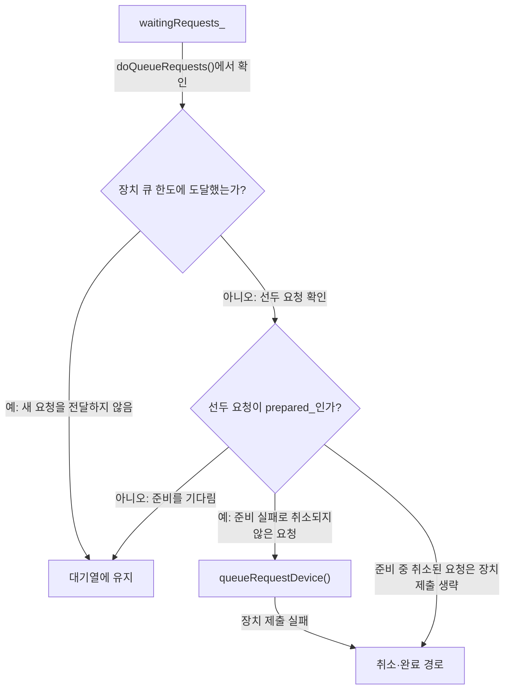
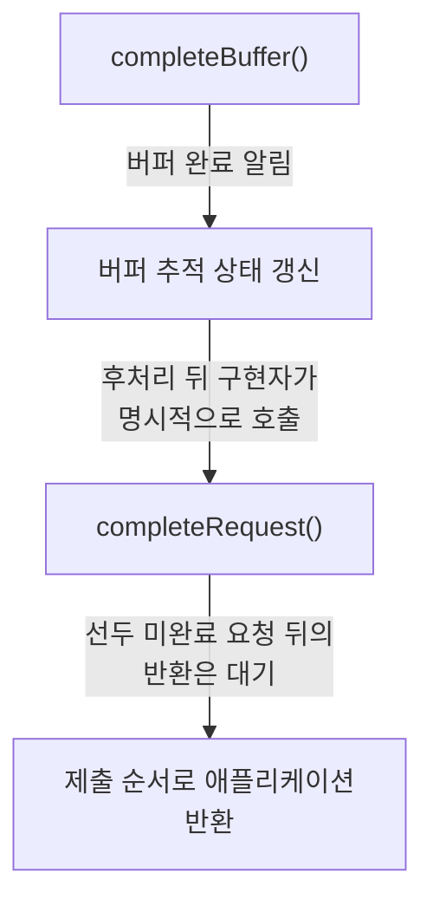
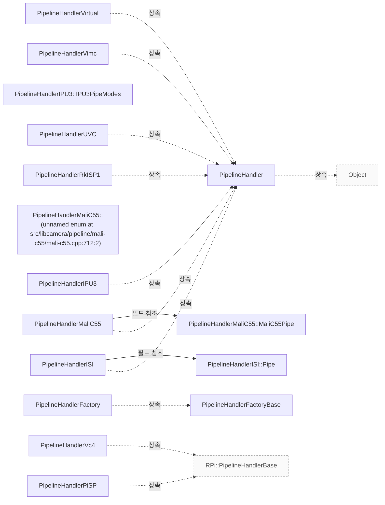

# Pipeline Handler

**파이프라인 구현이 지켜야 하는 구성·요청·완료·종료 계약을 확인하세요.**

| 지금 확인할 내용 | 이동할 절 |
|---|---|
| 장치 매칭과 객체 수명 절을 확인합니다. | [장치 매칭과 객체 수명](#장치-매칭과-객체-수명) |
| 구성의 입력과 검증 책임 절을 확인합니다. | [구성의 입력과 검증 책임](#구성의-입력과-검증-책임) |
| 요청 준비와 장치 큐 절을 확인합니다. | [요청 준비와 장치 큐](#요청-준비와-장치-큐) |
| 버퍼 완료와 요청 반환 절을 확인합니다. | [버퍼 완료와 요청 반환](#버퍼-완료와-요청-반환) |
| 정지와 미완료 요청 절을 확인합니다. | [정지와 미완료 요청](#정지와-미완료-요청) |

## 장치 매칭과 객체 수명

`PipelineHandler`는 `DeviceEnumerator`가 제공한 미디어 장치를 지원하는 파이프라인과 맞춰 대응하는 `Camera` 장치를 만들고 관리합니다. 파이프라인 핸들러 인스턴스는 `std::shared_ptr<>`로 참조 계수됩니다. `PipelineHandler` 인스턴스는 `std::enable_shared_from_this<>` 계약을 지키기 위해 직접 생성해서는 안 되며, 항상 `PipelineHandlerFactoryBase::create()` 함수를 통해 만들어야 합니다. 이 클래스는 `this` 포인터만 있는 멤버 함수 경로에서 새 `std::shared_ptr<>`를 만들기 위해 `std::enable_shared_from_this<>`를 구현합니다. `src/libcamera/pipeline_handler.cpp:50`

`match(DeviceEnumerator *enumerator)`는 `CameraManager`가 `DeviceEnumerator`를 인자로 넘겨 호출하는 진입점입니다. 필요한 미디어 장치를 모두 찾으면 각 장치를 `MediaDevice::acquire()`로 확보한 뒤 해당하는 `Camera` 인스턴스를 만들어 내부에 저장하고 `true`를 반환해야 합니다. 필요한 장치를 모두 찾지 못하면 장치를 확보하지 않거나, 이미 확보한 장치를 `MediaDevice::release()`로 모두 해제한 뒤 `false`를 반환해야 합니다. 개요 설명에 따르면 생성한 `Camera` 인스턴스는 카메라 매니저에 등록해야 하며, 같은 파이프라인의 여러 인스턴스가 있으면 각 `match()` 호출은 한 파이프라인 인스턴스의 장치만 확보해야 합니다. `src/libcamera/pipeline_handler.cpp:50`

`PipelineHandler`의 소멸자는 `mediaDevices_`에 저장된 각 미디어 장치에 대해 `release()`를 호출합니다. 따라서 핸들러가 확보해 보관하던 미디어 장치는 핸들러가 소멸될 때 이 소멸자를 통해 해제됩니다. `src/libcamera/pipeline_handler.cpp:50`

`acquireMediaDevice(DeviceEnumerator *enumerator, const DeviceMatch &dm)`는 `enumerator->search(dm)`로 장치를 찾고, 찾지 못하면 `nullptr`을 반환합니다. 찾은 장치의 `acquire()`가 실패하면 `nullptr`을 반환하고, 성공하면 장치를 `mediaDevices_`에 추가한 뒤 그 장치를 반환합니다. 이미 `MediaDevice::acquire()`로 확보된 장치는 검색 대상에서 제외되며, 호출자는 장치를 직접 해제해서는 안 되고 장치는 파이프라인 핸들러가 소멸될 때 자동으로 해제됩니다. `src/libcamera/pipeline_handler.cpp:119`, `src/libcamera/pipeline_handler.cpp:50`

`acquire(Camera *camera)`는 `useCount_`가 0이면 `mediaDevices_`의 모든 장치에 대해 `lock()`을 호출하고, 하나라도 실패하면 `unlockMediaDevices()`를 호출한 뒤 `false`를 반환합니다. 이어서 `acquireDevice(camera)`가 실패하면 `useCount_`가 0일 때만 `unlockMediaDevices()`를 호출하고 `false`를 반환하며, 성공하면 `useCount_`를 1 증가시키고 `true`를 반환합니다. 성공한 모든 `acquire()` 호출은 `release()` 호출과 짝을 이뤄야 합니다. 파이프라인 핸들러는 이 함수를 직접 호출해서는 안 되며, `Camera` 클래스가 내부에서 접근을 처리합니다. `src/libcamera/pipeline_handler.cpp:119`

`release(Camera *camera)`는 `ASSERT(useCount_)`로 시작한 뒤 `releaseDevice(camera)`를 호출합니다. 이후 `useCount_`가 1이면 `unlockMediaDevices()`를 호출하고, 마지막으로 `useCount_`를 1 감소시킵니다. 모든 `release()` 호출은 이전에 성공한 `acquire()` 호출과 짝을 이뤄야 하며, 확보되지 않은 핸들러에 호출하면 정의되지 않은 동작이 됩니다. `src/libcamera/pipeline_handler.cpp:119`

`acquireDevice(Camera *camera)`의 기본 구현은 `true`를 반환하고, `releaseDevice(Camera *camera)`의 기본 구현은 아무 작업도 하지 않습니다. 파이프라인 핸들러는 카메라를 획득할 때 장치 열기나 버퍼 할당 같은 자원 확보를 위해 `acquireDevice()`를 재정의할 수 있고, 카메라를 해제할 때 메모리 해제 같은 정리를 위해 `releaseDevice()`를 재정의할 수 있습니다. `releaseDevice()`는 해제되는 카메라마다 한 번씩 호출되며, 여러 카메라가 공유하는 자원은 이전에 획득한 모든 카메라에 대해 `releaseDevice()`가 호출되기 전까지 해제해서는 안 됩니다. `src/libcamera/pipeline_handler.cpp:119`

근거 원문: [src/libcamera/pipeline_handler.cpp:50](#source-69bfa9568cf8b5c5) · [src/libcamera/pipeline_handler.cpp:119](#source-a3caf1625bc18d64)

## 구성의 입력과 검증 책임

기본 구성을 얻을 때 호출자는 `roles`에 원하는 사용 사례(use-case)를 채워야 합니다. `PipelineHandler::generateConfiguration()`은 지정한 `camera`에 대해 주어진 스트림 역할 목록의 기본 구성을 생성하며, 호출자는 반환된 구성을 검사해 선택된 스트림과 기본 파라미터를 알 수 있습니다. 요청한 역할을 만족할 수 있으면 유효한 `CameraConfiguration`을 반환하고, 그렇지 않으면 널 포인터를 반환합니다. 이 함수의 구현은 파이프라인 핸들러에서 `camera`의 상태를 수정해서는 안 됩니다. `src/libcamera/pipeline_handler.cpp:271`

실제 구성을 적용하는 `PipelineHandler::configure()`는 `Camera` 클래스가 애플리케이션으로부터 받은 구성을 전달하는 것이 의도된 호출 경로입니다. 구성은 `CameraConfiguration::validate()`로 검증된 상태임이 보장된다고 원문에 명시되어 있으므로, 구현은 추가 검증을 수행해서는 안 되며 자신의 `CameraConfiguration` 파생 클래스에 저장한 사용자 정의 필드에 의존할 수 있습니다. 구현은 `configure()`를 수행할 때 `config`의 각 `StreamConfiguration` 항목마다 `StreamConfiguration::setStream()`을 사용해 `Stream` 인스턴스를 연결해야 합니다. `configure()`는 성공하면 0을, 그 밖의 경우 음수 오류 코드를 반환하며, 이 함수는 `CameraManager` 스레드에서 호출됩니다. `src/libcamera/pipeline_handler.cpp:271`

근거 원문: [src/libcamera/pipeline_handler.cpp:271](#source-8cd14a802c5b1782)

## 요청 준비와 장치 큐

`PipelineHandler::registerRequest()`는 요청이 생성될 때 호출되며, 파이프라인 핸들러가 요청마다 한 번만 필요한 초기화를 수행할 수 있도록 합니다. 이 함수는 `request->_d()->prepared` 시그널에 `doQueueRequests(request->_d()->camera())`를 연결하여, 요청이 처리 준비가 되었을 때 파이프라인 핸들러에 알립니다. `PipelineHandler::registerRequest()`에서 `request->_d()->prepared` 신호에 `connect()`로 연결한 람다는 `doQueueRequests(request->_d()->camera())`를 호출합니다. `src/libcamera/pipeline_handler.cpp:428`, `src/libcamera/pipeline_handler.cpp:435`

<!-- sdd:visual:queue-gates -->
### 요청이 대기하거나 장치로 가는 조건

준비 대기와 장치 큐 한도를 구분하세요. 준비 실패와 장치 제출 실패는 취소 경로로 이어집니다.



[Mermaid 원문](pipeline-handler.queue-gates.mmd)

??? note "그림 근거와 확인 범위"
    소스에 연결한 설계 해석입니다. 자동 연결 검사는 의미 승인이나 기기 실행 검증이 아닙니다.
    
    | 요소·전이 | 소스 근거 |
    |---|---|
    | waitingRequests_ | [src/libcamera/pipeline_handler.cpp:428](#source-789eafedfaa7f3c5) |
    | 선두 요청이 prepared_인가? | [src/libcamera/pipeline_handler.cpp:428](#source-789eafedfaa7f3c5) |
    | 장치 큐 한도에 도달했는가? | [src/libcamera/pipeline_handler.cpp:428](#source-789eafedfaa7f3c5) |
    | 대기열에 유지 | [src/libcamera/pipeline_handler.cpp:428](#source-789eafedfaa7f3c5) |
    | queueRequestDevice() | [src/libcamera/pipeline_handler.cpp:428](#source-789eafedfaa7f3c5) |
    | 취소·완료 경로 | [src/libcamera/pipeline_handler.cpp:428](#source-789eafedfaa7f3c5) |
    | doQueueRequests()에서 확인 | [src/libcamera/pipeline_handler.cpp:428](#source-789eafedfaa7f3c5) |
    | 예: 새 요청을 전달하지 않음 | [src/libcamera/pipeline_handler.cpp:428](#source-789eafedfaa7f3c5) |
    | 아니오: 선두 요청 확인 | [src/libcamera/pipeline_handler.cpp:428](#source-789eafedfaa7f3c5) |
    | 아니오: 준비를 기다림 | [src/libcamera/pipeline_handler.cpp:428](#source-789eafedfaa7f3c5) |
    | 예: 준비 실패로 취소되지 않은 요청 | [src/libcamera/pipeline_handler.cpp:428](#source-789eafedfaa7f3c5) |
    | 장치 제출 실패 | [src/libcamera/pipeline_handler.cpp:428](#source-789eafedfaa7f3c5) |
    | 준비 중 취소된 요청은 장치 제출 생략 | [src/libcamera/pipeline_handler.cpp:428](#source-789eafedfaa7f3c5) |
<!-- /sdd:visual:queue-gates -->

`PipelineHandler::queueRequest` 함수는 전달받은 `request`를 `data->waitingRequests_`에 `push`로 추가합니다. `queueRequest`가 `request`를 넣는 내부 목록은 `data`가 가리키는 객체의 `waitingRequests_`입니다. `src/libcamera/pipeline_handler.cpp:475`

`PipelineHandler::queueRequest`는 요청을 `waitingRequests_` 큐에 넣은 뒤 `request->_d()->prepare(300ms)`를 호출합니다. 이때 `prepare`에 전달되는 시간 인자는 `300ms`이며, 단위는 밀리초입니다. 이 값은 코드에 적힌 인자 값과 단위일 뿐이며, 이 소스만으로 고정된 처리 지연이라고 해석할 수는 없습니다. `src/libcamera/pipeline_handler.cpp:469`

`Request::Private::prepare`는 `pending_`에 있는 각 `FrameBuffer`의 획득 펜스(acquire fence)를 확인하고, 펜스가 있는 버퍼마다 `EventNotifier`를 만들어 펜스 fd의 읽기 이벤트를 기다립니다. 펜스가 없는 버퍼는 건너뜁니다. 대기할 펜스가 하나도 없으면 `emitPrepareCompleted()`를 즉시 호출하고 반환합니다. 펜스를 기다려야 하는 경우에는 `timeout` 인자가 `0ms`가 아닐 때만 `Timer`를 만들어 `timeout`을 시작하며, 이 타이머는 `Request::Private::timeout`에 연결됩니다. `src/libcamera/request.cpp:199`

`doQueueRequests` 함수의 이 `if` 조건은 `data->queuedRequests_.size()` 값을 `maxQueuedRequestsDevice_` 값과 `==` 연산자로 비교합니다. 두 값이 같을 때 조건이 참이 됩니다. `PipelineHandler::doQueueRequests(Camera *camera)`에서 `if (data->queuedRequests_.size() == maxQueuedRequestsDevice_)` 조건이 참이면 `break`문을 실행합니다. `break`는 이 if문을 감싸는 반복문을 즉시 빠져나가므로, 그 반복문의 남은 반복 처리를 중단합니다. `src/libcamera/pipeline_handler.cpp:513`

`doQueueRequests()`에서 `waitingRequests_`의 선두 요청 `request->_d()->prepared_`가 false이면 `if (!request->_d()->prepared_)` 조건이 참이 되어 `break`가 실행되고, `while` 반복이 즉시 끝납니다. 이때 `data->waitingRequests_.pop()`과 `doQueueRequest(request)`는 실행되지 않으므로 해당 요청은 `waitingRequests_`의 선두에 그대로 남습니다. 뒤에 있는 요청은 이번 호출에서 검사하지 않습니다. `PipelineHandler::doQueueRequest(Request *request)`에서 `data->queuedRequests_.push_back(request);` 호출은 `data`가 가리키는 객체의 `queuedRequests_` 컨테이너 끝에 `request`를 추가합니다. `src/libcamera/pipeline_handler.cpp:509`, `src/libcamera/pipeline_handler.cpp:489`

`PipelineHandler::doQueueRequest` 함수에서 `request->_d()->sequence_ = data->requestSequence_++;` 문장은 후위 증가 연산자 `++`를 사용합니다. 후위 증가는 현재 값을 먼저 평가하여 대입에 사용한 뒤 `requestSequence_`를 1 증가시킵니다. 따라서 `sequence_`에는 `requestSequence_`가 증가하기 전의 이전 값이 저장됩니다. `src/libcamera/pipeline_handler.cpp:491`

`doQueueRequest`에서 `request->_d()->cancelled_`가 참이면 `completeRequest(request)`를 호출한 뒤 `return`으로 함수를 끝냅니다. 이 분기에서는 뒤에 있는 `queueRequestDevice(camera, request)` 호출과 `cancelRequest(request)` 호출이 실행되지 않습니다. `PipelineHandler::doQueueRequest(Request *request)` 안에서 장치 제출을 위해 `queueRequestDevice(camera, request)`를 호출하고, 그 반환값을 `ret`에 저장합니다. `src/libcamera/pipeline_handler.cpp:483`, `src/libcamera/pipeline_handler.cpp:498`

`doQueueRequest()` 함수는 `queueRequestDevice(camera, request)`의 반환값 `ret`가 0이 아닐 때 `cancelRequest(request)`를 호출합니다. 이때 같은 `request`가 인자로 전달됩니다. 제공된 소스 범위에는 `cancelRequest()`의 본문이 없으므로, 호출 뒤에 그 함수가 수행하는 세부 동작은 이 소스로 확인할 수 없습니다. `src/libcamera/pipeline_handler.cpp:498`

`queueRequestDevice()`를 구현하는 파이프라인 핸들러는 장치를 프로그래밍하여 요청에 담긴 매개변수가 요청에 제공된 `버퍼`에서 캡처되는 프레임에 적용되도록 해야 합니다. 요청에는 스트림과 연결된 버퍼 집합과 매개변수 집합이 함께 담겨 있습니다. `src/libcamera/pipeline_handler.cpp:428`

근거 원문: [src/libcamera/pipeline_handler.cpp:428](#source-789eafedfaa7f3c5) · [src/libcamera/request.cpp:199](#source-4f52447929ee8da9) · [src/libcamera/pipeline_handler.cpp:435](#source-2e194e2fc68579c3) · [src/libcamera/pipeline_handler.cpp:469](#source-c86b50cadd8a5947) · [src/libcamera/pipeline_handler.cpp:483](#source-8bf901f3faef18e5) · [src/libcamera/pipeline_handler.cpp:509](#source-d63c9e57bcf862b0) · [src/libcamera/pipeline_handler.cpp:489](#source-ce717689071a887f) · [src/libcamera/pipeline_handler.cpp:491](#source-a8f47a79aca791ea) · [src/libcamera/pipeline_handler.cpp:475](#source-3ad79b52195fbc58) · [src/libcamera/pipeline_handler.cpp:513](#source-819fe99ec52b734f) · [src/libcamera/pipeline_handler.cpp:498](#source-1e06e477d10056b7)

## 버퍼 완료와 요청 반환

`PipelineHandler::completeBuffer()`는 요청에 속한 버퍼 하나가 완료되었음을 처리하는 함수입니다. 함수는 먼저 `camera->bufferCompleted` 신호를 내보내 애플리케이션에 버퍼 완료를 알립니다. 이어서 `request->_d()->completeBuffer(buffer)`를 호출해 요청의 내부 버퍼 추적 상태를 갱신하고, 그 결과를 반환합니다. 반환값은 요청에 포함된 모든 버퍼가 완료되었으면 true이고, 그렇지 않으면 false입니다. `src/libcamera/pipeline_handler.cpp:547`

<!-- sdd:visual:buffer-request-completion -->
### 버퍼 완료에서 요청 반환까지

마지막 버퍼의 완료가 요청을 자동 완료하지 않습니다. 핸들러의 명시적 요청 완료 통지가 필요합니다.



[Mermaid 원문](pipeline-handler.buffer-request-completion.mmd)

??? note "그림 근거와 확인 범위"
    소스에 연결한 설계 해석입니다. 자동 연결 검사는 의미 승인이나 기기 실행 검증이 아닙니다.
    
    | 요소·전이 | 소스 근거 |
    |---|---|
    | completeBuffer() | [src/libcamera/pipeline_handler.cpp:547](#source-01ad7c6605c3296a) |
    | 버퍼 추적 상태 갱신 | [src/libcamera/pipeline_handler.cpp:547](#source-01ad7c6605c3296a) |
    | completeRequest() | [src/libcamera/pipeline_handler.cpp:547](#source-01ad7c6605c3296a) |
    | 제출 순서로 애플리케이션 반환 | [src/libcamera/pipeline_handler.cpp:547](#source-01ad7c6605c3296a) |
    | 버퍼 완료 알림 | [src/libcamera/pipeline_handler.cpp:547](#source-01ad7c6605c3296a) |
    | 후처리 뒤 구현자가 명시적으로 호출 | [src/libcamera/pipeline_handler.cpp:547](#source-01ad7c6605c3296a) |
    | 선두 미완료 요청 뒤의 반환은 대기 | [src/libcamera/pipeline_handler.cpp:547](#source-01ad7c6605c3296a) |
<!-- /sdd:visual:buffer-request-completion -->

`PipelineHandler::completeBuffer`는 요청의 마지막 버퍼가 완료되어도 요청을 자동으로 완료하지 않습니다. 요청의 완료는 파이프라인 핸들러가 `completeRequest()`를 호출해 명시적으로 수행해야 합니다. `PipelineHandler::completeRequest`를 호출해 요청 완료를 알린 뒤에는 파이프라인 핸들러가 해당 요청에 접근해서는 안 됩니다. 이 함수는 요청을 더 이상 파이프라인 핸들러가 관리하지 않는다고 명시하며, 반환된 뒤 요청에 접근하지 않아야 합니다. `src/libcamera/pipeline_handler.cpp:547`, `src/libcamera/pipeline_handler.cpp:571`

`completeRequest`는 완료된 요청을 애플리케이션에 제출된 순서대로 반환하도록 보장합니다. 파이프라인 핸들러는 완료된 요청에 대해 어떤 순서 제약 없이 `completeRequest`를 호출할 수 있습니다. `src/libcamera/pipeline_handler.cpp:578`

`PipelineHandler::completeRequest()`의 `while` 루프는 `data->queuedRequests_`의 맨 앞 요청 `req`의 `status()`가 `Request::RequestPending`이면 `break`를 실행해 루프를 중단합니다. 이 분기에서는 `ASSERT(!req->hasPendingBuffers())`, `pop_front()`, `requestComplete(req)`가 실행되지 않으므로 해당 요청은 큐의 맨 앞에 그대로 남습니다. 루프가 중단된 뒤에도 같은 함수의 마지막 줄인 `doQueueRequests(camera)` 호출은 실행됩니다. `src/libcamera/pipeline_handler.cpp:547`, `src/libcamera/pipeline_handler.cpp:584`

`PipelineHandler::completeRequest()`는 완료 처리 루프를 마친 뒤 마지막으로 `doQueueRequests(camera)`를 호출합니다. 소스 주석에 따르면 이 호출은 대기 중인 요청을 파이프라인에 큐잉할 수 있도록 허용하기 위한 것입니다. 파이프라인 핸들러는 `completeBuffer`와 `completeRequest`를 `CameraManager` 스레드에서 호출해야 합니다. `src/libcamera/pipeline_handler.cpp:547`, `src/libcamera/pipeline_handler.cpp:571`

`cancelRequest`는 `request->_d()->cancel()`로 요청을 취소한 뒤 `completeRequest(request)`를 호출해 완료를 알리는 함수입니다. 문서에는 `cancelRequest`에 `completeRequest`와 같은 규칙이 적용된다고 적혀 있습니다. `completeRequest`는 `cancel()` 호출 없이 완료된 요청을 `camera`에 알리는 함수이며, 문서상 `CameraManager` 스레드에서 호출되어야 합니다. 문서에 따르면 핸들러는 이 함수가 반환된 뒤 요청에 접근해서는 안 되며, 요청은 제출 순서대로 애플리케이션에 반환되지만 핸들러는 순서 제약 없이 완료된 요청에 대해 호출할 수 있습니다. `src/libcamera/pipeline_handler.cpp:607`, `src/libcamera/pipeline_handler.cpp:571`

근거 원문: [src/libcamera/pipeline_handler.cpp:547](#source-01ad7c6605c3296a) · [src/libcamera/pipeline_handler.cpp:547](#source-f389c6ca68ade3da) · [src/libcamera/pipeline_handler.cpp:571](#source-236c920e906cb6fd) · [src/libcamera/pipeline_handler.cpp:584](#source-b6dd86e931d905ed) · [src/libcamera/pipeline_handler.cpp:607](#source-27cb6869fd89d13d) · [src/libcamera/pipeline_handler.cpp:578](#source-16187edaf24c09f5)

## 정지와 미완료 요청

`PipelineHandler::stop`는 먼저 `camera->_d()`로 얻은 `Camera::Private` 데이터의 `waitingRequests_`를 지역 변수 `waitingRequests`로 `swap`하여 대기 중인 요청을 별도 목록으로 옮깁니다. 주석에 따르면 이렇게 분리하는 이유는 `stopDevice()` 안에서 `completeRequest()`가 호출될 때 대기 요청이 다시 큐에 들어가지 않도록 하기 위함이며, 취소는 장치를 정지한 뒤에 수행하여 요청 순서를 유지하기 위함입니다. `PipelineHandler::stop()`은 `waitingRequests_`를 임시 큐 `waitingRequests`로 옮긴 뒤 `stopDevice(camera)`를 호출하고, 그다음에 옮겨 둔 요청들을 취소합니다. `src/libcamera/pipeline_handler.cpp:359`

`PipelineHandler::stop()`은 `stopDevice(camera)`가 반환한 뒤 분리해 둔 `waitingRequests`에서 요청을 하나씩 꺼내 `request->_d()->cancel()`로 취소 표시를 하고, 그 다음 `doQueueRequest(request)`를 호출합니다. 이 호출 순서는 `stopDevice()` 이후에 일어나며, 취소한 요청을 `cancelRequest()` 대신 `doQueueRequest()`로 넘겨야 합니다. `src/libcamera/pipeline_handler.cpp:359`

`stopDevice()`를 구현하는 쪽은 모든 실행 중인 스트림의 캡처와 요청 처리를 즉시 중단해야 합니다. 이때 아직 끝나지 않은 요청은 모두 취소하고 오류 상태로 즉시 완료 처리해야 합니다. 이 내용은 `stopDevice()` 선언부 문서에 적힌 계약이며, 특정 장치 구현에서 검증된 동작이 아닙니다. 호출자인 `PipelineHandler::stop()`은 `stopDevice()`를 호출하기 전에 대기 요청을 `waitingRequests_`에서 옮겨 두어 `stopDevice()` 안의 `completeRequest()`가 이 요청들을 다시 큐에 넣지 않도록 하며, `stopDevice()` 호출이 끝난 뒤에 각 요청을 취소 표시하고 `doQueueRequest()`로 넘깁니다. `src/libcamera/pipeline_handler.cpp:359`

`PipelineHandler::stop()`은 `stopDevice()` 호출과 대기 요청 취소를 마친 뒤, `data->queuedRequests_`와 `data->waitingRequests_`가 비어 있는지 `ASSERT`로 확인합니다. 이 `ASSERT`는 이 함수가 이 시점에 확인하는 조건이며, 이후 실행에서 두 큐가 계속 비어 있다는 보장이 되지는 않습니다. 이 확인이 끝난 뒤 `data->requestSequence_`를 0으로 초기화합니다. `src/libcamera/pipeline_handler.cpp:359`

`PipelineHandler::completeRequest()`에서 `doQueueRequests(camera)`는 `while` 루프 바깥에 있으므로, 루프가 큐를 비운 뒤에도, `Request::RequestPending` 상태의 요청에서 `break`로 빠져나간 뒤에도 호출됩니다. 이 `camera`는 완료된 요청의 `request->_d()->camera()`에서 가져온 값이며, 소스 주석은 이 호출을 대기 중인 요청을 파이프라인에 큐잉할 수 있도록 허용하는 것으로 설명합니다. `src/libcamera/pipeline_handler.cpp:547`

근거 원문: [src/libcamera/pipeline_handler.cpp:359](#source-eefd1bbecb1aad0a) · [src/libcamera/pipeline_handler.cpp:547](#source-01ad7c6605c3296a)

??? note "설계 질문과 검증 범위"
    질문별 답변과 근거 연결을 검사했습니다. 의미와 실행 결과는 사람 검토가 필요합니다.
    
    | 설계 질문 | 설명 위치 | 확인 범위 |
    |---|---|---|
    | 핸들러는 어떤 객체와 장치를 만들고 관리합니까? | [장치 매칭과 객체 수명](#장치-매칭과-객체-수명) | 코드 근거와 설명 연결 |
    | 기본 구성과 실제 구성에서 호출자와 구현의 책임은 무엇입니까? | [구성의 입력과 검증 책임](#구성의-입력과-검증-책임) | 코드 근거와 설명 연결 |
    | 요청을 장치로 넘기는 조건과 실패 처리는 무엇입니까? | [요청 준비와 장치 큐](#요청-준비와-장치-큐) | 코드 근거와 설명 연결 |
    | 버퍼 완료, 요청 완료와 접근 가능한 수명은 어떻게 구분됩니까? | [버퍼 완료와 요청 반환](#버퍼-완료와-요청-반환) | 코드 근거와 설명 연결 |
    | 정지 중 재큐잉을 막고 대기 요청을 반환하는 방법은 무엇입니까? | [정지와 미완료 요청](#정지와-미완료-요청) | 코드 근거와 설명 연결 |

## 소스 근거

같은 발췌는 한 번만 싣습니다. 필요한 원문을 펼쳐 설명과 대조하세요.

<a id="source-69bfa9568cf8b5c5"></a>

??? note "소스 근거: src/libcamera/pipeline_handler.cpp:50"
    `src/libcamera/pipeline_handler.cpp:50`에서 시작하는 발췌입니다. 종료 줄은 119이며, 아래 원문을 설명과 대조할 수 있습니다.
    
    SHA-256: `e05278df0a06cb963fe79f772e62d4560b62df15c1411a6b49e32f7ca84d9e74`
    
    ```text
    \class PipelineHandler
     * \brief Create and manage cameras based on a set of media devices
     *
     * The PipelineHandler matches the media devices provided by a DeviceEnumerator
     * with the pipelines it supports and creates corresponding Camera devices.
     *
     * Pipeline handler instances are reference-counted through std::shared_ptr<>.
     * They implement std::enable_shared_from_this<> in order to create new
     * std::shared_ptr<> in code paths originating from member functions of the
     * PipelineHandler class where only the 'this' pointer is available.
     */
    
    /**
     * \brief Construct a PipelineHandler instance
     * \param[in] manager The camera manager
     * \param[in] maxQueuedRequestsDevice The maximum number of requests queued to
     * the device
     *
     * In order to honour the std::enable_shared_from_this<> contract,
     * PipelineHandler instances shall never be constructed manually, but always
     * through the PipelineHandlerFactoryBase::create() function.
     */
    PipelineHandler::PipelineHandler(CameraManager *manager,
    				 unsigned int maxQueuedRequestsDevice)
    	: manager_(manager), maxQueuedRequestsDevice_(maxQueuedRequestsDevice),
    	  useCount_(0)
    {
    }
    
    PipelineHandler::~PipelineHandler()
    {
    	for (std::shared_ptr<MediaDevice> &media : mediaDevices_)
    		media->release();
    }
    
    /**
     * \fn PipelineHandler::match(DeviceEnumerator *enumerator)
     * \brief Match media devices and create camera instances
     * \param[in] enumerator The enumerator providing all media devices found in the
     * system
     *
     * This function is the main entry point of the pipeline handler. It is called
     * by the camera manager with the \a enumerator passed as an argument. It shall
     * acquire from the \a enumerator all the media devices it needs for a single
     * pipeline, create one or multiple Camera instances and register them with the
     * camera manager.
     *
     * If all media devices needed by the pipeline handler are found, they must all
     * be acquired by a call to MediaDevice::acquire(). This function shall then
     * create the corresponding Camera instances, store them internally, and return
     * true. Otherwise it shall not acquire any media device (or shall release all
     * the media devices is has acquired by calling MediaDevice::release()) and
     * return false.
     *
     * If multiple instances of a pipeline are available in the system, the
     * PipelineHandler class will be instantiated once per instance, and its match()
     * function called for every instance. Each call shall acquire media devices for
     * one pipeline instance, until all compatible media devices are exhausted.
     *
     * If this function returns true, a new instance of the pipeline handler will
     * be created and its match() function called.
     *
     * \context This function is called from the CameraManager thread.
     *
     * \return true if media devices have been acquired and camera instances
     * created, or false otherwise
     */
    
    /**
     * \brief Search and acquire a MediaDevice
    ```

<a id="source-a3caf1625bc18d64"></a>

??? note "소스 근거: src/libcamera/pipeline_handler.cpp:119"
    `src/libcamera/pipeline_handler.cpp:119`에서 시작하는 발췌입니다. 종료 줄은 271이며, 아래 원문을 설명과 대조할 수 있습니다.
    
    SHA-256: `379b17c52a1e97055bf78aaabd964595fb3ec506c568d112e552ed1c29235591`
    
    ```text
    \brief Search and acquire a MediaDevice matching a device pattern
     * \param[in] enumerator Enumerator containing all media devices in the system
     * \param[in] dm Device match pattern
     *
     * Search the device \a enumerator for an available media device matching the
     * device match pattern \a dm. Matching media device that have previously been
     * acquired by MediaDevice::acquire() are not considered. If a match is found,
     * the media device is acquired and returned. The caller shall not release the
     * device explicitly, it will be automatically released when the pipeline
     * handler is destroyed.
     *
     * \context This function shall be called from the CameraManager thread.
     *
     * \return A shared pointer to the matching MediaDevice, or nullptr if no match
     * is found
     */
    std::shared_ptr<MediaDevice>
    PipelineHandler::acquireMediaDevice(DeviceEnumerator *enumerator,
    				    const DeviceMatch &dm)
    {
    	std::shared_ptr<MediaDevice> media = enumerator->search(dm);
    	if (!media)
    		return nullptr;
    
    	if (!media->acquire())
    		return nullptr;
    
    	mediaDevices_.push_back(media);
    
    	return media;
    }
    
    /**
     * \brief Acquire exclusive access to the pipeline handler for the process
     *
     * This function locks all the media devices used by the pipeline to ensure
     * that no other process can access them concurrently.
     *
     * Access to a pipeline handler may be acquired recursively from within the
     * same process. Every successful acquire() call shall be matched with a
     * release() call. This allows concurrent access to the same pipeline handler
     * from different cameras within the same process.
     *
     * Pipeline handlers shall not call this function directly as the Camera class
     * handles access internally.
     *
     * \context This function is called from the CameraManager thread.
     *
     * \return True if the pipeline handler was acquired, false if another process
     * has already acquired it
     * \sa release()
     */
    bool PipelineHandler::acquire(Camera *camera)
    {
    	if (useCount_ == 0) {
    		for (std::shared_ptr<MediaDevice> &media : mediaDevices_) {
    			if (!media->lock()) {
    				unlockMediaDevices();
    				return false;
    			}
    		}
    	}
    
    	if (!acquireDevice(camera)) {
    		if (useCount_ == 0)
    			unlockMediaDevices();
    
    		return false;
    	}
    
    	++useCount_;
    	return true;
    }
    
    /**
     * \brief Release exclusive access to the pipeline handler
     * \param[in] camera The camera for which to release data
     *
     * This function releases access to the pipeline handler previously acquired by
     * a call to acquire(). Every release() call shall match a previous successful
     * acquire() call. Calling this function on a pipeline handler that hasn't been
     * acquired results in undefined behaviour.
     *
     * Pipeline handlers shall not call this function directly as the Camera class
     * handles access internally.
     *
     * \context This function is called from the CameraManager thread.
     *
     * \sa acquire()
     */
    void PipelineHandler::release(Camera *camera)
    {
    	ASSERT(useCount_);
    
    	releaseDevice(camera);
    
    	if (useCount_ == 1)
    		unlockMediaDevices();
    
    	--useCount_;
    }
    
    /**
     * \brief Acquire resources associated with this camera
     * \param[in] camera The camera for which to acquire resources
     *
     * Pipeline handlers may override this in order to get resources such as opening
     * devices and allocating buffers when a camera is acquired.
     *
     * This is used by the uvcvideo pipeline handler to delay opening /dev/video#
     * until the camera is acquired to avoid excess power consumption. The delayed
     * opening of /dev/video# is a special case because the kernel uvcvideo driver
     * powers on the USB device as soon as /dev/video# is opened. This behavior
     * should *not* be copied by other pipeline handlers.
     *
     * \context This function is called from the CameraManager thread.
     *
     * \return True on success, false on failure
     * \sa releaseDevice()
     */
    bool PipelineHandler::acquireDevice([[maybe_unused]] Camera *camera)
    {
    	return true;
    }
    
    /**
     * \brief Release resources associated with this camera
     * \param[in] camera The camera for which to release resources
     *
     * Pipeline handlers may override this in order to perform cleanup operations
     * when a camera is released, such as freeing memory.
     *
     * This is called once for every camera that is released. If there are resources
     * shared by multiple cameras then the pipeline handler must take care to not
     * release them until releaseDevice() has been called for all previously
     * acquired cameras.
     *
     * \context This function is called from the CameraManager thread.
     *
     * \sa acquireDevice()
     */
    void PipelineHandler::releaseDevice([[maybe_unused]] Camera *camera)
    {
    }
    
    void PipelineHandler::unlockMediaDevices()
    {
    	for (std::shared_ptr<MediaDevice> &media : mediaDevices_)
    		media->unlock();
    }
    
    /**
     * \fn PipelineHandler::generateConfiguration()
    ```

<a id="source-8cd14a802c5b1782"></a>

??? note "소스 근거: src/libcamera/pipeline_handler.cpp:271"
    `src/libcamera/pipeline_handler.cpp:271`에서 시작하는 발췌입니다. 종료 줄은 315이며, 아래 원문을 설명과 대조할 수 있습니다.
    
    SHA-256: `56e3a59872a70fc01b1bfdea1601201880929f47ae90d7888c2cf4c080085ea6`
    
    ```text
    \fn PipelineHandler::generateConfiguration()
     * \brief Generate a camera configuration for a specified camera
     * \param[in] camera The camera to generate a default configuration for
     * \param[in] roles A list of stream roles
     *
     * Generate a default configuration for the \a camera for a specified list of
     * stream roles. The caller shall populate the \a roles with the use-cases it
     * wishes to fetch the default configuration for. The returned configuration
     * can then be examined by the caller to learn about the selected streams and
     * their default parameters.
     *
     * The intended companion to this is \a configure() which can be used to change
     * the group of streams parameters.
     *
     * \context This function may be called from any thread and shall be
     * \threadsafe. It shall not modify the state of the \a camera in the pipeline
     * handler.
     *
     * \return A valid CameraConfiguration if the requested roles can be satisfied,
     * or a null pointer otherwise.
     */
    
    /**
     * \fn PipelineHandler::configure()
     * \brief Configure a group of streams for capture
     * \param[in] camera The camera to configure
     * \param[in] config The camera configurations to setup
     *
     * Configure the specified group of streams for \a camera according to the
     * configuration specified in \a config. The intended caller of this interface
     * is the Camera class which will receive configuration to apply from the
     * application.
     *
     * The configuration is guaranteed to have been validated with
     * CameraConfiguration::validate(). The pipeline handler implementation shall
     * not perform further validation and may rely on any custom field stored in its
     * custom CameraConfiguration derived class.
     *
     * When configuring the camera the pipeline handler shall associate a Stream
     * instance to each StreamConfiguration entry in the CameraConfiguration using
     * the StreamConfiguration::setStream() function.
     *
     * \context This function is called from the CameraManager thread.
     *
     * \return 0 on success or a negative error code otherwise
    ```

<a id="source-789eafedfaa7f3c5"></a>

??? note "소스 근거: src/libcamera/pipeline_handler.cpp:428"
    `src/libcamera/pipeline_handler.cpp:428`에서 시작하는 발췌입니다. 종료 줄은 547이며, 아래 원문을 설명과 대조할 수 있습니다.
    
    SHA-256: `5a7a3397a6034a73fe348ae44eb1e2568d2823e95542fe43386e16359d627180`
    
    ```text
    \fn PipelineHandler::registerRequest()
     * \brief Register a request for use by the pipeline handler
     * \param[in] request The request to register
     *
     * This function is called when the request is created, and allows the pipeline
     * handler to perform any one-time initialization it requries for the request.
     */
    void PipelineHandler::registerRequest(Request *request)
    {
    	/*
    	 * Connect the request prepared signal to notify the pipeline handler
    	 * when a request is ready to be processed.
    	 */
    	request->_d()->prepared.connect(this, [this, request]() {
    		doQueueRequests(request->_d()->camera());
    	});
    }
    
    /**
     * \fn PipelineHandler::queueRequest()
     * \brief Queue a request
     * \param[in] request The request to queue
     *
     * This function queues a capture request to the pipeline handler for
     * processing. The request is first added to the internal list of waiting
     * requests which have to be prepared to make sure they are ready for being
     * queued to the pipeline handler.
     *
     * The queue of waiting requests is iterated and up to \a
     * maxQueuedRequestsDevice_ prepared requests are passed to the pipeline handler
     * in the same order they have been queued by calling this function.
     *
     * If a Request fails during the preparation phase or if the pipeline handler
     * fails in queuing the request to the hardware the request is cancelled.
     *
     * Keeping track of queued requests ensures automatic completion of all requests
     * when the pipeline handler is stopped with stop(). Request completion shall be
     * signalled by the pipeline handler using the completeRequest() function.
     *
     * \context This function is called from the CameraManager thread.
     */
    void PipelineHandler::queueRequest(Request *request)
    {
    	LIBCAMERA_TRACEPOINT(request_queue, request);
    
    	Camera *camera = request->_d()->camera();
    	Camera::Private *data = camera->_d();
    	data->waitingRequests_.push(request);
    
    	request->_d()->prepare(300ms);
    }
    
    /**
     * \brief Queue one requests to the device
     */
    void PipelineHandler::doQueueRequest(Request *request)
    {
    	LIBCAMERA_TRACEPOINT(request_device_queue, request);
    
    	Camera *camera = request->_d()->camera();
    	Camera::Private *data = camera->_d();
    	data->queuedRequests_.push_back(request);
    
    	request->_d()->sequence_ = data->requestSequence_++;
    
    	if (request->_d()->cancelled_) {
    		completeRequest(request);
    		return;
    	}
    
    	int ret = queueRequestDevice(camera, request);
    	if (ret)
    		cancelRequest(request);
    }
    
    /**
     * \brief Queue prepared requests to the device
     *
     * Iterate the list of waiting requests and queue them to the device one
     * by one if they have been prepared.
     */
    void PipelineHandler::doQueueRequests(Camera *camera)
    {
    	Camera::Private *data = camera->_d();
    	while (!data->waitingRequests_.empty()) {
    		if (data->queuedRequests_.size() == maxQueuedRequestsDevice_)
    			break;
    
    		Request *request = data->waitingRequests_.front();
    		if (!request->_d()->prepared_)
    			break;
    
    		/*
    		 * Pop the request first, in case doQueueRequests() is called
    		 * recursively from within doQueueRequest()
    		 */
    		data->waitingRequests_.pop();
    		doQueueRequest(request);
    	}
    }
    
    /**
     * \fn PipelineHandler::queueRequestDevice()
     * \brief Queue a request to the device
     * \param[in] camera The camera to queue the request to
     * \param[in] request The request to queue
     *
     * This function queues a capture request to the device for processing. The
     * request contains a set of buffers associated with streams and a set of
     * parameters. The pipeline handler shall program the device to ensure that the
     * parameters will be applied to the frames captured in the buffers provided in
     * the request.
     *
     * \context This function is called from the CameraManager thread.
     *
     * \return 0 on success or a negative error code otherwise
     */
    
    /**
     * \brief Complete a buffer for a request
    ```

<a id="source-4f52447929ee8da9"></a>

??? note "소스 근거: src/libcamera/request.cpp:199"
    `src/libcamera/request.cpp:199`에서 시작하는 발췌입니다. 종료 줄은 263이며, 아래 원문을 설명과 대조할 수 있습니다.
    
    SHA-256: `97d311c371577c108a7c9e936dc85fca0cbcc912ac3de743229c1d2647590bd3`
    
    ```text
    \brief Prepare the Request to be queued to the device
     * \param[in] timeout Optional expiration timeout
     *
     * Prepare a Request to be queued to the hardware device by ensuring it is
     * ready for the incoming memory transfers.
     *
     * This currently means waiting on each frame buffer acquire fence to be
     * signalled. An optional expiration timeout can be specified. If not all the
     * fences have been signalled correctly before the timeout expires the Request
     * is cancelled.
     *
     * The function immediately emits the prepared signal if all the prepare
     * operations have been completed synchronously. If instead the prepare
     * operations require to wait the completion of asynchronous events, such as
     * fences notifications or timer expiration, the prepared signal is emitted upon
     * the asynchronous event completion.
     *
     * As we currently only handle fences, the function emits the prepared signal
     * immediately if there are no fences to wait on. Otherwise the prepared signal
     * is emitted when all fences have been signalled or the optional timeout has
     * expired.
     *
     * If not all the fences have been correctly signalled or the optional timeout
     * has expired the Request will be cancelled and the Request::prepared signal
     * emitted.
     *
     * The intended user of this function is the PipelineHandler base class, which
     * 'prepares' a Request before queuing it to the hardware device.
     */
    void Request::Private::prepare(std::chrono::milliseconds timeout)
    {
    	/* Create and connect one notifier for each synchronization fence. */
    	for (FrameBuffer *buffer : pending_) {
    		const Fence *fence = buffer->_d()->fence();
    		if (!fence)
    			continue;
    
    		auto [it, inserted] = notifiers_.try_emplace(buffer, fence->fd().get(), EventNotifier::Type::Read);
    		ASSERT(inserted);
    
    		it->second.activated.connect(this, [this, buffer] {
    			notifierActivated(buffer);
    		});
    	}
    
    	if (notifiers_.empty()) {
    		emitPrepareCompleted();
    		return;
    	}
    
    	/*
    	 * In case a timeout is specified, create a timer and set it up.
    	 *
    	 * The timer must be created here instead of in the Request constructor,
    	 * in order to be bound to the pipeline handler thread.
    	 */
    	if (timeout != 0ms) {
    		timer_ = std::make_unique<Timer>();
    		timer_->timeout.connect(this, &Request::Private::timeout);
    		timer_->start(timeout);
    	}
    }
    
    /**
     * \var Request::Private::prepared
    ```

<a id="source-2e194e2fc68579c3"></a>

??? note "소스 근거: src/libcamera/pipeline_handler.cpp:435"
    `src/libcamera/pipeline_handler.cpp:435`에서 시작하는 발췌입니다. 종료 줄은 444이며, 아래 원문을 설명과 대조할 수 있습니다.
    
    SHA-256: `ceadd0f83ea31d5d8a39a1673cb0e9b9b4f0f9d212cb5161241a6eec94b0c193`
    
    ```text
    void PipelineHandler::registerRequest(Request *request)
    {
    	/*
    	 * Connect the request prepared signal to notify the pipeline handler
    	 * when a request is ready to be processed.
    	 */
    	request->_d()->prepared.connect(this, [this, request]() {
    		doQueueRequests(request->_d()->camera());
    	});
    }
    ```

<a id="source-c86b50cadd8a5947"></a>

??? note "소스 근거: src/libcamera/pipeline_handler.cpp:469"
    `src/libcamera/pipeline_handler.cpp:469`에서 시작하는 발췌입니다. 종료 줄은 483이며, 아래 원문을 설명과 대조할 수 있습니다.
    
    SHA-256: `e407d584d54cee2098dd5730446a692093cc16cc54785bd294c39457e562a622`
    
    ```text
    void PipelineHandler::queueRequest(Request *request)
    {
    	LIBCAMERA_TRACEPOINT(request_queue, request);
    
    	Camera *camera = request->_d()->camera();
    	Camera::Private *data = camera->_d();
    	data->waitingRequests_.push(request);
    
    	request->_d()->prepare(300ms);
    }
    
    /**
     * \brief Queue one requests to the device
     */
    void PipelineHandler::doQueueRequest(Request *request)
    ```

<a id="source-8bf901f3faef18e5"></a>

??? note "소스 근거: src/libcamera/pipeline_handler.cpp:483"
    `src/libcamera/pipeline_handler.cpp:483`에서 시작하는 발췌입니다. 종료 줄은 504이며, 아래 원문을 설명과 대조할 수 있습니다.
    
    SHA-256: `6c0fefadbc69b9bb9371953979a07a38024dc18cb648266d81168f15d8e9e4fb`
    
    ```text
    void PipelineHandler::doQueueRequest(Request *request)
    {
    	LIBCAMERA_TRACEPOINT(request_device_queue, request);
    
    	Camera *camera = request->_d()->camera();
    	Camera::Private *data = camera->_d();
    	data->queuedRequests_.push_back(request);
    
    	request->_d()->sequence_ = data->requestSequence_++;
    
    	if (request->_d()->cancelled_) {
    		completeRequest(request);
    		return;
    	}
    
    	int ret = queueRequestDevice(camera, request);
    	if (ret)
    		cancelRequest(request);
    }
    
    /**
     * \brief Queue prepared requests to the device
    ```

<a id="source-d63c9e57bcf862b0"></a>

??? note "소스 근거: src/libcamera/pipeline_handler.cpp:509"
    `src/libcamera/pipeline_handler.cpp:509`에서 시작하는 발췌입니다. 종료 줄은 530이며, 아래 원문을 설명과 대조할 수 있습니다.
    
    SHA-256: `b2d2d134eaa639300cae5e7660d8453da545646bcc100bf640a981fa1371899d`
    
    ```text
    void PipelineHandler::doQueueRequests(Camera *camera)
    {
    	Camera::Private *data = camera->_d();
    	while (!data->waitingRequests_.empty()) {
    		if (data->queuedRequests_.size() == maxQueuedRequestsDevice_)
    			break;
    
    		Request *request = data->waitingRequests_.front();
    		if (!request->_d()->prepared_)
    			break;
    
    		/*
    		 * Pop the request first, in case doQueueRequests() is called
    		 * recursively from within doQueueRequest()
    		 */
    		data->waitingRequests_.pop();
    		doQueueRequest(request);
    	}
    }
    
    /**
     * \fn PipelineHandler::queueRequestDevice()
    ```

<a id="source-ce717689071a887f"></a>

??? note "소스 근거: src/libcamera/pipeline_handler.cpp:489"
    `src/libcamera/pipeline_handler.cpp:489`에서 시작하는 발췌입니다. 종료 줄은 489이며, 아래 원문을 설명과 대조할 수 있습니다.
    
    SHA-256: `6f7b414922ac8aa5b1145605d838f7188794abfdb44ae70d5272c3290753a50d`
    
    ```text
    data->queuedRequests_.push_back(request);
    ```

<a id="source-a8f47a79aca791ea"></a>

??? note "소스 근거: src/libcamera/pipeline_handler.cpp:491"
    `src/libcamera/pipeline_handler.cpp:491`에서 시작하는 발췌입니다. 종료 줄은 491이며, 아래 원문을 설명과 대조할 수 있습니다.
    
    SHA-256: `852f648a05b063e1893e4b06b763725a1c14963c9f76c4a5b38eacf57852f05f`
    
    ```text
    request->_d()->sequence_ = data->requestSequence_++;
    ```

<a id="source-3ad79b52195fbc58"></a>

??? note "소스 근거: src/libcamera/pipeline_handler.cpp:475"
    `src/libcamera/pipeline_handler.cpp:475`에서 시작하는 발췌입니다. 종료 줄은 475이며, 아래 원문을 설명과 대조할 수 있습니다.
    
    SHA-256: `1814c6100eba91f737fab4e000863c03e533260a921598e99fc69298b94f5ddb`
    
    ```text
    data->waitingRequests_.push(request);
    ```

<a id="source-819fe99ec52b734f"></a>

??? note "소스 근거: src/libcamera/pipeline_handler.cpp:513"
    `src/libcamera/pipeline_handler.cpp:513`에서 시작하는 발췌입니다. 종료 줄은 514이며, 아래 원문을 설명과 대조할 수 있습니다.
    
    SHA-256: `0e91fc5bcfd16b461ea572e903ca063877d267a641ad5e6018b4b13d89723143`
    
    ```text
    if (data->queuedRequests_.size() == maxQueuedRequestsDevice_)
    			break;
    ```

<a id="source-1e06e477d10056b7"></a>

??? note "소스 근거: src/libcamera/pipeline_handler.cpp:498"
    `src/libcamera/pipeline_handler.cpp:498`에서 시작하는 발췌입니다. 종료 줄은 500이며, 아래 원문을 설명과 대조할 수 있습니다.
    
    SHA-256: `474a449d8915b2098739e2f25079a56e132930340a353c2538de1f3ca84c3a1e`
    
    ```text
    int ret = queueRequestDevice(camera, request);
    	if (ret)
    		cancelRequest(request);
    ```

<a id="source-01ad7c6605c3296a"></a>

??? note "소스 근거: src/libcamera/pipeline_handler.cpp:547"
    `src/libcamera/pipeline_handler.cpp:547`에서 시작하는 발췌입니다. 종료 줄은 620이며, 아래 원문을 설명과 대조할 수 있습니다.
    
    SHA-256: `514288cc958de9ff5fd19d46393cec3bb3088f4f08486528d4559071138638c9`
    
    ```text
    \brief Complete a buffer for a request
     * \param[in] request The request the buffer belongs to
     * \param[in] buffer The buffer that has completed
     *
     * This function shall be called by pipeline handlers to signal completion of
     * the \a buffer part of the \a request. It notifies applications of buffer
     * completion and updates the request's internal buffer tracking. The request
     * is not completed automatically when the last buffer completes to give
     * pipeline handlers a chance to perform any operation that may still be
     * needed. They shall complete requests explicitly with completeRequest().
     *
     * \context This function shall be called from the CameraManager thread.
     *
     * \return True if all buffers contained in the request have completed, false
     * otherwise
     */
    bool PipelineHandler::completeBuffer(Request *request, FrameBuffer *buffer)
    {
    	Camera *camera = request->_d()->camera();
    	camera->bufferCompleted.emit(request, buffer);
    	return request->_d()->completeBuffer(buffer);
    }
    
    /**
     * \brief Signal request completion
     * \param[in] request The request that has completed
     *
     * The pipeline handler shall call this function to notify the \a camera that
     * the request has completed. The request is no longer managed by the pipeline
     * handler and shall not be accessed once this function returns.
     *
     * This function ensures that requests will be returned to the application in
     * submission order, the pipeline handler may call it on any complete request
     * without any ordering constraint.
     *
     * \context This function shall be called from the CameraManager thread.
     */
    void PipelineHandler::completeRequest(Request *request)
    {
    	Camera *camera = request->_d()->camera();
    
    	request->_d()->complete();
    
    	Camera::Private *data = camera->_d();
    
    	while (!data->queuedRequests_.empty()) {
    		Request *req = data->queuedRequests_.front();
    		if (req->status() == Request::RequestPending)
    			break;
    
    		ASSERT(!req->hasPendingBuffers());
    		data->queuedRequests_.pop_front();
    		camera->requestComplete(req);
    	}
    
    	/* Allow any waiting requests to be queued to the pipeline. */
    	doQueueRequests(camera);
    }
    
    /**
     * \brief Cancel request and signal its completion
     * \param[in] request The request to cancel
     *
     * This function cancels and completes the request. The same rules as for
     * completeRequest() apply.
     */
    void PipelineHandler::cancelRequest(Request *request)
    {
    	request->_d()->cancel();
    	completeRequest(request);
    }
    
    /**
     * \brief Retrieve the absolute path to a platform configuration file
    ```

<a id="source-f389c6ca68ade3da"></a>

??? note "소스 근거: src/libcamera/pipeline_handler.cpp:547"
    `src/libcamera/pipeline_handler.cpp:547`에서 시작하는 발췌입니다. 종료 줄은 571이며, 아래 원문을 설명과 대조할 수 있습니다.
    
    SHA-256: `ef4ebb9cfbf4b1330b1023d5fa7a790ab8fb13be2793adb41c2e41f01cbf107a`
    
    ```text
    \brief Complete a buffer for a request
     * \param[in] request The request the buffer belongs to
     * \param[in] buffer The buffer that has completed
     *
     * This function shall be called by pipeline handlers to signal completion of
     * the \a buffer part of the \a request. It notifies applications of buffer
     * completion and updates the request's internal buffer tracking. The request
     * is not completed automatically when the last buffer completes to give
     * pipeline handlers a chance to perform any operation that may still be
     * needed. They shall complete requests explicitly with completeRequest().
     *
     * \context This function shall be called from the CameraManager thread.
     *
     * \return True if all buffers contained in the request have completed, false
     * otherwise
     */
    bool PipelineHandler::completeBuffer(Request *request, FrameBuffer *buffer)
    {
    	Camera *camera = request->_d()->camera();
    	camera->bufferCompleted.emit(request, buffer);
    	return request->_d()->completeBuffer(buffer);
    }
    
    /**
     * \brief Signal request completion
    ```

<a id="source-236c920e906cb6fd"></a>

??? note "소스 근거: src/libcamera/pipeline_handler.cpp:571"
    `src/libcamera/pipeline_handler.cpp:571`에서 시작하는 발췌입니다. 종료 줄은 607이며, 아래 원문을 설명과 대조할 수 있습니다.
    
    SHA-256: `6ad80c6800e8b980c2a6146d7dcc5648de9db2b0ca408711a896c4e46a624684`
    
    ```text
    \brief Signal request completion
     * \param[in] request The request that has completed
     *
     * The pipeline handler shall call this function to notify the \a camera that
     * the request has completed. The request is no longer managed by the pipeline
     * handler and shall not be accessed once this function returns.
     *
     * This function ensures that requests will be returned to the application in
     * submission order, the pipeline handler may call it on any complete request
     * without any ordering constraint.
     *
     * \context This function shall be called from the CameraManager thread.
     */
    void PipelineHandler::completeRequest(Request *request)
    {
    	Camera *camera = request->_d()->camera();
    
    	request->_d()->complete();
    
    	Camera::Private *data = camera->_d();
    
    	while (!data->queuedRequests_.empty()) {
    		Request *req = data->queuedRequests_.front();
    		if (req->status() == Request::RequestPending)
    			break;
    
    		ASSERT(!req->hasPendingBuffers());
    		data->queuedRequests_.pop_front();
    		camera->requestComplete(req);
    	}
    
    	/* Allow any waiting requests to be queued to the pipeline. */
    	doQueueRequests(camera);
    }
    
    /**
     * \brief Cancel request and signal its completion
    ```

<a id="source-b6dd86e931d905ed"></a>

??? note "소스 근거: src/libcamera/pipeline_handler.cpp:584"
    `src/libcamera/pipeline_handler.cpp:584`에서 시작하는 발췌입니다. 종료 줄은 613이며, 아래 원문을 설명과 대조할 수 있습니다.
    
    SHA-256: `1c316a2c8c85330805c7dd48fd785dbda88c6cc8e60e9ff0b63039b0205c5577`
    
    ```text
    void PipelineHandler::completeRequest(Request *request)
    {
    	Camera *camera = request->_d()->camera();
    
    	request->_d()->complete();
    
    	Camera::Private *data = camera->_d();
    
    	while (!data->queuedRequests_.empty()) {
    		Request *req = data->queuedRequests_.front();
    		if (req->status() == Request::RequestPending)
    			break;
    
    		ASSERT(!req->hasPendingBuffers());
    		data->queuedRequests_.pop_front();
    		camera->requestComplete(req);
    	}
    
    	/* Allow any waiting requests to be queued to the pipeline. */
    	doQueueRequests(camera);
    }
    
    /**
     * \brief Cancel request and signal its completion
     * \param[in] request The request to cancel
     *
     * This function cancels and completes the request. The same rules as for
     * completeRequest() apply.
     */
    void PipelineHandler::cancelRequest(Request *request)
    ```

<a id="source-27cb6869fd89d13d"></a>

??? note "소스 근거: src/libcamera/pipeline_handler.cpp:607"
    `src/libcamera/pipeline_handler.cpp:607`에서 시작하는 발췌입니다. 종료 줄은 620이며, 아래 원문을 설명과 대조할 수 있습니다.
    
    SHA-256: `1fa9cc6547bd09cc36ec17572eec6ed2a69b261e1d9c9e5bd9cf58e24edd7d18`
    
    ```text
    \brief Cancel request and signal its completion
     * \param[in] request The request to cancel
     *
     * This function cancels and completes the request. The same rules as for
     * completeRequest() apply.
     */
    void PipelineHandler::cancelRequest(Request *request)
    {
    	request->_d()->cancel();
    	completeRequest(request);
    }
    
    /**
     * \brief Retrieve the absolute path to a platform configuration file
    ```

<a id="source-16187edaf24c09f5"></a>

??? note "소스 근거: src/libcamera/pipeline_handler.cpp:578"
    `src/libcamera/pipeline_handler.cpp:578`에서 시작하는 발췌입니다. 종료 줄은 580이며, 아래 원문을 설명과 대조할 수 있습니다.
    
    SHA-256: `559a88834ae3bb13ac9f2d1844e5b87f1d863fd91b1c8ed252704bf1974adac6`
    
    ```text
    This function ensures that requests will be returned to the application in
     * submission order, the pipeline handler may call it on any complete request
     * without any ordering constraint.
    ```

<a id="source-eefd1bbecb1aad0a"></a>

??? note "소스 근거: src/libcamera/pipeline_handler.cpp:359"
    `src/libcamera/pipeline_handler.cpp:359`에서 시작하는 발췌입니다. 종료 줄은 414이며, 아래 원문을 설명과 대조할 수 있습니다.
    
    SHA-256: `108b1bea5a8314ba57213d15c1e3ba01abe2b3f8a9e0e1e1281864b5492c7304`
    
    ```text
    \brief Stop capturing from all running streams and cancel pending requests
     * \param[in] camera The camera to stop
     *
     * This function stops capturing and processing requests immediately. All
     * pending requests are cancelled and complete immediately in an error state.
     *
     * \context This function is called from the CameraManager thread.
     */
    void PipelineHandler::stop(Camera *camera)
    {
    	/*
    	 * Take all waiting requests so that they are not requeued in response
    	 * to completeRequest() being called inside stopDevice(). Cancel them
    	 * after the device to keep them in order.
    	 */
    	Camera::Private *data = camera->_d();
    	std::queue<Request *> waitingRequests;
    	waitingRequests.swap(data->waitingRequests_);
    
    	/* Stop the pipeline handler and let the queued requests complete. */
    	stopDevice(camera);
    
    	/* Cancel and signal as complete all waiting requests. */
    	while (!waitingRequests.empty()) {
    		Request *request = waitingRequests.front();
    		waitingRequests.pop();
    
    		/*
    		 * Cancel all requests by marking them as cancelled and calling
    		 * doQueueRequest() instead of cancelRequest(). This ensures
    		 * that the requests get a sequence number and are temporarily
    		 * added to queuedRequests_ so they can be properly completed in
    		 * completeRequest().
    		 */
    		request->_d()->cancel();
    		doQueueRequest(request);
    	}
    
    	/* Make sure no requests are pending. */
    	ASSERT(data->queuedRequests_.empty());
    	ASSERT(data->waitingRequests_.empty());
    
    	data->requestSequence_ = 0;
    }
    
    /**
     * \fn PipelineHandler::stopDevice()
     * \brief Stop capturing from all running streams
     * \param[in] camera The camera to stop
     *
     * This function stops capturing and processing requests immediately. All
     * pending requests are cancelled and complete immediately in an error state.
     */
    
    /**
     * \brief Determine if the camera has any requests pending
    ```


<!-- sdd:class-diagram -->
## 클래스 관계

화살표의 글자는 추출한 관계를 나타내며, 점선은 상속입니다. 화살표는 참조 대상 또는 기반 클래스를 향합니다. 호출 순서를 뜻하지 않습니다.


<!-- /sdd:class-diagram -->


## 관련 클래스

| 클래스 | 선언 위치 | 상속 | 책임 (주석) |
|---|---|---|---|
| `libcamera::PipelineHandler` | `include/libcamera/internal/pipeline_handler.h:34` | `libcamera::Object` | Create and manage cameras based on a set of media devices |
| `libcamera::PipelineHandlerFactory` | `include/libcamera/internal/pipeline_handler.h:144` | `libcamera::PipelineHandlerFactoryBase` | Registration of PipelineHandler classes and creation of instances |
| `libcamera::PipelineHandlerFactoryBase` | `include/libcamera/internal/pipeline_handler.h:121` | – | Base class for pipeline handler factories |
| `libcamera::PipelineHandlerIPU3` | `src/libcamera/pipeline/ipu3/ipu3.cpp:124` | `libcamera::PipelineHandler` | 확인 필요 |
| `libcamera::PipelineHandlerIPU3::IPU3PipeModes` | `src/libcamera/pipeline/ipu3/ipu3.cpp:130` | – | 확인 필요 |
| `libcamera::PipelineHandlerISI` | `src/libcamera/pipeline/imx8-isi/imx8-isi.cpp:102` | `libcamera::PipelineHandler` | 확인 필요 |
| `libcamera::PipelineHandlerISI::Pipe` | `src/libcamera/pipeline/imx8-isi/imx8-isi.cpp:129` | – | 확인 필요 |
| `libcamera::PipelineHandlerMaliC55` | `src/libcamera/pipeline/mali-c55/mali-c55.cpp:676` | `libcamera::PipelineHandler` | 확인 필요 |
| `libcamera::PipelineHandlerMaliC55::(unnamed enum at src/libcamera/pipeline/mali-c55/mali-c55.cpp:712:2)` | `src/libcamera/pipeline/mali-c55/mali-c55.cpp:712` | – | 확인 필요 |
| `libcamera::PipelineHandlerMaliC55::MaliC55Pipe` | `src/libcamera/pipeline/mali-c55/mali-c55.cpp:705` | – | 확인 필요 |
| `libcamera::PipelineHandlerPiSP` | `src/libcamera/pipeline/rpi/pisp/pisp.cpp:852` | `libcamera::RPi::PipelineHandlerBase` | 확인 필요 |
| `libcamera::PipelineHandlerRkISP1` | `src/libcamera/pipeline/rkisp1/rkisp1.cpp:185` | `libcamera::PipelineHandler` | 확인 필요 |
| `libcamera::PipelineHandlerUVC` | `src/libcamera/pipeline/uvcvideo/uvcvideo.cpp:81` | `libcamera::PipelineHandler` | 확인 필요 |
| `libcamera::PipelineHandlerVc4` | `src/libcamera/pipeline/rpi/vc4/vc4.cpp:141` | `libcamera::RPi::PipelineHandlerBase` | 확인 필요 |
| `libcamera::PipelineHandlerVimc` | `src/libcamera/pipeline/vimc/vimc.cpp:84` | `libcamera::PipelineHandler` | 확인 필요 |
| `libcamera::PipelineHandlerVirtual` | `src/libcamera/pipeline/virtual/virtual.cpp:81` | `libcamera::PipelineHandler` | 확인 필요 |

??? note "근거와 검토 정보"
    - 생성 방식: 추출 사실과 LLM 설명
    - 검증 범위: 표·그림은 facts로 만들고 설명은 LLM이 작성합니다. 인용·문장 및 설정된 구조 검사를 적용합니다.
    - 근거 파일: `include/libcamera/internal/pipeline_handler.h`, `src/libcamera/pipeline/imx8-isi/imx8-isi.cpp`, `src/libcamera/pipeline/ipu3/ipu3.cpp`, `src/libcamera/pipeline/mali-c55/mali-c55.cpp`, `src/libcamera/pipeline/rkisp1/rkisp1.cpp`, `src/libcamera/pipeline/rpi/pisp/pisp.cpp`, `src/libcamera/pipeline/rpi/vc4/vc4.cpp`, `src/libcamera/pipeline/uvcvideo/uvcvideo.cpp`, `src/libcamera/pipeline/vimc/vimc.cpp`, `src/libcamera/pipeline/virtual/virtual.cpp`, `src/libcamera/pipeline_handler.cpp`, `src/libcamera/request.cpp`
    - 근거 수준: 코드 확인 (정적 분석, simple_compdb 구성, commit `2c4b67c079`)
    - 자동 검사 (인용·문장 및 설정된 구조 검사): 통과
    - 검토 상태 기록일: 2026-10-28 · 사람 검토 전

다음 단계: [시스템 개요](overview.md)
