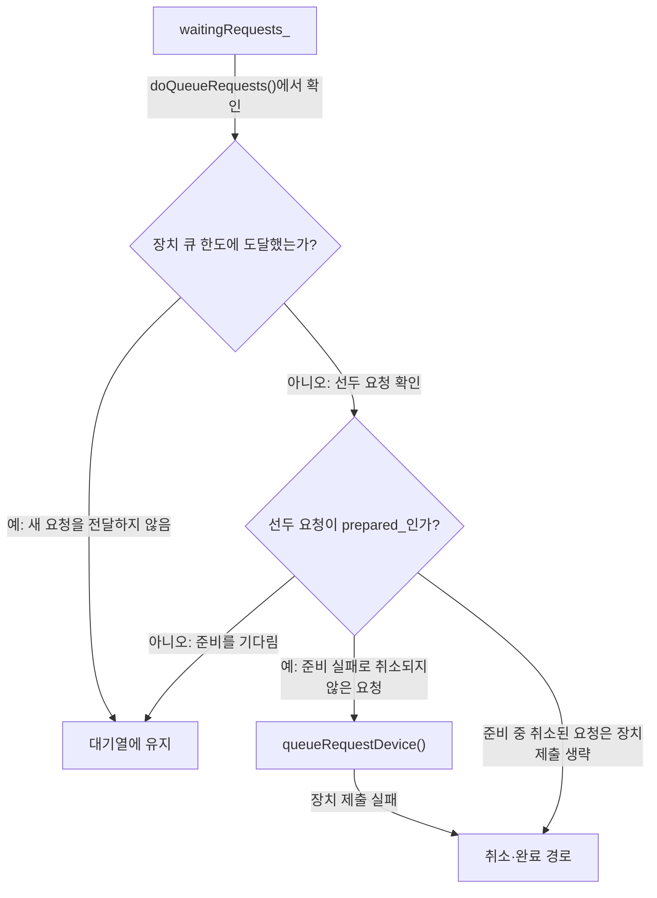
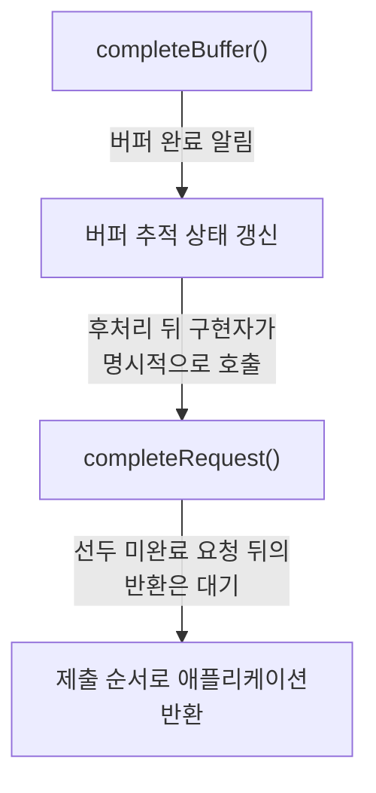
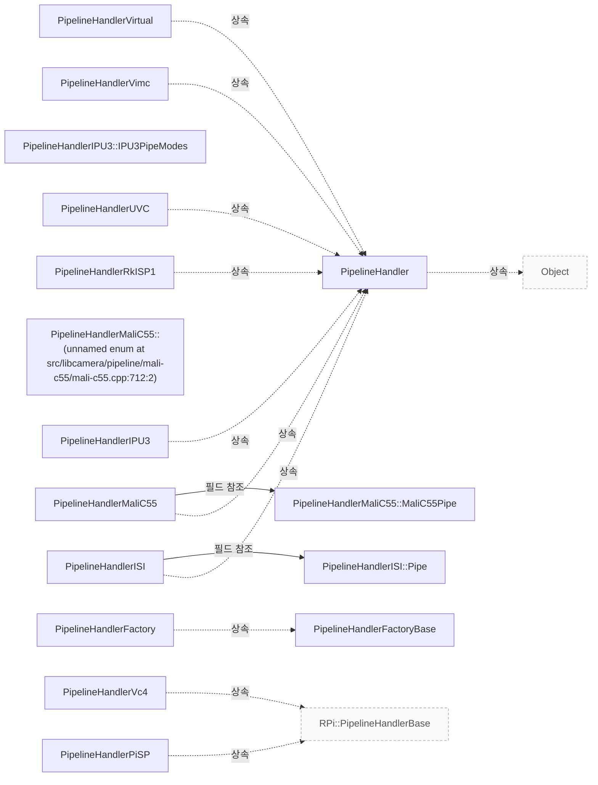

# Pipeline 요청 제출과 완료

**요청 큐의 대기·장치 전달·완료 경계를 따라 구현자의 책임을 확인하세요.**

| 지금 확인할 내용 | 이동할 절 |
|---|---|
| 파이프라인 구현이 지켜야 하는 구성·요청·완료·종료 계약을 확인하세요. | [Pipeline Handler](pipeline-handler.md) |

## 요청 준비와 장치 큐

`PipelineHandler::registerRequest()`는 요청이 생성될 때 호출되며, 파이프라인 핸들러가 해당 요청에 필요한 일회성 초기화를 수행할 기회를 제공합니다. `PipelineHandler::registerRequest()`가 `prepared` 신호에 연결한 콜백은 `doQueueRequests()`를 호출합니다. `PipelineHandler::queueRequest`는 요청이 가리키는 카메라의 내부 목록 `waitingRequests_`에 `request`를 추가합니다. `PipelineHandler::queueRequest`는 `prepare` 호출에 시간 인자로 `300ms`, 즉 300밀리초를 전달합니다. `src/libcamera/pipeline_handler.cpp:428`, `src/libcamera/pipeline_handler.cpp:435`, `src/libcamera/pipeline_handler.cpp:475`, `src/libcamera/pipeline_handler.cpp:469`

<!-- sdd:visual:queue-gates -->
### 요청이 대기하거나 장치로 가는 조건

준비 대기와 장치 큐 한도를 구분하세요. 준비 실패와 장치 제출 실패는 취소 경로로 이어집니다.



[Mermaid 원문](pipeline-requests.queue-gates.mmd)

??? note "그림 근거와 확인 범위"
    소스에 연결한 설계 해석입니다. 자동 연결 검사는 의미 승인이나 기기 실행 검증이 아닙니다.
    
    | 요소·전이 | 소스 근거 |
    |---|---|
    | waitingRequests_ | [src/libcamera/pipeline_handler.cpp:428](#source-789eafedfaa7f3c5) |
    | 선두 요청이 prepared_인가? | [src/libcamera/pipeline_handler.cpp:428](#source-789eafedfaa7f3c5) |
    | 장치 큐 한도에 도달했는가? | [src/libcamera/pipeline_handler.cpp:428](#source-789eafedfaa7f3c5) |
    | 대기열에 유지 | [src/libcamera/pipeline_handler.cpp:428](#source-789eafedfaa7f3c5) |
    | queueRequestDevice() | [src/libcamera/pipeline_handler.cpp:428](#source-789eafedfaa7f3c5) |
    | 취소·완료 경로 | [src/libcamera/pipeline_handler.cpp:428](#source-789eafedfaa7f3c5) |
    | doQueueRequests()에서 확인 | [src/libcamera/pipeline_handler.cpp:428](#source-789eafedfaa7f3c5) |
    | 예: 새 요청을 전달하지 않음 | [src/libcamera/pipeline_handler.cpp:428](#source-789eafedfaa7f3c5) |
    | 아니오: 선두 요청 확인 | [src/libcamera/pipeline_handler.cpp:428](#source-789eafedfaa7f3c5) |
    | 아니오: 준비를 기다림 | [src/libcamera/pipeline_handler.cpp:428](#source-789eafedfaa7f3c5) |
    | 예: 준비 실패로 취소되지 않은 요청 | [src/libcamera/pipeline_handler.cpp:428](#source-789eafedfaa7f3c5) |
    | 장치 제출 실패 | [src/libcamera/pipeline_handler.cpp:428](#source-789eafedfaa7f3c5) |
    | 준비 중 취소된 요청은 장치 제출 생략 | [src/libcamera/pipeline_handler.cpp:428](#source-789eafedfaa7f3c5) |
<!-- /sdd:visual:queue-gates -->

`Request::Private::prepare`는 하드웨어 장치에 큐에 넣을 요청이 메모리 전송을 받을 준비를 하도록 각 프레임 버퍼의 획득 펜스 신호를 기다립니다. 기다릴 펜스가 없으면 `prepared` 신호를 즉시 내보내고, 펜스가 있으면 모두 신호를 받거나 선택적 `timeout`이 만료될 때 신호를 내보냅니다. 모든 펜스가 올바르게 신호를 받지 못했거나 선택적 `timeout`이 만료되면 요청을 취소하고 `Request::prepared` 신호를 내보냅니다. 코드에서는 대기할 펜스가 있고 `timeout`이 0이 아닐 때 타이머를 만들고 시작합니다. `src/libcamera/request.cpp:199`

`doQueueRequests`의 `if` 조건은 `queuedRequests_`의 크기가 `maxQueuedRequestsDevice_`와 같은지 `==` 연산자로 비교합니다. `PipelineHandler::doQueueRequests()`는 표시된 조건이 참이면 `break`를 실행해 요청을 처리하는 반복문을 중단합니다. `doQueueRequests`는 `waitingRequests_`의 선두 요청에서 `prepared_`가 false이면 `break`를 실행해 `while` 반복을 중단합니다. `PipelineHandler::doQueueRequest`는 `data->queuedRequests_`에 `request`를 추가합니다. `src/libcamera/pipeline_handler.cpp:513`, `src/libcamera/pipeline_handler.cpp:509`, `src/libcamera/pipeline_handler.cpp:489`

`PipelineHandler::doQueueRequest()`는 `requestSequence_`의 증가 전 값을 `sequence_`에 대입합니다. 후위 `++` 연산자는 `requestSequence_`를 증가시킵니다. `doQueueRequest`에서 `request->_d()->cancelled_` 조건이 참이면 `completeRequest(request)`를 호출한 뒤 해당 분기에서 즉시 반환합니다. `PipelineHandler::doQueueRequest()`는 장치 제출을 위해 `queueRequestDevice()`를 호출하고 결과를 `ret`에 저장합니다. `src/libcamera/pipeline_handler.cpp:491`, `src/libcamera/pipeline_handler.cpp:483`, `src/libcamera/pipeline_handler.cpp:498`

`PipelineHandler::doQueueRequest`는 `ret`가 0이 아니면 `cancelRequest(request)`를 호출합니다. `queueRequestDevice()`를 구현하는 파이프라인 핸들러는 요청의 매개변수가 요청에 제공된 버퍼에 캡처되는 프레임에 적용되도록 장치를 설정해야 합니다. `src/libcamera/pipeline_handler.cpp:498`, `src/libcamera/pipeline_handler.cpp:428`

근거 원문: [src/libcamera/pipeline_handler.cpp:428](#source-789eafedfaa7f3c5) · [src/libcamera/request.cpp:199](#source-4f52447929ee8da9) · [src/libcamera/pipeline_handler.cpp:435](#source-2e194e2fc68579c3) · [src/libcamera/pipeline_handler.cpp:469](#source-c86b50cadd8a5947) · [src/libcamera/pipeline_handler.cpp:483](#source-8bf901f3faef18e5) · [src/libcamera/pipeline_handler.cpp:509](#source-d63c9e57bcf862b0) · [src/libcamera/pipeline_handler.cpp:489](#source-ce717689071a887f) · [src/libcamera/pipeline_handler.cpp:491](#source-a8f47a79aca791ea) · [src/libcamera/pipeline_handler.cpp:475](#source-3ad79b52195fbc58) · [src/libcamera/pipeline_handler.cpp:513](#source-819fe99ec52b734f) · [src/libcamera/pipeline_handler.cpp:498](#source-1e06e477d10056b7)

## 버퍼 완료와 요청 반환

`PipelineHandler::completeBuffer()`는 애플리케이션에 버퍼 완료를 알린 다음 요청의 내부 버퍼 추적을 갱신합니다. 요청에 포함된 모든 버퍼가 완료되면 `true`를 반환하고, 그렇지 않으면 `false`를 반환합니다. `completeBuffer()`는 마지막 버퍼가 끝나도 요청을 자동으로 완료하지 않습니다. 파이프라인 핸들러 구현자는 `completeRequest()`를 명시적으로 호출해 요청을 완료해야 합니다. `src/libcamera/pipeline_handler.cpp:547`

<!-- sdd:visual:buffer-request-completion -->
### 버퍼 완료에서 요청 반환까지

마지막 버퍼의 완료가 요청을 자동 완료하지 않습니다. 핸들러의 명시적 요청 완료 통지가 필요합니다.



[Mermaid 원문](pipeline-requests.buffer-request-completion.mmd)

??? note "그림 근거와 확인 범위"
    소스에 연결한 설계 해석입니다. 자동 연결 검사는 의미 승인이나 기기 실행 검증이 아닙니다.
    
    | 요소·전이 | 소스 근거 |
    |---|---|
    | completeBuffer() | [src/libcamera/pipeline_handler.cpp:547](#source-01ad7c6605c3296a) |
    | 버퍼 추적 상태 갱신 | [src/libcamera/pipeline_handler.cpp:547](#source-01ad7c6605c3296a) |
    | completeRequest() | [src/libcamera/pipeline_handler.cpp:547](#source-01ad7c6605c3296a) |
    | 제출 순서로 애플리케이션 반환 | [src/libcamera/pipeline_handler.cpp:547](#source-01ad7c6605c3296a) |
    | 버퍼 완료 알림 | [src/libcamera/pipeline_handler.cpp:547](#source-01ad7c6605c3296a) |
    | 후처리 뒤 구현자가 명시적으로 호출 | [src/libcamera/pipeline_handler.cpp:547](#source-01ad7c6605c3296a) |
    | 선두 미완료 요청 뒤의 반환은 대기 | [src/libcamera/pipeline_handler.cpp:547](#source-01ad7c6605c3296a) |
<!-- /sdd:visual:buffer-request-completion -->

파이프라인 핸들러는 `completeRequest`가 반환한 뒤 해당 요청에 접근해서는 안 됩니다. 해당 요청은 더 이상 파이프라인 핸들러가 관리하지 않습니다. `completeRequest`는 요청이 제출 순서대로 애플리케이션에 반환되도록 합니다. 파이프라인 핸들러는 완료된 요청에 대해 순서 제약 없이 `completeRequest`를 호출할 수 있습니다. `src/libcamera/pipeline_handler.cpp:571`, `src/libcamera/pipeline_handler.cpp:578`

`PipelineHandler::completeRequest()`의 `while` 루프는 큐 맨 앞 요청의 상태가 `Request::RequestPending`이면 `break`를 실행해 루프를 중단합니다. `PipelineHandler::completeRequest()`는 대기 중인 요청을 파이프라인에 큐잉할 수 있도록 마지막에 `doQueueRequests(camera)`를 호출합니다. 파이프라인 핸들러는 `completeBuffer`와 `completeRequest`를 `CameraManager` 스레드에서 호출해야 합니다. `PipelineHandler::cancelRequest()`는 먼저 `request->_d()->cancel()`을 호출한 다음 `completeRequest(request)`를 호출합니다. `src/libcamera/pipeline_handler.cpp:584`, `src/libcamera/pipeline_handler.cpp:547`, `src/libcamera/pipeline_handler.cpp:571`, `src/libcamera/pipeline_handler.cpp:607`

근거 원문: [src/libcamera/pipeline_handler.cpp:547](#source-01ad7c6605c3296a) · [src/libcamera/pipeline_handler.cpp:547](#source-f389c6ca68ade3da) · [src/libcamera/pipeline_handler.cpp:571](#source-236c920e906cb6fd) · [src/libcamera/pipeline_handler.cpp:584](#source-b6dd86e931d905ed) · [src/libcamera/pipeline_handler.cpp:607](#source-27cb6869fd89d13d) · [src/libcamera/pipeline_handler.cpp:578](#source-16187edaf24c09f5)

## 장치 요청 한도와 대기 큐

`PipelineHandler` 생성자 선언에서 `maxQueuedRequestsDevice`의 기본값은 32입니다. `maxQueuedRequestsDevice_`는 파이프라인 핸들러가 기반 하드웨어에 한 번에 큐에 넣는 요청 수를 제한합니다. 애플리케이션이 장치 한도보다 많은 요청을 제출하면 나머지 요청은 나중에 하드웨어에 큐잉될 때까지 내부 대기 큐에서 기다립니다. `include/libcamera/internal/pipeline_handler.h:38`, `src/libcamera/pipeline_handler.cpp:805`

근거 원문: [include/libcamera/internal/pipeline_handler.h:38](#source-0cf3f7eced88f3df) · [src/libcamera/pipeline_handler.cpp:805](#source-bf25a409490e6fa9)

??? note "설계 질문과 검증 범위"
    질문별 답변과 근거 연결을 검사했습니다. 의미와 실행 결과는 사람 검토가 필요합니다.
    
    | 설계 질문 | 설명 위치 | 확인 범위 |
    |---|---|---|
    | 요청을 장치로 넘기는 조건과 실패 처리는 무엇입니까? | [요청 준비와 장치 큐](#요청-준비와-장치-큐) | 코드 근거와 설명 연결 |
    | 버퍼 완료, 요청 완료와 접근 가능한 수명은 어떻게 구분됩니까? | [버퍼 완료와 요청 반환](#버퍼-완료와-요청-반환) | 코드 근거와 설명 연결 |
    | 장치에 동시에 제출하는 요청 수의 기본 한도와 대기 요청의 처리는 무엇입니까? | [장치 요청 한도와 대기 큐](#장치-요청-한도와-대기-큐) | 코드 근거와 설명 연결 |

## 소스 근거

같은 발췌는 한 번만 싣습니다. 필요한 원문을 펼쳐 설명과 대조하세요.

<a id="source-789eafedfaa7f3c5"></a>

??? note "소스 근거: src/libcamera/pipeline_handler.cpp:428"
    `src/libcamera/pipeline_handler.cpp:428`에서 시작하는 발췌입니다. 종료 줄은 547이며, 아래 원문을 설명과 대조할 수 있습니다.
    
    SHA-256: `5a7a3397a6034a73fe348ae44eb1e2568d2823e95542fe43386e16359d627180`
    
    ```text
    \fn PipelineHandler::registerRequest()
     * \brief Register a request for use by the pipeline handler
     * \param[in] request The request to register
     *
     * This function is called when the request is created, and allows the pipeline
     * handler to perform any one-time initialization it requries for the request.
     */
    void PipelineHandler::registerRequest(Request *request)
    {
    	/*
    	 * Connect the request prepared signal to notify the pipeline handler
    	 * when a request is ready to be processed.
    	 */
    	request->_d()->prepared.connect(this, [this, request]() {
    		doQueueRequests(request->_d()->camera());
    	});
    }
    
    /**
     * \fn PipelineHandler::queueRequest()
     * \brief Queue a request
     * \param[in] request The request to queue
     *
     * This function queues a capture request to the pipeline handler for
     * processing. The request is first added to the internal list of waiting
     * requests which have to be prepared to make sure they are ready for being
     * queued to the pipeline handler.
     *
     * The queue of waiting requests is iterated and up to \a
     * maxQueuedRequestsDevice_ prepared requests are passed to the pipeline handler
     * in the same order they have been queued by calling this function.
     *
     * If a Request fails during the preparation phase or if the pipeline handler
     * fails in queuing the request to the hardware the request is cancelled.
     *
     * Keeping track of queued requests ensures automatic completion of all requests
     * when the pipeline handler is stopped with stop(). Request completion shall be
     * signalled by the pipeline handler using the completeRequest() function.
     *
     * \context This function is called from the CameraManager thread.
     */
    void PipelineHandler::queueRequest(Request *request)
    {
    	LIBCAMERA_TRACEPOINT(request_queue, request);
    
    	Camera *camera = request->_d()->camera();
    	Camera::Private *data = camera->_d();
    	data->waitingRequests_.push(request);
    
    	request->_d()->prepare(300ms);
    }
    
    /**
     * \brief Queue one requests to the device
     */
    void PipelineHandler::doQueueRequest(Request *request)
    {
    	LIBCAMERA_TRACEPOINT(request_device_queue, request);
    
    	Camera *camera = request->_d()->camera();
    	Camera::Private *data = camera->_d();
    	data->queuedRequests_.push_back(request);
    
    	request->_d()->sequence_ = data->requestSequence_++;
    
    	if (request->_d()->cancelled_) {
    		completeRequest(request);
    		return;
    	}
    
    	int ret = queueRequestDevice(camera, request);
    	if (ret)
    		cancelRequest(request);
    }
    
    /**
     * \brief Queue prepared requests to the device
     *
     * Iterate the list of waiting requests and queue them to the device one
     * by one if they have been prepared.
     */
    void PipelineHandler::doQueueRequests(Camera *camera)
    {
    	Camera::Private *data = camera->_d();
    	while (!data->waitingRequests_.empty()) {
    		if (data->queuedRequests_.size() == maxQueuedRequestsDevice_)
    			break;
    
    		Request *request = data->waitingRequests_.front();
    		if (!request->_d()->prepared_)
    			break;
    
    		/*
    		 * Pop the request first, in case doQueueRequests() is called
    		 * recursively from within doQueueRequest()
    		 */
    		data->waitingRequests_.pop();
    		doQueueRequest(request);
    	}
    }
    
    /**
     * \fn PipelineHandler::queueRequestDevice()
     * \brief Queue a request to the device
     * \param[in] camera The camera to queue the request to
     * \param[in] request The request to queue
     *
     * This function queues a capture request to the device for processing. The
     * request contains a set of buffers associated with streams and a set of
     * parameters. The pipeline handler shall program the device to ensure that the
     * parameters will be applied to the frames captured in the buffers provided in
     * the request.
     *
     * \context This function is called from the CameraManager thread.
     *
     * \return 0 on success or a negative error code otherwise
     */
    
    /**
     * \brief Complete a buffer for a request
    ```

<a id="source-4f52447929ee8da9"></a>

??? note "소스 근거: src/libcamera/request.cpp:199"
    `src/libcamera/request.cpp:199`에서 시작하는 발췌입니다. 종료 줄은 263이며, 아래 원문을 설명과 대조할 수 있습니다.
    
    SHA-256: `97d311c371577c108a7c9e936dc85fca0cbcc912ac3de743229c1d2647590bd3`
    
    ```text
    \brief Prepare the Request to be queued to the device
     * \param[in] timeout Optional expiration timeout
     *
     * Prepare a Request to be queued to the hardware device by ensuring it is
     * ready for the incoming memory transfers.
     *
     * This currently means waiting on each frame buffer acquire fence to be
     * signalled. An optional expiration timeout can be specified. If not all the
     * fences have been signalled correctly before the timeout expires the Request
     * is cancelled.
     *
     * The function immediately emits the prepared signal if all the prepare
     * operations have been completed synchronously. If instead the prepare
     * operations require to wait the completion of asynchronous events, such as
     * fences notifications or timer expiration, the prepared signal is emitted upon
     * the asynchronous event completion.
     *
     * As we currently only handle fences, the function emits the prepared signal
     * immediately if there are no fences to wait on. Otherwise the prepared signal
     * is emitted when all fences have been signalled or the optional timeout has
     * expired.
     *
     * If not all the fences have been correctly signalled or the optional timeout
     * has expired the Request will be cancelled and the Request::prepared signal
     * emitted.
     *
     * The intended user of this function is the PipelineHandler base class, which
     * 'prepares' a Request before queuing it to the hardware device.
     */
    void Request::Private::prepare(std::chrono::milliseconds timeout)
    {
    	/* Create and connect one notifier for each synchronization fence. */
    	for (FrameBuffer *buffer : pending_) {
    		const Fence *fence = buffer->_d()->fence();
    		if (!fence)
    			continue;
    
    		auto [it, inserted] = notifiers_.try_emplace(buffer, fence->fd().get(), EventNotifier::Type::Read);
    		ASSERT(inserted);
    
    		it->second.activated.connect(this, [this, buffer] {
    			notifierActivated(buffer);
    		});
    	}
    
    	if (notifiers_.empty()) {
    		emitPrepareCompleted();
    		return;
    	}
    
    	/*
    	 * In case a timeout is specified, create a timer and set it up.
    	 *
    	 * The timer must be created here instead of in the Request constructor,
    	 * in order to be bound to the pipeline handler thread.
    	 */
    	if (timeout != 0ms) {
    		timer_ = std::make_unique<Timer>();
    		timer_->timeout.connect(this, &Request::Private::timeout);
    		timer_->start(timeout);
    	}
    }
    
    /**
     * \var Request::Private::prepared
    ```

<a id="source-2e194e2fc68579c3"></a>

??? note "소스 근거: src/libcamera/pipeline_handler.cpp:435"
    `src/libcamera/pipeline_handler.cpp:435`에서 시작하는 발췌입니다. 종료 줄은 444이며, 아래 원문을 설명과 대조할 수 있습니다.
    
    SHA-256: `ceadd0f83ea31d5d8a39a1673cb0e9b9b4f0f9d212cb5161241a6eec94b0c193`
    
    ```text
    void PipelineHandler::registerRequest(Request *request)
    {
    	/*
    	 * Connect the request prepared signal to notify the pipeline handler
    	 * when a request is ready to be processed.
    	 */
    	request->_d()->prepared.connect(this, [this, request]() {
    		doQueueRequests(request->_d()->camera());
    	});
    }
    ```

<a id="source-c86b50cadd8a5947"></a>

??? note "소스 근거: src/libcamera/pipeline_handler.cpp:469"
    `src/libcamera/pipeline_handler.cpp:469`에서 시작하는 발췌입니다. 종료 줄은 483이며, 아래 원문을 설명과 대조할 수 있습니다.
    
    SHA-256: `e407d584d54cee2098dd5730446a692093cc16cc54785bd294c39457e562a622`
    
    ```text
    void PipelineHandler::queueRequest(Request *request)
    {
    	LIBCAMERA_TRACEPOINT(request_queue, request);
    
    	Camera *camera = request->_d()->camera();
    	Camera::Private *data = camera->_d();
    	data->waitingRequests_.push(request);
    
    	request->_d()->prepare(300ms);
    }
    
    /**
     * \brief Queue one requests to the device
     */
    void PipelineHandler::doQueueRequest(Request *request)
    ```

<a id="source-8bf901f3faef18e5"></a>

??? note "소스 근거: src/libcamera/pipeline_handler.cpp:483"
    `src/libcamera/pipeline_handler.cpp:483`에서 시작하는 발췌입니다. 종료 줄은 504이며, 아래 원문을 설명과 대조할 수 있습니다.
    
    SHA-256: `6c0fefadbc69b9bb9371953979a07a38024dc18cb648266d81168f15d8e9e4fb`
    
    ```text
    void PipelineHandler::doQueueRequest(Request *request)
    {
    	LIBCAMERA_TRACEPOINT(request_device_queue, request);
    
    	Camera *camera = request->_d()->camera();
    	Camera::Private *data = camera->_d();
    	data->queuedRequests_.push_back(request);
    
    	request->_d()->sequence_ = data->requestSequence_++;
    
    	if (request->_d()->cancelled_) {
    		completeRequest(request);
    		return;
    	}
    
    	int ret = queueRequestDevice(camera, request);
    	if (ret)
    		cancelRequest(request);
    }
    
    /**
     * \brief Queue prepared requests to the device
    ```

<a id="source-d63c9e57bcf862b0"></a>

??? note "소스 근거: src/libcamera/pipeline_handler.cpp:509"
    `src/libcamera/pipeline_handler.cpp:509`에서 시작하는 발췌입니다. 종료 줄은 530이며, 아래 원문을 설명과 대조할 수 있습니다.
    
    SHA-256: `b2d2d134eaa639300cae5e7660d8453da545646bcc100bf640a981fa1371899d`
    
    ```text
    void PipelineHandler::doQueueRequests(Camera *camera)
    {
    	Camera::Private *data = camera->_d();
    	while (!data->waitingRequests_.empty()) {
    		if (data->queuedRequests_.size() == maxQueuedRequestsDevice_)
    			break;
    
    		Request *request = data->waitingRequests_.front();
    		if (!request->_d()->prepared_)
    			break;
    
    		/*
    		 * Pop the request first, in case doQueueRequests() is called
    		 * recursively from within doQueueRequest()
    		 */
    		data->waitingRequests_.pop();
    		doQueueRequest(request);
    	}
    }
    
    /**
     * \fn PipelineHandler::queueRequestDevice()
    ```

<a id="source-ce717689071a887f"></a>

??? note "소스 근거: src/libcamera/pipeline_handler.cpp:489"
    `src/libcamera/pipeline_handler.cpp:489`에서 시작하는 발췌입니다. 종료 줄은 489이며, 아래 원문을 설명과 대조할 수 있습니다.
    
    SHA-256: `6f7b414922ac8aa5b1145605d838f7188794abfdb44ae70d5272c3290753a50d`
    
    ```text
    data->queuedRequests_.push_back(request);
    ```

<a id="source-a8f47a79aca791ea"></a>

??? note "소스 근거: src/libcamera/pipeline_handler.cpp:491"
    `src/libcamera/pipeline_handler.cpp:491`에서 시작하는 발췌입니다. 종료 줄은 491이며, 아래 원문을 설명과 대조할 수 있습니다.
    
    SHA-256: `852f648a05b063e1893e4b06b763725a1c14963c9f76c4a5b38eacf57852f05f`
    
    ```text
    request->_d()->sequence_ = data->requestSequence_++;
    ```

<a id="source-3ad79b52195fbc58"></a>

??? note "소스 근거: src/libcamera/pipeline_handler.cpp:475"
    `src/libcamera/pipeline_handler.cpp:475`에서 시작하는 발췌입니다. 종료 줄은 475이며, 아래 원문을 설명과 대조할 수 있습니다.
    
    SHA-256: `1814c6100eba91f737fab4e000863c03e533260a921598e99fc69298b94f5ddb`
    
    ```text
    data->waitingRequests_.push(request);
    ```

<a id="source-819fe99ec52b734f"></a>

??? note "소스 근거: src/libcamera/pipeline_handler.cpp:513"
    `src/libcamera/pipeline_handler.cpp:513`에서 시작하는 발췌입니다. 종료 줄은 514이며, 아래 원문을 설명과 대조할 수 있습니다.
    
    SHA-256: `0e91fc5bcfd16b461ea572e903ca063877d267a641ad5e6018b4b13d89723143`
    
    ```text
    if (data->queuedRequests_.size() == maxQueuedRequestsDevice_)
    			break;
    ```

<a id="source-1e06e477d10056b7"></a>

??? note "소스 근거: src/libcamera/pipeline_handler.cpp:498"
    `src/libcamera/pipeline_handler.cpp:498`에서 시작하는 발췌입니다. 종료 줄은 500이며, 아래 원문을 설명과 대조할 수 있습니다.
    
    SHA-256: `474a449d8915b2098739e2f25079a56e132930340a353c2538de1f3ca84c3a1e`
    
    ```text
    int ret = queueRequestDevice(camera, request);
    	if (ret)
    		cancelRequest(request);
    ```

<a id="source-01ad7c6605c3296a"></a>

??? note "소스 근거: src/libcamera/pipeline_handler.cpp:547"
    `src/libcamera/pipeline_handler.cpp:547`에서 시작하는 발췌입니다. 종료 줄은 620이며, 아래 원문을 설명과 대조할 수 있습니다.
    
    SHA-256: `514288cc958de9ff5fd19d46393cec3bb3088f4f08486528d4559071138638c9`
    
    ```text
    \brief Complete a buffer for a request
     * \param[in] request The request the buffer belongs to
     * \param[in] buffer The buffer that has completed
     *
     * This function shall be called by pipeline handlers to signal completion of
     * the \a buffer part of the \a request. It notifies applications of buffer
     * completion and updates the request's internal buffer tracking. The request
     * is not completed automatically when the last buffer completes to give
     * pipeline handlers a chance to perform any operation that may still be
     * needed. They shall complete requests explicitly with completeRequest().
     *
     * \context This function shall be called from the CameraManager thread.
     *
     * \return True if all buffers contained in the request have completed, false
     * otherwise
     */
    bool PipelineHandler::completeBuffer(Request *request, FrameBuffer *buffer)
    {
    	Camera *camera = request->_d()->camera();
    	camera->bufferCompleted.emit(request, buffer);
    	return request->_d()->completeBuffer(buffer);
    }
    
    /**
     * \brief Signal request completion
     * \param[in] request The request that has completed
     *
     * The pipeline handler shall call this function to notify the \a camera that
     * the request has completed. The request is no longer managed by the pipeline
     * handler and shall not be accessed once this function returns.
     *
     * This function ensures that requests will be returned to the application in
     * submission order, the pipeline handler may call it on any complete request
     * without any ordering constraint.
     *
     * \context This function shall be called from the CameraManager thread.
     */
    void PipelineHandler::completeRequest(Request *request)
    {
    	Camera *camera = request->_d()->camera();
    
    	request->_d()->complete();
    
    	Camera::Private *data = camera->_d();
    
    	while (!data->queuedRequests_.empty()) {
    		Request *req = data->queuedRequests_.front();
    		if (req->status() == Request::RequestPending)
    			break;
    
    		ASSERT(!req->hasPendingBuffers());
    		data->queuedRequests_.pop_front();
    		camera->requestComplete(req);
    	}
    
    	/* Allow any waiting requests to be queued to the pipeline. */
    	doQueueRequests(camera);
    }
    
    /**
     * \brief Cancel request and signal its completion
     * \param[in] request The request to cancel
     *
     * This function cancels and completes the request. The same rules as for
     * completeRequest() apply.
     */
    void PipelineHandler::cancelRequest(Request *request)
    {
    	request->_d()->cancel();
    	completeRequest(request);
    }
    
    /**
     * \brief Retrieve the absolute path to a platform configuration file
    ```

<a id="source-f389c6ca68ade3da"></a>

??? note "소스 근거: src/libcamera/pipeline_handler.cpp:547"
    `src/libcamera/pipeline_handler.cpp:547`에서 시작하는 발췌입니다. 종료 줄은 571이며, 아래 원문을 설명과 대조할 수 있습니다.
    
    SHA-256: `ef4ebb9cfbf4b1330b1023d5fa7a790ab8fb13be2793adb41c2e41f01cbf107a`
    
    ```text
    \brief Complete a buffer for a request
     * \param[in] request The request the buffer belongs to
     * \param[in] buffer The buffer that has completed
     *
     * This function shall be called by pipeline handlers to signal completion of
     * the \a buffer part of the \a request. It notifies applications of buffer
     * completion and updates the request's internal buffer tracking. The request
     * is not completed automatically when the last buffer completes to give
     * pipeline handlers a chance to perform any operation that may still be
     * needed. They shall complete requests explicitly with completeRequest().
     *
     * \context This function shall be called from the CameraManager thread.
     *
     * \return True if all buffers contained in the request have completed, false
     * otherwise
     */
    bool PipelineHandler::completeBuffer(Request *request, FrameBuffer *buffer)
    {
    	Camera *camera = request->_d()->camera();
    	camera->bufferCompleted.emit(request, buffer);
    	return request->_d()->completeBuffer(buffer);
    }
    
    /**
     * \brief Signal request completion
    ```

<a id="source-236c920e906cb6fd"></a>

??? note "소스 근거: src/libcamera/pipeline_handler.cpp:571"
    `src/libcamera/pipeline_handler.cpp:571`에서 시작하는 발췌입니다. 종료 줄은 607이며, 아래 원문을 설명과 대조할 수 있습니다.
    
    SHA-256: `6ad80c6800e8b980c2a6146d7dcc5648de9db2b0ca408711a896c4e46a624684`
    
    ```text
    \brief Signal request completion
     * \param[in] request The request that has completed
     *
     * The pipeline handler shall call this function to notify the \a camera that
     * the request has completed. The request is no longer managed by the pipeline
     * handler and shall not be accessed once this function returns.
     *
     * This function ensures that requests will be returned to the application in
     * submission order, the pipeline handler may call it on any complete request
     * without any ordering constraint.
     *
     * \context This function shall be called from the CameraManager thread.
     */
    void PipelineHandler::completeRequest(Request *request)
    {
    	Camera *camera = request->_d()->camera();
    
    	request->_d()->complete();
    
    	Camera::Private *data = camera->_d();
    
    	while (!data->queuedRequests_.empty()) {
    		Request *req = data->queuedRequests_.front();
    		if (req->status() == Request::RequestPending)
    			break;
    
    		ASSERT(!req->hasPendingBuffers());
    		data->queuedRequests_.pop_front();
    		camera->requestComplete(req);
    	}
    
    	/* Allow any waiting requests to be queued to the pipeline. */
    	doQueueRequests(camera);
    }
    
    /**
     * \brief Cancel request and signal its completion
    ```

<a id="source-b6dd86e931d905ed"></a>

??? note "소스 근거: src/libcamera/pipeline_handler.cpp:584"
    `src/libcamera/pipeline_handler.cpp:584`에서 시작하는 발췌입니다. 종료 줄은 613이며, 아래 원문을 설명과 대조할 수 있습니다.
    
    SHA-256: `1c316a2c8c85330805c7dd48fd785dbda88c6cc8e60e9ff0b63039b0205c5577`
    
    ```text
    void PipelineHandler::completeRequest(Request *request)
    {
    	Camera *camera = request->_d()->camera();
    
    	request->_d()->complete();
    
    	Camera::Private *data = camera->_d();
    
    	while (!data->queuedRequests_.empty()) {
    		Request *req = data->queuedRequests_.front();
    		if (req->status() == Request::RequestPending)
    			break;
    
    		ASSERT(!req->hasPendingBuffers());
    		data->queuedRequests_.pop_front();
    		camera->requestComplete(req);
    	}
    
    	/* Allow any waiting requests to be queued to the pipeline. */
    	doQueueRequests(camera);
    }
    
    /**
     * \brief Cancel request and signal its completion
     * \param[in] request The request to cancel
     *
     * This function cancels and completes the request. The same rules as for
     * completeRequest() apply.
     */
    void PipelineHandler::cancelRequest(Request *request)
    ```

<a id="source-27cb6869fd89d13d"></a>

??? note "소스 근거: src/libcamera/pipeline_handler.cpp:607"
    `src/libcamera/pipeline_handler.cpp:607`에서 시작하는 발췌입니다. 종료 줄은 620이며, 아래 원문을 설명과 대조할 수 있습니다.
    
    SHA-256: `1fa9cc6547bd09cc36ec17572eec6ed2a69b261e1d9c9e5bd9cf58e24edd7d18`
    
    ```text
    \brief Cancel request and signal its completion
     * \param[in] request The request to cancel
     *
     * This function cancels and completes the request. The same rules as for
     * completeRequest() apply.
     */
    void PipelineHandler::cancelRequest(Request *request)
    {
    	request->_d()->cancel();
    	completeRequest(request);
    }
    
    /**
     * \brief Retrieve the absolute path to a platform configuration file
    ```

<a id="source-16187edaf24c09f5"></a>

??? note "소스 근거: src/libcamera/pipeline_handler.cpp:578"
    `src/libcamera/pipeline_handler.cpp:578`에서 시작하는 발췌입니다. 종료 줄은 580이며, 아래 원문을 설명과 대조할 수 있습니다.
    
    SHA-256: `559a88834ae3bb13ac9f2d1844e5b87f1d863fd91b1c8ed252704bf1974adac6`
    
    ```text
    This function ensures that requests will be returned to the application in
     * submission order, the pipeline handler may call it on any complete request
     * without any ordering constraint.
    ```

<a id="source-0cf3f7eced88f3df"></a>

??? note "소스 근거: include/libcamera/internal/pipeline_handler.h:38"
    `include/libcamera/internal/pipeline_handler.h:38`에서 시작하는 발췌입니다. 종료 줄은 40이며, 아래 원문을 설명과 대조할 수 있습니다.
    
    SHA-256: `192dbd8152727ba28535110f878eaf807b85e7b9e7be25d58355dd1e0a94690a`
    
    ```text
    PipelineHandler(CameraManager *manager,
    			unsigned int maxQueuedRequestsDevice = 32);
    	virtual ~PipelineHandler();
    ```

<a id="source-bf25a409490e6fa9"></a>

??? note "소스 근거: src/libcamera/pipeline_handler.cpp:805"
    `src/libcamera/pipeline_handler.cpp:805`에서 시작하는 발췌입니다. 종료 줄은 819이며, 아래 원문을 설명과 대조할 수 있습니다.
    
    SHA-256: `bebb0d8c2cd1119a344011aa4263c60740456a685b32ed3f02cd6f49c1d6101e`
    
    ```text
    \var PipelineHandler::maxQueuedRequestsDevice_
     * \brief The maximum number of requests the pipeline handler shall queue to the
     * device
     *
     * maxQueuedRequestsDevice_ limits the number of request that the
     * pipeline handler shall queue to the underlying hardware, in order to
     * saturate the pipeline with requests. The application may choose to queue
     * as many requests as it desires, however only maxQueuedRequestsDevice_
     * requests will be queued to the hardware at a given point in time. The
     * remaining requests will be kept waiting in the internal waiting
     * queue, to be queued at a later stage.
     */
    
    /**
     * \fn PipelineHandler::name()
    ```


<!-- sdd:class-diagram -->
## 클래스 관계

화살표의 글자는 추출한 관계를 나타내며, 점선은 상속입니다. 화살표는 참조 대상 또는 기반 클래스를 향합니다. 호출 순서를 뜻하지 않습니다.


<!-- /sdd:class-diagram -->


## 관련 클래스

| 클래스 | 선언 위치 | 상속 | 책임 (주석) |
|---|---|---|---|
| `libcamera::PipelineHandler` | `include/libcamera/internal/pipeline_handler.h:34` | `libcamera::Object` | Create and manage cameras based on a set of media devices |
| `libcamera::PipelineHandlerFactory` | `include/libcamera/internal/pipeline_handler.h:144` | `libcamera::PipelineHandlerFactoryBase` | Registration of PipelineHandler classes and creation of instances |
| `libcamera::PipelineHandlerFactoryBase` | `include/libcamera/internal/pipeline_handler.h:121` | – | Base class for pipeline handler factories |
| `libcamera::PipelineHandlerIPU3` | `src/libcamera/pipeline/ipu3/ipu3.cpp:124` | `libcamera::PipelineHandler` | 확인 필요 |
| `libcamera::PipelineHandlerIPU3::IPU3PipeModes` | `src/libcamera/pipeline/ipu3/ipu3.cpp:130` | – | 확인 필요 |
| `libcamera::PipelineHandlerISI` | `src/libcamera/pipeline/imx8-isi/imx8-isi.cpp:102` | `libcamera::PipelineHandler` | 확인 필요 |
| `libcamera::PipelineHandlerISI::Pipe` | `src/libcamera/pipeline/imx8-isi/imx8-isi.cpp:129` | – | 확인 필요 |
| `libcamera::PipelineHandlerMaliC55` | `src/libcamera/pipeline/mali-c55/mali-c55.cpp:676` | `libcamera::PipelineHandler` | 확인 필요 |
| `libcamera::PipelineHandlerMaliC55::(unnamed enum at src/libcamera/pipeline/mali-c55/mali-c55.cpp:712:2)` | `src/libcamera/pipeline/mali-c55/mali-c55.cpp:712` | – | 확인 필요 |
| `libcamera::PipelineHandlerMaliC55::MaliC55Pipe` | `src/libcamera/pipeline/mali-c55/mali-c55.cpp:705` | – | 확인 필요 |
| `libcamera::PipelineHandlerPiSP` | `src/libcamera/pipeline/rpi/pisp/pisp.cpp:852` | `libcamera::RPi::PipelineHandlerBase` | 확인 필요 |
| `libcamera::PipelineHandlerRkISP1` | `src/libcamera/pipeline/rkisp1/rkisp1.cpp:185` | `libcamera::PipelineHandler` | 확인 필요 |
| `libcamera::PipelineHandlerUVC` | `src/libcamera/pipeline/uvcvideo/uvcvideo.cpp:81` | `libcamera::PipelineHandler` | 확인 필요 |
| `libcamera::PipelineHandlerVc4` | `src/libcamera/pipeline/rpi/vc4/vc4.cpp:141` | `libcamera::RPi::PipelineHandlerBase` | 확인 필요 |
| `libcamera::PipelineHandlerVimc` | `src/libcamera/pipeline/vimc/vimc.cpp:84` | `libcamera::PipelineHandler` | 확인 필요 |
| `libcamera::PipelineHandlerVirtual` | `src/libcamera/pipeline/virtual/virtual.cpp:81` | `libcamera::PipelineHandler` | 확인 필요 |

??? note "근거와 검토 정보"
    - 생성 방식: 추출 사실과 LLM 설명
    - 검증 범위: 표·그림은 facts로 만들고 설명은 LLM이 작성합니다. 인용·문장 및 설정된 구조 검사를 적용합니다.
    - 근거 파일: `include/libcamera/internal/pipeline_handler.h`, `src/libcamera/pipeline/imx8-isi/imx8-isi.cpp`, `src/libcamera/pipeline/ipu3/ipu3.cpp`, `src/libcamera/pipeline/mali-c55/mali-c55.cpp`, `src/libcamera/pipeline/rkisp1/rkisp1.cpp`, `src/libcamera/pipeline/rpi/pisp/pisp.cpp`, `src/libcamera/pipeline/rpi/vc4/vc4.cpp`, `src/libcamera/pipeline/uvcvideo/uvcvideo.cpp`, `src/libcamera/pipeline/vimc/vimc.cpp`, `src/libcamera/pipeline/virtual/virtual.cpp`, `src/libcamera/pipeline_handler.cpp`, `src/libcamera/request.cpp`
    - 근거 수준: 코드 확인 (정적 분석, simple_compdb 구성, commit `212c689fcf`)
    - 자동 검사 (인용·문장 및 설정된 구조 검사): 통과
    - 검토 상태 기록일: 2026-10-30 · 사람 검토 전

다음 단계: [시스템 개요](overview.md)
