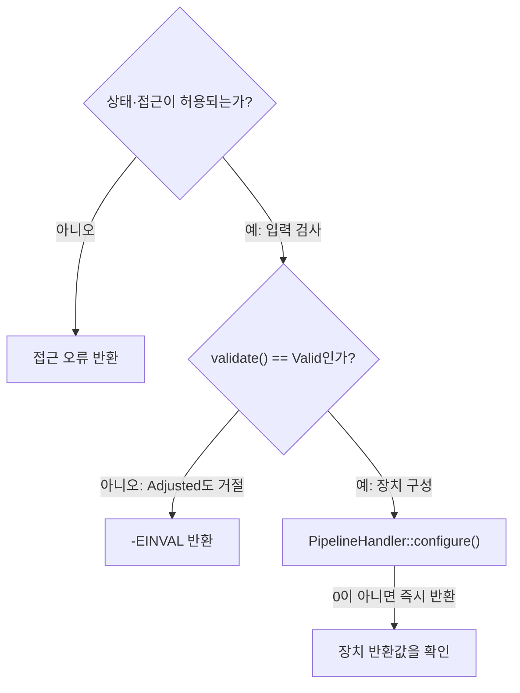
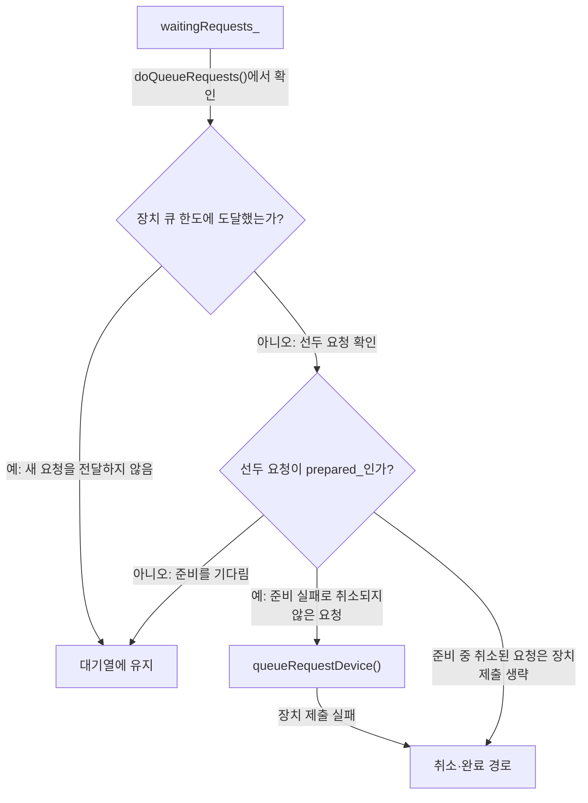

# 구성과 요청 오류 조사

**실패가 발생한 상태 검사·설정·제출·장치 처리 위치를 좁히세요.**

| 지금 확인할 내용 | 이동할 절 |
|---|---|
| 요청의 제출 성공과 촬영 완료를 구분하고, 버퍼를 유지할 기간과 오류가 난 위치를 확인하세요. | [요청 처리와 문제 진단](request-lifecycle.md) |

## 구성 실패를 좁히는 순서

조사 계획으로 `Camera::configure` 안에서 기존 `isAccessAllowed` 호출이 반환한 `ret`를 관찰합니다. `ret`가 0보다 작으면 `Camera::configure`가 그 값을 그대로 반환하는 분기를 기록합니다. `ret`가 0 이상이면 각 스트림 설정의 스트림을 `nullptr`로 설정하는 다음 동작으로 진행하는 분기를 기록합니다. `src/libcamera/camera.cpp:1195`

<!-- sdd:visual:configure-failures -->
### 구성 실패를 좁히는 분기

입력 검사와 장치 구현 실패를 순서대로 구분하세요. 아래 그림의 성공 경로에서도 스트림 연결 검사가 남습니다.



[Mermaid 원문](request-diagnosis.configure-failures.mmd)

??? note "그림 근거와 확인 범위"
    소스에 연결한 설계 해석입니다. 자동 연결 검사는 의미 승인이나 기기 실행 검증이 아닙니다.
    
    | 요소·전이 | 소스 근거 |
    |---|---|
    | 상태·접근이 허용되는가? | [src/libcamera/camera.cpp:1163](#source-4e218db5e20840dc) |
    | 접근 오류 반환 | [src/libcamera/camera.cpp:1163](#source-4e218db5e20840dc) |
    | validate() == Valid인가? | [src/libcamera/camera.cpp:1163](#source-4e218db5e20840dc) |
    | -EINVAL 반환 | [src/libcamera/camera.cpp:1163](#source-4e218db5e20840dc) |
    | PipelineHandler::configure() | [src/libcamera/camera.cpp:1163](#source-4e218db5e20840dc) |
    | 장치 반환값을 확인 | [src/libcamera/camera.cpp:1163](#source-4e218db5e20840dc) |
    | 아니오 | [src/libcamera/camera.cpp:1163](#source-4e218db5e20840dc) |
    | 예: 입력 검사 | [src/libcamera/camera.cpp:1163](#source-4e218db5e20840dc) |
    | 아니오: Adjusted도 거절 | [src/libcamera/camera.cpp:1163](#source-4e218db5e20840dc) |
    | 예: 장치 구성 | [src/libcamera/camera.cpp:1163](#source-4e218db5e20840dc) |
    | 0이 아니면 즉시 반환 | [src/libcamera/camera.cpp:1163](#source-4e218db5e20840dc) |
<!-- /sdd:visual:configure-failures -->

조사 계획으로 `Camera::Private::isAccessAllowed`에서 `allowDisconnected`와 `disconnected_` 값을 관찰합니다. `allowDisconnected`가 거짓이고 `disconnected_`가 참이면 함수가 `-ENODEV`를 반환하는지 확인합니다. `src/libcamera/camera.cpp:709`

조사 계획으로, `isAccessAllowed`에서 `allowDisconnected`가 거짓이고 `disconnected_`가 참이면 상태 비교 전에 `-ENODEV`를 반환하는 분기를 확인합니다. 그 밖에는 `currentState`, `low`, `high`와 양 끝을 포함한 범위 비교 결과를 기록하고, 범위 안이면 `0`을 반환하는 분기를 확인합니다. 범위 밖에서는 `ASSERT`, 오류 로그, `-EACCES` 반환이 코드에 이 순서로 놓인 위치를 확인합니다. `src/libcamera/camera.cpp:716`

`CameraConfiguration::validate()`가 `Adjusted`를 반환하면 구성이 조정되어 유효해진 상태이며, 어느 스트림의 파라미터든 변경되었을 수 있고 스트림 구성이 삭제되었을 수 있습니다. 호출자는 구성을 주의 깊게 확인해야 합니다. 조사 계획으로는 원래 호출의 반환값과 호출 후 구성을 관찰해 변경된 파라미터와 삭제된 스트림 구성이 있는지 확인합니다. `src/libcamera/camera.cpp:323`

`CameraConfiguration::Adjusted`가 반환되면 호출자는 구성을 주의 깊게 확인해야 합니다. 모든 스트림의 매개변수가 변경되었거나 스트림 구성이 제거되었을 수 있습니다. 조사 계획으로, `Camera::configure()`에서 `config->validate()`의 결과가 `CameraConfiguration::Valid`와 다른 경우 `-EINVAL`을 반환하는지 함께 기록합니다. `src/libcamera/camera.cpp:343`, `src/libcamera/camera.cpp:1203`

조사 계획으로, 상태 확인과 검증을 통과한 뒤 `Camera::configure()`가 `pipe_`를 통해 호출하는 `PipelineHandler::configure`의 반환값과 호출 스택에서 실행된 구체 구현을 관찰합니다. 반환값이 0이 아니면 `Camera::configure()`는 그 값을 그대로 반환하고, 0이면 스트림 설정 확인으로 진행합니다. 조사 계획으로, `Camera::configure()`에서 접근 검사와 설정 검증을 통과하고 `PipelineHandler::configure`가 0을 반환한 뒤, 각 설정의 `cfg.stream()` 결과와 null 검사 분기를 관찰합니다. 결과가 null인 분기에서는 `Fatal` 로그, `activeStreams_`를 비우는 동작, 이어지는 `-EINVAL` 반환 경로를 관찰합니다. `src/libcamera/camera.cpp:1191`, `src/libcamera/camera.cpp:1225`

근거 원문: [src/libcamera/camera.cpp:1163](#source-4e218db5e20840dc) · [src/libcamera/camera.cpp:709](#source-1e64f4ece8808997) · [src/libcamera/camera.cpp:323](#source-cb5242e98ac1e72c) · [src/libcamera/camera.cpp:1191](#source-846c5a830281fa6a) · [src/libcamera/camera.cpp:716](#source-9328b9e82bc716a1) · [src/libcamera/camera.cpp:342](#source-e13fede0aa40ada1) · [src/libcamera/camera.cpp:343](#source-e5758fc43bf244cd) · [src/libcamera/camera.cpp:1203](#source-fcc2510602fe412b) · [src/libcamera/camera.cpp:1225](#source-fa2c87e2c2f4e322) · [src/libcamera/camera.cpp:1195](#source-2da795dd561f56ec)

## 실패 위치별 확인 순서

조사 계획으로, 원래 `Camera::queueRequest()`를 호출한 파일과 그 호출의 반환값을 기록합니다. 반환값이 0이면 정상 접수이고 음수이면 제출 오류로 구분합니다. `src/libcamera/camera.cpp:1308`

<!-- sdd:visual:queue-gates -->
### 요청이 대기하거나 장치로 가는 조건

준비 대기와 장치 큐 한도를 구분하세요. 준비 실패와 장치 제출 실패는 취소 경로로 이어집니다.



[Mermaid 원문](request-diagnosis.queue-gates.mmd)

??? note "그림 근거와 확인 범위"
    소스에 연결한 설계 해석입니다. 자동 연결 검사는 의미 승인이나 기기 실행 검증이 아닙니다.
    
    | 요소·전이 | 소스 근거 |
    |---|---|
    | waitingRequests_ | [src/libcamera/pipeline_handler.cpp:428](#source-789eafedfaa7f3c5) |
    | 선두 요청이 prepared_인가? | [src/libcamera/pipeline_handler.cpp:428](#source-789eafedfaa7f3c5) |
    | 장치 큐 한도에 도달했는가? | [src/libcamera/pipeline_handler.cpp:428](#source-789eafedfaa7f3c5) |
    | 대기열에 유지 | [src/libcamera/pipeline_handler.cpp:428](#source-789eafedfaa7f3c5) |
    | queueRequestDevice() | [src/libcamera/pipeline_handler.cpp:428](#source-789eafedfaa7f3c5) |
    | 취소·완료 경로 | [src/libcamera/pipeline_handler.cpp:428](#source-789eafedfaa7f3c5) |
    | doQueueRequests()에서 확인 | [src/libcamera/pipeline_handler.cpp:428](#source-789eafedfaa7f3c5) |
    | 예: 새 요청을 전달하지 않음 | [src/libcamera/pipeline_handler.cpp:428](#source-789eafedfaa7f3c5) |
    | 아니오: 선두 요청 확인 | [src/libcamera/pipeline_handler.cpp:428](#source-789eafedfaa7f3c5) |
    | 아니오: 준비를 기다림 | [src/libcamera/pipeline_handler.cpp:428](#source-789eafedfaa7f3c5) |
    | 예: 준비 실패로 취소되지 않은 요청 | [src/libcamera/pipeline_handler.cpp:428](#source-789eafedfaa7f3c5) |
    | 장치 제출 실패 | [src/libcamera/pipeline_handler.cpp:428](#source-789eafedfaa7f3c5) |
    | 준비 중 취소된 요청은 장치 제출 생략 | [src/libcamera/pipeline_handler.cpp:428](#source-789eafedfaa7f3c5) |
<!-- /sdd:visual:queue-gates -->

조사 계획으로 기존 `Request::addBuffer()` 호출의 반환값을 확인합니다. 반환값이 `-EEXIST`이면 요청에 같은 스트림의 버퍼가 이미 있는지와 추가하려는 버퍼에 펜스가 남아 있는지를 확인해 조건을 좁힙니다. 반환값이 `0`이면 성공이며, `-EINVAL`이면 버퍼가 유효한 스트림을 참조하지 않는 경우입니다. `src/libcamera/request.cpp:442`

조사 계획으로, 제출 성공 후 `doQueueRequests()`에서 대기 요청이 있을 때 `queuedRequests_.size()`와 `maxQueuedRequestsDevice_` 값을 비교하고, 두 값이 같아 반복문을 빠져나가는 분기를 관찰합니다. 두 값이 다르면 다음으로 대기열의 첫 요청과 `prepared_` 값을 관찰합니다. 조사 계획으로, `doQueueRequests`에서 대기 요청이 있고 큐에 넣은 요청 수가 `maxQueuedRequestsDevice_`와 같지 않을 때 선두 요청의 `prepared_` 값과 다음 분기를 함께 관찰합니다. 값이 거짓이면 `break`로 반복문을 빠져나가고, 참이면 선두 요청을 대기열에서 꺼낸 뒤 `doQueueRequest(request)`를 호출합니다. `src/libcamera/pipeline_handler.cpp:428`, `src/libcamera/pipeline_handler.cpp:516`

조사 계획으로 `doQueueRequest`에서 요청을 `queuedRequests_`에 추가하고 `sequence_`를 설정한 뒤 `cancelled_` 값을 관찰합니다. 값이 참이면 `completeRequest`를 호출한 직후 함수가 반환되는 위치를 함께 관찰합니다. 값이 거짓이면 다음 분기인 `queueRequestDevice`의 반환값과, 반환값이 0이 아닐 때 `cancelRequest`를 호출하는 경로를 관찰합니다. `src/libcamera/pipeline_handler.cpp:493`

조사 계획으로 `PipelineHandler::doQueueRequest`에서 요청의 `cancelled_`가 참이면 `completeRequest` 호출 후 반환하는지 확인합니다. 그렇지 않으면 원래 호출한 `queueRequestDevice`의 반환값 `ret`을 관찰하고, `ret`이 0이 아닐 때 `cancelRequest(request)`를 호출하는 분기를 함께 확인합니다. `src/libcamera/pipeline_handler.cpp:498`

조사 계획으로, 파이프라인 핸들러가 호출한 `completeBuffer`의 반환값을 확인합니다. 이 함수는 버퍼 완료를 애플리케이션에 알리고 요청의 내부 버퍼 추적을 갱신하며, 요청의 모든 버퍼가 완료되면 `true`, 그렇지 않으면 `false`를 반환합니다. 마지막 버퍼가 완료되어도 요청은 자동으로 완료되지 않으므로, 파이프라인 핸들러가 별도로 `completeRequest`를 호출했는지 확인합니다. 파이프라인 핸들러는 두 함수를 `CameraManager` 스레드에서 호출해야 합니다. `src/libcamera/pipeline_handler.cpp:547`

조사 계획으로 `completeRequest()`의 `queuedRequests_`가 비어 있는지와 선두 요청의 `status()`가 `Request::RequestPending`인지 관찰합니다. 선두 요청이 `Request::RequestPending`이면 `break`로 반복문을 빠져나가는 분기를 확인합니다. 그렇지 않으면 `ASSERT(!req->hasPendingBuffers());`가 검사하는 조건과 이어지는 `pop_front()` 제거 및 `camera->requestComplete(req)` 통지를 확인합니다. `src/libcamera/pipeline_handler.cpp:547`

근거 원문: [src/libcamera/camera.cpp:1308](#source-28d007de6ad1a8a5) · [src/libcamera/request.cpp:442](#source-95ae69eeb085e3b1) · [src/libcamera/pipeline_handler.cpp:428](#source-789eafedfaa7f3c5) · [src/libcamera/pipeline_handler.cpp:547](#source-01ad7c6605c3296a) · [src/libcamera/pipeline_handler.cpp:516](#source-a637b7daf9acb7ac) · [src/libcamera/pipeline_handler.cpp:493](#source-0bb6ebc961be6e80) · [src/libcamera/pipeline_handler.cpp:498](#source-1e06e477d10056b7)

??? note "설계 질문과 검증 범위"
    질문별 답변과 근거 연결을 검사했습니다. 의미와 실행 결과는 사람 검토가 필요합니다.
    
    | 설계 질문 | 설명 위치 | 확인 범위 |
    |---|---|---|
    | 제출 실패와 제출 후 완료 지연을 어떻게 구분합니까? | [실패 위치별 확인 순서](#실패-위치별-확인-순서) | 코드 근거와 설명 연결 |
    | 구성 실패를 상태 검사·구성 검증·장치 구성·스트림 연결 중 어디로 좁히며 어떤 값을 관찰합니까? | [구성 실패를 좁히는 순서](#구성-실패를-좁히는-순서) | 코드 근거와 설명 연결 |

## 소스 근거

같은 발췌는 한 번만 싣습니다. 필요한 원문을 펼쳐 설명과 대조하세요.

<a id="source-4e218db5e20840dc"></a>

??? note "소스 근거: src/libcamera/camera.cpp:1163"
    `src/libcamera/camera.cpp:1163`에서 시작하는 발췌입니다. 종료 줄은 1243이며, 아래 원문을 설명과 대조할 수 있습니다.
    
    SHA-256: `5892a108abafcaf7266fb5798b70facc498e62efce52f04e773156c01471b509`
    
    ```text
    \brief Configure the camera prior to capture
     * \param[in] config The camera configurations to setup
     *
     * Prior to starting capture, the camera must be configured to select a
     * group of streams to be involved in the capture and their configuration.
     * The caller specifies which streams are to be involved and their configuration
     * by populating \a config.
     *
     * The configuration is created by generateConfiguration(), and adjusted by the
     * caller with CameraConfiguration::validate(). This function only accepts fully
     * valid configurations and returns an error if \a config is not valid.
     *
     * Exclusive access to the camera shall be ensured by a call to acquire() prior
     * to calling this function, otherwise an -EACCES error will be returned.
     *
     * \context This function may only be called when the camera is in the Acquired
     * or Configured state as defined in \ref camera_operation, and shall be
     * synchronized by the caller with other functions that affect the camera
     * state.
     *
     * Upon return the StreamConfiguration entries in \a config are associated with
     * Stream instances which can be retrieved with StreamConfiguration::stream().
     *
     * \return 0 on success or a negative error code otherwise
     * \retval -ENODEV The camera has been disconnected from the system
     * \retval -EACCES The camera is not in a state where it can be configured
     * \retval -EINVAL The configuration is not valid
     */
    int Camera::configure(CameraConfiguration *config)
    {
    	Private *const d = _d();
    
    	int ret = d->isAccessAllowed(Private::CameraAcquired,
    				     Private::CameraConfigured);
    	if (ret < 0)
    		return ret;
    
    	for (auto &cfg : *config)
    		cfg.setStream(nullptr);
    
    	if (config->validate() != CameraConfiguration::Valid) {
    		LOG(Camera, Error)
    			<< "Can't configure camera with invalid configuration";
    		return -EINVAL;
    	}
    
    	std::ostringstream msg("configuring streams:", std::ios_base::ate);
    
    	for (unsigned int index = 0; index < config->size(); ++index) {
    		StreamConfiguration &cfg = config->at(index);
    		msg << " (" << index << ") " << cfg.toString();
    	}
    
    	LOG(Camera, Info) << msg.str();
    
    	ret = d->pipe_->invokeMethod(&PipelineHandler::configure,
    				     ConnectionTypeBlocking, this, config);
    	if (ret)
    		return ret;
    
    	d->activeStreams_.clear();
    	for (const StreamConfiguration &cfg : *config) {
    		Stream *stream = cfg.stream();
    		if (!stream) {
    			LOG(Camera, Fatal)
    				<< "Pipeline handler failed to update stream configuration";
    			d->activeStreams_.clear();
    			return -EINVAL;
    		}
    
    		stream->configuration_ = cfg;
    		d->activeStreams_.insert(stream);
    	}
    
    	d->setState(Private::CameraConfigured);
    
    	return 0;
    }
    
    /**
     * \brief Create a request object for the camera
    ```

<a id="source-1e64f4ece8808997"></a>

??? note "소스 근거: src/libcamera/camera.cpp:709"
    `src/libcamera/camera.cpp:709`에서 시작하는 발췌입니다. 종료 줄은 732이며, 아래 원문을 설명과 대조할 수 있습니다.
    
    SHA-256: `4652821b0f8cfd78a0a4b8ec372fe45eb5ed2fc9b2280a765c3dc47bcc13767b`
    
    ```text
    int Camera::Private::isAccessAllowed(State low, State high,
    				     bool allowDisconnected,
    				     const char *from) const
    {
    	if (!allowDisconnected && disconnected_)
    		return -ENODEV;
    
    	State currentState = state_.load(std::memory_order_acquire);
    	if (currentState >= low && currentState <= high)
    		return 0;
    
    	ASSERT(static_cast<unsigned int>(low) < std::size(camera_state_names) &&
    	       static_cast<unsigned int>(high) < std::size(camera_state_names));
    
    	LOG(Camera, Error) << "Camera in " << camera_state_names[currentState]
    			   << " state trying " << from
    			   << "() requiring state between "
    			   << camera_state_names[low] << " and "
    			   << camera_state_names[high];
    
    	return -EACCES;
    }
    
    void Camera::Private::disconnect()
    ```

<a id="source-cb5242e98ac1e72c"></a>

??? note "소스 근거: src/libcamera/camera.cpp:323"
    `src/libcamera/camera.cpp:323`에서 시작하는 발췌입니다. 종료 줄은 350이며, 아래 원문을 설명과 대조할 수 있습니다.
    
    SHA-256: `a6c84f68e53cafd0f2721ee7eee586981059b62a93378a48235f86ffaa0a8fce`
    
    ```text
    \fn CameraConfiguration::validate()
     * \brief Validate and possibly adjust the camera configuration
     *
     * This function adjusts the camera configuration to the closest valid
     * configuration and returns the validation status.
     *
     * \todo Define exactly when to return each status code. Should stream
     * parameters set to 0 by the caller be adjusted without returning Adjusted ?
     * This would potentially be useful for applications but would get in the way
     * in Camera::configure(). Do we need an extra status code to signal this ?
     *
     * \todo Handle validation of buffers count when refactoring the buffers API.
     *
     * \return A CameraConfiguration::Status value that describes the validation
     * status.
     * \retval CameraConfiguration::Invalid The configuration is invalid and can't
     * be adjusted. This may only occur in extreme cases such as when the
     * configuration is empty.
     * \retval CameraConfiguration::Adjusted The configuration has been adjusted
     * and is now valid. Parameters may have changed for any stream, and stream
     * configurations may have been removed. The caller shall check the
     * configuration carefully.
     * \retval CameraConfiguration::Valid The configuration was already valid and
     * hasn't been adjusted.
     */
    
    /**
     * \brief Retrieve a reference to a stream configuration
    ```

<a id="source-846c5a830281fa6a"></a>

??? note "소스 근거: src/libcamera/camera.cpp:1191"
    `src/libcamera/camera.cpp:1191`에서 시작하는 발췌입니다. 종료 줄은 1243이며, 아래 원문을 설명과 대조할 수 있습니다.
    
    SHA-256: `e6185ee35674c441653590c65d2de1bc40d13b5a9d8ef8dc083936c54cb7f470`
    
    ```text
    int Camera::configure(CameraConfiguration *config)
    {
    	Private *const d = _d();
    
    	int ret = d->isAccessAllowed(Private::CameraAcquired,
    				     Private::CameraConfigured);
    	if (ret < 0)
    		return ret;
    
    	for (auto &cfg : *config)
    		cfg.setStream(nullptr);
    
    	if (config->validate() != CameraConfiguration::Valid) {
    		LOG(Camera, Error)
    			<< "Can't configure camera with invalid configuration";
    		return -EINVAL;
    	}
    
    	std::ostringstream msg("configuring streams:", std::ios_base::ate);
    
    	for (unsigned int index = 0; index < config->size(); ++index) {
    		StreamConfiguration &cfg = config->at(index);
    		msg << " (" << index << ") " << cfg.toString();
    	}
    
    	LOG(Camera, Info) << msg.str();
    
    	ret = d->pipe_->invokeMethod(&PipelineHandler::configure,
    				     ConnectionTypeBlocking, this, config);
    	if (ret)
    		return ret;
    
    	d->activeStreams_.clear();
    	for (const StreamConfiguration &cfg : *config) {
    		Stream *stream = cfg.stream();
    		if (!stream) {
    			LOG(Camera, Fatal)
    				<< "Pipeline handler failed to update stream configuration";
    			d->activeStreams_.clear();
    			return -EINVAL;
    		}
    
    		stream->configuration_ = cfg;
    		d->activeStreams_.insert(stream);
    	}
    
    	d->setState(Private::CameraConfigured);
    
    	return 0;
    }
    
    /**
     * \brief Create a request object for the camera
    ```

<a id="source-9328b9e82bc716a1"></a>

??? note "소스 근거: src/libcamera/camera.cpp:716"
    `src/libcamera/camera.cpp:716`에서 시작하는 발췌입니다. 종료 줄은 729이며, 아래 원문을 설명과 대조할 수 있습니다.
    
    SHA-256: `5ab79ef3ca49ade8dd11511db4c512b99c2857d6eeb73c27919f3d972c2e78cc`
    
    ```text
    State currentState = state_.load(std::memory_order_acquire);
    	if (currentState >= low && currentState <= high)
    		return 0;
    
    	ASSERT(static_cast<unsigned int>(low) < std::size(camera_state_names) &&
    	       static_cast<unsigned int>(high) < std::size(camera_state_names));
    
    	LOG(Camera, Error) << "Camera in " << camera_state_names[currentState]
    			   << " state trying " << from
    			   << "() requiring state between "
    			   << camera_state_names[low] << " and "
    			   << camera_state_names[high];
    
    	return -EACCES;
    ```

<a id="source-e13fede0aa40ada1"></a>

??? note "소스 근거: src/libcamera/camera.cpp:342"
    `src/libcamera/camera.cpp:342`에서 시작하는 발췌입니다. 종료 줄은 343이며, 아래 원문을 설명과 대조할 수 있습니다.
    
    SHA-256: `7c0debb896b6072c0bc59cf3589fbc49b607f915d96f30182d4e02038b94c156`
    
    ```text
    Parameters may have changed for any stream, and stream
     * configurations may have been removed.
    ```

<a id="source-e5758fc43bf244cd"></a>

??? note "소스 근거: src/libcamera/camera.cpp:343"
    `src/libcamera/camera.cpp:343`에서 시작하는 발췌입니다. 종료 줄은 344이며, 아래 원문을 설명과 대조할 수 있습니다.
    
    SHA-256: `f2efdb13d4f1bd8dd432fb0badb987eab0cc484fe8ecb30b7ea9d47c0126590c`
    
    ```text
    The caller shall check the
     * configuration carefully.
    ```

<a id="source-fcc2510602fe412b"></a>

??? note "소스 근거: src/libcamera/camera.cpp:1203"
    `src/libcamera/camera.cpp:1203`에서 시작하는 발췌입니다. 종료 줄은 1206이며, 아래 원문을 설명과 대조할 수 있습니다.
    
    SHA-256: `5ee265dc6e41d87b5c011c9621dca0bbee5126a9fdc4633d198adaa12a4f910e`
    
    ```text
    if (config->validate() != CameraConfiguration::Valid) {
    		LOG(Camera, Error)
    			<< "Can't configure camera with invalid configuration";
    		return -EINVAL;
    ```

<a id="source-fa2c87e2c2f4e322"></a>

??? note "소스 근거: src/libcamera/camera.cpp:1225"
    `src/libcamera/camera.cpp:1225`에서 시작하는 발췌입니다. 종료 줄은 1230이며, 아래 원문을 설명과 대조할 수 있습니다.
    
    SHA-256: `7cb269c9ced475fe50b39132fab5bd1f830e388d0875c1a3b8ce3f6bad2b573f`
    
    ```text
    Stream *stream = cfg.stream();
    		if (!stream) {
    			LOG(Camera, Fatal)
    				<< "Pipeline handler failed to update stream configuration";
    			d->activeStreams_.clear();
    			return -EINVAL;
    ```

<a id="source-2da795dd561f56ec"></a>

??? note "소스 근거: src/libcamera/camera.cpp:1195"
    `src/libcamera/camera.cpp:1195`에서 시작하는 발췌입니다. 종료 줄은 1198이며, 아래 원문을 설명과 대조할 수 있습니다.
    
    SHA-256: `2ca01ecac48b645d4b85b91e1263ca63f344077b66afd74a31ef47b4c6ad17bd`
    
    ```text
    int ret = d->isAccessAllowed(Private::CameraAcquired,
    				     Private::CameraConfigured);
    	if (ret < 0)
    		return ret;
    ```

<a id="source-28d007de6ad1a8a5"></a>

??? note "소스 근거: src/libcamera/camera.cpp:1308"
    `src/libcamera/camera.cpp:1308`에서 시작하는 발췌입니다. 종료 줄은 1383이며, 아래 원문을 설명과 대조할 수 있습니다.
    
    SHA-256: `96db61baeb32065c966b20942f97518ddbd3a43b36b64e8083eb29a90ecb7f4b`
    
    ```text
    \brief Queue a request to the camera
     * \param[in] request The request to queue to the camera
     *
     * This function queues a \a request to the camera for capture.
     *
     * After allocating the request with createRequest(), the application shall
     * fill it with at least one capture buffer before queuing it. Requests that
     * contain no buffers are invalid and are rejected without being queued.
     *
     * Once the request has been queued, the camera will notify its completion
     * through the \ref requestCompleted signal.
     *
     * \context This function is \threadsafe. It may only be called when the camera
     * is in the Running state as defined in \ref camera_operation.
     *
     * \return 0 on success or a negative error code otherwise
     * \retval -ENODEV The camera has been disconnected from the system
     * \retval -EACCES The camera is not running so requests can't be queued
     * \retval -EXDEV The request does not belong to this camera
     * \retval -EINVAL The request is invalid
     * \retval -ENOMEM No buffer memory was available to handle the request
     */
    int Camera::queueRequest(Request *request)
    {
    	Private *const d = _d();
    
    	int ret = d->isAccessAllowed(Private::CameraRunning);
    	if (ret < 0)
    		return ret;
    
    	/* Requests can only be queued to the camera that created them. */
    	if (request->_d()->camera() != this) {
    		LOG(Camera, Error) << "Request was not created by this camera";
    		return -EXDEV;
    	}
    
    	if (request->status() != Request::RequestPending) {
    		LOG(Camera, Error) << request->toString() << " is not valid";
    		return -EINVAL;
    	}
    
    	/* Make sure the Request has a valid control list. */
    	if (request->controls().infoMap() != &controls()) {
    		LOG(Camera, Error) << "Overwriting Request::controls() is not allowed";
    		return -EINVAL;
    	}
    
    	/*
    	 * The camera state may change until the end of the function. No locking
    	 * is however needed as PipelineHandler::queueRequest() will handle
    	 * this.
    	 */
    
    	if (request->buffers().empty()) {
    		LOG(Camera, Error) << "Request contains no buffers";
    		return -EINVAL;
    	}
    
    	for (const auto &[stream, buffer] : request->buffers()) {
    		if (d->activeStreams_.find(stream) == d->activeStreams_.end()) {
    			LOG(Camera, Error) << "Invalid request";
    			return -EINVAL;
    		}
    	}
    
    	/* Pre-process AeEnable. */
    	patchControlList(request->controls());
    
    	d->pipe_->invokeMethod(&PipelineHandler::queueRequest,
    			       ConnectionTypeQueued, request);
    
    	return 0;
    }
    
    /**
     * \brief Start capture from camera
    ```

<a id="source-95ae69eeb085e3b1"></a>

??? note "소스 근거: src/libcamera/request.cpp:442"
    `src/libcamera/request.cpp:442`에서 시작하는 발췌입니다. 종료 줄은 475이며, 아래 원문을 설명과 대조할 수 있습니다.
    
    SHA-256: `65cd8b0501b7f6545dd10eaaec4a4fe46c52a096a3bbd94ea6b4813e4a670876`
    
    ```text
    \brief Add a FrameBuffer with its associated Stream to the Request
     * \param[in] stream The stream the buffer belongs to
     * \param[in] buffer The FrameBuffer to add to the request
     * \param[in] fence The optional fence
     *
     * A reference to the buffer is stored in the request. The caller is responsible
     * for ensuring that the buffer will remain valid until the request complete
     * callback is called.
     *
     * A request can only contain one buffer per stream. If a buffer has already
     * been added to the request for the same stream, this function returns -EEXIST.
     *
     * A Fence can be optionally associated with the \a buffer.
     *
     * When a valid Fence is provided to this function, \a fence is moved to \a
     * buffer and this Request will only be queued to the device once the
     * fences of all its buffers have been correctly signalled. Ownership of the
     * fence will only be taken in case of success, otherwise the fence will
     * be left unmodified.
     *
     * If the \a fence associated with \a buffer isn't signalled, the request will
     * fail after a timeout. The buffer will still contain the fence, which
     * applications must retrieve with FrameBuffer::releaseFence() before the buffer
     * can be reused in another request. Attempting to add a buffer that still
     * contains a fence to a request will result in this function returning -EEXIST.
     *
     * \sa FrameBuffer::releaseFence()
     *
     * \return 0 on success or a negative error code otherwise
     * \retval -EEXIST The request already contains a buffer for the stream
     *  or the buffer still references a fence
     * \retval -EINVAL The buffer does not reference a valid Stream
     */
    int Request::addBuffer(const Stream *stream, FrameBuffer *buffer,
    ```

<a id="source-789eafedfaa7f3c5"></a>

??? note "소스 근거: src/libcamera/pipeline_handler.cpp:428"
    `src/libcamera/pipeline_handler.cpp:428`에서 시작하는 발췌입니다. 종료 줄은 547이며, 아래 원문을 설명과 대조할 수 있습니다.
    
    SHA-256: `5a7a3397a6034a73fe348ae44eb1e2568d2823e95542fe43386e16359d627180`
    
    ```text
    \fn PipelineHandler::registerRequest()
     * \brief Register a request for use by the pipeline handler
     * \param[in] request The request to register
     *
     * This function is called when the request is created, and allows the pipeline
     * handler to perform any one-time initialization it requries for the request.
     */
    void PipelineHandler::registerRequest(Request *request)
    {
    	/*
    	 * Connect the request prepared signal to notify the pipeline handler
    	 * when a request is ready to be processed.
    	 */
    	request->_d()->prepared.connect(this, [this, request]() {
    		doQueueRequests(request->_d()->camera());
    	});
    }
    
    /**
     * \fn PipelineHandler::queueRequest()
     * \brief Queue a request
     * \param[in] request The request to queue
     *
     * This function queues a capture request to the pipeline handler for
     * processing. The request is first added to the internal list of waiting
     * requests which have to be prepared to make sure they are ready for being
     * queued to the pipeline handler.
     *
     * The queue of waiting requests is iterated and up to \a
     * maxQueuedRequestsDevice_ prepared requests are passed to the pipeline handler
     * in the same order they have been queued by calling this function.
     *
     * If a Request fails during the preparation phase or if the pipeline handler
     * fails in queuing the request to the hardware the request is cancelled.
     *
     * Keeping track of queued requests ensures automatic completion of all requests
     * when the pipeline handler is stopped with stop(). Request completion shall be
     * signalled by the pipeline handler using the completeRequest() function.
     *
     * \context This function is called from the CameraManager thread.
     */
    void PipelineHandler::queueRequest(Request *request)
    {
    	LIBCAMERA_TRACEPOINT(request_queue, request);
    
    	Camera *camera = request->_d()->camera();
    	Camera::Private *data = camera->_d();
    	data->waitingRequests_.push(request);
    
    	request->_d()->prepare(300ms);
    }
    
    /**
     * \brief Queue one requests to the device
     */
    void PipelineHandler::doQueueRequest(Request *request)
    {
    	LIBCAMERA_TRACEPOINT(request_device_queue, request);
    
    	Camera *camera = request->_d()->camera();
    	Camera::Private *data = camera->_d();
    	data->queuedRequests_.push_back(request);
    
    	request->_d()->sequence_ = data->requestSequence_++;
    
    	if (request->_d()->cancelled_) {
    		completeRequest(request);
    		return;
    	}
    
    	int ret = queueRequestDevice(camera, request);
    	if (ret)
    		cancelRequest(request);
    }
    
    /**
     * \brief Queue prepared requests to the device
     *
     * Iterate the list of waiting requests and queue them to the device one
     * by one if they have been prepared.
     */
    void PipelineHandler::doQueueRequests(Camera *camera)
    {
    	Camera::Private *data = camera->_d();
    	while (!data->waitingRequests_.empty()) {
    		if (data->queuedRequests_.size() == maxQueuedRequestsDevice_)
    			break;
    
    		Request *request = data->waitingRequests_.front();
    		if (!request->_d()->prepared_)
    			break;
    
    		/*
    		 * Pop the request first, in case doQueueRequests() is called
    		 * recursively from within doQueueRequest()
    		 */
    		data->waitingRequests_.pop();
    		doQueueRequest(request);
    	}
    }
    
    /**
     * \fn PipelineHandler::queueRequestDevice()
     * \brief Queue a request to the device
     * \param[in] camera The camera to queue the request to
     * \param[in] request The request to queue
     *
     * This function queues a capture request to the device for processing. The
     * request contains a set of buffers associated with streams and a set of
     * parameters. The pipeline handler shall program the device to ensure that the
     * parameters will be applied to the frames captured in the buffers provided in
     * the request.
     *
     * \context This function is called from the CameraManager thread.
     *
     * \return 0 on success or a negative error code otherwise
     */
    
    /**
     * \brief Complete a buffer for a request
    ```

<a id="source-01ad7c6605c3296a"></a>

??? note "소스 근거: src/libcamera/pipeline_handler.cpp:547"
    `src/libcamera/pipeline_handler.cpp:547`에서 시작하는 발췌입니다. 종료 줄은 620이며, 아래 원문을 설명과 대조할 수 있습니다.
    
    SHA-256: `514288cc958de9ff5fd19d46393cec3bb3088f4f08486528d4559071138638c9`
    
    ```text
    \brief Complete a buffer for a request
     * \param[in] request The request the buffer belongs to
     * \param[in] buffer The buffer that has completed
     *
     * This function shall be called by pipeline handlers to signal completion of
     * the \a buffer part of the \a request. It notifies applications of buffer
     * completion and updates the request's internal buffer tracking. The request
     * is not completed automatically when the last buffer completes to give
     * pipeline handlers a chance to perform any operation that may still be
     * needed. They shall complete requests explicitly with completeRequest().
     *
     * \context This function shall be called from the CameraManager thread.
     *
     * \return True if all buffers contained in the request have completed, false
     * otherwise
     */
    bool PipelineHandler::completeBuffer(Request *request, FrameBuffer *buffer)
    {
    	Camera *camera = request->_d()->camera();
    	camera->bufferCompleted.emit(request, buffer);
    	return request->_d()->completeBuffer(buffer);
    }
    
    /**
     * \brief Signal request completion
     * \param[in] request The request that has completed
     *
     * The pipeline handler shall call this function to notify the \a camera that
     * the request has completed. The request is no longer managed by the pipeline
     * handler and shall not be accessed once this function returns.
     *
     * This function ensures that requests will be returned to the application in
     * submission order, the pipeline handler may call it on any complete request
     * without any ordering constraint.
     *
     * \context This function shall be called from the CameraManager thread.
     */
    void PipelineHandler::completeRequest(Request *request)
    {
    	Camera *camera = request->_d()->camera();
    
    	request->_d()->complete();
    
    	Camera::Private *data = camera->_d();
    
    	while (!data->queuedRequests_.empty()) {
    		Request *req = data->queuedRequests_.front();
    		if (req->status() == Request::RequestPending)
    			break;
    
    		ASSERT(!req->hasPendingBuffers());
    		data->queuedRequests_.pop_front();
    		camera->requestComplete(req);
    	}
    
    	/* Allow any waiting requests to be queued to the pipeline. */
    	doQueueRequests(camera);
    }
    
    /**
     * \brief Cancel request and signal its completion
     * \param[in] request The request to cancel
     *
     * This function cancels and completes the request. The same rules as for
     * completeRequest() apply.
     */
    void PipelineHandler::cancelRequest(Request *request)
    {
    	request->_d()->cancel();
    	completeRequest(request);
    }
    
    /**
     * \brief Retrieve the absolute path to a platform configuration file
    ```

<a id="source-a637b7daf9acb7ac"></a>

??? note "소스 근거: src/libcamera/pipeline_handler.cpp:516"
    `src/libcamera/pipeline_handler.cpp:516`에서 시작하는 발췌입니다. 종료 줄은 518이며, 아래 원문을 설명과 대조할 수 있습니다.
    
    SHA-256: `f655f79ce0ac9e9361d1759b2974e6f382b7fe1e9e3aa35b51952572af8d5a6f`
    
    ```text
    Request *request = data->waitingRequests_.front();
    		if (!request->_d()->prepared_)
    			break;
    ```

<a id="source-0bb6ebc961be6e80"></a>

??? note "소스 근거: src/libcamera/pipeline_handler.cpp:493"
    `src/libcamera/pipeline_handler.cpp:493`에서 시작하는 발췌입니다. 종료 줄은 495이며, 아래 원문을 설명과 대조할 수 있습니다.
    
    SHA-256: `1ebc4d56b99218bfb196cf7548aa7167a251392ddb7bf53af9ef4963cc24636b`
    
    ```text
    if (request->_d()->cancelled_) {
    		completeRequest(request);
    		return;
    ```

<a id="source-1e06e477d10056b7"></a>

??? note "소스 근거: src/libcamera/pipeline_handler.cpp:498"
    `src/libcamera/pipeline_handler.cpp:498`에서 시작하는 발췌입니다. 종료 줄은 500이며, 아래 원문을 설명과 대조할 수 있습니다.
    
    SHA-256: `474a449d8915b2098739e2f25079a56e132930340a353c2538de1f3ca84c3a1e`
    
    ```text
    int ret = queueRequestDevice(camera, request);
    	if (ret)
    		cancelRequest(request);
    ```

??? note "근거와 검토 정보"
    - 생성 방식: 추출 사실과 LLM 설명
    - 검증 범위: 표·그림은 facts로 만들고 설명은 LLM이 작성합니다. 인용·문장 및 설정된 구조 검사를 적용합니다.
    - 근거 파일: `include/libcamera/camera.h`, `include/libcamera/internal/pipeline_handler.h`, `include/libcamera/request.h`, `src/libcamera/camera.cpp`, `src/libcamera/pipeline_handler.cpp`, `src/libcamera/request.cpp`
    - 근거 수준: 코드 확인 (정적 분석, simple_compdb 구성, commit `e117198c01`)
    - 자동 검사 (인용·문장 및 설정된 구조 검사): 통과
    - 검토 상태 기록일: 2026-10-29 · 사람 검토 전

다음 단계: [Pipeline Handler](pipeline-handler.md)
