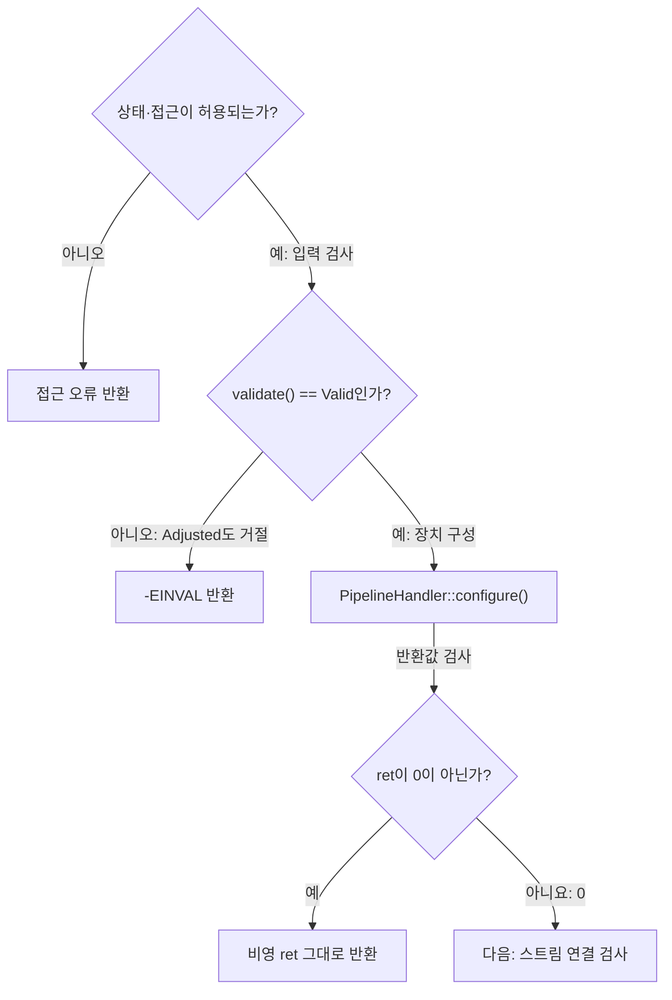
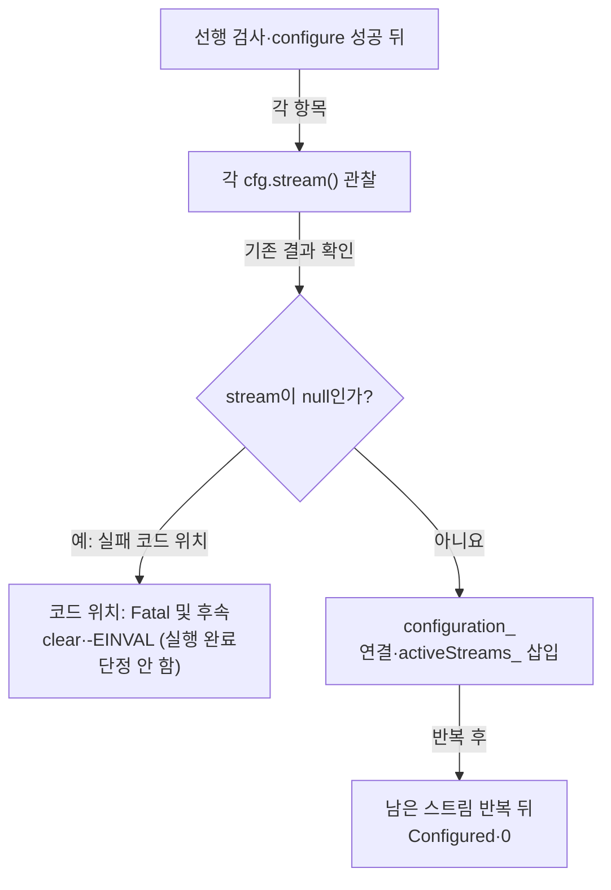
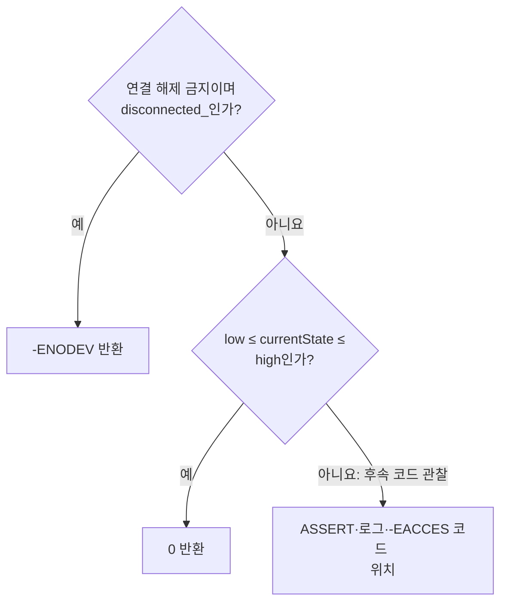
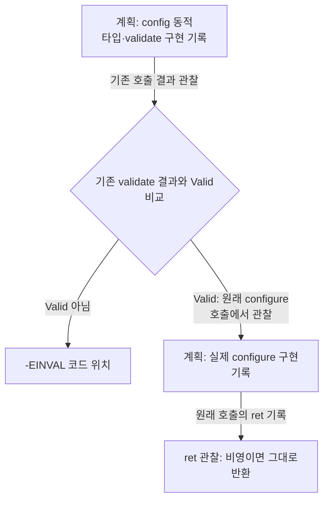
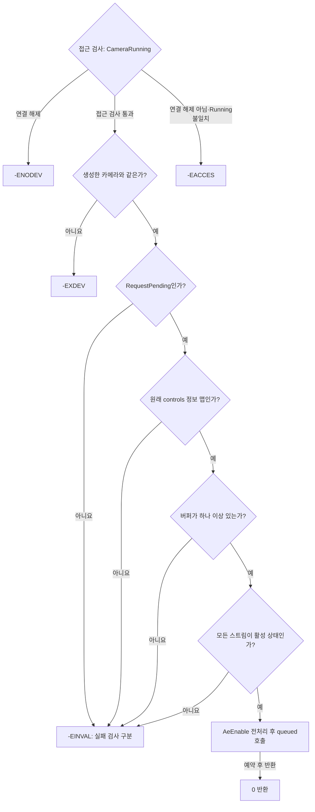
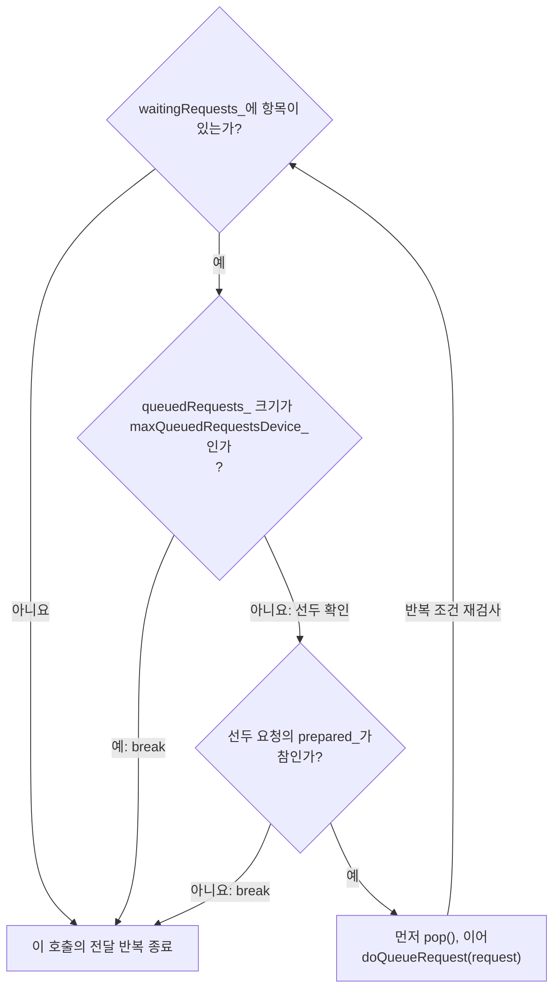
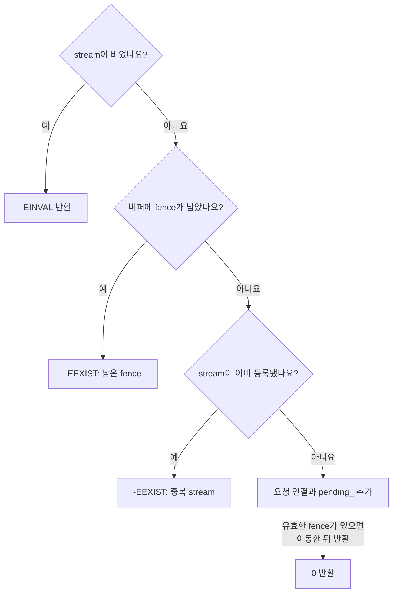
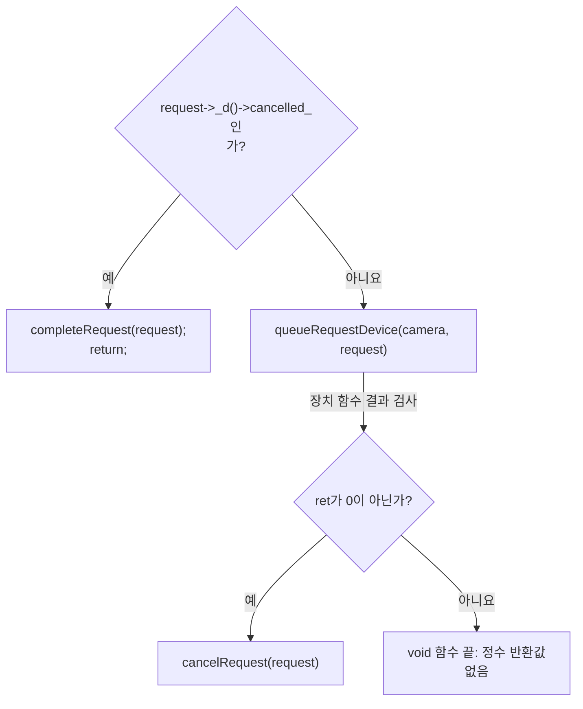
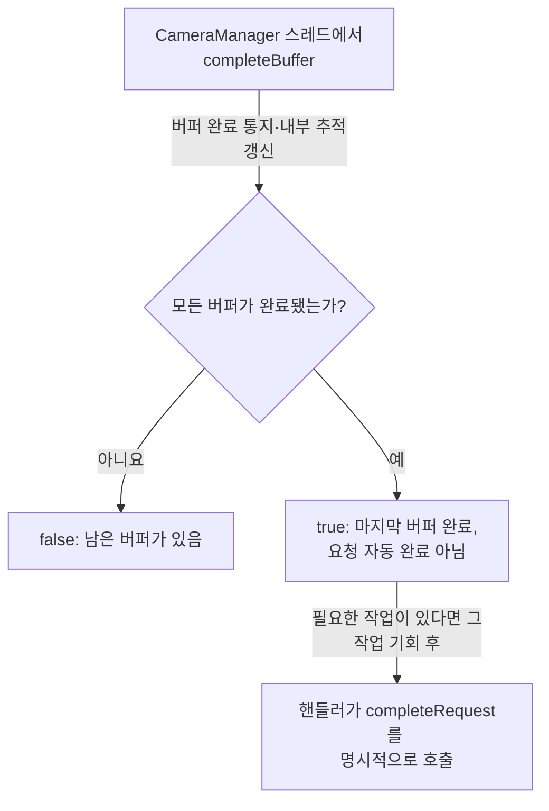
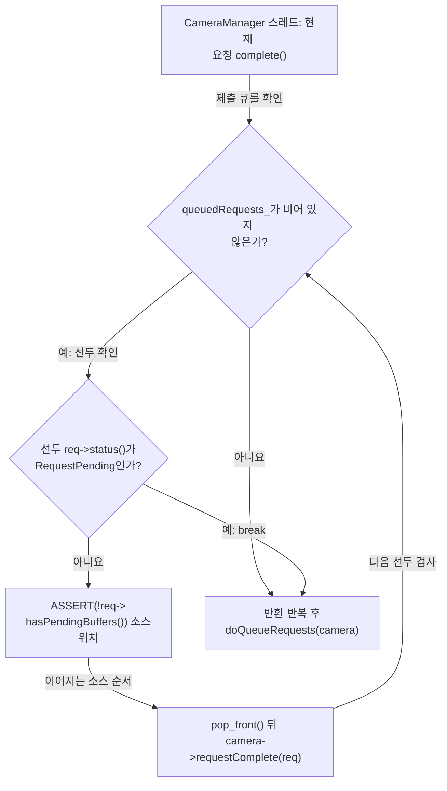

# 구성과 요청 오류 조사

**실패가 발생한 상태 검사·설정·제출·장치 처리 위치를 좁히세요.**

| 지금 확인할 내용 | 이동할 절 |
|---|---|
| 요청의 제출 성공과 촬영 완료를 구분하고, 버퍼를 유지할 기간과 오류가 난 위치를 확인하세요. | [요청 처리와 문제 진단](request-lifecycle.md) |
| <a id="요청이-대기하거나-장치로-가는-조건"></a>선두 요청의 준비 상태와 소프트웨어 큐 한도를 확인하세요. | [선두 요청을 전달하거나 반복을 멈추는 조건](#선두-요청을-전달하거나-반복을-멈추는-조건) |

## 구성 실패를 좁히는 순서

조사할 때는 `Camera::configure` 안에서 `Private::CameraAcquired`와 `Private::CameraConfigured`를 인자로 전달하는 기존 `isAccessAllowed` 호출의 반환값 `ret`를 관찰합니다. `ret < 0`이면 `Camera::configure`가 같은 `ret`를 반환하는 실패 분기를 기록합니다. 기존 `Camera::Private::isAccessAllowed` 호출의 조사에서는 먼저 `allowDisconnected`가 거짓이고 `disconnected_`가 참일 때 `-ENODEV`를 반환하는 선행 분기를 구분합니다. 그 밖에는 `currentState`와 `low`, `high`의 범위 비교 및 범위 안의 `0` 반환을 살펴보고, 범위 밖에서는 `ASSERT`, 오류 로그, `-EACCES` 반환의 코드 위치를 순서대로 확인합니다. `src/libcamera/camera.cpp:1195`, `src/libcamera/camera.cpp:716`, `src/libcamera/camera.cpp:709`

<!-- sdd:visual:configure-failures -->
### 구성 실패를 좁히는 분기



[Mermaid 원문](request-diagnosis.configure-failures.mmd)

??? note "그림 근거와 확인 범위"
    입력 검사와 장치 구현 실패를 순서대로 구분하세요. 아래 그림의 성공 경로에서도 스트림 연결 검사가 남습니다.
    
    소스에 연결한 설계 해석입니다. 자동 연결 검사는 의미 승인이나 기기 실행 검증이 아닙니다.
    
    | 요소·전이 | 소스 근거 |
    |---|---|
    | <span data-sdd-label-en="State and access allowed?">상태·접근이 허용되는가?</span> | [src/libcamera/camera.cpp:1163](#source-4e218db5e20840dc) |
    | <span data-sdd-label-en="Return access error">접근 오류 반환</span> | [src/libcamera/camera.cpp:1163](#source-4e218db5e20840dc) |
    | <span data-sdd-label-en="Does validate() return Valid?">validate&#40;&#41; == Valid인가?</span> | [src/libcamera/camera.cpp:1163](#source-4e218db5e20840dc) |
    | <span data-sdd-label-en="Return -EINVAL">-EINVAL 반환</span> | [src/libcamera/camera.cpp:1163](#source-4e218db5e20840dc) |
    | <span data-sdd-label-en="PipelineHandler::configure()">PipelineHandler::configure&#40;&#41;</span> | [src/libcamera/camera.cpp:1163](#source-4e218db5e20840dc) |
    | <span data-sdd-label-en="Is ret nonzero?">ret이 0이 아닌가?</span> | [src/libcamera/camera.cpp:1191](#source-846c5a830281fa6a) |
    | <span data-sdd-label-en="Return nonzero ret unchanged">비영 ret 그대로 반환</span> | [src/libcamera/camera.cpp:1191](#source-846c5a830281fa6a) |
    | <span data-sdd-label-en="Next: check stream associations">다음: 스트림 연결 검사</span> | [src/libcamera/camera.cpp:1191](#source-846c5a830281fa6a) |
    | <span data-sdd-label-en="No">아니오</span> | [src/libcamera/camera.cpp:1163](#source-4e218db5e20840dc) |
    | <span data-sdd-label-en="Yes: validate input">예: 입력 검사</span> | [src/libcamera/camera.cpp:1163](#source-4e218db5e20840dc) |
    | <span data-sdd-label-en="No: Adjusted is also rejected">아니오: Adjusted도 거절</span> | [src/libcamera/camera.cpp:1163](#source-4e218db5e20840dc) |
    | <span data-sdd-label-en="Yes: configure device">예: 장치 구성</span> | [src/libcamera/camera.cpp:1163](#source-4e218db5e20840dc) |
    | <span data-sdd-label-en="Check return value">반환값 검사</span> | [src/libcamera/camera.cpp:1163](#source-4e218db5e20840dc) |
    | <span data-sdd-label-en="Yes">예</span> | [src/libcamera/camera.cpp:1191](#source-846c5a830281fa6a) |
    | <span data-sdd-label-en="No: zero">아니요: 0</span> | [src/libcamera/camera.cpp:1191](#source-846c5a830281fa6a) |
<!-- /sdd:visual:configure-failures -->

<!-- sdd:visual:configuration-stream-link -->
### 구성 성공 뒤 스트림 연결을 확인하는 분기



[Mermaid 원문](request-diagnosis.configuration-stream-link.mmd)

??? note "그림 근거와 확인 범위"
    상태 검사·검증과 PipelineHandler::configure 성공 뒤 cfg.stream()이 null인 경우 어떤 코드 위치를 관찰합니까?
    
    소스에 연결한 설계 해석입니다. 자동 연결 검사는 의미 승인이나 기기 실행 검증이 아닙니다.
    
    | 요소·전이 | 소스 근거 |
    |---|---|
    | <span data-sdd-label-en="After checks and configure succeed">선행 검사·configure 성공 뒤</span> | [src/libcamera/camera.cpp:1163](#source-4e218db5e20840dc) |
    | <span data-sdd-label-en="Observe each cfg.stream()">각 cfg.stream&#40;&#41; 관찰</span> | [src/libcamera/camera.cpp:1163](#source-4e218db5e20840dc) |
    | <span data-sdd-label-en="Is stream null?">stream이 null인가?</span> | [src/libcamera/camera.cpp:1163](#source-4e218db5e20840dc) |
    | <span data-sdd-label-en="Code locations: Fatal and subsequent clear/-EINVAL (execution not asserted)">코드 위치: Fatal 및 후속 clear·-EINVAL &#40;실행 완료 단정 안 함&#41;</span> | [src/libcamera/camera.cpp:1163](#source-4e218db5e20840dc) |
    | <span data-sdd-label-en="Assign configuration_ and insert active stream">configuration&#95; 연결·activeStreams&#95; 삽입</span> | [src/libcamera/camera.cpp:1163](#source-4e218db5e20840dc) |
    | <span data-sdd-label-en="After remaining streams: Configured and 0">남은 스트림 반복 뒤 Configured·0</span> | [src/libcamera/camera.cpp:1163](#source-4e218db5e20840dc) |
    | <span data-sdd-label-en="Each entry">각 항목</span> | [src/libcamera/camera.cpp:1163](#source-4e218db5e20840dc) |
    | <span data-sdd-label-en="Check original result">기존 결과 확인</span> | [src/libcamera/camera.cpp:1163](#source-4e218db5e20840dc) |
    | <span data-sdd-label-en="Yes: failure code locations">예: 실패 코드 위치</span> | [src/libcamera/camera.cpp:1163](#source-4e218db5e20840dc) |
    | <span data-sdd-label-en="No">아니요</span> | [src/libcamera/camera.cpp:1163](#source-4e218db5e20840dc) |
    | <span data-sdd-label-en="After loop">반복 후</span> | [src/libcamera/camera.cpp:1163](#source-4e218db5e20840dc) |
<!-- /sdd:visual:configuration-stream-link -->

<!-- sdd:visual:configuration-access-branches -->
### 구성 접근 검사에서 관찰할 분기



[Mermaid 원문](request-diagnosis.configuration-access-branches.mmd)

??? note "그림 근거와 확인 범위"
    연결 해제를 먼저 확인한 뒤 상태 범위를 검사합니다. 단언과 로그 뒤의 코드는 실제 실행 결과로 단정하지 않습니다.
    
    소스에 연결한 설계 해석입니다. 자동 연결 검사는 의미 승인이나 기기 실행 검증이 아닙니다.
    
    | 요소·전이 | 소스 근거 |
    |---|---|
    | <span data-sdd-label-en="Disconnection disallowed and disconnected_?">연결 해제 금지이며 disconnected&#95;인가?</span> | [src/libcamera/camera.cpp:709](#source-1e64f4ece8808997) |
    | <span data-sdd-label-en="Return -ENODEV">-ENODEV 반환</span> | [src/libcamera/camera.cpp:709](#source-1e64f4ece8808997) |
    | <span data-sdd-label-en="low ≤ currentState ≤ high?">low ≤ currentState ≤ high인가?</span> | [src/libcamera/camera.cpp:709](#source-1e64f4ece8808997) |
    | <span data-sdd-label-en="Return 0">0 반환</span> | [src/libcamera/camera.cpp:709](#source-1e64f4ece8808997) |
    | <span data-sdd-label-en="ASSERT, log and -EACCES code locations">ASSERT·로그·-EACCES 코드 위치</span> | [src/libcamera/camera.cpp:709](#source-1e64f4ece8808997) |
    | <span data-sdd-label-en="Yes">예</span> | [src/libcamera/camera.cpp:709](#source-1e64f4ece8808997) |
    | <span data-sdd-label-en="No">아니요</span> | [src/libcamera/camera.cpp:709](#source-1e64f4ece8808997) |
    | <span data-sdd-label-en="Yes">예</span> | [src/libcamera/camera.cpp:709](#source-1e64f4ece8808997) |
    | <span data-sdd-label-en="No: observe following code">아니요: 후속 코드 관찰</span> | [src/libcamera/camera.cpp:709](#source-1e64f4ece8808997) |
<!-- /sdd:visual:configuration-access-branches -->

<!-- sdd:visual:configuration-implementation-observation -->
### 구성 호출의 실제 구현을 확인하는 조사 계획



[Mermaid 원문](request-diagnosis.configuration-implementation-observation.mmd)

??? note "그림 근거와 확인 범위"
    상태 검사를 통과한 기존 호출에서 타입·구현·반환값을 관찰하는 계획입니다. 검증이나 구성을 다시 호출하지 않습니다.
    
    소스에 연결한 설계 해석입니다. 자동 연결 검사는 의미 승인이나 기기 실행 검증이 아닙니다.
    
    | 요소·전이 | 소스 근거 |
    |---|---|
    | <span data-sdd-label-en="Plan: record config type and validate implementation">계획: config 동적 타입·validate 구현 기록</span> | [src/libcamera/camera.cpp:1191](#source-846c5a830281fa6a) |
    | <span data-sdd-label-en="Compare existing validate result with Valid">기존 validate 결과와 Valid 비교</span> | [src/libcamera/camera.cpp:1191](#source-846c5a830281fa6a) |
    | <span data-sdd-label-en="-EINVAL code location">-EINVAL 코드 위치</span> | [src/libcamera/camera.cpp:1203](#source-fcc2510602fe412b) |
    | <span data-sdd-label-en="Plan: record actual configure implementation">계획: 실제 configure 구현 기록</span> | [src/libcamera/camera.cpp:1191](#source-846c5a830281fa6a) |
    | <span data-sdd-label-en="Observe ret: return unchanged if nonzero">ret 관찰: 비영이면 그대로 반환</span> | [src/libcamera/camera.cpp:1191](#source-846c5a830281fa6a) |
    | <span data-sdd-label-en="Observe existing call result">기존 호출 결과 관찰</span> | [src/libcamera/camera.cpp:1191](#source-846c5a830281fa6a) |
    | <span data-sdd-label-en="Not Valid">Valid 아님</span> | [src/libcamera/camera.cpp:1203](#source-fcc2510602fe412b) |
    | <span data-sdd-label-en="Valid: observe original configure call">Valid: 원래 configure 호출에서 관찰</span> | [src/libcamera/camera.cpp:1191](#source-846c5a830281fa6a) |
    | <span data-sdd-label-en="Record original call ret">원래 호출의 ret 기록</span> | [src/libcamera/camera.cpp:1191](#source-846c5a830281fa6a) |
<!-- /sdd:visual:configuration-implementation-observation -->

`CameraConfiguration::validate()`의 `Adjusted`는 구성이 유효하도록 조정된 상태이며, 임의의 스트림에서 파라미터가 변경되거나 스트림 구성이 삭제될 수 있습니다. `Adjusted`를 받은 호출자는 구성을 주의 깊게 확인해야 합니다. `src/libcamera/camera.cpp:323`, `src/libcamera/camera.cpp:343`

실행 확인 항목: 조사 계획에서는 `Camera::configure`의 `config->validate()` 결과를 `CameraConfiguration::Valid`와 비교하고, 결과가 다를 때 `-EINVAL`을 반환하는지 함께 기록할 수 있습니다. `src/libcamera/camera.cpp:1203`

기존 호출 스택에서 `config`의 실제 동적 타입과 실행되는 `validate` 구현을 기록하는 조사 계획입니다. 상태 확인과 검증을 통과한 경우 `pipe_`의 `invokeMethod`를 거쳐 호출되는 `PipelineHandler::configure`의 구체 구현과 반환값을 관찰하고, 반환값이 0이 아니면 `Camera::configure`가 그 값을 그대로 반환하는 분기를 기록합니다. `src/libcamera/camera.cpp:1203`, `src/libcamera/camera.cpp:1191`

조사할 때 `Camera::configure()`에서 접근 검사와 설정 검증을 통과한 뒤 `PipelineHandler::configure`의 반환값이 0인 경우, 각 `cfg.stream()`의 결과인 `stream`과 null 검사 결과를 관찰합니다. `stream`이 null이면 Fatal 로그 `Pipeline handler failed to update stream configuration`과 `activeStreams_.clear()` 다음의 `-EINVAL` 반환 경로를 확인합니다. `src/libcamera/camera.cpp:1225`

근거 원문: [src/libcamera/camera.cpp:1163](#source-4e218db5e20840dc) · [src/libcamera/camera.cpp:709](#source-1e64f4ece8808997) · [src/libcamera/camera.cpp:323](#source-cb5242e98ac1e72c) · [src/libcamera/camera.cpp:1191](#source-846c5a830281fa6a) · [src/libcamera/camera.cpp:716](#source-9328b9e82bc716a1) · [src/libcamera/camera.cpp:342](#source-e13fede0aa40ada1) · [src/libcamera/camera.cpp:343](#source-e5758fc43bf244cd) · [src/libcamera/camera.cpp:1203](#source-fcc2510602fe412b) · [src/libcamera/camera.cpp:1225](#source-fa2c87e2c2f4e322) · [src/libcamera/camera.cpp:1195](#source-2da795dd561f56ec)

## 요청 제출 오류 코드와 검사 순서

queueRequest는 먼저 isAccessAllowed(CameraRunning)를 호출하며, 연결이 해제된 경우 -ENODEV를, 연결이 해제되지 않았지만 Running 상태가 아닌 경우 -EACCES를 반환합니다. 반환값이 음수이면 요청 내용을 검사하기 전에 그 값을 그대로 반환합니다. `src/libcamera/camera.cpp:1308`, `src/libcamera/camera.cpp:690`

<!-- sdd:visual:submission-checks -->
### 요청 제출 검사 순서



[Mermaid 원문](request-diagnosis.submission-checks.mmd)

??? note "그림 근거와 확인 범위"
    반환 오류를 실제 검사 조건과 연결합니다. 성공 반환 뒤의 준비와 완료는 다음 절에서 확인합니다.
    
    소스에 연결한 설계 해석입니다. 자동 연결 검사는 의미 승인이나 기기 실행 검증이 아닙니다.
    
    | 요소·전이 | 소스 근거 |
    |---|---|
    | <span data-sdd-label-en="Access check: CameraRunning">접근 검사: CameraRunning</span> | [src/libcamera/camera.cpp:1308](#source-28d007de6ad1a8a5) |
    | <span data-sdd-label-en="-ENODEV">-ENODEV</span> | [src/libcamera/camera.cpp:690](#source-0c42c645a5fc60a3) |
    | <span data-sdd-label-en="Same camera that created the request?">생성한 카메라와 같은가?</span> | [src/libcamera/camera.cpp:1308](#source-28d007de6ad1a8a5) |
    | <span data-sdd-label-en="-EXDEV">-EXDEV</span> | [src/libcamera/camera.cpp:1308](#source-28d007de6ad1a8a5) |
    | <span data-sdd-label-en="Is status RequestPending?">RequestPending인가?</span> | [src/libcamera/camera.cpp:1308](#source-28d007de6ad1a8a5) |
    | <span data-sdd-label-en="Original controls info map?">원래 controls 정보 맵인가?</span> | [src/libcamera/camera.cpp:1308](#source-28d007de6ad1a8a5) |
    | <span data-sdd-label-en="At least one buffer?">버퍼가 하나 이상 있는가?</span> | [src/libcamera/camera.cpp:1308](#source-28d007de6ad1a8a5) |
    | <span data-sdd-label-en="Every stream active?">모든 스트림이 활성 상태인가?</span> | [src/libcamera/camera.cpp:1308](#source-28d007de6ad1a8a5) |
    | <span data-sdd-label-en="-EINVAL: identify the failed check">-EINVAL: 실패 검사 구분</span> | [src/libcamera/camera.cpp:1308](#source-28d007de6ad1a8a5) |
    | <span data-sdd-label-en="Preprocess AeEnable; queue the call">AeEnable 전처리 후 queued 호출</span> | [src/libcamera/camera.cpp:1308](#source-28d007de6ad1a8a5) |
    | <span data-sdd-label-en="Return 0">0 반환</span> | [src/libcamera/camera.cpp:1308](#source-28d007de6ad1a8a5) |
    | <span data-sdd-label-en="-EACCES">-EACCES</span> | [src/libcamera/camera.cpp:690](#source-0c42c645a5fc60a3) |
    | <span data-sdd-label-en="Disconnected">연결 해제</span> | [src/libcamera/camera.cpp:690](#source-0c42c645a5fc60a3) |
    | <span data-sdd-label-en="Access check passes">접근 검사 통과</span> | [src/libcamera/camera.cpp:1308](#source-28d007de6ad1a8a5) |
    | <span data-sdd-label-en="No">아니요</span> | [src/libcamera/camera.cpp:1308](#source-28d007de6ad1a8a5) |
    | <span data-sdd-label-en="Yes">예</span> | [src/libcamera/camera.cpp:1308](#source-28d007de6ad1a8a5) |
    | <span data-sdd-label-en="No">아니요</span> | [src/libcamera/camera.cpp:1308](#source-28d007de6ad1a8a5) |
    | <span data-sdd-label-en="Yes">예</span> | [src/libcamera/camera.cpp:1308](#source-28d007de6ad1a8a5) |
    | <span data-sdd-label-en="No">아니요</span> | [src/libcamera/camera.cpp:1308](#source-28d007de6ad1a8a5) |
    | <span data-sdd-label-en="Yes">예</span> | [src/libcamera/camera.cpp:1308](#source-28d007de6ad1a8a5) |
    | <span data-sdd-label-en="No">아니요</span> | [src/libcamera/camera.cpp:1308](#source-28d007de6ad1a8a5) |
    | <span data-sdd-label-en="Yes">예</span> | [src/libcamera/camera.cpp:1308](#source-28d007de6ad1a8a5) |
    | <span data-sdd-label-en="No">아니요</span> | [src/libcamera/camera.cpp:1308](#source-28d007de6ad1a8a5) |
    | <span data-sdd-label-en="Yes">예</span> | [src/libcamera/camera.cpp:1308](#source-28d007de6ad1a8a5) |
    | <span data-sdd-label-en="Return after scheduling">예약 후 반환</span> | [src/libcamera/camera.cpp:1308](#source-28d007de6ad1a8a5) |
    | <span data-sdd-label-en="Not disconnected; state is not Running">연결 해제 아님·Running 불일치</span> | [src/libcamera/camera.cpp:690](#source-0c42c645a5fc60a3) |
<!-- /sdd:visual:submission-checks -->

접근 검사를 통과한 뒤 요청을 생성한 카메라가 현재 카메라와 다르면 -EXDEV를 반환합니다. 다음으로 요청 상태가 RequestPending이 아니면 -EINVAL을 반환합니다. 이어서 controls().infoMap()을 카메라의 controls() 주소와 비교하여 controls 목록을 다른 목록으로 덮어쓰지 못하게 검사하며, 일치하지 않으면 -EINVAL을 반환합니다. `src/libcamera/camera.cpp:1308`

버퍼 맵이 비어 있으면 해당 검사에서 -EINVAL을 반환합니다. 그다음 각 버퍼의 스트림을 검사하여 `activeStreams_`에 없는 스트림이 있으면 -EINVAL을 반환합니다. 모든 앞선 검사를 통과하면 patchControlList로 AeEnable을 전처리한 뒤 `PipelineHandler::queueRequest`를 ConnectionTypeQueued로 예약하고 0을 반환합니다. `src/libcamera/camera.cpp:1308`

주석은 요청을 처리할 버퍼 메모리가 없을 때 -ENOMEM을 반환한다고 설명합니다. 구현에는 -ENOMEM을 직접 반환하는 분기가 없습니다. `src/libcamera/camera.cpp:1308`

근거 원문: [src/libcamera/camera.cpp:1308](#source-28d007de6ad1a8a5) · [src/libcamera/camera.cpp:690](#source-0c42c645a5fc60a3)

## 실패 위치별 확인 순서

첫 조사 항목으로 원래 `queueRequest` 호출의 반환값과 호출 파일을 기록해, 반환값이 0이면 정상 접수로, 음수이면 제출 오류로 구분하도록 합니다. 정상 접수는 촬영 완료와 구분해 기록하도록 합니다. `src/libcamera/camera.cpp:1308`

<!-- sdd:visual:queue-gates -->
### 선두 요청을 전달하거나 반복을 멈추는 조건



[Mermaid 원문](request-diagnosis.queue-gates.mmd)

??? note "그림 근거와 확인 범위"
    waitingRequests_ 순회에서 준비 상태와 queuedRequests_ 소프트웨어 큐 크기는 어떻게 전달을 제한합니까?
    
    소스에 연결한 설계 해석입니다. 자동 연결 검사는 의미 승인이나 기기 실행 검증이 아닙니다.
    
    | 요소·전이 | 소스 근거 |
    |---|---|
    | <span data-sdd-label-en="Does waitingRequests_ contain an item?">waitingRequests&#95;에 항목이 있는가?</span> | [src/libcamera/pipeline_handler.cpp:428](#source-789eafedfaa7f3c5) |
    | <span data-sdd-label-en="Does queuedRequests_ size equal maxQueuedRequestsDevice_?">queuedRequests&#95; 크기가 maxQueuedRequestsDevice&#95;인가?</span> | [src/libcamera/pipeline_handler.cpp:428](#source-789eafedfaa7f3c5) |
    | <span data-sdd-label-en="Is the front request prepared_?">선두 요청의 prepared&#95;가 참인가?</span> | [src/libcamera/pipeline_handler.cpp:516](#source-a637b7daf9acb7ac) |
    | <span data-sdd-label-en="pop() first, then doQueueRequest(request)">먼저 pop&#40;&#41;, 이어 doQueueRequest&#40;request&#41;</span> | [src/libcamera/pipeline_handler.cpp:428](#source-789eafedfaa7f3c5) |
    | <span data-sdd-label-en="End this invocation&#x27;s forwarding loop">이 호출의 전달 반복 종료</span> | [src/libcamera/pipeline_handler.cpp:516](#source-a637b7daf9acb7ac) |
    | <span data-sdd-label-en="Yes">예</span> | [src/libcamera/pipeline_handler.cpp:428](#source-789eafedfaa7f3c5) |
    | <span data-sdd-label-en="No">아니요</span> | [src/libcamera/pipeline_handler.cpp:428](#source-789eafedfaa7f3c5) |
    | <span data-sdd-label-en="Yes: break">예: break</span> | [src/libcamera/pipeline_handler.cpp:428](#source-789eafedfaa7f3c5) |
    | <span data-sdd-label-en="No: inspect front">아니요: 선두 확인</span> | [src/libcamera/pipeline_handler.cpp:516](#source-a637b7daf9acb7ac) |
    | <span data-sdd-label-en="No: break">아니요: break</span> | [src/libcamera/pipeline_handler.cpp:516](#source-a637b7daf9acb7ac) |
    | <span data-sdd-label-en="Yes">예</span> | [src/libcamera/pipeline_handler.cpp:428](#source-789eafedfaa7f3c5) |
    | <span data-sdd-label-en="Recheck loop condition">반복 조건 재검사</span> | [src/libcamera/pipeline_handler.cpp:428](#source-789eafedfaa7f3c5) |
<!-- /sdd:visual:queue-gates -->

<!-- sdd:visual:diagnosis-add-buffer-rejections -->
### 버퍼 연결 실패를 구분하는 순서



[Mermaid 원문](request-diagnosis.diagnosis-add-buffer-rejections.mmd)

??? note "그림 근거와 확인 범위"
    같은 -EEXIST라도 남은 fence와 중복 stream을 구분하고, 실패 검사 뒤의 요청 연결 경계를 확인합니다.
    
    소스에 연결한 설계 해석입니다. 자동 연결 검사는 의미 승인이나 기기 실행 검증이 아닙니다.
    
    | 요소·전이 | 소스 근거 |
    |---|---|
    | <span data-sdd-label-en="Is stream null?">stream이 비었나요?</span> | [src/libcamera/request.cpp:475](#source-605100b059a6864d) |
    | <span data-sdd-label-en="Return -EINVAL">-EINVAL 반환</span> | [src/libcamera/request.cpp:475](#source-605100b059a6864d) |
    | <span data-sdd-label-en="Does the buffer retain a fence?">버퍼에 fence가 남았나요?</span> | [src/libcamera/request.cpp:475](#source-605100b059a6864d) |
    | <span data-sdd-label-en="-EEXIST: retained fence">-EEXIST: 남은 fence</span> | [src/libcamera/request.cpp:475](#source-605100b059a6864d) |
    | <span data-sdd-label-en="Is the stream already registered?">stream이 이미 등록됐나요?</span> | [src/libcamera/request.cpp:475](#source-605100b059a6864d) |
    | <span data-sdd-label-en="-EEXIST: duplicate stream">-EEXIST: 중복 stream</span> | [src/libcamera/request.cpp:475](#source-605100b059a6864d) |
    | <span data-sdd-label-en="Attach request and add pending_">요청 연결과 pending&#95; 추가</span> | [src/libcamera/request.cpp:475](#source-605100b059a6864d) |
    | <span data-sdd-label-en="Return 0">0 반환</span> | [src/libcamera/request.cpp:475](#source-605100b059a6864d) |
    | <span data-sdd-label-en="Yes">예</span> | [src/libcamera/request.cpp:475](#source-605100b059a6864d) |
    | <span data-sdd-label-en="No">아니요</span> | [src/libcamera/request.cpp:475](#source-605100b059a6864d) |
    | <span data-sdd-label-en="Yes">예</span> | [src/libcamera/request.cpp:475](#source-605100b059a6864d) |
    | <span data-sdd-label-en="No">아니요</span> | [src/libcamera/request.cpp:475](#source-605100b059a6864d) |
    | <span data-sdd-label-en="Yes">예</span> | [src/libcamera/request.cpp:475](#source-605100b059a6864d) |
    | <span data-sdd-label-en="No">아니요</span> | [src/libcamera/request.cpp:475](#source-605100b059a6864d) |
    | <span data-sdd-label-en="Move a valid supplied fence if present, then return">유효한 fence가 있으면 이동한 뒤 반환</span> | [src/libcamera/request.cpp:475](#source-605100b059a6864d) |
<!-- /sdd:visual:diagnosis-add-buffer-rejections -->

<!-- sdd:visual:diagnosis-dispatch-cancel-or-device -->
### void 전달 함수의 두 취소 경로



[Mermaid 원문](request-diagnosis.diagnosis-dispatch-cancel-or-device.mmd)

??? note "그림 근거와 확인 범위"
    doQueueRequest는 이미 취소된 요청과 장치 전달 실패를 각각 어느 함수로 처리합니까?
    
    소스에 연결한 설계 해석입니다. 자동 연결 검사는 의미 승인이나 기기 실행 검증이 아닙니다.
    
    | 요소·전이 | 소스 근거 |
    |---|---|
    | <span data-sdd-label-en="Is request-&gt;_d()-&gt;cancelled_ true?">request-&gt;&#95;d&#40;&#41;-&gt;cancelled&#95;인가?</span> | [src/libcamera/pipeline_handler.cpp:493](#source-0bb6ebc961be6e80) |
    | <span data-sdd-label-en="completeRequest(request); return;">completeRequest&#40;request&#41;; return;</span> | [src/libcamera/pipeline_handler.cpp:493](#source-0bb6ebc961be6e80) |
    | <span data-sdd-label-en="queueRequestDevice(camera, request)">queueRequestDevice&#40;camera, request&#41;</span> | [src/libcamera/pipeline_handler.cpp:498](#source-1e06e477d10056b7) |
    | <span data-sdd-label-en="Is ret nonzero?">ret가 0이 아닌가?</span> | [src/libcamera/pipeline_handler.cpp:498](#source-1e06e477d10056b7) |
    | <span data-sdd-label-en="cancelRequest(request)">cancelRequest&#40;request&#41;</span> | [src/libcamera/pipeline_handler.cpp:498](#source-1e06e477d10056b7) |
    | <span data-sdd-label-en="End of void function: no integer return">void 함수 끝: 정수 반환값 없음</span> | [src/libcamera/pipeline_handler.cpp:428](#source-789eafedfaa7f3c5) |
    | <span data-sdd-label-en="Yes">예</span> | [src/libcamera/pipeline_handler.cpp:428](#source-789eafedfaa7f3c5) |
    | <span data-sdd-label-en="No">아니요</span> | [src/libcamera/pipeline_handler.cpp:498](#source-1e06e477d10056b7) |
    | <span data-sdd-label-en="Inspect device result">장치 함수 결과 검사</span> | [src/libcamera/pipeline_handler.cpp:498](#source-1e06e477d10056b7) |
    | <span data-sdd-label-en="Yes">예</span> | [src/libcamera/pipeline_handler.cpp:498](#source-1e06e477d10056b7) |
    | <span data-sdd-label-en="No">아니요</span> | [src/libcamera/pipeline_handler.cpp:498](#source-1e06e477d10056b7) |
<!-- /sdd:visual:diagnosis-dispatch-cancel-or-device -->

<!-- sdd:visual:diagnosis-buffer-and-request-completion -->
### 버퍼 완료와 명시적 요청 완료의 경계



[Mermaid 원문](request-diagnosis.diagnosis-buffer-and-request-completion.mmd)

??? note "그림 근거와 확인 범위"
    마지막 버퍼가 끝났을 때 completeBuffer의 반환과 핸들러의 요청 완료 의무는 어떻게 구분됩니까?
    
    소스에 연결한 설계 해석입니다. 자동 연결 검사는 의미 승인이나 기기 실행 검증이 아닙니다.
    
    | 요소·전이 | 소스 근거 |
    |---|---|
    | <span data-sdd-label-en="completeBuffer in CameraManager thread">CameraManager 스레드에서 completeBuffer</span> | [src/libcamera/pipeline_handler.cpp:547](#source-01ad7c6605c3296a) |
    | <span data-sdd-label-en="Have all buffers completed?">모든 버퍼가 완료됐는가?</span> | [src/libcamera/pipeline_handler.cpp:547](#source-01ad7c6605c3296a) |
    | <span data-sdd-label-en="false: buffers remain">false: 남은 버퍼가 있음</span> | [src/libcamera/pipeline_handler.cpp:547](#source-01ad7c6605c3296a) |
    | <span data-sdd-label-en="true: last buffer completed, request not automatically completed">true: 마지막 버퍼 완료, 요청 자동 완료 아님</span> | [src/libcamera/pipeline_handler.cpp:547](#source-01ad7c6605c3296a) |
    | <span data-sdd-label-en="Handler explicitly calls completeRequest">핸들러가 completeRequest를 명시적으로 호출</span> | [src/libcamera/pipeline_handler.cpp:547](#source-01ad7c6605c3296a) |
    | <span data-sdd-label-en="Notify buffer completion and update tracking">버퍼 완료 통지·내부 추적 갱신</span> | [src/libcamera/pipeline_handler.cpp:547](#source-01ad7c6605c3296a) |
    | <span data-sdd-label-en="No">아니요</span> | [src/libcamera/pipeline_handler.cpp:547](#source-01ad7c6605c3296a) |
    | <span data-sdd-label-en="Yes">예</span> | [src/libcamera/pipeline_handler.cpp:547](#source-01ad7c6605c3296a) |
    | <span data-sdd-label-en="After an opportunity for any remaining required work">필요한 작업이 있다면 그 작업 기회 후</span> | [src/libcamera/pipeline_handler.cpp:547](#source-01ad7c6605c3296a) |
<!-- /sdd:visual:diagnosis-buffer-and-request-completion -->

<!-- sdd:visual:diagnosis-submission-order-completion -->
### 제출 큐의 선두 상태와 반환 순서



[Mermaid 원문](request-diagnosis.diagnosis-submission-order-completion.mmd)

??? note "그림 근거와 확인 범위"
    CameraManager 스레드의 completeRequest는 어느 조건에서 반환 반복을 멈추고 어느 요청을 애플리케이션에 알립니까?
    
    소스에 연결한 설계 해석입니다. 자동 연결 검사는 의미 승인이나 기기 실행 검증이 아닙니다.
    
    | 요소·전이 | 소스 근거 |
    |---|---|
    | <span data-sdd-label-en="CameraManager thread: complete() current request">CameraManager 스레드: 현재 요청 complete&#40;&#41;</span> | [src/libcamera/pipeline_handler.cpp:547](#source-01ad7c6605c3296a) |
    | <span data-sdd-label-en="Is queuedRequests_ nonempty?">queuedRequests&#95;가 비어 있지 않은가?</span> | [src/libcamera/pipeline_handler.cpp:547](#source-01ad7c6605c3296a) |
    | <span data-sdd-label-en="Is front req-&gt;status() RequestPending?">선두 req-&gt;status&#40;&#41;가 RequestPending인가?</span> | [src/libcamera/pipeline_handler.cpp:547](#source-01ad7c6605c3296a) |
    | <span data-sdd-label-en="Source location of ASSERT(!req-&gt;hasPendingBuffers())">ASSERT&#40;&#33;req-&gt;hasPendingBuffers&#40;&#41;&#41; 소스 위치</span> | [src/libcamera/pipeline_handler.cpp:547](#source-01ad7c6605c3296a) |
    | <span data-sdd-label-en="pop_front() then camera-&gt;requestComplete(req)">pop&#95;front&#40;&#41; 뒤 camera-&gt;requestComplete&#40;req&#41;</span> | [src/libcamera/pipeline_handler.cpp:547](#source-01ad7c6605c3296a) |
    | <span data-sdd-label-en="doQueueRequests(camera) after return loop">반환 반복 후 doQueueRequests&#40;camera&#41;</span> | [src/libcamera/pipeline_handler.cpp:547](#source-01ad7c6605c3296a) |
    | <span data-sdd-label-en="Inspect submission queue">제출 큐를 확인</span> | [src/libcamera/pipeline_handler.cpp:547](#source-01ad7c6605c3296a) |
    | <span data-sdd-label-en="Yes: inspect front">예: 선두 확인</span> | [src/libcamera/pipeline_handler.cpp:547](#source-01ad7c6605c3296a) |
    | <span data-sdd-label-en="No">아니요</span> | [src/libcamera/pipeline_handler.cpp:547](#source-01ad7c6605c3296a) |
    | <span data-sdd-label-en="Yes: break">예: break</span> | [src/libcamera/pipeline_handler.cpp:547](#source-01ad7c6605c3296a) |
    | <span data-sdd-label-en="No">아니요</span> | [src/libcamera/pipeline_handler.cpp:547](#source-01ad7c6605c3296a) |
    | <span data-sdd-label-en="Following source order">이어지는 소스 순서</span> | [src/libcamera/pipeline_handler.cpp:547](#source-01ad7c6605c3296a) |
    | <span data-sdd-label-en="Inspect next front">다음 선두 검사</span> | [src/libcamera/pipeline_handler.cpp:547](#source-01ad7c6605c3296a) |
<!-- /sdd:visual:diagnosis-submission-order-completion -->

조사할 때 기존 `Request::addBuffer()` 호출에서 펜스 검사인 `buffer->_d()->fence()`의 결과와 반환값을 관찰합니다. 펜스가 있으면 함수는 `-EEXIST`를 반환하고 `try_emplace`에 도달하지 않습니다. 펜스 검사를 통과하면 `try_emplace` 뒤의 `inserted`를 관찰하며, 이 값이 거짓이면 같은 스트림에 버퍼가 이미 있어 `-EEXIST`를 반환합니다. 반환값이 `-EEXIST`라는 사실만으로는 두 원인 중 어느 쪽인지 단정할 수 없습니다. `src/libcamera/request.cpp:475`, `src/libcamera/request.cpp:442`

제출 성공 후 조사할 때 `doQueueRequests()`에서 대기 요청이 있는 동안 `queuedRequests_.size()`와 `maxQueuedRequestsDevice_`의 값을 기록하고 비교해 볼 수 있습니다. 두 값이 같으면 반복문을 빠져나가는 분기를 관찰하고, 같지 않으면 맨 앞 요청의 `prepared_` 값을 확인하는 다음 분기를 관찰할 수 있습니다. `doQueueRequests`에서 대기 요청이 있고 큐에 들어간 요청 수가 `maxQueuedRequestsDevice_`와 같지 않을 때, 선두 요청의 `prepared_` 값과 값이 거짓이면 `break`로 반복문을 벗어나는 분기를 함께 관찰하고 기록합니다. `src/libcamera/pipeline_handler.cpp:428`, `src/libcamera/pipeline_handler.cpp:516`

`doQueueRequest` 조사에서는 `cancelled_`가 참이면 `completeRequest`를 호출한 뒤 반환하는 경로를 확인합니다. 거짓이면 기존 `queueRequestDevice` 호출의 반환값 `ret`를 관찰하고, `ret`가 0이 아닐 때 `cancelRequest`를 호출하는 분기를 확인합니다. `src/libcamera/pipeline_handler.cpp:493`, `src/libcamera/pipeline_handler.cpp:498`

조사할 때 기존 `completeBuffer` 호출에서 `request`와 `buffer`를 전달하는 `bufferCompleted` 알림과 반환값을 관찰합니다. 이 함수는 알림을 보낸 뒤 요청 내부의 버퍼 완료 상태를 갱신하며, 요청에 포함된 모든 버퍼가 완료되면 `true`를, 그렇지 않으면 `false`를 반환합니다. 마지막 버퍼가 완료되어도 요청은 자동으로 완료되지 않으므로 파이프라인 핸들러가 `completeRequest`를 별도로 호출해야 합니다. `src/libcamera/pipeline_handler.cpp:547`

`completeRequest()`의 조사에서는 큐 선두 요청의 상태가 `Request::RequestPending`인지 관찰합니다. 해당 상태이면 `break`로 반복문을 벗어나 선두 요청이 큐에 남고, 제출 순서에 따라 뒤에서 이미 완료된 요청도 `requestComplete()`로 반환되지 않는 분기를 살펴봅니다. 선두가 해당 상태가 아니면 `ASSERT(!req->hasPendingBuffers());`가 대기 중인 버퍼가 없다는 부정 조건을 검사한 뒤 `pop_front()`로 선두를 제거하고 `requestComplete(req)`를 호출하는 순서를 관찰합니다. `src/libcamera/pipeline_handler.cpp:547`

근거 원문: [src/libcamera/camera.cpp:1308](#source-28d007de6ad1a8a5) · [src/libcamera/request.cpp:442](#source-95ae69eeb085e3b1) · [src/libcamera/pipeline_handler.cpp:428](#source-789eafedfaa7f3c5) · [src/libcamera/pipeline_handler.cpp:547](#source-01ad7c6605c3296a) · [src/libcamera/pipeline_handler.cpp:516](#source-a637b7daf9acb7ac) · [src/libcamera/pipeline_handler.cpp:493](#source-0bb6ebc961be6e80) · [src/libcamera/pipeline_handler.cpp:498](#source-1e06e477d10056b7) · [src/libcamera/request.cpp:475](#source-605100b059a6864d)

??? note "설계 질문과 검증 범위"
    질문별 답변과 근거 연결을 검사했습니다. 의미와 실행 결과는 사람 검토가 필요합니다.
    
    | 설계 질문 | 설명 위치 | 확인 범위 |
    |---|---|---|
    | 제출 실패와 제출 후 완료 지연을 어떻게 구분합니까? | [실패 위치별 확인 순서](#실패-위치별-확인-순서) | 코드 근거와 설명 연결 |
    | 구성 실패를 상태 검사·구성 검증·장치 구성·스트림 연결 중 어디로 좁히며 어떤 값을 관찰합니까? | [구성 실패를 좁히는 순서](#구성-실패를-좁히는-순서) | 코드 근거와 설명 연결 · 실행 확인 항목 별도 |
    | 요청 제출 실패의 반환값을 어느 입력과 검사 순서에 연결합니까? | [요청 제출 오류 코드와 검사 순서](#요청-제출-오류-코드와-검사-순서) | 코드 근거와 설명 연결 |

## 소스 근거

같은 발췌는 한 번만 싣습니다. 필요한 원문을 펼쳐 설명과 대조하세요.

<a id="source-4e218db5e20840dc"></a>

??? note "소스 근거: src/libcamera/camera.cpp:1163"
    `src/libcamera/camera.cpp:1163`에서 시작하는 발췌입니다. 종료 줄은 1243이며, 아래 원문을 설명과 대조할 수 있습니다.
    
    SHA-256: `5892a108abafcaf7266fb5798b70facc498e62efce52f04e773156c01471b509`
    
    ```text
    \brief Configure the camera prior to capture
     * \param[in] config The camera configurations to setup
     *
     * Prior to starting capture, the camera must be configured to select a
     * group of streams to be involved in the capture and their configuration.
     * The caller specifies which streams are to be involved and their configuration
     * by populating \a config.
     *
     * The configuration is created by generateConfiguration(), and adjusted by the
     * caller with CameraConfiguration::validate(). This function only accepts fully
     * valid configurations and returns an error if \a config is not valid.
     *
     * Exclusive access to the camera shall be ensured by a call to acquire() prior
     * to calling this function, otherwise an -EACCES error will be returned.
     *
     * \context This function may only be called when the camera is in the Acquired
     * or Configured state as defined in \ref camera_operation, and shall be
     * synchronized by the caller with other functions that affect the camera
     * state.
     *
     * Upon return the StreamConfiguration entries in \a config are associated with
     * Stream instances which can be retrieved with StreamConfiguration::stream().
     *
     * \return 0 on success or a negative error code otherwise
     * \retval -ENODEV The camera has been disconnected from the system
     * \retval -EACCES The camera is not in a state where it can be configured
     * \retval -EINVAL The configuration is not valid
     */
    int Camera::configure(CameraConfiguration *config)
    {
    	Private *const d = _d();
    
    	int ret = d->isAccessAllowed(Private::CameraAcquired,
    				     Private::CameraConfigured);
    	if (ret < 0)
    		return ret;
    
    	for (auto &cfg : *config)
    		cfg.setStream(nullptr);
    
    	if (config->validate() != CameraConfiguration::Valid) {
    		LOG(Camera, Error)
    			<< "Can't configure camera with invalid configuration";
    		return -EINVAL;
    	}
    
    	std::ostringstream msg("configuring streams:", std::ios_base::ate);
    
    	for (unsigned int index = 0; index < config->size(); ++index) {
    		StreamConfiguration &cfg = config->at(index);
    		msg << " (" << index << ") " << cfg.toString();
    	}
    
    	LOG(Camera, Info) << msg.str();
    
    	ret = d->pipe_->invokeMethod(&PipelineHandler::configure,
    				     ConnectionTypeBlocking, this, config);
    	if (ret)
    		return ret;
    
    	d->activeStreams_.clear();
    	for (const StreamConfiguration &cfg : *config) {
    		Stream *stream = cfg.stream();
    		if (!stream) {
    			LOG(Camera, Fatal)
    				<< "Pipeline handler failed to update stream configuration";
    			d->activeStreams_.clear();
    			return -EINVAL;
    		}
    
    		stream->configuration_ = cfg;
    		d->activeStreams_.insert(stream);
    	}
    
    	d->setState(Private::CameraConfigured);
    
    	return 0;
    }
    
    /**
     * \brief Create a request object for the camera
    ```

<a id="source-1e64f4ece8808997"></a>

??? note "소스 근거: src/libcamera/camera.cpp:709"
    `src/libcamera/camera.cpp:709`에서 시작하는 발췌입니다. 종료 줄은 732이며, 아래 원문을 설명과 대조할 수 있습니다.
    
    SHA-256: `4652821b0f8cfd78a0a4b8ec372fe45eb5ed2fc9b2280a765c3dc47bcc13767b`
    
    ```text
    int Camera::Private::isAccessAllowed(State low, State high,
    				     bool allowDisconnected,
    				     const char *from) const
    {
    	if (!allowDisconnected && disconnected_)
    		return -ENODEV;
    
    	State currentState = state_.load(std::memory_order_acquire);
    	if (currentState >= low && currentState <= high)
    		return 0;
    
    	ASSERT(static_cast<unsigned int>(low) < std::size(camera_state_names) &&
    	       static_cast<unsigned int>(high) < std::size(camera_state_names));
    
    	LOG(Camera, Error) << "Camera in " << camera_state_names[currentState]
    			   << " state trying " << from
    			   << "() requiring state between "
    			   << camera_state_names[low] << " and "
    			   << camera_state_names[high];
    
    	return -EACCES;
    }
    
    void Camera::Private::disconnect()
    ```

<a id="source-cb5242e98ac1e72c"></a>

??? note "소스 근거: src/libcamera/camera.cpp:323"
    `src/libcamera/camera.cpp:323`에서 시작하는 발췌입니다. 종료 줄은 350이며, 아래 원문을 설명과 대조할 수 있습니다.
    
    SHA-256: `a6c84f68e53cafd0f2721ee7eee586981059b62a93378a48235f86ffaa0a8fce`
    
    ```text
    \fn CameraConfiguration::validate()
     * \brief Validate and possibly adjust the camera configuration
     *
     * This function adjusts the camera configuration to the closest valid
     * configuration and returns the validation status.
     *
     * \todo Define exactly when to return each status code. Should stream
     * parameters set to 0 by the caller be adjusted without returning Adjusted ?
     * This would potentially be useful for applications but would get in the way
     * in Camera::configure(). Do we need an extra status code to signal this ?
     *
     * \todo Handle validation of buffers count when refactoring the buffers API.
     *
     * \return A CameraConfiguration::Status value that describes the validation
     * status.
     * \retval CameraConfiguration::Invalid The configuration is invalid and can't
     * be adjusted. This may only occur in extreme cases such as when the
     * configuration is empty.
     * \retval CameraConfiguration::Adjusted The configuration has been adjusted
     * and is now valid. Parameters may have changed for any stream, and stream
     * configurations may have been removed. The caller shall check the
     * configuration carefully.
     * \retval CameraConfiguration::Valid The configuration was already valid and
     * hasn't been adjusted.
     */
    
    /**
     * \brief Retrieve a reference to a stream configuration
    ```

<a id="source-846c5a830281fa6a"></a>

??? note "소스 근거: src/libcamera/camera.cpp:1191"
    `src/libcamera/camera.cpp:1191`에서 시작하는 발췌입니다. 종료 줄은 1243이며, 아래 원문을 설명과 대조할 수 있습니다.
    
    SHA-256: `e6185ee35674c441653590c65d2de1bc40d13b5a9d8ef8dc083936c54cb7f470`
    
    ```text
    int Camera::configure(CameraConfiguration *config)
    {
    	Private *const d = _d();
    
    	int ret = d->isAccessAllowed(Private::CameraAcquired,
    				     Private::CameraConfigured);
    	if (ret < 0)
    		return ret;
    
    	for (auto &cfg : *config)
    		cfg.setStream(nullptr);
    
    	if (config->validate() != CameraConfiguration::Valid) {
    		LOG(Camera, Error)
    			<< "Can't configure camera with invalid configuration";
    		return -EINVAL;
    	}
    
    	std::ostringstream msg("configuring streams:", std::ios_base::ate);
    
    	for (unsigned int index = 0; index < config->size(); ++index) {
    		StreamConfiguration &cfg = config->at(index);
    		msg << " (" << index << ") " << cfg.toString();
    	}
    
    	LOG(Camera, Info) << msg.str();
    
    	ret = d->pipe_->invokeMethod(&PipelineHandler::configure,
    				     ConnectionTypeBlocking, this, config);
    	if (ret)
    		return ret;
    
    	d->activeStreams_.clear();
    	for (const StreamConfiguration &cfg : *config) {
    		Stream *stream = cfg.stream();
    		if (!stream) {
    			LOG(Camera, Fatal)
    				<< "Pipeline handler failed to update stream configuration";
    			d->activeStreams_.clear();
    			return -EINVAL;
    		}
    
    		stream->configuration_ = cfg;
    		d->activeStreams_.insert(stream);
    	}
    
    	d->setState(Private::CameraConfigured);
    
    	return 0;
    }
    
    /**
     * \brief Create a request object for the camera
    ```

<a id="source-9328b9e82bc716a1"></a>

??? note "소스 근거: src/libcamera/camera.cpp:716"
    `src/libcamera/camera.cpp:716`에서 시작하는 발췌입니다. 종료 줄은 729이며, 아래 원문을 설명과 대조할 수 있습니다.
    
    SHA-256: `5ab79ef3ca49ade8dd11511db4c512b99c2857d6eeb73c27919f3d972c2e78cc`
    
    ```text
    State currentState = state_.load(std::memory_order_acquire);
    	if (currentState >= low && currentState <= high)
    		return 0;
    
    	ASSERT(static_cast<unsigned int>(low) < std::size(camera_state_names) &&
    	       static_cast<unsigned int>(high) < std::size(camera_state_names));
    
    	LOG(Camera, Error) << "Camera in " << camera_state_names[currentState]
    			   << " state trying " << from
    			   << "() requiring state between "
    			   << camera_state_names[low] << " and "
    			   << camera_state_names[high];
    
    	return -EACCES;
    ```

<a id="source-e13fede0aa40ada1"></a>

??? note "소스 근거: src/libcamera/camera.cpp:342"
    `src/libcamera/camera.cpp:342`에서 시작하는 발췌입니다. 종료 줄은 343이며, 아래 원문을 설명과 대조할 수 있습니다.
    
    SHA-256: `7c0debb896b6072c0bc59cf3589fbc49b607f915d96f30182d4e02038b94c156`
    
    ```text
    Parameters may have changed for any stream, and stream
     * configurations may have been removed.
    ```

<a id="source-e5758fc43bf244cd"></a>

??? note "소스 근거: src/libcamera/camera.cpp:343"
    `src/libcamera/camera.cpp:343`에서 시작하는 발췌입니다. 종료 줄은 344이며, 아래 원문을 설명과 대조할 수 있습니다.
    
    SHA-256: `f2efdb13d4f1bd8dd432fb0badb987eab0cc484fe8ecb30b7ea9d47c0126590c`
    
    ```text
    The caller shall check the
     * configuration carefully.
    ```

<a id="source-fcc2510602fe412b"></a>

??? note "소스 근거: src/libcamera/camera.cpp:1203"
    `src/libcamera/camera.cpp:1203`에서 시작하는 발췌입니다. 종료 줄은 1206이며, 아래 원문을 설명과 대조할 수 있습니다.
    
    SHA-256: `5ee265dc6e41d87b5c011c9621dca0bbee5126a9fdc4633d198adaa12a4f910e`
    
    ```text
    if (config->validate() != CameraConfiguration::Valid) {
    		LOG(Camera, Error)
    			<< "Can't configure camera with invalid configuration";
    		return -EINVAL;
    ```

<a id="source-fa2c87e2c2f4e322"></a>

??? note "소스 근거: src/libcamera/camera.cpp:1225"
    `src/libcamera/camera.cpp:1225`에서 시작하는 발췌입니다. 종료 줄은 1230이며, 아래 원문을 설명과 대조할 수 있습니다.
    
    SHA-256: `7cb269c9ced475fe50b39132fab5bd1f830e388d0875c1a3b8ce3f6bad2b573f`
    
    ```text
    Stream *stream = cfg.stream();
    		if (!stream) {
    			LOG(Camera, Fatal)
    				<< "Pipeline handler failed to update stream configuration";
    			d->activeStreams_.clear();
    			return -EINVAL;
    ```

<a id="source-2da795dd561f56ec"></a>

??? note "소스 근거: src/libcamera/camera.cpp:1195"
    `src/libcamera/camera.cpp:1195`에서 시작하는 발췌입니다. 종료 줄은 1198이며, 아래 원문을 설명과 대조할 수 있습니다.
    
    SHA-256: `2ca01ecac48b645d4b85b91e1263ca63f344077b66afd74a31ef47b4c6ad17bd`
    
    ```text
    int ret = d->isAccessAllowed(Private::CameraAcquired,
    				     Private::CameraConfigured);
    	if (ret < 0)
    		return ret;
    ```

<a id="source-28d007de6ad1a8a5"></a>

??? note "소스 근거: src/libcamera/camera.cpp:1308"
    `src/libcamera/camera.cpp:1308`에서 시작하는 발췌입니다. 종료 줄은 1383이며, 아래 원문을 설명과 대조할 수 있습니다.
    
    SHA-256: `96db61baeb32065c966b20942f97518ddbd3a43b36b64e8083eb29a90ecb7f4b`
    
    ```text
    \brief Queue a request to the camera
     * \param[in] request The request to queue to the camera
     *
     * This function queues a \a request to the camera for capture.
     *
     * After allocating the request with createRequest(), the application shall
     * fill it with at least one capture buffer before queuing it. Requests that
     * contain no buffers are invalid and are rejected without being queued.
     *
     * Once the request has been queued, the camera will notify its completion
     * through the \ref requestCompleted signal.
     *
     * \context This function is \threadsafe. It may only be called when the camera
     * is in the Running state as defined in \ref camera_operation.
     *
     * \return 0 on success or a negative error code otherwise
     * \retval -ENODEV The camera has been disconnected from the system
     * \retval -EACCES The camera is not running so requests can't be queued
     * \retval -EXDEV The request does not belong to this camera
     * \retval -EINVAL The request is invalid
     * \retval -ENOMEM No buffer memory was available to handle the request
     */
    int Camera::queueRequest(Request *request)
    {
    	Private *const d = _d();
    
    	int ret = d->isAccessAllowed(Private::CameraRunning);
    	if (ret < 0)
    		return ret;
    
    	/* Requests can only be queued to the camera that created them. */
    	if (request->_d()->camera() != this) {
    		LOG(Camera, Error) << "Request was not created by this camera";
    		return -EXDEV;
    	}
    
    	if (request->status() != Request::RequestPending) {
    		LOG(Camera, Error) << request->toString() << " is not valid";
    		return -EINVAL;
    	}
    
    	/* Make sure the Request has a valid control list. */
    	if (request->controls().infoMap() != &controls()) {
    		LOG(Camera, Error) << "Overwriting Request::controls() is not allowed";
    		return -EINVAL;
    	}
    
    	/*
    	 * The camera state may change until the end of the function. No locking
    	 * is however needed as PipelineHandler::queueRequest() will handle
    	 * this.
    	 */
    
    	if (request->buffers().empty()) {
    		LOG(Camera, Error) << "Request contains no buffers";
    		return -EINVAL;
    	}
    
    	for (const auto &[stream, buffer] : request->buffers()) {
    		if (d->activeStreams_.find(stream) == d->activeStreams_.end()) {
    			LOG(Camera, Error) << "Invalid request";
    			return -EINVAL;
    		}
    	}
    
    	/* Pre-process AeEnable. */
    	patchControlList(request->controls());
    
    	d->pipe_->invokeMethod(&PipelineHandler::queueRequest,
    			       ConnectionTypeQueued, request);
    
    	return 0;
    }
    
    /**
     * \brief Start capture from camera
    ```

<a id="source-0c42c645a5fc60a3"></a>

??? note "소스 근거: src/libcamera/camera.cpp:690"
    `src/libcamera/camera.cpp:690`에서 시작하는 발췌입니다. 종료 줄은 709이며, 아래 원문을 설명과 대조할 수 있습니다.
    
    SHA-256: `abfbe004126b5eff84d798a97fdcf9b87428c66c671bb09b1b581306d9e8427c`
    
    ```text
    int Camera::Private::isAccessAllowed(State state, bool allowDisconnected,
    				     const char *from) const
    {
    	if (!allowDisconnected && disconnected_)
    		return -ENODEV;
    
    	State currentState = state_.load(std::memory_order_acquire);
    	if (currentState == state)
    		return 0;
    
    	ASSERT(static_cast<unsigned int>(state) < std::size(camera_state_names));
    
    	LOG(Camera, Error) << "Camera in " << camera_state_names[currentState]
    			   << " state trying " << from << "() requiring state "
    			   << camera_state_names[state];
    
    	return -EACCES;
    }
    
    int Camera::Private::isAccessAllowed(State low, State high,
    ```

<a id="source-95ae69eeb085e3b1"></a>

??? note "소스 근거: src/libcamera/request.cpp:442"
    `src/libcamera/request.cpp:442`에서 시작하는 발췌입니다. 종료 줄은 475이며, 아래 원문을 설명과 대조할 수 있습니다.
    
    SHA-256: `65cd8b0501b7f6545dd10eaaec4a4fe46c52a096a3bbd94ea6b4813e4a670876`
    
    ```text
    \brief Add a FrameBuffer with its associated Stream to the Request
     * \param[in] stream The stream the buffer belongs to
     * \param[in] buffer The FrameBuffer to add to the request
     * \param[in] fence The optional fence
     *
     * A reference to the buffer is stored in the request. The caller is responsible
     * for ensuring that the buffer will remain valid until the request complete
     * callback is called.
     *
     * A request can only contain one buffer per stream. If a buffer has already
     * been added to the request for the same stream, this function returns -EEXIST.
     *
     * A Fence can be optionally associated with the \a buffer.
     *
     * When a valid Fence is provided to this function, \a fence is moved to \a
     * buffer and this Request will only be queued to the device once the
     * fences of all its buffers have been correctly signalled. Ownership of the
     * fence will only be taken in case of success, otherwise the fence will
     * be left unmodified.
     *
     * If the \a fence associated with \a buffer isn't signalled, the request will
     * fail after a timeout. The buffer will still contain the fence, which
     * applications must retrieve with FrameBuffer::releaseFence() before the buffer
     * can be reused in another request. Attempting to add a buffer that still
     * contains a fence to a request will result in this function returning -EEXIST.
     *
     * \sa FrameBuffer::releaseFence()
     *
     * \return 0 on success or a negative error code otherwise
     * \retval -EEXIST The request already contains a buffer for the stream
     *  or the buffer still references a fence
     * \retval -EINVAL The buffer does not reference a valid Stream
     */
    int Request::addBuffer(const Stream *stream, FrameBuffer *buffer,
    ```

<a id="source-789eafedfaa7f3c5"></a>

??? note "소스 근거: src/libcamera/pipeline_handler.cpp:428"
    `src/libcamera/pipeline_handler.cpp:428`에서 시작하는 발췌입니다. 종료 줄은 547이며, 아래 원문을 설명과 대조할 수 있습니다.
    
    SHA-256: `5a7a3397a6034a73fe348ae44eb1e2568d2823e95542fe43386e16359d627180`
    
    ```text
    \fn PipelineHandler::registerRequest()
     * \brief Register a request for use by the pipeline handler
     * \param[in] request The request to register
     *
     * This function is called when the request is created, and allows the pipeline
     * handler to perform any one-time initialization it requries for the request.
     */
    void PipelineHandler::registerRequest(Request *request)
    {
    	/*
    	 * Connect the request prepared signal to notify the pipeline handler
    	 * when a request is ready to be processed.
    	 */
    	request->_d()->prepared.connect(this, [this, request]() {
    		doQueueRequests(request->_d()->camera());
    	});
    }
    
    /**
     * \fn PipelineHandler::queueRequest()
     * \brief Queue a request
     * \param[in] request The request to queue
     *
     * This function queues a capture request to the pipeline handler for
     * processing. The request is first added to the internal list of waiting
     * requests which have to be prepared to make sure they are ready for being
     * queued to the pipeline handler.
     *
     * The queue of waiting requests is iterated and up to \a
     * maxQueuedRequestsDevice_ prepared requests are passed to the pipeline handler
     * in the same order they have been queued by calling this function.
     *
     * If a Request fails during the preparation phase or if the pipeline handler
     * fails in queuing the request to the hardware the request is cancelled.
     *
     * Keeping track of queued requests ensures automatic completion of all requests
     * when the pipeline handler is stopped with stop(). Request completion shall be
     * signalled by the pipeline handler using the completeRequest() function.
     *
     * \context This function is called from the CameraManager thread.
     */
    void PipelineHandler::queueRequest(Request *request)
    {
    	LIBCAMERA_TRACEPOINT(request_queue, request);
    
    	Camera *camera = request->_d()->camera();
    	Camera::Private *data = camera->_d();
    	data->waitingRequests_.push(request);
    
    	request->_d()->prepare(300ms);
    }
    
    /**
     * \brief Queue one requests to the device
     */
    void PipelineHandler::doQueueRequest(Request *request)
    {
    	LIBCAMERA_TRACEPOINT(request_device_queue, request);
    
    	Camera *camera = request->_d()->camera();
    	Camera::Private *data = camera->_d();
    	data->queuedRequests_.push_back(request);
    
    	request->_d()->sequence_ = data->requestSequence_++;
    
    	if (request->_d()->cancelled_) {
    		completeRequest(request);
    		return;
    	}
    
    	int ret = queueRequestDevice(camera, request);
    	if (ret)
    		cancelRequest(request);
    }
    
    /**
     * \brief Queue prepared requests to the device
     *
     * Iterate the list of waiting requests and queue them to the device one
     * by one if they have been prepared.
     */
    void PipelineHandler::doQueueRequests(Camera *camera)
    {
    	Camera::Private *data = camera->_d();
    	while (!data->waitingRequests_.empty()) {
    		if (data->queuedRequests_.size() == maxQueuedRequestsDevice_)
    			break;
    
    		Request *request = data->waitingRequests_.front();
    		if (!request->_d()->prepared_)
    			break;
    
    		/*
    		 * Pop the request first, in case doQueueRequests() is called
    		 * recursively from within doQueueRequest()
    		 */
    		data->waitingRequests_.pop();
    		doQueueRequest(request);
    	}
    }
    
    /**
     * \fn PipelineHandler::queueRequestDevice()
     * \brief Queue a request to the device
     * \param[in] camera The camera to queue the request to
     * \param[in] request The request to queue
     *
     * This function queues a capture request to the device for processing. The
     * request contains a set of buffers associated with streams and a set of
     * parameters. The pipeline handler shall program the device to ensure that the
     * parameters will be applied to the frames captured in the buffers provided in
     * the request.
     *
     * \context This function is called from the CameraManager thread.
     *
     * \return 0 on success or a negative error code otherwise
     */
    
    /**
     * \brief Complete a buffer for a request
    ```

<a id="source-01ad7c6605c3296a"></a>

??? note "소스 근거: src/libcamera/pipeline_handler.cpp:547"
    `src/libcamera/pipeline_handler.cpp:547`에서 시작하는 발췌입니다. 종료 줄은 620이며, 아래 원문을 설명과 대조할 수 있습니다.
    
    SHA-256: `514288cc958de9ff5fd19d46393cec3bb3088f4f08486528d4559071138638c9`
    
    ```text
    \brief Complete a buffer for a request
     * \param[in] request The request the buffer belongs to
     * \param[in] buffer The buffer that has completed
     *
     * This function shall be called by pipeline handlers to signal completion of
     * the \a buffer part of the \a request. It notifies applications of buffer
     * completion and updates the request's internal buffer tracking. The request
     * is not completed automatically when the last buffer completes to give
     * pipeline handlers a chance to perform any operation that may still be
     * needed. They shall complete requests explicitly with completeRequest().
     *
     * \context This function shall be called from the CameraManager thread.
     *
     * \return True if all buffers contained in the request have completed, false
     * otherwise
     */
    bool PipelineHandler::completeBuffer(Request *request, FrameBuffer *buffer)
    {
    	Camera *camera = request->_d()->camera();
    	camera->bufferCompleted.emit(request, buffer);
    	return request->_d()->completeBuffer(buffer);
    }
    
    /**
     * \brief Signal request completion
     * \param[in] request The request that has completed
     *
     * The pipeline handler shall call this function to notify the \a camera that
     * the request has completed. The request is no longer managed by the pipeline
     * handler and shall not be accessed once this function returns.
     *
     * This function ensures that requests will be returned to the application in
     * submission order, the pipeline handler may call it on any complete request
     * without any ordering constraint.
     *
     * \context This function shall be called from the CameraManager thread.
     */
    void PipelineHandler::completeRequest(Request *request)
    {
    	Camera *camera = request->_d()->camera();
    
    	request->_d()->complete();
    
    	Camera::Private *data = camera->_d();
    
    	while (!data->queuedRequests_.empty()) {
    		Request *req = data->queuedRequests_.front();
    		if (req->status() == Request::RequestPending)
    			break;
    
    		ASSERT(!req->hasPendingBuffers());
    		data->queuedRequests_.pop_front();
    		camera->requestComplete(req);
    	}
    
    	/* Allow any waiting requests to be queued to the pipeline. */
    	doQueueRequests(camera);
    }
    
    /**
     * \brief Cancel request and signal its completion
     * \param[in] request The request to cancel
     *
     * This function cancels and completes the request. The same rules as for
     * completeRequest() apply.
     */
    void PipelineHandler::cancelRequest(Request *request)
    {
    	request->_d()->cancel();
    	completeRequest(request);
    }
    
    /**
     * \brief Retrieve the absolute path to a platform configuration file
    ```

<a id="source-a637b7daf9acb7ac"></a>

??? note "소스 근거: src/libcamera/pipeline_handler.cpp:516"
    `src/libcamera/pipeline_handler.cpp:516`에서 시작하는 발췌입니다. 종료 줄은 518이며, 아래 원문을 설명과 대조할 수 있습니다.
    
    SHA-256: `f655f79ce0ac9e9361d1759b2974e6f382b7fe1e9e3aa35b51952572af8d5a6f`
    
    ```text
    Request *request = data->waitingRequests_.front();
    		if (!request->_d()->prepared_)
    			break;
    ```

<a id="source-0bb6ebc961be6e80"></a>

??? note "소스 근거: src/libcamera/pipeline_handler.cpp:493"
    `src/libcamera/pipeline_handler.cpp:493`에서 시작하는 발췌입니다. 종료 줄은 495이며, 아래 원문을 설명과 대조할 수 있습니다.
    
    SHA-256: `1ebc4d56b99218bfb196cf7548aa7167a251392ddb7bf53af9ef4963cc24636b`
    
    ```text
    if (request->_d()->cancelled_) {
    		completeRequest(request);
    		return;
    ```

<a id="source-1e06e477d10056b7"></a>

??? note "소스 근거: src/libcamera/pipeline_handler.cpp:498"
    `src/libcamera/pipeline_handler.cpp:498`에서 시작하는 발췌입니다. 종료 줄은 500이며, 아래 원문을 설명과 대조할 수 있습니다.
    
    SHA-256: `474a449d8915b2098739e2f25079a56e132930340a353c2538de1f3ca84c3a1e`
    
    ```text
    int ret = queueRequestDevice(camera, request);
    	if (ret)
    		cancelRequest(request);
    ```

<a id="source-605100b059a6864d"></a>

??? note "소스 근거: src/libcamera/request.cpp:475"
    `src/libcamera/request.cpp:475`에서 시작하는 발췌입니다. 종료 줄은 505이며, 아래 원문을 설명과 대조할 수 있습니다.
    
    SHA-256: `c1c0b55f2925856df843fa155a14bb07eb616f52b6bde75cd3b0b5a4ab03b64a`
    
    ```text
    int Request::addBuffer(const Stream *stream, FrameBuffer *buffer,
    		       std::unique_ptr<Fence> &&fence)
    {
    	if (!stream) {
    		LOG(Request, Error) << "Invalid stream reference";
    		return -EINVAL;
    	}
    
    	/*
    	 * Make sure the fence has been extracted from the buffer
    	 * to avoid waiting on a stale fence.
    	 */
    	if (buffer->_d()->fence()) {
    		LOG(Request, Error) << "Can't add buffer that still references a fence";
    		return -EEXIST;
    	}
    
    	auto [it, inserted] = bufferMap_.try_emplace(stream, buffer);
    	if (!inserted) {
    		LOG(Request, Error) << "FrameBuffer already set for stream";
    		return -EEXIST;
    	}
    
    	buffer->_d()->setRequest(this);
    	_d()->pending_.insert(buffer);
    
    	if (fence && fence->isValid())
    		buffer->_d()->setFence(std::move(fence));
    
    	return 0;
    }
    ```

??? note "근거와 검토 정보"
    - 생성 방식: 추출 사실과 LLM 설명
    - 검증 범위: 표·그림은 facts로 만들고 설명은 LLM이 작성합니다. 인용·문장 및 설정된 구조 검사를 적용합니다.
    - 근거 파일: `include/libcamera/camera.h`, `include/libcamera/internal/pipeline_handler.h`, `include/libcamera/request.h`, `src/libcamera/camera.cpp`, `src/libcamera/pipeline_handler.cpp`, `src/libcamera/request.cpp`
    - 근거 수준: 코드 확인 (정적 분석, simple_compdb 구성, commit `be7e83e913`)
    - 자동 검사 (인용·문장 및 설정된 구조 검사): 통과
    - 검토 상태 기록일: 2026-11-12 · 사람 검토 전

다음 단계: [Pipeline Handler](pipeline-handler.md)
