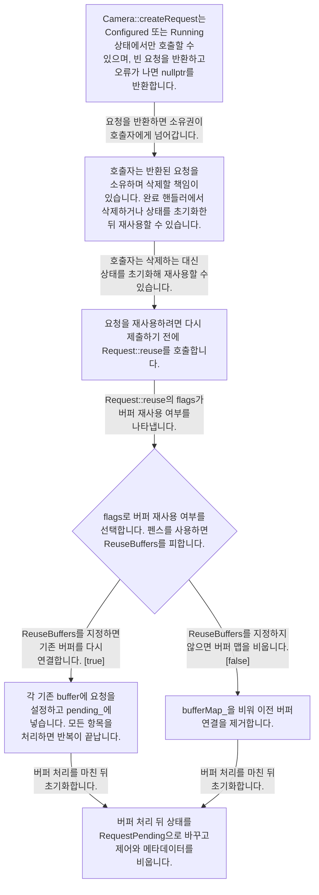
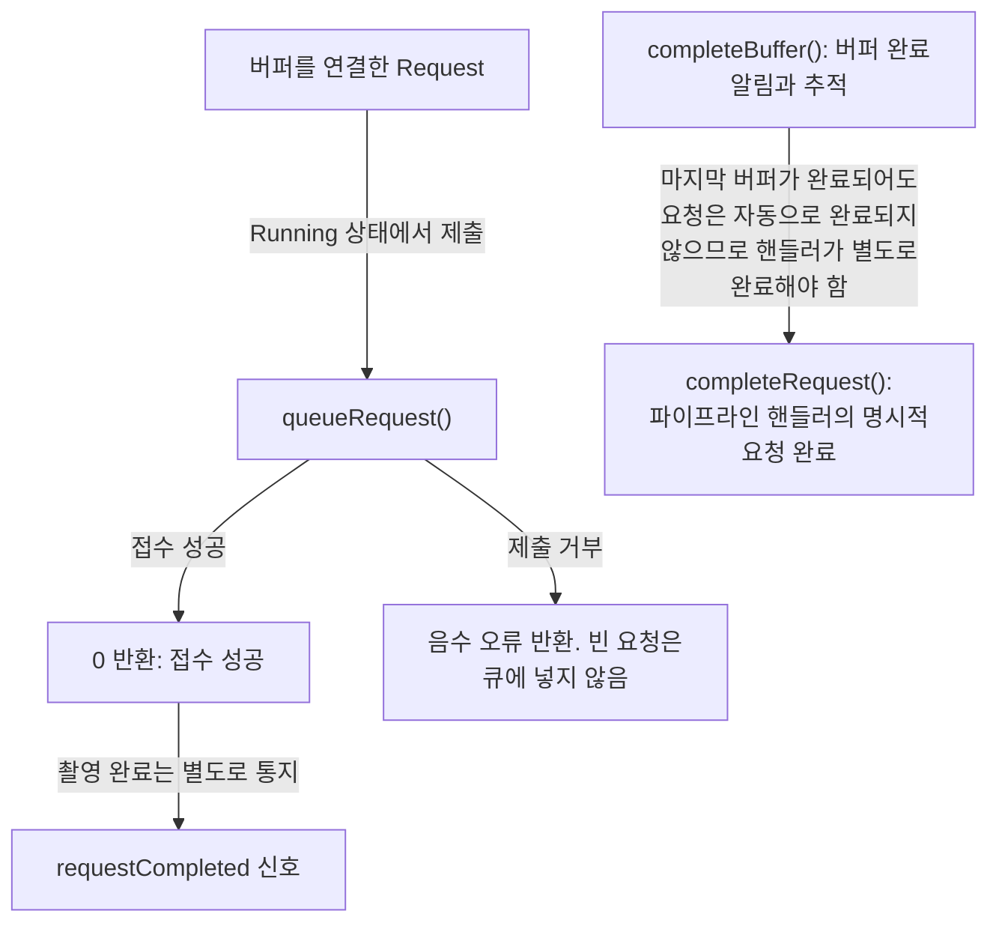
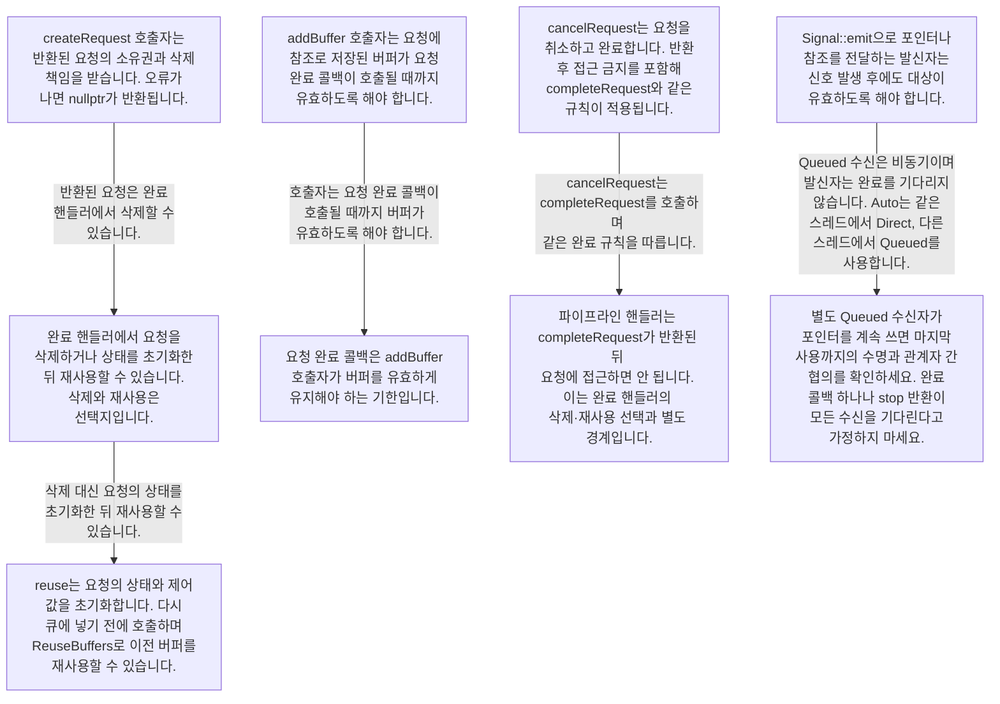
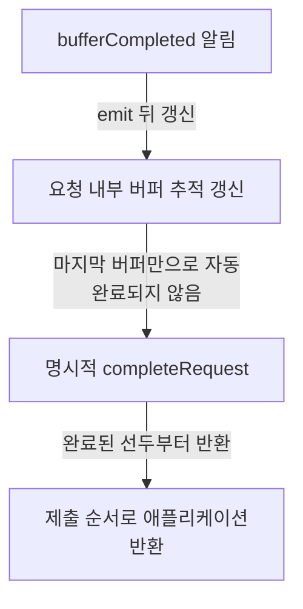
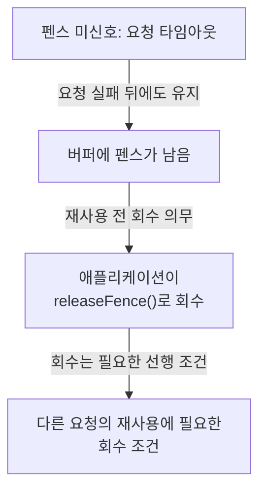
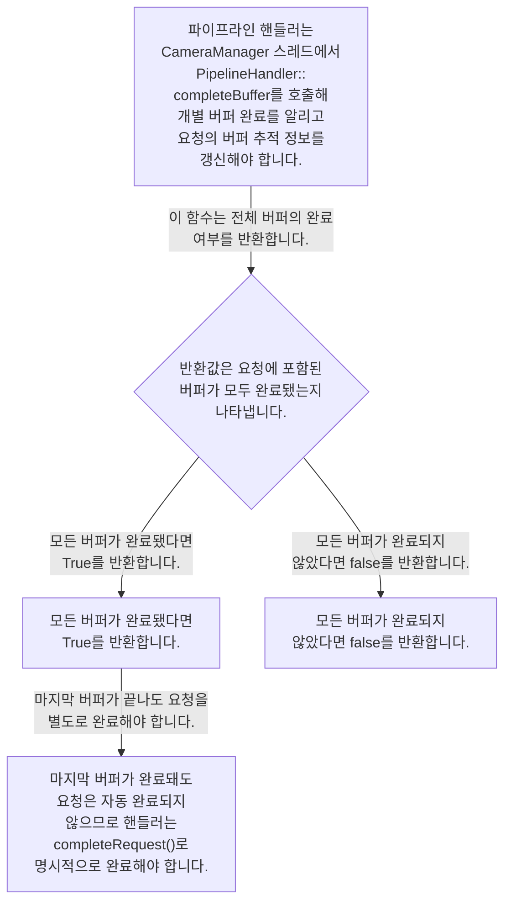
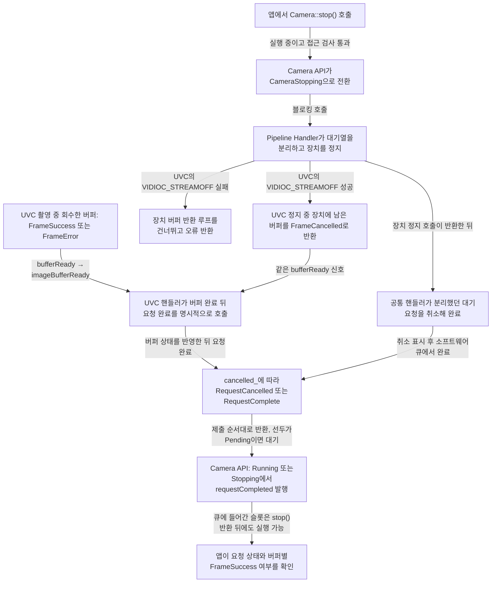
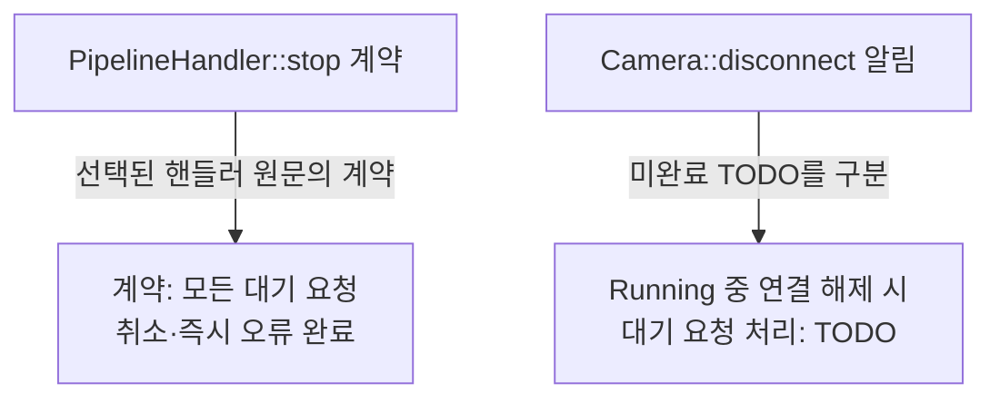

# 요청 흐름과 핵심 개념

요청을 만들고 제출하는 쪽에서 시작해 버퍼 완료, 요청 반환, 정지 뒤 취소 상태까지 따라가세요.

## 요청 생성과 소유권

`Camera::createRequest(cookie)`의 `cookie`는 애플리케이션이 사용하는 불투명한 입력입니다. 이 값은 요청에 저장되며 `Request::cookie()`로 언제든 읽을 수 있고, `libcamera` 관점에서는 완전히 불투명합니다. 애플리케이션은 보통 요청 완료 핸들러에서 요청을 외부 리소스에 연결하는 데 이 값을 사용합니다. `Camera::createRequest()`는 카메라가 `Configured` 또는 `Running` 상태일 때만 호출할 수 있으며, 오류가 발생하면 `nullptr`을 반환합니다.

### 요청 생성과 소유권의 관계와 경계

Mermaid 원문

그림 근거와 확인 범위

호출자는 요청을 어떻게 생성·소유·삭제하거나 재사용하며, ReuseBuffers 지정 여부에 따라 버퍼는 어떻게 되나요?

소스 연결 해석 · 자동 연결 검사만 통과 · 의미와 기기 실행은 검증 전

| 요소·전이 | 소스 근거 |
| --- | --- |
| Camera::createRequest는 Configured 또는 Running 상태에서만 호출할 수 있으며, 빈 요청을 반환하고 오류가 나면 nullptr를 반환합니다. | src/libcamera/camera.cpp:1243 |
| 호출자는 반환된 요청을 소유하며 삭제할 책임이 있습니다. 완료 핸들러에서 삭제하거나 상태를 초기화한 뒤 재사용할 수 있습니다. | src/libcamera/camera.cpp:1243 |
| 요청을 재사용하려면 다시 제출하기 전에 Request::reuse를 호출합니다. | src/libcamera/request.cpp:376 |
| flags로 버퍼 재사용 여부를 선택합니다. 펜스를 사용하면 ReuseBuffers를 피합니다. | src/libcamera/request.cpp:376 · src/libcamera/request.cpp:326 |
| 각 기존 buffer에 요청을 설정하고 pending\_에 넣습니다. 모든 항목을 처리하면 반복이 끝납니다. | src/libcamera/request.cpp:376 |
| bufferMap\_을 비워 이전 버퍼 연결을 제거합니다. | src/libcamera/request.cpp:376 |
| 버퍼 처리 뒤 상태를 RequestPending으로 바꾸고 제어와 메타데이터를 비웁니다. | src/libcamera/request.cpp:376 |
| 요청을 반환하면 소유권이 호출자에게 넘어갑니다. | src/libcamera/camera.cpp:1243 |
| 호출자는 삭제하는 대신 상태를 초기화해 재사용할 수 있습니다. | src/libcamera/camera.cpp:1243 |
| Request::reuse의 flags가 버퍼 재사용 여부를 나타냅니다. | src/libcamera/request.cpp:376 |
| ReuseBuffers를 지정하면 기존 버퍼를 다시 연결합니다. · flags & ReuseBuffers \[true\] | src/libcamera/request.cpp:376 |
| ReuseBuffers를 지정하지 않으면 버퍼 맵을 비웁니다. · flags & ReuseBuffers \[false\] | src/libcamera/request.cpp:376 |
| 버퍼 처리를 마친 뒤 초기화합니다. | src/libcamera/request.cpp:376 |
| 버퍼 처리를 마친 뒤 초기화합니다. | src/libcamera/request.cpp:376 |

`Camera::createRequest()`가 반환한 요청의 소유권은 호출자에게 넘어가며, 호출자는 요청을 삭제할 책임이 있습니다. 호출자는 새 요청을 만들지 않고 같은 요청을 다시 큐에 넣으려면 큐에 넣기 전에 `Request::reuse()`를 호출해 요청 상태와 연결된 컨트롤을 초기화해야 합니다. `Request::reuse()`는 `ReuseBuffers`를 지정하면 `addBuffer()`로 추가한 기존 버퍼를 요청에 다시 연결해 재사용하고 지정하지 않으면 `bufferMap_`을 비우며, 버퍼에 연결된 펜스는 재사용하지 않으므로 펜스를 사용할 때는 `ReuseBuffers`를 쓰지 않도록 권고합니다.

절 전체 근거 3개

- `src/libcamera/camera.cpp``L1243` 발췌 · [전체 소스 `L1243`](https://github.com/TTolsun/libcamera-sdd/blob/adfa719f8ed67d18fd8a0739fc088a1f8b9e7252/src/libcamera/camera.cpp#L1243)
- `src/libcamera/request.cpp``L376` 발췌 · [전체 소스 `L376`](https://github.com/TTolsun/libcamera-sdd/blob/adfa719f8ed67d18fd8a0739fc088a1f8b9e7252/src/libcamera/request.cpp#L376) · `L326` 발췌 · [전체 소스 `L326`](https://github.com/TTolsun/libcamera-sdd/blob/adfa719f8ed67d18fd8a0739fc088a1f8b9e7252/src/libcamera/request.cpp#L326)

## 요청 제출과 완료

함께 확인: [버퍼 완료와 요청 전체 완료 구분](#completion) · [완료 호출자와 스레드 의무](#callback-thread)

애플리케이션은 `Camera::queueRequest()`로 제출하기 전에 `createRequest()`가 반환한 요청 객체에 캡처 버퍼를 최소 한 개 연결해야 합니다. 카메라는 `Camera::queueRequest()`로 큐에 넣은 요청의 처리가 끝나면 `requestCompleted` 신호로 애플리케이션에 완료를 알립니다. `Camera::queueRequest()`는 카메라가 `Running` 상태일 때만 호출해야 합니다.

### 요청 접수와 버퍼 완료, 요청 완료

Mermaid 원문

그림 근거와 확인 범위

queueRequest()의 반환값은 접수 결과입니다. completeBuffer()는 버퍼 완료를 알리고 추적하며, 파이프라인 핸들러는 completeRequest()로 요청을 별도로 완료해야 합니다. requestCompleted 신호는 요청 완료를 별도로 알립니다.

소스 연결 해석 · 자동 연결 검사만 통과 · 의미와 기기 실행은 검증 전

LLM 그림 초안 · 사람 검토 전

작성 모델: `cli/codex/gpt-6.1-terra`

| 요소·전이 | 소스 근거 |
| --- | --- |
| 버퍼를 연결한 Request | src/libcamera/camera.cpp:1308 |
| queueRequest() | src/libcamera/camera.cpp:1308 |
| 0 반환: 접수 성공 | src/libcamera/camera.cpp:1308 |
| requestCompleted 신호 | src/libcamera/camera.cpp:1308 |
| completeBuffer(): 버퍼 완료 알림과 추적 | src/libcamera/pipeline_handler.cpp:547 |
| completeRequest(): 파이프라인 핸들러의 명시적 요청 완료 | src/libcamera/pipeline_handler.cpp:547 |
| 음수 오류 반환. 빈 요청은 큐에 넣지 않음 | src/libcamera/camera.cpp:1308 |
| Running 상태에서 제출 | src/libcamera/camera.cpp:1308 |
| 접수 성공 | src/libcamera/camera.cpp:1308 |
| 촬영 완료는 별도로 통지 | src/libcamera/camera.cpp:1308 |
| 마지막 버퍼가 완료되어도 요청은 자동으로 완료되지 않으므로 핸들러가 별도로 완료해야 함 | src/libcamera/pipeline_handler.cpp:547 |
| 제출 거부 | src/libcamera/camera.cpp:1308 |

절 전체 근거 1개

- `src/libcamera/camera.cpp``L1308` 발췌 · [전체 소스 `L1308`](https://github.com/TTolsun/libcamera-sdd/blob/adfa719f8ed67d18fd8a0739fc088a1f8b9e7252/src/libcamera/camera.cpp#L1308)

## 요청·버퍼·fence의 수명

### 소유권과 두 완료 경계

`Camera::createRequest()` 호출자는 반환된 `Request`의 소유권을 받으며 삭제할 책임이 있습니다. 호출자는 완료 핸들러에서 요청을 삭제하거나 `Request::reuse()`로 상태를 초기화한 뒤 재사용할 수 있습니다. `Request::addBuffer()`는 버퍼 참조를 요청에 저장하며, 호출자는 요청 완료 콜백이 호출될 때까지 버퍼가 유효하도록 해야 합니다. 파이프라인 핸들러는 `completeRequest()` 또는 `cancelRequest()`가 반환된 뒤 해당 요청에 접근해서는 안 됩니다.

#### 요청과 버퍼를 유지할 기간

Mermaid 원문

그림 근거와 확인 범위

createRequest·addBuffer 호출자, 완료 핸들러의 삭제·재사용과 핸들러 접근 종료, 별도 Queued 수신자의 포인터 수명을 어떻게 구분합니까?

소스 연결 해석 · 자동 연결 검사만 통과 · 의미와 기기 실행은 검증 전

LLM 그림 초안 · 사람 검토 전

작성 모델: `cli/codex/gpt-6.1-terra`

| 요소·전이 | 소스 근거 |
| --- | --- |
| createRequest 호출자는 반환된 요청의 소유권과 삭제 책임을 받습니다. 오류가 나면 nullptr가 반환됩니다. | src/libcamera/camera.cpp:1243 |
| addBuffer 호출자는 요청에 참조로 저장된 버퍼가 요청 완료 콜백이 호출될 때까지 유효하도록 해야 합니다. | src/libcamera/request.cpp:442 |
| 완료 핸들러에서 요청을 삭제하거나 상태를 초기화한 뒤 재사용할 수 있습니다. 삭제와 재사용은 선택지입니다. | src/libcamera/camera.cpp:1243 |
| 요청 완료 콜백은 addBuffer 호출자가 버퍼를 유효하게 유지해야 하는 기한입니다. | src/libcamera/request.cpp:442 |
| reuse는 요청의 상태와 제어 값을 초기화합니다. 다시 큐에 넣기 전에 호출하며 ReuseBuffers로 이전 버퍼를 재사용할 수 있습니다. | src/libcamera/request.cpp:376 |
| 파이프라인 핸들러는 completeRequest가 반환된 뒤 요청에 접근하면 안 됩니다. 이는 완료 핸들러의 삭제·재사용 선택과 별도 경계입니다. | src/libcamera/pipeline_handler.cpp:547 · src/libcamera/camera.cpp:1243 |
| cancelRequest는 요청을 취소하고 완료합니다. 반환 후 접근 금지를 포함해 completeRequest와 같은 규칙이 적용됩니다. | src/libcamera/pipeline_handler.cpp:547 |
| Signal::emit으로 포인터나 참조를 전달하는 발신자는 신호 발생 후에도 대상이 유효하도록 해야 합니다. | src/libcamera/base/signal.cpp:73 |
| 별도 Queued 수신자가 포인터를 계속 쓰면 마지막 사용까지의 수명과 관계자 간 협의를 확인하세요. 완료 콜백 하나나 stop 반환이 모든 수신을 기다린다고 가정하지 마세요. | src/libcamera/base/signal.cpp:73 · src/libcamera/base/bound_method.cpp:22 |
| 반환된 요청은 완료 핸들러에서 삭제할 수 있습니다. | src/libcamera/camera.cpp:1243 |
| 삭제 대신 요청의 상태를 초기화한 뒤 재사용할 수 있습니다. | src/libcamera/camera.cpp:1243 |
| 호출자는 요청 완료 콜백이 호출될 때까지 버퍼가 유효하도록 해야 합니다. | src/libcamera/request.cpp:442 |
| cancelRequest는 completeRequest를 호출하며 같은 완료 규칙을 따릅니다. | src/libcamera/pipeline_handler.cpp:547 |
| Queued 수신은 비동기이며 발신자는 완료를 기다리지 않습니다. Auto는 같은 스레드에서 Direct, 다른 스레드에서 Queued를 사용합니다. | src/libcamera/base/bound_method.cpp:22 |

### 정상 완료와 다음 요청 준비

`completeBuffer`는 `bufferCompleted`를 emit한 뒤 요청 내부의 버퍼 추적을 갱신하고, 모든 버퍼가 완료되면 `true`, 남은 버퍼가 있으면 `false`를 반환합니다. 마지막 버퍼가 완료되어도 요청은 자동 완료되지 않으므로, 파이프라인 핸들러는 필요한 처리를 마친 뒤 `completeRequest`로 명시적으로 완료를 통지해야 합니다. 두 함수는 `CameraManager` 스레드에서 호출해야 하며, 실제 콜백 실행 스레드는 이 소스에서 확인되지 않습니다. `completeRequest`가 호출하는 내부 `complete`는 `cancelled_`가 `false`이면 `RequestComplete`, `true`이면 `RequestCancelled`를 선택합니다.

#### 버퍼 알림에서 요청 반환까지

Mermaid 원문

그림 근거와 확인 범위

정상 경로의 호출·추적 순서입니다. 모든 버퍼와 필요한 추가 처리가 끝난 뒤 요청 완료를 통지하며, 실제 실행 시간이나 애플리케이션 콜백 스레드를 나타내지 않습니다.

소스 연결 해석 · 자동 연결 검사만 통과 · 의미와 기기 실행은 검증 전

| 요소·전이 | 소스 근거 |
| --- | --- |
| bufferCompleted 알림 | src/libcamera/pipeline_handler.cpp:547 |
| 요청 내부 버퍼 추적 갱신 | src/libcamera/pipeline_handler.cpp:547 |
| 명시적 completeRequest | src/libcamera/pipeline_handler.cpp:547 |
| 제출 순서로 애플리케이션 반환 | src/libcamera/pipeline_handler.cpp:547 |
| emit 뒤 갱신 | src/libcamera/pipeline_handler.cpp:547 |
| 마지막 버퍼만으로 자동 완료되지 않음 | src/libcamera/pipeline_handler.cpp:547 |
| 완료된 선두부터 반환 | src/libcamera/pipeline_handler.cpp:547 |

마지막 버퍼 알림은 관찰했지만 요청 완료 콜백은 아직 관찰하지 못한 경우, 그 관측만으로 내부 추적 갱신이나 `completeRequest` 호출이 아직 남았다고 단정할 수 없습니다. 이 알림은 버퍼 유효성 유지 기한이 끝났다는 근거가 아니므로, 버퍼 유효성을 깨뜨리는 해제나 다른 요청에 연결하는 작업의 안전성을 알림만으로 판정할 수 없습니다. 모든 재사용이 일괄적으로 금지되는 것은 아니며, 다른 요청에 연결할 수 있는지는 적용되는 API와 동기화 계약 및 버퍼 유효성 유지를 별도로 대조해야 합니다.

소스 기반 조사 계획으로, 조사자는 기존 `completeBuffer` 호출의 반환값을 관찰합니다. 조사자는 `completeRequest` 호출 자체도 관찰합니다. 이어서 조사자는 제출 순서 때문에 완료된 요청의 반환이 지연되는지와 요청 완료 콜백이 발생하는지를 확인합니다.

## 타임아웃 뒤 펜스 회수

Mermaid 원문

그림 근거와 확인 범위

신호되지 않은 펜스로 타임아웃이 나면 다른 요청에 재사용하기 전에 무엇을 해야 합니까?

소스 연결 해석 · 자동 연결 검사만 통과 · 의미와 기기 실행은 검증 전

| 요소·전이 | 소스 근거 |
| --- | --- |
| 펜스 미신호: 요청 타임아웃 | src/libcamera/request.cpp:462 |
| 버퍼에 펜스가 남음 | src/libcamera/request.cpp:462 |
| 애플리케이션이 releaseFence()로 회수 | src/libcamera/request.cpp:462 |
| 다른 요청의 재사용에 필요한 회수 조건 | src/libcamera/request.cpp:462 |
| 요청 실패 뒤에도 유지 | src/libcamera/request.cpp:462 |
| 재사용 전 회수 의무 | src/libcamera/request.cpp:462 |
| 회수는 필요한 선행 조건 | src/libcamera/request.cpp:462 |

## 버퍼 완료와 요청 완료

`PipelineHandler::completeBuffer()`는 요청에 속한 버퍼의 완료를 애플리케이션에 알림으로 전달하고, 요청 내부의 버퍼 추적 정보를 갱신합니다. 파이프라인 핸들러는 마지막 버퍼가 완료된 뒤에도 `completeRequest()`를 명시적으로 호출해야 합니다.

### 버퍼 완료와 요청 완료의 관계와 경계

Mermaid 원문

그림 근거와 확인 범위

개별 버퍼 완료와 전체 버퍼 완료 여부는 명시적인 요청 완료 호출과 어떻게 구분되나요?

소스 연결 해석 · 자동 연결 검사만 통과 · 의미와 기기 실행은 검증 전

| 요소·전이 | 소스 근거 |
| --- | --- |
| 파이프라인 핸들러는 CameraManager 스레드에서 PipelineHandler::completeBuffer를 호출해 개별 버퍼 완료를 알리고 요청의 버퍼 추적 정보를 갱신해야 합니다. | src/libcamera/pipeline_handler.cpp:547 |
| 반환값은 요청에 포함된 버퍼가 모두 완료됐는지 나타냅니다. | src/libcamera/pipeline_handler.cpp:547 |
| 모든 버퍼가 완료됐다면 True를 반환합니다. | src/libcamera/pipeline_handler.cpp:547 |
| 모든 버퍼가 완료되지 않았다면 false를 반환합니다. | src/libcamera/pipeline_handler.cpp:547 |
| 마지막 버퍼가 완료돼도 요청은 자동 완료되지 않으므로 핸들러는 completeRequest()로 명시적으로 완료해야 합니다. | src/libcamera/pipeline_handler.cpp:547 |
| 이 함수는 전체 버퍼의 완료 여부를 반환합니다. | src/libcamera/pipeline_handler.cpp:547 |
| 모든 버퍼가 완료됐다면 True를 반환합니다. | src/libcamera/pipeline_handler.cpp:547 |
| 모든 버퍼가 완료되지 않았다면 false를 반환합니다. | src/libcamera/pipeline_handler.cpp:547 |
| 마지막 버퍼가 끝나도 요청을 별도로 완료해야 합니다. | src/libcamera/pipeline_handler.cpp:547 |

절 전체 근거 1개

- `src/libcamera/pipeline_handler.cpp``L547` 발췌 · [전체 소스 `L547`](https://github.com/TTolsun/libcamera-sdd/blob/adfa719f8ed67d18fd8a0739fc088a1f8b9e7252/src/libcamera/pipeline_handler.cpp#L547)

## 스레드 경계와 동기화

호출자는 `Camera` 상태에 영향을 주는 함수를 호출할 때 필요한 경우 함수 간 동기화를 보장해야 합니다. 파이프라인 핸들러는 `PipelineHandler::completeRequest()`를 `CameraManager` 스레드에서 호출해야 합니다.

절 전체 근거 2개

- `src/libcamera/camera.cpp``L780` 발췌 · [전체 소스 `L780`](https://github.com/TTolsun/libcamera-sdd/blob/adfa719f8ed67d18fd8a0739fc088a1f8b9e7252/src/libcamera/camera.cpp#L780)
- `src/libcamera/pipeline_handler.cpp``L571` 발췌 · [전체 소스 `L571`](https://github.com/TTolsun/libcamera-sdd/blob/adfa719f8ed67d18fd8a0739fc088a1f8b9e7252/src/libcamera/pipeline_handler.cpp#L571)

## 정지와 연결 해제를 구분하기

UVC의 정상 버퍼 반환과 STREAMOFF 성공 시 남은 버퍼 취소는 `imageBufferReady`에서 `completeBuffer`와 `completeRequest`를 거쳐 같은 `requestCompleted` 알림으로 이어질 수 있습니다. Developer는 이 슬롯에서 `RequestComplete`와 `RequestCancelled`를 구별하고 버퍼별 `FrameSuccess`로 영상 사용 여부를 판단해야 하며, `RequestComplete`에도 `FrameError`가 있을 수 있고 취소된 버퍼는 `FrameCancelled`입니다. Vendor의 장치 검증 계획은 첫 실행에서 정상 촬영하고 둘째 실행에서 미완료 요청을 남긴 채 `stop()`을 호출하며, 수신 루프를 처리해 제출별 알림 횟수와 미수신 여부, 요청과 버퍼 상태를 기록하는 것입니다. 다른 스레드에 큐잉된 슬롯은 `stop()` 반환 뒤에도 실행될 수 있습니다.

### 촬영을 멈췄는데 왜 완료 알림이 오는가?

완료 시 상태 검사는 연결 해제도 허용합니다. Running과 Stopping 범위를 벗어나면 Fatal 로그 경로에 들어갑니다. [`camera.cpp:1483`](https://github.com/TTolsun/libcamera-sdd/blob/adfa719f8ed67d18fd8a0739fc088a1f8b9e7252/src/libcamera/camera.cpp#L1483) · [`camera.cpp:1486`](https://github.com/TTolsun/libcamera-sdd/blob/adfa719f8ed67d18fd8a0739fc088a1f8b9e7252/src/libcamera/camera.cpp#L1486)

Mermaid 원문

그림 근거와 확인 범위

정상 촬영과 정지 중 취소가 어떤 경로를 거쳐 같은 완료 신호로 앱에 전달됩니까?

소스 연결 해석 · 자동 연결 검사만 통과 · 의미와 기기 실행은 검증 전

| 요소·전이 | 소스 근거 |
| --- | --- |
| 앱에서 Camera::stop() 호출 | src/libcamera/camera.cpp:1431 |
| Camera API가 CameraStopping으로 전환 | src/libcamera/camera.cpp:1431 |
| Pipeline Handler가 대기열을 분리하고 장치를 정지 | src/libcamera/pipeline_handler.cpp:359 |
| UVC 촬영 중 회수한 버퍼: FrameSuccess 또는 FrameError | src/libcamera/v4l2_videodevice.cpp:1814 |
| 장치 버퍼 반환 루프를 건너뛰고 오류 반환 | src/libcamera/v4l2_videodevice.cpp:2023 |
| UVC 정지 중 장치에 남은 버퍼를 FrameCancelled로 반환 | src/libcamera/v4l2_videodevice.cpp:2023 · include/libcamera/internal/framebuffer.h:36 |
| UVC 핸들러가 버퍼 완료 뒤 요청 완료를 명시적으로 호출 | src/libcamera/pipeline/uvcvideo/uvcvideo.cpp:893 |
| 공통 핸들러가 분리했던 대기 요청을 취소해 완료 | src/libcamera/pipeline_handler.cpp:359 · src/libcamera/pipeline_handler.cpp:483 |
| cancelled\_에 따라 RequestCancelled 또는 RequestComplete | src/libcamera/request.cpp:103 |
| Camera API: Running 또는 Stopping에서 requestCompleted 발행 | src/libcamera/camera.cpp:1481 |
| 앱이 요청 상태와 버퍼별 FrameSuccess 여부를 확인 | src/libcamera/camera.cpp:1481 · src/libcamera/request.cpp:103 · src/libcamera/framebuffer.cpp:40 |
| 실행 중이고 접근 검사 통과 | src/libcamera/camera.cpp:1431 |
| 블로킹 호출 | src/libcamera/camera.cpp:1462 |
| UVC의 VIDIOC_STREAMOFF 성공 | src/libcamera/pipeline/uvcvideo/uvcvideo.cpp:320 · src/libcamera/v4l2_videodevice.cpp:2023 |
| 장치 정지 호출이 반환한 뒤 | src/libcamera/pipeline_handler.cpp:359 |
| UVC의 VIDIOC_STREAMOFF 실패 | src/libcamera/pipeline/uvcvideo/uvcvideo.cpp:320 · src/libcamera/v4l2_videodevice.cpp:2023 |
| bufferReady → imageBufferReady | src/libcamera/pipeline/uvcvideo/uvcvideo.cpp:535 |
| 같은 bufferReady 신호 | src/libcamera/v4l2_videodevice.cpp:2023 · src/libcamera/pipeline/uvcvideo/uvcvideo.cpp:535 |
| 버퍼 상태를 반영한 뒤 요청 완료 | src/libcamera/request.cpp:103 · src/libcamera/pipeline_handler.cpp:547 |
| 취소 표시 후 소프트웨어 큐에서 완료 | src/libcamera/pipeline_handler.cpp:483 |
| 제출 순서대로 반환, 선두가 Pending이면 대기 | src/libcamera/pipeline_handler.cpp:547 |
| 큐에 들어간 슬롯은 stop() 반환 뒤에도 실행 가능 | src/libcamera/camera.cpp:1481 · src/libcamera/base/bound_method.cpp:68 · src/libcamera/camera.cpp:1462 |

### 정지 API 계약과 연결 해제 TODO

Mermaid 원문

그림 근거와 확인 범위

PipelineHandler::stop과 Camera::disconnect의 선택된 두 원문은 대기 요청 처리를 어떻게 다르게 명시합니까?

소스 연결 해석 · 자동 연결 검사만 통과 · 의미와 기기 실행은 검증 전

| 요소·전이 | 소스 근거 |
| --- | --- |
| PipelineHandler::stop 계약 | src/libcamera/pipeline_handler.cpp:359 |
| 계약: 모든 대기 요청 취소·즉시 오류 완료 | src/libcamera/pipeline_handler.cpp:359 |
| Camera::disconnect 알림 | src/libcamera/camera.cpp:944 |
| Running 중 연결 해제 시 대기 요청 처리: TODO | src/libcamera/camera.cpp:944 |
| 선택된 핸들러 원문의 계약 | src/libcamera/pipeline_handler.cpp:359 |
| 미완료 TODO를 구분 | src/libcamera/camera.cpp:944 |

## 원고와 검토 기록

시스템 개요

- **생성 방식**: 추출 사실과 LLM 설명
- **검증 범위**: 표·그림은 facts로 만들고 설명은 LLM이 작성합니다. 인용·문장 및 설정된 구조 검사를 적용합니다.
- **자동 검사**: 통과 (`ok`). 검사한 항목은 검증 범위에 적혀 있습니다. 설명 내용이 맞는지는 사람이 확인합니다.
- **사람 검토**: 사람 검토 전
- **분석 기준 커밋**: `adfa719f8ed67d18fd8a0739fc088a1f8b9e7252`
- **문서 생성 시각**: `2026-11-20 17:39:13+00:00`
- **문장 생성 모델**: `cli/codex/gpt-6.1-terra`
- **문서 간 계약**: 자동 대조 보고서 · 사람 검토 전
- **독자 범위**: 과업별 답변과 미검토 범위

원고 작성 당시 기록

원고에 저장된 당시 기록입니다. 현재 문서의 기준과 다를 수 있습니다.

- 근거 파일: `include/libcamera/camera.h`, `include/libcamera/camera_manager.h`, `include/libcamera/internal/ipa_manager.h`, `include/libcamera/internal/pipeline_handler.h`, `include/libcamera/request.h`, `src/libcamera/base/log.cpp`, `src/libcamera/camera.cpp`, `src/libcamera/camera_manager.cpp`, `src/libcamera/controls.cpp`, `src/libcamera/ipa_manager.cpp`, `src/libcamera/pipeline_handler.cpp`, `src/libcamera/request.cpp`
- 근거 수준: 코드 확인 (정적 분석, simple_compdb 구성, commit `adfa719f8e`)
- 자동 검사 (인용·문장 및 설정된 구조 검사): 통과
- 검토 상태 기록일: 2026-11-21 · 사람 검토 전

Markdown 원문 ↗ Mermaid 원문 ↗

이전 주소의 상세 내용 열기

요청 처리와 문제 진단

- **생성 방식**: 추출 사실과 LLM 설명
- **검증 범위**: 표·그림은 facts로 만들고 설명은 LLM이 작성합니다. 인용·문장 및 설정된 구조 검사를 적용합니다.
- **자동 검사**: 통과 (`ok`). 검사한 항목은 검증 범위에 적혀 있습니다. 설명 내용이 맞는지는 사람이 확인합니다.
- **사람 검토**: 사람 검토 전
- **분석 기준 커밋**: `adfa719f8ed67d18fd8a0739fc088a1f8b9e7252`
- **문서 생성 시각**: `2026-11-21 13:28:40+00:00`
- **문장 생성 모델**: `cli/codex/gpt-6.1-terra`
- **문서 간 계약**: 자동 대조 보고서 · 사람 검토 전
- **제품 설명 입력**: 적용 범위·조건·자료

원고 작성 당시 기록

원고에 저장된 당시 기록입니다. 현재 문서의 기준과 다를 수 있습니다.

- 근거 파일: `Documentation/thread-safety.dox`, `include/libcamera/base/bound_method.h`, `include/libcamera/base/object.h`, `include/libcamera/base/signal.h`, `include/libcamera/base/utils.h`, `include/libcamera/camera.h`, `include/libcamera/internal/camera.h`, `include/libcamera/internal/framebuffer.h`, `include/libcamera/internal/pipeline_handler.h`, `include/libcamera/internal/request.h`, `include/libcamera/request.h`, `product-evidence/libcamera-callback-probe/callback-run.txt`, `src/libcamera/base/bound_method.cpp`, `src/libcamera/base/event_dispatcher_poll.cpp`, `src/libcamera/base/message.cpp`, `src/libcamera/base/object.cpp`, `src/libcamera/base/signal.cpp`, `src/libcamera/base/thread.cpp`, `src/libcamera/base/timer.cpp`, `src/libcamera/camera.cpp`, `src/libcamera/framebuffer.cpp`, `src/libcamera/pipeline/uvcvideo/uvcvideo.cpp`, `src/libcamera/pipeline_handler.cpp`, `src/libcamera/request.cpp`, `src/libcamera/v4l2_device.cpp`, `src/libcamera/v4l2_videodevice.cpp`
- 근거 수준: 코드 확인 (정적 분석, simple_compdb 구성, commit `adfa719f8e`)
- 자동 검사 (인용·문장 및 설정된 구조 검사): 통과
- 검토 상태 기록일: 2026-11-21 · 사람 검토 전

Markdown 원문 ↗

이전 주소의 상세 내용 열기

이 페이지 Markdown 받기 · 독자용 문서의 원본 위치
