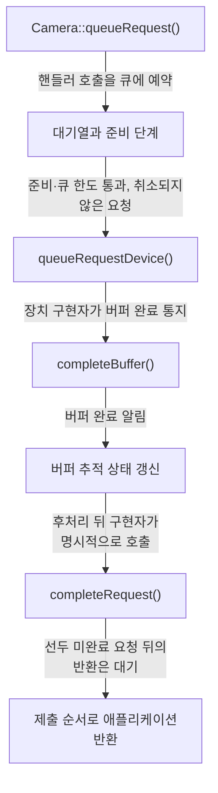
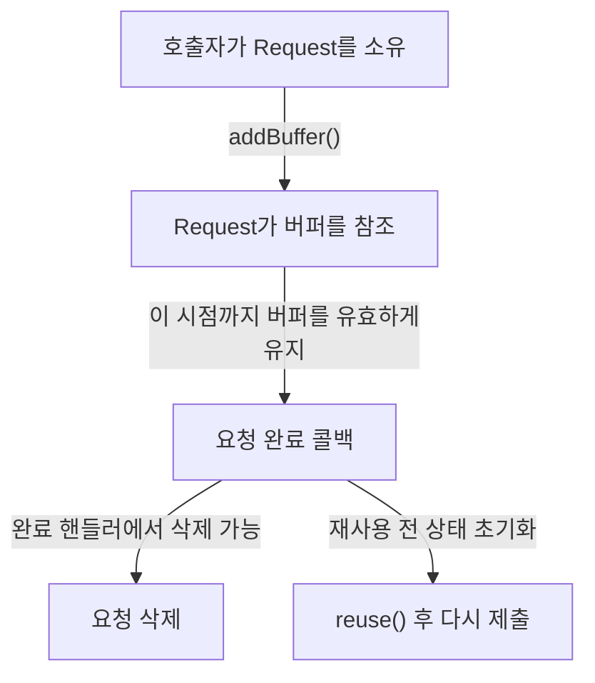
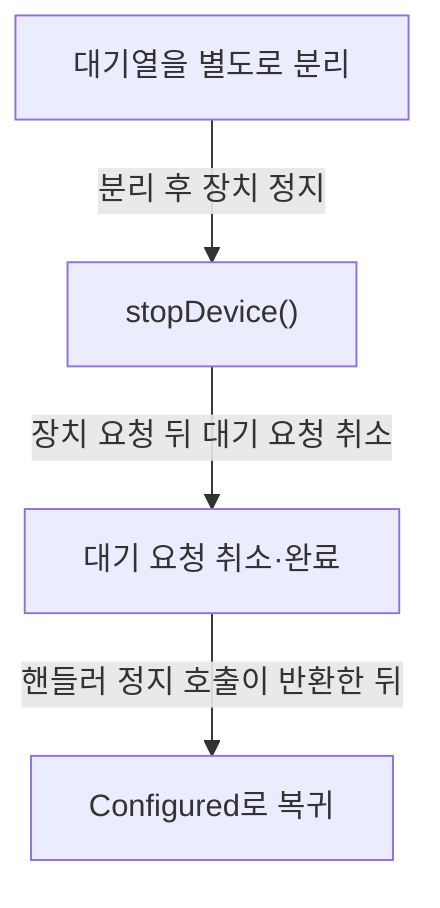

# 요청 처리와 문제 진단

**요청의 제출 성공과 촬영 완료를 구분하고, 버퍼를 유지할 기간과 오류가 난 위치를 확인하세요.**

| 지금 확인할 내용 | 이동할 절 |
|---|---|
| <a id="구성-실패를-좁히는-순서"></a>구성 실패를 좁히는 순서의 조건과 근거를 대조하세요. | [구성과 요청 오류 조사](request-diagnosis.md#구성-실패를-좁히는-순서) |
| 요청 제출과 완료의 연결을 확인합니다. | [제출에서 완료까지](#제출에서-완료까지) |
| 자원을 재사용하거나 해제할 시점을 확인합니다. | [요청·버퍼·fence의 수명](#요청버퍼fence의-수명) |
| <a id="실패-위치별-확인-순서"></a>실패 위치별 확인 순서의 조건과 근거를 대조하세요. | [구성과 요청 오류 조사](request-diagnosis.md#실패-위치별-확인-순서) |
| 정지와 연결 해제의 차이를 확인합니다. | [정지와 연결 해제를 구분하기](#정지와-연결-해제를-구분하기) |
| <a id="요청이-대기하거나-장치로-가는-조건"></a>“요청이 대기하거나 장치로 가는 조건” 그림을 확인하세요. | [구성과 요청 오류 조사](request-diagnosis.md#요청이-대기하거나-장치로-가는-조건) |
| <a id="구성-실패를-좁히는-분기"></a>“구성 실패를 좁히는 분기” 그림을 확인하세요. | [구성과 요청 오류 조사](request-diagnosis.md#구성-실패를-좁히는-분기) |

## 제출에서 완료까지

queueRequest가 성공 시 돌려주는 0은 요청을 파이프라인 대상 queued 호출로 넘긴 뒤의 반환값이며, 요청 완료를 뜻하지 않습니다. 요청 완료는 파이프라인 핸들러가 completeRequest로 명시적으로 알린 뒤에 일어나며, 완료된 요청은 제출 순서대로 애플리케이션에 돌아갑니다. `src/libcamera/camera.cpp:1308`, `src/libcamera/base/bound_method.cpp:68`, `src/libcamera/pipeline_handler.cpp:571`

<!-- sdd:visual:request-stages -->
### 제출·준비·장치 처리·완료의 연결

접수 성공 뒤에도 준비 대기와 장치 처리가 남습니다. 정상 촬영 경로의 계약을 연결한 그림이며 실제 실행 시간이나 전체 실패 경로를 나타내지 않습니다.



[Mermaid 원문](request-lifecycle.request-stages.mmd)

??? note "그림 근거와 확인 범위"
    소스에 연결한 설계 해석입니다. 자동 연결 검사는 의미 승인이나 기기 실행 검증이 아닙니다.
    
    | 요소·전이 | 소스 근거 |
    |---|---|
    | Camera::queueRequest() | [src/libcamera/camera.cpp:1308](#source-28d007de6ad1a8a5) |
    | 대기열과 준비 단계 | [src/libcamera/pipeline_handler.cpp:428](#source-789eafedfaa7f3c5) |
    | queueRequestDevice() | [src/libcamera/pipeline_handler.cpp:428](#source-789eafedfaa7f3c5) |
    | completeBuffer() | [src/libcamera/pipeline_handler.cpp:547](#source-01ad7c6605c3296a) |
    | 버퍼 추적 상태 갱신 | [src/libcamera/pipeline_handler.cpp:547](#source-01ad7c6605c3296a) |
    | completeRequest() | [src/libcamera/pipeline_handler.cpp:547](#source-01ad7c6605c3296a) |
    | 제출 순서로 애플리케이션 반환 | [src/libcamera/pipeline_handler.cpp:547](#source-01ad7c6605c3296a) |
    | 핸들러 호출을 큐에 예약 | [src/libcamera/camera.cpp:1308](#source-28d007de6ad1a8a5) |
    | 준비·큐 한도 통과, 취소되지 않은 요청 | [src/libcamera/pipeline_handler.cpp:428](#source-789eafedfaa7f3c5) |
    | 장치 구현자가 버퍼 완료 통지 | [src/libcamera/pipeline_handler.cpp:547](#source-01ad7c6605c3296a) |
    | 버퍼 완료 알림 | [src/libcamera/pipeline_handler.cpp:547](#source-01ad7c6605c3296a) |
    | 후처리 뒤 구현자가 명시적으로 호출 | [src/libcamera/pipeline_handler.cpp:547](#source-01ad7c6605c3296a) |
    | 선두 미완료 요청 뒤의 반환은 대기 | [src/libcamera/pipeline_handler.cpp:547](#source-01ad7c6605c3296a) |
<!-- /sdd:visual:request-stages -->

`Camera::createRequest`의 반환 타입은 `std::unique_ptr<Request>`입니다. 반환되는 객체는 애플리케이션이 버퍼와 파라미터를 채운 뒤 캡처를 위해 큐에 넣는 빈 `Request` 객체입니다. `src/libcamera/camera.cpp:1243`

`addBuffer`는 `FrameBuffer`를 `Request`에 추가하면서 그 버퍼가 속한 스트림과 연결하는 API입니다. 첫 번째 인자 `stream`은 버퍼가 속한 스트림을 지정하며, 한 요청은 스트림마다 버퍼를 하나만 포함할 수 있습니다. 같은 스트림에 이미 버퍼가 추가되어 있거나 버퍼가 아직 fence를 참조하고 있으면 -EEXIST를 반환하고, 버퍼가 유효한 스트림을 참조하지 않으면 -EINVAL을 반환합니다. `src/libcamera/request.cpp:442`

`Camera::queueRequest()`는 요청을 검증한 뒤 ConnectionTypeQueued 방식으로 d->`pipe_`->invokeMethod(&`PipelineHandler::queueRequest`, ConnectionTypeQueued, request)를 호출하고 0을 반환합니다. 문서에서는 요청이 큐에 들어간 뒤 카메라가 requestCompleted 신호로 완료를 통지한다고 설명하며, 이는 반환 코드와 별도의 경로입니다. `src/libcamera/camera.cpp:1308`

`waitingRequests_`의 선두 요청에서 `prepared_`가 거짓이면 루프가 break되어 뒤에 있는 요청도 장치로 전달되지 않습니다. 반면 `queuedRequests_`.size()가 `maxQueuedRequestsDevice_`와 같아지면 준비 상태와 무관하게 루프가 먼저 중단되며, `queuedRequests_`는 장치 전달 전에 요청을 추가하는 소프트웨어 큐이고 취소된 요청도 포함될 수 있으므로 그 크기를 장치에 전달된 요청 수로 볼 수 없습니다. `src/libcamera/pipeline_handler.cpp:516`, `src/libcamera/pipeline_handler.cpp:428`

doQueueRequest는 void 함수이므로 호출자에게 돌려주는 값이 없습니다. 함수는 카메라 `Private` 데이터(camera->`_d()`)의 `queuedRequests_`에 요청을 추가하고 `sequence_`를 부여한 뒤, request->`_d()`->`cancelled_`가 참이면 completeRequest(request)를 호출하고 return하여 queueRequestDevice 호출을 건너뜁니다. `cancelled_`가 거짓이면 queueRequestDevice(camera, request)를 호출하고, 그 반환값 ret이 0이 아니면 cancelRequest(request)를 호출합니다. `PipelineHandler::queueRequestDevice()` 함수는 캡처 요청을 장치에 큐잉하며, 성공하면 0을 반환하고 오류가 발생하면 음수 오류 코드를 반환합니다. `src/libcamera/pipeline_handler.cpp:483`, `src/libcamera/pipeline_handler.cpp:530`

파이프라인 핸들러는 버퍼 완료를 알릴 때 `CameraManager` 스레드에서 completeBuffer를 호출해야 합니다. 마지막 버퍼가 완료되어도 요청은 자동으로 완료되지 않으므로, 핸들러는 완료 처리를 위해 completeRequest()를 명시적으로 호출해야 합니다. `src/libcamera/pipeline_handler.cpp:547`, `src/libcamera/pipeline_handler.cpp:553`

completeRequest는 요청을 완료 처리한 뒤 `Camera::Private`의 `queuedRequests_` 앞 요청부터 차례로 확인합니다. 앞 요청의 status가 RequestPending이면 반복을 중단합니다. 그렇지 않으면 ASSERT로 hasPendingBuffers가 없음을 확인하고, 요청을 큐 앞에서 꺼낸 뒤 requestComplete로 애플리케이션에 반환합니다. 이렇게 앞에서부터 처리하여 요청이 제출 순서대로 애플리케이션에 반환되도록 합니다. `src/libcamera/pipeline_handler.cpp:594`, `src/libcamera/pipeline_handler.cpp:571`

근거 원문: [src/libcamera/camera.cpp:1243](#source-0ae00d77839f61cb) · [src/libcamera/camera.cpp:1308](#source-28d007de6ad1a8a5) · [src/libcamera/request.cpp:442](#source-95ae69eeb085e3b1) · [src/libcamera/pipeline_handler.cpp:428](#source-789eafedfaa7f3c5) · [src/libcamera/pipeline_handler.cpp:547](#source-01ad7c6605c3296a) · [src/libcamera/pipeline_handler.cpp:483](#source-7348e9b4af985eb2) · [src/libcamera/pipeline_handler.cpp:530](#source-c05f8214908fe4fe) · [src/libcamera/pipeline_handler.cpp:547](#source-ab8710f8a8a7905d) · [src/libcamera/pipeline_handler.cpp:571](#source-236c920e906cb6fd) · [src/libcamera/pipeline_handler.cpp:516](#source-a637b7daf9acb7ac) · [src/libcamera/pipeline_handler.cpp:553](#source-5b0ae08604dff588) · [src/libcamera/pipeline_handler.cpp:594](#source-bae861ceef5e8406) · [src/libcamera/base/bound_method.cpp:68](#source-0470759dc8387e9a)

## 요청·버퍼·fence의 수명

`Camera::createRequest()`가 반환한 요청의 소유권은 요청을 만든 호출자에게 넘어가며, 그 호출자가 요청 삭제를 책임집니다. 버퍼를 추가한 호출자는 요청 완료 콜백이 호출될 때까지 그 버퍼가 유효하게 남아 있어야 하며, 파이프라인 핸들러는 `completeRequest`가 반환한 뒤 요청에 접근해서는 안 됩니다. `src/libcamera/camera.cpp:1243`, `src/libcamera/request.cpp:447`, `src/libcamera/request.cpp:442`, `src/libcamera/pipeline_handler.cpp:575`

<!-- sdd:visual:request-ownership -->
### 요청과 버퍼를 유지할 기간

요청의 소유권은 호출자에게 있습니다. 버퍼 참조를 연결해도 호출자의 버퍼 유지 책임은 계속됩니다.



[Mermaid 원문](request-lifecycle.request-ownership.mmd)

??? note "그림 근거와 확인 범위"
    소스에 연결한 설계 해석입니다. 자동 연결 검사는 의미 승인이나 기기 실행 검증이 아닙니다.
    
    | 요소·전이 | 소스 근거 |
    |---|---|
    | 호출자가 Request를 소유 | [src/libcamera/camera.cpp:1243](#source-0ae00d77839f61cb) |
    | Request가 버퍼를 참조 | [src/libcamera/request.cpp:442](#source-95ae69eeb085e3b1) |
    | 요청 완료 콜백 | [src/libcamera/request.cpp:442](#source-95ae69eeb085e3b1) |
    | 요청 삭제 | [src/libcamera/camera.cpp:1243](#source-0ae00d77839f61cb) |
    | reuse() 후 다시 제출 | [src/libcamera/request.cpp:376](#source-38494771cb29cc8c) |
    | addBuffer() | [src/libcamera/request.cpp:442](#source-95ae69eeb085e3b1) |
    | 이 시점까지 버퍼를 유효하게 유지 | [src/libcamera/request.cpp:442](#source-95ae69eeb085e3b1) |
    | 완료 핸들러에서 삭제 가능 | [src/libcamera/camera.cpp:1243](#source-0ae00d77839f61cb) |
    | 재사용 전 상태 초기화 | [src/libcamera/request.cpp:376](#source-38494771cb29cc8c) |
<!-- /sdd:visual:request-ownership -->

`Camera::createRequest(uint64_t cookie)`가 반환한 요청의 소유권은 호출자에게 넘어가며, 요청을 삭제하는 책임도 호출자에게 있습니다. 요청은 완료 핸들러에서 삭제할 수 있고, `Request::reuse()`로 상태를 초기화한 뒤 다시 사용할 수도 있습니다. 문서는 큐에 넣기 전에 `Request::reuse()`를 호출하는 것으로 설명하며, `ReuseBuffers` 플래그를 주면 이전에 `addBuffer()`로 추가한 버퍼를 재사용할 수 있다고 적고 있습니다. `src/libcamera/camera.cpp:1243`, `src/libcamera/request.cpp:376`

`Request::addBuffer()`는 전달받은 `FrameBuffer` 버퍼에 대한 참조를 `Request`에 저장합니다. 호출자는 요청 완료 콜백이 호출될 때까지 해당 버퍼가 유효한 상태를 유지하도록 해야 합니다. 버퍼의 유효 기간을 보장하는 책임은 호출자에게 있습니다. `src/libcamera/request.cpp:447`, `src/libcamera/request.cpp:442`

`addBuffer`가 성공하면, 유효한 `Fence`의 소유권이 `fence` 인자에서 `buffer` 객체(`FrameBuffer`)로 이동합니다. 이 소유권 이동은 성공한 경우에만 일어나며, `Fence`를 넘겨받는 대상은 `buffer` 버퍼 객체입니다. `src/libcamera/request.cpp:456`

`Request::addBuffer`가 실패하면 전달받은 `fence`는 변경되지 않고 그대로 유지됩니다. 문서에 따르면 `fence`의 소유권은 호출이 성공한 경우에만 가져가며, 실패하면 `fence`는 수정되지 않은 상태로 남습니다. 실패 원인으로는 요청에 같은 스트림의 버퍼가 이미 있거나 버퍼가 아직 `fence`를 참조하는 경우의 `-EEXIST`와 버퍼가 유효한 `Stream`을 참조하지 않는 경우의 `-EINVAL`이 제시됩니다. `src/libcamera/request.cpp:456`

버퍼에 연결된 펜스가 신호되지 않으면 해당 요청은 타임아웃 후 실패합니다. 이때 버퍼에는 펜스가 그대로 남아 있으므로, 애플리케이션은 다른 요청에서 버퍼를 재사용하기 전에 `FrameBuffer::releaseFence()`로 펜스를 회수해야 합니다. `src/libcamera/request.cpp:462`

`Request::ReuseBuffers` 플래그는 `Request::reuse()`에서 이전에 `addBuffer()`로 추가된 버퍼를 유지하도록 하는 옵션입니다. 그러나 버퍼에 연결된 펜스(fence)는 재사용하지 않습니다. 원문은 펜스를 사용하는 경우 이 플래그를 피하도록 권고합니다. `src/libcamera/request.cpp:326`, `src/libcamera/request.cpp:334`

`completeRequest`를 호출하는 파이프라인 핸들러는 요청 완료를 카메라(`camera`)에 알리기 위해 이 함수를 호출해야 합니다. 이 함수가 반환된 후 요청은 파이프라인 핸들러의 관리 대상이 아니며, 파이프라인 핸들러는 그 요청에 접근해서는 안 됩니다. `cancelRequest`는 요청을 취소하고 완료시키는 함수이며, 문서에 따르면 `completeRequest`와 같은 규칙이 적용되므로 이 접근 규칙도 취소 경로의 파이프라인 핸들러에게 같게 적용됩니다. `src/libcamera/pipeline_handler.cpp:547`, `src/libcamera/pipeline_handler.cpp:575`, `src/libcamera/pipeline_handler.cpp:610`

근거 원문: [src/libcamera/camera.cpp:1243](#source-0ae00d77839f61cb) · [src/libcamera/request.cpp:376](#source-38494771cb29cc8c) · [src/libcamera/pipeline_handler.cpp:547](#source-01ad7c6605c3296a) · [src/libcamera/request.cpp:326](#source-447804db33308244) · [src/libcamera/request.cpp:456](#source-86a8d784a8348122) · [src/libcamera/request.cpp:462](#source-d8cf34a75a4333a7) · [src/libcamera/request.cpp:447](#source-4cdce80c57526221) · [src/libcamera/pipeline_handler.cpp:575](#source-d93a02e9220fa760) · [src/libcamera/pipeline_handler.cpp:610](#source-52fb58c8956b1a91) · [src/libcamera/request.cpp:334](#source-d9944a69f2dd6758) · [src/libcamera/request.cpp:442](#source-95ae69eeb085e3b1)

## 정지와 연결 해제를 구분하기

`PipelineHandler::stop()` 문서에는 카메라 정지 시 대기 중인 요청이 모두 취소되고 오류 상태로 즉시 완료된다고 적혀 있습니다. 반면 실행 중 카메라 연결 해제 시 대기 요청을 처리하는 방법은 `Camera::disconnect()` 문서에 TODO로만 남아 있어, 정지 문서와 같은 취소 완료 내용이 명시되어 있지 않습니다. `src/libcamera/pipeline_handler.cpp:359`, `src/libcamera/camera.cpp:952`

<!-- sdd:visual:stop-order -->
### 정지할 때 대기 요청을 처리하는 순서

정상 정지 경로의 순서를 표시합니다. 연결 해제 알림의 미완료 요청 TODO를 이 정지 보장과 혼동하지 마세요.



[Mermaid 원문](request-lifecycle.stop-order.mmd)

??? note "그림 근거와 확인 범위"
    소스에 연결한 설계 해석입니다. 자동 연결 검사는 의미 승인이나 기기 실행 검증이 아닙니다.
    
    | 요소·전이 | 소스 근거 |
    |---|---|
    | 대기열을 별도로 분리 | [src/libcamera/pipeline_handler.cpp:359](#source-eefd1bbecb1aad0a) |
    | stopDevice() | [src/libcamera/pipeline_handler.cpp:359](#source-eefd1bbecb1aad0a) |
    | 대기 요청 취소·완료 | [src/libcamera/pipeline_handler.cpp:359](#source-eefd1bbecb1aad0a) |
    | Configured로 복귀 | [src/libcamera/camera.cpp:1431](#source-e09324743def3f09) |
    | 분리 후 장치 정지 | [src/libcamera/pipeline_handler.cpp:359](#source-eefd1bbecb1aad0a) |
    | 장치 요청 뒤 대기 요청 취소 | [src/libcamera/pipeline_handler.cpp:359](#source-eefd1bbecb1aad0a) |
    | 핸들러 정지 호출이 반환한 뒤 | [src/libcamera/camera.cpp:1431](#source-e09324743def3f09) |
<!-- /sdd:visual:stop-order -->

조사 계획에서는 `Camera::stop`의 `d->isRunning()`이 거짓이라 `return 0`으로 끝나는 경로와, `d->isAccessAllowed(Private::CameraRunning)`의 `ret`이 음수라 그대로 반환되는 경로를 구분해서 봅니다. 두 검사를 통과하면 `d->setState(Private::CameraStopping)` 설정 직후 `d->pipe_->invokeMethod(&PipelineHandler::stop, ConnectionTypeBlocking, this)`의 호출 진입과 복귀 시점을 기록하고, 복귀 뒤 `ASSERT(!d->pipe_->hasPendingRequests(this))` 결과와 `d->setState(Private::CameraConfigured)` 이후 `return 0` 여부를 확인합니다. 이 계획은 실행한 테스트나 시간 측정이 아니며, 상태 전이를 관찰하려고 `stop()`을 다시 호출하지 않습니다. `src/libcamera/camera.cpp:1431`, `src/libcamera/camera.cpp:1462`

이는 실행한 테스트가 아닌 조사 계획입니다. `PipelineHandler::stop`에서 `waitingRequests_`를 `waitingRequests`로 분리하는 `swap` 직후의 `data->waitingRequests_` 값과 `stopDevice(camera)` 호출 진입 시점을 기록하고, `stopDevice`가 반환하여 다음 줄로 돌아왔는지 확인하면 장치 내부에서 멎은 경우와 반환한 경우를 구분할 수 있습니다. 이는 실행 측정이 아닌 조사 계획으로서, `PipelineHandler::stop()`의 취소 반복문에서 `request->_d()->cancel()` 호출 뒤 `doQueueRequest(request)`에 전달되는 `request` 값을 기존 실행의 관찰 기록 항목으로 제안합니다. `src/libcamera/pipeline_handler.cpp:359`, `src/libcamera/pipeline_handler.cpp:394`

실행하지 않은 조사 계획으로, `stop()` 끝의 두 `ASSERT` 검사 지점에서 `queuedRequests_`와 `waitingRequests_`가 비어 있는지 값을 확인하고, `stop()`을 다시 호출하지 않은 채 뒤의 `requestSequence_`가 0으로 설정되는지 관찰합니다. 파이프라인 핸들러는 요청이 완료되었음을 알리려면 `completeRequest()`를 `CameraManager` 스레드에서 호출해야 하며, 완료된 요청이라면 순서 제약 없이 호출할 수 있습니다. 이 함수는 요청이 제출 순서대로 애플리케이션에 반환되도록 보장하며, 함수가 반환된 뒤 핸들러는 해당 요청에 접근해서는 안 됩니다. `src/libcamera/pipeline_handler.cpp:398`, `src/libcamera/pipeline_handler.cpp:547`

실행 확인 항목: 대상 애플리케이션의 연결 위치·연결 방식·수신 객체 스레드가 확인되지 않아 검증 전 상태입니다. 추가 조사에서는 애플리케이션 콜백의 진입과 반환 근처 시각 및 실행 스레드만 기록하고, `camera->requestComplete(req)` 호출 뒤에는 `req`의 `status()`나 `hasPendingBuffers()`를 읽지 않습니다. 이 기록은 `completeRequest`의 `CameraManager` 스레드 호출 의무를 입증하거나 대신하지 않으며, 공개 가상 프로브의 관찰을 다른 애플리케이션이나 물리 장치의 결과로 일반화하지 않습니다. `src/libcamera/pipeline_handler.cpp:547`

`Camera::disconnect()`는 `LOG(Camera, Debug)`로 연결 해제를 기록한 뒤 내부 처리 함수인 `_d()->disconnect()`를 호출합니다. 이 호출이 끝난 다음에 `disconnected.emit()`이 실행됩니다. 제공된 소스에는 `_d()->disconnect()`의 구현이 없으므로, 그 안에서 수행되는 세부 동작은 확인할 수 없습니다. `src/libcamera/camera.cpp:959`, `src/libcamera/camera.cpp:944`

`Camera::disconnect()`의 `disconnected.emit();` 호출은 `disconnected` 신호를 발행합니다. 소스 주석에 따르면 이 신호는 하드웨어가 분리되었음을 애플리케이션에 알리는 데 사용됩니다. `Camera::disconnect` 함수의 `\todo` 항목은 카메라가 실행 중 상태에서 연결 해제될 때 대기 중인 요청(pending requests)을 처리하는 일이 아직 남아 있음을 나타냅니다. `src/libcamera/camera.cpp:960`, `src/libcamera/camera.cpp:952`, `src/libcamera/camera.cpp:944`

근거 원문: [src/libcamera/camera.cpp:1431](#source-e09324743def3f09) · [src/libcamera/pipeline_handler.cpp:359](#source-eefd1bbecb1aad0a) · [src/libcamera/pipeline_handler.cpp:547](#source-01ad7c6605c3296a) · [src/libcamera/camera.cpp:1462](#source-6191f91df6cbffa2) · [src/libcamera/pipeline_handler.cpp:398](#source-5e7914238ff81605) · [src/libcamera/camera.cpp:952](#source-1d583253fc11ef1c) · [src/libcamera/pipeline_handler.cpp:394](#source-fd5daba4aa44adfd) · [src/libcamera/camera.cpp:959](#source-56494d0aedf70c2d) · [src/libcamera/camera.cpp:960](#source-7d48ce2e18c8877c) · [src/libcamera/camera.cpp:944](#source-2758e9ddd31ad41d) · [src/libcamera/camera.cpp:944](#source-839140c350119dd1)

## 변경 검토와 실행 확인

`Camera::queueRequest`의 반환값을 그대로 기록하고 성공 0과 실패 음수 오류 코드를 구분하는 조사 계획을 제안합니다. 대입 대상은 `status_`이며, 조사 기록 항목으로는 `Request::reuse`의 `status_` = RequestPending; 대입 전후 `status_` 값과 `controls_`.clear(); 및 `_d()`->`metadata_`.clear(); 호출 전후 `controls_`와 `metadata_` 값을 기록하는 방안을 제안합니다. `src/libcamera/camera.cpp:1308`, `src/libcamera/request.cpp:400`, `src/libcamera/request.cpp:402`, `src/libcamera/request.cpp:403`

선두 요청의 상태 조회식은 `req->status() == Request::RequestPending`입니다. 이 조회식은 `Request *req = data->queuedRequests_.front();` 뒤에 오는 `if` 문이며, 조건이 참이면 `break;`가 실행됩니다. 기록 항목으로는 `req` 대입 지점, `req->status()` 반환값, 비교 대상 `Request::RequestPending`, 대입 직후 `if` 검사 시점을 제안합니다. 이는 소스 구조에서 확인되는 조회 지점을 남기기 위한 관찰 계획이며, 테스트 완료나 실행 결과를 뜻하지 않습니다. `src/libcamera/pipeline_handler.cpp:594`

근거 원문: [src/libcamera/camera.cpp:1308](#source-28d007de6ad1a8a5) · [src/libcamera/request.cpp:400](#source-a98823fa5ec440a2) · [src/libcamera/request.cpp:402](#source-c8638489aa83cfd1) · [src/libcamera/request.cpp:403](#source-47569737e131b31a) · [src/libcamera/pipeline_handler.cpp:594](#source-bae861ceef5e8406)

## 공개 가상 카메라의 콜백 관찰

**가상 시험 구성입니다. 실제 제품의 지원·성능 주장으로 사용하지 마세요.**

이 공개 가상 CPU 프로브는 3회 실행되었으며, 실행당 RequestComplete 4건과 RequestCancelled 4건이 보고되었습니다. 실행당 콜백 수는 24회이고, 이는 연결 3개(auto, direct, queued)마다 8회씩 발생한 값입니다. 3회 실행의 전체 콜백 수는 72회입니다. 이 결과는 실제 제품이 아닌 시뮬레이션 가상 테스트 구성의 측정치이며, 요청 수는 콜백 수와 구분되고 정상 촬영이나 DMA 검증 성공을 뜻하지 않습니다. `product-evidence/libcamera-callback-probe/callback-run.txt:1`

이 시뮬레이션된 가상 테스트 구성(실제 제품 아님, Virtual2, WSL2)에서 Auto와 Queued 연결의 콜백은 수신 객체의 메인 애플리케이션 스레드에서 실행되었고, Direct 연결의 콜백은 그 스레드와 다른 스레드에서 실행되었습니다. 정지 취소 요청에서 Direct의 콜백 표식은 애플리케이션 stop-enter와 stop-return 사이에 나타났고, Auto와 Queued의 콜백 표식은 stop-return 뒤에 나타났으며, 이는 camera->stop() 앞뒤 애플리케이션 표식 기준이고 연결 간 고정 순서를 뜻하지 않습니다. 반환 근처 표식은 returned.`fetch_add`(1)과 지역 객체 소멸보다 먼저 기록되므로, 실제 C++ 함수 반환 완료나 명령 수준 반환 추적을 증명하지 않습니다. `product-evidence/libcamera-callback-probe/callback-run.txt:1`

이 실행은 시뮬레이션된 가상 시험 구성으로, 실제 제품이 아닙니다. 이 실행은 Ubuntu WSL2의 Virtual2 카메라에서 memfd CPU 버퍼와 eventfd 시험 입력을 사용한 가상 프로브입니다. DMA 동기화 및 제공자 ERROR 줄은 보존되었으며, DMA 동기화는 검증되지 않았습니다. 물리 카메라·센서·ISP 캡처, 다른 애플리케이션, 다른 연결 구성, 다른 장치, 사내 HAL도 검증되지 않았으며, 이 콜백 관찰은 DMA 정상 동작이나 실기기 검증 성공을 뜻하지 않습니다. `product-evidence/libcamera-callback-probe/callback-run.txt:1`

근거 원문: [product-evidence/libcamera-callback-probe/callback-run.txt:1](#source-54dc055eafaa8a99)

??? note "설계 질문과 검증 범위"
    질문별 답변과 근거 연결을 검사했습니다. 의미와 실행 결과는 사람 검토가 필요합니다.
    
    | 설계 질문 | 설명 위치 | 확인 범위 |
    |---|---|---|
    | 제출 성공 이후의 대기 조건과 완료 책임은 무엇입니까? | [제출에서 완료까지](#제출에서-완료까지) | 코드 근거와 설명 연결 |
    | 어떤 자원을 누가 유지하고 완료 후 무엇을 초기화해야 합니까? | [요청·버퍼·fence의 수명](#요청버퍼fence의-수명) | 코드 근거와 설명 연결 |
    | 정지 중 요청 반환과 연결 해제의 보장 범위는 어떻게 다릅니까? | [정지와 연결 해제를 구분하기](#정지와-연결-해제를-구분하기) | 코드 근거와 설명 연결 · 실행 확인 항목 별도 |
    | 문서를 읽고 어떤 질문에 답하고 어떤 실행 증거를 확보해야 합니까? | [변경 검토와 실행 확인](#변경-검토와-실행-확인) | 코드 근거와 설명 연결 |
    | 공개 가상 콜백 프로브에서 실제로 관찰한 범위와 아직 검증하지 않은 범위는 무엇입니까? | [공개 가상 카메라의 콜백 관찰](#공개-가상-카메라의-콜백-관찰) | 코드 근거와 설명 연결 |

## 소스 근거

같은 발췌는 한 번만 싣습니다. 필요한 원문을 펼쳐 설명과 대조하세요.

<a id="source-0ae00d77839f61cb"></a>

??? note "소스 근거: src/libcamera/camera.cpp:1243"
    `src/libcamera/camera.cpp:1243`에서 시작하는 발췌입니다. 종료 줄은 1263이며, 아래 원문을 설명과 대조할 수 있습니다.
    
    SHA-256: `9f251ecf5ba569606e9753d3619b88e1aef5a4ce15f816ae97efd283e34b823b`
    
    ```text
    \brief Create a request object for the camera
     * \param[in] cookie Opaque cookie for application use
     *
     * This function creates an empty request for the application to fill with
     * buffers and parameters, and queue for capture.
     *
     * The \a cookie is stored in the request and is accessible through the
     * Request::cookie() function at any time. It is typically used by applications
     * to map the request to an external resource in the request completion
     * handler, and is completely opaque to libcamera.
     *
     * The ownership of the returned request is passed to the caller, which is
     * responsible for deleting it. The request may be deleted in the completion
     * handler, or reused after resetting its state with Request::reuse().
     *
     * \context This function is \threadsafe. It may only be called when the camera
     * is in the Configured or Running state as defined in \ref camera_operation.
     *
     * \return A pointer to the newly created request, or nullptr on error
     */
    std::unique_ptr<Request> Camera::createRequest(uint64_t cookie)
    ```

<a id="source-28d007de6ad1a8a5"></a>

??? note "소스 근거: src/libcamera/camera.cpp:1308"
    `src/libcamera/camera.cpp:1308`에서 시작하는 발췌입니다. 종료 줄은 1383이며, 아래 원문을 설명과 대조할 수 있습니다.
    
    SHA-256: `96db61baeb32065c966b20942f97518ddbd3a43b36b64e8083eb29a90ecb7f4b`
    
    ```text
    \brief Queue a request to the camera
     * \param[in] request The request to queue to the camera
     *
     * This function queues a \a request to the camera for capture.
     *
     * After allocating the request with createRequest(), the application shall
     * fill it with at least one capture buffer before queuing it. Requests that
     * contain no buffers are invalid and are rejected without being queued.
     *
     * Once the request has been queued, the camera will notify its completion
     * through the \ref requestCompleted signal.
     *
     * \context This function is \threadsafe. It may only be called when the camera
     * is in the Running state as defined in \ref camera_operation.
     *
     * \return 0 on success or a negative error code otherwise
     * \retval -ENODEV The camera has been disconnected from the system
     * \retval -EACCES The camera is not running so requests can't be queued
     * \retval -EXDEV The request does not belong to this camera
     * \retval -EINVAL The request is invalid
     * \retval -ENOMEM No buffer memory was available to handle the request
     */
    int Camera::queueRequest(Request *request)
    {
    	Private *const d = _d();
    
    	int ret = d->isAccessAllowed(Private::CameraRunning);
    	if (ret < 0)
    		return ret;
    
    	/* Requests can only be queued to the camera that created them. */
    	if (request->_d()->camera() != this) {
    		LOG(Camera, Error) << "Request was not created by this camera";
    		return -EXDEV;
    	}
    
    	if (request->status() != Request::RequestPending) {
    		LOG(Camera, Error) << request->toString() << " is not valid";
    		return -EINVAL;
    	}
    
    	/* Make sure the Request has a valid control list. */
    	if (request->controls().infoMap() != &controls()) {
    		LOG(Camera, Error) << "Overwriting Request::controls() is not allowed";
    		return -EINVAL;
    	}
    
    	/*
    	 * The camera state may change until the end of the function. No locking
    	 * is however needed as PipelineHandler::queueRequest() will handle
    	 * this.
    	 */
    
    	if (request->buffers().empty()) {
    		LOG(Camera, Error) << "Request contains no buffers";
    		return -EINVAL;
    	}
    
    	for (const auto &[stream, buffer] : request->buffers()) {
    		if (d->activeStreams_.find(stream) == d->activeStreams_.end()) {
    			LOG(Camera, Error) << "Invalid request";
    			return -EINVAL;
    		}
    	}
    
    	/* Pre-process AeEnable. */
    	patchControlList(request->controls());
    
    	d->pipe_->invokeMethod(&PipelineHandler::queueRequest,
    			       ConnectionTypeQueued, request);
    
    	return 0;
    }
    
    /**
     * \brief Start capture from camera
    ```

<a id="source-95ae69eeb085e3b1"></a>

??? note "소스 근거: src/libcamera/request.cpp:442"
    `src/libcamera/request.cpp:442`에서 시작하는 발췌입니다. 종료 줄은 475이며, 아래 원문을 설명과 대조할 수 있습니다.
    
    SHA-256: `65cd8b0501b7f6545dd10eaaec4a4fe46c52a096a3bbd94ea6b4813e4a670876`
    
    ```text
    \brief Add a FrameBuffer with its associated Stream to the Request
     * \param[in] stream The stream the buffer belongs to
     * \param[in] buffer The FrameBuffer to add to the request
     * \param[in] fence The optional fence
     *
     * A reference to the buffer is stored in the request. The caller is responsible
     * for ensuring that the buffer will remain valid until the request complete
     * callback is called.
     *
     * A request can only contain one buffer per stream. If a buffer has already
     * been added to the request for the same stream, this function returns -EEXIST.
     *
     * A Fence can be optionally associated with the \a buffer.
     *
     * When a valid Fence is provided to this function, \a fence is moved to \a
     * buffer and this Request will only be queued to the device once the
     * fences of all its buffers have been correctly signalled. Ownership of the
     * fence will only be taken in case of success, otherwise the fence will
     * be left unmodified.
     *
     * If the \a fence associated with \a buffer isn't signalled, the request will
     * fail after a timeout. The buffer will still contain the fence, which
     * applications must retrieve with FrameBuffer::releaseFence() before the buffer
     * can be reused in another request. Attempting to add a buffer that still
     * contains a fence to a request will result in this function returning -EEXIST.
     *
     * \sa FrameBuffer::releaseFence()
     *
     * \return 0 on success or a negative error code otherwise
     * \retval -EEXIST The request already contains a buffer for the stream
     *  or the buffer still references a fence
     * \retval -EINVAL The buffer does not reference a valid Stream
     */
    int Request::addBuffer(const Stream *stream, FrameBuffer *buffer,
    ```

<a id="source-789eafedfaa7f3c5"></a>

??? note "소스 근거: src/libcamera/pipeline_handler.cpp:428"
    `src/libcamera/pipeline_handler.cpp:428`에서 시작하는 발췌입니다. 종료 줄은 547이며, 아래 원문을 설명과 대조할 수 있습니다.
    
    SHA-256: `5a7a3397a6034a73fe348ae44eb1e2568d2823e95542fe43386e16359d627180`
    
    ```text
    \fn PipelineHandler::registerRequest()
     * \brief Register a request for use by the pipeline handler
     * \param[in] request The request to register
     *
     * This function is called when the request is created, and allows the pipeline
     * handler to perform any one-time initialization it requries for the request.
     */
    void PipelineHandler::registerRequest(Request *request)
    {
    	/*
    	 * Connect the request prepared signal to notify the pipeline handler
    	 * when a request is ready to be processed.
    	 */
    	request->_d()->prepared.connect(this, [this, request]() {
    		doQueueRequests(request->_d()->camera());
    	});
    }
    
    /**
     * \fn PipelineHandler::queueRequest()
     * \brief Queue a request
     * \param[in] request The request to queue
     *
     * This function queues a capture request to the pipeline handler for
     * processing. The request is first added to the internal list of waiting
     * requests which have to be prepared to make sure they are ready for being
     * queued to the pipeline handler.
     *
     * The queue of waiting requests is iterated and up to \a
     * maxQueuedRequestsDevice_ prepared requests are passed to the pipeline handler
     * in the same order they have been queued by calling this function.
     *
     * If a Request fails during the preparation phase or if the pipeline handler
     * fails in queuing the request to the hardware the request is cancelled.
     *
     * Keeping track of queued requests ensures automatic completion of all requests
     * when the pipeline handler is stopped with stop(). Request completion shall be
     * signalled by the pipeline handler using the completeRequest() function.
     *
     * \context This function is called from the CameraManager thread.
     */
    void PipelineHandler::queueRequest(Request *request)
    {
    	LIBCAMERA_TRACEPOINT(request_queue, request);
    
    	Camera *camera = request->_d()->camera();
    	Camera::Private *data = camera->_d();
    	data->waitingRequests_.push(request);
    
    	request->_d()->prepare(300ms);
    }
    
    /**
     * \brief Queue one requests to the device
     */
    void PipelineHandler::doQueueRequest(Request *request)
    {
    	LIBCAMERA_TRACEPOINT(request_device_queue, request);
    
    	Camera *camera = request->_d()->camera();
    	Camera::Private *data = camera->_d();
    	data->queuedRequests_.push_back(request);
    
    	request->_d()->sequence_ = data->requestSequence_++;
    
    	if (request->_d()->cancelled_) {
    		completeRequest(request);
    		return;
    	}
    
    	int ret = queueRequestDevice(camera, request);
    	if (ret)
    		cancelRequest(request);
    }
    
    /**
     * \brief Queue prepared requests to the device
     *
     * Iterate the list of waiting requests and queue them to the device one
     * by one if they have been prepared.
     */
    void PipelineHandler::doQueueRequests(Camera *camera)
    {
    	Camera::Private *data = camera->_d();
    	while (!data->waitingRequests_.empty()) {
    		if (data->queuedRequests_.size() == maxQueuedRequestsDevice_)
    			break;
    
    		Request *request = data->waitingRequests_.front();
    		if (!request->_d()->prepared_)
    			break;
    
    		/*
    		 * Pop the request first, in case doQueueRequests() is called
    		 * recursively from within doQueueRequest()
    		 */
    		data->waitingRequests_.pop();
    		doQueueRequest(request);
    	}
    }
    
    /**
     * \fn PipelineHandler::queueRequestDevice()
     * \brief Queue a request to the device
     * \param[in] camera The camera to queue the request to
     * \param[in] request The request to queue
     *
     * This function queues a capture request to the device for processing. The
     * request contains a set of buffers associated with streams and a set of
     * parameters. The pipeline handler shall program the device to ensure that the
     * parameters will be applied to the frames captured in the buffers provided in
     * the request.
     *
     * \context This function is called from the CameraManager thread.
     *
     * \return 0 on success or a negative error code otherwise
     */
    
    /**
     * \brief Complete a buffer for a request
    ```

<a id="source-01ad7c6605c3296a"></a>

??? note "소스 근거: src/libcamera/pipeline_handler.cpp:547"
    `src/libcamera/pipeline_handler.cpp:547`에서 시작하는 발췌입니다. 종료 줄은 620이며, 아래 원문을 설명과 대조할 수 있습니다.
    
    SHA-256: `514288cc958de9ff5fd19d46393cec3bb3088f4f08486528d4559071138638c9`
    
    ```text
    \brief Complete a buffer for a request
     * \param[in] request The request the buffer belongs to
     * \param[in] buffer The buffer that has completed
     *
     * This function shall be called by pipeline handlers to signal completion of
     * the \a buffer part of the \a request. It notifies applications of buffer
     * completion and updates the request's internal buffer tracking. The request
     * is not completed automatically when the last buffer completes to give
     * pipeline handlers a chance to perform any operation that may still be
     * needed. They shall complete requests explicitly with completeRequest().
     *
     * \context This function shall be called from the CameraManager thread.
     *
     * \return True if all buffers contained in the request have completed, false
     * otherwise
     */
    bool PipelineHandler::completeBuffer(Request *request, FrameBuffer *buffer)
    {
    	Camera *camera = request->_d()->camera();
    	camera->bufferCompleted.emit(request, buffer);
    	return request->_d()->completeBuffer(buffer);
    }
    
    /**
     * \brief Signal request completion
     * \param[in] request The request that has completed
     *
     * The pipeline handler shall call this function to notify the \a camera that
     * the request has completed. The request is no longer managed by the pipeline
     * handler and shall not be accessed once this function returns.
     *
     * This function ensures that requests will be returned to the application in
     * submission order, the pipeline handler may call it on any complete request
     * without any ordering constraint.
     *
     * \context This function shall be called from the CameraManager thread.
     */
    void PipelineHandler::completeRequest(Request *request)
    {
    	Camera *camera = request->_d()->camera();
    
    	request->_d()->complete();
    
    	Camera::Private *data = camera->_d();
    
    	while (!data->queuedRequests_.empty()) {
    		Request *req = data->queuedRequests_.front();
    		if (req->status() == Request::RequestPending)
    			break;
    
    		ASSERT(!req->hasPendingBuffers());
    		data->queuedRequests_.pop_front();
    		camera->requestComplete(req);
    	}
    
    	/* Allow any waiting requests to be queued to the pipeline. */
    	doQueueRequests(camera);
    }
    
    /**
     * \brief Cancel request and signal its completion
     * \param[in] request The request to cancel
     *
     * This function cancels and completes the request. The same rules as for
     * completeRequest() apply.
     */
    void PipelineHandler::cancelRequest(Request *request)
    {
    	request->_d()->cancel();
    	completeRequest(request);
    }
    
    /**
     * \brief Retrieve the absolute path to a platform configuration file
    ```

<a id="source-7348e9b4af985eb2"></a>

??? note "소스 근거: src/libcamera/pipeline_handler.cpp:483"
    `src/libcamera/pipeline_handler.cpp:483`에서 시작하는 발췌입니다. 종료 줄은 501이며, 아래 원문을 설명과 대조할 수 있습니다.
    
    SHA-256: `fbd3ed6fe295b1cdd82d6ce420a30695986e43199347f92ac2545fe0e7831da8`
    
    ```text
    void PipelineHandler::doQueueRequest(Request *request)
    {
    	LIBCAMERA_TRACEPOINT(request_device_queue, request);
    
    	Camera *camera = request->_d()->camera();
    	Camera::Private *data = camera->_d();
    	data->queuedRequests_.push_back(request);
    
    	request->_d()->sequence_ = data->requestSequence_++;
    
    	if (request->_d()->cancelled_) {
    		completeRequest(request);
    		return;
    	}
    
    	int ret = queueRequestDevice(camera, request);
    	if (ret)
    		cancelRequest(request);
    }
    ```

<a id="source-c05f8214908fe4fe"></a>

??? note "소스 근거: src/libcamera/pipeline_handler.cpp:530"
    `src/libcamera/pipeline_handler.cpp:530`에서 시작하는 발췌입니다. 종료 줄은 544이며, 아래 원문을 설명과 대조할 수 있습니다.
    
    SHA-256: `18f697dba5bc979e14125471abadb8a7ecccef4de79e75e1f385e2c6ee044df2`
    
    ```text
    \fn PipelineHandler::queueRequestDevice()
     * \brief Queue a request to the device
     * \param[in] camera The camera to queue the request to
     * \param[in] request The request to queue
     *
     * This function queues a capture request to the device for processing. The
     * request contains a set of buffers associated with streams and a set of
     * parameters. The pipeline handler shall program the device to ensure that the
     * parameters will be applied to the frames captured in the buffers provided in
     * the request.
     *
     * \context This function is called from the CameraManager thread.
     *
     * \return 0 on success or a negative error code otherwise
     */
    ```

<a id="source-ab8710f8a8a7905d"></a>

??? note "소스 근거: src/libcamera/pipeline_handler.cpp:547"
    `src/libcamera/pipeline_handler.cpp:547`에서 시작하는 발췌입니다. 종료 줄은 563이며, 아래 원문을 설명과 대조할 수 있습니다.
    
    SHA-256: `096784b4798b3156e88e3acf84577f60a27f0bf0e2422ae7850e44b081eb9d3a`
    
    ```text
    \brief Complete a buffer for a request
     * \param[in] request The request the buffer belongs to
     * \param[in] buffer The buffer that has completed
     *
     * This function shall be called by pipeline handlers to signal completion of
     * the \a buffer part of the \a request. It notifies applications of buffer
     * completion and updates the request's internal buffer tracking. The request
     * is not completed automatically when the last buffer completes to give
     * pipeline handlers a chance to perform any operation that may still be
     * needed. They shall complete requests explicitly with completeRequest().
     *
     * \context This function shall be called from the CameraManager thread.
     *
     * \return True if all buffers contained in the request have completed, false
     * otherwise
     */
    bool PipelineHandler::completeBuffer(Request *request, FrameBuffer *buffer)
    ```

<a id="source-236c920e906cb6fd"></a>

??? note "소스 근거: src/libcamera/pipeline_handler.cpp:571"
    `src/libcamera/pipeline_handler.cpp:571`에서 시작하는 발췌입니다. 종료 줄은 607이며, 아래 원문을 설명과 대조할 수 있습니다.
    
    SHA-256: `6ad80c6800e8b980c2a6146d7dcc5648de9db2b0ca408711a896c4e46a624684`
    
    ```text
    \brief Signal request completion
     * \param[in] request The request that has completed
     *
     * The pipeline handler shall call this function to notify the \a camera that
     * the request has completed. The request is no longer managed by the pipeline
     * handler and shall not be accessed once this function returns.
     *
     * This function ensures that requests will be returned to the application in
     * submission order, the pipeline handler may call it on any complete request
     * without any ordering constraint.
     *
     * \context This function shall be called from the CameraManager thread.
     */
    void PipelineHandler::completeRequest(Request *request)
    {
    	Camera *camera = request->_d()->camera();
    
    	request->_d()->complete();
    
    	Camera::Private *data = camera->_d();
    
    	while (!data->queuedRequests_.empty()) {
    		Request *req = data->queuedRequests_.front();
    		if (req->status() == Request::RequestPending)
    			break;
    
    		ASSERT(!req->hasPendingBuffers());
    		data->queuedRequests_.pop_front();
    		camera->requestComplete(req);
    	}
    
    	/* Allow any waiting requests to be queued to the pipeline. */
    	doQueueRequests(camera);
    }
    
    /**
     * \brief Cancel request and signal its completion
    ```

<a id="source-a637b7daf9acb7ac"></a>

??? note "소스 근거: src/libcamera/pipeline_handler.cpp:516"
    `src/libcamera/pipeline_handler.cpp:516`에서 시작하는 발췌입니다. 종료 줄은 518이며, 아래 원문을 설명과 대조할 수 있습니다.
    
    SHA-256: `f655f79ce0ac9e9361d1759b2974e6f382b7fe1e9e3aa35b51952572af8d5a6f`
    
    ```text
    Request *request = data->waitingRequests_.front();
    		if (!request->_d()->prepared_)
    			break;
    ```

<a id="source-5b0ae08604dff588"></a>

??? note "소스 근거: src/libcamera/pipeline_handler.cpp:553"
    `src/libcamera/pipeline_handler.cpp:553`에서 시작하는 발췌입니다. 종료 줄은 556이며, 아래 원문을 설명과 대조할 수 있습니다.
    
    SHA-256: `957ec8f5090b25e8e97e61a6390c77c799eb5e696028a5674ca4717473b6d42d`
    
    ```text
    The request
     * is not completed automatically when the last buffer completes to give
     * pipeline handlers a chance to perform any operation that may still be
     * needed. They shall complete requests explicitly with completeRequest().
    ```

<a id="source-bae861ceef5e8406"></a>

??? note "소스 근거: src/libcamera/pipeline_handler.cpp:594"
    `src/libcamera/pipeline_handler.cpp:594`에서 시작하는 발췌입니다. 종료 줄은 595이며, 아래 원문을 설명과 대조할 수 있습니다.
    
    SHA-256: `103a09a61422ec5ef5b879512b00b4194d428eb70ce8bbe292ded0be5382caf6`
    
    ```text
    if (req->status() == Request::RequestPending)
    			break;
    ```

<a id="source-0470759dc8387e9a"></a>

??? note "소스 근거: src/libcamera/base/bound_method.cpp:68"
    `src/libcamera/base/bound_method.cpp:68`에서 시작하는 발췌입니다. 종료 줄은 108이며, 아래 원문을 설명과 대조할 수 있습니다.
    
    SHA-256: `9d139a7558500489b81d2ef8b83d3b1a3b143d252992c91f56331bc1e6d1b327`
    
    ```text
    bool BoundMethodBase::activatePack(std::shared_ptr<BoundMethodPackBase> pack,
    				   bool deleteMethod)
    {
    	ConnectionType type = connectionType_;
    	if (type == ConnectionTypeAuto) {
    		if (Thread::current() == object_->thread())
    			type = ConnectionTypeDirect;
    		else
    			type = ConnectionTypeQueued;
    	} else if (type == ConnectionTypeBlocking) {
    		if (Thread::current() == object_->thread())
    			type = ConnectionTypeDirect;
    	}
    
    	switch (type) {
    	case ConnectionTypeDirect:
    	default:
    		invokePack(pack.get());
    		if (deleteMethod)
    			delete this;
    		return true;
    
    	case ConnectionTypeQueued: {
    		std::unique_ptr<Message> msg =
    			std::make_unique<InvokeMessage>(this, pack, nullptr, deleteMethod);
    		object_->postMessage(std::move(msg));
    		return false;
    	}
    
    	case ConnectionTypeBlocking: {
    		Semaphore semaphore;
    
    		std::unique_ptr<Message> msg =
    			std::make_unique<InvokeMessage>(this, pack, &semaphore, deleteMethod);
    		object_->postMessage(std::move(msg));
    
    		semaphore.acquire();
    		return true;
    	}
    	}
    }
    ```

<a id="source-38494771cb29cc8c"></a>

??? note "소스 근거: src/libcamera/request.cpp:376"
    `src/libcamera/request.cpp:376`에서 시작하는 발췌입니다. 종료 줄은 407이며, 아래 원문을 설명과 대조할 수 있습니다.
    
    SHA-256: `22294a6809bd4c6655824af9603fb3879603cec256c6845e00d3d2a0e6bf7679`
    
    ```text
    \brief Reset the request for reuse
     * \param[in] flags Indicate whether or not to reuse the buffers
     *
     * Reset the status and controls associated with the request, to allow it to
     * be reused and requeued without destruction. This function shall be called
     * prior to queueing the request to the camera, in lieu of constructing a new
     * request. The application can reuse the buffers that were previously added
     * to the request via addBuffer() by setting \a flags to ReuseBuffers.
     */
    void Request::reuse(ReuseFlag flags)
    {
    	LIBCAMERA_TRACEPOINT(request_reuse, this);
    
    	_d()->reset();
    
    	if (flags & ReuseBuffers) {
    		for (const auto &[stream, buffer] : bufferMap_) {
    			buffer->_d()->setRequest(this);
    			_d()->pending_.insert(buffer);
    		}
    	} else {
    		bufferMap_.clear();
    	}
    
    	status_ = RequestPending;
    
    	controls_.clear();
    	_d()->metadata_.clear();
    }
    
    /**
     * \fn Request::controls()
    ```

<a id="source-447804db33308244"></a>

??? note "소스 근거: src/libcamera/request.cpp:326"
    `src/libcamera/request.cpp:326`에서 시작하는 발췌입니다. 종료 줄은 338이며, 아래 원문을 설명과 대조할 수 있습니다.
    
    SHA-256: `9e55d8335a38080c0af78cf267bac78c573636447425e25d394e5b206217e7fe`
    
    ```text
    \enum Request::ReuseFlag
     * Flags to control the behavior of Request::reuse()
     * \var Request::Default
     * Don't reuse buffers
     * \var Request::ReuseBuffers
     * Reuse the buffers that were previously added by addBuffer()
     *
     * \note Fences associated with the buffers are not reused.
     *  This flag should not be used if fences are used.
     */
    
    /**
     * \typedef Request::BufferMap
    ```

<a id="source-86a8d784a8348122"></a>

??? note "소스 근거: src/libcamera/request.cpp:456"
    `src/libcamera/request.cpp:456`에서 시작하는 발췌입니다. 종료 줄은 460이며, 아래 원문을 설명과 대조할 수 있습니다.
    
    SHA-256: `e7cc6e59b5401c6d2ef2bef1cceef1090d9bdd058ea8ce00a74bc573f5e4fdc2`
    
    ```text
    When a valid Fence is provided to this function, \a fence is moved to \a
     * buffer and this Request will only be queued to the device once the
     * fences of all its buffers have been correctly signalled. Ownership of the
     * fence will only be taken in case of success, otherwise the fence will
     * be left unmodified.
    ```

<a id="source-d8cf34a75a4333a7"></a>

??? note "소스 근거: src/libcamera/request.cpp:462"
    `src/libcamera/request.cpp:462`에서 시작하는 발췌입니다. 종료 줄은 465이며, 아래 원문을 설명과 대조할 수 있습니다.
    
    SHA-256: `ebb24de716cdebb7c0c82cfddf05e91d7d2fb938eda24fe5027d3e9efcf62104`
    
    ```text
    If the \a fence associated with \a buffer isn't signalled, the request will
     * fail after a timeout. The buffer will still contain the fence, which
     * applications must retrieve with FrameBuffer::releaseFence() before the buffer
     * can be reused in another request.
    ```

<a id="source-4cdce80c57526221"></a>

??? note "소스 근거: src/libcamera/request.cpp:447"
    `src/libcamera/request.cpp:447`에서 시작하는 발췌입니다. 종료 줄은 449이며, 아래 원문을 설명과 대조할 수 있습니다.
    
    SHA-256: `996424643a0de2ec5fbd8b8491639ae1afea030ab989179410e7a1eaa48c1673`
    
    ```text
    A reference to the buffer is stored in the request. The caller is responsible
     * for ensuring that the buffer will remain valid until the request complete
     * callback is called.
    ```

<a id="source-d93a02e9220fa760"></a>

??? note "소스 근거: src/libcamera/pipeline_handler.cpp:575"
    `src/libcamera/pipeline_handler.cpp:575`에서 시작하는 발췌입니다. 종료 줄은 576이며, 아래 원문을 설명과 대조할 수 있습니다.
    
    SHA-256: `d2c64999e07c4a9df08f21b514cd8480e6ccc091f1aeef3ebaf44522d8fb0961`
    
    ```text
    The request is no longer managed by the pipeline
     * handler and shall not be accessed once this function returns.
    ```

<a id="source-52fb58c8956b1a91"></a>

??? note "소스 근거: src/libcamera/pipeline_handler.cpp:610"
    `src/libcamera/pipeline_handler.cpp:610`에서 시작하는 발췌입니다. 종료 줄은 611이며, 아래 원문을 설명과 대조할 수 있습니다.
    
    SHA-256: `048bc649f307f0f41b7702b59be24a5fba9f7a48ff6a266bfbe458df4a5bdc8d`
    
    ```text
    This function cancels and completes the request. The same rules as for
     * completeRequest() apply.
    ```

<a id="source-d9944a69f2dd6758"></a>

??? note "소스 근거: src/libcamera/request.cpp:334"
    `src/libcamera/request.cpp:334`에서 시작하는 발췌입니다. 종료 줄은 334이며, 아래 원문을 설명과 대조할 수 있습니다.
    
    SHA-256: `7b740fbb97fdbfb9b7d270aa48ba5e7902f04d691349b58981ea011f324282d5`
    
    ```text
    This flag should not be used if fences are used.
    ```

<a id="source-e09324743def3f09"></a>

??? note "소스 근거: src/libcamera/camera.cpp:1431"
    `src/libcamera/camera.cpp:1431`에서 시작하는 발췌입니다. 종료 줄은 1475이며, 아래 원문을 설명과 대조할 수 있습니다.
    
    SHA-256: `0009c665993b995489738e48affc81643a7159d82b5326e5f182e30fe11e4901`
    
    ```text
    \brief Stop capture from camera
     *
     * This function stops capturing and processing requests immediately. All
     * pending requests are cancelled and complete synchronously in an error state.
     *
     * \context This function may be called in any camera state as defined in \ref
     * camera_operation, and shall be synchronized by the caller with other
     * functions that affect the camera state. If called when the camera isn't
     * running, it is a no-op.
     *
     * \return 0 on success or a negative error code otherwise
     * \retval -ENODEV The camera has been disconnected from the system
     * \retval -EACCES The camera is not running so can't be stopped
     */
    int Camera::stop()
    {
    	Private *const d = _d();
    
    	/*
    	 * \todo Make calling stop() when not in 'Running' part of the state
    	 * machine rather than take this shortcut
    	 */
    	if (!d->isRunning())
    		return 0;
    
    	int ret = d->isAccessAllowed(Private::CameraRunning);
    	if (ret < 0)
    		return ret;
    
    	LOG(Camera, Debug) << "Stopping capture";
    
    	d->setState(Private::CameraStopping);
    
    	d->pipe_->invokeMethod(&PipelineHandler::stop, ConnectionTypeBlocking,
    			       this);
    
    	ASSERT(!d->pipe_->hasPendingRequests(this));
    
    	d->setState(Private::CameraConfigured);
    
    	return 0;
    }
    
    /**
     * \brief Handle request completion and notify application
    ```

<a id="source-eefd1bbecb1aad0a"></a>

??? note "소스 근거: src/libcamera/pipeline_handler.cpp:359"
    `src/libcamera/pipeline_handler.cpp:359`에서 시작하는 발췌입니다. 종료 줄은 414이며, 아래 원문을 설명과 대조할 수 있습니다.
    
    SHA-256: `108b1bea5a8314ba57213d15c1e3ba01abe2b3f8a9e0e1e1281864b5492c7304`
    
    ```text
    \brief Stop capturing from all running streams and cancel pending requests
     * \param[in] camera The camera to stop
     *
     * This function stops capturing and processing requests immediately. All
     * pending requests are cancelled and complete immediately in an error state.
     *
     * \context This function is called from the CameraManager thread.
     */
    void PipelineHandler::stop(Camera *camera)
    {
    	/*
    	 * Take all waiting requests so that they are not requeued in response
    	 * to completeRequest() being called inside stopDevice(). Cancel them
    	 * after the device to keep them in order.
    	 */
    	Camera::Private *data = camera->_d();
    	std::queue<Request *> waitingRequests;
    	waitingRequests.swap(data->waitingRequests_);
    
    	/* Stop the pipeline handler and let the queued requests complete. */
    	stopDevice(camera);
    
    	/* Cancel and signal as complete all waiting requests. */
    	while (!waitingRequests.empty()) {
    		Request *request = waitingRequests.front();
    		waitingRequests.pop();
    
    		/*
    		 * Cancel all requests by marking them as cancelled and calling
    		 * doQueueRequest() instead of cancelRequest(). This ensures
    		 * that the requests get a sequence number and are temporarily
    		 * added to queuedRequests_ so they can be properly completed in
    		 * completeRequest().
    		 */
    		request->_d()->cancel();
    		doQueueRequest(request);
    	}
    
    	/* Make sure no requests are pending. */
    	ASSERT(data->queuedRequests_.empty());
    	ASSERT(data->waitingRequests_.empty());
    
    	data->requestSequence_ = 0;
    }
    
    /**
     * \fn PipelineHandler::stopDevice()
     * \brief Stop capturing from all running streams
     * \param[in] camera The camera to stop
     *
     * This function stops capturing and processing requests immediately. All
     * pending requests are cancelled and complete immediately in an error state.
     */
    
    /**
     * \brief Determine if the camera has any requests pending
    ```

<a id="source-6191f91df6cbffa2"></a>

??? note "소스 근거: src/libcamera/camera.cpp:1462"
    `src/libcamera/camera.cpp:1462`에서 시작하는 발췌입니다. 종료 줄은 1465이며, 아래 원문을 설명과 대조할 수 있습니다.
    
    SHA-256: `a75876cfb66d256185fe7085444cbe91f726b87bdceca83cb6b243514f03c1ed`
    
    ```text
    d->setState(Private::CameraStopping);
    
    	d->pipe_->invokeMethod(&PipelineHandler::stop, ConnectionTypeBlocking,
    			       this);
    ```

<a id="source-5e7914238ff81605"></a>

??? note "소스 근거: src/libcamera/pipeline_handler.cpp:398"
    `src/libcamera/pipeline_handler.cpp:398`에서 시작하는 발췌입니다. 종료 줄은 399이며, 아래 원문을 설명과 대조할 수 있습니다.
    
    SHA-256: `d21508cce62c51c0c63a2a50ba2c452548a69a2be9d425d526f42ee04c86c7a1`
    
    ```text
    ASSERT(data->queuedRequests_.empty());
    	ASSERT(data->waitingRequests_.empty());
    ```

<a id="source-1d583253fc11ef1c"></a>

??? note "소스 근거: src/libcamera/camera.cpp:952"
    `src/libcamera/camera.cpp:952`에서 시작하는 발췌입니다. 종료 줄은 953이며, 아래 원문을 설명과 대조할 수 있습니다.
    
    SHA-256: `94a54591940109c4ab230abf56ac78e1d5821e1db9e35016cb50505c40b34e55`
    
    ```text
    \todo Deal with pending requests if the camera is disconnected in a
     * running state.
    ```

<a id="source-fd5daba4aa44adfd"></a>

??? note "소스 근거: src/libcamera/pipeline_handler.cpp:394"
    `src/libcamera/pipeline_handler.cpp:394`에서 시작하는 발췌입니다. 종료 줄은 394이며, 아래 원문을 설명과 대조할 수 있습니다.
    
    SHA-256: `b7a285b9db4abdc209d166d80bdc9e1ef6658f4908d2b05274beddc1592943e1`
    
    ```text
    doQueueRequest(request);
    ```

<a id="source-56494d0aedf70c2d"></a>

??? note "소스 근거: src/libcamera/camera.cpp:959"
    `src/libcamera/camera.cpp:959`에서 시작하는 발췌입니다. 종료 줄은 959이며, 아래 원문을 설명과 대조할 수 있습니다.
    
    SHA-256: `e90a232265587ca40e1236c80aa01d9e22649c8379b6b580fcab5dcccc5728c1`
    
    ```text
    _d()->disconnect();
    ```

<a id="source-7d48ce2e18c8877c"></a>

??? note "소스 근거: src/libcamera/camera.cpp:960"
    `src/libcamera/camera.cpp:960`에서 시작하는 발췌입니다. 종료 줄은 960이며, 아래 원문을 설명과 대조할 수 있습니다.
    
    SHA-256: `b9f19485d322f3dc7639a06e2f78ddb25a293c4f361a7c44e01a9b4fe971f974`
    
    ```text
    disconnected.emit();
    ```

<a id="source-2758e9ddd31ad41d"></a>

??? note "소스 근거: src/libcamera/camera.cpp:944"
    `src/libcamera/camera.cpp:944`에서 시작하는 발췌입니다. 종료 줄은 963이며, 아래 원문을 설명과 대조할 수 있습니다.
    
    SHA-256: `cbc12aaba21898e519c8599faec5e998b408162912a507880b162ee6787cf8b0`
    
    ```text
    \brief Notify camera disconnection
     *
     * This function is used to notify the camera instance that the underlying
     * hardware has been unplugged. In response to the disconnection the camera
     * instance notifies the application by emitting the #disconnected signal, and
     * ensures that all new calls to the application-facing Camera API return an
     * error immediately.
     *
     * \todo Deal with pending requests if the camera is disconnected in a
     * running state.
     */
    void Camera::disconnect()
    {
    	LOG(Camera, Debug) << "Disconnecting camera " << id();
    
    	_d()->disconnect();
    	disconnected.emit();
    }
    
    int Camera::exportFrameBuffers(Stream *stream,
    ```

<a id="source-839140c350119dd1"></a>

??? note "소스 근거: src/libcamera/camera.cpp:944"
    `src/libcamera/camera.cpp:944`에서 시작하는 발췌입니다. 종료 줄은 955이며, 아래 원문을 설명과 대조할 수 있습니다.
    
    SHA-256: `768781b1763c3413e3780132c987fb0733d6fff2cdf1d128a6be5bbd1aa50d71`
    
    ```text
    \brief Notify camera disconnection
     *
     * This function is used to notify the camera instance that the underlying
     * hardware has been unplugged. In response to the disconnection the camera
     * instance notifies the application by emitting the #disconnected signal, and
     * ensures that all new calls to the application-facing Camera API return an
     * error immediately.
     *
     * \todo Deal with pending requests if the camera is disconnected in a
     * running state.
     */
    void Camera::disconnect()
    ```

<a id="source-a98823fa5ec440a2"></a>

??? note "소스 근거: src/libcamera/request.cpp:400"
    `src/libcamera/request.cpp:400`에서 시작하는 발췌입니다. 종료 줄은 400이며, 아래 원문을 설명과 대조할 수 있습니다.
    
    SHA-256: `aaf5bc87fb8a4ce9c7fbee2875c9cd6f20a8eb982ace6a531236dbd558cc8fc4`
    
    ```text
    status_ = RequestPending;
    ```

<a id="source-c8638489aa83cfd1"></a>

??? note "소스 근거: src/libcamera/request.cpp:402"
    `src/libcamera/request.cpp:402`에서 시작하는 발췌입니다. 종료 줄은 402이며, 아래 원문을 설명과 대조할 수 있습니다.
    
    SHA-256: `e0203f8fd7483c79c6b1a03e35cf952e3839dce41ea145adaa678eceb1382491`
    
    ```text
    controls_.clear();
    ```

<a id="source-47569737e131b31a"></a>

??? note "소스 근거: src/libcamera/request.cpp:403"
    `src/libcamera/request.cpp:403`에서 시작하는 발췌입니다. 종료 줄은 403이며, 아래 원문을 설명과 대조할 수 있습니다.
    
    SHA-256: `794ec4bc82f6076eb388d21eab25bd1409e880c0160e00c1fee50d822c8fa82d`
    
    ```text
    _d()->metadata_.clear();
    ```

<a id="source-54dc055eafaa8a99"></a>

??? note "제품 자료: product-evidence/libcamera-callback-probe/callback-run.txt:1"
    소스와 별도로 제공된 자료입니다. 제공자·버전·적용 범위를 아래 기록에서 확인하세요. 자동 검사는 사람 승인이 아닙니다.
    
    `product-evidence/libcamera-callback-probe/callback-run.txt:1`에서 시작하는 발췌입니다. 종료 줄은 96이며, 아래 원문을 설명과 대조할 수 있습니다.
    
    SHA-256: `f78e369710f01e2740a79e5b32a9035d66792ac52f51bdbea9050bb5ebafca8c`
    
    ```text
    {
      "schema": 1,
      "kind": "bounded runtime observation, not a product support or performance guarantee",
      "source_commit": "293d751a814e0d4c34e85ad457ccd9d5eefd1a61",
      "probe_sha256": "59b73503b14c9bdddeb2513982fae0a59af012dd26183e34c35fc34ff8c1c4ac",
      "raw_observation_sha256": "6433a4dbc5bc7de72bfc9e734fb395be2d0a6d7cc77ca1080901b52fba999f34",
      "pipeline": "upstream virtual",
      "camera": "Virtual2",
      "kernel": "6.18.33.2-microsoft-standard-WSL2",
      "application_callback": "Observer::complete",
      "connection_site": "callback_probe.cpp requestCompleted.connect calls; source SHA pinned",
      "runs": 3,
      "per_run": {
        "requests_reported_RequestComplete": 4,
        "requests_reported_RequestCancelled": 4,
        "callbacks": 24
      },
      "total_callbacks": 72,
      "connections": [
        {
          "connection": "auto",
          "receiver_affinity": "main application thread; Object never moved",
          "callback_thread": "receiver/main thread",
          "all_runs_consistent": true,
          "callbacks_per_run": 8,
          "stop_callback_entry_and_near_return_markers_after_stop_return": true,
          "stop_cancelled_markers_between_application_stop_enter_and_return_markers": false
        },
        {
          "connection": "direct",
          "receiver_affinity": "main application thread; Object never moved",
          "callback_thread": "different thread from the receiver/main thread; no thread-name identification is claimed",
          "all_runs_consistent": true,
          "callbacks_per_run": 8,
          "stop_callback_entry_and_near_return_markers_after_stop_return": false,
          "stop_cancelled_markers_between_application_stop_enter_and_return_markers": true
        },
        {
          "connection": "queued",
          "receiver_affinity": "main application thread; Object never moved",
          "callback_thread": "receiver/main thread",
          "all_runs_consistent": true,
          "callbacks_per_run": 8,
          "stop_callback_entry_and_near_return_markers_after_stop_return": true,
          "stop_cancelled_markers_between_application_stop_enter_and_return_markers": false
        }
      ],
      "callback_return_marker": "Near-return marker before the counter increment and local destruction; does not trace the actual C++ return.",
      "buffers": "application memfd; CPU-only; not DMA-BUF",
      "stop_fences": "unsignalled eventfd test input; not kernel sync_file",
      "retained_dma_sync_errors_per_run": [
        8,
        8,
        8
      ],
      "retained_dma_provider_errors_per_run": [
        2,
        2,
        2
      ],
      "validation_scope": "Actual callback dispatch/entry/return markers/status/order/thread in this controlled public virtual probe only.",
      "exclusions": [
        "DMA synchronisation was not validated; actual sync/provider ERROR lines are retained.",
        "Physical camera/sensor/ISP capture was not validated.",
        "Other applications, other connection configurations, other devices and internal Camera HAL were not validated.",
        "RequestComplete/FrameSuccess observations here do not certify DMA correctness or real capture."
      ],
      "human_review": "pending",
      "connection_code": [
        "camera->requestCompleted.connect(&automatic, &Observer::complete, ConnectionTypeAuto);",
        "camera->requestCompleted.connect(&direct, &Observer::complete, ConnectionTypeDirect);",
        "camera->requestCompleted.connect(&queued, &Observer::complete, ConnectionTypeQueued);"
      ],
      "callback_instrumentation_in_source_order": [
        "event(\"callback-enter\", data);",
        "event(\"callback-return\", data);",
        "returned.fetch_add(1);"
      ],
      "operating_system": {
        "wsl_distribution": "Ubuntu",
        "os_release": "PRETTY_NAME=\"Ubuntu 26.04 LTS\"\nNAME=\"Ubuntu\"\nVERSION_ID=\"26.04\"\nVERSION=\"26.04 LTS (Resolute Raccoon)\"\nVERSION_CODENAME=resolute\nID=ubuntu\nID_LIKE=debian\nHOME_URL=\"https://www.ubuntu.com/\"\nSUPPORT_URL=\"https://help.ubuntu.com/\"\nBUG_REPORT_URL=\"https://bugs.launchpad.net/ubuntu/\"\nPRIVACY_POLICY_URL=\"https://www.ubuntu.com/legal/terms-and-policies/privacy-policy\"\nUBUNTU_CODENAME=resolute\nLOGO=ubuntu-logo\n",
        "os_release_sha256": "de1a366db70de1ae4b6612a1696f9c1f37948028fab733508a3d5cf49836faac"
      },
      "test_configuration": {
        "simulation": true,
        "scope": "Isolated public virtual-camera test harness, not a production product.",
        "definition": "The authored probe chooses Virtual2 and the runner restricts matching to the virtual pipeline; hardware capture inputs are simulated. Actual library and application callbacks execute."
      },
      "stop_instrumentation_in_source_order": [
        "event(\"stop-enter\", \",\\\"phase\\\":\" + std::to_string(phase));",
        "int ret = camera->stop();",
        "event(\"stop-return\", \",\\\"phase\\\":\" + std::to_string(phase) + \",\\\"ret\\\":\" + std::to_string(ret));"
      ],
      "stop_interval_definition": "The application emits stop-enter immediately before camera->stop() and stop-return immediately after it. Observations describe ordering between these application boundary markers, not instruction-level function-entry/exit tracing. No fixed ordering between different connections is asserted."
    }
    
    ```
    
    ```json
    {
      "type": "measurement",
      "supplier": "Public source-pinned libcamera callback probe; raw native events and errors retained",
      "version": "59b73503b14c9bdddeb2513982fae0a59af012dd26183e34c35fc34ff8c1c4ac",
      "date": "2026-10-31",
      "valid_until": "2026-10-31",
      "product": "libcamera-callback-probe",
      "release": "293d751a814e0d4c34e85ad457ccd9d5eefd1a61",
      "configuration": "wsl2-virtual2-cpu-memfd",
      "feature": "callback-observation",
      "conditions": [
        "libcamera source 293d751a814e0d4c34e85ad457ccd9d5eefd1a61",
        "Ubuntu WSL2 Virtual2 with CPU memfd buffers and eventfd test fences",
        "DMA provider and sync errors retained; no physical/internal HAL validation"
      ],
      "sha256": "f78e369710f01e2740a79e5b32a9035d66792ac52f51bdbea9050bb5ebafca8c"
    }
    ```

??? note "근거와 검토 정보"
    - 생성 방식: 추출 사실과 LLM 설명
    - 검증 범위: 표·그림은 facts로 만들고 설명은 LLM이 작성합니다. 인용·문장 및 설정된 구조 검사를 적용합니다.
    - 근거 파일: `include/libcamera/camera.h`, `include/libcamera/internal/pipeline_handler.h`, `include/libcamera/request.h`, `product-evidence/libcamera-callback-probe/callback-run.txt`, `src/libcamera/base/bound_method.cpp`, `src/libcamera/camera.cpp`, `src/libcamera/pipeline_handler.cpp`, `src/libcamera/request.cpp`
    - 근거 수준: 코드 확인 (정적 분석, simple_compdb 구성, commit `293d751a81`)
    - 자동 검사 (인용·문장 및 설정된 구조 검사): 통과
    - 검토 상태 기록일: 2026-10-31 · 사람 검토 전

다음 단계: [구성과 요청 오류 조사](request-diagnosis.md)
